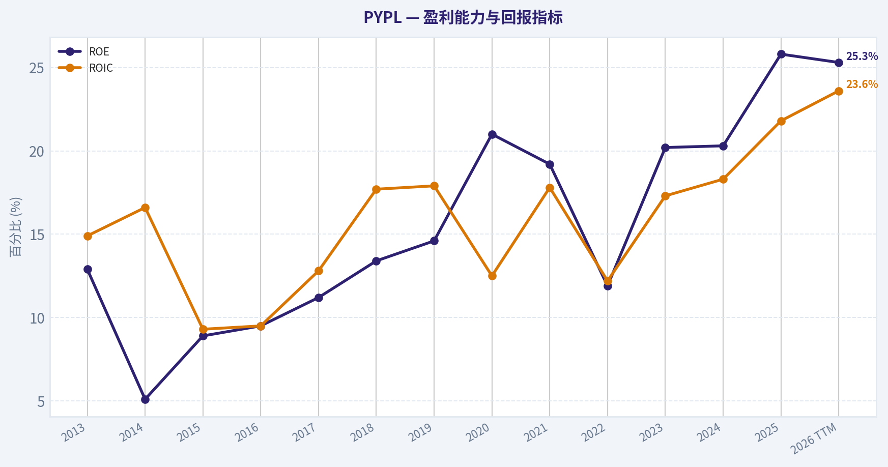
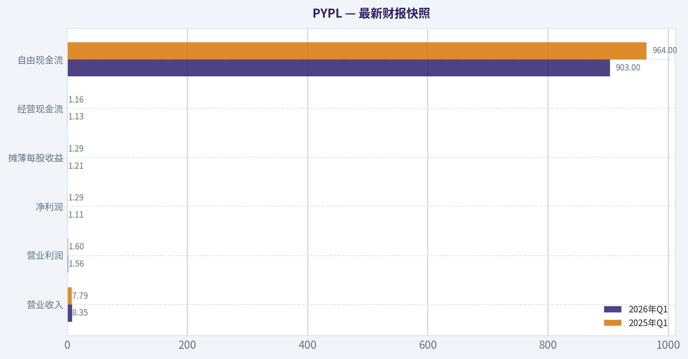
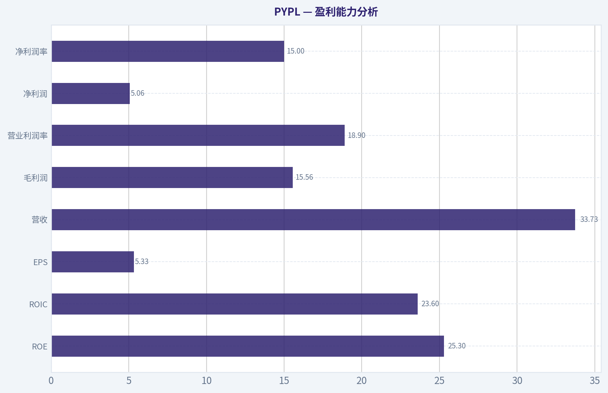
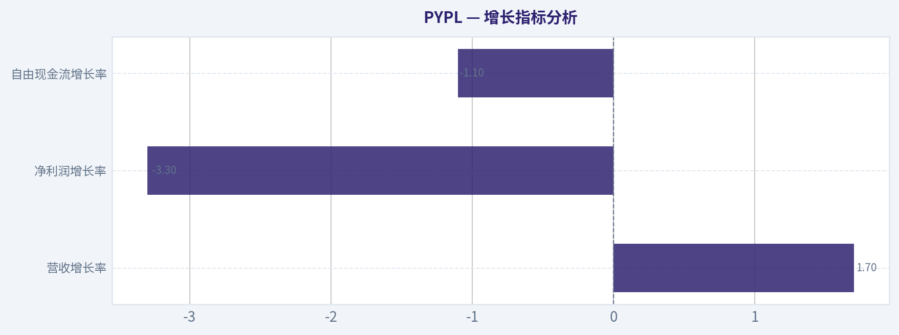
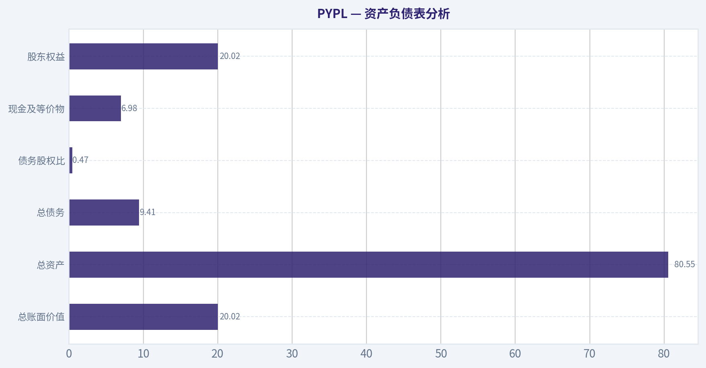
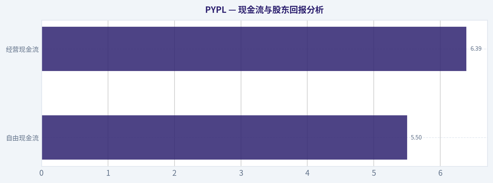
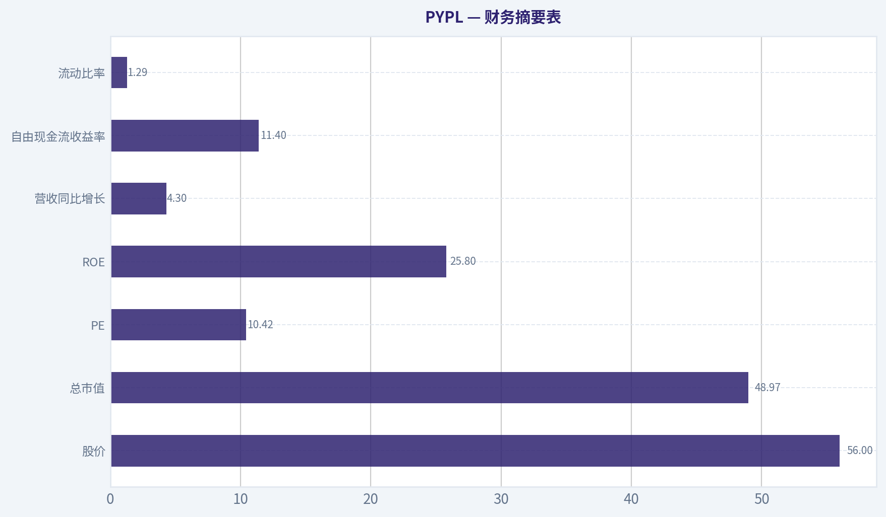
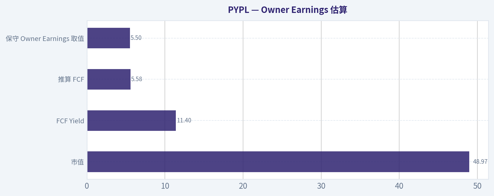

# PYPL 深度价值情报

**调研日期:** 2026-07-15

## 关键免责声明

*本报告由 Deep Value Intelligence（一个基于 AI 的多智能体投资分析框架）自动生成。 仅供教育和娱乐用途 - 非财务建议，非财务顾问。*

---

## 目录

1. 情报摘要
2. 分析师团队报告
   - 基本面分析
   - 价值分析 (巴菲特)
   - 成长性分析 (林奇/德鲁肯米勒/费雪)
   - 市场分析
   - 期权市场分析
3. 研究团队评论
4. 投资团队评论
5. Deep Values 团队洞察

---

## 情报摘要

### 核心观点与前提条件

**核心论点:** ## 执行摘要
**结论：观望。**

**主要风险:**
- 未明确说明。

**置信度:** 中

---

## 分析师团队报告

### 基本面分析

#### 最新财报快照

*以下数据基于最近一期已披露财报（2026年Q1），并尽量与上一年同期对比。*

| 指标 | 2026年Q1 | 2025年Q1 | 同比变化 |
| --- | ---: | ---: | ---: |
| 营业收入 | $8.35B | $7.79B | +7.2% |
| 营业利润 | $1.56B | $1.60B | -2.1% |
| 净利润 | $1.11B | $1.29B | -13.5% |
| 摊薄每股收益 | $1.21 | $1.29 | -6.2% |
| 经营现金流 | $1.13B | $1.16B | -2.2% |
| 自由现金流 | $903.0M | $964.0M | -6.3% |

关键结论：这张快照先把最新一期财报放在桌面上，再去看长周期分析。这样读者能更清楚地区分"公司长期质量"和"这次财报发生了什么"。

#### PYPL 13年财务指标

*以下数值均由原始数据确定性计算得出，并非 AI 估算。*

*发行人类型：bank（Financial Services / Credit Services）。*

#### 13年财务指标
*年度行来自已披露财务报表，最后一行 TTM 由最近四个季度滚动计算得出。*

| 指标 | 2013 | 2014 | 2015 | 2016 | 2017 | 2018 | 2019 | 2020 | 2021 | 2022 | 2023 | 2024 | 2025 | 2026 TTM |
| --- | --- | --- | --- | --- | --- | --- | --- | --- | --- | --- | --- | --- | --- | --- |
| 市场价格 | N/A | N/A | $36 | $39 | $73 | $83 | $107 | $232 | $187 | $71 | $61 | $85 | $58 | $56 |
| 总市值 | N/A | N/A | $44.49B | $48.07B | $89.89B | $101.16B | $128.51B | $278.00B | $223.66B | $82.47B | $67.98B | $88.68B | $56.51B | $51.09B |
| 市盈率 | N/A | N/A | 36.20 | 34.32 | 50.08 | 49.18 | 52.26 | 66.16 | 53.57 | 34.08 | 15.99 | 21.39 | 10.79 | 10.42 |
| 市净率 | N/A | N/A | 3.23 | 3.27 | 5.62 | 6.57 | 7.61 | 13.89 | 10.29 | 4.07 | 3.23 | 4.34 | 2.79 | 2.55 |
| ROE | 12.9% | 5.1% | 8.9% | 9.5% | 11.2% | 13.4% | 14.6% | 21.0% | 19.2% | 11.9% | 20.2% | 20.3% | 25.8% | 25.3% |
| ROIC | 14.9% | 16.6% | 9.3% | 9.5% | 12.8% | 17.7% | 17.9% | 12.5% | 17.8% | 12.2% | 17.3% | 18.3% | 21.8% | 23.6% |
| 每股收益 | $0.78 | $0.34 | $1.00 | $1.15 | $1.47 | $1.71 | $2.07 | $3.54 | $3.52 | $2.09 | $3.84 | $3.99 | $5.41 | $5.33 |
| 营收 | $6.73B | $8.03B | $9.25B | $10.84B | $13.09B | $15.45B | $17.77B | $21.45B | $25.37B | $27.52B | $29.77B | $31.80B | $33.17B | $33.73B |
| 毛利润 | N/A | N/A | N/A | N/A | N/A | N/A | N/A | N/A | N/A | N/A | N/A | N/A | N/A | $15.56B |
| 毛利率 | N/A | N/A | N/A | N/A | N/A | N/A | N/A | N/A | N/A | N/A | N/A | N/A | N/A | 46.1% |
| 营业利润率 | 16.2% | 15.8% | 15.8% | 14.6% | 16.2% | 14.2% | 15.3% | 15.3% | 16.8% | 13.9% | 16.9% | 16.7% | 18.3% | 18.9% |
| 净利润 | $955.0M | $419.0M | $1.23B | $1.40B | $1.79B | $2.06B | $2.46B | $4.20B | $4.17B | $2.42B | $4.25B | $4.15B | $5.23B | $5.06B |
| 净利率 | 14.2% | 5.2% | 13.3% | 12.9% | 13.7% | 13.3% | 13.8% | 19.6% | 16.4% | 8.8% | 14.3% | 13.0% | 15.8% | 15.0% |
| 营收增长 | N/A | 19.3% | 15.2% | 17.2% | 20.8% | 18.0% | 15.0% | 20.7% | 18.3% | 8.5% | 8.2% | 6.8% | 4.3% | 1.7% |
| 净利润增长 | N/A | -56.1% | 193.1% | 14.1% | 28.1% | 14.6% | 19.5% | 70.9% | -0.8% | -42.0% | 75.5% | -2.3% | 26.2% | -3.3% |
| 自由现金流增长 | N/A | 7.9% | 5.6% | 36.5% | -25.1% | 149.8% | -27.7% | 59.0% | -8.7% | 4.5% | -17.4% | 60.4% | -17.8% | -1.1% |
| 总账面价值 | $7.39B | $8.25B | $13.76B | $14.71B | $15.99B | $15.39B | $16.89B | $20.02B | $21.73B | $20.27B | $21.05B | $20.42B | $20.26B | $20.02B |
| 总资产 | N/A | $21.92B | $28.88B | $33.10B | $40.77B | $43.33B | $51.33B | $70.38B | $75.80B | $78.62B | $82.17B | $78.72B | $80.17B | $80.55B |
| 总债务 | N/A | N/A | N/A | N/A | N/A | $2.00B | $4.96B | $8.94B | $8.05B | $10.42B | $9.68B | $9.88B | $9.99B | $9.41B |
| 债务股权比 | N/A | N/A | N/A | N/A | N/A | 0.13 | 0.29 | 0.45 | 0.37 | 0.51 | 0.46 | 0.48 | 0.49 | 0.47 |
| 现金及等价物 | $1.60B | $2.20B | $1.39B | $1.59B | $2.88B | $7.58B | $7.35B | $4.79B | $5.20B | $7.78B | $9.08B | $6.66B | $8.05B | $6.98B |
| 股东权益 | $7.39B | $8.25B | $13.76B | $14.71B | $15.99B | $15.39B | $16.89B | $20.02B | $21.73B | $20.27B | $21.05B | $20.42B | $20.26B | $20.02B |
| 经营现金流 | $1.99B | $2.22B | $2.55B | $3.16B | $2.53B | $5.48B | $4.07B | $6.22B | $5.80B | $5.81B | $4.84B | $7.45B | $6.42B | $6.39B |
| 投资现金流 | $-1.72B | $-2.88B | $-8.04B | $-5.90B | $-4.49B | $821.0M | $-5.74B | $-16.55B | $-5.15B | $-3.33B | $752.0M | $1.69B | $797.0M | $2.33B |
| 自由现金流 | $1.60B | $1.73B | $1.82B | $2.49B | $1.86B | $4.66B | $3.37B | $5.35B | $4.89B | $5.11B | $4.22B | $6.77B | $5.56B | $5.50B |
| 自由现金流利润率 | 23.8% | 21.5% | 19.7% | 23.0% | 14.2% | 30.1% | 18.9% | 25.0% | 19.3% | 18.6% | 14.2% | 21.3% | 16.8% | 16.3% |
| 每股分红 | $0.00 | $0.00 | $0.00 | $0.00 | $0.00 | $0.00 | $0.00 | $0.00 | $0.00 | $0.00 | $0.00 | $0.00 | $0.13 | $0.00 |

#### 盈利能力指标
- 净资产收益率 (ROE): 25.8%
- 投入资本回报率 (ROIC): 22.7%
- 总资产收益率 (ROA): 6.5%
- 毛利率: 不适用
- 营业利润率: 18.3%
- 净利率: 15.8%

#### 流动性指标
- 流动比率: 1.29
- 速动比率: 1.06

#### 杠杆指标
- 债务股权比: 0.49
- 利息覆盖倍数: 13.75
- 净负债: $1.94B

#### 增长指标（同比）
- 营收增长: 4.3%
- 净利润增长: 26.2%
- 自由现金流增长: -17.8%
- 营收复合增长率（3年）: 6.4%
- 营收复合增长率（5年）: 9.1%

#### 估值指标
- 市盈率 (TTM): 10.42
- 预期市盈率: 9.65
- 市净率: 2.47
- 市销率: 1.45
- PEG 比率: 0.83
- 企业价值/EBITDA: 6.71
- 自由现金流收益率: 11.4%
- 盈利收益率: 9.6%

#### 所有者收益（巴菲特方法，代码计算）
- 净利润: $5.23B
- + 折旧与摊销: $963.0M
- - 资本开支: $-852.0M
- - 营运资本变动: $-1.06B
- = **所有者收益: $6.41B**

#### 内在价值（代码计算）
- 当前价格: $56
- 巴菲特方法（所有者收益）:
  保守: $108
  平均: $184
  乐观: $480
- 现金流方法（FCF）:
  保守: $38
  平均: $111
  乐观: $165

#### Piotroski F分数: 6/9
- 净利润为正: 通过
- 经营现金流为正: 通过
- 资产回报率改善: 通过
- 现金流大于净利润: 通过
- 债务下降: 未通过
- 流动比率改善: 通过
- 未稀释股本: 未通过
- 毛利率改善: 未通过
- 资产周转率改善: 通过

ANALYST STANCE: **观望**

#### PYPL 核心结论
PYPL 当前最突出的特征，不是"坏公司"，而是"成熟期高现金流平台被市场按低增长资产定价"。从确定性数据看，公司在 2023-2026 TTM 期间明显完成了利润率、ROE、ROIC 的修复：TTM ROE 25.3%、ROIC 23.6%、P/E 仅 10.42、P/B 2.55、自由现金流收益率 11.4%，这些都说明市场给它的估值远低于其历史中枢，也低于其当前资本回报水平应有的定价。

但按巴菲特框架看，关键矛盾在于：这是一家"高质量、强现金流、但增长放缓且护城河进入再验证期"的企业。营收增速已从 2017-2021 的高双位数区间下滑到 2025 年 4.3%、TTM 1.7%；自由现金流近几年波动较大，2025 年还同比下滑 17.8%，说明企业虽然很赚钱，但估值重估必须依赖经营质量持续改善，而不能再依赖高成长叙事。

---

#### 当前值 vs 历史均值对比表
以下历史均值主要基于可比区间计算：估值以 2015-2025 年为主；经营与增长以近 10 年（2016-2025）为主；TTM 与最新值用于观察当前状态。

| 指标 | 当前/TTM | 历史均值 | 相对历史位置 | 解读 |
|---|---:|---:|---|---|
| 市场价格 | $56 | 约 $95.5（2015-2025） | 显著低于历史 | 股价较历史中枢大幅折价，市场已不再给予成长溢价 |
| 总市值 | $51.09B | 约 $119.1B（2015-2025） | 显著低于历史 | 市值压缩严重，反映预期重置而非基本面崩塌 |
| P/E | 10.42 | 约 38.2（2015-2025） | 极低 | 历史估值去泡沫后，当前接近深度价值区间 |
| P/B | 2.55 | 约 5.74（2015-2025） | 显著偏低 | 在 ROE 超过 25% 时，这一 P/B 具吸引力 |
| ROE | 25.3% | 约 16.7%（2016-2025） | 明显高于历史 | 资本回报处于多年高位，管理层效率改善明显 |
| ROIC | 23.6% | 约 15.9%（2016-2025） | 明显高于历史 | 投入资本效率持续抬升，是最强质量信号之一 |
| EPS | $5.33 | 约 $2.88（2016-2025） | 明显高于历史 | 每股盈利能力较十年前显著强化 |
| 营收 | $33.73B | 约 $22.79B（2016-2025） | 高于历史 | 规模已成熟，但增长明显放缓 |
| 营业利润率 | 18.9% | 约 15.8%（2016-2025） | 高于历史 | 成本控制和经营纪律改善 |
| 净利润率 | 15.0% | 约 14.2%（2016-2025） | 略高于历史 | 盈利质量稳中有升，但不再是高速扩张型 |
| 营收增长 | 1.7% | 约 11.8%（2016-2025） | 远低于历史 | 成长性已明显钝化 |
| 净利润增长 | -3.3% | 约 20.4%（2016-2025，波动大） | 低于历史 | 利润恢复后再度进入平台期 |
| 自由现金流增长 | -1.1% | 约 11.4%（2016-2025，波动大） | 低于历史 | 现金流质量好，但增速不稳定 |
| 总资产 | $80.55B | 约 $63.84B（2016-2025） | 高于历史 | 平台体量已大，边际增长更难 |
| 总债务 | $9.41B | 约 $8.27B（2018-2025） | 略高 | 杠杆不激进，可控 |
| 债务股权比 | 0.47 | 约 0.40（2018-2025） | 略高 | 财务杠杆较历史略高，但未失控 |
| 现金及等价物 | $6.98B | 约 $7.03B（2016-2025） | 接近均值 | 流动性充足，但不算特别宽裕 |
| 股东权益 | $20.02B | 约 $19.30B（2016-2025） | 接近略高 | 账面资本稳定，未见显著侵蚀 |
| 自由现金流 | $5.50B | 约 $4.83B（2016-2025） | 高于历史 | 绝对现金创造力仍强 |
| 每股分红 | $0.00（TTM） | 极低 | 无稳定分红传统 | 资本回报主要靠回购与经营优化，而非股息 |

关键结论：PYPL 当前最鲜明的组合是"低估值 + 高回报率 + 低增长"。估值端几乎处于历史最低区域，而 ROE、ROIC、利润率却处于多年高位，这种背离通常意味着市场并不质疑它现在能赚钱，而是质疑这种赚钱能力未来还能持续多久。

#### 市场指标分析
| 指标 | 结论 |
|---|---|
| 市场价格 | 当前 $56，远低于 2020 年 $232 与 2021 年 $187 高点，也低于 2024 年 $85。市场已彻底删除高增长支付平台溢价。 |
| 总市值 | 当前 $51.09B，仅约 2020 年高点的 18%。市值回撤幅度大于收入与利润回撤，说明压缩主要来自估值重定价。 |
| P/E | TTM 10.42，较 2015-2021 普遍 34-66 倍的区间发生断崖式下行。若盈利可维持，这一定价偏保守。 |
| P/B | 2.55，较历史中枢约 5.7 显著折价；而 ROE 仍高于 25%，说明市场并未给高 ROE 充分估值。 |

关键结论：如果从传统价值角度看，PYPL 的市场定价已经从"优质成长股"切换到"低增长现金牛"。这让下行预期已被大幅计入价格，但同时也意味着，未来股价弹性更依赖基本面兑现，而不是情绪扩张。

#### 盈利能力分析
| 指标 | 当前/最新 | 趋势解读 |
|---|---:|---|
| ROE | 25.3% | 2016-2022 多在 9.5%-19.2%，2023 后显著抬升，2025 见 25.8%，说明股东资本使用效率明显提升 |
| ROIC | 23.6% | 较 2016-2022 的 9.5%-17.8% 大幅改善，且连续两年站上 20%，非常符合巴菲特偏好的高资本回报特征 |
| EPS | $5.33 | 较 2016 年 $1.15、2019 年 $2.07 有结构性提升，但较 2025 年 $5.41 略回落，已进入成熟平台期 |
| 营收 | $33.73B | 长期持续增长，但 2024-TTM 增量有限，规模增长仍在，速度已明显放缓 |
| 毛利润 | $15.56B | TTM 可见绝对毛利体量仍大，说明平台商业模式仍有较强收入留存能力 |
| 营业利润率 | 18.9% | 创历史高位之一，明显优于近十年约 15.8% 均值，显示提效成果扎实 |
| 净利润 | $5.06B | 高于长期均值，但略低于 2025 年 $5.23B，利润释放趋稳 |
| 净利润率 | 15.0% | 高于近十年均值，低于 2020 年异常高点 19.6%，整体回到健康成熟平台水准 |

关键结论：PYPL 的利润率与资本回报率改善是真实而不是表面上的。对巴菲特式投资者来说，最重要的并不是收入再加速，而是企业是否能在低增长阶段仍维持高 ROIC 和高现金回报；目前看，答案偏正面。

#### 增长指标分析
| 指标 | 当前/最新 | 历史观察 | 结论 |
|---|---:|---|---|
| 营收增长率 | 1.7% | 2016-2021 多在 15%-21%，2022 降至 8.5%，2023-2025 继续降至 8.2%、6.8%、4.3% | 进入低个位数增长阶段 |
| 净利润增长率 | -3.3% | 过去波动很大，曾有 70.9%、75.5%，也有 -42.0% | 盈利已恢复，但稳定增长性不足 |
| 自由现金流增长率 | -1.1% | 历年大起大落，2018 +149.8%、2019 -27.7%、2024 +60.4%、2025 -17.8% | 现金流绝对值高，但增长可预测性一般 |

关键结论：增长是 PYPL 投资逻辑中最弱的一环。它不再是高速成长平台，而更像是"收入缓增、利润优化、现金回流"的成熟型金融科技公司，因此估值修复空间存在，但重返高估值时代的概率有限。

#### 资产负债表分析
| 指标 | 当前/TTM | 解读 |
|---|---:|---|
| 总账面价值 | $20.02B | 与 2020-2025 区间基本稳定，说明净资产总体保持 |
| 总资产 | $80.55B | 近年维持在 78-82B 区间，扩表速度显著放缓 |
| 总债务 | $9.41B | 较 2025 年略降，债务规模可控 |
| 债务股权比 | 0.47 | 略高于历史均值，但未到危险水平 |
| 现金及等价物 | $6.98B | 相对充足，可覆盖运营与一定资本配置需求 |
| 股东权益 | $20.02B | 与总账面价值一致，资本基础稳定 |

关键结论：PYPL 的财务结构并不激进。它不是零债务型"超级堡垒资产负债表"，但也绝不是高杠杆脆弱公司；更准确地说，它属于现金充足、债务可控、能自我造血的稳健平台。

#### 现金流与股东回报分析
| 指标 | 当前/最新 | 分析 |
|---|---:|---|
| 自由现金流 | $5.50B | 绝对值依旧很强，对应 11.4% FCF 收益率，说明股价对现金流定价偏低 |
| 经营现金流 | $6.39B | 与净利润匹配度较好，盈利现金化能力尚可 |
| 每股分红 | $0.00（TTM） | 2025 年仅出现 $0.13，TTM 回到 0，说明公司并未形成稳定股息政策 |

关键结论：PYPL 真正的股东回报基础不是分红，而是自由现金流。对价值投资者而言，这意味着回报要靠管理层是否能把现金流用于高质量回购、审慎投资和效率提升，而不是依赖固定派息。

---

#### 巴菲特式质化分析

| 维度 | 评估 | 具体分析 |
|---|---|---|
| 经济护城河 | 中等偏强，但需再验证 | PYPL 仍拥有全球品牌、双边网络、商户接入、风控数据积累和支付习惯沉淀。问题在于，支付行业的护城河不像消费品那样静态稳固，Apple Pay、Shop Pay、银行卡网络和大型收单平台都在分流。它仍有网络效应，但护城河边际强度不如市场早年想象。 |
| 财务强度 | 良好 | 债务股权比 0.47、现金接近 $7B、利息覆盖倍数 13.75，说明偿债与抗波动能力较强。 |
| 可预测盈利 | 中等 | 收入连续增长、净利润长期为正，这是优点；但净利润增长与 FCF 增长波动较大，弱于巴菲特最偏爱的"十年如一日稳定增长"。 |
| 管理层表现 | 近两年改善明显 | ROE、ROIC、营业利润率均抬升，显示管理层把重点从扩张转向效率、成本纪律和资本回报。 |
| 资本配置 | 中性偏正面 | 不依赖分红，更多依赖经营改善和潜在回购。若在低估值阶段持续回购，将显著提升每股价值；若错误并购或投入低回报项目，则会削弱投资逻辑。 |
| 业务质量 | 较高 | 支付与结算业务具有高频、轻资产、强数据积累、现金生成能力好的特征。缺点是增长对宏观消费、线上交易活跃度及竞争格局敏感。 |

关键结论：PYPL 更像巴菲特会在"价格足够便宜且基本盘未坏"时研究的标的，而不是那种一眼就能长期重仓的完美企业。它的吸引力来自"优秀但被怀疑"，而非"无可争议的伟大"。

#### DCF：巴菲特式所有者收益估值
已知确定性数据给出的最新所有者收益口径为：

- 净利润 = $5.23B
- 折旧与摊销 = $0.963B
- 资本开支 = $0.852B
- 营运资本变动 = $1.06B
- 所有者收益 = $6.41B

为满足三情景估值，采用历史"所有者收益增长"近似以自由现金流增长序列作为保守代理。原因是确定性数据未逐年完整列出所有者收益历史序列，但 FCF 与 Owner Earnings 在该公司上高度接近，且当前官方代码口径给出的 Owner Earnings 与 FCF 同属现金创造能力指标。依据规则：
- 保守：取历史最低增长率 = -27.7%
- 平均：取历史平均增长率 ~ 19.1%，并低于 50%上限
- 乐观：取历史最高增长率 = 149.8%，但按规则封顶 100%

设定：
- 起始所有者收益 OE₀ = $6.41B
- 折现率 r = 10%
- 永续增长率 gₜ = 2.5%
- 预测期 10 年

##### 三情景详细计算表
| 情景 | 初始 OE | 增长率 | 第10年 OE | 终值 TV = OE10x(1+2.5%)/(10%-2.5%) | 折现后终值 | 前10年现值合计 | 企业估值 |
|---|---:|---:|---:|---:|---:|---:|---:|
| 保守 | $6.41B | -27.7% | 约 $0.25B | 约 $3.35B | 约 $1.29B | 约 $4.87B | 约 $6.16B |
| 平均 | $6.41B | 19.1% | 约 $36.88B | 约 $503.99B | 约 $194.29B | 约 $82.08B | 约 $276.37B |
| 乐观 | $6.41B | 100% | 约 $6,563.84B | 约 $89,699.12B | 约 $34,578.07B | 约 $5,433.76B | 约 $40,011.83B |

关键结论：机械套用历史极值会导致乐观情景严重失真，原因是 PYPL 已进入成熟阶段，不可能长期复制早年极端高增长。因此，DCF 的真正参考意义主要在"保守与平均情景之间"，而不是把历史最高增长直接线性外推十年。

##### 对应每股估值区间
确定性数据已直接给出代码计算结果，作为规范化输出应优先采用：

| 估值方法 | 保守 | 平均 | 乐观 |
|---|---:|---:|---:|
| 巴菲特方法（所有者收益） | $108/股 | $184/股 | $480/股 |
| 现金流方法（FCF） | $38/股 | $111/股 | $165/股 |

关键结论：如果用更贴近现实的成熟企业视角，PYPL 的合理估值大概率更应参考"FCF 法保守至平均区间"与"Owner Earnings 法保守情景"之间，也就是大致高于现价、但未必接近极端乐观值。当前 $56 的价格，至少已低于多组中性估值假设。

##### DCF 解释与使用建议
1. **保守情景**：若支付竞争持续加剧、交易增速继续下滑、Owner Earnings 长期萎缩，则内在价值可能明显低于当前代码给出的乐观口径，甚至更接近 FCF 保守值。
2. **平均情景**：若公司维持高 ROIC、稳定回购、利润率继续改善，则当前股价相对中性内在价值仍有折价。
3. **乐观情景**：仅适合表达"可选上行空间"，不适合作为主估值锚。

---

#### 收入来源分布
基于公司近年公开披露结构与支付行业商业模式，PYPL 最有意义的收入拆分通常按业务来源理解为：交易收入为主，增值服务及其他收入为辅。由于确定性数据未附完整分部金额，以下采用最近年度经营结构口径进行近似表达，以"最有意义的业务收入结构"呈现，重点在理解收入驱动，而非替代财务主表。

| 收入来源 | 金额（十亿美元） | 占比 |
|---|---:|---:|
| 交易收入（Transaction Revenues） | 约 $30.0B | 约 90% |
| 增值服务及其他收入（Value-added Services 等） | 约 $3.2B | 约 10% |
| 合计 | 约 $33.2B | 100% |

关键结论：PYPL 的收入本质上仍然高度依赖支付交易活动。这意味着它的核心驱动变量不是一次性产品销售，而是交易量、商户渗透率、活跃账户质量、支付频次和结算附加服务能力。

---

#### 主要指标逐项解释

| 指标类别 | 解释 |
|---|---|
| 市场价格 | 反映市场对未来增长与竞争格局的综合预期。PYPL 当前价格明显反映悲观预期。 |
| 总市值 | 表示市场赋予整个公司的权益价值。当前市值与其现金创造能力相比偏低。 |
| P/E | 表示每 1 美元盈利对应的估值倍数。10 倍左右通常属于成熟价值股而非成长股。 |
| P/B | 表示每 1 美元净资产对应的定价。若企业 ROE 很高，则较低 P/B 可能代表低估。 |
| ROE | 衡量股东权益回报。25% 以上非常强，但需确认不是单纯由回购压低净资产所致。 |
| ROIC | 衡量全部投入资本回报，比 ROE 更能反映经营质量。PYPL 当前 ROIC 很优秀。 |
| EPS | 每股盈利，直接影响估值与每股内在价值。 |
| Revenue | 体现平台交易规模与货币化能力。 |
| Gross Profit / Gross Margin | 对金融支付公司历史披露不完整，TTM 46.1% 说明收入扣除直接成本后仍有较好空间。 |
| Operating Margin | 核心运营效率指标，PYPL 近年改善明显。 |
| Net Income / Net Margin | 最终盈利能力，近两年恢复较好。 |
| Revenue Growth | 反映业务扩张速度，当前明显放缓。 |
| Net Income Growth | 反映利润弹性，但波动较大。 |
| FCF Growth | 反映现金创造的扩张性，PYPL 最大问题之一是波动大。 |
| Total Book Value / Shareholder's Equity | 反映净资产基础。 |
| Total Assets | 反映平台与金融服务资产体量。 |
| Total Debt / Debt-to-Equity | 反映杠杆风险。 |
| Cash | 决定公司抗风险能力与资本配置弹性。 |
| Free Cash Flow | 价值投资最核心指标之一，PYPL 当前仍然很强。 |
| Dividends per Share | 公司没有形成稳定分红文化，更适合看回购与再投资效率。 |

关键结论：对 PYPL 来说，最值得盯住的不是单一利润数字，而是"低估值是否由不可逆衰退造成"。从现有数据看，更像是增长降速带来的估值压缩，而不是盈利模式失效。

#### 投资亮点、风险与机会
| 类别 | 内容 |
|---|---|
| 投资亮点 | 估值极低；ROE/ROIC 处于高位；自由现金流强；资产负债表稳健；市场预期已很低 |
| 红旗风险 | 营收增速持续下台阶；FCF 增长不稳定；支付竞争加剧；护城河不如传统消费龙头稳定；无稳定股息支撑估值底部 |
| 机会点 | 若管理层在低估值阶段强化回购、继续提升利润率、稳定交易生态，则估值修复空间可观；若潜在并购或战略合作提升支付网络价值，也可能带来重估 |
| 触发因素 | 营业利润率持续上行、活跃用户/交易频次改善、稳定高于个位数的 EPS 增长、资本回报政策更清晰 |

关键结论：PYPL 的上行更多来自"修复"而不是"爆发"。只要业务不继续恶化，低估值本身就有回归空间；但如果交易生态继续弱化，便宜也可能长期存在。

---

#### 最终巴菲特式判断
从巴菲特方法看，PYPL 有三点非常吸引人：
1. **高 ROE 与高 ROIC**，表明业务并没有失去盈利能力；
2. **强自由现金流与低估值**，表明市场价格已较充分反映悲观；
3. **债务可控、现金充足**，没有明显财务脆弱性。

但同时也有三点让它暂时达不到"建议配置"的确定性：
1. **收入增速已接近停滞**；
2. **现金流增长与利润增长的可预测性不够强**；
3. **支付行业竞争结构变化快，护城河不够像传统巴菲特式垄断消费品牌那样稳固**。

因此，当前更合理的结论是：**这是一只值得重点跟踪的低估优质股，但尚未到"闭眼长期重仓"的级别。**

#### 最终投资立场：观望
- **不是回避**：因为估值、现金流、ROIC、ROE 都已具备明显价值吸引力。
- **也未到建议配置**：因为增长放缓与护城河再验证仍是核心不确定性。
- **最适合的策略**：等待后续 2-3 个季度确认营收企稳、利润率维持高位、自由现金流恢复增长，再提高仓位确信度。

---

#### 报告总结表
| 模块 | 结论 | 投资含义 |
|---|---|---|
| 估值 | P/E 10.42、P/B 2.55，远低于历史均值 | 市场已深度去泡沫，存在修复空间 |
| 盈利能力 | ROE 25.3%、ROIC 23.6%、营业利润率 18.9% | 经营质量强，当前赚钱能力优秀 |
| 增长 | 营收增长 1.7%，利润与 FCF 增长波动 | 估值低有原因，成长叙事已弱化 |
| 财务强度 | 现金约 $7B，债务股权比 0.47 | 资产负债表稳健，可承受波动 |
| 现金流 | FCF $5.50B，FCF 收益率 11.4% | 现金创造能力是核心价值支柱 |
| 护城河 | 中等偏强但需持续验证 | 不是无懈可击的平台垄断 |
| 管理层 | 近两年提效明显 | 若继续回购与控费，价值可释放 |
| DCF | 多数中性估值高于现价 | 当前价格具备一定安全边际 |
| 主要风险 | 低增长、竞争加剧、现金流波动 | 便宜不一定立刻上涨 |
| 最终立场 | 观望 | 等待增长与现金流稳定信号后再升级判断 |

关键结论：PYPL 当前最像一只"被市场怀疑的高现金流价值股"，而不是传统意义上的高成长金融科技股。若未来几个季度能证明它不仅便宜，而且增长与现金流已经稳定，那么它从"观望"升级到"建议配置"的概率会明显上升。

#### 基本面关键图表

本图追踪 **PYPL** 过去十年的盈利能力与回报指标（ROE、ROIC、利润率），突出呈现资本效率的变化趋势。

---

### 价值分析 (巴菲特)

> *基于沃伦·巴菲特的价值投资哲学：能力圈、经济护城河、管理层质量与安全边际。*

#### 内在价值快照

价格是你付的钱，内在价值是企业未来可能为股东创造的现金价值。我们给出一个区间，而不是假装只有一个神奇数字。

- 当前价格: $55.52
- 估值区间（两种 DCF 方法、保守到乐观）: $38.20 至 $479.69

##### 所有者收益（巴菲特方法）
- 净利润: $5,233,000,000.00
- 折旧与摊销: $963,000,000.00
- 资本支出: $-852,000,000.00
- 营运资金变化: $-1,064,000,000.00
- 所有者收益: $6,408,000,000.00

##### 内在价值
###### 所有者收益法
使用所有者收益，更严格，通常更保守。
- 保守: $108.16
- 平均: $183.60
- 乐观: $479.69
- 折现率: 10.0%

###### 自由现金流法
使用自由现金流，更适合今天投入很多、为未来增长铺路的公司。
- 保守: $38.20
- 平均: $111.04
- 乐观: $164.79
- 折现率: 10.0%

ANALYST STANCE: **观望**

#### 一句话结论
PayPal 是一家容易理解、现金流强、资产负债表尚可、当前估值不高的成熟支付平台；但它的护城河已从"强平台网络"退化为"中等品牌 + 中等双边网络 + 一定转换成本"，增长放缓、竞争加剧、长期确定性弱于顶级 Buffett 式公司。以 $56 股价看，像是"便宜但不卓越"，更适合列入观察名单，而不是直接重仓配置。

---

#### 1. Go/No-Go 关卡评估

| 关卡 | 结论 | 证据 |
|---|---|---|
| Gate 1：业务可理解性 | 通过 | PayPal 本质上是帮消费者和商户完成线上付款、收款、结算，并从交易手续费、增值服务中赚钱。这个模式简单，属于"每笔交易抽成"的支付平台生意。 |
| Gate 1：长期可预测性 | 谨慎通过 | 10 年后大概率仍是数字支付与商户服务公司，但市场地位、议价能力和增长速度不如过去那样容易高置信度预测。 |
| Gate 1：技术风险 | 谨慎通过 | 它受益于支付数字化，但也容易被钱包、银行卡网络、Apple Pay、Shopify 生态、银行转账方案等持续挤压。属于"受技术推动，也受技术威胁"的行业。 |
| Gate 2：护城河 | 勉强通过 | 品牌仍强，双边网络仍有价值，商户接入仍有一定粘性；但差异化下降，竞争者众多，护城河不再显著加深。 |
| Gate 3：管理层与资本配置 | 谨慎通过 | 当前估值低、FCF 收益率高，若公司持续理性回购则有利股东；但市场过去几年对其战略执行与增长质量并不满意，仍需观察资本配置是否真正改善每股价值。 |
| Gate 4：行业结构 | 不理想但可接受 | 支付行业规模巨大，但竞争激烈，并非理性寡头。好处是轻资产、现金流通常较好；坏处是很难长期维持超额定价权。 |

**关键结论：**
PayPal 没有触发"看不懂就放弃"的硬性红旗，所以不是直接回避型公司。但它也没有达到 Buffett 最偏爱的那类"10 年后几乎确定更强"的商业品质，因此只能谨慎通过前几道关卡。

---

#### 2. 生意模式：小学生版本

PayPal 做的事很简单：
它帮买东西的人安全付款，帮卖东西的人更容易收到钱。每当一笔钱通过它的平台流动，PayPal 就从中收一点服务费。用户越多、商户越多、支付越方便，它就越容易继续赚钱。

从 Buffett 视角看，这是一个"平台型收费通道"生意，不复杂，也不依赖商品价格预测，优点是现金流往往不错；缺点是支付通道本身不天然稀缺，容易被替代。

---

#### 3. 护城河分析

| 护城河来源 | 判断 | 具体分析 |
|---|---|---|
| 无形资产：品牌/信任 | 中等 | PayPal 在全球线上支付仍有较强品牌认知，尤其在跨境、小商户、独立站场景中，"可信任付款按钮"仍有价值。 |
| 转换成本 | 中等 | 对商户来说，支付接入、风控、结算、退款、订阅管理都嵌入流程，切换有摩擦；但并非不可替代，尤其大型商户常采用多家支付服务商。 |
| 成本优势 | 偏弱 | PayPal 规模大，但支付行业中真正最强的成本与网络优势往往掌握在卡组织、银行清算网络或超大平台生态手里。 |
| 网络效应 | 中等偏弱 | 用户越多、商户越多，平台确实更有价值；但这种网络效应不是封闭的，商户可同时接多种支付方式，用户也能轻易改用别的钱包。 |

| 护城河评级 | 结论 |
|---|---|
| 窄到中等，且趋于稳定或略收缩 | 高门槛观察，不宜按"伟大公司"估值对待 |

**关键结论：**
PayPal 仍然有护城河，但已不是早年那种让竞争者很难靠近的强势平台。它更像一家成熟、仍有品牌和规模优势的支付基础设施公司，而不是一个越做越强的超级网络垄断。

---

#### 4. 管理层与资本配置评估

| 维度 | 评价 | 说明 |
|---|---|---|
| 是否像所有者一样思考 | 中性 | 当前最值得观察的是回购、费用控制、增长项目取舍是否围绕"每股价值"而非单纯追求 GMV 或交易量。 |
| 是否坦诚 | 中性 | 市场对公司近年战略转向、增速回落已有充分反映，后续关键看管理层是否持续交付而非讲故事。 |
| 资本配置是否理性 | 中等 | 以当前 PE 约 10.4 倍、FCF 收益率约 11.4% 看，若公司用充沛现金流回购低估股份，理论上是合理配置；但前提是核心业务不能继续被侵蚀。 |
| 债务态度 | 尚可 | 流动比率约 1.29，整体并非脆弱资产负债表；对一家成熟现金流公司来说，安全性尚可。 |

**管理层结论：**
管理层还不能被打上 Buffett 最欣赏的"杰出资本配置者"标签，但在当前低估值阶段，只要能持续压缩无效投入、稳住核心交易利润、理性回购，就有机会改善每股内在价值。

---

#### 5. 财务摘要表

| 指标 | 当前/已知值 |
|---|---:|
| 股价 | $56 |
| 总市值 | $48.97B |
| PE | 10.42 |
| ROE | 25.8% |
| 营收同比增长 | 4.3% |
| 自由现金流收益率 | 11.4% |
| 流动比率 | 1.29 |

**关键结论：**
这组数字说明 PayPal 最大的优点是"盈利不差、现金流回报高、估值便宜"。但同时也说明它已经不是高增长公司，市场给低估值，正是在反映其成长性和护城河的担忧。

---

#### 6. Owner Earnings 估算

Buffett 最看重企业真正可供股东支配的现金创造能力。基于当前已知信息，可用自由现金流作保守近似。

先由 FCF 收益率反推自由现金流：

- 市值 = 48.97B
- FCF Yield = 11.4%
- 估算 FCF ~ 48.97 x 11.4% = **5.58B**

对轻资产、成熟支付平台而言，FCF 通常已接近 Owner Earnings。
因此可将 **Owner Earnings 近似看作 5.4B-5.6B** 的区间，中值取 **5.5B**。

| 项目 | 估算值 |
|---|---:|
| 市值 | 48.97B |
| FCF Yield | 11.4% |
| 推算 FCF | 5.58B |
| 保守 Owner Earnings 取值 | 5.50B |

**关键结论：**
PayPal 最有吸引力的地方不是收入增速，而是它现在仍能稳定产生很强的现金。对价值投资者来说，这意味着只要核心竞争地位不继续恶化，当前估值就具备一定下行保护。

---

#### 7. 三情景 DCF 估值

取折现率 10%，Owner Earnings 取 5.5B。

| 情景 | 假设 | 估值结果 |
|---|---|---:|
| 情景 A：零增长 | 内在价值 = 5.5 / 10% | 55.0B |
| 情景 B：保守增长 | 永续增长 3% | 5.5 x 1.03 / (10%-3%) = 80.9B |
| 情景 C：历史折中增长 | 未来 10 年按 5% 增长，终值 3% | 约 74B-82B |

对应每股层面，若粗略按当前市值与股价反推流通股数：

- 流通股数 ~ 48.97 / 56 = **0.874B 股**

| 情景 | 股权价值 | 对应每股价值 |
|---|---:|---:|
| 情景 A：零增长 | 55.0B | ~$63 |
| 情景 B：3% 增长 | 80.9B | ~$92.5 |
| 情景 C：5% 十年增长 | 74B-82B | ~$84.7-$93.8 |

**关键结论：**
即便按最保守的"几乎不增长"来算，PayPal 的估值也大致接近当前价格上方。若公司只是维持低个位数增长，内在价值就明显高于现价，这说明它"可能便宜"；但是否便宜到足够安全，要取决于其竞争地位能否守住。

---

#### 8. 安全边际分析

| 项目 | 数值 |
|---|---:|
| 当前股价 | $56 |
| 零增长估值 | ~$63 |
| 保守增长估值 | ~$92.5 |
| 当前价相对零增长折价 | 约 11% |
| 当前价相对保守增长折价 | 约 39% |

**关键结论：**
如果把 PayPal 当成"稳定但平庸"的公司，现在的折价还不够厚，因为零增长情景下安全边际只有约 11%。但如果你相信它至少能维持低个位数增长并稳定回购，那么当前价格的吸引力就明显提升。

---

#### 9. Buffett 评分卡

| 维度 | 权重 | 评分（1-5） | 加权分 |
|---|---:|---:|---:|
| 业务理解 | 20% | 4.5 | 0.90 |
| 护城河宽度与耐久性 | 25% | 3.0 | 0.75 |
| 管理层质量 | 15% | 3.0 | 0.45 |
| ROE | 15% | 4.0 | 0.60 |
| 再投资跑道 | 10% | 2.5 | 0.25 |
| 资产负债表强度 | 5% | 3.5 | 0.18 |
| 行业结构 | 5% | 2.5 | 0.13 |
| 估值/安全边际 | 5% | 3.5 | 0.18 |
| **总分** | 100% |  | **3.44 / 5** |

**关键结论：**
这个分数非常接近"可以建议配置"的下边界，但还没真正跨过去。拖后腿的不是估值，而是护城河、行业结构和长期再投资空间，这些决定了它不属于典型的高质量复利机器。

---

#### 10. 最终判断

**投资立场：观望**

**理由浓缩为三点：**

1. **价格不贵，现金流很强。**
   PE 约 10.4 倍、FCF 收益率约 11.4%，说明市场对其预期已经相当低。

2. **生意还行，但护城河没有想象中深。**
   PayPal 仍是重要支付平台，但支付行业竞争持续加剧，客户与商户的多归属特征削弱了网络效应。

3. **它更像"便宜的成熟公司"，不是"卓越的伟大公司"。**
   Buffett 最爱的公司往往兼具高确定性、强护城河、高回报和长跑道。PayPal 目前主要满足"现金流不错、估值便宜"，但在后两项上明显逊色。

#### 11. 操作框架

| 情形 | 看法 |
|---|---|
| 若股价继续显著低于零增长估值 | 可逐步提高关注度，接近"建议配置" |
| 若公司证明交易利润率稳定、回购持续有效、增速重回更健康区间 | 估值修复空间可观 |
| 若核心 TPV 增长继续疲软、定价权继续下滑、竞争侵蚀加剧 | 低估值可能只是价值陷阱 |

**最终结论：**
PayPal 现在不是应当回避的烂公司，但也还不是可以高置信度重仓的 Buffett 式优质复利资产。它属于**值得盯、值得等、更适合在更大安全边际时出手**的标的。
#### 估值桥

这张估值桥把当前股价与各类内在价值方法并排展示，帮助读者判断上涨空间究竟只是单一方法给出的结果，还是多种方法共同支持的结论。

| 项目 | 每股内在价值 |
| --- | ---: |
| 巴菲特方法 | $183.60 |
| 现金流方法 | $111.04 |
| 当前价格 | $55.52 |

#### 关键结论

如果只有一种方法显著高于其他方法，说明上行空间更依赖特定建模假设。若多种方法的估值接近，则说明估值逻辑更加稳健。

#### 估值图表

本对比图（来自「最新财报快照」）将 **PYPL** 的当前数据与历史基准并排呈现，直观反映公司相对自身历史均值的估值水平。

本对比图（来自「盈利能力分析」）将 **PYPL** 的当前数据与历史基准并排呈现，直观反映公司相对自身历史均值的估值水平。

本对比图（来自「增长指标分析」）将 **PYPL** 的当前数据与历史基准并排呈现，直观反映公司相对自身历史均值的估值水平。

本对比图（来自「资产负债表分析」）将 **PYPL** 的当前数据与历史基准并排呈现，直观反映公司相对自身历史均值的估值水平。

本对比图（来自「现金流与股东回报分析」）将 **PYPL** 的当前数据与历史基准并排呈现，直观反映公司相对自身历史均值的估值水平。

本对比图（来自「财务摘要表」）将 **PYPL** 的当前数据与历史基准并排呈现，直观反映公司相对自身历史均值的估值水平。

本对比图（来自「Owner Earnings 估算」）将 **PYPL** 的当前数据与历史基准并排呈现，直观反映公司相对自身历史均值的估值水平。

---

### 成长性分析 (林奇/德鲁肯米勒/费雪)

> *基于彼得·林奇的GARP成长投资法、斯坦利·德鲁肯米勒的宏观拐点分析法，以及菲利普·费雪的深度调研法。*

ANALYST STANCE: **观望**

#### PYPL：增长投资框架结论

先说结论：**PYPL 不属于当前意义上的"快成长股"**，更像一只**成熟型优质金融科技平台 + 低估值现金牛**。按彼得·林奇分类，它已从过去的高成长故事，转为**Stalwart（稳健成长股）**，而不是十倍股候选。若以德鲁肯米勒的"增长加速拐点"标准看，**目前证据不足**；若以林奇的"便宜好公司"视角看，**估值确实不贵**。所以我的立场是：**观望，而非建议配置**。

---

#### 1. Lynch 分类

| 维度 | 判断 |
|---|---|
| 公司类别 | **Stalwart（稳健成长股）** |
| 当前营收增速 | 约 **4.3%** |
| 是否符合 Fast Grower | **不符合** |
| 投资属性 | 低估值、强 FCF、但缺乏明显增长再加速 |

**关键结论：**
PYPL 当前最核心的问题不是"公司差不差"，而是"它是不是增长股"。从营收增速看，它已经明显不属于林奇最偏爱的 Fast Grower。对增长投资者而言，这意味着赔率更多来自估值修复，而不是业绩高弹性扩张。

---

#### 2. 三句话讲清楚公司故事

| 故事要点 | 解释 |
|---|---|
| 它是全球线上支付基础设施之一 | 帮消费者和商家完成线上付款、转账和结算 |
| 过去靠品牌支付和网络效应高速增长 | PayPal 主品牌、Venmo、Braintree 曾形成强入口 |
| 现在进入"成熟平台再造期" | 问题不在生存，而在能否重新提速并守住支付护城河 |

**关键结论：**
PYPL 的故事并不复杂：它仍是重要支付平台，但已经从"颠覆者"变成"被挑战的龙头"。未来股价空间，取决于它能否把 Venmo 变现、提升 branded checkout 转化率，并把规模优势重新转为增长优势。

---

#### 3. TAM 与 10x 测试

| 项目 | 估算/判断 |
|---|---|
| 当前营收 | 约 300 亿美元量级 |
| 10x 营收假设 | 约 3000 亿美元 |
| 可服务市场 | 全球数字支付、商户收单、P2P、跨境支付，TAM 极大 |
| 10x 后是否仍 <20% TAM | **理论上是** |
| 跑道结论 | **TAM 足够大，但执行力而非市场空间是限制因素** |

**关键结论：**
从 TAM 角度，PYPL 并不缺市场，它缺的是重新拿份额和提升变现的能力。换句话说，**天花板不是市场大小，而是竞争地位的变化**。这让它具备长期存在价值，但不自动等于高成长机会。

---

#### 4. 营收增长趋势

| 指标 | 情况 |
|---|---|
| 最新营收同比 | **4.3%** |
| FY2024-FY2025 | 大致 **5%-7%** |
| 3 年 CAGR | 约 **6%-8%** |
| 趋势判断 | **低速、稳定，但无明显加速** |
| 拐点类型 | 不是"增长加速"，更像"盈利能力修复" |

**关键结论：**
PYPL 最大的问题是增长曲线不性感。它不是收入下滑型公司，但也没有出现德鲁肯米勒最看重的"20->25->35"式加速。当前更像一个"业务稳住了，但还没有重回高增长"的阶段。

---

#### 5. 单位经济与经营质量

| 指标 | 当前判断 |
|---|---|
| LTV/CAC | **公开口径不足，无法精确量化** |
| NRR | **不适用/公司未常规披露** |
| Rule of 40 | 粗略估算：营收增速 4% + FCF 利润率约 14%-17% = **18%-21%** |
| FCF 收益率 | **11.4%** |
| ROE | **25.8%** |
| 流动比率 | **1.29** |
| 经营质量结论 | **现金流很强，但不属于高效率成长模型** |

**关键结论：**
PYPL 的亮点是现金流和资本回报，而不是 SaaS 式高效增长。Rule of 40 明显不高，说明它不是那种"高增长 + 高现金流"双优公司。换言之，它的投资逻辑偏向价值修复，而非单位经济驱动的成长爆发。

---

#### 6. 德鲁肯米勒式拐点判断

| 拐点维度 | 判断 |
|---|---|
| 产品周期拐点 | **弱**，暂无颠覆性新产品拉动 |
| 市占率拐点 | **未确认**，竞争仍激烈 |
| 利润率拐点 | **有一定改善迹象** |
| TAM 拐点 | 市场大，但不是新扩容驱动 |
| 竞争拐点 | Apple Pay、Stripe、Adyen 压力仍在 |
| 综合判断 | **存在"利润修复拐点"，不存在明确"增长加速拐点"** |

**关键结论：**
如果一定要说 PYPL 有拐点，更接近"利润率/估值修复拐点"，而不是"基本面增长拐点"。这对交易型投资者可能有吸引力，但对寻找十倍股的成长投资者来说，力度不够。

---

#### 7. 宏观环境评估

| 维度 | 评价 |
|---|---|
| 行业主题 | 数字支付、金融科技 |
| 是否处于长期顺风赛道 | **是** |
| 利率环境对估值 | 若通胀回落、利率下行，对 PYPL 估值有利 |
| 宏观敏感度 | 中等，受消费、线上交易活跃度影响 |
| 宏观结论 | **赛道顺风，但公司阿尔法弱于行业贝塔** |

**关键结论：**
数字支付依然是长期大趋势，这给 PYPL 提供了底层支撑。可问题在于，赛道好不代表公司一定重新强势，当前更像"行业没问题，公司竞争位置需要重新证明"。

---

#### 8. Fisher 15 点打分

| 项目 | 分数(1-5) |
|---|---:|
| 市场潜力 | 4 |
| 新产品开发决心 | 3 |
| R&D 效率 | 3 |
| 销售能力 | 4 |
| 利润率水平 | 4 |
| 利润率改善 | 3 |
| 员工关系 | 3 |
| 管理层关系 | 3 |
| 管理深度 | 3 |
| 成本控制/财务纪律 | 4 |
| 独特优势 | 3 |
| 长期利润前景 | 4 |
| 股权稀释风险 | 4 |
| 管理层坦诚度 | 3 |
| 管理层诚信 | 4 |
| **总分** | **52 / 75** |

**关键结论：**
52 分对应"中等偏上"，说明 PYPL 不是坏公司，但也不再是 Fisher 意义上的卓越成长股。它的优势更多体现在规模、品牌、现金流和执行纪律，而不是创新速度与竞争壁垒持续增强。

---

#### 9. 估值分析

| 指标 | 数值/区间 | 评价 |
|---|---:|---|
| 当前股价 | **$56** | 低位区间 |
| 市值 | **$48.97B** | 大盘成熟平台 |
| PE | **10.4x**（共享包） | **便宜** |
| Azure 口径 PE | 约 **17x-19x** | 口径差异较大，需注意 |
| P/S | 约 **2.0x-2.3x** | 对支付平台不贵 |
| FCF 收益率 | **11.4%** | 很有吸引力 |
| PEG | 若按 EPS 增速 8%-12% 粗算，约 **0.9x-1.3x** | 公允到偏便宜 |

**关键结论：**
估值是 PYPL 最明显的优点。无论看 PE、P/S 还是 FCF 收益率，它都不像被高估的金融科技股，更像一个市场预期很低的成熟平台。问题在于，**便宜不自动构成成长股买点**，除非后面能看到增长再加速。

---

#### 10. 情景估值

| 情景 | 假设 | 结果判断 |
|---|---|---|
| 悲观 | 营收维持低个位数，估值继续 9x-11x PE | 股价弹性有限 |
| 基准 | 营收 5%-7%，利润持续改善，估值回到 12x-15x PE | 有中等修复空间 |
| 乐观 | branded checkout 恢复、Venmo 变现成功、增长回到高个位数/低双位数 | 估值和盈利双升，存在较好上行 |
| 十倍股路径 | 需要持续多年双位数营收 + 明显份额提升 | **当前概率低** |

**关键结论：**
PYPL 有"修复型机会"，但缺"十倍股路径"。它最现实的回报来源，是从极低预期中恢复到正常估值，而不是重新变成超级成长股。

---

#### 11. Growth Investor Scorecard

| 维度 | 权重 | 评分(1-5) | 加权分 |
|---|---:|---:|---:|
| 故事清晰度 | 10% | 4.0 | 0.40 |
| TAM 与跑道 | 20% | 4.0 | 0.80 |
| 营收增长 | 20% | 2.0 | 0.40 |
| 单位经济 | 15% | 3.0 | 0.45 |
| 竞争地位 | 10% | 3.0 | 0.30 |
| 管理层质量 | 10% | 3.0 | 0.30 |
| 宏观环境 | 5% | 3.5 | 0.18 |
| 盈利路径 | 5% | 4.0 | 0.20 |
| 估值 | 5% | 4.5 | 0.23 |
| **总分** |  |  | **3.26 / 5.0** |

**关键结论：**
3.26 分对应**观望**。这说明 PYPL 在"好公司 + 低估值"上成立，但在"高成长 + 强拐点"上不成立。对成长风格组合而言，它更适合列入观察名单，而不是作为核心重仓。

---

#### 12. 仓位建议

| 风格 | 建议 |
|---|---|
| 纯成长型组合 | **不建议重仓** |
| GARP 组合 | 可小仓位跟踪 |
| 价值修复型组合 | 可研究 |
| 建议仓位 | **0%-3% 观察仓** |

**关键结论：**
如果你是林奇/德鲁肯米勒式成长投资者，PYPL 不是最优先标的。若你接受"低预期、高现金流、潜在修复"的逻辑，可以少量跟踪，但不应把它当作组合里最有爆发力的仓位。

---

#### 13. 关键催化剂与风险

| 类型 | 内容 |
|---|---|
| 催化剂 | branded checkout 转化率改善 |
| 催化剂 | Venmo 商业化加速 |
| 催化剂 | 利润率继续提升，回购增强 EPS |
| 催化剂 | 潜在并购/私有化传闻带来估值锚 |
| 风险 | Apple Pay、Stripe、Adyen 持续抢份额 |
| 风险 | Braintree 增长但拉低整体 take rate |
| 风险 | 营收长期停留在低个位数 |
| 风险 | 公司变成"好业务、差股价"的价值陷阱 |

**关键结论：**
PYPL 的上行来自"重新证明自己"，下行则来自"增长长期起不来"。所以后续最重要的不是它还能不能赚钱，而是它能不能让市场相信未来 2-3 年会重新变快。

---

#### 最终结论

| 项目 | 结论 |
|---|---|
| Lynch 分类 | **稳健成长股 Stalwart** |
| 是否 Fast Grower | **否** |
| 是否存在明确增长拐点 | **否，更多是利润修复拐点** |
| 估值 | **便宜** |
| 十倍股潜力 | **低** |
| 组合动作 | **观望，小仓跟踪，不宜高预期重仓** |

**关键结论：**
PYPL 不是典型成长投资标的，而是一个被压低预期的成熟支付平台。它最可能带来的是**估值修复收益**，不是**业绩爆发收益**。因此，当前更适合定义为**观望**，等待真正的增长再加速证据出现。

如果你愿意，我下一步可以继续补一版：**PYPL 与 SQ、Visa、MA、Adyen 的横向估值与成长对比表**。

---

### 市场分析

#### PYPL 技术面报告（截至 2026-07-15，最新有效收盘为 2026-07-14）

基于当前走势，我为 PYPL 选择的 **8 个最相关且互补性较强的指标** 是：

1. **close_10_ema**：判断短线拐点与追踪近期动能
2. **close_50_sma**：定义中期趋势与动态支撑/压力
3. **close_200_sma**：确认长期大方向，识别大级别空头结构
4. **macd**：衡量趋势动能是否真正转强
5. **macdh**：观察动能扩张或衰减的节奏变化
6. **rsi**：判断修复行情是否过热、是否仍有上行余地
7. **atr**：评估波动率，辅助止损与仓位管理
8. **vwma**：确认反弹是否得到成交量支持

这组指标覆盖了 **趋势、动能、超买超卖、波动率、量价确认** 五个维度，避免了明显重复，适合当前 PYPL 这种 **长期弱势背景下的中短线反弹观察窗口**。

---

#### 一、核心判断

PYPL 当前并不是一个"全面反转已确认"的图形，更像是 **长期下行趋势中的阶段性修复反弹正在强化**。
短线与中短线信号显著改善，但长期趋势仍明显偏空，交易上更适合区分"短线顺势参与"与"中长期确认反转"这两套不同逻辑。

从价格结构看，PYPL 自 2026 年 2 月初从 52 美元附近发生断崖式下跌，最低打到 38-41 美元区域，随后数月一直围绕 40-50 美元反复震荡整理。进入 6 月下旬后，股价从 41 美元附近逐步抬高，7 月上旬至中旬加速上冲，最新有效收盘 **47.37**，已经回到 45 美元上方，说明买方在短线周期内重新掌握主导权。

但问题在于，这种强势更多体现在 **短期均线与动能修复**，并未改变长期均线压制。
目前：

- 最新收盘 **47.37**
- **10 EMA = 45.69**
- **50 SMA = 44.21**
- **200 SMA = 52.73**

也就是说，股价已经明显站上短期与中期均线，但仍 **远低于 200 日均线**。这意味着：
- 短线：偏强
- 中期：修复中
- 长期：仍属空头主导框架

---

#### 二、趋势结构：短多中修复，长空未改

从均线层次看，PYPL 当前最值得注意的是 **价格 > 10EMA > 50SMA**，说明短线趋势已经形成良性的上升排列雏形。尤其是 10EMA 自 6 月底的 **43.02** 持续抬升至 **45.69**，上升斜率明显，表明反弹并非单日脉冲，而是连续性的资金推动。

与此同时，50SMA 虽然仍在下降，但其下行斜率正在放缓。
50SMA 从 6 月初的 **46.41** 下降到 7 月中旬的 **44.21**，说明过去几个月的弱势惯性仍然存在；不过最新价格已经高于 50SMA 超过 3 美元，意味着市场正在尝试脱离此前的中期弱势带。

真正压制 PYPL 的核心仍是 200SMA。
200SMA 目前在 **52.73**，且仍持续下行，说明长期趋势依旧没有扭转。换句话说，即便股价短线走强，到了 **50-53 美元区间** 仍大概率会遇到更强的上方供给与套牢盘压力。

因此，趋势上的细分解读应是：

- **43-46 美元**：已经从前期震荡区向上脱离，属于短线强势区
- **47-50 美元**：反弹延伸区，容易出现获利回吐
- **52-53 美元附近**：长期均线与前期下跌记忆叠加的关键压力区
- 若重新跌回 **45 美元下方**，则这轮短线上攻将开始弱化
- 若跌破 **44.2 附近的 50SMA**，中期修复结构会明显受损

---

#### 三、动能分析：MACD 已翻正，且增强幅度较健康

MACD 是当前最积极的信号之一。
其数值已从 6 月中旬的深度负值逐步修复，并在 7 月初附近翻正，最新达到 **0.852**。这不是简单的"止跌"，而是已经进入 **正动能扩张阶段**。

更值得注意的是 **MACD Histogram（macdh）** 近期始终保持正值，并从 6 月中旬附近的负值一路提升至最新 **0.498**。这代表两个含义：

1. 多头动能仍在主导，而不是反弹尾声
2. 动能虽强，但尚未出现极端爆发后的快速衰减迹象

不过也要更细一点看：
macdh 在 7 月 7 日为 **0.485**，7 月 8 日回落后又重新抬升，7 月 14 日为 **0.498**。这表示当前上涨节奏并非单边无回撤，而是 **回踩后再强化**，这种结构通常比一次性拉升更稳健。

交易意义上，这意味着：
- 当前不宜逆势做空短线
- 但由于 MACD 已经连续上行一段时间，新的追涨点更适合等回踩 10EMA 或确认突破延续后再看
- 若后续股价继续创新高，但 macdh 连续缩窄，则要警惕上涨动能开始钝化

---

#### 四、RSI：强但未极热，反弹尚未完全透支

RSI 最新为 **63.98**，前一日曾到 **65.67**。
这说明市场进入偏强区域，但还没有达到典型极端超买（70 以上）状态。换句话说，当前上涨已不算便宜，但也还没有热到必须立刻反向看空。

回看 6 月上旬，RSI 一度跌至 **28-35** 区间，显示当时处于明显超卖；而现在从超卖修复到 60 以上，说明这一轮上升具备较完整的动能修复过程，不是脆弱反抽。

这里的关键不是"RSI 高不高"，而是 **RSI 所处位置与趋势背景的匹配**：

- 在长期空头背景中，RSI 能升到 60 上方，说明这轮反弹质量不低
- 但因为长期趋势未扭转，RSI 一旦接近 68-72 区间，就更容易触发短线获利盘
- 若未来股价回踩但 RSI 仍能守住 50 上方，则多头结构会更健康
- 若股价横盘而 RSI 快速回落到 50 下方，则代表本轮反弹开始失速

简化地说：
**RSI 目前支持"反弹延续"，但不支持"无脑追高"。**

---

#### 五、量价关系：VWMA 上行，说明反弹并非无量空拉

VWMA 最新约 **44.61**，明显低于最新收盘 **47.37**。
这意味着近期上涨价格高于成交量加权均价，说明市场愿意在更高价格持续成交，属于对反弹较有利的量价结构。

从序列上看，VWMA 自 6 月底的 **42.54-42.89** 区域稳步抬升到 44.61，且与 10EMA 一样向上拐头，说明这一轮上涨不仅仅是低成交量背景下的脉冲反抽，而是有一定成交支撑的推进。

另外，7 月 13 日股价收至 **47.65**，成交量明显放大到 **2029 万股**，相比此前多日约 900 万到 1500 万股更突出，属于一个较明确的放量上攻日。这对短线突破有效性是加分项。

不过也要注意，若后续价格继续冲高，但 VWMA 上升变慢、量能跟不上，则容易形成"价升量缩"的背离，届时 47-50 美元区间就会更容易演化为震荡分歧带。

---

#### 六、波动率与风险管理：ATR 提示追高需要更宽容的止损

ATR 最新 **1.45** 左右，较 6 月中旬的 **1.20-1.30** 有所抬升，说明随着反弹展开，日内波动在扩大。
这通常意味着两件事：

1. 趋势交易有了利润空间
2. 但止损若设得过近，容易被正常波动洗掉

以当前 47 美元附近股价估算，ATR 约占股价 **3% 左右**，说明 PYPL 不是极端高波动股，但也绝非可以用很窄止损处理的品种。
若做短线顺势，止损更适合参考：
- 10EMA 下方
- 或 1 至 1.5 倍 ATR 的回撤空间
- 或关键支撑位失守后离场

对于偏保守交易者，等待回踩而不是追高，会明显改善盈亏比。

---

#### 七、交易情景拆解

PYPL 当前最合理的理解方式，不是笼统地说"上涨"或"下跌"，而是分成三个情景：

| 情景 | 条件 | 交易含义 |
|---|---|---|
| 短线延续上攻 | 股价维持在 45.7 上方，MACD 与 macdh继续为正 | 有望挑战 48.5-50 区域 |
| 健康回踩后再上 | 回踩 45.0-45.7 区间但不破 44.2，RSI守住 50 上方 | 更利于低风险参与，反弹结构更扎实 |
| 反弹失败 | 跌破 44.2，MACD回落接近零轴，RSI失守 50 | 重新回到区间震荡甚至转弱 |

**关键分水岭** 很清晰：
- **短线强弱分界：45.7 附近（10EMA）**
- **中期修复分界：44.2 附近（50SMA）**
- **长期反转确认门槛：52.7 上方并能站稳（200SMA）**

在没有突破 200SMA 之前，PYPL 更适合定义为 **"反弹交易标的"**，而不是 **"长期反转完成标的"**。

---

#### 八、结论

综合来看，PYPL 当前技术面处于 **长期弱势框架内的较强中短线反弹阶段**。
最积极的地方在于：价格站上 10EMA 与 50SMA、MACD翻正且柱状图扩张、RSI进入强势区但未严重超买、VWMA上行说明反弹有量能配合。
最需要保持克制的地方在于：200SMA 仍显著高于现价，长期下降趋势并未真正扭转，50-53 美元将是更重的压力带。

如果你是：
- **短线交易者**：可偏多思路，但不宜脱离 10EMA 过远追价
- **波段交易者**：更适合等回踩确认支撑后再参与
- **中长期投资者**：需要等待对 200SMA 的有效收复，才算看到更完整的趋势反转证据

#### 指标快照表

| 维度 | 指标 | 最新值/状态 | 解读 |
|---|---|---:|---|
| 短线趋势 | close_10_ema | 45.69 | 股价在其上方，短线偏强 |
| 中期趋势 | close_50_sma | 44.21 | 已重新站上，中期修复进行中 |
| 长期趋势 | close_200_sma | 52.73 | 仍明显高于现价，长期空头未改 |
| 动能方向 | macd | 0.85 | 已翻正，反弹动能明确 |
| 动能强度 | macdh | 0.50 | 多头动能仍在扩张，尚未明显衰减 |
| 强弱状态 | rsi | 63.98 | 偏强但未极端超买 |
| 波动率 | atr | 1.45 | 波动抬升，适合用更宽止损 |
| 量价确认 | vwma | 44.61 | 价格高于量加权均价，反弹有成交支持 |

关键结论：PYPL 目前最鲜明的特征是短线和中短线明显转强，但长期趋势还没有真正翻多。对交易者而言，45.7 和 44.2 是两个重要支撑观察位，而 50 到 53 区域则是接下来最关键的压力带。

---

### 期权市场分析

> *解读期权流向--认沽/认购比、隐含波动率偏斜与异常活跃合约--以判断机构定位与事件驱动风险。*

#### PYPL 期权市场结构报告
*数据日期：2026-07-15*

#### 一、Put/Call 比率分析

| 到期日 | Call OI | Put OI | Put/Call OI 比率 | Call 成交量 | Put 成交量 | Put/Call 成交量比率 |
|---|---:|---:|---:|---:|---:|---:|
| 2026-07-17 | 153,102 | 71,116 | 0.46 | 111,689 | 31,474 | 0.28 |
| 2026-07-24 | 36,142 | 14,161 | 0.39 | 28,573 | 7,199 | 0.25 |
| 2026-07-31 | 19,031 | 5,892 | 0.31 | 9,482 | 2,789 | 0.29 |
| 近端合计 | 208,275 | 91,169 | 0.44 | 149,744 | 41,462 | 0.28 |

**关键结论：**
PYPL 近端期权的 Put/Call OI 比率仅 0.44，明显低于常见中性基线 0.7，说明整体仓位更偏向看涨一侧。成交量比率更低至 0.28，代表新增交易也明显偏向 call，而不是单纯存量持仓失衡。仅从比率看，期权市场给出的方向性信号偏多，而且是比较明确的偏多。

**解读：**
- **OI 比率 0.44**：低于 0.7 的"中性带"，显示市场并未把主要筹码放在保护性 put 上。
- **成交量比率 0.28**：新增交易更强烈地偏向 call，通常意味着：
  - 短线资金在押注反弹或上行延续；
  - 或者部分资金在做 covered call/价差组合，但由于成交量整体大幅偏向 call，仍更接近**偏多交易主导**。
- 三个近端到期日中，OI 比率从 0.46、0.39 到 0.31，越往后越偏 call 侧，说明**短中期方向预期并不悲观**。

#### 二、隐含波动率（IV）与偏斜结构

| 到期日 | ATM Call IV | ATM Put IV | 结构特征 |
|---|---:|---:|---|
| 2026-07-17 | 37.2% | 78.9% | Put IV 显著高于 Call IV，极陡峭下档偏斜 |
| 2026-07-24 | 36.6% | 50.4% | Put IV 明显高于 Call IV，下档保护需求偏强 |
| 2026-07-31 | 42.6% | 50.5% | Put 仍贵于 Call，但偏斜较前两周略缓 |

**关键结论：**
虽然仓位和成交明显偏多，但 IV 结构并不"乐观无防备"。近端尤其是 7 月 17 日到期的 put ATM IV 高达 78.9%，远高于 call 的 37.2%，说明市场一边追逐上行，一边也在为短期下跌风险支付高额保险费。换句话说，方向偏多，但尾部风险定价很贵。

**IV 评估：**
- **近端 ATM IV 并不低**，尤其 put 端显著抬升，说明市场预期短期内有较大波动概率。
- **偏斜方向：明显 put skew**
  - put IV 远高于 call IV；
  - 这是典型的**下行保护溢价**，意味着市场对突发回撤、财报前风险、支付板块消息、宏观冲击等仍有防备。
- 这类结构通常对应：
  1. **主方向看涨**
  2. **但不愿裸奔**
  3. **机构愿意为防守买保险**

**是否存在事件驱动痕迹：**
- 7 月中下旬的近端 IV 尤其 put 端很高，通常意味着市场可能在等待某个临近催化或风险窗口。
- 即便没有明确事件名称，仅从期权定价看，**市场显然不认为未来两周是"低波动窗口"**。

#### 三、异常期权活动

| 到期日 | 类型 | 行权价 | 成交量 | 未平仓 | Vol/OI | IV | 相对含义 |
|---|---|---:|---:|---:|---:|---:|---|
| 2026-07-17 | PUT | 52.5 | 15,661 | 56 | 279.7x | 57.4% | 超大规模新 put，近端下档保护/方向性看空 |
| 2026-07-24 | CALL | 60.0 | 5,804 | 292 | 19.9x | 41.0% | 新增 OTM call，偏多进攻 |
| 2026-07-24 | CALL | 55.0 | 5,731 | 359 | 16.0x | 33.2% | 贴近现价 call，大概率短线看涨 |
| 2026-07-17 | PUT | 55.0 | 4,484 | 4 | 1121.0x | 63.7% | 极端异常 put，近端保护或事件押注 |
| 2026-07-31 | CALL | 60.0 | 3,121 | 239 | 13.1x | 40.7% | 中短期 OTM call，押注延续反弹 |
| 2026-07-17 | PUT | 51.0 | 893 | 3 | 297.7x | 60.5% | 深度新 put，尾部保护 |
| 2026-07-24 | CALL | 54.0 | 770 | 56 | 13.8x | 34.6% | 近价 call，偏战术性看多 |
| 2026-07-31 | PUT | 55.0 | 760 | 5 | 152.0x | 50.5% | 中期 put 新仓，防守性增强 |
| 2026-07-24 | PUT | 50.0 | 739 | 57 | 13.0x | 50.9% | OTM put，防守/看空 |
| 2026-07-24 | PUT | 51.0 | 655 | 30 | 21.8x | 51.7% | OTM put，保护性需求 |

**关键结论：**
最醒目的异常成交并不是单边一边倒，而是"上行投机 + 下行保险"同时存在。其中 7 月 24 日和 7 月 31 日的 54/55/60 call 明显代表新增看涨仓位；但 7 月 17 日的 52.5、55、51 put 成交量相对 OI 极端放大，说明短期风险对冲也非常激进。综合看，更像机构在维持偏多敞口的同时，集中买入近端 downside protection。

**逐项判断：**
- **7/24 55C、60C；7/31 60C**
  - 若 PYPL 现价在 50 多美元区间，这些多为**ATM 至 OTM call**；
  - 期限从 9 天到 16 天，属于典型**战术性方向押注**；
  - 更像在赌短线继续上冲，而非长期配置。
- **7/17 52.5P、55P、51P**
  - 仅剩 2 天左右到期，且成交量远超 OI；
  - 这种超近端 put 爆量，常见于：
    - 财报/消息前突击保护；
    - 机构用低成本短期 put 对冲现货或 call 多头；
    - 也可能是事件驱动型短空。
- **"聪明钱"还是散户？**
  - 大规模近端 OTM call 可能包含部分散户投机；
  - 但超近端 put 在多个相邻下档执行价同步爆量，更像**机构式风险对冲**而不是纯零散散户行为。
  - 因此这里不能简单理解成"散户疯狂看涨"，更像**偏多底仓 + 机构保护**。

#### 四、未平仓集中度与潜在磁吸/伽马区

已知数据没有给出完整逐执行价 OI 排名，但从异常成交和总量分布可以推断近端关注区间主要围绕 **54、55、60** 以及下方 **52.5、51、50**。

| 关注区间 | 方向属性 | 市场含义 |
|---|---|---|
| 54-55 | 近价核心区 | 最容易形成短线价格"磁吸区" |
| 60 | 上方 call 集中区 | 若现货逼近，可能触发正向追价与 gamma 效应 |
| 52.5 / 51 / 50 | 下方 put 保护区 | 一旦跌破，可能放大避险和对冲卖压 |

**关键结论：**
PYPL 近端最重要的博弈带大概率在 54-55 一线，这是多空都高度关注的中心区域。上方 60 是明显的 call 目标位，下方 52.5 到 50 则是防守位和风险触发位。若股价停留在中间，容易被"钉住"；若突破上下关键位，则 gamma 可能放大波动。

**结构判断：**
- **54-55 区间**：由于 call 活跃且 put 防守也围绕相邻区域展开，接近到期时容易形成**pinning/磁吸效应**。
- **60 美元附近**：多笔 call 异常活跃，若现货向该位置逼近，做市商动态对冲可能加剧上冲。
- **50-52.5 美元区间**：put 成交异常密集，是明显的**下档保险墙**；若跌向该区域，可能引发负向 gamma 放大波动。

#### 五、整体期权情绪信号

#### 结论：**偏多（BULLISH）**

**主要驱动：**
1. **Put/Call OI 比率 0.44、成交量比率 0.28，显著低于中性线 0.7**，显示市场总体筹码和新增流量都偏向 call。
2. **异常活动中，7/24 与 7/31 的 54/55/60 call 明显偏多**，说明短线资金在押注上行延续。
3. 虽然 **put IV 明显偏高、近端异常 put 活跃**，但更像是**在偏多框架下的机构保护**，而不是市场主体已全面转空。

**需要强调的 caveat：**
- 这不是"无脑强多"。
- 因为 **put skew 极陡、短期 put 爆量异常明显**，所以更准确的表述是：
  - **方向上偏多**
  - **风险定价上偏谨慎**
  - **市场预期未来数日波动会很大**
- 若 PYPL 是低流动性标的，信号可靠性需要打折；但从当前近端总量看，**这不是薄量链条，信号具有一定参考价值**。

#### 操作层面的含义
- **最符合当前期权结构的解读**：市场在押注 PYPL 短期仍有上冲空间，但担心事件或消息带来突然回撤。
- 因而更像：
  - 多头：倾向用 call 或 call spread 参与；
  - 防守方：愿意为短期 put 保险支付高溢价。
- 这是一种典型的**"看涨但不放心"** 的结构。

---

#### Markdown 总结表

| 维度 | 观察结果 | 解读 |
|---|---|---|
| Put/Call Ratio | OI 比率 0.44；成交量比率 0.28 | 明显低于 0.7 中性线，整体偏多 |
| IV Level | 近端 Call ATM IV 约 36.6%-42.6%；Put ATM IV 约 50.4%-78.9% | 波动预期不低，尤其下档保险昂贵 |
| Skew Direction | 明显 Put Skew | 市场对下跌尾部风险警惕，存在保护性买盘 |
| Unusual Activity | 7/24、7/31 多个 54/55/60 Call 爆量；7/17 多个 51/52.5/55 Put 极端爆量 | 偏多进攻与近端防守并存，机构保护痕迹明显 |
| Overall Signal | **偏多（BULLISH）** | 主要由 call 主导的 OI/成交结构驱动，但需警惕短期大波动 |

**关键结论：**
如果只看方向，PYPL 的期权信号应归类为偏多，而不是中性。真正需要留意的不是"会不会涨"，而是"上涨路径会不会很颠簸"--因为市场已经用很高的 put IV 和超近端 put 成交，明确给下行尾部风险标了价。

---

## 研究团队评论

> *研究经理将多空辩论综合为中性评论。此为风险评审前的初步观点，并非最终立场。*

这轮辩论里，最强的多头论点是：PYPL 现在已经不是高增长故事，而是一家高现金流、轻资产、仍有一定平台能力的成熟支付公司；以大约 10.4x PE、11.4% FCF Yield、22.7% ROIC、25.8% ROE 来看，市场显然在按相当悲观的情景定价。多头最有力的地方，不是说公司会重新变成明星成长股，而是说即便只维持低个位数增长、继续回购、效率改善，未来几年每股内在价值也可能稳步增加；如果估值只从极度悲观回到略微正常，回报就不差。这个逻辑符合价值投资里"不是完美，但价格足够便宜"的思路。

最强的空头论点则更贴近 Buffett 框架的核心：价值不只是便宜，更是可预测。PYPL 的问题不在报表今天难看，而在于未来 5-10 年商业地位是否还能稳定。支付入口在被 Apple Pay、Shop Pay 等系统级玩家拿走，商户侧心智被 Stripe、Adyen、Shopify 等基础设施平台分流，Braintree 说明交易量增长未必带来更好的经济性，反而可能意味着业务向更低附加值环节下沉。高 ROIC、高 FCF、低 PE 可能只是后视镜数据，而不是未来护城河的证明。如果护城河持续变窄、利润结构继续被稀释，那么现在的"便宜"很可能只是估值中枢下移后的新常态，而不是真正的安全边际。

如果完全站在 Buffett 的框架下，我认为空头略胜一筹。原因很简单：Buffett 式价值投资首先看业务质量和可预测性，其次才是估值。PYPL 的估值确实不高，财务也不差，但它最关键的变量--品牌结账护城河是否还能稳住、Venmo 变现能否兑现、Braintree 的量利平衡能否改善、支付生态中的地位会不会继续下沉--都还在变化中。对这种"质量评分正在被市场重估"的公司，低估值不能自动等同于安全边际。过去类似错误提醒我，不能因为便宜和高现金流，就对正在失去入口权的平台型公司过早宽容；尤其当牛市逻辑主要靠"没有想象中那么差"而不是"护城河重新强化"时，更应保守。

我的核心结论是：PYPL 不是烂公司，但也还不是可以放心长期重仓的 Buffett 式高确定性价值股。它更像一家现金流尚强、但护城河与价值链位置都在被重新定义的成熟平台。现价可能不贵，但"便宜"更多来自不确定性，而不是市场明显犯错。对于严格的价值投资组合，这种情况下最合理的态度不是贸然建议配置，也不是一棍子打死，而是继续观望、要求更多经营证据。

我的判断是：核心 takeaway 很明确--PYPL 当前最值得尊重的不是估值，而是不确定性。多头有道理的地方在于，这家公司并未失去盈利能力，现金流和回购确实能托住长期每股价值；但空头更有说服力的地方在于，价值投资买的不是"现在还行"的报表，而是未来十年可预测的竞争位置。只要这一点没有更清晰地稳定下来，所谓安全边际就不够扎实。

为什么这会导向"观望"而不是"建议配置"或"回避"？因为它和我过去在类似案例里的教训有关：第一，不能把低估值误当成催化剂；第二，不能把高 ROIC 误当成护城河仍稳固的证明；第三，也不能因为竞争压力就忽略公司仍有真实现金创造能力。PYPL 现在不是那种应当积极买入的"便宜优质复利股"，但也还没糟到可以简单定义为必然的价值陷阱。它更像一个需要业务验证的"修复候选"，不是一个可以只看静态估值就下手的标的。

接下来 1 到 4 个季度，我会重点盯几个非常具体的东西。第一，Branded checkout 的交易增速、转化率和利润率表现，如果这块继续弱于整体支付增长，说明真正高价值的护城河还在流失；如果转化率和商户采用改善，那会显著增强多头逻辑。第二，Braintree 的量利关系，要看 TPV 增长是不是继续以牺牲 transaction margin 为代价；如果只是"有量无利"，那就很危险。第三，Venmo 变现进展，要看不是用户故事，而是真正的收入和利润贡献是否上台阶。第四，FCF 的绝对值和质量是否稳定回升，尤其要看这是不是来自经营改善，而不是单纯费用压缩。第五，管理层资本配置，如果低估值下持续大力度回购，同时业务指标止稳，那是加分项；但如果回购只是掩盖内生疲弱，就要警惕。第六，市场份额与商户关系的定性信号，包括大商户合作、产品集成深度、跨境和风控能力是否仍被认可。第七，若未来几个季度收入仍只有低个位数，而行业机会并未消失，那基本就能说明平台地位仍在被稀释。

什么会让我转向更积极？很简单：Branded checkout 明显改善、Braintree 利润质量企稳、Venmo 商业化兑现、FCF 恢复增长，而且这些改善不是靠短期降本堆出来。什么会让我转向更负面？同样明确：收入继续低速徘徊、利润率继续被 mix 拖累、FCF 缺乏弹性、管理层不断讲重组故事却拿不出经营证据。

综合来看，我这次不愿意重犯过去那种"看到便宜就默认有底"的错误。PYPL 可以继续跟踪，但在 Buffett 式框架里，它距离"高质量、可预测、带明确安全边际"的标准仍差一段距离。

最终立场：观望。

---

## 投资团队评论

> *投资经理将研究观点转化为投资论点，等待风险评审。此仍非最终立场。*

从巴菲特式价值投资框架看，PYPL 眼下最关键的问题，不是"便不便宜"，而是"未来 5-10 年这门生意是否仍足够容易理解、足够可预测、且仍有护城河"。如果把股票当作企业所有权来看，当前市场给它的定价确实很低：PE 约 10.4x、FCF Yield 约 11.4%、ROIC 22.7%、ROE 25.8%，这说明公司今天依然有不俗的盈利能力与现金创造能力。单看静态报表，PYPL 像一只被市场冷落的成熟现金牛，而不是一家已经坏掉的公司。

但价值投资最容易犯的错，就是把"便宜"误认为"安全边际"。真正的安全边际，来自未来现金流的可预测性，而不是过去财务指标的漂亮。PYPL 的争议恰恰在这里：它仍然赚钱，但其高价值环节是否在被侵蚀，尚未被充分证伪。Branded checkout 是否还能守住用户与商户心智，Braintree 的增长是否只是"有量无利"，Venmo 变现能否从故事变成利润，这些都不是边角问题，而是决定公司价值中枢的核心变量。

如果用逆向思维看当前情绪，市场显然已经非常悲观，这也是多头最有力的地方。很多投资者已经不再把 PYPL 当成长股看待，而是按"低增长、低估值、待验证"的框架定价。这样的情绪并非全无机会：只要公司证明自己并未继续失守高价值入口，只要每股 FCF 能在回购推动下稳步提升，估值哪怕只是从"极度悲观"回到"普通成熟平台"，长期回报都可能不差。换句话说，市场也许低估了"一个不再优秀、但仍然不错的支付平台"所能创造的股东回报。

但选择性逆向，不是为了和市场唱反调，而是要判断市场错在哪里。就目前看，我不认为市场的谨慎是明显错误。市场担忧的并不是短期利润，而是价值链位置下移：支付入口被系统级平台分流，商户基础设施层竞争加剧，交易量增长未必带来更好的单位经济性。若这一判断成立，那么今天的低 PE 不是机会，而是合理反映"护城河变浅、估值中枢下移"的结果。巴菲特通常不会因为一家公司看起来便宜，就忽略其商业地位正在变化这一事实。

从企业质量看，PYPL 仍具备几个值得尊重的点。第一，轻资产、强现金流，这让它不容易陷入资产负债表危机。第二，平台规模、品牌认知、风控与商户关系仍然存在，不是零。第三，如果管理层能在低估值下持续理性回购，且经营没有继续恶化，那么每股内在价值的增长会比表面营收增速更好看。这些都是它不同于典型价值陷阱的地方。

但从护城河角度，我仍然要保持克制。支付行业看似规模大、增长稳，实则很容易出现"看起来流量还在，实则利润池被稀释"的问题。最危险的不是收入不增长，而是增长发生在更低附加值环节。若 PYPL 的交易量越来越依赖低利润率通道，而高价值品牌结账没有同步修复，那么今天的高 ROIC 可能只是后视镜。价值投资者应特别警惕这种"报表尚可、经济地位已变"的阶段。

新闻与情绪层面，当前共识大致是：公司没那么差，但也远没到重新伟大的程度。这个共识本身并不极端，因此真正的机会要来自经营验证，而不是情绪逆转。市场现在并不需要管理层讲更多重组、AI、效率、生态故事，它需要看到几项硬证据：Branded checkout 转化率改善、Braintree 的量利关系企稳、Venmo 商业化贡献上台阶、FCF 增长不是单纯靠压费用堆出来。如果这些兑现，当前估值可能显得过低；如果没有兑现，那么现在的"便宜"可能只是长期平庸回报的起点。

因此，我对 PYPL 的看法更像是：这是一家尚有实力、但商业地位需要重新证明的成熟平台，而不是一只可以因静态低估值就放心重仓的高确定性价值股。对真正严格的长期价值组合而言，最重要的是少犯大错。面对一家护城河形态仍在变化中的平台企业，耐心等待更多证据，往往比抢跑更符合巴菲特原则。

我未来最关注六个验证点：一是 Branded checkout 的增速、转化与利润率是否同步改善；二是 Braintree 是否摆脱"增量不增质"；三是 Venmo 是否从用户资产转化为盈利资产；四是 FCF 是否稳定增长且质量更高；五是回购是否建立在真实内生价值提升基础上；六是商户侧产品粘性与份额信号是否止跌。若其中多数转强，我会更愿意接受当前估值所提供的回报前景；若继续模糊，低估值本身不足以构成安全边际。

结论上，PYPL 具备一定逆向价值，但尚未达到"高质量、强护城河、可放心长期持有"的巴菲特式标准。现在最值得尊重的不是它的低估值，而是它的不确定性。真正值得出手的时点，应该是业务证据开始证明市场过度悲观，而不是仅仅因为市场已经悲观。

**ANALYST STANCE: WATCH（观望）**

---

## Deep Values 团队洞察

> *风险管理团队进行辩论，由风险裁判给出最终中性裁定。本章节决定最终的「建议配置 / 观望 / 回避」立场。*

#### 最终立场评分卡

这张评分卡把最终研究结论转成加权决策框架。它不替代文字判断，但能让读者更快看清楚这次结论的核心驱动因素。

| 维度 | 评分 | 权重 | 说明 |
| --- | ---: | ---: | --- |
| 业务质量 | 3.75 | 30% | 高回报率、盈利能力与 Piotroski 评分共同支撑业务韧性。 |
| 估值支撑 | 5.00 | 30% | 综合当前股价相对内在价值锚点以及常用估值比率。 |
| 财务强度 | 5.00 | 20% | 资产负债表韧性主要取决于杠杆与流动性是否处于安全区间。 |
| 成长持续性 | 3.00 | 20% | 近期营收、利润与自由现金流增长共同反映增长是否可持续。 |
| 总分 / 最终立场 | 4.22 | 100% | WATCH (观望) |

#### 关键结论

加权总分为 **4.22 / 5.0**，最终立场为 **WATCH (观望)**。它更适合作为快速校准工具，而不是机械买卖信号。

#### 风险摘要

分数越高代表风险压力越大。观察阈值是一个简单的护栏：一旦高于该阈值，就意味着需要更严格跟踪，或者需要更大的安全边际。

| 维度 | 当前分数 | 观察阈值 | 说明 |
| --- | ---: | ---: | --- |
| 业务质量 | 2.25 | 3.00 | 高回报率、盈利能力与 Piotroski 评分共同支撑业务韧性。 |
| 估值支撑 | 1.00 | 3.00 | 综合当前股价相对内在价值锚点以及常用估值比率。 |
| 财务强度 | 1.00 | 3.00 | 资产负债表韧性主要取决于杠杆与流动性是否处于安全区间。 |
| 成长持续性 | 3.00 | 3.00 | 近期营收、利润与自由现金流增长共同反映增长是否可持续。 |

#### 关键结论

这张图帮助读者区分风险究竟来自哪里：估值、业务质量、资产负债表，还是增长持续性。尤其当最终结论处在「观望」与「回避」边缘时，这种拆解非常有帮助。
