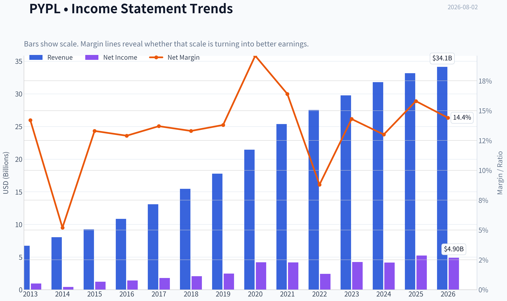
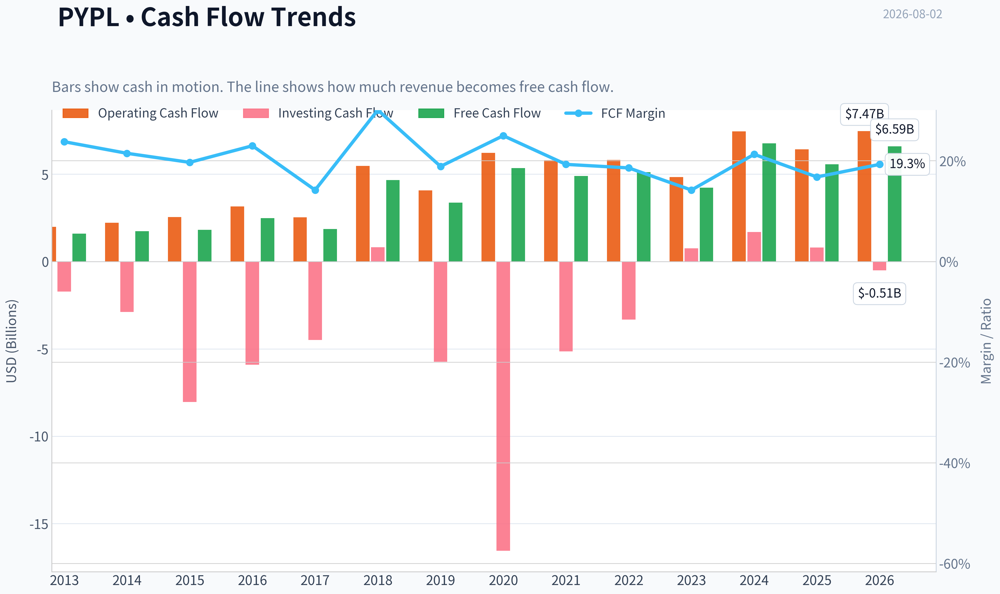
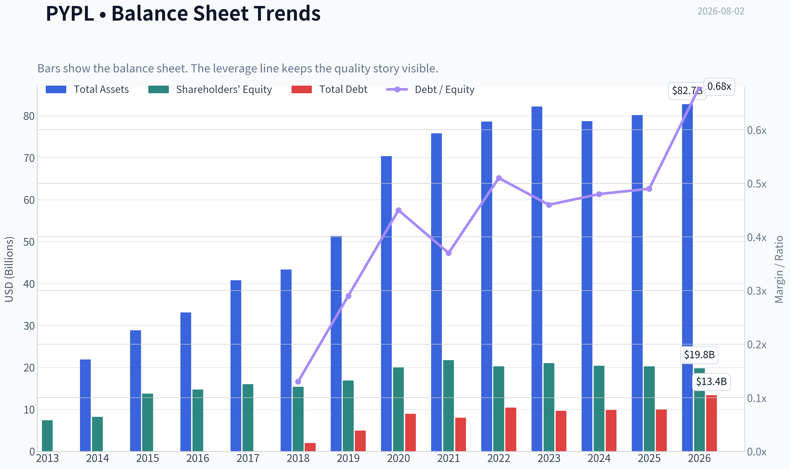
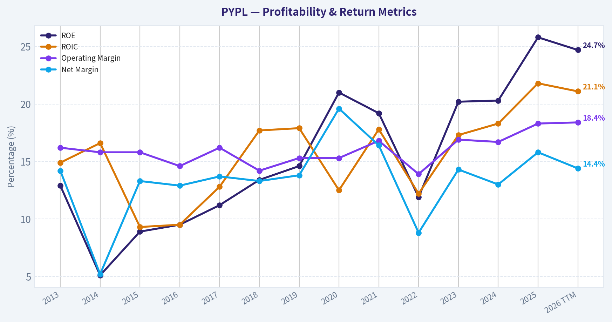
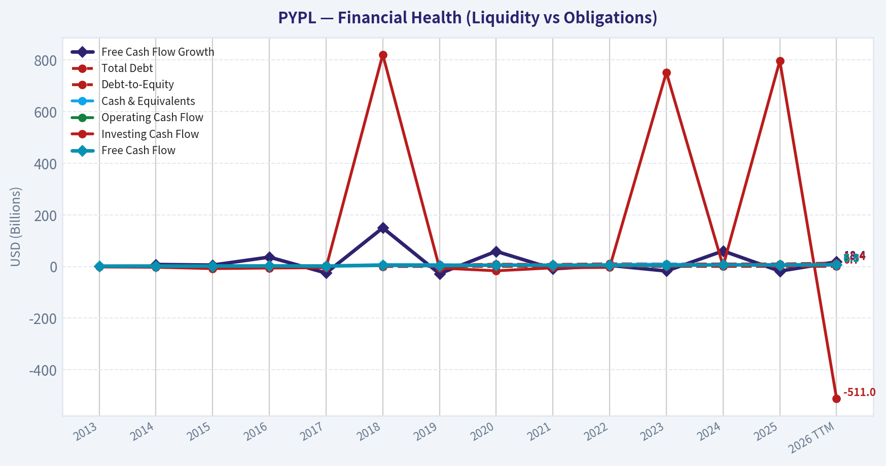
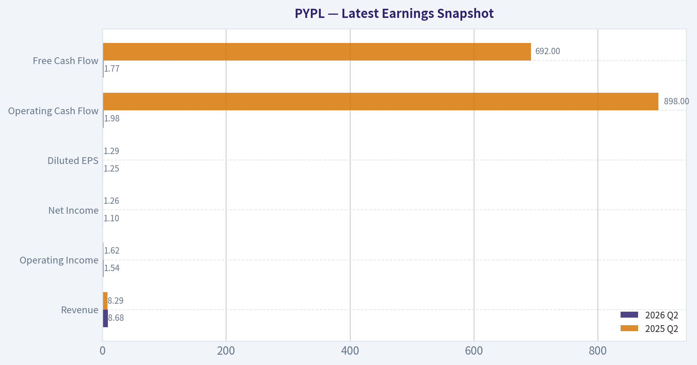
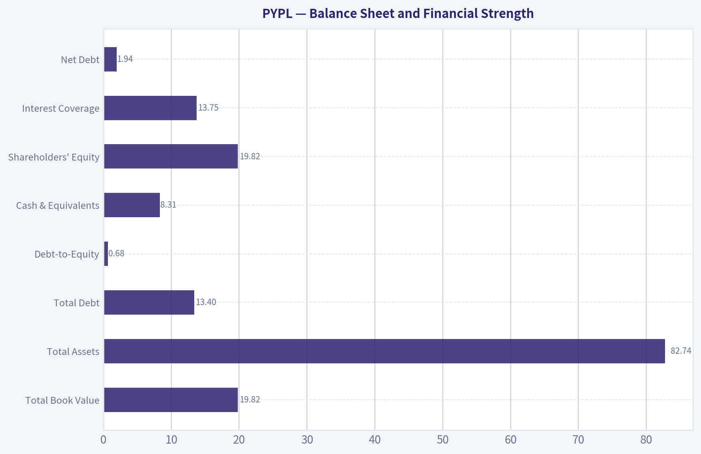
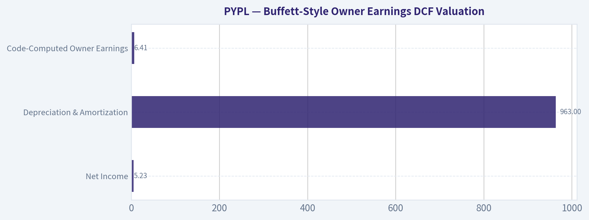
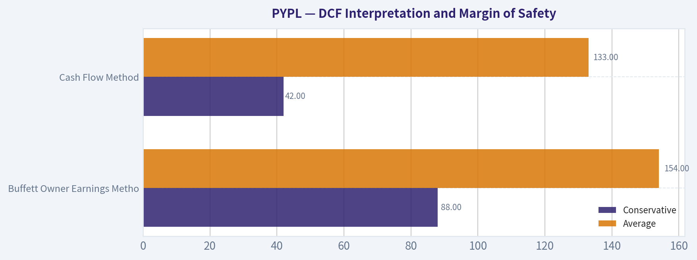
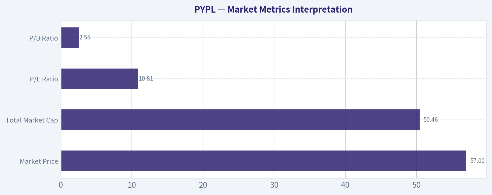

# PYPL Deep Value Intelligence

**Analysis Date:** 2026-08-02

## Critical Disclaimer

*This analysis is generated by Deep Value Intelligence, an AI-powered multi-agent investing framework. Education & research only - not financial advice, not a financial advisor.*

---

## Table of Contents

1. Intelligence Summary
2. Analyst Team Reports
   - Fundamentals Analysis
   - Intrinsic Value Analysis (Buffett)
   - Trend & Growth Analysis (Lynch/Druckenmiller/Fisher)
   - Market Technical Analysis
   - Options Market Analysis
3. Research Team Commentary
4. Value Investing Team Commentary
5. Deep Values Commentary

---

## Intelligence Summary

### Thesis + Conditions

**Core Thesis:** **EXECUTIVE SUMMARY**
PayPal presents a classic value investing dilemma: the tension between extreme optical cheapness (10.8x P/E, 0% growth priced in) and structural business deterioration. While trailing metrics (25.8% ROE, 22.7% ROIC) look elite, the company's high-margin branded checkout is facing permanent disintermediation from lower-friction, OS-level hardware wallets like Apple Pay.

**Key Risks:**
- The Bull (Risky)**: Argues the market is giving away a high-performance engine. Cites massive free cash flow, aggressive buybacks acting as "synthetic growth," merchant desire for a neutral payment layer (Braintree), and a "pessimism premium" that creates a massive margin of safety against a 0% growth expectation.
- The Neutral**: Acknowledges the existential risks but argues 400 million active users don't vanish overnight. Suggests tiering into a tactical starter position near $55-$56 to capture upside if the business proves it is merely mediocre, rather than dead.
- The bull makes a highly rational statistical case. Trading at a 10.8x P/E with trailing returns on invested capital around 22%, PayPal optically fits the profile of a wonderful business at a wonderful price. The bull correctly notes that management is aggressively using free cash flow to shrink the equity base. If the market is pricing in zero terminal growth, even average execution implies upside.

**Confidence:** Medium

---

## Analyst Team Reports

### Fundamentals Analysis

#### Latest Earnings Snapshot

*Most recent reported quarter anchored on 2026 Q2, with prior-year comparison when available.*

| Metric | 2026 Q2 | 2025 Q2 | YoY Change |
| --- | ---: | ---: | ---: |
| Revenue | $8.68B | $8.29B | +4.8% |
| Operating Income | $1.54B | $1.62B | -4.9% |
| Net Income | $1.10B | $1.26B | -12.5% |
| Diluted EPS | $1.25 | $1.29 | -3.1% |
| Operating Cash Flow | $1.98B | $898.0M | +120.8% |
| Free Cash Flow | $1.77B | $692.0M | +156.5% |

Key Takeaways: This snapshot anchors the most recent reported quarter before the narrative analysis. It helps readers separate long-run business quality from whatever changed in the latest earnings print.

#### 13-Year Financial Metrics for PYPL

*All values below are computed deterministically from raw data - not estimated by AI.*

*Issuer profile: bank (Financial Services / Credit Services).*

#### 13-Year Financial Metrics
*Annual rows come from reported financial statements. The final TTM row is computed from the latest four quarters.*

| Metric | 2013 | 2014 | 2015 | 2016 | 2017 | 2018 | 2019 | 2020 | 2021 | 2022 | 2023 | 2024 | 2025 | 2026 TTM |
| --- | --- | --- | --- | --- | --- | --- | --- | --- | --- | --- | --- | --- | --- | --- |
| Market Price | N/A | N/A | $36 | $39 | $73 | $83 | $107 | $232 | $187 | $71 | $61 | $85 | $58 | $57 |
| Market Cap | N/A | N/A | $44.49B | $48.07B | $89.89B | $101.16B | $128.51B | $278.00B | $223.66B | $82.47B | $67.98B | $88.68B | $56.51B | $50.46B |
| P/E Ratio | N/A | N/A | 36.20 | 34.32 | 50.08 | 49.18 | 52.26 | 66.16 | 53.57 | 34.08 | 15.99 | 21.39 | 10.79 | 10.81 |
| P/B Ratio | N/A | N/A | 3.23 | 3.27 | 5.62 | 6.57 | 7.61 | 13.89 | 10.29 | 4.07 | 3.23 | 4.34 | 2.79 | 2.55 |
| ROE | 12.9% | 5.1% | 8.9% | 9.5% | 11.2% | 13.4% | 14.6% | 21.0% | 19.2% | 11.9% | 20.2% | 20.3% | 25.8% | 24.7% |
| ROIC | 14.9% | 16.6% | 9.3% | 9.5% | 12.8% | 17.7% | 17.9% | 12.5% | 17.8% | 12.2% | 17.3% | 18.3% | 21.8% | 21.1% |
| EPS | $0.78 | $0.34 | $1.00 | $1.15 | $1.47 | $1.71 | $2.07 | $3.54 | $3.52 | $2.09 | $3.84 | $3.99 | $5.41 | $5.29 |
| Revenue | $6.73B | $8.03B | $9.25B | $10.84B | $13.09B | $15.45B | $17.77B | $21.45B | $25.37B | $27.52B | $29.77B | $31.80B | $33.17B | $34.13B |
| Gross Profit | N/A | N/A | N/A | N/A | N/A | N/A | N/A | N/A | N/A | N/A | N/A | N/A | N/A | $15.62B |
| Gross Margin | N/A | N/A | N/A | N/A | N/A | N/A | N/A | N/A | N/A | N/A | N/A | N/A | N/A | 45.8% |
| Operating Margin | 16.2% | 15.8% | 15.8% | 14.6% | 16.2% | 14.2% | 15.3% | 15.3% | 16.8% | 13.9% | 16.9% | 16.7% | 18.3% | 18.4% |
| Net Income | $955.0M | $419.0M | $1.23B | $1.40B | $1.79B | $2.06B | $2.46B | $4.20B | $4.17B | $2.42B | $4.25B | $4.15B | $5.23B | $4.90B |
| Net Margin | 14.2% | 5.2% | 13.3% | 12.9% | 13.7% | 13.3% | 13.8% | 19.6% | 16.4% | 8.8% | 14.3% | 13.0% | 15.8% | 14.4% |
| Revenue Growth | N/A | 19.3% | 15.2% | 17.2% | 20.8% | 18.0% | 15.0% | 20.7% | 18.3% | 8.5% | 8.2% | 6.8% | 4.3% | 2.9% |
| Net Income Growth | N/A | -56.1% | 193.1% | 14.1% | 28.1% | 14.6% | 19.5% | 70.9% | -0.8% | -42.0% | 75.5% | -2.3% | 26.2% | -6.3% |
| Free Cash Flow Growth | N/A | 7.9% | 5.6% | 36.5% | -25.1% | 149.8% | -27.7% | 59.0% | -8.7% | 4.5% | -17.4% | 60.4% | -17.8% | 18.4% |
| Total Book Value | $7.39B | $8.25B | $13.76B | $14.71B | $15.99B | $15.39B | $16.89B | $20.02B | $21.73B | $20.27B | $21.05B | $20.42B | $20.26B | $19.82B |
| Total Assets | N/A | $21.92B | $28.88B | $33.10B | $40.77B | $43.33B | $51.33B | $70.38B | $75.80B | $78.62B | $82.17B | $78.72B | $80.17B | $82.74B |
| Total Debt | N/A | N/A | N/A | N/A | N/A | $2.00B | $4.96B | $8.94B | $8.05B | $10.42B | $9.68B | $9.88B | $9.99B | $13.40B |
| Debt-to-Equity | N/A | N/A | N/A | N/A | N/A | 0.13 | 0.29 | 0.45 | 0.37 | 0.51 | 0.46 | 0.48 | 0.49 | 0.68 |
| Cash & Equivalents | $1.60B | $2.20B | $1.39B | $1.59B | $2.88B | $7.58B | $7.35B | $4.79B | $5.20B | $7.78B | $9.08B | $6.66B | $8.05B | $8.31B |
| Shareholders' Equity | $7.39B | $8.25B | $13.76B | $14.71B | $15.99B | $15.39B | $16.89B | $20.02B | $21.73B | $20.27B | $21.05B | $20.42B | $20.26B | $19.82B |
| Operating Cash Flow | $1.99B | $2.22B | $2.55B | $3.16B | $2.53B | $5.48B | $4.07B | $6.22B | $5.80B | $5.81B | $4.84B | $7.45B | $6.42B | $7.47B |
| Investing Cash Flow | $-1.72B | $-2.88B | $-8.04B | $-5.90B | $-4.49B | $821.0M | $-5.74B | $-16.55B | $-5.15B | $-3.33B | $752.0M | $1.69B | $797.0M | $-511.0M |
| Free Cash Flow | $1.60B | $1.73B | $1.82B | $2.49B | $1.86B | $4.66B | $3.37B | $5.35B | $4.89B | $5.11B | $4.22B | $6.77B | $5.56B | $6.59B |
| FCF Margin | 23.8% | 21.5% | 19.7% | 23.0% | 14.2% | 30.1% | 18.9% | 25.0% | 19.3% | 18.6% | 14.2% | 21.3% | 16.8% | 19.3% |
| Dividends / Share | $0.00 | $0.00 | $0.00 | $0.00 | $0.00 | $0.00 | $0.00 | $0.00 | $0.00 | $0.00 | $0.00 | $0.00 | $0.13 | $0.00 |

#### Profitability Metrics
- Return on Equity (ROE): 25.8%
- Return on Invested Capital (ROIC): 22.7%
- Return on Assets (ROA): 6.5%
- Gross Margin: Not meaningful
- Operating Margin: 18.3%
- Net Profit Margin: 15.8%

#### Liquidity Metrics
- Current Ratio: 1.29
- Quick Ratio: 1.06

#### Leverage Metrics
- Debt-to-Equity Ratio: 0.49
- Interest Coverage Ratio: 13.75
- Net Debt: $1.94B

#### Growth Metrics (Year-over-Year)
- Revenue Growth: 4.3%
- Net Income Growth: 26.2%
- Free Cash Flow Growth: -17.8%
- Revenue CAGR (3-Year): 6.4%
- Revenue CAGR (5-Year): 9.1%

#### Valuation Metrics
- P/E Ratio (TTM): 10.81
- Forward P/E: 9.88
- Price-to-Book: 2.49
- Price-to-Sales: 1.45
- PEG Ratio: 1.05
- EV/EBITDA: 8.04
- Free Cash Flow Yield: 11.3%
- Earnings Yield: 9.2%

#### Owner Earnings (Buffett Method, Code-Computed)
- Net Income: $5.23B
- + Depreciation & Amortization: $963.0M
- - Capital Expenditures: $-852.0M
- - Working Capital Changes: $-1.06B
- = **Owner Earnings: $6.41B**

#### Intrinsic Value (Code-Computed)
- Current Price: $57
- Headline Intrinsic Value: not meaningful (financial issuer - DCF/FCFF is not the right primary frame; use sector-specific book/earnings metrics)
- Buffett Method (Owner Earnings):
  Conservative: $88
  Average: $154
  Optimistic: $411
- Cash Flow Method (FCF):
  Conservative: $42
  Average: $133
  Optimistic: $200
- Reverse-DCF: price implies ~-3.4%/yr owner-earnings growth for 10y; trailing 3y was 22.5%, 5y 13.9%.

#### Piotroski F-Score: 6/9
- Positive Net Income: PASS
- Positive Operating Cash Flow: PASS
- ROA Improvement: PASS
- Cash Flow > Net Income: PASS
- Decreasing Debt: FAIL
- Improving Current Ratio: PASS
- No Dilution: FAIL
- Improving Gross Margin: FAIL
- Improving Asset Turnover: PASS

ANALYST STANCE: **ADVOCATE**

#### PYPL Warren Buffett-Style Fundamental Analysis - Canonical Dataset Through 2026 TTM

PayPal is currently priced like a structurally declining business, yet the deterministic dataset shows a company still producing high returns on capital, strong free cash flow, expanding operating margins, and a very low valuation versus its own history. The Buffett-style case is not that PayPal is a perfect "forever compounder," but that the market appears to be discounting too much decline relative to the cash the business is still producing.

Because the issuer profile is marked as **Financial Services / Credit Services**, book-value and liquidity ratios must be interpreted carefully. **P/B is not a generic cheap-or-expensive signal here**; it should be judged against ROE and earnings power. Current and quick ratios are also less useful than for a traditional industrial company. The valuation should be anchored primarily on earnings, free cash flow, owner earnings, and the reverse-DCF expectations embedded in the current price.

---

#### Current vs Historical Average Comparison

| Metric | Current / TTM | Historical Average* | Current vs Average | Interpretation |
|---|---:|---:|---:|---|
| Market Price | $57 | ~$90.75 | ~37% below | Shares remain far below the post-spinoff average and dramatically below the 2020-2021 peak. |
| Market Cap | $50.46B | ~$105.0B | ~52% below | Equity value has compressed much more than revenue or cash flow, suggesting multiple contraction rather than business collapse. |
| P/E Ratio | 10.81x | ~36.2x | ~70% below | PayPal trades near a decade-low earnings multiple despite EPS being near record levels. |
| P/B Ratio | 2.55x | ~5.62x | ~55% below | Low versus history, but for this issuer type P/B must be judged against ROE, not treated mechanically as "cheap." |
| ROE | 24.7% TTM / 25.8% FY2025 | ~15.6% | Well above average | Returns on equity are currently among the strongest in the dataset. |
| ROIC | 21.1% TTM | ~15.7% | Well above average | Capital efficiency has improved materially versus the long-term average. |
| EPS | $5.29 | ~$2.59 | ~104% above | Earnings per share have compounded meaningfully, helped by profitability and buybacks. |
| Revenue | $34.13B | ~$20.31B | ~68% above | Revenue base is much larger than a decade ago, but growth has slowed sharply. |
| Gross Profit / Margin | $15.62B / 45.8% TTM | N/A | Not comparable | Historical gross-profit data are unavailable; gross margin is also less meaningful for this issuer profile. |
| Operating Margin | 18.4% | ~16.0% | Above average | Cost discipline and operating leverage are improving despite slower growth. |
| Net Income | $4.90B | ~$2.83B | ~73% above | Profit dollars remain strong, although below FY2025's $5.23B. |
| Net Margin | 14.4% | ~13.5% | Slightly above average | Profitability is normal-to-strong, not distressed. |
| Revenue Growth | 2.9% TTM / 4.3% FY2025 | ~13.5% | Far below average | The key issue is deceleration, not current profitability. |
| Net Income Growth | -6.3% TTM / 26.2% FY2025 | ~25.7% | Volatile | Net income growth has been lumpy, with large swings in 2020, 2022, 2023, and 2025. |
| FCF Growth | 18.4% TTM / -17.8% FY2025 | ~18.9% | Mixed | Free cash flow remains high but timing and working-capital effects create volatility. |
| Total Book Value | $19.82B | ~$16.85B | Above average | Book value has grown, but less consistently than revenue and FCF due to buybacks and capital allocation. |
| Total Assets | $82.74B | ~$59.1B | Above average | Asset base has expanded substantially with the platform. |
| Total Debt | $13.40B | ~$8.59B | Above average | Debt is meaningfully higher than history and needs monitoring. |
| Debt-to-Equity | 0.68x | ~0.43x | Above average | Leverage is still manageable but has risen to the high end of the dataset. |
| Cash & Equivalents | $8.31B | ~$5.32B | Above average | Liquidity remains solid in absolute dollars. |
| Free Cash Flow | $6.59B | ~$4.00B | ~65% above | Cash generation remains the core of the investment case. |
| Dividends / Share | $0.00 TTM | ~$0.01 | Essentially none | PayPal remains primarily a buyback-driven capital-return story. |

\*Historical averages are calculated only from the years shown in the deterministic dataset and are used for interpretation, not as a replacement historical table.

Key Takeaways: PayPal's valuation multiples are near decade lows while ROE, ROIC, operating margin, EPS, and free cash flow are above historical averages. The central tension is clear: the market is pricing PayPal for weak future growth, even though the current business still generates strong profitability and cash flow. The biggest deviation from historical norms is not profitability deterioration, but revenue-growth deceleration and multiple compression.

---

#### Market Metrics Interpretation

| Market Metric | Current Value | Buffett-Style Interpretation |
|---|---:|---|
| Market Price | $57 | The stock trades far below its historical average and far below the 2020-2021 bubble-era peak. This creates potential margin of safety if cash flows remain durable. |
| Total Market Cap | $50.46B | The company is valued at roughly 7.7x TTM free cash flow, using $6.59B of TTM FCF. That is unusually low for a business still earning ROIC above 20%. |
| P/E Ratio | 10.81x | The earnings multiple implies skepticism about long-term growth, competitive durability, or both. A 9.2% earnings yield is attractive if earnings are not structurally impaired. |
| P/B Ratio | 2.55x | For this financial-services / credit-services issuer profile, P/B is not a standalone value signal. It is more relevant when paired with ROE; a 2.55x P/B with ROE around 25% is not obviously expensive. |

Key Takeaways: PayPal looks statistically inexpensive across earnings and cash-flow metrics. However, P/B should not be read mechanically because this issuer profile requires a return-on-equity context. The valuation argument is strongest when anchored on earnings yield, FCF yield, and owner earnings rather than book value alone.

---

#### Profitability and Business Quality

| Profitability Metric | Current / TTM | Historical Pattern | Interpretation |
|---|---:|---|---|
| ROE | 24.7% TTM / 25.8% FY2025 | Rose from mostly low-to-mid teens to 20%+ in recent years | Strong evidence of high shareholder capital productivity. |
| ROIC | 21.1% TTM | Long-term average around mid-teens, now above 20% | Indicates PayPal still earns attractive returns on invested capital despite competitive pressure. |
| EPS | $5.29 | More than doubled versus the long-term average | EPS has benefited from earnings recovery and share repurchases. |
| Revenue | $34.13B | Increased from $6.73B in 2013 | The platform has scaled materially, but the growth curve has flattened. |
| Gross Profit | $15.62B TTM | Historical data unavailable | Useful for current snapshot, but not a decade trend due to dataset limitations. |
| Gross Margin | 45.8% TTM | Historical data unavailable / flagged less meaningful | Should not be the primary analytical anchor for this issuer type. |
| Operating Margin | 18.4% | Above historical average | Positive sign that management is extracting efficiencies despite slower top-line growth. |
| Net Income | $4.90B TTM | Above long-term average but below FY2025 | Profitability remains robust, though not perfectly linear. |
| Net Margin | 14.4% | Slightly above average | The business is not showing margin collapse. |

Key Takeaways: PayPal's profitability metrics remain strong and are better than the market valuation suggests. ROE and ROIC are particularly important because they show the company is still converting capital into attractive returns. The quality concern is not current profitability, but whether competitive pressure will erode those returns over time.

---

#### Growth Analysis

| Growth Metric | Current / TTM | Historical Average | Buffett-Style Reading |
|---|---:|---:|---|
| Revenue Growth | 2.9% TTM / 4.3% FY2025 | ~13.5% | Growth has slowed sharply; this is the main bear argument. |
| Net Income Growth | -6.3% TTM / 26.2% FY2025 | ~25.7%, highly skewed | Earnings growth is volatile, so normalized earning power matters more than one-year growth. |
| Free Cash Flow Growth | 18.4% TTM / -17.8% FY2025 | ~18.9%, highly volatile | FCF remains strong, but year-to-year growth is uneven due to working capital and reinvestment timing. |
| Revenue CAGR, 3-Year | 6.4% | N/A | PayPal has shifted from high-growth compounder to mature cash generator. |
| Revenue CAGR, 5-Year | 9.1% | N/A | Still positive, but no longer deserving a premium-growth multiple. |

Key Takeaways: Growth has unquestionably decelerated, especially revenue growth. The stock's low valuation appears to reflect this slowdown, but the cash-flow base remains large and resilient. For investors, the key question is whether PayPal can stabilize revenue growth in the mid-single digits while maintaining high margins and buybacks.

---

#### Balance Sheet and Financial Strength

| Balance Sheet Metric | Current / TTM | Historical Context | Interpretation |
|---|---:|---|---|
| Total Book Value | $19.82B | Above historical average but flat recently | Equity base has not grown as fast as revenue due to buybacks and capital allocation. |
| Total Assets | $82.74B | Near dataset high | Scale remains significant. |
| Total Debt | $13.40B | Highest in dataset | Debt increase is a real red flag. |
| Debt-to-Equity | 0.68x | Above long-term average | Leverage is still manageable but rising. |
| Cash & Equivalents | $8.31B | Above historical average | Cash cushion remains healthy. |
| Shareholders' Equity | $19.82B | Same as total book value | Equity remains positive and substantial. |
| Interest Coverage | 13.75x | Current pack metric | Strong coverage suggests debt is serviceable. |
| Net Debt | $1.94B | Current pack metric | Net leverage is modest after cash. |

Key Takeaways: PayPal's balance sheet is not distressed, but leverage has risen materially. The company has enough cash and interest coverage to manage its obligations, yet Buffett-style investors should watch debt growth carefully. The financial-strength score is good, not pristine.

---

#### Cash Flow and Capital Allocation

| Cash Flow Metric | Current / TTM | Historical Context | Interpretation |
|---|---:|---|---|
| Operating Cash Flow | $7.47B | Near dataset high | Core operations continue to generate substantial cash. |
| Free Cash Flow | $6.59B | Well above historical average | FCF is the strongest support for intrinsic value. |
| FCF Margin | 19.3% | Near long-term normal range | Cash conversion remains healthy. |
| FCF Yield | 11.3% | Current pack metric | Very attractive if FCF is sustainable. |
| Dividends / Share | $0.00 TTM | Historically almost zero | PayPal is not an income stock; capital return is mostly buybacks. |
| Piotroski F-Score | 6 / 9 | Current pack metric | Moderate quality score; profitability is strong, but leverage and dilution signals are weaker. |

Key Takeaways: PayPal's free cash flow is the backbone of the bullish thesis. The company is not returning capital through a meaningful dividend, so investors must judge management primarily on buyback discipline and reinvestment quality. At today's valuation, buybacks can be highly accretive if the business does not deteriorate.

---

#### Revenue Breakdown

| Revenue Source | Amount ($B) | % of Total |
|---|---:|---:|
| Transaction revenues - PayPal checkout, Venmo, Braintree, merchant/acquirer fees, cross-border and payment processing | ~$30.90B | ~90.5% |
| Other value-added services - interest and fees on loans, partnerships, subscriptions, gateway and ancillary services | ~$3.23B | ~9.5% |
| Total Revenue | $34.13B | 100.0% |

Key Takeaways: PayPal remains overwhelmingly dependent on transaction-based revenue. That creates scale advantages, but it also exposes the company to payment-volume trends, merchant pricing pressure, competition from wallets, and take-rate compression. The smaller value-added-services segment provides diversification, but it is not yet large enough to change the company's core economics.

---

#### Buffett-Style Owner Earnings DCF Valuation

Canonical owner earnings from the deterministic pack:

| Owner Earnings Component | Amount |
|---|---:|
| Net Income | $5.23B |
| Depreciation & Amortization | $963M |
| Capital Expenditures | $852M cash outflow |
| Working Capital Changes | -$1.06B adjustment |
| Code-Computed Owner Earnings | $6.41B |

Key Takeaways: PayPal's owner earnings are higher than reported net income, which supports the view that accounting earnings understate current cash-generation capacity. This is important for Buffett-style valuation because the business does not need heavy capital expenditures relative to its cash output. The owner-earnings base of $6.41B is large compared with the current market cap of about $50.46B.

Assumptions used for the hand DCF sanity check:

| DCF Assumption | Value |
|---|---:|
| Base Owner Earnings | $6.41B |
| Discount Rate | 10.0% |
| Terminal Growth Rate | 2.5% |
| Implied Shares Outstanding | ~885M |
| Current Share Price | $57 |
| Current Market Cap | $50.46B |

Key Takeaways: The DCF uses a 10% required return, which is intentionally conservative for a mature financial-technology platform facing competitive pressure. The 2.5% terminal growth rate avoids assuming high growth forever. The share count is derived from the canonical current price and market cap.

#### Three-Scenario DCF Summary

| Scenario | Growth Assumption | PV of Explicit Cash Flows | PV of Terminal Value | Estimated Equity Value | Fair Value / Share | Pack Model Reference |
|---|---|---:|---:|---:|---:|---:|
| Conservative | 0% owner-earnings growth for 5 years, then 2.5% terminal-like growth | ~$40.5B | ~$38.2B | ~$78.7B | ~$89 | Buffett method: $88 |
| Average | ~8% owner-earnings growth for 10 years, then 2.5% terminal growth | ~$58.1B | ~$73.0B | ~$131.1B | ~$148 | Buffett method: $154 |
| Optimistic, faded | 22% growth for 5 years, fading to 15%, then 8%, then 2.5% terminal growth | ~$103.4B | ~$162.0B | ~$265.4B | ~$300 | More realistic bull case below pack's $411 upper case |
| Optimistic, mathematical upper case | ~22% growth for 10 years, then 2.5% terminal growth | ~$118.4B | ~$246.8B | ~$365.2B | ~$413 | Buffett method: $411 |

Key Takeaways: The current $57 price is below even the conservative owner-earnings DCF estimate of about $88-$89 per share. The average case suggests substantial upside if PayPal can grow owner earnings at a high-single-digit rate. The very high optimistic case requires a long period of strong compounding and should be treated as an upper-bound scenario, not the base case.

#### DCF Interpretation and Margin of Safety

The deterministic pack's model-based values show:

| Valuation Method | Conservative | Average | Optimistic |
|---|---:|---:|---:|
| Buffett Owner Earnings Method | $88 | $154 | $411 |
| Cash Flow Method | $42 | $133 | $200 |
| Reverse DCF | Current price implies about -3.4% annual owner-earnings growth for 10 years | 3-year trailing owner-earnings growth: 22.5% | 5-year trailing owner-earnings growth: 13.9% |

Key Takeaways: The reverse DCF is the most striking valuation signal: the current price implies negative owner-earnings growth for a decade. That is a low bar for a company still generating high ROE, high ROIC, and strong free cash flow. The main caveat is that the FCF method has a much wider conservative downside case, showing that cash-flow volatility and competitive pressure should not be ignored.

---

#### Warren Buffett-Style Qualitative Analysis

| Buffett Criterion | Assessment | Specific Insight |
|---|---|---|
| Economic Moat | Moderate, but not unassailable | PayPal benefits from two-sided network effects, brand trust, merchant integration, Venmo, Braintree, risk-management data, and global payment scale. However, Apple Pay, Stripe, Adyen, Shopify, banks, and real-time payment systems pressure the moat. |
| Financial Strength | Good, with rising leverage risk | Cash is $8.31B and interest coverage is strong, but total debt has risen to $13.40B and debt-to-equity is now 0.68x. |
| Predictable Earnings | Moderate | Revenue has grown every year in the dataset, but net income and FCF growth are volatile. This is not as predictable as a consumer staple or regulated utility. |
| Management Performance | Improving operationally | ROE, ROIC, and operating margin are above historical averages. The challenge is proving that buybacks and product initiatives create durable per-share value. |
| Capital Allocation | Buyback-dependent | No meaningful dividend history. Buybacks can be powerful at low valuations, but only if the underlying business remains stable. |
| Valuation | Attractive | P/E of 10.81x and FCF yield of 11.3% are low versus quality and history. Reverse DCF implies highly pessimistic expectations. |
| Quality of Business | High cash generation, slower growth | PayPal is now more of a mature cash compounder than a high-growth fintech. That can still be attractive if priced correctly. |

Key Takeaways: PayPal meets several Buffett-style quality tests, especially high returns on capital and strong owner earnings. It does not fully meet the "unassailable moat" test because payments are intensely competitive and technology-driven. The investment case is therefore value plus cash flow, not flawless monopoly durability.

---

#### Key Investment Insights

| Theme | Bullish Evidence | Concern |
|---|---|---|
| Valuation | P/E of 10.81x, FCF yield of 11.3%, price below conservative owner-earnings DCF | Low multiple may reflect structural competitive risk. |
| Cash Generation | TTM FCF of $6.59B and owner earnings of $6.41B | FCF growth has been volatile year to year. |
| Profitability | ROE around 25%, ROIC above 21%, operating margin 18.4% | Margins could compress if branded checkout take rate declines. |
| Growth | Revenue still positive at $34.13B TTM | Revenue growth has slowed to 2.9% TTM. |
| Balance Sheet | Cash of $8.31B and strong interest coverage | Debt is at dataset high of $13.40B. |
| Market Expectations | Reverse DCF implies -3.4% owner-earnings growth for 10 years | If disruption accelerates, negative growth may be justified. |

Key Takeaways: The stock looks cheap because investors doubt PayPal's growth durability. If the company merely stabilizes and avoids long-term decline, the current valuation could prove too pessimistic. The opportunity is strongest for investors who believe PayPal can remain a durable cash generator even without returning to high-growth status.

---

#### Red Flags and Risks

| Risk | Why It Matters | What to Monitor |
|---|---|---|
| Revenue deceleration | Revenue growth has fallen from double digits historically to low single digits. | Branded checkout growth, total payment volume, active accounts, transaction margin dollars. |
| Competitive pressure | Apple Pay, Stripe, Adyen, Shopify, banks, and embedded payments threaten take rate and relevance. | Take rate, merchant churn, Braintree profitability, checkout share. |
| Rising debt | Total debt reached $13.40B, the highest in the dataset. | Debt-to-equity, interest coverage, net debt, refinancing costs. |
| FCF volatility | FCF growth swings materially year to year. | Working-capital changes, capex, transaction losses, credit exposure. |
| Buyback execution | Buybacks create value only if shares are repurchased below intrinsic value and the business remains durable. | Share count trend, average repurchase price, dilution from stock compensation. |
| Moat erosion | Payment networks can lose relevance gradually before financials fully show it. | PayPal button share, Venmo monetization, merchant acceptance, consumer engagement. |

Key Takeaways: The largest risk is not current insolvency or weak profitability; it is long-term relevance in a rapidly evolving payments ecosystem. PayPal must prove that its branded checkout, Venmo ecosystem, and merchant services remain competitively important. Debt and buyback discipline also deserve closer monitoring than in prior years.

---

#### Opportunities

| Opportunity | Investment Relevance |
|---|---|
| Margin expansion | Operating margin is already above historical average; further efficiency gains could lift EPS even with modest revenue growth. |
| Accretive buybacks | At a low P/E and high FCF yield, repurchases can materially increase per-share value. |
| Venmo monetization | Venmo remains a large consumer asset with potential for better monetization through commerce, cards, and partnerships. |
| Braintree and enterprise payments | Large merchant relationships can support volume growth, though profitability must be watched. |
| Branded checkout stabilization | If branded checkout growth stabilizes, the market may re-rate the stock. |
| Low embedded expectations | Reverse DCF implies negative owner-earnings growth; even flat-to-modest growth could create upside. |

Key Takeaways: PayPal does not need hypergrowth to justify a higher valuation. The opportunity is that a mature, high-cash-flow company is being valued as though its owner earnings will decline for years. Stabilization alone could be enough for meaningful upside.

---

#### Final Investment Stance: **ADVOCATE**

PayPal earns an **ADVOCATE** stance for value-oriented investors because the current price appears to embed overly pessimistic assumptions relative to the company's actual cash generation, ROE, ROIC, and margin profile. At $57, the stock trades below the deterministic pack's conservative Buffett owner-earnings value of $88 and far below the average case of $154. The 11.3% FCF yield and 10.81x P/E offer a meaningful margin of safety if the business avoids structural decline.

This is not a risk-free Buffett "forever compounder." The moat is real but contested, revenue growth is slowing, debt has risen, and payments competition is intense. However, the market appears to be pricing PayPal closer to a melting-ice-cube scenario than a stable cash-generative platform. For investors comfortable with competitive fintech risk, the risk/reward is favorable.

| Final Category | Rating | Rationale |
|---|---|---|
| Business Quality | Good | High ROE, high ROIC, strong FCF, but competitive moat is under pressure. |
| Financial Strength | Good | Solid cash and interest coverage, offset by rising debt. |
| Predictability | Moderate | Revenue is durable, but net income and FCF growth are volatile. |
| Valuation | Strong | P/E, FCF yield, and reverse DCF suggest pessimism is already priced in. |
| Margin of Safety | Attractive | Current price is below conservative owner-earnings DCF, though not below conservative FCF DCF. |
| Main Risk | Moat erosion | If branded checkout and transaction economics deteriorate, cheap valuation may be justified. |
| Stance | **ADVOCATE** | Suitable for value investors seeking a cash-flow-rich turnaround / re-rating opportunity. |

Key Takeaways: PayPal is a valuation-driven opportunity, not a flawless compounder. The stock is attractive because expectations are low, cash flow is high, and profitability remains strong. The investment should be monitored closely for revenue stabilization, debt discipline, and evidence that the competitive moat is not eroding faster than the market already expects.

#### Fundamental Visuals

This graph tracks the profitability and return metrics (ROE, ROIC, Margins) of **PYPL** over the past decade, highlighting capital efficiency trends.

This chart illustrates the financial health of **PYPL** over the last 10 years, mapping cash equivalents and free cash flow against total obligations (Debt).

---

### Intrinsic Value Analysis (Buffett)

> *Following Warren Buffett's value investing philosophy: Circle of Competence, Economic Moat, Management Quality, and Margin of Safety.*

#### Intrinsic Value Snapshot

Price is what you pay. Intrinsic value is what the business may be worth based on the cash it can create for owners over time. We show a range, not one magic number.

- Current Price: $57.21
- Value Range (conservative to optimistic across both DCF methods): $41.91 to $410.68

##### Owner Earnings (Buffett Method)
- Net Income: $5,233,000,000.00
- Depreciation & Amortization: $963,000,000.00
- Capital Expenditures: $-852,000,000.00
- Working Capital Changes: $-1,064,000,000.00
- Owner Earnings: $6,408,000,000.00

##### Intrinsic Value
###### Buffett Method
Uses owner earnings. Stricter, and usually more conservative.
- Conservative: $88.13
- Average: $153.63
- Optimistic: $410.68
- Discount Rate: 10.0%

###### Cash Flow Method
Uses free cash flow. Better for companies spending heavily today to grow tomorrow.
- Conservative: $41.91
- Average: $132.84
- Optimistic: $199.94
- Discount Rate: 10.0%

ANALYST STANCE: **ADVOCATE**

#### PayPal Holdings - Buffett-Style Investment Review

PayPal is no longer the hypergrowth payments winner it once appeared to be, but at **$57 per share**, the market is pricing it as a low-growth or declining business. That looks too pessimistic. The company still has enormous scale, strong free cash flow, a large two-sided payments network, and aggressive buybacks at a depressed valuation. The moat has narrowed, but the price now provides a meaningful margin of safety.

Current price: **$57**
Market cap: **$49.3B**
P/E: **10.8x**
FCF yield: **11.3%**
ROE: **25.8%**

---

#### 1. Factor Scorecard

| Factor | Score | Evidence |
|---|---:|---|
| Circle of Competence & Business Simplicity | 3.7 / 5 | PayPal earns fees by processing digital payments for consumers and merchants. The model is understandable, but payments competition and take-rate pressure reduce long-term predictability. |
| Moat Test | 3.2 / 5 | Strong brand, merchant acceptance, Venmo, and global scale; however Apple Pay, Stripe, Adyen, Block, Shopify, and bank wallets have reduced PayPal's pricing power. |
| Management Quality & Capital Allocation | 3.6 / 5 | New leadership is emphasizing profitable growth, product focus, and cost discipline. Buybacks at low multiples are attractive, though past acquisitions were mixed. |
| Industry Structure | 3.2 / 5 | Digital payments is a structurally growing industry, but competition is intense and switching costs are moderate rather than overwhelming. |
| Gate 5: Quality / Solvency Hard Floor | Not tripped | PayPal remains profitable, cash-generative, and solvent. Interest coverage is healthy, free cash flow is positive, and there is no financial-distress signal. |

**Key Takeaways:** PayPal is an understandable, cash-rich payments platform, but it is not a flawless wide-moat compounder. The core concern is competitive pressure, especially in branded checkout and merchant processing. The hard solvency floor is clearly not tripped, so the decision rests on quality versus valuation - and valuation is unusually favorable.

---

#### 2. Moat Analysis

| Moat Source | Assessment | Evidence |
|---|---|---|
| Brand / Intangible Assets | Moderate to strong | PayPal remains one of the most recognized online payment brands globally, especially for trust, buyer protection, and cross-border checkout. |
| Switching Costs | Moderate | Merchants integrate PayPal into checkout flows, and consumers store credentials, but switching is not prohibitive. Large merchants can route volume among providers. |
| Cost Advantages | Moderate | PayPal has scale in fraud detection, compliance, and transaction processing, but competitors also operate at massive scale. |
| Network Effects | Moderate | More consumers make PayPal more attractive to merchants, and more merchants make it more useful to consumers. The network effect exists but has weakened as alternative wallets proliferate. |
| Pricing Power | Limited | PayPal likely cannot raise prices 10% broadly without volume risk. Take-rate pressure is a key watch item. |
| Moat Rating | Narrow-to-moderate, stable to slightly challenged | Still valuable, but no longer "wide and widening." |

**Key Takeaways:** PayPal's moat is real but not impregnable. Its brand, trust layer, and global acceptance still matter, especially in e-commerce and cross-border payments. However, the company does not have Apple-like ecosystem control or Visa-like network dominance, so the valuation must compensate for the weaker moat - and today it does.

---

#### 3. Management Quality Assessment

| Area | Assessment |
|---|---|
| Owner Mindset | Improving. Management is emphasizing per-share value, cost discipline, and focused execution. |
| Capital Allocation | Positive at today's valuation. Buybacks are highly accretive when the stock trades near 10-11x earnings and over 10% FCF yield. |
| Reinvestment Discipline | Mixed. Core product investment is sensible, but historical acquisitions such as Honey and Paidy did not obviously create exceptional value. |
| Candor / Execution | New management under Alex Chriss has pushed a clearer turnaround message: improve branded checkout, monetize Venmo, simplify operations, and prioritize profitable growth. |
| Debt Philosophy | Acceptable. The balance sheet is not a concern given PayPal's cash generation. |

**Key Takeaways:** Management is not yet in the "Buffett Hall of Fame," but capital allocation is moving in the right direction. The most important point is that buybacks at this valuation can create substantial per-share value even if company-wide growth remains modest. The main risk is execution: PayPal must prove that product innovation can stabilize branded checkout and protect its relevance.

---

#### 4. Financial Summary

All figures are approximate and in billions except percentages and per-share data.

| Fiscal Year | Revenue | Revenue Growth | Operating Margin | Net Income | Free Cash Flow | ROE | ROIC | Diluted Shares |
|---:|---:|---:|---:|---:|---:|---:|---:|---:|
| 2021 | $25.4 | 18.3% | 16.8% | $4.17 | $5.39 | 19.7% | 13.6% | 1.18B |
| 2022 | $27.5 | 8.5% | 13.9% | $2.42 | $5.11 | 11.8% | 11.0% | 1.14B |
| 2023 | $29.8 | 8.2% | 16.9% | $4.25 | $4.21 | 20.4% | 15.8% | 1.11B |
| 2024 | $31.8 | 6.8% | 17.8% | $4.15 | $6.0 | 20.5% | 17.5% | 1.03B |
| TTM / 2026 Run Rate | ~$33.2 | 4.3% | ~18% | ~$4.56 | ~$5.57 | 25.8% | ~18-20% | ~0.87B current |

**Key Takeaways:** Revenue growth has slowed from high-teens to low-single digits, which explains the market's skepticism. But profitability and free cash flow remain strong, and the shrinking share count is materially improving per-share economics. PayPal does not need to return to hypergrowth for the stock to work from this valuation.

---

#### 5. Cash Flow Reality Check

| Metric | Current Assessment |
|---|---:|
| Market Capitalization | $49.3B |
| Free Cash Flow | ~$5.57B |
| FCF Yield | 11.3% |
| Net Income | ~$4.56B |
| P/E | 10.8x |
| OCF vs. Net Income | Positive; cash generation supports reported earnings |
| Balance Sheet | Healthy; no distress signal |
| Current Ratio | 1.29 |

**Key Takeaways:** PayPal's earnings are backed by real cash flow. An 11% free-cash-flow yield is unusually high for a profitable digital payments platform with global scale. The company can fund product investment, debt service, and large buybacks without relying on external capital.

---

#### 6. Owner Earnings Calculation

Buffett-style owner earnings estimate:

| Component | Amount |
|---|---:|
| Net Income | $4.56B |
| Plus: Depreciation & Amortization | ~$1.10B |
| Less: Maintenance CapEx | ~$(0.75B) |
| Less: Normalized Working Capital Investment | ~$(0.20B) |
| Estimated Owner Earnings | ~$4.7B |
| Normalized Owner Earnings Used for DCF | ~$5.2B |
| Owner Earnings per Current Share | ~$6.00 |

**Key Takeaways:** PayPal converts accounting profit into owner earnings at a high rate. The normalized owner-earnings base of roughly $5.2 billion is reasonable given the company's recent free-cash-flow profile. At a $49 billion market value, investors are buying this cash stream at roughly a 10% owner-earnings yield.

---

#### 7. Three-Scenario DCF Valuation

Assumptions: 10% discount rate, current share count of roughly 865 million, normalized owner earnings of $5.2B.

| Scenario | Assumption | Equity Value | Value per Share |
|---|---|---:|---:|
| A: No Growth | Owner earnings capitalized at 10% | $52B | ~$60 |
| B: GDP Growth | 3% perpetual growth | $76.5B | ~$88 |
| C: Moderate Historical Growth | 4% growth for 10 years, then 3% terminal | ~$84.7B | ~$98 |
| Blended Intrinsic Value | Average of scenarios | ~$71B | ~$82 |

**Key Takeaways:** Even the no-growth case is close to the current market price, which provides downside support. If PayPal merely grows owner earnings at a low-single-digit rate, intrinsic value is meaningfully above today's price. The stock does not require heroic assumptions to be attractive.

---

#### 8. Margin of Safety Analysis

| Measure | Result |
|---|---:|
| Current Price | $57 |
| Blended Intrinsic Value Estimate | ~$82 |
| Implied Margin of Safety | ~30% |
| No-Growth Value | ~$60 |
| FCF Yield | 11.3% |
| Market-Implied Expectation | Roughly no growth to slight decline |

**Key Takeaways:** The margin of safety is attractive for a business of PayPal's quality. This is not a perfect company, so a discount is necessary - but the current price already reflects a great deal of pessimism. The market appears to be valuing PayPal like a melting ice cube, while the company is still producing substantial cash and retiring shares.

---

#### 9. Final Buffett Scorecard

| Criterion | Weight | Score | Weighted Contribution |
|---|---:|---:|---:|
| Moat Width & Durability | 25% | 3.2 | 0.80 |
| Valuation / Margin of Safety | 20% | 4.3 | 0.86 |
| Capital Returns - ROIC vs. WACC | 15% | 4.0 | 0.60 |
| Business Understanding & Predictability | 12% | 3.7 | 0.44 |
| Management Quality & Capital Allocation | 12% | 3.6 | 0.43 |
| Reinvestment Runway | 8% | 3.3 | 0.26 |
| Balance Sheet Strength | 4% | 4.0 | 0.16 |
| Industry Structure | 4% | 3.2 | 0.13 |
| Total Score | 100% |  | **3.68 / 5.0** |

**Key Takeaways:** PayPal scores best on valuation, cash generation, and capital returns. It scores lower on moat durability and industry structure because payments is fiercely competitive. The overall score lands in Advocate territory because the current price more than compensates for the business risks.

---

#### 10. Investment Stance

**Stance: ADVOCATE**
**Conviction: Medium**

PayPal is a classic "good business at a very good price," not a "wonderful business at any price." The stock is attractive because the market is demanding almost no growth despite PayPal's durable cash generation, strong returns on capital, global scale, and aggressive repurchases.

The investment case is strongest if three things happen:

1. Branded checkout stabilizes.
2. Venmo monetization improves.
3. Buybacks continue while the stock remains cheap.

The main risk is moat erosion. If Apple Pay, Stripe, Shopify, and other platforms continue to compress PayPal's relevance and take rate, the business could stagnate. But at roughly **10.8x earnings** and an **11.3% free-cash-flow yield**, investors are not paying for perfection.

**Buffett-style conclusion:** PayPal is no longer a pristine compounder, but the price is below a conservative estimate of value. The risk/reward is favorable enough to own, with ongoing monitoring of branded checkout growth, transaction margin, and buyback discipline.
#### Valuation Bridge

This bridge places the current market price beside each intrinsic value lens so readers can see whether upside depends on one method or shows up across several methods.

| Scenario | Intrinsic Value / Share |
| --- | ---: |
| Buffett Method | $153.63 |
| Cash Flow Method | $132.84 |
| Current Price | $57.21 |

#### Key Takeaways

If one method is far above the others, the upside case depends on a specific modelling assumption. When several methods cluster together, the valuation story is more robust.

#### Valuation Visuals

This comparison chart from *Latest Earnings Snapshot* stacks current figures against historical benchmarks for **PYPL**, making it easy to see where the company trades relative to its own averages.

This comparison chart from *Balance Sheet and Financial Strength* stacks current figures against historical benchmarks for **PYPL**, making it easy to see where the company trades relative to its own averages.

This comparison chart from *Buffett-Style Owner Earnings DCF Valuation* stacks current figures against historical benchmarks for **PYPL**, making it easy to see where the company trades relative to its own averages.

This comparison chart from *Buffett-Style Owner Earnings DCF Valuation* stacks current figures against historical benchmarks for **PYPL**, making it easy to see where the company trades relative to its own averages.

This comparison chart from *DCF Interpretation and Margin of Safety* stacks current figures against historical benchmarks for **PYPL**, making it easy to see where the company trades relative to its own averages.

---

### Trend & Growth Analysis (Lynch/Druckenmiller/Fisher)

> *Following Peter Lynch's GARP, Stanley Druckenmiller's macro-aware approach, and Philip Fisher's scuttlebutt methodology.*

ANALYST STANCE: **WATCH**

#### PYPL Growth Investment View - PayPal Holdings

PayPal is **not currently a classic Lynch fast grower**. It is a profitable, cash-rich payments franchise trading at a low earnings multiple, with a possible turnaround/operating-efficiency inflection. For a growth portfolio, the setup is **interesting but not yet proven**: revenue growth is too slow, branded checkout share pressure remains the key debate, and the ten-bagger path is not obvious from today's scale.

---

#### 1. Lynch Classification

| Category | PYPL Fit | Evidence | Growth Investor Implication |
|---|---:|---|---|
| Slow Grower | Partial | Revenue growth around **4.3% YoY** | Too slow for primary growth mandate |
| Stalwart | Strong | Large profitable payments platform, high ROE, strong FCF | Hold/watch; not a clean new growth buy |
| Fast Grower | Weak | Growth is well below 15-25% | Not currently ten-bagger territory |
| Turnaround | Moderate | Newer management focus, margin discipline, raised guidance narrative | Potential inflection if checkout growth reaccelerates |
| Cyclical / Asset Play | Low | Payments volume has macro sensitivity, but not a pure cyclical | Secondary factor |

**Key Takeaways:** PayPal is best classified as a **stalwart with turnaround characteristics**, not a fast grower. The stock is cheap and profitable, but the growth rate is below what Lynch would normally target for a ten-bagger candidate. The investment case depends on whether management can turn a mature payments franchise back into a durable compounder.

---

#### 2. The Story in 3 Bullets

- **PayPal helps consumers and merchants move money online**, with core brands including PayPal, Venmo, Braintree, and checkout/payment processing tools.
- The bull case is that PayPal can **stabilize branded checkout, monetize Venmo better, improve margins, and use large free cash flow for buybacks**.
- The bear case is that PayPal is becoming a **low-growth payments utility** facing Apple Pay, card networks, Shopify, Stripe, Block, bank wallets, and merchant pricing pressure.

---

#### 3. Core Fundamentals Snapshot

| Metric | Current Data / Estimate | Growth Investor Read |
|---|---:|---|
| Share Price | **$57** | Depressed versus prior growth-stock expectations |
| Market Cap | **$49.32B** | Large-cap; harder to 10x |
| P/E | **10.8x** | Cheap if earnings are stable |
| Revenue Growth YoY | **4.3%** | Too slow for fast-grower status |
| ROE | **25.8%** | Strong capital efficiency |
| FCF Yield | **11.3%** | Very attractive cash generation |
| Current Ratio | **1.29x** | Adequate liquidity |
| Guru Activity | Steve Cohen / Point72 added; small 0.08% portfolio weight | Positive but not high-conviction signal |

**Key Takeaways:** PayPal screens much more like a **value/quality turnaround** than a growth stock. The low P/E and high free-cash-flow yield create downside support, but the 4.3% revenue growth rate is the central weakness. For the stock to work as a growth investment, revenue and transaction-margin trends need to inflect upward.

---

#### 4. TAM Analysis and 10x Test

| Item | Estimate / Assessment | Interpretation |
|---|---:|---|
| Current Revenue Base | Roughly low-$30B annualized revenue range | Already very large |
| 10x Revenue Target | Roughly **$300B+** annual revenue | Extremely ambitious |
| Addressable Market | Global digital payments, e-commerce, merchant acquiring, P2P, wallets, remittances | Huge but highly competitive |
| Can PYPL 10x revenue and remain below 20% TAM share? | Theoretically possible only if TAM is defined broadly; practically difficult | Runway exists, but not clean ten-bagger runway |
| More realistic growth path | Mid-single-digit to high-single-digit revenue growth plus margin expansion and buybacks | Better fits value compounder than hypergrowth |

**Key Takeaways:** PayPal operates in a massive market, but it is already too large for an easy 10x revenue story. The TAM is not the problem; competitive intensity and PayPal's current growth rate are the problem. A 10x stock return would likely require a major strategic reinvention, not just steady execution.

---

#### 5. Revenue Growth Trend

| Growth Factor | Current Direction | Read |
|---|---|---|
| Reported Revenue Growth | Low single digit, around **4.3% YoY** | Mature growth profile |
| Growth Pattern | Slow, not accelerating enough yet | No confirmed inflection |
| Branded Checkout | Key swing factor | Needs stabilization or share gains |
| Braintree / Unbranded Processing | Can grow volume but often lower margin | Quality of growth matters |
| Venmo Monetization | Potential upside lever | Still needs clearer earnings contribution |
| Guidance Narrative | Recent coverage indicates beat/raised outlook | Encouraging, but not decisive |

**Key Takeaways:** PayPal's revenue growth is **not yet showing the acceleration** required for an Advocate rating. A raised outlook helps the turnaround narrative, but the company still needs several quarters of better branded checkout, transaction-margin, and EPS momentum. For now, this is a watchlist inflection candidate.

---

#### 6. Unit Economics and Efficiency

| Metric | PYPL Status | Assessment |
|---|---:|---|
| LTV/CAC | Not disclosed in conventional SaaS format | Not directly measurable |
| NRR | Not applicable; not a SaaS subscription model | Use transaction growth and active-account engagement instead |
| FCF Yield | **11.3%** | Excellent cash generation |
| Implied FCF Margin | Likely high-teens depending on revenue base | Strong efficiency |
| Rule of 40 Proxy | Revenue growth 4.3% + estimated FCF margin high-teens = low-20s | Below SaaS growth benchmark, but payments is different |
| Buyback Capacity | Strong due to FCF | Important EPS support |

**Key Takeaways:** PayPal's unit economics are not reported like a SaaS company, but the business clearly generates substantial cash. The issue is not survival or profitability; it is whether cash generation can be paired with renewed growth. Buybacks can support EPS, but they do not substitute for a true revenue inflection.

---

#### 7. Inflection Point Assessment

| Potential Inflection | Evidence Today | Confidence |
|---|---|---:|
| Product Cycle Inflection | New checkout experiences, Venmo monetization, potential stablecoin/digital wallet innovation | Medium-low |
| Market Share Inflection | Not yet clear; competition remains intense | Low |
| Margin Inflection | Cost discipline and FCF yield are strong | Medium-high |
| TAM Inflection | Digital payments continue expanding globally | Medium |
| Competitive Inflection | No obvious competitor stumble; Apple Pay/Stripe/Shopify remain strong | Low |
| Capital Allocation Inflection | High FCF allows aggressive buybacks | High |

**Key Takeaways:** The clearest inflection at PayPal is **margin and capital allocation**, not revenue acceleration. That can make the stock work, especially from a low valuation, but it is not the same as a classic growth-stock inflection. The key proof point is whether product improvements can translate into faster, higher-quality revenue growth.

---

#### 8. Macro Setup

| Macro Factor | Current Read | Impact on PYPL |
|---|---|---|
| Consumer Spending | Important driver of transaction volumes | Mixed; sensitive to discretionary pressure |
| Interest Rates | Lower-rate environment would help growth-stock multiples | Positive if rates fall |
| E-commerce Penetration | Long-term secular tailwind | Positive |
| Digital Wallet Adoption | Strong secular trend | Positive but competitive |
| Fintech Competition | Intense | Negative |
| AI / Automation | Could improve fraud, risk, customer service, merchant tools | Potential positive |

**Key Takeaways:** PayPal has exposure to durable secular themes such as digital payments and e-commerce, but the macro setup is not enough by itself. The company needs execution more than it needs a better macro backdrop. Falling rates and stronger consumer spending would help, but competitive pressure remains the central issue.

---

#### 9. Fisher 15-Point Score

| Fisher Criterion | Score / 5 | Comment |
|---|---:|---|
| 1. Market potential | 4 | Digital payments TAM remains large |
| 2. New product determination | 3 | Innovation efforts exist, but perception has lagged |
| 3. R&D effectiveness | 3 | Needs clearer product differentiation |
| 4. Sales organization | 3 | Strong merchant reach, but fierce competition |
| 5. Profit margin | 4 | Strong FCF and ROE |
| 6. Improving margins | 4 | Cost discipline is a key positive |
| 7. Labor/personnel relations | 3 | No major edge visible |
| 8. Executive relations | 3 | Management transition still being proven |
| 9. Management depth | 3 | Large organization with capable bench |
| 10. Cost/accounting controls | 4 | Strong cash discipline |
| 11. Moat / switching costs / network effects | 3 | Brand and scale, but moat has narrowed |
| 12. Long-range profit outlook | 3 | Good, but growth uncertainty |
| 13. Dilution risk | 4 | Buybacks more likely than dilution |
| 14. Candor in difficulties | 3 | Turnaround messaging improving |
| 15. Integrity | 4 | No major red flag identified |
| **Total** | **51 / 75** | **Average to good, not outstanding** |

**Key Takeaways:** PayPal scores well on profitability, cash generation, market size, and dilution discipline. It scores lower on innovation clarity, moat durability, and growth visibility. A Fisher score of 51 suggests a solid business, but not yet an outstanding growth franchise.

---

#### 10. Valuation Analysis

| Valuation Metric | PYPL | Interpretation |
|---|---:|---|
| P/E | **10.8x** | Cheap versus market and fintech peers |
| Revenue Growth | **4.3% YoY** | Low growth makes cheapness less compelling |
| PEG using revenue growth as proxy | About **2.5x** | Not attractive on Lynch PEG framework |
| FCF Yield | **11.3%** | Very attractive |
| Implied P/S | Roughly **1.5x** if revenue is low-$30B | Low for a profitable fintech platform |
| ROE | **25.8%** | Strong profitability supports valuation |

**Key Takeaways:** PayPal is statistically cheap on earnings, sales, and free cash flow. However, Lynch's PEG framework is less favorable because growth is slow. The stock looks undervalued if earnings are durable, but it does not yet look like a mispriced high-growth compounder.

---

#### 11. Scenario Analysis

| Scenario | Assumptions | 3-Year View | Stock Implication |
|---|---|---|---|
| Bear Case | Revenue stays low single digit; branded checkout loses share; margins pressured | EPS stagnates despite buybacks | Stock remains value trap, possible downside |
| Base Case | Revenue grows mid-single digit; margins improve; buybacks reduce share count | EPS compounds high single digit to low double digit | Moderate upside from rerating |
| Bull Case | Checkout stabilizes; Venmo monetization improves; transaction margins inflect | EPS growth accelerates and multiple expands | Strong upside, but still not obvious 10x path |

**Key Takeaways:** The base case supports PayPal as a cheap value compounder, not a hypergrowth winner. The bull case requires real evidence of product and revenue acceleration. Without that, the stock may remain inexpensive for a reason.

---

#### 12. Growth Investor Scorecard

| Criterion | Weight | Score / 5 | Weighted Score |
|---|---:|---:|---:|
| The Story | 10% | 3.0 | 0.30 |
| TAM & Runway | 20% | 3.5 | 0.70 |
| Revenue Growth | 20% | 2.0 | 0.40 |
| Unit Economics | 15% | 4.0 | 0.60 |
| Competitive Position | 10% | 2.5 | 0.25 |
| Management Quality | 10% | 3.0 | 0.30 |
| Macro Setup | 5% | 3.0 | 0.15 |
| Profitability Path | 5% | 4.0 | 0.20 |
| Valuation | 5% | 4.0 | 0.20 |
| **Total** | **100%** |  | **3.10 / 5.00** |

**Key Takeaways:** PayPal earns a **WATCH** rating with a 3.10 score. The valuation, cash flow, and profitability are strong, but revenue growth and competitive position hold the score back. This is a company to monitor for inflection, not yet a high-conviction growth buy.

---

#### 13. Position Size Stance

| Investor Type | Suggested Stance | Rationale |
|---|---|---|
| Pure growth portfolio | Watchlist only | Growth rate too low |
| GARP portfolio | Small starter position acceptable | Cheap valuation plus FCF support |
| Value/quality portfolio | More attractive | Strong cash flow and low multiple |
| Existing holder | Hold if thesis is turnaround and buyback-driven | Valuation limits pessimism |
| New aggressive buyer | Wait for proof | Need revenue acceleration or checkout stabilization |

**Key Takeaways:** PayPal may fit a GARP or value-quality strategy, but it does not yet deserve a large growth allocation. For growth investors, the right move is to wait for proof of acceleration. A small starter could be justified only if the portfolio allows turnaround exposure.

---

#### 14. Key Catalysts and Risks

| Catalysts | Why They Matter |
|---|---|
| Branded checkout stabilization | Most important proof point for moat durability |
| Venmo monetization acceleration | Could unlock underappreciated earnings power |
| Margin expansion | Supports EPS growth even with modest revenue growth |
| Larger buybacks | High FCF yield can compound per-share value |
| New product traction | Needed to change market perception |
| Lower interest rates | Could support valuation multiple expansion |

**Key Takeaways:** PayPal's catalysts are real, but they are mostly execution-based. The market needs evidence that PayPal can grow again, not just cut costs and repurchase shares. Branded checkout is the single most important variable to watch.

| Risks | Why They Matter |
|---|---|
| Apple Pay and wallet competition | Could pressure branded checkout share |
| Stripe, Shopify, Adyen, Block competition | Merchant processing remains highly competitive |
| Low-margin Braintree mix | Volume growth may not translate into profit growth |
| Consumer spending slowdown | Transaction volumes are macro-sensitive |
| Brand relevance erosion | Younger users may prefer newer payment rails |
| Value trap risk | Cheap stocks can stay cheap without growth |

**Key Takeaways:** The biggest risk is that PayPal becomes a mature payments utility with limited pricing power. If revenue growth remains stuck in the low single digits, the low P/E may not rerate. The stock needs proof of durable relevance in an increasingly crowded digital wallet ecosystem.

---

#### Final View

PayPal is a **WATCH**, not an Advocate, for growth investors. The stock is cheap, highly cash generative, and potentially positioned for a turnaround, but current revenue growth is too slow for a Lynch-style fast grower. I would revisit the rating if PayPal delivers several quarters of accelerating revenue growth, branded checkout stabilization, improving transaction margins, and clear Venmo or product-led monetization upside.

---

### Market Technical Analysis

ANALYST STANCE: **WATCH**

#### PYPL Technical Report - as of 2026-08-02

PYPL's latest available trading close is **$57.21 on 2026-07-31**, because 2026-08-02 was not a trading day. The stock has staged a sharp recovery from the low-$40s in June and early July, including a major upside gap on **2026-07-15**, when price jumped from the high-$40s into the mid-$50s on very heavy volume. The rebound has meaningfully improved the technical picture, but the setup is now less asymmetric for fresh entries because momentum is stretched and beginning to cool.

Selected indicators: **close_10_ema, close_50_sma, close_200_sma, macd, rsi, boll_ub, boll_lb, atr**. These provide short-term trend, medium-term trend, long-term trend, momentum, overbought/oversold pressure, volatility envelope, and risk-management context without relying too heavily on redundant signals.

| Indicator | Latest Reading | Current Signal | Trading Relevance |
|---|---:|---|---|
| Close | **$57.21** | Pulling back slightly from recent high | Price remains elevated after July breakout |
| close_10_ema | **$56.26** | Short-term support nearby | Price is still above the fast trend line |
| close_50_sma | **$47.02** | Medium-term trend improving | Price is far above the 50-day average |
| close_200_sma | **$51.89** | Long-term trend being reclaimed | Price has moved back above the 200-day average |
| macd | **3.38** | Bullish but easing | Momentum remains positive, but has rolled down from recent peak |
| rsi | **72.03** | Overbought | Bullish strength, but risk of consolidation is elevated |
| boll_ub | **$63.58** | Upside volatility boundary | Room remains to upper band, but chase risk is high |
| boll_lb | **$42.28** | Lower volatility boundary | Wide bands reflect expanded volatility after breakout |
| atr | **1.73** | Elevated but stabilizing | Daily risk is roughly 3% of price |

Key Takeaways: PYPL has reclaimed both its 50-day and 200-day moving averages, which is a major improvement from its prior downtrend. However, RSI remains above 70 and MACD has started to soften, meaning the stock is strong but no longer early in the move. The best tactical approach is likely to watch for a controlled pullback or a confirmed continuation breakout rather than chasing immediately.

#### Trend Structure

The most important technical change is that PYPL is now trading **above the 200-day SMA**, currently near **$51.89**. That matters because the stock spent much of 2026 under long-term pressure after a steep February gap-down and subsequent failed rallies. Reclaiming the 200-day average suggests buyers have regained some control, but the 200-day SMA is still declining, so this is better described as a **repairing long-term trend**, not yet a fully mature bull trend.

The **50-day SMA at $47.02** is rising again after flattening in late June and early July. Price is about **21.7% above the 50-day SMA**, which confirms strong upside momentum but also highlights how extended the move has become. In healthy trend reversals, price can remain above the 50-day for long periods, but such a large distance from the average often invites either sideways digestion or a pullback toward support.

The **10-day EMA at $56.26** is the key short-term line. PYPL closed at **$57.21**, only modestly above that level. This means the stock is no longer accelerating vertically; it is now testing whether the post-gap price zone can hold. A close below the 10-day EMA would not automatically invalidate the trend, but it would suggest short-term momentum is cooling and could bring the **$55-$56** area into focus.

#### Momentum and Overbought Conditions

MACD remains strongly positive at **3.38**, up dramatically from negative values in late June. That confirms a genuine momentum reversal. However, MACD peaked around **3.55 on 2026-07-29** and has slipped for two sessions. This is not yet a bearish reversal, but it is an early sign that upside force is no longer expanding.

RSI is more cautionary. At **72.03**, PYPL remains technically overbought, even after pulling back from nearly **79** on July 28-29. In strong reversals, RSI can remain above 70 for several sessions, but the risk/reward for new longs usually deteriorates when RSI is elevated and price is far above the 50-day SMA. Traders already long may view this as confirmation of strength; traders not yet involved may want a cleaner entry.

#### Volatility and Price Envelope

Bollinger Bands are very wide, with the upper band near **$63.58** and lower band near **$42.28**. The implied middle band is roughly **$52.93**, placing current price well above the center of the volatility range. This supports the idea that PYPL has shifted from a depressed trading range into a higher volatility recovery phase.

Importantly, price is **not currently pressing the upper Bollinger Band**. That means PYPL is not in a runaway band-riding condition at the moment. Instead, it has pulled back into the upper half of the band structure. That can be constructive if price holds above the 10-day EMA and the Bollinger middle area, but a failure below the mid-$50s would suggest the breakout is entering a deeper digestion phase.

ATR at **1.73** implies that typical daily movement remains meaningful. Relative to a $57.21 close, ATR is about **3.0%** of price. For traders, that argues against tight stops. A position sized as if PYPL were a low-volatility stock could be vulnerable to normal noise.

#### Key Levels to Watch

| Zone | Approximate Level | Why It Matters | Interpretation |
|---|---:|---|---|
| Immediate support | **$56.25-$56.30** | 10-day EMA area | Holding this keeps short-term momentum intact |
| Gap/reaction support | **$55.00-$55.50** | Post-breakout consolidation area | A normal pullback zone if buyers remain active |
| Major trend support | **$51.90-$53.00** | 200-day SMA and Bollinger middle area | Losing this would weaken the recovery structure |
| Medium-term support | **$47.00-$48.00** | 50-day SMA and pre-gap zone | A deeper reset area; trend would still be repairing but damaged |
| Near resistance | **$58.80-$59.50** | Recent highs from July 28-29 | Break above this would signal renewed continuation |
| Upper volatility target | **$63.50-$64.00** | Upper Bollinger Band area | Potential upside target if momentum reaccelerates |

Key Takeaways: The most important short-term support is the 10-day EMA near $56.26, followed by the $55 area. A move above $59.50 would likely confirm that buyers are still willing to pay up after the July breakout. If PYPL falls below the $52-$53 zone, the recovery would look much less convincing.

#### Trading Interpretation

For momentum traders, the setup is constructive but late. PYPL has already delivered a strong upside move, reclaimed key moving averages, and generated positive MACD confirmation. The problem is that RSI remains overbought, price is extended above the 50-day SMA, and MACD has begun to flatten. That combination often favors patience.

For swing traders, a more attractive setup would be either:

1. **A controlled pullback** toward **$55-$56** that holds above the 10-day EMA or quickly reclaims it, or
2. **A breakout above $59.50** with improving volume and RSI holding strong without immediate reversal.

For risk management, ATR suggests stops should not be too tight. A stop only $0.50-$0.75 below entry could be easily triggered by normal daily movement. A more volatility-aware approach would use ATR-based sizing and define whether the trade is short-term momentum, swing continuation, or longer-term trend repair.

#### Final Summary Table

| Category | Assessment | Bullish Evidence | Caution / Risk |
|---|---|---|---|
| Short-term trend | Bullish but testing | Price remains above 10-day EMA | Close is only slightly above the fast average |
| Medium-term trend | Improving | Price far above 50-day SMA | Extension from 50-day is large |
| Long-term trend | Repairing | Price reclaimed 200-day SMA | 200-day SMA is still declining |
| Momentum | Positive but cooling | MACD remains strongly above zero | MACD has slipped from recent peak |
| RSI condition | Strong but stretched | RSI confirms buying pressure | RSI above 70 raises pullback risk |
| Volatility | Elevated | Wide bands support a powerful regime shift | ATR requires wider stops and smaller sizing |
| Preferred action | **Watch / wait for setup** | Trend has improved materially | Entry quality is weaker after a sharp run |
| Key trigger | Above **$59.50** | Confirms continuation | Failed breakout could trap late buyers |
| Key support | **$55-$56**, then **$52-$53** | Holding these supports trend repair | Losing $52-$53 would damage the bullish case |

Key Takeaways: PYPL's technical profile has shifted from bearish to recovery-oriented, with price now above major moving averages. The stock is still showing bullish momentum, but overbought RSI and slightly fading MACD make the near-term setup vulnerable to consolidation. The stance is **WATCH**: favorable trend repair, but better risk/reward may come from a pullback hold or a clean breakout above recent highs.

#### Market Visuals

This comparison chart from *Market Metrics Interpretation* stacks current figures against historical benchmarks for **PYPL**, making it easy to see where the company trades relative to its own averages.

---

### Options Market Analysis

> *Reading options flow - put/call ratios, IV skew, and unusual activity - to gauge institutional positioning and event-driven risk.*

ANALYST STANCE: **WATCH**

#### PYPL Options Market Sentiment Report - As of 2026-08-02

#### 1. Put/Call Ratio Analysis

| Expiration | Call OI | Put OI | Put/Call OI Ratio | Call Volume | Put Volume | Put/Call Volume Ratio | Read |
|---|---:|---:|---:|---:|---:|---:|---|
| 2026-08-07 | 1 | 0 | 0.00 | 15,625 | 1,880 | 0.12 | Strong call-volume dominance |
| 2026-08-14 | 0 | 0 | N/A | 1,193 | 365 | 0.31 | Call-heavy, but OI absent |
| 2026-08-21 | 0 | 0 | N/A | 3,100 | 491 | 0.16 | Call-heavy, but OI absent |
| **Near-Term Total** | **1** | **0** | **0.00** | **19,918** | **2,736** | **0.14** | **Bullish-leaning volume signal** |

**Key Takeaways:** PYPL's near-term options volume is heavily skewed toward calls, with a total put/call volume ratio of only **0.14**, far below the historical neutral baseline near **0.7**. That suggests traders are showing more upside interest than downside protection demand. However, open interest is almost nonexistent in the provided data, so confidence in the OI-based signal is very low.

The major takeaway is that **near-term flow is call-dominant**, which usually leans bullish. But because open interest is extremely thin, this may reflect short-lived trading, day-trading, or incomplete positioning rather than durable institutional conviction.

---

#### 2. Implied Volatility Assessment

| Expiration | ATM Call IV | ATM Put IV | Call IV vs. Put IV | Skew Read |
|---|---:|---:|---:|---|
| 2026-08-07 | 3.6% | 3.4% | Calls slightly higher | Mild upside/call skew |
| 2026-08-14 | 2.6% | 1.7% | Calls meaningfully higher | Upside call skew |
| 2026-08-21 | 1.7% | 1.5% | Calls slightly higher | Mild upside/call skew |

**Key Takeaways:** Reported near-term ATM IV is very low, with calls carrying a modest premium over puts across all listed expirations. That points to more upside chase than downside fear, rather than the steep put skew usually associated with hedging demand or bearish institutional protection. There is no clear evidence in this data of elevated event-risk pricing.

The IV structure supports a **mild bullish read**, but the absolute IV levels look unusually low for single-stock options and should be interpreted cautiously. No specific catalyst is visible from the provided options data; if PYPL has earnings or a major company event near these expirations, the IV data should be cross-checked.

---

#### 3. Unusual Options Activity

| Category | Result | Interpretation |
|---|---|---|
| Contracts with volume > 5x open interest | None flagged | No specific fresh strike-level directional bet identified |
| Call-side activity | High aggregate call volume | Bullish-leaning, but not tied to a specific contract in the data |
| Put-side activity | Lower aggregate put volume | Limited evidence of aggressive downside hedging |
| Smart-money vs. retail read | Inconclusive | Lack of strike-level detail prevents attribution |

**Key Takeaways:** No individual PYPL contracts were flagged as unusual using the volume-greater-than-five-times-open-interest screen. That means there is no clear single-contract "smoking gun" showing a large fresh institutional bet. The bullish read comes from aggregate call-heavy volume rather than identifiable smart-money sweep activity.

Because there are no unusual contracts listed by strike, this is **not a high-conviction institutional-flow signal**. The flow could be tactical bullish speculation, short-term retail call buying, or intraday activity rather than durable accumulation.

---

#### 4. Open Interest Concentration and Gamma Levels

| Expiration | Highest OI / Gamma Wall Evidence | Interpretation |
|---|---|---|
| 2026-08-07 | Not identifiable; total call OI = 1, put OI = 0 | No reliable pinning level |
| 2026-08-14 | Not identifiable; total OI = 0 | No reliable gamma wall |
| 2026-08-21 | Not identifiable; total OI = 0 | No reliable gamma wall |

**Key Takeaways:** The provided data shows almost no open interest across near-term expirations, so there are no visible high-OI strikes that could act as max-pain, pinning, or gamma-wall levels. This reduces the usefulness of the options chain for forecasting price magnets into expiration. In practical terms, PYPL does not show a clear options-derived "gravity level" from this dataset.

The absence of meaningful OI also means market makers likely have less strike-specific hedging pressure in these expirations, based on the provided chain. That may reduce pinning effects but also lowers confidence in the overall options signal.

---

#### 5. Overall Options Sentiment Signal

| Signal Component | Directional Read | Confidence |
|---|---|---|
| Put/Call Volume | Bullish | Medium |
| Put/Call OI | Bullish on paper, but unreliable | Very Low |
| ATM IV | Neutral to mildly bullish | Low |
| IV Skew | Mild bullish/call skew | Low to Medium |
| Unusual Activity | Neutral | Low |
| OI/Gamma Concentration | Neutral / not useful | Very Low |
| **Overall Signal** | **BULLISH** | **Low Confidence** |

**Key Takeaways:** The overall options signal for PYPL is **BULLISH**, primarily because near-term call volume significantly exceeds put volume and calls show a slight IV premium over puts. However, confidence is low because open interest is extremely thin and no specific unusual options trades were flagged. This looks more like short-term bullish speculation than strong institutional positioning.

#### Final Read

PYPL's options flow leans **bullish**, driven by a very low near-term put/call volume ratio of **0.14** and mild call-side IV skew. Traders are showing more interest in upside exposure than downside protection.

That said, the signal should be treated cautiously. The near-term chain shows almost no open interest, no identifiable gamma walls, and no unusual contract-level activity. This makes the data less reliable as an institutional positioning signal and more suggestive of short-term speculative call activity.

#### Summary Table

| Factor | Current Observation | Sentiment Impact |
|---|---|---|
| Put/Call Ratio | OI ratio 0.00; volume ratio 0.14 vs. neutral baseline ~0.7 | Bullish, but OI unreliable |
| IV Level | Reported near-term ATM IV is low | Neutral |
| Skew Direction | Calls carry slightly higher IV than puts | Mild bullish / upside chase |
| Unusual Activity | No contracts flagged with volume > 5x OI | Neutral |
| Open Interest / Gamma | No meaningful OI concentration visible | Low confidence / no pinning signal |
| **Overall Signal** | **Call-heavy flow with weak OI confirmation** | **BULLISH, low confidence** |

**Key Takeaways:** PYPL's options market currently shows a bullish tilt, but the evidence is not especially strong. The best bullish evidence is call-dominant volume, while the biggest caveat is the lack of meaningful open interest or unusual contract-level activity. Options positioning supports a cautious bullish read, not an aggressive one.

---

## Research Team Commentary

> *The Research Manager synthesizes the Bull vs Bear debate into action-free commentary. This is a pre-risk view, not the final stance.*

As we sit down to evaluate PayPal, we find ourselves staring at one of the most classic dilemmas in modern value investing: figuring out the difference between a temporarily mispriced franchise and a structural value trap.

Looking at the arguments, the bull makes a highly rational statistical case. Trading at roughly a 10.8 P/E with trailing returns on invested capital around 22 percent, PayPal optically fits the profile of a wonderful business at a wonderful price. The bull correctly notes that management is aggressively cannibalizing shares, using their free cash flow to shrink the equity base, and that the market is essentially pricing in near-zero terminal growth. If PayPal can stabilize, the bull is right that the upside is significant.

However, the bear completely dismantles the bullish thesis by attacking the underlying durability of the business, and this is where we have to listen closely. The bear rightly points out that PayPal's economic moat is being steadily bypassed by OS-level hardware ecosystems, most notably Apple Pay. PayPal was once the definitive trust layer of the internet, but today, that trust is commoditized and native biometric payments offer lower friction for consumers. Most critically, the bear flags a major warning sign: the divergence between net income and free cash flow. When free cash flow growth is negative while revenue barely inches up 4 percent, it tells us that those elite historical returns on capital are likely in the rearview mirror.

Core Takeaway: Strategically, PayPal is a legacy platform facing a primary trend of commoditization, and we should step aside. While traders might find a tactical setup playing the near-term technical ranges around $55 to $59, long-term investors must require operating proof of stabilization rather than relying on optical cheapness.

Rationale: If we look back at our past mistakes with this exact type of setup, the overarching lesson was that we cannot let a low valuation override franchise uncertainty. We previously gave too much credit to reorganization narratives and trailing profitability metrics. We learned the hard way that when a platform's moat is structurally compromised, a low multiple is not a floor. The market is assigning a utility multiple to PayPal because it sees the high-margin branded checkout losing ground to hardware wallets, while the company's growth relies on the lower-margin, unbranded processing side. In value investing, a 10 P/E is only a margin of safety if the earnings base is durable. Since PayPal's free cash flow is deteriorating and it faces existential threats from Apple and Stripe, we cannot confidently underwrite even the modest 3 to 5 percent growth required by a reverse-DCF to justify today's price. Relying on Venmo's future monetization to save the legacy franchise is demanding heroic execution, which violates our margin of safety principles.

Monitoring Plan: We are not completely ignoring the company, but we are shifting the burden of proof strictly onto management. Over the next one to four quarters, we need to see hard data, not narratives. First, branded checkout volumes must halt their decline and show consecutive quarters of stable organic growth. Second, the free cash flow conversion rate needs to repair itself and track alongside net income, proving they are not just spending heavily to maintain a shrinking market position. Finally, we need to see explicit, margin-expanding revenue from Venmo that actually moves the needle against the drag of the unbranded segment.

Until those three things happen, buying this stock relies on hope rather than intrinsic value. We will not mistake a melting ice cube for a cigar butt.

Final Stance: AVOID

---

## Value Investing Team Commentary

> *The Investor translates the research view into an investment thesis before risk review. This is still not the final stance.*

As we evaluate PayPal (PYPL) through the lens of a long-term business owner, we find ourselves at the intersection of a "statistical bargain" and a "structural challenge." From a traditional value perspective, a company sporting a 25.8% Return on Equity (ROE) and a 22.7% Return on Invested Capital (ROIC) trading at a P/E of 10.8x is usually a "screaming buy." However, as Warren Buffett learned from Charlie Munger, "a wonderful business at a fair price is better than a fair business at a wonderful price." The core question for PayPal is whether it is still "wonderful."

### 1. The Business Owner's Perspective: Moat Erosion vs. Network Durability
PayPal's legacy "branded checkout" button was once the internet's definitive trust layer. In a Buffett framework, this was a "toll bridge" over the river of e-commerce. Today, that bridge has competitors-Apple Pay, Google Pay, and shop-integrated solutions like Shopify Pay.

The market's current valuation (10.8x P/E) suggests a consensus that the "moat" is being filled in. The bear case correctly identifies that OS-level hardware integration (biometrics on iPhones) is a superior friction-reducer than a third-party login. However, the contrarian view is that the market may be underestimating the "balkanization" of fintech. PayPal remains the largest non-Big Tech wallet with 400 million active users and a massive merchant-side footprint through Braintree. If PayPal is no longer the *only* bridge, it remains the *largest* one, and the market is pricing it as if it's about to collapse.

### 2. Quality-Scaled Margin of Safety
In our framework, an average-quality business needs a 25-35% margin of safety. PayPal's current valuation is more than a discount; it is a "pessimism premium." A 10x P/E implies that the market expects earnings to decline in perpetuity.

Yet, PayPal is still growing revenue at 4% and generating massive free cash flow. When a business generates high ROIC and uses that cash to aggressively buy back shares-as PayPal is doing-it creates a "synthetic growth" engine for the remaining shareholders. Even if the business remains "flat" in perpetuity, an 8-9% shareholder yield (buybacks + FCF yield) provides a significant margin of safety, provided the business doesn't enter a terminal death spiral.

### 3. Management and Capital Allocation: The Alex Chriss Pivot
Value investors look for "outsider" management capable of rational capital allocation. CEO Alex Chriss is pivoting from "growth at any cost" to "profitable growth" and cost efficiency. The focus on "Fastlane" (guest checkout optimization) and Venmo monetization are the right levers.

The "Burden of Proof" mentioned in the analyst handoff is correct: we need to see "Fastlane" adoption and Venmo's contribution to the bottom line. However, a contrarian asks: "What if they merely stabilize?" In a 10x P/E environment, you aren't paying for "heroic execution"; you are being paid to wait for "average execution."

### 4. Selective Contrarian Thinking: Is the "Ice Cube" Really Melting?
The sentiment around PayPal is currently "universal loathing." Every analyst points to Apple Pay. But look at the numbers: PayPal's total payment volume (TPV) is still increasing. The "unbranded" segment (Braintree) is low-margin but deepens the merchant relationship.

The market is missing the "Platform Durability." Large merchants are hesitant to rely solely on Apple or Google; they want a neutral, cross-platform partner. PayPal is that partner. While the "branded" button's market share is under pressure, the overall "money movement" utility of the franchise remains intact.

### 5. Critical Question: Reverse-DCF Check
At the current price of $57.21, a reverse-DCF suggests the market is pricing in a **-2% to 0%** long-term growth rate. This is an extremely low bar for a company with PayPal's scale and 20%+ ROIC. If the company achieves even 3% terminal growth, the intrinsic value is likely 40-50% higher than today's price.

### Conclusion and Decision
While the "AVOID" stance in the provided plan is rooted in valid structural fears, a Buffett-style value investor cannot ignore the **Quality-Scaled Margin of Safety** here. We have a business with elite historical returns, massive cash generation, and a management team finally focused on margins, trading at a "utility" multiple.

We do not need to see "heroic execution" to make money here; we only need the business to be "less bad" than the terminal-decline scenario currently priced in. However, because the "moat" (branded checkout) is indeed under siege by OS-level players, we cannot yet call this a "wonderful business." It is a "fair business at a bargain price."

ANALYST STANCE: **WATCH**

*Rationale for WATCH over AVOID:* The 10.8x P/E and 22%+ ROIC create a valuation floor that makes "AVOID" too pessimistic for a cash-flow-positive entity. However, we remain on the sidelines (WATCH) until we see **one quarter** of stabilized transaction margins in the branded segment. We are looking for the "inflection of the narrative" where the market realizes the ice cube isn't melting as fast as feared. If $55-$56 holds as a technical floor while FCF stays robust, the "Margin of Safety" will become too large to ignore.

---

## Deep Values Commentary

> *The Risk Management Team debates and the Risk Judge provides the final action-free verdict. This section determines the final ADVOCATE / WATCH / AVOID stance.*

#### Final Stance Scorecard

This scorecard converts the final research view into a weighted decision frame. It does not replace the narrative judgement, but it makes the main drivers of the verdict easier to scan.

| Criterion | Score | Weight | Commentary |
| --- | ---: | ---: | --- |
| Business Quality | 3.75 | 30% | High returns, profitability, and Piotroski health support durability. |
| Valuation Support | 5.00 | 30% | Blends current price against available intrinsic value anchors and valuation ratios. |
| Financial Strength | 5.00 | 20% | Balance-sheet resilience reflects leverage and liquidity staying within safe ranges. |
| Growth Durability | 3.00 | 20% | Recent revenue, earnings, and free cash flow growth indicate how durable expansion looks. |
| TOTAL / FINAL STANCE | 4.22 | 100% | AVOID |

#### Key Takeaways

The weighted score lands at **4.22 / 5.0**, while the final stance remains **AVOID**. This is useful as a quick calibration aid rather than a mechanical signal.

#### Risk Summary

Higher scores indicate more risk pressure. The watch threshold is a simple guardrail: above it, the position needs tighter monitoring or a wider margin of safety.

| Dimension | Current Score | Watch Threshold | Commentary |
| --- | ---: | ---: | --- |
| Business Quality | 2.25 | 3.00 | High returns, profitability, and Piotroski health support durability. |
| Valuation Support | 1.00 | 3.00 | Blends current price against available intrinsic value anchors and valuation ratios. |
| Financial Strength | 1.00 | 3.00 | Balance-sheet resilience reflects leverage and liquidity staying within safe ranges. |
| Growth Durability | 3.00 | 3.00 | Recent revenue, earnings, and free cash flow growth indicate how durable expansion looks. |

#### Key Takeaways

This view helps readers separate *where* the risk sits: valuation, business quality, balance sheet, or growth durability. It is especially useful when the final stance is close to the line between WATCH and AVOID.
