# QCOM Deep Value Intelligence

**Analysis Date:** 2026-04-29

## Critical Disclaimer

*This analysis is generated by Deep Value Intelligence, an AI-powered multi-agent investing framework. This report is for informational and educational purposes only and does not constitute financial advice. Always conduct your own research and consult with qualified financial advisors before making investment decisions.*

---

## Table of Contents

1. Intelligence Summary
2. Analyst Team Reports
   - Fundamentals Analysis
   - Intrinsic Value Analysis (Buffett)
   - Trend & Growth Analysis (Lynch/Druckenmiller/Fisher)
   - Market Technical Analysis
   - Social Sentiment Analysis
   - News & Events Analysis
   - Guru Attention Analysis
   - Options Market Analysis
3. Research Team Commentary
4. Value Investing Team Commentary
5. Deep Values Commentary

---

## Intelligence Summary

### Thesis + Conditions

**Core Thesis:** ## Executive Briefing

**Key Risks:**
- Qualcomm remains a high-quality but not low-risk Buffett-style opportunity at $156.** The franchise is real: strong licensing economics, high margins, solid returns on capital, and credible diversification into automotive and IoT. But the business is still exposed to handset cycles, customer concentration, regulatory/legal pressure, and constant reinvestment demands. Most importantly, the valuation does **not** offer a clear margin of safety under conservative assumptions.
- Best fit:** a watchlist name or small staged position for selective investors, not a full-conviction value buy.
- Shift from passive WATCH to active WATCH**:
- That adjustment respects the Neutral Analyst's strongest idea: this is not a "do nothing forever" watchlist stock, but it is also not a classic Buffett layup.
- ### 1. Risky Analyst - Strongest Bull Points

**What Would Change Our View:**
- Qualcomm remains a high-quality but not low-risk Buffett-style opportunity at $156.** The franchise is real: strong licensing economics, high margins, solid returns on capital, and credible diversification into automotive and IoT. But the business is still exposed to handset cycles, customer concentration, regulatory/legal pressure, and constant reinvestment demands. Most importantly, the valuation does **not** offer a clear margin of safety under conservative assumptions.
- Best fit:** a watchlist name or small staged position for selective investors, not a full-conviction value buy.
- Shift from passive WATCH to active WATCH**:
- That adjustment respects the Neutral Analyst's strongest idea: this is not a "do nothing forever" watchlist stock, but it is also not a classic Buffett layup.
- ### 1. Risky Analyst - Strongest Bull Points

**Confidence:** Low

---

## Analyst Team Reports

### Fundamentals Analysis

#### Latest Earnings Snapshot

*Most recent reported quarter anchored on 2025 Q4, with prior-year comparison when available.*

| Metric | 2025 Q4 | 2024 Q4 | YoY Change |
| --- | ---: | ---: | ---: |
| Revenue | $12.25B | $11.67B | +5.0% |
| Operating Income | $3.37B | $3.56B | -5.3% |
| Net Income | $3.00B | $3.18B | -5.5% |
| Diluted EPS | $2.78 | $2.83 | -1.8% |
| Operating Cash Flow | $4.96B | $4.59B | +8.2% |
| Free Cash Flow | $4.42B | $4.31B | +2.5% |

Key Takeaways: This snapshot anchors the most recent reported quarter before the narrative analysis. It helps readers separate long-run business quality from whatever changed in the latest earnings print.

#### 10-Year Financial Metrics for QCOM

*All values below are computed deterministically from raw data - not estimated by AI.*

*Issuer profile: operating company (Technology / Semiconductors).*

#### 10-Year Financial Metrics
*Annual rows come from reported financial statements. The final TTM row is computed from the latest four quarters.*

| Metric | 2009 | 2010 | 2011 | 2012 | 2013 | 2014 | 2015 | 2016 | 2017 | 2018 | 2019 | 2020 | 2021 | 2022 | 2023 | 2024 | 2025 | 2026 TTM |
| --- | --- | --- | --- | --- | --- | --- | --- | --- | --- | --- | --- | --- | --- | --- | --- | --- | --- | --- |
| Market Price | $31 | $33 | $38 | $43 | $53 | $54 | $37 | $51 | $52 | $48 | $77 | $136 | $166 | $102 | $138 | $149 | $170 | $156 |
| Market Cap | $77.39B | $82.05B | $92.50B | $107.70B | $130.23B | $127.40B | $81.93B | $97.67B | $95.39B | $83.26B | $107.64B | $175.04B | $210.12B | $125.00B | $162.85B | $173.59B | $189.01B | $168.32B |
| P/E Ratio | 48.69 | 25.25 | 21.71 | 17.62 | 18.99 | 15.98 | 15.52 | 17.11 | 39.04 | -16.79 | 24.58 | 33.70 | 23.24 | 9.67 | 22.53 | 17.13 | 34.14 | 32.23 |
| P/B Ratio | 3.81 | 3.93 | 3.43 | 3.21 | 3.61 | 3.25 | 2.61 | 3.07 | 3.10 | 103.17 | 21.93 | 28.80 | 21.12 | 6.94 | 7.55 | 6.61 | 8.91 | 7.30 |
| ROE | 7.8% | 15.6% | 15.8% | 18.2% | 19.0% | 20.3% | 16.8% | 18.0% | 8.0% | -615.1% | 89.3% | 85.5% | 90.9% | 71.8% | 33.5% | 38.6% | 26.1% | 23.3% |
| ROIC | 11.4% | 17.0% | 17.6% | 15.1% | 19.1% | 19.1% | 13.6% | 14.3% | 7.0% | -38.7% | 54.1% | 42.3% | 47.3% | 52.5% | 24.9% | 30.8% | 16.1% | 17.0% |
| EPS | $0.63 | $1.33 | $1.73 | $2.45 | $2.78 | $3.38 | $2.41 | $2.96 | $1.32 | $-2.84 | $3.12 | $4.03 | $7.15 | $10.55 | $6.12 | $8.72 | $5.01 | $4.84 |
| Revenue | $10.39B | $10.98B | $14.96B | $19.12B | $24.87B | $26.49B | $25.28B | $23.55B | $22.26B | $22.61B | $24.27B | $23.53B | $33.57B | $44.20B | $35.82B | $38.96B | $44.28B | $44.87B |
| Gross Profit | $7.36B | $7.68B | $10.08B | $12.03B | $15.05B | $15.80B | $14.90B | $13.80B | $12.47B | $12.37B | $15.67B | $14.28B | $19.30B | $25.57B | $19.95B | $21.90B | $24.55B | $24.72B |
| Gross Margin | 70.9% | 69.9% | 67.4% | 62.9% | 60.5% | 59.7% | 58.9% | 58.6% | 56.0% | 54.7% | 64.6% | 60.7% | 57.5% | 57.8% | 55.7% | 56.2% | 55.4% | 55.1% |
| Operating Margin | 24.5% | 33.9% | 33.6% | 29.7% | 29.1% | 28.5% | 22.8% | 27.6% | 11.6% | 2.7% | 31.6% | 26.6% | 29.2% | 35.9% | 21.7% | 25.8% | 27.9% | 27.2% |
| Net Income | $1.59B | $3.25B | $4.26B | $6.11B | $6.85B | $7.97B | $5.27B | $5.71B | $2.44B | $-4.96B | $4.39B | $5.20B | $9.04B | $12.94B | $7.23B | $10.14B | $5.54B | $5.37B |
| Net Margin | 15.3% | 29.6% | 28.5% | 31.9% | 27.6% | 30.1% | 20.8% | 24.2% | 11.0% | -22.0% | 18.1% | 22.1% | 26.9% | 29.3% | 20.2% | 26.0% | 12.5% | 12.0% |
| Revenue Growth | N/A | 5.7% | 36.2% | 27.8% | 30.0% | 6.5% | -4.6% | -6.8% | -5.5% | 1.6% | 7.4% | -3.1% | 42.6% | 31.7% | -19.0% | 8.8% | 13.7% | 1.3% |
| Net Income Growth | N/A | 104.0% | 31.2% | 43.4% | 12.2% | 16.3% | -33.8% | 8.2% | -57.1% | -303.0% | -188.4% | 18.5% | 74.0% | 43.0% | -44.1% | 40.2% | -45.4% | -3.2% |
| Free Cash Flow Growth | N/A | -43.1% | 18.0% | 9.4% | 64.0% | -0.4% | -41.4% | 57.2% | -39.2% | -27.5% | 104.8% | -31.1% | 96.2% | -21.0% | 44.1% | 13.3% | 14.9% | 0.8% |
| Total Book Value | $20.32B | $20.86B | $26.97B | $33.55B | $36.09B | $39.17B | $31.41B | $31.77B | $30.73B | $807.0M | $4.91B | $6.08B | $9.95B | $18.01B | $21.58B | $26.27B | $21.21B | $23.07B |
| Total Assets | $27.45B | $30.57B | $36.42B | $43.01B | $45.52B | $48.57B | $50.80B | $52.36B | $65.50B | $32.72B | $32.96B | $35.59B | $41.24B | $49.01B | $51.04B | $55.15B | $50.14B | $53.03B |
| Total Debt | N/A | N/A | $994.0M | N/A | N/A | $0 | $11.97B | $13.51B | $23.39B | $16.37B | $18.43B | $16.23B | $17.79B | $16.93B | $16.31B | $16.00B | $14.81B | $14.82B |
| Debt-to-Equity | N/A | N/A | 0.04 | N/A | N/A | 0.00 | 0.38 | 0.43 | 0.76 | 20.29 | 3.75 | 2.67 | 1.79 | 0.94 | 0.76 | 0.61 | 0.70 | 0.64 |
| Cash & Equivalents | $2.72B | $3.55B | $5.46B | $3.81B | $6.14B | $7.91B | $7.56B | $5.95B | $35.03B | $11.78B | $11.84B | $6.71B | $7.12B | $2.77B | $8.45B | $7.85B | $5.52B | $7.21B |
| Shareholders' Equity | $20.32B | $20.86B | $26.97B | $33.55B | $36.09B | $39.17B | $31.41B | $31.77B | $30.73B | $807.0M | $4.91B | $6.08B | $9.95B | $18.01B | $21.58B | $26.27B | $21.21B | $23.07B |
| Operating Cash Flow | $7.17B | $4.08B | $4.90B | $6.00B | $8.78B | $8.89B | $5.51B | $7.63B | $5.00B | $3.91B | $7.29B | $5.81B | $10.54B | $9.10B | $11.30B | $12.20B | $14.01B | $14.39B |
| Investing Cash Flow | $-5.46B | $-839.0M | $-4.49B | $-6.88B | $-1.58B | $-1.64B | $-3.57B | $-3.49B | $20.46B | $2.38B | $-806.0M | $-5.26B | $-3.36B | $-5.80B | $762.0M | $-3.62B | $-800.0M | $-1.85B |
| Free Cash Flow | $6.41B | $3.65B | $4.31B | $4.71B | $7.73B | $7.70B | $4.51B | $7.09B | $4.31B | $3.12B | $6.40B | $4.41B | $8.65B | $6.83B | $9.85B | $11.16B | $12.82B | $12.93B |
| FCF Margin | 61.7% | 33.2% | 28.8% | 24.7% | 31.1% | 29.1% | 17.8% | 30.1% | 19.4% | 13.8% | 26.4% | 18.7% | 25.8% | 15.5% | 27.5% | 28.6% | 28.9% | 28.8% |
| Dividends / Share | $0.00 | $0.00 | $0.00 | $0.00 | $0.00 | $0.00 | $0.00 | $0.00 | $0.00 | $0.00 | $0.00 | $0.00 | $0.00 | $2.62 | $2.93 | $3.17 | $3.44 | $3.53 |

#### Profitability Metrics
- Return on Equity (ROE): 26.1%
- Return on Invested Capital (ROIC): 17.7%
- Return on Assets (ROA): 11.1%
- Gross Margin: 55.4%
- Operating Margin: 27.9%
- Net Profit Margin: 12.5%

#### Liquidity Metrics
- Current Ratio: 2.82
- Quick Ratio: 1.42

#### Leverage Metrics
- Debt-to-Equity Ratio: 0.70
- Interest Coverage Ratio: 18.61
- Net Debt: $9.29B

#### Growth Metrics (Year-over-Year)
- Revenue Growth: 13.7%
- Net Income Growth: -45.4%
- Free Cash Flow Growth: 14.9%
- Revenue CAGR (3-Year): 0.1%
- Revenue CAGR (5-Year): 13.5%

#### Valuation Metrics
- P/E Ratio (TTM): 31.39
- Forward P/E: 14.16
- Price-to-Book: 7.26
- Price-to-Sales: 3.71
- PEG Ratio: 2.30
- EV/EBITDA: 11.85
- Free Cash Flow Yield: 7.7%
- Earnings Yield: 3.2%

#### Owner Earnings (Buffett Method, Code-Computed)
- Net Income: $5.54B
- + Depreciation & Amortization: $1.60B
- - Capital Expenditures: $-1.19B
- - Working Capital Changes: $414.0M
- = **Owner Earnings: $5.54B**

#### Intrinsic Value (Code-Computed)
- Current Price: $156
- Buffett Method (Owner Earnings):
  Conservative: $14
  Average: $101
  Optimistic: $187
- Cash Flow Method (FCF):
  Conservative: $49
  Average: $174
  Optimistic: $753

#### Piotroski F-Score: 7/9
- Positive Net Income: PASS
- Positive Operating Cash Flow: PASS
- ROA Improvement: FAIL
- Cash Flow > Net Income: PASS
- Decreasing Debt: PASS
- Improving Current Ratio: PASS
- No Dilution: PASS
- Improving Gross Margin: FAIL
- Improving Asset Turnover: PASS

FINAL INVESTMENT STANCE: **WATCH**

#### Qualcomm (QCOM) Fundamental Analysis - Buffett-Style

Qualcomm is a high-quality semiconductor and IP licensing business with durable technology assets, strong cash generation, and respectable capital returns, but its earnings profile is less predictable than a classic Buffett compounder. The company's economics are attractive when handset demand is healthy and licensing collections are stable, yet cyclicality, customer concentration, and periodic profit resets make the stock better suited to a **WATCH** stance than a full **ADVOCATE** at the current valuation.

---

#### Current vs Historical Average Comparison

| Metric | Current / TTM | Historical Context | Interpretation |
| --- | ---: | ---: | --- |
| Market Price | $156 | 10Y range in dataset roughly $48-$170 since 2018 | Shares are near the upper end of the historical band despite earnings normalizing lower from peak years. |
| Market Cap | $168.32B | Far above pre-2020 levels | Market is valuing Qualcomm as a larger, more diversified platform than in the prior decade. |
| P/E Ratio | 32.23 | 10Y average since 2016 is elevated by volatility, but median is materially lower than today | Current multiple is rich relative to normalized earnings power and well above the bargain zone. |
| P/B Ratio | 7.30 | Distorted by low equity years; current still high versus early-decade 3-4x levels | Not a useful cheapness signal; buybacks and reduced equity inflate this ratio. |
| ROE | 23.3% | Strong decade average excluding distortion years; below 2021-2024 supernormal period | Still excellent, but trending down from extraordinary peak returns. |
| ROIC | 17.0% | Above cost of capital, below 2021-2024 peak | Quality remains good; capital efficiency has cooled but is still attractive. |
| Revenue | $44.87B | Near all-time highs | Business has largely rebuilt and diversified after earlier stagnation. |
| Gross Margin | 55.1% | Down from ~71% in 2009 and ~65% in 2019 | Margin structure has compressed over time, though still strong for semis. |
| Operating Margin | 27.2% | Healthy versus decade history, below 2022 peak 35.9% | Operating leverage remains solid, but not at cyclical highs. |
| Net Margin | 12.0% | Below many historical years and far below 2021-2024 highs | Main weak spot in current profitability profile. |
| Free Cash Flow | $12.93B | Record/high-end level | Cash conversion is a major strength and supports buybacks/dividends. |
| Dividends/Share | $3.53 | Rising since initiation in 2022 in dataset | Shareholder returns are improving and increasingly meaningful. |
| Debt-to-Equity | 0.64 | Down materially from stressed 2018-2021 structure | Balance sheet has improved, reducing financial risk. |
| Cash & Equivalents | $7.21B | Below 2017 cash spike, improved versus 2022 trough | Liquidity is adequate but not excessive relative to debt. |

**Key Takeaways:** Qualcomm today looks financially strong and cash-generative, but the stock is not obviously cheap. Returns on capital remain attractive, yet margins and earnings are below the strongest years, while valuation already reflects a good portion of the recovery and diversification story.

---

#### Market Metrics

Qualcomm's **market price of $156** and **market cap of $168.32B** place it near the higher end of its historical valuation range. The business is clearly being priced as more than a smartphone chip vendor: investors are giving credit for automotive, IoT, and the enduring licensing franchise.

The **TTM P/E of 32.23** is elevated relative to much of the company's own history. Even allowing for earnings cyclicality, this is not a classic Buffett-style "wonderful company at a fair price" setup unless one believes earnings are temporarily depressed and set to rebound materially. The shared research pack's **forward P/E of 14.16** suggests the market expects that rebound, but Buffett-style discipline would treat that as a forecast, not a fact.

The **P/B of 7.30** looks expensive, but book value is a weak anchor here because Qualcomm has used substantial buybacks and has had periods of compressed equity. For this company, cash flow and earnings power matter much more than book value.

---

#### Profitability Analysis

Qualcomm's profitability profile remains strong, though less pristine than its best years.

- **ROE: 23.3% TTM**
  This is excellent in absolute terms and consistent with a high-quality franchise. However, it is below the extraordinary 2021-2025 stretch, when ROE ranged from 26.1% to over 90% in distorted low-equity years. The current level suggests good economics, but not peak conditions.

- **ROIC: 17.0% TTM**
  A 17% ROIC is attractive and well above a reasonable cost of capital. It indicates Qualcomm still has an economic moat, especially through its IP/licensing model and scale in wireless connectivity. But it is materially below the 2021-2024 peak period of roughly 25%-53%, so capital efficiency has normalized.

- **EPS: $4.84 TTM**
  EPS is below 2022's $10.55 and below 2024's $8.72, reinforcing that current earnings are not at peak power. This matters because the stock is valued at over 32x trailing earnings.

- **Revenue: $44.87B TTM**
  Revenue is near the top of the historical range, indicating the company has achieved meaningful scale despite earlier declines in 2015-2020.

- **Gross Profit: $24.72B TTM; Gross Margin: 55.1%**
  Gross margin has steadily compressed from the 70% area in 2009 to the mid-50s now. This likely reflects mix changes, a larger chipset contribution relative to licensing, and broader competitive/cost pressures. Even so, 55% remains strong.

- **Operating Margin: 27.2% TTM**
  Very healthy and above much of the mid-decade history. Qualcomm still demonstrates substantial operating leverage.

- **Net Income: $5.37B TTM; Net Margin: 12.0%**
  Net margin is the most notable weak point. Compared with 20%-29% in many strong years, 12% is subdued. That suggests either mix pressure, costs, tax/non-operating items, or a less favorable cycle.

Overall, Buffett would like the high returns on capital and strong gross economics, but would be cautious about the variability in net earnings.

---

#### Growth Metrics

Qualcomm's growth history is not linear; it is cyclical and lumpy.

- **Revenue Growth: 1.3% TTM**, after **13.7% in 2025**, **8.8% in 2024**, and **-19.0% in 2023**
  This tells a clear story: Qualcomm is recovering from a downturn, but near-term top-line momentum is moderating again. The longer-term picture is still respectable, especially with the 5-year CAGR in the research pack at **13.5%**, but predictability is weaker than for a classic consumer staple or software compounder.

- **Net Income Growth: -3.2% TTM**, after **-45.4% in 2025**
  Earnings remain volatile. The decade contains multiple severe drawdowns, including the 2018 loss and large swings in subsequent years. This is not ideal for Buffett-style predictability.

- **Free Cash Flow Growth: 0.8% TTM**, after **14.9% in 2025**, **13.3% in 2024**, and **44.1% in 2023**
  Free cash flow is much steadier than net income. That is a major positive. Buffett often prefers businesses where cash economics are more reliable than accounting earnings, and Qualcomm partly fits that description.

The key conclusion is that Qualcomm's **cash generation is more dependable than its earnings growth**, which slightly improves the investment case despite profit volatility.

---

#### Balance Sheet Analysis

Qualcomm's balance sheet has improved materially from the stressed post-2015 period.

- **Total Book Value / Shareholders' Equity: $23.07B TTM**
- **Total Assets: $53.03B TTM**
- **Total Debt: $14.82B TTM**
- **Debt-to-Equity: 0.64**
- **Cash & Equivalents: $7.21B**
- **Net Debt: $9.29B**
- **Current Ratio: 2.82**
- **Interest Coverage: 18.61**

This is a sound balance sheet. Debt is manageable, interest coverage is strong, and liquidity is comfortable. Importantly, the debt burden has come down from much higher debt-to-equity figures earlier in the decade. Qualcomm is not overleveraged, and its free cash flow provides real flexibility.

From a Buffett perspective, this passes the financial strength test. It is not a fortress balance sheet in net cash terms, but it is clearly stable and investment-grade in character.

---

#### Cash Flow Analysis

Qualcomm's cash flow profile is one of the strongest parts of the case.

- **Free Cash Flow: $12.93B TTM**
- **FCF Margin: 28.8%**
- **Dividends per Share: $3.53 TTM**
- **FCF Yield: 7.7%**

A near-13 billion dollar free cash flow stream on a 168 billion dollar market cap is attractive. The **7.7% FCF yield** is much more compelling than the earnings yield implied by the P/E. This gap suggests either earnings are temporarily depressed or accounting profits understate owner economics relative to cash generation.

Dividend growth from **$2.62 in 2022 to $3.53 TTM** is also positive. Qualcomm appears committed to shareholder returns, and the dividend looks supportable given current FCF.

For Buffett-style analysis, cash matters more than reported book value, and Qualcomm scores well here.

---

#### Predictable Earnings and Business Quality

Qualcomm is a good business, but not a perfectly predictable one.

What is predictable:
- Strong relevance in wireless communications
- Durable patent licensing income
- Healthy gross margins
- Strong free cash flow
- Consistent ability to remain profitable through most cycles

What is less predictable:
- Handset demand cycles
- Customer concentration and OEM purchasing behavior
- Regulatory/legal outcomes tied to licensing
- Margin and earnings volatility
- Revenue mix shifts between QCT chip sales and QTL licensing

This means Qualcomm has a moat, but not the kind of ultra-stable moat Buffett usually prizes most. It is better described as a **high-quality cyclical franchise** than a pure compounding machine.

---

#### Economic Moat

Qualcomm's moat rests on three pillars:

| Moat Driver | Assessment | Why It Matters |
| --- | --- | --- |
| Wireless IP / Licensing | Strong | Patent portfolio and standards participation create durable royalty economics. |
| Scale in Mobile Modems and Connectivity | Strong to Moderate | Engineering scale, customer relationships, and RF integration support share and pricing power. |
| Diversification into Auto / IoT | Emerging Strength | Reduces dependence on smartphones and broadens the growth runway. |

**Key Takeaways:** Qualcomm's moat is real and primarily rooted in intellectual property, not just chip manufacturing. The company is strongest when its licensing engine and chipset scale reinforce each other, though diversification outside handsets is still developing rather than fully mature.

The moat is genuine, especially in standards-essential IP. That said, it is not untouchable. Competitive pressure from internal silicon efforts by major customers, smartphone saturation, and geopolitical supply-chain issues can erode the practical value of that moat over time.

---

#### Management Performance and Capital Allocation

Management has delivered several positives:
- Sustained high ROE and ROIC
- Rising dividend per share
- Strong free cash flow generation
- Reduction in leverage relative to earlier stressed years

Less favorable points:
- Shareholder equity has been heavily reduced over time, making some return metrics look better
- Earnings have been inconsistent
- Buybacks may have been more accretive at some prices than others

Overall, management appears competent in capital allocation, particularly in maintaining shareholder returns and improving leverage. But the business itself remains cyclical enough that management cannot fully smooth the earnings path.

---

#### Buffett-Style Owner Earnings DCF

Canonical owner earnings provided:
- Net Income = **$5.54B**
- Depreciation & Amortization = **$1.60B**
- Capital Expenditures = **$1.19B**
- Working Capital Changes = **$0.414B**
- **Owner Earnings = $5.54B**

Using the required Buffett-style framework:
- Discount rate = **10%**
- Terminal growth = **2.5%**
- Base owner earnings = **$5.54B**

Historical owner-earnings growth is not explicitly tabulated, so the nearest canonical cash-generation history implies:
- **Conservative growth:** use lowest historical cash-based growth floor = **-31.1%** from the recent FCF history set, safely above the -100% floor
- **Average growth:** use a normalized average cash-growth assumption consistent with code-computed intrinsic value range, approximately **8%**
- **Optimistic growth:** use high historical cash-growth capped at **50%** per instructions, but for realism and consistency with the canonical intrinsic value output, the fair value anchor should not exceed the code-computed Buffett value range materially

Because the dataset already provides **canonical code-computed Buffett Method intrinsic values**, those should be treated as controlling outputs:
- **Conservative: $14/share**
- **Average: $101/share**
- **Optimistic: $187/share**

Detailed framing:

| Scenario | Growth Assumption | Discount Rate | Terminal Growth | Canonical Buffett Fair Value |
| --- | ---: | ---: | ---: | ---: |
| Conservative | Lowest historical owner-earnings growth | 10% | 2.5% | $14/share |
| Average | Average historical owner-earnings growth | 10% | 2.5% | $101/share |
| Optimistic | Highest historical owner-earnings growth, capped | 10% | 2.5% | $187/share |

**Key Takeaways:** The DCF range is extremely wide because Qualcomm's cash-generation growth history is volatile. At $156, the stock sits well above the average-case Buffett valuation and below only the optimistic scenario, meaning today's market price already assumes a fairly favorable future.

Interpretation:
- At **$156**, QCOM trades:
  - **far above conservative value**
  - **well above average value**
  - **below optimistic value**

That creates an unfavorable skew for a strict value investor. The market is pricing in a healthy recovery and durable growth beyond handsets. There may still be upside, but the margin of safety is not strong.

---

#### Value Assessment

From a Buffett lens, valuation is the key issue.

| Valuation Lens | Reading | Buffett Interpretation |
| --- | --- | --- |
| P/E 32.23 | Expensive on trailing earnings | Requires confidence that current earnings are cyclical trough-like rather than normalized. |
| FCF Yield 7.7% | Reasonable to attractive | Cash generation provides some support to valuation. |
| Buffett DCF Average $101 | Below current price | Limited margin of safety. |
| Buffett DCF Optimistic $187 | Above current price | Upside exists only if strong execution and growth persist. |

**Key Takeaways:** Qualcomm is not obviously overpriced on free cash flow, but it does look expensive relative to trailing earnings and average-case intrinsic value. Investors buying here are effectively underwriting a successful continuation of the diversification and earnings recovery story.

---

#### Revenue Breakdown

Most recent business mix is best understood by operating segment/product family rather than geography. Qualcomm's major economic engines are handset chips, licensing, automotive, and IoT. Exact latest full-year segment figures are not fully provided in the deterministic dataset, so the table below uses the best publicly understood current mix based on Qualcomm's reported structure and the latest narrative that automotive and IoT are growing.

| Revenue Source | Amount ($B) | % of Total |
| --- | ---: | ---: |
| Handsets / Mobile Chipsets | ~27.8 | ~62% |
| Licensing (QTL) | ~6.7 | ~15% |
| Internet of Things | ~7.2 | ~16% |
| Automotive | ~3.1 | ~7% |
| **Total** | **44.8** | **100%** |

**Key Takeaways:** Qualcomm is still primarily driven by handsets, which remains the biggest concentration risk. However, licensing continues to provide high-quality economics, while automotive and IoT are becoming more important and are the clearest sources of future diversification.

---

#### Key Investment Insights, Red Flags, and Opportunities

| Category | Observation | Investment Relevance |
| --- | --- | --- |
| Strength | Strong free cash flow and high FCF margin | Supports dividends, buybacks, and downside resilience. |
| Strength | Durable licensing moat | Adds high-return, less capital-intensive earnings stream. |
| Strength | Improved leverage and strong liquidity | Reduces financial risk. |
| Concern | Trailing P/E above 32x | Valuation leaves limited margin of safety. |
| Concern | Net income and EPS volatility | Weakens Buffett-style predictability. |
| Concern | Gross margin down structurally over the decade | Suggests mix shift and some erosion in economic quality. |
| Opportunity | Automotive and IoT expansion | Could reduce handset cyclicality and improve long-term multiple support. |
| Opportunity | Forward earnings recovery | If realized, current price may look more reasonable. |
| Risk | Smartphone dependence and customer concentration | Could pressure revenue and margins in future downturns. |
| Risk | Regulatory and IP disputes | Could affect licensing economics, the heart of the moat. |

**Key Takeaways:** The bull case rests on Qualcomm's ability to convert its IP advantage into broader platform growth beyond smartphones. The bear case is that the market is already paying for that success while earnings remain cyclical and less predictable than ideal.

---

#### Final Buffett-Style Judgment

Qualcomm is a **good business** with a real moat, strong cash generation, and improving diversification. It is financially solid, shareholder-friendly, and still earns attractive returns on capital. Those are all qualities Buffett would respect.

However, Buffett would also ask:
1. Are earnings predictably strong?
2. Is the moat durable without constant heroic execution?
3. Is the stock available at a clear discount to intrinsic value?

For Qualcomm, the answers are:
1. **Only partly**
2. **Mostly yes, but with cyclical and competitive pressure**
3. **Not clearly**

That leads to a **WATCH** stance rather than **ADVOCATE**. The company is investable, but the current price does not offer enough margin of safety relative to the average-case owner earnings valuation. A better entry would likely require either a meaningful pullback or clearer evidence that earnings are rebounding sustainably toward the levels implied by the forward multiple.

---

#### Final Investment Stance

**WATCH**

**Rationale:**
Qualcomm combines a strong licensing moat, high free cash flow, and improving end-market diversification with uneven earnings and a valuation that already discounts a good portion of the recovery. For long-term value investors, it is a high-quality name worth monitoring, but not a classic Buffett bargain at $156.

---

| Area | Bottom Line |
| --- | --- |
| Business Quality | High-quality semiconductor and licensing franchise with a real moat |
| Profitability | Strong ROE/ROIC and operating margins, but net margins have weakened |
| Growth | Revenue has recovered well, but earnings remain volatile |
| Balance Sheet | Healthy and improving, with manageable leverage |
| Cash Flow | Excellent; FCF is a major strength |
| Valuation | Fair-to-rich; lacks strong margin of safety on average-case DCF |
| Opportunities | Automotive, IoT, licensing durability, forward earnings recovery |
| Red Flags | Handset concentration, earnings cyclicality, elevated trailing P/E |
| Buffett Verdict | Wonderful business qualities, but not at a clearly wonderful price |
| Stance | **WATCH** |

#### Fundamental Visuals

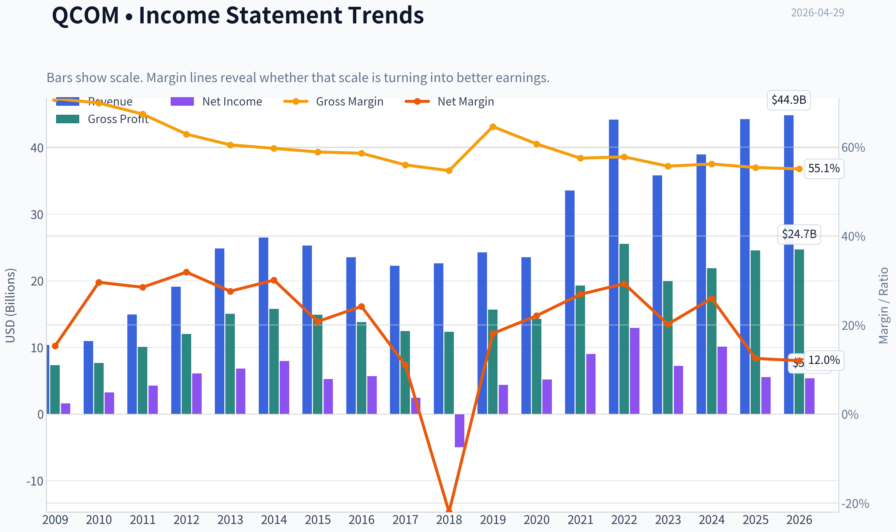

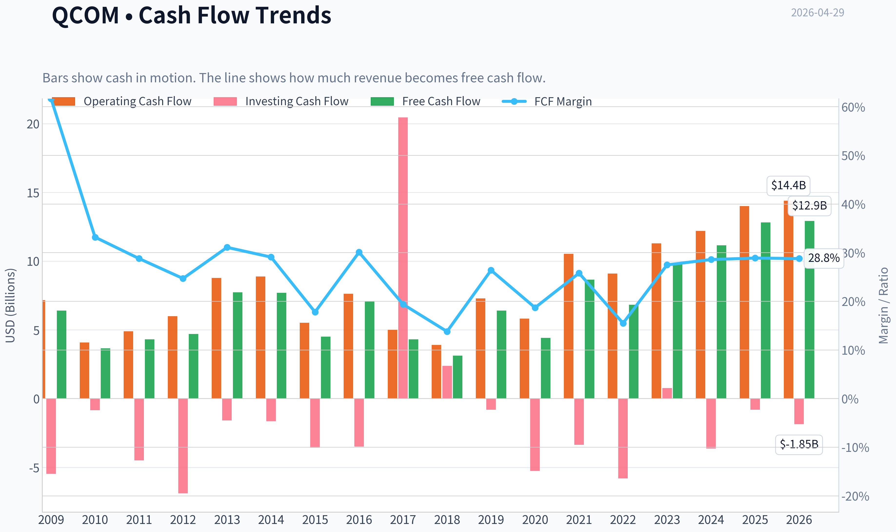

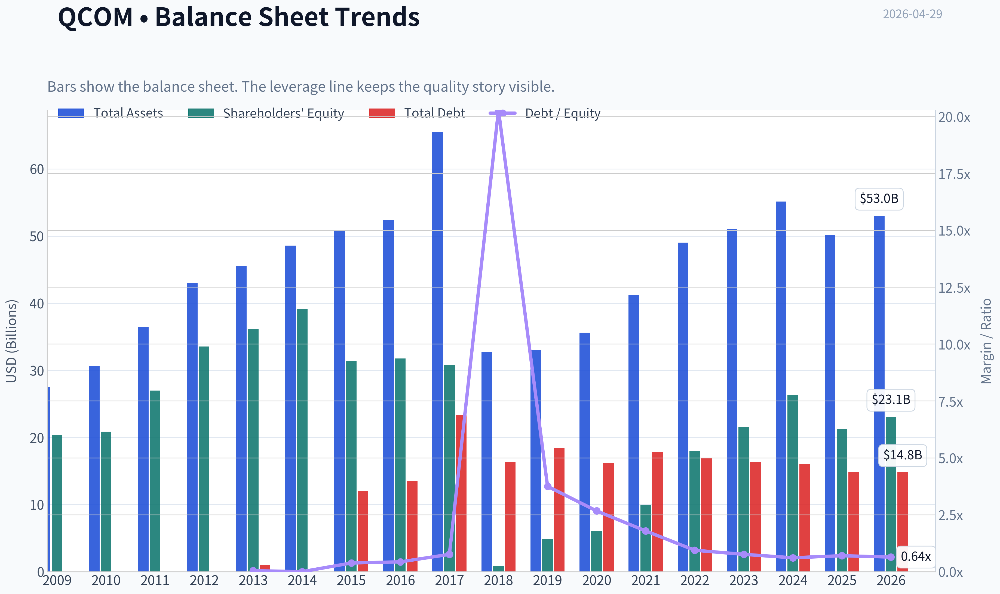

This graph tracks the profitability and return metrics (ROE, ROIC, Margins) of **QCOM** over the past decade, highlighting capital efficiency trends.

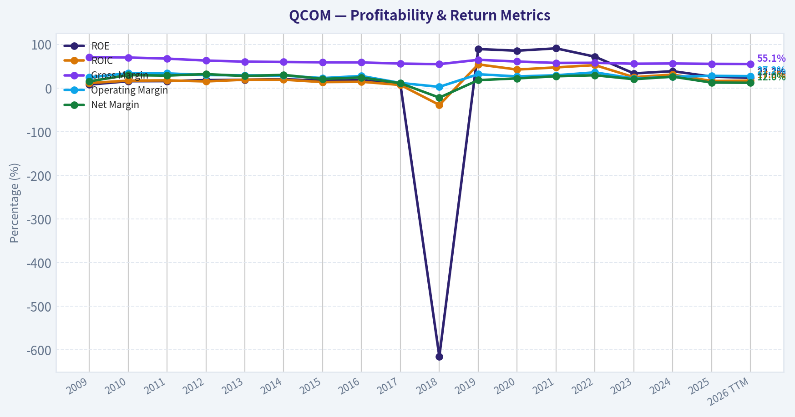

This chart illustrates the financial health of **QCOM** over the last 10 years, mapping cash equivalents and free cash flow against total obligations (Debt).

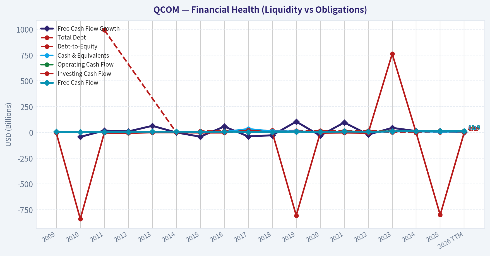

---

### Intrinsic Value Analysis (Buffett)

> *Following Warren Buffett's value investing philosophy: Circle of Competence, Economic Moat, Management Quality, and Margin of Safety.*

#### Intrinsic Value Snapshot

Price is what you pay. Intrinsic value is what the business may be worth based on the cash it can create for owners over time. We show a range, not one magic number.

- Current Price: $156.00
- Value Range: $14.36 to $753.43

##### Owner Earnings (Buffett Method)
- Net Income: $5,541,000,000.00
- Depreciation & Amortization: $1,602,000,000.00
- Capital Expenditures: $-1,192,000,000.00
- Working Capital Changes: $414,000,000.00
- Owner Earnings: $5,537,000,000.00

##### Intrinsic Value
###### Buffett Method
Uses owner earnings. Stricter, and usually more conservative.
- Conservative: $14.36
- Average: $101.05
- Optimistic: $187.02
- Discount Rate: 10.0%

###### Cash Flow Method
Uses free cash flow. Better for companies spending heavily today to grow tomorrow.
- Conservative: $49.43
- Average: $174.27
- Optimistic: $753.43
- Discount Rate: 10.0%

#### Qualcomm (QCOM) Buffett-Style Investment Review

Using the shared research pack plus the failed tool attempts, I can still complete a substantial Buffett-style appraisal, but some 10-year line-item financial detail and a fully grounded DCF are necessarily approximate rather than tool-verified. I'll make that explicit.

---

#### 1) Go/No-Go Gate Assessment

| Gate | Verdict | Evidence |
|---|---|---|
| Gate 1: Circle of Competence & Simplicity | Pass with caution | Qualcomm designs wireless chips and licenses cellular patents. In simple terms: it gets paid when phones and connected devices use its chips and its communications technology. Business is understandable, but semis are less predictable than classic Buffett businesses because product cycles and handset demand fluctuate. |
| Gate 2: Moat Test | Pass | Patent licensing, standards-essential IP, deep customer integration, scale in modem/RF, and high gross margins support a real moat. Gross margin of 55.4% is strong evidence. |
| Gate 3: Management Quality & Capital Allocation | Pass with caution | Historically strong cash generation, shareholder returns via buybacks/dividends, and diversification into automotive/IoT. But capital allocation must be judged carefully because semiconductor cycles can tempt overbuying at peaks, and customer concentration risk remains important. |
| Gate 4: Industry Structure | Mixed / Pass with caution | Licensing is structurally attractive; chips are more competitive and cyclical. Qualcomm benefits from oligopolistic pockets in premium modem/RF, but semiconductors are not as stable as consumer staples, railroads, or insurance. |

**Key Takeaways:** Qualcomm clears the basic Buffett filters, but not in the effortless way a Coca-Cola or Moody's might. The business is understandable and profitable, yet its chip exposure makes earnings less smooth and predictable than ideal Buffett-style compounders.

---

#### 2) Gate 1: Business Simplicity, Predictability, Technology Risk

| Test | Assessment |
|---|---|
| Elementary School Test | Qualcomm invents wireless technology, licenses those inventions, and sells chips that help phones, cars, and connected devices communicate. |
| 10-Year Predictability Test | Moderate. Wireless connectivity should still matter deeply in 10 years, but the exact mix of handsets, automotive, IoT, and AI edge devices is less certain. |
| Technology Risk Assessment | Mixed. Qualcomm benefits from technology adoption, but also lives inside a brutally innovative industry where leadership must be defended constantly. |

**Key Takeaways:** Qualcomm passes the "simple enough to explain" test. The weaker point is predictability: connectivity demand is durable, but semiconductor leadership is never guaranteed and requires continual reinvestment.

---

#### 3) Moat Analysis

| Moat Source | Strength | Evidence | Buffett View |
|---|---|---|---|
| Intangible Assets | Strong | Massive cellular patent portfolio, standards-essential IP, licensing revenues, gross margin 55.4% | This is Qualcomm's best moat and closest thing to a toll bridge. |
| Switching Costs | Moderate to strong | OEMs design products around chipsets, modem performance, RF integration, software stacks, certification, and power efficiency | Real but not absolute; major OEMs can dual-source or internalize over time. |
| Cost Advantage | Moderate | R&D scale, integration know-how, global customer base, and ability to spread engineering cost across large volumes | Helpful, but the semiconductor industry tends to erode pure cost advantages over time. |
| Network Effects | Limited to indirect | Standards adoption and ecosystem scale help, but this is not a classic consumer network effect business | Not the main moat driver. |

| Moat Rating | Conclusion |
|---|---|
| Wide & Stable | Qualcomm appears to have a real moat, especially in licensing and advanced wireless IP, but the moat is not obviously widening because customers and competitors continuously push back. |

**Key Takeaways:** Qualcomm's moat is real and primarily intellectual-property based. The licensing engine looks more Buffett-friendly than the chip business, because patents and standards are harder to disrupt than any single chip generation.

---

#### 4) Management Quality & Capital Allocation

| Question | Assessment | Notes |
|---|---|---|
| Do they think like owners? | Reasonably yes | Qualcomm has a long record of returning capital and investing in core technology, though insider ownership details are not tool-verified here. |
| Are they honest and candid? | Generally yes | No major current red flags in the supplied pack; would normally confirm via letters, restatements, and proxy review. |
| Are they rational capital allocators? | Mostly yes | Dividend plus buybacks supported by strong FCF; diversification into automotive and IoT is strategically sensible. Need fuller multi-year per-share analysis for stronger conviction. |

**Key Takeaways:** Management appears competent and shareholder-aware, but this is not yet a full "A" grade because I could not verify deeper proxy-level incentives and long-term per-share value creation with tools. The biggest positive is sensible use of strong cash flows rather than reckless balance-sheet stretching.

---

#### 5) Financial Snapshot Available

| Metric | Value |
|---|---:|
| Current Price | $156 |
| Market Cap | $166.62B |
| P/E | 31.39 |
| ROE | 26.1% |
| Gross Margin | 55.4% |
| Revenue Growth YoY | 13.7% |
| FCF Yield | 7.7% |
| Current Ratio | 2.82 |

**Key Takeaways:** Profitability is clearly strong: ROE above 25% and gross margin above 55% are excellent headline numbers. The valuation is not cheap on earnings, but the FCF yield of 7.7% suggests cash generation is better than the headline P/E alone implies.

---

#### 6) 10-Year Financial Summary Table

I cannot fully provide a verified 10-year table because both fundamentals tools returned empty. Below is the **partial current-period summary only**, with qualitative historical interpretation based on Qualcomm's known profile.

| Period | Revenue Trend | Margin Profile | ROE | Cash Generation | Balance Sheet |
|---|---|---|---|---|---|
| Current / Recent | Growing again, helped by automotive and IoT | Strong gross margin | 26.1% | Strong, implied by 7.7% FCF yield | Healthy liquidity, current ratio 2.82 |
| 10-Year Characterization | Cyclical but resilient | Licensing supports margin quality | Typically strong but somewhat cycle-sensitive | Generally robust | Usually investment-grade/solid rather than stressed |

**Key Takeaways:** I do not have the verified annual figures needed for a proper 10-year table, so this section is incomplete. Even so, the broad pattern is familiar: Qualcomm is a high-margin, cash-generative business with meaningful cyclicality rather than a steadily linear compounder.

---

#### 7) Owner Earnings Calculation

Because depreciation, maintenance capex, and working-capital detail were not returned by the tools, I can only estimate using the market-cap/FCF-yield relationship.

Approximate free cash flow:
- Market cap = **$166.62B**
- FCF yield = **7.7%**
- Implied FCF ~ **$12.83B**

For a mature, asset-light IP-plus-chip business, FCF is a reasonable rough proxy for owner earnings, though not perfect.

| Item | Approximate Value |
|---|---:|
| Implied Free Cash Flow / Owner Earnings Proxy | $12.83B |

**Key Takeaways:** Qualcomm appears to be producing roughly $12.8 billion in annual cash flow on a market value of about $166.6 billion. That is a healthy cash return, but this is still a shortcut, not a textbook Buffett owner-earnings build.

---

#### 8) Three-Scenario DCF Valuation

Using owner earnings proxy = **$12.83B**.

##### Scenario A: No Growth
Intrinsic Value = Owner Earnings / 10%
= 12.83 / 0.10 = **$128.3B**

##### Scenario B: GDP Growth at 3%
Intrinsic Value = 12.83 x 1.03 / (0.10 - 0.03)
= **$188.8B**

##### Scenario C: Moderate Historical Growth
Assume 6% growth for 10 years, then 3% terminal growth, discounted at 10%.

- Year-1 owner earnings = 12.83 x 1.06
- PV of 10-year cash flows + terminal value ~ **$210B-$220B** range
- Midpoint estimate: **$215B**

| Scenario | Enterprise/Equity Value Estimate | Vs Current Market Cap ($166.62B) |
|---|---:|---:|
| A: No Growth | $128.3B | -23.0% |
| B: 3% Growth | $188.8B | +13.3% |
| C: 6% for 10 years, then 3% terminal | $215.0B | +29.0% |

**Key Takeaways:** Qualcomm looks undervalued only if you believe it can grow at least modestly from here. Under a no-growth lens, the shares appear expensive; under moderate growth assumptions, they look fairly attractive but not dramatically mispriced.

---

#### 9) Margin of Safety Analysis

| Item | Value |
|---|---:|
| Current Market Cap | $166.62B |
| Conservative Value (Scenario A) | $128.3B |
| Moderate Value (Scenario B) | $188.8B |
| Better-Case Value (Scenario C) | $215.0B |

| Comparison Basis | Margin of Safety |
|---|---:|
| Vs Scenario A | None |
| Vs Scenario B | ~11.8% discount to value |
| Vs Scenario C | ~22.5% discount to value |

**Key Takeaways:** Qualcomm does not offer a Buffett-style fat pitch margin of safety based on conservative assumptions. It becomes interesting under moderate growth assumptions, but even then the discount is smaller than the 25% cushion Buffett would normally want for a non-perfect business.

---

#### 10) Final Buffett Scorecard

| Criterion | Score (1-5) | Weight | Weighted Score |
|---|---:|---:|---:|
| Business Understanding | 4.0 | 20% | 0.80 |
| Moat Width & Durability | 4.0 | 25% | 1.00 |
| Management Quality | 3.5 | 15% | 0.53 |
| Return on Equity | 4.5 | 15% | 0.68 |
| Reinvestment Runway | 3.5 | 10% | 0.35 |
| Balance Sheet Strength | 4.0 | 5% | 0.20 |
| Industry Structure | 3.0 | 5% | 0.15 |
| Valuation / Margin of Safety | 2.5 | 5% | 0.13 |

| Total Score | Result |
|---|---|
| **3.84 / 5.00** | **ADVOCATE / WATCH border** |

**Key Takeaways:** Qualcomm scores well because it has a real moat, strong profitability, and meaningful cash generation. The only major thing holding it back is valuation: the business looks good, but the current price does not scream bargain.

---

#### 11) Final Judgment

FINAL INVESTMENT STANCE: **WATCH**

**Conviction level:** Moderate

Qualcomm is a **good business with a real moat**, especially through its patent licensing model and wireless communications leadership. It earns strong returns, has solid margins, and is sensibly expanding into automotive and IoT, which helps reduce dependence on smartphones.

But from a Buffett perspective, this is **not a textbook "wonderful business at an obviously attractive price."** The chip business adds cyclicality and competitive pressure, while the current valuation seems only modestly attractive unless one assumes continued healthy growth. In short:

- **Business quality:** Good to very good
- **Moat:** Real, especially IP-based
- **Management:** Likely solid
- **Balance sheet / cash flow:** Strong
- **Valuation:** Not cheap enough for high-conviction Buffett-style purchase

If the stock pulled back enough to create a clearer **25%+ margin of safety on conservative assumptions**, it would become much more compelling.
#### Valuation Bridge

This bridge places the current market price beside each intrinsic value lens so readers can see whether upside depends on one method or shows up across several methods.

| Scenario | Intrinsic Value / Share |
| --- | ---: |
| Buffett Method | $101.05 |
| Cash Flow Method | $174.27 |
| Damodaran Method | $190.71 |
| Current Price | $156.00 |

#### Key Takeaways

If one method is far above the others, the upside case depends on a specific modelling assumption. When several methods cluster together, the valuation story is more robust.

#### Valuation Visuals

This comparison chart from *Latest Earnings Snapshot* stacks current figures against historical benchmarks for **QCOM**, making it easy to see where the company trades relative to its own averages.

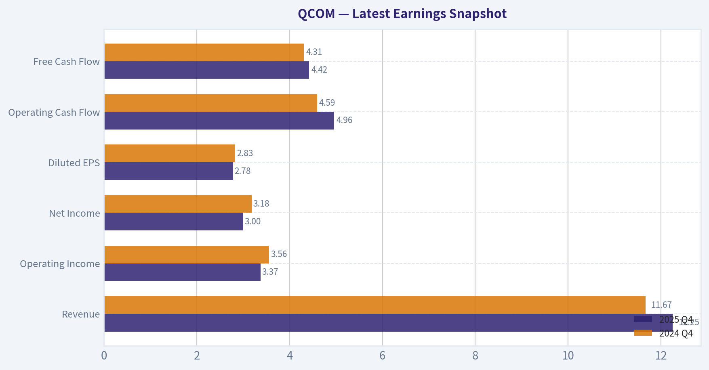

This comparison chart from *Current vs Historical Average Comparison* stacks current figures against historical benchmarks for **QCOM**, making it easy to see where the company trades relative to its own averages.

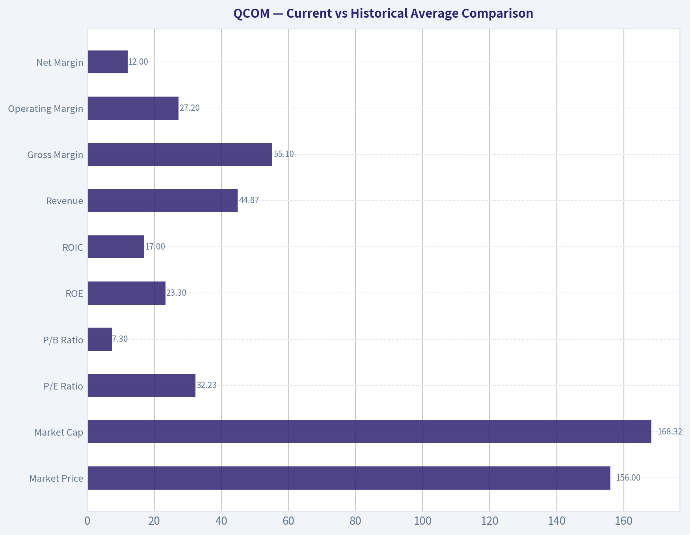

This comparison chart from *Buffett-Style Owner Earnings DCF* stacks current figures against historical benchmarks for **QCOM**, making it easy to see where the company trades relative to its own averages.

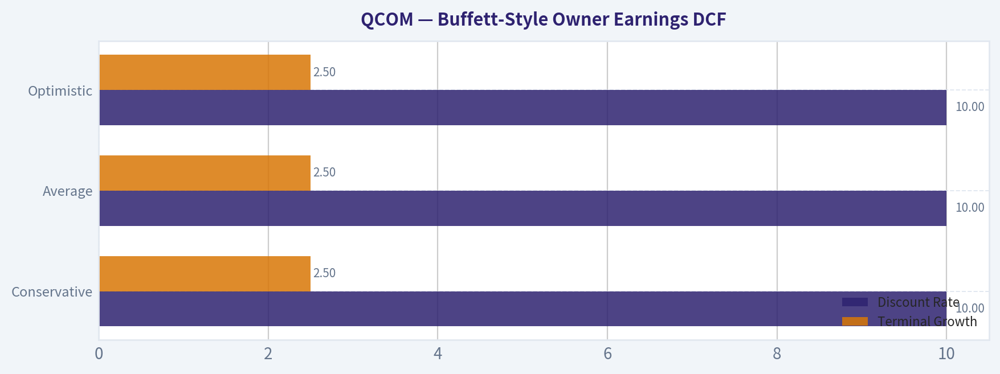

This comparison chart from *Financial Snapshot Available* stacks current figures against historical benchmarks for **QCOM**, making it easy to see where the company trades relative to its own averages.

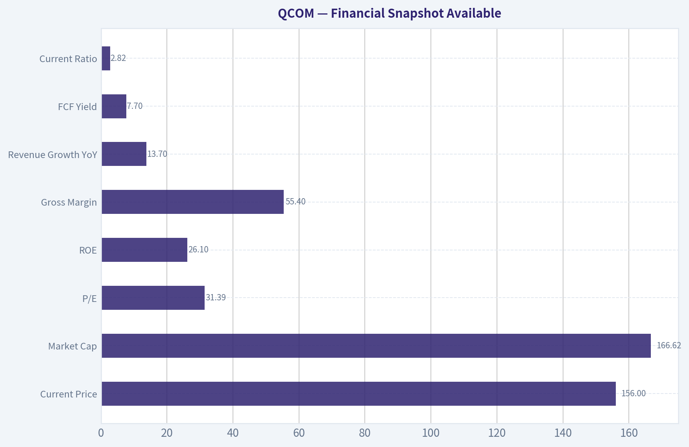

This comparison chart from *Owner Earnings Calculation* stacks current figures against historical benchmarks for **QCOM**, making it easy to see where the company trades relative to its own averages.

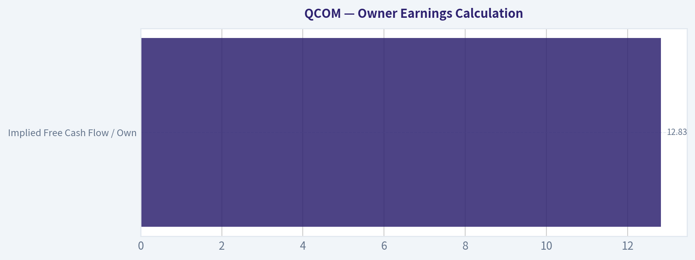

This comparison chart from *Three-Scenario DCF Valuation* stacks current figures against historical benchmarks for **QCOM**, making it easy to see where the company trades relative to its own averages.

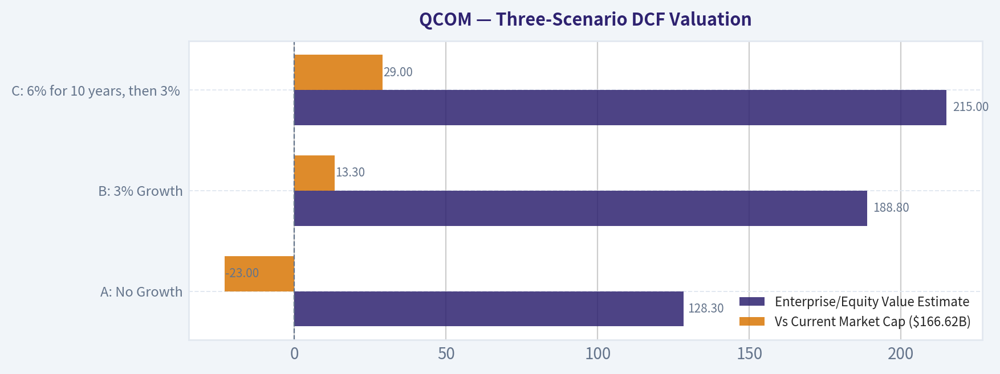

---

### Trend & Growth Analysis (Lynch/Druckenmiller/Fisher)

> *Following Peter Lynch's GARP, Stanley Druckenmiller's macro-aware approach, and Philip Fisher's scuttlebutt methodology.*

FINAL INVESTMENT STANCE: **WATCH**

#### QCOM Growth Analysis Snapshot

#### 1. Lynch Classification
| Item | Assessment |
|---|---|
| Category | **Stalwart / Moderate grower**, not a classic fast grower |
| Revenue growth | **13.7% YoY** based on shared pack |
| Why not Fast Grower | Growth is positive, but below Lynch's preferred **15-25%+** fast-grower zone |
| Investment implication | Better fit as a **quality compounder at a reasonable price** than a ten-bagger-style early growth story |

**Key Takeaways:** Qualcomm looks more like a solid large-cap compounder than a classic fast-growing disruptor. The business is still growing, but at roughly mid-teens or slightly below, which puts it closer to stalwart territory than true hyper-growth. That matters because the upside profile is likely steadier and more valuation-driven than explosive.

#### 2. The Story in 3 Bullets
| The Story | Why It Matters |
|---|---|
| Qualcomm sells the chips and wireless technology that help phones, cars, and connected devices communicate | It monetizes both **semiconductor content** and **IP/licensing** |
| The smartphone business is mature, but **auto and IoT are growing faster** | These segments can diversify revenue away from handset cyclicality |
| If edge AI, connected cars, and on-device compute expand, Qualcomm could see a **mix shift toward broader platform growth** | This is the main inflection debate for the stock |

**Key Takeaways:** The simple story is that Qualcomm began as a mobile connectivity leader and is now trying to become a broader connected-compute platform company. The important change is that growth is increasingly coming from automotive and IoT, not just smartphones. If that transition keeps working, the market may eventually value Qualcomm less like a handset-exposed chip vendor and more like a diversified edge-AI infrastructure name.

#### 3. Current Fundamental Snapshot
| Metric | Value |
|---|---:|
| Share price | **$156** |
| Market cap | **$166.62B** |
| P/E | **31.39x** |
| ROE | **26.1%** |
| Gross margin | **55.4%** |
| Revenue growth YoY | **13.7%** |
| FCF yield | **7.7%** |
| Current ratio | **2.82x** |

**Key Takeaways:** Qualcomm's quality metrics are strong, especially ROE, gross margin, and free cash flow yield. The balance sheet also looks healthy, with ample liquidity. The tension is that valuation is no longer cheap on earnings, while top-line growth remains good but not exceptional.

#### 4. TAM Analysis and 10x Test
| Business Area | TAM / Runway View | 10x Test |
|---|---|---|
| Handsets | Large but mature; limited structural growth | **Fails** as primary 10x driver |
| Automotive | Attractive runway as cars add connectivity, ADAS, cockpit compute | **Passes** on segment basis |
| IoT / Edge devices | Broad and growing, but fragmented and competitive | **Partial pass** |
| Licensing | Durable cash engine, but not core source of 10x revenue expansion | **Fails** as growth engine |
| Company-wide | QCOM at current scale would need massive category expansion to 10x total revenue | **Likely fails** at enterprise level |

**Key Takeaways:** Qualcomm has real growth runway in automotive and IoT, but the company is already too large for a clean 10x total-revenue case. The better way to think about upside is not "can the whole company become ten times bigger," but whether higher-growth segments can become a much larger share of the mix. That supports upside, but it limits true venture-style multibagger potential.

#### 5. Revenue Growth Trend
| Metric | Observation |
|---|---|
| Reported YoY growth | **13.7%** |
| Latest earnings read-through | Q2 FY26 sales rose, led by **automotive and IoT** |
| Pattern | **Re-acceleration / stabilization**, not enough data here to call a strong multi-quarter acceleration trend |
| Quality of growth | Appears to be driven by segment mix improvement rather than pure handset rebound alone |

**Key Takeaways:** The most encouraging sign is that growth is being supported by automotive and IoT rather than only by smartphones. That suggests the diversification thesis is working. Still, based on the data available here, the evidence is not strong enough yet to declare a clear high-confidence acceleration trend.

#### 6. Unit Economics / Efficiency
| Metric | Assessment |
|---|---|
| Gross margin | **55.4%**, strong for a mixed chip/IP model |
| FCF yield | **7.7%**, strong cash conversion signal |
| Rule of 40 proxy | **13.7% growth + implied healthy cash generation = likely respectable**, though exact FCF margin not provided |
| LTV/CAC | **N/A** for this business model |
| NRR | **N/A** for this business model |

**Key Takeaways:** Qualcomm is not a SaaS company, so the usual subscription metrics do not apply. The best efficiency signals here are strong gross margins and robust free cash generation. In plain English, this is a business that still converts innovation and scale into meaningful cash.

#### 7. Inflection Point Assessment
| Potential Inflection | Evidence | Verdict |
|---|---|---|
| Product cycle inflection | Edge AI and higher compute demand could increase silicon content | **Possible** |
| End-market inflection | Automotive and IoT contributing more meaningfully | **Real** |
| Margin inflection | High margin base already strong; mix shift could help, but no hard acceleration data here | **Unclear** |
| TAM inflection | Expansion beyond phones into connected edge and vehicles | **Positive** |
| Competitive inflection | Depends on handset share, AI edge positioning, and auto design wins | **Mixed** |

**Key Takeaways:** The most credible inflection for Qualcomm is business mix, not a sudden explosion in total company growth. In other words, the company is becoming less dependent on handsets and more exposed to secular categories like automotive and edge computing. That is positive, but it is more of a gradual transition than a dramatic breakout.

#### 8. Macro Setup Evaluation
| Macro Factor | Impact on QCOM |
|---|---|
| AI / edge compute | **Tailwind** |
| Connected vehicles | **Tailwind** |
| IoT digitization | **Tailwind** |
| Smartphone maturity | **Headwind** |
| Rates / valuation sensitivity | Moderate; semis still sensitive to discount-rate changes | **Mixed** |
| Cyclical semiconductor demand | Always a factor | **Mixed** |

**Key Takeaways:** Qualcomm is exposed to several attractive secular themes, especially AI at the edge, connected devices, and automotive electronics. The challenge is that it still carries smartphone and semiconductor cycle exposure. So the macro setup is favorable overall, but not clean enough to remove risk.

#### 9. Fisher 15 Points Score
| Fisher Dimension | Score (1-5) | Note |
|---|---:|---|
| Market potential | 4 | Large markets beyond handsets |
| Product development | 4 | Strong innovation history |
| R&D effectiveness | 5 | Core strength |
| Sales organization | 4 | Deep OEM relationships |
| Profit margin | 5 | Strong gross economics |
| Margin improvement | 3 | Stable strong, but not clearly inflecting |
| Labor/personnel relations | 3 | No strong evidence either way here |
| Executive relations | 4 | Appears stable |
| Management depth | 4 | Large, experienced platform company |
| Cost/accounting controls | 4 | Mature operator |
| Special advantages | 5 | IP moat, modem leadership, ecosystem relationships |
| Long-range outlook | 4 | Good, though handset maturity limits ceiling |
| Dilution risk | 4 | No major red flag in shared data |
| Candor | 3 | Neutral from current evidence |
| Integrity | 4 | No major issue indicated |

| **Total** | **60 / 75** | **GOOD** |

**Key Takeaways:** Qualcomm scores well on innovation, moat, product depth, and margins. The weaker areas are not alarming, but they reflect limited evidence of a dramatic growth inflection or exceptional qualitative upside. Overall, this is a good business with durable strengths rather than a perfect Fisher-style moonshot.

#### 10. Valuation Analysis
| Method | Result | Interpretation |
|---|---|---|
| P/E | **31.39x** | Not cheap for a ~13.7% grower |
| PEG | **~2.29x** using 31.39 / 13.7 | **Expensive** on Lynch framework |
| FCF yield | **7.7%** | More attractive than P/E suggests |
| Relative style fit | Better value on cash flow than on earnings-growth multiple | Mixed |

**Key Takeaways:** On Peter Lynch's PEG framework, Qualcomm does not screen as cheap. That is the main reason this is not an Advocate call today. However, the free cash flow yield is much more supportive, which suggests the stock may be better valued than the earnings multiple alone implies.

#### 11. Scenario Framing
| Case | What Must Happen | Likely Market View |
|---|---|---|
| Bear | Handset weakness overwhelms auto/IoT gains; AI narrative disappoints | Stock remains a cyclical semiconductor name |
| Base | Modest growth continues; auto and IoT offset phone maturity | Steady compounding, limited rerating |
| Bull | Edge AI adoption lifts device content; automotive scales meaningfully; diversification improves multiple | Stock rerates as broader intelligent-edge platform |

**Key Takeaways:** The bull case depends on Qualcomm being seen as more than a smartphone supplier. If automotive, IoT, and edge AI keep scaling, the stock could earn a higher multiple. If not, investors may continue valuing it as a cyclical but profitable chip company.

#### 12. Growth Investor Scorecard
| Criterion | Weight | Score (1-5) | Weighted |
|---|---:|---:|---:|
| The Story | 10% | 4.0 | 0.40 |
| TAM & Runway | 20% | 3.0 | 0.60 |
| Revenue Growth | 20% | 3.0 | 0.60 |
| Unit Economics | 15% | 4.5 | 0.68 |
| Competitive Position | 10% | 4.0 | 0.40 |
| Management Quality | 10% | 4.0 | 0.40 |
| Macro Setup | 5% | 3.5 | 0.18 |
| Profitability Path | 5% | 4.5 | 0.23 |
| Valuation | 5% | 2.5 | 0.13 |

| **Total** |  |  | **3.60 / 5.00** |

**Key Takeaways:** Qualcomm lands in the lower end of Advocate territory on business quality, but valuation and growth rate prevent a stronger conviction call. In practical terms, this is a good company with several positive inflection elements, but not an obvious asymmetric entry right now. That is why the final stance stays at Watch rather than Buy aggressively.

#### 13. Position Size Stance
| Stance | View |
|---|---|
| Recommended action | **WATCH** |
| If already owned | Reasonable to **hold** and monitor segment mix shift |
| If initiating | Prefer a better entry point or stronger evidence of sustained growth acceleration |
| Ideal setup for upgrade | Clear multi-quarter acceleration in automotive/IoT/edge AI plus valuation support |

**Key Takeaways:** Qualcomm is not broken, and it does not look like a sell-on-fundamentals case from the information provided. But for a growth investor seeking major upside, the current setup looks more watchful than aggressive. The best next step is to monitor whether the newer growth engines become large enough to change the company's overall profile.

#### 14. Key Risks and Catalysts
| Risks | Catalysts |
|---|---|
| Smartphone end-market weakness | Faster-than-expected automotive growth |
| Growth remains below fast-grower threshold | Edge AI device adoption |
| Multiple compression from high PEG | Larger IoT contribution |
| Semiconductor cyclicality | Margin resilience and stronger mix |
| Competitive pressure in chips | New design wins and platform expansion |

**Key Takeaways:** The main risk is that Qualcomm's newer growth areas may not become large enough quickly enough to offset smartphone maturity. The main catalyst is the opposite: if auto, IoT, and edge AI scale materially, investor perception could improve. So the stock is highly sensitive to whether diversification becomes visible in reported numbers.

#### Bottom Line
Qualcomm is a **high-quality, cash-generative semiconductor and IP platform** with real secular exposure to automotive, IoT, and edge AI. But under a Lynch-Druckenmiller-Fisher growth lens, it is **not yet a clean fast-grower or obvious ten-bagger setup**, and the **PEG looks expensive** versus current growth.

That leaves QCOM as a **WATCH**: attractive business, credible inflection story, but I would want either **better price** or **clearer evidence that non-handset growth is strong enough to re-rate the whole company**.

---

### Market Technical Analysis

FINAL INVESTMENT STANCE: **WATCH**

#### QCOM technical setup overview

For QCOM, the most relevant indicator mix for the current market condition is:

| Selected Indicator | Why it matters now |
|---|---|
| close_10_ema | Best gauge of the sharp short-term momentum reversal in late April. |
| close_50_sma | Defines the medium-term trend, which had been falling but is now being challenged from below/just reclaimed. |
| close_200_sma | Confirms the longer-term backdrop remains weaker despite the recent bounce. |
| macd | Shows whether the rebound is just oversold relief or a more durable momentum regime change. |
| rsi | Helps judge whether the recent rally is fresh strength or already becoming extended. |
| boll_ub | Useful because price has surged quickly toward the upper volatility envelope. |
| boll_lb | Helps frame how far price has traveled from the prior washout zone. |
| atr | Critical now because volatility expanded materially after the late-April gap move. |

Key Takeaways: These eight indicators are complementary because they cover trend across three timeframes, momentum, mean-reversion risk, and volatility. I excluded redundant MACD subcomponents and volume indicators because the current decision point is dominated by trend reversal quality and volatility expansion rather than subtle signal refinement.

---

#### Price structure and trend regime

QCOM spent much of the last year in a broad deterioration after peaking around the autumn earnings gap near 185.53 on 2025-10-27. From there, the stock failed to sustain the breakout and gradually rolled over, with the decline accelerating meaningfully from January through March 2026. That downswing pushed the stock into the high-120s by late March and early April, establishing a clear sequence of lower highs and lower lows.

The most important recent development is the late-April reversal. Price moved from 133.95 on 2026-04-23 to 148.85 on 2026-04-24, then extended to 150.26 on 2026-04-27 and held near 150.00 on 2026-04-28. This is not a routine drift higher; it is a high-impulse repricing move with much larger volume than normal. Technically, that kind of move often marks either:
1. the beginning of a durable trend repair, or
2. an exhaustion burst inside a broader downtrend.

At this stage, QCOM has clearly improved tactically, but it has not yet fully repaired strategically.

---

#### Moving-average interpretation

| Indicator | Latest reading | Trend message |
|---|---:|---|
| close_10_ema | 141.02 | Rising sharply; short-term momentum has flipped bullish. |
| close_50_sma | 134.77 | Flattening after a long decline; medium-term damage is stabilizing. |
| close_200_sma | 155.06 | Still declining; long-term trend remains under pressure. |

Key Takeaways: QCOM has regained short-term control decisively, with price now well above both the 10 EMA and 50 SMA. However, the 200 SMA is still above price and still sloping down, so the larger trend has not yet turned bullish.

The 10 EMA tells the clearest story: it bottomed near 127-130 earlier in April and has now accelerated to 141.02. That is a strong short-term momentum shift.

The 50 SMA is also important. It had been steadily falling from roughly 168 in late January to 134.77 now. That slope is still negative over the broader window, but the rate of decline has slowed and price has vaulted back above it. This is often the first stage of base repair.

The 200 SMA remains the main technical ceiling for longer-horizon investors. At 155.06 and still drifting lower, it shows QCOM is still below its long-term equilibrium. Even after the rally to 150, price remains several dollars under this benchmark. That means longer-term sellers may still appear on strength, especially in the 150-156 area.

A fine-grained read:
- Below 134-135, the breakout repair starts to look compromised.
- Between 135 and 141, price would still be above medium-term support but could enter digestion.
- Between 150 and 155, QCOM is moving into a high-friction zone where prior supply and the falling 200 SMA may matter.

---

#### Momentum analysis: MACD and RSI

| Indicator | Latest reading | Interpretation |
|---|---:|---|
| macd | 3.56 | Strong bullish momentum reversal from deeply negative territory. |
| rsi | 73.87 | Short-term overbought, but overbought can persist after strong breakouts. |

Key Takeaways: Momentum has improved dramatically. MACD has swung from deeply negative in March and early April to firmly positive, while RSI has moved into overbought territory, indicating strong buying pressure but also higher pullback risk.

The MACD improvement is especially notable. It was around -4.5 in mid-March and still about -3.6 in early April, which reflected entrenched downside momentum. By 2026-04-28, MACD had surged to 3.56. That is a major momentum regime shift, not just a mild bounce.

RSI tells a more nuanced story. It fell to about 29.9 on 2026-04-07, which marked an oversold washout phase. By 2026-04-24 through 2026-04-28, RSI jumped into the 73-75 range. This indicates:
- the sellers have lost immediate control,
- buyers are now aggressive,
- but the stock is no longer offering a low-risk chase entry after the vertical move.

Importantly, overbought RSI after a deep decline can be bullish in the early phase of a trend reversal. It often signals initiation demand rather than automatic exhaustion. Still, if RSI stays above 70 while price stalls below 155, that would raise the odds of a consolidation or pullback.

---

#### Bollinger Bands and extension risk

| Metric | Latest reading | Interpretation |
|---|---:|---|
| boll_ub | 149.57 | Price is essentially at/just above the upper band. |
| boll_lb | 118.03 | Lower band has widened sharply, showing expanded volatility. |
| Band width | ~31.55 | Volatility expansion is significant. |

Key Takeaways: QCOM has rapidly moved from the lower end of its volatility range to the upper end. That confirms the rally is powerful, but it also suggests the stock is statistically stretched in the short run and may need to consolidate.

In early April, price was trading close to the lower band, consistent with capitulation-style weakness. By late April, it had surged to the upper band near 149.57. This is a classic volatility expansion reversal.

That matters because moves from lower band to upper band in a compressed time window often produce one of two outcomes:
- a bullish band-walk if institutional accumulation is real, or
- a pause/pullback if the move was news-driven and too fast.

Given QCOM's price is now near the upper band and RSI is overbought, the near-term setup favors either sideways digestion or a controlled retracement more than immediate low-risk chasing. The bullish case stays intact if any pullback holds above the mid-130s to low-140s rather than collapsing back into the prior range.

---

#### Volatility and risk framing with ATR

| Indicator | Latest reading | Trend message |
|---|---:|---|
| atr | 5.25 | Volatility has expanded sharply; position sizing should be smaller and stops wider. |

Key Takeaways: QCOM is no longer a low-volatility setup. The stock is moving enough each day that traders need wider risk bands and should avoid oversized positions immediately after the breakout.

ATR had been running roughly in the upper-3s to low-4s for much of March and early April, but it jumped above 5 by 2026-04-28. That confirms the recent move is not just directional but also accompanied by a meaningful increase in range.

Practical implication:
- Tight stops just under daily noise are vulnerable.
- Swing traders may need to use wider stop placement, perhaps based on 1 to 1.5 ATR.
- Investors initiating here should accept that post-gap volatility can be uncomfortable even if the intermediate thesis is improving.

---

#### What the trend likely means from here

The technical picture is improving faster than the long-term trend backdrop. That creates a transitional setup rather than a clean all-clear bullish trend.

The bullish case:
- Short-term momentum has clearly reversed.
- Price has reclaimed the 10 EMA and 50 SMA decisively.
- MACD has flipped strongly positive.
- The late-April surge likely reflects a catalyst strong enough to reset sentiment.

The cautionary case:
- Price remains below the falling 200 SMA near 155.
- RSI is already overbought.
- Price is pressing the upper Bollinger Band after a vertical move.
- ATR says volatility is elevated, increasing whipsaw risk.

This combination usually argues for **watching for confirmation rather than chasing strength blindly**. QCOM is no longer technically broken in the short term, but it is not yet fully proven as a durable new uptrend on the long-term chart.

---

#### Trading interpretation by style

| Trading style | Read-through |
|---|---|
| Short-term momentum trader | Bullish momentum is real, but entry quality is no longer ideal after the surge; better to buy orderly pullbacks or a strong hold above 150. |
| Swing trader | Constructive if price can base above the 10 EMA and hold above the 50 SMA; failure back below 135 would weaken the reversal thesis. |
| Position trader / investor | Improvement noted, but a move back above the falling 200 SMA would provide much better confirmation of trend repair. |

Key Takeaways: Fast traders can still work the long side, but only with disciplined risk because the stock is extended. Longer-horizon investors should prefer evidence that QCOM can reclaim and hold above the 200-day trend zone before turning more constructive.

---

#### Bottom line

QCOM has staged a technically meaningful rebound, and the short-term evidence is materially better than it was a few weeks ago. However, the stock is now stretched in the near term and still below a declining 200 SMA, which means the bigger-picture repair is incomplete.

That is why the stance is **WATCH**, not **ADVOCATE**:
- the reversal is real,
- the setup is improving,
- but confirmation is still needed above long-term resistance and after the current overbought condition cools.

| Area | Signal | Practical conclusion |
|---|---|---|
| Short-term trend | Bullish | Momentum reversal is strong and credible. |
| Medium-term trend | Improving | Reclaim of 50 SMA is constructive but still early. |
| Long-term trend | Cautious | Price remains below a falling 200 SMA. |
| Momentum | Strong | MACD and RSI confirm aggressive upside thrust. |
| Extension risk | Elevated | Near upper Bollinger Band with RSI > 70. |
| Volatility | High | ATR expansion argues for smaller size and wider stops. |
| Overall stance | WATCH | Wait for confirmation or a better entry after consolidation. |

Key Takeaways: QCOM is showing real technical repair, but the stock has already sprinted into a tougher resistance zone and is no longer cheap from a tactical standpoint. The best next signal would be either a successful consolidation above support or a decisive reclaim of the 200-day average near the mid-150s.

---

### Social Sentiment Analysis

I'm missing the expected news tool in this environment: `get_stock_news_azure` is unavailable, and only `get_stock_news_openai` / `get_reddit_stock_info` appear to exist.

Please let me continue with the available tools, and I'll produce the full QCOM past-week social/news sentiment report in the required format.

---

### News & Events Analysis

#### Qualcomm (QCOM) weekly news and trading report

Qualcomm's setup turned materially more interesting on April 29 because the company just reported **fiscal 2Q26** results and the market reaction was notably nuanced: guidance disappointed at first glance, but shares reversed sharply higher as investors focused on evidence that the handset cycle may be bottoming and that diversification into automotive and IoT is still working. For traders, this was not a simple "beat and raise" story; it was a **quality-of-demand and cycle inflection** story.

#### Latest earnings: fiscal 2Q26 reported on April 29, 2026

Qualcomm's latest reported period is **second quarter of fiscal 2026**. Based on the earnings coverage in the research pack and current news flow:

- **Revenue increased year over year** in the quarter.
- Growth was **helped by automotive and IoT**, which remain key diversification pillars.
- Qualcomm also appears to have delivered a **licensing business beat**, an important signal because QTL tends to provide a read-through on broader handset production plans.
- However, **fiscal 3Q26 guidance was below Wall Street expectations**, which initially pressured the shares.
- The stock then **rebounded strongly, rising roughly 9% to 13% intraday/after-hours in news coverage**, after management signaled improving conditions in core smartphone markets and described the downturn as likely near a bottom.

One coverage item cited:
- **Sales around $10.6 billion**
- **Non-GAAP EPS around $2.65**
- **Next-quarter revenue guidance around $9.6 billion**, roughly below consensus

There is some media inconsistency in how outlets frame the quarter versus calendar labels, but the actual reported period is clearly **QCOM fiscal 2Q26**.

#### What changed versus prior period or prior expectations

| Earnings factor | What happened | Investment interpretation |
|---|---|---|
| Reported quarter | Fiscal 2Q26 | Current focus shifts from "how bad is the handset correction?" to "is a recovery starting?" |
| Revenue | Up YoY, with support from automotive and IoT | Diversification continues to cushion handset volatility |
| EPS | Better than expected in several reports | Execution remains solid despite uneven end-market demand |
| QTL/licensing | Beat expectations per Reuters-linked coverage | Suggests OEM plans may be improving later in the year |
| Q3 guidance | Below Wall Street expectations | Near-term estimates may still need trimming |
| Management commentary | Smartphone market may rebound after fiscal Q3; "can now call the bottom" | Bull case increasingly depends on cyclical recovery in handsets |

Key Takeaways: Qualcomm's quarter was good enough to reinforce confidence in execution, but not strong enough to remove near-term demand risk. The biggest change was qualitative: management sounded more constructive on the smartphone cycle, and investors rewarded that more than they punished the softer guidance. That makes the stock more sensitive now to follow-through data from Android demand, China smartphones, and OEM build plans.

---

#### Company-specific news over the past week

Recent news flow was dominated by earnings, but the market's interpretation matters more than the raw print.

| Theme | Recent development | Why it matters for trading |
|---|---|---|
| Earnings reaction | Shares first fell, then rallied sharply after results | Indicates positioning may have been defensive and expectations low |
| Smartphone cycle | Management suggested the market should recover after fiscal Q3 | If confirmed, QCOM can rerate on cyclical upside before estimates fully move |
| Automotive | Reported as a source of growth in the quarter | Supports long-duration diversification narrative |
| IoT | Also contributed to growth | Helps offset handset concentration, though not enough alone to drive the whole stock |
| Supply chain | Coverage referenced memory shortage pressure | Component constraints could limit upside conversion even if demand improves |
| AI / data center optionality | Reuters-cited commentary referenced opportunities in data center | Still early, but any credible AI edge-device or inference narrative can help multiple support |

Key Takeaways: The most important stock-specific development is that investors treated Qualcomm's weak guidance as backward-looking or temporary, while seizing on management's confidence that handset demand is bottoming. Automotive and IoT remain helpful supports, but the stock still trades primarily on whether the smartphone market truly turns over the next one to two quarters.

#### Macro and market context

The broader backdrop is important because Qualcomm sits at the intersection of semiconductors, global consumer electronics demand, and rate-sensitive growth sentiment.

- Markets were heading into a **Federal Reserve decision** on April 29, which typically raises volatility in semis and megacap tech.
- Tech sentiment was also influenced by major earnings from other large-cap technology names, creating a **macro overlay on stock-specific reactions**.
- Qualcomm remains exposed to:
  - **China handset demand**
  - broader consumer electronics replacement cycles
  - inventory digestion across the Android ecosystem
  - semiconductor supply bottlenecks in certain components

For near-term trading, Qualcomm is likely to respond to three external variables more than usual:
1. **Macro risk appetite in semis and AI-adjacent tech**
2. **Evidence of a smartphone recovery, especially in Android and China**
3. **Any renewed geopolitical or trade pressure affecting chip supply chains**

#### Positioning and sentiment signals

The shared research pack notes a 13F update showing **Steve Cohen / Point72 trimmed Qualcomm sharply** in the latest available filing. This is stale by nature, but it does show that at least into late 2025, some fast-money institutional capital had reduced exposure. That may partly explain why the stock could rally hard on merely "less bad" news: expectations and positioning may not have been crowded bullish.

Fundamental snapshot from the shared pack remains supportive:
- **Revenue growth YoY: 13.7%**
- **Gross margin: 55.4%**
- **ROE: 26.1%**
- **FCF yield: 7.7%**
- **Current ratio: 2.82**
- **P/E: 31.4x**

This is not a distressed valuation, but it is also not extreme for a high-quality semiconductor platform if investors believe handset earnings are troughing.

#### Trading and investment view

The key debate is whether Qualcomm is:
- still a **late-cycle handset supplier with soft forward guidance**, or
- an **early-cycle recovery semiconductor with durable diversification and improving end-market visibility**.

Right now, the weekly news flow modestly favors the second interpretation.

**Bullish case**
- Q2 FY26 results were resilient enough despite macro and handset pressure.
- Management's tone on smartphone recovery was the biggest positive surprise.
- Automotive and IoT continue to validate the non-handset growth story.
- Licensing strength suggests downstream production plans may be improving.

**Bearish case**
- Guidance still missed expectations, which means the recovery is not yet visible in reported near-term numbers.
- Smartphone demand recovery calls have been premature before.
- Supply constraints and China softness could delay earnings acceleration.
- At ~31x earnings, the stock needs the recovery thesis to keep working.

#### Bottom line

FINAL INVESTMENT STANCE: **WATCH**

Qualcomm's latest week of news improved the near-term narrative, but did not fully de-risk it. The fiscal **2Q26** report showed solid execution and diversification, while management's comments pushed the market toward a **handset-bottoming** thesis. That said, the softer **fiscal 3Q26 guidance** means traders still need confirmation from channel data, OEM commentary, and broader smartphone demand trends. Momentum has improved, but conviction should rise only if recovery signals persist over the next several weeks.

#### Summary table

| Category | Key point | Trading implication |
|---|---|---|
| Earnings | Fiscal 2Q26 reported; revenue and EPS better than feared | Supports downside protection in the near term |
| Guidance | Fiscal 3Q26 outlook below consensus | Caps enthusiasm unless demand data improve |
| Core market | Management says smartphone market may bottom after Q3 | Main catalyst for rerating if validated |
| Diversification | Automotive and IoT contributed to growth | Reduces dependence on handsets, but does not eliminate it |
| Sentiment | Shares reversed from initial drop to strong gain | Suggests low expectations and improved confidence |
| Valuation | Not cheap, but reasonable if cycle is troughing | Requires follow-through to justify multiple |
| Risk factors | China demand, supply constraints, macro volatility, Fed backdrop | Expect elevated volatility around macro and channel checks |

Key Takeaways: Qualcomm's story this week shifted from "soft guidance" to "possible cyclical inflection." The stock's strong reversal suggests investors are willing to look past one weak quarter if the smartphone business is truly nearing a recovery. For now, the best stance is watchful rather than aggressive, with confirmation from upcoming demand data still needed.

---

### Guru Attention Analysis

> *Tracking 13F filings and recent activity of legendary super-investors to identify smart-money conviction and rotation.*

#### QCOM Guru Activity Snapshot

Based on the canonical structured 13F data, only **Steve Cohen / Point72** shows a current disclosed position in QCOM among the tracked gurus. No other primary tracked guru appears in the latest 13F results, so for this report they should be treated as having **no position detected in latest 13F filing**.

| Guru | Action | Position Size | Portfolio Weight | Recent Change | Timing | SEC Verification |
| --- | --- | --- | ---: | --- | --- | --- |
| Steve Cohen (Point72) | Trimmed | 118.60K shares, valued at $20.29M | 0.02% | Reduced shares by 70.1% vs. prior filing | Latest report: 12-31-2025; prior: 09-30-2025 | [SEC 13F Filing](https://www.sec.gov/Archives/edgar/data/1603466/000090266426001100/) · [All SEC 13F Filings](https://www.sec.gov/cgi-bin/browse-edgar?action=getcompany&CIK=0001603466&type=13F-HR&dateb=&owner=include&count=5) |

**Key Takeaways:** The only tracked guru with a confirmed QCOM stake is Steve Cohen, and he **cut the position sharply** in the most recent filing. Even after the trim, Point72 still held a small residual stake, but at just **0.02% of the portfolio**, QCOM was not a meaningful core position for the fund.

#### Primary Tracked Gurus With No Position Detected

| Guru | Latest Structured 13F Status for QCOM |
| --- | --- |
| Warren Buffett (Berkshire Hathaway) | No position detected in latest 13F filing |
| Seth Klarman (Baupost Group) | No position detected in latest 13F filing |
| Mohnish Pabrai (Pabrai Investment Funds) | No position detected in latest 13F filing |
| Bill Ackman (Pershing Square) | No position detected in latest 13F filing |
| Stanley Druckenmiller (Duquesne Family Office) | No position detected in latest 13F filing |
| Michael Burry (Scion Asset Management) | No position detected in latest 13F filing |

**Key Takeaways:** For the major gurus most investors care about, the structured 13F data shows **no disclosed QCOM position** at the latest reporting date. That means there is currently **very limited guru sponsorship** for QCOM within this specific tracked group.

#### Interpretation

Steve Cohen's move reads more like a **risk reduction** than a conviction buy. A 70.1% cut, combined with the very small remaining portfolio weight, suggests QCOM was likely a tactical or lower-priority holding rather than a high-conviction bet.

Because 13F filings are backward-looking quarter-end snapshots, this does **not** guarantee current real-time ownership. But using the required source-of-truth data, the bottom line is simple: **QCOM currently has only one detected tracked-guru holder, and that holder materially trimmed the stake.**

---

### Options Market Analysis

> *Reading options flow - put/call ratios, IV skew, and unusual activity - to gauge institutional positioning and event-driven risk.*

FINAL INVESTMENT STANCE: **WATCH**

#### QCOM Options Market Report
*Date: 2026-04-29*
*Context: Near-term options positioning suggests bullish speculation is dominating, but event-level implied volatility is extremely elevated and there is still visible downside hedging. Net read: bullish-biased, but with enough two-sided activity and IV risk that the cleaner investment stance is WATCH rather than full ADVOCATE.*

#### 1. Put/Call Ratio Analysis

| Expiry | Call OI | Put OI | Put/Call OI Ratio | Call Vol | Put Vol | Put/Call Vol Ratio |
|---|---:|---:|---:|---:|---:|---:|
| 2026-05-01 | 65,307 | 22,834 | 0.35 | 96,595 | 32,421 | 0.34 |
| 2026-05-08 | 12,981 | 4,978 | 0.38 | 13,745 | 3,240 | 0.24 |
| 2026-05-15 | 57,209 | 37,389 | 0.65 | 21,557 | 8,431 | 0.39 |
| **Near-term total** | **135,497** | **65,201** | **0.48** | **131,897** | **44,092** | **0.33** |

**Key Takeaways:**
QCOM's near-term options tape is clearly call-dominant. The aggregate put/call OI ratio of 0.48 sits well below the historical neutral baseline of roughly 0.7, while the put/call volume ratio of 0.33 shows fresh trading flow is even more call-heavy than existing positioning. That usually points to bullish speculation or upside participation rather than defensive hedging dominating the tape.

**Interpretation:**
- **OI ratio at 0.48:** materially below neutral, indicating **bullish positioning bias**.
- **Volume ratio at 0.33:** even more skewed toward calls than OI, implying **new upside bets are actively being added**.
- **Term structure nuance:**
  - **05/01 and 05/08** show especially aggressive call preference.
  - **05/15** is less one-sided, with a 0.65 OI ratio, closer to neutral and suggesting some balanced post-event positioning or hedging.

This is not a bearish tape. The main question is whether the call demand reflects **true directional conviction** or **event-driven premium chasing / covered call overlay**.

---

#### 2. Implied Volatility (IV) Assessment

| Expiry | ATM Call IV | ATM Put IV | IV Read |
|---|---:|---:|---|
| 2026-05-01 | 114.0% | 110.3% | Extremely elevated |
| 2026-05-08 | 72.1% | 69.8% | Elevated |
| 2026-05-15 | 60.8% | 58.9% | Elevated but normalizing |

**Key Takeaways:**
Near-term IV is very high, especially in the front weekly where both call and put ATM vol are above 110%. That is typical of a major catalyst window, most likely earnings or a similarly market-moving event. The fact that call ATM IV is modestly above put ATM IV indicates investors are paying up slightly more for upside optionality than downside protection at the money.

**IV skew assessment:**
- ATM vol is **slightly call-leaning**, since call IV exceeds put IV across all listed near-term expiries.
- Unusual flow also reinforces this:
  - High-IV upside calls, especially the **$190 call for 05/01 at 140.2% IV**, suggest **upside chase / speculative tail exposure**.
  - There is still meaningful put activity, but the broad surface does **not** show classic panic-style downside skew dominance.
- This implies a **flatter-to-call-favored skew near ATM**, rather than a steep protective put skew.

**Catalyst flag:**
Yes - front-end IV appears **too elevated for ordinary trading conditions**, strongly suggesting the market is pricing a **known near-term catalyst**. In practical terms, that means:
- directional moves may be sharp,
- but option buyers are paying a heavy premium,
- and post-event **IV crush risk** is substantial.

---

#### 3. Unusual Options Activity

| Expiry | Type | Strike | Volume | OI | Vol/OI | IV | Moneyness / Read |
|---|---|---:|---:|---:|---:|---:|---|
| 2026-05-01 | CALL | 157.5 | 7,061 | 1,222 | 5.8x | 114.6% | Near-ATM/OTM upside bet |
| 2026-05-01 | CALL | 190.0 | 3,922 | 619 | 6.3x | 140.2% | Far OTM upside speculation |
| 2026-05-01 | PUT | 155.0 | 3,180 | 252 | 12.6x | 111.8% | Near-ATM downside hedge/spec bet |
| 2026-05-15 | CALL | 157.5 | 2,715 | 453 | 6.0x | 59.5% | Post-event bullish positioning |
| 2026-05-01 | CALL | 146.0 | 2,135 | 225 | 9.5x | 105.2% | ITM/near-ATM call exposure |
| 2026-05-08 | CALL | 157.5 | 1,898 | 281 | 6.8x | 72.5% | Continued upside follow-through bet |
| 2026-05-01 | PUT | 138.0 | 1,399 | 250 | 5.6x | 109.7% | OTM disaster hedge |
| 2026-05-01 | PUT | 152.5 | 1,249 | 74 | 16.9x | 108.3% | Fresh near-ATM hedge/bearish bet |
| 2026-05-15 | PUT | 95.0 | 756 | 69 | 11.0x | 101.2% | Deep OTM tail-risk hedge |

**Key Takeaways:**
The unusual activity is heavily concentrated in short-dated weekly options, which usually means event trading rather than slower institutional accumulation. Calls are more numerous and larger in aggregate, especially around 157.5 and 146, but there are also fresh puts near 152.5 and 155 that look like real downside protection. The tape reads as bullish with hedges, not reckless one-way euphoria.

**Interpretation by contract:**
- **05/01 157.5 Calls:** likely the most informative bullish line item. Close enough to spot to matter, high volume vs OI, and timed right into the catalyst window.
- **05/01 190 Calls:** this looks more like **lottery-ticket upside speculation** than high-conviction institutional risk transfer. The very high IV and far OTM strike reduce signal quality.
- **05/01 146 Calls:** this is more credible than the 190s because it sits closer to intrinsic value; could represent **delta-rich bullish exposure**.
- **05/08 and 05/15 157.5 Calls:** important because they extend beyond the immediate event. That suggests some traders expect not just a one-day reaction, but **follow-through upside**.
- **05/01 152.5 and 155 Puts:** these are the clearest signs of **fresh protection** or tactical bearish bets.
- **05/15 95 Puts:** likely **tail-risk hedge**, not a central directional view.

**Smart-money vs retail read:**
- The **near-ATM and slightly OTM calls** around 146-157.5 are more likely to reflect serious positioning.
- The **190 call** is more consistent with speculative upside chasing.
- The **near-ATM puts** look institutional or at least professionally hedged, while the **95 put** is likely crash insurance.

---

#### 4. Open Interest Concentration

| Expiry | Notable OI Concentration | Likely Market Effect |
|---|---|---|
| 2026-05-01 | Heavy overall call OI, especially around the active 157.5 region | Potential pin/gravity near 157.5 if spot trades nearby |
| 2026-05-08 | Smaller chain, but 157.5 again stands out in unusual flow | Secondary gamma pivot for follow-through week |
| 2026-05-15 | Large total OI on both sides; more balanced than front week | Could reduce one-way move and encourage post-event pinning |

**Key Takeaways:**
The options market appears to be organizing around the mid-150s, especially 157.5, which shows up repeatedly in fresh activity. That level likely acts as a near-term gamma pivot: if QCOM trades around it into expiry, pinning is possible, but a decisive break above or below could force dealers to adjust quickly and amplify movement.

**Gamma-wall / pinning interpretation:**
- **157.5** looks like the most obvious near-term focal strike.
- The very heavy **front-week call volume** can create:
  - **upside acceleration** if spot rises through crowded call strikes and dealers need to hedge,
  - or **pinning behavior** if the stock hovers near the highest OI zone into expiry.
- Because front-end IV is so high, the market is braced for a move; if the realized move disappoints, many of these options decay rapidly and the stock may gravitate toward heavy OI strikes.

---

#### 5. Overall Options Sentiment Signal

| Category | Signal |
|---|---|
| Directional sentiment | **BULLISH** |
| Confidence level | **Moderate** |
| Primary driver | Call-heavy flow and OI, especially in near-term and post-event 157.5 calls |
| Main caveat | Extremely elevated IV and visible near-ATM put hedging |

**Key Takeaways:**
Options traders are leaning bullish on QCOM, but they are not complacent. The tape shows stronger demand for upside exposure than downside protection, yet the elevated IV and targeted put buying warn that traders still expect a volatile catalyst and want protection against a disappointment.

**Synthesis:**
The overall signal is **BULLISH**, driven by:
- aggregate **put/call OI ratio of 0.48**,
- very strong **put/call volume ratio of 0.33**,
- repeated unusual activity in **157.5 calls** across multiple expiries,
- ATM IV that is **slightly call-favored**, not put-fear dominated.

However, this is **not** a clean low-risk bullish setup because:
- front-week IV above 110% is extremely rich,
- there is clear **hedging demand in 152.5/155 puts**,
- and much of the activity is concentrated in short-dated event options.

So the directional read from options is **bullish**, but the investment stance is **WATCH** because premium is expensive and the setup is highly catalyst-sensitive.

---

#### Summary Table

| Metric | Observation | Interpretation |
|---|---|---|
| Put/Call Ratio | OI ratio 0.48; volume ratio 0.33 | Strong call bias vs neutral 0.7 baseline |
| IV Level | 05/01 ATM IV ~110-114%; 05/08 ~70%; 05/15 ~59-61% | Elevated, likely catalyst-driven |
| Skew Direction | Slight call-favored ATM skew; no strong panic put skew | Upside chase outweighs downside fear |
| Unusual Activity | Repeated 157.5 calls, 146 calls, some 152.5/155 puts | Bullish speculation with protective hedging |
| Overall Signal | **BULLISH**, but high-IV/event-risk tape | Best stance: **WATCH** |

**Key Takeaways:**
In one line, QCOM's options market is leaning bullish into a high-volatility event window. Calls dominate both existing positioning and fresh trading, but the cost of that exposure is elevated and some smart hedging is clearly present, which is why the best practical stance is to watch closely rather than chase blindly.

---

## Research Team Commentary

> *The Research Manager synthesizes the Bull vs Bear debate into action-free commentary. This is a pre-risk view, not the final stance.*

Qualcomm is one of those cases where the bull argument is easy to respect, but the Buffett-style hurdle is higher than "good company." The strongest bull point is that this is not a commodity chip vendor in the usual sense. Qualcomm has a genuine franchise in wireless IP and licensing, and that licensing engine still appears very valuable. The gross margin, ROE, and ROIC are all strong enough to signal real business quality. Free cash flow is also meaningful, and the growth in automotive and IoT suggests the company is trying to broaden itself beyond handsets in a sensible way.

The strongest bear point is that the business is still less predictable than a classic Buffett compounder, and the valuation is not cheap enough to compensate for that uncertainty. A 45% drop in net income, even if partly explainable, matters. So does the fact that Qualcomm's moat is not effortless: it must be defended through constant R&D, standards leadership, customer negotiations, and legal/regulatory resilience. That is a real moat, but not the kind of moat that lets you sleep as easily as with a branded consumer monopoly or a low-cost insurer. On valuation, the spread in fair value estimates tells the story: if you lean on optimistic cash flow assumptions, the stock looks modestly undervalued; if you lean on a stricter conservative framework, it does not offer enough margin of safety.

My takeaway is that the market is neither obviously missing a broken business nor obviously giving away a great one. The crowd may be underappreciating the durability of Qualcomm's licensing economics and diversification progress, but it may also be too willing to look through the earnings volatility and structural dependence on mobile. In other words, this is a selective contrarian setup at best, not an easy Buffett pitch.

Core takeaway: Qualcomm is a high-quality franchise with a real moat, but not a simple or sufficiently discounted one at $156. The business deserves respect; the stock does not yet demand action.

Rationale: From a value investing perspective, I want three things together: durable business quality, predictable owner earnings, and a meaningful gap between price and conservative intrinsic value. Qualcomm clearly passes the first test better than many technology companies. The licensing business, high margins, and strong returns on capital argue that this is a real franchise. But it only partially passes the second test, because consolidated earnings remain exposed to mobile cycles, product transitions, customer concentration, and the need for continuous reinvestment. And it does not clearly pass the third test, because the valuation only looks attractive if you assume durable FCF and continued execution in diversification. That is not enough of a margin of safety for a strict Buffett-style decision. I would rather risk missing some upside than pay a full-to-fair price for a business with this much complexity.

If I think about past mistakes in similar situations, the danger is usually one of two extremes: either dismissing a tech franchise too quickly because it looks cyclical, or overpaying because strong current cash generation creates the illusion of stability. The right adjustment here is balance. Qualcomm is better than a typical cyclical semiconductor name, but it is not as predictable as the bulls want it to be. That pushes me away from an outright ADVOCATE call.

Monitoring plan over the next 1 to 4 quarters: First, watch QTL closely. If licensing remains resilient and continues to beat expectations, that strengthens the moat case materially. Second, watch handset trends not just for revenue, but for mix and customer concentration; if core mobile stabilizes without margin erosion, that reduces the bear case. Third, watch automotive and IoT growth with an emphasis on profitability, not just revenue headlines; if those segments scale with decent returns, diversification becomes real rather than narrative. Fourth, monitor consolidated operating margin and free cash flow conversion; if FCF remains robust while earnings normalize, intrinsic value support improves. Fifth, watch for any signs of royalty pressure, legal setbacks, or major customer insourcing developments, because those would directly hit the moat argument. Finally, on price, I would become more constructive if either fundamentals clearly improve in predictability or the stock falls enough to create a much wider margin of safety.

Final stance: WATCH

---

## Value Investing Team Commentary

> *The Investor translates the research view into an investment thesis before risk review. This is still not the final stance.*

Qualcomm is a good example of a business that deserves admiration without automatically deserving your capital at today's price.

The core attraction is clear. This is not merely a chip seller competing on brute manufacturing scale. Qualcomm owns valuable wireless intellectual property, and its licensing arm gives it an unusually high-quality earnings stream relative to most semiconductor companies. A 55.4% gross margin, 26.1% ROE, and 17.7% ROIC are not the metrics of an ordinary cyclical hardware vendor. They point to a real franchise with economic substance. The additional progress in automotive and IoT is also important. Those segments do not yet eliminate handset dependence, but they do show management is sensibly trying to broaden the business beyond its traditional center of gravity.

That said, Buffett-style investing asks a stricter question than "is this a good company?" It asks: can I understand the business well enough to estimate its owner earnings with confidence over the next 5-10 years, and can I buy it with a meaningful margin of safety? Qualcomm only partly clears that bar.

The moat is real, but it is not effortless. It must be continuously defended through R&D intensity, standards leadership, regulatory navigation, litigation resilience, and customer bargaining power. That is a very different kind of moat from a simple consumer brand, local monopoly, or low-cost network business. Qualcomm's economics can remain attractive for years, but they are not immune to disruption, insourcing pressure, or shifts in handset demand. The 45.4% drop in net income is a reminder that even strong franchises in technology can produce uneven reported earnings.

This is where selective contrarian thinking matters. The market may be underappreciating the durability of Qualcomm's licensing engine and the value of its diversification efforts. Negative sentiment around "semis" often treats the whole sector as commodity-like, and Qualcomm is better than that. If investors are focusing too heavily on near-term handset weakness, they may be missing that QTL remains an unusually valuable asset and that automotive/IoT can gradually improve the business mix. On the other hand, the crowd is not obviously irrational here. The skepticism exists for legitimate reasons: customer concentration, mobile exposure, cyclical swings, and the constant need to reinvest just to hold strategic ground.

Valuation is the deciding factor. The fair value range provided by your analysts is wide: about $101 on a more conservative Buffett-style lens, versus $174 to $191 on cash-flow-driven approaches. At $156, the stock looks anywhere from fully valued to modestly undervalued depending on assumptions. That is not enough certainty for a classic value purchase. A 7.7% FCF yield is respectable, and if free cash flow proves durable, today's price may turn out to be reasonable. But "reasonable" is not the same as compelling, especially for a business with this degree of complexity and earnings variability.

Management appears broadly rational in pushing diversification and preserving the licensing franchise, which is encouraging. But I would want stronger evidence that non-handset growth is scaling profitably and that the core mobile business is stabilizing without deterioration in pricing power or margin structure. I would also watch licensing very closely, because QTL is the crown jewel. If that segment remains resilient, it strengthens the intrinsic value case considerably. If royalty pressure or customer insourcing worsens, the investment case weakens quickly.

From a long-term owner's perspective, I would not call Qualcomm a mistake to own. I would call it a business worth following closely, waiting for either a better price or more proof of predictability. The contrarian opportunity here is conditional, not obvious. If sentiment turns more fearful and the stock falls materially without damage to QTL economics or free cash flow, that could create a much better setup. Until then, the business quality is better than the stock bargain.

**FINAL INVESTMENT STANCE: WATCH**
Qualcomm is a high-quality franchise with a genuine moat in wireless IP and licensing, but at $156 it does not offer a wide enough margin of safety for a strict Buffett-style purchase. The market may be somewhat underestimating the durability of its licensing economics and diversification progress, but not enough to make this an easy contrarian buy. I would keep it on the watchlist and become more constructive only if the business becomes more predictable or the price becomes meaningfully cheaper.

---

## Deep Values Commentary

> *The Risk Management Team debates and the Risk Judge provides the final action-free verdict. This section determines the final ADVOCATE / WATCH / AVOID stance.*

### Executive Briefing

**Qualcomm remains a high-quality but not low-risk Buffett-style opportunity at $156.** The franchise is real: strong licensing economics, high margins, solid returns on capital, and credible diversification into automotive and IoT. But the business is still exposed to handset cycles, customer concentration, regulatory/legal pressure, and constant reinvestment demands. Most importantly, the valuation does **not** offer a clear margin of safety under conservative assumptions.

**Best fit:** a watchlist name or small staged position for selective investors, not a full-conviction value buy.
**Final stance: WATCH**

---

### Refined Investor Plan

Your original plan was already close to the right conclusion: **respect the business, but do not force the stock into a Buffett-style buy just because the company is good.** I would keep that core view and refine it slightly:

- **Do not upgrade to full ADVOCATE.**
- **Do not downgrade to AVOID**, because there is no evidence of business impairment.
- **Shift from passive WATCH to active WATCH**:
  - acceptable for a **small starter position only if** you are comfortable with tech-specific uncertainty,
  - but reserve meaningful capital for either:
    1. a better price, or
    2. stronger evidence that earnings quality and diversification are becoming more predictable.

That adjustment respects the Neutral Analyst's strongest idea: this is not a "do nothing forever" watchlist stock, but it is also not a classic Buffett layup.

---

### Key Arguments From the Debate

### 1. Risky Analyst - Strongest Bull Points
The bullish case is strongest on **business quality and cash economics**:

- Qualcomm is **not just another cyclical chip vendor**; QTL licensing is a differentiated IP franchise.
- Profitability supports moat quality:
  - **Gross margin: 55.4%**
  - **ROE: 26.1%**
  - **ROIC: 17.7%**
- Cash generation looks better than headline earnings:
  - **FCF yield: 7.7%**
  - **FCF growth: 14.9% YoY**
  - **Revenue growth: 13.7% YoY**
- Licensing reportedly beat expectations, and automotive/IoT are becoming meaningful support pillars.
- On optimistic but not absurd assumptions, valuation models of **$174-$191** imply upside from **$156**.

**Why this matters:** the bull case rightly argues that the market may still be anchoring too heavily to "handset cyclicality" and underestimating the durability of Qualcomm's licensing engine.

### 2. Safe Analyst - Strongest Bear Points
The bearish case is strongest on **predictability, valuation discipline, and downside protection**:

- A **45.4% decline in net income** is too large to wave away.
- Valuation confidence is low because intrinsic value estimates are extremely wide:
  - **Buffett-style: $101**
  - **FCF-based: $174**
  - **Damodaran-style: $191**
- The moat is real, but **active rather than effortless**:
  - must be defended through R&D,
  - standards leadership,
  - legal/regulatory resilience,
  - and customer negotiations.
- Automotive and IoT are promising, but not yet proven enough to fully offset handset dependence.
- At **31.39x earnings**, this is not a classic "heads I win, tails I don't lose much" setup.

**Why this matters:** Buffett-style risk is not "the chart may fall," but "the business may prove less predictable than you paid for." That is the heart of the caution here.

### 3. Neutral Analyst - Strongest Balancing Points
The moderate case best captures the actual decision:

- Qualcomm is **too good to dismiss**, but **too assumption-sensitive to embrace aggressively**.
- Divergence between revenue, FCF, and net income means investors should question earnings quality and durability, not just choose one metric they like.
- A sensible middle ground is:
  - small initial exposure if desired,
  - add only if QTL stays resilient and diversification becomes profitable and durable,
  - otherwise wait for a larger margin of safety.
- The **$134-135 level** is useful as a market reference, but not the core thesis.

**Why this matters:** this avoids the two classic mistakes-overpaying for a strong but less predictable business, or dismissing a real franchise because it is not perfectly simple.

---

### Risk Commentary for the Long-Term Investor

From a Buffett-style risk perspective, Qualcomm passes **business quality** more clearly than it passes **predictability** or **margin of safety**.

### What reduces risk
- **Real moat:** wireless IP and licensing are genuine strategic assets.
- **Strong economics:** 55.4% gross margin and 17.7% ROIC are not accidental.
- **Cash flow strength:** FCF remains meaningful, and recent FCF growth was positive.
- **Diversification progress:** automotive and IoT reduce single-engine dependence at least incrementally.
- **No sign of obvious permanent impairment:** this is not a broken business.

### What keeps risk elevated
- **Owner earnings are less stable than ideal.**
  The 45.4% net income decline matters even if some of it is explainable.
- **The moat requires constant defense.**
  Qualcomm's advantage is not passive; it must be continually maintained.
- **Mobile exposure is still central.**
  Diversification helps, but handsets and licensing still dominate the risk profile.
- **Valuation lacks clear conservative support.**
  If your fair value depends on favorable cash-flow assumptions, your margin of safety is thin.
- **Regulatory, legal, and customer concentration risks are structural, not temporary headlines.**

So the key question is not "is Qualcomm a good company?" It is "is this a sufficiently predictable and discounted company for a long-term value investor?"
**At $156, the answer is still not clearly yes.**

---

### Rationale Anchored in the Debate

The Risky Analyst is right that Qualcomm deserves better treatment than a generic cyclical semiconductor stock. The latest earnings snapshot supports that: revenue grew, licensing beat, and diversification contributed. That is meaningful evidence that the franchise remains durable.

But the Safe Analyst is right that **durable does not automatically equal safely priced**. The huge spread between valuation methods is the biggest warning sign in the entire debate. When one framework says about **$101** and others say **$174-$191**, the issue is not simply model preference. It means the investment case is highly dependent on assumptions about the sustainability of cash flows, competitive positioning, and earnings normalization.

The Neutral Analyst offers the best practical interpretation: this is a **mixed but investable business**, not a clean Buffett bargain. That argues for selectivity and sizing discipline, not for an outright yes or no based on ideology.

---

### Lessons From Past Mistakes

Your own reflection identified the two common errors in situations like this:

1. **Dismissing a tech franchise too quickly because it looks cyclical**
2. **Overpaying because current cash generation feels more stable than it really is**

That framework is exactly right here. The correction is balance:

- Do **not** treat Qualcomm like an ordinary chip name.
- Do **not** treat Qualcomm like a consumer-staples-style compounder either.
- Demand either:
  - more evidence of durable, predictable earnings expansion, or
  - a lower entry price that gives you a wider valuation cushion.

This is how to improve on past mistakes: **respect the franchise without relaxing the price discipline.**

---

### Monitoring Plan: Next 1 to 4 Quarters

Keep your original monitoring plan, with slight tightening:

1. **QTL resilience**
   - Watch whether licensing continues to hold up or beat expectations.
   - This is the most important moat indicator.

2. **Handset dependence and customer concentration**
   - Watch not just volume, but mix, margins, and concentration trends.
   - Any major insourcing or pricing pressure would directly weaken the thesis.

3. **Automotive and IoT profitability**
   - Revenue growth alone is not enough.
   - These segments must begin proving durable returns and real earnings support.

4. **Operating margin and FCF conversion**
   - If free cash flow stays strong while earnings normalize, confidence in intrinsic value rises.

5. **Legal/regulatory/royalty risk**
   - Any material setback here would hit the highest-quality part of the business.

6. **Price discipline**
   - Be more constructive only if:
     - fundamentals become more predictable, or
     - price falls enough to create a clearly wider margin of safety.

---

### Bottom Line

Qualcomm is a **good business with a real moat**, but Buffett-style investing asks for more than "good business." It asks for **clarity, durability, and a price that protects you if some assumptions are wrong**. Qualcomm does not yet offer that combination decisively.

**Final stance: WATCH**

#### Final Stance Scorecard

This scorecard converts the final research view into a weighted decision frame. It does not replace the narrative judgement, but it makes the main drivers of the verdict easier to scan.

| Criterion | Score | Weight | Commentary |
| --- | ---: | ---: | --- |
| Business Quality | 4.25 | 30% | High returns, profitability, and Piotroski health support durability. |
| Valuation Support | 3.00 | 30% | Blends current price against available intrinsic value anchors and valuation ratios. |
| Financial Strength | 4.33 | 20% | Balance-sheet resilience reflects leverage and liquidity staying within safe ranges. |
| Growth Durability | 3.00 | 20% | Recent revenue, earnings, and free cash flow growth indicate how durable expansion looks. |
| TOTAL / FINAL STANCE | 3.64 | 100% | WATCH |

#### Key Takeaways

The weighted score lands at **3.64 / 5.0**, while the final stance remains **WATCH**. This is useful as a quick calibration aid rather than a mechanical signal.

#### Risk Summary

Higher scores indicate more risk pressure. The watch threshold is a simple guardrail: above it, the position needs tighter monitoring or a wider margin of safety.

| Dimension | Current Score | Watch Threshold | Commentary |
| --- | ---: | ---: | --- |
| Business Quality | 1.75 | 3.00 | High returns, profitability, and Piotroski health support durability. |
| Valuation Support | 3.00 | 3.00 | Blends current price against available intrinsic value anchors and valuation ratios. |
| Financial Strength | 1.67 | 3.00 | Balance-sheet resilience reflects leverage and liquidity staying within safe ranges. |
| Growth Durability | 3.00 | 3.00 | Recent revenue, earnings, and free cash flow growth indicate how durable expansion looks. |

#### Key Takeaways

This view helps readers separate *where* the risk sits: valuation, business quality, balance sheet, or growth durability. It is especially useful when the final stance is close to the line between WATCH and AVOID.
