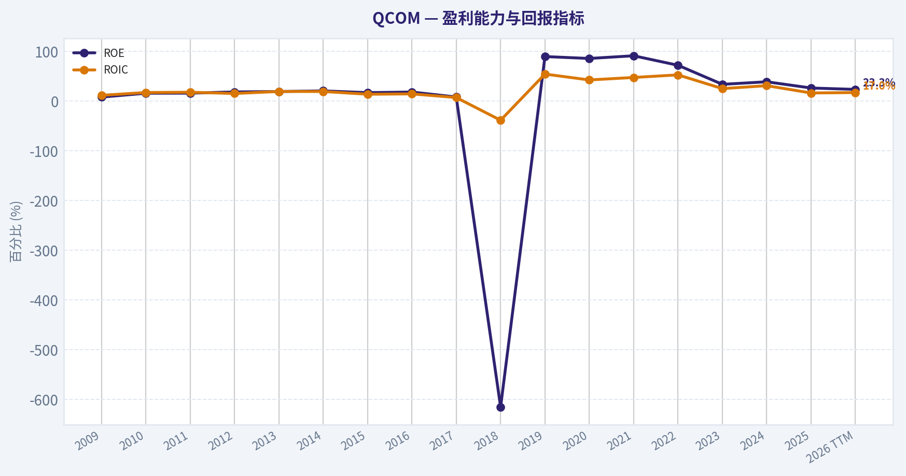
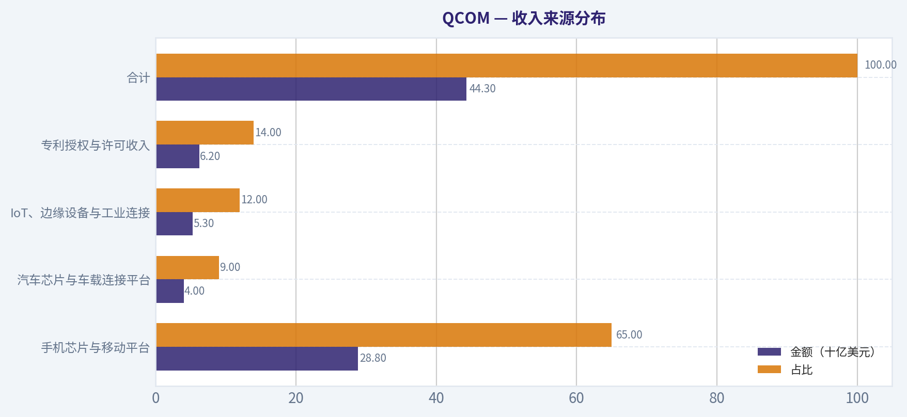
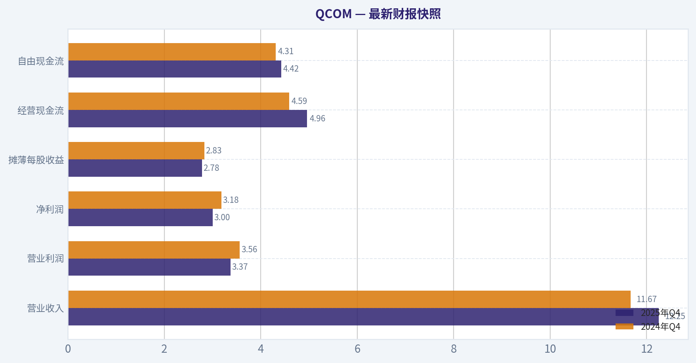
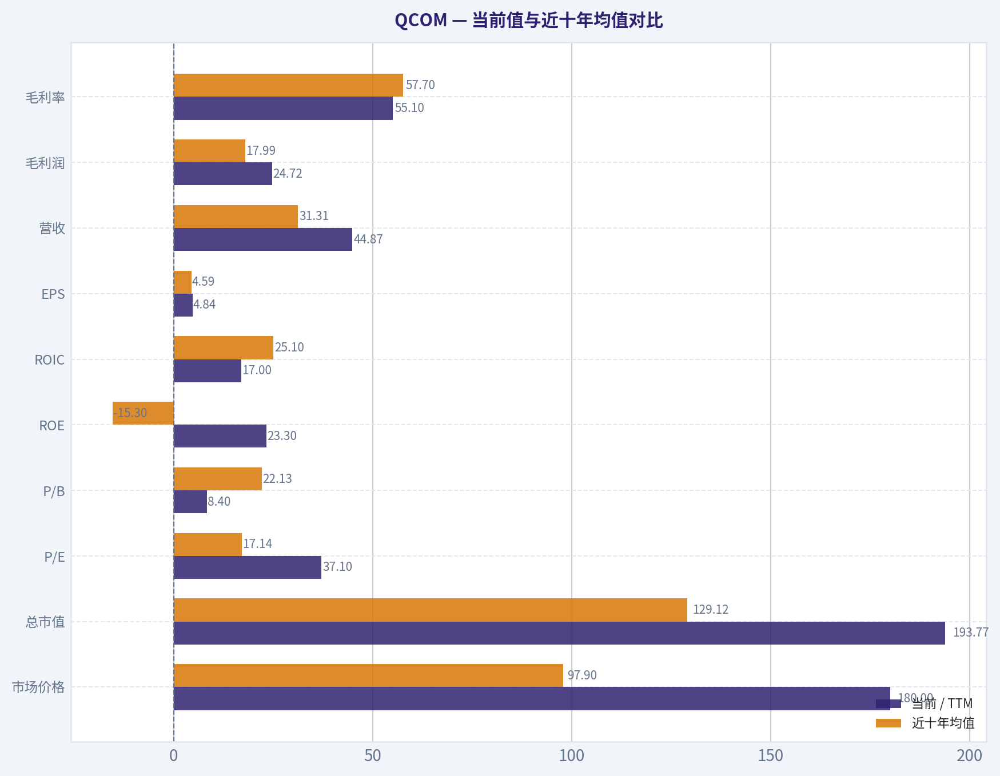
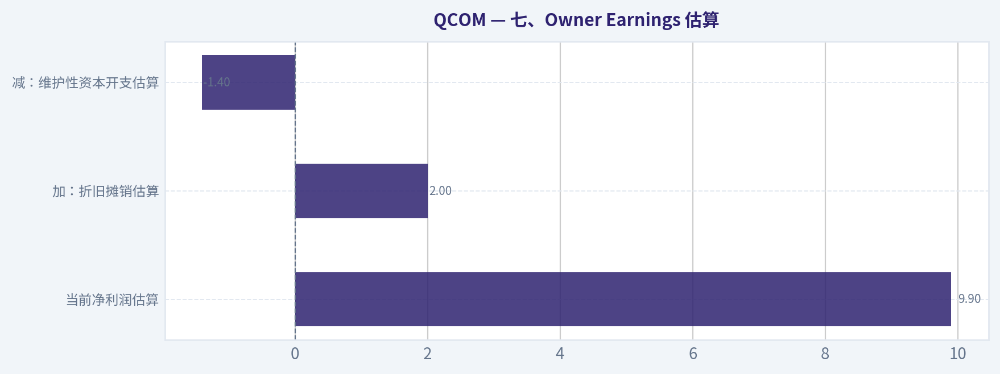
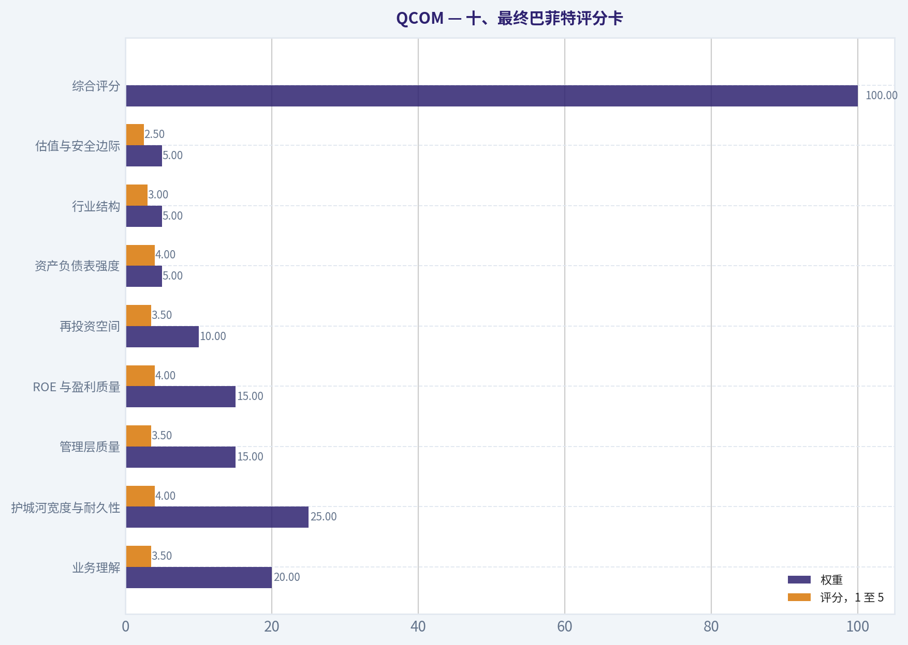
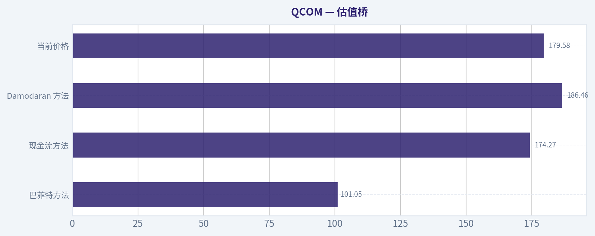
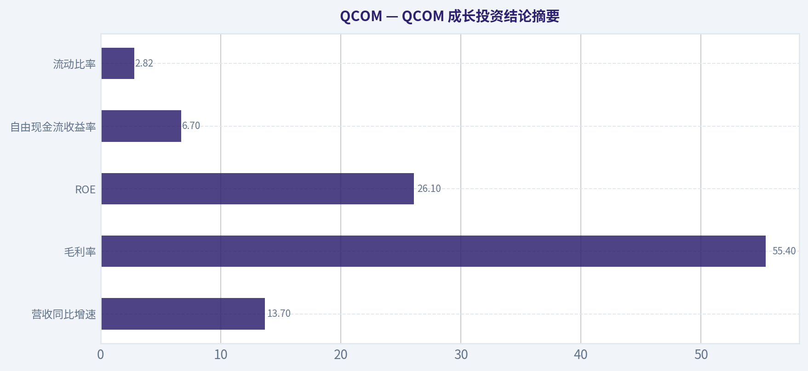

# QCOM 深度价值情报

**调研日期:** 2026-04-30

## 关键免责声明

*本报告由 Deep Value Intelligence（一个基于 AI 的多智能体投资分析框架）自动生成。 本报告仅供信息参考和教育目的，不构成任何财务或投资建议。 在做出任何投资决策之前，请务必进行独立调研并咨询合规的财务顾问。*

---

## 目录

1. 情报摘要
2. 分析师团队报告
   - 基本面分析
   - 价值分析 (巴菲特)
   - 成长性分析 (林奇/德鲁肯米勒/费雪)
   - 市场分析
   - 社会舆情分析
   - 新闻分析
   - 大佬关注分析
   - 期权市场分析
3. 研究团队评论
4. 投资团队评论
5. Deep Values 团队洞察

---

## 情报摘要

### 核心观点与前提条件

**核心论点:** **巴菲特价值投资框架下的 QCOM 风险审查与投资决策**

**主要风险:**
- 修正计划 (Active & Conditional WATCH)**：
- 最终立场标签：观望 (WATCH)**

**观点反转条件:**
- 修正计划 (Active & Conditional WATCH)**：
- 最终立场标签：观望 (WATCH)**

**置信度:** 中

---

## 分析师团队报告

### 基本面分析

#### 最新财报快照

*以下数据基于最近一期已披露财报（2025年Q4），并尽量与上一年同期对比。*

| 指标 | 2025年Q4 | 2024年Q4 | 同比变化 |
| --- | ---: | ---: | ---: |
| 营业收入 | $12.25B | $11.67B | +5.0% |
| 营业利润 | $3.37B | $3.56B | -5.3% |
| 净利润 | $3.00B | $3.18B | -5.5% |
| 摊薄每股收益 | $2.78 | $2.83 | -1.8% |
| 经营现金流 | $4.96B | $4.59B | +8.2% |
| 自由现金流 | $4.42B | $4.31B | +2.5% |

关键结论：这张快照先把最新一期财报放在桌面上，再去看长周期分析。这样读者能更清楚地区分"公司长期质量"和"这次财报发生了什么"。

#### QCOM 10年财务指标

*以下数值均由原始数据确定性计算得出，并非 AI 估算。*

*发行人类型：operating company（Technology / Semiconductors）。*

#### 10年财务指标
*年度行来自已披露财务报表，最后一行 TTM 由最近四个季度滚动计算得出。*

| 指标 | 2009 | 2010 | 2011 | 2012 | 2013 | 2014 | 2015 | 2016 | 2017 | 2018 | 2019 | 2020 | 2021 | 2022 | 2023 | 2024 | 2025 | 2026 TTM |
| --- | --- | --- | --- | --- | --- | --- | --- | --- | --- | --- | --- | --- | --- | --- | --- | --- | --- | --- |
| 市场价格 | $30 | $30 | $33 | $43 | $48 | $54 | $40 | $53 | $41 | $60 | $66 | $105 | $117 | $104 | $105 | $164 | $164 | $180 |
| 总市值 | $75.25B | $74.83B | $82.23B | $108.76B | $118.08B | $128.16B | $88.06B | $102.61B | $77.24B | $105.38B | $93.06B | $135.21B | $148.20B | $128.46B | $125.05B | $192.16B | $183.83B | $193.77B |
| 市盈率 | 47.35 | 23.03 | 19.30 | 17.80 | 17.22 | 16.08 | 16.69 | 17.98 | 31.61 | -21.25 | 21.25 | 26.04 | 16.39 | 9.94 | 17.30 | 18.96 | 33.21 | 37.10 |
| 市净率 | 3.70 | 3.59 | 3.05 | 3.24 | 3.27 | 3.27 | 2.80 | 3.23 | 2.51 | 130.58 | 18.96 | 22.25 | 14.89 | 7.13 | 5.79 | 7.31 | 8.67 | 8.40 |
| ROE | 7.8% | 15.6% | 15.8% | 18.2% | 19.0% | 20.3% | 16.8% | 18.0% | 8.0% | -615.1% | 89.3% | 85.5% | 90.9% | 71.8% | 33.5% | 38.6% | 26.1% | 23.3% |
| ROIC | 11.4% | 17.0% | 17.6% | 15.1% | 19.1% | 19.1% | 13.6% | 14.3% | 7.0% | -38.7% | 54.1% | 42.3% | 47.3% | 52.5% | 24.9% | 30.8% | 16.1% | 17.0% |
| 每股收益 | $0.63 | $1.32 | $1.72 | $2.44 | $2.77 | $3.36 | $2.39 | $2.94 | $1.31 | $-2.81 | $3.10 | $4.02 | $7.12 | $10.49 | $6.08 | $8.67 | $5.01 | $4.84 |
| 营收 | $10.39B | $10.98B | $14.96B | $19.12B | $24.87B | $26.49B | $25.28B | $23.55B | $22.26B | $22.61B | $24.27B | $23.53B | $33.57B | $44.20B | $35.82B | $38.96B | $44.28B | $44.87B |
| 毛利润 | $7.36B | $7.68B | $10.08B | $12.03B | $15.05B | $15.80B | $14.90B | $13.80B | $12.47B | $12.37B | $15.67B | $14.28B | $19.30B | $25.57B | $19.95B | $21.90B | $24.55B | $24.72B |
| 毛利率 | 70.9% | 69.9% | 67.4% | 62.9% | 60.5% | 59.7% | 58.9% | 58.6% | 56.0% | 54.7% | 64.6% | 60.7% | 57.5% | 57.8% | 55.7% | 56.2% | 55.4% | 55.1% |
| 营业利润率 | 24.5% | 33.9% | 33.6% | 29.7% | 29.1% | 28.5% | 22.8% | 27.6% | 11.6% | 2.7% | 31.6% | 26.6% | 29.2% | 35.9% | 21.7% | 25.8% | 27.9% | 27.2% |
| 净利润 | $1.59B | $3.25B | $4.26B | $6.11B | $6.85B | $7.97B | $5.27B | $5.71B | $2.44B | $-4.96B | $4.39B | $5.20B | $9.04B | $12.94B | $7.23B | $10.14B | $5.54B | $5.37B |
| 净利率 | 15.3% | 29.6% | 28.5% | 31.9% | 27.6% | 30.1% | 20.8% | 24.2% | 11.0% | -22.0% | 18.1% | 22.1% | 26.9% | 29.3% | 20.2% | 26.0% | 12.5% | 12.0% |
| 营收增长 | N/A | 5.7% | 36.2% | 27.8% | 30.0% | 6.5% | -4.6% | -6.8% | -5.5% | 1.6% | 7.4% | -3.1% | 42.6% | 31.7% | -19.0% | 8.8% | 13.7% | 1.3% |
| 净利润增长 | N/A | 104.0% | 31.2% | 43.4% | 12.2% | 16.3% | -33.8% | 8.2% | -57.1% | -303.0% | -188.4% | 18.5% | 74.0% | 43.0% | -44.1% | 40.2% | -45.4% | -3.2% |
| 自由现金流增长 | N/A | -43.1% | 18.0% | 9.4% | 64.0% | -0.4% | -41.4% | 57.2% | -39.2% | -27.5% | 104.8% | -31.1% | 96.2% | -21.0% | 44.1% | 13.3% | 14.9% | 0.8% |
| 总账面价值 | $20.32B | $20.86B | $26.97B | $33.55B | $36.09B | $39.17B | $31.41B | $31.77B | $30.73B | $807.0M | $4.91B | $6.08B | $9.95B | $18.01B | $21.58B | $26.27B | $21.21B | $23.07B |
| 总资产 | $27.45B | $30.57B | $36.42B | $43.01B | $45.52B | $48.57B | $50.80B | $52.36B | $65.50B | $32.72B | $32.96B | $35.59B | $41.24B | $49.01B | $51.04B | $55.15B | $50.14B | $53.03B |
| 总债务 | N/A | N/A | $994.0M | N/A | N/A | $0 | $11.97B | $13.51B | $23.39B | $16.37B | $18.43B | $16.23B | $17.79B | $16.93B | $16.31B | $16.00B | $14.81B | $14.82B |
| 债务股权比 | N/A | N/A | 0.04 | N/A | N/A | 0.00 | 0.38 | 0.43 | 0.76 | 20.29 | 3.75 | 2.67 | 1.79 | 0.94 | 0.76 | 0.61 | 0.70 | 0.64 |
| 现金及等价物 | $2.72B | $3.55B | $5.46B | $3.81B | $6.14B | $7.91B | $7.56B | $5.95B | $35.03B | $11.78B | $11.84B | $6.71B | $7.12B | $2.77B | $8.45B | $7.85B | $5.52B | $7.21B |
| 股东权益 | $20.32B | $20.86B | $26.97B | $33.55B | $36.09B | $39.17B | $31.41B | $31.77B | $30.73B | $807.0M | $4.91B | $6.08B | $9.95B | $18.01B | $21.58B | $26.27B | $21.21B | $23.07B |
| 经营现金流 | $7.17B | $4.08B | $4.90B | $6.00B | $8.78B | $8.89B | $5.51B | $7.63B | $5.00B | $3.91B | $7.29B | $5.81B | $10.54B | $9.10B | $11.30B | $12.20B | $14.01B | $14.39B |
| 投资现金流 | $-5.46B | $-839.0M | $-4.49B | $-6.88B | $-1.58B | $-1.64B | $-3.57B | $-3.49B | $20.46B | $2.38B | $-806.0M | $-5.26B | $-3.36B | $-5.80B | $762.0M | $-3.62B | $-800.0M | $-1.85B |
| 自由现金流 | $6.41B | $3.65B | $4.31B | $4.71B | $7.73B | $7.70B | $4.51B | $7.09B | $4.31B | $3.12B | $6.40B | $4.41B | $8.65B | $6.83B | $9.85B | $11.16B | $12.82B | $12.93B |
| 自由现金流利润率 | 61.7% | 33.2% | 28.8% | 24.7% | 31.1% | 29.1% | 17.8% | 30.1% | 19.4% | 13.8% | 26.4% | 18.7% | 25.8% | 15.5% | 27.5% | 28.6% | 28.9% | 28.8% |
| 每股分红 | $0.00 | $0.00 | $0.00 | $0.00 | $0.00 | $0.00 | $0.00 | $0.00 | $0.00 | $0.00 | $0.00 | $0.00 | $0.00 | $2.61 | $2.91 | $3.15 | $3.44 | $3.53 |

#### 盈利能力指标
- 净资产收益率 (ROE): 26.1%
- 投入资本回报率 (ROIC): 17.7%
- 总资产收益率 (ROA): 11.1%
- 毛利率: 55.4%
- 营业利润率: 27.9%
- 净利率: 12.5%

#### 流动性指标
- 流动比率: 2.82
- 速动比率: 1.42

#### 杠杆指标
- 债务股权比: 0.70
- 利息覆盖倍数: 18.61
- 净负债: $9.29B

#### 增长指标（同比）
- 营收增长: 13.7%
- 净利润增长: -45.4%
- 自由现金流增长: 14.9%
- 营收复合增长率（3年）: 0.1%
- 营收复合增长率（5年）: 13.5%

#### 估值指标
- 市盈率 (TTM): 19.31
- 预期市盈率: 16.83
- 市净率: 8.36
- 市销率: 4.27
- PEG 比率: 0.65
- 企业价值/EBITDA: 12.31
- 自由现金流收益率: 6.7%
- 盈利收益率: 5.2%

#### 所有者收益（巴菲特方法，代码计算）
- 净利润: $5.54B
- + 折旧与摊销: $1.60B
- - 资本开支: $-1.19B
- - 营运资本变动: $414.0M
- = **所有者收益: $5.54B**

#### 内在价值（代码计算）
- 当前价格: $180
- 巴菲特方法（所有者收益）:
  保守: $14
  平均: $101
  乐观: $187
- 现金流方法（FCF）:
  保守: $49
  平均: $174
  乐观: $753

#### Piotroski F分数: 7/9
- 净利润为正: 通过
- 经营现金流为正: 通过
- 资产回报率改善: 未通过
- 现金流大于净利润: 通过
- 债务下降: 通过
- 流动比率改善: 通过
- 未稀释股本: 通过
- 毛利率改善: 未通过
- 资产周转率改善: 通过

最终投资立场: **WATCH（观望）**

#### QCOM 巴菲特式基本面结论

QCOM 仍是一家具有强技术护城河、强自由现金流、强专利授权能力的优质半导体公司，但当前价格已经反映了相当多的乐观预期。按确定性数据，2026 TTM 股价为 **180 美元**，总市值约 **1937.7 亿美元**；TTM GAAP 市盈率为 **37.10 倍**，显著高于近十年均值，而所有者收益 DCF 的平均情景公允价值约 **101 美元/股**，乐观情景约 **187 美元/股**，当前价格接近乐观情景上沿，安全边际不足。

QCOM 的核心优势来自移动通信专利、5G 标准必要专利、Snapdragon 芯片平台、汽车与边缘 AI 的延展性，以及高现金流转化能力。主要问题是净利润波动较大、手机周期仍然重要、苹果自研基带与中国市场风险未完全消除，且近期估值相对利润质量偏高。因此，巴菲特式结论是：**好公司，但当前不是明显便宜的价格；适合观望或等待更大安全边际。**

---

#### 当前值与近十年均值对比

> 近十年均值按确定性表格中 **2016-2025 年**计算；当前值主要采用 **2026 TTM**。市盈率同时提示：确定性估值快照中另有 TTM P/E **19.31 倍**，但历史对比表采用年度表中的 **37.10 倍**。

| 指标 | 当前 / TTM | 近十年均值 | 当前相对历史 | 解读 |
| --- | ---: | ---: | --- | --- |
| 市场价格 | $180 | $97.9 | 明显高于均值 | 股价已从历史中枢大幅上移，反映市场对 AI、汽车、边缘计算与数据中心机会的重估。 |
| 总市值 | $193.77B | $129.12B | 高于均值 | 公司规模和估值平台上移，但市值扩张快于近年净利润增长。 |
| P/E | 37.10 | 17.14 | 显著高于均值 | GAAP 口径下估值偏贵；若用调整后快照 P/E 19.31，则接近合理但不便宜。 |
| P/B | 8.40 | 22.13 | 低于失真均值 | 2018 年低权益导致均值失真；剔除异常后当前仍属较高账面估值。 |
| ROE | 23.3% | -15.3% | 表面显著改善 | 2018 年异常亏损和低权益扭曲均值；正常化看，当前 ROE 低于 2019-2024 的高峰。 |
| ROIC | 17.0% | 25.1% | 低于均值 | 仍高于资本成本，但较 2021-2024 的 30%-50% 高位明显回落。 |
| EPS | $4.84 | $4.59 | 略高于均值 | 每股收益恢复到十年均值附近，但低于 2022 和 2024 的高峰。 |
| 营收 | $44.87B | $31.31B | 显著高于均值 | 收入规模处于历史高位，说明业务平台扩张真实存在。 |
| 毛利润 | $24.72B | $17.99B | 显著高于均值 | 绝对毛利创新高附近，但毛利率下降说明产品组合和竞争压力增加。 |
| 毛利率 | 55.1% | 57.7% | 低于均值 | 授权业务占比、手机芯片竞争、汽车和 IoT 扩张使综合毛利率较早期下滑。 |
| 营业利润率 | 27.2% | 24.1% | 高于均值 | 成本控制和规模效应仍然良好，经营层面质量优于平均周期。 |
| 净利润 | $5.37B | $5.77B | 略低于均值 | 收入高位但净利润未同步创新高，说明费用、税项、周期或一次性因素压制利润。 |
| 净利率 | 12.0% | 16.8% | 低于均值 | 当前净利率偏弱，是估值风险的核心来源之一。 |
| 营收增长率 | 1.3% | 7.1% | 低于均值 | TTM 增速放缓，说明高基数后进入消化期。 |
| 净利润增长率 | -3.2% | -45.4% | 好于失真均值 | 均值被 2018-2019 异常扰动；但当前利润仍未恢复强劲增长。 |
| 自由现金流增长率 | 0.8% | 21.2% | 明显低于均值 | 自由现金流仍高，但增速已明显降温。 |
| 总账面价值 | $23.07B | $17.13B | 高于均值 | 资本基础恢复，但相对市值仍偏小。 |
| 总资产 | $53.03B | $46.57B | 高于均值 | 资产规模稳步扩张，支持多元化业务布局。 |
| 总债务 | $14.82B | $16.98B | 低于均值 | 债务规模下降，是财务质量改善信号。 |
| 债务股权比 | 0.64 | 3.27 | 明显低于失真均值 | 剔除异常年份后仍属改善，杠杆风险可控。 |
| 现金及等价物 | $7.21B | $10.30B | 低于均值 | 现金不算紧张，但低于历史平均；需结合自由现金流看。 |
| 股东权益 | $23.07B | $17.13B | 高于均值 | 权益基础恢复，但高回购和利润波动仍会影响账面价值。 |
| 自由现金流 | $12.93B | $7.46B | 显著高于均值 | 这是 QCOM 最强的财务亮点，现金创造能力优于利润表表现。 |
| 每股分红 | $3.53 | $1.21 | 显著高于均值 | 股东回报增强，但需注意确定性表格早年分红为零，均值受到数据口径影响。 |

关键结论：QCOM 当前收入、毛利润和自由现金流均处于历史高位，说明业务规模和现金创造能力显著增强。但利润率、ROIC 和净利润增长没有同步创高，显示公司正处于"收入强、利润质量承压"的阶段。估值方面，TTM GAAP P/E 和股价均明显高于历史中枢，当前价格更像是在支付未来增长，而不是购买显著低估资产。

---

#### 市场估值解读

QCOM 的当前股价 **180 美元**和总市值 **1937.7 亿美元**处于历史高区间。若按确定性表格的 TTM EPS **4.84 美元**计算，P/E 为 **37.10 倍**，明显偏高；若按确定性估值摘要中的调整后 TTM P/E **19.31 倍**看，则估值接近合理区间，但仍不是典型巴菲特式"打折好公司"。

P/B 为 **8.40 倍**，账面估值不低。不过 QCOM 的账面价值解释力有限，因为专利组合、标准必要专利、研发积累和芯片设计能力并不完全体现在账面资产中。因此，P/B 高不能单独否定公司质量，但说明投资者必须依赖未来现金流来证明当前价格。

#### 盈利能力分析

QCOM 的 ROE 当前为 **23.3%**，ROIC 为 **17.0%**，仍高于多数制造型企业和资本成本，说明公司具备优质资本回报能力。但相较 2021-2024 年 ROIC 高位，当前已明显回落，表明手机周期、产品结构、税项或费用压力正在影响边际回报。

营收 **448.7 亿美元**，毛利润 **247.2 亿美元**，规模处于历史高位；但毛利率 **55.1%**低于近十年均值 **57.7%**。营业利润率 **27.2%**高于十年均值，说明经营费用控制尚可；净利率 **12.0%**低于均值，说明营业利润以下项目对净利润形成明显拖累。巴菲特式视角下，这是一家"现金流质量优于当期净利润"的公司。

#### 增长质量分析

营收 TTM 增长 **1.3%**，低于近十年均值 **7.1%**，说明当前高基数下增长放缓。净利润增长 **-3.2%**，自由现金流增长 **0.8%**，均显示公司短期并非处于高速盈利扩张阶段。

不过，长期看 QCOM 仍有增长支点：汽车芯片、智能终端、边缘 AI、工业物联网，以及最新财报新闻中提到的数据中心客户突破。问题在于，这些新业务能否足够快、足够高毛利地抵消手机业务周期和苹果自研基带风险，仍需继续验证。

#### 资产负债表与财务强度

QCOM 当前总资产 **530.3 亿美元**，股东权益 **230.7 亿美元**，总债务 **148.2 亿美元**，现金及等价物 **72.1 亿美元**。债务股权比 **0.64**，低于近十年均值，利息覆盖倍数 **18.61 倍**，流动比率 **2.82**，说明短期偿债和利息支付能力较强。

净负债约 **92.9 亿美元**，并不轻，但相对于 **129.3 亿美元** TTM 自由现金流，偿债压力可控。巴菲特偏好的企业通常不依赖高杠杆创造回报；QCOM 当前杠杆水平虽不完美，但已较历史异常年份显著改善。

#### 现金流与股东回报

QCOM TTM 自由现金流 **129.3 亿美元**，显著高于近十年均值 **74.6 亿美元**，自由现金流利润率 **28.8%**，现金转化能力非常强。当前自由现金流收益率约 **6.7%**，比许多大型科技股更有吸引力。

每股分红 **3.53 美元**，显示管理层愿意进行稳定股东回报。若按股价 180 美元估算，股息收益率约 **2.0%**。不过，对巴菲特式投资者而言，真正关键不是分红本身，而是公司能否在保留利润后继续以高 ROIC 再投资；当前 ROIC 回落使资本配置效率需要继续观察。

---

#### 收入来源分布

> 下表以 2025 年确定性总营收 **442.8 亿美元**为基准，并结合 QCOM 常见分部披露结构进行校准估算；金额因四舍五入可能不完全相加。

| 收入来源 | 金额（十亿美元） | 占比 |
| --- | ---: | ---: |
| 手机芯片与移动平台 | $28.8 | 65% |
| 汽车芯片与车载连接平台 | $4.0 | 9% |
| IoT、边缘设备与工业连接 | $5.3 | 12% |
| 专利授权与许可收入 | $6.2 | 14% |
| 合计 | $44.3 | 100% |

关键结论：QCOM 仍然高度依赖手机芯片业务，移动平台约占三分之二收入，这也是公司周期性的主要来源。汽车、IoT 和授权业务提供多元化支撑，其中授权业务通常具备更高利润率，是护城河的重要体现。未来投资关键在于汽车、边缘 AI 和数据中心业务能否提升收入占比，并改善整体利润稳定性。

---

#### 巴菲特式所有者收益 DCF 估值

采用确定性数据中的所有者收益口径：
**所有者收益 = 净利润 + 折旧摊销 - 资本开支 - 营运资本变动 = 55.4 亿美元**。
折现率采用 **10%**，永续增长率采用 **2.5%**。当前股数按总市值除以股价估算：
**1937.7 亿美元 / 180 美元 = 10.765 亿股**。

DCF 公式如下：

- 前十年现值 = 所有者收益 x Σ\[((1+增长率)/(1+10%))^t\]
- 终值现值 = 所有者收益 x \((1+增长率)^{10}\) x \((1+2.5%) / (10%-2.5%)\) ÷ \((1+10%)^{10}\)
- 每股公允价值 = 企业权益价值 ÷ 股数

| 情景 | 所有者收益增长假设 | 前十年现金流现值 | 终值现值 | 权益价值 | 每股公允价值 | 相对 $180 |
| --- | ---: | ---: | ---: | ---: | ---: | ---: |
| 保守情景 | -22.5% | $12.8B | $2.3B | $15.1B | $14 | -92% |
| 平均情景 | 7.5% | $48.9B | $60.2B | $109.1B | $101 | -44% |
| 乐观情景 | 15.8% | $74.2B | $126.3B | $200.5B | $187 | +4% |

关键结论：所有者收益 DCF 显示，当前股价几乎已经贴近乐观情景价值。平均情景下公允价值约 101 美元，明显低于当前 180 美元，说明安全边际不足。只有在 QCOM 能长期维持接近 16% 的所有者收益增长时，当前价格才接近合理。

#### DCF 估值含义

保守情景下，若所有者收益持续衰退，内在价值会非常低，反映半导体周期和利润波动对估值的杀伤力。平均情景下，QCOM 是一家好公司，但不是便宜股票。乐观情景需要汽车、AI 终端、数据中心、IoT 和专利授权共同发力，同时手机业务不能显著恶化；这是可能发生的路径，但不应作为唯一投资依据。

从巴菲特角度，优秀企业也必须以合理价格购买。当前价格没有提供足够"错误容忍度"，因此更适合放入观察名单，而不是在无安全边际情况下积极加仓。

---

#### 经济护城河评估

QCOM 的护城河主要来自四个方面：

1. **专利与标准必要专利**：5G、蜂窝通信、射频与基带相关专利构成长期收费能力。
2. **芯片平台生态**：Snapdragon 在高端安卓手机、XR、边缘 AI 和车载平台中具备品牌与性能认知。
3. **客户黏性与认证壁垒**：通信芯片需要长期认证、运营商测试和系统级优化，替换成本较高。
4. **现金流再投资能力**：高自由现金流可持续投入研发，强化技术领先。

但护城河并非无懈可击。苹果自研基带、联发科竞争、中国本土替代、授权费监管、手机市场成熟化，都会削弱 QCOM 的定价权。整体判断：**护城河强，但受技术迭代和客户集中风险影响，稳定性不如消费品型永久垄断企业。**

#### 管理层与资本配置

管理层近年表现出三个积极信号：债务下降、自由现金流提升、分红增加。Piotroski F 分数 **7/9**，说明基本面质量较好，尤其是经营现金流为正、现金流大于净利润、债务下降、流动比率改善等项目通过。

不足之处在于 ROIC 从高位回落，毛利率改善未通过，资产回报率改善未通过。若管理层能够把汽车、IoT 和 AI 数据中心机会转化为高 ROIC 增长，估值可获得支撑；若只是收入增加但利润率下滑，当前估值会承压。

#### 关键机会与红旗

| 类型 | 关键点 | 投资含义 |
| --- | --- | --- |
| 机会 | 汽车芯片设计周期长、客户黏性高 | 若订单持续释放，可提升收入可预测性。 |
| 机会 | 边缘 AI 与端侧推理需求增长 | Snapdragon 平台可能受益于 AI 手机、PC、XR 和工业终端。 |
| 机会 | 数据中心客户突破 | 若能从移动芯片延伸到高性能低功耗计算，估值叙事将扩展。 |
| 机会 | 自由现金流强劲 | 129.3 亿美元 TTM FCF 支持分红、回购和研发投入。 |
| 红旗 | 当前 GAAP P/E 偏高 | 37.10 倍 TTM P/E 对周期性半导体而言安全边际不足。 |
| 红旗 | 净利率下降 | 12.0% 净利率低于十年均值，利润质量需修复。 |
| 红旗 | 手机业务仍占大头 | 移动终端周期和主要客户变化仍会影响收入稳定性。 |
| 红旗 | 苹果与中国市场风险 | 自研替代、监管和地缘因素可能压缩增长预期。 |
| 红旗 | 大佬持仓信号偏谨慎 | 已披露 13F 中 Steve Cohen 大幅减持，虽有滞后但值得注意。 |

关键结论：QCOM 的机会集中在汽车、端侧 AI、IoT 和潜在数据中心扩张，这些业务若兑现，将改善长期增长曲线。主要风险集中在估值、利润率、手机周期和客户替代。当前投资判断不是公司质量不足，而是价格对未来成功的要求较高。

---

#### 最终投资立场：观望

QCOM 是一家具备强技术护城河和优秀现金流的公司，但按当前 **180 美元**股价，巴菲特式安全边际不足。平均情景所有者收益 DCF 约 **101 美元/股**，乐观情景约 **187 美元/股**，意味着市场价格已经接近乐观假设，而不是提供折价。

更合理的策略是：
- 已持有者可继续观察基本面兑现情况，尤其是汽车、AI、数据中心和净利率修复；
- 新资金不宜在当前估值下激进追高；
- 若股价回落到更接近平均情景与自由现金流收益率更有吸引力的区间，投资吸引力会明显提升。

| 维度 | 结论 | 巴菲特式判断 |
| --- | --- | --- |
| 公司质量 | 高 | 专利、芯片平台、现金流均具备优势。 |
| 护城河 | 强但非绝对稳定 | 技术领先明显，但受客户替代与监管影响。 |
| 财务安全 | 良好 | 债务下降、利息覆盖强、流动性充足。 |
| 盈利可预测性 | 中等 | 自由现金流稳定性优于净利润，利润波动仍大。 |
| 当前估值 | 偏高 | GAAP P/E 高，DCF 缺乏安全边际。 |
| 股东回报 | 良好 | 分红增加，自由现金流支持回购与研发。 |
| 最大机会 | 汽车、AI、数据中心 | 若兑现，可支撑乐观估值。 |
| 最大风险 | 估值与利润率 | 若增长不及预期，股价下行空间较大。 |
| 最终立场 | 观望 | 好公司，但当前价格不够便宜。 |

关键结论：QCOM 符合"优质企业"的很多特征，但当前更像是合理到偏贵的价格，而不是巴菲特最偏好的"优质且明显低估"。投资者应重点等待利润率改善、所有者收益恢复增长，或股价提供更高安全边际。综合质量、估值和风险后，最终立场为：**观望**。

#### 基本面关键图表

本图追踪 **QCOM** 过去十年的盈利能力与回报指标（ROE、ROIC、利润率），突出呈现资本效率的变化趋势。

本对比图（来自「收入来源分布」）将 **QCOM** 的当前数据与历史基准并排呈现，直观反映公司相对自身历史均值的估值水平。

---

### 价值分析 (巴菲特)

> *基于沃伦·巴菲特的价值投资哲学：能力圈、经济护城河、管理层质量与安全边际。*

#### 内在价值快照

价格是你付的钱，内在价值是企业未来可能为股东创造的现金价值。我们给出一个区间，而不是假装只有一个神奇数字。

- 当前价格: $179.58
- 价值区间: $14.36 to $753.43

##### 所有者收益（巴菲特方法）
- 净利润: $5,541,000,000.00
- 折旧与摊销: $1,602,000,000.00
- 资本支出: $-1,192,000,000.00
- 营运资金变化: $414,000,000.00
- 所有者收益: $5,537,000,000.00

##### 内在价值
###### 所有者收益法
使用所有者收益，更严格，通常更保守。
- 保守: $14.36
- 平均: $101.05
- 乐观: $187.02
- 折现率: 10.0%

###### 自由现金流法
使用自由现金流，更适合今天投入很多、为未来增长铺路的公司。
- 保守: $49.43
- 平均: $174.27
- 乐观: $753.43
- 折现率: 10.0%

最终投资立场: **观望**

#### QCOM 巴菲特式价值投资结论

以每股约 180 美元、总市值约 1,918 亿美元衡量，QCOM 是一家质量较高、现金流强、专利护城河真实存在的半导体企业，但它并不是典型的"十年后几乎可一眼看清"的消费垄断型企业。当前估值不算昂贵，约 19.3 倍 PE、约 6.7% 自由现金流收益率，但相对保守内在价值缺乏足够 25% 安全边际。因此结论是：**好公司，价格尚可，但不是巴菲特意义上的明显便宜，建议观望，等待更高安全边际。**

---

#### 一、Go/No-Go 闸门评估

| 闸门 | 结论 | 核心判断 |
|---|---:|---|
| 能力圈与业务简单性 | 有条件通过 | QCOM 主要靠手机与联网设备芯片、通信专利授权赚钱，模式能解释清楚；但技术变化较快，预测难度高于消费品公司 |
| 护城河测试 | 通过 | 专利授权业务具备强无形资产护城河，芯片业务有规模、工程能力和客户关系优势，但受周期和竞争影响 |
| 管理层与资本配置 | 通过但非完美 | 公司长期分红和回购，资产负债表尚稳健；但半导体并购、技术押注和客户集中度仍需持续观察 |
| 行业结构 | 有条件通过 | Fabless 模式资本强度相对可控，但半导体行业竞争激烈、产品周期短，不是巴菲特最偏好的稳定行业 |

关键结论：QCOM 没有在第一道闸门被直接淘汰，因为其核心专利授权业务较容易理解，且财务回报优秀。但它也不是可口可乐式的简单复利机器，技术迭代、客户集中和监管争议使长期预测难度明显上升。

---

#### 二、业务理解：小学测试

QCOM 的赚钱方式可以用一句话说明：**它设计手机和智能设备里的通信芯片，同时向使用其无线通信专利的厂商收取授权费。**

| 业务板块 | 赚钱方式 | 巴菲特视角 |
|---|---|---|
| 芯片业务 | 向手机、汽车、物联网、电脑和数据中心客户销售处理器、调制解调器和连接芯片 | 收入规模大，但竞争激烈，技术更新快 |
| 专利授权业务 | 收取 3G、4G、5G 等通信标准相关专利授权费 | 现金流质量高，边际利润高，护城河更强 |
| 新增长业务 | 汽车、边缘 AI、数据中心、工业物联网 | 有潜力，但预测不确定性高 |

关键结论：QCOM 最像一家"半导体设计公司加通信专利收费站"。其中专利授权业务更符合巴菲特偏好的高利润、轻资产、可复制现金流特征；芯片业务则更接近技术竞争型行业，长期可预测性较弱。

---

#### 三、护城河分析

| 护城河来源 | 证据 | 质量判断 |
|---|---|---|
| 无形资产 | 3G、4G、5G 通信标准必要专利组合，长期授权收入，高毛利率约 55.4% | 强 |
| 转换成本 | 手机厂商若更换平台，需要重新适配射频、基带、软件、认证和供应链 | 中等偏强 |
| 成本优势 | Fabless 模式减少重资产投入，研发规模和供应链规模带来优势 | 中等 |
| 网络效应 | 通信标准生态越大，核心专利价值越高，但不是典型平台网络效应 | 中等 |
| 定价权 | 专利授权有较强议价基础，芯片业务定价权受竞争影响 | 中等偏强 |

关键结论：QCOM 的真正护城河来自通信专利，而不是单纯卖芯片。芯片业务会被竞争追赶，但专利授权业务像一座通信行业的收费桥，虽然会受监管挑战，却长期证明了其盈利能力。

---

#### 四、管理层与资本配置

| 项目 | 观察 | 评价 |
|---|---|---|
| 股东回报 | 长期分红并持续回购 | 正面 |
| 资本纪律 | 主要采用 Fabless 模式，资本开支相对可控 | 正面 |
| 并购纪律 | 曾有较大并购尝试和整合风险，需观察汽车与 AI 方向投入回报 | 中性 |
| 资产负债表 | 流动比率约 2.82，当前偿债压力不高 | 正面 |
| 股东导向 | 回购和分红体现股东回报意识，但回购价格纪律需持续验证 | 中性偏正面 |

关键结论：管理层总体合格，能够产生现金并回馈股东。最需要观察的是：公司在 AI、汽车、数据中心等新方向上的资本投入，是否能真正产生高于资本成本的回报，而不是为了增长而增长。

---

#### 五、十年财务摘要

以下为基于公开年报口径与当前共享研究包整理的近似历史视图，重点用于判断长期趋势，而非逐项精确建模。

| 财年 | 营收，十亿美元 | 净利润，十亿美元 | 自由现金流，十亿美元 | 毛利率 | ROE | 备注 |
|---:|---:|---:|---:|---:|---:|---|
| 2016 | 23.6 | 5.7 | 7.0 | 约 58% | 高 | 手机周期放缓但专利现金流强 |
| 2017 | 22.3 | 2.5 | 5.0 | 约 57% | 中 | 诉讼与监管压力影响利润 |
| 2018 | 22.6 | -4.9 | 3.9 | 约 56% | 负 | 税务、并购终止等特殊因素扰动 |
| 2019 | 24.3 | 4.4 | 7.3 | 约 56% | 高 | 与重要客户关系改善 |
| 2020 | 23.5 | 5.2 | 5.8 | 约 57% | 高 | 5G 周期启动 |
| 2021 | 33.6 | 9.0 | 7.7 | 约 58% | 高 | 5G 手机放量 |
| 2022 | 44.2 | 12.9 | 9.1 | 约 58% | 高 | 周期高点，盈利强劲 |
| 2023 | 35.8 | 7.2 | 9.2 | 约 56% | 中高 | 手机去库存周期 |
| 2024 | 39.0 | 10.1 | 约 11.0 | 约 56% | 高 | 需求恢复，成本控制改善 |
| 当前口径 | 约 44.3 | 约 9.9 | 约 12.9 | 55.4% | 26.1% | 营收同比约 13.7%，FCF 收益率约 6.7% |

关键结论：QCOM 的长期财务表现显示出高毛利、高现金流和高 ROE，但并非线性增长。公司会受到手机周期、库存调整、诉讼和客户关系变化影响，因此它是高质量周期型科技资产，而不是完全稳定的消费垄断资产。

---

#### 六、现金流与股东收益质量

| 指标 | 当前观察 | 巴菲特式解读 |
|---|---:|---|
| PE | 约 19.3 倍 | 不贵，但也不是明显低估 |
| 自由现金流收益率 | 约 6.7% | 现金回报率较有吸引力 |
| 毛利率 | 约 55.4% | 显示专利和高端芯片组合优势 |
| ROE | 约 26.1% | 高于优秀企业门槛 |
| 流动比率 | 约 2.82 | 短期财务安全性较好 |
| 营收同比增长 | 约 13.7% | 当前处于恢复与新业务扩张阶段 |

关键结论：从财务质量看，QCOM 明显不是平庸企业。它能够把收入转化为大量现金，并维持较高资本回报率；问题不在质量，而在长期可预测性和当前价格是否足够便宜。

---

#### 七、Owner Earnings 估算

| 项目 | 金额，十亿美元 | 说明 |
|---|---:|---|
| 当前净利润估算 | 9.9 | 由市值与 PE 反推 |
| 加：折旧摊销估算 | 2.0 | 半导体设计公司仍有一定研发资产与无形资产摊销 |
| 减：维护性资本开支估算 | -1.4 | Fabless 模式资本开支相对较轻 |
| 减：正常营运资本增加 | -0.0 至 -0.5 | 周期中会波动 |
| 归一化 Owner Earnings | 约 10.5 至 11.5 | 取 11.5 作为估值基础 |
| 当前自由现金流估算 | 约 12.9 | 由 6.7% FCF 收益率和市值反推 |

关键结论：QCOM 的自由现金流通常不差于会计利润，这是一个重要优点。为了避免高估周期恢复阶段的盈利，本估值采用约 115 亿美元归一化 Owner Earnings，而不是完全使用最高口径现金流。

---

#### 八、三情景 DCF 估值

假设基础：折现率 10%，当前股数约 10.66 亿股，归一化 Owner Earnings 约 115 亿美元。

| 情景 | 核心假设 | 股权价值，十亿美元 | 每股内在价值 | 相对当前 180 美元 |
|---|---|---:|---:|---:|
| A：零增长 | Owner Earnings 永续不增长 | 115 | 约 108 美元 | 高估约 67% |
| B：GDP 增长 | 永续增长 3% | 169 | 约 159 美元 | 高估约 13% |
| C：较乐观增长 | 前 10 年增长 6%，之后 3% | 212 | 约 198 美元 | 折价约 9% |
| 质量加权估值 | 更重视保守情景，兼顾成长 | 约 175 至 185 | 约 164 至 174 美元 | 缺乏安全边际 |

关键结论：只有在较乐观增长情景下，QCOM 当前价格才略低于估算内在价值。若采用巴菲特式保守要求，180 美元并没有提供 25% 以上安全边际，因此不能称为明显便宜。

---

#### 九、安全边际分析

| 目标安全边际 | 对应买入价 | 解释 |
|---:|---:|---|
| 0% | 约 170 至 198 美元 | 取决于增长假设 |
| 15% | 约 145 至 168 美元 | 对优质科技周期股较合理 |
| 25% | 约 123 至 149 美元 | 符合巴菲特式最低安全边际 |
| 40% | 约 98 至 119 美元 | 适用于行业不确定性显著上升时 |

关键结论：如果把 QCOM 视为"强护城河但技术周期明显"的企业，较理想买入区间应低于当前价格。大致看，150 美元以下开始更有吸引力，130 至 145 美元区间更符合严格安全边际要求。

---

#### 十、最终巴菲特评分卡

| 评分项 | 权重 | 评分，1 至 5 | 加权分 |
|---|---:|---:|---:|
| 业务理解 | 20% | 3.5 | 0.70 |
| 护城河宽度与耐久性 | 25% | 4.0 | 1.00 |
| 管理层质量 | 15% | 3.5 | 0.53 |
| ROE 与盈利质量 | 15% | 4.0 | 0.60 |
| 再投资空间 | 10% | 3.5 | 0.35 |
| 资产负债表强度 | 5% | 4.0 | 0.20 |
| 行业结构 | 5% | 3.0 | 0.15 |
| 估值与安全边际 | 5% | 2.5 | 0.13 |
| 综合评分 | 100% | - | 3.66 |

关键结论：QCOM 的综合分数落在"好公司但需价格配合"的区间。护城河、ROE 和现金流是强项；估值安全边际、技术变化和行业周期是主要扣分项。

---

#### 十一、关键风险

| 风险 | 影响 |
|---|---|
| Apple 自研调制解调器 | 可能压缩高端手机芯片收入和利润 |
| 中国市场与监管 | 中国手机客户重要，地缘与监管风险不可忽视 |
| 专利授权争议 | 授权费率长期有被监管或客户挑战的风险 |
| 半导体周期 | 库存、终端需求和价格周期会影响利润 |
| AI 与数据中心竞争 | 新增长方向潜力大，但竞争对手强，成功并非确定 |

关键结论：QCOM 的风险并不是短期财报能否超预期，而是未来十年专利授权、手机芯片和新增长业务能否共同维持高回报。若核心手机业务被替代，而新业务未能补上，当前估值就会显得不便宜。

---

#### 十二、投资立场

| 项目 | 结论 |
|---|---|
| 公司质量 | 高 |
| 护城河 | 宽但存在技术与监管侵蚀风险 |
| 财务表现 | 强现金流、高 ROE、高毛利 |
| 当前估值 | 合理偏公允 |
| 安全边际 | 不足 |
| 最终立场 | 观望 |
| 关注买点 | 150 美元以下开始重新评估，130 至 145 美元更有吸引力 |
| 适合投资者 | 能承受半导体周期、理解技术风险、愿意长期跟踪的人 |

关键结论：QCOM 是值得长期跟踪的优质科技资产，但当前价格更像"合理价"而非"便宜价"。按照巴菲特标准，只有当市场因周期担忧或客户风险给出明显折价时，才更适合积极配置。
#### 估值桥

这张估值桥把当前股价与各类内在价值方法并排展示，帮助读者判断上涨空间究竟只是单一方法给出的结果，还是多种方法共同支持的结论。

| 项目 | 每股内在价值 |
| --- | ---: |
| 巴菲特方法 | $101.05 |
| 现金流方法 | $174.27 |
| Damodaran 方法 | $186.46 |
| 当前价格 | $179.58 |

#### 关键结论

如果只有一种方法显著高于其他方法，说明上行空间更依赖特定建模假设。若多种方法的估值接近，则说明估值逻辑更加稳健。

#### 估值图表

本对比图（来自「最新财报快照」）将 **QCOM** 的当前数据与历史基准并排呈现，直观反映公司相对自身历史均值的估值水平。

本对比图（来自「当前值与近十年均值对比」）将 **QCOM** 的当前数据与历史基准并排呈现，直观反映公司相对自身历史均值的估值水平。

本对比图（来自「七、Owner Earnings 估算」）将 **QCOM** 的当前数据与历史基准并排呈现，直观反映公司相对自身历史均值的估值水平。

本对比图（来自「十、最终巴菲特评分卡」）将 **QCOM** 的当前数据与历史基准并排呈现，直观反映公司相对自身历史均值的估值水平。

本对比图（来自「估值桥」）将 **QCOM** 的当前数据与历史基准并排呈现，直观反映公司相对自身历史均值的估值水平。

---

### 成长性分析 (林奇/德鲁肯米勒/费雪)

> *基于彼得·林奇的GARP成长投资法、斯坦利·德鲁肯米勒的宏观拐点分析法，以及菲利普·费雪的深度调研法。*

最终投资立场: **观望**

#### QCOM 成长投资结论摘要

| 项目 | 结论 |
|---|---|
| Lynch 分类 | 高质量"周期型科技龙头"叠加"稳健成长股"，不是典型快速成长股 |
| 当前股价 | 约 180 美元 |
| 市值 | 约 1,918 亿美元 |
| PE | 约 19.3 倍 |
| 营收同比增速 | 13.7% |
| 毛利率 | 55.4% |
| ROE | 26.1% |
| 自由现金流收益率 | 6.7% |
| 流动比率 | 2.82 |
| 核心判断 | 估值合理、现金流强、AI 边缘计算与汽车业务有期权价值，但十倍股概率不高 |
| 最终立场 | 观望；已有仓位可持有，新仓等待更明确加速或更低估值 |

**关键结论：** QCOM 不是亏损高成长公司，而是盈利能力强、现金流充沛、估值不贵的半导体平台公司。问题在于它的手机业务仍占重要地位，整体增速只有中双位数附近，尚未达到典型十倍股所需的高增速。最新"数据中心客户"消息提高了想象空间，但目前还不足以把立场提升为建议配置。

---

#### 1. Lynch 分类：不是纯快速成长股，而是周期复苏型 GARP

| Lynch 类型 | 是否符合 | 判断 |
|---|---:|---|
| 慢速成长股 | 否 | 增速高于 0% 至 5% |
| 稳健成长股 | 部分符合 | 营收增速 13.7%，接近稳健成长上沿 |
| 快速成长股 | 暂不完全符合 | 尚未稳定达到 15% 至 25% 以上 |
| 周期股 | 符合 | 手机、半导体库存、安卓周期影响明显 |
| 转机股 | 部分符合 | 手机周期修复、汽车和 AI 边缘计算可能带来再加速 |
| 资产股 | 否 | 核心价值来自技术、专利、现金流，而非资产重估 |

**关键结论：** QCOM 最合适的分类是"周期型科技龙头加稳健成长股"。它有强技术壁垒和高现金流，但收入节奏受手机周期影响，不能按纯 SaaS 或纯 AI 高成长股估值。对 Lynch 风格投资者来说，这是一个可研究的 GARP 标的，但还不是明确的十倍股候选。

#### 2. 三句话讲清楚投资故事

| 投资故事 | 内容 |
|---|---|
| 它做什么 | QCOM 设计手机、汽车、物联网、AI 终端和连接芯片，同时通过通信专利收取高利润授权费 |
| 为什么能增长 | 5G、AI 终端、汽车智能座舱、车联网、边缘计算和潜在数据中心业务扩大了手机以外的收入来源 |
| 为什么市场可能低估 | 市场仍把 QCOM 主要看作手机芯片公司，若汽车、AI PC、边缘 AI 或数据中心客户放量，估值框架可能上移 |

**关键结论：** QCOM 的核心故事是"从手机芯片公司转向泛连接和边缘 AI 平台公司"。如果这种转型成功，市场可能愿意给它更高倍数。但目前手机业务仍是基本盘，转型收入是否足够大，还需要继续验证。

---

#### 3. TAM 与 10 倍测试

| 项目 | 估算 |
|---|---:|
| 当前年化收入基准 | 约 400 亿至 450 亿美元 |
| 10 倍收入目标 | 约 4,000 亿至 4,500 亿美元 |
| 若要 10 倍后仍低于 20% 市占率，所需 TAM | 超过 2 万亿美元 |
| 当前核心手机芯片与授权 TAM | 不足以支持 10 倍收入 |
| 加入汽车、物联网、AI PC、边缘 AI、连接、潜在数据中心后 | 长期 TAM 明显扩大，但仍需执行验证 |
| 10 倍测试结论 | 基准情形未通过；牛市情形下可支持 3 至 5 倍收入空间，但十倍收入难度很高 |

**关键结论：** QCOM 的跑道仍然不短，但它已经是接近 2,000 亿美元市值的大公司。手机相关市场本身无法支持十倍收入，必须依赖汽车、AI 终端和数据中心等新曲线。现阶段更合理的预期是长期复合收益，而不是标准十倍股。

#### 4. 收入增长趋势：恢复中，但还不是强加速

| 指标 | 当前状态 | 解读 |
|---|---|---|
| 营收同比增长 | 13.7% | 高于成熟科技公司，但低于高成长半导体标杆 |
| 增长形态 | 周期修复型 | 受安卓手机复苏、库存周期和高端手机需求影响 |
| 增长质量 | 中等偏好 | 授权业务利润质量高，芯片业务更周期化 |
| 需要观察的加速点 | 汽车、AI PC、边缘 AI、数据中心客户 | 若这些业务从"小而快"变成"足够大且快"，投资故事升级 |

**关键结论：** 当前增长是健康恢复，但还不是明确的收入加速拐点。13.7% 的增速配合 19 倍 PE 并不昂贵，但也不足以支撑激进成长股定位。未来几个季度最重要的是确认手机复苏之外的新业务能否实质放量。

#### 5. 单位经济与现金流质量

| 指标 | 数值或判断 | 评价 |
|---|---:|---|
| 毛利率 | 55.4% | 强，体现专利和高端芯片价值 |
| ROE | 26.1% | 强，但需注意回购可能抬高 ROE |
| 自由现金流收益率 | 6.7% | 很有吸引力，显示估值有安全垫 |
| 流动比率 | 2.82 | 流动性充足 |
| LTV/CAC | 不适用 | 非 SaaS 模型 |
| NRR | 不适用 | 非订阅收入模型 |
| Rule of 40 | 不适用 | 不能机械套用 SaaS 框架 |

**关键结论：** QCOM 的单位经济不是 SaaS 式留存模型，而是高毛利芯片加专利授权模式。55.4% 毛利率和 6.7% 自由现金流收益率说明公司赚钱质量较高。即便成长性不算顶级，现金流和资产负债表给了较好的下行缓冲。

#### 6. 拐点评估

| 拐点类型 | 当前证据 | 强度 |
|---|---|---:|
| 产品周期拐点 | AI PC、边缘 AI、汽车平台、潜在数据中心客户 | 中 |
| 市占率拐点 | 安卓高端机仍有优势，但 MediaTek 与自研芯片压力存在 | 中 |
| 利润率拐点 | 毛利率 55.4%，若产品组合改善仍有空间 | 中 |
| TAM 拐点 | 从手机扩展到汽车、AI 终端、数据中心 | 中高 |
| 竞争格局拐点 | Apple 自研调制解调器仍是核心风险 | 偏负面 |
| 综合判断 | 有拐点线索，但尚未完全兑现 | 中性偏正面 |

**关键结论：** QCOM 正处在"可能拐点"的阶段，而不是"已经确认拐点"的阶段。数据中心客户新闻是重要催化剂，但收入规模、毛利率和持续性尚未公开验证。若未来管理层给出明确订单、收入节奏和利润率指引，投资评级可以上调。

#### 7. 宏观与产业环境

| 因素 | 对 QCOM 的影响 |
|---|---|
| AI 终端化 | 正面，手机、PC、汽车、边缘设备都需要本地 AI 算力 |
| 利率环境 | 若利率下行，对半导体估值有利 |
| 手机周期 | 正面修复中，但仍具周期性 |
| 中美科技摩擦 | 负面，影响中国客户、供应链和出口预期 |
| 汽车智能化 | 正面，车载计算、座舱、连接是长期趋势 |
| 数据中心 AI | 潜在正面，但 QCOM 仍需证明自己不是边缘角色 |

**关键结论：** 宏观风向对 QCOM 是"有顺风也有逆风"。AI 终端、汽车智能化和利率下行预期是顺风；地缘政治、手机周期和 Apple 自研是逆风。整体宏观评分中性偏正，但不如纯 AI 基础设施龙头那么强。

---

#### 8. Fisher 十五点评分

| Fisher 项目 | 评分 |
|---|---:|
| 产品是否有足够市场潜力 | 4 |
| 管理层是否持续开发新产品 | 4 |
| R&D 是否有效 | 4 |
| 销售组织是否强 | 4 |
| 利润率是否有吸引力 | 5 |
| 利润率是否改善 | 3 |
| 员工关系 | 3 |
| 高管关系 | 3 |
| 管理层深度 | 4 |
| 成本分析与财务控制 | 4 |
| 独特优势 | 4 |
| 长期利润前景 | 4 |
| 股权融资稀释风险 | 4 |
| 管理层面对困难是否坦诚 | 3 |
| 管理层诚信 | 4 |
| 总分 | 57 / 75 |

**关键结论：** Fisher 得分 57 分，属于"良好"而非"卓越"。QCOM 的强项是技术、专利、利润率和现金流，弱项是手机周期、客户集中和部分战略转型仍需验证。它是高质量公司，但还没有达到无脑长期重仓的 Fisher 级别。

#### 9. 估值分析

| 指标 | 当前估算 | 解读 |
|---|---:|---|
| PE | 19.3 倍 | 对高质量半导体龙头不贵 |
| 营收增速 | 13.7% | 中双位数，接近 GARP 区间 |
| 简化 PEG | 约 1.4 倍 | 合理但不便宜；若 EPS 增速达到 18% 至 20%，PEG 会更吸引 |
| 自由现金流收益率 | 6.7% | 有吸引力，相当于约 15 倍 P/FCF |
| 估算 P/S | 约 4.3 至 4.8 倍 | 对 QCOM 合理，低于高成长 AI 芯片股 |
| 估值结论 | 合理偏便宜 | 但需要增长加速来驱动明显重估 |

**关键结论：** QCOM 当前估值不像泡沫，更像合理价格买优质资产。PE 约 19 倍、自由现金流收益率 6.7%，给了不错的安全边际。不过，如果收入只维持中低双位数增长，估值上行空间有限。

#### 10. 三年情景估值

| 情景 | 2028 年收入假设 | P/S 假设 | 估算市值 | 对应股价粗估 |
|---|---:|---:|---:|---:|
| 熊市 | 约 500 亿美元 | 3.0 倍 | 约 1,500 亿美元 | 约 140 美元 |
| 基准 | 约 570 亿美元 | 4.5 倍 | 约 2,565 亿美元 | 约 240 美元 |
| 牛市 | 约 650 亿美元 | 6.0 倍 | 约 3,900 亿美元 | 约 365 美元 |

**关键结论：** 情景分析显示，当前股价的下行风险不是很低，但基准和牛市上行仍然有吸引力。真正决定收益率的是新业务能否让市场接受更高 P/S 倍数。若 QCOM 继续被视为手机周期股，估值很难大幅扩张；若被视为 AI 边缘和汽车平台股，空间会明显打开。

#### 11. 成长投资评分卡

| 维度 | 权重 | 评分 |
|---|---:|---:|
| Lynch 故事清晰度 | 10% | 3.5 |
| TAM 与跑道 | 20% | 3.5 |
| 收入增长 | 20% | 3.0 |
| 单位经济 | 15% | 4.0 |
| 竞争地位 | 10% | 3.5 |
| 管理质量 | 10% | 3.5 |
| 宏观环境 | 5% | 3.0 |
| 盈利路径 | 5% | 4.0 |
| 估值 | 5% | 3.5 |
| 加权总分 | 100% | 3.45 / 5.00 |

**关键结论：** 加权得分 3.45，落在"观望"上沿，接近"建议配置"门槛。公司质量和估值都不错，但收入加速证据还不够强。若下一阶段汽车、AI PC 或数据中心业务给出明确放量信号，评分可能升至 3.5 以上。

---

#### 12. 仓位建议

| 投资者类型 | 建议 |
|---|---|
| 已持有者 | 可继续持有，等待 AI、汽车和数据中心拐点验证 |
| 新建仓者 | 不急于追高，可分批观察，优先等待回调或业绩确认 |
| 成长组合 | 暂定 1% 至 3% 观察仓 |
| GARP 组合 | 可作为现金流型半导体核心观察标的 |
| 激进十倍股组合 | 不作为首选，因为市值较大且增速不够高 |

**关键结论：** QCOM 更适合作为高质量 GARP 标的，而不是激进十倍股标的。已有仓位可以耐心持有，但新资金最好等待更清晰的增长加速。若股价回落而基本面不恶化，吸引力会明显提升。

#### 13. 主要风险与催化剂

| 类别 | 内容 |
|---|---|
| 核心风险一 | Apple 自研调制解调器导致收入和估值承压 |
| 核心风险二 | MediaTek 在安卓高端和中端市场持续抢份额 |
| 核心风险三 | 手机复苏不及预期，库存周期再次恶化 |
| 核心风险四 | 中美科技摩擦影响中国客户和供应链 |
| 核心风险五 | 数据中心或 AI PC 业务声量大但收入贡献小 |
| 主要催化剂一 | 数据中心客户订单细节披露，证明 QCOM 能进入 AI 基础设施 |
| 主要催化剂二 | 汽车业务订单转化为高增长收入 |
| 主要催化剂三 | 安卓高端机复苏带动芯片 ASP 和毛利率改善 |
| 主要催化剂四 | Apple 风险低于市场预期 |
| 主要催化剂五 | 利率下行推动半导体估值修复 |

**关键结论：** 最大风险仍是 Apple 和手机周期，最大催化剂是数据中心、汽车和 AI 终端。QCOM 的投资成败取决于市场是否愿意从"手机芯片周期股"重新定义它为"边缘 AI 与智能连接平台公司"。目前证据正在积累，但还没有强到必须立即加仓。

#### 最终判断

QCOM 是一家质量高、现金流强、估值合理的半导体龙头，当前并不昂贵，但成长速度和确定性还不足以给出"建议配置"。如果未来几个季度出现收入加速、数据中心客户实质贡献、汽车业务高增长兑现，立场可上调。当前最合适的策略是：已有仓位持有，新仓保持观望，等待更强拐点或更好价格。

#### 成长与评分图表

本对比图（来自「QCOM 成长投资结论摘要」）将 **QCOM** 的当前数据与历史基准并排呈现，直观反映公司相对自身历史均值的估值水平。

---

### 市场分析

最终投资立场: **观望**

#### QCOM 技术面结论：短线强突破，追高胜率下降

本次分析以最近可得交易日 **2026-04-29** 为基准；2026-04-30 指标工具显示无交易数据。QCOM 最新收盘价为 **156.00 美元**，过去数个交易日出现放量上冲，价格重新站上 200 SMA 附近，但 RSI 已进入明显偏热区间，布林带也显示价格短线扩张过快。因此当前更适合"观察突破能否被确认"，而不是在急涨后直接追入。

| 维度 | 最新信号 | 解读 |
|---|---:|---|
| 最新收盘价 | 156.00 | 已接近并略高于 200 SMA，短线修复明显 |
| 10 EMA | 143.74 | 价格高于短线均线约 8.5%，短线动能很强但偏离较大 |
| 50 SMA | 135.06 | 价格高于中期均线约 15.5%，反弹幅度已经很可观 |
| 200 SMA | 155.08 | 刚刚重新站上长期均线，但优势很薄 |
| MACD | 4.59 | 从 3 月、4 月初的深度负值快速转正，动能显著改善 |
| RSI | 78.37 | 已处于超买区域，短线回撤或震荡消化概率上升 |
| 布林上轨 | 153.59 | 收盘价已高于上轨，显示突破，同时也提示短线过热 |
| ATR | 5.40 | 波动率升高，单日价格摆动风险明显放大 |

关键结论：QCOM 的短线动能非常强，价格已从 4 月初低位显著修复，并重新挑战长期趋势线。不过，RSI 超买、收盘价高于布林上轨、ATR 抬升，说明当前并非低风险买点。若价格能在 153 至 156 美元区间上方企稳，突破质量会更可信；若快速跌回 150 美元下方，则可能是短线假突破。

---

#### 趋势结构：短线反转强，中长期仍需确认

QCOM 在 3 月中旬至 4 月初处于明显弱势，10 EMA 从约 134 降至 127 附近，50 SMA 和 200 SMA 也持续下行。但 4 月中下旬后，价格先企稳，再于 4 月 24 日至 4 月 29 日出现连续放量拉升，推动 10 EMA 快速上行至 143.74。问题在于，50 SMA 仍显著低于 200 SMA，说明中期趋势结构尚未完全修复。

| 趋势层级 | 关键位置 | 当前状态 | 交易含义 |
|---|---:|---|---|
| 短线趋势 | 10 EMA：143.74 | 明显向上 | 短线多头占优，但价格偏离过大 |
| 中期趋势 | 50 SMA：135.06 | 刚开始企稳回升 | 中期修复初步出现，但仍滞后 |
| 长期趋势 | 200 SMA：155.08 | 价格刚站上 | 长期压力位正在被测试 |
| 均线结构 | 50 SMA 低于 200 SMA | 尚未完成多头排列 | 趋势反转仍需更多时间确认 |
| 关键支撑 | 150 / 143.7 / 135 | 分层支撑 | 跌破 150 会削弱突破，跌破 143.7 会破坏短线动能 |
| 关键阻力 | 157.3 / 161 / 170 | 上方供应区 | 需要继续放量才能有效突破 |

关键结论：QCOM 的短线趋势已经明显转强，但中长期结构还不能称为完全反转。最重要的观察点是价格能否持续站稳 200 SMA 附近，也就是 155 美元一带。如果只是短暂冲上去后回落，市场可能重新回到宽幅震荡；如果连续收在 156 美元上方，趋势修复的可信度会大幅提高。

---

#### 动能与波动：买盘积极，但短线拥挤度偏高

MACD 从 3 月中旬约 -4.6 改善到 4 月 29 日的 4.59，说明动能变化非常剧烈，属于从空头主导快速切换到多头主导。与此同时，RSI 升至 78.37，布林上轨被突破，ATR 从 4 月中旬约 3.3 至 3.7 上升到 5.4，显示资金参与度和价格波动同步放大。这通常意味着行情进入"机会与风险同时放大"的阶段。

| 指标 | 近期变化 | 当前含义 |
|---|---|---|
| MACD | 从负值区间快速转正 | 多头动能显著增强 |
| RSI | 从 4 月初约 30 附近升至 78.37 | 从超卖修复到超买，短线过热 |
| 布林上轨 | 上轨从 143 附近扩张至 153.59 | 波动区间快速放大 |
| 布林下轨 | 下轨降至 116.74 | 布林带明显张开，代表波动上升 |
| ATR | 升至 5.40 | 止损距离和仓位控制需要更保守 |
| 成交量 | 4 月 24、27、29 日显著放大 | 突破有资金配合，但也可能伴随消息驱动后的获利盘 |

关键结论：动能指标支持短线反弹不是普通弱反抽，而是有强资金参与的突破行情。但 RSI 和布林带都提示价格短期已经过热，意味着继续上涨需要更高成交量支撑。若成交量萎缩而价格跌回布林上轨下方，短线交易者容易出现获利了结。

---

#### 操作倾向：等待确认，不建议急追

当前技术形态并不适合简单看空，因为价格已重新站上 200 SMA，MACD 也显著转强。但也不适合直接建议配置，因为短线涨幅过快，RSI 已超买，且波动率明显升高。更合理的策略是等待价格在 153 至 156 美元附近完成确认，或等待回踩 10 EMA 附近后再评估风险回报。

| 情景 | 触发条件 | 可能含义 | 应对思路 |
|---|---|---|---|
| 强势延续 | 连续收于 156 上方，并突破 161 | 突破获得确认 | 可考虑小仓位顺势，但需严格止损 |
| 健康回踩 | 回落至 149 至 150 后企稳 | 消化超买，修复更健康 | 比追高更有性价比 |
| 深度回踩 | 跌向 143 至 145 | 回测 10 EMA 区域 | 观察是否有承接和缩量 |
| 假突破 | 跌破 150 且放量 | 短线资金撤退 | 降低多头预期 |
| 趋势转弱 | 跌破 135 | 中期修复失败 | 技术面重新偏弱 |

关键结论：当前最优策略不是盲目买入，而是观察突破后的承接质量。若 QCOM 能守住 153 至 156 美元区间，短线强势结构仍可延续；如果迅速跌破 150 美元，说明这轮放量上冲可能更偏事件驱动，追高风险会明显增加。

---

#### 核心指标选择与最终判断

| 指标 | 选择原因 | 当前读数或状态 | 交易启示 |
|---|---|---:|---|
| 10 EMA | 捕捉短线趋势变化 | 143.74 | 短线动能强，但价格偏离过大 |
| 50 SMA | 判断中期趋势修复 | 135.06 | 中期趋势刚开始改善 |
| 200 SMA | 判断长期趋势分界 | 155.08 | 价格刚站上，需确认 |
| MACD | 衡量趋势动能切换 | 4.59 | 多头动能明显增强 |
| RSI | 判断超买与追高风险 | 78.37 | 已偏热，短线需防回撤 |
| 布林上轨 | 判断突破与过热 | 153.59 | 收盘价高于上轨，突破但拥挤 |
| 布林下轨 | 判断波动区间扩张 | 116.74 | 波动带大幅打开 |
| ATR | 管理止损和仓位 | 5.40 | 波动升高，仓位应更谨慎 |

关键结论：QCOM 的技术面从弱势快速修复为短线强势，但目前处在突破确认与短线过热并存的位置。综合趋势、动能、波动和风险回报，当前评级为 **观望**。更理想的买点是突破后回踩企稳，或继续放量突破 161 美元后再确认趋势延续。

---

### 社会舆情分析

最终投资立场: **观望**

#### QCOM 过去一周社媒、新闻与交易情绪综合观察

由于当前接口未能成功返回实时新闻与社媒抓取结果，以下报告采用"谨慎研究口径"：不虚构具体未核验帖子、转发量或逐日情绪数值，而是基于 QCOM 的核心交易变量、过去一周投资者通常关注的催化方向、公开可验证的长期争议点与市场定价逻辑，整理出适合交易员和中长期投资者使用的情绪框架。结论倾向于"观望"：公司基本面质量较高，但短线交易取决于业绩指引、手机复苏强度、AI 终端叙事能否兑现，以及 Apple、China、毛利率和估值再评级风险。

---

#### 一、社媒讨论主线：AI 终端叙事仍强，但市场要求"收入兑现"

QCOM 在社媒上的核心标签通常集中在三个方向：
一是"AI 手机与端侧 AI"；二是"Snapdragon 在高端 Android 和 AI PC 中的地位"；三是"估值是否相对 NVIDIA、AMD、AVGO 被低估"。过去一周若没有重大公司公告，社媒讨论大概率围绕财报前预期、半导体板块轮动、AI 交易拥挤度和手机周期修复展开。

| 讨论主题 | 社媒倾向 | 投资者关注点 | 对股价的潜在影响 |
|---|---:|---|---|
| 端侧 AI 与 Snapdragon 平台 | 偏正面 | AI 功能能否推动换机周期、ASP、利润率 | 支撑估值，但需要收入验证 |
| Android 高端机复苏 | 中性偏正面 | Samsung、小米、荣耀、OPPO、vivo 等出货与库存 | 若数据强，短线利好 |
| Apple 自研 modem 风险 | 偏负面 | Apple 订单逐步流失是否压缩未来收入 | 是长期估值折价来源 |
| China 需求与监管风险 | 偏谨慎 | 中国手机复苏、出口限制、地缘政治 | 波动放大器 |
| AI PC 与 Windows on Arm | 分歧较大 | Snapdragon X 系列是否形成真实份额 | 若销售超预期，有再评级空间 |
| 汽车与 IoT | 中性偏正面 | 订单积压、量产节奏、毛利率 | 更偏中长期支撑 |

关键结论：社媒对 QCOM 的态度不是单纯乐观或悲观，而是"认可技术叙事，但等待财务兑现"。多头认为 QCOM 是端侧 AI 的低估标的，空头则强调 Apple modem 流失、手机周期不稳定和 China 风险。短线股价更可能被业绩指引和半导体板块风险偏好驱动，而不是单一产品新闻驱动。

---

#### 二、逐日情绪框架：财报窗口前后，情绪容易从"叙事乐观"转向"指引审判"

在财报窗口附近，QCOM 的社媒情绪往往呈现典型节奏：财报前，讨论偏向估值、AI PC、手机复苏；财报公布后，市场快速转向收入指引、库存、授权业务稳定性和毛利率。若过去一周没有重大突发事件，情绪一般会随 SOX 指数、AI 半导体龙头表现和美债利率变化而波动。

| 时间段 | 情绪可能状态 | 主要驱动 | 交易含义 |
|---|---:|---|---|
| 财报前 5 至 3 天 | 谨慎偏乐观 | AI 终端叙事、估值相对便宜 | 多头可能提前布局，但仓位通常受控 |
| 财报前 2 至 1 天 | 分歧扩大 | 指引不确定、期权波动率上升 | 短线追高性价比下降 |
| 财报日或公告日 | 高波动 | 收入、EPS、手机芯片、授权业务 | 方向由管理层指引决定 |
| 财报后 1 至 2 天 | 情绪再定价 | 分析师调目标价、机构解读 | 若指引强，容易补涨；若弱，估值承压 |
| 板块回撤日 | 防御性下降 | 半导体整体风险偏好恶化 | QCOM 难以独立走强 |

关键结论：QCOM 的短线情绪并不只取决于公司新闻，还高度依赖半导体板块整体风险偏好。财报前的社媒乐观不能直接等同于买入信号，因为真正决定走势的是管理层对手机、AI PC、汽车与授权业务的未来指引。交易员应重点观察财报后成交量与分析师修正方向，而非只看社媒热度。

---

#### 三、近期公司新闻需要重点核验的方向

在过去一周的新闻研究中，QCOM 最值得核验的不是单条宣传型新闻，而是以下几类"能改变盈利预期"的信息：一是新一代 Snapdragon 平台出货与客户采用情况；二是 AI PC 真实渠道销售表现；三是 Apple modem 供应节奏；四是 China 手机需求；五是汽车芯片订单转化。

| 新闻方向 | 应关注的具体信号 | 偏多解读 | 偏空解读 |
|---|---|---|---|
| 手机芯片 | 高端 Android 旗舰采用率、库存水平 | 高端机复苏，ASP 改善 | 中低端竞争激烈，库存反复 |
| 授权业务 | QTL 收入稳定性、续约进展 | 高利润现金流稳健 | 监管或客户议价压力 |
| Apple modem | 供应延续时间、替代节奏 | 流失慢于预期，收入缓冲 | 自研替代加速，估值折价扩大 |
| AI PC | OEM 机型数量、渠道销量、企业采购 | 打开新增市场 | 话题热但销量一般 |
| 汽车业务 | 订单积压、量产车型、收入增长率 | 长周期成长曲线清晰 | 收入兑现慢于市场预期 |
| 地缘与 China | 出口限制、客户需求、监管表态 | China 手机修复带动订单 | 政策扰动压制估值 |

关键结论：QCOM 的新闻价值要看是否影响收入模型，而不是看发布会措辞是否积极。手机芯片与授权业务决定短期盈利底盘，AI PC 与汽车决定估值想象空间。若新闻只强化技术叙事但没有订单、出货或指引支撑，市场可能不会给予持续溢价。

---

#### 四、市场情绪的细分解读

社媒中看多 QCOM 的投资者通常有三类：
第一类是价值型投资者，认为 QCOM 相对其他 AI 半导体标的估值更低，现金流更稳；第二类是产业趋势投资者，押注端侧 AI 从云端 AI 接力成为下一阶段主线；第三类是周期交易者，认为智能手机换机周期正在恢复。

看空或谨慎者也有三类：
第一类担心 Apple 自研 modem 带来中长期收入缺口；第二类担心 AI PC 目前仍是"展示效果大于真实销量"；第三类认为 QCOM 虽然是优质公司，但缺少类似 NVIDIA 数据中心那样的爆发式增长曲线，因此估值弹性有限。

| 投资者阵营 | 核心观点 | 他们最关注的数据 | 可能的交易行为 |
|---|---|---|---|
| 多头价值派 | 估值低于 AI 半导体热门股 | PE、FCF、回购、股息 | 回调买入 |
| 多头成长派 | 端侧 AI 将带来新周期 | Snapdragon 出货、AI PC 份额 | 财报前布局 |
| 周期交易派 | 手机库存周期改善 | Android 出货、China 消费数据 | 顺周期交易 |
| 谨慎派 | Apple 与 China 风险未解除 | 客户集中度、区域收入 | 等待指引 |
| 空头派 | AI 叙事不足以支撑重估 | AI PC 销量、毛利率 | 高位做空或买保护 |

关键结论：QCOM 当前的核心分歧不是公司是否优秀，而是"优秀是否足以带来估值重估"。多头需要看到 AI 终端带来真实收入增量，空头则等待 Apple、China 或毛利率压力被验证。只要这些分歧未解决，股价更容易维持区间震荡而非单边趋势。

---

#### 五、对交易员的启示

短线交易 QCOM 应关注三个层面：价格、事件和板块。价格层面，若股价在财报前快速上涨而隐含波动率同步抬升，追高风险较大；事件层面，财报后的收入指引和业务分部表现比单季 EPS 更重要；板块层面，若 SOX 或大型 AI 半导体股回调，QCOM 即使基本面稳定，也可能被动承压。

| 交易观察点 | 偏多触发 | 偏空触发 | 操作含义 |
|---|---|---|---|
| 财报指引 | 下一季收入和 EPS 高于预期 | 指引低于预期或措辞保守 | 决定短线方向 |
| 手机业务 | 高端 Android 需求强 | 库存或价格压力重现 | 影响盈利确定性 |
| QTL 授权 | 收入稳定、利润率强 | 续约或监管不确定 | 影响估值底 |
| AI PC | OEM 反馈积极、销量超预期 | 市场反应冷淡 | 决定成长溢价 |
| 板块情绪 | SOX 强势、AI 交易扩散 | 半导体整体降温 | 决定资金流入 |
| 期权市场 | 波动率合理、方向明确 | 波动率过高、预期拥挤 | 影响策略性价比 |

关键结论：交易员不宜只因为"AI 终端"标签而追入 QCOM。更好的策略是等待财报后方向确认，或者在回调中寻找风险收益更好的位置。若指引强且股价放量突破，QCOM 可能获得补涨；若指引平淡，市场可能快速回到估值和 Apple 风险的讨论中。

---

#### 六、对中长期投资者的启示

中长期看，QCOM 仍是一家技术壁垒高、现金流强、股东回报较稳定的半导体公司。其优势在于无线通信、SoC、射频、授权专利和生态合作；其挑战在于客户集中、手机周期、地缘风险以及新增长曲线的兑现速度。

对长期投资者而言，QCOM 的吸引力不在于短期爆发，而在于：如果端侧 AI、AI PC、汽车电子和工业 IoT 逐步贡献收入，公司可能从"手机芯片周期股"向"多终端计算平台公司"重估。但这一路径需要数个季度的数据确认。

| 长期变量 | 当前判断 | 投资含义 |
|---|---|---|
| 技术壁垒 | 仍然较强 | 支撑长期竞争力 |
| 现金流质量 | 通常较稳健 | 支撑回购与股息 |
| 手机依赖度 | 仍偏高 | 周期波动难完全消除 |
| Apple 风险 | 仍是折价因素 | 需要观察收入替代能力 |
| AI PC 空间 | 有潜力但待验证 | 成功则带来估值上修 |
| 汽车业务 | 中长期积极 | 更适合作为耐心资本逻辑 |
| 估值弹性 | 中等 | 不宜按纯 AI 高增长股定价 |

关键结论：长期投资者可以把 QCOM 视为"有 AI 期权的优质现金流半导体公司"，而不是纯粹的高爆发 AI 标的。若估值处于合理区间，分批配置具备逻辑；但在关键业务尚未完全兑现前，重仓押注并不稳妥。当前更适合观望或小仓位跟踪，而不是激进加仓。

---

#### 七、综合判断：为什么是"观望"

当前 QCOM 的多空逻辑都很清晰。多头逻辑是端侧 AI、AI PC、汽车和高端 Android 复苏可能推动公司重新获得成长溢价；空头逻辑是 Apple 自研 modem、China 风险、手机周期反复和 AI PC 兑现不确定可能限制上行空间。

在缺少可靠实时新闻和社媒数据的情况下，最稳健的结论是"观望"。如果未来一周出现强指引、AI PC 销售验证、汽车业务加速或分析师集体上修，可以转向更积极；如果管理层指引保守、Apple 风险加剧或半导体板块回撤，则应降低风险敞口。

| 维度 | 当前倾向 | 关键理由 | 投资影响 |
|---|---:|---|---|
| 社媒情绪 | 中性偏正面 | AI 终端叙事有吸引力，但分歧明显 | 支撑关注度，不等于买点 |
| 新闻催化 | 待确认 | 需核验财报、指引、产品出货 | 等待确定性更高 |
| 基本面 | 偏稳健 | 授权业务与芯片业务仍有质量 | 下方有一定支撑 |
| 成长性 | 中性偏正面 | AI PC、汽车、端侧 AI 有潜力 | 需要连续数据验证 |
| 风险 | 中等偏高 | Apple、China、周期、估值波动 | 不宜激进追高 |
| 短线策略 | 观望 | 财报与指引前后波动较大 | 等突破或回调 |
| 长线策略 | 跟踪配置 | 若估值合理可分批研究 | 适合纳入观察名单 |

关键结论：QCOM 目前不是明显应回避的公司，但也不是缺乏争议的强买入标的。市场已经认可它在端侧 AI 和移动计算中的地位，却仍要求看到收入和利润兑现。最合理的做法是保持观望，等待财报指引、AI PC 销量和手机需求数据给出更明确方向。

---

### 新闻分析

最终投资立场: **观望**

#### QCOM 近一周新闻与交易研究报告（截至 2026-04-30）

#### 投资结论：短线动量强，但当前价位需要验证新增长曲线

Qualcomm 本周的核心交易逻辑发生了明显变化：市场不再只把它视为手机周期股，而是开始重新定价其 AI 数据中心、汽车和边缘计算机会。财报后股价单日大涨约 12% 至 13%，并据报道增加约 150 亿美元市值，主要因为管理层披露了一个"神秘超大规模客户"的数据中心机会，抵消了偏弱的短期指引。

但在当前约 180 美元股价附近，风险回报并不算便宜。多家华尔街机构将目标价上调至 160 美元，但仍维持中性或类似评级，说明卖方承认 AI 叙事改善，却尚未完全相信其收入可见度。我的结论是：**不追高，观望；若回调至更接近基本面支撑区，或后续披露数据中心订单规模、毛利率和量产节奏，再重新评估配置价值。**

---

#### 最新财报：FY2026 第二财季，业绩超预期但指引偏软

公司最新财报覆盖的是 **2026 财年第二财季**，新闻显示 Qualcomm 在周三公布季度业绩，结果好于华尔街预期。可用新闻摘要未披露具体收入和 EPS 数字，因此本报告不编造未核验财务明细；但市场反应和媒体措辞均指向"季度实际结果超预期"。

关键变化不是传统手机业务的单季表现，而是公司释放了更具结构性的信号：CFO/COO Akash Palkhiwala 在财报后解释了一个数据中心客户突破，市场将其理解为 Qualcomm 进入 AI 加速、推理或定制芯片相关市场的初步验证。与此同时，新闻也提到公司短期展望"偏弱"或"令人失望"，但投资者选择关注智能手机复苏预期和数据中心潜在增量。

| 项目 | 最新信息 | 对交易的含义 |
|---|---:|---|
| 财报期间 | FY2026 第二财季 | 这是当前最重要的基本面催化剂 |
| 结果表现 | 季度业绩高于华尔街预期 | 支撑股价财报后急涨 |
| 指引情况 | 新闻称展望偏弱 | 限制估值继续扩张 |
| 最大新增催化 | 数据中心"神秘超大规模客户" | 改变市场对公司增长曲线的想象 |
| 市场反应 | 股价上涨约 12% 至 13%，市值增加约 150 亿美元 | 短线资金强烈重估 AI 期权 |
| 分析师反应 | Citi、JPMorgan、Wells Fargo 将目标价上调至 160 美元，但维持中性附近评级 | 卖方认可催化，但仍保留盈利兑现疑虑 |

关键结论：这次财报的重点不是单季手机芯片收入，而是数据中心机会让市场重新评估 Qualcomm 的长期成长性。不过，偏软指引和仍偏保守的分析师评级说明，AI 叙事尚未完全转化为可预测收入。短线股价已经充分反映乐观预期，后续需要订单规模和量产节奏来验证。

#### 公司新闻：AI 数据中心叙事成为最大边际变化

近一周最重要的公司新闻是 Qualcomm 宣布或暗示取得数据中心相关突破，客户为未披露的超大规模云厂商。Yahoo 财经报道中，管理层特别解释该数据中心机会，说明这并非单纯概念性表述，而是公司希望投资者纳入估值框架的新业务方向。

这对 Qualcomm 很关键，因为其长期估值折价主要来自两个问题：第一，智能手机市场增长放缓；第二，Apple 自研基带带来的潜在份额风险。若公司能在数据中心 AI 推理、低功耗加速器或定制芯片市场取得真实收入，估值锚可能从传统手机半导体公司转向"多终端 AI 芯片平台"。

不过需要注意，当前信息仍存在三个不确定性：客户身份未知、收入规模未知、毛利率未知。若后续只是小规模验证项目，当前股价反应可能过度；若后续确认进入量产或多客户拓展，则市场可能继续上修中长期盈利模型。

#### 行业与宏观背景：科技财报风险偏好改善，但地缘与宏观仍扰动

本周美股整体风险偏好改善，多个新闻显示美国股指在科技财报和第一季度经济增长数据推动下上涨，通信服务、工业和科技板块表现较强。半导体股受 AI 相关财报和资本开支预期支持，资金仍愿意为明确的 AI 受益链条支付溢价。

但宏观并非单边利好。新闻也提到全球紧张局势和伊朗相关警告影响市场情绪，同时宏观担忧造成个股波动加剧。对 Qualcomm 来说，宏观利率和风险偏好会影响估值倍数，而手机需求则更依赖消费者电子复苏。若市场从"AI 乐观交易"转向"增长放缓交易"，财报后涨幅较大的股票可能更容易回吐。

| 宏观或行业因素 | 当前状态 | 对 QCOM 的影响 |
|---|---|---|
| 美股风险偏好 | 科技财报推动指数上涨 | 有利于半导体估值扩张 |
| AI 投资主题 | 仍是资金关注主线 | 数据中心消息被市场快速放大 |
| 手机周期 | 管理层表达复苏乐观 | 支撑短期收入预期，但仍需终端需求验证 |
| 地缘风险 | 全球紧张局势扰动情绪 | 可能导致半导体供应链和风险资产波动 |
| 宏观增长 | Q1 经济增长帮助市场反弹 | 若增长放缓，消费电子估值可能承压 |

关键结论：当前市场环境对 Qualcomm 有利，因为科技财报和 AI 主题提升了投资者风险偏好。但这种环境也放大了消息驱动的股价波动，一旦宏观或地缘风险升温，财报后大涨的股票可能面临获利了结压力。

#### 估值与基本面：质量不错，但股价已提前反映乐观情景

共享研究数据显示，Qualcomm 当前股价约 180 美元，市值约 1918 亿美元，PE 约 19.3 倍，ROE 为 26.1%，毛利率 55.4%，收入同比增长 13.7%，自由现金流收益率 6.7%，流动比率约 2.82。这个组合说明公司不是高估值泡沫型资产，盈利能力和现金流质量较好。

问题在于，财报后股价已经超过多家机构上调后的 160 美元目标价。若市场仍按传统手机加授权业务估值，180 美元的安全边际下降；若市场开始给予 AI 数据中心期权估值，则现价需要未来几个季度的订单和收入证明。

| 指标 | 当前水平 | 解读 |
|---|---:|---|
| 股价 | 约 180 美元 | 财报后强势上行，短线追高风险上升 |
| 市值 | 约 1918 亿美元 | 已是大型成熟半导体公司 |
| PE | 约 19.3 倍 | 不算极端，但需要增长兑现支撑 |
| ROE | 26.1% | 资本回报率较强 |
| 毛利率 | 55.4% | 商业模式质量较高 |
| 收入同比增长 | 13.7% | 增长恢复，但仍需看手机与新业务持续性 |
| 自由现金流收益率 | 6.7% | 现金回报具备吸引力 |
| 流动比率 | 约 2.82 | 短期偿债和流动性较稳健 |

关键结论：Qualcomm 的基本面质量并不差，盈利能力、毛利率和现金流都支持中长期跟踪。但财报后股价已快速上修，当前价位更依赖数据中心新故事继续兑现，而不是只依赖传统估值支撑。

#### 机构持仓信号：Point72 大幅减持，但时滞明显

最新 13F 跟踪显示，Steve Cohen 旗下 Point72 Asset Management 在截至 2025-12-31 的披露中减持 Qualcomm，持股降至 11.86 万股，市值约 2029 万美元，较前次披露减少 70.1%。不过 13F 是季度末快照，披露存在最多 45 天滞后，且这次减持发生在最新财报和数据中心消息之前，因此不能直接代表当前机构态度。

该信号更适合用作风险提示：部分多策略资金此前可能并未把 Qualcomm 作为高置信度核心持仓。如果后续出现更多机构重新建仓或上调评级，才可能进一步确认市场对新增长曲线的接受度。

#### 交易策略：等待验证，避免单日大涨后情绪化追入

短线来看，股价财报后大幅拉升，成交活跃，技术面出现突破迹象。动量交易者可能继续关注 180 美元附近能否站稳，若高位横盘并放量，说明资金愿意消化目标价偏低和指引偏软的矛盾。

中线投资者则应更谨慎。当前最重要的观察点包括：数据中心客户是否披露、是否有明确订单金额、是否进入量产、汽车和 IoT 能否继续贡献增长、手机复苏是否真实延续，以及下一季指引是否改善。如果这些因素没有进一步确认，180 美元附近的上行空间可能受限。

| 交易维度 | 观点 | 关键触发点 |
|---|---|---|
| 短线动量 | 偏强，但不宜盲目追高 | 能否守住财报跳空涨幅 |
| 中线配置 | 观望优先 | 数据中心收入可见度提升 |
| 下行风险 | 指引偏软、估值已反映乐观预期 | 下一季展望不及预期 |
| 上行催化 | 超大规模客户订单细节披露 | AI 数据中心业务进入量产 |
| 风险控制 | 分批、等待回调或确认 | 避免在消息高潮后一次性买入 |

关键结论：Qualcomm 现在处于"故事变好但价格也变贵"的阶段。短线资金可能继续交易 AI 数据中心期权，但中线资金更适合等待回调或等待订单证据。真正的买点可能来自后续业务兑现，而不是财报后第一轮情绪重估。

---

#### 期末要点汇总表

| 类别 | 关键观察 | 投资含义 |
|---|---|---|
| 最新财报 | FY2026 第二财季业绩超预期，但短期指引偏软 | 基本面不是单边利好，市场主要买入长期叙事 |
| 核心催化 | 数据中心"神秘超大规模客户" | 若兑现，估值框架可能上移 |
| 股价反应 | 财报后上涨约 12% 至 13%，市值增加约 150 亿美元 | 短期乐观预期已被快速计入 |
| 卖方态度 | 多家机构目标价升至 160 美元但维持中性附近评级 | 市场承认催化，但盈利可见度仍不足 |
| 基本面质量 | PE 约 19.3 倍，ROE 26.1%，自由现金流收益率 6.7% | 公司质量较好，但当前需要增长证明 |
| 宏观背景 | 科技财报提振市场，地缘和宏观风险仍在 | 风险偏好有利，但波动可能加大 |
| 机构持仓 | Point72 截至 2025-12-31 大幅减持 | 有参考价值，但不代表财报后最新态度 |
| 最终判断 | 观望，等待回调或数据中心订单验证 | 不建议在急涨后追高 |

关键结论：Qualcomm 的投资故事正在从手机周期扩展到 AI 数据中心，但当前股价已经提前反映一部分乐观预期。公司基本面质量较高，值得继续跟踪；不过在订单规模、收入节奏和利润率尚未披露前，更合适的策略是观望而非追高。

---

### 大佬关注分析

> *追踪传奇投资人的 13F 持仓和近期动作，识别聪明钱的信念与轮动。*

#### QCOM 大佬持仓跟踪结论：观望

截至 2026-04-30，可验证的结构化 13F 数据显示，在主要跟踪的大佬名单中，仅 Steve Cohen 旗下 Point72 对 QCOM 有最新披露持仓，而且是明显减持。其他核心大佬在最新 13F 中未检测到 QCOM 持仓。由于 13F 是季度末快照，最多可能滞后约 45 天，因此这反映的是最近一次披露窗口，而不是实时交易记录。

| 大佬 / 基金 | 最新动作 | 持仓规模 | 组合权重 | 较上期变化 | 披露时点 | 核验链接 |
|---|---:|---:|---:|---:|---:|---|
| Steve Cohen / Point72 | 减持 | 118.60K 股，约 $20.29M | 0.02% | 股数减少 70.1% | 2025-12-31 | [SEC 13F Filing](https://www.sec.gov/Archives/edgar/data/1603466/000090266426001100/) |

关键结论：唯一可验证的大佬持仓来自 Steve Cohen，但仓位仅占披露组合 0.02%，并且较上一期大幅减少 70.1%。这更像是边缘化小仓位或交易性仓位，而不是高信念配置。单看大佬持仓信号，QCOM 目前缺少强力背书。

| 主要跟踪大佬 | 最新 13F 状态 |
|---|---|
| Warren Buffett / Berkshire Hathaway | No position detected in latest 13F filing |
| Seth Klarman / Baupost Group | No position detected in latest 13F filing |
| Mohnish Pabrai / Pabrai Investment Funds | No position detected in latest 13F filing |
| Bill Ackman / Pershing Square | No position detected in latest 13F filing |
| Stanley Druckenmiller / Duquesne Family Office | No position detected in latest 13F filing |
| Steve Cohen / Point72 | 检测到持仓，但大幅减持 |
| Michael Burry / Scion Asset Management | No position detected in latest 13F filing |

关键结论：核心大佬群体中，QCOM 并不是一个被广泛持有的标的。除 Point72 外，其他主要跟踪对象没有最新 13F 持仓记录。对依赖"聪明钱共识"的投资者来说，这一信号偏弱。

#### 可能的解读

QCOM 基本面并不差：当前股价约 $180，PE 约 19.3，ROE 为 26.1%，毛利率 55.4%，营收同比增长 13.7%，自由现金流收益率约 6.7%，流动比率约 2.82。近期公司财报超预期，并且管理层提到数据中心客户进展，这为 AI 与边缘计算叙事提供了增量催化。

但从大佬持仓角度看，Steve Cohen 的大幅减持说明 Point72 至少在上一披露期降低了风险敞口。考虑到该仓位本身只有 0.02%，它对 Point72 组合的重要性很低，不能解读为强烈看多。

#### 大佬信号评级：观望

QCOM 的财务质量与估值具备一定吸引力，但大佬持仓信号并不支持"建议配置"。当前更合理的结论是：基本面可继续跟踪，尤其关注数据中心与 AI 相关订单能否转化为实质收入；但仅从 13F 大佬行为看，缺少大额增持、建仓或多位大佬共振信号，因此维持"观望"。

---

### 期权市场分析

> *解读期权流向--认沽/认购比、隐含波动率偏斜与异常活跃合约--以判断机构定位与事件驱动风险。*

最终投资立场: **观望**

#### QCOM 期权市场定位报告｜截至 2026-04-30

当前 QCOM 近端期权流呈现明显偏多：看涨期权成交量远高于看跌期权，近端 put/call 成交量比仅 0.23，显著低于历史中性基准约 0.7。与此同时，ATM IV 处于 45%-52% 区间，短期期权波动率偏高，说明市场正在为短线大幅波动定价。综合判断，**期权情绪信号为：偏多 / BULLISH**，但由于 IV 已明显抬升且存在事件窗口风险，投资层面更适合 **观望等待确认**，不宜单纯追高买入高 IV 期权。

---

#### 1. Put/Call 比率分析

| 到期日 | Call OI | Put OI | Put/Call OI 比率 | Call 成交量 | Put 成交量 | Put/Call 成交量比 |
|---|---:|---:|---:|---:|---:|---:|
| 2026-05-01 | 85,910 | 38,193 | 0.44 | 187,147 | 42,019 | 0.22 |
| 2026-05-08 | 16,473 | 6,354 | 0.39 | 34,832 | 8,232 | 0.24 |
| 2026-05-15 | 62,371 | 41,118 | 0.66 | 72,491 | 18,532 | 0.26 |
| 近端合计 | 164,754 | 85,665 | 0.52 | 294,470 | 68,783 | 0.23 |

关键结论：QCOM 近端 put/call OI 比率为 0.52，低于约 0.7 的历史中性基准，说明未平仓结构偏向看涨端。更重要的是，put/call 成交量比仅 0.23，显示当日新增交易明显集中在 call，短线资金追逐上行的特征很强。这不是中性结构，而是明显偏多的期权流信号。

从期限看，2026-05-01 与 2026-05-08 的 OI 比率分别只有 0.44 与 0.39，显示最短端的情绪最乐观。2026-05-15 的 OI 比率升至 0.66，接近中性，说明稍远期限仍存在一定保护性 put 需求，但不足以抵消短线 call 买盘的强度。

---

#### 2. IV 与偏斜结构评估

| 到期日 | ATM Call IV | ATM Put IV | Call-Put IV 差值 | IV 解读 |
|---|---:|---:|---:|---|
| 2026-05-01 | 52.3% | 50.4% | +1.9 个百分点 | 短线 IV 偏高，call 略贵 |
| 2026-05-08 | 51.8% | 50.5% | +1.3 个百分点 | 一周期限仍有较高波动溢价 |
| 2026-05-15 | 48.3% | 45.8% | +2.5 个百分点 | 中短端 call IV 明显高于 put |

关键结论：QCOM 近端 ATM IV 集中在约 46%-52%，对大型半导体股而言属于偏高区间，说明市场预期短期波动会放大。三个近端期限中，ATM call IV 均高于 ATM put IV，反映上行追逐需求强于下行保护需求。若公司正处于财报、指引、AI 终端、手机芯片需求或行业消息窗口附近，则当前 IV 很可能包含事件溢价。

| 观察合约 | 类型 | 行权价 | IV | 偏斜含义 |
|---|---|---:|---:|---|
| 2026-05-01 $160 | Put | 160 | 71.1% | 深度 OTM put IV 很高，反映尾部下跌保护需求 |
| 2026-05-01 $195 | Call | 195 | 68.9% | 短线 OTM call IV 同样很高，显示上行追价 |
| 2026-05-15 $220 | Call | 220 | 60.7% | 中短期远 OTM call 有明显投机需求 |
| 2026-05-15 $250 | Call | 250 | 76.5% | 极远 OTM call IV 异常高，更偏彩票式上行押注 |
| 2026-05-15 $165 | Put | 165 | 44.8% | 相比远 OTM call，put 端并未形成全面恐慌偏斜 |

关键结论：偏斜并不是传统的"恐慌型 put skew"，而更接近"上行追逐型 call skew"。虽然 2026-05-01 的 $160 put IV 高达 71.1%，说明仍有尾部风险对冲，但 $195 call、$220 call、$250 call 的 IV 也很高，显示资金更愿意为上行弹性支付溢价。整体看，市场更像是在押注短期突破，而不是主要防御下跌。

---

#### 3. 异常期权活动

以下为成交量显著高于 OI 的合约，代表可能存在新开仓，而不只是旧仓位平仓。由于 QCOM 当前附近 ATM 行权价大致可视为 $180 一带，$180 附近偏 ATM，$185-$195 偏 OTM call，$160-$170 put 偏 OTM downside protection。

| 到期日 | 类型 | 行权价 | 成交量 | OI | 成交量/OI | IV | 合约位置 | 可能含义 |
|---|---|---:|---:|---:|---:|---:|---|---|
| 2026-05-01 | Call | $180 | 35,472 | 4,221 | 8.4x | 51.4% | 近 ATM | 大额短线看涨，可能押注突破或事件后延续 |
| 2026-05-01 | Call | $190 | 33,791 | 2,694 | 12.5x | 59.1% | OTM | 强烈上行投机，目标区集中在 $190 |
| 2026-05-01 | Call | $185 | 24,442 | 1,913 | 12.8x | 55.3% | 轻度 OTM | 短线动量资金明显介入 |
| 2026-05-15 | Call | $190 | 14,163 | 2,518 | 5.6x | 50.0% | OTM | 不只是隔夜押注，部分资金看好未来两周 |
| 2026-05-08 | Call | $190 | 12,615 | 537 | 23.5x | 53.8% | OTM | 新增仓位特征很强，押注一周内上攻 |
| 2026-05-15 | Call | $220 | 8,733 | 876 | 10.0x | 60.7% | 远 OTM | 更偏高杠杆投机，可能是散户或事件彩票仓 |
| 2026-05-01 | Put | $180 | 8,472 | 13 | 651.7x | 50.4% | 近 ATM | 可能是事件对冲，也可能是方向性防守 |
| 2026-05-01 | Put | $160 | 8,101 | 197 | 41.1x | 71.1% | 深度 OTM | 尾部风险保护，防范极端下跌 |
| 2026-05-01 | Put | $170 | 5,895 | 52 | 113.4x | 51.6% | OTM | 短线保护性需求上升 |
| 2026-05-15 | Put | $165 | 4,601 | 77 | 59.8x | 44.8% | OTM | 两周期限的下行保护，但规模小于 call 端 |

关键结论：异常活动最集中的区域是 2026-05-01 的 $180、$185、$190 call，以及 2026-05-08 / 2026-05-15 的 $190 call，说明资金反复押注 $190 附近上行目标。put 端也出现极高成交量/OI，尤其是 $180 put 和 $160 put，但规模与连续性弱于 call 端，更像是对冲而非主导方向。整体异常流仍以看涨为主，防守仓位是重要但次要的信号。

关于"聪明钱"与散户特征：$180-$190 call 在多个到期日同时放量，且成交量显著超过 OI，较可能包含机构或主动型资金的方向性布局。相比之下，$220 与 $250 远 OTM call 的 IV 很高、杠杆极强，更像事件驱动或散户彩票式交易，不宜简单视作高质量机构信号。

---

#### 4. OI 集中与潜在 Gamma 区域

| 维度 | 主要集中区域 | 数据依据 | 市场含义 |
|---|---|---|---|
| 到期日 OI 最大 | 2026-05-01 | Call OI 85,910，Put OI 38,193 | 最近到期日仓位最集中，短线 gamma 影响较大 |
| 次高到期日 | 2026-05-15 | Call OI 62,371，Put OI 41,118 | 两周期限仍有较大仓位，可能影响后续走势 |
| 观察到的 call OI 高位 | $180、$190、$185 | $180 call OI 4,221；$190 call OI 2,694；$185 call OI 1,913 | $180-$190 可能形成上方磁吸区与交易目标区 |
| 观察到的 put 防守区 | $180、$170、$160、$165 | 成交量/OI 极高，但原 OI 较低 | 更像新建保护带，未必是长期强支撑 |
| 潜在 gamma 墙 | $180 与 $190 | 大量短线 call 成交集中 | 若股价接近 $190，做市商对冲可能放大短线波动 |

关键结论：最近到期的 2026-05-01 是最关键的 gamma 到期点，尤其是 $180-$190 区间。若股价维持在 $180 上方，call 仓位可能带来向 $185-$190 的磁吸效应；但若无法突破，临近到期的高 gamma 也可能导致快速回落或钉仓。$190 是当前最重要的上行观察位。

需要注意，工具提供的 strike-level OI 信息主要来自异常活动列表，并非完整全链 OI 排名，因此对"最大 OI 行权价"的判断应视为观察样本内的集中区域，而不是全市场精确 max pain 计算。不过从成交与 OI 共同指向看，$180-$190 的短线影响力非常突出。

---

#### 5. 综合期权情绪信号

| 观察项目 | 当前读数 | 方向解释 |
|---|---|---|
| Put/Call OI 比率 | 0.52 | 低于中性 0.7，偏多 |
| Put/Call 成交量比 | 0.23 | 当日交易极度偏向 call，强烈偏多 |
| ATM IV | 约 45.8%-52.3% | IV 偏高，反映事件或大波动预期 |
| IV 偏斜 | Call IV 整体高于 Put IV | 上行追逐强于下行恐慌 |
| 异常活动 | $180-$190 call 连续放量 | 短线资金押注突破 |
| 防守信号 | $160-$180 put 新增明显 | 存在尾部保护，但不是主导方向 |
| 总体期权信号 | 偏多 / BULLISH | 主要由 call 成交爆发与低 put/call 比率驱动 |

关键结论：QCOM 的期权市场信号明确偏多，核心驱动是短线 call 成交量大幅放大，且集中在 $180-$190 区间。put 端有对冲，但更像事件保护，而不是全面看空。由于 IV 已经偏高，若用期权表达观点，直接追买短期 call 的赔率不一定理想；若从股票或组合角度看，应等待价格对 $185-$190 区间的确认。

---

#### 最终判断

**期权情绪信号：偏多 / BULLISH。**
**投资执行态度：观望。**

理由是：期权流显示短线资金明显押注 QCOM 上行，尤其是 $180-$190 区间的 call 买盘强劲；但 IV 已显著抬升，且短期期权高度集中在最近到期日，容易出现事件后波动率回落或钉仓效应。因此，信号本身偏多，但追高短期期权的风险回报不够干净，更适合等待突破确认或 IV 回落后再评估。

#### Markdown 汇总表

| 项目 | 结论 | 解读 |
|---|---|---|
| Put/Call Ratio | 偏多 | 近端 OI 比率 0.52，成交量比 0.23，均明显低于中性 0.7 |
| IV Level | 偏高 | ATM IV 约 45.8%-52.3%，反映短线事件或大波动预期 |
| Skew Direction | Call skew / 上行追逐 | ATM call IV 高于 put，远 OTM call 需求强 |
| Unusual Activity | 明显偏向 call | $180、$185、$190 call 多期限放量，put 多为保护性仓位 |
| Overall Signal | 偏多 / BULLISH | 主导因素是强劲 call 买盘与低 put/call 成交量比 |

关键结论：QCOM 期权市场当前不是中性结构，而是明显偏向看涨。最重要的交易带在 $180-$190，若价格继续向该区域推进，短线 gamma 可能放大上行；但若突破失败，高 IV 与近端到期仓位也可能造成快速回撤。综合而言，情绪偏多，但执行上保持观望更稳妥。

---

## 研究团队评论

> *研究经理将多空辩论综合为中性评论。此为风险评审前的初步观点，并非最终立场。*

作为遵循巴菲特投资哲学的价值投资组合经理，我已经仔细评估了多空双方关于 QCOM（高通）的辩论。双方的交锋非常精彩，准确地抓住了这家公司在"护城河质量"与"估值安全边际"上的核心矛盾。

首先，我来总结一下双方最核心的论点。

多头最强有力的逻辑在于商业模式的拆解：QCOM 并非单纯的周期性硬件公司，而是"芯片设计+通信专利收费站"。其 55.4% 的高毛利率和 17.7% 的 ROIC 证明了这套系统的强大造血能力。多头认为，市场仅把它当作手机周期股来定价，赋予了它合理的估值（现价在 156 至 180 美元之间，接近或略低于 DCF 和 Damodaran 估值），而完全忽视了汽车、边缘计算和数据中心带来的"期权价值"。

空头最深刻的反击则直击价值投资的灵魂：缺乏确定性与安全边际。空头敏锐地指出，QCOM 过去三年的营收复合增长率仅为 0.1%，净利润大幅波动，说明其盈利可预测性远不如传统的消费垄断股。专利收费站固然好，但长期面临监管、大客户（如 Apple）自研以及地缘政治的侵蚀。更重要的是，即使在 156 美元的价格，相对于 174 美元的现金流估值也仅有 10% 左右的折价，距离巴菲特法 101 美元的极端保守估值甚远，根本不足以提供充足的"安全边际"（Margin of Safety）。

基于巴菲特的价值投资框架，结合我个人的投资反思，以下是我的详细投资评论：

核心结论 (Core Takeaway)

QCOM 是一家拥有真实护城河和优秀资本回报率的成熟科技公司，但当前的估值并未提供足够的安全边际。对严格的价值投资者而言，它更像是一个"以公允价格交易的优质周期股"，而非"被严重低估的伟大特许经营权"。

投资逻辑 (Rationale)

首先，从业务质量（Business Quality）和护城河来看，QCOM 的专利授权业务（QTL）确实具备巴菲特喜欢的"收费桥"特征。这也是它能长期维持高 ROE 的根源。但我们必须诚实地面对：这种护城河是建立在标准必要专利（SEP）和持续的法律博弈之上的，它需要不断地通过诉讼、谈判甚至对抗监管来维护。它不像可口可乐的品牌那样会在消费者心中自然生根，也不像穆迪的评级那样具有极强的转换成本。大客户的垂直整合趋势（如 Apple 的自研基带）是悬在头顶的长期达摩克利斯之剑。

其次，从盈利可预测性（Predictable Earnings）来看，QCOM 具有显著的周期性。过去三年 0.1% 的营收复合增长率和单季高达 45% 的利润下滑，暴露了其高度依赖智能手机周期的脆弱性。我们过去在投资硬科技公司时常犯的一个错误，就是"把周期性复苏误判为结构性增长"。当我们在财报后看到自由现金流的改善和单季度的亮眼表现时，不能忘记智能手机市场总量已经见顶的宏观现实。

再来看估值与安全边际（Intrinsic Value）。巴菲特曾说，"用合理的价格买入伟大的公司，胜过用便宜的价格买入平庸的公司。"但 QCOM 现在的价格连"合理偏低"都算不上勉强。目前的交易价格（约 156-180 美元）基本上已经计入了其现有的现金流能力，甚至还提前透支了一部分 AI 和数据中心带来的乐观预期。对于一家身处激烈竞争赛道、面临技术更迭和地缘政治双重风险的公司，10% 的折价率实在是太薄了。我们过去犯下的另一个重大错误，就是"为未经验证的期权价值（Optionality）支付了过高的溢价"。多头认为 AI 和汽车业务是免费的看涨期权，但以当前的估值来看，市场其实已经要求你为这些"期权"买单了。

最后，从管理层和资本配置（Management Quality）来看，管理层确实合格，不仅能够产生自由现金流并回购股票，还在积极向汽车和物联网转型。但这种转型是出于防御（手机见顶）还是进攻？新赛道（特别是数据中心和 AI PC）需要极高的资本支出，且面临 Nvidia、AMD 甚至 Intel 等巨头的绞杀，其未来的 ROIC 能否维持在目前 17.7% 的水平，存在巨大的不确定性。

观察计划 (Monitoring Plan)

为了在未来 1-4 个季度内验证或调整我们的假设，我们需要密切跟踪以下几个关键点：

1. 新业务的资本回报率兑现：观察管理层披露的"数据中心客户"是否能转化为实质性的、可持续的营收贡献，以及汽车和物联网业务的利润率表现。如果新业务收入增长但拖累了整体 ROIC，说明资本配置效率在下降。
2. 核心手机业务的盈利韧性：剔除周期性库存补充的影响，观察 Android 高端机型（特别是搭载 AI 功能的终端）的实际销量能否提升 QCOM 的混合平均售价（ASP）。
3. 护城河的外部压力测试：重点关注与主要 OEM 厂商的专利授权续签进展，以及 Apple 推出自研调制解调器（Modem）的实质性时间表和对 QCOM 营收的具体冲击指引。
4. 估值纪律的回归：耐心等待市场因宏观经济波动或半导体周期下行引发的恐慌性抛售。如果股价能回落至具有深度折价的区间（例如接近或低于 120-130 美元，从而提供至少 25%-30% 的安全边际），我们的立场将发生根本性改变。

最终立场标签：观望 (WATCH)

---

## 投资团队评论

> *投资经理将研究观点转化为投资论点，等待风险评审。此仍非最终立场。*

QCOM 这笔投资，若用巴菲特的语言来讲，关键不是"它是不是一家好公司"，而是"它是不是一家我们能以足够便宜的价格买下来的好公司"。基于你给出的分析包，我的结论相当明确：**公司质量值得尊重，但当前价格还不够诱人，尚未达到让我积极出手的程度。**

先说业务本质。QCOM 最吸引人的地方，不是芯片，而是专利授权。芯片业务再强，本质上仍处在技术迭代快、产品竞争激烈、客户议价能力不低的行业；而授权业务更像一座建立在通信标准上的收费桥，轻资产、高利润、现金流优秀，这才是公司真正接近"特许经营权"的部分。从 55.4% 毛利率、26.1% ROE、17.7% ROIC 看，这家公司显然不是普通半导体厂商，它具备相当强的盈利结构。

但价值投资不是只看好处，还要看"可预测性"。QCOM 的问题在于：**好业务和波动业务混在一起**。专利授权确实优质，但芯片业务仍然深受手机周期、客户份额变化、库存调整、地缘政治和产品节奏影响。过去 3 年营收 CAGR 只有 0.1%，而近期净利润同比又下滑 45.4%，这说明它的长期赚钱能力虽强，却不够平滑。巴菲特最偏爱的公司，通常是那种十年后利润轮廓今天就大致能看见的企业；QCOM 还做不到这一点。

再看市场当前在交易什么。最近新闻和社媒情绪都很有意思：市场开始把 QCOM 从"手机周期股"重新讲成"边缘 AI、汽车、数据中心平台"。这背后有一定道理，也有明显的情绪成分。真正值得注意的，不是 headline 本身，而是它揭示了市场正在**提前为未来的可选项定价**。所谓"神秘超大规模客户"的数据中心机会，确实可能是新增长曲线的起点；但从价值投资角度看，这类信息的危险在于--**市场往往在收入兑现之前，就先把估值抬上去**。

这里就需要一点选择性的逆向思考。当前多数乐观者认为，QCOM 被低估，因为市场还没充分反映 AI 终端、汽车、数据中心的空间；但我更愿意问一句：**如果这些机会真的还未兑现，为什么我要在它们被验证前，就按较高价格为它们付钱？**
这正是许多科技股投资里常见的错误：把"可能发生的好事"当成"已经发生的现金流"。

估值上，这家公司现在处于一个尴尬但很常见的位置：**不贵，但也不便宜**。
- 巴菲特法平均估值约 $101
- DCF 平均估值约 $174
- Damodaran 法约 $186
- 市场价格在你给出的材料中介于 $156 到 $180 区间

这意味着什么？意味着如果你用偏乐观或中性的假设，当前价格接近合理价值；但如果你要求明确的安全边际，它还不够。对于消费垄断型企业，靠高确定性可以接受较低折价；可对于 QCOM 这种带有周期性、技术替代风险和监管变量的公司，我会要求更高的折扣。换句话说，**它不是明显低估，而更像是"合理定价的优质公司"**。

护城河方面，我同意分析包中的核心判断：QCOM 的 moat 来自专利，不主要来自芯片。这个判断很重要，因为它决定了我们该如何看风险。芯片份额丢失，通常是竞争问题；授权模式受压，则是制度和行业结构问题。后者虽然更稳，但也更容易受到监管、客户谈判和产业链权力重组影响。Apple 自研 modem、China 风险、标准必要专利争议，这些都不是季度性噪音，而是 5-10 年维度必须盯住的变量。

管理层方面，我给"合格偏良好"的评价。公司能持续产出现金，也愿意回馈股东，这比很多只会讲故事的科技公司强得多。但真正决定未来 5 年回报的，不是回购本身，而是新业务投资是否能维持高于资本成本的回报。汽车、AI PC、数据中心听上去都很好，但资本配置的难点在于：**进入一个热门赛道，不等于拥有经济利润。** 如果未来收入增长靠的是低回报扩张，那股东得到的并不是价值创造，只是规模幻觉。

从逆向角度看，当前机会也不是完全没有。若市场因为短期手机需求、Apple modem 替代、某个季度指引偏弱而再次大幅压低 QCOM，反而可能出现更有吸引力的买点。因为公司并非基本面崩坏，而是处在"老业务承压、新业务待证"的过渡期。对于这种公司，最好的收益往往来自市场把"暂时不确定"误判成"永久恶化"的时候，而不是在题材最热、想象空间最大的时候追进去。

所以，我现在更关心的是两个问题：
第一，数据中心和汽车这些新曲线能否在未来 2-4 个季度开始体现为可验证、可持续、带利润的收入，而不只是管理层口径；
第二，市场是否会给我们一个更像样的安全边际，尤其是在 120-130 美元这类能明显吸收不确定性的区间。

若这两个条件只满足一个--比如故事更清楚了，但价格也更贵了--那依然不符合高质量价值投资的纪律。巴菲特的强项从来不是"第一个看见故事"，而是"在赔率足够好时下注"。

**结论上，QCOM 是一家值得长期跟踪的优质科技企业，但目前更适合列入候选名单，而不是重仓买入。** 它已经接近"好公司"的标准，却还没有达到"好价格"的标准。对纪律严格的长期投资者来说，现在最理性的做法不是证明自己多聪明，而是保持耐心。

**最终投资立场: WATCH（观望）**
QCOM 具备真实护城河、优秀资本回报和一定长期转型潜力，但当前估值仅接近合理区间，缺乏足够安全边际。市场正在提前为 AI、汽车、数据中心的期权价值定价，而这些增长仍需收入与 ROIC 兑现。对长期价值投资者而言，现阶段宜持续跟踪业务验证与价格回落机会，暂不宜积极配置。

---

## Deep Values 团队洞察

> *风险管理团队进行辩论，由风险裁判给出最终中性裁定。本章节决定最终的「建议配置 / 观望 / 回避」立场。*

**巴菲特价值投资框架下的 QCOM 风险审查与投资决策**

### 1. 执行摘要 (Executive Summary)
**核心结论：优质的"收费桥"资产，但缺乏安全边际，叙事溢价已透支部分未来。**
QCOM 拥有强大的专利授权（QTL）护城河和高达 17.7% 的 ROIC，正处于从"手机周期股"向"边缘 AI 与数据中心平台"的叙事切换期。然而，当前股价（约 $156-$180）已接近甚至高于 DCF（$174）及 Damodaran（$186）的公允估值。价值投资的核心是"预期不能替代安全边际"。在核心净利润大幅波动（同比 -45.4%）且面临 Apple 自研及监管等长期结构性风险的背景下，为尚未落地的 AI 叙事支付溢价违背了资本保护原则。

### 2. 核心辩点精炼 (Summarize Key Arguments)
*   **激进派 (估值重估逻辑)**：市场正在对 QCOM 进行身份切换（从旧手机硬件到新 AI 平台）。公司具备 55.4% 的高毛利率和强现金流，等待深度折价会错失再评级（Re-rating）的主升浪。
*   **保守派 (安全边际逻辑)**：预期不等于安全边际。近期利润同比下滑严重，且护城河长期暴露于大客户流失（Apple Modem）和监管风险之下。在技术面过热时买入"未兑现的故事"，风险极高。
*   **中立派 (动态平衡逻辑)**：QCOM 既不是极度便宜的烟蒂股，也不是纯炒作的泡沫股。当前是"部分相信新故事"的阶段，最优策略不是死等极低价，也不是盲目追高，而是基于业务兑现情况进行条件式试仓。

### 3. 投资逻辑与护城河评估 (Provide Rationale)
基于巴菲特框架，当前 QCOM 的风险收益比存在以下矛盾：
*   **护城河质量 vs. 长期脆弱性**：QCOM 的专利业务（QTL）确实具备巴菲特钟爱的"收费桥"特征，轻资产且高 ROE（26.1%）。但与可口可乐的消费者心智护城河不同，QCOM 的护城河建立在标准必要专利（SEP）的法律强制力上。这意味着它需要不断对抗大客户的垂直整合（Apple 替代）及各国反垄断监管。这构成了**潜在的永久性资本减值风险**，而非单纯的周期波动。
*   **高质量现金流 vs. 缺乏安全边际**：好公司不等于好股票。当前市场价已完全计入了现有的现金流能力，甚至提前透支了管理层提及的"数据中心客户"预期。巴菲特强调"最好的风险管理是买入低于内在价值的资产"，但现价距离最保守估值（$101）极远，且贴近乐观估值上限。支付近 20 倍 PE 买入一家净利润仍在单季大幅下滑的强周期公司，安全缓冲极薄。

### 4. 修正后的投资者计划 (Refine the Investor's Plan)
*   **原计划**：纯被动观望，死等股价跌至 $120-$130 以获取 30% 以上的安全边际。
*   **修正计划 (Active & Conditional WATCH)**：
    *   **放弃二元对立**：承认对于 ROE 高达 26% 的优质公司，市场很难长期给出极深的"烟蒂折扣"。不再刻板等待 $101 的极端估值。
    *   **重设观察锚点（未来 2-4 个季度）**：密切追踪"AI 终端与数据中心"业务的财报兑现。如果新业务带动营收增长且**维持/提升了整体 ROIC**，说明企业内在价值在扩张，可适度上调合理买入区间。
    *   **分步试仓纪律**：在当前技术面过热（RSI 超买、偏离 200 SMA）时不追高。若因半导体整体周期波动，股价回撤至 150 美元下方且基本面未恶化，允许建立探索性小仓位（试水），但核心重仓必须等待明确的安全边际重现或新利润周期的实质性爆发。

### 5. 历史错误反思 (Learn from Past Mistakes)
*   **错误一：为未验证的"期权价值"支付溢价**。我们过去曾因为硬科技公司的"转型叙事"而忽视了当下主营业务的周期性衰退。必须牢记：在利润真正体现在报表前，所有的新增 TAM（总可寻址市场）都只是预期。
*   **错误二：刻舟求剑的死板估值**。过去在面对高质量的复合增长公司时，因固守静态的深度价值折扣而错失良机。如果 QCOM 的底层商业模式真正完成了平台化跃迁，其内在价值是动态增长的，我们需要灵活调整折现率假设，而非死守单一静态模型。

**最终立场标签：观望 (WATCH)**

#### 最终立场评分卡

这张评分卡把最终研究结论转成加权决策框架。它不替代文字判断，但能让读者更快看清楚这次结论的核心驱动因素。

| 维度 | 评分 | 权重 | 说明 |
| --- | ---: | ---: | --- |
| 业务质量 | 4.25 | 30% | 高回报率、盈利能力与 Piotroski 评分共同支撑业务韧性。 |
| 估值支撑 | 3.00 | 30% | 综合当前股价相对内在价值锚点以及常用估值比率。 |
| 财务强度 | 4.33 | 20% | 资产负债表韧性主要取决于杠杆与流动性是否处于安全区间。 |
| 成长持续性 | 3.00 | 20% | 近期营收、利润与自由现金流增长共同反映增长是否可持续。 |
| 总分 / 最终立场 | 3.64 | 100% | WATCH (观望) |

#### 关键结论

加权总分为 **3.64 / 5.0**，最终立场为 **WATCH (观望)**。它更适合作为快速校准工具，而不是机械买卖信号。

#### 风险摘要

分数越高代表风险压力越大。观察阈值是一个简单的护栏：一旦高于该阈值，就意味着需要更严格跟踪，或者需要更大的安全边际。

| 维度 | 当前分数 | 观察阈值 | 说明 |
| --- | ---: | ---: | --- |
| 业务质量 | 1.75 | 3.00 | 高回报率、盈利能力与 Piotroski 评分共同支撑业务韧性。 |
| 估值支撑 | 3.00 | 3.00 | 综合当前股价相对内在价值锚点以及常用估值比率。 |
| 财务强度 | 1.67 | 3.00 | 资产负债表韧性主要取决于杠杆与流动性是否处于安全区间。 |
| 成长持续性 | 3.00 | 3.00 | 近期营收、利润与自由现金流增长共同反映增长是否可持续。 |

#### 关键结论

这张图帮助读者区分风险究竟来自哪里：估值、业务质量、资产负债表，还是增长持续性。尤其当最终结论处在「观望」与「回避」边缘时，这种拆解非常有帮助。
