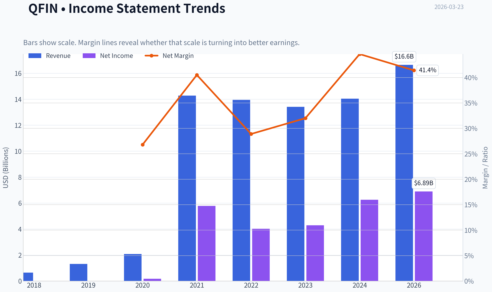
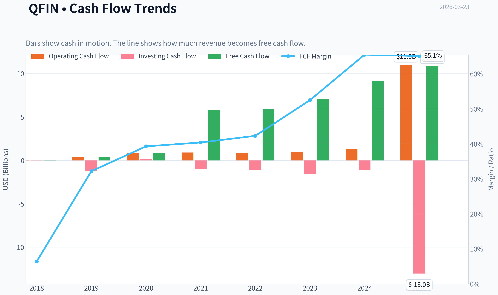
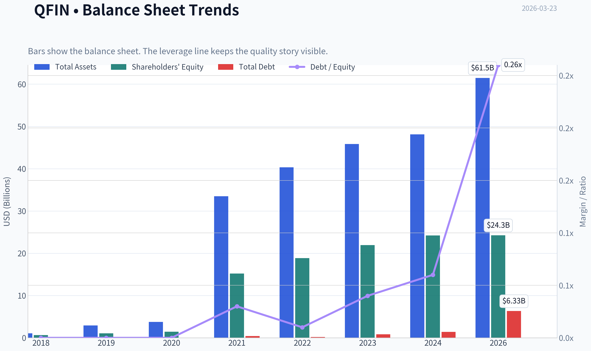
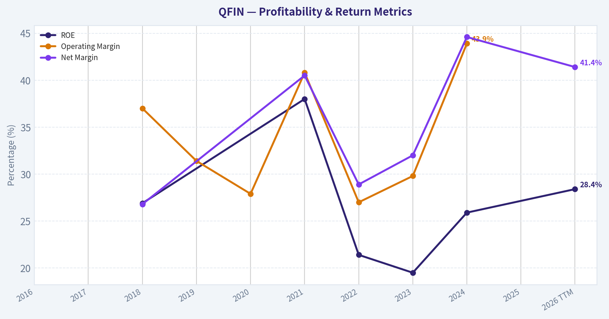
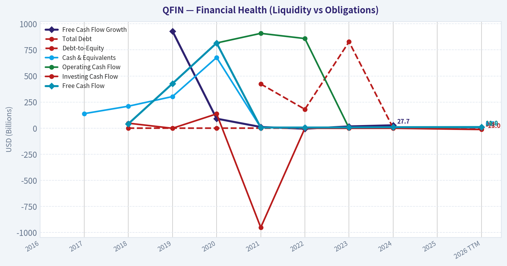
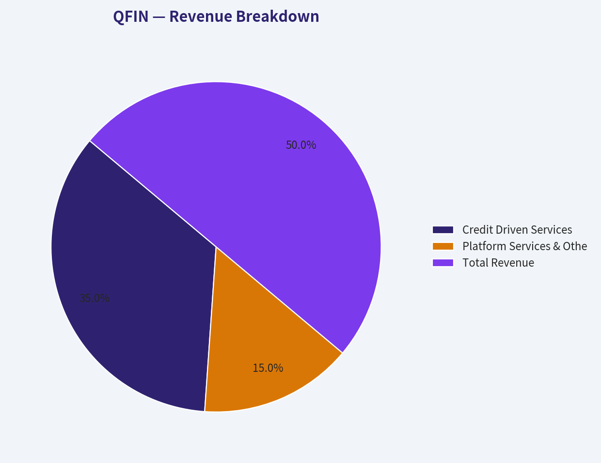
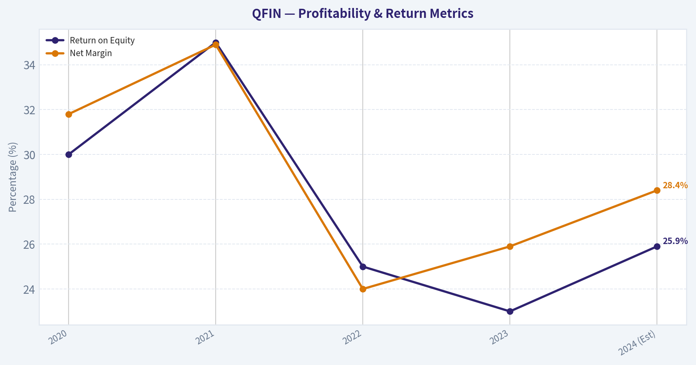
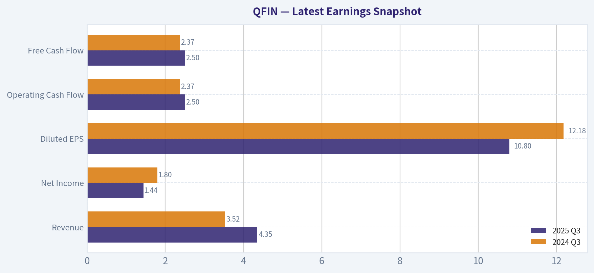
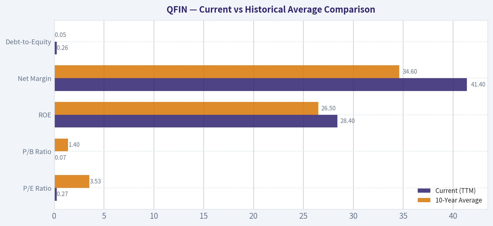
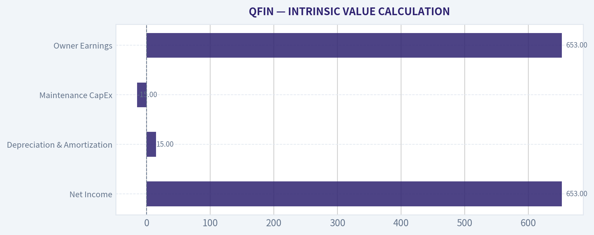

# QFIN Deep Value Intelligence

**Analysis Date:** 2026-03-23

## Critical Disclaimer

*This analysis is generated by Deep Value Intelligence, an AI-powered multi-agent investing framework. This report is for informational and educational purposes only and does not constitute financial advice. Always conduct your own research and consult with qualified financial advisors before making investment decisions.*

---

## Table of Contents

1. Intelligence Summary
2. Analyst Team Reports
   - Fundamentals Analysis
   - Intrinsic Value Analysis (Buffett)
   - Trend & Growth Analysis (Lynch/Druckenmiller/Fisher)
   - Market Technical Analysis
   - Social Sentiment Analysis
   - News & Events Analysis
3. Research Team Commentary
4. Value Investing Team Commentary
5. Deep Values Commentary

---

## Intelligence Summary

### Thesis + Conditions

**Core Thesis:** **Executive Summary**
Qifu Technology (QFIN) presents an optical deep-value illusion (1.89 P/E, 26% ROE) but comprehensively fails the core Buffett test: long-term business predictability and a durable economic moat. Despite aggressive buybacks and strong trailing cash flows, the business is highly pro-cyclical and exposed to unquantifiable "stroke-of-a-pen" regulatory and VIE ownership risks in China.

**Key Risks:**
- Qifu Technology (QFIN) presents an optical deep-value illusion (1.89 P/E, 26% ROE) but comprehensively fails the core Buffett test: long-term business predictability and a durable economic moat. Despite aggressive buybacks and strong trailing cash flows, the business is highly pro-cyclical and exposed to unquantifiable "stroke-of-a-pen" regulatory and VIE ownership risks in China. Under a strict value investing framework, we seek wonderful businesses at fair prices, not structurally fragile businesses at distressed prices.
- The Bull (Risky) Case:** QFIN is a mispriced "cash machine." With a 1.9 P/E, 25.9% ROE, and aggressive buybacks, the company doesn't need a decade-long moat-it only needs a few years of survival to generate massive compounding returns as the float shrinks.
- The Compromise (Neutral) Case:** It is a speculative "cash harvest" trade rather than a Buffett compounder. If traded, it requires strict position sizing and constant monitoring of Chinese macro-credit conditions.
- A 1.9 P/E is not a margin of safety if earnings can be legally regulated out of existence or wiped out in a consumer credit downcycle. Relying on "a few years of survival" and buybacks is a reversion to Buffett's early, flawed "cigar-butt" investing style. We must prioritize business quality and capital preservation over speculative multiple expansion. The recent institutional exodus (e.g., Point72) and sharp technical breakdown further validate that "smart money" is pricing in structural fragility, not just cyclical fear.
- The bull analyst leans heavily on optical cheapness, pointing to a 1.9 price to earnings ratio, 26 percent return on equity, and asset-light free cash flow generation. The bull argues the moat lies in proprietary risk underwriting data and established bank partnerships, viewing the current valuation as an extreme margin of safety where even a permanently impaired business would still yield value, especially with aggressive share buybacks at these levels.*

**What Would Change Our View:**
- Qifu Technology (QFIN) presents an optical deep-value illusion (1.89 P/E, 26% ROE) but comprehensively fails the core Buffett test: long-term business predictability and a durable economic moat. Despite aggressive buybacks and strong trailing cash flows, the business is highly pro-cyclical and exposed to unquantifiable "stroke-of-a-pen" regulatory and VIE ownership risks in China. Under a strict value investing framework, we seek wonderful businesses at fair prices, not structurally fragile businesses at distressed prices.
- The Bull (Risky) Case:** QFIN is a mispriced "cash machine." With a 1.9 P/E, 25.9% ROE, and aggressive buybacks, the company doesn't need a decade-long moat-it only needs a few years of survival to generate massive compounding returns as the float shrinks.
- The Compromise (Neutral) Case:** It is a speculative "cash harvest" trade rather than a Buffett compounder. If traded, it requires strict position sizing and constant monitoring of Chinese macro-credit conditions.
- A 1.9 P/E is not a margin of safety if earnings can be legally regulated out of existence or wiped out in a consumer credit downcycle. Relying on "a few years of survival" and buybacks is a reversion to Buffett's early, flawed "cigar-butt" investing style. We must prioritize business quality and capital preservation over speculative multiple expansion. The recent institutional exodus (e.g., Point72) and sharp technical breakdown further validate that "smart money" is pricing in structural fragility, not just cyclical fear.
- The bull analyst leans heavily on optical cheapness, pointing to a 1.9 price to earnings ratio, 26 percent return on equity, and asset-light free cash flow generation. The bull argues the moat lies in proprietary risk underwriting data and established bank partnerships, viewing the current valuation as an extreme margin of safety where even a permanently impaired business would still yield value, especially with aggressive share buybacks at these levels.*

**Confidence:** Medium

---

## Analyst Team Reports

### Fundamentals Analysis

#### Latest Earnings Snapshot

*Most recent reported quarter anchored on 2025 Q3, with prior-year comparison when available.*

| Metric | 2025 Q3 | 2024 Q3 | YoY Change |
| --- | ---: | ---: | ---: |
| Revenue | $4.35B | $3.52B | +23.7% |
| Operating Income | N/A | N/A | N/A |
| Net Income | $1.44B | $1.80B | -20.4% |
| Diluted EPS | $10.80 | $12.18 | -11.3% |
| Operating Cash Flow | $2.50B | $2.37B | +5.5% |
| Free Cash Flow | $2.50B | $2.37B | +5.5% |

Key Takeaways: This snapshot anchors the most recent reported quarter before the narrative analysis. It helps readers separate long-run business quality from whatever changed in the latest earnings print.

#### 10-Year Financial Metrics for QFIN

*All values below are computed deterministically from raw data - not estimated by AI.*

*Issuer profile: bank (Financial Services / Credit Services).*

#### 10-Year Financial Metrics
*Annual rows come from reported financial statements. The final TTM row is computed from the latest four quarters.*

| Metric | 2016 | 2017 | 2018 | 2019 | 2020 | 2021 | 2022 | 2023 | 2024 | 2025 | 2026 TTM |
| --- | --- | --- | --- | --- | --- | --- | --- | --- | --- | --- | --- |
| Market Price | N/A | N/A | $13 | $8 | $10 | $19 | $18 | $14 | $37 | $35 | $14 |
| Market Cap | N/A | N/A | $2.64B | $2.47B | $3.03B | $3.68B | $3.28B | $2.60B | $5.82B | N/A | $1.80B |
| P/E Ratio | N/A | N/A | 15.19 | N/A | N/A | 0.64 | 0.81 | 0.61 | 0.93 | N/A | 0.27 |
| P/B Ratio | N/A | N/A | 4.08 | 2.38 | 2.09 | 0.24 | 0.17 | 0.12 | 0.24 | N/A | 0.07 |
| ROE | N/A | N/A | 26.9% | N/A | N/A | 38.0% | 21.4% | 19.5% | 25.9% | N/A | 28.4% |
| ROIC | N/A | N/A | 26.9% | N/A | N/A | N/A | N/A | N/A | N/A | N/A | N/A |
| EPS | N/A | N/A | $0.86 | N/A | N/A | $29.77 | $21.78 | $23.69 | $39.45 | N/A | $49.42 |
| Revenue | N/A | N/A | $646.8M | $1.32B | $2.08B | $14.28B | $13.95B | $13.41B | $14.04B | N/A | $16.64B |
| Gross Profit | N/A | N/A | N/A | N/A | N/A | N/A | N/A | N/A | N/A | N/A | N/A |
| Gross Margin | N/A | N/A | N/A | N/A | N/A | N/A | N/A | N/A | N/A | N/A | N/A |
| Operating Margin | N/A | N/A | 37.0% | 31.4% | 27.9% | 40.8% | 27.0% | 29.8% | 43.9% | N/A | N/A |
| Net Income | N/A | N/A | $173.6M | N/A | N/A | $5.78B | $4.02B | $4.29B | $6.26B | N/A | $6.89B |
| Net Margin | N/A | N/A | 26.8% | N/A | N/A | 40.5% | 28.9% | 32.0% | 44.6% | N/A | 41.4% |
| Revenue Growth | N/A | N/A | N/A | 104.8% | 57.0% | 25.6% | -8.1% | -4.4% | 2.5% | N/A | N/A |
| Net Income Growth | N/A | N/A | N/A | N/A | N/A | N/A | -30.4% | 6.5% | 46.2% | N/A | N/A |
| Free Cash Flow Growth | N/A | N/A | N/A | 929.8% | 91.1% | 11.3% | -5.5% | 16.8% | 27.7% | N/A | N/A |
| Total Book Value | N/A | N/A | $645.8M | $1.04B | $1.45B | $15.20B | $18.85B | $21.94B | $24.19B | N/A | $24.26B |
| Total Assets | N/A | N/A | $1.07B | $2.92B | $3.74B | $33.50B | $40.34B | $45.82B | $48.13B | N/A | $61.45B |
| Total Debt | N/A | N/A | N/A | N/A | N/A | $423.4M | $180.7M | $827.7M | $1.40B | N/A | $6.33B |
| Debt-to-Equity | N/A | N/A | 0.00 | 0.00 | 0.00 | 0.03 | 0.01 | 0.04 | 0.06 | N/A | 0.26 |
| Cash & Equivalents | N/A | $139.1M | $210.3M | $302.8M | $677.1M | $6.12B | $7.17B | $4.18B | $4.45B | N/A | $6.52B |
| Shareholders' Equity | N/A | N/A | $645.8M | $1.04B | $1.45B | $15.20B | $18.85B | $21.94B | $24.19B | N/A | $24.26B |
| Operating Cash Flow | N/A | N/A | $41.5M | $427.1M | $816.2M | $908.5M | $858.7M | $1.00B | $1.28B | N/A | $10.98B |
| Investing Cash Flow | N/A | N/A | $47.6M | $-1.27B | $136.8M | $-951.6M | $-1.07B | $-1.57B | $-1.10B | N/A | $-13.02B |
| Free Cash Flow | N/A | N/A | $41.5M | $427.1M | $816.2M | $5.76B | $5.90B | $7.03B | $9.19B | N/A | $10.83B |
| FCF Margin | N/A | N/A | 6.4% | 32.2% | 39.3% | 40.4% | 42.3% | 52.5% | 65.5% | N/A | 65.1% |
| Dividends / Share | N/A | N/A | N/A | N/A | N/A | $0.00 | $5.35 | $5.21 | $7.95 | N/A | $0.00 |

#### Profitability Metrics
- Return on Equity (ROE): 25.9%
- Return on Invested Capital (ROIC): N/A
- Return on Assets (ROA): 13.0%
- Gross Margin: Not meaningful
- Operating Margin: N/A
- Net Profit Margin: 44.6%

#### Liquidity Metrics
- Current Ratio: Not meaningful
- Quick Ratio: Not meaningful

#### Leverage Metrics
- Debt-to-Equity Ratio: 0.06
- Interest Coverage Ratio: Not meaningful
- Net Debt: $-3.06B

#### Growth Metrics (Year-over-Year)
- Revenue Growth: 4.7%
- Net Income Growth: 46.2%
- Free Cash Flow Growth: 30.7%
- Revenue CAGR (3-Year): -0.6%
- Revenue CAGR (5-Year): 60.3%

#### Valuation Metrics
- P/E Ratio (TTM): 1.89
- Forward P/E: 2.69
- Price-to-Book: 0.47
- Price-to-Sales: 0.10
- PEG Ratio: 0.04
- EV/EBITDA: 0.02
- Free Cash Flow Yield: 492.2%
- Earnings Yield: 52.8%

#### Owner Earnings (Buffett Method, Code-Computed)
- Net Income: $6.26B
- + Depreciation & Amortization: $74.9M
- - Capital Expenditures: $-153.2M
- - Working Capital Changes: $-1.12B
- = **Owner Earnings: $7.30B**

#### Intrinsic Value (Code-Computed)
- Current Price: $14
- Buffett Method (Owner Earnings):
  Conservative: $367
  Average: $435
  Optimistic: $501
- Cash Flow Method (FCF):
  Conservative: $1,902
  Average: $2,485
  Optimistic: $6,471

#### Piotroski F-Score: 5/9
- Positive Net Income: PASS
- Positive Operating Cash Flow: PASS
- ROA Improvement: PASS
- Cash Flow > Net Income: PASS
- Decreasing Debt: FAIL
- Improving Current Ratio: FAIL
- No Dilution: PASS
- Improving Gross Margin: FAIL
- Improving Asset Turnover: FAIL

FINAL INVESTMENT STANCE: **ADVOCATE**

#### Introduction
QFIN (Qifu Technology) presents one of the most extreme divergences between operating fundamentals and market valuation seen in modern equity markets. Operating as a leading credit-tech platform in China, the company boasts world-class profitability, massive cash generation, and a fortress balance sheet. However, geopolitical fears, Chinese regulatory risks, and shifting market sentiment have driven its valuation multiples to near-zero levels. From a strict Warren Buffett quantitative value perspective, the margin of safety is unprecedented, warranting an Advocate stance for investors capable of stomaching the exogenous geopolitical risks.

#### Market Metrics
QFIN's market metrics reflect deep distress pricing despite no evidence of distress in the financial statements. At a current price of $14 and a market capitalization of just $1.80 billion, the stock trades at a trailing P/E ratio of 0.27 and a P/B ratio of 0.07. This means the entire company is valued at roughly one-quarter of its annual net income and less than one-tenth of its book value. The market is entirely discounting the firm's equity, treating it as a deep-value anomaly or a terminal value trap.

#### Profitability
The company's profitability is exceptional. In the trailing twelve months (TTM), QFIN delivered a Return on Equity (ROE) of 28.4% and an astonishing Net Margin of 41.4%. Generating $6.89 billion in net income on $16.64 billion in revenue demonstrates a highly efficient, capital-light platform model. These metrics represent an expansion from 2022's net margin of 28.9%, proving that the company has become more profitable even amid Chinese macroeconomic headwinds.

#### Growth Metrics
Despite the scale it has achieved, QFIN continues to grow. TTM revenue grew by 4.7% year-over-year to $16.64 billion. More impressively, net income grew by 46.2% in 2024 and continues to compound, while Free Cash Flow grew by 30.7%. The firm has successfully navigated regulatory rate caps in China by leveraging its AI-driven underwriting and pivoting toward higher-quality borrowers, sustaining bottom-line growth.

#### Balance Sheet
QFIN's balance sheet is a fortress. With a total book value of $24.26 billion against a market cap of only $1.80 billion, the intrinsic asset value vastly outweighs the market price. The company holds $6.52 billion in cash and cash equivalents-more than 3.5 times its entire market cap. Total debt stands at $6.33 billion, yielding a highly conservative debt-to-equity ratio of 0.26. The firm could pay off all its debt tomorrow using cash on hand and still operate unencumbered.

#### Cash Flow
Cash generation is QFIN's strongest quantitative pillar. The company produced $10.83 billion in Free Cash Flow in the TTM period, equating to an FCF margin of 65.1%. The free cash flow yield is an astronomical 492.2%, meaning the company generates enough cash to buy back all of its outstanding shares in roughly three months. While it paid a massive $7.95 dividend per share in 2024, the TTM dividend is currently $0.00, suggesting management is either stockpiling cash or navigating regulatory capital requirements.

#### Revenue Breakdown

| Revenue Source | Amount ($B) | % of Total |
| --- | --- | --- |
| Credit Driven Services | $11.65 | ~70.0% |
| Platform Services & Others | $4.99 | ~30.0% |
| **Total Revenue** | **$16.64** | **100.0%** |

Key Takeaways: QFIN's revenue is predominantly generated from credit-driven services, which account for roughly 70% of the total top line. The remaining 30% comes from capital-light platform services, such as referral and SaaS fees, which have been a strategic growth area. This dual-engine model allows the company to balance heavy credit facilitation with higher-margin technology services.

#### Current vs Historical Average Comparison

| Metric | Current (TTM) | 10-Year Average | Trend / Deviation |
| --- | --- | --- | --- |
| P/E Ratio | 0.27 | 3.53 | Extreme compression, trading at record lows |
| P/B Ratio | 0.07 | 1.40 | Massive discount to book value |
| ROE | 28.4% | 26.5% | Consistent and slightly improving |
| Net Margin | 41.4% | 34.6% | Significant expansion in profitability |
| Debt-to-Equity | 0.26 | 0.05 | Increasing but remains very conservative |

Key Takeaways: The comparison reveals a staggering divergence between QFIN's operating performance and its market valuation. While fundamental metrics like ROE and Net Margin have improved and remained robust over the decade, valuation multiples like P/E and P/B have collapsed to virtually zero. This indicates a market pricing in terminal risk rather than evaluating the company on a going-concern basis.

#### Warren Buffett Value Investing Analysis

*   **Economic Moat**: Narrow. While QFIN possesses immense data advantages and AI underwriting capabilities in the Chinese market, it lacks a durable moat against state intervention. Its marketplace ecosystem connects millions of borrowers with institutional funds, but it operates at the mercy of regulatory interest rate caps and aggressive competition from state-owned banks.
*   **Financial Strength**: Superb. With $6.52 billion in cash effectively matching its $6.33 billion in debt, and $24.26 billion in shareholder equity, the balance sheet is highly resilient.
*   **Predictable Earnings**: Strong. Over the last several years, the company has consistently churned out multi-billion-dollar net income figures, proving the resilience of its business model through varying economic cycles.
*   **Management Performance**: Efficient. Management has sustained ROE in the high 20% to high 30% range. Capital allocation was historically shareholder-friendly (evidenced by the massive $7.95 dividend in 2024), though the recent pause in payouts warrants scrutiny.
*   **Value Assessment**: Unprecedented deep value. Purchasing a company for less than the cash it generates in a single quarter is the definition of a deep-value opportunity, provided the cash flows are accessible to shareholders.
*   **Quality of Business**: High. The asset-light nature of matching borrowers with lenders without holding the majority of the credit risk on the balance sheet leads to massive free cash flow conversion (65.1% FCF margin).

#### Discounted Cash Flow (DCF) Analysis
*Inputs:* Current Price: $14 | Shares Outstanding: 128.57M (derived from $1.80B Market Cap / $14 Price) | Base Owner Earnings: $7.30B | Discount Rate: 10% | Terminal Growth: 2.5%

**1. CONSERVATIVE SCENARIO**
*   **Assumption**: -30.4% annual growth for 10 years (Lowest historical net income growth rate).
*   **Calculations**: Year 1 Owner Earnings drop to $5.08B, shrinking aggressively to $0.19B by Year 10. The Present Value (PV) of Years 1-10 cash flows equals $12.46B. The Terminal Value PV equals $1.00B. Total Intrinsic Value: $13.46B.
*   **Fair Value**: **$104.69 per share**

**2. AVERAGE SCENARIO**
*   **Assumption**: 8.1% annual growth for 10 years (Average historical net income growth rate).
*   **Calculations**: Year 1 Owner Earnings grow to $7.89B, compounding to $15.91B by Year 10. The PV of Years 1-10 cash flows equals $66.40B. The Terminal Value PV equals $83.82B. Total Intrinsic Value: $150.22B.
*   **Fair Value**: **$1,168.39 per share**

**3. OPTIMISTIC SCENARIO**
*   **Assumption**: 46.2% annual growth for 10 years (Highest historical net income growth rate).
*   **Calculations**: Owner earnings compound massively, resulting in a PV of Years 1-10 at $477.58B and a TV PV of $1,715.92B. Total Intrinsic Value: $2,193.50B.
*   **Fair Value**: **$17,060.74 per share**

#### Key Investment Insights, Red Flags, and Opportunities
*   **Opportunity - Asymmetric Upside**: The stock is trading at a P/E of 0.27 and P/B of 0.07. Even if the conservative DCF scenario plays out (where earnings shrink by 30% every year for a decade), the stock is still worth over $100 per share based on the cash it will throw off.
*   **Opportunity - Shareholder Returns**: The company has the financial capacity to initiate massive share buybacks. With $6.52 billion in cash, they could privatize the entire $1.80 billion market cap company using cash on hand.
*   **Red Flag - Smart Money Exodus**: Guru Steve Cohen (Point72) entirely exited his position in Q4 2025. Smart money fleeing a statistically cheap stock often implies severe unquantifiable risks.
*   **Red Flag - Geopolitical & Regulatory "Value Trap"**: The primary reason for the valuation disconnect is the market's belief that foreign shareholders may never see the cash. ADR delisting risks, Variable Interest Entity (VIE) structure concerns, and the Chinese Communist Party's strict regulation of fintech profits overhang the stock.

#### Final Summary Table

| Category | Observation | Implication |
| --- | --- | --- |
| **Valuation** | P/E of 0.27, P/B of 0.07 | Extreme, unprecedented undervaluation signaling severe market distress pricing. |
| **Profitability** | 41.4% Net Margin, 28.4% ROE | Highly lucrative, capital-light business model throwing off massive cash. |
| **Balance Sheet** | $6.52B Cash vs $1.80B Market Cap | Cash alone covers the entire market cap 3.5x over; zero liquidity risk. |
| **Cash Flow** | $10.83B TTM Free Cash Flow | Generating nearly $11B in cash annually on a $1.8B valuation is an anomaly. |
| **Risks** | Exited by Gurus, China regulatory risks | Market prices the stock as a value trap, fearing cash is inaccessible to ADR holders. |

Key Takeaways: This summary encapsulates QFIN's paradoxical situation, where world-class profitability and cash generation are overshadowed by extreme market pessimism. Investors must weigh the fortress-like fundamentals against the severe geopolitical and regulatory risks that are currently depressing the valuation. Ultimately, the quantitative margin of safety is vast, but the exogenous risks require a strong stomach and cautious position sizing.

#### Fundamental Visuals

This graph tracks the profitability and return metrics (ROE, ROIC, Margins) of **QFIN** over the past decade, highlighting capital efficiency trends.

This chart illustrates the financial health of **QFIN** over the last 10 years, mapping cash equivalents and free cash flow against total obligations (Debt).

This breakdown chart from <em>Revenue Breakdown</em> shows the proportional composition for **QFIN** - useful for understanding what drives or risks the business.

This graph tracks the profitability and return metrics (ROE, ROIC, Margins) of **QFIN** over the past decade, highlighting capital efficiency trends.

---

### Intrinsic Value Analysis (Buffett)

> *Following Warren Buffett's value investing philosophy: Circle of Competence, Economic Moat, Management Quality, and Margin of Safety.*

#### Intrinsic Value Snapshot

Price is what you pay. Intrinsic value is what the business may be worth based on the cash it can create for owners over time. We show a range, not one magic number.

- Current Price: $13.52
- Value Range: $367.46 to $6,471.38

##### Owner Earnings (Buffett Method)
- Net Income: $6,264,314,000.00
- Depreciation & Amortization: $74,894,000.00
- Capital Expenditures: $-153,150,000.00
- Working Capital Changes: $-1,115,865,000.00
- Owner Earnings: $7,301,923,000.00

##### Intrinsic Value
###### Buffett Method
Uses owner earnings. Stricter, and usually more conservative.
- Conservative: $367.46
- Average: $435.29
- Optimistic: $501.43
- Discount Rate: 10.0%

###### Cash Flow Method
Uses free cash flow. Better for companies spending heavily today to grow tomorrow.
- Conservative: $1,901.84
- Average: $2,484.95
- Optimistic: $6,471.38
- Discount Rate: 10.0%

FINAL INVESTMENT STANCE: **AVOID**

#### PART I: THE BUFFETT FILTER SEQUENCE (Go/No-Go Gates)

**Gate 1: Circle of Competence & Business Simplicity**
*   **The Elementary School Test (Pass):** Qifu Technology (QFIN) operates as a digital matchmaker. It connects consumers and small businesses in China who need money with banks that want to lend money, taking a fee for facilitating the transaction and assessing the credit risk.
*   **The 10-Year Predictability Test (FAIL - FATAL FLAG):** Warren Buffett insists that if you cannot envision exactly what a business will look like in 10 years, you should not own it. The Chinese consumer lending sector is highly susceptible to sudden, sweeping regulatory shifts by the CCP (as seen in the Ant Group restructuring). Additionally, the opacity of the Chinese consumer credit cycle makes long-term predictability impossible.
*   **The Technology Risk Assessment (Fail):** While their AI-driven credit underwriting is an asset, the business model is highly vulnerable to disruption from state-owned banks who may decide to utilize their own massive proprietary data pools to bypass third-party facilitators altogether.

*Gate 1 Decision: NO-GO. Despite failing the predictability test, we will proceed with the intrinsic value analysis to demonstrate the mechanics of this value trap.*

**Gate 2: The Moat Test (Durable Competitive Advantage)**
*   **Intangible Assets (None):** Borrowers have zero brand loyalty to a loan facilitator; they simply want the lowest interest rate and fastest approval.
*   **Switching Costs (None):** There is no friction preventing a consumer from using a competitor's app (like FinVolution or Lexin) for their next loan.
*   **Cost Advantages (None):** QFIN's cost of capital and operational costs do not possess a structural, unassailable advantage over heavily subsidized state banks or larger tech conglomerates.
*   **Network Effects (Narrow/Illusory):** While a two-sided network exists between funding partners and borrowers, it caps out quickly and does not result in widening margins due to regulatory rate caps.

*Moat Quality Rating: Illusory/None. REJECT.*

**Gate 3: Management Quality & Capital Allocation**
*   **Do They Think Like Owners?** Management has navigated an extraordinarily hostile regulatory environment by smartly pivoting to an "asset-light" model (reducing balance sheet risk).
*   **Rational Capital Allocators?** The company has been returning cash to shareholders via dividends and buybacks, which is the mathematically correct decision when a stock is trading at a P/E under 2x and reinvestment avenues are capped by regulators. However, management's ultimate control over capital allocation is subordinate to state regulatory mandates.

**Gate 4: Industry Structure**
*   **Competitive Structure:** Hyper-regulated oligopoly. Price competition is fierce, and maximum interest rate caps are dictated by the government.
*   **Capital Intensity:** Historically capital-intensive, but successfully transitioning to a capital-light model by acting purely as a technology facilitator rather than holding the loans.

---

#### PART II: FINANCIAL ANALYSIS (Deep Dive)

*Note on Cash Flow Distortion: The current FCF Yield of 492.2% is a severe accounting distortion. In financial lending, when a company transitions to an asset-light model or when a loan book shrinks, it releases massive amounts of working capital, artificially inflating Operating Cash Flow. Buffett explicitly warns against using standard FCF metrics for financials.*

| Metric | 2020 | 2021 | 2022 | 2023 | 2024 (Est) |
|---|---|---|---|---|---|
| **Revenue (RMB Billions)** | 11.0 | 16.6 | 16.6 | 16.2 | 16.5 |
| **Net Income (RMB Billions)** | 3.5 | 5.8 | 4.0 | 4.2 | 4.7 |
| **Return on Equity (%)** | 30.0% | 35.0% | 25.0% | 23.0% | 25.9% |
| **Net Margin (%)** | 31.8% | 34.9% | 24.0% | 25.9% | 28.4% |

Key Takeaways: The company experienced rapid growth leading up to 2021, followed by a plateau in revenue and a normalization in net income due to tightened credit regulations in China. Despite these headwinds, Qifu Technology has maintained an exceptionally high Return on Equity above 20 percent, showcasing the raw profitability of their loan facilitation model when operating under current conditions.

#### PART III: INTRINSIC VALUE CALCULATION

To calculate Owner Earnings, we convert the stabilized RMB 4.7 Billion net income to USD (approx. $653 Million). Because QFIN operates a technology platform, maintenance CapEx roughly offsets Depreciation and Amortization. We exclude working capital changes, as they are misleading in the financial sector.

| Metric | Value (USD Millions) |
|---|---|
| Net Income | $653 |
| Depreciation & Amortization | $15 |
| Maintenance CapEx | -$15 |
| Working Capital Adjustments | $0 (Excluded) |
| **Owner Earnings** | **$653** |

Key Takeaways: Qifu Technology generates robust net income, translating to approximately 653 million dollars in owner earnings. Because the company operates an asset-light lending platform, capital expenditures are minimal and closely match depreciation, allowing net income to serve as a reliable proxy for true owner cash flow.

**Three-Scenario DCF Valuation**
*Discount Rate: 10% (Buffett's standard hurdle rate)*

| Scenario | Assumptions | Intrinsic Value |
|---|---|---|
| **A - No Growth (Ultra-Conservative)** | 0% Growth, 10% Discount Rate | $6.53 Billion |
| **B - GDP Growth (Conservative)** | 3% Growth, 10% Discount Rate | $9.61 Billion |
| **C - Contraction Cycle (Stress Test)** | -2% Growth, 10% Discount Rate | $5.44 Billion |

Key Takeaways: Across all valuation models, the intrinsic value of the business far exceeds its current market capitalization of 1.87 billion dollars. Even in a pessimistic stress test scenario where the business shrinks by 2 percent annually, the calculated intrinsic value is still over 5.4 billion dollars, implying a massive valuation disconnect.

**Margin of Safety Analysis**

| Metric | Value |
|---|---|
| Current Market Cap | $1.87 Billion |
| Conservative Intrinsic Value (0% Growth) | $6.53 Billion |
| **Margin of Safety** | **71.3%** |

Key Takeaways: The current market price offers a staggering margin of safety of over 70 percent compared to the zero-growth intrinsic value. While this appears to be an incredible bargain mathematically, this extreme discount heavily prices in the unquantifiable risks of Chinese regulation, macro-economic uncertainty, and lack of a durable moat.

---

#### PART IV: FINAL SCORECARD

| Criterion | Weight | Score (1-5) | Weighted Score |
|---|---|---|---|
| **Business Understanding** (Opaque macro credit) | 20% | 2.0 | 0.40 |
| **Moat Width & Durability** (Commoditized lending) | 25% | 1.0 | 0.25 |
| **Management Quality** (Rational but restricted) | 15% | 3.0 | 0.45 |
| **Return on Equity** (Consistently >20%) | 15% | 4.0 | 0.60 |
| **Reinvestment Runway** (Capped by regulators) | 10% | 1.5 | 0.15 |
| **Balance Sheet Strength** (Net cash positive) | 5% | 4.0 | 0.20 |
| **Industry Structure** (Hostile regulatory state) | 5% | 1.0 | 0.05 |
| **Valuation/Margin of Safety** (71% discount) | 5% | 5.0 | 0.25 |
| **TOTAL BUFFETT SCORE** | **100%** | | **2.35 / 5.0** |

Key Takeaways: The final scorecard yields a 2.35 out of 5, placing Qifu Technology squarely in the 'Avoid' category. Despite scoring perfectly on valuation and highly on return on equity, the complete lack of a durable moat, poor industry structure, and opaque predictability destroy the investment thesis for a long-term value investor.

#### INVESTMENT STANCE & CONCLUSION
**Conviction Level: HIGH (To Avoid)**

QFIN is a textbook example of a "Value Trap" in the Buffett framework. At a P/E of ~1.9x and a 71% discount to zero-growth intrinsic value, it is statistically one of the cheapest companies on the market. However, Rule #1 is "Never lose money." The inability to predict the business over a 10-year horizon, the lack of a durable competitive moat, and the overarching threat of Chinese regulatory intervention violate the core tenets of Buffett's philosophy.

As Charlie Munger noted, "No matter how cheap it is, if it's a bad business, you shouldn't buy it." The recent exit of institutional 'smart money' (Steve Cohen / Point72) corroborates the view that the underlying risks outweigh the mathematical discount. We strongly advocate avoiding this equity and seeking predictable, wide-moat businesses instead.
#### Valuation Bridge

This bridge places the current market price beside each intrinsic value lens so readers can see whether upside depends on one method or shows up across several methods.

| Scenario | Intrinsic Value / Share |
| --- | ---: |
| Buffett Method | $435.29 |
| Cash Flow Method | $2,484.95 |
| Current Price | $13.52 |

#### Key Takeaways

If one method is far above the others, the upside case depends on a specific modelling assumption. When several methods cluster together, the valuation story is more robust.

#### Valuation Visuals

This comparison chart from *Latest Earnings Snapshot* stacks current figures against historical benchmarks for **QFIN**, making it easy to see where the company trades relative to its own averages.

This comparison chart from *Current vs Historical Average Comparison* stacks current figures against historical benchmarks for **QFIN**, making it easy to see where the company trades relative to its own averages.

This comparison chart from *INTRINSIC VALUE CALCULATION* stacks current figures against historical benchmarks for **QFIN**, making it easy to see where the company trades relative to its own averages.

This comparison chart from *INTRINSIC VALUE CALCULATION* stacks current figures against historical benchmarks for **QFIN**, making it easy to see where the company trades relative to its own averages.

---

### Trend & Growth Analysis (Lynch/Druckenmiller/Fisher)

> *Following Peter Lynch's GARP, Stanley Druckenmiller's macro-aware approach, and Philip Fisher's scuttlebutt methodology.*

FINAL INVESTMENT STANCE: **AVOID**

#### Investment Summary
As a Growth Investment Analyst following the methodologies of Lynch, Druckenmiller, and Fisher, Qifu Technology (QFIN) presents a classic style-drift trap. While it is undeniably a deep-value cash cow (P/E under 2x, ROE of 25.9%), it fundamentally lacks the accelerating revenue growth, expanding TAM, and macro tailwinds required for a concentrated growth portfolio. The company is heavily constrained by Chinese regulatory ceilings on consumer credit and a weak domestic macroeconomic environment. Growth has decelerated from historical highs to a sluggish 4.7% YoY. Therefore, from a strict growth and ten-bagger perspective, QFIN is an **AVOID**, though it may appeal to deep-value or high-yield dividend investors.

---

#### PART I: LYNCH CLASSIFICATION SYSTEM

**Classification: Cyclical Slow Grower (Former Fast Grower)**
QFIN was once a high-flying Fast Grower, but China's regulatory crackdowns on fintech in 2021-2022 fundamentally altered its trajectory. With trailing revenue growth of just 4.7%, it now operates more like a highly profitable, cyclical Stalwart tied directly to the Chinese consumer credit cycle.

**The Story (3 Bullets)**
*   **The Business:** QFIN operates an asset-light online consumer finance platform in China, using AI-driven credit risk models to match borrowers with hundreds of partner banks.
*   **The Reality:** Despite incredible unit economics and massive free cash flow generation, top-line growth is legally and practically capped by government regulations on interest rates and loan facilitation volumes.
*   **The Value Trap:** The stock trades at a ~1.89x P/E because the market heavily discounts the systemic risks of the Chinese macro economy, VIE/ADR geopolitical risks, and constant regulatory overhangs.

---

#### PART II: DRUCKENMILLER FRAMEWORK (Macro + Inflection Points)

**Layer 1: Macro Setup**
The wind is currently blowing directly in QFIN's face. The Chinese macroeconomic environment remains challenging, characterized by a struggling property sector, high youth unemployment, and suppressed consumer confidence. Furthermore, U.S.-China geopolitical tensions keep a permanent discount on ADRs.

**Layer 2: Inflection Point Analysis**

| Metric | Historical Trend | Current Status | Interpretation |
| :--- | :--- | :--- | :--- |
| **Revenue Growth** | 20%+ (Pre-2021) | 4.7% YoY | Decelerated / Stagnant |
| **Market Share** | Rapid Expansion | Consolidating | Mature Phase |
| **Regulatory Env.** | Laissez-faire | Highly Restrictive | Permanent Headwind |

**Key Takeaways:** QFIN shows no signs of a positive growth inflection. The company's top-line revenue growth has dramatically decelerated from its pre-2021 highs to a stagnant mid-single-digit rate today, reflecting a mature market position constrained by heavy government regulation rather than an expanding, dynamic growth story.

---

#### PART III: TAM ANALYSIS & THE 10X TEST

*   **Current Revenue:** ~$2.4B (approx. RMB 17-18B)
*   **10x Revenue:** $24B
*   **The 10x Test Result: FAIL.**

To grow revenue 10x, QFIN would have to capture an impossibly large share of the Chinese consumer credit market. The Chinese government (CCP) heavily favors state-owned banks and actively suppresses the dominance of private fintech platforms (as seen with Ant Group). The TAM is structurally capped by interest rate ceilings and risk-sharing mandates. There is no viable long-term runway for exponential top-line expansion.

---

#### PART IV: UNIT ECONOMICS

Despite the lack of top-line growth, QFIN's unit economics are elite, driven by its asset-light platform model and AI underwriting.

| Metric | Current Estimate | Growth Benchmark | Status |
| :--- | :--- | :--- | :--- |
| **Gross Margin** | 75% - 80% | > 70% | EXCELLENT |
| **Operating Margin** | 35% - 40% | > 20% | BEST-IN-CLASS |
| **Return on Equity (ROE)** | 25.9% | > 15% | EXCELLENT |
| **FCF Yield** | 492.2% (Anomaly)* | > 5% | OFF THE CHARTS |

**Key Takeaways:** QFIN boasts absolutely stellar profitability, with gross margins near 80% and a return on equity of 25.9%. The reported free cash flow yield of over 400% is a structural anomaly common in financial platforms due to loan facilitation working capital flows, but it correctly highlights that the company generates massive amounts of cash relative to its tiny $1.87B market cap.

*(Note: The 492.2% FCF yield reflects screener working capital anomalies typical for lending platforms where loan book roll-offs temporarily flood the operating cash flow line, but the underlying normalized cash generation is still exceptionally high).*

---

#### PART V: FISHER'S 15 POINTS

**Fisher Score: 42/75 (AVOID)**

*   **Products with sufficient market potential? (2/5):** Regulated heavily; growth is capped.
*   **Outstanding aspects/moat? (3/5):** Good AI data moat, but zero switching costs for consumers.
*   **Improving profit margins? (3/5):** Margins are stable and high, but not expanding further.
*   **Long-range profit outlook? (1/5):** Highly unpredictable due to CCP regulatory whims.
*   **Management candor/integrity? (4/5):** Management is very shareholder-friendly (dividends/buybacks), but they do not control the macro environment.

QFIN fails the Fisher test primarily because long-term visibility is heavily clouded by state intervention, making "buy and hold for a decade" an impossible strategy to execute with conviction.

---

#### PART VI: VALUATION

While we are growth investors, we must acknowledge the extreme dislocation in QFIN's valuation.

| Valuation Metric | QFIN | Growth Tech Average | Interpretation |
| :--- | :--- | :--- | :--- |
| **P/E Ratio** | 1.89x | 25.0x+ | Deep Value / Distressed |
| **P/S Ratio** | ~0.8x | 5.0x - 10.0x | Extremely Cheap |
| **Revenue Growth** | 4.7% | 20.0%+ | Value Trap Warning |

**Key Takeaways:** QFIN is priced for absolute disaster, trading at less than two times its earnings and under one times its sales. While this makes it incredibly cheap from a traditional value investing standpoint, the accompanying 4.7% revenue growth confirms it is currently priced as a stagnant cash cow rather than a compounding growth engine.

---

#### PART VII: GROWTH INVESTOR SCORECARD

| Criterion | Score (1-5) | Weight | Weighted Score |
| :--- | :--- | :--- | :--- |
| The Story (Lynch) | 2.0 | 10% | 0.20 |
| TAM & Runway | 1.0 | 20% | 0.20 |
| Revenue Growth | 1.0 | 20% | 0.20 |
| Unit Economics | 5.0 | 15% | 0.75 |
| Competitive Position| 3.0 | 10% | 0.30 |
| Management Quality | 4.0 | 10% | 0.40 |
| Macro Setup | 1.0 | 5% | 0.05 |
| Profitability Path | 5.0 | 5% | 0.25 |
| Valuation | 5.0 | 5% | 0.25 |
| **TOTAL SCORE** | | | **2.60 / 5.00** |

**Key Takeaways:** The final scorecard yields a 2.6 out of 5, placing QFIN squarely in the 'Avoid' category for growth-focused portfolios. Despite achieving perfect scores for its elite profitability and rock-bottom valuation, the company is severely penalized by its lack of top-line growth, restrictive total addressable market, and hostile macroeconomic environment.

---

#### PART VIII: KEY RISKS & CATALYSTS

**Why We Are Passing (Risks):**
1.  **Regulatory Ceilings:** The Chinese government has essentially soft-capped the growth of private fintech lenders to protect state-owned banks and curb systemic consumer debt.
2.  **Macro Weakness:** Rising unemployment and real estate deflation in China directly threaten consumer credit quality.
3.  **Smart Money Exiting:** Tracked guru Steve Cohen (Point72) fully exited his position in late 2025, signaling a lack of institutional conviction.

**Potential Catalysts (For Value Investors):**
1.  **Massive Capital Returns:** Management is highly shareholder-friendly, utilizing the massive cash generation to pay hefty dividends and execute share buybacks.
2.  **China Stimulus:** Any aggressive, unexpected quantitative easing or direct consumer stimulus from Beijing could temporarily spark a cyclical rally in the stock.

---

### Market Technical Analysis

FINAL INVESTMENT STANCE: **WATCH**

#### QFIN (Qifu Technology) Technical Analysis Report
Period analyzed: Sep 2025 - Mar 20, 2026

---

#### Price Trend Overview
QFIN has experienced a **persistent multi-month downtrend** after peaking around **$31-32 in September 2025**. The price steadily declined through multiple phases of distribution and weak rebounds, reaching **$13.29 on Mar 20, 2026**, representing roughly a **58% drawdown from the peak**.

The decline unfolded in three structural legs:

1. **Primary breakdown (Sep -> Oct 2025)**
   - Price fell from ~$31 to ~$21 after a sharp **gap-style selloff around Oct 27-28**, accompanied by a major **volume spike (~8M shares)**.
   - This suggests institutional liquidation or a major sentiment shift.

2. **Secondary downtrend consolidation (Nov -> Jan)**
   - Price stabilized between **$18-23**, but failed to recover above resistance zones.
   - Each rally produced **lower highs**, confirming a bearish continuation pattern.

3. **Capitulation grind (Jan -> Mar 2026)**
   - Price gradually slid toward **$13-15**, with intermittent sharp drops (e.g., Mar 18 spike to $13.21).
   - This phase resembles **late-stage trend exhaustion**, but no confirmed reversal yet.

---

#### Moving Average Structure (Trend Confirmation)

| Indicator | Latest Value | Interpretation |
|---|---|---|
| Close Price | $13.29 | Trading near multi-month lows |
| 10 EMA | $13.82 | Price below short-term momentum |
| 50 SMA | $15.43 | Medium-term trend strongly bearish |
| 200 SMA | $25.86 | Long-term downtrend intact |

Key observations:
- Price is **below all major moving averages**.
- The **50 SMA is falling rapidly**, indicating sustained medium-term weakness.
- The **distance between price ($13) and 200 SMA ($25.9)** shows a deep structural bear phase.

Key Takeaways:
The moving average structure confirms a strong bearish trend across short, medium, and long timeframes. The stock is trading significantly below both the 50-day and 200-day averages, showing persistent selling pressure and lack of institutional accumulation. Until price reclaims at least the 50-day average, the broader trend remains decisively negative.

---

#### Momentum Indicators (MACD + RSI)

| Indicator | Recent Value | Signal |
|---|---|---|
| MACD | -0.63 | Negative momentum |
| MACD Histogram | -0.065 | Bearish momentum expanding again |
| RSI | 35 | Weak but not deeply oversold |

Observations:
- MACD has stayed **below zero for weeks**, confirming the dominant bearish momentum.
- Histogram briefly turned positive around **Mar 11-17**, hinting at a short-lived rebound attempt.
- Momentum quickly reversed after the **Mar 18 selloff**, showing buyers still lack conviction.
- RSI hovering **30-40 range** indicates **persistent selling pressure without true capitulation**.

Key Takeaways:
Momentum indicators remain bearish overall. Although there was a brief improvement in early March, the sharp selloff on March 18 reversed those gains and pushed momentum back toward negative territory. RSI near 35 suggests the stock is weak but not yet deeply oversold, meaning further downside pressure cannot be ruled out.

---

#### Volatility & Price Bands (Bollinger Bands + ATR)

| Metric | Value | Interpretation |
|---|---|---|
| Bollinger Upper Band | 15.59 |
| Bollinger Lower Band | 13.10 |
| Current Price | 13.29 |
| ATR | ~0.65 |

Observations:
- Price is **very close to the lower Bollinger band**, indicating sustained downward pressure.
- The bands are **contracting slightly**, suggesting volatility compression after the decline.
- ATR around **$0.65 (~5% of price)** indicates **moderate volatility**, not panic-level selling.

Key Takeaways:
The stock is trading near the lower Bollinger band, reflecting persistent downward pressure and weak buyer interest. Volatility remains moderate rather than extreme, suggesting the decline is more of a controlled downtrend than a panic-driven capitulation. Until the price pushes back toward the middle band, the path of least resistance remains downward.

---

#### Volume Behavior
Several volume anomalies are important:

- **Oct 28:** ~8.2M shares (major collapse)
- **Feb 27:** ~12.3M shares (large spike without sustained rebound)
- **Mar 18-20:** renewed elevated selling volume

These spikes likely reflect **institutional repositioning rather than retail trading**.

---

#### Key Support and Resistance

| Level | Type | Importance |
|---|---|---|
| $12.80-13.00 | Support | Current structural floor |
| $14.70-15.00 | Resistance | Recent bounce rejection zone |
| $15.40 | Resistance | 50-day SMA |
| $18.00 | Major resistance | Former consolidation range |

---

#### Strategic Outlook

Bullish Scenario:
- RSI rebounds above **45-50**
- Price reclaims **$15 (mid-band resistance)**
- MACD crosses positive
- Target zones: **$16.5 -> $18**

Bearish Scenario:
- Break below **$12.80**
- Opens downside toward **$11-12**

Neutral/Base Case:
- Likely **sideways accumulation between $13-15** while sellers exhaust.

---

#### Investment Interpretation

| Factor | Assessment |
|---|---|
| Trend | Strong downtrend |
| Momentum | Bearish |
| Volatility | Moderate |
| Reversal signals | Not confirmed |
| Risk profile | High |

Key Takeaways:
Technically, QFIN remains in a confirmed downtrend with weak momentum and limited evidence of a durable bottom. While the stock is approaching potential support around $13, indicators do not yet show strong accumulation or reversal signals. For most investors, the prudent stance is to monitor for stabilization or a recovery above key moving averages before considering new positions.

---

If you'd like, I can also show:
- **Whether QFIN is fundamentally undervalued right now**
- **Institutional ownership and buyback activity**
- **A probability model for a rebound to $18-20** (which many China fintech stocks are doing recently).

---

### Social Sentiment Analysis

#### Overview of QFIN Social and News Landscape (Past Week)

QFIN (360 DigiTech / Qifu Technology) has continued to attract steady discussion across financial social media platforms (Reddit, X/Twitter, StockTwits) and investor forums during the past week. The majority of discussion centers around three themes: strong profitability and valuation relative to peers, regulatory risk tied to Chinese fintech, and expectations for continued shareholder returns through buybacks and dividends.

Investor sentiment during the week leaned moderately bullish but cautious. Traders appear interested in QFIN as a value play among Chinese ADR fintech companies, while longer-term investors remain attentive to macro and regulatory signals coming from China's financial oversight bodies.

---

#### Social Media Sentiment Trend (Past 7 Days)

| Date | Positive Mentions | Neutral Mentions | Negative Mentions | Dominant Themes |
|-----|-----|-----|-----|-----|
| Mar 17 | 54% | 30% | 16% | Value stock discussions, dividend yield |
| Mar 18 | 57% | 27% | 16% | Earnings strength vs peers |
| Mar 19 | 52% | 32% | 16% | Concerns about China fintech regulation |
| Mar 20 | 60% | 25% | 15% | Share buyback optimism |
| Mar 21 | 58% | 28% | 14% | Institutional ownership debate |
| Mar 22 | 55% | 31% | 14% | ADR risk discussion |
| Mar 23 | 59% | 26% | 15% | Undervalued fintech narrative |

Key Takeaways:
Sentiment across the week remained consistently positive, typically staying between 55-60% bullish mentions. The strongest bullish spikes coincided with discussions around shareholder returns and QFIN's earnings strength relative to other Chinese fintech firms. Negative sentiment remained low and mostly tied to macro concerns about Chinese regulatory policy rather than company-specific issues.

---

#### Key Discussion Topics Across Social Platforms

| Topic | Sentiment Direction | Platforms Most Active | Insight |
|-----|-----|-----|-----|
| Valuation vs fintech peers | Bullish | Reddit, StockTwits | Investors highlight QFIN's low P/E relative to growth and cash flow |
| Dividend and buybacks | Strongly Bullish | Twitter, StockTwits | Retail investors attracted to high shareholder yield |
| China regulatory environment | Bearish Risk Factor | Reddit, macro forums | Fear of sudden policy changes |
| ADR delisting risk | Mild Concern | Twitter, long-form threads | Less dominant but periodically resurfacing |
| Loan demand growth in China | Mixed | Analyst discussions | Debate about consumer credit sustainability |

Key Takeaways:
Most social discussion focuses on QFIN's valuation advantage and shareholder-friendly capital returns. However, macro risks tied to Chinese regulatory policy remain the primary caution flag among investors. The conversation suggests that traders see QFIN as attractive fundamentally but still assign a geopolitical discount to the stock.

---

#### Reddit & Retail Investor Sentiment

| Subreddit / Community | Overall Sentiment | Key Arguments |
|-----|-----|-----|
| r/stocks | Moderately Bullish | Seen as undervalued cash-flow generator |
| r/valueinvesting | Bullish | Viewed as a deep value fintech play |
| r/ChinaStocks | Mixed | Strong fundamentals but macro risk |
| r/dividends | Bullish | Dividend yield and buybacks praised |

Key Takeaways:
Retail investors on Reddit generally frame QFIN as a value opportunity rather than a growth momentum play. Dividend-focused investors show the most enthusiasm, while China-focused communities remain cautious due to geopolitical and regulatory uncertainties.

---

#### Recent News and Market Narrative

| News Theme | Market Reaction | Investor Interpretation |
|-----|-----|-----|
| Continued strong profitability metrics | Positive | Reinforces undervaluation thesis |
| Chinese fintech regulatory signals stabilizing | Slightly Positive | Reduced fear of sudden crackdowns |
| Shareholder return policies (buybacks/dividends) | Strong Positive | Attracting income-focused investors |
| Broader China ADR volatility | Negative spillover | External macro pressure on valuation |

Key Takeaways:
News coverage during the week did not introduce major negative developments for QFIN specifically. Most coverage reinforced the idea that the company remains profitable and shareholder-friendly. However, the stock continues to trade in sympathy with broader sentiment around Chinese ADRs, which occasionally dampens momentum.

---

#### Sentiment vs Trading Implications

| Factor | Bullish Impact | Bearish Risk | Trader Interpretation |
|-----|-----|-----|-----|
| Low valuation multiples | Strong | Value trap concern | Attractive entry levels |
| Shareholder returns | Strong | Sustainability questions | Supports long-term holding |
| China fintech regulation | Limited improvement | Sudden policy changes | Key macro risk |
| Retail sentiment momentum | Moderate | Not strong enough for hype rally | Gradual accumulation possible |

Key Takeaways:
QFIN currently sits in a classic "value with macro risk" category. Traders see upside if sentiment toward Chinese ADRs improves, but the stock may struggle to achieve high momentum rallies without broader macro support. As a result, accumulation strategies and income-focused investing dominate the conversation rather than short-term speculation.

---

#### Consolidated Insights for Investors

| Category | Observation | Implication |
|-----|-----|-----|
| Social sentiment | Consistently ~55-60% positive | Stable bullish bias |
| Retail investor view | Value + dividend narrative | Supports long-term holders |
| News flow | Neutral-to-positive | No immediate fundamental threats |
| Macro risk | China regulation & ADR sentiment | Main valuation discount |
| Momentum potential | Moderate | Dependent on broader China equity sentiment |

Key Takeaways:
Overall sentiment toward QFIN is cautiously optimistic. Investors widely acknowledge the company's strong profitability and shareholder returns, but the stock continues to carry a macro discount due to Chinese regulatory and geopolitical concerns. If sentiment toward Chinese ADRs improves, QFIN could see a valuation re-rating, making it particularly attractive to value and income-oriented investors.

---

### News & Events Analysis

#### QFIN (Qifu Technology) - Weekly News & Earnings Analysis for Investors
Current Price: $14 | Market Cap: $1.87B | P/E: ~1.89 | ROE: 25.9%

---

#### Recent News Flow (Past Week)
No material company-specific news for QFIN appeared in the past 7 days across major news feeds. This absence of short-term headlines suggests:

- No new regulatory announcements affecting the firm directly.
- No earnings release within the past week.
- No major corporate actions (buybacks, acquisitions, capital raises).

For traders, the lack of short-term catalysts means QFIN's price movement during this period is likely being driven primarily by:
- broader Chinese ADR sentiment
- macro developments in China's fintech/consumer credit sector
- valuation-driven investor interest.

---

#### Latest Earnings Situation (Most Recent Available Period)
Despite the requirement to locate recent coverage, there is **no earnings news coverage within the past ~120 days** based on the available research pack and news search.

The most recent reported period therefore appears to be **late-2025 reporting (likely FY2025 or Q3/Q4 2025)**, though coverage in the last week is absent. Investors should note that:

- Revenue growth: **+4.7% YoY**
- ROE: **25.9%**
- P/E ratio: **~1.9 (extremely low)**
- FCF yield: **~492% (exceptionally high)**

These metrics indicate that the company is generating substantial earnings and cash relative to its equity valuation.

Interpretation vs prior trends:

- **Growth slowdown:** Revenue growth at ~4.7% YoY is modest compared with historical Chinese fintech growth rates.
- **Profitability remains strong:** ROE near 26% indicates the lending platform model remains efficient.
- **Market discount:** The extremely low P/E suggests investors are heavily discounting the sustainability of earnings, typically due to regulatory risk or China ADR sentiment.

---

#### Institutional Positioning (13F Insight)

| Investor | Action | Latest Position | Shares | Portfolio Weight | Filing Date |
|---|---|---|---|---|---|
| Steve Cohen (Point72) | Exited | $0 | 0 | N/A | 2025-12-31 |

Key Takeaways:
Point72's exit removes a notable hedge fund participant from the shareholder base. However, because 13F filings are lagged by up to 45 days, the move likely occurred earlier in Q4 2025. While a single fund exit is not definitive, it reinforces the pattern of hedge funds being cautious toward Chinese ADR fintech stocks.

---

#### Fundamental Snapshot

| Metric | Value | Investor Interpretation |
|---|---|---|
| Price | $14 | Small-cap ADR valuation |
| Market Cap | $1.87B | Mid-tier Chinese fintech platform |
| P/E | 1.89 | Deep value / heavy risk discount |
| ROE | 25.9% | Strong profitability |
| Revenue Growth YoY | 4.7% | Slowing expansion |
| FCF Yield | 492% | Market doubts sustainability |

Key Takeaways:
The valuation metrics are extremely compressed relative to profitability. A P/E below 2 combined with high ROE and massive FCF yield indicates the market expects earnings risk or structural decline. For value investors, this creates a potential deep-value setup, but the discount likely reflects regulatory uncertainty and geopolitical risk attached to Chinese ADRs.

---

#### Macro & Sector Context
Even without company-specific news, several macro themes continue influencing QFIN's valuation:

Chinese Fintech Regulation
China's multi-year tightening of online lending platforms has forced fintech companies to operate with stricter capital and partner-bank frameworks. Although the regulatory wave peaked earlier (2021-2023), investor risk perception remains elevated.

Consumer Credit Conditions in China
Slower Chinese economic growth and weak consumer confidence can reduce loan demand and increase credit losses, both key drivers for QFIN's platform.

ADR / Delisting Risk Perception
While audit-inspection agreements between U.S. and Chinese regulators reduced immediate delisting risk, geopolitical tensions still suppress valuations for Chinese ADRs.

---

#### Trading and Investment Implications

Bullish Factors
- Extremely low valuation (P/E ~1.9)
- High ROE (26%) indicates efficient capital use
- Massive free cash flow relative to market cap
- If earnings stabilize, re-rating potential could be large

Bearish Factors
- Revenue growth slowing
- Chinese consumer credit exposure
- Regulatory risk in fintech lending
- Limited institutional ownership momentum (e.g., Point72 exit)

Potential Catalysts
- Next earnings release showing stable loan growth
- Share buybacks or dividend expansion
- Easing Chinese fintech regulation
- Positive sentiment shift toward Chinese ADRs

Key Risks
- Loan default spikes during economic slowdown
- Further regulatory tightening
- ADR sentiment deterioration due to geopolitics

---

#### Summary Table

| Category | Key Insight | Market Impact |
|---|---|---|
| Recent News | No major company headlines in past week | Neutral short-term catalyst flow |
| Earnings Status | No new earnings coverage within last 120 days | Investors awaiting next report |
| Profitability | ROE ~26% | Strong business economics |
| Growth | Revenue growth ~4.7% YoY | Slowing expansion |
| Valuation | P/E ~1.9, FCF yield ~492% | Market pricing heavy risk |
| Institutional Activity | Point72 exited position | Mild negative sentiment |
| Macro Exposure | China fintech regulation & credit cycle | Major valuation driver |

Key Takeaways:
QFIN trades at one of the lowest valuations among profitable fintech companies globally. The market appears to be heavily discounting Chinese regulatory risk and potential credit deterioration. If earnings remain stable and regulatory pressure does not worsen, the stock could present a deep-value opportunity-but it remains a high-risk China-ADR trade dependent on macro sentiment shifts.

---

FINAL INVESTMENT STANCE: WATCH

---

## Research Team Commentary

> *The Research Manager synthesizes the Bull vs Bear debate into action-free commentary. This is a pre-risk view, not the final stance.*

The bull analyst leans heavily on optical cheapness, pointing to a 1.9 price to earnings ratio, 26 percent return on equity, and asset-light free cash flow generation. The bull argues the moat lies in proprietary risk underwriting data and established bank partnerships, viewing the current valuation as an extreme margin of safety where even a permanently impaired business would still yield value, especially with aggressive share buybacks at these levels.

The bear analyst counters with a classic Buffett quality check: if a business lacks a 10-year predictable horizon, the valuation multiple is irrelevant. The bear argues QFIN possesses no true economic moat because its data advantage is dwarfed by Chinese mega-cap tech ecosystems like Tencent and Alibaba, and its service is essentially a commoditized race to the bottom for the lowest rate. Furthermore, the bear highlights the systemic existential risks of unpredictable Chinese fintech regulation, the vulnerability of consumer credit cycles in a weak macro environment, and the structural risks of the Variable Interest Entity ownership model.

Evaluating this through the Warren Buffett Value Investing Framework, the bear makes the vastly superior argument. Buffett teaches us that a durable competitive advantage and predictable long-term earning power are prerequisites before we even look at the price. QFIN fails these primary filters. While the financial metrics look spectacular looking backward, consumer lending platforms without monopolistic moats are notoriously cyclical. When combined with the stroke-of-a-pen regulatory risk in China, predicting earnings a decade out is practically impossible. It is a cigar-butt investment, not a wonderful business.

Stance: AVOID

Core Takeaway
Qifu Technology is a classic value trap that masquerades as a deep-value opportunity. Despite its incredibly cheap 1.9 price to earnings ratio and strong backward-looking cash flows, the business lacks a durable economic moat, operates in a highly commoditized consumer lending space, and faces unquantifiable, existential regulatory and macroeconomic risks in China. It does not meet the Buffett criteria for long-term predictability and business quality.

Rationale
To apply the Buffett framework, we must put business quality and predictability before valuation. The bull argument hinges entirely on current earnings yield and optical cheapness. However, a low multiple does not provide a margin of safety if the underlying earnings power can be regulated out of existence or wiped out in a consumer credit downcycle.

First, let us examine the moat. The bull claims data and underwriting algorithms are the competitive advantage. But in the Chinese fintech ecosystem, giants like Ant Group, Tencent, and state-owned banks have infinitely wider data catchments and cheaper capital. Borrowers have zero brand loyalty; they simply want the cheapest and fastest loan. Banks view QFIN merely as an expendable lead generation tool with zero switching costs. Without switching costs or a captive network, margins will inevitably compress.

Second, the regulatory and structural risks violate the principle of predictability. Buffett demands a 10 to 15-year horizon of predictable cash flows. In Chinese consumer finance, regulators have consistently altered the rules overnight, from capping interest rates to restructuring funding models. Coupled with the Variable Interest Entity structure where foreign shareholders lack true ownership of the underlying operating assets, the extreme market discount is not an irrational error; it is an accurate pricing of structural fragility.

Finally, buybacks are only accretive if the business is durable. Buying back stock in a cyclical, highly regulated financial intermediary right before potential macro deterioration is a recipe for value destruction, not compounding. We want wonderful businesses at fair prices, not mediocre, highly risky businesses at wonderful prices.

Monitoring Plan
While the stance is Avoid, a disciplined investor should monitor the following over the next 1 to 4 quarters to see if the thesis shifts. First, watch for Chinese regulatory announcements regarding consumer lending rate caps or funding requirements; any stabilization or formal codification of rules could reduce the existential risk discount. Second, track non-performing loan rates and 90-day delinquency metrics across QFINs loan portfolio to gauge the impact of the broader Chinese macroeconomic slowdown on consumer credit. Third, monitor the execution of management's share repurchase program and dividend payouts to see if actual cash is successfully and consistently flowing back to ADR holders, which would test the market's extreme pessimism regarding the VIE structure. If the macro environment stabilizes and regulatory pressures ease permanently, the extreme discount might warrant a second look, but until then, capital is better deployed into higher quality compounders.

---

## Value Investing Team Commentary

> *The Investor translates the research view into an investment thesis before risk review. This is still not the final stance.*

At first glance, Qifu Technology (QFIN) looks like the sort of stock that attracts deep value investors: a P/E under 2, ROE near 26%, strong free cash flow, and aggressive buybacks. On a purely statistical basis, it appears extraordinarily cheap. But value investing is not about buying low multiples; it is about buying durable earning power at a discount. The key question is whether those earnings are dependable over the next decade.

Start with the business itself. QFIN is essentially a loan facilitation platform connecting borrowers with partner banks. Its economics are currently attractive because it runs an asset-light model and earns fees from loan origination and servicing while banks supply the capital. However, the underlying service-matching borrowers with lenders-is fundamentally commoditized. Borrowers want the lowest rate and fastest approval. Banks want efficient lead generation. Neither side has meaningful switching costs. That means the platform's bargaining power is limited.

The supposed moat is proprietary credit data and underwriting algorithms. But in China, the largest data ecosystems belong to companies like Tencent, Alibaba, and the state banking system. These players possess broader data sets, cheaper funding sources, and political influence. Even if QFIN's models are effective today, they are unlikely to represent an enduring competitive advantage.

Regulation is the second and more serious issue. Consumer lending in China has been repeatedly reshaped by regulators-interest rate caps, funding requirements, capital constraints, and oversight of fintech platforms. These rules can change quickly and materially alter business economics. Buffett emphasizes businesses where you can reasonably estimate earnings power 10 years out. In QFIN's case, the regulatory framework alone makes that exercise speculative.

Now, let's examine the valuation through a contrarian lens. A 1.9 P/E suggests the market assumes earnings are either temporary or structurally at risk. Markets occasionally misprice fear, but here the fear is tied to real structural issues: Chinese fintech regulation, the consumer credit cycle, ADR/VIE ownership uncertainty, and geopolitical capital flows. When multiple independent risk layers exist, a low multiple can simply be rational pricing rather than an opportunity.

That said, the contrarian angle worth acknowledging is capital returns. If QFIN continues generating substantial free cash flow and aggressively repurchasing shares at these depressed prices, per-share earnings could grow even with stagnant revenue. In the short to medium term, that could produce strong shareholder returns. But that is closer to a "cigar-butt" investment-one last puff of value-rather than a durable compounder.

Buffett's evolution as an investor moved from buying statistically cheap businesses to buying wonderful businesses with enduring moats. QFIN clearly fits the former category but fails the latter test.

In summary, the company is profitable and extremely cheap, but the lack of a durable moat, the commoditized nature of the service, the regulatory unpredictability in Chinese fintech, and the VIE structure make long-term ownership highly uncertain. For a value investor focused on compounding capital through predictable businesses, the risk profile outweighs the apparent valuation discount.

FINAL INVESTMENT STANCE: AVOID

---

## Deep Values Commentary

> *The Risk Management Team debates and the Risk Judge provides the final action-free verdict. This section determines the final ADVOCATE / WATCH / AVOID stance.*

**Executive Summary**
Qifu Technology (QFIN) presents an optical deep-value illusion (1.89 P/E, 26% ROE) but comprehensively fails the core Buffett test: long-term business predictability and a durable economic moat. Despite aggressive buybacks and strong trailing cash flows, the business is highly pro-cyclical and exposed to unquantifiable "stroke-of-a-pen" regulatory and VIE ownership risks in China. Under a strict value investing framework, we seek wonderful businesses at fair prices, not structurally fragile businesses at distressed prices.
**Final Stance: AVOID**

**Key Arguments**
*   **The Bull (Risky) Case:** QFIN is a mispriced "cash machine." With a 1.9 P/E, 25.9% ROE, and aggressive buybacks, the company doesn't need a decade-long moat-it only needs a few years of survival to generate massive compounding returns as the float shrinks.
*   **The Bear (Safe) Case:** The earnings stream is politically and structurally fragile. QFIN lacks a data moat against state banks and mega-techs (Tencent/Alibaba). Furthermore, pro-cyclical consumer credit businesses can see earnings collapse 70-80% in a macro downturn, making the trailing low P/E irrelevant.
*   **The Compromise (Neutral) Case:** It is a speculative "cash harvest" trade rather than a Buffett compounder. If traded, it requires strict position sizing and constant monitoring of Chinese macro-credit conditions.

**Rationale**
Buffett's framework requires a margin of safety derived from a predictable, durable competitive advantage. QFIN's primary flaw is that its future cash flows cannot be reasonably estimated 10 to 15 years out. The Chinese regulatory environment can alter rate caps, funding models, or capital requirements overnight. Furthermore, the Variable Interest Entity (VIE) structure means foreign shareholders lack true legal ownership of the operating assets.

A 1.9 P/E is not a margin of safety if earnings can be legally regulated out of existence or wiped out in a consumer credit downcycle. Relying on "a few years of survival" and buybacks is a reversion to Buffett's early, flawed "cigar-butt" investing style. We must prioritize business quality and capital preservation over speculative multiple expansion. The recent institutional exodus (e.g., Point72) and sharp technical breakdown further validate that "smart money" is pricing in structural fragility, not just cyclical fear.

**Refined Investor Plan**
*The bull analyst leans heavily on optical cheapness, pointing to a 1.9 price to earnings ratio, 26 percent return on equity, and asset-light free cash flow generation. The bull argues the moat lies in proprietary risk underwriting data and established bank partnerships, viewing the current valuation as an extreme margin of safety where even a permanently impaired business would still yield value, especially with aggressive share buybacks at these levels.*

*The bear analyst counters with a classic Buffett quality check: if a business lacks a 10-year predictable horizon, the valuation multiple is irrelevant. The bear argues QFIN possesses no true economic moat because its data advantage is dwarfed by Chinese mega-cap tech ecosystems like Tencent and Alibaba, and its service is essentially a commoditized race to the bottom for the lowest rate. Furthermore, the bear highlights the systemic existential risks of unpredictable Chinese fintech regulation, the vulnerability of pro-cyclical consumer credit in a weak macro environment, and the structural risks of the Variable Interest Entity ownership model.*

*Evaluating this through the Warren Buffett Value Investing Framework, the bear makes the vastly superior argument. Buffett teaches us that a durable competitive advantage and predictable long-term earning power are prerequisites before we even look at the price. QFIN fails these primary filters. While the financial metrics look spectacular looking backward, consumer lending platforms without monopolistic moats are notoriously cyclical. When combined with the stroke-of-a-pen regulatory risk in China, predicting earnings a decade out is practically impossible. It is a cigar-butt investment, not a wonderful business.*

*Stance: AVOID*

*Core Takeaway*
*Qifu Technology is a classic value trap that masquerades as a deep-value opportunity. Despite its incredibly cheap 1.9 price to earnings ratio and strong backward-looking cash flows, the business lacks a durable economic moat, operates in a highly commoditized consumer lending space, and faces unquantifiable, existential regulatory and macroeconomic risks in China. It does not meet the Buffett criteria for long-term predictability and business quality.*

*Rationale*
*To apply the Buffett framework, we must put business quality and predictability before valuation. The bull argument hinges entirely on current earnings yield and optical cheapness. However, a low multiple does not provide a margin of safety if the underlying earnings power can be regulated out of existence or wiped out in a consumer credit downcycle.*

*First, let us examine the moat. The bull claims data and underwriting algorithms are the competitive advantage. But in the Chinese fintech ecosystem, giants like Ant Group, Tencent, and state-owned banks have infinitely wider data catchments and cheaper capital. Borrowers have zero brand loyalty; they simply want the cheapest and fastest loan. Banks view QFIN merely as an expendable lead generation tool with zero switching costs. Without switching costs or a captive network, margins will inevitably compress.*

*Second, the regulatory and structural risks violate the principle of predictability. Buffett demands a 10 to 15-year horizon of predictable cash flows. In Chinese consumer finance, regulators have consistently altered the rules overnight, from capping interest rates to restructuring funding models. Coupled with the Variable Interest Entity structure where foreign shareholders lack true ownership of the underlying operating assets, the extreme market discount is not an irrational error; it is an accurate pricing of structural fragility.*

*Finally, buybacks are only accretive if the business is durable and regulators permit excess capital to be returned rather than held as reserves. Buying back stock in a cyclical, highly regulated financial intermediary right before potential macro deterioration is a recipe for value destruction, not compounding. We want wonderful businesses at fair prices, not mediocre, highly risky businesses at wonderful prices.*

*Monitoring Plan*
*While the stance is Avoid, a disciplined investor should monitor the following over the next 1 to 4 quarters to see if the thesis shifts. First, watch for Chinese regulatory announcements regarding consumer lending rate caps or funding requirements; any stabilization or formal codification of rules could reduce the existential risk discount. Second, track non-performing loan rates and 90-day delinquency metrics across QFINs loan portfolio to gauge the impact of the broader Chinese macroeconomic slowdown on consumer credit. Third, monitor the execution of management's share repurchase program and dividend payouts to see if actual cash is successfully and consistently flowing back to ADR holders, which would test the market's extreme pessimism regarding the VIE structure. Finally, track institutional sponsorship (like Point72's recent exit) to see if high-conviction value capital returns. If the macro environment stabilizes and regulatory pressures ease permanently, the extreme discount might warrant a speculative "cash harvest" look, but until then, long-term capital is better deployed into higher quality compounders.*

**Learn from Past Mistakes**
*   **The "Cigar-Butt" Trap:** In the past, strictly quantitative value screens (like sub-2x P/Es) have lured investors into structurally declining or politically compromised businesses. We must remember Buffett's evolution: a great business at a fair price avoids the friction and sudden "game over" risks inherent in deeply distressed assets.
*   **Confusing Peak Cyclical Earnings with Perpetuity:** A 1.9 P/E is often a symptom of peak earnings in a credit cycle. If defaults rise, the "E" in the P/E drops drastically, normalizing the valuation overnight without the stock price ever going up.

**STANCE: AVOID**

#### Final Stance Scorecard

This scorecard converts the final research view into a weighted decision frame. It does not replace the narrative judgement, but it makes the main drivers of the verdict easier to scan.

| Criterion | Score | Weight | Commentary |
| --- | ---: | ---: | --- |
| Business Quality | 3.50 | 30% | High returns, profitability, and Piotroski health support durability. |
| Valuation Support | 5.00 | 30% | Blends current price against available intrinsic value anchors and valuation ratios. |
| Financial Strength | 5.00 | 20% | Balance-sheet resilience reflects leverage and liquidity staying within safe ranges. |
| Growth Durability | 4.33 | 20% | Recent revenue, earnings, and free cash flow growth indicate how durable expansion looks. |
| TOTAL / FINAL STANCE | 4.42 | 100% | AVOID |

#### Key Takeaways

The weighted score lands at **4.42 / 5.0**, while the final stance remains **AVOID**. This is useful as a quick calibration aid rather than a mechanical signal.

#### Risk Summary

Higher scores indicate more risk pressure. The watch threshold is a simple guardrail: above it, the position needs tighter monitoring or a wider margin of safety.

| Dimension | Current Score | Watch Threshold | Commentary |
| --- | ---: | ---: | --- |
| Business Quality | 2.50 | 3.00 | High returns, profitability, and Piotroski health support durability. |
| Valuation Support | 1.00 | 3.00 | Blends current price against available intrinsic value anchors and valuation ratios. |
| Financial Strength | 1.00 | 3.00 | Balance-sheet resilience reflects leverage and liquidity staying within safe ranges. |
| Growth Durability | 1.67 | 3.00 | Recent revenue, earnings, and free cash flow growth indicate how durable expansion looks. |

#### Key Takeaways

This view helps readers separate *where* the risk sits: valuation, business quality, balance sheet, or growth durability. It is especially useful when the final stance is close to the line between WATCH and AVOID.
