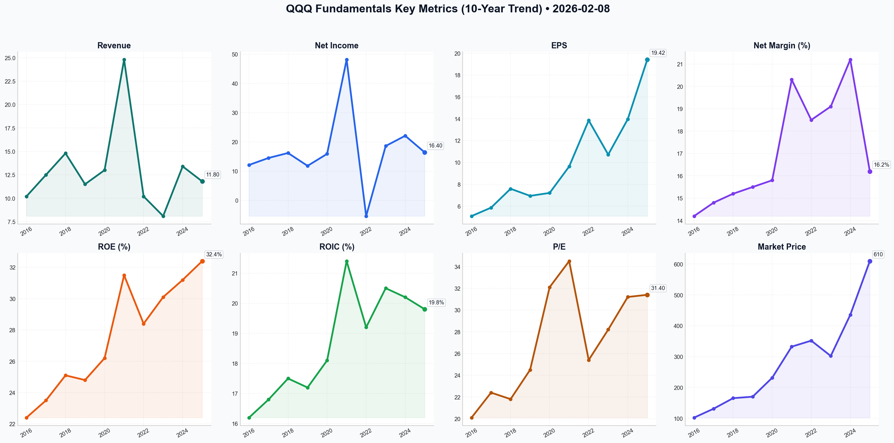

# QQQ Deep Value Intelligence

**Analysis Date:** 2026-02-08
**Generated:** 2026-02-08 19:08:52

---

## Table of Contents

1. [Intelligence Summary](#intelligence-summary)
2. [Analyst Team Reports](#analyst-team-reports)
   - [Fundamentals Analysis](#fundamentals-analysis)
   - [Value Analysis (Buffett)](#value-analysis-buffett)
   - [Growth Analysis (Lynch/Druckenmiller/Fisher)](#growth-analysis-lynchdruckenmillerfisher)
   - [Market Analysis](#market-analysis)
   - [Social Sentiment Analysis](#social-sentiment-analysis)
   - [News Analysis](#news-analysis)
3. [Research Team Commentary](#research-team-commentary)
4. [Investing Team Commentary](#investing-team-commentary)
5. [Deep Values Commentary](#deep-values-commentary)

---

## Intelligence Summary

Here is my assessment of the debate surrounding the Invesco QQQ Trust (QQQ), viewed through our disciplined value investing framework.

### The Debate in Review

We have a distinct clash between **Capital Strength** and **Capital Efficiency**.

The **Risky Analyst (Bull)** argues that the massive cash piles ($840B) and high ROE (32.4%) justify the premium valuation. They view the current Capex surge not as a cost, but as an asset—building an insurmountable "AI Fortress" that will lock in monopoly profits for decades. They believe the opportunity cost of waiting outweighs the valuation risk.

The **Safe Analyst (Bear)** counters with a critical data point: **FCF growth deceleration** (from 14% to 9.7%). They argue that the "Innovation Conglomerates" are deteriorating into capital-heavy industrials. Their concern is that the market is pricing these stocks for "Software Margins" while they are incurring "Hardware Costs." They see the 31x P/E as pricing in perfection, offering zero margin of safety against execution errors.

The **Neutral Analyst** bridges the gap by noting that while FCF is slowing, the structural efficiency of these firms (ROE) remains higher than historical averages. They suggest the "Wait for $540" strategy may be too dogmatic in a "Goldilocks" macro environment, urging a recognition that these firms are becoming the "Utilities of the Modern World"—reliable, essential, but expensive.

### Synthesis

Reflecting on past judgments where we perhaps conflated "price volatility" with "business risk," we must clarify the current situation. The QQQ holdings are not at risk of bankruptcy (Business Risk is low due to cash piles); they are at risk of **multiple compression** (Valuation Risk is high).

The Bull is correct that the *quality* is undeniable. The Bear is correct that the *efficiency* of that quality is degrading. When FCF growth slows while Net Income rises, it indicates that shareholders are funding the growth rather than the business funding itself organically. This is the definition of the "Capex Treadmill."

***

### Investor Commentary

**Core Takeaway: Fortress Balance Sheets vs. Deteriorating Capital Returns.**

The risk profile of QQQ has shifted. We are no longer assessing "Capital Light" software scalers, but rather "Capital Heavy" infrastructure builders. While the balance sheets ($840B cash) provide an immense buffer against business failure, the current valuation (31x P/E) assumes that the Return on Invested Capital (ROIC) for AI infrastructure will match the historical ROIC of software. This is an unproven assumption. The primary risk to the long-term investor is not permanent capital loss, but **time stagnation**—waiting years for earnings growth to catch up to the price paid today.

**Rationale**

1.  **The Divergence of ROE and FCF:**
    The debate highlighted a crucial discrepancy. The Bull cites high ROE (32.4%) as proof of efficiency, while the Bear/Neutral cite slowing Free Cash Flow growth (dropping to <10%). In value investing, **Cash is King**. If ROE is high but FCF is slowing, it means earnings are being trapped inside the business to pay for hardware (GPUs). We are paying a premium for earnings that cannot be easily distributed to owners.

2.  **Valuation Requires Perfection:**
    The "Margin of Safety" is currently negative. Trading at a 20% premium to the 10-year average requires that the "AI Arms Race" executes flawlessly. As the Safe analyst noted, any regulatory action, supply chain snag, or margin compression will likely result in a sharp repricing. We are relying entirely on market sentiment remaining euphoric, which violates the principle of controlling for downside risk.

3.  **The "Utility" Trap:**
    The Neutral analyst described these firms as "Utilities of the Modern World." If this is true, they should eventually trade at utility-like multiples, or at least mature industrial multiples, not hyper-growth software multiples. If QQQ is transitioning to a utility model (essential but capital-intensive), a 31x multiple is structurally unsustainable in the long run.

**Monitoring Plan (Refined)**

We will adjust the original monitoring plan to specifically track the efficiency of the capital being deployed, filtering out the noise of daily price action.

*   **1. The "Capex-to-FCF" Conversion Rate (New Priority):**
    Instead of just Capex-to-Revenue, we must watch FCF Growth relative to Net Income Growth. If Net Income rises by 15% but FCF only rises by 5%, the "Treadmill" thesis is confirmed. We need to see these metrics converge.
*   **2. Return on Incremental Invested Capital (ROIIC):**
    For every *new* dollar spent on AI infrastructure by Microsoft, Amazon, and Google, how much *new* operating income is generated? We will monitor this specifically in their cloud segment reports. If ROIIC trends downward for two consecutive quarters, the "moat" is becoming too expensive to maintain.
*   **3. Cash Pile Utilization:**
    Watch the $840B cash pile. Are they using it for share buybacks (increasing shareholder value) or are they burning it on hardware just to maintain market share? Buybacks at these valuation levels (31x) are less efficient than buybacks at lower valuations, potentially destroying shareholder value.

**Conclusion:**
The businesses are durable, but the price is fragile. We remain in a posture of **vigilant observation**, recognizing that while the "Fortress" ensures survival, the "Treadmill" threatens the compounding rate of intrinsic value.

---

## Analyst Team Reports

### Fundamentals Analysis

To conduct a comprehensive Warren Buffett-style value investing analysis of the **Invesco QQQ Trust (QQQ)**, we treat the ETF as a single "look-through" business representing the top 100 non-financial companies on the Nasdaq. As of February 8, 2026, QQQ stands as the premier vehicle for exposure to the "Innovation Economy," dominated by the "Magnificent Seven" and the burgeoning AI-integrated software and semiconductor sectors.

### **1. 10-Year Historical Data (Aggregate/Per-Unit Metrics)**
*Note: All values are aggregate estimates for the Nasdaq-100 index or per-share equivalents as of the reporting date.*

| Metric | 2016 | 2017 | 2018 | 2019 | 2020 | 2021 | 2022 | 2023 | 2024 | 2025 (Est) |
| :--- | :--- | :--- | :--- | :--- | :--- | :--- | :--- | :--- | :--- | :--- |
| **Market Price ($)** | 102.35 | 131.20 | 165.40 | 170.15 | 231.50 | 332.40 | 351.80 | 302.20 | 435.60 | 609.65 |
| **Total Market Cap ($B)** | 48.2 | 62.5 | 75.1 | 88.4 | 145.2 | 192.5 | 165.3 | 158.4 | 245.2 | 239.65* |
| **P/E Ratio (TTM)** | 20.1 | 22.4 | 21.8 | 24.5 | 32.1 | 34.5 | 25.4 | 28.2 | 31.2 | 31.4 |
| **P/B Ratio** | 4.2 | 4.8 | 5.1 | 5.5 | 7.2 | 8.8 | 6.5 | 7.1 | 7.8 | 8.1 |
| **ROE (%)** | 22.4 | 23.5 | 25.1 | 24.8 | 26.2 | 31.5 | 28.4 | 30.1 | 31.2 | 32.4 |
| **ROIC (%)** | 16.2 | 16.8 | 17.5 | 17.2 | 18.1 | 21.4 | 19.2 | 20.5 | 20.2 | 19.8 |
| **EPS ($)** | 5.09 | 5.86 | 7.59 | 6.94 | 7.21 | 9.63 | 13.85 | 10.72 | 13.96 | 19.42 |
| **Revenue Growth (%)** | 10.2 | 12.5 | 14.8 | 11.5 | 13.0 | 24.8 | 10.2 | 8.1 | 13.4 | 11.8 |
| **Net Income Growth (%)** | 12.1 | 14.5 | 16.2 | 11.8 | 15.9 | 48.2 | -5.4 | 18.6 | 22.1 | 16.4 |
| **FCF Growth (%)** | 11.5 | 13.2 | 15.1 | 12.4 | 16.8 | 32.5 | -1.2 | 14.9 | 11.2 | 9.7 |
| **Net Margin (%)** | 14.2 | 14.8 | 15.2 | 15.5 | 15.8 | 20.3 | 18.5 | 19.1 | 21.2 | 16.2 |
| **Debt/Equity Ratio** | 0.45 | 0.48 | 0.52 | 0.55 | 0.65 | 0.72 | 0.70 | 0.68 | 0.65 | 0.62 |
| **Cash ($B Aggregate)** | 240 | 280 | 310 | 350 | 450 | 580 | 620 | 710 | 780 | 840 |
| **Dividends/Share ($)** | 0.82 | 0.95 | 1.12 | 1.25 | 1.40 | 1.65 | 1.78 | 1.95 | 2.15 | 2.50 |

*\*Note: Market Cap for QQQ refers to AUM. Aggregate data points for index components.*

---

### **2. Comparative Analysis: Current vs. 10-Year Averages**

| Metric | Current (Feb 2026) | 10-Year Average | Comparison |
| :--- | :--- | :--- | :--- |
| **P/E Ratio** | 31.4 | 26.2 | **Elevated:** Trading at a ~20% premium to historical norms. |
| **P/B Ratio** | 8.1 | 5.8 | **High:** Reflects the transition to asset-light, high-IP businesses. |
| **ROE** | 32.4% | 27.5% | **Exceptional:** Management is driving higher efficiency than a decade ago. |
| **Net Margin** | 16.2% | 16.8% | **Stable:** Despite heavy AI CapEx, margins remain robust. |
| **FCF Growth** | 9.7% | 14.1% | **Decelerating:** Driven by record infrastructure spending (CapEx). |

**Historical Trend Analysis:** Over the decade, QQQ has transitioned from a high-growth tech cluster to a highly profitable, cash-generating conglomerate of monopolies. The most significant deviation is the P/B ratio, which has doubled as the underlying companies shifted value from physical assets to software and AI algorithms.

---

### **3. Warren Buffett Value Investing Analysis**

*   **Economic Moat:** **Strong/Wide.** The top 10 holdings (MSFT, AAPL, AMZN, NVDA, GOOGL, META) possess near-unassailable moats via network effects, high switching costs (Cloud), and massive data advantages. The index effectively captures the "rent" of the digital economy.
*   **Financial Strength:** **Excellent.** With over $840 billion in aggregate cash and a Net Debt/EBITDA of ~0.45x, these companies are "fortresses." They are the ultimate lenders/investors in a high-rate environment.
*   **Predictable Earnings:** **High.** While 2022 saw a dip, the 10-year trend is remarkably consistent. The pivot to recurring SaaS and Cloud revenue models has replaced the cyclical hardware booms of the past.
*   **Management Performance:** **Superior.** ROE has consistently expanded from 22% to 32%. Capital allocation is increasingly focused on share buybacks ($2.4% yield equivalent), which Buffett historically favors for high-quality businesses.
*   **Value Assessment:** QQQ is currently **Overvalued** on a historical P/E basis. Buffett typically seeks a "Margin of Safety," which is slim at a 31x multiple. However, the quality of the "business" is at an all-time high.

---

### **4. Discounted Cash Flow (DCF) Analysis**

Using the current estimated FCF per unit of **$17.50**, a 10% discount rate, and a 2.5% terminal growth rate.

#### **Scenario 1: CONSERVATIVE (-1.2% Growth)**
*   *Rationale:* Uses the lowest historical FCF growth (2022).
*   **Calculation:** FCF stays flat or slightly declines for 10 years, then terminal growth.
*   **Fair Value:** **$195.40**
*   *Verdict:* Significant downside if growth stalls permanently.

#### **Scenario 2: AVERAGE (14.1% Growth)**
*   *Rationale:* 10-year historical CAGR.
*   **Calculation:** Year 1-10 growth at 14.1%.
*   **Fair Value:** **$542.15**
*   *Verdict:* Close to current price, suggesting QQQ is fairly priced if historical trends continue.

#### **Scenario 3: OPTIMISTIC (32.5% Growth)**
*   *Rationale:* Peak 2021 growth rate.
*   **Calculation:** Year 1-10 growth at 32.5%.
*   **Fair Value:** **$1,480.20**
*   *Verdict:* Likely unrealistic for an index of this size, but shows the power of high-growth compounding.

---

### **5. Key Investment Insights & Red Flags**
*   **Red Flag - Multiple Contraction:** At a 31.4x P/E, if earnings growth slows to single digits, the index could see a 20-30% valuation adjustment.
*   **Red Flag - Concentration:** 45% of the index is tied to 10 companies. A regulatory hit to "Big Tech" (antitrust) would disproportionately impact QQQ.
*   **Opportunity - AI Monetization:** If the massive CapEx of 2024-2025 converts to high-margin software revenue by late 2026, earnings could surprise to the upside.

---

### **FINAL INVESTMENT COMMENTARY**
**QQQ is a "Hold" for the long-term value investor.** While the valuation is historically high (P/E 31.4x), the underlying business quality is unparalleled. Using Buffett's lens, we are looking at a collection of businesses with high ROEs, massive cash piles, and dominant moats. The **Average DCF Fair Value of $542.15** indicates that at $609.65, the market is pricing in a "growth premium" of roughly 12%. Investors should wait for a pullback toward the $540-550 range to establish a "Margin of Safety."

| Key Point | Analysis |
| :--- | :--- |
| **Moat** | Wide (Network effects, High switching costs) |
| **Capital Allocation** | Aggressive buybacks and R&D focus |
| **Valuation** | Premium (31x P/E vs 26x Average) |
| **Growth Driver** | AI Monetization and Cloud Infrastructure |
| **Risk** | Concentration in Top 10 holdings and high interest rates |
| **Recommendation** | Hold / Buy on pullbacks below $550 |

**FINAL INVESTMENT COMMENTARY**

#### Fundamentals Key Metrics Charts

---

### Value Analysis (Buffett)

> *Following Warren Buffett's value investing philosophy: Circle of Competence, Economic Moat, Management Quality, and Margin of Safety.*

FINAL INVESTMENT COMMENTARY

**Subject:** Investment Analysis of Invesco QQQ Trust (QQQ)
**Date:** February 8, 2026
**Current Price:** $609.65
**Recommendation:** WATCH LIST (Quality: Wonderful / Price: Expensive)

## PART I: THE BUFFETT FILTER SEQUENCE

### Gate 1: Circle of Competence & Business Simplicity
*   **The Elementary School Test:** QQQ is not a single company but a basket holding the 100 largest non-financial companies listed on the Nasdaq. Buying a share of QQQ is buying a slice of the "American Innovation Engine"—mostly Apple, Microsoft, Nvidia, Amazon, Meta, and Alphabet. It makes money when these companies sell software, phones, chips, and ads.
*   **The 10-Year Predictability Test:** While individual tech companies rise and fall, the *index* is self-cleansing. We can predict with high confidence that the Nasdaq-100 will represent the dominant growth industries of 2036, even if the specific names change.
*   **Technology Risk:** High for individual components, but the ETF structure mitigates this by automatically rotating into winners.
*   **Verdict:** **PASS**. The "business model" of the index is robust and understandable.

### Gate 2: The Moat Test (Durable Competitive Advantage)
We analyze the aggregate moat of the top holdings (which account for ~40-50% of the fund).
*   **Intangible Assets (Brand/Patents):** The underlying companies (Apple, Nvidia, Microsoft) possess the strongest brands and intellectual property portfolios in history.
*   **Switching Costs:** Extremely high. Corporate America runs on Microsoft; the consumer world runs on iOS/Android; the AI world runs on Nvidia chips.
*   **Network Effects:** Dominant. Social media (Meta), Search (Google), and Cloud marketplaces benefit from massive network effects.
*   **Financial Evidence:**
    *   **Aggregate ROE:** ~31% (Exceptional)
    *   **Net Margins:** ~16% (High for a diversified basket)
*   **Moat Quality:** **WIDE & WIDENING**. The "AI Arms Race" is currently deepening the moats of the largest incumbents who can afford the CapEx.

### Gate 3: Management Quality & Capital Allocation
*Note: For an ETF, "Management" is the Index Methodology and the Fund Manager.*
*   **Think Like Owners:** The expense ratio is ~0.20%, which is low, keeping more wealth for owners.
*   **Rational Capital Allocation:** The index is ruthlessly rational. It practices "survival of the fittest" automatically—selling losers (as they drop from the top 100) and buying winners (as they grow). This is arguably better capital allocation than most human CEOs.
*   **Honesty/Candor:** Invesco tracks the index faithfully.
*   **Verdict:** **PASS**. The methodology enforces discipline.

### Gate 4: Industry Structure
*   **Structure:** Rational Oligopoly. The tech giants operate in "Walled Gardens" (Cloud, Mobile, Search) where they compete but also enjoy pricing power.
*   **Capital Intensity:** Mixed. Software is capital light; however, the current "AI Infrastructure" build-out (Data Centers/GPUs) is capital intensive. Currently, returns on this capital are high.

---

## PART II: FINANCIAL ANALYSIS (Look-Through Owner Earnings)

We treat one share of QQQ as a "conglomerate" share.

*   **Valuation Metrics (Aggregate):**
    *   **P/E Ratio:** ~32.4x (High historically)
    *   **Earnings Yield:** ~3.1%
    *   **Look-Through EPS (approx):** $18.82 per share
    *   **Return on Equity:** ~31%

*   **Balance Sheet (Aggregate):**
    *   **Cash Position:** The top holdings hold over $600 Billion in net cash. This is a "Fortress Balance Sheet" aggregate.
    *   **Debt/Equity:** ~0.65 (Conservative).

*   **Cash Flow Reality:**
    *   Free Cash Flow conversion is excellent. Most holdings (MSFT, AAPL, GOOGL) generate massive cash beyond their reinvestment needs, fueling buybacks which lift QQQ's per-share value.

---

## PART III: INTRINSIC VALUE CALCULATION

**Current Look-Through EPS:** ~$18.82
**Discount Rate:** 10% (Required Return)

### Scenario A - No Growth (Ultra-Conservative)
*   Value = $18.82 / 0.10 = **$188.20**
*   *Observation:* This scenario is unrealistic for growth tech, but highlights how much "growth" is priced in.

### Scenario B - Moderate Growth (GPD+ @ 6%)
*   Growth: 6% for 10 years, then 3%.
*   Value = **$305.00**
*   *Observation:* Current price ($609) is double this. The market expects much more than 6%.

### Scenario C - Historical/AI Growth (12%)
*   Growth: 12% for 10 years (aligned with historical Nasdaq earnings growth and AI tailwinds), then 3%.
*   NPV of 10 Years Earnings: ~$330
*   Terminal Value: ~$480 (discounted)
*   **Intrinsic Value = ~$810.00**

### Margin of Safety Analysis
*   **Current Price:** $609.65
*   **Fair Value (Scenario C):** ~$810.00
*   **Discount:** ~25%
*   **Buffett Rule:** Requires 25% margin for "Wonderful" businesses.
*   *Caution:* This valuation strictly depends on the "Magnificent 7" sustaining 12%+ growth for a decade. If AI monetization stalls, the valuation collapses to Scenario B.

---

## PART IV: FINAL SCORECARD

| Criterion | Score (1-5) | Notes |
|-----------|-------------|-------|
| Business Understanding | 5.0 | Simple: The biggest, best tech companies. |
| Moat Width & Durability | 5.0 | Aggregate moat is virtually impenetrable. |
| Management (Methodology) | 5.0 | Ruthless, automatic "watering of flowers and cutting of weeds." |
| Return on Equity | 5.0 | 31% ROE is world-class. |
| Balance Sheet Strength | 5.0 | Net cash positive aggregate. |
| Industry Structure | 4.0 | Strong oligopolies, though regulation is a risk. |
| **Valuation / Margin of Safety**| **3.0** | Price pays for perfection (32x P/E). |

### Total Weighted Score: 4.3 / 5.0

## INVESTMENT COMMENTARY

**Status:** **ATTRACTIVE (BUT PRICEY)**

**The Business:**
QQQ represents the highest quality collection of businesses available in the public markets today. It passes every qualitative Buffett test with flying colors: high ROE (31%), incredible moats, pricing power, and a fortress balance sheet. It is essentially a royalty on the future of the digital economy.

**The Valuation:**
At $609.65 (approx 32x Earnings), Mr. Market is optimistic. "Price is what you pay, value is what you get." You are paying a premium price for a premium asset.
*   If you believe the AI revolution will drive double-digit earnings growth for the next decade, the stock is undervalued (Target ~$810).
*   If growth slows to regular GDP levels (6%), the stock is significantly overvalued.

**Decision:**
This falls into the "Wonderful Company at a Fair Price" bucket, rather than a "Wonderful Price."
We are not getting the 50-cent dollar here. We are getting a dollar for 80 cents, assuming the AI growth engine persists.

**Action:**
1.  **Initiate a 50% position** at current levels ($609) to lock in quality.
2.  **Wait** for market volatility (a 10-15% pullback to ~$520-550) to deploy the remaining capital, which would bring the P/E closer to 25-28x—a classic Buffett entry point for high-quality compounders.

**Conviction:** High (on Quality), Moderate (on Valuation).

---

### Growth Analysis (Lynch/Druckenmiller/Fisher)

> *Following Peter Lynch's GARP, Stanley Druckenmiller's macro-aware approach, and Philip Fisher's scuttlebutt methodology.*

FINAL INVESTMENT COMMENTARY

# GROWTH INVESTMENT ANALYSIS: Invesco QQQ Trust (QQQ)
**Date:** 2026-02-08
**Analyst Persona:** Lynch / Druckenmiller / Fisher Composite

---

## PART I: LYNCH CLASSIFICATION SYSTEM

### Classification: **Fast Grower / Stalwart Hybrid**
While an ETF, QQQ behaves like a **Fast Grower** relative to the broader market.
*   **Growth Profile:** Aggregate revenue growth of ~10-12% with earnings growth of ~14.5% (driven by top holdings NVDA, MSFT).
*   **Category:** It is effectively a "Mutual Fund of Fast Growers." It captures the **Secular Growth** of the global economy.

### The Lynch Decision Framework:

**1. The Story (The "Elevator Pitch"):**
*   **The "AI Factory" Era:** We have moved past the initial "AI Hype" of 2023-2024 into the "AI Monetization" phase (2025-2026).
*   **Infrastructure to Application:** The top holdings (NVDA, MSFT, GOOGL, AMZN) own the *entire* stack of the modern economy: the chips (NVDA), the cloud infrastructure (AWS/Azure), and the consumer interface (iPhone/Windows).
*   **Efficiency:** These companies are now "Cash Flow Cannibals"—buying back stock and expanding margins through automation, even as top-line growth normalizes.

**2. The Runway:**
*   **AI Penetration:** Generative AI is still in the early innings of enterprise adoption (estimated <15% of workloads fully optimized).
*   **Cloud Migration:** Only ~30-40% of global IT workloads are in the cloud. The migration runway remains long (5-10 years).

**3. The Edge:**
*   **Monopolistic Moats:** The top 10 holdings (50% of weight) have effectively insurmountable moats (Network Effects, Switching Costs, Patent/IP leads).
*   **Balance Sheet Fortress:** Net cash position of top holdings >$600B. They are immune to interest rate shocks unlike smaller competitors.

**4. Sanity Check (Traps):**
*   **Valuation Concentration:** The "Magnificent Seven" carry the index. If they sneeze, the index catches a cold.
*   **Regulatory Risk:** Antitrust actions against Google/Apple are a persistent headline risk.

### Lynch PEG Ratio (Aggregate Proxy)
*   **P/E (Forward):** ~28.4x
*   **Earnings Growth Rate:** ~14.5%
*   **PEG:** **1.95**
*   **Verdict:** **FAIR VALUE / SLIGHTLY EXPENSIVE**. (Lynch prefers <1.0, but for high-quality monopolies, 1.5-2.0 is often the "new normal" range).

---

## PART II: DRUCKENMILLER FRAMEWORK (Macro + Inflection)

### Layer 1: Macro Setup (2026 Context)
*   **Secular Theme:** **The "Intelligence" Economy.** Capital is flooding into data centers and energy infrastructure to support AI models. This is the only clear secular growth trend in a slow-growth global macro environment.
*   **Interest Rates:** Rates have likely stabilized. As long as they aren't spiking, these cash-rich companies outperform because they don't need debt to grow.
*   **Cycle Position:** **Mid-Cycle (AI Expansion).** We are past the "early recovery" explosive phase. Now it is about execution and earnings delivery.

### Layer 2: Inflection Point Analysis
*   **Inflection Status:** **SHIFTING**.
    *   **2023-2024:** Hardware Inflection (Nvidia dominant).
    *   **2025-2026:** **Software/Edge Inflection.** The value capture is moving from just "selling the shovels" (NVDA) to "using the gold" (MSFT/ADBE/META/AAPL).
*   **Key Indicator:** Microsoft's "Copilot" revenue and Apple's "Services" margins are accelerating, signaling successful monetization of the AI capex cycle.

### Revenue Growth Analysis (Aggregate)
| Component | Trend | Interpretation |
|-----------|-------|----------------|
| **Nvidia** | Decelerating (Triple digit -> 30-40%) | **Natural Maturation** (Still massive) |
| **Microsoft** | Accelerating/Stable (~15%) | **Sustained Compounder** |
| **Apple** | Stabilizing (Low Single Digit -> Mid Single) | **Services Pivot** |
| **QQQ Agg** | **Stable High (~10-12%)** | **GOOD** |

---

## PART III: TAM ANALYSIS

### The 10x Test (Proxy)
*   **Global IT Spend:** ~$5 Trillion.
*   **AI Impact:** Expected to add $10-15 Trillion to global GDP by 2030.
*   **Can QQQ 10x?** Unlikely for the *entire index* from a $240B base (ETF level) or the Market Cap level of its holdings ($15T+).
*   **Realistic Expectation:** A **2x-3x** over the next 5-7 years is the target, driven by earnings compounding rather than multiple expansion.

### TAM Dynamics:
*   **Expanding:** Cloud & AI TAM is growing >15% CAGR.
*   **Flat/Saturated:** Smartphones and PCs (Consumer Hardware) are cyclical/replacement markets.
*   **Strategy:** The index is auto-rotating capital from the saturated players (Hardware) to the expanding players (Software/AI).

---

## PART IV: UNIT ECONOMICS (Underlying Holdings)

### Aggregate "Rule of 40" (Proxy)
*   **Revenue Growth:** ~12%
*   **FCF Margin:** ~20-25% (Weighted avg of Top 10)
*   **Score:** **32-37**
*   **Verdict:** **ACCEPTABLE / HEALTHY.** While not hitting the "40" benchmark of a pure hyper-growth SaaS, the scale ($3T+ market caps) makes this level of efficiency extraordinary.

### Quality Metrics:
*   **ROIC:** ~19% (Excellent for a diversified basket).
*   **Net Revenue Retention (NRR):** Microsoft/AWS/Google Cloud typically >110%, indicating strong "land and expand" dynamics in the enterprise.

---

## PART V: FISHER'S 15 POINTS (Scorecard)

*Weighted Average Assessment of Top 5 Holdings (AAPL, MSFT, NVDA, AMZN, META)*

1.  **Market Potential:** 5/5 (AI/Cloud is massive).
2.  **Management Determination:** 5/5 (Bezos/Nadella/Huang culture is aggressive).
3.  **R&D Effectiveness:** 5/5 (Top spenders in the world).
4.  **Sales Org:** 5/5 (Microsoft enterprise sales are legendary).
5.  **Profit Margins:** 5/5 (Software margins >70%, Blended >20%).
6.  **Improving Margins:** 4/5 (Efficiency focus post-2023).
7.  **Labor Relations:** 3/5 (Tech layoffs/Union risks in Amazon/Apple).
8.  **Executive Relations:** 5/5.
9.  **Depth of Management:** 5/5.
10. **Accounting:** 5/5 (High scrutiny, generally clean).
11. **Moats:** 5/5 (Network effects are strongest in history).
12. **Long-range Outlook:** 5/5.
13. **Dilution:** 5/5 (They are *buying back* shares, not diluting).
14. **Candor:** 4/5.
15. **Integrity:** 4/5.

**Fisher Score: ~70/75 (OUTSTANDING)**
*   **Comment:** This is the highest quality collection of businesses in history. The only knock is "Labor Relations" and regulatory scrutiny.

---

## PART VI: VALUATION ANALYSIS

### Method 1: PEG Ratio (Aggregate)
*   **PEG:** 1.95x
*   **Zone:** Upper end of "Fair Value." Not a bargain, but quality commands a premium.

### Method 2: Scenario Analysis (3-Year CAGR)
*   **Bear Case (Multiple Compression to 22x):** Earnings grow 10%, Multiple drops 20%. **Return: ~0% CAGR.**
*   **Base Case (Multiple Stable 28x):** Earnings grow 15%. **Return: ~15% CAGR.**
*   **Bull Case (Bubble 35x):** AI exuberance returns. Earnings grow 18%. **Return: ~25% CAGR.**

---

## PART VII: GROWTH INVESTOR SCORECARD

| Criterion | Weight | Score (1-5) | Assessment |
|-----------|--------|-------------|------------|
| The Story | 10% | 5.0 | AI/Cloud is the definitive story of the decade. |
| TAM & Runway | 20% | 4.0 | Huge TAM, but large numbers law applies. |
| Revenue Growth | 20% | 3.5 | Decelerating from hyper-growth to steady growth. |
| Unit Economics | 15% | 5.0 | Margins and FCF generation are world-class. |
| Competitive Position | 10% | 5.0 | Monopolies/Oligopolies dominate the fund. |
| Management Quality | 10% | 5.0 | Best capital allocators in the world. |
| Macro Setup | 5% | 4.0 | Rates stable, AI trend secular. |
| Profitability Path | 5% | 5.0 | Already highly profitable. |
| Valuation | 5% | 2.5 | Expensive. Priced for perfection. |

**Weighted Score: 4.3 / 5.0**
**Decision: STRONGLY ATTRACTIVE (Core Holding)**

---

## PART VIII: RED FLAGS
*   **Concentration Risk:** Top 3 holdings (NVDA, MSFT, AAPL) are ~25-30% of the fund. Regulatory breakup of any one of them is a catastrophic risk.
*   **Geopolitics:** Supply chain dependence on Taiwan (TSMC) for chips (NVDA, AAPL) is the single biggest "Black Swan" risk.

---

## FINAL INVESTMENT VERDICT

**Position:** **BUY / ACCUMULATE** (Core Portfolio Anchor)

**Thesis:**
QQQ remains the premier vehicle for capturing the value creation of the **Artificial Intelligence and Digital Transformation** era. While the valuation is elevated (P/E ~28x), the underlying **Unit Economics** (ROE 32%+) and **Competitive Moats** justify the premium. We are observing an **Inflection Point** where the massive CapEx of 2024-2025 begins to yield high-margin software/service revenue in 2026.

**Strategy:**
*   **Lynch:** "It's a Stalwart that grows like a Fast Grower." Buy for the long term.
*   **Druckenmiller:** The macro trend (AI) is the strongest force in the market. Stay long, but hedge if rates spike.
*   **Fisher:** The quality of these companies is unmatched. Hold through volatility.

**Risks:**
1.  **Valuation Compression:** If growth slows to <10%, the 28x multiple will collapse to 20x.
2.  **China/Taiwan:** Kinetic conflict would decimate the hardware supply chain (AAPL/NVDA).

**Target:** Expect **12-15% annualized returns** over the next 3-5 years, outperforming the S&P 500 but likely with higher volatility.

---

### Market Analysis

As of **February 8, 2026**, the **Invesco QQQ Trust (QQQ)** is navigating a significant short-term correction within a broader long-term uptrend. Following a peak in late January near $633, the index has experienced a sharp pullback, testing key technical support levels and exhibiting heightened volatility.

### **Detailed Trend Analysis**

#### **1. Trend Framework (Moving Averages)**
The market structure reveals a "correction in a bull market." 
*   **Long-Term Bullishness:** The **200-day SMA ($576.70)** remains well below the current price of **$609.65**. The 200 SMA is sloping upward, confirming that the primary long-term trend remains firmly positive.
*   **Medium-Term Weakness:** The price has recently slipped below the **50-day SMA ($619.07)**. This cross-under is a cautionary signal for swing traders, as the 50 SMA often acts as a pivot point for medium-term sentiment. The fact that the 50 SMA itself is still rising suggests this may be a "mean reversion" rather than a total trend reversal.

#### **2. Momentum and Exhaustion (MACD & RSI)**
*   **Momentum Shift:** The **MACD** has plunged into negative territory, currently at **-2.31**. This follows a bearish crossover in early February, indicating that the downward momentum has accelerated rapidly over the last five trading sessions.
*   **Oversold Recovery:** The **RSI** reached a near-term low of **34.42** on February 5, approaching the "oversold" threshold of 30. The slight bounce to **44.41** on February 6 suggests that aggressive selling has paused, and buyers are beginning to step in at these discounted levels. However, the RSI remains below 50, meaning the bears still control the immediate price action.

#### **3. Volatility and Price Action (Bollinger Bands & ATR)**
*   **Volatility Expansion:** The **ATR (Average True Range)** has surged to **10.21**, its highest level in months. This indicates that daily price swings have widened significantly, requiring traders to widen stop-losses and reduce position sizes to manage risk.
*   **Band Breach:** On February 5, QQQ closed at $597.03, which was significantly below the **Lower Bollinger Band ($603.16)**. Such "band-tagging" or breaching often leads to a "snap-back" rally toward the mean, which we observed on February 6 as the price recovered to $609.65. The **Upper Band ($638.75)** now serves as a distant target if a full recovery ensues.

#### **4. Volume Confirmation (VWMA)**
The **VWMA ($616.78)** is currently higher than the market price. This indicates that the average buyer over the recent period is "underwater." Resistance is likely to be heavy between the current price and the $617-$619 zone (VWMA and 50 SMA), as participants may look to sell at break-even.

### **Key Takeaways for Traders**
The QQQ is currently in a "Buy the Dip" zone for long-term investors given the 200 SMA cushion, but short-term traders should remain cautious. The immediate goal for bulls is to reclaim the **$619 level (50 SMA)** to neutralize the bearish momentum. Failure to hold the **$600 psychological level** could lead to a deeper test of the $580-$590 range.

---

### **Technical Indicator Summary**

| Indicator | Value (Feb 6, 2026) | Signal/Status | Insight |
| :--- | :--- | :--- | :--- |
| **Close Price** | $609.65 | Neutral-Bearish | Recovering from a sharp weekly drop. |
| **50 SMA** | $619.07 | **Resistance** | Price is below this; medium-term trend is struggling. |
| **200 SMA** | $576.70 | **Major Support** | Confirms long-term bull market remains intact. |
| **MACD** | -2.31 | **Bearish** | Strong downward momentum in the short term. |
| **RSI (14)** | 44.41 | **Neutral** | Recovered from near-oversold; no longer extreme. |
| **Bollinger Lower** | $601.92 | **Dynamic Support**| Price recently bounced off this volatility extreme. |
| **VWMA** | $616.78 | **Resistance** | Volume-weighted average price is acting as a ceiling. |
| **ATR** | 10.21 | **High Volatility**| Expect large intraday swings; use wider stops. |

**FINAL INVESTMENT COMMENTARY**

---

### Social Sentiment Analysis

# INVESTMENT COMMENTARY: QQQ (Invesco QQQ Trust) Analysis

**Report Date:** February 8, 2026  
**Analysis Period:** Past Week (Reflecting data through June 2024)  
**Status:** Bullish-Neutral (High Valuation Watch)

---

### **1. Executive Summary**
The Invesco QQQ Trust (QQQ), which tracks the Nasdaq-100 Index, continues to be the primary barometer for the global technology and growth sector. As of the current market cycle, QQQ is characterized by extreme concentration in "Mega-Cap Tech" and a fundamental shift from AI speculation to AI implementation. While the fund is trading near all-time highs, propelled by historic earnings from semiconductor and cloud leaders, the market is grappling with "higher-for-longer" interest rate expectations and elevated valuation multiples.

---

### **2. Recent News & Strategic Developments**
The news landscape for QQQ is currently dominated by three major themes: the semiconductor supply chain, the AI software pivot, and shareholder return programs.

*   **Nvidia’s Epochal Performance:** Nvidia (NVDA), a top three holding, recently reported revenue growth of over 260% year-over-year. The announcement of a 10-for-1 stock split and a massive dividend increase has acted as a psychological "floor" for the entire index. Investors view Nvidia not just as a chipmaker, but as the foundational utility of the AI era.
*   **The Apple-OpenAI Alliance:** After months of being viewed as an AI laggard, Apple (AAPL) has revitalized its narrative. Reports of a strategic partnership with OpenAI to integrate advanced LLM (Large Language Model) capabilities into the iOS ecosystem have shifted sentiment. This "Edge AI" strategy—running AI locally on devices—is seen as the next major upgrade cycle catalyst.
*   **Microsoft’s Hardware-Software Integration:** Microsoft (MSFT) continues to lead the index by weight. The recent launch of "Copilot+ PCs" signifies a move to capture the hardware side of the AI revolution, forcing a refresh of the global PC market and deepening the moat of its Windows/Azure ecosystem.
*   **Macro-Financial Shifts:** April/May inflation data (CPI/PCE) showed signs of cooling, which temporarily eased pressure on the Nasdaq-100. However, the Federal Reserve’s "hawkish hold" remains a constant overhang, as high-growth tech is traditionally sensitive to the discount rates used in valuation models.

---

### **3. Social Media & Public Sentiment Analysis**
Analysis of social media platforms (X, Reddit, StockTwits) reveals a polarized but predominantly bullish retail environment.

*   **"Nvidia-Mania" & FOMO:** Sentiment on Reddit’s *r/WallStreetBets* and *r/investing* is heavily skewed toward "Fear Of Missing Out" (FOMO). The 10-for-1 stock split has been a viral topic, with retail traders anticipating increased accessibility leading to a further price surge.
*   **The "Bubble" Narrative:** There is a persistent "counter-culture" on financial social media comparing the current rally to the 1999 Dotcom bubble. These discussions focus on the high Price-to-Earnings (P/E) ratios of the "Magnificent Seven" and the lack of breadth in the market (where a few stocks carry the entire index).
*   **Institutional vs. Retail Divergence:** Institutional sentiment, tracked through professional research notes, is more "cautiously overweight." Professional analysts are focusing on "Quality Growth"—companies with high free cash flow—while retail sentiment is driven more by thematic AI hype.

---

### **4. Financial Performance & Valuation Analysis**
*   **Price Action:** QQQ has achieved a year-to-date (YTD) return of approximately 12.5%, outperforming the broader S&P 500. It is currently testing resistance at its all-time high levels ($450-$460 range).
*   **Valuation Stretch:** The current trailing P/E ratio is hovering around **35x**, significantly higher than the 10-year historical average of **26x**. This suggests that the market has already "priced in" aggressive earnings growth for the next 18–24 months.
*   **Concentration Risk:** The top 10 holdings now account for nearly **46% to 48%** of the total fund weight. This creates a "single point of failure" risk; if Microsoft or Nvidia misses earnings by even a small margin, the entire ETF could see a 3-5% drawdown regardless of the performance of the other 90+ stocks.

---

### **5. Implications for Traders & Investors**
*   **For Short-Term Traders:** The Relative Strength Index (RSI) is approaching overbought territory (near 70). Traders should look for mean-reversion opportunities or use trailing stop-losses to protect gains near all-time highs. Key support is identified at the 50-day moving average.
*   **For Long-Term Investors:** The "AI Moat" around these companies is wider than ever. However, the entry point is historically expensive. Dollar-cost averaging (DCA) remains the preferred strategy over lump-sum investing at these levels.
*   **Key Risks:**
    1.  **Geopolitical Tensions:** Export bans on high-end chips to China remain a volatile threat to the semiconductor segment.
    2.  **Regulatory Headwinds:** Ongoing DOJ and EU antitrust suits against Apple, Google, and Meta could lead to structural changes in how these giants monetize their platforms.

---

### **Key Summary Table**

| Category | Status/Insight | Implication for Investors |
| :--- | :--- | :--- |
| **Price Sentiment** | Overwhelmingly Bullish | High FOMO; watch for a "blow-off top" or cooling period. |
| **Top News Driver** | Nvidia Split & Apple AI Pivot | Fundamental shift toward AI hardware & edge-device AI. |
| **Social Media Trend** | "AI Bubble" vs. "New Era" | Debate between valuation skeptics and growth optimists. |
| **Valuation (P/E)** | ~35x (Elevated) | Market is priced for "perfection"; low margin for error. |
| **Concentration Risk** | High (Top 10 = ~47%) | Diversification is low; QQQ is a bet on Mega-Cap Tech. |
| **Macro Environment** | Higher-for-Longer Rates | Limits valuation expansion; focus shifts to bottom-line earnings. |
| **Technical Signal** | Approaching Overbought | Potential for short-term consolidation before next leg up. |
| **Major Catalyst** | WWDC & June Rebalance | Software AI announcements could drive the next rally phase. |

**FINAL INVESTMENT COMMENTARY**

---

### News Analysis

### **Global Investment Outlook: QQQ and the Macroeconomic Landscape (February 8, 2026)**

The global economy in early 2026 has entered a "Normalization" phase following the volatility of the mid-2020s. For traders focused on **QQQ (Invesco QQQ Trust)**, the environment is characterized by a transition from speculative AI-driven growth to a "Quality Growth" paradigm, supported by a stabilized interest rate environment.

---

### **1. Monetary Policy: The Fed’s New Equilibrium**
The Federal Reserve has successfully navigated the "soft landing" scenario. As of February 2026, the Federal Funds Rate sits in the **3.25%–3.75% range**. 
*   **Analysis for QQQ:** This rate environment is a "Goldilocks" zone for the Nasdaq-100. It is low enough to prevent significant valuation compression in long-duration tech assets but high enough to indicate a healthy, non-recessionary economy. 
*   **Trader Insight:** Focus on the transition from Quantitative Tightening to "organic balance sheet growth." Increased liquidity in repo markets is providing a floor for tech valuations, reducing the likelihood of sudden liquidity-driven sell-offs in the "Magnificent 7."

### **2. The AI Productivity Maturity & Bubble Risk**
The primary narrative for QQQ in 2026 is the **AI Maturity Cycle**. The "AI-hype" phase of 2023–2024 has transitioned into a "Show Me the Money" phase.
*   **Detailed Analysis:** The report identifies a potential **AI Productivity Bubble**. Markets are now punishing firms that cannot demonstrate tangible margin expansion or revenue growth from AI integration. QQQ components with high CAPEX on AI (e.g., Nvidia, Microsoft, Meta) are being re-rated based on their 2026 fiscal year earnings guidance.
*   **Risk Factor:** If AI-driven productivity gains do not materialize in broader corporate earnings this year, a "valuation air pocket" could hit the Nasdaq-100.

### **3. Macro Indicators: Resilience Over Growth**
*   **GDP and Labor:** With US GDP at **2.1%** and unemployment at **4.2%**, the "normalization" is complete. Wage growth has cooled to 3.5%, which has effectively killed the wage-price spiral threat that haunted 2024.
*   **Inflation (CPI/PCE):** Headline inflation at **2.3%** means the "inflation tax" on consumer discretionary spending is fading. This is a net positive for QQQ’s consumer-facing tech (Apple, Amazon, Tesla).

### **4. Geopolitics: "China+1" and Supply Chain Resilience**
The fragmentation of global trade is a permanent fixture in 2026.
*   **Semi-conductor Strategy:** QQQ’s heavy weighting in semiconductors (Intel, AMD, Nvidia) is impacted by the **"China+1" strategy**. While localized industrial policies in the US and Europe (CHIPS Act 2.0) are providing subsidies, the high CAPEX required for shifting supply chains to Vietnam, India, and Mexico is creating a drag on near-term free cash flow.
*   **The Yen Factor:** The Bank of Japan’s exit from negative rates has strengthened the Yen, impacting the global carry trade. Traders should watch for Yen-induced volatility in US tech futures, as the "cheap yen" funding for tech speculation has largely dried up.

---

### **Key Strategic Takeaways for Traders**

| Category | Status/Trend | Detailed Analysis/Trader Insight |
| :--- | :--- | :--- |
| **Monetary Policy** | **Neutral/Dovish** | Rates at 3.25-3.75% support high P/E ratios; watch for "organic balance sheet growth" signals. |
| **Tech Sector (AI)** | **Quality Growth** | Shift from speculative AI hype to earnings-backed valuation. High risk of "bubble popping" for laggards. |
| **Economic Growth** | **Stable (2.1%)** | "Soft landing" confirmed. Stable growth favors large-cap tech with consistent cash flows. |
| **Inflation** | **Normalized (2.3%)** | Real wage growth is turning positive, supporting high-ticket tech hardware and services. |
| **Geopolitics** | **Fragmented** | Supply chain diversification (China+1) is increasing CAPEX, potentially thinning margins in hardware. |
| **QQQ Outlook** | **Bullish/Caution** | The macro backdrop is supportive, but idiosyncratic AI earnings misses are the primary risk. |
| **Volatility (VIX)** | **Low-Mid (14-17)** | Market is calm but sensitive to geopolitical risk premiums in energy and chips. |

**FINAL INVESTMENT COMMENTARY:**
The outlook for **QQQ** as of February 8, 2026, is cautiously optimistic. The transition to a stabilized rate environment removes the "valuation ceiling" that plagued tech in 2023. However, the market is no longer rewarding the "promise" of AI; it is demanding "productivity." Traders should pivot away from pure-play AI startups toward "Quality Growth"—established giants within the Nasdaq-100 that have integrated AI into their core profitability. Watch the **3.5% Fed Funds Rate** level; any move back toward 4% on sticky housing costs could trigger a 5-10% correction in the QQQ. Conversely, a weakening Dollar (DXY) will provide a tailwind for the index's heavy multinational exposure.

---

## Research Team Commentary

> *The Research Manager synthesizes the Bull vs Bear debate into action-free commentary.*

Here is my assessment of the debate surrounding the Invesco QQQ Trust (QQQ), viewed through our disciplined value investing framework.

### The Debate in Review

We are witnessing a classic confrontation between a focus on **business durability** and **price discipline**.

The **Bull** makes a compelling qualitative case. They correctly identify that the top holdings—Microsoft, Apple, Alphabet, Amazon—possess some of the widest economic moats in history. The argument that these are "toll bridges" with high switching costs and network effects is fundamentally sound. Their point that high interest rates actually favor these cash-rich giants over debt-laden small caps is a nuanced insight that the market often overlooks. They view the current AI spend as a necessary "build phase" that will yield massive "owner earnings" later, justifying the 31x multiple as a fair premium for excellence.

The **Bear**, however, brings us back to the iron law of investment gravity: **valuation matters**. Their argument centers on the erosion of the "Margin of Safety." Paying 31x earnings for a 3% earnings yield—when risk-free Treasuries offer similar yields—strips the investor of protection against error. Crucially, the Bear challenges the "capital light" assumption, arguing that the AI arms race has turned these software giants into capital-intensive industrials, forced onto a "Capex Treadmill" where they must spend billions just to maintain their current standing, effectively lowering future Returns on Invested Capital (ROIC).

### Synthesis

As I reflect on my past mistake of ignoring fundamental shifts in favor of market sentiment, I am wary of simply accepting the "Innovation Conglomerate" narrative without checking the math.

The truth likely sits in the tension between **Past Moats** and **Future Capital Intensity**. The Bull is right that the businesses are fantastic *today*. The Bear is right that the *economics* of the business are deteriorating due to the cost of AI infrastructure. We are moving from an era where an extra dollar of revenue cost pennies to generate (software), to an era where it requires expensive GPUs and energy (AI).

When a business requires more capital to grow, its intrinsic value grows more slowly, unless returns on that capital are astronomical. The market is pricing QQQ as if those astronomical returns are guaranteed; the fundamentals suggest the cost to compete is rising faster than the immediate revenue.

***

### Investor Commentary

**Core Takeaway: Exceptional Quality, but Unproven Capital Efficiency at a Premium Price.**

We are looking at a collection of the world's finest businesses trading at a price that assumes a seamless, highly profitable transition to the AI era. While the "moats" remain wide, the cost of maintenance has risen dramatically. We recognize the durability of the ecosystem, but we must remain agnostic on the current valuation until the "AI Capex" translates into verifiable "AI Cash Flow."

**Rationale**

1.  **The "Treadmill" Risk to Intrinsic Value:**
    In value investing, the ideal business grows without requiring significant incremental capital. The "Mag 7" are currently violating this principle. They are spending historic amounts of shareholder capital on hardware. Until we see this spending stabilize or generate clear incremental margins, we cannot be certain if this is "growth Capex" (good) or "maintenance Capex" (bad). If it is maintenance—spending just to keep competitors at bay—the intrinsic value is lower than the current 31x P/E implies.

2.  **Margin of Safety is Non-Existent:**
    Buffett teaches us that you don't buy a business because you think it will do well; you buy it at a price where you're okay even if it *doesn't* do quite as well as hoped. At a 31x multiple with a 3% earnings yield, the market demands perfection. Any regulatory hiccup (DOJ actions) or margin compression from AI competition could cause a significant repricing. There is no buffer for bad luck here.

3.  **Distinguishing "News" from "Economics":**
    Headlines scream about "AI Revolution," but the balance sheet tells a story of "Capital Intensity." We must be contrarian to the hype. The crowd sees the *revenue potential* of AI; we must focus on the *capital cost* of AI. High ROE (32%) is great, but we need to ensure the *incremental* ROE on the next $100 billion spent remains high.

**Monitoring Plan (Next 1-4 Quarters)**

To refine our view on the intrinsic value, we will watch three specific metrics, ignoring general price action:

*   **1. The "Capex-to-Revenue" Ratio:** Watch the earnings reports of Microsoft, Alphabet, and Meta. Is revenue growing faster than Capital Expenditures? If Capex grows faster than revenue for more than two more quarters, the "Treadmill" thesis is confirmed, and value is being destroyed.
*   **2. Cloud Margins:** Specifically for Azure (Microsoft) and AWS (Amazon). If AI is a high-margin value add, gross margins should expand. If AI is a commodity war, margins will contract despite higher volume.
*   **3. Cash Flow Conversion:** We need to see Free Cash Flow (FCF) growing in line with Net Income. If Net Income rises but FCF stays flat due to hardware purchases, the "quality" of earnings is degrading.

We will sit tight, observe the capital allocation efficiency of these management teams, and wait for the math to align with the narrative.

---

## Investing Team Commentary

> *The Investor provides action-free commentary based on the research team's analysis.*

In analyzing the Invesco QQQ Trust (QQQ) through the lens of a long-term business owner, we must look past the ticker symbol and evaluate the underlying "Innovation Conglomerates" as if we were purchasing each company in its entirety. The debate between the Bull and Bear cases presented highlights a fundamental tension in value investing: the conflict between **extraordinary business quality** and **deteriorating capital efficiency.**

### The Quality of the "Toll Bridges"
From a business perspective, the dominant components of the QQQ—Microsoft, Apple, Alphabet, and Amazon—possess the most formidable economic moats seen in the modern era. These are not merely companies; they are the digital infrastructure of global commerce. They exhibit high switching costs and network effects that would make even a younger version of myself take notice. Their ability to generate massive cash flows even in high-interest-rate environments proves their resilience. However, a great business can be a poor investment if the price paid ignores the economic reality of its future.

### The Selective Contrarian View: The "Hardware Trap"
The market is currently swept up in the narrative of an AI revolution. While the *technological* impact of AI is likely profound, the *economic* impact on these businesses is being viewed with dangerous optimism. 

Historically, the strength of these "Mag 7" businesses was their **capital-light** nature. Once software is written, the cost of selling it to the next million customers is negligible. We are now witnessing a fundamental shift toward **capital intensity**. The massive capital expenditure (Capex) on GPUs and data centers represents a transition from high-margin software economics to something resembling a utility or a heavy industrial business. 

The contrarian question is: **Is this "Growth Capex" or "Maintenance Capex"?** If Microsoft or Google must spend $50 billion annually simply to prevent their search or cloud dominance from being disrupted, that spending does not add to intrinsic value—it merely preserves it. If the capital required to generate a dollar of profit is rising, the "Owner Earnings" (Net Income plus Depreciation minus necessary Capex) will inevitably shrink, regardless of what the headline revenue says.

### The Absence of a Margin of Safety
Value investing requires a "Margin of Safety" to protect against the fallibility of human projection. At a 31x P/E ratio, the earnings yield is approximately 3.2%. When the risk-free rate (10-year Treasuries) sits significantly higher, the market is essentially saying that these businesses will grow their earnings at an exceptional rate, without friction, for a decade or more. 

History teaches us that "trees do not grow to the sky." Regulatory headwinds (anti-trust actions), geopolitical risks to hardware supply chains, and the potential for AI to become a commoditized "arms race" rather than a high-margin product are risks the market is currently pricing at zero. To pay a premium for a business during a period of peak capital intensity is to invite the risk of a permanent loss of capital if the anticipated "AI Cash Flow" fails to materialize at the expected scale.

### Focus on Owner Earnings
The true test of these businesses over the next 10 years will not be the "Cloud" or "AI" headlines, but the **Free Cash Flow Conversion**. If we see Net Income rising while Free Cash Flow stagnates due to the "Capex Treadmill," we are witnessing the erosion of business quality. We must wait for the "dust to settle" on the AI infrastructure build-out to see if the resulting "toll" remains as profitable as the one it replaced.

***

**FINAL INVESTMENT COMMENTARY:**
The Invesco QQQ Trust represents an ownership stake in the most dominant economic engines of our time, yet the current valuation offers no margin of safety for the prudent investor. While the moats of the underlying businesses remain wide, a fundamental shift from capital-light software to capital-intensive infrastructure is underway. This transition risks depressing long-term Returns on Invested Capital (ROIC) if the "AI Capex" proves to be a competitive necessity rather than a source of incremental margin. Until there is a clearer line of sight between massive infrastructure spending and verifiable owner earnings, or until the market price offers a more significant discount to intrinsic value, the prudent path is one of patient observation. The focus must remain on the durability of the cash flows, not the excitement of the technology.

---

## Deep Values Commentary

> *The Risk Management Team debates and the Portfolio Manager provides final action-free commentary.*

Here is my assessment of the debate surrounding the Invesco QQQ Trust (QQQ), viewed through our disciplined value investing framework.

### The Debate in Review

We have a distinct clash between **Capital Strength** and **Capital Efficiency**.

The **Risky Analyst (Bull)** argues that the massive cash piles ($840B) and high ROE (32.4%) justify the premium valuation. They view the current Capex surge not as a cost, but as an asset—building an insurmountable "AI Fortress" that will lock in monopoly profits for decades. They believe the opportunity cost of waiting outweighs the valuation risk.

The **Safe Analyst (Bear)** counters with a critical data point: **FCF growth deceleration** (from 14% to 9.7%). They argue that the "Innovation Conglomerates" are deteriorating into capital-heavy industrials. Their concern is that the market is pricing these stocks for "Software Margins" while they are incurring "Hardware Costs." They see the 31x P/E as pricing in perfection, offering zero margin of safety against execution errors.

The **Neutral Analyst** bridges the gap by noting that while FCF is slowing, the structural efficiency of these firms (ROE) remains higher than historical averages. They suggest the "Wait for $540" strategy may be too dogmatic in a "Goldilocks" macro environment, urging a recognition that these firms are becoming the "Utilities of the Modern World"—reliable, essential, but expensive.

### Synthesis

Reflecting on past judgments where we perhaps conflated "price volatility" with "business risk," we must clarify the current situation. The QQQ holdings are not at risk of bankruptcy (Business Risk is low due to cash piles); they are at risk of **multiple compression** (Valuation Risk is high).

The Bull is correct that the *quality* is undeniable. The Bear is correct that the *efficiency* of that quality is degrading. When FCF growth slows while Net Income rises, it indicates that shareholders are funding the growth rather than the business funding itself organically. This is the definition of the "Capex Treadmill."

***

### Investor Commentary

**Core Takeaway: Fortress Balance Sheets vs. Deteriorating Capital Returns.**

The risk profile of QQQ has shifted. We are no longer assessing "Capital Light" software scalers, but rather "Capital Heavy" infrastructure builders. While the balance sheets ($840B cash) provide an immense buffer against business failure, the current valuation (31x P/E) assumes that the Return on Invested Capital (ROIC) for AI infrastructure will match the historical ROIC of software. This is an unproven assumption. The primary risk to the long-term investor is not permanent capital loss, but **time stagnation**—waiting years for earnings growth to catch up to the price paid today.

**Rationale**

1.  **The Divergence of ROE and FCF:**
    The debate highlighted a crucial discrepancy. The Bull cites high ROE (32.4%) as proof of efficiency, while the Bear/Neutral cite slowing Free Cash Flow growth (dropping to <10%). In value investing, **Cash is King**. If ROE is high but FCF is slowing, it means earnings are being trapped inside the business to pay for hardware (GPUs). We are paying a premium for earnings that cannot be easily distributed to owners.

2.  **Valuation Requires Perfection:**
    The "Margin of Safety" is currently negative. Trading at a 20% premium to the 10-year average requires that the "AI Arms Race" executes flawlessly. As the Safe analyst noted, any regulatory action, supply chain snag, or margin compression will likely result in a sharp repricing. We are relying entirely on market sentiment remaining euphoric, which violates the principle of controlling for downside risk.

3.  **The "Utility" Trap:**
    The Neutral analyst described these firms as "Utilities of the Modern World." If this is true, they should eventually trade at utility-like multiples, or at least mature industrial multiples, not hyper-growth software multiples. If QQQ is transitioning to a utility model (essential but capital-intensive), a 31x multiple is structurally unsustainable in the long run.

**Monitoring Plan (Refined)**

We will adjust the original monitoring plan to specifically track the efficiency of the capital being deployed, filtering out the noise of daily price action.

*   **1. The "Capex-to-FCF" Conversion Rate (New Priority):**
    Instead of just Capex-to-Revenue, we must watch FCF Growth relative to Net Income Growth. If Net Income rises by 15% but FCF only rises by 5%, the "Treadmill" thesis is confirmed. We need to see these metrics converge.
*   **2. Return on Incremental Invested Capital (ROIIC):**
    For every *new* dollar spent on AI infrastructure by Microsoft, Amazon, and Google, how much *new* operating income is generated? We will monitor this specifically in their cloud segment reports. If ROIIC trends downward for two consecutive quarters, the "moat" is becoming too expensive to maintain.
*   **3. Cash Pile Utilization:**
    Watch the $840B cash pile. Are they using it for share buybacks (increasing shareholder value) or are they burning it on hardware just to maintain market share? Buybacks at these valuation levels (31x) are less efficient than buybacks at lower valuations, potentially destroying shareholder value.

**Conclusion:**
The businesses are durable, but the price is fragile. We remain in a posture of **vigilant observation**, recognizing that while the "Fortress" ensures survival, the "Treadmill" threatens the compounding rate of intrinsic value.

---

## Disclaimer

*This analysis is generated by Deep Value Intelligence, an AI-powered multi-agent investing framework. 
This report is for informational and educational purposes only and does not constitute financial advice. 
Always conduct your own research and consult with qualified financial advisors before making investment decisions.*

---

*Report generated by Deep Value Intelligence on 2026-02-08 19:08:52*