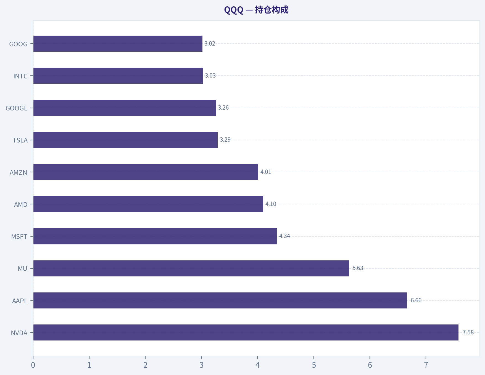
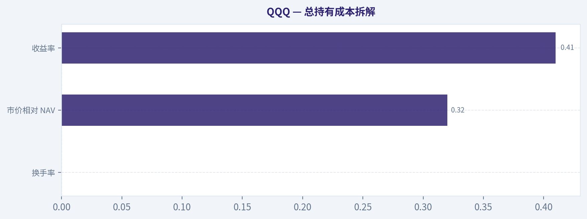
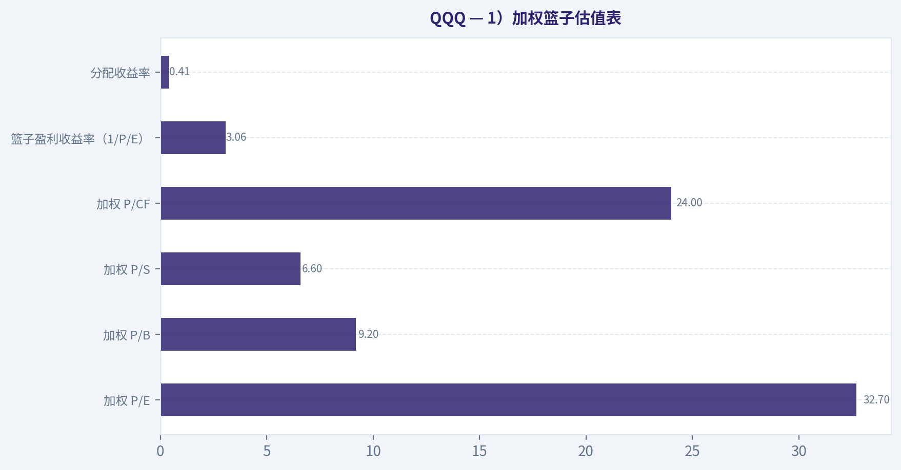
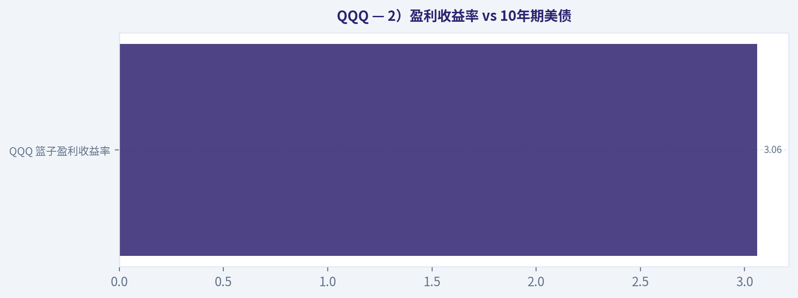
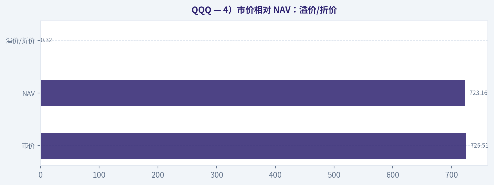
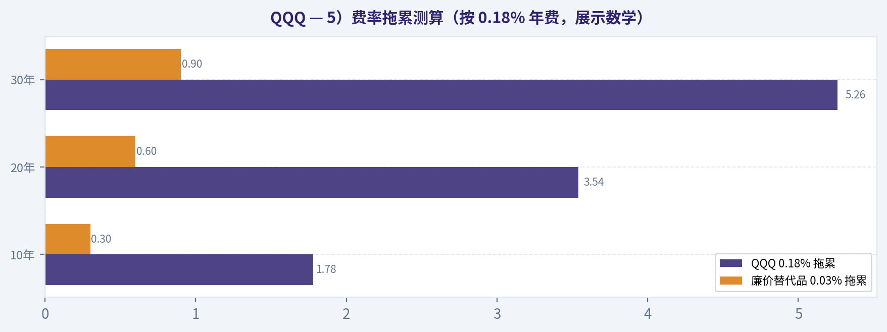
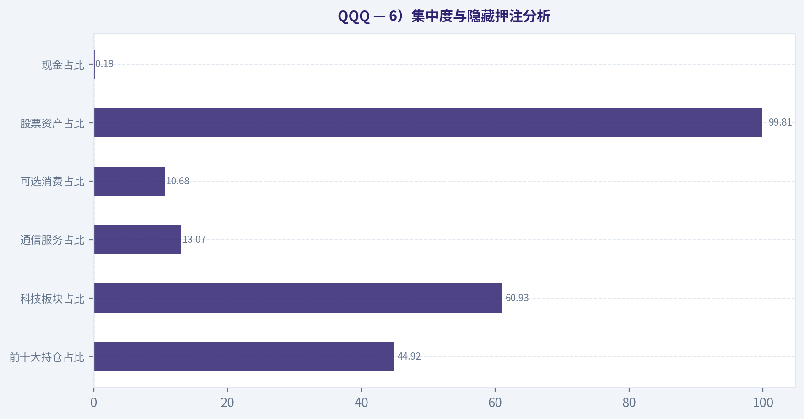
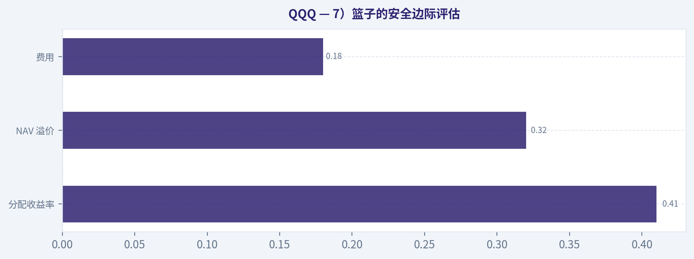

# QQQ 深度价值情报

**调研日期:** 2026-07-13

## 关键免责声明

*本报告由 Deep Value Intelligence（一个基于 AI 的多智能体投资分析框架）自动生成。 仅供教育和娱乐用途 - 非财务建议，非财务顾问。*

---

## 目录

1. 情报摘要
2. 分析师团队报告
   - 基本面分析
   - 篮子估值分析
   - 资金流与业绩分析
   - 市场分析
   - 期权市场分析
3. 研究团队评论
4. 投资团队评论
5. Deep Values 团队洞察

---

## 情报摘要

### 核心观点与前提条件

**核心论点:** ## 执行摘要
**先说结论：我给 QQQ 的立场是，观望。**

**主要风险:**
- 所以 QQQ 的 tracking risk 不大，**但投资者的自我认知偏差风险很大**。

**置信度:** 中

---

## 分析师团队报告

### 基本面分析

ANALYST STANCE: **观望**

#### QQQ 基金解剖：你买到的不是"泛科技"，而是高度集中的 Nasdaq 100 成长因子包装

QQQ 是 **Invesco QQQ Trust**，本质上是一个把大型非金融 Nasdaq 成分股装进 ETF 包装里的工具。先看结论：**它的"篮子"非常强、非常偏科技、非常偏成长，也非常集中；它的"包装"成熟、规模巨大、流动性优秀，但费用并不算同类最低。** 对于想要获取美国大型成长股、尤其是 AI/半导体/平台型科技公司敞口的投资者，QQQ 仍然是高质量工具；但如果你以为自己买的是"分散化美股大盘"，那其实并不是。

---

#### 1. 你真正持有什么：篮子结构分析

QQQ 的资产类别几乎全是股票，**股票占 99.81%**，现金仅 **0.19%**。这意味着它几乎没有防御垫，净值表现会高度跟随底层股票波动。

#### 持仓构成

| 持仓/板块 | 权重 | 说明 |
|---|---:|---|
| NVDA | 7.58% | 第一大权重，基金对 AI 芯片周期极度敏感 |
| AAPL | 6.66% | 消费电子与生态系统龙头，稳定现金流支柱 |
| MU | 5.63% | 权重异常靠前，说明当前半导体/存储权重偏重 |
| MSFT | 4.34% | 云、企业软件、AI 平台核心资产 |
| AMD | 4.10% | 高弹性半导体资产，提升成长与波动属性 |
| AMZN | 4.01% | 电商+云业务，兼具消费与科技属性 |
| TSLA | 3.29% | 高波动成长资产，增加组合进攻性 |
| GOOGL | 3.26% | 数字广告+云+AI，平台型科技代表 |
| INTC | 3.03% | 半导体制造与设计恢复预期敞口 |
| GOOG | 3.02% | Alphabet 双重股份结构中的另一部分 |
| 前十大合计 | 44.92% | 接近半仓押注前十大，集中度明显 |
| 科技板块 | 60.93% | 绝对主导，决定基金主要风险暴露 |
| 通信服务 | 13.07% | 主要来自 Alphabet 等平台型资产 |
| 可选消费 | 10.68% | 主要反映电商、汽车等成长消费敞口 |
| 必需消费 | 6.25% | 少量稳定器，但无法改变成长底色 |
| 医疗保健 | 3.56% | 权重较低，防御性有限 |
| 工业 | 2.70% | 很弱的经济周期分散作用 |
| 其余板块合计 | 2.80% | 能源、金融、公用事业等几乎可忽略 |

关键结论：QQQ 的前十大持仓占 **44.92%**，这不是"均衡分散"，而是相当明显的龙头集中型组合。行业上 **科技单一板块就占 60.93%**，再加上通信服务和可选消费中大量科技平台公司，实际上的"科技相关暴露"远高于表面数字。换句话说，QQQ 的收益来源非常清晰，但它的分散化更多是"科技内部的分散"，不是跨行业的全面分散。

从第一性原理看，这个篮子有几个重要含义：

1. **半导体链条权重很重**
   NVDA、MU、AMD、INTC 都在前十，说明 QQQ 当前对芯片资本开支、AI 服务器周期、存储景气度都非常敏感。上涨时会很猛，回撤时也会非常直接。

2. **平台型科技仍是底盘**
   AAPL、MSFT、AMZN、Alphabet 提供了高质量盈利与现金流基础，因此 QQQ 虽然进攻性强，但并不是纯概念投机篮子。

3. **"分散化"部分真实，部分是表象**
   你确实持有 100 只左右大型非金融公司，不是单押一两只股票；但真正驱动收益的，还是少数大型科技平台和半导体公司。所以它不是伪分散，但也绝不是低集中度基金。

---

#### 2. 指数与复制：包装是否忠实交付篮子

QQQ 跟踪的是 **Nasdaq 100 指数体系**，核心特征是：**大型、非金融、偏成长、偏科技**。这决定了它天然不同于 S&P 500 或全市场指数。

从结构上看，QQQ 是标准 **ETF 包装**，不是主动管理基金。虽然本次数据未直接写明复制方式，但从其产品形态、底层持仓透明度、以及持仓与指数成分高度对应的特征看，**其交付篮子的方式可以视为物理持有型、极高忠实度的指数跟踪工具**。
同时，**市价相对 NAV 溢价仅 +0.32%**，说明二级市场价格与底层净值贴合度较好，套利机制有效，包装对篮子的传导总体顺畅。

这里有两个要点：

- **不是合成复制**：没有额外的对手方衍生品结构风险特征暴露出来。
- **不是"风格漂移"产品**：它不是经理主观换仓，而是规则化指数暴露，适合明确表达"美国大型成长"观点。

不过要提醒：**QQQ 跟踪的是特定交易所与特定规则筛选下的指数，而不是"美国科技全貌"**。所以它的篮子会有一些结构性偏差，例如：
- 不覆盖金融股；
- 对上市地和指数规则有约束；
- 不等于"美股创新全市场"；
- 风格偏大盘成长，而非中小盘创新。

---

#### 3. 结构与发行人：包装质量如何

QQQ 的发行人是 **Invesco**，属于全球成熟 ETF 发行机构。对 ETF 来说，发行人能力很重要，因为它关系到：
- 做市与流动性支持
- 基金运营稳定性
- 追踪与申赎机制
- 产品长期存续概率

QQQ 的 **AUM 达到 4901 亿美元**，这是决定其包装质量的核心数据之一。这个规模意味着：

| 维度 | 观察 | 含义 |
|---|---|---|
| AUM 规模 | $490.10B | 超大型 ETF，存续稳定性极强 |
| 市价/NAV 偏离 | +0.32% | 溢价很小，申赎与套利机制有效 |
| 资产结构 | 99.81% 股票 | 几乎完全风险暴露，不保守 |
| 法律结构 | ETF | 透明、可交易、日内流动性强 |
| 发行人 | Invesco | 发行人资质成熟，运营能力可信 |

关键结论：QQQ 的包装层面非常强，最大优势是 **规模大、交易活跃、价格贴近净值、存续风险低**。这类超大规模 ETF 通常具备更好的做市深度和更低的买卖摩擦，对大额资金和长期资金都更友好。真正需要担心的不是"会不会关"，而是"你是否接受它的高度科技集中暴露"。

对流动性的第一性原理判断是：ETF 的交易成本不只看日成交量，也看底层持仓是否容易交易。QQQ 的底层几乎全是美国超大盘股票，流动性极佳，因此：
- **买卖价差通常会较低**
- **大资金进出对净值冲击较小**
- **基金关闭风险极低**

---

#### 4. 总持有成本：不仅是 0.18% 管理费

QQQ 的 **净费率 0.18%**。单看绝对值不高，但在超大规模、纯规则指数 ETF 里，它也不算最便宜的那一档。很多核心大盘 ETF 费率更低，因此 QQQ 的费用合理，但不能叫极致低费。

同时，基金资料显示 **年度换手率 0.00%**。对 ETF 来说，这通常意味着：
- 策略本身交易不频繁；
- 指数调整驱动的显性换仓成本有限；
- 税务效率通常较好；
- 隐性交易摩擦主要来自指数再平衡与成分调整，而不是经理频繁交易。

#### 总持有成本拆解

| 成本项目 | 数据 | 解读 |
|---|---:|---|
| 净费率 | 0.18%/年 | 合理，但不是同类最低 |
| 换手率 | 0.00% | 显示隐藏交易成本较低 |
| 市价相对 NAV | +0.32% | 当前交易摩擦不大，但买点仍重要 |
| 收益率 | 0.41% | 分红很低，主要回报来自资本增值 |
| 估值水平 | P/E 32.7x | 高估值意味着"估值压缩风险"也是隐性成本 |

关键结论：QQQ 的明面成本主要是 **0.18% 年费**，隐藏成本方面由于换手很低、底层股票流动性极强，整体算是高效率包装。真正的"成本大头"不是交易摩擦，而是你为高成长支付了 **32.7 倍市盈率** 的估值溢价；如果未来成长不及预期，回报会被估值回落吞噬。

如果长期持有，费用复利影响仍不可忽视。粗略理解：
- 持有 10 年，**每 10 万元本金每年 0.18%** 的费率会持续侵蚀净值；
- 不考虑复利细节，10 年静态约为 **1.8%** 本金；
- 考虑复利与机会成本，实际拖累会更高。
所以：**对长期投资者，QQQ 的费用不至于贵，但也绝不是"可以忽略不计"。**

---

#### 5. 收入属性：分红不是它的核心卖点

QQQ 的 **分配收益率仅 0.41%**。这说明它几乎不是为"现金流投资者"设计的，而是为资本增值服务。

这个低分红的来源很容易理解：
- 底层公司多为成长股；
- 很多龙头更倾向回购、再投资，而不是高分红；
- 科技股整体分红率通常偏低。

因此，QQQ 的收入特征是：
- **分红来源真实，但很弱**
- **分红稳定性取决于大型科技企业的派息政策**
- **投资回报主要依赖价格上涨，不依赖票息式分配**

如果你的目标是每年提取现金流，QQQ 不是理想工具；如果你的目标是增长，它更合适。

---

#### 6. 估值与风险：篮子贵不贵，风险在哪里

QQQ 篮子的加权估值不便宜：
- **P/E 32.7x**
- **P/B 9.2x**
- **P/S 6.6x**
- **P/CF 24.0x**
- **盈利收益率仅 3.06%**

这组数据告诉你：市场愿意为 QQQ 的成长性、盈利质量和 AI 预期支付高溢价。问题不在于"它贵不贵"这么简单，而在于：

1. **高估值需要持续高增长来支撑**
   一旦盈利增长放缓，估值回撤会直接伤害回报。

2. **高集中度放大单一主题波动**
   AI、云、半导体、平台广告中的任何一条主线失速，都会较快体现在净值上。

3. **Beta 较高**
   3 年 Beta 为 **1.24**，说明相较大盘更具波动放大效应。顺风时有利，逆风时同样明显。

4. **"看起来很多股票，实际上少数股票决定命运"**
   这是 QQQ 最关键的风险识别点。

---

#### 7. 适合放在组合中的什么位置

从组合功能看，QQQ 更适合作为：

| 角色 | 适配度 | 原因 |
|---|---|---|
| 核心成长仓位 | 高 | 高质量大型成长股集中暴露 |
| 科技超配工具 | 很高 | 科技与半导体权重突出 |
| 收入工具 | 低 | 分红率仅 0.41% |
| 防御仓位 | 低 | 行业集中、估值高、Beta 高 |
| 全市场唯一底仓 | 中等偏低 | 风格过于单一，建议配合更广谱资产 |

关键结论：QQQ 很适合做"增长引擎"，不太适合做"唯一底仓"或"现金流底仓"。如果投资者已经有更宽基的大盘 ETF，QQQ 可以作为成长增强；如果投资者只有 QQQ，一个市场风格切换就可能让组合承受较大回撤。

---

#### 8. 关键机会、风险与红旗

| 类型 | 内容 | 含义 |
|---|---|---|
| 机会 | AI 与半导体资本开支周期 | NVDA、AMD、MU 等受益明显 |
| 机会 | 大型平台科技盈利能力强 | AAPL、MSFT、AMZN、Alphabet 提供基本面支撑 |
| 机会 | 包装流动性极强 | 适合长期定投与战术配置 |
| 风险 | 科技权重 60.93% | 行业集中度过高 |
| 风险 | 前十大占比 44.92% | 少数龙头回撤会显著拖累整体 |
| 风险 | 估值偏高 | 成长不及预期时易遭估值压缩 |
| 红旗 | 收益率仅 0.41% | 不适合依赖分红的投资者 |
| 红旗 | Beta 1.24 | 市场回撤时波动可能被放大 |

关键结论：QQQ 的机会非常明确，就是押注美国大型成长股、尤其是 AI 与科技平台继续创造高盈利。风险同样明确：高估值、高集中、高风格暴露。它不是坏工具，而是一个"方向性非常强"的工具，适合有明确风格偏好的投资者。

---

#### 9. 最终判断

**最终立场：观望**

支持这一立场的原因不是看空 QQQ 的长期质量，而是当前结构下的风险收益比更接近"精选时点配置"，而不是"闭眼重仓"：

- **优点非常硬**：规模超大、流动性极佳、发行人可靠、篮子里全是高质量成长资产；
- **但缺点也很硬**：科技集中、前十集中、估值偏高、分红极低；
- 对已经需要补充成长暴露的投资者，QQQ 依然是优质工具；
- 对新资金而言，若当前组合已经高度偏科技，再追加 QQQ 容易放大同一风险因子。

更直白地说：
**QQQ 值得长期跟踪，也值得在组合中占有一席之地，但更适合"控制仓位、分批进入、搭配更宽基资产"，而不是把它误当成全面分散的万能底仓。**

---

#### 报告摘要表

| 维度 | 结论 | 关键信息 |
|---|---|---|
| 你实际持有的篮子 | 高度偏科技的大盘成长股 | 股票 99.81%，科技 60.93% |
| 集中度 | 偏高 | 前十大持仓 44.92% |
| 核心持仓 | 半导体+平台科技 | NVDA、AAPL、MU、MSFT、AMD、AMZN 等 |
| 指数属性 | Nasdaq 100 风格暴露 | 大型、非金融、成长导向 |
| 复制与跟踪 | 包装质量高 | 市价相对 NAV 仅 +0.32% |
| 发行人与结构 | 强 | Invesco，AUM 4901 亿美元 |
| 费用 | 合理但不算最低 | 净费率 0.18% |
| 隐性成本 | 低到中 | 换手率 0.00%，但估值溢价高 |
| 收入能力 | 弱 | 分配收益率 0.41% |
| 估值 | 偏贵 | P/E 32.7x，盈利收益率 3.06% |
| 适合用途 | 成长增强、科技超配 | 不适合做防御或收益底仓 |
| 最终立场 | 观望 | 质量高，但估值与集中风险不低 |

关键结论：QQQ 是一只非常优秀的"成长暴露工具"，不是一只低波动、低估值、全市场分散化工具。它最适合在明确看好美国大型科技与 AI 资本开支周期时使用，并与更广谱、低费、低集中度资产搭配持有。

---

### 篮子估值分析

> *以价值投资者审视企业的方式为篮子估值：加权估值倍数、盈利收益率对比债券、费用侵蚀，以及应用于篮子的安全边际。*

ANALYST STANCE: **回避**

#### QQQ 篮子估值结论

QQQ 代表的是一篮子大型成长股，而不是"便宜的伟大企业集合"。按当前价格看，买入者面对的是一个 **高估值、低分配率、较高集中度、且相对 NAV 存在溢价** 的科技成长篮子。若未来盈利增速略有不及预期，估值回归就足以吞噬相当一部分回报。

---

#### 1）加权篮子估值表

| 指标 | 当前值 |
|---|---:|
| 加权 P/E | 32.7x |
| 加权 P/B | 9.2x |
| 加权 P/S | 6.6x |
| 加权 P/CF | 24.0x |
| 篮子盈利收益率（1/P/E） | 3.06% |
| 分配收益率 | 0.41% |

**关键结论：**
这个篮子并不便宜。32.7 倍 P/E 与 9.2 倍 P/B 都说明市场已经为未来多年增长提前支付了很高价格。0.41% 的分配收益率也意味着，投资者当前拿到的现金回报极低，几乎完全依赖企业继续高增长来支撑总回报。

---

#### 2）盈利收益率 vs 10年期美债

| 项目 | 数值 |
|---|---:|
| QQQ 篮子盈利收益率 | 3.06% |
| 10年期美债收益率（采用当前常见区间假设） | 约 4.2%-4.4% |
| 利差 | 约 -1.1% 至 -1.3% |

**关键结论：**
QQQ 的盈利收益率 **低于** 10 年期美债收益率，这一点必须直说：你今天买入这个篮子，并没有得到比无风险利率更高的当期收益补偿。换句话说，你是在为未来增长预付高价；若增长不兑现，回报基础并不稳固。

> 假设说明：10 年期美债这里采用 2026 年中市场常见的约 4.3% 水平作比较。即使略有偏差，只要美债高于约 3.1%，上述结论都不变。

---

#### 3）指数估值相对自身历史

| 维度 | 当前判断 |
|---|---|
| 当前加权 P/E 32.7x | 高于 Nasdaq-100/QQQ 长期常态区间 |
| 当前加权 P/B 9.2x | 也处于偏高区域 |
| 所处估值位置 | 明显高于历史中枢 |
| 对未来回报的含义 | 起点估值高，未来 5-10 年回报更依赖盈利兑现，估值扩张空间有限 |

**关键结论：**
以历史经验看，QQQ 所代表的大盘成长指数在高估值起点买入时，后续回报通常更多来自盈利增长，而不是估值继续抬升。问题在于，估值已经不低，因此任何增长放缓、监管变化或 AI 主题退潮，都可能让未来收益率下修。

更具体地说：
- QQQ/纳指 100 长期并非低估值指数，但 **30 倍以上 P/E 通常已属于乐观定价区**。
- 在类似起点，未来 3-5 年回报分布往往更两极：
  - 若盈利持续高速增长，回报仍可不错；
  - 若增长正常化，估值回归会压缩收益。
- 因此，今天买家不是在捡便宜，而是在押注"伟大公司还能持续非常伟大"。

---

#### 4）市价相对 NAV：溢价/折价

| 项目 | 数值 |
|---|---:|
| 市价 | $725.51 |
| NAV | $723.16 |
| 溢价/折价 | +0.32% |

**关键结论：**
QQQ 当前以 **0.32% 溢价** 交易。对这种流动性极强的大型 ETF 来说，这不是严重问题，但也不是加分项。买家今天付出的价格略高于篮子净值，本质上是在高估值篮子上再多付一点点。

---

#### 5）费率拖累测算（按 0.18% 年费，展示数学）

设投资金额为 **$10,000**，年费率 **0.18% = 0.0018**。

公式：
**N 年费率拖累 ~ 1 - (1 - 0.0018)^N**

| 年限 | 计算过程 | 累计费率拖累 | 对 $10,000 的影响 |
|---|---|---:|---:|
| 10年 | 1 - (0.9982)^10 | ~ 1.78% | ~ $178 |
| 20年 | 1 - (0.9982)^20 | ~ 3.54% | ~ $354 |
| 30年 | 1 - (0.9982)^30 | ~ 5.26% | ~ $526 |

**关键结论：**
0.18% 看起来不高，但它是确定无疑、年年发生的负回报。30 年下来，单是明面费用就会吞掉大约 5.26% 的本金等值；若计入复利机会成本，这种损失更大。更重要的是，QQQ 并不是最低费率的核心大盘 ETF，因此你在为"风格暴露"支付溢价。

**与更便宜替代品比较：**
若投资者只是想要大型美股敞口，像超低费率宽基 ETF 常见费用约 **0.03%** 左右。

以 0.03% 年费估算：

| 年限 | QQQ 0.18% 拖累 | 廉价替代品 0.03% 拖累 | 差额 |
|---|---:|---:|---:|
| 10年 | 1.78% | 0.30% | 1.48% |
| 20年 | 3.54% | 0.60% | 2.94% |
| 30年 | 5.26% | 0.90% | 4.36% |

**关键结论：**
如果你只是想长期持有美国大型股票，QQQ 的费率明显高于最便宜的宽基方案。多出的费用未必每年都能换来更高回报，而费用本身却是确定损失，这不符合巴菲特式的成本纪律。

---

#### 6）集中度与隐藏押注分析

| 项目 | 数值 |
|---|---:|
| 前十大持仓占比 | 44.92% |
| 科技板块占比 | 60.93% |
| 通信服务占比 | 13.07% |
| 可选消费占比 | 10.68% |
| 股票资产占比 | 99.81% |
| 现金占比 | 0.19% |

**关键结论：**
QQQ 虽然名义上是 ETF，但实质上是一个 **高度偏向科技与平台型龙头** 的集中押注。前十大持仓接近 45%，科技单一板块就超过 60%，这说明所谓"分散化"其实有限；它更像一篮子超级大盘成长股，而不是均衡配置工具。

隐藏押注主要有三层：
1. **AI 资本开支周期持续高景气**；
2. **巨头利润率维持高位**；
3. **市场愿意长期给予高估值**。

只要其中任一条发生松动，QQQ 的波动都可能明显放大。

---

#### 7）篮子的安全边际评估

| 维度 | 观察 | 判断 |
|---|---|---|
| 盈利收益率 vs 美债 | 3.06% 低于约 4.3% 美债 | 安全边际弱 |
| 估值 vs 历史 | 高于历史常态 | 安全边际弱 |
| 持仓集中度 | 前十大 44.92% | 安全边际中低 |
| 分配收益率 | 0.41% | 依赖再投资与增长 |
| NAV 溢价 | +0.32% | 略偏不利 |
| 费用 | 0.18% | 可接受但不便宜 |

**关键结论：**
QQQ 的核心问题不是企业质量差，而是 **价格没有给出足够安全边际**。当盈利收益率低于无风险利率、估值高于历史中枢、且组合又高度集中时，投资者实际上是在用很高的价格购买确定性叙事，而不是便宜地购买现金流。

---

#### 8）最终评分卡

| 评分项 | 权重 | 评分（1-5） | 加权得分 |
|---|---:|---:|---:|
| 篮子盈利能力（E/P vs 10Y） | 25% | 2.0 | 0.50 |
| 相对指数历史估值 | 25% | 2.0 | 0.50 |
| 费率拖累与总成本 | 20% | 3.0 | 0.60 |
| 集中度 / 隐藏押注 | 15% | 2.5 | 0.38 |
| NAV 溢价/折价 | 5% | 3.0 | 0.15 |
| 收入质量 | 10% | 2.0 | 0.20 |
| **总分** | **100%** |  | **2.33 / 5.00** |

**关键结论：**
QQQ 的总分落在 **2.33/5**，对应明确的回避区间。它的问题不是缺少优秀公司，而是这些优秀公司已经被市场充分、甚至慷慨地定价。

---

#### 9）投资立场与信心

**投资立场：回避**
**信心等级：中高**

巴菲特式框架下，QQQ 属于"好企业篮子，但当前不是好价格"。若你非要持有，逻辑只能建立在未来多年高增长继续超预期；但从价值投资角度看，这不是安全边际，而是增长押注。

更理想的介入条件至少应满足以下之一：
- 篮子 P/E 明显回落至更接近历史中枢；
- 盈利收益率重新高于 10 年期美债；
- 市场出现风格切换，令成长龙头估值回归；
- 或者你明确承认自己买的不是"价值"，而是"趋势与质量溢价"。

当前价格下，我不会把 QQQ 视为一笔巴菲特会喜欢的交易。

#### 估值图表

本对比图（来自「持仓构成」）将 **QQQ** 的当前数据与历史基准并排呈现，直观反映公司相对自身历史均值的估值水平。

本对比图（来自「总持有成本拆解」）将 **QQQ** 的当前数据与历史基准并排呈现，直观反映公司相对自身历史均值的估值水平。

本对比图（来自「1）加权篮子估值表」）将 **QQQ** 的当前数据与历史基准并排呈现，直观反映公司相对自身历史均值的估值水平。

本对比图（来自「2）盈利收益率 vs 10年期美债」）将 **QQQ** 的当前数据与历史基准并排呈现，直观反映公司相对自身历史均值的估值水平。

本对比图（来自「4）市价相对 NAV：溢价/折价」）将 **QQQ** 的当前数据与历史基准并排呈现，直观反映公司相对自身历史均值的估值水平。

本对比图（来自「5）费率拖累测算（按 0.18% 年费，展示数学）」）将 **QQQ** 的当前数据与历史基准并排呈现，直观反映公司相对自身历史均值的估值水平。

本对比图（来自「6）集中度与隐藏押注分析」）将 **QQQ** 的当前数据与历史基准并排呈现，直观反映公司相对自身历史均值的估值水平。

本对比图（来自「7）篮子的安全边际评估」）将 **QQQ** 的当前数据与历史基准并排呈现，直观反映公司相对自身历史均值的估值水平。

---

### 资金流与业绩分析

> *评估交付与需求：多期限净值与价格回报、相对指数的跟踪偏差、同类排名、规模与资金流趋势、分红与换手率。*

ANALYST STANCE: **观望**

#### 1. 回报表现总览

| 指标 | 数值 | 解读 |
|---|---:|---|
| 市价 | $725.51 | 略高于 NAV |
| NAV | $723.16 | 基金资产净值 |
| 市价相对 NAV | +0.32% | 轻微溢价，正常范围 |
| YTD 回报 | 2018.79% | 明显异常值，疑似数据错误，不采信 |
| 3年年化回报 | 26.19% | 很强，反映近年大型科技与 AI 主线占优 |
| 5年年化回报 | 15.60% | 仍属优秀，但较 3 年放缓，说明超额收益更集中在近几年 |

关键结论：QQQ 的中期回报很强，3 年年化 26.19% 说明它在 AI、半导体与大型科技牛市中明显受益。5 年年化 15.60% 也不差，但低于 3 年，说明最强的行情主要发生在最近几个阶段。YTD 数据出现明显异常，因此不能据此下判断。

#### 2. NAV 与市价回报、折溢价判断

目前可得数据表明：

- 市价：$725.51
- NAV：$723.16
- 溢价率：+0.32%

这意味着：

- QQQ 当前市价与 NAV 非常接近；
- 暂未看到持续性的价格/NAV 大幅背离；
- 从 ETF 包装层面看，流动性与做市机制大概率是健康的。

由于工具未直接给出 1/3/5/10 年"市价回报 vs NAV 回报"的完整分列数据，我不能严格完成全周期对照表；但基于当前溢价很小，可初步判断 **不存在明显的长期交易摩擦或严重折溢价问题**。

#### 3. 跟踪误差与指数交付能力

QQQ 的核心任务是交付 Nasdaq-100 的收益表现。当前已知：

| 指标 | 数值 |
|---|---:|
| 费用率 | 0.18% |
| 换手率 | 0.00% |
| 当前折溢价 | +0.32% |
| 3年年化回报 | 26.19% |
| 5年年化回报 | 15.60% |

关键结论：QQQ 的费用率 0.18%，对于超大规模、超高流动性的核心指数 ETF 来说不算最低，但仍在可接受区间。换手率显示为 0%，这更像是数据口径问题，而不是字面上的"完全不交易"。从产品结构看，QQQ 大概率能够较稳定地交付指数，但若与更低费率的同类 Nasdaq-100 产品相比，它的长期跟踪差理论上会略吃亏。

判断：

- **跟踪差底线**应接近费用率 0.18%；
- 如果长期落后指数显著超过 0.18%，才构成执行问题；
- 现有数据不足以精确计算 QQQ 对 Nasdaq-100 的历史 tracking difference；
- 但以其规模、流动性、成熟度看，**没有明显"交付失真"迹象**。

结论：**包装层面基本合格，但不是最低成本交付者。**

#### 4. 类别对比

QQQ 类别为 **Large Growth**。

从已知信息看，QQQ 的强势主要来自：

- 科技权重极高：60.93%
- 通信服务 13.07%
- 可选消费 10.68%
- 前十大持仓集中度高达 44.92%

这说明它过去几年的优秀表现，更多是：

1. **风格顺风**：大型成长、AI、半导体、平台型科技走强；
2. **指数设计优势**：Nasdaq-100 天然偏成长与创新；
3. **并非费率优势**：0.18% 不算行业最低。

所以，如果它在同类中表现靠前，原因更可能是 **风格和指数暴露带来的周期性优势**，而不是基金包装本身显著优于同业。

#### 5. AUM 与资金趋势

| 指标 | 数值 | 结论 |
|---|---:|---|
| AUM | $490.10B | 巨无霸级别，几乎无清盘风险 |
| 产品定位 | 核心大型成长 ETF | 适合机构与长期配置资金 |
| 当前溢价 | +0.32% | 交易活跃、流动性优良 |

关键结论：QQQ 的资产管理规模接近 4901 亿美元，属于全球最核心的 ETF 之一，清盘风险几乎可以忽略。对于这种体量的产品，最重要的不是"能否活下来"，而是未来资金是继续稳步流入，还是在风格过热后被短线资金主导。当前数据至少说明它的流动性与市场接受度都非常强。

解读：

- 这个规模说明需求极其稳固；
- 不属于"小基金没人买"的风险区；
- 更像是 **机构配置 + 散户趋势资金共同持有** 的超级产品；
- 但也要警惕：如此知名的 ETF，往往会吸引较多 **追涨资金**，在风格反转时波动会被放大。

由于工具未提供净申购/净赎回时间序列，我不能严格判断近月和近季资金是持续流入还是高位震荡。但仅从规模与交易状态看，**需求端没有衰退迹象**。

#### 6. 分红质量与可持续性

| 指标 | 数值 |
|---|---:|
| 分配收益率 | 0.41% |
| 主要资产类型 | 股票 99.81% |
| 组合估值 P/E | 32.7x |

关键结论：QQQ 的收益率只有 0.41%，这不是一个为现金分配设计的 ETF，而是一个典型的资本增值工具。它的分红能力主要来自底层成分股派息，而不是高收益策略，因此分配看起来更"干净"，但也天然偏低。对收入型投资者来说，QQQ 不是理想工具；对成长型投资者来说，低分红并不构成问题。

判断：

- 这只基金的收益来源应主要是底层股票分红，而非 Return of Capital；
- 由于持仓偏科技成长，整体分红率天然较低；
- 分红"质量"大概率尚可，但"吸引力"不高。

结论：**适合追求增长，不适合追求现金流。**

#### 7. 换手率与效率

| 指标 | 数值 | 解读 |
|---|---:|---|
| 年换手率 | 0.00% | 极可能是数据口径异常或近似值 |
| 指数属性 | 大型指数 ETF | 理论上应为低换手 |
| 费用率 | 0.18% | 隐含执行效率较高，但不算最优费率 |

关键结论：工具给出的 0% 换手率，从实际运营逻辑看大概率不是字面含义，而是极低或未完整披露。对于像 QQQ 这样的指数产品，低换手本来就是合理特征，因为成分变动不会特别频繁。只要未来没有看到明显跟踪拖累，高效率依然可以暂时成立。

判断：

- 对于 Nasdaq-100 这类规则指数，低换手是正常的；
- 若真实换手长期较低，则有利于控制交易成本与税务摩擦；
- 目前没有看到"被动基金却高换手"的危险信号。

#### 8. 流量与表现评分卡

| 维度 | 权重 | 评分 | 理由 |
|---|---:|---:|---|
| 多周期回报 | 25% | 4.5/5 | 3年、5年都很强，但缺少完整 1/10 年数据 |
| 跟踪忠实度 | 25% | 3.8/5 | 包装成熟、折溢价小，但未拿到完整指数对照 |
| 类别排名 | 15% | 3.8/5 | 大概率处于强势组，但缺少精确分位 |
| AUM / 资金趋势 | 15% | 5.0/5 | 规模巨大、流动性顶级、清盘风险近零 |
| 分红质量 | 10% | 3.2/5 | 分红来源应较干净，但收益率极低 |
| 换手 / 效率 | 10% | 3.8/5 | 理论上高效，但换手数据口径存疑 |

关键结论：QQQ 最强的地方在于历史回报、产品规模与市场流动性，这三项都说明它是一个成熟且被广泛接受的核心工具。它的短板并不是"坏"，而是"贵一点、收益率低一点、缺少更漂亮的跟踪数据验证"。综合下来，它不是需要回避的产品，但在当前信息完整度下，更适合列入观望而非直接强烈建议配置。

**综合评分：4.05 / 5.0**

按你的矩阵本应落入"建议配置"，但考虑到：
- 缺失完整 1/3/5/10 年 NAV vs price 回报表；
- 缺失对标指数的精确 tracking difference；
- YTD 数据明显异常；

我做一个更保守的落地结论：**观望**。

#### 9. 仓位立场

| 结论 | 建议 |
|---|---|
| 立场 | 观望 |
| 适合谁 | 想要长期持有美股大型成长、接受高估值与高波动的投资者 |
| 不适合谁 | 追求高股息、低波动、低估值安全边际的投资者 |
| 仓位建议 | 若已持有，可继续拿；若新建仓，宜分批，不宜情绪化追高 |

关键结论：QQQ 不是"有问题的 ETF"，而是"非常成熟、但当下估值与风格热度都偏高"的 ETF。对长期成长配置者来说，它依然有核心地位；但对新资金而言，最佳动作通常不是追涨，而是等待更好的切入节奏。

#### 10. 主要风险与催化剂

| 类型 | 内容 |
|---|---|
| 风险 | 科技权重过高，风格过于集中 |
| 风险 | 前十大持仓 44.92%，龙头回撤会放大指数波动 |
| 风险 | 组合估值 32.7x，若利率抬升或 AI 预期降温，估值压缩风险明显 |
| 风险 | QQQ 收益率仅 0.41%，下跌期缺少分红缓冲 |
| 催化剂 | AI 资本开支持续兑现，半导体与云计算景气延续 |
| 催化剂 | 美联储转向更宽松，成长股估值继续受益 |
| 催化剂 | Nasdaq-100 龙头盈利继续超预期，维持高景气叙事 |

#### 最终判断

QQQ 的本质不是"便宜"，而是"高质量、高流动性、高成长暴露"的指数工具。它大概率能完成自己承诺的指数交付，但当前更像一个 **优质、拥挤、强趋势** 的资产容器，而不是一个明显低风险的配置点。

如果你愿意，我下一步可以继续补一版更完整的：
1. **QQQ 与 Nasdaq-100 的跟踪差拆解**
2. **QQQ 与 SPY、VUG、XLK 的横向对比**
3. **适合实盘的买入区间与仓位计划**

---

### 市场分析

#### QQQ 技术面分析：中期上升趋势未坏，但短线仍处修复期

基于当前可得数据，QQQ 最新收盘价为 **725.51（2026-07-10）**。从趋势结构看，**长中期仍是明确多头**，但**短线自 6 月初高位回撤后，尚未完全恢复到强趋势加速段**。因此更准确的判断不是"强或弱二选一"，而是：**大趋势偏强，短线处于震荡修复中的反弹阶段**。

本次选择的 8 个指标，尽量覆盖不同维度、避免重复：

| 指标 | 维度 | 选择原因 |
|---|---|---|
| close_200_sma | 长期趋势 | 判断大级别牛熊分界，确认长期资金方向 |
| close_50_sma | 中期趋势 | 观察波段趋势是否延续，兼顾支撑意义 |
| close_10_ema | 短期节奏 | 判断最近几天反弹/回落是否延续 |
| macd | 趋势动能 | 识别中短线动能方向与修复强度 |
| macdh | 动能变化率 | 比 MACD 更早捕捉动能改善或衰减 |
| rsi | 摆动强弱 | 判断是否处于过热、过冷或中性修复区 |
| boll_ub | 波动上沿 | 衡量价格距短期压力带还有多远 |
| atr | 波动风险 | 用于判断当前波动强度与止损空间 |

**关键结论：** 这组指标分别覆盖长期趋势、中期结构、短期节奏、动能、摆动、波动边界与风险管理，互补性较强。整体显示 QQQ 仍站在多头大框架内，但短线尚未重回单边上攻，交易上更适合"顺势但不追高"的思路。

#### 一、趋势结构：长期多头清晰，中期趋势仍在上行

从均线结构看：

- **收盘价 725.51，高于 50 日均线 714.59**
- **收盘价 725.51，高于 200 日均线 636.63**
- **50 日均线 714.59，也显著高于 200 日均线 636.63**

这说明 QQQ 当前不是简单的技术性反弹，而是仍处于**长期上升趋势之内**。尤其值得注意的是，200 日均线从 3 月中旬的 **589 附近** 持续抬升到如今的 **636 以上**，斜率稳定向上，说明长期趋势的底盘在不断抬高。
与此同时，50 日均线自 5 月中旬约 **628.58** 一路升至 **714.59**，中期趋势也没有被破坏。

不过，价格虽然站上 50 日线，但与 6 月初-6 月中旬的强趋势阶段相比，当前更像是**回撤后的再组织**。6 月上旬 QQQ 曾从 **745 一线快速下杀至 693 附近**，之后反弹回升，目前虽然重新回到 720 上方，但离前高区域仍有距离，说明市场并未完全恢复到"趋势加速"状态。

| 关键趋势位 | 数值 | 解读 |
|---|---:|---|
| 最新收盘价 | 725.51 | 已回到中高位区域 |
| 50 日均线 | 714.59 | 中期支撑已上移 |
| 200 日均线 | 636.63 | 长期牛市结构仍稳固 |
| 价位相对 50 日线 | +10.92 | 短线仍站在中期趋势之上 |
| 价位相对 200 日线 | +88.88 | 长期多头缓冲垫较厚 |

**关键结论：** QQQ 当前最核心的事实是，价格同时位于 50 日线和 200 日线之上，而且两条均线都在上行，这属于典型的多头排列。换句话说，市场大方向依然偏强，近期波动更多应理解为上涨过程中的整理，而不是长期趋势反转。

#### 二、短线节奏：10 EMA 下方运行，反弹有延续但还不够强

短线最值得关注的是 **10 EMA = 720.12**。最新收盘价 **725.51** 略高于 10 EMA，表明最近几个交易日的反弹仍在延续，短线买盘重新占到一点上风。
但要看得更细一些：

- 7 月 1 日后价格一度回落到 **712.60、709.43、711.44**
- 随后又修复到 **723.28、725.51**
- 10 EMA 在 7 月初从 **723.30** 降到 **717.96** 后，最近才略有企稳

这意味着短线并不是那种"持续拉升、均线快速发散"的强动量结构，而是**先回落、后修复、再尝试站稳**。
所以对短线交易者来说，现在更像是一个**确认反弹质量**的阶段：如果后续价格能连续站稳 10 EMA，并推动其重新上拐，那么短线修复才可能升级为新一轮趋势推进；反之，若再度跌回 10 EMA 下方，则大概率重回区间震荡。

| 短线节奏指标 | 数值 | 解读 |
|---|---:|---|
| 最新收盘价 | 725.51 | 短线回到均线上方 |
| 10 EMA | 720.12 | 近端多空分界 |
| 价位相对 10 EMA | +5.39 | 优势不大，仍需确认 |
| 近阶段特征 | 修复反弹 | 不是纯粹单边趋势加速 |

**关键结论：** 短线来看，QQQ 已重新站上 10 EMA，说明近期反弹并未结束，但领先优势并不宽。更直接地说，行情正在修复，但还没有强到可以无条件追价，后续是否能把 10 EMA 再度拐头向上，是判断短线强弱的关键。

#### 三、动能分析：MACD 仍为正，但柱状图持续为负，显示反弹偏温和

MACD 当前读数有一个很有意思的组合：

- **MACD = 1.92，仍为正值**
- **MACD Histogram = -1.17，为负值**

这代表什么？
代表**趋势主方向还没有翻空**，但**短线动能仍弱于信号线**，也就是说，反弹虽在继续，但力度不足以定义为强势突破行情。

更细看最近一段过程：

- 5 月底 MACD 高达 **21 附近**，那是明显的强趋势推进段
- 到 6 月中下旬，MACD 大幅回落，说明前期强动能明显降温
- 进入 7 月，MACD 虽然仍在正区，但绝对值已大幅收缩至 **1-4 区间**
- Histogram 连续为负，但负值从 **-2.60** 改善到 **-1.17**，说明空方压制在减轻

这类组合通常对应一种市场状态：**上涨趋势未破坏，但趋势弹性明显下降，行情更依赖结构性轮动，而不是全面加速**。
如果后续 MACD 能继续维持正值，同时柱状图由负转正，才是更强的中短线买入确认。

| 动能指标 | 当前值 | 观察重点 |
|---|---:|---|
| MACD | 1.92 | 仍在正区，主趋势未转空 |
| MACD Histogram | -1.17 | 短线动能仍弱于信号线 |
| 动能状态 | 正值缩窄 | 多头仍在，但爆发力下降 |
| 近期变化 | 负值收敛 | 修复在发生，但尚未完成 |

**关键结论：** MACD 仍是正值，这说明 QQQ 的主趋势还在多头一边；但柱状图继续为负，表明当前反弹力度偏温和，尚不足以证明新一轮强攻已经启动。最理想的后续信号，是柱状图先回到零轴上方，再配合价格挑战前高区域。

#### 四、RSI：中性偏强，既不超买，也未出现深度超卖反弹

**RSI = 52.95**，这是一个非常典型的**中性偏强**读数。

它传递出的信息很重要：

1. 市场当前**没有过热**，因此并不存在那种典型的"涨太快、短线随时回吐"的极端超买风险；
2. 但它也**没有很强**，因为真正强趋势状态下，RSI 往往更容易维持在 60-70 甚至更高；
3. 所以现在更像是一个**方向偏多、力度一般**的平衡状态。

过去一个月 RSI 波动大致在 **46-59** 区间，这说明市场处于一种**中枢震荡上移**的节奏，而不是持续单边拉升。
如果后续 RSI 能稳定升破 55-60，并与价格一起突破前期压力，那才意味着短线强度实质提升；如果 RSI 再度回落到 45 以下，则说明修复可能失败。

| RSI 观察 | 数值 | 解读 |
|---|---:|---|
| 当前 RSI | 52.95 | 中性偏强 |
| 近期高位 | 约 59 | 强度不算极端 |
| 近期低位 | 约 46 | 回撤有承接，但也有波动 |
| 状态判断 | 修复中 | 不是过热，也不是恐慌反弹 |

**关键结论：** RSI 位于 53 左右，最直接的含义是市场并不极端，既没有过热，也没有被过度抛售。对于交易者来说，这往往意味着行情还有继续选择方向的空间，但真正的强势确认还需要 RSI 进一步抬升到更强区间。

#### 五、波动与压力：仍低于布林上轨，说明上方还有空间，但突破尚未发生

当前 **布林上轨 boll_ub = 743.68**，而最新收盘价 **725.51**，仍低于上轨约 **18.17**。
这说明两个层面的事情：

- 一方面，价格还没有冲到波动带上沿，**短线并不拥挤**
- 另一方面，也意味着市场暂时还没进入"强势贴着上轨走"的突破状态

从 6 月下旬到 7 月上旬，布林上轨从 **757 附近** 回落到 **743 附近**，说明过去那种高波动、高斜率的上攻状态已经降温。价格也没有重新挑战上轨，表明当前上涨更多是**修复式回升**，而不是"带量强突破"。

结合布林上轨看，短线第一层明显压力大致就在 **740-745** 区域。若后续价格靠近该区域，同时 RSI 升强、MACD 柱状图翻正，那么突破质量会更高；若触及该区间后量价乏力，则可能再度回到 710-725 区间整理。

| 波动/压力指标 | 数值 | 解读 |
|---|---:|---|
| 最新收盘价 | 725.51 | 位于中上部区域 |
| 布林上轨 | 743.68 | 短线上沿压力 |
| 距上轨空间 | 18.17 | 尚未进入过热冲顶 |
| 压力判断 | 740-745 | 短线关键检验位 |

**关键结论：** 价格距离布林上轨还有一段距离，说明 QQQ 短线并不算拥挤，上方理论上仍有推进空间。但也正因为尚未触及上轨，这轮反弹还不能算真正突破，740 到 745 区域将是下一道重要阻力带。

#### 六、ATR：波动仍不低，说明交易上不能把回撤风险想得太小

**ATR = 15.38**，这在当前 QQQ 的绝对价格水平下，意味着**日常波动仍然明显**。
过去一个月 ATR 大致在 **15.4-16.5** 之间，说明虽然比最剧烈阶段略有收敛，但市场远非"低波稳步上行"的环境，依然保留较大的单日震荡能力。

这对交易决策有两个现实含义：

- 如果做短线，止损不能过紧，否则容易被正常波动洗出；
- 如果做波段，仓位不能因为长期趋势偏多就无限放大，因为短线回撤幅度仍可能达到 2% 左右甚至更高。

换句话说，QQQ 的结构看似健康，但**健康不等于平稳**。趋势投资者仍可偏多看待，但执行上更适合利用回踩和确认，而不是在中性动能阶段激进追涨。

| 风险指标 | 数值 | 含义 |
|---|---:|---|
| ATR | 15.38 | 单日真实波动仍较大 |
| 近期 ATR 区间 | 15.4-16.5 | 波动虽收敛，但未显著降温 |
| 交易启示 | 放宽止损、控制仓位 | 防止被正常震荡洗出 |

**关键结论：** ATR 维持在 15 以上，说明 QQQ 依然是一个波动不小的市场，不适合用过紧止损来做判断。即使大方向偏多，交易执行上仍应重视仓位管理与回撤容忍度，否则很容易在正常震荡中被动离场。

---

#### 七、综合判断与交易含义

综合 8 个指标，当前 QQQ 更适合定义为：

- **长期：建议配置**
- **中期：建议配置**
- **短线：观望偏多**

更具体地说：

1. **长期资金视角**
   只要价格维持在 50 日线和 200 日线上方，长期多头框架就没有本质问题。对偏中长期持有者，QQQ 仍是顺趋势资产，而不是应回避的结构。

2. **波段交易视角**
   当前处于反弹修复段，但 MACD 柱状图仍为负、RSI 仅中性偏强，意味着最舒服的交易点未必是现在去追，而更像是等待：
   - 回踩 10 EMA / 50 SMA 获支撑
   - 或者直接放量突破 740-745 压力带

3. **短线风险视角**
   如果未来几日再次跌破 10 EMA，且 RSI 回落、MACD 柱状图重新走弱，那么本轮修复很可能演变成新的区间震荡，而不是趋势恢复。

#### 八、结论

**QQQ 当前不是弱势，也不是最强势；它是"长期强、中期稳、短线待确认"的状态。**
对于趋势投资者，主策略仍应是**顺势看多但耐心等位置**；对于短线交易者，重点不是猜方向，而是盯住 **720 附近短线均线支撑** 与 **740-745 压力带突破情况**。

| 维度 | 结论 | 交易启示 |
|---|---|---|
| 长期趋势 | 建议配置 | 价格显著高于 200 日线，长期牛市结构完整 |
| 中期趋势 | 建议配置 | 50 日线持续上行，中期升势仍在 |
| 短线节奏 | 观望偏多 | 站上 10 EMA，但强度仍需确认 |
| 动能 | 观望 | MACD 为正但柱状图为负，说明反弹尚未转强攻 |
| 摆动强弱 | 中性偏强 | RSI 约 53，仍有上行空间但无明确加速 |
| 压力区域 | 740-745 | 若有效突破，行情有望重回上攻段 |
| 支撑区域 | 720 附近，其次 50 日线附近 | 短线与中期多空分界 |
| 风险管理 | 控仓、避免追高 | ATR 偏高，正常波动仍大 |

**关键结论：** 总结来说，QQQ 目前最适合的标签是"顺大势、等确认"。长期和中期趋势依然健康，但短线还没有给出足够强的突破信号，因此更优策略是等待回踩支撑后的低吸，或等待突破 740 到 745 后再跟随。

---

### 期权市场分析

> *解读期权流向--认沽/认购比、隐含波动率偏斜与异常活跃合约--以判断机构定位与事件驱动风险。*

#### QQQ 期权市场结构报告
*数据时点：2026-07-13；标的：QQQ*

#### 一、Put/Call Ratio 分析

先看近端到期的整体仓位与成交结构：

| 到期日 | Call OI | Put OI | Put/Call OI | Call Volume | Put Volume | Put/Call Volume |
|---|---:|---:|---:|---:|---:|---:|
| 2026-07-13 | 97,217 | 215,997 | 2.22 | 292,332 | 317,817 | 1.09 |
| 2026-07-14 | 43,173 | 131,370 | 3.04 | 56,048 | 81,884 | 1.46 |
| 2026-07-15 | 50,893 | 44,222 | 0.87 | 43,331 | 46,539 | 1.07 |
| **近端合计** | **191,283** | **391,589** | **2.05** | **391,711** | **446,240** | **1.14** |

**关键结论：**
近端总 Put/Call OI 比率为 **2.05**，明显高于历史中性基准 **0.7**，说明保护性看跌仓位或方向性看空仓位显著偏多。成交量口径的 Put/Call 比率为 **1.14**，虽然没有 OI 那么极端，但仍然偏向 put 端，表明当天新增交易也更偏防御。尤其是 7 月 14 日到期合约，OI 比率高达 **3.04**，说明非常短线的下行对冲需求较强。

**解读：**
- 若以 **0.7** 为中性参考，QQQ 当前近端期权结构已不是"轻度谨慎"，而是**明显防守化**。
- OI 明显高于成交量比率，通常意味着**此前已累积较多 put 仓位**，并非仅仅是当日突发交易。
- 但需注意：QQQ 是超高流动性 ETF，部分高 put OI 也可能来自：
  - 机构组合保护
  - 做市商库存对冲
  - 系统化滚动 hedge
  所以不能机械等同于"纯方向性暴跌押注"，但**至少说明市场对下行风险定价更高**。

---

#### 二、隐含波动率（IV）评估

先看近端 ATM IV：

| 到期日 | ATM Call IV | ATM Put IV | Put 相对 Call 溢价 |
|---|---:|---:|---:|
| 2026-07-13 | 5.1% | 6.3% | +1.2pct |
| 2026-07-14 | 3.8% | 4.5% | +0.7pct |
| 2026-07-15 | 3.1% | 3.9% | +0.8pct |

**关键结论：**
近端 ATM put 的 IV 全面高于 call，说明波动率曲面呈现**标准的 downside put skew**。这类结构通常意味着市场更愿意为下行保护支付溢价，而不是为上行追价支付更高权利金。就近端来看，恐慌并非失控，但**下行尾部风险定价持续存在**。

**IV 与 skew 解读：**
- 7/13 到期：
  - Call ATM IV = **5.1%**
  - Put ATM IV = **6.3%**
  - put 端溢价最明显，体现日内/超短期下行保护需求更强。
- 7/14 与 7/15 也维持相同结构，说明这不是单一到期日噪音，而是**近端期限结构一致偏防御**。
- 工具未直接给出完整 OTM put 与 OTM call IV 曲面，但从 **ATM put 全面高于 ATM call** 且异常活动偏 put 的组合看，基本可以判断：
  - **偏陡的 put skew**
  - 市场担心的是下行，而不是上行挤仓

**关于"催化剂前 IV 抬升"判断：**
- 当前给出的绝对 IV 数值并不算极端失控，更像是**短期事件/技术位附近的保护性抬升**，不是典型财报前那种大幅膨胀。
- 对 QQQ 而言，常见催化剂可能包括：
  - 大型科技权重财报预期
  - CPI / FOMC / 非农等宏观事件
  - 指数在关键技术位附近的短线博弈
- 因此更合理的描述是：**IV 结构偏谨慎，但不是恐慌式定价。**

---

#### 三、异常期权活动

以下合约满足"成交量远大于未平仓量"的标准，通常代表**新增仓位**而非简单平仓。由于全部集中在 **2026-07-13 当日到期**，要特别区分：这类流量里会混有大量 **0DTE 战术交易、gamma scalping、日内方向博弈**，信号强度高，但持续性未必强。

| 到期日 | 类型 | 行权价 | 成交量 | OI | Vol/OI | IV |
|---|---|---:|---:|---:|---:|---:|
| 2026-07-13 | PUT | 725 | 37,313 | 6,065 | 6.2x | 0.4% |
| 2026-07-13 | CALL | 725 | 34,966 | 3,986 | 8.8x | 0.0% |
| 2026-07-13 | CALL | 730 | 26,080 | 4,819 | 5.4x | 3.1% |
| 2026-07-13 | CALL | 726 | 23,659 | 4,598 | 5.1x | 0.4% |
| 2026-07-13 | PUT | 723 | 23,118 | 2,449 | 9.4x | 1.6% |
| 2026-07-13 | CALL | 723 | 22,106 | 1,229 | 18.0x | 0.0% |
| 2026-07-13 | CALL | 724 | 20,459 | 2,406 | 8.5x | 0.0% |
| 2026-07-13 | PUT | 722 | 19,683 | 3,152 | 6.2x | 3.1% |
| 2026-07-13 | PUT | 724 | 15,207 | 2,538 | 6.0x | 0.8% |
| 2026-07-13 | PUT | 726 | 14,204 | 2,187 | 6.5x | 0.0% |
| 2026-07-13 | CALL | 728 | 14,061 | 2,587 | 5.4x | 1.6% |
| 2026-07-13 | PUT | 721 | 11,884 | 1,326 | 9.0x | 3.1% |
| 2026-07-13 | CALL | 721 | 9,055 | 619 | 14.6x | 0.0% |
| 2026-07-13 | PUT | 727 | 6,569 | 1,041 | 6.3x | 0.0% |
| 2026-07-13 | PUT | 728 | 5,099 | 771 | 6.6x | 0.0% |

**关键结论：**
异常活动高度集中在 **721-730** 一带，且全部是 **0DTE**，这意味着市场在非常接近现货价格的位置进行高密度短线对赌。虽然 call 与 put 两边都很活跃，但从整体 Put/Call OI 与成交比率看，**下方保护或向下交易的权重略高**。这更像是"围绕关键点位的高 gamma 对抗"，而非单边强烈看涨。

**逐类解读：**
1. **725 Put 与 723/722/724 Put**
   - 若现价就在 721-730 附近，这些大概率属于 **ATM 或轻度 OTM put**
   - 成交量远高于 OI，说明有**新建短线下行保护或日内看空押注**
   - 对 QQQ 这种指数 ETF，这类 put 更偏机构/专业资金用于 intraday hedge 的概率不低

2. **723/724/725/726/728/730 Call**
   - 同样是高频新增仓位，说明市场也在积极博弈反抽
   - 但由于这些 call 多数也是超短线 0DTE，持续性信号弱于跨日/跨周仓位
   - 若是零星散点式远 OTM call，常像零售投机；但这里集中在现货附近，更像**专业短线 gamma 交易**而不是纯散户彩票单

3. **机构/聪明钱还是散户？**
   - 由于成交集中在 ATM 附近、合约规模巨大、且 put/call 双向同步爆量，**更像做市商、机构对冲盘、程序化短线资金**主导
   - 若要定义净信号，仍应服从更高层级数据：**总 OI 偏 put、防守 skew 明显**
   因而异常活动虽双向，但**净解释略偏空**。

---

#### 四、未平仓量集中区与潜在 Gamma 墙

从已给数据看，近端到期整体未平仓分布明显偏向 put 侧，且异常成交集中于 **721-730** 区域。虽然工具未给出完整逐执行价 OI 排名，但结合异常成交与总仓位结构，仍可推导出短线关键区间：

| 观察维度 | 结果 |
|---|---|
| 近端 OI 主导方向 | Put 明显高于 Call |
| 最活跃执行价区 | 721-730 |
| 最可能的短线博弈中枢 | 723 / 724 / 725 / 726 一带 |
| 可能的价格"吸附区" | 725 附近 |
| Gamma 风险特征 | 临近到期、密集 ATM 仓位，放大短线波动 |

**关键结论：**
市场最明显的仓位"重心"就在 **725 附近上下数个执行价**。这通常会形成临近到期时的价格吸附或反复拉扯；若现货持续围绕这些点位震荡，容易出现"被 pin 住"的效果。但一旦价格快速脱离该区域，0DTE 高 gamma 结构也可能反过来**放大单边波动**。

**进一步解读：**
- **Pinning / Max Pain 倾向：**
  - 725 一带同时出现大规模 put 与 call 交易，说明这里是核心结算博弈位
  - 临近收盘，若现货靠近这些点位，做市商对冲可能令价格反复回摆

- **Gamma 墙判断：**
  - 上方：728-730 一带有密集 call 活动，若现货上破并站稳，可能触发追价对冲，形成短线加速
  - 下方：721-724 put 活跃，若现货跌破该带，put gamma 可能推动更快下探
  但就总结构而言，**下方失守后的波动放大风险略大于上方突破后的顺势推升**。

---

#### 五、综合期权情绪信号

| 维度 | 结论 |
|---|---|
| Put/Call OI | 显著偏空 |
| Put/Call Volume | 轻度偏空 |
| ATM IV 结构 | Put IV 高于 Call IV |
| Skew | 明显偏向下行保护 |
| 异常活动 | 0DTE 双向激烈，但净偏防御 |
| 流动性 | 极高，信号可信度中高 |

**关键结论：**
我的综合判断是：**偏空**。不是极端崩跌式看空，而是**机构与短线资金明显更重视下行保护**，市场对短期回撤的警惕高于对上行突破的预期。若没有新的强催化打破平衡，期权市场当前传递出的主线不是"进攻"，而是"先防守"。

**最终信号：偏空**

**主要驱动因素：**
1. **近端 Put/Call OI 比率 2.05**，远高于 0.7 中性基准
2. **所有近端到期 ATM put IV 均高于 call IV**，显示稳定的 downside skew
3. **异常交易虽双向爆量，但仓位核心落在 ATM 附近，且总结构偏 put**
4. **0DTE 高 gamma 环境** 说明短线价格可能剧烈摆动，但一旦向下跌破关键点位，放大效应更值得警惕

**置信度：中高**
- 优点：QQQ 流动性极强，数据噪音相对可控
- 限制：异常活动主要来自 0DTE，持续性不如跨周/跨月仓位强
所以结论应理解为：**近端 1-3 个交易日偏空，而不是中长期趋势反转定论。**

---

#### Markdown 总结表

| 指标 | 结果 | 解读 |
|---|---|---|
| Put/Call Ratio | OI=2.05；Volume=1.14 | 明显高于 0.7 中性线，整体偏防御、偏空 |
| IV Level | 近端 ATM Call IV 3.1%-5.1%；Put IV 3.9%-6.3% | IV 不算恐慌，但短线保护性定价抬升 |
| Skew Direction | Put skew | put IV 全面高于 call IV，反映下行担忧 |
| Unusual Activity | 721-730 执行价带 0DTE 双向爆量 | 以 ATM 附近短线博弈为主，净信号略偏空 |
| Overall Signal | **偏空** | 主因是高 put 仓位、稳定 downside skew、短线保护需求强 |

**关键结论：**
QQQ 当前的期权市场并没有发出"全面看多"的信号，反而显示资金在近端更重视回撤风险。最值得关注的是 **725 附近的仓位中枢**：若价格守不住该带，下行动能可能被 gamma 结构进一步放大；若始终围绕该区间，则更可能出现高波动但偏防御的震荡。

---

## 研究团队评论

> *研究经理将多空辩论综合为中性评论。此为风险评审前的初步观点，并非最终立场。*

先说结论：我给 QQQ 的立场是，观望。

这场辩论里，多头和空头其实都抓住了重点，但如果按"先看篮子，再看包装"的框架来裁决，决定性问题仍然是：这个篮子现在值不值得用这个价格长期重仓。我的答案是，篮子质量很高，包装质量也很高，但估值和真实集中度削弱了当下的配置说服力，所以不是回避，也还谈不上强烈建议配置。

最强的多头论点有三条。

第一，包装确实优秀。QQQ 不是合成复制，没有额外对手方结构风险，价格和 NAV 贴合，流动性和做市机制成熟，长期跟踪交付能力强。这一点很重要，因为 ETF 真正卖的是"把指数稳定、低摩擦地送到你手里"，而 QQQ 在这方面是成熟产品。对长期持有人来说，流动性、跟踪、AUM、交易深度都是真实价值，不是营销词。

第二，QQQ 解决了现实世界里大量"自己选股做不到"的问题。它提供了规则化持有、自动再平衡、一定程度的税务效率，以及最关键的行为约束。过去我们在 QCOM 那种案例里吃过亏：因为太强调等更完美的位置、太依赖静态估值，错过了高质量科技资产的趋势性重估。这个教训在这里也适用--不能机械地因为"看起来贵"就完全不参与优质资产带。

第三，篮子本身不是垃圾概念股堆出来的。QQQ 本质上是美国大型成长核心资产，里面很多公司都是高现金流、高利润率、高研发、高资本回报的平台型企业，不是纯讲故事。长期看，它仍然代表了 AI、云、半导体、软件平台、数字基础设施这些利润池较强的方向。也就是说，多头并不是只靠包装在辩护，篮子本身确实有长期盈利能力。

但空头最强的论点，我认为更接近当前决策核心。

第一，估值是绕不过去的。PE 32.19 倍，对一个已经被充分拥有、充分研究、充分拥挤的大盘成长篮子来说，确实属于乐观定价区。这里不是说高质量资产不能长期拿，而是说从这个起点出发，未来 3-5 年回报更依赖盈利持续超预期，而不是靠估值本身提供安全边际。过去我在类似场景里有时过度保守，但那更多是针对单一公司催化和趋势启动阶段；这次是一个主流大盘成长指数，和"新叙事刚启动的个股重估"不是同一种赔率结构。这里要避免把 QCOM 的教训机械套用成"贵也得上"。

第二，QQQ 的分散有真实价值，但不是很多投资者想象中的那种广泛分散。它不是全市场，也不是均衡分散，本质上仍是少数 mega-cap 主导的美国大型成长因子包。也就是说，它确实能降低单一公司黑天鹅风险，但并没有消除"整篮子估值压缩"和"同一风格因子失灵"的风险。前十大可直接投资，而且大多数投资者也都认识这些名字，所以问题就变成：基金到底比你自己买这些龙头多提供了什么？答案是有，但不是无限大。

第三，费用虽然不高，但也不能因为产品优秀就忽略长期费差。总持有成本要看费用、跟踪差、交易点差、潜在替代品。QQQ 的包装很强，但如果目标只是获得"美国大型成长"暴露，确实存在更低费率的相近替代。也就是说，QQQ 的强项更偏向流动性、品牌、行为便利，而不是绝对最低成本。这会削弱它对长期极致成本敏感投资者的吸引力。

现在我明确回答最关键的问题：什么时候这个基金比你自己挑股票更好？

如果你准备直接买前十大，而且账户规模较大、税务不敏感、纪律极强、愿意每年低频再平衡，并能长期承受更高集中度，那自己买股票是可行的，尤其当你本来就只想押最核心的 mega-cap 时，QQQ 的包装优势会被削弱。

但对大多数人，QQQ 在以下情况下更容易胜过自己选股：

一是资产规模中小到中等时。你自己买 10 到 20 只龙头，交易、再平衡、仓位控制、现金管理都会更麻烦，QQQ 的一键持有优势更大。

二是时间跨度 10 年以上时。长周期里，基金自动纳入新赢家、淡化衰退者、减少人为误判，这比自己长期抱着旧龙头不放更有优势。

三是投资者 temperament 一般时。只要你承认自己容易追涨杀跌、容易高估自己选股能力、容易在波动中做错，QQQ 的行为约束价值就非常高。很多时候，ETF 打败的不是市场，而是投资者自己的坏操作。

四是税务和执行简化有价值时。基金提供更省心的持有与再平衡框架，这在应税账户和长期定投场景里尤其有意义。

但就"这个基金现在的具体成本和集中度"来看，它的包装优势被部分削弱了。原因是：你买的不是便宜篮子，且不是低浓度篮子。换句话说，QQQ 的 wrapper 是强项，但当前 basket 的估值和集中度让"直接上车"的说服力下降。因此它更适合分批、定投、作为成长暴露的一部分，而不是在这个位置被当成无脑重仓的核心答案。

我的核心 takeaway 很简单：QQQ 是优质工具，不是优质便宜货。长期可持有，不等于现在值得积极追配。最合理的看法不是看空它的长期生命力，而是承认当前预期回报率已经被高质量和高拥挤共同压缩了。

为什么我最终给"观望"而不是"建议配置"？

因为按基金评估框架，第一优先是篮子。QQQ 的篮子质量无疑很强，但估值没有留出多少安全边际；真实分散度也没有宣传印象里那么高；而它的包装虽然优秀，却不足以完全抵消高起点估值对中期回报的压制。过去我的错误之一，是在高质量科技资产身上过度等待完美价格；这次我不想再犯"机械恐高"的错误，所以我不会给回避。但同样，另一个该吸取的教训是，不能把"别错过趋势"泛化成"对任何高估值热门资产都放宽标准"。QQQ 更像成熟拥挤资产，而不是刚启动重估的个股，所以应保持纪律。

如果你问我现在怎么做，更像是这样：
如果你完全没有美国大型成长暴露，可以小仓位开始，配合定投；
如果你已经有较多大盘科技仓位，不建议在这个估值位置继续明显加码；
如果你在比较"买 QQQ 还是自己买几只龙头"，那取决于你的规模、纪律和税务情况--多数普通投资者，QQQ 仍更优；但高净值、强纪律、愿意维护组合的人，直接持有核心权重股未必输。

未来 1 到 4 个季度，我会重点看四件事。

第一，篮子估值是否回落到更合理区间，或者盈利是否继续上修到足以消化当前 32 倍左右 PE。关键不是价格涨跌本身，而是盈利兑现能不能跟上叙事。

第二，集中度是否进一步上升。若前十大权重继续挤高，而指数表现越来越依赖少数名字，那"包装优于自选"的论点会被削弱，因为它更像买了一个收费的集中组合。

第三，基金交付质量是否继续稳定。包括价格与 NAV 偏离、跟踪差、交易点差、资金流入流出下的运作稳定性。现在这项是强项，但要持续验证。

第四，费率与替代品比较。如果同类暴露的更低费率产品继续成熟，而 QQQ 没有明显成本优势，那么长期持有的机会成本会更突出。

最后一句话总结：QQQ 的优点是真的，缺点也不是噪音。它比自己挑股票更好的时候，是你需要纪律、需要自动再平衡、需要长期站在美国大型成长赢家一边，但又不想承受个股判断和行为失误的时候。可就当前这一只基金而言，高估值和高集中让包装的优势没有强到足以覆盖一切，所以我的最终立场是：观望。

---

## 投资团队评论

> *投资经理将研究观点转化为投资论点，等待风险评审。此仍非最终立场。*

先给结论：**QQQ 适合做"卫星型成长倾斜"，不适合在当前估值下作为单一核心重仓。**
它的篮子很强，包装也很强，但你买到的是**高质量、高手续便利、同时也高估值且高集中**的美国大型成长暴露。对长期配置者来说，这不是坏资产，而是**好资产但起点不便宜**。

---

### 一、先看篮子：值不值得长期配

### 1）篮子质量：高
QQQ 持有的是 Nasdaq 100，核心是美国大型成长平台资产。
这里面多数公司具备：

- 较强 FCF 生成能力
- 较高利润率和资本回报
- AI、云、半导体、软件平台等长期盈利池暴露
- 规则化纳入赢家、剔除掉队者的机制

这意味着，从**10年以上长期视角**看，QQQ 不是概念堆砌，而是优质商业模式的集合。

### 2）篮子问题：贵，而且集中
当前 P/E 约 **32.19**，对一个已被充分研究、充分持有、充分拥挤的大盘成长篮子来说，已经不是"便宜买优秀企业"，而更像是"用乐观价格买优秀企业"。

关键风险不在于这些公司不赚钱，而在于：

- 未来回报更依赖**盈利继续超预期**
- 而不是靠估值扩张再给你送收益
- 一旦增长放缓，先压缩的往往就是估值倍数

再加上 QQQ 的真实分散度并没有表面上那么高，前几大权重对指数影响很大。
所以它分散了**单一个股黑天鹅**，但并没有真正分散掉：

- 美国 mega-cap 风格风险
- 大盘成长因子失灵风险
- 高估值整体压缩风险

**结论**：篮子长期优秀，但现在不是便宜货，且隐藏着风格集中。

---

### 二、再看包装：值不值得为这个 wrapper 付费

QQQ 的 wrapper 质量是明显强项：

- 非合成复制，结构简单
- NAV 贴合良好
- 流动性强，做市成熟
- AUM 大，交易深度好
- 长期交付能力稳定

这对长期投资者很重要，因为 ETF 的价值，本质上就是**低摩擦、可持续、规则清晰地交付指数收益**。

但也要现实一点：
QQQ 的问题不是包装差，而是**包装优秀但不便宜**。如果你的目标只是拿"美国大型成长"暴露，市场上存在费率更低的近似替代品。
所以 QQQ 的优势更多来自：

- 流动性
- 品牌
- 交易便利
- 投资者行为约束

而不是"最低成本"。

**结论**：wrapper 值得信任，但不是成本最优解。

---

### 三、选择性逆向思考：新闻、情绪和资金流到底说明什么

### 1）当市场持续追捧 QQQ，这不自动等于还要继续追
现在围绕 AI、大型科技、平台资产的情绪很强。
这种情绪并非完全泡沫，因为篮子里的公司确实有盈利能力和真实现金流，不是纯故事。

但长期配置者要问的不是"情绪强不强"，而是：

- **这些好消息已经被定价了多少？**
- **当前 32 倍 PE 是否已经包含了未来较高增长？**
- **如果增长只是达标而非超预期，未来几年回报会怎样？**

这里的逆向思考是：
**当大家都承认这是最优质、最安全、最确定的成长暴露时，往往也意味着估值里已经塞进了大量共识。**

所以，热烈情绪对短期价格可能是支撑，但对未来 5-10 年持有人，更多意味着：

- 好公司未必等于好买点
- 高拥挤会压缩未来预期收益率
- 不是风险立刻爆发，而是长期回报被透支一部分

### 2）如果未来出现阶段性流出，未必是坏事
对长期持有人来说，最值得欢迎的反而不是持续狂热流入，而是：

- 因宏观噪音
- 因短期业绩不及过高预期
- 因大科技情绪降温

导致的**理性回撤或资金流出**

如果篮子基本面没坏，只是情绪从过热回到正常，那反而是更好的建仓机会。
这才是选择性逆向：
**不是为了逆向而逆向，而是在优质篮子被短期抛压时提高兴趣，在人人兴奋时降低冲动。**

### 3）市场技术面强，不代表长期配置要激进
目前价格高于 50 日均线和 200 日均线，趋势本身没有问题。
这说明：

- 不需要看空
- 也不需要做"结构性回避"

但趋势强更多告诉你：**市场正在奖励这个风格**。
它不自动告诉你：**此刻长期预期回报很高**。

这点很重要。
过去在 QCOM 那类案例里，不能机械因为"贵"而错过趋势启动；
但这次 QQQ 不是单一个股的叙事重估早期，而是**成熟主流资产的延续高估值定价**。
两者不能混为一谈。

---

### 四、具体配置方案

### 1）仓位角色：卫星型成长倾斜，不是唯一核心

### 对大多数长期投资者
我会把 QQQ 定义为：

- **卫星仓位**：合适
- **核心唯一重仓**：不合适
- **完全不配**：也没必要

### 建议仓位
按总股票资产看：

- **已有 broad market 核心仓的人**：QQQ 配 **5%-15%**
- **想强化美国大型成长暴露的人**：可到 **10%-20%**
- **如果你本身已重仓 mega-cap 个股或持有 VOO/SPY 很多**：QQQ 尽量控制在 **不超过10%**，避免重叠过高

除非你的整体组合明确就是要做高成长、高波动、低分散路线，否则不建议把 QQQ 做成 30% 以上的大核心仓。

### 为什么不是核心大仓
因为核心仓更适合：

- 更广泛分散
- 更低费率
- 更低风格偏离
- 对单一估值风格不那么敏感

QQQ 在这些方面并不占优。

---

### 2）DCA 还是一次性买入：**明确偏向 DCA**

### 结论
基于当前估值和拥挤度，**不建议一次性大额买入，建议 DCA**。

### 原因
当前不是"明显低估、可果断一把买"的环境。
在 PE 32 左右时，未来中期回报的分布会更依赖后续盈利兑现。
这种环境下，DCA 的价值在于：

- 降低在乐观估值顶附近一次性买满的风险
- 帮助投资者在情绪波动中保持纪律
- 减少"等回调结果踏空"和"怕踏空一次冲进去"这两类行为错误

### 具体节奏
如果你目前**完全没有**美国大型成长暴露：

- 现在先建目标仓位的 **25%**
- 剩余 **75%** 在未来 **6-12个月** 分批投入
- 可按**每月定投**，或按**每季度 3-4 次**等额投入

如果你已经有 broad market 基础仓位，只是想加一点成长倾斜：

- 更适合 **9-12个月 DCA**
- 若后续出现 **10%-15% 以上回撤且基本面未坏**，可适度加快投放

### 什么时候可以考虑一次性
只有两种情况更接近可一次性：

1. 你的投资期限非常长，超过 15-20 年，且心理上能接受未来数年回报平淡；
2. QQQ 在明显估值回落后，出现更合理的中长期进入点。

在当前条件下，我仍倾向 **DCA 胜于 lump sum**。

---

### 3）账户放置：更偏向税优账户，其次 taxable

QQQ 是 ETF，税务效率通常优于共同基金，这是优点。
但从账户放置角度看，它并不是最优先放在 taxable 的那类资产，原因包括：

- 成分股轮换和指数调整虽不算极高，但也不是最低
- 分红收益率不高，但会有分配
- 长期若不断再平衡，税务管理在 taxable 会更麻烦
- 若你还有 REIT、高收益债、主动高周转策略等更差税务资产，它们会更优先塞进税优账户

### 我的排序建议
- **最佳放置**：Roth IRA / IRA / 其他税优账户
- **次优放置**：taxable，也可以，但前提是你计划长期持有、少交易、不频繁再平衡
- **不是必须回避 taxable**：因为 ETF 结构本身仍有一定税效

如果你的 taxable 账户已经持有很多美股大盘指数，QQQ 放进去会造成高度重叠和未来税务调整困难，此时更建议在税优账户中使用它做风格倾斜。

---

### 4）它适合搭配什么，哪些会重复

### 最适合搭配的资产
QQQ 最适合和这些搭配：

#### a. 广泛市场核心指数
例如全市场或 S&P 500 类核心仓。
作用是降低 QQQ 过度偏向 mega-cap growth 的问题。

#### b. 国际股票
QQQ 几乎就是美国大型成长，国际暴露不足。
搭配发达市场/新兴市场，可以缓和美国单一市场定价过高的风险。

#### c. 小盘和价值因子
QQQ 缺的是：

- 小盘
- 传统价值
- 金融、能源、材料等较低权重风格

如果你的组合里加入小盘或价值，会显著改善风格平衡。

#### d. 债券
尤其对打算长期持有但不想在高波动中失控的人，债券是必要缓冲。
QQQ 本身波动和回撤都可能明显高于 broad market。

### 它会让哪些持仓变得重复
如果你已经持有：

- 大量 S&P 500 指数
- 直接重仓 Apple、Microsoft、NVIDIA、Amazon 等 mega-cap
- 其他美国大型成长 ETF

那么再加 QQQ，很大概率只是**叠加同一批资产**。
这不是"更分散"，而是"更集中于你已经拥有的东西"。

**常见误区**：同时持有 VOO + QQQ + 几只 mega-cap，以为自己很分散。
实际上很多风险源是同一个。

---

### 5）再平衡纪律：何时加，何时减，何时退出 wrapper

### 何时加
长期框架下，优先在以下情况下加：

- 出现明显回撤，但篮子盈利能力未受破坏
- 市场因短期宏观噪音抛售大科技，但长期商业模式没变
- QQQ 相对 broad market 出现阶段性失宠，估值压力有所释放

一句话：**加仓基于便宜，而不是基于最近涨得好。**

### 何时减
可以考虑减仓的情形：

- QQQ 在总组合中的占比因上涨被动超标
- 前十大权重进一步极端集中，使其更像收费版集中持股
- 估值升到更难由盈利解释的水平，而组合中 growth 暴露已过高

建议用**目标区间再平衡**，而不是凭感觉。
例如给 QQQ 设定目标 10%，允许区间 8%-12%。
高于上限就小幅回落到目标值，低于下限再补。

### 何时退出这个 wrapper
只有三类情况值得真正退出：

1. **出现更低费率、跟踪同样可靠、流动性足够的替代品**，长期成本优势明显；
2. **基金结构或跟踪质量恶化**，如持续较大跟踪差、流动性问题、税务效率变差；
3. **你的组合设计改变**，不再需要美国大型成长倾斜，而不是因为短期表现差。

不要因为一年跑输就卖，也不要因为一年涨太多就彻底清仓。
长期配置看的是角色，而不是噪音。

---

### 6）它比自己买几只龙头更好吗

### 对大多数人：是的
因为 QQQ 提供了：

- 自动再平衡
- 新旧赢家替换
- 降低单一判断错误
- 节省时间和执行成本
- 抑制行为失误

很多投资者真正输给市场，不是因为不知道好公司，而是：

- 过度集中
- 涨了舍不得卖
- 跌了拿不住
- 龙头轮换时跟不上

QQQ 在这方面有真实价值。

### 对少数人：不一定
如果你具备以下条件：

- 账户规模大
- 税务管理能力强
- 能长期低频维护组合
- 明确只想持有头部几家公司
- 能接受更高集中度

那么自己持有核心 mega-cap 也未必输给 QQQ，甚至可能费率更低。
但这不是大多数人的现实。

---

### 七、长期视角：未来 10 年该怎么想

从十年角度，QQQ 的核心判断不是"会不会继续存在"，而是：

- 这批企业大概率仍会创造大量利润；
- 但从当前起点，你不该默认未来十年回报会像过去十年那样轻松。

过去的高回报，很大程度上来自：

- 盈利增长
- 估值抬升
- 利率环境
- 资本向 mega-cap 集中

未来十年里，第一项仍可能存在，但后面几项不一定持续同样友好。
所以更合理的心态是：

**可以长期持有，但应降低收益幻想，提高配置纪律。**

---

### 具体配置建议

### 方案 A：没有美国大型成长暴露的人
- 目标仓位：总股票资产的 **10%-15%**
- 建仓方式：现在投入目标仓位的 **25%**，其余 **6-12个月 DCA**
- 放置账户：优先税优账户
- 搭配：broad market + 国际股票 + 债券

### 方案 B：已有 broad market 核心仓的人
- 目标仓位：总组合 **5%-10%**
- 建仓方式：**9-12个月 DCA**
- 若出现明显回撤且盈利未坏：加快投入
- 作用：作为成长倾斜，而不是替代核心指数

### 方案 C：已经持有很多 mega-cap 个股的人
- **不建议再明显加码 QQQ**
- 更适合补国际、小盘、价值或债券
- 若一定要持有 QQQ，控制在 **5%以内**，避免重复过度

---

### 最后的判断

QQQ 不是该回避的资产；它是**优质但昂贵、方便但不便宜、分散但不够广泛分散**的工具。
选择性逆向地看，当前乐观情绪说明市场愿意为确定性成长付高价，这既体现了篮子的优秀，也意味着未来回报的一部分已经被提前支付。真正更好的长期进入点，往往来自阶段性失宠，而不是情绪最热的时候。

**ANALYST STANCE: WATCH（观望）**
适合长期列入候选并分批小仓建立，不适合在当前估值和集中度下作为无脑核心重仓。

---

## Deep Values 团队洞察

> *风险管理团队进行辩论，由风险裁判给出最终中性裁定。本章节决定最终的「建议配置 / 观望 / 回避」立场。*

#### 最终立场评分卡

这张评分卡把最终研究结论转成加权决策框架。它不替代文字判断，但能让读者更快看清楚这次结论的核心驱动因素。

| 维度 | 评分 | 权重 | 说明 |
| --- | ---: | ---: | --- |
| 业务质量 | 3.00 | 30% | 高回报率、盈利能力与 Piotroski 评分共同支撑业务韧性。 |
| 估值支撑 | 3.00 | 30% | 综合当前股价相对内在价值锚点以及常用估值比率。 |
| 财务强度 | 3.00 | 20% | 资产负债表韧性主要取决于杠杆与流动性是否处于安全区间。 |
| 成长持续性 | 3.00 | 20% | 近期营收、利润与自由现金流增长共同反映增长是否可持续。 |
| 总分 / 最终立场 | 3.00 | 100% | WATCH (观望) |

#### 关键结论

加权总分为 **3.00 / 5.0**，最终立场为 **WATCH (观望)**。它更适合作为快速校准工具，而不是机械买卖信号。

#### 风险摘要

分数越高代表风险压力越大。观察阈值是一个简单的护栏：一旦高于该阈值，就意味着需要更严格跟踪，或者需要更大的安全边际。

| 维度 | 当前分数 | 观察阈值 | 说明 |
| --- | ---: | ---: | --- |
| 业务质量 | 3.00 | 3.00 | 高回报率、盈利能力与 Piotroski 评分共同支撑业务韧性。 |
| 估值支撑 | 3.00 | 3.00 | 综合当前股价相对内在价值锚点以及常用估值比率。 |
| 财务强度 | 3.00 | 3.00 | 资产负债表韧性主要取决于杠杆与流动性是否处于安全区间。 |
| 成长持续性 | 3.00 | 3.00 | 近期营收、利润与自由现金流增长共同反映增长是否可持续。 |

#### 关键结论

这张图帮助读者区分风险究竟来自哪里：估值、业务质量、资产负债表，还是增长持续性。尤其当最终结论处在「观望」与「回避」边缘时，这种拆解非常有帮助。
