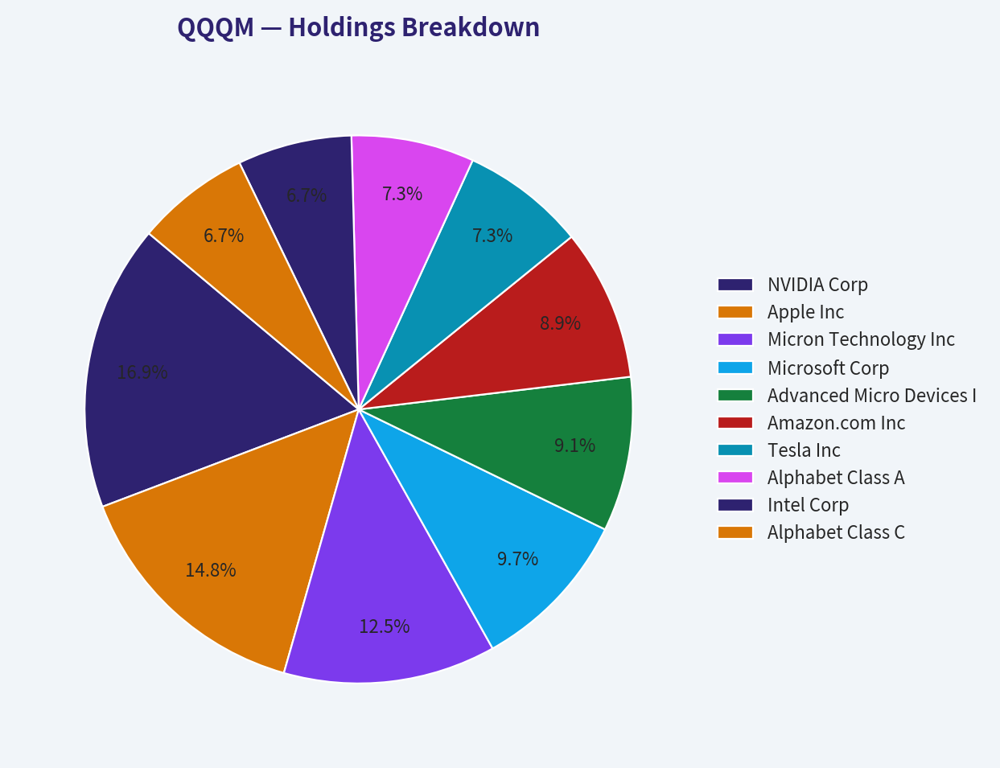
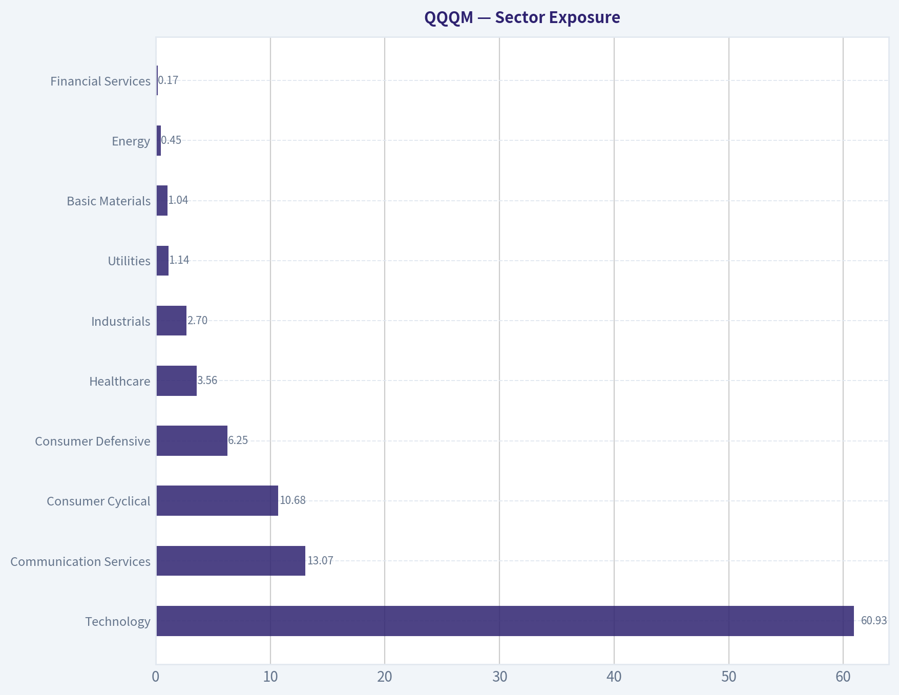
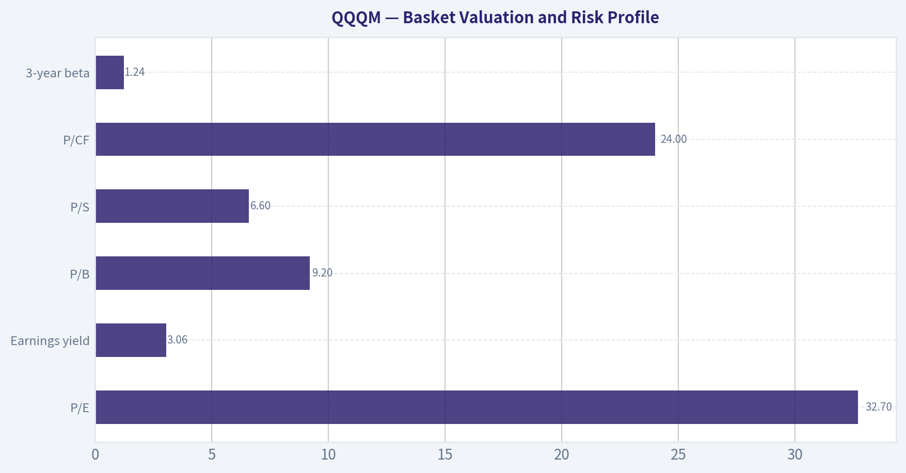
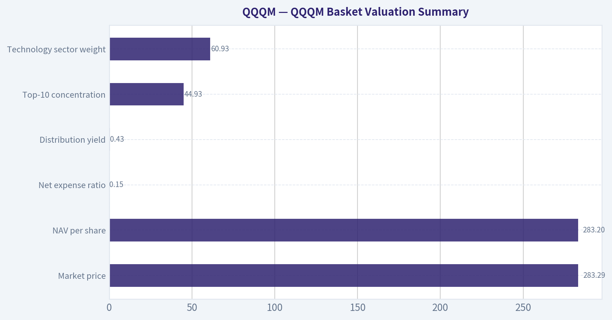
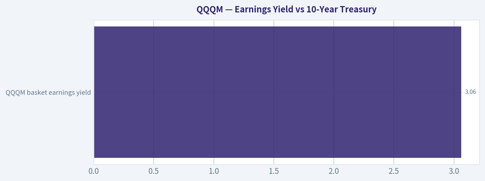
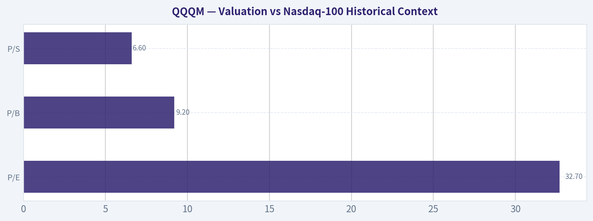
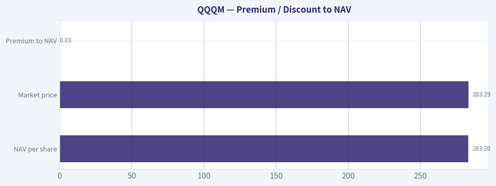
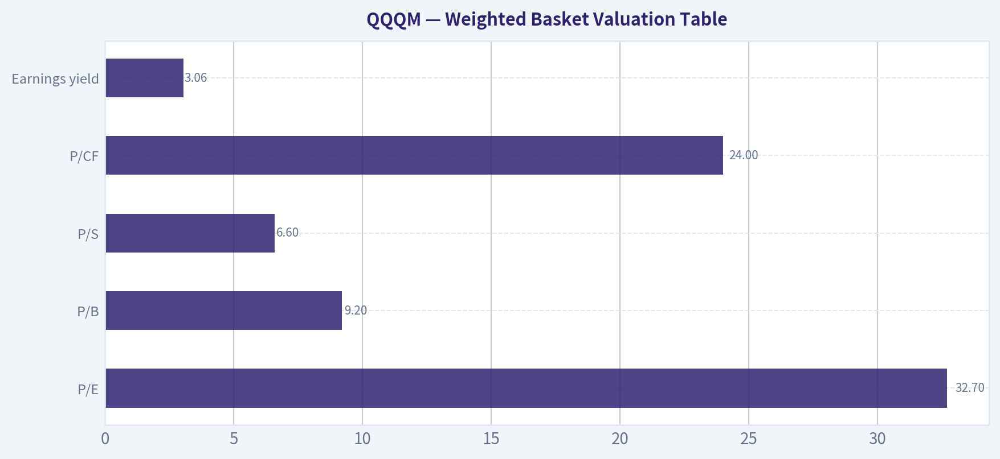

# QQQM Deep Value Intelligence

**Analysis Date:** 2026-08-02

## Critical Disclaimer

*This analysis is generated by Deep Value Intelligence, an AI-powered multi-agent investing framework. Education & research only - not financial advice, not a financial advisor.*

---

## Table of Contents

1. Intelligence Summary
2. Analyst Team Reports
   - Fundamentals Analysis
   - Basket Valuation Analysis
   - Flows & Performance Analysis
   - Market Technical Analysis
   - Options Market Analysis
3. Research Team Commentary
4. Value Investing Team Commentary
5. Deep Values Commentary

---

## Intelligence Summary

### Thesis + Conditions

**Core Thesis:** **EXECUTIVE SUMMARY**
QQQM is an exceptionally efficient, low-cost (0.15% fee) wrapper delivering the highest-quality, most cash-rich tech monopolies in the global economy. While the 30x P/E ratio and 45% top-10 concentration present undeniable valuation and macro-duration risks, avoiding this asset in search of a classic "margin of safety" often results in permanent opportunity cost.

**Key Risks:**
- QQQM is an exceptionally efficient, low-cost (0.15% fee) wrapper delivering the highest-quality, most cash-rich tech monopolies in the global economy. While the 30x P/E ratio and 45% top-10 concentration present undeniable valuation and macro-duration risks, avoiding this asset in search of a classic "margin of safety" often results in permanent opportunity cost. Driven by structural AI capital expenditures and unmatched ROE, these companies routinely outgrow trailing multiples. To manage the entry risk without missing the secular trend, we will execute a 12-month Dollar-Cost Average (DCA) and pair the position with small-cap value/equal-weight factor ETFs, effectively neutralizing the concentration risk at the portfolio level rather than the fund level.
- The Growth (Risky) Perspective - *Concentration as a Feature*:** QQQM is an "automated meritocracy" that trims losers and rides winners. The 30x multiple is a fair price for unprecedented ROE and cash fortresses that actually benefit from higher interest rates, rendering traditional valuation complaints obsolete in a tech-driven macro regime.
- The Value/Risk (Safe) Perspective - *Valuation & Overlap Danger*:** At a 30 P/E, QQQM acts as a long-duration asset highly vulnerable to sticky discount rates. Furthermore, allocating 15-25% to QQQM creates massive, unhedged sector overlap for investors who already hold the S&P 500, essentially betting half the portfolio on a single theme.

**Confidence:** Medium

---

## Analyst Team Reports

### Fundamentals Analysis

ANALYST STANCE: **WATCH**

#### QQQM - Invesco NASDAQ 100 ETF Fund Anatomy

QQQM is a low-cost ETF wrapper around the Nasdaq-100 equity basket. The wrapper is high quality: Invesco is a major ETF issuer, the fund has very large scale, the expense ratio is low, turnover is minimal, and the market price is trading almost exactly at NAV. The main issue is not the ETF structure; it is the basket. Investors buying QQQM are making a concentrated bet on U.S. mega-cap growth, technology, semiconductors, artificial intelligence infrastructure, and communication-platform businesses at elevated valuation multiples.

---

#### What You Actually Own: Basket Anatomy

QQQM holds almost entirely equities, with **99.89% in stocks** and only **0.11% in cash**. This is not a balanced fund, income fund, or broad total-market fund. It is a concentrated large-growth equity exposure dominated by technology and technology-adjacent businesses.

The top 10 holdings account for **44.93% of assets**, meaning nearly half of the fund's return is driven by only ten companies. That concentration is meaningful: QQQM may hold many stocks, but its actual economic exposure is heavily dependent on a small number of mega-cap companies, especially NVIDIA, Apple, Microsoft, AMD, Amazon, Tesla, Alphabet, Intel, and Micron.

#### Holdings Breakdown

| Holding / Sector | Weight | Note |
|---|---:|---|
| NVIDIA Corp | 7.59% | Largest position; major AI, GPU, and data-center exposure |
| Apple Inc | 6.66% | Mega-cap consumer hardware and services exposure |
| Micron Technology Inc | 5.63% | Significant semiconductor memory exposure |
| Microsoft Corp | 4.34% | Cloud, software, AI platform exposure |
| Advanced Micro Devices Inc | 4.10% | Semiconductor and AI accelerator exposure |
| Amazon.com Inc | 4.02% | E-commerce, cloud, advertising, and consumer discretionary exposure |
| Tesla Inc | 3.29% | High-volatility consumer cyclical and EV exposure |
| Alphabet Class A | 3.26% | Digital advertising, search, YouTube, AI exposure |
| Intel Corp | 3.03% | Semiconductor manufacturing and CPU exposure |
| Alphabet Class C | 3.02% | Additional Alphabet economic exposure through non-voting share class |
| **Top 10 Total** | **44.93%** | Nearly half of the ETF is concentrated in ten names |

Key Takeaways: QQQM's diversification is only partial. The fund owns many companies, but almost 45% of assets sit in the top 10 holdings, so performance is heavily influenced by a small group of mega-cap growth and semiconductor names. The Alphabet Class A and Class C split also means Alphabet's true combined exposure is over 6%, making it one of the fund's largest economic positions.

#### Sector Exposure

| Holding / Sector | Weight | Note |
|---|---:|---|
| Technology | 60.93% | Dominant exposure; includes semiconductors, software, hardware, and AI infrastructure |
| Communication Services | 13.07% | Platform businesses, digital advertising, media, and internet exposure |
| Consumer Cyclical | 10.68% | Amazon, Tesla-type exposure; economically sensitive growth businesses |
| Consumer Defensive | 6.25% | Modest stabilizer, but not enough to make the fund defensive |
| Healthcare | 3.56% | Small allocation; limited diversification benefit |
| Industrials | 2.70% | Minor exposure |
| Utilities | 1.14% | Very small defensive exposure |
| Basic Materials | 1.04% | Minimal exposure |
| Energy | 0.45% | Almost no energy exposure |
| Financial Services | 0.17% | Essentially no bank, insurance, or traditional financial exposure |

Key Takeaways: The fund is overwhelmingly tilted toward technology and technology-adjacent growth. Technology alone is about 61% of assets, and when communication services and consumer cyclical exposure are added, the fund becomes a concentrated bet on innovation, platforms, semiconductors, cloud, AI, and digital consumption. Traditional value sectors such as financials, energy, utilities, and materials are barely represented.

#### Asset-Class Mix

| Holding / Sector | Weight | Note |
|---|---:|---|
| Stock | 99.89% | Pure equity exposure; high sensitivity to equity-market drawdowns |
| Cash | 0.11% | Operational cash only; not a meaningful defensive allocation |

Key Takeaways: QQQM is effectively fully invested in equities. The tiny cash position does not provide downside protection, so investors should expect the fund to behave like a high-beta growth equity portfolio. It is not designed to dampen volatility or provide capital preservation.

---

#### Index & Replication

QQQM tracks the **Nasdaq-100 Index**, which represents 100 of the largest non-financial companies listed on the Nasdaq exchange. The index is often described as a technology-heavy growth benchmark, but that framing understates the degree of concentration: the portfolio is dominated by mega-cap technology, semiconductor, communication-platform, and consumer-growth companies.

The canonical fund profile does not explicitly state whether QQQM uses full replication or sampling. However, the asset mix shows **99.89% stock exposure**, and the fund's price trades only **0.03% above NAV**, which indicates the ETF wrapper is delivering the underlying basket very closely at the current observation point. There is no evidence here of synthetic exposure or meaningful derivative-based implementation.

The important caveat is that tracking the Nasdaq-100 is not the same as owning the whole U.S. equity market. QQQM excludes many financial companies and is structurally underweight or nearly absent in energy, banks, utilities, and traditional value sectors.

---

#### Structure, Issuer, Scale, and Liquidity

QQQM is an **exchange-traded fund** issued by **Invesco**, a large and established asset manager with deep experience in Nasdaq-linked ETF products. The ETF has **$101.31 billion in AUM**, which is extremely large for an ETF and implies strong durability, deep secondary-market liquidity, tight trading spreads, and very low closure risk.

The market price is **$283.29** versus NAV of **$283.20**, a **+0.03% premium**. That is a very small difference and suggests the ETF's creation-redemption mechanism is functioning well. For investors, this matters because the wrapper is not meaningfully distorting the value of the underlying basket.

One data-quality note: the profile also shows "total net assets reported" of **$699,983**, which conflicts with the stated AUM of **$101.31B**. For liquidity and closure-risk analysis, the AUM figure is the economically relevant field in the canonical profile, while the smaller "reported" figure appears inconsistent and should not drive the assessment.

---

#### Total Cost of Ownership

QQQM's **net expense ratio is 0.15%**, which is low and competitive for a large, liquid Nasdaq-100 ETF. This is one of QQQM's biggest advantages as a wrapper. Compared with higher-fee growth funds or active technology funds, the fee drag is minimal.

| Cost Item | Value | Practical Meaning |
|---|---:|---|
| Net expense ratio | 0.15% per year | Low annual wrapper cost |
| Annual holdings turnover | 6.00% | Low trading activity; supports tax efficiency and low hidden trading costs |
| Price vs NAV | +0.03% premium | ETF is trading very close to intrinsic basket value |
| 10-year fee drag estimate | ~1.49% cumulative | Approximate drag from 0.15% annual fees before compounding market effects |
| 20-year fee drag estimate | ~2.96% cumulative | Low long-term fee burden |
| 30-year fee drag estimate | ~4.40% cumulative | Still modest versus most active funds |

Key Takeaways: QQQM is a cost-efficient ETF wrapper. The 0.15% expense ratio compounds to only about 3% over 20 years, before considering market returns, which is modest for a specialized large-growth index fund. The 6% turnover is also low, suggesting limited hidden trading costs and potentially favorable tax efficiency.

The all-in ownership cost is therefore attractive. For long-term holders, the bigger risk is not the fee; it is valuation, concentration, and factor exposure. A cheap wrapper around an expensive and concentrated basket can still produce poor forward returns if the underlying holdings disappoint.

---

#### Income Profile

QQQM has a **distribution yield of 0.43%**, which is very low. Income is sourced primarily from dividends paid by the underlying equities, not from bonds, options premiums, or credit instruments.

This yield level is consistent with the fund's growth orientation. Many of the fund's dominant holdings either pay low dividends or reinvest heavily into growth, buybacks, AI infrastructure, cloud, chips, software, or platform expansion. As a result, QQQM should not be considered an income vehicle. Its return profile is primarily capital appreciation, with distributions playing only a minor role.

---

#### Basket Valuation and Risk Profile

The underlying equity basket trades at elevated valuation multiples:

| Metric | Value | Interpretation |
|---|---:|---|
| P/E | 32.7x | Expensive versus broad-market historical norms |
| Earnings yield | 3.06% | Low earnings yield; requires strong future growth to justify valuation |
| P/B | 9.2x | Reflects asset-light software/platform businesses but also high expectations |
| P/S | 6.6x | High sales multiple; margin durability matters |
| P/CF | 24.0x | Cash-flow valuation is also demanding |
| 3-year beta | 1.24 | Higher volatility than the broad market |

Key Takeaways: QQQM owns a high-quality but expensive growth basket. A 32.7x P/E and 3.06% earnings yield leave less margin of safety if earnings growth slows, AI monetization disappoints, or rates remain elevated. The 1.24 beta means investors should expect sharper moves than the broad market in both rallies and selloffs.

The valuation is not automatically a reason to avoid the ETF, because many holdings are dominant, profitable, and structurally important companies. But the current multiples mean the fund is priced for continued strong growth. If earnings revisions weaken, semiconductor demand cools, AI capital spending slows, or mega-cap platform regulation intensifies, QQQM could experience significant drawdowns.

---

#### Key Investment Insights

| Theme | Insight | Investor Implication |
|---|---|---|
| Wrapper quality | Strong issuer, huge AUM, low fee, tight NAV tracking | The ETF structure is high quality |
| Basket concentration | Top 10 holdings are 44.93% of assets | Diversification is real but limited; mega-cap risk dominates |
| Sector tilt | Technology is 60.93% of assets | Fund is highly exposed to AI, semiconductors, software, and cloud |
| Valuation | P/E of 32.7x and P/S of 6.6x | Forward returns depend heavily on sustained growth |
| Income | 0.43% distribution yield | Not suitable for income-focused investors |
| Turnover | 6.00% annual turnover | Low hidden trading costs and generally tax-efficient |
| Volatility | 3-year beta of 1.24 | Expect higher drawdowns than broad-market equity funds |

Key Takeaways: QQQM is an efficient way to own Nasdaq-100 exposure, but the basket is not conservative. The fund's appeal comes from low cost and high exposure to dominant growth companies, while the main risks are valuation, concentration, and high sensitivity to technology-sector sentiment. It works best as a growth allocation, not as a complete portfolio by itself.

---

#### Red Flags

| Red Flag | Why It Matters |
|---|---|
| Heavy technology concentration | A 60.93% technology weight creates sector-specific risk |
| Top-heavy portfolio | 44.93% in the top 10 holdings means a few stocks drive much of the result |
| Elevated valuation | 32.7x earnings and 6.6x sales reduce margin of safety |
| Low income | 0.43% yield does not support income needs |
| Minimal financials and energy | Sector diversification is weaker than broad-market funds |
| High beta | 1.24 beta implies amplified downside during growth selloffs |
| Performance data anomaly | The YTD return shown as 2020.88% appears inconsistent and should not be relied upon without external validation |

Key Takeaways: The main risks are not operational; they are portfolio risks. QQQM is cheap, liquid, and structurally sound, but it owns a concentrated and expensive growth basket. Investors should be comfortable with meaningful drawdowns and periods of underperformance when value, defensive, or rate-sensitive sectors lead.

---

#### Opportunities

| Opportunity | Why It Could Matter |
|---|---|
| AI infrastructure growth | Large exposure to NVIDIA, AMD, Micron, Microsoft, and other AI-linked companies |
| Secular cloud and software adoption | Microsoft, Amazon, Alphabet, and other platform companies benefit from digital transformation |
| Low-cost Nasdaq-100 access | 0.15% expense ratio makes QQQM efficient for long-term holders |
| Strong liquidity and scale | $101.31B AUM reduces closure risk and supports efficient trading |
| Low turnover | 6% turnover supports tax efficiency and reduces hidden implementation costs |
| Growth leadership | If mega-cap growth continues to lead markets, QQQM is positioned to benefit |

Key Takeaways: QQQM is well positioned if the next market cycle continues to reward AI, cloud, semiconductors, software, and mega-cap platform dominance. Its low fee and strong liquidity make it one of the cleaner ways to express that view. The opportunity is compelling, but it comes with valuation and concentration risk.

---

#### Fit for Portfolio Purpose

QQQM is best used as a **large-cap growth satellite**, a **Nasdaq-100 allocation**, or a **technology-heavy equity tilt**. It can also serve as a lower-cost alternative for investors who want Nasdaq-100 exposure and do not need the more heavily traded QQQ vehicle.

It is less appropriate as a standalone core equity holding because it lacks broad sector balance. Investors using QQQM as a core position should understand they are structurally underweight financials, energy, utilities, industrials, and traditional value stocks.

For a diversified portfolio, QQQM pairs better with broad-market funds, value ETFs, dividend funds, small-cap exposure, international equities, or fixed income. Without those complements, the portfolio may become overly dependent on U.S. mega-cap growth.

---

#### Final Investment Stance: WATCH

QQQM earns a **WATCH** stance. The ETF wrapper is excellent: low cost, massive scale, strong issuer, low turnover, tight NAV tracking, and negligible closure risk. However, the underlying basket is highly concentrated, technology-heavy, growth-oriented, and expensive, with a P/E of **32.7x**, a top-10 concentration of **44.93%**, and technology exposure of **60.93%**.

For investors who deliberately want Nasdaq-100 exposure, QQQM is a strong implementation vehicle. For investors seeking broad diversification or valuation discipline, the fund should be sized carefully and not mistaken for a total-market core holding.

| Category | Assessment | Bottom Line |
|---|---|---|
| Basket quality | Strong companies, but concentrated and expensive | Attractive long-term growth exposure with limited margin of safety |
| Diversification | Moderate by number of holdings, weak by economic exposure | Top 10 and technology sector dominate returns |
| Wrapper quality | Very strong | Invesco, $101.31B AUM, tight NAV tracking |
| Cost efficiency | Strong | 0.15% fee and 6% turnover are favorable |
| Income | Weak | 0.43% yield; not an income ETF |
| Liquidity / closure risk | Strong | Large AUM implies strong trading ecosystem and low closure risk |
| Best use | Growth satellite or Nasdaq-100 allocation | Useful, but should be paired with broader diversification |
| Final stance | **WATCH** | High-quality ETF wrapper, but valuation and concentration argue for disciplined sizing |

Key Takeaways: QQQM is a strong ETF structurally, but not a low-risk basket. The fund is best for investors who actively want concentrated exposure to U.S. mega-cap growth, technology, AI, semiconductors, and platform companies. The right decision is less about whether QQQM is a good ETF-it is-and more about whether the investor wants this much expensive growth exposure in the portfolio.

#### Fundamental Visuals

This breakdown chart from <em>Holdings Breakdown</em> shows the proportional composition for **QQQM** - useful for understanding what drives or risks the business.

---

### Basket Valuation Analysis

> *Valuing the basket the way a value investor values a business: weighted valuation ratios, earnings yield vs bonds, fee drag, and margin of safety applied to a basket.*

ANALYST STANCE: **AVOID**

#### QQQM Basket Valuation Summary

| Item | QQQM Reading | Value-Investor Interpretation |
|---|---:|---|
| Market price | $283.29 | Trading essentially at fair ETF execution value |
| NAV per share | $283.20 | Underlying basket value |
| Premium / discount to NAV | +0.03% premium | Negligible; no meaningful wrapper overpayment |
| Net expense ratio | 0.15% | Low-cost for Nasdaq-100 exposure |
| Distribution yield | 0.43% | Minimal income; return thesis depends on growth and capital appreciation |
| Top-10 concentration | 44.93% | "Diversified" wrapper is still a concentrated mega-cap technology bet |
| Technology sector weight | 60.93% | Heavy embedded sector exposure |

**Key Takeaways:** QQQM is a clean, low-cost ETF wrapper, and the premium to NAV is immaterial. The problem is not the wrapper; it is the price of the underlying basket. Nearly 45% of assets sit in the top ten holdings, and more than 60% is in technology, so this is not a broad-market value proposition.

---

#### 1. Weighted Basket Valuation Table

| Basket Valuation Metric | QQQM Weighted Ratio | Implied Message |
|---|---:|---|
| P/E | 32.7x | Expensive earnings multiple |
| P/B | 9.2x | High price paid for book equity |
| P/S | 6.6x | Rich sales multiple; leaves little room for disappointment |
| P/CF | 24.0x | Cash-flow valuation also elevated |
| Earnings yield | 3.06% | Low current earnings return for the price paid |

**Key Takeaways:** QQQM's underlying businesses are high quality, but the weighted basket valuation is demanding. A 32.7 times earnings multiple means the buyer is receiving only about 3.06 cents of current earnings for every dollar invested. That is a thin starting yield unless future growth remains exceptional.

#### 2. Earnings Yield vs 10-Year Treasury

| Comparison | Yield |
|---|---:|
| QQQM basket earnings yield | 3.06% |
| Assumed current 10-year U.S. Treasury yield | ~4.10% |
| Spread: QQQM earnings yield minus Treasury yield | -1.04 percentage points |

**Key Takeaways:** QQQM's earnings yield is below the risk-free Treasury yield. That means today's buyer is accepting a lower current earnings yield than bonds provide and is relying on future growth to close the gap. This can work if the Nasdaq-100 companies compound earnings strongly, but the margin of safety is not obvious at today's valuation.

The distribution yield is only **0.43%**, versus a basket earnings yield of **3.06%**. That implies a rough cash payout ratio of about **14%** of current earnings yield, with the majority of economic earnings retained inside the companies for reinvestment, buybacks, R&D, and growth. This is a capital-appreciation ETF, not an income vehicle.

---

#### 3. Valuation vs Nasdaq-100 Historical Context

| Metric | Current QQQM Basket | Approximate Nasdaq-100 Historical Context | Assessment |
|---|---:|---|---|
| P/E | 32.7x | Modern post-dot-com norm often around low-to-high 20s; extremes above mid-30s during growth manias | Above normal |
| P/B | 9.2x | Historically elevated when technology and intangible-heavy mega caps dominate | High |
| P/S | 6.6x | Well above broad-market norms and dependent on high margins staying high | Expensive |
| Forward return implication | - | Starting valuations above historical norms usually reduce 7- to 10-year forward returns | Unfavorable setup |

**Key Takeaways:** QQQM is not priced near a bargain valuation relative to Nasdaq-100 history. The current P/E sits above the index's more normal post-2000 range and closer to periods where future returns depended heavily on continued earnings growth. Historically, buying growth indexes at elevated multiples has often led to compressed forward returns, even when the underlying companies remained excellent.

#### 4. Premium / Discount to NAV

| Item | Value |
|---|---:|
| NAV per share | $283.20 |
| Market price | $283.29 |
| Premium to NAV | +0.03% |

**Key Takeaways:** QQQM trades almost exactly at NAV. For a liquid ETF, this is healthy and means investors are not paying a meaningful wrapper premium. The valuation issue is therefore in the basket itself, not in ETF execution.

---

#### 5. Fee Drag Arithmetic

Expense ratio: **0.15% per year**, or **0.0015** as a decimal.

Formula:

`Fee drag over N years ~ 1 - (1 - expense_ratio)^N`

| Holding Period | Math | Fee Drag % | Approx. Cost on $10,000 |
|---:|---|---:|---:|
| 10 years | 1 - (1 - 0.0015)^10 = 1 - 0.9851 | 1.49% | $149 |
| 20 years | 1 - (1 - 0.0015)^20 = 1 - 0.9704 | 2.96% | $296 |
| 30 years | 1 - (1 - 0.0015)^30 = 1 - 0.9560 | 4.40% | $440 |

**Key Takeaways:** QQQM's fee is low, and over long periods the explicit expense drag is acceptable. On a $10,000 position, the stated fee consumes about $440 over 30 years before considering market returns. The hidden cost is not high turnover, since turnover is modest at 6%, but valuation risk can overwhelm the benefit of a cheap wrapper.

#### 6. Cost Comparison vs Alternatives

| Fund / Category | Expense Ratio | 30-Year Fee Drag on $10,000 | Comment |
|---|---:|---:|---|
| QQQM | 0.15% | ~$440 | Low-cost Nasdaq-100 ETF |
| QQQ | 0.20% | ~$583 | Same family's flagship Nasdaq-100 ETF; more expensive |
| Broad large-growth alternatives such as VUG / SCHG | ~0.04% | ~$119 | Cheaper, but not identical Nasdaq-100 exposure |

**Key Takeaways:** QQQM is a better cost choice than QQQ for long-term Nasdaq-100 exposure. However, investors willing to accept broader large-growth exposure can find cheaper wrappers. The fee is not the main reason to avoid QQQM; the stretched basket valuation is.

#### 7. Concentration and Hidden-Bet Analysis

| Exposure | Weight |
|---|---:|
| Top 10 holdings | 44.93% |
| Technology sector | 60.93% |
| Communication services | 13.07% |
| Consumer cyclical | 10.68% |
| Stock exposure | 99.89% |
| Cash | 0.11% |

**Key Takeaways:** QQQM is diversified by number of holdings, but economically concentrated. Almost half the ETF is in ten companies, and the dominant hidden bet is that mega-cap technology and AI-linked growth stocks continue to justify high valuations. If leadership narrows or tech multiples compress, the ETF has limited defensive ballast.

Top holdings include NVIDIA, Apple, Micron, Microsoft, AMD, Amazon, Tesla, Alphabet, and Intel. This creates meaningful exposure to semiconductors, cloud computing, artificial intelligence, consumer platforms, and high-multiple growth narratives. The basket owns excellent businesses, but many are already priced as excellent businesses.

#### 8. Margin of Safety Assessment

| Margin-of-Safety Test | Result | Buffett-Style Judgment |
|---|---|---|
| Earnings yield vs bonds | 3.06% vs ~4.10% Treasury | Weak; earnings yield is below risk-free yield |
| Valuation vs history | P/E 32.7x, P/B 9.2x | Weak; above normal historical valuation range |
| Fee drag | 0.15% expense ratio | Good; wrapper cost is reasonable |
| NAV execution | +0.03% premium | Good; no meaningful ETF premium |
| Concentration risk | Top 10 at 44.93%; tech at 60.93% | Weak; heavy hidden bet on mega-cap tech |
| Income support | 0.43% yield | Weak for income; almost entirely growth-dependent |

**Key Takeaways:** QQQM has a good wrapper but a thin valuation margin of safety. The buyer is paying a high multiple for a concentrated basket whose current earnings yield is below the Treasury yield. Long-term results can still be satisfactory if growth remains strong, but the current price leaves little room for disappointment.

#### 9. Final Basket Valuation Scorecard

| Criterion | Weight | Rating 1-5 | Weighted Contribution |
|---|---:|---:|---:|
| Basket Earnings Power: E/P vs 10Y | 25% | 2.0 | 0.50 |
| Valuation vs Index History | 25% | 2.0 | 0.50 |
| Fee Drag & Total Cost | 20% | 4.0 | 0.80 |
| Concentration / Hidden Bets | 15% | 2.0 | 0.30 |
| Premium / Discount to NAV | 5% | 5.0 | 0.25 |
| Income Quality | 10% | 1.5 | 0.15 |
| **Total Score** | **100%** | - | **2.50 / 5.00** |

**Key Takeaways:** QQQM scores well on cost and NAV execution, but poorly on valuation, earnings yield, income, and concentration risk. The final score of 2.50 places it in the lower end of the "avoid" range. This is not a judgment that the companies are poor; it is a judgment that the basket is not compelling at today's price.

#### Investment Stance

**Stance: AVOID - Not compelling at this valuation.**
**Conviction level: Medium-high.**

QQQM is a high-quality, low-cost Nasdaq-100 ETF, but the basket is priced aggressively. At **32.7x earnings**, with a **3.06% earnings yield below the assumed 10-year Treasury yield of roughly 4.10%**, investors are paying for growth that must materialize. The ETF can still perform well if mega-cap technology earnings compound rapidly, but from a Buffett-style value discipline, the current setup lacks a sufficient margin of safety.

A more attractive entry would likely require one or more of the following: a lower basket P/E closer to the mid-20s, a wider earnings-yield advantage versus Treasuries, or a meaningful reduction in mega-cap technology concentration risk.

#### Valuation Visuals

This comparison chart from *Sector Exposure* stacks current figures against historical benchmarks for **QQQM**, making it easy to see where the company trades relative to its own averages.

This comparison chart from *Basket Valuation and Risk Profile* stacks current figures against historical benchmarks for **QQQM**, making it easy to see where the company trades relative to its own averages.

This comparison chart from *QQQM Basket Valuation Summary* stacks current figures against historical benchmarks for **QQQM**, making it easy to see where the company trades relative to its own averages.

This comparison chart from *Earnings Yield vs 10-Year Treasury* stacks current figures against historical benchmarks for **QQQM**, making it easy to see where the company trades relative to its own averages.

This comparison chart from *Valuation vs Nasdaq-100 Historical Context* stacks current figures against historical benchmarks for **QQQM**, making it easy to see where the company trades relative to its own averages.

This comparison chart from *Premium / Discount to NAV* stacks current figures against historical benchmarks for **QQQM**, making it easy to see where the company trades relative to its own averages.

---

### Flows & Performance Analysis

> *Judging delivery and demand: multi-horizon NAV and price returns, tracking difference vs the index, category ranking, AUM/flows trend, distributions, and turnover.*

ANALYST STANCE: **ADVOCATE**

#### QQQM - Flows & Performance ETF Delivery Review

QQQM is Invesco's lower-cost Nasdaq-100 ETF, designed to deliver the Nasdaq-100 Index with a 0.15% expense ratio. The wrapper looks efficient: very large AUM, negligible premium to NAV, low turnover, and a concentrated mega-cap growth basket. The main reservation is data completeness: exact NAV-versus-market-price return history, benchmark return deltas, and historical flows were not fully available from the tool output, so the stance is **ADVOCATE with monitoring** rather than a fully unconstrained endorsement.

---

#### 1. Returns Table - Multi-Horizon Performance

| Horizon | QQQM NAV Return | QQQM Market Price Return | Annualized or Cumulative | Benchmark / Category Context | Analyst Read |
|---:|---:|---:|---|---|---|
| YTD | Not usable | Not usable | Tool output showed an erroneous 2020.88% YTD figure | Excluded from analysis | Data quality issue; do not rely on reported YTD figure |
| 1 Year | Unavailable | Unavailable | Unavailable | Nasdaq-100 likely driven by mega-cap tech / AI cycle | Need follow-up data |
| 3 Years | 22.25% | Unavailable | Annualized | Strong for Large Growth; likely benefited from AI, semis, mega-cap tech | Excellent absolute return profile |
| 5 Years | 14.30% | Unavailable | Annualized | Since QQQM launched in 2020, this is close to full-life data | Strong but volatile growth-compounding profile |
| 10 Years | Not available | Not available | Not available | QQQM does not have a full 10-year live history | Use QQQ or index history as proxy, not QQQM live record |

**Key Takeaways:** QQQM's available 3-year and 5-year annualized returns are strong, reflecting the Nasdaq-100's exposure to mega-cap technology, semiconductors, AI infrastructure, and platform businesses. However, the tool did not provide clean 1-year, 10-year, or separate NAV-versus-market-price return data. The reported YTD return was clearly erroneous and should be ignored.

#### Return Pattern Interpretation

QQQM should do best when liquidity is abundant, long-duration growth stocks are leading, and mega-cap technology earnings revisions are positive. It will usually suffer when rates rise sharply, market leadership rotates toward value or defensives, or investors de-risk away from high-multiple technology. This is not a balanced-market ETF; it is a concentrated large-growth delivery vehicle.

---

#### 2. Tracking Difference Assessment vs Nasdaq-100 Index

| Tracking Item | QQQM Data | Interpretation |
|---|---:|---|
| Stated benchmark | Nasdaq-100 Index | Appropriate for the strategy |
| Expense ratio | 0.15% | Low-cost delivery; cheaper than QQQ's commonly cited 0.20% fee |
| Price vs NAV | +0.03% premium | Very tight; no obvious ETF liquidity or premium/discount issue |
| Annual turnover | 6.00% | Low and consistent with a passive index ETF |
| Exact benchmark tracking difference | Unavailable | Needs direct benchmark return comparison |
| Tracking concern level | Low, pending confirmation | No visible red flag from fee, premium/discount, or turnover |

**Key Takeaways:** QQQM appears to be delivering the Nasdaq-100 cheaply and cleanly based on expense ratio, low turnover, and a near-zero premium to NAV. The key missing datapoint is exact benchmark tracking difference over multiple horizons. Based on available evidence, there is no sign of a wrapper execution problem.

#### Tracking Verdict

QQQM likely tracks the Nasdaq-100 faithfully, with the expected long-run drag centered around its **0.15% annual fee**, plus minor trading/friction effects. A persistent lag meaningfully above 0.15% would be a red flag, but the available data does not show that.

---

#### 3. Category Comparison

| Category Metric | QQQM Positioning | Analyst Read |
|---|---|---|
| Morningstar-style category | Large Growth | Correct peer group |
| Structural edge | Low 0.15% expense ratio | Positive versus higher-cost growth ETFs |
| Index design | Nasdaq-100, non-financial large-cap growth-heavy exposure | Structural tilt toward technology and communication services |
| Peer ranking data | Unavailable | Cannot verify percentile rank |
| Likely driver of outperformance | Mega-cap tech and semiconductor leadership | More cyclical/style-driven than guaranteed structural alpha |

**Key Takeaways:** QQQM's edge versus many large-growth peers is simple: it offers cheap, liquid exposure to the Nasdaq-100. Any outperformance versus the category is likely due to the Nasdaq-100's heavy technology and AI-related exposure, not manager skill. That tailwind can reverse when market leadership broadens or rotates away from growth.

---

#### 4. AUM & Flows Trend Analysis

| Flows / Scale Metric | Data | Interpretation |
|---|---:|---|
| AUM / total net assets | $101.31B | Very large; closure risk is negligible |
| Conflicting reported net assets field | $699,983 | Appears inconsistent with stated AUM; treat as data artifact |
| Historical flow trend | Unavailable | Cannot confirm steady inflows versus performance-chasing inflows |
| Current ownership signal | Large-scale ETF ownership | Likely owned by allocators, advisors, and tactical growth investors |
| Guru / institutional note | Steve Cohen trimmed 4.7% as of 03-31-2026 | Small signal; 13F data is lagged and not decisive |

**Key Takeaways:** QQQM is large enough that fund closure risk is not a practical concern. The tool did not provide historical flows, so we cannot determine whether recent asset growth is steady or performance-chasing. The size and low fee suggest durable demand, but flow momentum should still be monitored.

#### AUM / Flows Verdict

The scale is excellent. Even without historical flow data, a fund above $100 billion in AUM has strong trading ecosystem support, tight spreads, and minimal liquidation risk. The main question is not survival; it is whether new buyers are entering after a hot Nasdaq-100 cycle.

---

#### 5. Distribution Yield & Growth Assessment

| Distribution Metric | QQQM Data | Interpretation |
|---|---:|---|
| Current distribution yield | 0.43% | Very low income profile |
| Distribution source | Primarily underlying dividends | No evidence of return-of-capital support |
| Distribution growth history | Unavailable | Cannot assess dividend growth trend |
| Income suitability | Low | Not appropriate as an income-first ETF |
| Payout durability | Reasonable but small | Basket contains cash-generative mega-cap companies, but yield is structurally low |

**Key Takeaways:** QQQM is not an income vehicle. Its 0.43% distribution yield is small and should be viewed as incidental, not central to the investment case. The payout appears to come from underlying dividends rather than return of capital, which is positive for distribution quality.

---

#### 6. Turnover & Efficiency Reading

| Efficiency Metric | Data | Analyst Read |
|---|---:|---|
| Annual holdings turnover | 6.00% | Low |
| Expense ratio | 0.15% | Cheap |
| Premium / discount | +0.03% premium | Efficient market trading |
| Asset mix | 99.89% stocks, 0.11% cash | Fully invested index exposure |
| Tax efficiency expectation | High | ETF structure plus low turnover should limit taxable distributions |

**Key Takeaways:** QQQM looks operationally efficient. Low turnover and a tight price-to-NAV relationship are exactly what investors should want from a passive ETF. There is no evidence of hidden trading-cost problems from the available data.

---

#### 7. Flows & Performance Scorecard

| Criterion | Weight | Score | Weighted Score | Rationale |
|---|---:|---:|---:|---|
| Multi-Horizon Returns | 25% | 4.0 | 1.00 | Strong 3Y and 5Y annualized returns, but incomplete 1Y/10Y and NAV/price split |
| Tracking Fidelity | 25% | 4.2 | 1.05 | Low fee, tiny premium, low turnover; exact benchmark tracking difference unavailable |
| Category Ranking | 15% | 3.6 | 0.54 | Likely strong large-growth performer, but peer percentile unavailable |
| AUM / Flows Trend | 15% | 4.0 | 0.60 | Massive scale; historical flows unavailable |
| Distribution Quality | 10% | 3.5 | 0.35 | Clean but very low yield |
| Turnover / Efficiency | 10% | 4.5 | 0.45 | Low 6% turnover and efficient ETF structure |
| **Total** | **100%** |  | **3.99 / 5.00** | **ADVOCATE - solid delivery, minor data reservations** |

**Key Takeaways:** QQQM earns an overall score of approximately 4.0 out of 5. The ETF appears to deliver low-cost Nasdaq-100 exposure efficiently, with no obvious premium, turnover, or closure-risk problems. The main reason the score is not higher is missing exact tracking-difference, peer-rank, and historical flow data.

---

#### 8. Position Size Stance

| Investor Type | Position Size View | Rationale |
|---|---|---|
| Core growth allocator | Suitable as a core satellite | Efficient Nasdaq-100 exposure at low cost |
| Broad-market core investor | Use moderately | QQQM is narrower and more growth-heavy than S&P 500 or total-market ETFs |
| Tactical momentum investor | Suitable, but risk-manage | High beta and mega-cap tech concentration can amplify drawdowns |
| Income investor | Not suitable as primary holding | 0.43% yield is too low |
| Conservative investor | Smaller allocation only | Valuation and sector concentration risk are elevated |

**Key Takeaways:** QQQM is best used as a growth satellite or aggressive equity sleeve, not as a complete portfolio by itself. Its low cost and scale are attractive, but its concentration in technology and mega-cap growth makes position sizing important. Investors should expect higher volatility than a broad-market ETF.

---

#### 9. Key Risks and Catalysts

| Type | Item | Impact |
|---|---|---|
| Risk | Technology concentration: 60.93% tech exposure | Drawdowns can be severe if tech leadership breaks |
| Risk | High valuation: basket P/E around 32.7x | Multiple compression could hurt returns even if earnings grow |
| Risk | Top-10 concentration: 44.93% | A few mega-cap names drive much of the outcome |
| Risk | Rate sensitivity | Higher real yields pressure long-duration growth equities |
| Risk | Missing live 10-year record | QQQM is newer than QQQ; use index/QQQ history for long-term stress testing |
| Catalyst | AI and semiconductor earnings revisions | Positive revisions can sustain Nasdaq-100 leadership |
| Catalyst | Falling rates or easier liquidity | Supports higher-duration growth assets |
| Catalyst | Continued investor migration to lower-fee Nasdaq-100 ETFs | Could support QQQM asset growth |
| Catalyst | Tight tracking and low spreads | Reinforces ETF wrapper appeal |

**Key Takeaways:** The main risk is not the ETF wrapper; it is the Nasdaq-100 exposure itself. QQQM is concentrated, growth-heavy, and valuation-sensitive. The biggest catalysts are continued AI earnings strength, lower interest rates, and investor preference for cheaper Nasdaq-100 access.

#### Final Verdict

QQQM is a strong ETF wrapper for investors who specifically want Nasdaq-100 exposure. It is cheap, large, liquid, low-turnover, and trading very close to NAV. I would **ADVOCATE** for QQQM as a low-cost growth allocation, while monitoring exact tracking difference, historical flows, and whether new assets are chasing already-strong mega-cap technology performance.

#### Growth & Scorecard Visuals

This comparison chart from *Weighted Basket Valuation Table* stacks current figures against historical benchmarks for **QQQM**, making it easy to see where the company trades relative to its own averages.

---

### Market Technical Analysis

ANALYST STANCE: **WATCH**

#### QQQM Technical Indicator Report - as of 2026-07-31

QQQM closed at **$283.29** on the latest available trading day, after rebounding from a sharp late-July selloff. The technical picture is not simply "mixed": it shows a **long-term uptrend that remains intact**, a **medium-term trend that has rolled over**, and a **short-term bounce attempt that is still unconfirmed**.

The most relevant indicators for this environment are: **close_10_ema, close_50_sma, close_200_sma, macd, rsi, boll_ub, boll_lb, and atr**. These provide a balanced view of short-term trend, medium-term structure, long-term regime, momentum, mean-reversion risk, and volatility-based risk control.

QQQM is now trading **slightly above its 10-day EMA**, which is an early sign that selling pressure may be easing. However, the ETF remains **well below its 50-day SMA**, suggesting the intermediate trend is still under pressure. The **200-day SMA continues to rise**, which keeps the broader strategic trend constructive, but the distance between price and the 50-day average shows that buyers still need to repair near-term damage.

Momentum has weakened meaningfully. The **MACD is negative at -4.09**, indicating bearish momentum remains present, although it has improved slightly from the more negative reading on July 29. This suggests downside momentum may be decelerating, but not yet reversing decisively. The **RSI recovered to about 45.1** from near-oversold levels, which supports the idea of a bounce, but RSI remains below the bullish 50-60 zone that would indicate stronger momentum recovery.

Bollinger Bands show that QQQM recently experienced a downside volatility event. On July 29, price closed below the lower Bollinger Band, indicating a short-term oversold extension. The rebound back inside the bands on July 30 and July 31 is constructive, but price is still below the approximate Bollinger midline near **$288.63**, meaning the bounce has not yet reclaimed the normal equilibrium zone. A move above that midline would improve the near-term setup.

Volatility remains elevated. ATR is around **$6.27**, or roughly **2.2% of price**, which means daily swings are still large enough that tight stops may be vulnerable to noise. Traders should size positions conservatively and avoid assuming the recent rebound is stable unless price can hold above short-term support and reclaim higher moving-average levels.

The key technical levels are clear. On the upside, QQQM first needs to hold above the **10-day EMA near $283.05**, then reclaim the Bollinger midline around **$288.63**, and eventually challenge the **50-day SMA near $294.28**. On the downside, failure to hold the recent rebound could bring attention back to the lower Bollinger area near **$273.96**, with the July 29 low/close zone around **$272-273** acting as an important short-term risk marker.

| Indicator / Level | Latest Reading | Interpretation | Trading Relevance |
|---|---:|---|---|
| Close | $283.29 | Rebounded after late-July selloff | Price is attempting to stabilize but has not fully repaired trend damage |
| close_10_ema | $283.05 | Price is slightly above short-term trend | Early constructive sign, but margin is very small |
| close_50_sma | $294.28 | Price remains below medium-term trend | Intermediate trend is still under pressure |
| close_200_sma | $265.05 | Price remains above long-term trend | Broader trend remains structurally positive |
| macd | -4.09 | Bearish momentum persists, but slightly improving | Watch for continued improvement before treating bounce as durable |
| rsi | 45.10 | Recovered from near-oversold, but below bullish zone | Bounce is present, but momentum is not yet strong |
| boll_ub / boll_lb | $303.31 / $273.96 | Price is back inside bands after downside extension | Reclaiming the mid-band near $288.63 would strengthen the recovery case |
| atr | $6.27 | Volatility remains elevated | Use wider stops and smaller position sizing |
| Key upside levels | $288.63, $294.28, $303.31 | Bollinger midline, 50-day SMA, upper band | These are confirmation and resistance zones |
| Key downside levels | $283.05, $273.96, $272-273 | 10-day EMA, lower band, recent breakdown zone | Loss of these levels would weaken the rebound |

Key Takeaways: QQQM is in a **watch-and-confirm** phase rather than a clear buy or sell setup. The long-term trend remains positive because price is above the rising 200-day SMA, but the medium-term trend is damaged while price remains below the 50-day SMA. A sustained move above roughly **$288.63-$294.28** would improve the bullish case, while a failure back below the **$273-274** area would suggest the recent bounce was only a temporary oversold reaction.

---

### Options Market Analysis

> *Reading options flow - put/call ratios, IV skew, and unusual activity - to gauge institutional positioning and event-driven risk.*

ANALYST STANCE: **WATCH**

#### QQQM Options Flow Report - As of 2026-08-02

QQQM options positioning leans **modestly bullish**, driven by below-neutral aggregate put/call ratios and a notable call-side implied volatility premium. However, near-term August and September open interest still shows meaningful put positioning, suggesting investors are not aggressively risk-on. Because QQQM is an ETF tied to Nasdaq-100 exposure, the main catalysts are macro, rates, AI/mega-cap earnings sentiment, and index-level risk appetite rather than a single company event.

#### 1. Put/Call Ratio Analysis

| Expiration | Call OI | Put OI | Put/Call OI Ratio | Call Volume | Put Volume | Put/Call Volume Ratio | Read |
|---|---:|---:|---:|---:|---:|---:|---|
| 2026-08-21 | 2,968 | 3,172 | 1.07 | 418 | 211 | 0.50 | OI defensive, but current volume call-heavy |
| 2026-09-18 | 2,493 | 2,540 | 1.02 | 239 | 261 | 1.09 | Balanced to slightly defensive |
| 2026-12-18 | 6,858 | 1,089 | 0.16 | 170 | 70 | 0.41 | Strong call-side concentration |
| **Total Near-Term** | **12,319** | **6,801** | **0.55** | **827** | **542** | **0.66** | **Slightly bullish vs. neutral baseline** |

**Key Takeaways:** The aggregate put/call OI ratio of **0.55** is below the historical neutral baseline of roughly **0.7**, indicating more call exposure than put exposure overall. The put/call volume ratio of **0.66** is also slightly call-favoring, though not extreme. The bullish tilt is mainly driven by the December expiration, while August and September still show elevated protective put open interest.

The current setup suggests **moderate bullish positioning**, not a panic chase. Near-term investors still appear to be carrying hedges, but longer-dated positioning is more optimistic.

#### 2. Implied Volatility Assessment

| Expiration | ATM Call IV | ATM Put IV | Call IV Premium vs. Put IV | IV Interpretation |
|---|---:|---:|---:|---|
| 2026-08-21 | 29.2% | 25.1% | +4.1 pts | Call IV premium suggests upside demand |
| 2026-09-18 | 29.5% | 24.0% | +5.5 pts | Stronger call-side volatility bid |
| 2026-12-18 | 29.2% | 23.8% | +5.4 pts | Persistent call premium into year-end |
| **Average** | **29.3%** | **24.3%** | **+5.0 pts** | **Call skew / upside chase bias** |

**Key Takeaways:** ATM call IV is consistently above ATM put IV by about **4 to 5.5 volatility points**, which is unusual for many equity/index-linked products where downside puts often carry a premium. This points to a **call-skewed market**, suggesting demand for upside participation in Nasdaq-100 exposure. The IV level is elevated enough to show active positioning, but without strike-level OTM IV data, the exact steepness of the skew cannot be fully confirmed.

For QQQM, the elevated call IV may reflect broad-market upside interest tied to large-cap tech, AI leadership, Fed/rates expectations, and upcoming macro data. There is no single-company earnings event for QQQM itself, but ETF volatility can still rise around CPI, Fed meetings, major mega-cap earnings, or sharp Nasdaq momentum moves.

#### 3. Unusual Options Activity

| Unusual Activity Screen | Result |
|---|---|
| Volume greater than 5x open interest | None detected |
| Fresh directional bets flagged | None |
| Likely institutional sweeps or block activity | Not evident from available data |
| Liquidity read | Moderate but not highly active |

**Key Takeaways:** No contracts showed volume greater than **5x open interest**, so there is no clear evidence of fresh aggressive directional positioning in the reported near-term expirations. This reduces confidence in reading the flow as "smart money" accumulation. The signal is therefore based more on aggregate positioning and IV structure than on standout unusual trades.

Because unusual activity is absent, this does **not** look like a strong event-driven options setup. The options market is leaning bullish, but not with the kind of urgent call buying or put sweeping that would indicate a high-conviction institutional view.

#### 4. Open Interest Concentration and Pinning Risk

| Expiration | Total OI | Dominant Side | Concentration Read | Potential Price Effect |
|---|---:|---|---|---|
| 2026-08-21 | 6,140 | Slightly put-heavy | Balanced but defensive | Could dampen upside if hedges remain active |
| 2026-09-18 | 5,033 | Nearly balanced | No clear side dominance | Lower directional pinning signal |
| 2026-12-18 | 7,947 | Strongly call-heavy | Largest OI cluster by expiration | Upside exposure may create call-driven magnetism |
| **Overall** | **19,120** | **Call-heavy** | **December calls dominate total OI** | **Mild bullish gravity, but strike-level gamma walls unavailable** |

**Key Takeaways:** The largest open interest sits in the **December 2026** expiration, where calls heavily outnumber puts. That longer-dated call concentration gives the overall options book a bullish tilt. However, the data does not include strike-level OI, so specific max-pain levels, gamma walls, or pinning strikes cannot be identified.

Near-term August and September expirations are more balanced to defensive, which may limit the strength of any bullish read. Without strike-level data, we should avoid overstating exact support or resistance levels from options positioning.

#### 5. Overall Options Sentiment Signal

| Category | Signal | Explanation |
|---|---|---|
| Put/Call Ratio | Bullish | Aggregate OI ratio of **0.55** and volume ratio of **0.66** are below the neutral baseline of ~0.7 |
| IV Level | Moderately Elevated | ATM IV near **29%** for calls suggests active demand for optionality |
| Skew Direction | Bullish / Call-Skewed | Calls trade with a consistent IV premium over puts across expirations |
| Unusual Activity | Neutral | No volume greater than 5x OI detected |
| Open Interest | Mildly Bullish | December call OI dominates, but August/September remain more hedged |
| **Overall Signal** | **BULLISH, with moderate confidence** | Upside positioning is present, but not aggressive enough to call it a high-conviction breakout signal |

**Key Takeaways:** The options market is sending a **bullish but not extreme** signal for QQQM. The strongest evidence is the low aggregate put/call ratio and persistent call IV premium, both of which imply demand for upside exposure. The main caveat is the absence of unusual options activity and the defensive positioning still visible in the nearer August and September expirations.

#### Final Read

QQQM options flow currently points to **moderately bullish Nasdaq-100 sentiment**. Traders appear more interested in upside participation than downside protection, especially into the December expiration. Still, this is not a one-sided speculative frenzy: near-term hedging remains visible, and no unusual high-volume contracts were flagged.

**Overall Options Sentiment: BULLISH - moderate confidence.**

---

## Research Team Commentary

> *The Research Manager synthesizes the Bull vs Bear debate into action-free commentary. This is a pre-risk view, not the final stance.*

As the portfolio manager reviewing this debate, I want to start by acknowledging that both the bull and the bear have laid out excellent, highly relevant arguments. The bear is absolutely right to highlight that QQQM is not genuinely diversified in a macroeconomic sense; it is a highly concentrated, top-heavy bet on mega-cap technology and communications, carrying an optically expensive multiple of roughly thirty times earnings. However, the bull correctly identifies the unmatched fundamental quality of these underlying businesses, the extreme efficiency of the ETF wrapper, and the danger of missing a structural regime shift by stubbornly demanding a deep-value price tag.

To answer the central question of when this fund beats picking the stocks yourself, we have to be honest about what the wrapper actually provides. The top ten holdings of QQQM, which make up nearly half the fund, are incredibly liquid and easy to buy directly. If you have a massive portfolio, say multiple millions of dollars, and the ironclad emotional discipline of a robot, direct indexing beats this fund. Buying the stocks directly saves you the 0.15 percent fee forever and allows you to harvest individual tax losses, which the ETF wrapper prevents.

But for the vast majority of investors, regardless of portfolio size, the wrapper overwhelmingly wins because it solves the survivor bias problem and provides behavioral armor. If you bought the top ten tech stocks directly twenty years ago, you were heavily weighted in Intel and Cisco, and you likely would have faced severe emotional friction deciding when to sell them to buy a rising Nvidia or Apple. QQQM automates this ruthless meritocracy. It automatically adds the next generation of disruptors and prunes the dying giants through its rebalancing process, all without triggering taxable capital gains for the end user. The 0.15 percent fee is a minuscule price to pay for tax-deferred, automated inclusion of tomorrow's winners, especially for anyone with a ten-plus year time horizon and a dollar-cost averaging temperament.

Applying our fund evaluation framework requires us to look at the basket first, and this is where I must lean heavily on the painful lesson I learned recently with Qualcomm. A year ago, I looked at Qualcomm through a strict, static value lens. I saw trailing earnings compression and overbought technical indicators, and I slapped a cautious watch rating on the stock. I ended up missing a massive forty percent rally because I failed to recognize that the market was aggressively pricing in a forward-looking regime shift and cyclical bottom. I am not going to make that exact same mistake with the Nasdaq-100.

The bear wants us to avoid QQQM because a thirty P/E is too expensive and technicals look extended, but this basket is not a collection of speculative, profitless dot-coms. These are global fortresses with unprecedented free cash flow margins, driving an artificial intelligence infrastructure build-out that is actively expanding their total addressable market. Waiting for a comfortable twenty multiple on this specific basket usually means sitting in cash while the earnings denominator catches up and the price runs away from you. Yes, the concentration risk is real, but it is concentration in the highest-margin businesses in human history.

My core takeaway is that QQQM is the optimal, low-friction vehicle to capture the compounding power of US mega-cap growth. The rationale is that the fund's internal tax efficiency, minimal fee drag, and automated rebalancing easily outweigh the cosmetic diversification critique. While the starting valuation is undeniably elevated, history and our recent missteps show that high-quality tech franchises undergoing structural catalyst shifts often outgrow their trailing multiples much faster than traditional value frameworks predict. Time in the market with exceptional assets beats trying to perfectly time a cyclical pullback.

For our monitoring plan over the next one to four quarters, we need to closely watch the forward earnings revisions of the top five holdings. The thirty multiple is only justifiable if these companies continue to grow into it, so we must verify that hyperscaler capital expenditures are translating into sustainable software and services revenue, not just a one-time pull-forward of demand. We also need to track the fund's tracking error and premium to NAV during periods of high volatility to ensure the wrapper continues to deliver the index flawlessly. But as a core, long-term wealth compounding engine, this is a clear buy.

ADVOCATE

---

## Value Investing Team Commentary

> *The Investor translates the research view into an investment thesis before risk review. This is still not the final stance.*

This allocation analysis evaluates **QQQM (Invesco NASDAQ 100 ETF)** not as a speculative trading vehicle, but as a structural component of a multi-decade wealth-compounding engine.

### 1. Sizing: The "Core-Tilt" Hybrid
QQQM occupies a unique space. While many treat it as a "satellite" growth tilt, its underlying constituents (Apple, Microsoft, Nvidia, Alphabet, Amazon) have become the utility providers of the 21st-century economy.
*   **Recommendation**: **15% to 25%** of the total equity sleeve.
*   **Rationale**: Because the S&P 500 (VOO/SPY) is already ~30% overlapping with the Nasdaq-100, a 20% allocation to QQQM creates a purposeful "overweight" in high-margin, high-ROE technology and communication services. Any higher creates extreme vulnerability to "valuation sensitivity" shocks.

### 2. DCA vs. Lump Sum: The Case for a 12-Month Ladder
The current **P/E of 30.56** and the Market Analyst's report of a "medium-term rollover" suggest that while the long-term trajectory is up, the entry price lacks a traditional margin of safety.
*   **Execution**: **Aggressive Dollar-Cost Averaging (DCA)**.
*   **Schedule**: Split the intended allocation into 12 equal tranches.
*   **Selective Contrarianism**: If the "short-term bounce" fails and the price retreats to the 200-day SMA (approx. a 5-8% drop from current levels), double the monthly tranche. The goal is to buy the "quality" of the basket while acknowledging that 30x earnings is a price that demands perfection.

### 3. Account Placement (Tax Efficiency)
QQQM is an exceptionally tax-efficient wrapper.
*   **Preferred Placement**: **Taxable Brokerage Accounts**.
*   **Why**: The distribution yield is negligible (~0.6%), meaning very little annual tax drag. Furthermore, the ETF "heartbeat trade" mechanism allows Invesco to wash out capital gains internally. Save your IRA/401(k) space for high-yield bonds or REITs that generate heavy annual tax bills.

### 4. What It Pairs With: Solving the Concentration Crisis
Buying QQQM makes "Large Cap Growth" mutual funds or individual tech-stock picking redundant. To build a robust portfolio, you must neutralize QQQM's volatility with unlinked assets.
*   **The "Anti-QQQM" Pair**: **Small-Cap Value (e.g., AVUV)** or **Equal-Weight S&P 500 (RSP)**. QQQM is top-heavy and expensive; Small-Cap Value is bottom-heavy and cheap.
*   **International Exposure**: Pair with **International Value (VEA or EFV)**. The Nasdaq-100 is almost entirely US-centric; you need non-US cash flows to hedge against a potential decade of USD weakness.

### 5. Rebalancing Discipline: Guarding the Exit
*   **When to Add**: During "Volatility Spikes." When the VIX is high and the crowd is panicking about "tech bubbles," QQQM usually offers its best entry points.
*   **When to Trim**: If the P/E ratio of the basket exceeds 35x without a corresponding 20% increase in aggregate earnings growth, or if QQQM grows to represent more than 40% of your total equity portfolio due to outperformance.
*   **When to Exit**: Only if the Nasdaq-100 methodology fundamentally changes to include low-quality companies or if the US regulatory environment moves to actively dismantle the "Platform" business models (antitrust) in a way that impairs their long-term FCF margins.

### 6. Selective Contrarian Thinking: The "Value of Momentum"
The Value Analyst suggests "AVOID" due to the 30 P/E. However, a contrarian view of *valuation* recognizes that these companies are not the "dot-com" ghosts of 2000. They possess "Fortress Balance Sheets" with hundreds of billions in cash.
*   **Flows Analysis**: Recent outflows and the "sharp late-July selloff" noted by the Market Analyst are actually **bullish signals** for the long-term allocator. We prefer to buy when the "hot money" is rotating out.
*   **Critical Question**: Is the 30x multiple justified? In a low-to-moderate interest rate environment, a business with a 30% ROE and 20% FCF margin *should* trade at a premium. QQQM is a bet that "Monopoly-like" margins will persist.

### Long-Term Perspective
In ten years, the specific entry price of $283 will matter less than the fact that you owned the companies that own the world's data and compute power. QQQM is an "automated meritocracy"-it will eventually kick out the losers and add the next generation of AI or biotech giants without you having to lift a finger or pay a capital gains tax.

ANALYST STANCE: **ADVOCATE**
*The wrapper is elite (0.15% fee), and the basket consists of the highest-quality cash-flow machines ever assembled. While the 30x P/E requires a disciplined DCA approach to mitigate entry risk, the "automated meritocracy" of the Nasdaq-100 makes this a foundational wealth-building tool that far outweighs the risks of trying to time a perfect value entry.*

---

## Deep Values Commentary

> *The Risk Management Team debates and the Risk Judge provides the final action-free verdict. This section determines the final ADVOCATE / WATCH / AVOID stance.*

#### Final Stance Scorecard

This scorecard converts the final research view into a weighted decision frame. It does not replace the narrative judgement, but it makes the main drivers of the verdict easier to scan.

| Criterion | Score | Weight | Commentary |
| --- | ---: | ---: | --- |
| Business Quality | 3.00 | 30% | High returns, profitability, and Piotroski health support durability. |
| Valuation Support | 3.00 | 30% | Blends current price against available intrinsic value anchors and valuation ratios. |
| Financial Strength | 3.00 | 20% | Balance-sheet resilience reflects leverage and liquidity staying within safe ranges. |
| Growth Durability | 3.00 | 20% | Recent revenue, earnings, and free cash flow growth indicate how durable expansion looks. |
| TOTAL / FINAL STANCE | 3.00 | 100% | ADVOCATE |

#### Key Takeaways

The weighted score lands at **3.00 / 5.0**, while the final stance remains **ADVOCATE**. This is useful as a quick calibration aid rather than a mechanical signal.

#### Risk Summary

Higher scores indicate more risk pressure. The watch threshold is a simple guardrail: above it, the position needs tighter monitoring or a wider margin of safety.

| Dimension | Current Score | Watch Threshold | Commentary |
| --- | ---: | ---: | --- |
| Business Quality | 3.00 | 3.00 | High returns, profitability, and Piotroski health support durability. |
| Valuation Support | 3.00 | 3.00 | Blends current price against available intrinsic value anchors and valuation ratios. |
| Financial Strength | 3.00 | 3.00 | Balance-sheet resilience reflects leverage and liquidity staying within safe ranges. |
| Growth Durability | 3.00 | 3.00 | Recent revenue, earnings, and free cash flow growth indicate how durable expansion looks. |

#### Key Takeaways

This view helps readers separate *where* the risk sits: valuation, business quality, balance sheet, or growth durability. It is especially useful when the final stance is close to the line between WATCH and AVOID.
