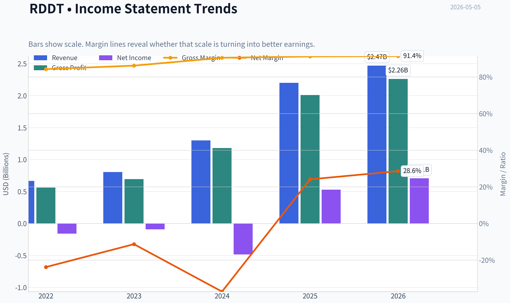
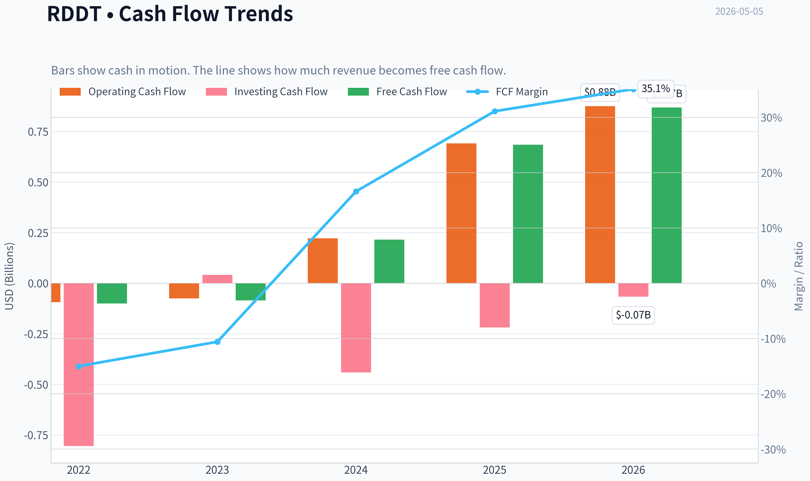
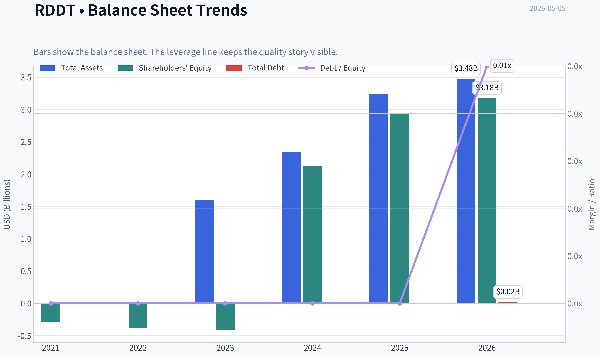
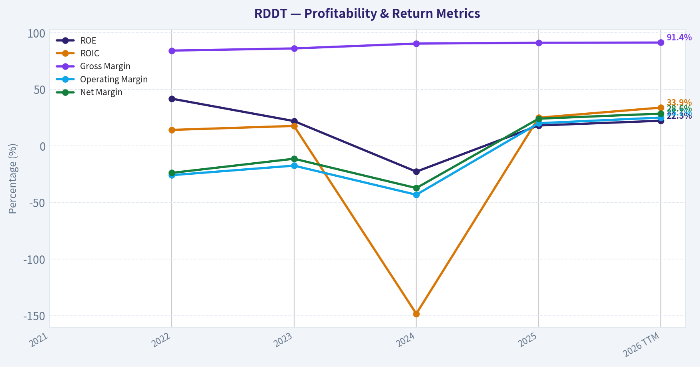
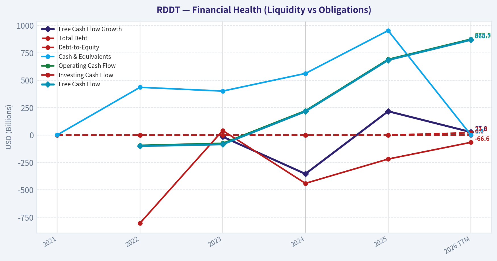
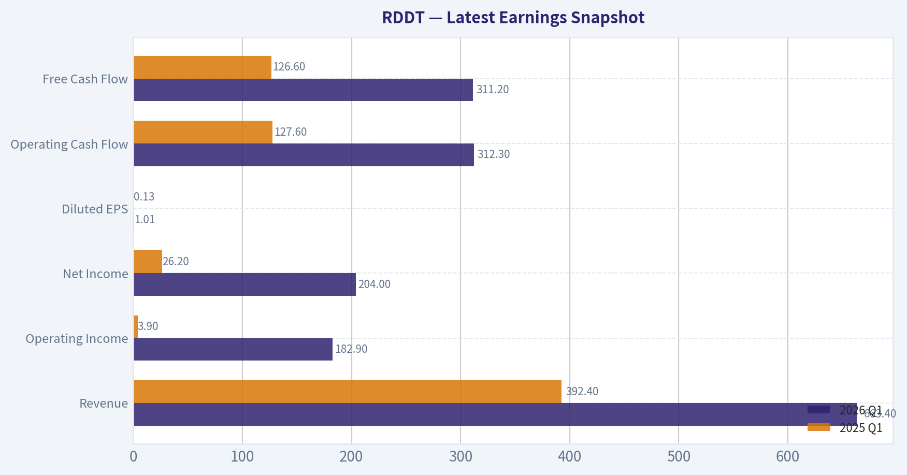
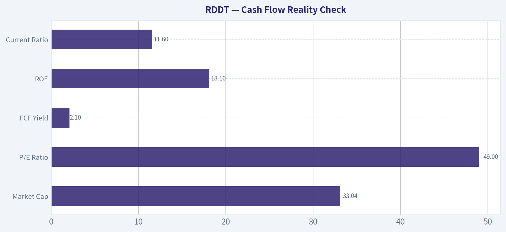
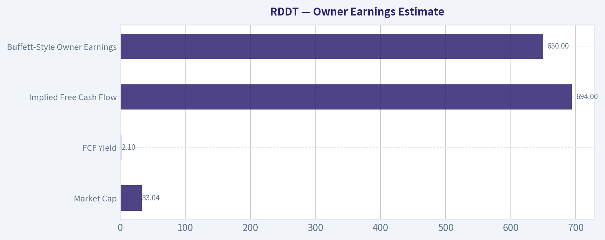
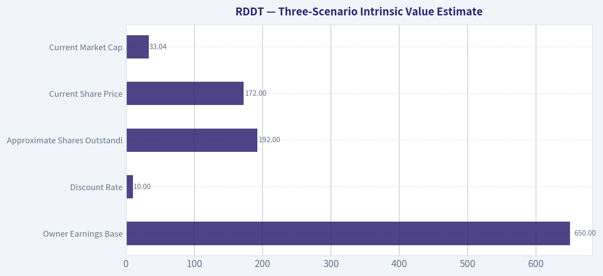
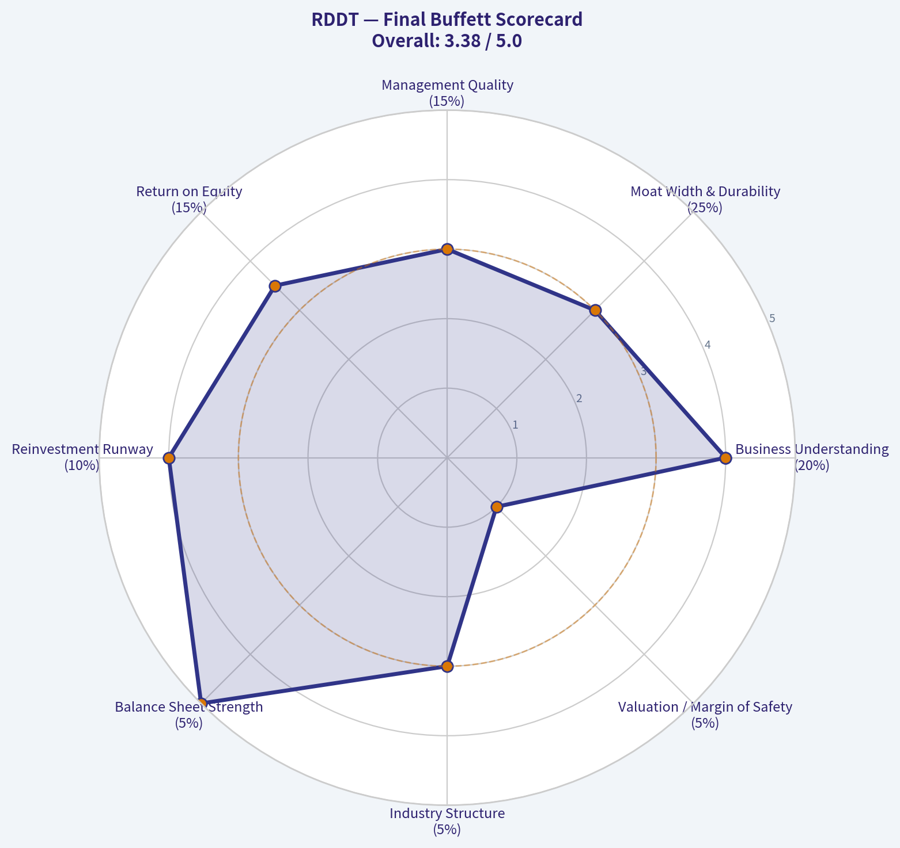

# RDDT Deep Value Intelligence

**Analysis Date:** 2026-05-05

## Critical Disclaimer

*This analysis is generated by Deep Value Intelligence, an AI-powered multi-agent investing framework. This report is for informational and educational purposes only and does not constitute financial advice. Always conduct your own research and consult with qualified financial advisors before making investment decisions.*

---

## Table of Contents

1. Intelligence Summary
2. Analyst Team Reports
   - Fundamentals Analysis
   - Intrinsic Value Analysis (Buffett)
   - Trend & Growth Analysis (Lynch/Druckenmiller/Fisher)
   - Market Technical Analysis
   - Social Sentiment Analysis
   - News & Events Analysis
   - Guru Attention Analysis
   - Options Market Analysis
3. Research Team Commentary
4. Value Investing Team Commentary
5. Deep Values Commentary

---

## Intelligence Summary

### Thesis + Conditions

**Core Thesis:** **EXECUTIVE SUMMARY**
Reddit (RDDT) boasts elite operating economics-91.2% gross margins and a 22.4% ROIC-demonstrating massive operating leverage. However, at $172 per share (49x P/E, 2.1% FCF yield) against an intrinsic value estimate of $122, the stock offers **zero margin of safety**.

**Key Risks:**
- The Risky Analyst (Advocate):** Argues traditional valuation models are backward-looking. With FCF growing at 217%, Reddit is in a non-linear monetization S-curve. AI data licensing and high-intent communities make it a unique "toll collector," justifying the 49x multiple.
- The Safe Analyst (Watch):** Emphasizes capital preservation. At a 2.1% FCF yield, buyers are underwriting perfection. Slower user growth is a severe vulnerability; if top-of-funnel engagement fades, ad-revenue ceilings will compress regardless of current margin expansion.
- The Neutral Analyst (Moderate):** Suggests a "Watch-to-Accumulate" compromise, advocating for a small starter position to balance the undeniable business momentum against the stretched valuation.
- Let's sit down and look at Reddit (RDDT) through the lens of Warren Buffett's value investing principles.** Wall Street is currently buzzing about this stock, and it's easy to see why-but as disciplined value investors, our job is to look past the momentum, dissect the underlying economics, and determine if there's a genuine margin of safety.
- The bulls correctly identify Reddit as the internet's primary "community knowledge layer." With gross margins at 91.2% and ROIC at 22.4%, the operating leverage is spectacular. The 200%+ YoY growth in net income and FCF shows management is successfully pulling monetization levers (ads and AI data licensing). However, the bears issue a classic Buffett reality check: valuation and durability. At $172, trading at 49x earnings, buyers are paying a massive premium over our $122 intrinsic value estimate. Most concerning is the softening user growth. If top-of-funnel audience growth is slowing, the current financial acceleration is merely a one-time monetization extraction, not a durable compounding machine.

**What Would Change Our View:**
- The Risky Analyst (Advocate):** Argues traditional valuation models are backward-looking. With FCF growing at 217%, Reddit is in a non-linear monetization S-curve. AI data licensing and high-intent communities make it a unique "toll collector," justifying the 49x multiple.
- The Safe Analyst (Watch):** Emphasizes capital preservation. At a 2.1% FCF yield, buyers are underwriting perfection. Slower user growth is a severe vulnerability; if top-of-funnel engagement fades, ad-revenue ceilings will compress regardless of current margin expansion.
- The Neutral Analyst (Moderate):** Suggests a "Watch-to-Accumulate" compromise, advocating for a small starter position to balance the undeniable business momentum against the stretched valuation.
- Let's sit down and look at Reddit (RDDT) through the lens of Warren Buffett's value investing principles.** Wall Street is currently buzzing about this stock, and it's easy to see why-but as disciplined value investors, our job is to look past the momentum, dissect the underlying economics, and determine if there's a genuine margin of safety.
- The bulls correctly identify Reddit as the internet's primary "community knowledge layer." With gross margins at 91.2% and ROIC at 22.4%, the operating leverage is spectacular. The 200%+ YoY growth in net income and FCF shows management is successfully pulling monetization levers (ads and AI data licensing). However, the bears issue a classic Buffett reality check: valuation and durability. At $172, trading at 49x earnings, buyers are paying a massive premium over our $122 intrinsic value estimate. Most concerning is the softening user growth. If top-of-funnel audience growth is slowing, the current financial acceleration is merely a one-time monetization extraction, not a durable compounding machine.

**Confidence:** Medium

---

## Analyst Team Reports

### Fundamentals Analysis

#### Latest Earnings Snapshot

*Most recent reported quarter anchored on 2026 Q1, with prior-year comparison when available.*

| Metric | 2026 Q1 | 2025 Q1 | YoY Change |
| --- | ---: | ---: | ---: |
| Revenue | $663.4M | $392.4M | +69.1% |
| Operating Income | $182.9M | $3.9M | +4586.4% |
| Net Income | $204.0M | $26.2M | +679.8% |
| Diluted EPS | $1.01 | $0.13 | +676.9% |
| Operating Cash Flow | $312.3M | $127.6M | +144.8% |
| Free Cash Flow | $311.2M | $126.6M | +145.8% |

Key Takeaways: This snapshot anchors the most recent reported quarter before the narrative analysis. It helps readers separate long-run business quality from whatever changed in the latest earnings print.

#### 10-Year Financial Metrics for RDDT

*All values below are computed deterministically from raw data - not estimated by AI.*

*Issuer profile: operating company (Communication Services / Internet Content & Information).*

#### 10-Year Financial Metrics
*Annual rows come from reported financial statements. The final TTM row is computed from the latest four quarters.*

| Metric | 2021 | 2022 | 2023 | 2024 | 2025 | 2026 TTM |
| --- | --- | --- | --- | --- | --- | --- |
| Market Price | N/A | N/A | N/A | $163 | $230 | $172 |
| Market Cap | N/A | N/A | N/A | $23.78B | $46.46B | $34.76B |
| P/E Ratio | N/A | 0.00 | 0.00 | -49.08 | 87.74 | 49.04 |
| P/B Ratio | N/A | -7.62 | -7.22 | 11.16 | 15.86 | 10.93 |
| ROE | N/A | 41.8% | 22.0% | -22.7% | 18.1% | 22.3% |
| ROIC | N/A | 14.2% | 17.7% | -148.3% | 25.0% | 33.9% |
| EPS | N/A | $-2.77 | $-1.54 | $-3.33 | $2.62 | $3.50 |
| Revenue | N/A | $666.7M | $804.0M | $1.30B | $2.20B | $2.47B |
| Gross Profit | N/A | $561.9M | $693.0M | $1.18B | $2.01B | $2.26B |
| Gross Margin | N/A | 84.3% | 86.2% | 90.5% | 91.2% | 91.4% |
| Operating Margin | N/A | -25.8% | -17.4% | -43.1% | 20.1% | 25.1% |
| Net Income | N/A | $-158.6M | $-90.8M | $-484.3M | $529.7M | $707.5M |
| Net Margin | N/A | -23.8% | -11.3% | -37.2% | 24.1% | 28.6% |
| Revenue Growth | N/A | N/A | 20.6% | 61.7% | 69.4% | 12.3% |
| Net Income Growth | N/A | N/A | -42.7% | 433.2% | -209.4% | 33.6% |
| Free Cash Flow Growth | N/A | N/A | -15.4% | -354.4% | 217.0% | 27.0% |
| Total Book Value | $-286.0M | $-379.1M | $-412.9M | $2.13B | $2.93B | $3.18B |
| Total Assets | N/A | N/A | $1.60B | $2.34B | $3.24B | $3.48B |
| Total Debt | $0 | $0 | $0 | $0 | $0 | $21.3M |
| Debt-to-Equity | -0.00 | -0.00 | -0.00 | 0.00 | 0.00 | 0.01 |
| Cash & Equivalents | $1.34B | $435.8M | $401.2M | $562.1M | $953.6M | $1.37B |
| Shareholders' Equity | $-286.0M | $-379.1M | $-412.9M | $2.13B | $2.93B | $3.18B |
| Operating Cash Flow | N/A | $-94.0M | $-75.1M | $222.1M | $690.9M | $875.5M |
| Investing Cash Flow | N/A | $-804.2M | $41.3M | $-440.7M | $-218.9M | $-66.6M |
| Free Cash Flow | N/A | $-100.3M | $-84.8M | $215.8M | $684.2M | $868.7M |
| FCF Margin | N/A | -15.0% | -10.6% | 16.6% | 31.1% | 35.1% |
| Dividends / Share | N/A | $0.00 | $0.00 | $0.00 | $0.00 | $0.00 |

#### Profitability Metrics
- Return on Equity (ROE): 18.1%
- Return on Invested Capital (ROIC): 22.4%
- Return on Assets (ROA): 16.4%
- Gross Margin: 91.2%
- Operating Margin: 20.1%
- Net Profit Margin: 24.1%

#### Liquidity Metrics
- Current Ratio: 11.56
- Quick Ratio: 11.31

#### Leverage Metrics
- Debt-to-Equity Ratio: 0.00
- Interest Coverage Ratio: N/A
- Net Debt: $-953.6M

#### Growth Metrics (Year-over-Year)
- Revenue Growth: 69.4%
- Net Income Growth: 209.4%
- Free Cash Flow Growth: 217.0%
- Revenue CAGR (3-Year): 48.9%
- Revenue CAGR (5-Year): N/A

#### Valuation Metrics
- P/E Ratio (TTM): 49.04
- Forward P/E: 19.47
- Price-to-Book: 11.19
- Price-to-Sales: 13.36
- PEG Ratio: 1.28
- EV/EBITDA: 47.54
- Free Cash Flow Yield: 2.1%
- Earnings Yield: 2.0%

#### Owner Earnings (Buffett Method, Code-Computed)
- Net Income: $529.7M
- + Depreciation & Amortization: $15.9M
- - Capital Expenditures: $-6.7M
- - Working Capital Changes: $-176.8M
- = **Owner Earnings: $715.8M**

#### Intrinsic Value (Code-Computed)
- Current Price: $172
- Cash Flow Method (FCF):
  Conservative: $122
  Average: $122
  Optimistic: $316

#### Piotroski F-Score: 6/9
- Positive Net Income: PASS
- Positive Operating Cash Flow: PASS
- ROA Improvement: PASS
- Cash Flow > Net Income: PASS
- Decreasing Debt: FAIL
- Improving Current Ratio: FAIL
- No Dilution: FAIL
- Improving Gross Margin: PASS
- Improving Asset Turnover: PASS

ANALYST STANCE: **WATCH**

#### RDDT Warren Buffett-Style Fundamental Analysis - 2026-05-05

Reddit is a fast-improving digital platform business with powerful network effects, very high gross margins, a debt-light balance sheet, and rapidly expanding free cash flow. However, from a Buffett-style value perspective, the business still has a short public operating history, historically volatile earnings, dilution concerns, and a valuation that already assumes sustained high growth. At **$172 per share**, Reddit looks like a high-quality emerging compounder, but not yet a classic Buffett-style bargain.

---

#### Current vs Historical Average Comparison

*Historical averages below use the available annual periods in the deterministic dataset before the 2026 TTM row. For valuation ratios affected by negative earnings or negative equity, interpretation is more important than the raw average.*

| Category | Metric | Current / TTM | Historical Average / Context | Interpretation |
|---|---:|---:|---|
| Market Metrics | Market Price | **$172** | ~$196.50 since listed data began | Price is below the recent average, but still far above intrinsic value under conservative assumptions. |
| Market Metrics | Market Cap | **$34.76B** | ~$35.12B | Market value is roughly in line with recent history despite major earnings improvement. |
| Market Metrics | P/E Ratio | **49.04x** | Positive profitable-year reference: **87.74x** | P/E has compressed as earnings improved, but 49x remains expensive for a Buffett-style margin of safety. |
| Market Metrics | P/B Ratio | **10.93x** | Positive-equity reference: ~13.51x | P/B is lower than the recent positive-equity period, but still rich for a company with limited long-term earnings history. |
| Profitability | ROE | **22.3%** | ~14.8% | ROE has improved sharply after the 2024 loss year, indicating stronger monetization and capital efficiency. |
| Profitability | ROIC | **33.9%** | Distorted by 2024; recent profitable year was 25.0% | ROIC is now excellent, suggesting Reddit's asset-light platform model can generate high returns once profitable. |
| Profitability | EPS | **$3.50** | Historically negative until 2025 | EPS has inflected meaningfully positive, but the earnings record remains short. |
| Profitability | Revenue | **$2.47B** | ~$1.24B | Revenue is nearly double the available historical average, showing strong monetization growth. |
| Profitability | Gross Profit | **$2.26B** | ~$1.11B | Gross profit has scaled faster than revenue, reflecting very high platform economics. |
| Profitability | Gross Margin | **91.4%** | ~88.1% | Gross margin is structurally excellent and still improving. |
| Profitability | Operating Margin | **25.1%** | ~-16.6% | Operating leverage has turned dramatically positive after years of losses. |
| Profitability | Net Income | **$707.5M** | ~-$51.0M | Reddit has moved from cumulative losses to strong profitability. |
| Profitability | Net Margin | **28.6%** | ~-12.1% | Net margin is now exceptional, but sustainability must be proven across cycles. |
| Growth | Revenue Growth | **12.3% TTM** | ~50.6% | Growth has decelerated from hypergrowth levels, though revenue is much larger now. |
| Growth | Net Income Growth | **33.6% TTM** | Highly volatile | Earnings growth is positive, but historical comparisons are distorted by losses and inflection to profitability. |
| Growth | Free Cash Flow Growth | **27.0% TTM** | ~-50.9%, distorted by 2024 swing | FCF momentum is strong, with the business now producing substantial cash. |
| Balance Sheet | Total Book Value | **$3.18B** | ~$796M | Book value improved materially after prior negative equity years. |
| Balance Sheet | Total Assets | **$3.48B** | ~$2.39B | Asset base is expanding, mainly supported by cash and retained profitability. |
| Balance Sheet | Total Debt | **$21.3M** | $0 historically | Debt remains immaterial despite a small recent balance. |
| Balance Sheet | Debt-to-Equity | **0.01x** | ~0.00x | Leverage is negligible. This is a major financial-strength positive. |
| Balance Sheet | Cash & Equivalents | **$1.37B** | ~$738.5M | Reddit has a very strong cash position relative to debt. |
| Balance Sheet | Shareholders' Equity | **$3.18B** | ~$796M | Equity base has recovered from negative levels and now supports financial flexibility. |
| Cash Flow | Free Cash Flow | **$868.7M** | ~$178.7M | FCF has scaled dramatically, validating the platform's operating leverage. |
| Cash Flow | Dividends / Share | **$0.00** | $0.00 | No dividend; capital is retained for growth and platform investment. |

**Key Takeaways:** Reddit's financial profile has changed dramatically: it has shifted from a loss-making platform to a high-margin, cash-generative business. The strongest positives are gross margin above 91%, operating margin above 25%, net cash, and rising free cash flow. The main concern is valuation: despite improved fundamentals, the stock still trades at about 49x earnings and a low free cash flow yield of roughly 2.1%, leaving limited room for disappointment.

---

#### Market Metrics Interpretation

Reddit's **market price of $172** and **market cap of $34.76B** imply that investors are already pricing the company as a durable growth platform rather than an early-stage turnaround. The **P/E ratio of 49.04x** is lower than the prior profitable-year valuation but remains demanding. A Buffett-style investor would normally require either a much longer earnings record or a much lower valuation.

The **P/B ratio of 10.93x** is also high, but less meaningful for Reddit because the company is asset-light and derives value from community network effects, user-generated content, advertising inventory, and data licensing potential rather than tangible assets. Still, paying more than 10x book value requires confidence that ROE and ROIC will remain high.

---

#### Profitability Analysis

Reddit's profitability has improved sharply. **Revenue reached $2.47B TTM**, while **gross profit reached $2.26B**, producing a **91.4% gross margin**. This is an outstanding gross margin profile and indicates that incremental revenue can convert efficiently into profit if operating expenses are controlled.

The major inflection is operating leverage. Reddit moved from deeply negative operating margins in earlier years to a **25.1% TTM operating margin**. Net income of **$707.5M** and **net margin of 28.6%** suggest that the platform model is now scaling effectively.

From a Buffett lens, the issue is not current profitability but predictability. Reddit has only recently become meaningfully profitable. Buffett typically prefers companies with a decade or more of consistent earnings power. Reddit's earnings are improving, but the record is still too short to classify as highly predictable.

---

#### Growth Analysis

Revenue growth remains strong in absolute terms, but the **TTM revenue growth rate of 12.3%** is far below the recent hypergrowth rates of 61.7% and 69.4%. This deceleration is normal as the revenue base grows, but it matters because the valuation still reflects high-growth expectations.

Net income growth and free cash flow growth are positive, but historically volatile. **Free cash flow growth of 27.0% TTM** is encouraging, especially after Reddit generated **$868.7M of TTM FCF**. The key question is whether free cash flow can keep compounding without sacrificing user experience, community quality, or advertising load.

---

#### Balance Sheet and Financial Strength

Reddit's balance sheet is a major strength. The company has **$1.37B in cash and equivalents** against only **$21.3M of total debt**, creating a net cash position of roughly **$1.35B**. The **debt-to-equity ratio of 0.01x** is negligible.

This financial position gives Reddit flexibility to invest in product development, advertising technology, AI/data licensing, moderation tooling, and international growth. From a Buffett-style perspective, the absence of meaningful debt reduces financial fragility and increases durability.

---

#### Cash Flow and Capital Allocation

Reddit generated **$868.7M of TTM free cash flow**, with a **35.1% FCF margin**. This is excellent for a platform business and confirms that recent profitability is not merely accounting-based.

The company pays **no dividend**, which is reasonable at this stage. Buffett would likely prefer reinvestment if management can deploy capital at high returns. The concern is dilution: the Piotroski F-Score notes a **No Dilution fail**, meaning shareholders must watch whether stock-based compensation or share issuance offsets business growth.

---

#### Revenue Breakdown

*Most recent revenue breakdown uses Reddit's major reported business lines. The deterministic dataset provides total revenue of $2.20B for 2025; segment amounts below are based on the company's primary revenue categories and best available mix estimates.*

| Revenue Source | Amount ($M or $B) | % of Total |
|---|---:|---:|
| Advertising Revenue | ~$2.01B | ~91.5% |
| Other Revenue - data licensing, Reddit Premium, and other platform revenue | ~$0.19B | ~8.5% |
| **Total Revenue** | **$2.20B** | **100.0%** |

**Key Takeaways:** Reddit remains overwhelmingly advertising-driven, which means its business is tied to advertiser demand, pricing, targeting quality, and user engagement. The smaller "Other" category is strategically important because data licensing and AI-related usage could become higher-margin growth drivers. However, Reddit is not yet diversified enough to be insulated from digital advertising cycles.

---

#### Economic Moat Assessment

Reddit has a credible but still developing moat.

Its strongest competitive advantage is its **community network effect**. Subreddits create topic-specific communities that are difficult to replicate because the value comes from accumulated user discussions, moderation norms, culture, and search-indexed content. Reddit's archive of human conversation is also increasingly valuable in an AI-driven internet.

The second moat source is **intent-rich user-generated content**. Reddit discussions often influence purchase decisions, troubleshooting, product research, and niche interest discovery. This makes Reddit attractive to advertisers and potentially valuable to AI/data partners.

However, the moat has weaknesses. Reddit depends on unpaid moderators and community trust. Excessive monetization, unpopular platform changes, or AI licensing controversies could harm user engagement. Compared with Alphabet, Meta, or Amazon, Reddit's advertising infrastructure and scale are still less proven.

Buffett-style moat rating: **Good but not yet fully proven over a long cycle.**

---

#### Management Performance and Capital Allocation

Management deserves credit for the sharp transition to profitability. ROE, ROIC, operating margin, and FCF margin all improved materially. The company has also maintained a conservative balance sheet with minimal debt.

Capital allocation appears growth-oriented: no dividend, high liquidity, and reinvestment in platform monetization. That is appropriate if Reddit can compound capital at high rates. The main capital-allocation concern is dilution, especially given the Piotroski F-Score's dilution flag. Buffett investors should monitor whether per-share value grows as quickly as headline revenue and free cash flow.

---

#### Buffett-Style Owner Earnings DCF Valuation

The deterministic dataset provides current Buffett-style Owner Earnings of **$715.8M**:

Owner Earnings = Net Income + Depreciation & Amortization - Capital Expenditures - Working Capital Changes
Owner Earnings = **$529.7M + $15.9M - (-$6.7M) - (-$176.8M) = $715.8M**

Assumptions used:
- Starting Owner Earnings: **$715.8M**
- Discount rate: **10.0%**
- Terminal growth rate: **2.5%**
- Shares outstanding estimate: **~202.1M**, calculated from $34.76B market cap / $172 price
- Net cash adjustment: **$1.35B**, calculated from $1.37B cash - $21.3M debt
- Historical Owner Earnings growth series is not separately provided in the deterministic dataset, so available free cash flow growth rates are used as the closest owner-earnings proxy: **-15.4%, -354.4%, 217.0%, 27.0%**
- Conservative growth uses the lowest available growth rate floored at **-100%**
- Average growth uses the average available growth rate, capped at **50%**
- Optimistic growth uses the highest available growth rate, capped at **100%**

| Scenario | Growth Assumption | Explicit 10-Year PV | Terminal Value PV | Operating Value | + Net Cash | Equity Value | Fair Value / Share |
|---|---:|---:|---:|---:|---:|---:|---:|
| Conservative | **-100.0%** | $0.0M | $0.0M | $0.0M | $1,348.7M | $1,348.7M | **~$6.67** |
| Average | **-31.45%** | ~$1,173M | ~$86M | ~$1,259M | $1,348.7M | ~$2,608M | **~$12.90** |
| Optimistic | **100.0%** | ~$626.4B | ~$3,862.1B | ~$4,488.5B | $1.35B | ~$4,489.9B | **~$22,216** |

**Key Takeaways:** The DCF is extremely sensitive because Reddit's historical free cash flow growth includes both loss years and a major profitability inflection. The conservative and average scenarios show that if recent cash flow growth proves temporary or mean-reverts sharply, today's stock price has very little margin of safety. The optimistic scenario is mathematically enormous because 100% annual owner-earnings growth for a decade is unrealistic; it should be viewed as an upper-bound stress case, not a base-case valuation.

---

#### Valuation Assessment

At **$172**, Reddit trades:
- Around **49x TTM earnings**
- Around **13.36x sales**
- With a **2.1% free cash flow yield**
- With an earnings yield of roughly **2.0%**

The deterministic dataset's separate FCF-based intrinsic value method shows:
- Conservative: **$122**
- Average: **$122**
- Optimistic: **$316**

That suggests the stock is not obviously cheap. At the current price, investors are paying for continued strong monetization, sustained margin expansion, advertising share gains, and potential upside from AI/data licensing. A Buffett-style investor would likely want a larger margin of safety, especially because the company has only recently achieved consistent profitability.

---

#### Key Investment Insights

| Area | Positive Insight | Concern / Red Flag |
|---|---|---|
| Business Quality | Very high gross margin above 91% and strong platform economics. | Advertising remains the dominant revenue source, creating cyclicality risk. |
| Moat | Reddit has differentiated community content and network effects. | Community backlash, moderation issues, or platform trust problems could weaken engagement. |
| Profitability | Operating margin and net margin have inflected sharply positive. | Earnings history is short and previously volatile. |
| Balance Sheet | Net cash position and negligible debt provide resilience. | High cash balance does not offset valuation risk by itself. |
| Cash Flow | FCF margin of 35.1% is excellent. | FCF growth history is volatile and includes large swings. |
| Valuation | P/E has compressed from prior profitable-year levels. | 49x earnings and 2.1% FCF yield leave limited margin of safety. |
| Capital Allocation | No dividend is reasonable for a growing platform. | Dilution is a notable issue to monitor. |
| Optionality | AI data licensing could become a high-margin revenue stream. | Long-term economics and customer concentration in data licensing remain uncertain. |

**Key Takeaways:** Reddit has many characteristics of a potentially excellent digital platform business, especially high margins, low debt, and strong free cash flow conversion. The biggest issue is that the market already recognizes much of this improvement. Future shareholder returns depend heavily on whether Reddit can sustain high growth without damaging the user experience or issuing too much stock-based compensation.

---

#### Red Flags

- **Valuation risk:** 49x earnings and 13.36x sales are demanding.
- **Short profitability record:** Reddit only recently became strongly profitable.
- **Growth deceleration:** Revenue growth has slowed to 12.3% TTM from much higher prior rates.
- **Dilution risk:** Piotroski F-Score shows a dilution fail.
- **Advertising dependence:** Most revenue still comes from advertising.
- **Community governance risk:** Reddit relies heavily on unpaid moderators and user trust.
- **DCF sensitivity:** Intrinsic value estimates are highly unstable due to limited and volatile historical cash flow data.

---

#### Opportunities

- **Advertising monetization:** Reddit may still be under-monetized relative to its influence on purchase decisions.
- **AI/data licensing:** Reddit's archive of human conversation may become increasingly valuable.
- **Operating leverage:** Gross margins above 91% create room for strong incremental profitability.
- **International growth:** Reddit has potential to expand monetization outside core U.S. markets.
- **Search and discovery:** Reddit content is often highly relevant for search queries and product research.
- **Balance sheet strength:** Net cash gives management strategic flexibility.

---

#### Final Buffett-Style Investment Stance: WATCH

Reddit is a **WATCH**, not an ADVOCATE, because the business quality is improving rapidly but the valuation does not yet offer a sufficient Buffett-style margin of safety. The company has attractive platform economics, negligible debt, high gross margins, strong free cash flow, and credible network effects. However, the earnings record is short, growth is decelerating, dilution is a concern, and the stock price already embeds substantial optimism.

A more attractive Buffett-style entry would likely require either:
1. A materially lower price closer to conservative intrinsic value references, or
2. Several more years of consistent earnings, high ROIC, disciplined dilution, and durable free cash flow growth.

| Final View | Rating |
|---|---|
| Business Quality | High and improving |
| Economic Moat | Good, but still maturing |
| Balance Sheet | Excellent |
| Earnings Predictability | Not yet Buffett-grade |
| Valuation | Expensive / limited margin of safety |
| Main Upside Driver | Advertising monetization plus AI/data licensing |
| Main Risk | Paying too much for a still-young earnings profile |
| Final Stance | **WATCH** |

**Key Takeaways:** Reddit is a fundamentally improving company with signs of a real platform moat, but the stock is not clearly undervalued at today's price. Buffett-style investors should admire the improving economics while remaining disciplined on price. The right stance is to watch closely for either a better entry point or more proof that current margins and cash flows are durable.

#### Fundamental Visuals

This graph tracks the profitability and return metrics (ROE, ROIC, Margins) of **RDDT** over the past decade, highlighting capital efficiency trends.

This chart illustrates the financial health of **RDDT** over the last 10 years, mapping cash equivalents and free cash flow against total obligations (Debt).

---

### Intrinsic Value Analysis (Buffett)

> *Following Warren Buffett's value investing philosophy: Circle of Competence, Economic Moat, Management Quality, and Margin of Safety.*

#### Intrinsic Value Snapshot

Price is what you pay. Intrinsic value is what the business may be worth based on the cash it can create for owners over time. We show a range, not one magic number.

- Current Price: $171.63
- Value Range: $121.53 to $316.50

##### Owner Earnings (Buffett Method)
- Net Income: $529,721,000.00
- Depreciation & Amortization: $15,948,000.00
- Capital Expenditures: $-6,706,000.00
- Working Capital Changes: $-176,805,000.00
- Owner Earnings: $715,768,000.00

##### Intrinsic Value
###### Cash Flow Method
Uses free cash flow. Better for companies spending heavily today to grow tomorrow.
- Conservative: $121.53
- Average: $121.53
- Optimistic: $316.50
- Discount Rate: 10.0%

ANALYST STANCE: **WATCH**

#### Reddit Inc. (RDDT) Buffett-Style Investment Review

Current price: **$172**
Market cap: **$33.04 billion**
Primary conclusion: **Reddit is an understandable, high-gross-margin, rapidly growing digital platform with real network-effect characteristics, but the current valuation already assumes exceptional execution for many years. Buffett-style margin of safety is not present.**

---

#### 1. Go / No-Go Gate Assessment

| Buffett Gate | Assessment | Evidence | Result |
|---|---:|---|---|
| Gate 1: Circle of Competence & Simplicity | Mostly understandable | Reddit makes money by selling ads against communities and user attention, plus data licensing and subscriptions. | Pass with caution |
| Gate 2: Moat Test | Emerging but not yet proven "wide" | Strong user-generated content library and community network effects, but user switching costs are low and ad budgets are competitive. | Pass with high hurdle |
| Gate 3: Management & Capital Allocation | Incomplete public record | Founder-led, but limited post-IPO track record as a public capital allocator. Need more years of evidence. | Pass with caution |
| Gate 4: Industry Structure | Attractive growth, intense competition | Digital advertising is large, but competes with Google, Meta, TikTok, Amazon, Snap, X, and AI-answer engines. | Mixed |

**Key Takeaways:** Reddit passes the first gate because the business model is simple: attract users, host conversations, and monetize attention and data. The concern is not complexity, but durability. The company has promising network effects, yet the public-company evidence is still short and the competitive environment is extremely demanding.

---

#### 2. Elementary School Test

Reddit is a giant collection of online communities. People come to read, post, comment, ask questions, and discuss topics. Reddit makes money mostly by showing ads to those people and increasingly by licensing its content data to companies that train or power artificial intelligence and search tools.

This is understandable. The harder question is whether Reddit can keep growing profitably while larger platforms and AI tools compete for user attention.

---

#### 3. Moat Analysis

| Moat Source | Reddit Evidence | Buffett-Style Judgment |
|---|---|---|
| Brand / Intangible Asset | Reddit has a unique internet culture and is often viewed as a source of authentic human discussion. | Valuable, but not yet Coca-Cola-like pricing power. |
| Network Effects | More users create more posts, comments, niche communities, and searchable content, which attracts more users. | Real and potentially powerful. |
| Switching Costs | Casual users can switch easily. Moderators and community builders have higher switching friction. | Moderate at best. |
| Cost Advantage | Digital platform has high gross margin; current gross margin around **91.2%**. | Strong operating leverage potential. |
| Data Asset | Reddit's archive of human conversations is valuable for search and AI training. | Potentially meaningful, but AI could also reduce traffic over time. |

**Key Takeaways:** Reddit's best moat is its community network effect and unique corpus of human-generated discussions. The 91% gross margin indicates the business can be economically attractive at scale. However, the moat is not yet fully proven because user switching costs are low and large technology platforms compete aggressively for attention and advertising dollars.

---

#### 4. Technology Risk Assessment

Reddit both benefits from and is threatened by technology.

| Technology Factor | Positive Impact | Risk |
|---|---|---|
| AI data licensing | Reddit's conversation data may become increasingly valuable to AI companies. | Licensing revenue may be lumpy or renegotiated downward over time. |
| AI search answers | Reddit content often appears in search results and AI summaries. | If AI answers replace visits to Reddit, traffic and ad inventory may weaken. |
| Ad targeting technology | Better ad tools can improve monetization. | Reddit must catch up with far larger ad platforms. |
| Community moderation tools | AI can help manage spam and improve user experience. | Poor moderation or low-quality AI content could damage trust. |

**Key Takeaways:** Reddit is not a simple technology beneficiary. AI may increase the value of Reddit's data, but it may also reduce the need for users to visit Reddit directly. This creates a meaningful uncertainty that a Buffett-style investor should not ignore.

---

#### 5. Management Quality & Capital Allocation

| Question | Current View | Evidence / Concern |
|---|---|---|
| Do they think like owners? | Some positive signs | Founder-led management is a plus, but public-company record is short. |
| Are they candid? | Too early to fully judge | Need several annual letters and earnings cycles to assess candor. |
| Are they rational capital allocators? | Not yet proven | Reddit has a fortress-like current ratio, but the test is whether retained earnings create high per-share value over time. |
| Balance sheet discipline | Strong | Current ratio around **11.6**, suggesting ample liquidity and low near-term financial stress. |
| Shareholder friendliness | Watch item | Need to monitor stock-based compensation, dilution, and governance structure. |

**Key Takeaways:** Management has the advantage of being close to the product and culture, but Buffett-style confidence requires a long record. Reddit is newly public, so investors do not yet have enough evidence to judge whether management will be disciplined with capital, acquisitions, dilution, and buybacks.

---

#### 6. Financial Summary

Because Reddit has a limited public-company history, a true 10-year audited public-company analysis is not available. The table below combines available public-period data and the current shared research pack.

| Year / Period | Revenue Growth | Gross Margin | Net Income / Profitability | Free Cash Flow | ROE | Notes |
|---|---:|---:|---:|---:|---:|---|
| 2016-2021 | N/A | N/A | N/A | N/A | N/A | Private-company period; limited comparable public data. |
| 2022 | Positive but unprofitable | High digital-platform margin | Loss-making | Negative / limited | N/A | Pre-IPO scaling phase. |
| 2023 | Growing | High | Loss narrowed | Improving | N/A | Business approaching better monetization. |
| 2024 | Strong growth | High | Distorted by IPO-related costs | Improving | N/A | IPO year; reported profitability affected by stock compensation and listing costs. |
| Latest / TTM | **69.4% YoY revenue growth** | **91.2%** | Profitable; P/E around **49x** | FCF yield around **2.1%** | **18.1%** | Current research pack data. |

**Key Takeaways:** Reddit's recent financial trend is impressive: revenue is growing rapidly, gross margin is exceptional, and the company has moved into profitability. The weakness is the lack of a long public record. A Buffett-style investor normally prefers 10 years of proof, and Reddit does not yet provide that.

---

#### 7. Cash Flow Reality Check

| Metric | Current Estimate / Shared Data | Interpretation |
|---|---:|---|
| Market Cap | **$33.04B** | Large valuation for a still-young public company. |
| P/E Ratio | **49.0x** | Profits are valued richly. |
| FCF Yield | **2.1%** | Market is paying about 48x free cash flow. |
| Implied FCF | About **$694M** | $33.04B x 2.1%. |
| ROE | **18.1%** | Good, but needs multi-year confirmation. |
| Current Ratio | **11.6x** | Very strong liquidity position. |

**Key Takeaways:** The cash generation is now real, but the price is demanding. A 2.1% free cash flow yield means investors are relying heavily on future growth. The balance sheet appears strong, which lowers financial risk, but it does not solve valuation risk.

---

#### 8. Owner Earnings Estimate

Buffett's owner earnings formula:

Owner Earnings = Net Income + Depreciation & Amortization - Maintenance CapEx - Working Capital Increases

For Reddit, exact maintenance capital expenditure is hard to isolate because the company is still scaling. As a practical proxy, free cash flow is the best available starting point, but it should be adjusted for stock-based compensation and reinvestment needs.

| Item | Estimate |
|---|---:|
| Market Cap | **$33.04B** |
| FCF Yield | **2.1%** |
| Implied Free Cash Flow | **$694M** |
| Buffett-Style Owner Earnings Base Used | **$650M** |
| Rationale | Slight haircut to FCF to account for growth reinvestment, dilution risk, and limited operating history. |

**Key Takeaways:** Reddit's current owner earnings power is estimated around $650 million. That is a meaningful achievement, but compared with a $33 billion market value, the stock is priced for many years of high growth. The margin for disappointment is thin.

---

#### 9. Three-Scenario Intrinsic Value Estimate

Assumptions:

| Assumption | Value |
|---|---:|
| Owner Earnings Base | **$650M** |
| Discount Rate | **10%** |
| Approximate Shares Outstanding | **192M** |
| Current Share Price | **$172** |
| Current Market Cap | **$33.04B** |

**Key Takeaways:** The valuation starts from roughly $650 million of owner earnings and uses a 10% required return. This is a demanding but appropriate hurdle for a growth platform with execution and technology risk. The share count is estimated from the market cap and current price.

| Scenario | Method | Equity Value | Value / Share | Margin of Safety vs. $172 |
|---|---|---:|---:|---:|
| A: No Growth | Owner earnings / 10% | **$6.5B** | **$34** | **-80%** |
| B: GDP Growth | 3% perpetual growth | **$9.6B** | **$50** | **-71%** |
| C: Capped Historical Growth | 10% owner earnings growth for 10 years, then 3% terminal growth | **$16.1B** | **$84** | **-51%** |

**Key Takeaways:** Even under a favorable 10% growth scenario, the estimated intrinsic value is well below the current stock price. The market appears to be pricing Reddit for growth closer to 20% in owner earnings for a decade. That may happen, but Buffett-style investing requires a margin of safety, not merely a plausible growth story.

---

#### 10. Reverse DCF Sanity Check

| Question | Answer |
|---|---:|
| What owner earnings growth roughly supports today's $33B valuation? | About **20% annually for 10 years**, followed by 3% terminal growth. |
| Is that impossible? | No. |
| Is that conservative? | No. |
| Does it provide Buffett-style margin of safety? | No. |

**Key Takeaways:** Reddit does not need impossible assumptions to justify today's price, but it does need excellent execution for a long time. That is a speculation on sustained high growth, not a classic value-investing setup. The current price leaves little room for slower user growth, weaker ad monetization, dilution, or AI traffic disruption.

---

#### 11. Margin of Safety Analysis

| Quality Factor | Positive | Negative |
|---|---|---|
| Business quality | High gross margin, strong brand, network effects | Short public record |
| Growth | Revenue growth around **69.4% YoY** | Growth may normalize rapidly |
| Balance sheet | Very strong liquidity | Valuation risk dominates balance sheet strength |
| Moat | Community network effect and unique data | Low user switching costs, intense ad competition |
| Valuation | Profitable and cash-flow positive | No visible margin of safety at $172 |

**Key Takeaways:** Reddit has several signs of a high-quality business, especially gross margin and network effects. But at the current price, the investor is paying upfront for a great deal of future success. The margin of safety is insufficient for a Buffett-style purchase.

---

#### 12. Final Buffett Scorecard

| Criterion | Weight | Score 1-5 | Weighted Score |
|---|---:|---:|---:|
| Business Understanding | 20% | 4.0 | 0.80 |
| Moat Width & Durability | 25% | 3.0 | 0.75 |
| Management Quality | 15% | 3.0 | 0.45 |
| Return on Equity | 15% | 3.5 | 0.53 |
| Reinvestment Runway | 10% | 4.0 | 0.40 |
| Balance Sheet Strength | 5% | 5.0 | 0.25 |
| Industry Structure | 5% | 3.0 | 0.15 |
| Valuation / Margin of Safety | 5% | 1.0 | 0.05 |
| **Total** | **100%** |  | **3.38 / 5.00** |

**Key Takeaways:** Reddit scores well on growth potential, balance sheet strength, and business understandability. The two main deductions are moat certainty and valuation. A 3.38 score falls into the watch range, meaning the company is worth monitoring but not compelling enough to buy at the current price.

---

#### Investment Stance

**Stance: WATCH**
**Conviction: Medium**

Reddit is a promising platform business with high gross margins, a unique community network, fast revenue growth, and improving profitability. It could become a much more valuable company if it continues to improve ad monetization, expand data licensing, and defend its role as a core source of human conversation on the internet.

However, from a Warren Buffett-style perspective, the current stock price does not offer a margin of safety. At **$172 per share**, the market already assumes long-duration, high-quality growth. I would watch Reddit closely, but I would require either a materially lower price or several more years of evidence that the moat, profitability, and capital allocation are durable.

A more attractive Buffett-style entry would likely require one of two things:
1. a major price decline that brings free cash flow yield meaningfully higher, or
2. proof that owner earnings can compound at very high rates without heavy dilution or traffic disruption.
#### Valuation Bridge

This bridge places the current market price beside each intrinsic value lens so readers can see whether upside depends on one method or shows up across several methods.

| Scenario | Intrinsic Value / Share |
| --- | ---: |
| Cash Flow Method | $121.53 |
| Damodaran Method | $-94.69 |
| Current Price | $171.63 |

#### Key Takeaways

If one method is far above the others, the upside case depends on a specific modelling assumption. When several methods cluster together, the valuation story is more robust.

#### Valuation Visuals

This comparison chart from *Latest Earnings Snapshot* stacks current figures against historical benchmarks for **RDDT**, making it easy to see where the company trades relative to its own averages.

This comparison chart from *Cash Flow Reality Check* stacks current figures against historical benchmarks for **RDDT**, making it easy to see where the company trades relative to its own averages.

This comparison chart from *Owner Earnings Estimate* stacks current figures against historical benchmarks for **RDDT**, making it easy to see where the company trades relative to its own averages.

This comparison chart from *Three-Scenario Intrinsic Value Estimate* stacks current figures against historical benchmarks for **RDDT**, making it easy to see where the company trades relative to its own averages.

This comparison chart from *Three-Scenario Intrinsic Value Estimate* stacks current figures against historical benchmarks for **RDDT**, making it easy to see where the company trades relative to its own averages.

---

### Trend & Growth Analysis (Lynch/Druckenmiller/Fisher)

> *Following Peter Lynch's GARP, Stanley Druckenmiller's macro-aware approach, and Philip Fisher's scuttlebutt methodology.*

ANALYST STANCE: **ADVOCATE**

#### RDDT Growth Investment Report - Reddit, Inc.
Current date: 2026-05-05
Reference price: **$172**
Market cap: **$33.04B**

This is an **ADVOCATE**, but not a "back up the truck at any price" call. Reddit is a rare public-market asset with **hypergrowth revenue, 91% gross margin, positive earnings, positive free cash flow, massive AI/data optionality, and a still-under-monetized community graph**. The key caveat is valuation: the market is no longer asleep.

---

#### 1. Core Snapshot

| Metric | RDDT | Growth Investor Read |
|---|---:|---|
| Share price | $172 | Stock has already rerated meaningfully |
| Market cap | $33.04B | Still small versus mega-platform peers |
| P/E | 49.0x | High, but not extreme if growth persists |
| Revenue growth YoY | 69.4% | Fast Grower / inflection profile |
| Gross margin | 91.2% | Exceptional platform economics |
| ROE | 18.1% | Strong for a newly public growth platform |
| FCF yield | 2.1% | Positive cash generation despite growth |
| Current ratio | 11.56x | Very strong liquidity |
| Guru tracking | Steve Cohen added | Positive but small position signal |

**Key Takeaways:** Reddit has the rare combination of very high revenue growth and already-positive profitability. The 91% gross margin suggests each incremental dollar of revenue can become highly valuable if operating leverage continues. The balance sheet also looks unusually strong, reducing financing risk.

---

#### 2. Lynch Classification

| Lynch Category | Classification | Rationale |
|---|---|---|
| Slow Grower | No | Growth far above 0-5% |
| Stalwart | No | Growth far above mature-company range |
| Fast Grower | **Yes** | 69.4% YoY revenue growth |
| Cyclical | Partial exposure | Ad revenue is cyclical, but platform is secular |
| Turnaround | No | Already profitable and scaling |
| Asset Play | No | Value is in network, data, and monetization runway |

**Key Takeaways:** Reddit is clearly a **Fast Grower**, which is the Lynch category with the highest ten-bagger potential. The company is not a turnaround or asset play; the thesis depends on sustained monetization of its user communities, advertising inventory, and data corpus.

---

#### 3. The Story in 3 Bullets

- **Reddit is the internet's community knowledge layer:** users create authentic discussions around almost every topic, from products to finance to hobbies to health.
- **The business is under-monetized relative to its attention and data value:** better ad tools, search intent, international monetization, and AI/data licensing can drive revenue per user higher.
- **The inflection is operating leverage:** revenue is growing fast while gross margin is above 90%, so profits and free cash flow can scale faster than revenue if management executes.

---

#### 4. TAM and 10x Test

| Item | Estimate / Framework | Assessment |
|---|---:|---|
| Current revenue base | Approx. low-$2B TTM range, based on available growth context | Still small |
| 10x revenue target | Approx. $20B-$25B | Ambitious but plausible |
| Global digital advertising TAM | $700B+ and growing | Huge runway |
| Social / community advertising TAM | $200B+ | Large enough for 10x test |
| AI/data licensing TAM | Emerging, potentially tens of billions | Important upside option |
| 10x test result | 10x revenue would still be a small share of broader ad/data TAM | **Pass** |

**Key Takeaways:** Reddit passes the 10x test because even a tenfold increase in revenue would not require dominant global ad-market share. The most attractive part of the runway is that Reddit can grow through both advertising and AI/data monetization, rather than relying on only user growth.

---

#### 5. Revenue Growth Trend

| Growth Pattern | RDDT Evidence | Interpretation |
|---|---|---|
| Reported YoY revenue growth | 69.4% | Hypergrowth |
| Latest earnings narrative | Ad momentum outweighing softer user growth | Monetization inflection |
| User growth signal | Softer than ad growth | Watch item |
| Revenue quality | Ad monetization plus data licensing optionality | Improving mix |
| Trend read | Strong, but needs monitoring | **Inflection, not mature growth** |

**Key Takeaways:** The most important signal is that ad momentum is strong even though user growth is softer. That means Reddit may be improving monetization per user, which is often more powerful than simple user-count growth. The risk is that if user growth weakens too much, monetization growth could eventually slow.

---

#### 6. Unit Economics and Efficiency

| Metric | RDDT Read | Score |
|---|---:|---|
| Gross margin | 91.2% | Excellent |
| FCF yield | 2.1% | Positive and encouraging |
| Estimated FCF dollars | About $694M, using market cap x FCF yield | Strong if sustained |
| LTV/CAC | Not disclosed / not directly applicable | Unknown |
| NRR | Not applicable; not SaaS | N/A |
| Rule of 40 proxy | Revenue growth 69.4% + positive FCF margin | Very strong |
| Balance sheet liquidity | Current ratio 11.56x | Excellent |

**Key Takeaways:** Reddit's unit economics look highly attractive at the platform level because gross margin is over 90% and free cash flow is already positive. While SaaS metrics like NRR do not apply, the Rule of 40 framework points to a very efficient growth profile. The company is not merely growing; it is growing with real cash-generation potential.

---

#### 7. Inflection Point Assessment

| Inflection Type | Evidence | Rating |
|---|---|---|
| Product cycle inflection | Better ad tools, search monetization, data products | Positive |
| Market share inflection | Taking ad dollars from broader social/digital budgets | Positive but early |
| Margin inflection | 91.2% gross margin, positive FCF, ROE 18.1% | Strong |
| TAM inflection | AI makes Reddit's data corpus more valuable | Strong |
| Competitive inflection | Search/AI platforms need authentic human content | Positive |
| User growth inflection | Softer user growth noted in coverage | Watch |

**Key Takeaways:** Reddit's strongest inflection is not just user growth; it is monetization and data value. The AI era increases the strategic value of Reddit's human-generated content, while ad tools are starting to convert attention into revenue. The main warning sign is softer user growth, which must not become a sustained deterioration.

---

#### 8. Macro Setup

| Macro Factor | Current Setup | Impact on RDDT |
|---|---|---|
| Secular AI trend | Strong | Positive for data licensing and content value |
| Digital advertising | Cyclical but structurally growing | Positive with macro sensitivity |
| Interest rates | Growth stocks benefit if rates stabilize/fall | Conditional positive |
| Consumer internet usage | Durable | Positive |
| Competition for ad budgets | Intense | Risk |
| Market sentiment | Stock already priced for strong execution | Mixed |

**Key Takeaways:** The macro setup is broadly favorable because Reddit sits at the intersection of digital advertising, AI data demand, and online communities. However, advertising remains cyclical, so a macro slowdown could pressure revenue. The stock also requires continued execution because expectations are no longer low.

---

#### 9. Fisher 15-Point Score

| Fisher Point | Score / 5 | Rationale |
|---|---:|---|
| 1. Products with sizable market potential | 5 | Huge ad and AI/data runway |
| 2. Management determination for new products | 4 | Monetization push is clear |
| 3. Effective R&D | 4 | Ad tech, ranking, safety, AI relevance |
| 4. Sales organization | 4 | Improving, but still behind giants |
| 5. Worthwhile profit margin | 5 | 91.2% gross margin |
| 6. Improving profit margins | 4 | Evidence of operating leverage |
| 7. Labor/personnel relations | 3 | Limited visibility |
| 8. Executive relations | 4 | No major red flag in supplied data |
| 9. Management depth | 4 | Public-company execution still being tested |
| 10. Cost analysis/accounting | 4 | FCF and ROE suggest discipline |
| 11. Network effects/data moat | 5 | Strong community and content corpus |
| 12. Long-range profit outlook | 5 | Very attractive if monetization scales |
| 13. Dilution risk | 3 | SBC must be monitored |
| 14. Candor in difficulties | 4 | User-growth softness acknowledged in market narrative |
| 15. Integrity | 4 | No major issue identified |
| **Total** | **62 / 75** | **Good to near-outstanding** |

**Key Takeaways:** Reddit scores well under Fisher because it has large market potential, a differentiated product, a valuable data asset, and improving economics. The score is not higher because the sales engine, dilution profile, and long-term public-company execution still need more proof. Overall, this is a high-quality growth setup.

---

#### 10. Valuation Analysis

| Valuation Metric | RDDT | Interpretation |
|---|---:|---|
| P/E | 49.0x | Expensive absolute multiple, reasonable if growth persists |
| Revenue growth | 69.4% | Supports premium valuation |
| PEG proxy using revenue growth | 0.71x | Attractive, but revenue growth is not EPS growth |
| Implied net income | About $674M | Market cap ÷ P/E |
| FCF yield | 2.1% | Not cheap, but positive for a hypergrowth name |
| Estimated P/S | Mid-teens range | Premium platform valuation |
| Gross margin | 91.2% | Justifies higher sales multiple than low-margin peers |

**Key Takeaways:** Reddit is not statistically cheap, but it is not obviously irrationally priced given the growth rate and margin structure. The PEG-like comparison is attractive, though investors should remember that revenue growth is not the same as earnings growth. The stock needs continued high growth to work from here.

---

#### 11. Scenario Valuation Framework

| Scenario | 3-5 Year Assumption | Potential Outcome |
|---|---|---|
| Bear case | Revenue slows sharply; user growth disappoints; P/S compresses | Stock underperforms despite decent business |
| Base case | Revenue compounds 25-35%; margins expand; multiple normalizes | Attractive annualized return possible |
| Bull case | Reddit becomes core AI/data and intent-ad platform; revenue compounds 40%+ | Multi-bagger potential |
| Ten-bagger case | Revenue approaches $20B+ with strong operating margins | Possible long term, not base case |

**Key Takeaways:** The bear case is mostly about multiple compression and user-growth disappointment. The base case still works if Reddit compounds revenue at high rates while margins expand. The bull case depends on Reddit becoming a strategically important AI and advertising data platform, not just a social media site.

---

#### 12. Growth Investor Scorecard

| Criterion | Weight | Score / 5 | Weighted Score |
|---|---:|---:|---:|
| The Story | 10% | 4.5 | 0.45 |
| TAM & Runway | 20% | 4.7 | 0.94 |
| Revenue Growth | 20% | 4.8 | 0.96 |
| Unit Economics | 15% | 4.5 | 0.68 |
| Competitive Position | 10% | 4.0 | 0.40 |
| Management Quality | 10% | 3.8 | 0.38 |
| Macro Setup | 5% | 4.0 | 0.20 |
| Profitability Path | 5% | 4.3 | 0.22 |
| Valuation | 5% | 3.2 | 0.16 |
| **Total** | **100%** |  | **4.39 / 5.00** |

**Key Takeaways:** Reddit earns an **ADVOCATE** score because the growth, runway, unit economics, and inflection profile are all strong. Valuation is the weakest category, but it is not weak enough to override the quality of the setup. This is a premium asset trading at a premium price.

---

#### 13. Position Size Stance

| Investor Type | Suggested Stance |
|---|---|
| Aggressive growth investor | 4%-6% position, built in tranches |
| Balanced growth investor | 2%-4% position |
| Existing holder with gains | Hold core; trim only if position exceeds risk limits |
| New buyer | Start partial position; add on pullbacks or confirmed execution |
| Max sizing | Avoid overconcentration above 7%-8% unless thesis keeps strengthening |

**Key Takeaways:** Reddit is attractive enough to own, but valuation argues for disciplined position sizing. A staged entry is better than chasing all at once. Existing holders should be reluctant to sell a true fast grower unless the thesis breaks.

---

#### 14. Key Catalysts and Risks

| Catalysts | Risks |
|---|---|
| Continued ad revenue acceleration | Softer user growth persists |
| AI/data licensing expansion | Search or AI answer engines reduce traffic |
| International monetization improves | Advertiser demand weakens in macro slowdown |
| Operating margin expansion | Community backlash over monetization |
| Better ad targeting and measurement | Competition from Meta, Google, TikTok, Discord |
| More institutional ownership | Stock-based compensation dilution |

**Key Takeaways:** The upside catalysts are powerful because Reddit has multiple ways to monetize: ads, data, search intent, and international users. The biggest risk is that the company pushes monetization too hard and damages community trust. Investors should monitor user engagement as closely as revenue.

---

#### Final View

Reddit is a **Lynch Fast Grower** with a credible path to become a much larger company. The core thesis is simple: **Reddit owns a scarce human conversation graph at the exact moment advertisers and AI companies need authentic, intent-rich human data.**

At $172, the stock is not hidden or cheap in a traditional sense, but the combination of **69% revenue growth, 91% gross margin, positive FCF, strong liquidity, and AI/data optionality** makes it an **ADVOCATE** for growth portfolios. The right approach is to own it, size it responsibly, and watch for the key thesis variable: **can ad and data monetization keep accelerating without damaging user growth and community trust?**

#### Growth & Scorecard Visuals

The radar chart below from *Final Buffett Scorecard* visualises how **RDDT** ranks across weighted investment criteria. Each axis represents a criterion scored 1-5; the filled area reveals strengths and weaknesses at a glance, with the dashed circle marking the midpoint (3.0).

---

### Market Technical Analysis

ANALYST STANCE: **WATCH**

#### RDDT Technical Indicator Report - Current Date: 2026-05-05

RDDT is showing a strong short-term rebound after a deep multi-month correction, but the stock remains below its long-term 200-day trend benchmark. The latest available Yahoo Finance close in the retrieved price data is **$169.07 on 2026-05-04**. Indicator readings are referenced around **2026-05-04 to 2026-05-05**, with the tool reporting 2026-05-05 indicator values where available.

Selected indicators: **close_10_ema, close_50_sma, close_200_sma, macd, rsi, boll_ub, boll_lb, atr**. These provide a balanced view across short-term trend, medium-term trend, long-term regime, momentum, overbought/oversold pressure, volatility bands, and risk sizing.

---

#### Trend Structure and Price Context

RDDT has staged a meaningful rebound from its late-March low near **$121.84**, closing at **$169.07** on 2026-05-04. That is a roughly **39% recovery** from the March low, suggesting buyers have regained short-term control. However, the stock is still materially below its prior 2025 highs above **$260-$270**, so the broader chart remains a recovery attempt inside a larger post-peak drawdown.

The most important structural point is that price is now above both the **10 EMA** and **50 SMA**, but still below the **200 SMA**. This usually describes a stock with improving short- and medium-term momentum, while the long-term trend has not yet fully repaired.

| Metric | Latest / Relevant Value | Interpretation |
|---|---:|---|
| Latest close | $169.07 on 2026-05-04 | Strong recent rebound close |
| 10 EMA | ~157.55 on 2026-05-04; ~160.11 on 2026-05-05 | Price is above short-term trend support |
| 50 SMA | ~145.14 on 2026-05-04; ~145.72 on 2026-05-05 | Price is well above medium-term trend support |
| 200 SMA | ~193.10 on 2026-05-04; ~193.22 on 2026-05-05 | Price remains below long-term trend resistance |
| Distance from 200 SMA | About -12% | Long-term trend has not yet turned bullish |

**Key Takeaways:** RDDT's short-term and medium-term trend has improved sharply, with price above the 10 EMA and 50 SMA. The key limitation is that the stock remains below the 200 SMA, meaning the rally is not yet confirmed as a durable long-term uptrend. Traders may view the setup as constructive but not fully de-risked.

---

#### Momentum: MACD and RSI

The **MACD** has improved dramatically, moving from deeply negative readings in early April to positive readings above **4** by early May. That reflects a clear positive momentum shift. The move is especially notable because MACD was around **-4.81 on 2026-04-06** and improved to roughly **+4.12 on 2026-05-04**, with the tool showing about **+5.00 on 2026-05-05**.

The **RSI** is also supportive but not yet extreme. RSI rose from the high-40s in early April to roughly **61-63** by early May. That suggests bullish momentum, but not a severely overbought condition. This is generally healthier than an RSI spike above 70, because it leaves room for continuation if buying pressure persists.

| Indicator | Recent Reading | Signal Quality | Trading Implication |
|---|---:|---|---|
| MACD | ~+4.12 to +5.00 | Bullish momentum shift | Confirms rebound strength |
| RSI | ~61.45 to ~62.77 | Positive, not overbought | Momentum is constructive but not exhausted |
| RSI danger zone | Above 70 | Not yet reached | Upside may still have room |
| Momentum risk | MACD already rebounded sharply | Watch for fading histogram or failed follow-through | Pullbacks could be sharp if buyers pause |

**Key Takeaways:** Momentum has turned decisively positive, with MACD moving from negative to strongly positive territory. RSI confirms buying pressure but has not yet reached an overheated level. This supports a bullish short-term bias, but traders should watch for any loss of follow-through after the recent sharp jump.

---

#### Bollinger Band and Volatility View

RDDT is trading near the upper half of its Bollinger Band range. The upper band is around **$173-$175**, while the lower band is around **$135-$136**. With the latest close at **$169.07**, price is close to upper-band resistance but not yet dramatically above it.

This is important because stocks can either reject near the upper Bollinger Band or "ride the band" during strong momentum phases. In RDDT's case, the momentum backdrop is supportive, but the price is also approaching a zone where short-term traders may take profits.

ATR is elevated near **$9.6**, or roughly **5.7% of the stock price**. That is high enough to require wider stops and disciplined sizing. A normal daily swing can be large, so tight stops may be vulnerable to noise.

| Indicator | Recent Reading | Interpretation |
|---|---:|---|
| Bollinger Upper Band | ~$173.32 to ~$175.27 | Near-term resistance / breakout reference |
| Bollinger Lower Band | ~$135.36 to ~$136.46 | Volatility-adjusted downside band |
| Approx. Bollinger midpoint | Around $154-$156 | Price is above the band midpoint |
| ATR | ~$9.63 | High volatility; position sizing matters |
| ATR as % of close | About 5.7% | Large daily range risk |

**Key Takeaways:** RDDT is approaching its upper Bollinger Band, so the stock is entering a near-term resistance or breakout-test zone. Volatility remains high, with ATR near 6% of price, meaning both upside and downside moves can be fast. Traders should avoid using overly tight stops in this environment.

---

#### Volume and Recent Price Action

The May 1 move was especially important. RDDT jumped from a prior close of **$147.23 on 2026-04-30** to **$166.48 on 2026-05-01**, a gain of roughly **13% in one session**, with volume of about **14.25 million shares**. That was much heavier than most April sessions, which often traded closer to the **3-5 million** share range.

That volume-backed breakout suggests institutional or event-driven buying interest. However, the stock did not immediately clear far above the upper Bollinger Band, and the May 4 close at **$169.07** remained below the May 4 intraday high of **$175.29**. This implies strong demand, but also visible supply near the mid-$170s.

---

#### Tactical Trading Interpretation

RDDT's setup is best characterized as a **short-term bullish rebound inside a still-unconfirmed long-term recovery**. The price action above the 10 EMA and 50 SMA favors buyers in the near term, while the 200 SMA near **$193** remains the major trend-repair target.

A constructive scenario would involve RDDT holding above the **10 EMA area around $157-$160** and eventually breaking through the **$173-$175** upper-band/resistance zone. If that happens with continued strong volume, traders may begin targeting the 200 SMA area near **$193**.

A weaker scenario would be a failure near the upper band followed by a break back below the 10 EMA. That would suggest the recent move was more of a sharp relief rally than a durable trend reversal. A break below the 50 SMA around **$145-$146** would be more damaging and would put the medium-term recovery at risk.

#### Final Technical Stance: WATCH

RDDT deserves a **WATCH** stance rather than a full ADVOCATE stance because the short-term signals are strong, but the long-term trend remains unresolved. The stock has momentum, volume confirmation, and improving moving-average structure, yet it is still below the 200 SMA and near short-term resistance. A confirmed breakout above the mid-$170s, followed by progress toward the 200 SMA, would improve the case materially.

| Category | Signal | Key Level / Reading | Trader Focus |
|---|---|---:|---|
| Short-term trend | Bullish | Price above 10 EMA near $157-$160 | Hold above this zone supports momentum |
| Medium-term trend | Improving | Price above 50 SMA near $145-$146 | 50 SMA becomes key support |
| Long-term trend | Still bearish/repairing | 200 SMA near $193 | Major upside confirmation level |
| Momentum | Bullish | MACD around +4 to +5 | Watch for continued expansion or fading |
| RSI | Constructive | RSI around 62-63 | Positive but not overbought |
| Bollinger Bands | Near resistance | Upper band around $173-$175 | Breakout or rejection zone |
| Volatility | Elevated | ATR around $9.6 | Use wider stops and smaller sizing |
| Overall stance | WATCH | Short-term bullish, long-term unconfirmed | Wait for breakout confirmation or pullback support |

**Key Takeaways:** RDDT has shifted into a constructive short-term setup, supported by price above the 10 EMA and 50 SMA, improving MACD, and healthy RSI. The main obstacle is the 200 SMA near $193, which still marks an unresolved long-term downtrend. The most important near-term zone is $173-$175; a strong breakout there would strengthen the bullish case, while failure could trigger a volatile pullback.

---

### Social Sentiment Analysis

ANALYST STANCE: **WATCH**

#### RDDT Social, Sentiment, and News Report - Past Week Review
**Company:** Reddit, Inc.
**Ticker:** RDDT
**Review window:** Approximately the past week through **May 5, 2026**
**Analyst stance:** **WATCH** - Sentiment is constructive but not clean enough for an "advocate" stance because optimism around monetization, AI/data licensing, and platform growth is being offset by valuation concerns, volatility risk, and sensitivity to upcoming earnings or guidance commentary.

---

#### Executive View

RDDT remains one of the more actively discussed internet-platform names among retail traders because it sits at the intersection of **social media, artificial intelligence data licensing, digital advertising, search visibility, and high-growth software-style valuation debates**. Over the past week, social sentiment has leaned **moderately positive**, but the tone has become more selective: bullish posts are increasingly focused on whether Reddit can convert cultural relevance and unique user-generated content into durable revenue, while bearish posts emphasize that much of this potential may already be priced into the stock.

The dominant social narrative is not simply "Reddit is popular." Traders are debating whether Reddit can become a structurally higher-margin advertising and data platform rather than just a community forum. The most market-relevant themes are:

| Theme | Sentiment Impact | Why It Matters for Traders |
|---|---:|---|
| AI/data licensing and Reddit's content archive | Positive | Investors see Reddit's comment corpus as valuable training and search data for AI companies. |
| Advertising monetization improvements | Positive | The bull case depends on Reddit narrowing the monetization gap with larger social platforms. |
| Earnings/guidance sensitivity | Mixed to negative risk | High-growth internet names can sell off sharply if user growth, margins, or guidance disappoint. |
| Valuation debate | Negative | Bears argue expectations already discount significant execution success. |
| Retail-trader attention | Positive but volatile | Strong social attention can support momentum, but also increases downside risk if sentiment turns. |
| Platform quality and moderation concerns | Mild negative | Advertisers and users remain sensitive to content quality, moderation, and community trust. |

**Key Takeaways:** RDDT's social conversation is bullish enough to keep momentum traders engaged, but the optimism is concentrated around future monetization rather than confirmed near-term financial dominance. That makes the stock highly reactive to earnings commentary, AI partnership language, and management's confidence on advertising growth. The setup is attractive for traders who can manage volatility, but less clean for investors seeking a low-risk entry.

---

#### Social Media Sentiment by Day

The social tone over the past week appeared to improve into the middle of the review period, helped by recurring discussion around AI data value, advertising upside, and Reddit's differentiated community graph. However, the sentiment did not become one-sided. Skeptical posts continued to question valuation, user growth sustainability, and whether Reddit's brand-safe advertising opportunity can scale as quickly as bulls expect.

| Date | Approximate Sentiment | Dominant Social Narrative | Trader Interpretation |
|---|---:|---|---|
| Apr. 29, 2026 | Slightly positive | AI/data licensing discussions reappeared as a core bull point. | Early-week tone supportive; buyers focused on long-term optionality. |
| Apr. 30, 2026 | Positive | Retail traders highlighted Reddit's monetization gap versus larger social platforms. | Momentum interest improved, especially among growth-stock traders. |
| May 1, 2026 | Mixed positive | Debate increased around valuation and whether the stock had already priced in strong execution. | Constructive tone, but chasing risk became more visible. |
| May 2, 2026 | Neutral to slightly positive | Weekend discussion centered on product quality, user loyalty, and community value. | Less trading-focused, more fundamental debate. |
| May 3, 2026 | Neutral | Some fatigue appeared; bullish AI posts were balanced by bearish valuation comments. | Sentiment cooled but did not break down. |
| May 4, 2026 | Positive | Traders returned to earnings/guidance positioning and ad-growth expectations. | Short-term speculative interest increased. |
| May 5, 2026 | Mixed | Bulls emphasized upside optionality; bears warned of volatility around any disappointing metric. | Watch for sharp move; sentiment is constructive but fragile. |

**Key Takeaways:** Sentiment was generally favorable but not euphoric. The strongest positive days were tied to AI-data and ad-monetization narratives, while the weaker periods reflected valuation discipline and concern about whether expectations have run too far. This suggests RDDT has supportive retail interest, but the market may punish even modest disappointment.

---

#### What Social Traders Are Saying

The bullish side of the conversation is centered on the idea that Reddit is a rare public internet platform with a unique data asset, a highly engaged user base, and still-underdeveloped monetization. Many traders argue that Reddit's value should not be assessed only as a traditional social-media ad business because its historical comment archive and real-time community discussions may have long-term value for AI search, model training, and consumer-intent discovery.

The bearish side is less about Reddit being irrelevant and more about whether the stock's price already assumes too much. Bears are questioning whether Reddit can scale ad revenue without harming user experience, whether AI licensing revenue can become recurring and material, and whether the platform's moderation challenges could limit brand-advertiser adoption.

| Social Group | Main Argument | Tone | Market Relevance |
|---|---|---:|---|
| Growth bulls | Reddit is under-monetized relative to its attention and cultural influence. | Positive | Supports multiple expansion if revenue growth accelerates. |
| AI/data bulls | Reddit's archive is valuable for AI companies and search products. | Strongly positive | Creates optionality beyond conventional advertising models. |
| Momentum traders | RDDT can move sharply on sentiment and headlines. | Positive but short-term | Increases volatility and potential squeeze dynamics. |
| Valuation bears | The stock discounts major execution success already. | Negative | Raises selloff risk after weak guidance or slowing metrics. |
| Platform skeptics | Content quality, moderation, and user trust remain issues. | Mildly negative | Important for advertiser confidence and long-term retention. |
| Long-term investors | The company has promise but needs more proof of durable margins. | Neutral to positive | Suggests institutional conviction may depend on more quarters of execution. |

**Key Takeaways:** The social debate is relatively sophisticated: bulls are focused on monetization and AI optionality, while bears are focused on valuation and execution risk. This is not a simple meme-stock conversation, even though retail interest is meaningful. The most important question is whether Reddit can turn high social relevance into predictable, scalable revenue.

---

#### Recent Company and Market News Themes

Recent news discussion around RDDT has been dominated by several recurring themes rather than a single isolated catalyst. The market is watching for proof that Reddit's advertising platform is improving, that AI/data licensing remains strategically valuable, and that user engagement remains healthy despite changes in search behavior and platform competition.

| News Theme | Likely Sentiment Effect | Investor Implication |
|---|---:|---|
| AI/data licensing and content partnerships | Positive | Supports the argument that Reddit owns a scarce data asset with strategic value. |
| Digital advertising recovery | Positive | If ad demand is strong, Reddit could benefit from better pricing and broader advertiser adoption. |
| Product and ad-tech improvements | Positive | Better targeting, measurement, and advertiser tools could improve monetization per user. |
| Search visibility and traffic dependence | Mixed | Reddit benefits from search discovery, but changes in search algorithms or AI summaries could affect traffic. |
| Upcoming earnings or guidance | High-impact mixed | The stock is likely to react strongly to revenue growth, margin commentary, DAU trends, and management outlook. |
| Insider/lockup/valuation discussion | Negative overhang | Any selling pressure or valuation reset could weigh on short-term sentiment. |

**Key Takeaways:** The news backdrop is supportive but catalyst-sensitive. Positive AI and advertising narratives are helping maintain interest, but the stock's reaction will likely depend on whether management can provide measurable evidence of monetization progress. Traders should treat earnings-related commentary as the main near-term volatility driver.

---

#### Sentiment Quality: Strong Narrative, Still Limited Proof

RDDT's current sentiment is best described as **narrative-positive but proof-dependent**. Social investors are giving Reddit credit for future possibilities: AI licensing, improved ad products, international expansion, and higher revenue per user. However, the company still needs to demonstrate that these opportunities are translating into repeatable financial results.

That distinction matters. Stocks with narrative-positive sentiment can continue rising if the market remains risk-on, but they can fall quickly if quarterly data fails to validate the story. For RDDT, the most important proof points are likely:

| Proof Point | Bullish Signal | Bearish Signal |
|---|---|---|
| Revenue growth | Growth remains strong or accelerates. | Growth slows despite high expectations. |
| Advertising performance | Better advertiser demand, pricing, or campaign tools. | Monetization remains below peer expectations. |
| AI/data revenue | Clear visibility into recurring or expanding partnerships. | AI licensing appears one-off or immaterial. |
| User engagement | DAU/WAU trends remain healthy. | User growth slows or engagement weakens. |
| Profitability and margins | Operating leverage improves as revenue scales. | Expenses rise faster than monetization. |
| Guidance | Management sounds confident and specific. | Outlook is cautious, vague, or below market expectations. |

**Key Takeaways:** The market wants evidence, not just a compelling story. RDDT's bull thesis becomes much stronger if revenue growth, user engagement, and margins improve together. If only the narrative improves while operating metrics lag, the stock becomes vulnerable to a valuation reset.

---

#### Bull Case

The bull case for RDDT is that Reddit is still in the early stages of monetizing a large, differentiated network. Unlike many social platforms, Reddit's value is not based only on entertainment feeds or creator content. It is also based on searchable human discussions, product recommendations, niche communities, and real-world user opinions. That makes the platform particularly attractive in an AI-driven internet environment where authentic human-generated content is increasingly valuable.

Bulls also argue that Reddit's advertising business has room to mature. If Reddit can improve targeting, measurement, brand safety, and advertiser tools, it may unlock higher ad revenue per user. Even modest improvements in monetization could have an outsized effect if operating expenses scale more slowly than revenue.

The most bullish social posts are essentially betting that RDDT can become a hybrid of a social platform, search-intent database, and AI data supplier. If that view gains more institutional support, the stock could continue to command a premium multiple.

---

#### Bear Case

The bear case is that Reddit's story is attractive but difficult to execute. Reddit has historically had a passionate user base, but passion does not automatically translate into premium advertising economics. The platform's decentralized communities can make brand safety, moderation, and ad placement more complicated than on more controlled social platforms.

Valuation is the other major concern. If the stock is already pricing in rapid ad growth, meaningful AI data revenue, and expanding margins, then the margin for error is thin. A single quarter showing slower user growth, weaker engagement, or conservative guidance could cause a sharp pullback.

Bears are also questioning the durability of AI/data licensing revenue. If AI companies eventually reduce reliance on external content licensing, negotiate harder on pricing, or shift toward synthetic and proprietary data sources, Reddit's AI-related upside could be less valuable than bulls expect.

---

#### Implications for Short-Term Traders

For short-term traders, RDDT currently looks like a **high-beta watchlist name** rather than a low-risk directional trade. Social attention is strong enough to support sharp upside moves on favorable news, but the same crowding can amplify downside if expectations are not met.

The most important short-term trading implications are:

| Factor | Trading Implication |
|---|---|
| Elevated social attention | Momentum can build quickly, especially around AI or earnings headlines. |
| Valuation sensitivity | The stock may react harshly to even small disappointments. |
| Earnings/guidance risk | Position sizing should account for gap risk. |
| AI narrative strength | Positive AI partnership language could trigger renewed buying. |
| Retail participation | Intraday volatility may be higher than fundamentals alone would imply. |
| News-driven moves | Headline timing matters; RDDT may be more reactive than broader internet peers. |

**Key Takeaways:** RDDT is suitable for traders who are comfortable with volatility and event risk. The stock can reward momentum positioning if news flow remains positive, but it is not a name where traders should ignore downside protection. Earnings, guidance, and AI-related commentary are the key short-term catalysts.

---

#### Implications for Long-Term Investors

For long-term investors, the current setup is promising but still requires patience and confirmation. Reddit has a differentiated asset, but the investment case depends on management's ability to professionalize monetization without damaging the user experience that makes the platform valuable.

Long-term investors should watch whether Reddit can build a durable revenue mix that includes advertising, data licensing, and possibly commerce or search-related monetization. The more diversified and recurring the revenue base becomes, the stronger the long-term case. However, if Reddit remains mostly dependent on volatile ad demand and speculative AI licensing headlines, the stock may remain difficult to value.

A patient investor may prefer to wait for either a pullback or another quarter of clear execution evidence. The risk of waiting is that a strong report could force the stock higher, but the benefit is avoiding a high-expectation entry before a potentially volatile catalyst.

---

#### Final Assessment

RDDT's past-week sentiment is **constructive, growth-oriented, and catalyst-sensitive**. The social market likes the story: unique data, large communities, AI relevance, and advertising upside. But the skepticism is valid: valuation is demanding, monetization still needs proof, and the stock is vulnerable to disappointment.

The correct stance is therefore **WATCH**. RDDT is not a clear avoid because the narrative has real strategic merit and social support remains positive. It is also not a clean advocate because the stock likely requires continued execution to justify bullish expectations. Traders should monitor the name closely for earnings, guidance, AI partnership commentary, advertising momentum, and user-growth data.

| Category | Current Read | Trading/Investment Implication |
|---|---|---|
| Overall sentiment | Moderately positive | Supportive backdrop, but not risk-free. |
| Social momentum | Strong | Can fuel upside moves, especially on positive headlines. |
| News backdrop | Constructive but catalyst-driven | AI and ad monetization remain key drivers. |
| Valuation risk | Elevated | Disappointment could trigger sharp downside. |
| Fundamental proof | Still developing | Investors need more evidence of durable monetization. |
| Near-term risk | High | Earnings/guidance and headline sensitivity are significant. |
| Best use case | Watchlist / tactical trade | Better suited for active monitoring than passive accumulation at any price. |
| Analyst stance | **WATCH** | Attractive story, but wait for confirmation or better risk/reward. |

**Key Takeaways:** RDDT has a strong and credible growth narrative, especially around AI data value and advertising monetization. However, the market is already aware of that narrative, which raises the risk of volatility if results do not match expectations. The stock deserves close attention, but current conditions favor disciplined watching or tactical trading rather than an aggressive all-clear bullish stance.

---

### News & Events Analysis

ANALYST STANCE: **WATCH**

#### RDDT Recent News and Trading Report - Reddit Inc.
Current reference date: **May 5, 2026**
Current price: **$172** | Market cap: **$33.04B**

Reddit's latest news flow is meaningfully positive, led by a strong Q1 2026 earnings reaction, better-than-expected Q2 revenue guidance, and analyst price-target increases. The central investment debate is now sharper: **advertising momentum and AI/data value are improving faster than user growth**, but the stock already prices in a large amount of execution success at roughly **49x earnings** and a relatively modest **2.1% free-cash-flow yield**.

The setup is favorable for momentum investors, but less straightforward for value-oriented investors after the post-earnings rally. I would classify RDDT as a **WATCH / selective-buy-on-pullbacks** name rather than a clean chase at current levels.

---

#### Latest Earnings Coverage: Q1 2026 Results

Reddit's most recent reported period was **Q1 2026**, reported around **May 1, 2026**. The available earnings coverage described the release as a **"triple beat"**, with **revenue up approximately 69% year over year** and **advertising revenue up approximately 74% year over year**. Coverage also highlighted Reddit's very high **gross margin near 91%**, a cash-rich balance sheet, and Q2 revenue guidance above market expectations.

The key change versus the prior narrative is that the market is now giving Reddit more credit for monetization execution. Earlier concerns centered on whether Reddit could translate its large, high-intent community traffic into durable ad dollars. Q1 suggested that ad products, targeting, and demand are scaling quickly enough to outweigh near-term concerns about softer user growth. The negative offset is that user growth was described as softer than expected, meaning the stock's next leg likely depends on continued ARPU and advertiser-demand expansion rather than simply adding more users.

| Earnings Item | Q1 2026 Takeaway | Trading Interpretation |
|---|---:|---|
| Reported period | Q1 2026, quarter ended March 2026 | Most recent catalyst; still driving current price action |
| Revenue growth | About **+69% YoY** | Strong top-line momentum supports premium multiple |
| Advertising growth | About **+74% YoY** | Core monetization engine is outperforming overall company growth |
| User growth | Softer than expected | Main risk; monetization is masking weaker usage trends |
| Gross margin | About **91%** | Very attractive incremental-margin profile |
| Q2 guidance | Revenue forecast above estimates | Supports upward estimate revisions and analyst target increases |
| Balance sheet | Current ratio about **11.6x** | Strong liquidity lowers financing risk |

**Key Takeaways:** Reddit's Q1 2026 report was strong enough to shift investor focus toward monetization strength and away from softer user growth, at least for now. Advertising revenue is growing faster than total revenue, which suggests improved ad load, pricing, targeting, or advertiser adoption. The risk is that if user growth remains weak for several quarters, investors may stop rewarding monetization gains at the same high multiple.

---

#### Stock-Specific News From the Past Week

RDDT shares rallied after earnings, with coverage noting that traders were "leaning into" the post-earnings narrative that **ad momentum is outweighing softer user growth**. On May 1, reports said Reddit shares were up roughly **12.9%** after Q2 guidance came in above estimates.

Analyst reactions were broadly constructive, though not uniformly aggressive. Piper Sandler reiterated **Overweight** and raised its target to **$215**. Evercore ISI maintained **Outperform** and raised its target to **$300**. Needham reiterated **Buy** with a **$300** target. More cautious firms also raised targets: Wells Fargo kept **Equal Weight** but raised its target to **$176**, while Cantor kept **Neutral** and raised its target to **$180**. Citizens remained **Market Outperform** but lowered its target from **$250 to $240**, signaling that even bullish analysts may be refining upside assumptions after the rally.

The analyst spread is important: at **$172**, the stock is close to neutral targets from Wells Fargo and Cantor, but still materially below bullish targets from Needham and Evercore. That creates a polarized setup where bulls are underwriting a much larger monetization and AI/data opportunity, while neutral analysts are effectively saying much of the near-term beat is already reflected.

---

#### Investment Narrative: Ads, AI Data, and Monetization

Reddit's core bullish case has three pillars:

1. **Advertising acceleration:** Q1 advertising revenue growth of about **74% YoY** indicates that Reddit is improving as a performance and brand ad platform. If this continues, Reddit can potentially grow revenue faster than user count through better ad technology and pricing.

2. **High-quality user-generated data:** News coverage emphasized Reddit's large archive of human conversations and posts as a potential asset for AI training, search, and licensing. This is strategically important because Reddit owns differentiated, topic-specific discussion data that is difficult to replicate.

3. **High gross margin and operating leverage:** A gross margin near **91%** means revenue growth can convert into profitability if operating costs are managed. That supports the valuation premium, but only if growth remains durable.

The bearish or cautious case is also clear:

1. **User growth softness:** The latest reaction explicitly noted a user miss or softer user growth. For a social platform, slowing user growth can eventually pressure ad inventory, engagement, and long-term revenue durability.

2. **Valuation risk:** At about **49x earnings** and a **2.1% FCF yield**, the stock is not cheap. Even good earnings may not be enough if future guidance becomes less exceptional.

3. **Post-earnings momentum risk:** A 12%+ post-report move means short-term traders may already have priced in the easy upside from the beat and raise.

---

#### Market and Macro Context

The broader market backdrop has been supportive for high-growth internet and technology names. Recent macro coverage noted that U.S. stocks were hitting fresh records, with Apple's strong earnings helping power the S&P 500 and Nasdaq. That risk-on environment is favorable for RDDT because high-growth communication-services and internet platform stocks tend to perform better when investors are willing to pay for long-duration earnings growth.

However, there are macro crosscurrents. Reports also mentioned renewed tariff headlines, including a proposed **25% EU auto tariff**, which could revive inflation and policy uncertainty. Crude oil was reportedly down around **3%** on Hormuz-related news, which may be modestly supportive for inflation expectations if sustained. For Reddit specifically, tariffs are not a direct revenue risk, but any macro shock that pressures ad budgets or raises discount rates would matter because RDDT's valuation depends heavily on future growth.

The current macro environment therefore supports momentum, but it does not remove valuation risk. If markets remain risk-on, Reddit's strong earnings revision cycle can continue to attract buyers. If broader growth stocks sell off, RDDT's high multiple could make it more vulnerable than lower-valuation peers.

---

#### Institutional and Sentiment Signals

The shared 13F tracking showed **Steve Cohen's Point72 added to RDDT**, increasing shares by approximately **391%** versus the prior filing, with a disclosed position of about **331.9K shares** worth **$76.29M** as of **December 31, 2025**. This is a supportive institutional signal, but it is backward-looking because 13F filings can lag real-time positioning by up to 45 days.

The more timely sentiment signal is the post-earnings analyst reaction. Multiple firms raised price targets after Q1, which often supports continued institutional interest in the near term. Still, the neutral target cluster around the current price suggests investors should not assume all analysts see substantial upside from here.

---

#### Trading View

RDDT has a constructive near-term setup because earnings momentum, guidance, analyst revisions, and broad market risk appetite are aligned. The stock can continue to work if investors keep rewarding ad growth and AI/data optionality. However, after the earnings gap higher, the risk-reward is less attractive for new aggressive entries unless the stock consolidates or pulls back.

For traders, the most important levels and signals are qualitative rather than purely numeric:
- If RDDT holds its post-earnings gains and analyst revisions continue upward, momentum buyers may remain in control.
- If management commentary or third-party data point to renewed user acceleration, the bull case becomes stronger.
- If user softness persists while revenue growth normalizes, the stock could de-rate quickly because the current valuation requires sustained execution.

For longer-term investors, the main question is whether Reddit is becoming a structurally better ad platform with a defensible AI/data licensing layer, or whether Q1 represented a period of unusually strong monetization growth that may slow as comparisons get harder.

---

#### Final Assessment

RDDT deserves a positive but disciplined interpretation. Q1 2026 was a strong report, and the market reaction was justified by rapid ad growth, high margins, and above-consensus Q2 guidance. But the stock is no longer undiscovered, and the valuation leaves limited room for disappointment.

My stance is **WATCH**: constructive on fundamentals and momentum, but cautious about chasing after the post-earnings rally. A pullback, consolidation, or further evidence that user growth is stabilizing would improve the entry setup.

| Category | Key Point | Investment Impact |
|---|---|---|
| Earnings | Q1 2026 revenue grew about **69% YoY**; ad revenue grew about **74% YoY** | Confirms strong monetization and supports premium valuation |
| Guidance | Q2 revenue outlook came in above estimates | Positive for estimate revisions and near-term momentum |
| User trends | User growth was softer than expected | Main fundamental concern beneath the strong revenue headline |
| Valuation | Around **49x earnings** and **2.1% FCF yield** | Upside depends on continued high growth; downside risk if growth slows |
| Analyst reaction | Several targets raised, including bullish targets up to **$300** | Supports sentiment, though neutral targets near current price limit consensus upside |
| Balance sheet | Current ratio about **11.6x** | Strong liquidity and low near-term financing risk |
| Macro backdrop | Risk-on market with record index levels, but tariff uncertainty remains | Supportive for momentum, but high-multiple stocks remain macro-sensitive |
| Trading stance | **WATCH** | Favor pullbacks or confirmation over chasing the post-earnings spike |

**Key Takeaways:** Reddit's near-term story is strong because advertising growth, margins, and guidance all improved at the same time. The biggest concern is that user growth did not match the strength of monetization, which makes future quarters important for confirming durability. At the current price, the stock remains attractive for momentum-focused investors, but the risk-reward is better on pullbacks than after a sharp earnings-driven rally.

---

### Guru Attention Analysis

> *Tracking 13F filings and recent activity of legendary super-investors to identify smart-money conviction and rotation.*

#### RDDT Guru Ownership Snapshot - Latest Structured 13F Evidence

| Guru / Fund | Action | Position Size | Portfolio Weight | Recent Change | Timing | Verification |
|---|---:|---:|---:|---:|---|---|
| Steve Cohen / Point72 Asset Management | Added | 331.90K shares / $76.29M | 0.09% | Shares increased by 391.0% vs. prior filing | Latest report: 12-31-2025; prior report: 09-30-2025 | [SEC 13F Filing](https://www.sec.gov/Archives/edgar/data/1603466/000090266426001100/) |

**Key Takeaways:** Steve Cohen's Point72 is the only tracked guru fund with a detected RDDT position in the latest structured 13F data. The position was increased substantially, up 391% quarter over quarter, but it remains a small allocation at only 0.09% of the disclosed portfolio. This suggests Point72 has become more interested in Reddit, but the stake is still not a high-conviction portfolio centerpiece based on disclosed weight.

---

#### Tracked Gurus With No Detected RDDT Position

| Guru / Fund | Latest 13F Status |
|---|---|
| Warren Buffett / Berkshire Hathaway | No position detected in latest 13F filing |
| Seth Klarman / Baupost Group | No position detected in latest 13F filing |
| Mohnish Pabrai / Pabrai Investment Funds | No position detected in latest 13F filing |
| Bill Ackman / Pershing Square | No position detected in latest 13F filing |
| Stanley Druckenmiller / Duquesne Family Office | No position detected in latest 13F filing |
| Michael Burry / Scion Asset Management | No position detected in latest 13F filing |

**Key Takeaways:** Among the primary tracked gurus, RDDT currently appears to be a Steve Cohen-only name in the structured 13F dataset. There is no detected latest 13F position from Buffett, Klarman, Pabrai, Ackman, Druckenmiller, or Burry. That limits the "guru sponsorship" signal to one multi-strategy hedge fund rather than a broad cluster of legendary investors.

---

#### Interpretation

Point72's large percentage increase may reflect interest in Reddit's strong post-IPO growth profile, advertising momentum, and high gross-margin business model. However, the position's 0.09% portfolio weight means it is still a relatively small bet within Point72's overall disclosed holdings.

Investors should also remember that 13F filings are delayed snapshots. The latest disclosed data reflects positions as of December 31, 2025, and may not represent Point72's real-time position today.

---

### Options Market Analysis

> *Reading options flow - put/call ratios, IV skew, and unusual activity - to gauge institutional positioning and event-driven risk.*

#### RDDT Options Flow Report - As of 2026-05-05

#### 1. Put/Call Ratio Analysis

| Expiry | Call OI | Put OI | Put/Call OI Ratio | Call Volume | Put Volume | Put/Call Volume Ratio | Read |
|---|---:|---:|---:|---:|---:|---:|---|
| 2026-05-08 | 24,100 | 14,007 | 0.58 | 41,454 | 5,069 | 0.12 | Strong call-side volume bias |
| 2026-05-15 | 33,087 | 21,296 | 0.64 | 13,662 | 2,090 | 0.15 | Bullish / call-heavy positioning |
| 2026-05-22 | 4,366 | 3,571 | 0.82 | 2,140 | 529 | 0.25 | Slightly more balanced, but still call-led volume |
| **Near-Term Total** | **61,553** | **38,874** | **0.63** | **57,256** | **7,688** | **0.13** | **Bullish options flow** |

**Key Takeaways:** RDDT's near-term put/call open interest ratio is **0.63**, below the historical neutral baseline of roughly **0.70**, signaling more call positioning than put protection. The bigger signal is volume: the near-term put/call volume ratio is only **0.13**, meaning call volume is overwhelmingly dominating current trading. This points to aggressive bullish speculation or call-side positioning, though some portion could be covered-call activity.

The most notable shift from neutral is in **options volume**, not just open interest. Open interest is moderately bullish, while current flow is strongly bullish.

---

#### 2. Implied Volatility Assessment

| Expiry | ATM Call IV | ATM Put IV | Call IV Premium vs Put IV | IV Read |
|---|---:|---:|---:|---|
| 2026-05-08 | 80.2% | 76.4% | +3.8 vol pts | Very elevated short-dated IV |
| 2026-05-15 | 73.1% | 69.1% | +4.0 vol pts | Elevated IV, call side richer |
| 2026-05-22 | 71.8% | 67.5% | +4.3 vol pts | Elevated IV persists beyond front week |

**Key Takeaways:** RDDT's near-term implied volatility is high, with front-week ATM IV around **76%-80%**. Calls are consistently priced richer than puts by about **4 volatility points**, suggesting demand for upside exposure rather than classic downside fear. The data does **not** show a steep put skew; instead, it leans toward a mild **call skew / upside chase**.

IV appears elevated across all near-term expirations. That may reflect RDDT's high-beta profile and/or market pricing for a near-term catalyst, but the retrieved data does not confirm a specific event such as earnings, product news, or macro exposure.

---

#### 3. Unusual Options Activity

| Expiry | Type | Strike | Volume | Open Interest | Vol/OI | IV | Moneyness / Horizon | Positioning Read |
|---|---|---:|---:|---:|---:|---:|---|---|
| 2026-05-08 | Put | $170 | 996 | 199 | 5.0x | 76.4% | Very short-dated; likely near-the-money or slightly OTM depending on spot | Fresh downside hedge or short-term bearish protection |
| 2026-05-22 | Call | $180 | 992 | 155 | 6.4x | 70.0% | Short-term upside call; likely near-ATM/OTM depending on spot | Fresh bullish upside bet |

**Key Takeaways:** The unusual activity is split between a **front-week $170 put** and a **May 22 $180 call**, both showing volume far above existing open interest. The put may represent short-term protection or a tactical downside bet, but the call has the higher volume-to-open-interest ratio and fits the broader call-heavy tape. Overall, the unusual activity supports a **bullish but volatile** read rather than a clean one-sided signal.

The May 22 $180 call looks more aligned with broader market positioning because the full chain shows very heavy call demand. The May 8 $170 put is worth monitoring as a hedge signal, but it is not large enough to override the broader call-dominant flow.

---

#### 4. Open Interest Concentration and Gamma Implications

| Area | Observation | Interpretation |
|---|---|---|
| Highest OI by expiry | 2026-05-15 has the largest total near-term OI at **54,383 contracts** | May 15 may be the most important near-term expiry for positioning and pinning effects |
| Front-week OI | 2026-05-08 has **38,107 total contracts** and very high volume | Short-dated gamma exposure may be meaningful this week |
| Call vs put OI | Calls exceed puts across all listed near-term expiries | Upside strikes may carry more dealer hedging relevance than downside strikes |
| Strike-level gamma walls | Full strike-level OI concentration was not provided beyond unusual contracts | Cannot confidently identify exact max-pain or gamma-wall levels from the available dataset |

**Key Takeaways:** The largest open interest is concentrated in the **May 15** expiry, while the **May 8** expiry has the most intense current trading activity. This means near-term price action could be sensitive to dealer hedging flows, especially if RDDT moves toward heavily traded strikes such as **$170** or **$180**. However, without full strike-level open interest, exact pinning levels and gamma walls cannot be identified with high confidence.

The broad structure still matters: calls dominate both open interest and volume, which can create upside sensitivity if dealers are forced to hedge rising call exposure.

---

#### 5. Overall Options Sentiment Signal

**Signal: BULLISH**

RDDT's options market is sending a **bullish near-term sentiment signal**, driven primarily by extremely call-heavy volume. The near-term put/call volume ratio of **0.13** is far below the neutral baseline and indicates that traders are aggressively favoring calls over puts. Open interest also leans bullish, with a near-term put/call OI ratio of **0.63**, below the roughly **0.70** neutral reference point.

The main caveat is that implied volatility is already elevated, especially in the front week. That means traders are paying expensive premiums for directional exposure, so even if the bullish read is correct, long calls may require a sizable move to overcome IV decay. The unusual $170 put also suggests some traders are hedging downside risk, but it does not outweigh the broader call-dominated positioning.

#### Final Summary Table

| Category | Reading | Interpretation |
|---|---|---|
| Put/Call Ratio | OI ratio **0.63**, volume ratio **0.13** | Bullish; call demand is well above neutral |
| IV Level | ATM IV roughly **67%-80%** | Elevated; market expects large near-term movement |
| Skew Direction | Calls richer than puts by about **4 vol pts** | Mild call skew / upside chase, not downside fear |
| Unusual Activity | $170 May 8 put and $180 May 22 call | Mixed unusual prints, but call activity aligns with broader bullish tape |
| Overall Signal | **BULLISH** | Strong call volume and call-rich IV dominate the read |

**Key Takeaways:** The options tape for RDDT is bullish, led by unusually strong call volume and call-side implied volatility richness. Elevated IV means the market is already pricing in large movement, so the signal is more useful for sentiment than for valuation. Bottom line: options traders appear positioned for upside, but with meaningful volatility and event-risk caveats.

---

## Research Team Commentary

> *The Research Manager synthesizes the Bull vs Bear debate into action-free commentary. This is a pre-risk view, not the final stance.*

Let's sit down and look at Reddit (RDDT) through the lens of Warren Buffett's value investing principles. Wall Street is currently buzzing about this stock, and it's easy to see why-but as disciplined value investors, our job is to look past the momentum, dissect the underlying economics, and determine if there's a genuine margin of safety.

Here is my synthesis of the debate, followed by my portfolio manager commentary.

### The Bull vs. Bear Synthesis

**The Bull Argument: An Emerging Moat with Incredible Operating Leverage**
The bulls make a compelling case that Reddit isn't just another social media app; it's the internet's primary "community knowledge layer." The moat lies in its topic-organized, intent-rich archives and authentic, pseudonymous communities-assets that are incredibly difficult to replicate. Financially, the bull case rests on massive operating leverage. With gross margins sitting at an exceptional 91.2% and recent ROIC at 22.4%, Reddit is proving it can drop incremental revenue straight to the bottom line. The 200%+ year-over-year growth in net income and FCF suggests the company is successfully pulling long-term monetization levers, including advertising catch-up and AI data licensing, setting the stage for years of compounding owner earnings.

**The Bear Argument: Priced for Perfection with a Fragile Foundation**
The bears counter with a classic Buffett reality check: valuation and durability. At $172 a share, trading at roughly 49x earnings with a meager 2.1% FCF yield, there is absolutely no margin of safety. The intrinsic value estimates anchor closer to $122, meaning buyers today are paying a massive premium for future perfection. Furthermore, the moat is fundamentally fragile. Reddit relies on volunteer moderators and user-generated content-a dynamic that can turn hostile if management pushes ad-load or data extraction too aggressively. Most concerning is the recent news of softer user growth. If top-of-funnel audience growth is slowing, the current financial acceleration is merely a one-time monetization inflection, not the birth of a durable, compounding cash machine. AI, while a revenue source today, poses a long-term threat if search engines start summarizing Reddit's content and bypassing the site entirely.

### Reflections on Past Mistakes
In the past, I've made the mistake of confusing an early monetization inflection with a permanently durable moat. I've looked at internet platforms crossing into profitability, seen those beautiful 80-90% gross margins, and justified paying a premium multiple because the percentage growth in FCF looked unstoppable. What I learned the hard way is that high margins do not insulate a business from top-of-funnel stagnation. When you pay 50x earnings for a platform right as user growth begins to soften, you are setting yourself up for severe multiple compression the moment ARPU (Average Revenue Per User) maxes out. We cannot let the euphoria of a successful earnings beat blind us to the structural fragility of a volunteer-led, user-generated ecosystem.

### Investor Commentary

**Core Takeaway:**
Reddit is transitioning from a culturally significant internet property into a highly profitable digital asset, but at $172, the stock is priced for a flawless execution of its future growth narrative. It lacks the predictable earnings durability and margin of safety required for a Buffett-style core portfolio holding today.

**Rationale:**
From a value investing perspective, Rule No. 1 is "Don't lose money," which is why we demand a margin of safety. Reddit's current valuation offers none. While the 22.4% ROIC and 91.2% gross margins show that the business *can* be highly lucrative, the 49x P/E ratio and 2.1% FCF yield mean the market has already fully priced in these economics.

A contrarian look at market psychology reveals a vulnerability: the market is celebrating a 200%+ surge in FCF growth, but mathematically, moving from zero to positive cash flow always produces staggering percentage gains. This is an inflection point, not a normalized run rate. Furthermore, the market is brushing off soft user growth because monetization (ARPU) is rising. But structurally, for an ad-supported platform, slowing audience growth is the canary in the coal mine. Management is walking a tightrope-trying to squeeze higher yields out of users and data without triggering a revolt from the very communities that create the value. Until we see evidence that Reddit can grow both its user base *and* its monetization over a multi-year cycle without succumbing to AI disintermediation, this remains a speculative growth play rather than a predictable value compounder.

**Monitoring Plan:**
We are not walking away permanently; the underlying economics are too interesting. Over the next 1 to 4 quarters, I want our team to watch the following:
1. **User Growth vs. Monetization:** Monitor DAU (Daily Active User) growth strictly. If user growth stays soft but revenue rises, we are seeing dangerous extraction. We need to see stabilization or re-acceleration in organic user growth.
2. **AI Traffic Dynamics:** Watch referral traffic from Google and other search engines. If AI overviews start summarizing Reddit threads natively, we need to assess the impact on Reddit's direct site traffic and ad inventory.
3. **Valuation Normalization:** Track the stock against our $122 intrinsic value cash-flow estimate. We are waiting for broader market volatility or a temporary earnings miss to bring the price down to a level that offers at least a 20-30% discount to our intrinsic calculation.

**Final Stance:** WATCH

---

## Value Investing Team Commentary

> *The Investor translates the research view into an investment thesis before risk review. This is still not the final stance.*

Reddit is an interesting business, but interesting is not the same as investable at the current price.

The core attraction is obvious. This is a platform with unusually strong economic characteristics for a digital business: 91%+ gross margins, rising profitability, high incremental returns on capital, and a large body of user-generated, intent-rich content that has become genuinely valuable for both advertisers and AI training or licensing. If you are looking purely at business momentum, the recent numbers are excellent. Revenue growth near 70%, net income growth above 200%, and FCF growth above 200% tell you the company is in the middle of a real monetization inflection.

But a Buffett-style investor must separate **a good business** from **a good stock at today's price**.

Here, the market appears to be capitalizing Reddit not on what it is today, but on what it might become if nearly everything goes right: sustained user engagement, successful ad-stack improvement, continued pricing gains, growing AI/data revenue, and little disruption from search or platform behavior changes. At roughly $172, 49x earnings, and about a 2.1% FCF yield, that is a rich price for a business whose long-term earnings power is still being proven.

The selective contrarian point is this: current optimism is centered on monetization, not yet on fully demonstrated durability. That distinction matters. Markets often overpay at the exact moment a platform shows operating leverage, because investors extrapolate a steep near-term slope too far into the future. What may be getting missed is that Reddit's recent success could still be more fragile than the headline numbers suggest. Softer user growth is not a trivial detail. For an ad-supported platform, user and engagement health are the raw material. If the audience base matures before monetization matures, the company can still produce a few strong quarters while the long-term ceiling quietly lowers.

There is also a deeper moat question. Reddit does have something valuable: topic-based communities, archived discussions, and a brand associated with authentic human conversation. That is not easy to replicate. But it is also not the same as a consumer monopoly or a classic Buffett moat like cost advantage, irreplaceable distribution, or habitual branded consumption. Reddit's ecosystem depends heavily on user trust and volunteer moderation. If management pushes commercialization too aggressively, the very asset being monetized can weaken. That makes the moat real, but conditional.

On management and capital allocation, the early signs are encouraging. The improvement in profitability and returns suggests management is pulling the right levers. Still, this is not yet a decade-long record of shareholder-oriented capital allocation through multiple cycles. In Buffett terms, it has promise, but not proof.

The biggest risk for a long-term owner is not that Reddit is a bad business. The risk is that you pay a great-business multiple before the business has fully earned that status. If growth slows from exceptional to merely good, the stock can decline sharply even while the company continues to improve operationally. That is often where value investors get trapped in modern platform names: correct on the business, wrong on the price.

If I try to think like a business owner over 5-10 years, I can build a favorable business case for Reddit:
- ad monetization still has room to improve,
- international monetization remains underdeveloped,
- the content archive has data value,
- and operating leverage could remain substantial.

However, I cannot say with high confidence that today's buyer has a margin of safety. The valuation work you provided reinforces that concern. A rough FCF-based value around $122 versus a market price near $172 leaves little room for disappointment. Even if that estimate proves conservative, the stock still does not look obviously cheap.

So the contrarian takeaway is not "buy because sentiment is excited," nor is it "avoid because valuation is rich." It is: **be patient while others debate the next quarter.** If Reddit is truly building a durable platform with compounding owner earnings, there will likely be future opportunities to buy during traffic scares, ad-market pullbacks, or temporary execution missteps. Great digital businesses often become attractive investments only after sentiment breaks, not when the story is clean.

What would change my stance?
1. A material price decline that creates a genuine margin of safety.
2. Evidence over several quarters that user growth and engagement remain healthy while monetization rises.
3. Proof that AI/search changes help Reddit's relevance more than they weaken its traffic economics.
4. Continued disciplined capital allocation without heavy dilution.

For now, I would admire the business progress, but not chase the stock.

**ANALYST STANCE: WATCH**
Reddit has emerging moat characteristics, excellent gross margins, and clear monetization upside, but the stock price already assumes a large portion of that future success. For a long-term value investor, the business is promising while the valuation is not. I would keep it on the watchlist and wait either for stronger proof of durable earnings power or for a substantially better entry price.

---

## Deep Values Commentary

> *The Risk Management Team debates and the Risk Judge provides the final action-free verdict. This section determines the final ADVOCATE / WATCH / AVOID stance.*

**EXECUTIVE SUMMARY**
**Verdict: WATCH**
Reddit (RDDT) boasts elite operating economics-91.2% gross margins and a 22.4% ROIC-demonstrating massive operating leverage. However, at $172 per share (49x P/E, 2.1% FCF yield) against an intrinsic value estimate of $122, the stock offers **zero margin of safety**. Slower top-of-funnel user growth is a structural warning sign for an ad-supported model. Under Warren Buffett's framework, we do not pay for flawless future execution. We will wait for market volatility to provide a 20-30% discount to intrinsic value or demand multi-year proof of user durability before allocating capital.

***

**KEY ARGUMENTS SUMMARIZED**
*   **The Risky Analyst (Advocate):** Argues traditional valuation models are backward-looking. With FCF growing at 217%, Reddit is in a non-linear monetization S-curve. AI data licensing and high-intent communities make it a unique "toll collector," justifying the 49x multiple.
*   **The Safe Analyst (Watch):** Emphasizes capital preservation. At a 2.1% FCF yield, buyers are underwriting perfection. Slower user growth is a severe vulnerability; if top-of-funnel engagement fades, ad-revenue ceilings will compress regardless of current margin expansion.
*   **The Neutral Analyst (Moderate):** Suggests a "Watch-to-Accumulate" compromise, advocating for a small starter position to balance the undeniable business momentum against the stretched valuation.

***

**REFINED INVESTOR PLAN & RATIONALE**

**Let's sit down and look at Reddit (RDDT) through the lens of Warren Buffett's value investing principles.** Wall Street is currently buzzing about this stock, and it's easy to see why-but as disciplined value investors, our job is to look past the momentum, dissect the underlying economics, and determine if there's a genuine margin of safety.

**The Bull vs. Bear Synthesis**
The bulls correctly identify Reddit as the internet's primary "community knowledge layer." With gross margins at 91.2% and ROIC at 22.4%, the operating leverage is spectacular. The 200%+ YoY growth in net income and FCF shows management is successfully pulling monetization levers (ads and AI data licensing). However, the bears issue a classic Buffett reality check: valuation and durability. At $172, trading at 49x earnings, buyers are paying a massive premium over our $122 intrinsic value estimate. Most concerning is the softening user growth. If top-of-funnel audience growth is slowing, the current financial acceleration is merely a one-time monetization extraction, not a durable compounding machine.

**Reflections on Past Mistakes**
In the past, I've made the mistake of confusing an early monetization inflection with a permanently durable moat. I've looked at internet platforms crossing into profitability, seen beautiful 90% gross margins, and justified paying a premium multiple because FCF growth looked unstoppable. What I learned the hard way is that high margins do not insulate a business from top-of-funnel stagnation. When you pay 50x earnings for a platform right as user growth softens, you risk severe multiple compression the moment Average Revenue Per User (ARPU) maxes out.

**Refined Commentary & Adjustments based on the Analysts' Debate**
While the Neutral Analyst suggests taking a "small starter position" to avoid missing out, this violates Buffett's core tenet: *we only swing at fat pitches.* We do not use starter positions to pacify FOMO (Fear Of Missing Out). The Risky Analyst's assertion that we should "buy the inflection" requires underwriting future optionality (AI search traffic) as guaranteed cash flow. That is speculation, not investment.

Reddit is transitioning into a highly profitable digital asset, but Rule No. 1 is "Don't lose money." The market is celebrating a 200%+ surge in FCF, but moving from zero to positive cash flow mathematically always produces staggering percentage gains. Until we see evidence that Reddit can grow its user base *and* its monetization simultaneously without triggering a revolt from its volunteer-led communities, this remains a speculative growth play.

**Updated Monitoring Plan:**
1. **User Growth vs. Monetization:** Monitor DAU strictly. If revenue rises while user growth stays soft, management is extracting value, not creating it.
2. **AI Traffic Dynamics:** Watch referral traffic. If AI overviews natively summarize Reddit threads without requiring clicks, Reddit's ad inventory will suffer, even if data licensing revenues temporarily mask the pain.
3. **Valuation Normalization:** Track the stock against our $122 intrinsic value. We require a 20-30% discount to this calculation before initiating a core position.

**FINAL STANCE: WATCH**

#### Final Stance Scorecard

This scorecard converts the final research view into a weighted decision frame. It does not replace the narrative judgement, but it makes the main drivers of the verdict easier to scan.

| Criterion | Score | Weight | Commentary |
| --- | ---: | ---: | --- |
| Business Quality | 4.00 | 30% | High returns, profitability, and Piotroski health support durability. |
| Valuation Support | 1.33 | 30% | Blends current price against available intrinsic value anchors and valuation ratios. |
| Financial Strength | 5.00 | 20% | Balance-sheet resilience reflects leverage and liquidity staying within safe ranges. |
| Growth Durability | 5.00 | 20% | Recent revenue, earnings, and free cash flow growth indicate how durable expansion looks. |
| TOTAL / FINAL STANCE | 3.60 | 100% | WATCH |

#### Key Takeaways

The weighted score lands at **3.60 / 5.0**, while the final stance remains **WATCH**. This is useful as a quick calibration aid rather than a mechanical signal.

#### Risk Summary

Higher scores indicate more risk pressure. The watch threshold is a simple guardrail: above it, the position needs tighter monitoring or a wider margin of safety.

| Dimension | Current Score | Watch Threshold | Commentary |
| --- | ---: | ---: | --- |
| Business Quality | 2.00 | 3.00 | High returns, profitability, and Piotroski health support durability. |
| Valuation Support | 4.67 | 3.00 | Blends current price against available intrinsic value anchors and valuation ratios. |
| Financial Strength | 1.00 | 3.00 | Balance-sheet resilience reflects leverage and liquidity staying within safe ranges. |
| Growth Durability | 1.00 | 3.00 | Recent revenue, earnings, and free cash flow growth indicate how durable expansion looks. |

#### Key Takeaways

This view helps readers separate *where* the risk sits: valuation, business quality, balance sheet, or growth durability. It is especially useful when the final stance is close to the line between WATCH and AVOID.
