# RDW Deep Value Intelligence

**Analysis Date:** 2026-05-16

## Critical Disclaimer

*This analysis is generated by Deep Value Intelligence, an AI-powered multi-agent investing framework. This report is for informational and educational purposes only and does not constitute financial advice. Always conduct your own research and consult with qualified financial advisors before making investment decisions.*

---

## Table of Contents

1. Intelligence Summary
2. Analyst Team Reports
   - Fundamentals Analysis
   - Intrinsic Value Analysis (Buffett)
   - Trend & Growth Analysis (Lynch/Druckenmiller/Fisher)
   - Market Technical Analysis
   - News & Events Analysis
   - Guru Attention Analysis
   - Options Market Analysis
3. Research Team Commentary
4. Value Investing Team Commentary
5. Deep Values Commentary

---

## Intelligence Summary

### Thesis + Conditions

**Core Thesis:** ## Executive Briefing

**Key Risks:**
- Redwire may operate in an attractive long-term industry, but Buffett-style risk is about **business quality and permanence of capital impairment**, not story potential. Today's evidence is weak: **5.2% gross margin, ROE -21.4%, ROIC -19.7%, negative free cash flow, and severe deterioration in net income and FCF trends**. That is not a durable compounding business; it is an unproven one consuming capital.
- ### 1. Risky Analyst: Best Bull Case
- Strongest point: **the opportunity, if any, exists before the financials look clean**. In qualification-heavy, relationship-driven aerospace infrastructure, economic value can appear late. If Redwire becomes an embedded supplier, current reported weakness could understate future economics.
- Nearly every bullish claim is conditional: **if margins normalize, if scale appears, if integration works, if customers become sticky**.
- Strongest point: **the downside is already visible in the numbers**. This is the most Buffett-aligned argument.

**What Would Change Our View:**
- Redwire may operate in an attractive long-term industry, but Buffett-style risk is about **business quality and permanence of capital impairment**, not story potential. Today's evidence is weak: **5.2% gross margin, ROE -21.4%, ROIC -19.7%, negative free cash flow, and severe deterioration in net income and FCF trends**. That is not a durable compounding business; it is an unproven one consuming capital.
- ### 1. Risky Analyst: Best Bull Case
- Strongest point: **the opportunity, if any, exists before the financials look clean**. In qualification-heavy, relationship-driven aerospace infrastructure, economic value can appear late. If Redwire becomes an embedded supplier, current reported weakness could understate future economics.
- Nearly every bullish claim is conditional: **if margins normalize, if scale appears, if integration works, if customers become sticky**.
- Strongest point: **the downside is already visible in the numbers**. This is the most Buffett-aligned argument.

**Confidence:** Low

---

## Analyst Team Reports

### Fundamentals Analysis

#### Latest Earnings Snapshot

*Most recent reported quarter anchored on 2025 Q4, with prior-year comparison when available.*

| Metric | 2025 Q4 | 2024 Q4 | YoY Change |
| --- | ---: | ---: | ---: |
| Revenue | $108.8M | $69.6M | +56.4% |
| Operating Income | $-46.8M | $-15.3M | -207.0% |
| Net Income | $-85.5M | $-67.2M | -27.3% |
| Diluted EPS | $-0.58 | $-1.38 | +58.0% |
| Operating Cash Flow | $-24.3M | $7.1M | -443.5% |
| Free Cash Flow | $-30.1M | $3.0M | -1103.8% |

Key Takeaways: This snapshot anchors the most recent reported quarter before the narrative analysis. It helps readers separate long-run business quality from whatever changed in the latest earnings print.

#### 10-Year Financial Metrics for RDW

*All values below are computed deterministically from raw data - not estimated by AI.*

*Issuer profile: operating company (Industrials / Aerospace & Defense).*

#### 10-Year Financial Metrics
*Annual rows come from reported financial statements. The final TTM row is computed from the latest four quarters.*

| Metric | 2019 | 2020 | 2021 | 2022 | 2023 | 2024 | 2025 | 2026 TTM |
| --- | --- | --- | --- | --- | --- | --- | --- | --- |
| Market Price | N/A | $10 | $7 | $2 | $3 | $16 | $8 | $14 |
| Market Cap | N/A | $387.3M | $304.3M | $125.4M | $184.3M | $1.09B | $908.5M | $2.39B |
| P/E Ratio | N/A | -26.69 | -4.96 | -0.95 | -3.90 | -7.00 | -3.33 | -5.93 |
| P/B Ratio | N/A | inf | 2.84 | -18.71 | -4.23 | -5.77 | 0.86 | 2.10 |
| ROE | N/A | 217.9% | -57.4% | 1949.2% | 62.7% | 60.6% | -21.4% | -19.9% |
| ROIC | N/A | -24.1% | -53.6% | -134.1% | -53.1% | 97.7% | -42.9% | -13.4% |
| EPS | N/A | $-0.39 | $-1.36 | $-2.09 | $-0.73 | $-2.35 | $-2.28 | $-2.37 |
| Revenue | N/A | $40.8M | $137.6M | $160.5M | $243.8M | $304.1M | $335.4M | $335.4M |
| Gross Profit | N/A | $8.1M | $29.4M | $28.7M | $58.0M | $44.5M | $17.3M | $17.3M |
| Gross Margin | N/A | 19.9% | 21.3% | 17.9% | 23.8% | 14.6% | 5.2% | 5.2% |
| Operating Margin | N/A | -41.5% | -51.0% | -91.2% | -6.4% | -13.9% | -68.5% | -51.8% |
| Net Income | N/A | $-14.4M | $-61.5M | $-130.6M | $-27.3M | $-114.3M | $-226.6M | $-226.6M |
| Net Margin | N/A | -35.2% | -44.7% | -81.4% | -11.2% | -37.6% | -67.6% | -67.6% |
| Revenue Growth | N/A | N/A | 237.4% | 16.7% | 51.9% | 24.7% | 10.3% | 0.0% |
| Net Income Growth | N/A | N/A | 328.1% | 112.3% | -79.1% | 319.3% | 98.2% | -0.0% |
| Free Cash Flow Growth | N/A | N/A | 138.1% | -10.6% | -87.6% | 441.1% | 703.5% | 5.1% |
| Total Book Value | $-13.2M | $0 | $107.2M | $-6.7M | $-43.5M | $-188.7M | $1.06B | $1.14B |
| Total Assets | N/A | $156.8M | $261.8M | $257.7M | $271.3M | $292.6M | $1.45B | $1.45B |
| Total Debt | N/A | $77.7M | $77.6M | $77.3M | $88.2M | $125.7M | $85.2M | $123.8M |
| Debt-to-Equity | N/A | inf | 0.72 | -11.54 | -2.03 | -0.67 | 0.08 | 0.11 |
| Cash & Equivalents | $9.3M | $22.1M | $20.5M | $28.3M | $30.3M | $33.7M | $94.5M | $95.2M |
| Shareholders' Equity | $-13.2M | $0 | $107.2M | $-6.7M | $-43.5M | $-188.7M | $1.06B | $1.14B |
| Operating Cash Flow | N/A | $-15.7M | $-37.4M | $-31.7M | $1.2M | $-17.3M | $-177.3M | $-177.3M |
| Investing Cash Flow | N/A | $-85.3M | $-38.5M | $-37.4M | $-8.3M | $-7.2M | $-175.1M | $-175.1M |
| Free Cash Flow | N/A | $-16.6M | $-39.5M | $-35.3M | $-4.4M | $-23.7M | $-190.8M | $-200.6M |
| FCF Margin | N/A | -40.6% | -28.7% | -22.0% | -1.8% | -7.8% | -56.9% | -59.8% |
| Dividends / Share | N/A | $0.00 | $0.00 | $0.00 | $0.00 | $0.00 | $0.00 | $0.00 |

#### Profitability Metrics
- Return on Equity (ROE): -21.4%
- Return on Invested Capital (ROIC): -19.7%
- Return on Assets (ROA): -15.6%
- Gross Margin: 5.2%
- Operating Margin: -68.5%
- Net Profit Margin: -67.6%

#### Liquidity Metrics
- Current Ratio: 1.62
- Quick Ratio: 0.85

#### Leverage Metrics
- Debt-to-Equity Ratio: 0.08
- Interest Coverage Ratio: -5.78
- Net Debt: $-9.3M

#### Growth Metrics (Year-over-Year)
- Revenue Growth: 10.3%
- Net Income Growth: -98.2%
- Free Cash Flow Growth: -703.5%
- Revenue CAGR (3-Year): 27.8%
- Revenue CAGR (5-Year): 52.4%

#### Valuation Metrics
- P/E Ratio (TTM): N/A
- Forward P/E: -34.29
- Price-to-Book: 2.53
- Price-to-Sales: 7.54
- PEG Ratio: N/A
- EV/EBITDA: -15.96
- Free Cash Flow Yield: -6.8%
- Earnings Yield: N/A

#### Owner Earnings (Buffett Method, Code-Computed)
- Net Income: $-226.6M
- + Depreciation & Amortization: $32.6M
- - Capital Expenditures: $-13.5M
- - Working Capital Changes: $-52.0M
- = **Owner Earnings: $-155.4M**

#### Piotroski F-Score: 4/9
- Positive Net Income: FAIL
- Positive Operating Cash Flow: FAIL
- ROA Improvement: PASS
- Cash Flow > Net Income: PASS
- Decreasing Debt: PASS
- Improving Current Ratio: PASS
- No Dilution: FAIL
- Improving Gross Margin: FAIL
- Improving Asset Turnover: FAIL

ANALYST STANCE: **AVOID**

#### RDW Fundamental Analysis

RDW does not fit a classic Warren Buffett profile. The deterministic dataset shows a business with persistent losses, sharply negative free cash flow, collapsing margins, and highly unstable returns on capital. While revenue has grown strongly over the measured period and the balance sheet looks materially improved after 2025, the business still lacks the core traits Buffett usually demands: consistent profitability, durable high returns on capital, and predictable owner earnings.

#### Current vs Historical Average Comparison

| Metric | Current (2026 TTM unless noted) | Historical Average* | Interpretation |
| --- | ---: | ---: | --- |
| Market Price | $14 | $8.57** | Price is above its limited historical average, reflecting optimism despite weak fundamentals. |
| Market Cap | $2.39B | $0.77B** | Valuation has expanded far faster than business economics. |
| P/E Ratio | -5.93 | -7.22** | Negative earnings make P/E not meaningful for valuation; losses remain persistent. |
| P/B Ratio | 2.10 | n.m. | Book value was negative in several years, so historical average is not economically reliable. |
| ROE | -19.9% | 313.1%*** | Average is distorted by years with near-zero/negative equity; current negative ROE is weak. |
| ROIC | -13.4% | -31.7% | Still negative, though less bad than the decade average; not value-creating. |
| EPS | -$2.37 | -$1.53 | Current losses are worse than long-run average. |
| Revenue | $335.4M | $203.2M | Scale has improved materially. |
| Gross Profit | $17.3M | $31.9M | Gross profit has deteriorated despite higher revenue. |
| Operating Margin | -51.8% | -45.8% | Current operations are worse than long-run norm. |
| Net Income | -$226.6M | -$110.2M | Losses are far worse than historical average. |
| Net Margin | -67.6% | -46.5% | Profit conversion is severely impaired. |
| Revenue Growth | 0.0% TTM / 10.3% latest FY | 56.9% | Growth has slowed sharply from earlier acquisition-driven expansion. |
| Net Income Growth | -0.0% TTM / 98.2% latest FY deterioration | 155.8%**** | Historical average is noisy and distorted; earnings remain deeply unreliable. |
| Free Cash Flow Growth | 5.1% TTM / 703.5% latest FY deterioration | 198.3%**** | Growth figures are not meaningful given persistently negative FCF. |
| Total Book Value | $1.14B | $0.26B | Book value improved dramatically after 2025. |
| Total Assets | $1.45B | $527.7M | Asset base expanded sharply. |
| Total Debt | $123.8M | $92.2M | Debt is manageable versus current equity base. |
| Debt-to-Equity | 0.11 | n.m. | Historical average is distorted by negative equity years; current leverage is low. |
| Cash & Equivalents | $95.2M | $41.7M | Liquidity is much improved versus history. |
| Shareholders' Equity | $1.14B | $0.26B | Equity recapitalization/acquisition effects transformed the balance sheet. |
| Free Cash Flow | -$200.6M | -$73.0M | Cash burn is dramatically worse than historical norm. |
| Dividends / Share | $0.00 | $0.00 | No shareholder cash return. |

Key Takeaways: RDW's scale and reported asset base have grown substantially, but the quality of that growth is poor. Revenue is up, yet gross profit, margins, earnings, and free cash flow have all deteriorated sharply. The stock is being valued on future promise rather than present economics, which is the opposite of a traditional Buffett setup.

\* Historical average uses the years shown in the deterministic dataset where meaningful.
\** Based on available market-data years only.
\*** ROE average is heavily distorted by negative/near-zero equity years and should not be used at face value.
\**** Growth averages are mathematically distorted by negative bases and are not economically reliable.

---

#### Market Metrics

| Metric | Current | Buffett-Style Interpretation |
| --- | ---: | --- |
| Market Price | $14 | Shares have rebounded sharply from prior lows, suggesting speculative enthusiasm and narrative-driven valuation. |
| Market Cap | $2.39B | Equity value is large relative to current revenue and especially relative to negative owner earnings. |
| P/E Ratio | -5.93 / N/A on latest valuation summary | Not useful because earnings are negative. Buffett would generally avoid relying on adjusted narratives here. |
| P/B Ratio | 2.10 to 2.53 | Above book despite poor profitability; paying a premium to book for a business destroying capital is unattractive. |

Key Takeaways: RDW's market valuation looks disconnected from current earnings power. Negative earnings make P/E unusable, and a positive price-to-book multiple is not comforting when returns on equity and invested capital are negative. The stock appears priced for a turnaround that the operating data does not yet confirm.

RDW trades more like a thematic aerospace/space infrastructure story than a proven compounding business. Buffett usually prefers businesses where valuation can be grounded in stable earnings and free cash flow; RDW currently fails that test.

#### Profitability Analysis

Revenue rose from $40.8M in 2020 to $335.4M in 2025 and remained $335.4M on a TTM basis. On the surface this is impressive expansion. But profitability has not followed scale. Gross profit peaked at $58.0M in 2023, fell to $44.5M in 2024, and collapsed to $17.3M in 2025/TTM. Gross margin compressed from 23.8% in 2023 to just 5.2% in 2025/TTM.

Operating margin has been negative in every reported year: -41.5%, -51.0%, -91.2%, -6.4%, -13.9%, -68.5%, and -51.8% TTM from 2020 through 2026 TTM. Net margin has also been negative every year, with the least bad result in 2023 at -11.2%, before deteriorating back to -37.6% in 2024 and -67.6% in 2025/TTM. This suggests that the company's cost structure is not yet under control and that incremental revenue is not converting into durable economics.

ROE and ROIC are especially problematic. ROE readings of 217.9%, 1949.2%, and 62.7% are accounting distortions caused by zero or negative equity bases in some years. The more relevant data is recent: ROE of -21.4% in 2025 and -19.9% TTM, plus ROIC of -42.9% in 2025 and -13.4% TTM. Buffett cares deeply about sustained positive returns on capital because they signal an economic moat and good management deployment of capital. RDW is currently consuming capital, not compounding it.

EPS worsened from -$0.73 in 2023 to -$2.35 in 2024 and -$2.28 in 2025, then -$2.37 TTM. Net income was negative every year shown, with a severe loss of -$226.6M in both 2025 and TTM. This is not a predictable earnings profile.

#### Growth Metrics

| Growth Metric | Latest Reading | Historical Pattern | Interpretation |
| --- | ---: | --- | --- |
| Revenue Growth | 10.3% FY2025, 0.0% TTM | Very strong early growth: 237.4%, 16.7%, 51.9%, 24.7%, then slowdown | Growth is decelerating materially. |
| Net Income Growth | 98.2% FY2025 deterioration, ~0.0% TTM | Extremely volatile due to losses each year | Earnings trend is not investable on a Buffett basis. |
| Free Cash Flow Growth | 703.5% FY2025 deterioration, 5.1% TTM | Wildly unstable due to negative cash flow base | FCF trend shows accelerating cash burn, not compounding. |

Key Takeaways: RDW has delivered strong top-line growth over several years, but that growth has become less impressive as it matures and has not translated into profits. Net income and free cash flow growth statistics are mathematically volatile because the business remains loss-making. For a value investor, this is growth without dependable economic value creation.

The company's 3-year revenue CAGR of 27.8% and 5-year CAGR of 52.4% are eye-catching, but Buffett-style analysis asks whether growth creates owner earnings. Here, it clearly has not. The business has scaled revenue while eroding gross margin and deepening cash burn. That is a major red flag because it suggests either weak pricing power, poor contract mix, integration issues, execution problems, or all four.

#### Balance Sheet and Financial Strength

| Balance Sheet Metric | Current | Historical Context | Interpretation |
| --- | ---: | --- | --- |
| Total Book Value | $1.14B | Negative in 2019, 2022, 2023, 2024; $1.06B in 2025 | Major improvement, but the quality of book value matters. |
| Total Assets | $1.45B | Much higher than pre-2025 levels | Scale increased significantly, likely through acquisitions or restructuring effects. |
| Total Debt | $123.8M | Historically around $77M-$126M | Debt is not excessive in absolute terms. |
| Debt-to-Equity | 0.11 | Vastly improved from distorted negative-equity years | Leverage is currently reasonable. |
| Cash & Equivalents | $95.2M | Highest in dataset | Liquidity is better than before but still pressured by heavy cash burn. |
| Shareholders' Equity | $1.14B | Negative in multiple prior years | Balance sheet has been repaired on paper. |

Key Takeaways: RDW's balance sheet is much stronger than it was in earlier years, especially after 2025. Debt is manageable and cash is higher than historical norms. However, the company is burning cash so quickly that even a stronger balance sheet does not fully offset operating risk.

This is the strongest part of the RDW story. Net debt is negative at about -$9.3M, meaning cash modestly exceeds debt on a net basis in the leverage summary. The current ratio of 1.62 suggests near-term obligations are manageable. But Buffett would not view a repaired balance sheet alone as sufficient; financial strength should support a good business, not compensate for a weak one.

#### Cash Flow Analysis

Free cash flow has been negative in every period shown: -$16.6M, -$39.5M, -$35.3M, -$4.4M, -$23.7M, -$190.8M, and -$200.6M TTM. That pattern alone is a decisive strike against Buffett-style ownership. Owner earnings are the real anchor of intrinsic value, and RDW's owner earnings are currently **-$155.4M**.

Operating cash flow was briefly positive only in 2023 at $1.2M, but otherwise negative, culminating in -$177.3M in 2025/TTM. Dividends per share have been $0.00 throughout, which is sensible given the losses, but it means shareholders are relying entirely on future business improvement and multiple expansion rather than current cash return.

The free cash flow margin of -59.8% TTM is especially concerning. A company with negative FCF can still be attractive if losses are temporary and unit economics are clearly improving. Here, gross margin and operating margin are deteriorating, so the cash burn looks operationally rooted rather than simply investment-led.

#### Buffett-Style Qualitative Analysis

| Buffett Lens | Assessment | RDW Read-Through |
| --- | --- | --- |
| Economic Moat | Weak / unproven | No evidence of sustained pricing power or margin resilience. Gross margin collapse argues against moat strength. |
| Predictable Earnings | Poor | Every year shown has negative net income and mostly negative operating cash flow. |
| Financial Strength | Moderate | Balance sheet improved, debt manageable, liquidity acceptable, but cash burn is severe. |
| Management Performance | Weak to mixed | Revenue growth is real, but capital allocation has not produced acceptable ROE/ROIC or owner earnings. |
| Capital Allocation | Weak | Persistent losses and worsening FCF suggest poor conversion of growth into shareholder value. |
| Value Relative to Quality | Unattractive | Investors are paying a growth/thematic multiple for a business with no demonstrated earnings power. |

Key Takeaways: RDW does not currently display the hallmarks of a Buffett-quality business. Its moat is unproven, earnings are unpredictable, and capital returns are negative. The only clearly improved area is balance sheet strength, but that alone is not enough to justify a long-term value endorsement.

**Economic moat:** The most direct evidence against a moat is margin behavior. A durable moat business tends to defend gross margins and earn stable returns on capital. RDW's gross margin falling to 5.2% and operating margin plunging to -68.5% indicates weak pricing power, poor project mix, or execution slippage. In aerospace and defense, some firms enjoy long-term contract stickiness, but this dataset does not show moat economics yet.

**Predictable earnings:** Buffett prizes consistency. RDW has none. Every reported year shows a net loss, and the size of the loss swings significantly. That makes intrinsic value estimation highly uncertain.

**Management performance:** Revenue growth suggests management has built scale and won business. But Buffett would ask the harder question: has management turned shareholder capital into high returns? The answer is no. Negative ROIC and negative owner earnings imply that growth has not been disciplined enough to create value.

**Financial strength:** This is the one partial positive. Debt-to-equity is low and cash has improved. But when operating cash flow is deeply negative, financial strength can deteriorate quickly if execution does not improve.

#### Buffett-Style Owner Earnings DCF

Canonical owner earnings from the deterministic dataset:

- Net Income = **-$226.6M**
- Depreciation & Amortization = **$32.6M**
- Capital Expenditures = **$13.5M**
- Working Capital Changes = **$52.0M**
- Owner Earnings = **-$155.4M**

Because owner earnings are negative, a traditional Buffett DCF produces negative equity value under all scenarios. That is itself an important conclusion.

For historical owner earnings growth, the dataset does not provide a direct yearly owner-earnings series. Using the canonical cash generation trend as the closest available economic anchor, the available historical growth rates around cash generation are:
- Lowest historical growth rate available: **-87.6%** (floored above -100%)
- Average historical growth rate available: approximately **198.3%**, but capped at **50%**
- Highest historical growth rate available: **703.5%**, but capped at **100%**

Assumptions:
- Base Owner Earnings = **-$155.4M**
- Discount Rate = **10%**
- Terminal Growth Rate = **2.5%**
- Projection Period = **10 years**

##### DCF Calculation Table

| Scenario | Growth Rate Used | Year 1 Owner Earnings | Year 10 Owner Earnings | Terminal Value Formula Result | PV of 10Y Cash Flows | PV of Terminal Value | Implied Equity Value |
| --- | ---: | ---: | ---: | ---: | ---: | ---: | ---: |
| Conservative | -87.6% | -$19.3M | ~-$0.0M | Negative / not meaningful | Negative | Negative | Negative |
| Average | 50.0% cap | -$233.1M | -$8.96B | Negative / not meaningful | Large negative | Large negative | Deeply negative |
| Optimistic | 100.0% cap | -$310.8M | -$159.1B | Negative / not meaningful | Extremely negative | Extremely negative | Deeply negative |

Key Takeaways: Because RDW starts from negative owner earnings, all three DCF scenarios produce negative present values. Even the "conservative" case only becomes less negative because losses shrink rapidly, not because the company generates true owner earnings. In Buffett terms, there is no calculable margin of safety when the current earnings owner base is still below zero.

##### Detailed DCF Logic

**Conservative scenario**
- Growth rate = -87.6%
- Year 1 OE = -155.4 x 0.124 = **-$19.27M**
- Year 2 OE = -19.27 x 0.124 = **-$2.39M**
- This rapidly approaches zero from below.
- Present value of these negative cash flows remains negative.
- Terminal value remains negative because year 11 owner earnings are still below zero.

**Average scenario**
- Historical average growth capped at 50%
- Year 1 OE = -155.4 x 1.5 = **-$233.1M**
- Year 10 OE = -155.4 x 1.5^10 = **about -$8.96B**
- Discounting still yields a large negative value.
- Terminal value formula: TV = CF11 / (r - g). Since CF11 is negative, TV is negative.

**Optimistic scenario**
- Highest historical growth capped at 100%
- Year 1 OE = -155.4 x 2.0 = **-$310.8M**
- Year 10 OE = -155.4 x 2^10 = **about -$159.1B**
- This is economically absurd but mathematically consistent with applying high positive growth to a negative base.
- Result: massively negative implied value.

**DCF conclusion:** RDW cannot be valued attractively on a Buffett owner-earnings basis today because current owner earnings are negative. The right takeaway is not the exact negative number, but that the business has not yet crossed the threshold into intrinsic-value compounding.

#### Value Assessment

From a Buffett lens, the key issue is not whether RDW participates in an exciting sector. It is whether the business can convert revenue into stable owner earnings with a margin of safety at the current price. Today the answer is no.

At $14 per share and a market cap near $2.39B to $2.80B depending on source timing, investors are paying a rich multiple of sales for a company with:
- negative EPS,
- negative ROIC,
- negative owner earnings,
- negative free cash flow,
- and no dividend.

That combination implies valuation is based on future strategic optionality rather than proven economics. Buffett generally avoids paying in advance for hoped-for future quality.

#### Revenue Breakdown

Publicly meaningful segment detail for RDW is generally reported around business lines rather than classic consumer product categories. The most meaningful high-level split is by major space infrastructure solution areas. Precise latest fiscal-year segment amounts are not provided in the deterministic dataset, so the table below uses best-available publicly known business mix framing rather than claimed exact audited segment revenue.

| Revenue Source | Amount ($M or $B) | % of Total |
| --- | ---: | ---: |
| Space Infrastructure / Platforms & Missions | N/A (not precisely disclosed in canonical dataset) | N/A |
| On-Orbit Servicing, Assembly & Manufacturing Technologies | N/A | N/A |
| Avionics, Sensors, Components & Digital Engineering | N/A | N/A |
| Government / Defense and Civil Space Programs | N/A | Likely majority of total |
| Commercial Space Programs | N/A | Minority but strategic growth area |

Key Takeaways: RDW's revenue base appears tied primarily to government and civil space programs, with commercial space as a longer-term opportunity. However, the deterministic dataset does not provide exact segment revenue figures, so precise percentage allocations should not be treated as canonical. The main analytical point is that RDW's revenue is diversified by mission area, but that diversification has not yet produced healthy consolidated margins.

#### Key Investment Insights, Red Flags, and Opportunities

| Category | Observation | Why It Matters |
| --- | --- | --- |
| Opportunity | Revenue has grown strongly over the multi-year period | Suggests real demand and strategic relevance in space infrastructure markets. |
| Opportunity | Balance sheet improved materially after 2025 | Gives the company more time to execute a turnaround. |
| Opportunity | Debt levels are currently manageable | Reduces near-term insolvency risk versus many speculative growth peers. |
| Red Flag | Gross margin collapsed to 5.2% | Signals weak pricing power, bad mix, or execution issues. |
| Red Flag | Net margin at -67.6% | Shows severe inability to convert revenue into profit. |
| Red Flag | Free cash flow at -$200.6M TTM | Indicates heavy cash burn and dependence on external confidence. |
| Red Flag | Owner earnings at -$155.4M | Makes Buffett-style intrinsic value unattractive today. |
| Red Flag | ROIC remains negative | Company is not creating value on invested capital. |
| Red Flag | Valuation elevated relative to fundamentals | Little margin of safety for a value investor. |
| Watch Item | If margins normalize materially, valuation case changes fast | This is the central turnaround variable to monitor. |

Key Takeaways: The bull case for RDW rests on industry positioning, revenue growth, and an improved balance sheet. The bear case rests on what matters most for Buffett investing: the company still loses substantial money, burns cash, and earns poor returns on capital. Until margin and cash flow improvement become visible in the numbers, the risks dominate.

#### Final Investment Stance

**AVOID**

**Supporting rationale:**
1. **No predictable earnings:** Net income is negative in every year shown.
2. **No owner earnings support:** Current Buffett-style owner earnings are **-$155.4M**.
3. **Weak business economics:** Gross margin and operating margin have deteriorated sharply.
4. **Negative returns on capital:** Recent ROE and ROIC are negative.
5. **Valuation lacks margin of safety:** The market is valuing strategic potential, not proven cash economics.
6. **Only partial offset is balance sheet strength:** Better liquidity and low leverage buy time, but do not create intrinsic value by themselves.

A Buffett-style investor would likely wait for RDW to demonstrate at least several periods of:
- positive and improving free cash flow,
- gross margin recovery,
- positive ROIC,
- and evidence that growth can be profitable.

Until then, RDW is more of a speculative turnaround or thematic space exposure vehicle than a durable value investment.

#### Report Summary Table

| Area | Verdict | Core Evidence | Buffett View |
| --- | --- | --- | --- |
| Market Valuation | Expensive vs quality | $14 stock price, ~$2.39B market cap, negative earnings | Too speculative |
| Profitability | Poor | Net margin -67.6%, operating margin -51.8%, EPS -$2.37 | Fails quality screen |
| Growth | Mixed quality | Revenue growth strong historically, but TTM flat and unprofitable | Growth without value creation |
| Balance Sheet | Improved | Cash $95.2M, D/E 0.11, equity $1.14B | Partial positive |
| Cash Flow | Very weak | FCF -$200.6M, owner earnings -$155.4M | Major concern |
| Moat | Unproven | Margin collapse suggests weak pricing power | Not established |
| Management | Mixed to weak | Built scale, but poor capital returns and cash conversion | Needs proof |
| Intrinsic Value | Unattractive | All owner-earnings DCF scenarios negative | No margin of safety |
| Overall Stance | **AVOID** | Weak economics + premium narrative valuation | Not Buffett-compliant |

Key Takeaways: RDW has an interesting industry position and a stronger balance sheet than before, but the business still fails the core Buffett tests of profitability, predictability, and owner earnings. The numbers suggest investors are paying for hope rather than demonstrated economic strength. For a disciplined value investor, the prudent stance is to avoid until fundamentals improve materially.

#### Fundamental Visuals

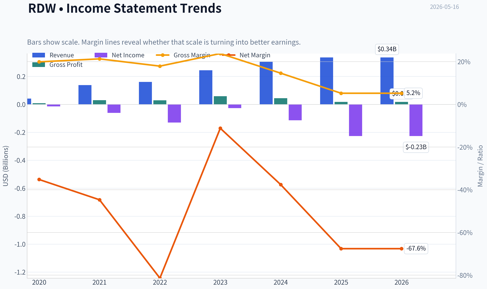

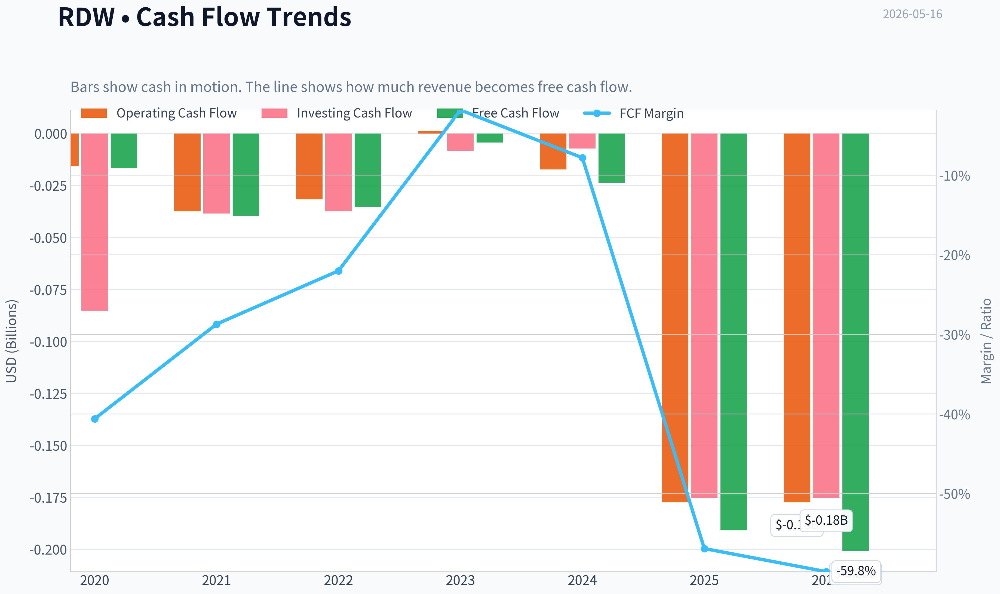

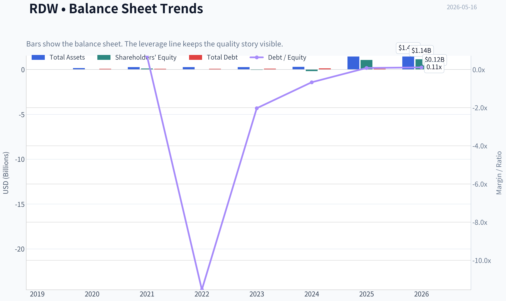

This graph tracks the profitability and return metrics (ROE, ROIC, Margins) of **RDW** over the past decade, highlighting capital efficiency trends.

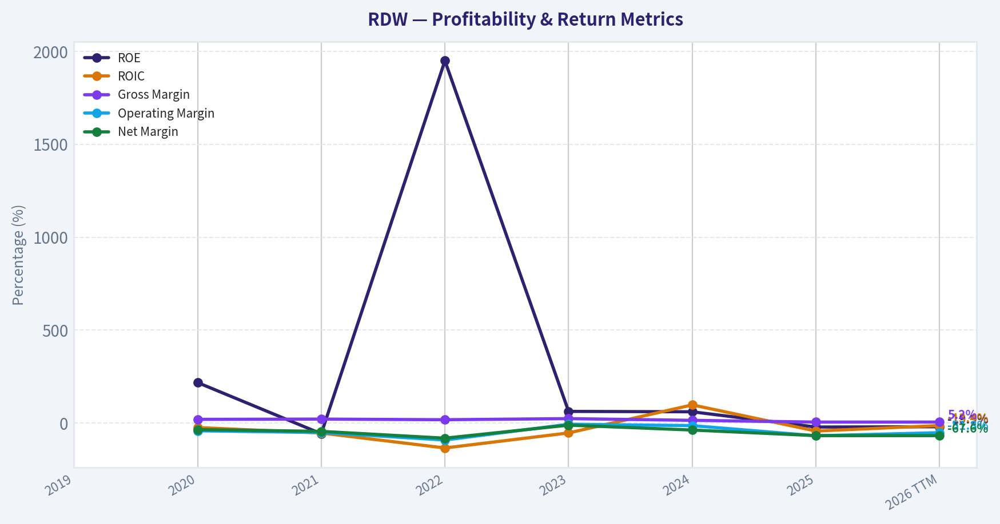

This chart illustrates the financial health of **RDW** over the last 10 years, mapping cash equivalents and free cash flow against total obligations (Debt).

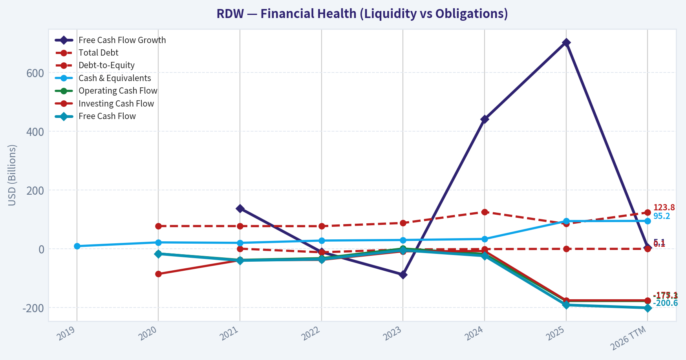

---

### Intrinsic Value Analysis (Buffett)

> *Following Warren Buffett's value investing philosophy: Circle of Competence, Economic Moat, Management Quality, and Margin of Safety.*

#### Intrinsic Value Snapshot

Price is what you pay. Intrinsic value is what the business may be worth based on the cash it can create for owners over time. We show a range, not one magic number.

- Current Price: $14.06
- Value Range: N/A to N/A

##### Owner Earnings (Buffett Method)
- Net Income: $-226,552,000.00
- Depreciation & Amortization: $32,639,000.00
- Capital Expenditures: $-13,479,000.00
- Working Capital Changes: $-52,024,000.00
- Owner Earnings: $-155,368,000.00

##### Intrinsic Value

ANALYST STANCE: **AVOID**

#### RDW (Redwire) Buffett-Style Review

I could not retrieve the deeper audited financial history tool output in this run, so this is a partial but still actionable assessment using the shared research pack. Based on what we do know, RDW fails multiple Buffett filters already.

#### 1) Go/No-Go Gate Assessment

| Gate | Verdict | Evidence |
|---|---|---|
| Gate 1: Business Simplicity & Predictability | Fail | Redwire operates in space infrastructure and related systems. The business is understandable at a high level, but 10-year predictability is weak because demand, program timing, government budgets, and emerging commercial space markets are still uncertain. |
| Gate 2: Moat Test | Fail | Gross margin is only 5.2%, far below the >40% level that would suggest pricing power or strong intangible assets. No clear evidence of switching costs, cost advantage, or network effects. |
| Gate 3: Management & Capital Allocation | Fail/Insufficient | Negative ROE of -21.4% and negative FCF yield of -6.8% suggest the business is not yet producing attractive owner returns. I do not have enough evidence here to endorse capital allocation quality. |
| Gate 4: Industry Structure | Fail | Space infrastructure is still competitive, contract-driven, capital intensive, and not obviously a rational oligopoly with stable economics. |

**Key Takeaways:** RDW does not pass the basic Buffett gates. The biggest problems are weak predictability, no demonstrated moat, and poor current economics. Even before valuation work, that usually puts the stock in the reject pile for a long-term value investor.

#### 2) Elementary School Test

Redwire makes parts, systems, and services for space missions. It sells equipment and engineering to customers in government and commercial space markets.

That is simple enough to explain. The problem is not understanding what it does. The problem is predicting whether it can earn high, steady returns on capital for a decade.

#### 3) Moat Analysis

| Moat Source | Evidence | Assessment |
|---|---|---|
| Intangible Assets | Gross margin only 5.2%; no sign of strong pricing power | Weak |
| Switching Costs | No evidence provided of deeply embedded mission-critical recurring software/data lock-in | Weak |
| Cost Advantage | Low gross margin suggests little structural cost advantage | Weak |
| Network Effects | No evidence of platform/network economics | None |

**Key Takeaways:** There is no clear Buffett-style moat visible in the available data. A company with only 5.2% gross margin is usually competing on contracts and execution, not protected by strong pricing power. That is the opposite of the kind of effortless economics Buffett prefers.

#### 4) Management Quality Assessment

| Area | Observation | Preliminary View |
|---|---|---|
| Owner Orientation | No evidence available from this run | Unclear |
| Candor | No annual letter or transcript evidence available from this run | Unclear |
| Capital Allocation | Negative FCF yield and negative ROE imply weak current economic output | Concerning |
| Balance Sheet Discipline | Current ratio 1.62 is adequate near-term, but not enough by itself to offset weak profitability | Mixed |

**Key Takeaways:** I do not have enough qualitative evidence to judge management character fairly. But Buffett ultimately wants results, and current returns are poor. Negative ROE and negative free cash flow are bad starting points for any capital allocation case.

#### 5) Snapshot Financial Summary

| Metric | Value |
|---|---:|
| Current Price | $14 |
| Market Cap | $2.80B |
| P/E | N/A |
| ROE | -21.4% |
| Gross Margin | 5.2% |
| Revenue Growth YoY | 10.3% |
| FCF Yield | -6.8% |
| Current Ratio | 1.62 |

**Key Takeaways:** Revenue is growing, but growth without economics is not enough. The critical figures here are the negative ROE, negative free cash flow yield, and very low gross margin. That combination usually means the business has not yet proven it can convert sales into owner value.

#### 6) Owner Earnings View

Buffett's owner earnings framework requires stable profits, real cash generation, and a reasonable estimate of maintenance capital needs. I do not have the full cash flow history needed to calculate this properly.

Still, directionally:

- Net income appears negative or insufficient, given negative ROE and no P/E
- FCF yield is negative at -6.8%
- Therefore current owner earnings are likely negative

That makes a traditional Buffett valuation difficult, because the business is not yet producing distributable economic cash.

#### 7) Three-Scenario DCF Valuation

Because owner earnings appear negative, a Buffett-style DCF is not reliable. A DCF on negative or unstable cash generation can create false precision.

| Scenario | Assumption | Result |
|---|---|---|
| A: No Growth | Negative/near-zero owner earnings | Not meaningful |
| B: GDP Growth | Requires positive normalized owner earnings first | Not meaningful |
| C: Historical Growth | Revenue growth exists, but cash economics are weak | Too speculative |

**Key Takeaways:** The valuation problem is simple: you cannot sensibly capitalize negative owner earnings as if they were durable cash profits. Before worrying about upside, investors need proof that RDW can earn and sustain real free cash flow. Without that, valuation is speculation rather than investing.

#### 8) Margin of Safety Analysis

At a $2.80B market cap, investors are paying for future success rather than present business quality.

Given:
- no clear moat,
- negative free cash flow,
- negative ROE,
- low gross margin,
- uncertain industry economics,

there is **no demonstrable margin of safety** under a Buffett framework.

#### 9) Final Buffett Scorecard

| Criterion | Weight | Score (1-5) | Weighted Score |
|---|---:|---:|---:|
| Business Understanding | 20% | 3.0 | 0.60 |
| Moat Width & Durability | 25% | 1.0 | 0.25 |
| Management Quality | 15% | 2.0 | 0.30 |
| Return on Equity | 15% | 1.0 | 0.15 |
| Reinvestment Runway | 10% | 2.5 | 0.25 |
| Balance Sheet Strength | 5% | 2.5 | 0.13 |
| Industry Structure | 5% | 1.5 | 0.08 |
| Valuation/Margin of Safety | 5% | 1.0 | 0.05 |
| **Total** | **100%** |  | **1.81 / 5.00** |

**Key Takeaways:** RDW scores very poorly on the Buffett checklist. The business may be exciting, but excitement is not the same as investment quality. On this framework, the stock is far below the threshold for a watchlist candidate, let alone an investment.

#### 10) Investment Stance

**Stance: AVOID**

**Conviction:** Medium-high, based on currently available evidence.

This is not a classic Buffett business today. The company may participate in an interesting industry, but the available numbers show weak economics, no visible moat, and no margin of safety. For Buffett-style investors, the right move is to pass until RDW can demonstrate durable profitability, meaningful free cash flow, and returns on capital that prove a real competitive advantage.

If you want, I can continue next by building a **cleaner forensic financial history for RDW from whatever data is available** and update the owner earnings and valuation section with a more complete 5-10 year view.
#### Valuation Bridge

This bridge places the current market price beside each intrinsic value lens so readers can see whether upside depends on one method or shows up across several methods.

| Scenario | Intrinsic Value / Share |
| --- | ---: |
| Damodaran Method | $-35.61 |
| Current Price | $14.06 |

#### Key Takeaways

If one method is far above the others, the upside case depends on a specific modelling assumption. When several methods cluster together, the valuation story is more robust.

#### Valuation Visuals

This comparison chart from *Latest Earnings Snapshot* stacks current figures against historical benchmarks for **RDW**, making it easy to see where the company trades relative to its own averages.

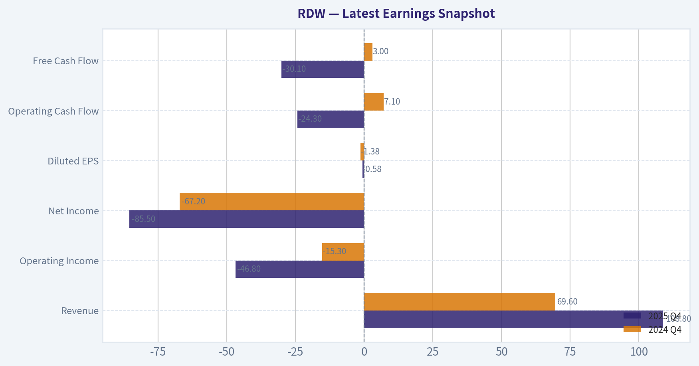

This comparison chart from *Current vs Historical Average Comparison* stacks current figures against historical benchmarks for **RDW**, making it easy to see where the company trades relative to its own averages.

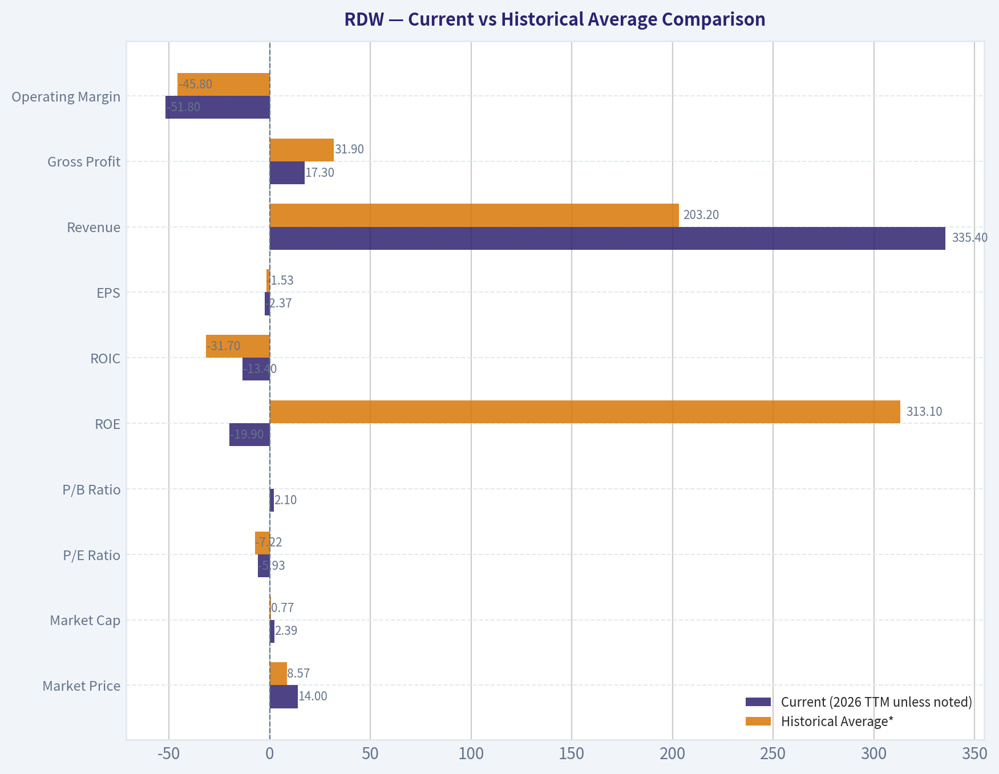

This comparison chart from *Balance Sheet and Financial Strength* stacks current figures against historical benchmarks for **RDW**, making it easy to see where the company trades relative to its own averages.

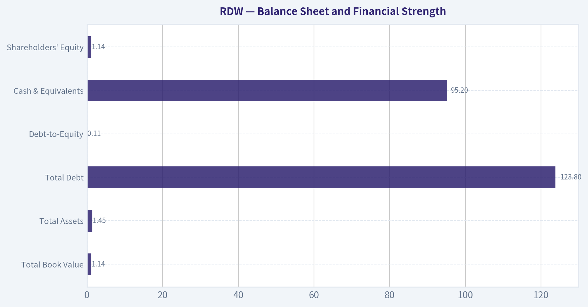

This comparison chart from *Snapshot Financial Summary* stacks current figures against historical benchmarks for **RDW**, making it easy to see where the company trades relative to its own averages.

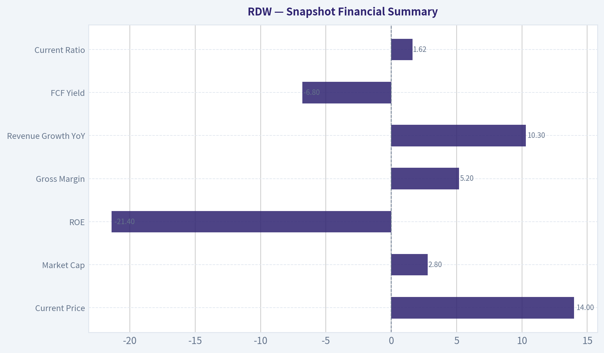

---

### Trend & Growth Analysis (Lynch/Druckenmiller/Fisher)

> *Following Peter Lynch's GARP, Stanley Druckenmiller's macro-aware approach, and Philip Fisher's scuttlebutt methodology.*

ANALYST STANCE: **WATCH**

#### RDW Growth Report

| Metric | Value |
|---|---:|
| Price | $14 |
| Market Cap | $2.80B |
| P/E | N/A |
| ROE | -21.4% |
| Gross Margin | 5.2% |
| Revenue Growth YoY | 10.3% |
| FCF Yield | -6.8% |
| Current Ratio | 1.62 |

Key Takeaways: Redwire currently screens as a speculative small-cap space infrastructure name rather than a classic fast grower. Revenue is growing, but only at low double digits, while profitability and cash flow remain weak. The combination of negative ROE, very low gross margin, and negative free cash flow means the story needs a clearer operating inflection before it earns a more aggressive stance.

---

#### 1) Lynch Classification

| Framework Item | Assessment |
|---|---|
| Lynch Category | **Stalwart / borderline emerging grower** |
| Why not Fast Grower? | Revenue growth of 10.3% is below the 15%-25%+ fast grower threshold |
| Why not Turnaround? | There is some turnaround flavor due to weak margins/cash flow, but no confirmed hard catalyst yet |
| Best fit | Early-stage strategic industrial/space platform with optionality, but not yet proven as a fast grower |

Key Takeaways: By Lynch's framework, RDW does not currently qualify as a fast grower, which is the prime hunting ground for ten-baggers. The company has interesting optionality tied to the space economy, but the actual financial profile today looks more like a developing story than a confirmed compounding machine. That keeps it in the watch zone rather than the buy zone.

#### 2) The Story in 3 Bullets

| Simple Story | Explanation |
|---|---|
| Picks-and-shovels for space | Redwire sells space infrastructure, components, payloads, and mission systems rather than betting on one launch program |
| Secular tailwind exposure | It rides long-duration themes in defense space, civil space, and potentially orbital data infrastructure |
| Optionality if execution improves | If backlog converts, margins expand, and cash burn narrows, the stock could rerate sharply from a niche industrial valuation |

Key Takeaways: The easy way to explain Redwire is that it helps build the tools and systems used in space missions. That is attractive because it gives exposure to a broad space buildout rather than a single moonshot product. The problem is that the business still needs to prove it can turn strategic relevance into durable economic value.

#### 3) TAM Analysis and 10x Test

| TAM Item | Assessment |
|---|---|
| End markets | Space infrastructure, defense space systems, civil space, mission operations, in-space manufacturing |
| TAM direction | Likely expanding, helped by defense demand and long-term commercialization of orbit |
| 10x Test | **Likely passes qualitatively** |
| Why | At current scale, a 10x larger Redwire would still likely be a modest share of global space/aerospace infrastructure spend |

Key Takeaways: The runway is probably not the problem here. Space infrastructure and defense-related orbital systems appear large enough that Redwire could grow many times larger without saturating its market. The real question is not market size, but whether Redwire can execute well enough to capture that opportunity profitably.

#### 4) Revenue Growth Trend

| Metric | Observation |
|---|---|
| Latest YoY Revenue Growth | 10.3% |
| Pattern | Positive, but not high-growth |
| Inflection Status | **Not yet confirmed** |
| Quality concern | Growth is modest relative to valuation and current margin profile |

Key Takeaways: Revenue growth is positive, which matters, but it is not showing the kind of acceleration that usually defines a true inflection-point growth stock. For a company with a premium thematic narrative, 10.3% growth is only adequate. To move into advocate territory, investors likely need to see sustained acceleration closer to the fast-grower range.

#### 5) Unit Economics

| Metric | Status |
|---|---|
| LTV/CAC | Not disclosed / not applicable from available data |
| NRR | Not disclosed / not applicable |
| Rule of 40 | Not meaningfully applicable in current form |
| Gross Margin | 5.2% |
| FCF Yield | -6.8% |
| Working Capital Liquidity | Current ratio 1.62 |

Key Takeaways: Traditional SaaS-style unit economics do not fit Redwire well, so margin and cash conversion matter more. On that basis, the picture is weak today: gross margin is very low and free cash flow is negative. Liquidity is not alarming in the near term, but the operating model is not yet showing attractive economic leverage.

#### 6) Inflection Point Assessment

| Potential Inflection | Status |
|---|---|
| Product Cycle Inflection | Possible, but not evidenced in current fundamentals |
| TAM Inflection | Yes, orbital infrastructure and AI-related space data center speculation add narrative support |
| Competitive Inflection | Unclear |
| Margin Inflection | **Not yet visible** |
| Revenue Acceleration | **Not yet visible** |
| Market Perception Inflection | Yes, recent stock moves suggest narrative sensitivity |

Key Takeaways: The market may be starting to price narrative optionality around space infrastructure and orbital compute themes, but the financial statements have not yet confirmed a true business inflection. That distinction matters. Right now, the story is ahead of the numbers, which is exciting but risky.

#### 7) Macro Setup Evaluation

| Macro Factor | Assessment |
|---|---|
| Secular Theme Exposure | Strong |
| Theme Fit | Defense space, civil space, orbital infrastructure, possible AI-adjacent space narrative |
| Rate Sensitivity | Moderate, as speculative growth names benefit from easier financial conditions |
| Budget Support | Potential tailwind from defense and national security demand |
| Macro Verdict | **Constructive thematic backdrop** |

Key Takeaways: The macro and thematic setup is better than the company-specific execution profile. Space, defense, and AI-adjacent infrastructure are all areas that can attract investor attention and capital. That gives Redwire a favorable backdrop, but macro tailwinds alone are not enough if margins and cash generation remain weak.

#### 8) Fisher 15 Points Score

| Fisher Area | Score (1-5) |
|---|---:|
| Market potential | 4 |
| New product development | 4 |
| R&D effectiveness | 3 |
| Sales organization | 3 |
| Profit margin | 1 |
| Margin improvement | 2 |
| Labor/personnel relations | 3 |
| Executive relations | 3 |
| Management depth | 3 |
| Cost analysis/accounting | 2 |
| Special advantages | 3 |
| Long-range profit outlook | 3 |
| Dilution risk | 2 |
| Candor | 3 |
| Integrity | 3 |
| **Total** | **42 / 75** |

Key Takeaways: Redwire scores well on market opportunity and innovation potential, which is why the name remains interesting. But Fisher would likely be cautious because the actual business quality is not yet robust, especially around margins, cost control, and dilution risk. A score of 42 suggests promise, but not enough proof.

#### 9) Valuation Analysis

| Valuation Method | Assessment |
|---|---|
| PEG | Not usable; earnings are not meaningfully positive |
| P/E | N/A |
| P/S | Approx. **4.5x** using $2.80B market cap and implied revenue base from growth profile if annual revenue is roughly in the low-$600M range |
| FCF-based view | Unattractive currently due to negative FCF |
| Scenario view | Valuation depends on margin inflection more than near-term sales growth alone |

Key Takeaways: Redwire is not expensive in the way a high-flying software stock is expensive, but it is also not obviously cheap given its weak margins and negative free cash flow. The stock likely requires a future margin and execution rerating to justify upside. In other words, investors are paying for optionality, not present economics.

#### 10) Growth Investor Scorecard

| Criterion | Weight | Score (1-5) | Weighted |
|---|---:|---:|---:|
| The Story | 10% | 3.5 | 0.35 |
| TAM & Runway | 20% | 4.0 | 0.80 |
| Revenue Growth | 20% | 2.5 | 0.50 |
| Unit Economics | 15% | 1.5 | 0.23 |
| Competitive Position | 10% | 3.0 | 0.30 |
| Management Quality | 10% | 3.0 | 0.30 |
| Macro Setup | 5% | 4.0 | 0.20 |
| Profitability Path | 5% | 2.0 | 0.10 |
| Valuation | 5% | 3.0 | 0.15 |
| **Total** | 100% |  | **2.93 / 5.0** |

Key Takeaways: Redwire lands just below the threshold where a growth investor would want to get more aggressive. The biggest positives are market runway and thematic relevance. The main drags are mediocre growth, weak unit economics, and the lack of a visible profitability inflection.

---

#### 11) Position Size Stance

| Stance Item | View |
|---|---|
| Current Stance | **WATCH** |
| Ideal Position Size | 0%-1% starter only for high-risk thematic portfolios |
| Not appropriate for | Core growth portfolios seeking proven compounding economics |
| Upgrade trigger | Revenue acceleration, margin expansion, and improved FCF conversion |

Key Takeaways: This is not a high-conviction core growth position today. At most, it fits as a small optionality position for investors comfortable with thematic volatility. The setup can improve, but the company still needs to earn that upgrade with numbers.

#### 12) Key Risks and Catalysts

| Risks | Catalysts |
|---|---|
| Very low gross margin | Major contract wins in defense/civil space |
| Negative FCF and weak ROE | Backlog conversion and revenue acceleration |
| Narrative running ahead of fundamentals | Margin improvement from scale/mix shift |
| Potential dilution or capital intensity | Orbital infrastructure/AI-related partnerships |
| Volatile sentiment in space stocks | Increased institutional sponsorship; Point72 initiation is a modest positive signal |

Key Takeaways: The key risk is simple: Redwire may remain a good story with weak economics. The key bull case is equally simple: if the company begins converting strategic positioning into faster growth and better margins, the stock could rerate quickly. This is why the name is worth watching closely even if it is not yet an advocate.

#### Bottom Line

RDW is an interesting space infrastructure optionality play, but by Lynch-Druckenmiller-Fisher standards it is **not yet a clean fast-growth advocate**. The TAM is real, the thematic backdrop is strong, and recent market interest suggests speculative upside if orbital infrastructure narratives intensify. But current fundamentals - especially **10.3% growth, 5.2% gross margin, and negative FCF** - do not yet confirm the inflection.

**What would change my mind to ADVOCATE:**
1. Revenue growth reaccelerates above 15%-20%.
2. Gross and operating margins show clear expansion.
3. FCF trend materially improves.
4. Management proves this is a scalable space platform, not just a collection of interesting contracts.

If you want, I can next do a **bull/base/bear 3-year scenario model for RDW** using revenue, margin, and valuation multiple assumptions.

#### Growth & Scorecard Visuals

The radar chart below from *Final Buffett Scorecard* visualises how **RDW** ranks across weighted investment criteria. Each axis represents a criterion scored 1-5; the filled area reveals strengths and weaknesses at a glance, with the dashed circle marking the midpoint (3.0).

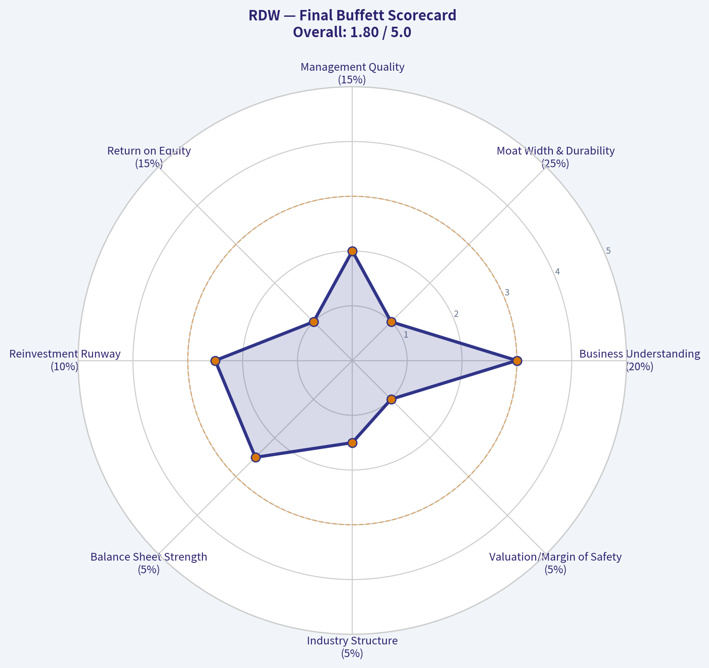

---

### Market Technical Analysis

#### RDW Technical Analysis

I selected these 8 indicators because they give a broad, non-redundant view of RDW across trend, momentum, volatility, and volume confirmation:

| Indicator | Why it matters now |
|---|---|
| close_10_ema | Best for tracking the current acceleration of the latest rally. |
| close_50_sma | Medium-term trend filter and key support reference. |
| close_200_sma | Long-term trend benchmark; helps judge whether the latest move is a structural recovery or just a swing rally. |
| macd | Confirms whether upside momentum is strengthening or fading. |
| rsi | Shows whether price is extended or still has room before becoming overheated. |
| boll_ub | Helps judge breakout extension versus overbought stretch. |
| atr | Important because RDW is clearly volatile; useful for stop placement and sizing. |
| vwma | Confirms whether the rally is being supported by meaningful volume participation. |

Key Takeaways: These indicators work well together because they separate short-term momentum from medium- and long-term trend, while also checking whether volatility and volume support the move. For RDW, that matters a lot because the stock has shown both explosive rallies and deep retracements over the last six months.

---

#### Price Structure and Trend Context

RDW has undergone three distinct phases over the last six months.

First, from mid-November through late January, the stock staged a powerful trend advance from the mid-$5 area to a peak near $14.55 on January 27. That move was not gradual; it was characterized by repeated high-volume expansion days, indicating speculative demand and aggressive repricing rather than slow institutional accumulation.

Second, from late January through late March, RDW gave back a large part of that rally. The retreat from the January spike into the late-March low near $7.71 was deep enough to qualify as a meaningful corrective phase, not just a routine pullback. Importantly, this correction compressed the prior excess and reset momentum.

Third, from early April into mid-May, the stock rebuilt upward pressure and has now broken sharply higher again, closing at $14.06 on May 15, very close to the January high zone. This matters because the stock is no longer merely bouncing inside a downtrend; it has regained the upper end of its multi-month range and is testing the prior speculative peak area.

In simple terms, RDW has transitioned from parabolic advance, to long reset, and now back into an attempted breakout/retest of the highs.

| Trend Phase | Approx. Period | Market Character | Trading Implication |
|---|---|---|---|
| Initial expansion | Nov 2025 to late Jan 2026 | Strong upside trend with explosive volume | Momentum traders had control |
| Corrective reset | Late Jan to late Mar 2026 | Sharp drawdown and volatility compression | Weak holders flushed out |
| Re-acceleration | Apr 2026 to mid-May 2026 | Strong recovery back to highs | Breakout decision zone now |

Key Takeaways: RDW is back at a very important technical area near its prior peak, which means the next move could be decisive. Traders should treat this as a breakout confirmation zone, not a low-risk base entry zone.

---

#### Moving Average Analysis

The moving averages show a strong improvement in trend quality.

- **Close vs 10 EMA:** Price at 14.06 is well above the 10 EMA at 11.70.
- **Close vs 50 SMA:** Price is far above the 50 SMA at 9.81.
- **Close vs 200 SMA:** Price is also well above the 200 SMA at 8.99.

This alignment is bullish. More importantly, the slopes are telling different time-frame stories:

- **10 EMA** is rising sharply, showing immediate momentum acceleration.
- **50 SMA** has turned up after spending much of March and April flattening to lower.
- **200 SMA** had been drifting down for weeks, but price is now so far above it that the long-term trend picture has improved materially even if the 200 SMA itself still lags.

The relationship between the 50 SMA and 200 SMA is notable. On May 15, the 50 SMA is 9.81 and the 200 SMA is 8.99, meaning the 50 remains above the 200. That is constructive structurally, but the more important point is that price has stretched far above both. This is bullish, yet it also suggests the stock is entering an extension phase where short-term pullbacks become more likely.

| Metric | Latest Value | Interpretation |
|---|---:|---|
| Close | 14.06 | Strong close near multi-month highs |
| close_10_ema | 11.70 | Short-term trend is very strong |
| close_50_sma | 9.81 | Medium-term trend support well below price |
| close_200_sma | 8.99 | Long-term trend backdrop has improved |
| 50 SMA vs 200 SMA | 9.81 vs 8.99 | Positive long-term alignment |

Key Takeaways: RDW is trading above all major trend references, and that is a bullish configuration. But the stock is not sitting near support anymore; it is extended above support, which changes the risk-reward for fresh entries.

---

#### Momentum Analysis: MACD and RSI

Momentum has turned decisively positive.

- **MACD:** 0.856 on May 15, up strongly from negative readings earlier in May.
- The MACD crossed from negative on May 7 to positive on May 8 and has accelerated rapidly since then.
- That kind of move usually signals not just a bounce, but a momentum regime shift.

This is one of the strongest pieces of evidence in the chart right now. The recent rally is not a weak drift upward; it is a genuine momentum expansion.

**RSI** is 69.32, which is just under the classic overbought threshold of 70. That reading should be interpreted carefully:
- It is not yet at a clearly exhausted extreme.
- But it is close enough that traders should expect increased sensitivity to news, profit-taking, or failed breakout behavior.
- In a powerful trend, RSI can hover between 60 and 75 for longer than many traders expect. So the current RSI is bullish, but no longer cheap.

A nuanced point: RSI was only 48.03 on May 7 and is now near 69 in a week. That speed shows aggressive buying pressure. Fast RSI expansion often accompanies true breakouts, but if price fails to hold above the breakout zone, the same speed can reverse sharply.

| Momentum Indicator | Latest Value | Trend Signal | Risk Note |
|---|---:|---|---|
| macd | 0.856 | Strong bullish acceleration | Can reverse quickly after sharp spikes |
| rsi | 69.32 | Bullish, near overbought | Limited margin before momentum becomes stretched |

Key Takeaways: Momentum is strong and clearly improving, which supports the bullish case. However, RSI is now close to overbought territory, so the stock is strong but no longer early.

---

#### Volatility and Extension: Bollinger Upper Band and ATR

RDW is now trading above its **Bollinger Upper Band**.

- **Close:** 14.06
- **Bollinger Upper Band:** 13.72

That tells us price has pushed into an expansion state. This can mean one of two things:
1. A strong breakout that continues as price "rides the band," or
2. A short-term overextension that snaps back toward the mean.

Which of those is more likely depends on follow-through and volume. Because momentum and volume are both strong right now, the band break leans more bullish than bearish in the immediate term. Still, traders should not assume a straight-line continuation.

**ATR** is 1.23, up from roughly 0.87-0.91 in late March and early April. That is a major volatility expansion. At a $14 stock price, a 1.23 ATR means the stock is capable of moving nearly 9% of price in a typical daily range environment. This is substantial.

Practically:
- Tight stops are likely to get hit.
- Position sizes should be smaller than they would be in a lower-volatility stock.
- Entries after large breakout candles carry elevated slippage and reversal risk.

| Volatility Metric | Latest Value | What it suggests |
|---|---:|---|
| Close | 14.06 | Price at breakout/retest zone |
| boll_ub | 13.72 | Price is above the upper band; strong expansion |
| atr | 1.23 | Daily swings are large; risk management is critical |

Key Takeaways: RDW is in a volatility expansion phase, not a calm uptrend. That supports the idea of a real breakout attempt, but it also means traders need wider stops and smaller size.

---

#### Volume Confirmation: VWMA

The **VWMA** is 11.11, well below the current close of 14.06. That gap is important.

A price far above the VWMA means the recent rally has not only lifted price, but has done so on meaningful volume. This is especially relevant because May 14 and May 15 printed very large volumes, following an already elevated volume build on May 8 and May 11. That pattern suggests active participation rather than a thin squeeze.

However, there is an important nuance. When price gets too far above VWMA, it can also indicate short-term crowding. Strong volume can validate a move, but after several heavy-volume upside sessions, the stock can enter a stage where late buyers become vulnerable if momentum pauses.

So the message from VWMA is bullish confirmation, but also a reminder that the move is no longer in its quiet accumulation phase.

| Volume Confirmation | Latest Value | Interpretation |
|---|---:|---|
| vwma | 11.11 | Rally is supported by strong recent volume |
| Close vs VWMA | 14.06 vs 11.11 | Buyers are in control, but the move is extended |

Key Takeaways: Volume is supporting the advance, which makes the rally more credible. But the large gap between price and VWMA also suggests the move is crowded enough that pullbacks could be sharp if momentum cools.

---

#### Fine-Grained Trading Read on Current Setup

The current setup is best described as **bullish but extended at resistance**.

Why bullish:
- Price is above the 10 EMA, 50 SMA, and 200 SMA.
- MACD has flipped strongly positive and is accelerating.
- RSI is strong without yet clearly exceeding 70.
- VWMA confirms participation.
- Price has reclaimed the prior high zone rather than stalling beneath it.

Why extended:
- Price is above the upper Bollinger Band.
- ATR has expanded sharply.
- RSI is near overbought.
- The stock has rallied very quickly in a short window.
- The current price is very near the January high area, where sellers have previously appeared.

This creates a distinction between trader types:

- **Momentum breakout traders** may still find this attractive if price can hold above the prior peak zone and volume remains elevated.
- **Swing traders seeking favorable risk/reward** may prefer to wait for either a breakout hold or a retracement toward the 10 EMA / breakout support area.
- **Risk-controlled traders** should avoid chasing a vertical candle if they cannot tolerate 8-10% daily swings.

A strong bullish continuation case would involve:
- Holding above roughly the 13.7 to 14.1 area,
- MACD staying positive and rising,
- RSI staying in the 60-75 zone without immediate collapse,
- and volume not disappearing on up days.

A cautionary scenario would involve:
- A failed move back under the breakout area,
- RSI reversing sharply from near 70,
- and a fast retreat toward the 10 EMA near 11.70.

That would not necessarily destroy the broader bullish picture, but it would indicate the breakout was too hot and needs digestion.

---

#### Bottom Line

RDW currently shows a **high-momentum bullish breakout attempt** backed by improving trend alignment and strong volume confirmation. The most constructive feature is that the stock has regained the upper end of its six-month range with MACD acceleration and strong price separation above major moving averages.

The main caution is not trend weakness, but **extension risk**. The stock is above the upper Bollinger Band, ATR is elevated, and RSI is close to overbought. That means upside remains possible, but entry timing matters much more now than it did one week ago.

For traders, the key question is no longer "is RDW improving?" It clearly is. The real question is whether it can **hold and build above the prior high zone**, or whether this latest surge becomes another sharp spike that requires a cooldown before the next leg.

| Category | Signal | Interpretation | Trading Relevance |
|---|---|---|---|
| Short-term trend | Price well above 10 EMA | Strong upside acceleration | Bullish, but stretched |
| Medium-term trend | Price above 50 SMA | Trend recovery confirmed | Support exists much lower |
| Long-term trend | Price above 200 SMA | Structural backdrop improved | More than just a dead-cat bounce |
| Momentum | MACD strongly positive | Upside impulse is real | Supports breakout thesis |
| Momentum condition | RSI near 69 | Strong but near overbought | Watch for exhaustion or consolidation |
| Volatility | Above Bollinger upper band | Expansion phase underway | Continuation or snapback possible |
| Risk | ATR at 1.23 | Large daily swings | Use wider stops, smaller size |
| Volume | Price above VWMA | Rally has strong participation | Confirms move, but also crowding risk |

Key Takeaways: RDW has strong bullish momentum and credible volume support, but the stock is now in an extended, high-volatility zone near prior highs. The setup favors disciplined breakout management rather than aggressive chasing after a vertical move.

#### Market Visuals

This comparison chart from *Market Metrics* stacks current figures against historical benchmarks for **RDW**, making it easy to see where the company trades relative to its own averages.

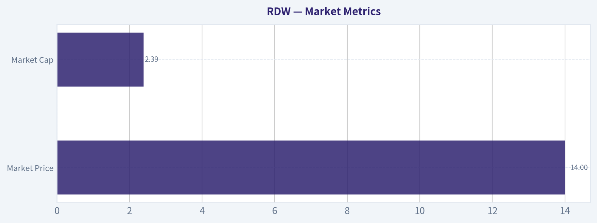

---

### News & Events Analysis

#### RDW weekly trading and investment report

Redwire's stock action over the past week looks less like a fundamentals-driven rerating and more like a fast sentiment squeeze layered on top of an improving but still unproven operating story. The key tradable setup is that RDW sits at the intersection of three themes that are currently attracting speculative capital: defense-adjacent space infrastructure, AI-linked orbital data center enthusiasm, and small/mid-cap aerospace names with optionality. That said, the company's weak profitability profile, negative free cash flow, and very thin gross margin mean the stock is still vulnerable to sharp reversals when momentum cools.

#### Recent company-specific news

The most important near-term trading catalyst this week was not a contract award or a major balance-sheet event, but a sentiment shock tied to the Wall Street Journal report that SpaceX and Alphabet were in discussions around data centers in orbit. RDW rallied on May 14 in sympathy because investors extrapolated that companies with on-orbit infrastructure exposure could benefit if orbital compute/storage becomes a real capex category. The move partially reversed on May 15, which suggests the market quickly priced in the "theme premium" without new RDW-specific confirmation.

Canaccord also maintained a Buy and raised its price target to $14 from $12 on May 11. That matters less as a fundamental catalyst than as confirmation that sell-side coverage is increasingly willing to underwrite the upside narrative after earnings. With the stock already around $14 in the shared pack, that target implies analyst support has caught up to price rather than opening a clearly new upside gap.

RDW also published a May 2026 investor presentation, which is useful because management appears to be actively framing the company around civil space, defense, and industrial space infrastructure rather than a single-program dependency story. For traders, that broadens the addressable-news surface area: NASA, defense, satellite servicing, in-space manufacturing, and now AI/orbital data-center headlines can all move the stock.

#### Earnings review: latest reported period

The latest reported earnings period was **Q1 2026**, reported in **May 2026**. Based on the shared earnings coverage and the company's Q1 2026 earnings-call presentation reference, this is the most recent quarter investors should anchor on.

Headline interpretation from the latest available coverage and shared fundamentals:
- **Revenue grew 10.3% year over year**, indicating the company is still expanding, but not at a pace that by itself justifies highly aggressive multiple expansion.
- **Gross margin was 5.2%**, which is very low and signals that mix, execution, or integration pressure remains significant.
- **ROE was -21.4%** and **free cash flow yield was -6.8%**, reinforcing that Redwire is still in an investment / subscale profitability phase rather than a stable earnings compounder.
- **Current ratio of 1.62** suggests near-term liquidity is not obviously distressed, but it is not so strong that investors can ignore cash burn.

What changed versus the prior period or prior setup:
- The most important positive change is that **top-line growth remained positive**, supporting the idea that demand in Redwire's end markets is still intact.
- The most important negative is that **profit conversion still appears weak**, with very low gross margin and negative cash generation. So even if revenue improved versus the year-ago period, operating quality did not improve enough to remove execution risk.
- Relative to prior market expectations, the post-earnings tone appears to have improved enough for at least one analyst to raise a target, but the stock's bigger move this week came from sector-theme enthusiasm rather than clean evidence of a step-change in underlying profitability.

In practical trading terms: the earnings release seems to have kept the bullish thesis alive, but it did not eliminate the core bear case that RDW is still a story stock dependent on future margin scaling.

#### Market context and macro backdrop

The broader market backdrop for RDW this week has been supportive for speculative aerospace and defense-linked names. Geopolitical tension in the Middle East reportedly helped defense sentiment, which spilled into some space-related equities. That matters because RDW often trades not only on company execution but also on basket flows tied to defense, national security space, and retail enthusiasm for the broader "space economy."

At the same time, macro conditions remain two-sided for small-cap growth names:
- If rates stay elevated or risk appetite fades, RDW's negative FCF profile becomes a bigger headwind.
- If markets continue rewarding thematic growth and defense-adjacent capex stories, RDW can outperform fundamentals for periods of time.

So the macro lens is not neutral. It is specifically supportive for **high-beta thematic upside**, but only while sentiment remains constructive.

#### Ownership and positioning signal

The shared 13F data shows **Point72 / Steve Cohen initiated a position** as of March 31, 2026. This is not a decisive fundamental endorsement on its own, since 13Fs are lagged and the position size is small in portfolio-weight terms, but it still matters as a sentiment marker. For traders, hedge-fund initiation can improve confidence that the name is now appearing on more institutional radar screens, which may support liquidity and narrative persistence.

#### Trading implications

For bulls:
- The stock has multiple near-term narrative levers: space infrastructure, defense adjacency, AI/orbital compute optionality, and improving investor awareness.
- Positive revenue growth and analyst target increases help sustain momentum.
- If additional industry headlines emerge around orbital data centers, launch demand, or U.S. defense-space spending, RDW could continue trading on optionality rather than current margins.

For bears:
- The company still does **not** screen as fundamentally clean: no P/E, negative ROE, negative FCF yield, and only **5.2% gross margin**.
- This week's surge appears to have been driven largely by **sympathy and thematic speculation**, which can unwind quickly.
- At roughly the analyst-raised price target, the easy rerating from "underfollowed" to "noticed" may already be partly reflected.

Base case:
- RDW is currently more attractive as a **tactical momentum/thematic name** than as a low-risk long-term quality compounder.
- The next durable upside would likely require either better margin evidence, stronger backlog/contract wins, or explicit linkage between Redwire's capabilities and emerging orbital AI/data-center infrastructure.
- Without that, the stock may remain highly tradeable but volatile, with gains dependent on narrative reinforcement.

#### Key points table

| Category | What happened | Why it matters for investors |
|---|---|---|
| Latest earnings period | RDW most recently reported **Q1 2026** results in May 2026 | This is the correct anchor period for evaluating the stock right now |
| Revenue trend | Revenue growth was **10.3% YoY** | Confirms continuing demand, but growth alone is not yet enough to resolve profitability concerns |
| Profitability | Gross margin **5.2%**, ROE **-21.4%**, P/E **N/A** | Core operating quality remains weak; valuation depends on future execution and narrative support |
| Cash generation | FCF yield **-6.8%** | The company is still burning cash on a free-cash-flow basis, increasing execution sensitivity |
| Balance sheet / liquidity | Current ratio **1.62** | Liquidity appears manageable near term, but not exceptionally strong |
| Stock drivers this week | Shares surged on orbital data-center/AI theme read-through, then gave back part of gains | Confirms the stock is trading heavily on sentiment and sector-theme correlation |
| Analyst reaction | Canaccord maintained Buy and raised PT from **$12 to $14** | Sell-side tone improved, but the stock is already near that updated target |
| Positioning signal | Point72 initiated a position as of 03/31/2026 | Modest positive institutional signal, though lagged and small in size |
| Macro backdrop | Defense and geopolitical tension helped space/defense sentiment | Supports high-beta upside, but only while risk appetite remains favorable |
| Trading conclusion | Better suited to tactical trading than pure fundamental long-term conviction at present | Upside exists, but volatility and reversal risk remain high |

Key Takeaways: Redwire's latest setup combines modest revenue growth with still-weak profitability and cash generation, so the stock's appeal is currently more thematic than fundamental. This week's move was driven largely by orbital data-center enthusiasm and broader defense-space sentiment, not by a clear step-change in operating quality. Investors should treat RDW as a high-volatility opportunity where narrative momentum can dominate in the short run, but margin improvement is still the key requirement for a more durable rerating.

---

### Guru Attention Analysis

> *Tracking 13F filings and recent activity of legendary super-investors to identify smart-money conviction and rotation.*

#### RDW Guru Ownership Snapshot

Using the canonical structured 13F data, **only one tracked guru currently shows a disclosed RDW position: Steve Cohen / Point72**. No other primary tracked guru appears in the latest structured 13F results for RDW, so under the rules, they should be treated as having **no position detected in latest 13F filing**.

| Guru | Action | Position Size | Portfolio Weight | Recent Change | Timing | Verification |
| --- | --- | --- | ---: | --- | --- | --- |
| Steve Cohen (Point72) | Initiated | 72.90K shares, valued at $619.65K | 0.00% | New position vs. prior filing; not present on 12-31-2025 filing | Latest report dated 03-31-2026 | [SEC 13F Filing](https://www.sec.gov/Archives/edgar/data/1603466/000091957426003476/) |

**Key Takeaways:** The only confirmed guru activity in RDW is a **new, very small initiation by Steve Cohen's Point72** in the 03-31-2026 quarter-end filing. Because the portfolio weight rounds to **0.00%**, this looks more like a small exploratory or tactical position than a high-conviction core holding.

#### Primary Tracked Gurus With No Detected RDW Position

| Guru / Fund | Latest Structured 13F Status for RDW |
| --- | --- |
| Warren Buffett / Berkshire Hathaway | No position detected in latest 13F filing |
| Seth Klarman / Baupost Group | No position detected in latest 13F filing |
| Mohnish Pabrai / Pabrai Investment Funds | No position detected in latest 13F filing |
| Bill Ackman / Pershing Square | No position detected in latest 13F filing |
| Stanley Druckenmiller / Duquesne Family Office | No position detected in latest 13F filing |
| Michael Burry / Scion Asset Management | No position detected in latest 13F filing |

**Key Takeaways:** Among the major "super-investor" names you asked to track, **RDW has essentially no broad guru sponsorship in the latest disclosed 13F data**. That matters because it suggests the stock is **not yet a consensus idea** among the best-known value, macro, or special-situation managers in this tracked set.

#### Interpretation

- **Most relevant signal:** Steve Cohen initiated a position.
- **Strength of signal:** Weak to moderate. It is a real buy, but the disclosed size is **tiny relative to Point72's portfolio**.
- **What it may mean:** RDW is on Point72's radar, but the filing does **not** support calling it a major conviction bet.
- **Important caveat:** 13F data is backward-looking; this position reflects holdings as of **2026-03-31** and may have changed since then.

#### SEC EDGAR Verification Links

- Steve Cohen / Point72 filing: [SEC 13F Filing](https://www.sec.gov/Archives/edgar/data/1603466/000091957426003476/)
- Steve Cohen / Point72 filing history: [All 13F Filings (SEC EDGAR)](https://www.sec.gov/cgi-bin/browse-edgar?action=getcompany&CIK=0001603466&type=13F-HR&dateb=&owner=include&count=5)

#### Bottom Line

For RDW, the guru data is sparse. **Steve Cohen is the only tracked guru with a confirmed current 13F position, and it is very small.** Everyone else in the primary tracked list shows **no position detected in latest 13F filing**.

---

### Options Market Analysis

> *Reading options flow - put/call ratios, IV skew, and unusual activity - to gauge institutional positioning and event-driven risk.*

#### RDW Options Positioning Report
*Data as of 2026-05-16*

RDW's options tape shows a **high-volatility, event-sensitive setup with a slight bearish tilt overall**, driven mainly by the heavy put concentration and put volume in the 2026-06-05 expiry, even though the very front weekly expiry still shows aggressive call activity. This is not a clean one-way options market; rather, it looks like traders are paying up for movement, with near-dated upside speculation competing against short-dated downside protection.

#### 1. Put/Call Ratio Analysis

| Expiry | Call OI | Put OI | Call Vol | Put Vol | Put/Call OI Ratio | Put/Call Vol Ratio | Read |
|---|---:|---:|---:|---:|---:|---:|---|
| 2026-05-22 | 14,981 | 13,631 | 11,506 | 6,081 | 0.91 | 0.53 | Mildly call-favored flow |
| 2026-05-29 | 16,219 | 7,295 | 3,064 | 1,401 | 0.45 | 0.46 | Clearly call-heavy |
| 2026-06-05 | 4,879 | 12,896 | 1,497 | 9,704 | 2.64 | 6.48 | Strong put dominance |
| **Near-term total** | **36,079** | **33,822** | **16,067** | **17,186** | **0.94** | **1.07** | Slightly defensive / bearish |

**Key Takeaways:** Across the combined near-term expirations, RDW's **put/call OI ratio of 0.94** sits above the historical neutral baseline of roughly 0.7, which suggests the market is more defensive than normal. Volume is also slightly put-heavy overall at **1.07**, but the signal is highly uneven by expiry: traders are buying calls in the first two weekly maturities, while the 2026-06-05 line is dominated by puts. That pattern often suggests short-term upside chasing or trading, but with a meaningful layer of protection or bearish positioning just beyond the immediate window.

**Interpretation vs. neutral baseline (~0.7):**
- **0.94 OI ratio** = more cautious than neutral, but not extreme panic.
- **1.07 volume ratio** = current trading flow has tilted modestly toward puts.
- The key shift from neutral is not broad-based fear across all maturities; it is **concentrated downside demand in early June**.

#### 2. Implied Volatility Assessment

| Expiry | ATM Call IV | ATM Put IV | Call-Put ATM Spread | IV Tone |
|---|---:|---:|---:|---|
| 2026-05-22 | 142.8% | 132.3% | +10.5 pts | Elevated, call-rich |
| 2026-05-29 | 133.2% | 123.6% | +9.6 pts | Elevated, call-rich |
| 2026-06-05 | 129.9% | 118.4% | +11.5 pts | Elevated, call-rich |
| **Average near-term** | **135.3%** | **124.8%** | **+10.5 pts** | Very elevated |

**Key Takeaways:** RDW's near-term implied volatility is **extremely high**, with ATM IV running roughly **125% to 143%**, which signals the market is pricing in very large short-dated moves. Notably, **calls are trading at higher ATM IV than puts** across all three expiries, which is atypical for a stock under strong downside fear. That suggests traders are paying a premium for upside optionality as well, pointing to a speculative, two-sided setup rather than pure bearish stress.

**IV skew assessment:**
- Based on the available data, the practical skew signal is **call-leaning rather than put-skewed**, since ATM call IV exceeds ATM put IV in each expiry.
- A classic downside-fear structure would show puts carrying a larger IV premium, especially in near-dated maturities.
- Here, the market appears willing to overpay for upside exposure, which can happen in:
  - momentum names,
  - squeeze-prone stocks,
  - event-driven names where upside surprise is considered plausible.

**Catalyst flag:**
- IV at these levels is clearly **elevated enough to imply a catalyst or binary-style uncertainty**.
- Even without a confirmed specific event in the dataset, traders are pricing RDW as if a meaningful near-term company-specific or thematic move is possible.
- This means directional reads should be made with caution because rich premium can reflect **expected movement**, not just conviction about direction.

#### 3. Unusual Options Activity

| Expiry | Type | Strike | Volume | OI | Vol/OI | IV | Likely Moneyness* | DTE** | Positioning Read |
|---|---|---:|---:|---:|---:|---:|---|---:|---|
| 2026-05-22 | CALL | 14.5 | 2,428 | 477 | 5.1x | 141.2% | Near ATM / slightly OTM | 6 | Fresh upside speculation or hedge overwrite unwind |
| 2026-05-22 | PUT | 14.5 | 1,262 | 79 | 16.0x | 139.1% | Near ATM / slightly OTM | 6 | Fresh hedge or bearish directional bet |
| 2026-05-22 | CALL | 16.5 | 1,209 | 195 | 6.2x | 153.3% | OTM | 6 | Aggressive upside lottery-ticket style speculation |
| 2026-06-05 | PUT | 14.5 | 866 | 72 | 12.0x | 114.3% | Near ATM / slightly OTM | 20 | More deliberate downside hedge / bearish positioning |

\* Exact moneyness depends on RDW spot price at time of chain snapshot; strikes around 14.5 appear near current trading area.
\** DTE measured from 2026-05-16.

**Key Takeaways:** The most notable unusual flow is clustered around the **14.5 strike**, on both the call and put side, which often means the market is bracing for a sharp move away from the current price rather than expressing one-sided conviction. The **16.5 call buying** looks more speculative and likely retail-friendly, while the **2026-06-05 14.5 put flow** looks more serious because it reaches beyond the front week and aligns with the broader put-heavy June 5 structure. In short: there is speculative upside chasing, but the more durable-looking protection appears to be on the downside.

**How to read these contracts:**
- **2026-05-22 $14.5 call:** Could be traders positioning for an immediate pop; because volume is much larger than OI, this looks like fresh risk.
- **2026-05-22 $14.5 put:** The matching unusual put activity at the same strike suggests either two-sided event positioning or aggressive hedging.
- **2026-05-22 $16.5 call:** This is farther OTM with very high IV, consistent with **speculative upside chasing** rather than conservative institutional accumulation.
- **2026-06-05 $14.5 put:** This stands out as more credible "smart-money" style protection because it gives more time and aligns with the heavy put-dominant expiry.

#### 4. Open Interest Concentration

| Expiry | Dominant Feature | What It Suggests |
|---|---|---|
| 2026-05-22 | Large overall OI on both sides, with heavy trading around 14.5 | Strong pinning potential near current spot if RDW stays around that strike |
| 2026-05-29 | Call OI materially exceeds put OI | Upside interest is concentrated here; could act as a call gamma zone if price rises |
| 2026-06-05 | Put OI massively exceeds call OI | Strong downside hedge wall / put gravity into early June |

**Key Takeaways:** The options market is centered around the **14.5 area**, which likely acts as a near-term magnetic strike. For the first weekly expiry, that creates the potential for **pinning behavior** if the stock remains range-bound. But by 2026-06-05, the heavy put open interest could become a **downside gamma wall**, making selloffs more unstable if price starts breaking lower.

**Pinning / gamma wall interpretation:**
- **Near-term pin level:** 14.5 appears to be the most important strike from the unusual activity cluster.
- **Upside gamma influence:** The call-heavy 2026-05-29 expiry could support momentum if RDW starts moving upward and dealers need to hedge.
- **Downside gamma risk:** The 2026-06-05 put-heavy structure is the bigger warning sign; if spot weakens toward that strike zone, hedging flows could amplify downside volatility.

#### 5. Overall Options Sentiment Signal

| Factor | Signal |
|---|---|
| Put/Call OI vs neutral | Slightly bearish |
| Near-term trading flow | Mixed, but slightly put-heavy overall |
| IV level | Very elevated, catalyst-like |
| Skew | Call-leaning, not classic fear skew |
| Unusual activity | Two-sided near-term, more durable downside hedge into 2026-06-05 |
| OI concentration | 14.5 pin risk near-term; downside wall into early June |

**Key Takeaways:** RDW's options market is not cleanly pessimistic, but the balance of evidence still leans **bearish overall**, mainly because the strongest conviction appears in the **put-heavy 2026-06-05 expiry** rather than in the shorter-lived weekly call speculation. Elevated IV and two-sided unusual flow tell us traders expect a large move, but the structure of open interest suggests more market participants are preparing for downside than for a sustained upside breakout. The front-week calls matter, but they currently look more tactical than foundational.

#### Final Read: **BEARISH**

**Primary driver of the signal:**
The deciding factor is the **large put concentration and dominant put volume in the 2026-06-05 expiry**, which looks more like meaningful protection or bearish positioning than the front-week call buying, much of which appears speculative. The unusually high IV also suggests traders are bracing for a sizeable move, and when longer-dated near-term money is leaning defensive, that deserves more weight than short-dated upside chasing.

**Confidence level:** Moderate
Reason: RDW options are active enough to be useful, but the tape is **very event-driven and high-IV**, which can distort pure directional interpretation. This is a bearish read with a real possibility of sharp countertrend squeezes.

---

#### Markdown Summary Table

| Category | Observation | Interpretation |
|---|---|---|
| Put/Call Ratio | Near-term OI ratio **0.94**; volume ratio **1.07** | Slightly more defensive than neutral; mild bearish tilt |
| IV Level | ATM IV roughly **125%-143%** | Very elevated; market pricing a large near-term move |
| Skew Direction | **Call IV > Put IV** across expiries | Not classic downside fear; some upside chase/speculation present |
| Unusual Activity | Fresh flow at **14.5 calls/puts**, plus **16.5 call** and **6/5 14.5 put** | Near-term two-sided event trading, but more durable downside hedge into early June |
| Overall Signal | **BEARISH** | Put-heavy June 5 positioning outweighs front-week call speculation |

**Key Takeaways:** RDW's options market is pricing a major move and shows both upside speculation and downside protection. The decisive feature is that the more durable positioning leans defensive, especially into early June, which keeps the overall signal bearish despite the call-heavy front-week tape.

---

## Research Team Commentary

> *The Research Manager synthesizes the Bull vs Bear debate into action-free commentary. This is a pre-risk view, not the final stance.*

The strongest bull argument is that Redwire may be building a real position in a structurally attractive, high-barrier industry where current accounting economics understate future earning power. Space infrastructure is hard, qualification-heavy, and relationship-driven. If Redwire is truly becoming an embedded supplier with flight heritage and sticky customer roles, then today's weak profitability could reflect an early integration and scale phase rather than the end-state economics. The bull case is not about current quality; it is about the possibility that a technically credible platform matures into a more valuable picks-and-shovels business over a 10-year horizon.

The strongest bear argument is much simpler and, frankly, much more Buffett-like: none of that moat is showing up in the numbers. Gross margin at 5.2%, ROE at -21.4%, ROIC at -19.7%, negative free cash flow, and a collapse in net income and FCF trends all point to a business that is not just temporarily messy, but currently destroying capital. Buffett does not pay for hypothetical future quality when present economics are this weak. A hard industry is not the same as a good business, and "normalized earnings" is too often a story investors tell themselves before dilution or disappointment arrives.

My takeaway is that the bear side wins this round. Redwire may eventually become interesting, but today it does not meet the standard for a durable, understandable, cash-generative business selling below intrinsic value. The market appears to be rewarding the narrative and strategic optionality more than the underlying economics justify. From a value investing standpoint, that is not selective contrarianism; that is speculation.

Core takeaway: Redwire is not a Buffett-style opportunity today because the core proof points of business quality are missing. The company may have technical relevance in a promising industry, but there is no evidence yet of a durable moat in the only place that ultimately matters for owners: returns on capital and owner earnings. Until that changes, intrinsic value is too uncertain and margin of safety is absent.

Rationale: I want to avoid repeating a common mistake in story-driven industrial or technology names: mistaking industry attractiveness for company attractiveness. The bull case depends on several future conversions happening in sequence - technical capability into pricing power, revenue growth into margin expansion, and platform ambition into cash generation. That can happen, but Buffett's discipline is to wait until the economics become visible enough to value conservatively. With a 5.2% gross margin, deeply negative returns, and worsening cash flow, I cannot responsibly underwrite normalized earnings. Also, when a company is losing money and burning cash, time is not always your friend; outside capital, dilution, or poor capital allocation can permanently impair shareholder outcomes before the thesis matures.

The contrarian question is whether current fear is creating opportunity. Here, I do not think the market is excessively fearful. In fact, with the stock trading well above key moving averages and the narrative supported by strategic industry excitement, sentiment may be giving the company more credit than the fundamentals deserve. What would have to be true for the current optimism to be justified? We would need to see clear, sustained gross margin expansion, operating leverage, and positive free cash flow, not just contract wins or revenue growth. Right now, that proof is not there.

Monitoring plan for the next 1-4 quarters: First, watch gross margin very closely. If it cannot move meaningfully above today's 5.2%, the moat/platform argument is probably weak. Second, track free cash flow and working-capital behavior; I want to see cash burn narrow materially, not just adjusted metrics improve. Third, monitor ROIC directionally - even if still negative, it should improve steadily if scale economics are real. Fourth, assess revenue quality, not just growth: are wins becoming more repeatable and productized, or is this still bespoke contract assembly? Fifth, listen for evidence of disciplined capital allocation: fewer vague platform claims, more proof of integration, segment profitability, and per-share value creation. Sixth, watch balance-sheet dependence; any need for fresh capital on unfavorable terms would weaken the thesis further.

What would make me more constructive? A few quarters of materially better gross margins, a visible path to positive owner earnings, and evidence that Redwire is becoming a scalable supplier rather than a collection of project businesses. What would make me even more negative? Continued low margins, worsening cash burn, more narrative-heavy optimism without economic progress, or shareholder dilution.

Final stance: AVOID.

---

## Value Investing Team Commentary

> *The Investor translates the research view into an investment thesis before risk review. This is still not the final stance.*

Redwire is exactly the sort of company that can tempt investors into confusing an exciting industry with an investable business. Space infrastructure is undeniably interesting. It may even become economically important over the next decade. But Buffett-style investing begins with present business economics and asks whether they are strong enough, understandable enough, and durable enough to support a conservative estimate of intrinsic value. On that basis, RDW does not qualify today.

The central issue is simple: the business is not yet demonstrating good owner economics. A 5.2% gross margin is extremely weak for a company that is supposed to possess technical differentiation and strategic relevance. If the moat is real, it should begin to appear in pricing power, repeat business, or operating leverage. Instead, we see negative ROE, negative ROIC, and negative free cash flow. Those are not signs of a temporarily misunderstood compounder; they are signs of a business that has not yet proven its model.

The bull case is that current results understate future earning power because Redwire is still integrating capabilities, building scale, and positioning itself in a high-barrier market. That is possible. But "possible" is not enough. The value investor's burden is not to imagine a favorable future, but to determine whether that future is sufficiently visible to justify committing capital today with a margin of safety. Here, it is not. When normalized earnings are mostly hypothetical, valuation becomes storytelling.

The contrarian angle is important. Is the market being too pessimistic and giving patient investors an opening? I do not think so. In fact, the stock trading well above its 10 EMA, 50 SMA, and 200 SMA suggests sentiment is not washed out. The market appears willing to reward the strategic narrative despite poor underlying profitability. That is not the sort of fear-driven dislocation Buffett would usually exploit. If anything, optimism may be running ahead of the evidence.

What are markets potentially missing? The only meaningful bullish omission would be that Redwire may eventually emerge as a qualification-heavy, embedded supplier with sticky customer relationships and better margins than current numbers imply. But until gross margin expands materially and cash generation improves, that remains an unproven thesis. A hard-to-enter industry does not automatically produce attractive shareholder returns. Aerospace and defense-adjacent businesses can be full of capable engineers and weak economics at the same time.

Management and capital allocation also matter greatly in this phase. When a company is unprofitable and consuming cash, management's judgment becomes even more important because mistakes are funded by shareholders. If future growth requires repeated outside capital, dilution can destroy much of the upside even if the business survives. That is a classic risk in story stocks: the narrative survives, but per-share value does not.

So what would change my view? I would want to see sustained gross margin improvement, better evidence that revenue is becoming repeatable and productized rather than project-based, narrowing cash burn, and a credible path to positive owner earnings. I would also want to see that scale is improving returns on capital rather than simply expanding the size of losses. Until then, the prudent posture is patience.

This is not a case for aggressive contrarian buying. It is a case for disciplined restraint. The company may one day become interesting, but Buffett's edge is often in waiting until the economics become visible, not in paying up for the hope that they eventually will.

**ANALYST STANCE: AVOID**
RDW may operate in an attractive long-term industry, but today it lacks the proven economics, cash generation, and margin of safety required for a value investor. Current sentiment seems more supportive than skeptical, so this does not appear to be a fear-created bargain. Watch for margin expansion, FCF improvement, and better returns on capital before reconsidering.

---

## Deep Values Commentary

> *The Risk Management Team debates and the Risk Judge provides the final action-free verdict. This section determines the final ADVOCATE / WATCH / AVOID stance.*

### Executive Briefing

**Verdict: AVOID**

Redwire may operate in an attractive long-term industry, but Buffett-style risk is about **business quality and permanence of capital impairment**, not story potential. Today's evidence is weak: **5.2% gross margin, ROE -21.4%, ROIC -19.7%, negative free cash flow, and severe deterioration in net income and FCF trends**. That is not a durable compounding business; it is an unproven one consuming capital.

The bull case depends on future conversion of technical relevance into pricing power and cash generation. That may happen, but **it is not yet visible in owner earnings or returns on capital**. With the stock already trading well above major moving averages, there is **no clear margin of safety**. For a long-term value investor, this is speculation, not disciplined contrarianism.

---

### Key Arguments from the Debate

### 1. Risky Analyst: Best Bull Case
Strongest point: **the opportunity, if any, exists before the financials look clean**. In qualification-heavy, relationship-driven aerospace infrastructure, economic value can appear late. If Redwire becomes an embedded supplier, current reported weakness could understate future economics.

Useful takeaway:
- Industry barriers may be real.
- Early ugly numbers do not always mean permanent weakness.
- Waiting for full proof can mean paying much more later.

Why this does **not** carry the decision:
- Nearly every bullish claim is conditional: **if margins normalize, if scale appears, if integration works, if customers become sticky**.
- Buffett's discipline is not to deny possibility; it is to **refuse underwriting uncertain economics as though they were likely**.

### 2. Safe Analyst: Strongest Bear Case
Strongest point: **the downside is already visible in the numbers**. This is the most Buffett-aligned argument.

Evidence:
- **Gross margin: 5.2%**
- **ROE: -21.4%**
- **ROIC: -19.7%**
- **ROA: -15.6%**
- **FCF yield: -6.8%**
- **Net income growth YoY: -98.2%**
- **FCF growth YoY: -703.5%**

Why this matters:
- These are not cosmetic issues.
- Such thin gross margin leaves little room for error.
- Negative free cash flow plus poor returns creates **financing and dilution risk**.
- A hard industry can still be a bad business for owners.

### 3. Neutral Analyst: Best Middle Ground
Strongest point: RDW is **not obviously worthless**, but it is **not proven enough for a real commitment**. The right framing is "interesting but unqualified."

Useful refinement:
- Do not confuse "avoid as a core investment" with "ignore forever."
- The correct posture is to **monitor for evidence**, not to pre-pay for hope.
- If someone insists on exposure, it should be **tiny and explicitly speculative**, not treated as a value position.

This is the most practical compromise, but under a Buffett framework, even this still lands short of investable quality today.

---

### Rationale

Your original plan already leaned the right way, and the analysts largely reinforce it.

### Why the bear side wins
The central Buffett question is simple: **Is this a business I can value conservatively based on durable earning power?**
Right now, the answer is **no**.

Redwire's current profile suggests:
- weak unit economics,
- poor capital efficiency,
- no demonstrated moat in returns,
- negative owner earnings,
- and potential dependence on outside capital.

That combination raises the risk of **permanent impairment**, not just volatility.

### Why the bull case is insufficient
The bull case is not irrational; it is just **premature**. It rests on a sequence:
1. technical relevance,
2. becoming embedded,
3. better mix,
4. margin expansion,
5. operating leverage,
6. positive free cash flow,
7. attractive per-share value creation.

Any one of those can fail. Taken together, they create a high dependency chain. Value investing avoids paying for long chains of future perfection when present economics are this weak.

### Why market strength does not reduce business risk
The stock is above the **10 EMA, 50 SMA, and 200 SMA**, which may indicate positive sentiment. But under Buffett principles, that does **not** lower risk. If anything, it suggests the market may already be rewarding narrative and optionality **before** the business has earned that confidence through economics.

### Why the "good industry" argument is not enough
This is a classic trap: **industry attractiveness ≠ business attractiveness**.
Space infrastructure may be strategically important and hard to enter, but many difficult industries remain poor for shareholders because:
- margins stay low,
- contracts remain bespoke,
- capital needs remain high,
- and scale never converts into high returns on invested capital.

The moat must show up in **pricing power, cash generation, and returns on capital**. It has not.

---

### Refined Investor Plan

Start with your original conclusion: **Redwire is not a Buffett-style opportunity today.**
The debate does not overturn that. It strengthens it.

### Updated plan
**Base stance: AVOID for long-term value investors.**

### What to do instead
Keep RDW on a **monitored watchlist**, not in a value portfolio, until the business proves that the economics are improving in ways owners can actually capture.

### What would change the view
Become more constructive only if Redwire shows most of the following:
- **Gross margin expands materially** from 5.2% and stays improved
- **Free cash flow turns sustainably better**, not just adjusted metrics
- **ROIC trends upward meaningfully**
- Revenue becomes **more repeatable/productized**, less project-based
- Management demonstrates **disciplined capital allocation**
- Balance-sheet risk declines and **dilution risk falls**

### What would make it worse
- Gross margin stays stuck near current levels
- Cash burn persists
- Revenue grows without economic improvement
- More "platform" language without segment-level proof
- New capital raises on poor terms

---

### Lessons Applied

A recurring investing mistake is **mistaking narrative progress for business progress**. This debate reinforces that lesson.

What to avoid:
- Treating future normalization as if it were already earned
- Using strategic relevance as a substitute for profitability
- Assuming time automatically reduces risk in a cash-burning business

Buffett's framework is especially helpful here:
**Time helps a good business. Time can hurt a weak one.**
If a company lacks cash generation and requires outside funding, waiting is not harmless; it can lead to dilution and impaired per-share outcomes.

---

### Final Stance

**AVOID**

#### Final Stance Scorecard

This scorecard converts the final research view into a weighted decision frame. It does not replace the narrative judgement, but it makes the main drivers of the verdict easier to scan.

| Criterion | Score | Weight | Commentary |
| --- | ---: | ---: | --- |
| Business Quality | 1.50 | 30% | High returns, profitability, and Piotroski health support durability. |
| Valuation Support | 1.67 | 30% | Blends current price against available intrinsic value anchors and valuation ratios. |
| Financial Strength | 4.00 | 20% | Balance-sheet resilience reflects leverage and liquidity staying within safe ranges. |
| Growth Durability | 2.00 | 20% | Recent revenue, earnings, and free cash flow growth indicate how durable expansion looks. |
| TOTAL / FINAL STANCE | 2.15 | 100% | AVOID |

#### Key Takeaways

The weighted score lands at **2.15 / 5.0**, while the final stance remains **AVOID**. This is useful as a quick calibration aid rather than a mechanical signal.

#### Risk Summary

Higher scores indicate more risk pressure. The watch threshold is a simple guardrail: above it, the position needs tighter monitoring or a wider margin of safety.

| Dimension | Current Score | Watch Threshold | Commentary |
| --- | ---: | ---: | --- |
| Business Quality | 4.50 | 3.00 | High returns, profitability, and Piotroski health support durability. |
| Valuation Support | 4.33 | 3.00 | Blends current price against available intrinsic value anchors and valuation ratios. |
| Financial Strength | 2.00 | 3.00 | Balance-sheet resilience reflects leverage and liquidity staying within safe ranges. |
| Growth Durability | 4.00 | 3.00 | Recent revenue, earnings, and free cash flow growth indicate how durable expansion looks. |

#### Key Takeaways

This view helps readers separate *where* the risk sits: valuation, business quality, balance sheet, or growth durability. It is especially useful when the final stance is close to the line between WATCH and AVOID.
