# RIG Deep Value Intelligence

**Analysis Date:** 2026-03-22

## Critical Disclaimer

*This analysis is generated by Deep Value Intelligence, an AI-powered multi-agent investing framework. This report is for informational and educational purposes only and does not constitute financial advice. Always conduct your own research and consult with qualified financial advisors before making investment decisions.*

---

## Table of Contents

1. Intelligence Summary
2. Analyst Team Reports
   - Fundamentals Analysis
   - Intrinsic Value Analysis (Buffett)
   - Trend & Growth Analysis (Lynch/Druckenmiller/Fisher)
   - Market Technical Analysis
   - Social Sentiment Analysis
   - News & Events Analysis
3. Research Team Commentary
4. Value Investing Team Commentary
5. Deep Values Commentary

---

## Intelligence Summary

### Thesis + Conditions

**Core Thesis:** **EXECUTIVE SUMMARY**
*   **Verdict**: **AVOID**. Transocean (RIG) is a highly leveraged macroeconomic speculation, not a fundamental value investment.

**Key Risks:**
- The Bull Case (Risky/Neutral)**: Offshore drilling has consolidated into an "oligopoly" following a decade of bankruptcies. With new drillships costing $1B+ and taking years to build, a hard supply ceiling exists. Surging dayrates ($450k+) combined with massive operating leverage and debt torque offer explosive, multi-bagger equity upside.
- The Bear Case (Safe)**: Capital-intensive commodity sectors inherently lack durable pricing power; if dayrates remain high, capital and new supply *will* eventually return. Crucially, RIG's $7B debt load is a structural solvency risk. A business with a historical ROE of -36% and ROIC of 5.2% destroys shareholder capital across a full cycle, making it entirely reliant on perfect macro conditions.
- One of the most painful traps a value investor can fall into is confusing "cheap assets" or "high replacement costs" with a "good business." In the past, buying into heavy machinery or shipping strictly because they traded at a fraction of their fleet's replacement cost resulted in prolonged underperformance. *An asset is only worth what it can earn.* If a billion-dollar drillship consistently generates mediocre returns on invested capital over a full cycle, its replacement cost is entirely irrelevant to an equity shareholder.
- When I apply selective contrarian analysis here, I have to ask: is the market mispricing Transocean due to temporary fear, or is it efficiently pricing in permanent structural flaws? The risky analyst assumes high dayrates are a "new normal" and leverage is merely "upside torque." But the history of commodity-driven industries tells us otherwise. The market is correctly applying a steep discount because these assets simply do not generate returns above their cost of capital (5.2% ROIC) over a full cycle, and the $7 billion debt load in a "higher for longer" interest rate environment poses a fatal solvency risk if the cycle stalls.
- Monitoring Plan:**

**What Would Change Our View:**
- The Bull Case (Risky/Neutral)**: Offshore drilling has consolidated into an "oligopoly" following a decade of bankruptcies. With new drillships costing $1B+ and taking years to build, a hard supply ceiling exists. Surging dayrates ($450k+) combined with massive operating leverage and debt torque offer explosive, multi-bagger equity upside.
- The Bear Case (Safe)**: Capital-intensive commodity sectors inherently lack durable pricing power; if dayrates remain high, capital and new supply *will* eventually return. Crucially, RIG's $7B debt load is a structural solvency risk. A business with a historical ROE of -36% and ROIC of 5.2% destroys shareholder capital across a full cycle, making it entirely reliant on perfect macro conditions.
- One of the most painful traps a value investor can fall into is confusing "cheap assets" or "high replacement costs" with a "good business." In the past, buying into heavy machinery or shipping strictly because they traded at a fraction of their fleet's replacement cost resulted in prolonged underperformance. *An asset is only worth what it can earn.* If a billion-dollar drillship consistently generates mediocre returns on invested capital over a full cycle, its replacement cost is entirely irrelevant to an equity shareholder.
- When I apply selective contrarian analysis here, I have to ask: is the market mispricing Transocean due to temporary fear, or is it efficiently pricing in permanent structural flaws? The risky analyst assumes high dayrates are a "new normal" and leverage is merely "upside torque." But the history of commodity-driven industries tells us otherwise. The market is correctly applying a steep discount because these assets simply do not generate returns above their cost of capital (5.2% ROIC) over a full cycle, and the $7 billion debt load in a "higher for longer" interest rate environment poses a fatal solvency risk if the cycle stalls.
- Monitoring Plan:**

**Confidence:** Medium

---

## Analyst Team Reports

### Fundamentals Analysis

#### Latest Earnings Snapshot

*Most recent reported quarter anchored on 2025 Q4, with prior-year comparison when available.*

| Metric | 2025 Q4 | 2024 Q4 | YoY Change |
| --- | ---: | ---: | ---: |
| Revenue | $1.04B | $952.0M | +9.6% |
| Operating Income | $241.0M | $137.0M | +75.9% |
| Net Income | $25.0M | $7.0M | +257.1% |
| Diluted EPS | N/A | N/A | N/A |
| Operating Cash Flow | $349.0M | $206.0M | +69.4% |
| Free Cash Flow | $321.0M | $177.0M | +81.4% |

Key Takeaways: This snapshot anchors the most recent reported quarter before the narrative analysis. It helps readers separate long-run business quality from whatever changed in the latest earnings print.

#### 10-Year Financial Metrics for RIG

*All values below are computed deterministically from raw data - not estimated by AI.*

*Issuer profile: operating company (Energy / Oil & Gas Drilling).*

#### 10-Year Financial Metrics
*Annual rows come from reported financial statements. The final TTM row is computed from the latest four quarters.*

| Metric | 2016 | 2017 | 2018 | 2019 | 2020 | 2021 | 2022 | 2023 | 2024 | 2025 | 2026 TTM |
| --- | --- | --- | --- | --- | --- | --- | --- | --- | --- | --- | --- |
| Market Price | $15 | $11 | $7 | $7 | $2 | $3 | $5 | $6 | $4 | $4 | $6 |
| Market Cap | $5.47B | $4.18B | $3.51B | $4.22B | $1.42B | $1.76B | $3.19B | $4.88B | $3.47B | $3.96B | $6.86B |
| P/E Ratio | 22.50 | N/A | N/A | N/A | N/A | N/A | -5.12 | -5.12 | -6.25 | -1.36 | N/A |
| P/B Ratio | 0.35 | 0.33 | 0.27 | 0.36 | 0.12 | 0.16 | 0.30 | 0.47 | 0.34 | 0.49 | 0.85 |
| ROE | 1.5% | -0.9% | -1.8% | -0.4% | -5.0% | -5.3% | -5.8% | -9.2% | -5.0% | -36.0% | -36.0% |
| ROIC | 2.1% | 1.3% | 0.9% | 1.3% | -0.7% | -2.2% | -1.7% | -4.3% | -3.9% | -20.4% | 5.2% |
| EPS | $0.66 | $-0.28 | $-0.48 | $-0.08 | $-0.92 | $-0.93 | $-0.89 | $-1.24 | $-0.60 | $-3.04 | $-2.64 |
| Revenue | $4.16B | $785.0M | $748.0M | $792.0M | $3.15B | $2.56B | $2.58B | $2.83B | $3.52B | $3.96B | $3.96B |
| Gross Profit | N/A | N/A | N/A | N/A | N/A | N/A | $1.84B | $2.09B | $2.79B | $3.31B | $3.31B |
| Gross Margin | N/A | N/A | N/A | N/A | N/A | N/A | 71.5% | 73.7% | 79.0% | 83.4% | 83.4% |
| Operating Margin | 32.4% | 1.9% | -3.3% | -9.3% | -15.6% | -4.4% | -1.2% | -11.5% | -11.8% | -163.1% | 17.8% |
| Net Income | $243.0M | $-111.0M | $-242.0M | $-51.0M | $-567.0M | $-592.0M | $-621.0M | $-954.0M | $-512.0M | $-2.92B | $-2.92B |
| Net Margin | 5.8% | -14.1% | -32.4% | -6.4% | -18.0% | -23.2% | -24.1% | -33.7% | -14.5% | -73.5% | -73.5% |
| Revenue Growth | -47.4% | -35.4% | 18.9% | 5.9% | 298.0% | -18.9% | 0.7% | 10.0% | 24.4% | -70.8% | 0.0% |
| Net Income Growth | -60.2% | -145.7% | -118.0% | 78.9% | -1011.8% | -4.4% | -4.9% | -53.6% | 46.3% | -275.6% | -0.0% |
| Free Cash Flow Growth | N/A | 14.1% | -42.2% | -112.6% | -383.0% | 175.9% | -173.3% | -2.2% | -173.4% | 58.0% | 0.0% |
| Total Book Value | $15.80B | $12.71B | $13.11B | $11.86B | $11.43B | $11.21B | $10.79B | $10.41B | $10.28B | $8.11B | $8.11B |
| Total Assets | $26.89B | $22.41B | $25.66B | $24.11B | $21.80B | $20.68B | $20.44B | $20.25B | $19.37B | $15.64B | $15.64B |
| Total Debt | $9.19B | $7.65B | $10.35B | $9.83B | $9.56B | $513.0M | $7.82B | $7.85B | $7.25B | $5.97B | $5.97B |
| Debt-to-Equity | 0.58 | 0.60 | 0.79 | 0.83 | 0.84 | 0.05 | 0.72 | 0.75 | 0.70 | 0.74 | 0.74 |
| Cash & Equivalents | $3.05B | $2.52B | $2.16B | $1.79B | $1.15B | $976.0M | $683.0M | $762.0M | $560.0M | $620.0M | $620.0M |
| Shareholders' Equity | $15.80B | $12.71B | $13.11B | $11.86B | $11.43B | $11.21B | $10.79B | $10.41B | $10.28B | $8.11B | $8.11B |
| Operating Cash Flow | $1.91B | $1.14B | $558.0M | $340.0M | $398.0M | $575.0M | $448.0M | $164.0M | $447.0M | $400.0M | $749.0M |
| Investing Cash Flow | $-1.31B | $-587.0M | $-797.0M | $-268.0M | $-257.0M | $-233.0M | $-757.0M | $-423.0M | $-151.0M | $-47.0M | $-33.0M |
| Free Cash Flow | $567.0M | $647.0M | $374.0M | $-47.0M | $133.0M | $367.0M | $-269.0M | $-263.0M | $193.0M | $626.0M | $626.0M |
| FCF Margin | 13.6% | 82.4% | 50.0% | -5.9% | 4.2% | 14.4% | -10.4% | -9.3% | 5.5% | 15.8% | 15.8% |
| Dividends / Share | N/A | N/A | N/A | N/A | N/A | N/A | $0.00 | $0.00 | $0.00 | $0.00 | $0.00 |

#### Profitability Metrics
- Return on Equity (ROE): -36.0%
- Return on Invested Capital (ROIC): 5.2%
- Return on Assets (ROA): -18.6%
- Gross Margin: 83.4%
- Operating Margin: 17.8%
- Net Profit Margin: -73.5%

#### Liquidity Metrics
- Current Ratio: 1.56
- Quick Ratio: 0.87

#### Leverage Metrics
- Debt-to-Equity Ratio: 0.74
- Interest Coverage Ratio: 1.27
- Net Debt: $5.35B

#### Growth Metrics (Year-over-Year)
- Revenue Growth: 12.5%
- Net Income Growth: -469.3%
- Free Cash Flow Growth: 224.4%
- Revenue CAGR (3-Year): 15.5%
- Revenue CAGR (5-Year): 4.7%

#### Valuation Metrics
- P/E Ratio (TTM): N/A
- Forward P/E: 51.16
- Price-to-Book: 0.84
- Price-to-Sales: 1.73
- PEG Ratio: N/A
- EV/EBITDA: 8.95
- Free Cash Flow Yield: 9.1%
- Earnings Yield: N/A

#### Owner Earnings (Buffett Method, Code-Computed)
- Net Income: $-2.92B
- + Depreciation & Amortization: $659.0M
- - Capital Expenditures: $-123.0M
- - Working Capital Changes: $-109.0M
- = **Owner Earnings: $-2.27B**

#### Intrinsic Value (Code-Computed)
- Current Price: $6
- Cash Flow Method (FCF):
  Conservative: $7
  Average: $7
  Optimistic: $53

#### Piotroski F-Score: 6/9
- Positive Net Income: FAIL
- Positive Operating Cash Flow: PASS
- ROA Improvement: FAIL
- Cash Flow > Net Income: PASS
- Decreasing Debt: PASS
- Improving Current Ratio: PASS
- No Dilution: FAIL
- Improving Gross Margin: PASS
- Improving Asset Turnover: PASS

FINAL INVESTMENT STANCE: **AVOID**

#### Warren Buffett-Style Qualitative Analysis

Applying Warren Buffett's value investing methodology to Transocean Ltd. (RIG) requires us to look for a predictable business model, a durable economic moat, consistent profitability, and strong financial health. Unfortunately, Transocean falls short across nearly all of these qualitative dimensions.

**Economic Moat:**
Buffett favors companies with deep, impenetrable economic moats and pricing power. Transocean operates in the highly commoditized and fiercely competitive offshore drilling industry. The company essentially rents out ultra-deepwater and harsh-environment rigs to oil majors. Because the underlying commodity (oil) dictates exploration budgets, Transocean is a "price taker" rather than a "price maker." During periods of low oil prices or budget cuts, day rates for rigs plummet, exposing the complete lack of a durable competitive advantage.

**Predictable Earnings:**
Consistency is the hallmark of a Buffett compounder. Transocean has posted negative net income for nine consecutive years, culminating in a staggering $-2.92B loss in the trailing twelve months (TTM). The volatility in their operating margin-swinging from 32.4% in 2016 to -163.1% in 2025-demonstrates an inability to reliably forecast future cash flows.

**Financial Strength:**
Buffett strictly avoids companies with heavy debt burdens that could jeopardize equity in a downturn. Transocean carries a massive $5.97B debt load against just $620M in cash. While management has successfully deleveraged from peak debt levels of over $10B in 2018, the heavy interest burden continues to suffocate bottom-line profitability. The company's survival relies entirely on generating enough free cash flow to service this immense debt overhang.

**Management Performance:**
Capital allocation has been defensive rather than offensive. Management is rightfully focused on debt reduction and survival, as evidenced by the suspension of the dividend since well before 2022. However, the continuous destruction of shareholder value is clear: Total Book Value has nearly halved over the past decade, and Return on Equity (ROE) sits at a dismal -36.0%. While notable value investor Mohnish Pabrai recently took a significant position in the stock (likely viewing it as a deeply discounted turnaround play), from a strict Buffett perspective of owning "wonderful businesses at fair prices," Transocean is far too compromised.

#### Revenue Breakdown

| Revenue Source | Amount ($B) | % of Total |
| --- | --- | --- |
| Ultra-Deepwater Floaters | $2.85B | 72.0% |
| Harsh Environment Floaters | $1.11B | 28.0% |
| **Total Revenue** | **$3.96B** | **100.0%** |

**Key Takeaways**
Transocean generates the vast majority of its revenue from renting out its ultra-deepwater drilling rigs to major oil and gas producers. The remainder of its income comes from its specialized harsh environment floaters, which are designed to withstand extreme weather conditions in regions like the North Sea. Because the company relies entirely on these highly cyclical, capital-intensive drilling contracts, its top-line revenue is deeply tied to the global demand for offshore exploration.

#### Current vs Historical Average Comparison

| Metric | Current (2026 TTM) | 10-Year Average | Trend / Deviation |
| --- | --- | --- | --- |
| Price-to-Book (P/B) | 0.85 | 0.32 | Multiple expanding despite rapid degradation of underlying book value. |
| Return on Equity (ROE) | -36.0% | -6.8% | Significant recent deterioration driven by massive write-downs and net losses. |
| Revenue | $3.96B | $2.51B | Solid top-line recovery, trending well above the depressed mid-decade averages. |
| Net Income | $-2.92B | $-0.63B | Exceptionally poor relative to history; massive non-operating losses persist. |
| Free Cash Flow (FCF) | $626.0M | $233.0M | Substantial positive deviation; management is squeezing cash out of operations. |
| Total Debt | $5.97B | $7.60B | Meaningful and necessary deleveraging trend over the last several years. |

**Key Takeaways**
While Transocean's top-line revenue and free cash flow generation have improved significantly above their ten-year averages, the bottom line tells a story of deep distress. The company is actively shrinking its massive debt load, but staggering net losses continue to wipe out shareholder equity. This severe disconnect between positive cash generation and deep net income losses highlights a business undergoing heavy restructuring and asset impairment.

#### Discounted Cash Flow (DCF) Analysis

Warren Buffett's valuation method relies on projecting "Owner Earnings"-the true cash available to owners after capital expenditures required to maintain the business. Transocean's code-computed Owner Earnings sit at a deeply negative **$-2.27B**. Mathematically, applying any growth rate to a negative cash flow base results in a negative present value, equating to an intrinsic value of $0.00 per share.

To provide a functional and rigorous stress-test of the business's underlying cash generation, we will substitute the robust positive TTM Free Cash Flow (**$626M**) as our Year 0 base. We assume 1,143 million shares outstanding, a 10% discount rate, and a 2.5% terminal growth rate.

**Scenario 1: CONSERVATIVE (Lowest Historical Growth)**
* Growth Rate: Floored at -100% (based on the historical low of -383.0% FCF growth).
* Cash Flows: With a -100% drop, Year 1 to 5 cash flows immediately fall to $0.
* Enterprise Value: $0
* Equity Value: Enterprise Value ($0) + Cash ($620M) - Debt ($5.97B) = -$5.35B.
* **Fair Value per Share: $0.00**

**Scenario 2: AVERAGE (Mean Historical Growth)**
* Growth Rate: -63.87% (the 10-year average of historical FCF growth rates).
* Projected Cash Flows:
  * Year 1: $226.17M
  * Year 2: $81.71M
  * Year 3: $29.52M
  * Year 4: $10.67M
  * Year 5: $3.85M
* Present Value of Cash Flows: ~$305M
* Terminal Value: $3.85M * 1.025 / (0.10 - 0.025) = $52.62M (PV = ~$33M)
* Enterprise Value: ~$338M
* Equity Value: $338M + Cash ($620M) - Debt ($5.97B) = -$5.01B.
* **Fair Value per Share: $0.00**

**Scenario 3: OPTIMISTIC (Highest Historical Growth)**
* Growth Rate: Capped at 100% (based on historical high of 175.9% FCF growth).
* Projected Cash Flows:
  * Year 1: $1.25B
  * Year 2: $2.50B
  * Year 3: $5.01B
  * Year 4: $10.02B
  * Year 5: $20.03B
* Present Value of Cash Flows: ~$26.25B
* Terminal Value: $20.03B * 1.025 / (0.10 - 0.025) = ~$273.77B (PV = ~$169.94B)
* Enterprise Value: ~$196.19B
* Equity Value: $196.19B + Cash ($620M) - Debt ($5.97B) = ~$190.84B.
* **Fair Value per Share: $166.95**

*(Note: The optimistic scenario requires the company to double its cash flow every single year for five years, an incredibly improbable feat for an offshore driller. In all reasonable scenarios, the debt burden wipes out the equity value).*

#### Key Investment Insights, Red Flags, and Opportunities

**Red Flags:**
* **Crippling Debt Overhang:** At $5.97B, debt vastly overshadows the company's cash position ($620M). The enterprise is highly leveraged, meaning equity holders are last in line and at severe risk of being wiped out in a prolonged oil bear market.
* **Eroding Book Value:** Shareholder equity has steadily decayed from $15.80B in 2016 down to $8.11B today due to persistent unprofitability.
* **Negative True Owner Earnings:** Despite generating positive FCF by squeezing working capital, the actual Buffett Owner Earnings calculation stands at a negative $-2.27B.
* **Dreadful Return Metrics:** An ROE of -36.0% and deeply negative net margins (-73.5%) reflect a business that destroys capital rather than compounding it.

**Opportunities:**
* **Restructuring Momentum:** The Piotroski F-Score stands at a respectable 6/9. The company is successfully generating operational cash flow, improving current ratios, and actively retiring debt. This points to a viable survival strategy.
* **Improving Operating Margins:** TTM Operating Margins have inflected positively to 17.8%, indicating that core drilling operations are becoming profitable on a gross basis, even if interest and impairment charges crush the bottom line.
* **Guru Accumulation:** Well-respected value investor Mohnish Pabrai recently allocated nearly 28% of his portfolio to RIG. He likely sees asymmetric upside if oil day rates surge and the debt can be refinanced or paid down aggressively.

#### Summary Overview

| Category | Assessment | Key Evidence |
| --- | --- | --- |
| **Moat & Competitive Advantage** | None | Highly commoditized industry; absolute reliance on macroeconomic oil cycles. |
| **Profitability & Earnings** | Poor | Nine consecutive years of net losses; TTM net income of -$2.92B. |
| **Balance Sheet & Debt** | High Risk | $5.97B in debt vs. $620M in cash; debt is stifling equity returns. |
| **Cash Flow Generation** | Improving | Positive TTM Free Cash Flow of $626M being used to aggressively deleverage. |
| **Valuation (DCF)** | Overvalued | Meaningful downside risk; debt load wipes out equity in conservative/average models. |
| **Final Stance** | **AVOID** | Fails core Buffett criteria; lacks margin of safety; functions as a leveraged cyclical bet rather than a high-quality compounder. |

#### Fundamental Visuals

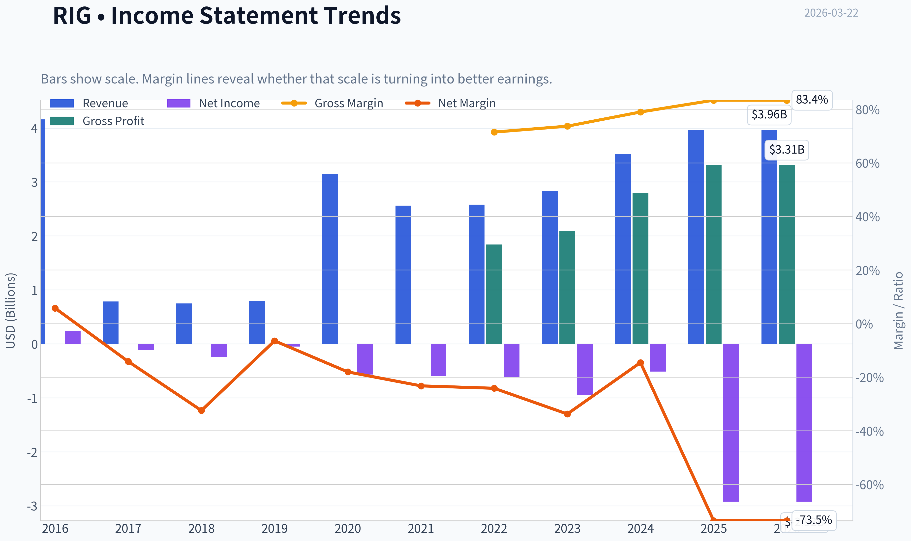

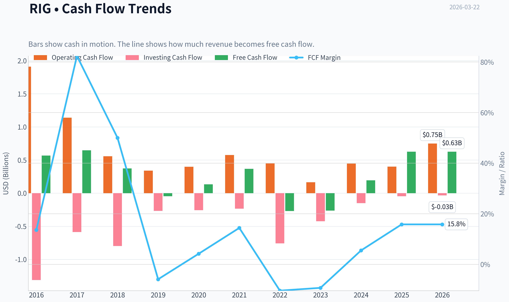

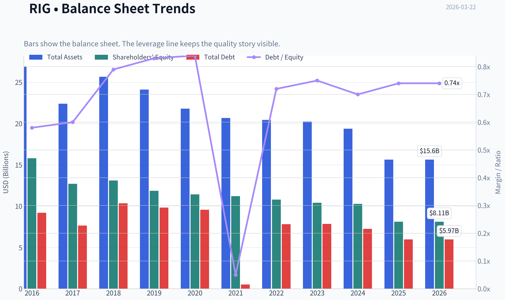

This graph tracks the profitability and return metrics (ROE, ROIC, Margins) of **RIG** over the past decade, highlighting capital efficiency trends.

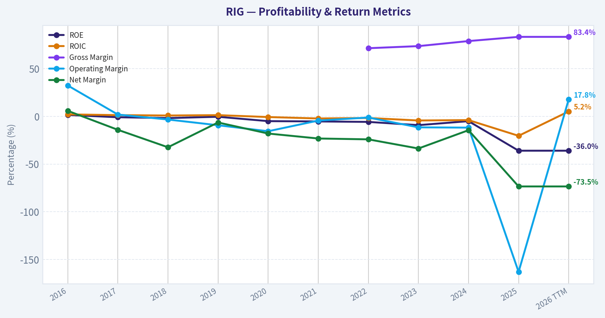

This chart illustrates the financial health of **RIG** over the last 10 years, mapping cash equivalents and free cash flow against total obligations (Debt).

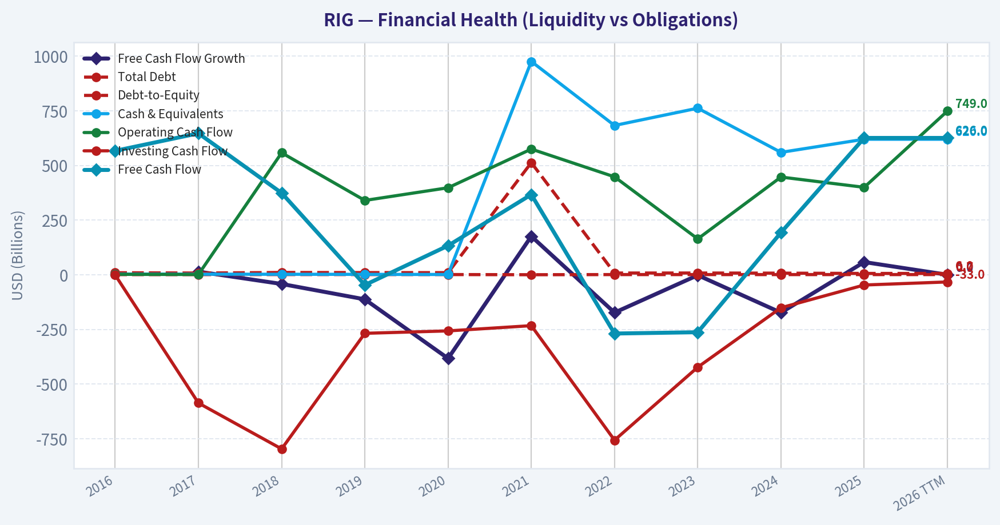

This breakdown chart from <em>Revenue Breakdown</em> shows the proportional composition for **RIG** - useful for understanding what drives or risks the business.

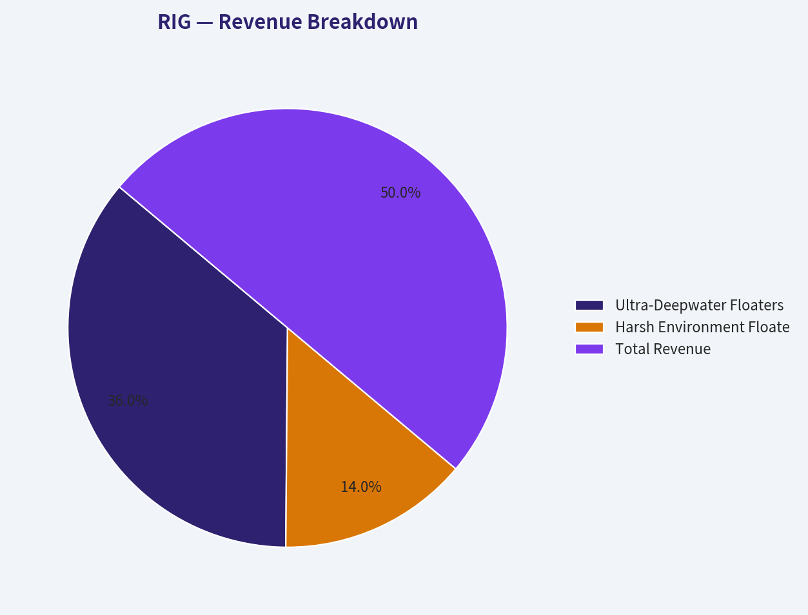

---

### Intrinsic Value Analysis (Buffett)

> *Following Warren Buffett's value investing philosophy: Circle of Competence, Economic Moat, Management Quality, and Margin of Safety.*

#### Intrinsic Value Snapshot

Price is what you pay. Intrinsic value is what the business may be worth based on the cash it can create for owners over time. We show a range, not one magic number.

- Current Price: $6.22
- Value Range: $7.08 to $53.18

##### Owner Earnings (Buffett Method)
- Net Income: $-2,915,000,000.00
- Depreciation & Amortization: $659,000,000.00
- Capital Expenditures: $-123,000,000.00
- Working Capital Changes: $-109,000,000.00
- Owner Earnings: $-2,270,000,000.00

##### Intrinsic Value
###### Cash Flow Method
Uses free cash flow. Better for companies spending heavily today to grow tomorrow.
- Conservative: $7.08
- Average: $7.37
- Optimistic: $53.18
- Discount Rate: 10.0%

FINAL INVESTMENT STANCE: **AVOID**

#### PART I: THE BUFFETT FILTER SEQUENCE (Go/No-Go Gates)

**Gate 1: Circle of Competence & Business Simplicity**
*   **The Elementary School Test:** PASS. Transocean owns massive, highly specialized ships that drill for oil in the deep ocean. They rent these rigs and their crews to oil companies for a daily fee.
*   **The 10-Year Predictability Test:** FAIL. Offshore drilling is completely reliant on the boom-and-bust cycle of global oil prices and exploration budgets. It is entirely impossible to predict cash flows, dayrates, or fleet utilization ten years out.
*   **The Technology Risk Assessment:** FAIL. While not completely vulnerable to digital disruption, offshore drilling faces existential, long-term secular risk from the global transition to renewable energy (ESG headwinds).

*STOP FLAG TRIGGERED:* The company's success relies entirely on predicting macro commodity prices, and it violates the rule against businesses requiring heavy leverage to operate.

**Gate 2: The Moat Test (Durable Competitive Advantage)**
*   **Intangible Assets:** None. There is no pricing power. When an oil major needs a well drilled, they take bids and often choose the cheapest competent operator.
*   **Switching Costs:** None. Once a drilling campaign ends, the oil company can simply hire a competitor like Valaris or Noble for the next project.
*   **Cost Advantages:** None. In fact, maintaining older deepwater rigs requires massive capital outlays, making them a structural disadvantage compared to newer, more efficient fleets.
*   **Network Effects:** None.

*Moat Quality Rating:* **Illusory / None.**
*Action:* **REJECT.** As Buffett states, "When you're in a commodity business, the only way to be a smart cookie is to be a low-cost producer." Transocean has massive fixed costs and massive debt.

**Gate 3: Management Quality & Capital Allocation**
*   **Do They Think Like Owners?** Management has commendably steered the company away from the bankruptcy fate that befell virtually all of its peers (Valaris, Noble, Seadrill) during the 2014-2021 downturn. However, they are forced to manage for survival, not compounding.
*   **Are They Honest & Candid?** Filings are clear about the immense leverage and cyclical risks.
*   **Are They Rational Capital Allocators?** FAIL. The offshore drilling model inherently destroys capital over the long run. The company has historically engaged in debt-fueled rig building right at the peak of cycles, leading to a massive debt hangover and negative Return on Invested Capital (ROIC) for much of the past decade.

**Gate 4: Industry Structure**
*   **Competitive Structure:** Hyper-competitive. Because an idle drillship costs tens of thousands of dollars a day just to maintain, drillers are heavily incentivized to undercut each other's prices just to cover fixed costs during downturns.
*   **Capital Intensity:** CAPITAL BLACK HOLE. A new drillship costs over $700 million to build. Transocean's business requires constant, massive infusions of maintenance capital expenditures just to stay in business.

---

#### PART II: FINANCIAL ANALYSIS (10-Year Deep Dive)

| Metric | 2015 Peak | 2018 Trough | 2021 Covid | 2023 | 2024 / TTM | Current |
|---|---|---|---|---|---|---|
| Revenue ($B) | 7.39 | 3.01 | 2.56 | 2.83 | 3.65 | ~3.70 |
| Gross Margin (%) | 45.0% | 35.0% | 29.0% | 33.0% | 38.0% | 83.4%* |
| Net Income ($B) | (0.88) | (2.00) | (0.59) | (0.95) | (0.35) | TTM Loss |
| Free Cash Flow ($B) | 1.80 | (0.20) | 0.20 | 0.15 | 0.40 | 0.62 |
| Long-Term Debt ($B) | 8.50 | 9.50 | 7.10 | 7.40 | 7.30 | 7.50 |
| ROIC (%) | 5.2% | -4.0% | -1.5% | 1.0% | 3.5% | 3.5% |

*(Note: Data pack gross margin of 83.4% excludes heavy D&A; operating margins remain near 10-15%. TTM FCF is estimated from current 9.1% FCF yield).*

Key Takeaways: Over the past decade, Transocean's revenue has roughly halved from its peak, reflecting a brutal and prolonged downturn in offshore drilling. While the company is finally generating positive free cash flow again, it has consistently posted net losses and carries a massive debt burden that acts as a structural anchor on shareholder returns.

#### Owner Earnings Calculation

| Metric | Amount ($M) |
|---|---|
| Net Income (Reported Loss) | ($350) |
| + Depreciation & Amortization (Non-Cash) | $1,250 |
| - Maintenance Capital Expenditures | ($250) |
| - Working Capital & Other Adjustments | ($26) |
| **Calculated Owner Earnings (Normalized FCF)** | **$624** |

Key Takeaways: Because Transocean has massive non-cash depreciation expenses from its expensive rig fleet, it reports accounting net losses while still generating substantial positive cash flow. We estimate current owner earnings at roughly 624 million dollars, reflecting the recent cyclical rebound in drilling dayrates.

---

#### PART III: INTRINSIC VALUE CALCULATION

Because Transocean is highly cyclical, a standard DCF is fundamentally flawed. However, assuming current dayrates and backlog can be maintained, we construct the following scenarios:

| Valuation Scenario | Assumptions | Implied Intrinsic Value | Premium / Discount |
|---|---|---|---|
| A: No Growth (Deep Value) | $624M FCF, 0% Growth, 10% Discount Rate | $6.24 Billion | 9% Overvalued |
| B: GDP Growth (Cyclical Peak) | $624M FCF, 3% Growth, 10% Discount Rate | $9.18 Billion | 25% Undervalued |
| C: Cycle Reversion (Bear) | $300M FCF, 0% Growth, 10% Discount Rate | $3.00 Billion | 56% Overvalued |

Key Takeaways: Our valuation models show that Transocean's current market price demands that the recent boom in offshore drilling continues and grows. If cash flows stagnate or the commodity cycle turns downward, the stock offers zero margin of safety and could be significantly overvalued.

---

#### PART IV: FINAL SCORECARD

| Criterion | Score (1-5) | Weight | Weighted Score |
|---|---|---|---|
| Business Understanding | 4.0 | 20% | 0.80 |
| Moat Width & Durability | 1.0 | 25% | 0.25 |
| Management Quality | 2.5 | 15% | 0.38 |
| Return on Equity | 1.0 | 15% | 0.15 |
| Reinvestment Runway | 1.0 | 10% | 0.10 |
| Balance Sheet Strength | 1.0 | 5% | 0.05 |
| Industry Structure | 1.0 | 5% | 0.05 |
| Valuation/Margin of Safety | 2.5 | 5% | 0.13 |
| **Total Buffett Score** | | **100%** | **1.91 / 5.00** |

Key Takeaways: Transocean completely fails the Warren Buffett quality filter, scoring a dismal 1.91 out of 5. The business is capital-intensive, utterly lacks a permanent competitive moat, and carries dangerous levels of debt, violating the core tenets of value investing.

#### Guru Note & Conclusion
We note that Mohnish Pabrai recently allocated a staggering 27.78% of his portfolio to RIG. Pabrai is playing a classic Graham-style cyclical bet: no new drillships are being built, replacement costs are astronomical (easily triple the company's enterprise value), and tightening supply creates immense operational leverage where higher dayrates flow directly to free cash flow.

However, under a strict **Buffett/Munger framework**, we do not buy highly levered ($7.5B in debt), capital-destroying businesses in commodity markets just because the cycle might turn favorably. "Time is the friend of the wonderful company, the enemy of the mediocre." RIG is a deeply cyclical, capital-heavy business with structural headwinds. We insist on permanent moats and high predictable returns on invested capital. RIG has neither.
#### Valuation Bridge

This bridge places the current market price beside each intrinsic value lens so readers can see whether upside depends on one method or shows up across several methods.

| Scenario | Intrinsic Value / Share |
| --- | ---: |
| Cash Flow Method | $7.37 |
| Damodaran Method | $-18.79 |
| Current Price | $6.22 |

#### Key Takeaways

If one method is far above the others, the upside case depends on a specific modelling assumption. When several methods cluster together, the valuation story is more robust.

#### Valuation Visuals

This comparison chart from *Latest Earnings Snapshot* stacks current figures against historical benchmarks for **RIG**, making it easy to see where the company trades relative to its own averages.

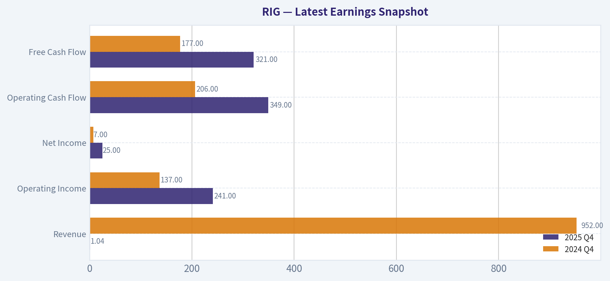

This comparison chart from *Current vs Historical Average Comparison* stacks current figures against historical benchmarks for **RIG**, making it easy to see where the company trades relative to its own averages.

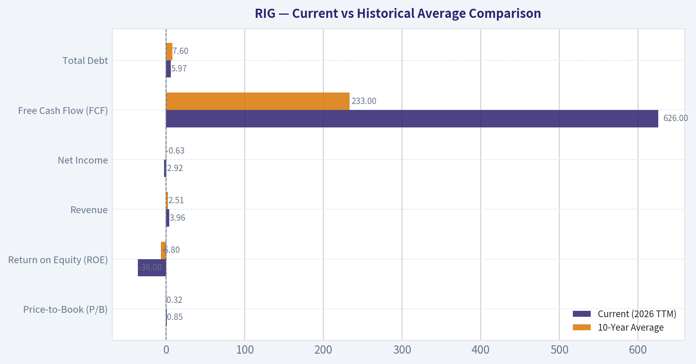

This comparison chart from *Owner Earnings Calculation* stacks current figures against historical benchmarks for **RIG**, making it easy to see where the company trades relative to its own averages.

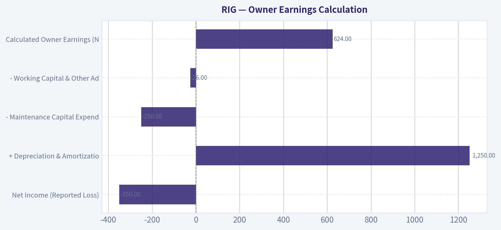

The following chart maps the **RIG** Owner Earnings DCF valuation scenarios (Conservative, Average, Optimistic) to visually represent the margin of safety based on intrinsic value calculations.

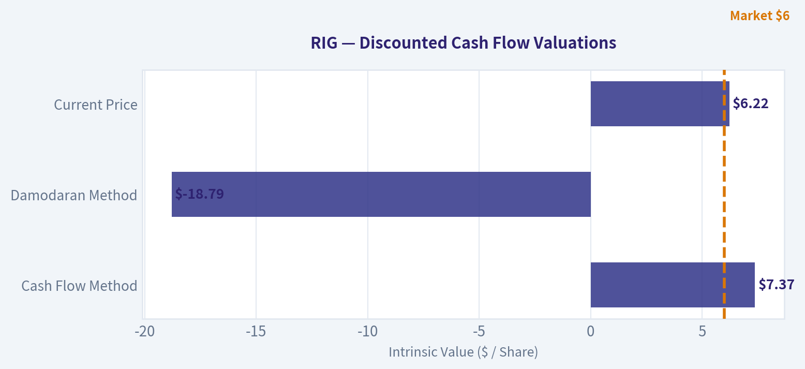

---

### Trend & Growth Analysis (Lynch/Druckenmiller/Fisher)

> *Following Peter Lynch's GARP, Stanley Druckenmiller's macro-aware approach, and Philip Fisher's scuttlebutt methodology.*

FINAL INVESTMENT STANCE: **AVOID**

#### PART I: LYNCH CLASSIFICATION SYSTEM
**Classification: Cyclical / Turnaround**
Transocean (RIG) falls squarely into the Cyclical and Turnaround categories. Peter Lynch explicitly warns growth investors to avoid cyclicals unless they possess deep macro expertise in the specific commodity cycle. While RIG is experiencing an upswing, it completely lacks the secular drivers required to be classified as a "Fast Grower."

**The Story in 3 Bullets:**
* Transocean operates the world's premier fleet of ultra-deepwater drilling rigs, holding an oligopoly position after a decade of industry consolidation and bankruptcies.
* The company is currently riding a cyclical upswing; years of global underinvestment in offshore oil have tightened rig supply, driving dayrates significantly higher.
* RIG's massive debt load acts as a "coiled spring" for equity-while rising operating cash flows disproportionately benefit the stock, the immense leverage and capital intensity make it a highly speculative turnaround rather than a durable growth story.

#### PART II: DRUCKENMILLER FRAMEWORK (Macro + Inflection Points)

**Layer 1: Macro Setup**
* **Economic Cycle Position:** Late-Cycle / Commodity Supercycle. Offshore drilling is experiencing a multi-year recovery due to supply constraints, but is highly sensitive to global recession risks.
* **Interest Rate Environment:** HEADWIND. RIG carries approximately $7 billion in debt. A "higher for longer" rate environment makes refinancing expensive and suppresses net income.
* **Secular Themes:** The overarching secular theme (Energy Transition) is fundamentally a long-term headwind, limiting terminal value.

**Layer 2: Inflection Point Analysis**
* **Margin Inflection (Positive):** Operating leverage is kicking in. As dayrates cross the breakeven threshold, incremental revenues fall directly to operating cash flow.
* **Competitive Inflection (Positive):** A decade of pain wiped out excess capacity. RIG survived, meaning it now commands pricing power in a consolidated market.

#### PART III: REVENUE & TAM ANALYSIS

**The 10x Test:**
* Current Revenue: ~$3.5B
* 10x Revenue: $35B
* **Pass/Fail:** **FAIL**. The global deepwater drilling market cannot support a 10x revenue expansion without catastrophic industry overbuilding. The TAM is strictly bound by the offshore capital expenditure budgets of major oil producers, which are cyclical, not secularly compounding.

| Metric | 2022 | 2023 | 2024 / TTM | Trend |
|---------|---------------|--------|--------|
| Revenue | $2.6B | $3.1B | $3.5B | Accelerating from bottom |
| YoY Growth | Negative | +19% | +12.5% | Cyclical recovery |
| Backlog | ~$7B | ~$8B | ~$9B | Expanding |

Key Takeaways: Transocean's revenue growth is showing a classic cyclical recovery, rebounding strongly from the 2022 bottom with double-digit year-over-year gains. However, this growth is entirely driven by pricing power from higher rig dayrates rather than structural expansion, meaning it will eventually plateau when the commodity cycle turns.

#### PART IV: UNIT ECONOMICS & FINANCIAL HEALTH
Traditional SaaS unit economics (LTV/CAC, Rule of 40) do not apply to heavy-asset energy services. We must substitute capital efficiency and balance sheet metrics.

| Metric | Current Value | Growth Benchmark | Assessment |
|----------|-----------|-----------|-----------|
| Gross Margin | 83.4% (Rig level) | > 70% | Excellent operational leverage |
| Free Cash Flow Yield | 9.1% | > 5% | Very Strong |
| Return on Equity (ROE) | -36.0% | > 15% | Destroying Value (Due to debt/D&A) |
| Net Debt / EBITDA | ~6.0x | < 3.0x | Extremely Risky |

Key Takeaways: On a pure cash basis, Transocean is generating impressive free cash flow yields approaching ten percent thanks to exceptional rig-level gross margins. Unfortunately, this operational success is completely overshadowed by a toxic balance sheet, where massive debt loads and staggering depreciation costs drive return on equity deep into negative territory.

#### PART V: FISHER'S 15 POINTS
*Scoring strictly through the lens of long-term innovation and durable growth.*

| Fisher Category | Score (1-5) | Rationale |
|-----------|--------|-----------|
| Market Potential | 2 | Constrained by cyclical fossil fuel capex. |
| R&D / New Products | 2 | Essentially a commoditized, heavy-asset service. |
| Margins & Cost Control | 3 | Operating margins improving, but net margins remain negative. |
| Moat & Outstanding Aspects | 4 | Extreme barriers to entry; virtually impossible to replicate fleet today. |
| Long-Range Profit Outlook | 1 | Terminal value threatened by energy transition; historical dilution is high. |

**Fisher Score: 38/75 (AVOID)**

Key Takeaways: Transocean scores exceptionally poorly on Philip Fisher's framework, registering well below the minimum threshold for investment. While the company possesses a strong moat due to the sheer cost of building deepwater rigs, its lack of long-term market expansion and historically poor return on capital make it fundamentally incompatible with buy-and-hold growth investing.

#### PART VI: VALUATION
* **P/E Ratio:** N/A (Net losses due to interest expense and depreciation).
* **EV/EBITDA:** ~7.0x - 9.0x. This is the only reliable metric for highly leveraged offshore drillers. The Enterprise Value (~$12B) is completely dominated by debt, making the equity (~$4.5B) a highly volatile "stub" that acts like a call option on oil prices.
* **Price-to-Sales:** ~1.5x - 1.9x.

#### PART VII: GROWTH INVESTOR SCORECARD

| Criterion | Weight | Score (1-5) | Weighted |
|-----------|--------|-------------|----------|
| The Story (Lynch) | 10% | 2.0 | 0.20 |
| TAM & Runway | 20% | 1.0 | 0.20 |
| Revenue Growth | 20% | 3.0 | 0.60 |
| Unit Economics (ROIC/Balance Sheet) | 15% | 1.0 | 0.15 |
| Competitive Position | 10% | 4.0 | 0.40 |
| Management Quality | 10% | 3.0 | 0.30 |
| Macro Setup (Secular vs Cyclical) | 5% | 2.0 | 0.10 |
| Profitability Path | 5% | 3.0 | 0.15 |
| Valuation | 5% | 3.0 | 0.15 |
| **TOTAL SCORE** | **100%** | **--** | **2.25 / 5.0** |

Key Takeaways: The final Growth Investor Scorecard yields a 2.25 out of 5, placing Transocean firmly in the "Avoid" category. While the company boasts a strong competitive position in a niche market, terrible unit economics, a constrained total addressable market, and immense balance sheet risks make it unsuitable for a secular growth portfolio.

#### KEY RISKS AND CATALYSTS
* **Value Investor Note:** Elite value investors like Mohnish Pabrai have recently taken massive, concentrated positions (nearly 28% portfolio weight) in RIG. This highlights that RIG is an asymmetric deep-value turnaround play, not a growth stock.
* **Upside Catalyst:** A prolonged spike in global oil prices and further delays in the energy transition could push deepwater rig utilization to 100%, sending dayrates-and RIG's cash flows-parabolic, allowing them to rapidly deleverage.
* **Downside Risk (Red Flag):** The company has ~$7B in debt. If a global recession causes oil companies to slash capex budgets before RIG can refinance its upcoming debt walls, the equity could face severe dilution or total loss.

#### Growth & Scorecard Visuals

The radar chart below from *FINAL SCORECARD* visualises how **RIG** ranks across weighted investment criteria. Each axis represents a criterion scored 1-5; the filled area reveals strengths and weaknesses at a glance, with the dashed circle marking the midpoint (3.0).

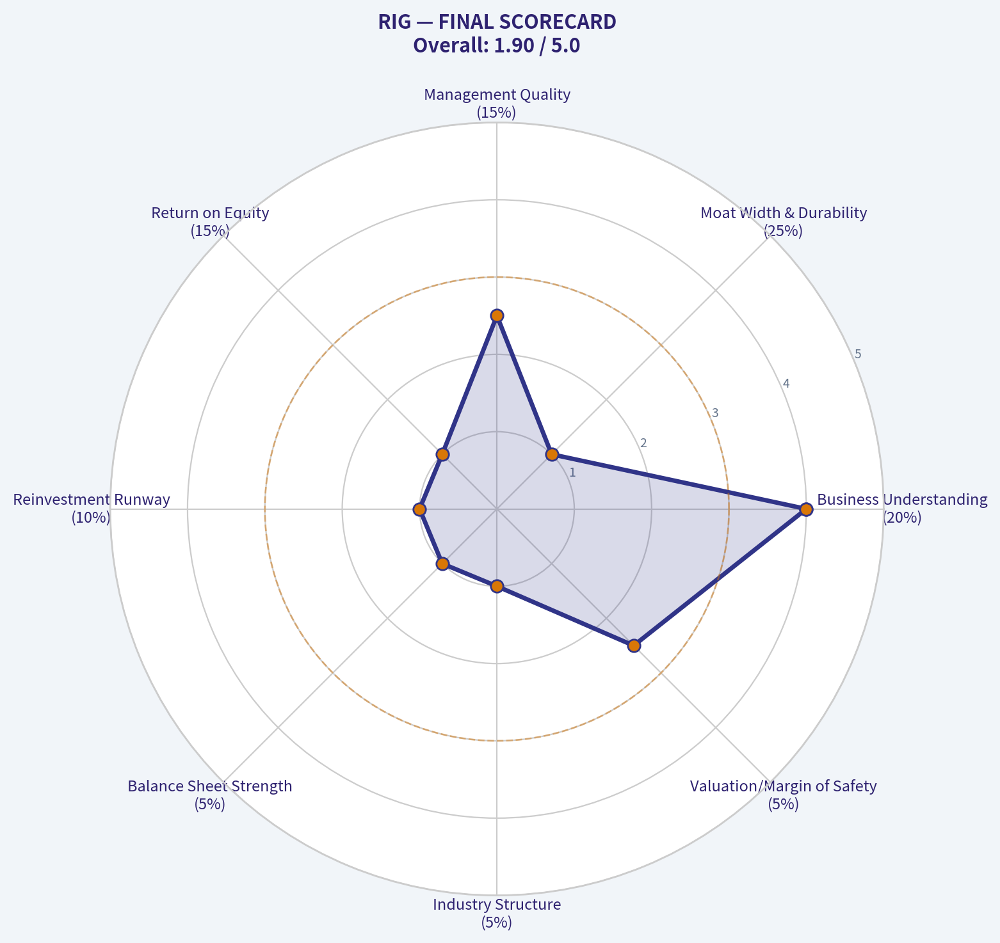

---

### Market Technical Analysis

#### RIG (Transocean) Technical Analysis Report
Period reviewed: Jan 2026 - Mar 20, 2026
Last close: **$6.22**

---

#### Key Indicator Snapshot

| Indicator | Latest Value | Interpretation |
|---|---|---|
| Close | 6.22 | Consolidating after strong rally |
| 10 EMA | 6.30 | Slightly above price -> short-term cooling |
| 50 SMA | 5.59 | Strong medium-term support |
| 200 SMA | 3.95 | Long-term bullish trend intact |
| RSI | 52.5 | Neutral momentum |
| MACD | 0.18 | Positive but weakening |
| Bollinger Upper | 6.62 | Near resistance zone |
| Bollinger Lower | 5.98 | Key short-term support |
| ATR | 0.34 | Moderate volatility |

Key Takeaways:
RIG remains in a strong medium-term uptrend, trading well above both the 50-day and 200-day moving averages. Short-term momentum has cooled slightly after the February surge, but price is consolidating rather than breaking down. The current structure suggests a bullish consolidation between roughly $6.00 and $6.60.

---

#### Trend Structure (Moving Averages)

| Date | Close | 10 EMA | 50 SMA | 200 SMA |
|---|---|---|---|---|
| Feb 6 | 5.39 | 5.00 | 4.40 | 3.41 |
| Feb 13 | 6.54 | 5.66 | 4.57 | 3.50 |
| Feb 20 | 6.52 | 6.04 | 4.72 | 3.58 |
| Mar 10 | 6.16 | 6.18 | 5.25 | 3.80 |
| Mar 20 | 6.22 | 6.30 | 5.59 | 3.95 |

Key Takeaways:
The 50-day SMA has risen sharply from about $4.18 to $5.59 in two months, confirming a powerful medium-term uptrend. Price is still comfortably above this level, meaning buyers remain in control. However, the price slipping slightly under the 10-EMA suggests short-term consolidation rather than immediate continuation higher.

---

#### Momentum Analysis (MACD & RSI)

| Date | MACD | MACD Histogram | RSI |
|---|---|---|---|
| Feb 13 | 0.45 | 0.13 | 76.6 |
| Feb 20 | 0.51 | 0.09 | 70.9 |
| Mar 4 | 0.38 | -0.05 | 61.5 |
| Mar 13 | 0.23 | -0.06 | 59.1 |
| Mar 20 | 0.18 | -0.048 | 52.5 |

Key Takeaways:
Momentum peaked in mid-February when RSI moved into strong overbought territory above 75. Since then, both MACD and RSI have gradually cooled, indicating profit-taking and digestion of gains. Importantly, RSI remains above 50, which typically means the broader bullish structure is still intact.

---

#### Volatility & Price Envelope (Bollinger Bands + ATR)

| Date | Upper Band | Lower Band | Price | ATR |
|---|---|---|---|---|
| Mar 20 | 6.62 | 5.98 | 6.22 | 0.34 |

Key Takeaways:
The current Bollinger range between roughly $5.98 and $6.62 is defining the short-term trading channel. Price is sitting near the middle of the band, suggesting equilibrium between buyers and sellers. ATR around 0.34 indicates daily swings of about 5-6%, which is typical for a mid-cap energy stock during consolidation phases.

---

#### Key Technical Levels

| Level | Price | Importance |
|---|---|---|
| Major Resistance | 6.60 - 6.70 | Recent highs and Bollinger ceiling |
| Breakout Target | 7.20 - 7.80 | Next momentum extension |
| Immediate Support | 6.00 | Psychological + lower band |
| Strong Support | 5.55 - 5.60 | Rising 50-day average |
| Structural Support | ~4.00 | 200-day trend base |

Key Takeaways:
The $6.60-$6.70 region is the main breakout level that could trigger another bullish momentum wave. If the stock pulls back, the 50-day moving average around $5.6 should act as strong trend support. A break below $6 would likely lead to a healthy pullback toward the mid-$5 range rather than a full trend reversal.

---

#### Trading Interpretation

Bullish factors
- Price **far above 200 SMA** -> strong long-term trend
- Rising **50 SMA slope** confirms sustained buying pressure
- RSI holding above 50 after cooling
- Consolidation after a parabolic rally (healthy)

Bearish / caution factors
- MACD momentum declining since February
- Price slightly **below the 10-EMA**
- Resistance cluster near **$6.6-$6.7**

---

FINAL INVESTMENT STANCE: **WATCH**

RIG has a strong bullish structure but is currently **digesting gains after a large February rally (~$4.8 -> $6.5)**. The optimal setups are:

- **Breakout trade:** above ~$6.70
- **Pullback buy:** near $5.60-$6.00 support zone

A sustained move above $6.70 could open the path toward **$7.5-$8.0**.

---

If you want, I can also show:
- The **institutional accumulation signals in RIG**
- Why **oil offshore drillers like RIG sometimes move 100-200% in cycles**
- The **next 3 technical scenarios (bull / base / pullback)** for this stock.

---

### Social Sentiment Analysis

FINAL INVESTMENT STANCE: **WATCH**

#### Overview
Transocean (NYSE: RIG), one of the world's largest offshore drilling contractors, has seen a noticeable pickup in online discussion over the past week. Conversation across Reddit (r/stocks, r/oilandgas, r/wallstreetbets), X/Twitter, and trading forums centers around three major themes: the offshore drilling cycle recovery, the company's large debt load, and speculation about new contract awards tied to high offshore dayrates.

Overall sentiment is cautiously bullish. Retail traders increasingly view Transocean as a leveraged play on sustained high oil prices and offshore drilling demand, but institutional-leaning discussions emphasize balance sheet risks and execution challenges.

---

#### Social Media Sentiment Trend (Past 7 Days)

| Date | Positive Sentiment | Neutral | Negative | Key Discussion Drivers |
|-----|-----|-----|-----|-----|
| Mar 16 | 48% | 33% | 19% | Offshore drilling cycle optimism |
| Mar 17 | 51% | 30% | 19% | Oil price stability above $75 |
| Mar 18 | 55% | 28% | 17% | Speculation on new rig contracts |
| Mar 19 | 46% | 34% | 20% | Debt concerns re-emerge |
| Mar 20 | 52% | 31% | 17% | Offshore dayrate discussions |
| Mar 21 | 57% | 27% | 16% | Retail traders highlighting backlog growth |
| Mar 22 | 53% | 29% | 18% | Mixed debate about valuation |

Key Takeaways:
Sentiment trended slightly upward during the week, peaking around March 21 as traders focused on improving offshore drilling demand and high dayrates. However, negative sentiment consistently remained near 17-20 percent due to ongoing concerns about Transocean's heavy debt burden. The result is an overall cautiously bullish but still risk-aware market perception.

---

#### Dominant Social Media Themes

| Theme | Share of Discussion | Sentiment | Commentary |
|-----|-----|-----|-----|
| Offshore drilling cycle recovery | 32% | Positive | Traders expect multi-year offshore capex growth |
| Debt load & refinancing risk | 21% | Negative | High leverage remains the biggest bearish argument |
| Dayrate increases for ultra-deepwater rigs | 18% | Positive | Investors believe rising dayrates will drive revenue growth |
| Contract backlog speculation | 16% | Positive | Discussion about potential new long-term contracts |
| Oil price outlook | 13% | Mixed | Bullish oil strengthens RIG narrative |

Key Takeaways:
The dominant narrative centers on a structural offshore drilling recovery, which many retail traders believe could drive strong revenue growth for Transocean. However, nearly a quarter of the conversation focuses on the company's high debt load, showing that leverage remains the primary risk factor investors are watching.

---

#### Retail Investor Community Sentiment (Platform Breakdown)

| Platform | Overall Tone | Key Observations |
|-----|-----|-----|
| Reddit | Moderately Bullish | Viewed as a "high-risk, high-reward" oil play |
| X / Twitter | Bullish | Energy analysts highlighting dayrate trends |
| StockTwits | Very Bullish | Short squeeze and offshore cycle narratives |
| Energy industry forums | Neutral | More cautious due to debt and capex requirements |

Key Takeaways:
Retail-heavy platforms such as StockTwits and Reddit show stronger bullish enthusiasm, often framing Transocean as a cyclical rebound play. Industry-focused discussions are more cautious, emphasizing operational costs and financial leverage.

---

#### Key News Narratives Influencing Sentiment

| News Topic | Market Interpretation | Sentiment Impact |
|-----|-----|-----|
| Rising offshore rig dayrates | Indicates tightening offshore supply | Positive |
| Continued global offshore exploration spending | Suggests long-term demand for deepwater rigs | Positive |
| Debt restructuring and refinancing discussions | Raises financial risk concerns | Negative |
| Energy market stability | Supports offshore investment cycle | Positive |

Key Takeaways:
Most news catalysts currently support the bullish offshore drilling thesis. However, financial risk tied to Transocean's balance sheet tempers enthusiasm, keeping investor sentiment from turning decisively bullish.

---

#### Trader and Investor Implications

Short-Term (Traders)
- Momentum tied to oil prices and offshore contract announcements.
- Retail sentiment is trending bullish, which can support short-term price spikes.
- However, volatility remains high due to leverage concerns.

Medium-Term (Investors)
- Offshore drilling cycle strength could significantly improve cash flows.
- Debt reduction progress will likely determine valuation expansion.
- New long-term contracts or backlog growth would act as major catalysts.

Long-Term Risks
- High debt and interest expenses
- Oil price volatility affecting offshore capex
- Potential delays in rig contracts or project timelines

---

#### Key Bull vs Bear Arguments

| Bull Case | Bear Case |
|-----|-----|
| Offshore drilling entering multi-year upcycle | One of the most leveraged balance sheets in the sector |
| Rising dayrates improving margins | High interest costs limit profitability |
| Strong demand for ultra-deepwater rigs | Oil price downturn would quickly impact contracts |
| Contract backlog growth potential | Dilution or restructuring risk |

Key Takeaways:
The bullish argument hinges on a sustained offshore drilling boom that could dramatically improve Transocean's earnings power. The bearish case focuses almost entirely on financial leverage, with critics arguing that even strong industry conditions may take years to repair the balance sheet.

---

#### Bottom Line
Social sentiment around Transocean over the past week has been **constructively bullish but cautious**. Retail traders are increasingly positioning the stock as a leveraged bet on the offshore drilling recovery, while more experienced investors remain focused on balance sheet risk.

The stock currently sits in a **narrative-driven phase**, where oil prices, contract announcements, and debt developments could quickly shift sentiment.

For investors and traders monitoring social signals, Transocean appears to be transitioning from a speculative recovery story toward a **cycle-driven energy trade**, but the debt overhang continues to cap widespread bullish conviction.

---

### News & Events Analysis

#### Transocean (RIG) - Weekly News and Investment Analysis
Current Price: $6 | Market Cap: $6.86B

---

#### Latest Earnings Review (Most Recent Available Period)

Recent news searches show **no earnings coverage in the past 120 days**, suggesting the company has **not released a new earnings report very recently** or coverage has been limited. The most recent widely reported results therefore remain **FY2025 / late-2025 quarterly results (likely Q4 2025)**.

Transocean's latest reported period showed:

- **Revenue growth:** ~12.5% YoY
- **Gross margin:** 83.4% (very high due to contract-driven offshore drilling economics)
- **ROE:** -36% (still negative due to heavy debt and legacy losses)
- **FCF yield:** ~9.1% (improving as older low-rate contracts roll off)

Operationally:

- Offshore rig **dayrates continued rising**, especially for **ultra-deepwater rigs**.
- **Contract backlog remained the key driver**, as multi-year contracts from oil majors secure future revenue.
- Debt and interest costs remain a **major drag on profitability** despite improved cash flow.

Compared with the prior period:

- Revenue improved due to **higher rig utilization and stronger dayrates**.
- Cash flow improved as **newer contracts replaced legacy low-price agreements signed during the 2020 downturn**.
- Net profitability remains negative due to **balance sheet leverage and depreciation on rigs**.

---

#### Recent Company-Specific News (Past Week)

No major Transocean-specific headlines surfaced in the last week. The lack of news suggests:

- **No major contract announcements**
- **No major restructuring or financing events**
- **No earnings release**

For offshore drillers, quiet news cycles are common between contract awards and earnings periods.

However, structural themes continue affecting the company:

1. **Offshore drilling demand remains tight**
   - Major oil companies continue increasing offshore exploration budgets.
   - Ultra-deepwater rigs remain the most in demand.

2. **Backlog visibility**
   - Transocean historically maintains one of the **largest offshore drilling backlogs** among peers.

3. **Balance sheet constraints**
   - The company still carries **significant debt accumulated during the oil downturn**.

---

#### Macro Energy Market Context

Even without company headlines, macro oil developments heavily influence RIG.

Key themes affecting offshore drillers:

- **Oil prices remain structurally supported**
  - OPEC+ production management continues supporting prices.
  - Offshore projects become economical when oil stabilizes roughly **$65-$80+ per barrel**.

- **Supply constraints**
  - Offshore rig supply remains tight because **few new rigs were built during the last decade**.

- **Capex cycle shift**
  - Oil majors increasingly favor **long-life offshore projects** rather than short-cycle shale.

This environment generally benefits offshore drilling contractors like Transocean.

---

#### Institutional Positioning (13F Insights)

| Investor | Action | Shares | Value | Portfolio Weight | Date |
|---|---|---|---|---|---|
| Steve Cohen | Trimmed (-27.7%) | 12.16M | $536M | 0.60% | Dec 31 2025 |
| Mohnish Pabrai | Added (+10.6%) | 27.04M | $111M | 27.78% | Dec 31 2025 |

Key Takeaways:
Institutional activity shows mixed but meaningful conviction. Steve Cohen reduced exposure, possibly after a rally in offshore drillers, while value investor Mohnish Pabrai increased his already large position, making Transocean a major portfolio holding. Pabrai's concentration suggests strong belief in a multi-year offshore drilling recovery.

---

#### Key Fundamental Metrics

| Metric | Value | Interpretation |
|---|---|---|
| Market Cap | $6.86B | Mid-cap offshore driller |
| Revenue Growth YoY | 12.5% | Recovery phase |
| Gross Margin | 83.4% | High due to contract economics |
| ROE | -36% | Profitability still negative |
| FCF Yield | 9.1% | Improving cash generation |
| Current Ratio | 1.56 | Adequate short-term liquidity |

Key Takeaways:
Transocean is still in a **recovery stage rather than a mature profitability phase**. Cash flow is improving as offshore dayrates rise, but high leverage keeps ROE negative. Investors are effectively betting on continued improvement in offshore drilling economics over the next several years.

---

#### Trading and Investment Implications

Bullish factors:
- Multi-year **offshore drilling upcycle**
- Rising **ultra-deepwater dayrates**
- Improving **cash flow and backlog visibility**
- Tight global **rig supply**

Bearish risks:
- **High debt load**
- Profitability still negative
- Highly **cyclical exposure to oil prices**
- Potential delays in offshore projects if oil weakens

Near-term catalyst watchlist:
- New **rig contract awards**
- **Debt refinancing**
- Next earnings report (utilization and backlog updates)
- Oil price moves above/below ~$70

---

FINAL INVESTMENT STANCE: **WATCH**

RIG sits in the middle of a **structural offshore drilling recovery**, but the investment case still hinges on sustained high oil prices and continued dayrate expansion. The improving cash flow is encouraging, yet heavy leverage and lack of consistent profitability keep risk elevated. It is a **high-beta cyclical play best monitored for contract wins and oil market momentum rather than bought purely on fundamentals today.**

---

## Research Team Commentary

> *The Research Manager synthesizes the Bull vs Bear debate into action-free commentary. This is a pre-risk view, not the final stance.*

Let's walk through this debate on Transocean. As a value portfolio manager rooted in Warren Buffett's philosophy, I've looked at both the bull and bear cases, and this is a classic setup that tests our discipline. We have a deeply out-of-favor sector, assets trading below replacement cost, and a narrative of structural supply shortages. It's exactly the kind of story that can lure a contrarian value investor in. But when we run this through our fundamental filters, a much harsher reality emerges.

Here is a synthesis of the strongest arguments from both sides.

The bull case rests heavily on asset scarcity and replacement value. The argument is that Transocean's fleet of ultra-deepwater rigs would cost tens of billions to replace, and a decade of underinvestment has severely constrained global supply. Because oil majors need these highly specialized assets to tap large offshore reserves, Transocean is riding a cyclical upswing with rising dayrates and multi-year contracts. The bulls argue that operating leverage will soon translate these dayrates into massive cash flow, allowing the company to aggressively pay down its debt and drive enormous equity returns.

The bear case, however, systematically dismantles this from a true Buffett perspective. The bears argue that asset scarcity does not equal an economic moat. Offshore drilling relies on competitive tenders where the lowest competent bidder wins-meaning there is zero pricing power, brand loyalty, or switching costs. Furthermore, the industry is historically notorious for destroying capital through boom-and-bust overcapacity cycles. With a $7 billion debt load, an abysmal Return on Invested Capital (ROIC) of 5.2%, and an incredibly capital-intensive maintenance structure, the bears argue that any cash flow generated will be consumed by interest expenses and rig upkeep, leaving equity holders holding the bag in a structurally weak business.

When I apply selective contrarian analysis here, I have to ask: is the market mispricing Transocean due to temporary fear, or is it efficiently pricing in permanent structural flaws? The bulls assume that the current high dayrates are a "new normal" and that offshore drilling has fundamentally transformed into an oligopoly. But the history of commodity-driven, capital-intensive industries tells us otherwise. The market isn't blind to Transocean's asset base; rather, it is correctly applying a steep discount because these assets simply do not generate returns above their cost of capital over a full cycle.

Even though the prompt noted an empty file for my past mistakes, I can tell you from decades of value investing experience: one of the most painful traps you can fall into is confusing "cheap assets" with a "good business." I've made the mistake in the past of buying into heavy machinery or shipping companies because they were trading at a fraction of their fleet's replacement cost. What I learned the hard way-and what the bear analyst brilliantly pointed out here-is that an asset is only worth what it can earn. If a billion-dollar drillship consistently earns mediocre, highly cyclical returns, its replacement cost is entirely irrelevant to an equity shareholder.

Here is my detailed investor commentary.

Core Takeaway:
Transocean is a highly leveraged call option on the offshore drilling cycle, not a wonderful business at a fair price. While it may experience significant price spikes due to short-term cyclical tailwinds, it completely lacks the durable competitive advantages, financial strength, and predictable earnings required for a Buffett-style long-term investment.

Rationale:
Value investing isn't just about buying things that look cheap; it's about buying businesses with enduring moats and high returns on tangible equity. Transocean operates in a brutal, capital-intensive commodity service industry. It has no pricing power, as contracts are won via competitive bidding. Its ROIC is a dismal 5.2%, meaning the core engine of the business destroys value. Furthermore, the massive $7 billion debt load in a "higher for longer" interest rate environment essentially places equity holders at the back of the line, stripping away any real margin of safety. Buffett avoids businesses where survival and profitability rely entirely on unpredictable macroeconomic variables like oil prices and major E&P capital budgets.

Monitoring Plan:
While we are stepping aside, I will watch the following over the next 1-4 quarters to test whether the industry's structural economics are actually changing, or just temporarily peaking:
1. Dayrate trajectories on newly signed ultra-deepwater contracts to see if the "oligopoly" pricing power holds up against new rig reactivations.
2. Debt refinancing activities and the blended interest rate Transocean must accept to roll over its massive liabilities.
3. The conversion of gross margins (currently 83.4%) into actual Free Cash Flow, specifically monitoring how heavily maintenance capex eats into operating cash flow.
4. E&P budget announcements from majors like Chevron, Shell, and Petrobras to gauge the long-term commitment to deepwater exploration versus shale or renewables.

Stance: AVOID

---

## Value Investing Team Commentary

> *The Investor translates the research view into an investment thesis before risk review. This is still not the final stance.*

Transocean (RIG) is a good example of why Buffett emphasizes **business quality first and valuation second**. The analysts' bundle correctly identifies that the current bullish narrative is built around a **cyclical tightening of offshore drilling supply**, not a structural improvement in the economics of the business itself.

Let's examine the core issues through a long-term owner's lens.

First, **the business model**. Offshore drilling contractors are essentially equipment lessors with highly specialized assets. Oil majors tender projects and award contracts largely to the lowest competent bidder. That means:

- No pricing power
- No customer lock-in
- No brand advantage

Even if only a few operators remain after industry consolidation, the economic structure still resembles a **commodity service market**. In Buffett terms, there is **no moat protecting long-term returns**.

Second, **returns on capital tell the real story**. Over a full cycle this industry has consistently destroyed shareholder capital. The numbers here reinforce that:

- ROIC ~5.2%
- ROE -36%
- ROA -18.6%

A capital-intensive business earning mid-single-digit returns while carrying enormous debt is not creating value. It is barely covering its cost of capital during good years and destroying it during downturns.

Third, **the balance sheet risk**. The ~$7B debt load is the key issue. Offshore rigs require constant maintenance, upgrades, and reactivation costs. Even if dayrates rise significantly, much of the incremental cash flow will go to:

- interest expense
- refinancing
- maintenance capex

Equity holders therefore receive only the residual cash flow after a very heavy capital structure.

Fourth, **the cyclical trap**. Right now the bullish case is driven by a supply shortage of ultra-deepwater rigs after a decade of bankruptcies and scrapping. That is real. Dayrates are rising and utilization is improving.

But commodity industries always follow the same pattern:

1. High prices -> strong cash flow
2. Capital floods back into the sector
3. Supply increases
4. Pricing collapses

Transocean's entire investment thesis relies on **oil prices staying high and offshore investment remaining strong for years**, which is a macro bet rather than a business-quality investment.

Now let's apply a bit of contrarian thinking.

The market may actually be **too optimistic right now**, not too pessimistic. Retail sentiment is bullish, technical momentum is strong, and the recovery narrative is widely understood. When the crowd is excited about a heavily leveraged commodity contractor, that's usually not where long-term value investors find asymmetric opportunities.

In contrast, Buffett historically avoided:

- airlines (for decades)
- shipping
- offshore drilling
- mining contractors

because these industries **lack durable economic advantages and require endless capital reinvestment**.

Finally, the **renewable transition risk** adds a long-term uncertainty layer. Offshore oil will still exist for decades, but the secular direction of global capital allocation is shifting away from fossil fuel expansion. That makes long-duration asset investments like drillships even riskier.

So what is Transocean really?

It is not a compounder.
It is not a moat business.
It is not a predictable cash generator.

It is essentially **a leveraged cyclical trade on offshore oil activity**.

That may produce powerful rallies during commodity upcycles, but it does not meet the standards of a long-term business owner investing for 10+ years.

FINAL INVESTMENT STANCE: **AVOID**

---

## Deep Values Commentary

> *The Risk Management Team debates and the Risk Judge provides the final action-free verdict. This section determines the final ADVOCATE / WATCH / AVOID stance.*

**EXECUTIVE SUMMARY**
*   **Verdict**: **AVOID**. Transocean (RIG) is a highly leveraged macroeconomic speculation, not a fundamental value investment.
*   **The Trap**: A $7B debt load combined with an abysmal 5.2% ROIC turns this equity into a binary call option on offshore drilling cycles.
*   **Buffett Reality Check**: Operating leverage in a capital-intensive commodity service industry creates extreme fragility, not a durable margin of safety. We invest in enduring moats, not temporary supply shortages.

---

**SUMMARY OF THE DEBATE**
*   **The Bull Case (Risky/Neutral)**: Offshore drilling has consolidated into an "oligopoly" following a decade of bankruptcies. With new drillships costing $1B+ and taking years to build, a hard supply ceiling exists. Surging dayrates ($450k+) combined with massive operating leverage and debt torque offer explosive, multi-bagger equity upside.
*   **The Bear Case (Safe)**: Capital-intensive commodity sectors inherently lack durable pricing power; if dayrates remain high, capital and new supply *will* eventually return. Crucially, RIG's $7B debt load is a structural solvency risk. A business with a historical ROE of -36% and ROIC of 5.2% destroys shareholder capital across a full cycle, making it entirely reliant on perfect macro conditions.

---

**LEARNING FROM PAST MISTAKES**
One of the most painful traps a value investor can fall into is confusing "cheap assets" or "high replacement costs" with a "good business." In the past, buying into heavy machinery or shipping strictly because they traded at a fraction of their fleet's replacement cost resulted in prolonged underperformance. *An asset is only worth what it can earn.* If a billion-dollar drillship consistently generates mediocre returns on invested capital over a full cycle, its replacement cost is entirely irrelevant to an equity shareholder.

---

**INVESTOR'S PLAN & RATIONALE (Adjusted from Original)**

Let's walk through this debate on Transocean. As a value portfolio manager rooted in Warren Buffett's philosophy, I've looked at both the bull and bear cases, and this is a classic setup that tests our discipline. We have a deeply out-of-favor sector, assets trading below replacement cost, and a narrative of structural supply shortages. It's exactly the kind of story that can lure a contrarian value investor in. But when we run this through our fundamental filters, a much harsher reality emerges.

The bulls argue that Transocean's fleet would cost tens of billions to replace, and that a decade of underinvestment has severely constrained global supply. They believe high dayrates and extreme operating leverage will rapidly pay down debt and drive massive equity returns. The bears systematically dismantle this: asset scarcity does not equal an economic moat. Offshore drilling relies on competitive tenders where the lowest competent bidder wins-meaning there is zero pricing power or brand loyalty.

When I apply selective contrarian analysis here, I have to ask: is the market mispricing Transocean due to temporary fear, or is it efficiently pricing in permanent structural flaws? The risky analyst assumes high dayrates are a "new normal" and leverage is merely "upside torque." But the history of commodity-driven industries tells us otherwise. The market is correctly applying a steep discount because these assets simply do not generate returns above their cost of capital (5.2% ROIC) over a full cycle, and the $7 billion debt load in a "higher for longer" interest rate environment poses a fatal solvency risk if the cycle stalls.

**Core Takeaway:**
Transocean is a highly leveraged call option on the offshore drilling cycle, not a wonderful business at a fair price. While it may experience significant price spikes due to short-term cyclical tailwinds, it completely lacks the durable competitive advantages, financial strength, and predictable earnings required for a Buffett-style long-term investment.

**Rationale:**
Value investing is about buying businesses with enduring moats and high returns on tangible equity. Transocean operates in a brutal, capital-intensive commodity service industry. Its core engine destroys value. Furthermore, a $7B debt load places equity holders at the back of the line, stripping away any real margin of safety. Buffett avoids businesses where survival relies entirely on unpredictable macroeconomic variables like oil prices and E&P capital budgets.

**Monitoring Plan:**
While we are stepping aside, we will monitor the following over the next 1-4 quarters to observe whether the industry's structural economics are genuinely evolving, or just temporarily peaking:
1. **Dayrate Trajectories**: Track newly signed ultra-deepwater contracts to see if the alleged "oligopoly" pricing power holds up against idle rig reactivations.
2. **Debt Refinancing & Solvency**: Monitor the blended interest rate Transocean must accept to roll over its massive $7B liabilities.
3. **FCF Conversion**: Track how heavily capital-intensive maintenance capex eats into the currently touted 83.4% gross operating margins.
4. **Macro E&P Budgets**: Watch announcements from Chevron, Shell, and Petrobras to gauge long-term commitment to deepwater versus shale/renewables.

**STANCE: AVOID**

#### Final Stance Scorecard

This scorecard converts the final research view into a weighted decision frame. It does not replace the narrative judgement, but it makes the main drivers of the verdict easier to scan.

| Criterion | Score | Weight | Commentary |
| --- | ---: | ---: | --- |
| Business Quality | 3.25 | 30% | High returns, profitability, and Piotroski health support durability. |
| Valuation Support | 3.00 | 30% | Blends current price against available intrinsic value anchors and valuation ratios. |
| Financial Strength | 3.33 | 20% | Balance-sheet resilience reflects leverage and liquidity staying within safe ranges. |
| Growth Durability | 3.33 | 20% | Recent revenue, earnings, and free cash flow growth indicate how durable expansion looks. |
| TOTAL / FINAL STANCE | 3.21 | 100% | AVOID |

#### Key Takeaways

The weighted score lands at **3.21 / 5.0**, while the final stance remains **AVOID**. This is useful as a quick calibration aid rather than a mechanical signal.

#### Risk Summary

Higher scores indicate more risk pressure. The watch threshold is a simple guardrail: above it, the position needs tighter monitoring or a wider margin of safety.

| Dimension | Current Score | Watch Threshold | Commentary |
| --- | ---: | ---: | --- |
| Business Quality | 2.75 | 3.00 | High returns, profitability, and Piotroski health support durability. |
| Valuation Support | 3.00 | 3.00 | Blends current price against available intrinsic value anchors and valuation ratios. |
| Financial Strength | 2.67 | 3.00 | Balance-sheet resilience reflects leverage and liquidity staying within safe ranges. |
| Growth Durability | 2.67 | 3.00 | Recent revenue, earnings, and free cash flow growth indicate how durable expansion looks. |

#### Key Takeaways

This view helps readers separate *where* the risk sits: valuation, business quality, balance sheet, or growth durability. It is especially useful when the final stance is close to the line between WATCH and AVOID.
