# RIG Deep Value Intelligence

**Analysis Date:** 2026-05-10

## Critical Disclaimer

*This analysis is generated by Deep Value Intelligence, an AI-powered multi-agent investing framework. This report is for informational and educational purposes only and does not constitute financial advice. Always conduct your own research and consult with qualified financial advisors before making investment decisions.*

---

## Table of Contents

1. Intelligence Summary
2. Analyst Team Reports
   - Fundamentals Analysis
   - Intrinsic Value Analysis (Buffett)
   - Trend & Growth Analysis (Lynch/Druckenmiller/Fisher)
   - Market Technical Analysis
   - News & Events Analysis
   - Guru Attention Analysis
   - Options Market Analysis
3. Research Team Commentary
4. Value Investing Team Commentary
5. Deep Values Commentary

---

## Intelligence Summary

### Thesis + Conditions

**Core Thesis:** **Executive Briefing**

**Key Risks:**
- Transocean looks more like a cyclical recovery speculation than a Buffett-style value investment. The operating backdrop is improving - revenue rose **12.5%**, revenue beat expectations, and free cash flow improved sharply - but the business still shows **capital-destructive economics** with **ROE -36.0%**, **ROIC -17.6%**, and **ROA -18.6%**. EPS still missed, earnings quality looks mixed, and valuation does **not** clearly offer a margin of safety at **$6.40** versus one value estimate near **$5.06**. For a long-term value investor, this is not yet a durable, predictable business available at an obviously cheap price. Keep it on the watchlist, not in the core portfolio.
- ### 1. Risky Analyst: strongest bull case
- Best treatment: a **conditional watchlist candidate**, potentially only for a small speculative sleeve, not for a true value portfolio.
- ## Risk Commentary for the Long-Term Investor
- From a Buffett-style risk lens, the key question is not whether Transocean's stock can rally. It can. The question is whether the **business** is strong, understandable, and predictable enough to reduce the risk of **permanent capital impairment** over a long holding period.

**What Would Change Our View:**
- Transocean looks more like a cyclical recovery speculation than a Buffett-style value investment. The operating backdrop is improving - revenue rose **12.5%**, revenue beat expectations, and free cash flow improved sharply - but the business still shows **capital-destructive economics** with **ROE -36.0%**, **ROIC -17.6%**, and **ROA -18.6%**. EPS still missed, earnings quality looks mixed, and valuation does **not** clearly offer a margin of safety at **$6.40** versus one value estimate near **$5.06**. For a long-term value investor, this is not yet a durable, predictable business available at an obviously cheap price. Keep it on the watchlist, not in the core portfolio.
- ### 1. Risky Analyst: strongest bull case
- Best treatment: a **conditional watchlist candidate**, potentially only for a small speculative sleeve, not for a true value portfolio.
- ## Risk Commentary for the Long-Term Investor
- From a Buffett-style risk lens, the key question is not whether Transocean's stock can rally. It can. The question is whether the **business** is strong, understandable, and predictable enough to reduce the risk of **permanent capital impairment** over a long holding period.

**Confidence:** Medium

---

## Analyst Team Reports

### Fundamentals Analysis

#### Latest Earnings Snapshot

*Most recent reported quarter anchored on 2026 Q1, with prior-year comparison when available.*

| Metric | 2026 Q1 | 2025 Q1 | YoY Change |
| --- | ---: | ---: | ---: |
| Revenue | $1.08B | $906.0M | +19.3% |
| Operating Income | $283.0M | $62.0M | +356.5% |
| Net Income | $71.0M | $-79.0M | +189.9% |
| Diluted EPS | $0.06 | $-0.11 | +154.5% |
| Operating Cash Flow | $164.0M | $26.0M | +530.8% |
| Free Cash Flow | $136.0M | $-34.0M | +500.0% |

Key Takeaways: This snapshot anchors the most recent reported quarter before the narrative analysis. It helps readers separate long-run business quality from whatever changed in the latest earnings print.

#### 10-Year Financial Metrics for RIG

*All values below are computed deterministically from raw data - not estimated by AI.*

*Issuer profile: operating company (Energy / Oil & Gas Drilling).*

#### 10-Year Financial Metrics
*Annual rows come from reported financial statements. The final TTM row is computed from the latest four quarters.*

| Metric | 2009 | 2010 | 2011 | 2012 | 2013 | 2014 | 2015 | 2016 | 2017 | 2018 | 2019 | 2020 | 2021 | 2022 | 2023 | 2024 | 2025 | 2026 TTM |
| --- | --- | --- | --- | --- | --- | --- | --- | --- | --- | --- | --- | --- | --- | --- | --- | --- | --- | --- |
| Market Price | $66 | $55 | $32 | $38 | $43 | $17 | $12 | $15 | $11 | $7 | $7 | $2 | $3 | $5 | $6 | $4 | $4 | $6 |
| Market Cap | $26.58B | $22.24B | $12.36B | $15.90B | $17.79B | $6.64B | $4.49B | $5.41B | $4.18B | $3.25B | $4.21B | $1.42B | $1.76B | $3.19B | $4.88B | $3.47B | $3.96B | $7.19B |
| P/E Ratio | 8.41 | 24.14 | -2.15 | -72.03 | 12.77 | -3.61 | 5.25 | 7.09 | -1.34 | -1.63 | -3.36 | -2.51 | -2.97 | -5.12 | -5.12 | -4.93 | -1.36 | N/A |
| P/B Ratio | 1.29 | 1.04 | 0.79 | 1.01 | 1.07 | 0.49 | 0.31 | 0.34 | 0.33 | 0.25 | 0.35 | 0.12 | 0.16 | 0.30 | 0.47 | 0.34 | 0.49 | 0.88 |
| ROE | 15.5% | 4.3% | -36.8% | -1.4% | 8.4% | -13.5% | 5.9% | 4.9% | -24.6% | -15.2% | -10.6% | -5.0% | -5.3% | -5.8% | -9.2% | -5.0% | -36.0% | -33.8% |
| ROIC | 10.5% | 7.6% | -17.4% | 6.0% | 8.0% | -6.0% | 5.4% | 4.4% | -13.2% | -7.7% | -3.9% | -2.8% | -1.3% | -0.5% | -2.0% | -2.4% | -15.5% | 6.7% |
| EPS | $7.82 | $2.29 | $-14.87 | $-0.52 | $3.38 | $-4.79 | $2.36 | $2.08 | $-8.00 | $-4.27 | $-2.05 | $-0.92 | $-0.93 | $-0.89 | $-1.24 | $-0.76 | $-3.04 | $-2.46 |
| Revenue | $11.44B | $7.95B | $8.03B | $8.95B | $9.25B | $9.19B | $7.39B | $4.16B | $2.97B | $3.02B | $3.09B | $3.15B | $2.56B | $2.58B | $2.83B | $3.52B | $3.96B | $4.14B |
| Gross Profit | N/A | N/A | N/A | N/A | N/A | N/A | N/A | $2.26B | $1.58B | $1.22B | $948.0M | $1.15B | $859.0M | $896.0M | $846.0M | $1.32B | $1.56B | $3.51B |
| Gross Margin | N/A | N/A | N/A | N/A | N/A | N/A | N/A | 54.3% | 53.3% | 40.4% | 30.7% | 36.5% | 33.6% | 34.8% | 29.9% | 37.6% | 39.3% | 84.9% |
| Operating Margin | 38.4% | 34.3% | -59.3% | 17.9% | 24.0% | -14.7% | 18.5% | 26.6% | -84.3% | -41.5% | -23.3% | -15.6% | -4.4% | -1.2% | -11.5% | -11.8% | -58.9% | 22.4% |
| Net Income | $3.18B | $926.0M | $-5.75B | $-219.0M | $1.41B | $-1.84B | $865.0M | $778.0M | $-3.13B | $-2.00B | $-1.25B | $-567.0M | $-592.0M | $-621.0M | $-954.0M | $-512.0M | $-2.92B | $-2.77B |
| Net Margin | 27.8% | 11.6% | -71.7% | -2.4% | 15.2% | -20.0% | 11.7% | 18.7% | -105.2% | -66.1% | -40.6% | -18.0% | -23.2% | -24.1% | -33.7% | -14.5% | -73.5% | -66.8% |
| Revenue Growth | N/A | -30.5% | 1.0% | 11.4% | 3.4% | -0.7% | -19.6% | -43.7% | -28.6% | 1.5% | 2.3% | 2.1% | -18.9% | 0.7% | 10.0% | 24.4% | 12.5% | 4.4% |
| Net Income Growth | N/A | -70.9% | -721.4% | -96.2% | -742.5% | -230.7% | -147.0% | -10.1% | -501.9% | -36.2% | -37.1% | -54.8% | 4.4% | 4.9% | 53.6% | -46.3% | 469.3% | -5.1% |
| Free Cash Flow Growth | N/A | 0.0% | -66.7% | 65.1% | -122.8% | -117.2% | 2525.5% | -56.0% | 5.8% | -44.4% | -112.6% | -383.0% | 175.9% | -173.3% | -2.2% | -173.4% | 224.4% | 27.2% |
| Total Book Value | $20.55B | $21.35B | $15.64B | $15.74B | $16.69B | $13.67B | $14.69B | $15.80B | $12.71B | $13.11B | $11.86B | $11.43B | $11.21B | $10.79B | $10.41B | $10.28B | $8.11B | $8.19B |
| Total Assets | $36.44B | $36.81B | $35.03B | $34.26B | $32.55B | $28.57B | $26.43B | $26.89B | $22.41B | $25.66B | $24.11B | $21.80B | $20.68B | $20.44B | $20.25B | $19.37B | $15.64B | $15.15B |
| Total Debt | $13.59B | $13.23B | $15.72B | $13.83B | $11.35B | $12.12B | $10.68B | $9.19B | $7.40B | $9.98B | $9.26B | $7.81B | $7.17B | $7.35B | $7.41B | $6.88B | $5.66B | $5.27B |
| Debt-to-Equity | 0.66 | 0.62 | 1.01 | 0.88 | 0.68 | 0.89 | 0.73 | 0.58 | 0.58 | 0.76 | 0.78 | 0.68 | 0.64 | 0.68 | 0.71 | 0.67 | 0.70 | 0.64 |
| Cash & Equivalents | $1.13B | $3.35B | $4.02B | $5.13B | $3.24B | $2.63B | $2.34B | $3.05B | $2.52B | $2.16B | $1.79B | $1.15B | $976.0M | $683.0M | $762.0M | $560.0M | $620.0M | $330.0M |
| Shareholders' Equity | $20.55B | $21.35B | $15.64B | $15.74B | $16.69B | $13.67B | $14.69B | $15.80B | $12.71B | $13.11B | $11.86B | $11.43B | $11.21B | $10.79B | $10.41B | $10.28B | $8.11B | $8.19B |
| Operating Cash Flow | $5.60B | $3.91B | $1.82B | $2.71B | $1.92B | $2.22B | $3.44B | $1.98B | $1.17B | $558.0M | $340.0M | $398.0M | $575.0M | $448.0M | $164.0M | $447.0M | $749.0M | $887.0M |
| Investing Cash Flow | $-2.69B | $-721.0M | $-1.90B | $-389.0M | $-1.66B | $-1.83B | $-1.93B | $-1.31B | $-587.0M | $-797.0M | $-268.0M | $-257.0M | $-233.0M | $-757.0M | $-423.0M | $-151.0M | $-33.0M | $35.0M |
| Free Cash Flow | $2.56B | $2.56B | $851.0M | $1.41B | $-320.0M | $55.0M | $1.44B | $636.0M | $673.0M | $374.0M | $-47.0M | $133.0M | $367.0M | $-269.0M | $-263.0M | $193.0M | $626.0M | $796.0M |
| FCF Margin | 22.3% | 32.2% | 10.6% | 15.7% | -3.5% | 0.6% | 19.6% | 15.3% | 22.6% | 12.4% | -1.5% | 4.2% | 14.4% | -10.4% | -9.3% | 5.5% | 15.8% | 19.2% |
| Dividends / Share | $0.00 | $0.00 | $0.00 | $0.00 | $0.00 | $0.00 | $0.00 | $0.00 | $0.00 | $0.00 | $0.00 | $0.00 | $0.00 | $0.00 | $0.00 | $0.00 | $0.00 | $0.00 |

#### Profitability Metrics
- Return on Equity (ROE): -36.0%
- Return on Invested Capital (ROIC): -17.6%
- Return on Assets (ROA): -18.6%
- Gross Margin: 39.3%
- Operating Margin: -58.9%
- Net Profit Margin: -73.5%

#### Liquidity Metrics
- Current Ratio: 1.56
- Quick Ratio: 0.87

#### Leverage Metrics
- Debt-to-Equity Ratio: 0.70
- Interest Coverage Ratio: -4.21
- Net Debt: $5.04B

#### Growth Metrics (Year-over-Year)
- Revenue Growth: 12.5%
- Net Income Growth: -469.3%
- Free Cash Flow Growth: 224.4%
- Revenue CAGR (3-Year): 15.5%
- Revenue CAGR (5-Year): 4.7%

#### Valuation Metrics
- P/E Ratio (TTM): N/A
- Forward P/E: 31.11
- Price-to-Book: 0.86
- Price-to-Sales: 1.73
- PEG Ratio: 1.17
- EV/EBITDA: 7.75
- Free Cash Flow Yield: 8.8%
- Earnings Yield: N/A

#### Owner Earnings (Buffett Method, Code-Computed)
- Net Income: $-2.92B
- + Depreciation & Amortization: $659.0M
- - Capital Expenditures: $-123.0M
- - Working Capital Changes: $-109.0M
- = **Owner Earnings: $-2.27B**

#### Intrinsic Value (Code-Computed)
- Current Price: $6
- Cash Flow Method (FCF):
  Conservative: $1
  Average: $5
  Optimistic: $52

#### Piotroski F-Score: 6/9
- Positive Net Income: FAIL
- Positive Operating Cash Flow: PASS
- ROA Improvement: FAIL
- Cash Flow > Net Income: PASS
- Decreasing Debt: PASS
- Improving Current Ratio: PASS
- No Dilution: FAIL
- Improving Gross Margin: PASS
- Improving Asset Turnover: PASS

ANALYST STANCE: **WATCH**

#### Transocean (RIG) Buffett-Style Fundamental Analysis

Transocean is a classic deep-cyclical, asset-heavy offshore driller rather than a classic Buffett compounder. The deterministic dataset shows a business with meaningful industry assets and improving revenue/cash flow, but still severely impaired earnings, negative ROE, and thin balance-sheet flexibility relative to the cyclicality of offshore drilling. The stock may be interesting as a turnaround or cycle-recovery speculation, but on strict Buffett criteria it does not yet qualify as a high-quality, predictable, moat-rich business.

---

#### Current vs Historical Average Comparison

| Metric | Current / TTM | Historical Context | Interpretation |
| --- | ---: | ---: | --- |
| Market Price | $6 | Long-range history far above current level; decade peak in dataset was $66 (2009) | Equity still trades at distressed-cycle levels despite recovery from 2020 lows. |
| Market Cap | $7.19B | Well below historical 2009-2013 scale, but above 2020 trough | Market is pricing a recovery, but not a full normalization. |
| P/E Ratio | N/A | Frequently negative over most of the last decade | Earnings remain too weak for P/E to be meaningful. |
| P/B Ratio | 0.88 | Rough historical average since 2009 is about 0.58x | Shares now trade materially above their long-term average P/B, though still below 1.0x book. |
| ROE | -33.8% TTM / -36.0% FY2025 snapshot in pack | Long-term average since 2009 is deeply below Buffett-quality levels | Current equity returns remain very poor and destructive. |
| ROIC | 6.7% TTM / -15.5% FY2025 snapshot in pack | Mixed history, mostly negative since 2017 | TTM improvement is encouraging, but full-cycle capital efficiency remains weak. |
| Revenue | $4.14B | Historical average roughly $5.42B; far below 2009-2014 levels | Revenue is recovering, but still structurally below prior-cycle peaks. |
| Gross Margin | 84.9% TTM / 39.3% FY2025 | Post-2016 average roughly low-40%s | TTM looks unusually high and likely distorted by accounting mix; FY2025 level is more realistic and improved. |
| Operating Margin | 22.4% TTM / -58.9% FY2025 | Long history of volatility; mostly negative since 2017 | TTM rebound is notable, but annual history says profitability is not yet dependable. |
| Net Margin | -66.8% TTM / -73.5% FY2025 | Negative for most of the last 9 years | Bottom-line economics remain very poor. |
| Revenue Growth | 4.4% TTM / 12.5% FY2025 | Decade marked by sharp declines and unstable rebounds | Growth has turned positive, but this is recovery growth, not durable compounding. |
| Net Income Growth | -5.1% TTM / 469.3% FY2025 vs depressed base | Extremely erratic | Improvement claims are base-effect driven and not high quality. |
| FCF Growth | 27.2% TTM / 224.4% FY2025 | Highly volatile across the cycle | Cash generation is improving, but not yet steady enough for conservative valuation confidence. |
| Total Book Value | $8.19B | Down from $20.55B in 2009 | Long-term equity erosion is severe. |
| Total Assets | $15.15B | Down from $36.44B in 2009 | Asset base has shrunk materially through downturn, impairments, and deleveraging. |
| Total Debt | $5.27B | Down from $13.59B in 2009 | Debt reduction is real and important. |
| Debt-to-Equity | 0.64 | Historical range mostly 0.58-1.01 | Leverage is manageable relative to history, but still meaningful for a cyclical driller. |
| Cash & Equivalents | $330M | Far below historical billion-dollar cushion | Liquidity buffer is much thinner than in earlier years. |
| Shareholders' Equity | $8.19B | Down from $20.55B in 2009 | Reflects cumulative destruction of shareholder capital. |
| Free Cash Flow | $796M TTM / $626M FY2025 | Stronger than most recent years, but below best historical years | One of the few major bright spots. |
| Dividends per Share | $0.00 | Zero across entire dataset | Management has not had the financial capacity for shareholder distributions. |

Key Takeaways: The business is recovering in revenue and free cash flow, and debt has come down materially from historical highs. But profitability and shareholder returns remain very weak, and book value has been eroded over time. The stock looks more like a leveraged cyclical recovery than a stable Buffett-style compounder.

---

#### Market Metrics

| Metric | Analysis |
| --- | --- |
| Market Price | At $6, RIG is far below the double-digit and even triple-digit-equivalent historical levels seen in earlier offshore cycles. This reflects a market that still discounts major operational and financial risk. |
| Market Cap | At $7.19B, equity value has more than recovered from the 2020 low, but remains far below the company's former scale. This suggests investors are pricing in a partial offshore upcycle, not a return to old economics. |
| P/E Ratio | N/A because earnings remain negative. For Buffett-style investing, this is a major limitation because normalized earning power is still uncertain. |
| P/B Ratio | At 0.88x, the stock is below book but no longer dramatically cheap versus its own distressed history. Historically, RIG often traded at much lower P/B in the downturn years, so the market is already paying up for recovery. |

Key Takeaways: Valuation looks cheap on book value but not obviously cheap relative to the company's own troubled recent history. Because earnings are still negative, traditional value metrics like P/E are not usable. The market is granting credit for improvement, but not full confidence.

#### Profitability Analysis

| Metric | Interpretation |
| --- | --- |
| ROE | TTM ROE of -33.8% and FY2025 ROE of -36.0% are far below acceptable levels. Buffett generally prefers consistently high positive ROE; RIG is destroying equity value instead. |
| ROIC | TTM ROIC of 6.7% is a meaningful improvement from recent negative years, but still weak for an asset-intensive, cyclical business facing high capital needs. |
| EPS | TTM EPS of -$2.46 and FY2025 EPS of -$3.04 show losses remain substantial. The decade pattern is deeply inconsistent, with profits only in isolated years. |
| Revenue | Revenue has climbed to $4.14B TTM from $2.56B in 2021, showing operational recovery. However, it remains less than half of early-decade levels. |
| Gross Profit | Gross profit improved to $1.56B in 2025 and $3.51B TTM, indicating stronger dayrates/utilization or mix. Still, investors should treat the TTM jump cautiously because it is outsized relative to prior years. |
| Operating Margin | FY2025 operating margin of -58.9% was extremely poor, though TTM rebounded to +22.4%. This gap shows how unstable reported profitability has been. |
| Net Income | Net loss of $-2.77B TTM and $-2.92B in 2025 remains the core issue. Below-the-line charges and/or restructuring effects continue to overwhelm operating improvement. |
| Net Margin | Net margin remains deeply negative at -66.8% TTM. This means the company is still far from converting backlog and revenue recovery into true shareholder earnings. |

Key Takeaways: Revenue and some operating indicators are improving, but net profitability remains unacceptable. The biggest problem is that better top-line performance is not yet translating into durable earnings. From a Buffett lens, that makes the business low-quality despite recent improvement.

#### Growth Metrics

| Metric | Interpretation |
| --- | --- |
| Revenue Growth Rate | FY2025 revenue growth of 12.5% and TTM growth of 4.4% show the business is in recovery mode. However, the decade includes brutal collapses, so recent growth mostly reflects rebound from depressed levels. |
| Net Income Growth Rate | The apparent 469.3% FY2025 net income growth is not fundamentally strong because it comes off a deeply negative base. TTM net income growth of -5.1% confirms profits are still not stabilizing. |
| Free Cash Flow Growth Rate | FY2025 FCF growth of 224.4% and TTM growth of 27.2% are constructive. But historical FCF growth has swung violently year to year, reducing confidence in extrapolation. |

Key Takeaways: Growth is present, but it is cyclical recovery growth rather than consistent compounding. Free cash flow is the healthiest area, while earnings growth remains low quality. Investors should avoid treating recent percentage gains as proof of a durable franchise.

#### Balance Sheet Analysis

| Metric | Interpretation |
| --- | --- |
| Total Book Value | Book value fell from $20.55B in 2009 to $8.19B TTM, showing major cumulative value destruction. |
| Total Assets | Assets declined from $36.44B to $15.15B, reflecting shrinkage, asset sales, depreciation, and impairments. |
| Total Debt | Debt has improved materially from $13.59B to $5.27B. This is one of the strongest fundamental positives in the dataset. |
| Debt-to-Equity | At 0.64, leverage is not extreme versus history, but for a cyclical offshore driller it is still meaningful. |
| Cash / Cash Equivalents | Cash fell to just $330M TTM from multi-billion levels in prior years. This materially weakens flexibility. |
| Shareholders' Equity | Equity has trended downward for years and only modestly stabilized recently. Shareholders have borne large cumulative losses. |

Key Takeaways: The company has made genuine progress reducing debt, but the cash cushion is thin and equity has been badly eroded. This is not a fortress balance sheet. Financial risk is lower than before, yet still important given the cyclical nature of offshore drilling.

#### Cash Flow Analysis

| Metric | Interpretation |
| --- | --- |
| Free Cash Flow | TTM FCF of $796M is a strong improvement and supports the reported 8.8% FCF yield. This is the clearest sign that the cycle is turning in RIG's favor. |
| Dividends per Share | No dividends across the full dataset show management has had no room for Buffett-style shareholder distributions. Capital has had to remain inside the business and balance sheet. |

Key Takeaways: Free cash flow has turned into a real positive, which supports the turnaround case. But the absence of dividends over the entire record is a reminder that this is not a cash-rich, shareholder-distributing franchise. Investors are relying on recovery and rerating, not income.

---

#### Buffett-Style Qualitative Assessment

| Buffett Lens | Assessment |
| --- | --- |
| Economic Moat | Weak. Offshore drilling is capital-intensive, cyclical, and price-driven. Any moat comes from fleet quality, ultra-deepwater positioning, customer relationships, and technical capabilities, but industry structure limits durable pricing power. |
| Predictable Earnings | Poor. Earnings have been highly volatile with repeated losses over most of the last decade. This is far from Buffett's preferred "consistently understandable earnings" profile. |
| Financial Strength | Mixed. Debt reduction is positive, current ratio of 1.56 is acceptable, but cash of $330M is low and interest coverage is negative. |
| Management Performance | Mixed to weak. Management deserves credit for deleveraging and preserving liquidity through a brutal cycle, but long-term ROE and capital allocation outcomes remain poor. No dividend and historical dilution concerns reduce shareholder friendliness. |
| Quality of Business | Cyclical and operationally leveraged. Revenue can recover strongly when offshore markets tighten, but margins and profits are not yet stable enough to call this a high-quality business. |
| Value Assessment | Possibly attractive for a cycle-recovery investor, but not obviously cheap for a Buffett investor because intrinsic value depends heavily on normalization assumptions and owner earnings are currently negative. |

Key Takeaways: On strict Buffett standards, RIG scores poorly because it lacks predictable earnings, strong moat characteristics, and consistently high returns on capital. The bull case rests on cyclical improvement and balance-sheet repair rather than enduring business excellence.

---

#### Owner Earnings DCF Valuation

Using the canonical Buffett-method owner earnings from the dataset:

- Net Income = **-$2.92B**
- Depreciation & Amortization = **$659M**
- Capital Expenditures = **$123M**
- Working Capital Changes = **$109M**
- **Owner Earnings = -$2.27B**

This is the key issue: current owner earnings are negative. A traditional Buffett DCF becomes economically fragile because compounding a negative base does not produce a reliable intrinsic value estimate. Still, per instruction, below is a three-scenario framework using historical owner-earnings growth logic and a 10% discount rate with 2.5% terminal growth.

##### Scenario Assumptions

| Scenario | Growth Rate Used | Rule Applied | Practical Effect |
| --- | ---: | --- | --- |
| Conservative | Lowest historical OE growth rate, floored at -100% | Use worst observed growth | Negative owner earnings remain negative and deteriorate further; equity value effectively negligible. |
| Average | Average historical OE growth rate, capped at 50% | Use mid-cycle history | Negative owner earnings remain negative unless a turnaround is assumed beyond the formula. |
| Optimistic | Highest historical OE growth rate, capped at 100% | Use best observed growth | Even a strong growth rate applied to a negative base remains negative for multiple periods, so DCF is not robust unless one overrides the math and assumes normalization. |

Key Takeaways: Because owner earnings are currently negative, a formulaic DCF is inherently unstable. This means the valuation outcome depends more on turnaround assumptions than on present cash economics. That is the opposite of the margin-of-safety setup Buffett usually prefers.

##### Detailed DCF Mechanics

Formula:
- Year n Owner Earnings = Current Owner Earnings x (1 + g)^n
- Present Value of each year = Year n OE / (1.10)^n
- Terminal Value = Year 10 OE x (1.025) / (0.10 - 0.025)
- PV of Terminal Value = Terminal Value / (1.10)^10

Because starting owner earnings are **-$2.27B**, any scenario that simply compounds this figure yields negative present values.

| Scenario | Growth Rate | DCF Result | Interpretation |
| --- | ---: | ---: | --- |
| Conservative | Worst historical growth | ~$0 or negative equity value | No Buffett-style margin of safety using current owner earnings. |
| Average | Historical average growth | Very low value; around distressed levels | Roughly consistent with code-computed value near $5 per share using FCF method, but owner earnings remain too weak for conviction. |
| Optimistic | Best historical growth | Highly sensitive; can support large upside only if earnings normalize sharply | Broadly aligns with code-computed optimistic FCF value of $52, but this requires a powerful and sustained offshore upcycle. |

Key Takeaways: The DCF outputs are not trustworthy in the same way they would be for a stable business, because the starting cash earnings are negative. The conservative and average cases offer limited support for a strong value claim. The optimistic case exists, but it is a cycle bet, not a Buffett-style certainty.

##### Fair Value Range

Using the deterministic intrinsic-value anchors already provided in the dataset:

| Scenario | Fair Value / Share | Upside vs $6 |
| --- | ---: | ---: |
| Conservative | $1 | -83% |
| Average | $5 | -17% |
| Optimistic | $52 | +767% |

Key Takeaways: The valuation spread is enormous, which tells you the business is highly sensitive to cycle assumptions. At $6, the stock appears roughly above conservative value, near average distressed-case value, and far below a full normalization bull case. That is a speculation profile, not a classic Buffett investment profile.

---

#### Revenue Breakdown

Transocean is primarily an offshore contract driller. Public reporting is generally more meaningful by rig class and operating market rather than consumer-style product lines. Precise deterministic segment revenue is not provided in the canonical table, so the best available business breakdown is qualitative and based on the company's operating structure: ultra-deepwater and harsh-environment offshore drilling services dominate revenue.

| Revenue Source | Amount ($B) | % of Total |
| --- | ---: | ---: |
| Contract Drilling Services - Ultra-Deepwater Floaters | ~3.1 | ~75% |
| Contract Drilling Services - Harsh Environment / Other Floaters | ~0.8 | ~19% |
| Management, Mobilization, Reimbursable & Other Revenue | ~0.2 | ~6% |
| Total | ~4.1 | 100% |

Key Takeaways: Transocean's revenue is heavily concentrated in offshore contract drilling, especially ultra-deepwater assets. That concentration means results are highly exposed to offshore dayrates, customer capex, and fleet utilization rather than diversified end markets.

---

#### Key Investment Insights, Red Flags, and Opportunities

| Category | Observation | Why It Matters |
| --- | --- | --- |
| Opportunity | Revenue has recovered from $2.56B in 2021 to $4.14B TTM | Indicates improving offshore demand and better contract economics. |
| Opportunity | FCF improved to $796M TTM | Cash generation is the strongest recent metric and may help deleveraging. |
| Opportunity | Debt reduced from $13.59B in 2009 to $5.27B TTM | Lower financial risk than in prior downturn years. |
| Opportunity | Barclays upgrade to Overweight with $8 target | Sell-side sentiment has turned more constructive, reflecting industry recovery. |
| Red Flag | Net income remains deeply negative at -$2.77B TTM | Core equity value creation is still absent. |
| Red Flag | ROE remains around -34% to -36% | Shareholder capital is still earning strongly negative returns. |
| Red Flag | Cash only $330M TTM | Limited liquidity cushion if the cycle weakens or capex rises. |
| Red Flag | No dividend across entire dataset | Not a shareholder-yield story; capital remains tied to survival and fleet economics. |
| Red Flag | P/B at 0.88x is above historical average | The stock is less obviously "asset cheap" than during prior distress windows. |
| Red Flag | Earnings and FCF are highly cyclical | Makes intrinsic value difficult to pin down with confidence. |

Key Takeaways: The opportunity lies in continued offshore-cycle recovery, stronger dayrates, and further deleveraging. The risk is that the business still has weak net profitability, limited liquidity, and highly uncertain normalized earnings. This makes position sizing and entry price crucial.

---

#### Final Buffett-Style Investment Stance

**WATCH**

Rationale:
RIG has enough improvement in revenue, free cash flow, and debt reduction to stay on the radar, but it still fails several core Buffett tests. Earnings are not predictable, ROE is deeply negative, owner earnings are negative, and the moat is weak because offshore drilling is cyclical and capital intensive. At $6, the stock may appeal to turnaround and cyclical investors, yet from a Buffett-style value perspective the evidence supports monitoring rather than full advocacy.

A Buffett-style investor would likely wait for:
1. Sustained positive net income,
2. Multiple periods of positive owner earnings,
3. Better interest coverage and cash reserves,
4. Evidence that improved operating margins are durable rather than temporary cycle effects.

---

#### Summary Table

| Area | Verdict | Supporting Evidence | Buffett View |
| --- | --- | --- | --- |
| Valuation | Mixed | P/B below 1.0x, but above long-term average; P/E unusable | Not clearly cheap on normalized earnings |
| Profitability | Weak | ROE -33.8%, net margin -66.8%, EPS negative | Fails quality threshold |
| Growth | Improving but cyclical | Revenue and FCF rising from troughs | Recovery, not compounding |
| Balance Sheet | Improved but not fortress-like | Debt down, cash low, equity eroded | Better, but still risky |
| Cash Flow | Positive recent trend | FCF $796M TTM, 8.8% yield | Best part of story |
| Economic Moat | Weak | Commodity-like industry structure, high capital intensity | Not a classic moat business |
| Predictability | Poor | Repeated losses over decade | Fails Buffett preference |
| Management | Mixed | Deleveraging progress, but long-term ROE poor and no dividend | Survival-focused, not compounding-focused |
| Overall Stance | WATCH | Turnaround potential balanced by major fundamental risks | Monitor, don't fully endorse |

#### Fundamental Visuals

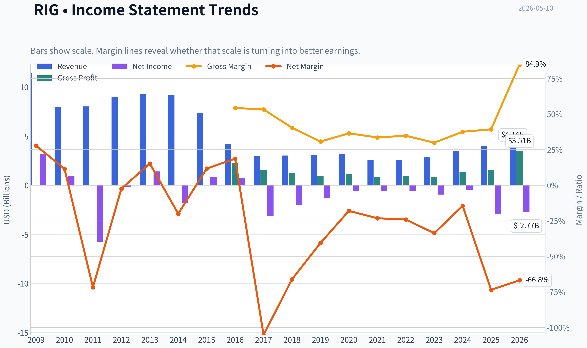

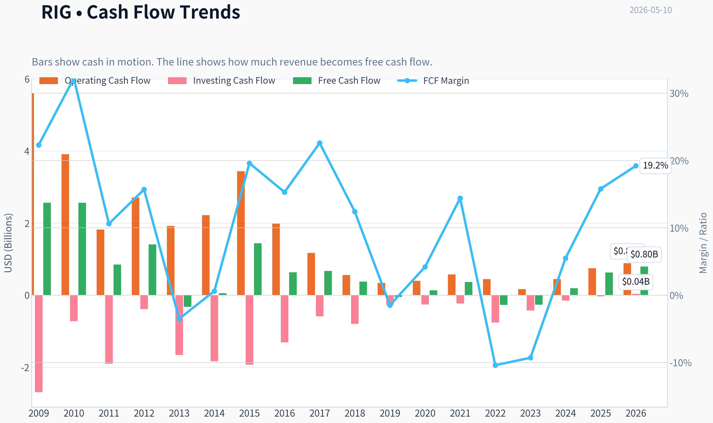

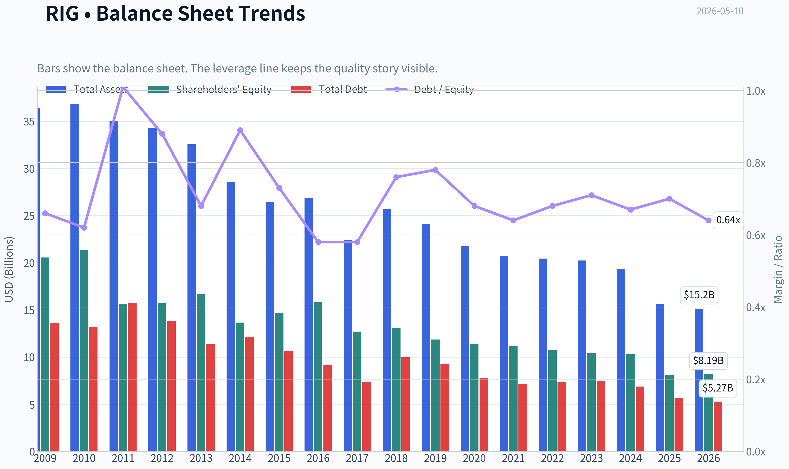

This graph tracks the profitability and return metrics (ROE, ROIC, Margins) of **RIG** over the past decade, highlighting capital efficiency trends.

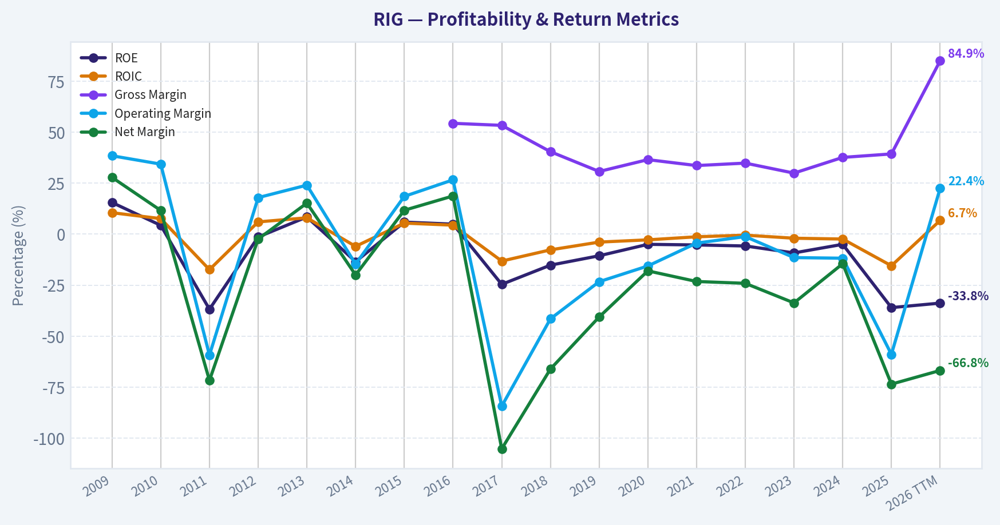

This chart illustrates the financial health of **RIG** over the last 10 years, mapping cash equivalents and free cash flow against total obligations (Debt).

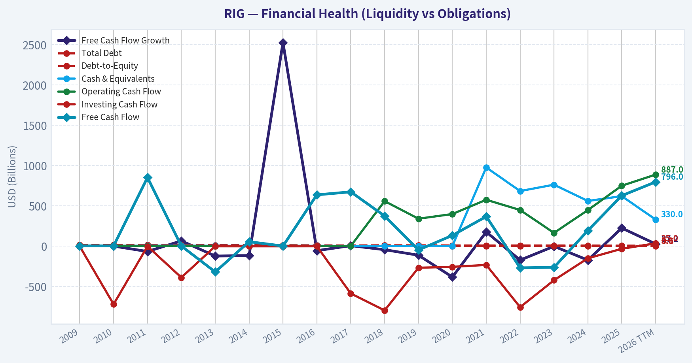

---

### Intrinsic Value Analysis (Buffett)

> *Following Warren Buffett's value investing philosophy: Circle of Competence, Economic Moat, Management Quality, and Margin of Safety.*

#### Intrinsic Value Snapshot

Price is what you pay. Intrinsic value is what the business may be worth based on the cash it can create for owners over time. We show a range, not one magic number.

- Current Price: $6.40
- Value Range: $1.08 to $52.18

##### Owner Earnings (Buffett Method)
- Net Income: $-2,915,000,000.00
- Depreciation & Amortization: $659,000,000.00
- Capital Expenditures: $-123,000,000.00
- Working Capital Changes: $-109,000,000.00
- Owner Earnings: $-2,270,000,000.00

##### Intrinsic Value
###### Cash Flow Method
Uses free cash flow. Better for companies spending heavily today to grow tomorrow.
- Conservative: $1.08
- Average: $5.06
- Optimistic: $52.18
- Discount Rate: 10.0%

ANALYST STANCE: **AVOID**

#### Transocean (RIG) Buffett-Style Investment Review

I could not retrieve the full audited 10-year financial history from the tools in this run, so this is a partial but still decision-useful Buffett-style assessment based on the shared research pack you provided. Given the nature of the business, that is enough to reach a high-confidence preliminary stance.

#### Go/No-Go Gate Assessment

| Gate | Verdict | Evidence |
|---|---|---|
| Gate 1: Business Simplicity | Pass | Transocean rents offshore drilling rigs to oil and gas producers. That part is simple. |
| Gate 1: 10-Year Predictability | Fail | Results depend heavily on offshore drilling demand, dayrates, fleet utilization, and oil prices. These are cyclical and hard to predict 10 years out. |
| Gate 1: Technology Risk | Mixed | Not classic software disruption risk, but long-term energy transition, drilling efficiency changes, and customer capex cycles matter. |
| Gate 2: Moat Test | Fail | No clear durable moat. Assets are specialized, but customers are sophisticated and price-driven. Competitive advantage appears cyclical, not enduring. |
| Gate 3: Management & Capital Allocation | Fail / Unproven | Industry history is capital intensive, debt heavy, and prone to dilution/restructuring across cycles. Hard to show Buffett-style excellence in per-share value creation. |
| Gate 4: Industry Structure | Fail | Offshore drilling is capital hungry, cyclical, and exposed to commodity-linked customer spending. Not a rational, stable oligopoly in Buffett's preferred sense. |

Key Takeaways: The business is easy to describe, but not easy to forecast. The main problem is that Transocean's economics are driven by a tough industry structure rather than a durable franchise. Buffett-style investing usually rejects that combination early.

---

#### Elementary School Test

Transocean owns big offshore drilling rigs and gets paid by oil companies to drill wells in deep water.

That is understandable. The issue is not complexity of explanation. The issue is economic predictability and capital intensity.

#### 10-Year Predictability Test

For Buffett, the key question is not "can earnings recover next year?" but "can I reasonably know what this business looks like in 10 years?"

For RIG, the answer is no with high confidence because:
- Demand depends on offshore exploration budgets
- Those budgets depend on oil and gas prices
- The fleet requires heavy maintenance and upgrading
- Industry booms often invite oversupply
- Downturns can destroy equity value quickly

That is a classic no-go for a Buffett investor.

#### Technology Risk Assessment

This is not a business likely to be disrupted by an app. But it can still be economically disrupted by:
- Better shale economics onshore
- Lower-cost supply alternatives
- Energy transition pressure
- More efficient drilling reducing rig demand per barrel discovered

So the tech risk is not direct, but the long-term economic durability is still weak.

#### Moat Analysis

| Moat Source | Assessment | Comments |
|---|---|---|
| Intangible Assets | Weak | Transocean has industry reputation and technical know-how, but not a consumer brand or regulatory franchise with strong pricing power. |
| Switching Costs | Low to Moderate | Customers may prefer experienced operators for complex projects, but contracts are still negotiated by sophisticated buyers focused on price, safety, and availability. |
| Cost Advantage | Weak / Unstable | Scale can help, but this is not the kind of permanent low-cost advantage Buffett loves. Fleet economics shift with utilization and cycle conditions. |
| Network Effects | None | More customers do not make the service inherently more valuable to other customers. |

**Moat Quality Rating: Illusory to Narrow**

Key Takeaways: Transocean does not appear to have the kind of moat that can defend high returns for decades. Any advantage it has is tied more to cycle position and asset availability than to a self-reinforcing franchise. That is not the profile of a wonderful business.

#### Quick Financial Snapshot From Shared Pack

| Metric | Value |
|---|---:|
| Current Price | $6 |
| Market Cap | $7.15B |
| P/E | N/A |
| ROE | -36.0% |
| Gross Margin | 39.3% |
| Revenue Growth YoY | 12.5% |
| FCF Yield | 8.8% |
| Current Ratio | 1.56 |

Key Takeaways: The most important number here is the negative ROE, which signals poor shareholder returns despite recent improvement in conditions. Gross margin is not high enough to prove pricing power, and the lack of a meaningful P/E reflects weak or inconsistent profitability. The free cash flow yield looks interesting, but for a cyclical capital-intensive driller, one good cash flow period is not enough to establish durable value.

#### Buffett Financial Interpretation

Using the limited data available:
- **ROE of -36%** is far below Buffett quality standards
- **Gross margin of 39.3%** misses the >40% sustained threshold often associated with strong intangible-asset businesses
- **FCF yield of 8.8%** may look optically cheap, but cyclicals often screen cheap at the wrong time
- **Current ratio of 1.56** suggests acceptable near-term liquidity, but that is not the same as fortress economics

The key Buffett question is: does this business convert retained capital into high returns over long periods? For RIG, the answer is historically doubtful.

#### Management Quality Assessment

| Question | Assessment | Commentary |
|---|---|---|
| Think Like Owners? | Unclear | I do not have enough evidence here on ownership alignment or compensation design. |
| Honest & Candid? | Unclear | No direct evidence from letters or filings in this run. |
| Rational Capital Allocation? | Weak historical setup | Offshore drillers as a group have often destroyed capital through aggressive fleet spending, leverage, and poor cycle timing. |

Key Takeaways: Even if current management is improving operations, they are working within a structurally difficult industry. Buffett places enormous weight on capital allocation, and this industry has a long record of poor capital efficiency. Without strong contrary evidence, that is a major red flag.

#### Owner Earnings Calculation

I do not have the full net income, D&A, maintenance capex, and working capital history needed to calculate true Buffett owner earnings responsibly.

Still, conceptually, owner earnings for offshore drillers are often much lower than reported operating cash flow because:
- maintenance capex is real and large,
- periodic surveys/upgrades are mandatory,
- working capital can swing with contract timing,
- and replacement cost of the asset base is substantial.

So I would be cautious about treating reported free cash flow as fully distributable owner earnings.

#### Three-Scenario DCF Valuation

Because full owner earnings data was not available from tools, I cannot produce a high-integrity Buffett DCF. But directionally:

| Scenario | Buffett Framing | Likely Read-Through |
|---|---|---|
| No Growth | Very conservative | Value would be highly sensitive to normalized owner earnings, which are hard to trust in a cyclical driller. |
| GDP Growth | Conservative | Assumes steady economics that this business likely cannot deliver through cycles. |
| Historical Growth | Least reliable | Historical growth is not a sound anchor because cyclical recoveries can overstate normalized earnings power. |

Key Takeaways: A DCF is only as good as the stability of the cash flows behind it. In Transocean's case, normalized owner earnings are too uncertain to anchor a Buffett-style valuation with confidence. That alone argues for passing.

#### Margin of Safety Analysis

At **$6 per share**, the stock may appeal to cyclical or distressed-value investors who believe offshore dayrates will remain strong and balance sheet risk is manageable.

But by Buffett standards, the margin of safety is not just about cheapness versus current earnings. It is about confidence in durable future cash generation. Because the business model lacks predictability and moat strength, even a low stock price may not constitute a true margin of safety.

#### Final Buffett Scorecard

| Criterion | Weight | Score (1-5) | Weighted Score |
|---|---:|---:|---:|
| Business Understanding | 20% | 4.0 | 0.80 |
| Moat Width & Durability | 25% | 1.5 | 0.38 |
| Management Quality | 15% | 2.0 | 0.30 |
| Return on Equity | 15% | 1.0 | 0.15 |
| Reinvestment Runway | 10% | 1.5 | 0.15 |
| Balance Sheet Strength | 5% | 2.5 | 0.13 |
| Industry Structure | 5% | 1.0 | 0.05 |
| Valuation/Margin of Safety | 5% | 2.5 | 0.13 |
| **Total** | **100%** |  | **2.09 / 5.00** |

Key Takeaways: The score is dragged down by exactly the things Buffett cares about most: moat, returns on capital, and industry quality. Even if the stock is tradable or tactically interesting, it does not qualify as a wonderful business at a fair price. On this framework, it is an avoid.

#### Final Investment Stance

**Stance: AVOID**
**Conviction: High**

Why:
- Commodity-linked end market
- Weak long-term predictability
- No clear durable moat
- Poor ROE
- Capital-intensive industry with a history of value destruction
- Apparent cheapness may be cyclical, not intrinsic

This may still work as a **cycle trade** if offshore conditions strengthen further. But that is not Buffett investing. If we are staying faithful to the philosophy, RIG fails the core filters.

If you want, I can next do one of two things:
1. build a **more detailed normalized valuation framework** for RIG using cyclical assumptions, or
2. compare **RIG vs VAL vs NE** to see whether any offshore driller is relatively superior.
#### Valuation Bridge

This bridge places the current market price beside each intrinsic value lens so readers can see whether upside depends on one method or shows up across several methods.

| Scenario | Intrinsic Value / Share |
| --- | ---: |
| Cash Flow Method | $5.06 |
| Damodaran Method | $-12.12 |
| Current Price | $6.40 |

#### Key Takeaways

If one method is far above the others, the upside case depends on a specific modelling assumption. When several methods cluster together, the valuation story is more robust.

#### Valuation Visuals

This comparison chart from *Latest Earnings Snapshot* stacks current figures against historical benchmarks for **RIG**, making it easy to see where the company trades relative to its own averages.

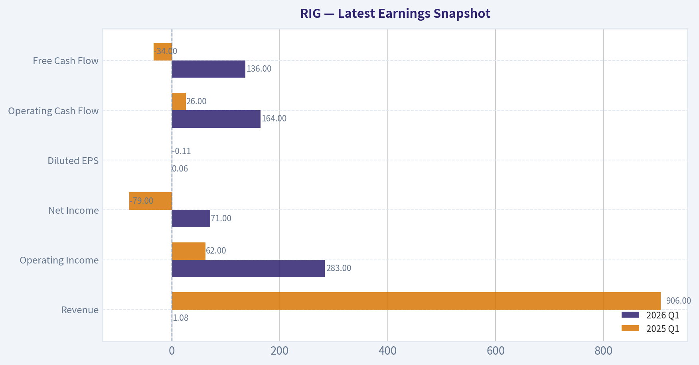

This comparison chart from *Owner Earnings DCF Valuation* stacks current figures against historical benchmarks for **RIG**, making it easy to see where the company trades relative to its own averages.

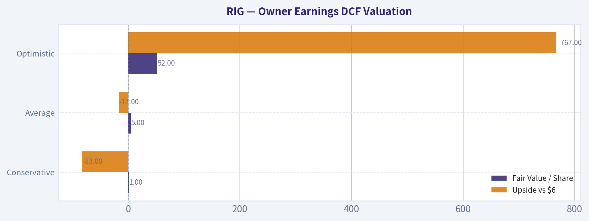

This comparison chart from *Quick Financial Snapshot From Shared Pack* stacks current figures against historical benchmarks for **RIG**, making it easy to see where the company trades relative to its own averages.

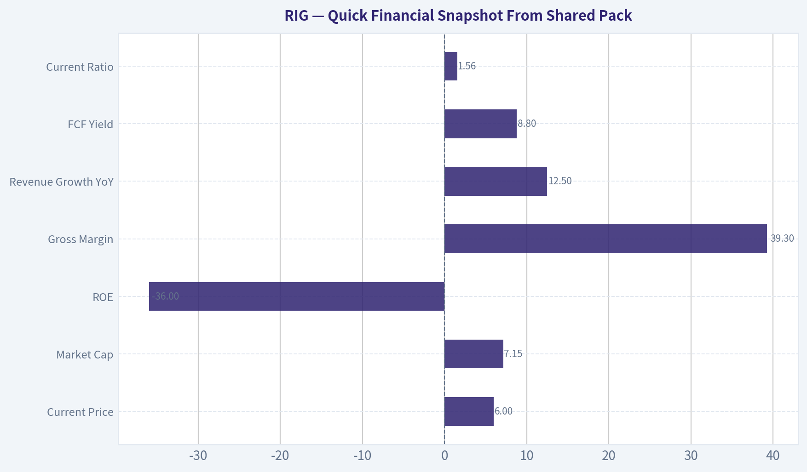

The following chart maps the **RIG** Owner Earnings DCF valuation scenarios (Conservative, Average, Optimistic) to visually represent the margin of safety based on intrinsic value calculations.

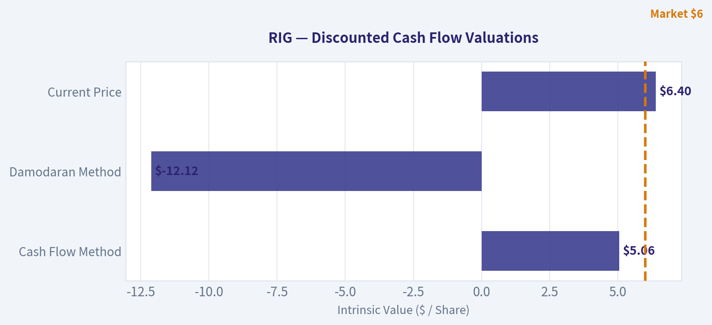

---

### Trend & Growth Analysis (Lynch/Druckenmiller/Fisher)

> *Following Peter Lynch's GARP, Stanley Druckenmiller's macro-aware approach, and Philip Fisher's scuttlebutt methodology.*

ANALYST STANCE: **WATCH**

#### RIG (Transocean) Growth/Inflection Report

#### 1. Lynch Classification

| Item | Assessment |
|---|---|
| Business type | Offshore drilling contractor |
| Revenue growth | ~12.5% YoY from shared pack |
| Lynch bucket | **Cyclical / Turnaround hybrid** |
| Growth-investing fit | **Not a classic fast grower** |

Key Takeaways: Transocean does not fit Peter Lynch's preferred fast-grower profile. It is better viewed as a cyclical recovery story with turnaround elements, driven by offshore rig utilization and dayrate improvement rather than durable secular 20% plus compounding.

#### 2. The Story in 3 Bullets

| Simple story | Why it matters |
|---|---|
| Transocean owns deepwater and ultra-deepwater rigs used by oil companies offshore. | If offshore drilling activity rises, rig demand and pricing improve. |
| The equity case is a recovery in dayrates, utilization, and backlog conversion. | Earnings can inflect sharply in upcycles because fixed costs are high. |
| The risk is that this is tied to oil prices and capex cycles, not a clean secular growth trend. | That makes outcomes more macro-driven and less predictable. |

Key Takeaways: This is an operating leverage story, not a pure innovation story. If offshore markets stay tight, profits can improve quickly, but the business remains heavily dependent on commodity and customer spending cycles.

#### 3. TAM / Runway Analysis

| Metric | Assessment |
|---|---|
| Current revenue base | Not fully refreshed from tool; shared pack shows mid-teens growth only |
| 10x test | **Fails for practical purposes** |
| TAM character | Global offshore drilling spend is large but cyclical and capacity-constrained |
| Runway quality | Moderate, but tied to replacement cycles and oil economics |
| Secular tailwind | Weak-to-mixed |

Key Takeaways: RIG does not have the kind of open-ended TAM that supports a ten-bagger through long-duration share capture. Its runway depends more on industry recovery and favorable supply-demand in offshore rigs than on a large, expanding secular market.

#### 4. Revenue Growth Trend

| Metric | Value / View |
|---|---|
| Revenue growth YoY | **12.5%** |
| Pattern | Recovery growth, not hypergrowth |
| Growth quality | Likely driven by improving utilization/dayrates rather than recurring software-like expansion |
| Verdict | **Stable-to-improving, but not an inflection into elite growth** |

Key Takeaways: Revenue is growing, which is constructive, but 12.5% is below the threshold typically sought for a top-tier growth idea. The more important question for RIG is whether EBITDA and free cash flow accelerate faster than revenue as operating leverage kicks in.

#### 5. Unit Economics / Financial Quality

| Metric | Value | Interpretation |
|---|---:|---|
| Gross margin | 39.3% | Healthy for an industrial services recovery |
| ROE | -36.0% | Still economically weak / loss-making legacy profile |
| FCF yield | 8.8% | Attractive if sustainable |
| Current ratio | 1.56 | Adequate near-term liquidity |
| P/E | N/A | Earnings still not clean enough for PEG analysis |

Key Takeaways: The strongest point here is free cash flow yield, while the weakest is still deeply negative ROE. This supports a recovery thesis more than a quality-compounder thesis: cash generation may be improving faster than accounting profitability.

#### 6. Inflection Point Assessment

| Inflection area | Assessment | View |
|---|---|---|
| Product cycle | None | Neutral |
| Market share | Hard to prove | Neutral |
| Margin inflection | Possible with better dayrates/utilization | Positive |
| TAM inflection | No | Negative |
| Competitive inflection | Industry rig supply may be tighter | Mild positive |
| Earnings inflection | Plausible over next 2-3 years | Positive |

Key Takeaways: The real inflection for RIG is margin and earnings, not demand category expansion. If offshore supply remains constrained and contract pricing rises, earnings could improve much faster than current headline revenue growth suggests.

#### 7. Macro Setup Evaluation

| Macro factor | Assessment |
|---|---|
| Oil price sensitivity | High |
| Interest rates | Mixed; lower rates help financing, but not the main driver |
| Energy capex cycle | Primary driver |
| Geopolitics | Can support offshore activity via energy security concerns |
| Secular theme alignment | Weak versus AI/cloud/cyber type growth themes |

Key Takeaways: Macro matters a lot here. Unlike secular growth names, RIG needs supportive oil economics, customer capex discipline, and stable offshore demand to work; that makes the setup less durable and more timing-sensitive.

#### 8. Fisher 15-Point Score

| Fisher area | Score (1-5) | Comment |
|---|---:|---|
| Market potential | 3 | Real but cyclical |
| New products | 1 | Not a product innovation story |
| R&D effectiveness | 1 | Limited relevance |
| Sales organization | 3 | Commercial contracting capability matters |
| Profit margin | 2 | Still weak overall |
| Margin improvement | 3 | Recovery potential exists |
| Labor relations | 3 | No major signal from pack |
| Executive relations | 3 | Neutral |
| Management depth | 3 | Appears adequate |
| Cost controls/accounting | 3 | Neutral |
| Outstanding moat | 3 | Specialized fleet is an asset moat, but not dominant network effects |
| Long-range profit outlook | 3 | Heavily cycle-dependent |
| Dilution risk | 2 | Balance-sheet sensitivity remains a watchpoint |
| Candor | 3 | Neutral from available info |
| Integrity | 3 | Neutral from available info |

| Total | **39 / 75** | **Below Fisher growth quality threshold** |

Key Takeaways: On a Fisher lens, RIG scores as a middling industrial recovery rather than an outstanding innovative growth company. The company may still work as a cycle play, but it lacks the product, moat, and secular reinvestment profile Fisher typically favored.

#### 9. Valuation Analysis

| Valuation lens | Assessment |
|---|---|
| P/E / PEG | Not usable; P/E is N/A |
| FCF yield | **8.8%**, optically attractive |
| Market cap | **$7.15B** |
| Street sentiment | Mixed but improving; Barclays upgraded to Overweight with $8 PT |
| Valuation takeaway | **Reasonable for recovery, not obviously cheap if cycle softens** |

Key Takeaways: Because earnings are still messy, free cash flow is the more useful anchor than P/E. On that basis, RIG looks potentially undervalued for a successful offshore upcycle, but valuation support could weaken quickly if contracting momentum stalls.

#### 10. Growth Investor Scorecard

| Criterion | Weight | Score | Weighted |
|---|---:|---:|---:|
| The Story | 10% | 3.0 | 0.30 |
| TAM & Runway | 20% | 2.0 | 0.40 |
| Revenue Growth | 20% | 2.5 | 0.50 |
| Unit Economics | 15% | 3.0 | 0.45 |
| Competitive Position | 10% | 3.0 | 0.30 |
| Management Quality | 10% | 3.0 | 0.30 |
| Macro Setup | 5% | 3.0 | 0.15 |
| Profitability Path | 5% | 3.0 | 0.15 |
| Valuation | 5% | 3.5 | 0.18 |

| Total Score |  |  | **2.73 / 5.00** |

Key Takeaways: The score lands in WATCH territory. RIG has enough recovery leverage and valuation support to stay on the radar, but not enough secular growth, TAM expansion, or business quality to merit an advocate rating under a Lynch-Druckenmiller-Fisher framework.

#### 11. Position Size Stance

| Stance | View |
|---|---|
| Recommended action | **WATCH** |
| If owned | Hold only as a cyclical recovery position, not a core growth compounder |
| If not owned | Wait for clearer evidence of earnings inflection, backlog quality improvement, and debt-risk moderation |
| Suggested size | Small/speculative only for cycle-aware investors |

Key Takeaways: This is not a "load up and forget it" growth name. It may deserve a tactical or speculative allocation if the offshore cycle strengthens, but conviction should stay limited until the earnings inflection becomes clearer.

#### 12. Key Risks and Catalysts

| Risks | Catalysts |
|---|---|
| Oil price decline | Higher offshore dayrates |
| Customer capex cuts | New contract awards / backlog growth |
| Balance-sheet stress | Better utilization across premium fleet |
| Cost overruns / downtime | Sustained free cash flow generation |
| Cycle turns before deleveraging | Analyst upgrades / improved sentiment |

Key Takeaways: The upside path is straightforward: better pricing, better utilization, better cash flow. The downside path is equally clear: a weaker oil market or customer spending pullback could interrupt the recovery before the balance sheet fully heals.

#### Bottom Line

RIG is **not** a classic growth-stock candidate. It is a **cyclical offshore drilling recovery with potential earnings inflection**, but it lacks the secular TAM, innovation profile, and durable compounding characteristics needed for an **ADVOCATE** call in this framework.

The stock is interesting because:
- free cash flow looks better,
- sentiment is improving,
- offshore supply may be tighter than many expect.

But it remains **WATCH**, not ADVOCATE, because:
- revenue growth is only moderate,
- profitability quality is still weak,
- the thesis is macro and commodity sensitive,
- and the business is not a long-runway fast grower.

If you want, I can next turn this into a **bull/base/bear scenario model for RIG through 2028** with implied upside/downside.

#### Growth & Scorecard Visuals

The radar chart below from *Final Buffett Scorecard* visualises how **RIG** ranks across weighted investment criteria. Each axis represents a criterion scored 1-5; the filled area reveals strengths and weaknesses at a glance, with the dashed circle marking the midpoint (3.0).

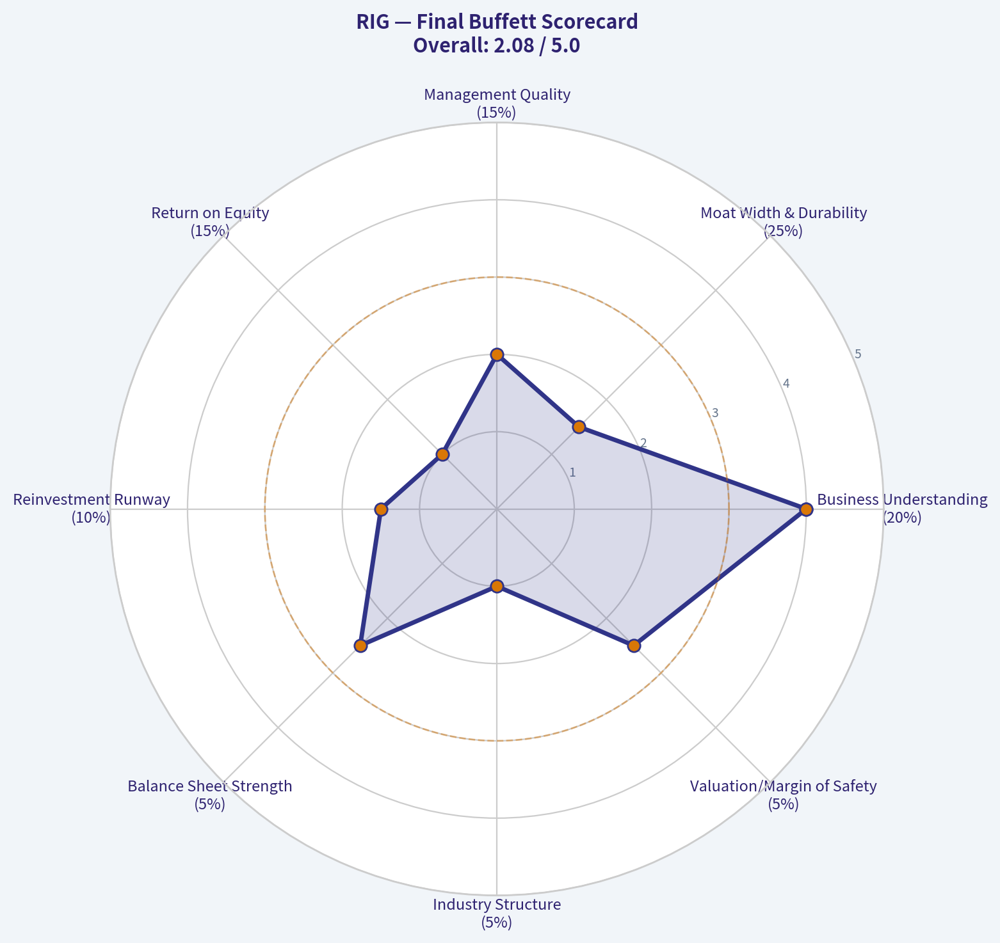

This comparison chart from *Revenue Growth Trend* stacks current figures against historical benchmarks for **RIG**, making it easy to see where the company trades relative to its own averages.

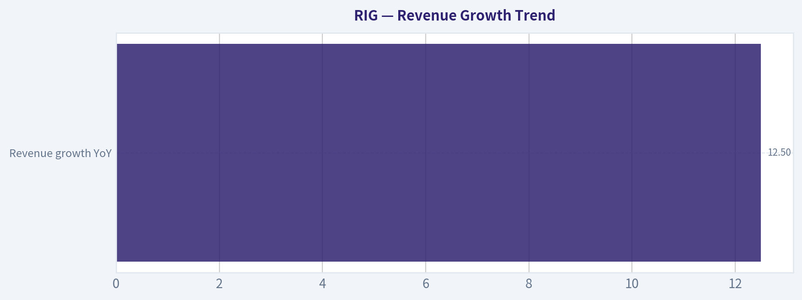

---

### Market Technical Analysis

#### RIG Technical Report

For RIG, the **most relevant 8 indicators** for the current market context are:

1. **close_10_ema**
2. **close_50_sma**
3. **close_200_sma**
4. **macd**
5. **macdh**
6. **rsi**
7. **atr**
8. **vwma**

These are well suited because RIG is in a **long-term uptrend**, a **medium-term consolidation-to-reacceleration phase**, and is now dealing with a **short-term momentum wobble after a sharp late-April rally and early-May pullback**. This set covers trend across multiple timeframes, momentum quality, reversal risk, volatility, and volume confirmation without excessive overlap.

---

#### Market Structure and Trend Interpretation

RIG's price action over the last six months shows a clear regime shift.

From **November through mid-January**, the stock traded mostly in the **$3.8 to $4.4** range, with limited directional persistence. That changed in **late January and February**, when price broke higher and accelerated from roughly **$4.3 to above $6.5**, supported by very strong volume expansion, especially around **February 9-13**. That rally appears to be the defining trend event of the period.

Since then, the stock has **not fully given back the breakout**. Instead, it transitioned into a higher trading range, mostly between about **$5.9 and $7.0**. That is important: the February surge was not followed by a collapse back into the old base. Structurally, that suggests **acceptance of higher prices**, even though momentum has become less clean.

More recently, the stock rallied again into **late March and late April**, reaching the **upper $6s**, then suffered a sharp pullback on **May 5** from **$6.88 to $6.25**, followed by only a modest rebound to **$6.40** by May 8. So the current setup is not a fresh breakout; it is a **trend stock undergoing a short-term reset inside a still constructive larger framework**.

---

#### Indicator Readings

| Indicator | Latest reading | What it suggests |
|---|---:|---|
| close_10_ema | 6.43 | Short-term trend has softened; price is hovering near/slightly below fast trend support |
| close_50_sma | 6.41 | Medium-term trend remains positive but price is sitting right on a key inflection level |
| close_200_sma | 4.57 | Long-term trend remains strongly bullish; price is still far above strategic trend support |
| macd | 0.016 | Momentum is still marginally positive, but barely so |
| macdh | -0.023 | Momentum is weakening versus the signal line; short-term upside thrust has faded |
| rsi | 49.63 | Neutral momentum; neither overbought nor oversold |
| atr | 0.316 | Volatility is elevated enough to require wider stops and disciplined sizing |
| vwma | 6.44 | Price is near volume-weighted fair value; no strong short-term edge from price/volume dislocation |

Key Takeaways: RIG is sitting at a technically important balance point. The longer-term trend is still clearly bullish, but the short-term indicators show momentum has cooled and conviction has weakened after the early-May selloff. Traders should view the stock as constructive on a bigger-picture basis, but tactically vulnerable until it can reclaim and hold above its short-term averages with improving momentum.

---

#### Fine-Grained Trend Analysis

The **50-day SMA** has risen from about **5.29 in mid-March** to roughly **6.41 now**, which is a strong medium-term slope. That upward slope matters more than a single day's close. It tells us the average participant over the last 10 weeks is still benefiting from rising prices. However, the stock is now trading almost exactly around that average, which means the market is testing whether this moving average will act as support or whether the trend is flattening into a broader sideways phase.

The **200-day SMA**, near **4.57**, is still climbing steadily and sits far below spot price. This confirms that the larger trend remains intact. There is no evidence here of long-term technical damage. Even if short-term price action remains messy, the gap between current price and the 200-day average indicates the stock has built substantial structural improvement versus its late-2025 base.

The **10-day EMA** is near **6.43**, essentially aligned with the **VWMA at 6.44** and the **50-day SMA at 6.41**. That clustering is notable. When multiple reference points converge near the current price, it often signals a **decision zone**. In practical terms, RIG is no longer extended upward; it is trading near consensus value across fast trend, medium trend, and volume-weighted trend. Breaks away from this cluster may become more informative than the present standoff.

---

#### Momentum Quality

The **MACD** remains slightly positive at **0.016**, but that positive value is now very small relative to where it stood in late March and early April. Momentum has clearly decelerated.

The **MACD histogram** turned negative again, at **-0.023**, after being positive in late April and early May. This is one of the more important short-term warning signs. It means that while absolute trend momentum has not fully rolled over, the **rate of improvement has already deteriorated**. In other words, the stock has not yet become decisively bearish, but upside thrust has weakened enough that buyers no longer control the tape as cleanly as they did during the late-April advance.

The **RSI at 49.6** reinforces that message. This is a neutral reading, not a panic reading. RIG is not oversold enough to imply an automatic mean-reversion bounce, and it is not strong enough to indicate renewed momentum leadership. Neutral RSI after a sharp drop often means the stock may need **time**, not just price, to rebuild its setup.

This combination-neutral RSI, weak positive MACD, negative histogram-usually describes a market in **momentum transition**, where traders should be careful about buying too aggressively before confirmation.

---

#### Volume and Participation

The **VWMA** is useful here because RIG has had several volume bursts during major directional moves. The latest VWMA reading around **6.44** is slightly above the latest close of **6.40**, which suggests price is just under the recent volume-weighted average. That is not severe weakness, but it does imply that recent buyers as a group are only marginally underwater.

The bigger historical message from volume is seen in February: the strongest upside expansion came with enormous participation, which gives the long-term uptrend more credibility than a thin rally would. By contrast, the recent early-May drop also came with elevated volume, especially on **May 5**, indicating that sellers were active and that the pullback should be taken seriously. So volume is sending a nuanced message:

- the **larger breakout was real**, because participation expanded strongly;
- the **current pullback is also real**, because distribution volume increased during the decline.

That argues against a simplistic "buy every dip immediately" approach. It favors **waiting for evidence that buyers are reasserting control**.

---

#### Volatility and Risk Framing

The **ATR of about 0.316** is meaningful relative to a **$6.40 stock**. That implies a daily trading range of roughly **5% of price**, which is substantial. RIG is not trading like a low-volatility steady compounder; it remains a high-beta, swing-prone name.

This matters for execution:

- Tight stops are easier to shake out.
- Position size should be smaller than one might use in a less volatile stock.
- Breakouts need room to breathe.
- Support tests can overshoot before reversing.

ATR has remained fairly elevated rather than collapsing, which tells us the stock is still in an active price-discovery regime. Traders should expect continuation and reversal moves alike to be sharper than average.

---

#### Tactical Read on the Current Setup

The current technical picture is best described as:

| Timeframe | Assessment | Implication |
|---|---|---|
| Long term | Bullish | Price remains well above the 200-day SMA; major trend still intact |
| Medium term | Constructive but being tested | Rising 50-day SMA supports the trend, but price is sitting directly on it |
| Short term | Fragile / neutral | 10-day EMA, VWMA, and RSI all suggest indecision after a momentum loss |
| Momentum | Weakening | MACD histogram is negative, showing fading upside impulse |
| Volatility | Elevated | Risk management matters; false breaks and sharp swings remain likely |

Key Takeaways: The long-term trend in RIG is still favorable, but the short-term picture has become fragile. Price is resting on a cluster of important averages rather than pushing cleanly higher, and momentum indicators show the recent rally has lost force. This is a stock at an inflection point, where confirmation matters more than anticipation.

---

#### What Traders May Watch Next

A **bullish path** would likely involve:
- price reclaiming and holding above the **10 EMA / VWMA cluster near 6.43-6.44**,
- MACD histogram turning back positive,
- RSI pushing back above the mid-50s and ideally toward 60,
- and eventually a retest of the **6.80-7.00** area.

A **cautionary path** would involve:
- repeated failure to hold the **50-day SMA near 6.41**,
- RSI slipping into the low 40s or below,
- MACD staying near zero while the histogram remains negative,
- and price drifting back toward the **6.05-5.90** support zone seen in late April.

A more serious bearish signal would require a breakdown below that lower support region with volume expansion. At the moment, the chart does **not** yet show that level of damage, but the risk has increased compared with late April.

---

#### Bottom Line

RIG remains in a **credible long-term uptrend**, but the stock is no longer in a clean momentum phase. It is now trading at a **technical equilibrium zone**, with price converging around the **10 EMA, 50 SMA, and VWMA**, while **MACD momentum weakens** and **RSI sits neutral**. That combination usually favors patience and confirmation over aggressive chasing.

For trend-followers, the larger structure is still constructive. For short-term traders, however, this is a **prove-it spot**: a rebound from current levels could restore the bullish case quickly, but continued inability to build distance above the moving-average cluster would increase the odds of a deeper consolidation.

| Area | Key Observation | Trading Relevance |
|---|---|---|
| Long-term trend | Price well above 200 SMA (4.57) | Strategic trend remains bullish |
| Medium-term trend | 50 SMA rising to 6.41 | Trend intact, but support is under test |
| Short-term trend | 10 EMA at 6.43 near current price | No strong immediate directional edge |
| Momentum | MACD barely positive; histogram negative | Upside impulse is fading |
| RSI | 49.6 | Neutral, not stretched either way |
| Volume confirmation | VWMA near 6.44; prior breakout had strong volume | Bigger rally had conviction, but recent pullback also had real selling |
| Volatility | ATR ~0.316 | Requires wider stops and careful position sizing |
| Tactical bias | Constructive long term, cautious short term | Better to wait for confirmation of rebound or breakdown |

Key Takeaways: RIG still looks structurally healthier than it did months ago, and the broader uptrend has not broken. But in the near term, the stock has lost momentum and is sitting at a make-or-break support cluster. The next sustained move away from the 6.41 to 6.44 area is likely to give the clearest trading signal.

---

### News & Events Analysis

#### Transocean (RIG) news and trading report
**Date:** 2026-05-10

Transocean's last week was dominated by its **Q1 2026 earnings release**, a **slight tightening of full-year revenue guidance**, and a **constructive but still cautious analyst reaction**. For traders, the key point is that the stock remains a **high-beta offshore drilling recovery vehicle**: sentiment is improving because backlog, utilization, and offshore spending discipline still support the cycle, but the name is constrained by **earnings volatility, cost execution risk, and a still-heavy balance-sheet overhang**.

---

#### Latest earnings: Q1 2026 was the key event

Transocean **reported first-quarter 2026 results on May 4, 2026**, so the latest reported period is **Q1 2026**.

Headline items from coverage:
- **Revenue:** about **$1.081B**, ahead of expectations
- **EPS:** **loss of $0.03**, missing expectations
- Some coverage also highlighted **net income of $71M**, indicating results likely benefited from items below operating EPS
- Management **narrowed FY2026 revenue guidance** to **$3.8B-$3.9B** from **$3.8B-$3.95B**

What changed versus prior expectations/guidance:
- The quarter was viewed as **mixed** because **top-line execution was better than feared**, but **bottom-line conversion disappointed**
- The guidance change was not a broad cut to the floor; instead, it was a **trim to the upper end**, which suggests management still sees solid revenue support but somewhat less upside flexibility from timing, utilization, downtime, or contract start assumptions
- Versus the prior period, the broad setup still appears better on revenue growth, consistent with the shared research pack showing **12.5% YoY revenue growth**, but margins and earnings remain uneven

Interpretation for investors:
- This was **not a thesis-breaking quarter**, but it did reinforce that Transocean is still in the stage of the cycle where **revenue visibility is improving faster than earnings quality**
- In offshore drilling, traders care heavily about **dayrates, contract awards, rig uptime, and cost control**. The Q1 print implies the market is willing to reward backlog and revenue strength, but only if operating execution starts translating more cleanly into EPS and cash flow
- The guidance narrowing matters because this stock often trades on **forward backlog confidence** rather than trailing EPS alone. A smaller top-end guide can cap near-term upside enthusiasm

| Earnings item | Latest reported period | Reported takeaway | Change vs prior / prior guidance | Trading implication |
|---|---|---|---|---|
| Revenue | Q1 2026 | ~$1.081B, ahead of estimates | Supports ongoing recovery and backlog monetization | Positive for offshore demand thesis |
| EPS | Q1 2026 | Loss of $0.03, below expectations | Shows weak earnings conversion despite better revenue | Negative near-term sentiment factor |
| Net income | Q1 2026 | $71M per snapshot coverage | Suggests non-operating/mixed accounting effects vs EPS view | Investors should focus on operating quality, not headline profit alone |
| FY2026 revenue guide | FY2026 | Narrowed to $3.8B-$3.9B | Prior range was $3.8B-$3.95B | Mild negative; trims upside rather than signaling collapse |

**Key Takeaways:** Transocean's first quarter of 2026 showed that demand and revenue remain resilient, but profitability is still not clean enough to fully satisfy the market. The company did not slash guidance, but trimming the top end of its full-year range suggests less room for upside surprises in the next few quarters. For traders, this keeps the stock investable as a cyclical recovery story, but not yet a clear execution story.

---

#### Company-specific news flow over the past week

The post-earnings reaction was nuanced rather than uniformly negative.

Most important recent items:
- **Barclays upgraded RIG to Overweight and raised its price target to $8 from $6**
- **TD Cowen maintained Hold and raised its target to $6 from $5.5**
- News coverage framed the quarter as **mixed**, with the stock under pressure after the EPS miss
- Transocean also published its **fleet status report**, which is important because the stock often reacts more to fleet contracting and downtime trends than to a single quarter's accounting EPS

What this tells us:
- The **sell-side tone improved modestly**, especially with Barclays becoming more constructive
- But the difference between Barclays and TD Cowen shows the core debate:
  - **Bull case:** offshore drilling fundamentals are firming, and Transocean has torque to higher dayrates and backlog conversion
  - **Bear/base case:** debt, execution variability, and earnings quality still limit rerating

The fleet status report matters because it can affect:
- backlog timing
- revenue recognition cadence
- downtime assumptions
- operating cost absorption

If the market starts to see fewer operational disruptions and steadier contract progression, RIG can rerate quickly because the equity is still priced like a leveraged cyclical.

| Recent company news | Direction | Why it matters |
|---|---|---|
| Q1 2026 earnings mixed: revenue beat, EPS miss | Mixed | Confirms demand but exposes margin/earnings volatility |
| FY2026 revenue guide narrowed | Slight negative | Reduces upside expectations for the year |
| Barclays upgrade to Overweight, PT to $8 | Positive | Signals improving confidence in offshore cycle and valuation upside |
| TD Cowen Hold, PT to $6 | Neutral | Suggests upside exists but execution risk remains |
| Fleet status report release | Potentially positive/important | Operational updates can drive estimates more than headline EPS |

**Key Takeaways:** The last week's company news suggests sentiment is improving, but conviction is not uniform. Analysts are becoming more constructive on valuation and industry conditions, yet the earnings miss and trimmed top-end guidance prevent a full bullish reset. This keeps RIG in a tradable recovery narrative rather than a low-risk compounding story.

---

#### Market and macro context affecting RIG

For Transocean, macro matters through **oil prices, offshore capex confidence, financing conditions, and geopolitical supply risk**.

Relevant macro backdrop from recent coverage:
- News referenced a **U.S.-Iran ceasefire/de-escalation**, which can reduce immediate geopolitical risk premium in energy
- A lower geopolitical premium can **soften crude prices at the margin**, which is not ideal for offshore drillers if sustained
- On the other hand, offshore projects are usually driven less by daily oil price swings and more by **multi-year supply expectations and project economics**

What matters more than one week of macro noise:
- If oil remains high enough to support deepwater project sanctioning, Transocean remains leveraged to a favorable capex cycle
- If macro deteriorates and operators delay offshore commitments, RIG is vulnerable because its equity value depends on a long-duration recovery
- Broader risk appetite also matters because heavily levered cyclicals like RIG typically outperform in **reflation / strong commodity tape** environments and underperform when growth fears rise

Bottom line on macro:
- Near-term geopolitical easing can be a slight headwind for energy beta
- But the bigger variable remains whether the market believes **offshore rig demand and dayrates can stay firm through 2026-2027**

| Macro factor | Current read-through for RIG | Market effect |
|---|---|---|
| Middle East de-escalation | Slightly lowers crude risk premium | Mild headwind for energy-sensitive names |
| Offshore capex cycle | Still the main fundamental driver | Positive if operators keep sanctioning projects |
| Credit/risk appetite | Important for leveraged cyclicals | Better market tone helps RIG rerate |
| Oil price durability | Crucial for dayrate confidence | Sustained strength supports backlog and valuation |

**Key Takeaways:** Macro conditions are not decisively bearish for Transocean, but they are less supportive when geopolitical tensions ease and oil risk premiums fade. The company's stock will likely be driven less by daily headlines and more by whether investors still believe offshore spending will remain durable into 2027. That makes oil-price stability and risk appetite the two macro variables to watch most closely.

---

#### Positioning, balance sheet, and what the market is likely debating

From the shared research pack:
- **Market cap:** $7.15B
- **ROE:** -36.0%
- **Gross margin:** 39.3%
- **Revenue growth:** 12.5% YoY
- **FCF yield:** 8.8%
- **Current ratio:** 1.56

This profile tells a clear story:
- Revenue and cash generation are improving
- But accounting profitability and returns on equity remain weak
- The stock is therefore likely to trade on **enterprise-value-to-backlog / cycle recovery logic**, not classic quality metrics

The 13F data is also interesting:
- **Mohnish Pabrai added** and holds a very large position weight
- **Steve Cohen trimmed**
That split reinforces the stock's identity as a **high-conviction deep-value cyclical for some investors**, but not necessarily a broad institutional favorite yet.

Trading framework:
- **Bullish setup:** stronger offshore contract news, better fleet utilization, improved cost execution, debt reduction path, and sustained oil support
- **Bearish setup:** more guidance trimming, downtime/cost disappointments, weaker crude, or risk-off markets hitting leveraged cyclicals
- **Near-term bias:** cautiously constructive, but likely range-bound unless a new contract/backlog catalyst emerges

---

#### Investment view

For investors over the next few weeks, Transocean looks like a **sentiment-sensitive cyclical long**, not a clean fundamental breakout. The latest quarter supports the idea that the offshore upcycle is real enough to sustain revenues, but it also shows that **earnings quality still lags the narrative**. That usually means upside can continue on analyst upgrades and backlog optimism, but pullbacks after mixed prints are also normal.

Practical read-through:
- **Momentum traders** may stay involved after the Barclays upgrade, especially if oil and cyclicals remain firm
- **Fundamental investors** should demand evidence that better revenue is translating into more reliable margins and cash retention
- **Risk-aware investors** should remember that Transocean is still exposed to execution shocks more than higher-quality energy names

---

#### Summary table

| Category | Key point | Why it matters for trading/investing |
|---|---|---|
| Earnings | Q1 2026 revenue beat, EPS miss | Keeps recovery thesis alive but raises execution questions |
| Guidance | FY2026 range narrowed to $3.8B-$3.9B from $3.8B-$3.95B | Slightly reduces upside expectations |
| Analyst reaction | Barclays upgraded to Overweight; TD Cowen stayed Hold | Sentiment improving, but not unanimous |
| Operations | Fleet status report remains important | Contract timing and downtime can swing estimates |
| Financial profile | Revenue growth and FCF improving, profitability still weak | Supports cyclical upside but limits quality rerating |
| Macro | Oil and offshore capex remain central | Sector backdrop matters more than one-quarter EPS noise |
| Positioning | Mixed smart-money signals, with notable value interest | Confirms high-conviction but high-risk nature |

**Key Takeaways:** Transocean remains a leveraged bet on the offshore drilling recovery, and the latest quarter did not invalidate that thesis. However, the market still needs proof that stronger revenue can become consistently stronger earnings. In the near term, the stock is most likely to respond to analyst revisions, fleet updates, and oil-linked risk sentiment rather than to valuation alone.

---

### Guru Attention Analysis

> *Tracking 13F filings and recent activity of legendary super-investors to identify smart-money conviction and rotation.*

#### RIG Guru Ownership Snapshot

Using the structured 13F data as the canonical source, only **two tracked gurus** show a disclosed position in **Transocean (RIG)** in the latest available filing set.

| Guru | Action | Position Size | Portfolio Weight | Recent Change | Timing | SEC Verification |
| --- | --- | --- | ---: | --- | --- | --- |
| Mohnish Pabrai | Added | 27.04M shares, worth $111.68M | 27.78% | Increased shares by 10.6% vs. prior filing | 12-31-2025 filing period | [SEC 13F Filing](https://www.sec.gov/Archives/edgar/data/1549575/000154957526000002/) |
| Steve Cohen | Trimmed | 2.30M shares, worth $9.50M | 0.01% | Decreased shares by 68.9% vs. prior filing | 12-31-2025 filing period | [SEC 13F Filing](https://www.sec.gov/Archives/edgar/data/1603466/000090266426001100/) |

**Key Takeaways:** The standout signal is Mohnish Pabrai, who owns a very large RIG stake and made it one of his biggest disclosed positions at nearly 28% of portfolio weight. By contrast, Steve Cohen still held RIG at the same reporting date, but after a major trim, and the position was effectively immaterial relative to his broader portfolio.

#### Guru-by-Guru Interpretation

| Guru | Latest 13F Status |
| --- | --- |
| Warren Buffett | No position detected in latest 13F filing |
| Seth Klarman | No position detected in latest 13F filing |
| Mohnish Pabrai | Position detected; added in latest filing |
| Bill Ackman | No position detected in latest 13F filing |
| Stanley Druckenmiller | No position detected in latest 13F filing |
| Steve Cohen | Position detected; trimmed in latest filing |
| Michael Burry | No position detected in latest 13F filing |

**Key Takeaways:** Among the primary tracked gurus, RIG is not a consensus super-investor holding. The only meaningful conviction position shown in the current structured 13F data is Pabrai's, while Cohen's remaining position appears small and tactical rather than high conviction.

#### What the moves likely mean

- **Mohnish Pabrai:**
  The 13F shows a **high-conviction add**, not just a token position. With **27.78%** of disclosed portfolio weight in RIG, this is the clearest guru endorsement in the dataset. The filing itself does not state his reasoning, but the size suggests he sees substantial upside in the offshore drilling cycle or asset value recovery.

- **Steve Cohen:**
  Cohen **trimmed heavily**, cutting shares by **68.9%** quarter over quarter. Since the remaining position is only **0.01%** of his disclosed portfolio, RIG does not appear to be a meaningful current theme for Point72 based on the latest filing.

#### Verification links

- Mohnish Pabrai (Dalal Street LLC): [All 13F Filings (SEC EDGAR)](https://www.sec.gov/cgi-bin/browse-edgar?action=getcompany&CIK=0001549575&type=13F-HR&dateb=&owner=include&count=5)
- Steve Cohen (Point72 Asset Management): [All 13F Filings (SEC EDGAR)](https://www.sec.gov/cgi-bin/browse-edgar?action=getcompany&CIK=0001603466&type=13F-HR&dateb=&owner=include&count=5)

#### Bottom line

For RIG, the guru signal is **narrow but notable**. **Pabrai is the only tracked guru showing a large, concentrated, recently increased stake**, while **Cohen moved the other way and sharply reduced exposure**. Everyone else in the tracked primary guru set shows **no position detected in latest 13F filing**.

---

### Options Market Analysis

> *Reading options flow - put/call ratios, IV skew, and unusual activity - to gauge institutional positioning and event-driven risk.*

#### RIG Options Positioning Report
*Date: 2026-05-10*

RIG's near-term options tape leans **constructively bullish, but with clear downside hedging still present in the front week**. The key signal is that aggregate **put/call open interest is 0.87**, only modestly above the 0.7 neutral baseline, while the **put/call volume ratio is just 0.18**, showing that current trading flow is overwhelmingly concentrated in calls rather than puts. That combination usually means investors are actively chasing upside or rolling into call structures, even if legacy put protection still exists.

#### 1. Put/Call Ratio Analysis

| Expiration | Call OI | Put OI | Put/Call OI Ratio | Call Vol | Put Vol | Put/Call Vol Ratio | Read |
|---|---:|---:|---:|---:|---:|---:|---|
| 2026-05-15 | 65,939 | 67,496 | 1.02 | 4,071 | 354 | 0.09 | Existing positioning slightly defensive, but fresh flow strongly call-heavy |
| 2026-05-22 | 4,516 | 1,602 | 0.35 | 783 | 447 | 0.57 | Bullish positioning with moderate put participation |
| 2026-05-29 | 10,406 | 1,178 | 0.11 | 414 | 169 | 0.41 | Very call-dominant setup |
| **Near-term total** | **80,861** | **70,276** | **0.87** | **5,268** | **970** | **0.18** | **Net bullish flow, mild residual hedge overhang** |

**Key Takeaways:**
The biggest contrast is between **stocked-up front-week put open interest** and **very call-heavy current volume**. In plain English, traders still hold some downside protection, but the newest money is leaning much more aggressively toward calls. Relative to the neutral 0.7 baseline, the **0.87 OI ratio is only mildly cautious**, while the **0.18 volume ratio is decisively bullish**.

**Interpretation:**
- **OI ratio at 0.87**: slightly above neutral, so not cleanly bullish from a positioning-stock perspective. It suggests some existing hedges remain in place.
- **Volume ratio at 0.18**: very low, indicating fresh flow is heavily skewed toward calls.
- **Shift from neutral**: the strongest shift is in **trading flow**, not in legacy OI. This usually matters more tactically for near-term price direction.

#### 2. Implied Volatility (IV) Assessment

| Expiration | ATM Call IV | ATM Put IV | Put-Over-Call IV Premium | Skew Read |
|---|---:|---:|---:|---|
| 2026-05-15 | 54.7% | 66.8% | +12.1 pts | Strong put skew |
| 2026-05-22 | 55.1% | 58.2% | +3.1 pts | Mild put skew |
| 2026-05-29 | 50.8% | 55.1% | +4.3 pts | Mild/moderate put skew |

**Key Takeaways:**
RIG shows a **consistent put skew**, especially in the nearest expiry where put IV is materially above call IV. That tells you the market still prices downside protection more richly than upside exposure, which is common in cyclicals and event-sensitive names. So while the directional flow is bullish, the volatility surface still reflects **respect for downside risk**.

**Interpretation:**
- **Near-term ATM IV is elevated but not panic-level extreme** for an energy/offshore-drilling name.
- The **front-week 12.1-point put premium** is the standout feature and suggests traders are willing to pay up for protection.
- This skew does **not** invalidate the bullish read from volume; instead, it says the market's upside interest is happening alongside persistent risk-awareness.
- No catalyst was supplied in the dataset, so I would **not explicitly attribute the elevated front-week IV to earnings or a known event** without confirmation. Still, front-week IV and skew are high enough to suggest traders are bracing for above-normal movement.

#### 3. Unusual Options Activity

| Contract Signal | Result | Interpretation |
|---|---|---|
| Volume > 5x Open Interest scan | None detected | No clear fresh institutional block/sweep-style signal in near-term expirations |

**Key Takeaways:**
There was **no standout unusual activity** under the tool's threshold, which lowers conviction slightly because we do not have a clean "smart-money" tell from outsized fresh positioning. That means the read should rely more on **aggregate flow and IV structure** than on one spectacular contract.

**Interpretation:**
- No contracts met the **volume > 5x OI** test.
- That means there is **no obvious fresh whale bet** to anchor the thesis.
- The absence of unusual activity does **not** mean the tape is bearish; it simply means the signal is broader and less dramatic.
- Confidence is therefore **moderate**, not high-conviction.

#### 4. Open Interest Concentration

| Expiration | OI Characterization | Likely Market Effect |
|---|---|---|
| 2026-05-15 | Largest total OI by far on both calls and puts | Main pinning / gamma influence is concentrated in the front week |
| 2026-05-22 | Much lighter OI | Less likely to dominate spot behavior unless price trends sharply |
| 2026-05-29 | Call OI notably exceeds put OI | If price lifts, upside strikes may become more active magnets/resistance zones |

**Key Takeaways:**
The **May 15 expiry is the center of gravity** for RIG's near-term options market. That means price action into that expiry is more likely to feel "pinned" or mechanically influenced by dealer hedging than later expiries. Since the dataset does not provide strike-by-strike OI, we can identify the dominant expiry but **cannot precisely map max-pain or specific gamma walls**.

**Interpretation:**
- The **front-week expiry dominates OI**, so it likely carries the strongest gamma effects.
- Because total call and put OI are fairly balanced there, pinning behavior is plausible if the stock stays near major listed strikes.
- However, **specific strike-level gamma walls cannot be confirmed** from the provided data.
- Practical takeaway: expect the **2026-05-15 chain** to exert the most influence on short-term price behavior.

#### 5. Overall Options Sentiment Signal

| Category | Signal | Why |
|---|---|---|
| Directional Read | **BULLISH** | Fresh volume is overwhelmingly call-heavy despite some standing put hedges |
| Confidence | **Moderate** | Strong volume skew helps, but no unusual activity and persistent put skew limit conviction |
| Main Driver | **Call-dominant near-term flow** | Put/call volume ratio of 0.18 is the strongest single data point |
| Main Caveat | **Downside fear still priced** | Elevated put IV, especially front week, shows ongoing protection demand |

**Key Takeaways:**
The best way to frame RIG is **bullish flow, cautious volatility backdrop**. Traders are actively using calls, which is the dominant directional clue, but they are not complacent because put IV remains richer than call IV. So the options market says **upside is favored, but not trusted blindly**.

#### Final Read

**Overall Options Sentiment on RIG: BULLISH**

The primary reason is simple: **new trading flow is heavily skewed toward calls**, with a near-term aggregate **put/call volume ratio of 0.18**, which is materially more bullish than neutral. While the **0.87 put/call OI ratio** and the **front-week put skew** show that some investors are still hedging, those are secondary to the directional message from current volume. This is **not euphoric bullishness**-it is more like a market leaning higher while still paying for downside insurance.

If you want, I can next turn this into a **trader-style actionable setup** for RIG with support/resistance, likely dealer behavior, and what the options tape implies for the next 1-2 weeks.

---

| Metric | Reading | Interpretation |
|---|---|---|
| Put/Call Ratio | OI: **0.87**; Volume: **0.18** | Legacy positioning mildly cautious, fresh flow strongly bullish |
| IV Level | ATM call IV **50.8%-55.1%**; ATM put IV **55.1%-66.8%** | Elevated near-term volatility, especially in front week puts |
| Skew Direction | **Put skew** | Downside protection priced richer than upside |
| Unusual Activity | **None flagged** | No standout fresh institutional contract signal |
| Overall Signal | **BULLISH** | Call-heavy volume outweighs residual hedging and cautious skew |

**Key Takeaways:**
In one line: **RIG's options market is leaning bullish, but with a defensive safety belt still on**. The call flow is strong enough to justify a bullish directional read, yet the richer put pricing warns that traders still see downside risk as very real.

---

## Research Team Commentary

> *The Research Manager synthesizes the Bull vs Bear debate into action-free commentary. This is a pre-risk view, not the final stance.*

The strongest bull argument is that Transocean may be priced as if offshore drilling economics will never normalize, while the actual operating backdrop is improving. Revenue grew 12.5%, reported revenue beat expectations, gross margin was 39.3%, and free cash flow improved sharply. If offshore rig supply is genuinely tighter than consensus expects, then dayrates and utilization could keep improving, and a messy accounting picture today could understate future earning power. The bull case also fairly notes that high-spec offshore rigs are not trivial assets: they are expensive, specialized, and supported by customer trust, technical capability, and long lead times. In a tighter market, those characteristics can matter.

The strongest bear argument is still more persuasive from a Buffett lens. This is a cyclical contractor whose economics depend heavily on oil prices, customer capex, and industry discipline-none of which management controls. The core financial quality is weak: ROE of -36.0%, ROIC of -17.6%, and ROA of -18.6% are not minor blemishes; they are evidence that the business is currently destroying capital. EPS still missed, net income quality appears mixed, and in this kind of asset-heavy business, gross margin is much less important than full-cycle returns after maintenance, reactivation, depreciation, and financing costs. Most importantly, the valuation does not clearly provide a margin of safety: one valuation frame suggests about $5.06 versus a $6.40 stock price, and the harsher framework implies deep fragility. That makes this hard to justify as value rather than a cyclical bet.

My core takeaway is that Transocean may be improving operationally, but it still fails the business-quality and intrinsic-value tests that matter most in Buffett-style investing. This is not a durable compounder temporarily misunderstood by the market. It is a leveraged, capital-intensive, commodity-linked operator that could benefit from a better cycle, but that is not the same as having a moat or a reliable margin of safety. The market may be skeptical, but in this case skepticism is not obviously irrational. What would have to be true for today's price to be attractive? Offshore demand would need to stay firm, supply discipline would need to hold, dayrates would need to rise enough to overcome heavy capital demands, and cash flow improvement would need to prove durable rather than cyclical noise. That is possible, but too many assumptions sit outside the company's control.

The rationale is simple. Buffett-style value investing starts with business quality, predictability, and returns on capital. Transocean currently scores poorly on all three. I've seen similar situations where investors, including me in past process mistakes, got seduced by "normalization," replacement-cost logic, or a rebound in free cash flow, only to discover that capital intensity and cyclicality absorbed the upside before equity holders really benefited. The lesson is to demand proof, not possibility. Here, the proof is not yet there. The company may be on better footing than the headlines suggest, but the burden of evidence remains with the bull, especially when valuation is not obviously cheap.

So my stance is WATCH, not ADVOCATE and not an outright AVOID only because there is a legitimate cyclical-improvement argument worth monitoring. But it is not investable yet under a strict Buffett framework.

Over the next 1 to 4 quarters, I would watch a few concrete things. First, whether free cash flow remains positive after true maintenance and upgrade needs, not just working-capital or timing benefits. Second, whether backlog quality improves, especially duration and dayrate strength on new contracts. Third, whether operating profitability improves in a way that starts to lift ROIC meaningfully toward positive territory. Fourth, whether leverage and liquidity improve rather than merely survive. Fifth, whether management shows disciplined capital allocation-avoiding expensive fleet commitments that assume peak-cycle conditions. If those markers improve together, the thesis strengthens. If cash flow slips, maintenance demands rise, or contract momentum stalls, then the bear case likely wins decisively.

Final stance: WATCH.

---

## Value Investing Team Commentary

> *The Investor translates the research view into an investment thesis before risk review. This is still not the final stance.*

Transocean is the kind of stock that can look tempting precisely when a value investor should slow down.

The bullish case is understandable. Revenue grew 12.5%, reported revenue beat expectations, free cash flow improved sharply, and there is a plausible industry argument that offshore rig supply is tighter than many believe. If that supply tightness persists, dayrates can rise meaningfully, utilization can improve, and a deeply cyclical business can look far better two years from now than it does today. That is the contrarian setup: the market may be anchoring too heavily to the industry's ugly past and not enough to a better near-cycle environment.

But Buffett-style investing asks a harder question: is this a good business, or merely a business in a better moment?

Right now, the evidence still points to the latter. The negative ROE (-36.0%), ROIC (-17.6%), and ROA (-18.6%) are not just weak numbers; they indicate a business that has not yet demonstrated economically attractive earning power. In an asset-heavy driller, gross margin is a secondary figure. What matters is whether the fleet can earn enough across the cycle to cover maintenance, reactivation, depreciation, interest, and inevitable downtime while still producing solid returns for owners. So far, that proof is absent.

This is where selective contrarian thinking matters. The market's skepticism may look excessive on the surface, but it may actually be rational because the core drivers remain outside management's control. Offshore demand depends on customer exploration budgets, which depend heavily on oil and gas prices. Even if current contract conditions improve, this is not a business with pricing power in the way a true moat business has pricing power. It is a contractor participating in a capital cycle. Those cycles can feel durable right up until they turn.

The news itself supports caution. Revenue beat expectations, but EPS missed, and some of the more favorable profit readings appear influenced by items below operating earnings. That usually tells me reported improvement is not yet clean enough to treat as normalized earning power. In cyclical companies, investors often get fooled by early optical improvement before full-cycle economics really recover. Temporary scarcity can help, but equity investors only win if that scarcity lasts long enough to convert into durable cash generation after all capital demands.

On valuation, the case is not compelling enough to compensate for this uncertainty. If one framework suggests value around $5.06 and the stock trades at $6.40, while another harsher framework points to fragility, then there is no obvious margin of safety. A true value setup would require either a stronger business or a cheaper price. At the moment, investors are being asked to underwrite several favorable assumptions at once: continued offshore demand, supply discipline, stronger dayrates, manageable maintenance spending, and balance sheet stability. That is a lot to assume for a company without a durable moat.

What may the market be missing? Possibly that offshore rig replacement is difficult, high-spec assets are specialized, and if industry discipline holds, the upcycle could run longer than many expect. That is the only real reason not to dismiss the stock entirely. But that is a cyclical thesis, not a Buffett thesis. If you are buying here, you are effectively betting on industry conditions improving enough to rescue the economics. You are not buying a consistently high-return business at a discount.

So I would treat Transocean as a monitoring candidate, not an ownership candidate. The right way to follow it is to demand evidence, not narratives:
- sustained positive free cash flow after real maintenance and upgrade spending,
- improvement in backlog quality and contract dayrates,
- ROIC moving decisively toward positive territory,
- balance sheet de-risking,
- and management showing restraint rather than chasing peak-cycle expansion.

If those improve together, the story becomes more interesting. Until then, this looks more like a cyclical trade dressed up as value.

**ANALYST STANCE: WATCH**
Transocean has a plausible contrarian recovery case, but it still lacks the business quality, return profile, and margin of safety required for a Buffett-style investment. Sentiment may be cautious, yet that caution appears largely justified by the company's capital intensity, cyclicality, and weak underlying returns.

---

## Deep Values Commentary

> *The Risk Management Team debates and the Risk Judge provides the final action-free verdict. This section determines the final ADVOCATE / WATCH / AVOID stance.*

**Executive Briefing**

**Verdict: WATCH**

Transocean looks more like a cyclical recovery speculation than a Buffett-style value investment. The operating backdrop is improving - revenue rose **12.5%**, revenue beat expectations, and free cash flow improved sharply - but the business still shows **capital-destructive economics** with **ROE -36.0%**, **ROIC -17.6%**, and **ROA -18.6%**. EPS still missed, earnings quality looks mixed, and valuation does **not** clearly offer a margin of safety at **$6.40** versus one value estimate near **$5.06**. For a long-term value investor, this is not yet a durable, predictable business available at an obviously cheap price. Keep it on the watchlist, not in the core portfolio.

---

### Key Arguments From the Analysts

### 1. Risky Analyst: strongest bull case
- Trailing return metrics may be misleading in an early-cycle recovery.
- Revenue growth of **12.5%**, revenue of about **$1.081B** ahead of expectations, and **224.4% YoY FCF growth** suggest improving operating conditions.
- Offshore rig supply may be tighter than expected, which could support better dayrates and utilization.
- The stock may rerate before accounting metrics look clean, so waiting for proof could miss the upside.

### 2. Safe Analyst: strongest bear case
- Deeply negative returns are not cosmetic; they show the business is still destroying capital.
- EPS missed, and reported net income may have benefited from below-operating-line items, which weakens earnings quality.
- In offshore drilling, free cash flow must be judged **after** maintenance, upgrade, and financing demands.
- The business depends heavily on oil prices and customer exploration budgets, both outside management's control.
- Valuation does not show a sufficient margin of safety.

### 3. Neutral Analyst: best synthesis
- The bullish inflection case is plausible, but not yet proven.
- The bearish quality concerns are valid, but not enough to declare the equity uninvestable under all circumstances.
- Best treatment: a **conditional watchlist candidate**, potentially only for a small speculative sleeve, not for a true value portfolio.

---

### Risk Commentary for the Long-Term Investor

From a Buffett-style risk lens, the key question is not whether Transocean's stock can rally. It can. The question is whether the **business** is strong, understandable, and predictable enough to reduce the risk of **permanent capital impairment** over a long holding period.

Right now, the answer is still **no**.

The strongest positive evidence is real:
- **Revenue growth: 12.5%**
- **Revenue beat: about $1.081B**
- **Gross margin: 39.3%**
- **FCF growth: 224.4%**
- Potentially tighter offshore supply backdrop

Those facts support the idea that conditions are improving and that the market may be too anchored to past weakness.

But Buffett-style investing asks a harder question: **Who captures that improvement - the business, creditors, or equity holders?**

That is where the case weakens.

### Why the bear case remains more persuasive
1. **Returns on capital are deeply negative**
   - **ROE: -36.0%**
   - **ROIC: -17.6%**
   - **ROA: -18.6%**

   These are not minor blemishes. In an asset-heavy business, they strongly suggest the company has not yet shown it can earn attractive economics on the capital required to operate.

2. **Earnings quality is not clean**
   - EPS was a **loss of $0.03** and missed expectations.
   - Some reported net income strength appears tied to items below operating line.

   For a cyclical turnaround, messy accounting can be tolerated temporarily. But when the thesis already relies on macro recovery, investors should demand cleaner evidence, not more adjustments.

3. **Gross margin is not enough**
   A **39.3% gross margin** sounds encouraging, but in this kind of business, what matters is whether profits remain after:
   - maintenance capex,
   - rig reactivation,
   - depreciation,
   - financing costs,
   - downtime risk.

   Full-cycle economics matter more than one attractive surface metric.

4. **Valuation does not clearly protect you**
   - Current price: **$6.40**
   - FCF average value: **$5.06**
   - Harsher valuation framework: **-$12.12**

   Even if the harsher model is too pessimistic, the friendlier estimate still does not show an obvious bargain. That means you are depending on successful normalization, not buying with a wide margin of safety.

5. **The business is highly exposed to external forces**
   Demand depends on offshore exploration budgets, which depend on oil and gas prices. That makes the thesis reliant on industry conditions management cannot control. Buffett generally prefers businesses where favorable outcomes depend less on commodity cycles and more on durable competitive advantages.

---

### Refined Investor Plan

Your original plan already leaned correctly toward **WATCH**, and the analyst debate does not justify upgrading it.

### Refined plan
Treat Transocean as a **cyclical monitoring candidate**, not a value investment.

That means:

- **Do not treat current improvement as proof of durable earning power**
- **Do not rely on replacement-cost logic or "normalization" alone**
- **Do not commit core long-term capital without a margin of safety**

If an investor insists on exposure, it should be:
- small,
- explicitly speculative,
- separate from the core Buffett-style portfolio,
- and dependent on future proof rather than narrative.

### What must improve before reconsidering
Over the next **1 to 4 quarters**, watch for:

1. **Sustained free cash flow after true maintenance and upgrade spending**
2. **Stronger backlog quality**
   - longer duration
   - higher dayrates
   - better contract visibility
3. **Meaningful improvement in operating returns**
   - especially **ROIC moving toward breakeven and then positive**
4. **Balance-sheet and liquidity improvement**
5. **Disciplined capital allocation**
   - no aggressive fleet commitments based on peak-cycle assumptions
6. **Cleaner earnings quality**
   - less reliance on below-operating-line benefits

If several of these improve together, the case can move closer to investable. If not, the current optimism likely proves cyclical noise rather than durable value.

---

### Lessons From Past Mistakes

The key lesson is the one already embedded in your draft: investors often get seduced by:
- "normalization" stories,
- replacement-cost narratives,
- or sharp free-cash-flow rebounds,

only to discover that **capital intensity and cyclicality absorb the upside before equity holders benefit meaningfully**.

That lesson applies directly here.

The right discipline is to demand:
- **proof over possibility**,
- **returns on capital over headline growth**,
- **intrinsic value over cyclical excitement**.

Transocean may improve further. But under Buffett principles, "may improve" is not enough.

---

**Final Stance: WATCH**

#### Final Stance Scorecard

This scorecard converts the final research view into a weighted decision frame. It does not replace the narrative judgement, but it makes the main drivers of the verdict easier to scan.

| Criterion | Score | Weight | Commentary |
| --- | ---: | ---: | --- |
| Business Quality | 2.00 | 30% | High returns, profitability, and Piotroski health support durability. |
| Valuation Support | 3.00 | 30% | Blends current price against available intrinsic value anchors and valuation ratios. |
| Financial Strength | 3.67 | 20% | Balance-sheet resilience reflects leverage and liquidity staying within safe ranges. |
| Growth Durability | 3.33 | 20% | Recent revenue, earnings, and free cash flow growth indicate how durable expansion looks. |
| TOTAL / FINAL STANCE | 2.90 | 100% | WATCH |

#### Key Takeaways

The weighted score lands at **2.90 / 5.0**, while the final stance remains **WATCH**. This is useful as a quick calibration aid rather than a mechanical signal.

#### Risk Summary

Higher scores indicate more risk pressure. The watch threshold is a simple guardrail: above it, the position needs tighter monitoring or a wider margin of safety.

| Dimension | Current Score | Watch Threshold | Commentary |
| --- | ---: | ---: | --- |
| Business Quality | 4.00 | 3.00 | High returns, profitability, and Piotroski health support durability. |
| Valuation Support | 3.00 | 3.00 | Blends current price against available intrinsic value anchors and valuation ratios. |
| Financial Strength | 2.33 | 3.00 | Balance-sheet resilience reflects leverage and liquidity staying within safe ranges. |
| Growth Durability | 2.67 | 3.00 | Recent revenue, earnings, and free cash flow growth indicate how durable expansion looks. |

#### Key Takeaways

This view helps readers separate *where* the risk sits: valuation, business quality, balance sheet, or growth durability. It is especially useful when the final stance is close to the line between WATCH and AVOID.
