# RKLB Deep Value Intelligence

**Analysis Date:** 2026-08-07

## Critical Disclaimer

*This analysis is generated by Deep Value Intelligence, an AI-powered multi-agent investing framework. Education & research only - not financial advice, not a financial advisor.*

---

## Table of Contents

1. Intelligence Summary
2. Analyst Team Reports
   - Fundamentals Analysis
   - Intrinsic Value Analysis (Buffett)
   - Trend & Growth Analysis (Lynch/Druckenmiller/Fisher)
   - Market Technical Analysis
   - Options Market Analysis
3. Research Team Commentary
4. Value Investing Team Commentary
5. Deep Values Commentary

---

## Intelligence Summary

### Thesis + Conditions

**Core Thesis:** **EXECUTIVE SUMMARY**
*   **Verdict**: Rocket Lab (RKLB) is an engineering triumph but an un-investable equity at its current $51.75 billion valuation. *   **The Risk**: The primary risk is not bankruptcy, but severe, permanent capital loss through multiple compression.

**Key Risks:**
- The Risk**: The primary risk is not bankruptcy, but severe, permanent capital loss through multiple compression. At 120x trailing revenue and a -22.4% ROIC, the stock is priced for a utopian scenario that ignores the crushing capital expenditures of the space industry.
- The Bull (Risky Analyst)**: RKLB is the only proven commercial #2 to SpaceX. The negative ROIC is a necessary "land-grab" cost to build an end-to-end orbital railroad, unlocking massive Total Addressable Market (TAM) upside.
- The Bear (Safe Analyst)**: Space is a zero-margin-for-error, highly capital-intensive industry. RKLB is priced as if it has already won, ignoring the math of value investing and the historical graveyard of capital-heavy "revolutionary" transport companies.

**Confidence:** Medium

---

## Analyst Team Reports

### Fundamentals Analysis

#### Latest Earnings Snapshot

*Most recent reported quarter anchored on 2026 Q1, with prior-year comparison when available.*

| Metric | 2026 Q1 | 2025 Q1 | YoY Change |
| --- | ---: | ---: | ---: |
| Revenue | $200.3M | $122.6M | +63.5% |
| Operating Income | $-56.0M | $-59.2M | +5.4% |
| Net Income | $-45.0M | $-60.6M | +25.7% |
| Diluted EPS | $-0.07 | $-0.12 | +41.7% |
| Operating Cash Flow | $-50.3M | $-54.2M | +7.2% |
| Free Cash Flow | $-77.4M | $-82.9M | +6.6% |

Key Takeaways: This snapshot anchors the most recent reported quarter before the narrative analysis. It helps readers separate long-run business quality from whatever changed in the latest earnings print.

#### 6-Year Financial Metrics for RKLB

*All values below are computed deterministically from raw data - not estimated by AI.*

*Issuer profile: operating company (Industrials / Aerospace & Defense).*

#### 6-Year Financial Metrics
*Annual rows come from reported financial statements. The final TTM row is computed from the latest four quarters.*

| Metric | 2020 | 2021 | 2022 | 2023 | 2024 | 2025 | 2026 TTM |
| --- | --- | --- | --- | --- | --- | --- | --- |
| Market Price | $10 | $12 | $4 | $6 | $25 | $70 | $83 |
| Market Cap | $762.4M | $2.58B | $1.76B | $2.66B | $12.63B | $37.02B | $50.15B |
| P/E Ratio | -13.85 | -21.93 | -13.00 | -14.55 | -67.03 | -188.54 | -258.84 |
| P/B Ratio | -4.57 | 3.69 | 2.61 | 4.80 | 33.03 | 21.50 | 22.15 |
| ROE | 33.0% | -16.8% | -20.2% | -32.9% | -49.7% | -11.5% | -8.1% |
| ROIC | N/A | 169.0% | -43.1% | -35.2% | -57.3% | -37.9% | -16.3% |
| EPS | $-0.73 | $-0.56 | $-0.29 | $-0.38 | $-0.38 | $-0.37 | $-0.32 |
| Revenue | $35.2M | $62.2M | $211.0M | $244.6M | $436.2M | $601.8M | $679.6M |
| Gross Profit | $-11.8M | $-1.9M | $19.0M | $51.4M | $116.1M | $207.2M | $248.4M |
| Gross Margin | -33.6% | -3.0% | 9.0% | 21.0% | 26.6% | 34.4% | 36.6% |
| Operating Margin | -156.3% | -164.0% | -64.1% | -72.7% | -43.5% | -38.0% | -33.2% |
| Net Income | $-55.0M | $-117.3M | $-135.9M | $-182.6M | $-190.2M | $-198.2M | $-182.6M |
| Net Margin | -156.4% | -188.5% | -64.4% | -74.6% | -43.6% | -32.9% | -26.9% |
| Revenue Growth | N/A | 77.0% | 239.0% | 15.9% | 78.3% | 38.0% | 12.9% |
| Net Income Growth | N/A | 113.3% | 15.9% | 34.3% | 4.2% | 4.2% | -7.9% |
| Free Cash Flow Growth | N/A | 84.4% | 52.8% | 3.1% | -24.5% | 177.5% | -1.7% |
| Total Book Value | $-166.7M | $698.4M | $673.2M | $554.5M | $382.5M | $1.72B | $2.26B |
| Total Assets | $187.9M | $980.8M | $989.1M | $941.2M | $1.18B | $2.32B | $2.82B |
| Total Debt | $0 | $100.1M | $102.9M | $105.4M | $56.1M | $1.7M | $138.7M |
| Debt-to-Equity | -0.00 | 0.14 | 0.15 | 0.19 | 0.15 | 0.00 | 0.06 |
| Cash & Equivalents | $52.8M | $691.0M | $242.5M | $162.5M | $271.0M | $828.7M | $1.21B |
| Shareholders' Equity | $-166.7M | $698.4M | $673.2M | $554.5M | $382.5M | $1.72B | $2.26B |
| Operating Cash Flow | $-27.8M | $-71.8M | $-106.5M | $-98.9M | $-48.9M | $-165.5M | $-161.6M |
| Investing Cash Flow | $-37.3M | $-92.1M | $-346.1M | $12.0M | $-98.3M | $-347.4M | $-354.5M |
| Free Cash Flow | $-52.9M | $-97.5M | $-148.9M | $-153.6M | $-116.0M | $-321.8M | $-316.3M |
| FCF Margin | -150.4% | -156.6% | -70.6% | -62.8% | -26.6% | -53.5% | -46.5% |
| Dividends / Share | $0.00 | $0.00 | $0.00 | $0.00 | $0.00 | $0.00 | $0.00 |

#### Profitability Metrics
- Return on Equity (ROE): -11.5%
- Return on Invested Capital (ROIC): -22.4%
- Return on Assets (ROA): -8.5%
- Gross Margin: 34.4%
- Operating Margin: -38.0%
- Net Profit Margin: -32.9%

#### Liquidity Metrics
- Current Ratio: 4.08
- Quick Ratio: 3.16

#### Leverage Metrics
- Debt-to-Equity Ratio: 0.00
- Interest Coverage Ratio: -8.64
- Net Debt: $-826.9M

#### Growth Metrics (Year-over-Year)
- Revenue Growth: 38.0%
- Net Income Growth: -4.2%
- Free Cash Flow Growth: -177.5%
- Revenue CAGR (3-Year): 41.8%
- Revenue CAGR (5-Year): 76.5%

#### Valuation Metrics
- P/E Ratio (TTM): N/A
- Forward P/E: 9943.58
- Price-to-Book: 21.06
- Price-to-Sales: 76.16
- PEG Ratio: N/A
- EV/EBITDA: -283.28
- Free Cash Flow Yield: -0.6%
- Earnings Yield: N/A

#### Owner Earnings (Buffett Method, Code-Computed)
- Net Income: $-198.2M
- + Depreciation & Amortization: $43.9M
- - Capital Expenditures: $-156.3M
- - Working Capital Changes: $-58.8M
- = **Owner Earnings: $-139.4M**

#### Intrinsic Value (Code-Computed)
- Current Price: $83
- **Headline Intrinsic Value (business-model routed): $2**
  Business model: operating company - owner-earnings DCF (operating_company)
  Model spread (min-max across DCFs): $2 - $2
  Margin of safety vs. price (headline): -4600.7%
  Routing note: General operating company: balanced blend of Damodaran FCFF and the owner-earnings DCF with a reverse-DCF sanity check.
- Buffett Method (Owner Earnings):
  Conservative: $2
  Average: $2
  Optimistic: $2
- Cash Flow Method (FCF):
  Conservative: $2
  Average: $2
  Optimistic: $2
- Damodaran FCFF (WACC + margins + reinvestment):
  Conservative: $-30
  Average: $-17
  Optimistic: $-23
  Monte Carlo band (P10-P90): $-32 - $-17 (median $-23)
  P(intrinsic value > price): 0.0%

#### Piotroski F-Score: 5/9
- Positive Net Income: FAIL
- Positive Operating Cash Flow: FAIL
- ROA Improvement: PASS
- Cash Flow > Net Income: PASS
- Decreasing Debt: PASS
- Improving Current Ratio: PASS
- No Dilution: FAIL
- Improving Gross Margin: PASS
- Improving Asset Turnover: FAIL

ANALYST STANCE: **AVOID**

#### RKLB Warren Buffett-Style Fundamental Analysis

Rocket Lab is a high-growth aerospace and defense operating company with improving gross economics, a strong net-cash balance sheet, and credible strategic optionality in launch, spacecraft, defense payloads, and future Neutron launch capability. However, under a Warren Buffett-style framework, the stock is extremely difficult to justify at the current price because the company remains loss-making, free-cash-flow negative, and valued at levels that require extraordinary future profitability.

The deterministic dataset shows a current price of **$83**, market cap of **$50.15B**, TTM revenue of **$679.6M**, TTM free cash flow of **-$316.3M**, and model-routed intrinsic value of roughly **$1.76-$2 per share**. The business may be strategically valuable, but the stock price already discounts a very large portion of the bull case.

---

#### Current vs Historical Average Comparison

Historical average below uses the available canonical annual period, **2020-2025**, because the deterministic dataset provides six annual years plus TTM, not a full ten-year history.

| Metric | Current / TTM | 2020-2025 Avg. | Current Standing vs History | Buffett-Style Interpretation |
|---|---:|---:|---|---|
| Market Price | $83 | $21.17 | ~3.9x historical avg. | Price has moved far faster than fundamentals. |
| Total Market Cap | $50.15B | $9.57B | ~5.2x historical avg. | Market is pricing RKLB like a proven compounder before earnings proof. |
| P/E Ratio | -258.84 / N/A economically | -53.15 | Not meaningful | Loss-making company; P/E should not be used as a value signal. |
| P/B Ratio | 22.15 | 10.18 | ~2.2x avg. | Book value is not the valuation anchor; equity is heavily shaped by capital raises and cash. |
| ROE | -8.1% | -16.4% | Better than avg., still negative | Losses are moderating, but shareholder capital is not yet earning positive returns. |
| ROIC | -16.3% | -0.9% reported avg.; skewed by 2021 | Still negative | Core invested capital remains unprofitable; 2021 outlier distorts average. |
| EPS | -$0.32 | -$0.45 | Improved | Loss per share has narrowed but remains negative. |
| Revenue | $679.6M | $265.2M | ~2.6x avg. | Strong top-line scaling is the main positive. |
| Gross Profit | $248.4M | $63.3M | ~3.9x avg. | Gross profit inflection is meaningful and improving. |
| Gross Margin | 36.6% | 9.1% | Major improvement | A strong sign of operating learning curve and better mix. |
| Operating Margin | -33.2% | -89.8% | Much improved | Still deeply negative; scale has not yet reached operating breakeven. |
| Net Income | -$182.6M | -$146.5M | Worse than avg., better than 2025 | Losses remain structurally large despite revenue growth. |
| Net Margin | -26.9% | -93.4% | Much improved | Direction is favorable, but profitability is not proven. |
| Revenue Growth | 12.9% TTM | 89.6% avg. annual growth | Slower than avg. | Growth is normalizing from early hypergrowth. |
| Net Income Growth | -7.9% | 34.4% | Better, because losses narrowed | Negative growth here reflects improved losses, but not true earnings growth. |
| Free Cash Flow Growth | -1.7% | 58.7% | Slight improvement vs 2025 burn | Free cash flow remains materially negative. |
| Total Book Value | $2.26B | $643.7M | ~3.5x avg. | Balance sheet expanded, largely through capital formation. |
| Total Assets | $2.82B | $1.10B | ~2.6x avg. | Asset base has scaled with the business. |
| Total Debt | $138.7M | $61.0M | Above avg., still modest | Debt is not the primary risk. |
| Debt-to-Equity | 0.06 | 0.11 | Below avg. | Conservative leverage profile. |
| Cash & Equivalents | $1.21B | $374.8M | ~3.2x avg. | Strong liquidity gives runway for growth and Neutron investment. |
| Shareholders' Equity | $2.26B | $643.7M | ~3.5x avg. | Equity cushion is strong, but returns on that equity are still negative. |
| Free Cash Flow | -$316.3M | -$148.5M | Burn is ~2.1x worse than avg. | The business still consumes cash at scale. |
| Dividends / Share | $0.00 | $0.00 | No change | Correct policy for a growth-stage company, but not Buffett-style cash return. |

Key Takeaways: RKLB's revenue, gross profit, and gross margin have improved dramatically, which supports the view that the business is scaling. However, the company remains unprofitable, free-cash-flow negative, and priced at a market cap more than five times its recent historical average. The strongest fundamental positive is the balance sheet; the largest valuation problem is that the stock price assumes future economics that have not yet appeared in reported results.

---

#### Revenue Breakdown

The deterministic dataset provides total TTM revenue of **$679.6M** but not precise TTM segment revenue. The segment split below uses Rocket Lab's public business mix as the best available estimate: Space Systems is the dominant revenue source, while Launch Services remains strategically important but smaller.

| Revenue Source | Amount ($M) | % of Total |
|---|---:|---:|
| Space Systems | ~$570.9M | ~84% |
| Launch Services | ~$108.7M | ~16% |
| **Total TTM Revenue** | **$679.6M** | **100%** |

Key Takeaways: Rocket Lab is no longer just a small-launch company; most revenue is now generated from Space Systems, including spacecraft components, satellite platforms, mission systems, and related defense or commercial space hardware. Launch remains strategically important because it supports vertical integration and customer acquisition, but the near-term revenue engine is Space Systems.

---

#### Market Metrics Interpretation

| Metric | Current Reading | Interpretation |
|---|---:|---|
| Market Price | $83 | The share price has appreciated sharply and now embeds very high expectations. |
| Market Cap | $50.15B | The company trades like a scaled strategic aerospace platform, not like a sub-$1B revenue business. |
| P/E Ratio | N/A economically; accounting line is negative | Not meaningful because earnings are negative. A negative P/E does not indicate cheapness. |
| P/B Ratio | 22.15 | High relative to book, but book value is not the best anchor for RKLB due growth investments, cash raises, and intangible aerospace know-how. Cash-flow-based intrinsic value is more relevant. |

Key Takeaways: Traditional earnings valuation is not useful because RKLB has no positive earnings. Price-to-book also provides limited insight because the key assets are engineering capability, contracts, launch heritage, and future platform optionality rather than simply tangible book value. The proper valuation anchor is future owner earnings, and those are currently negative.

---

#### Profitability and Business Quality

Rocket Lab's most encouraging trend is gross margin improvement. Gross margin moved from deeply negative levels in 2020 and 2021 to **36.6% TTM**, showing that the business is gaining scale, improving mix, or both. This is important because a company with structurally negative gross margin would be uninvestable; RKLB has at least demonstrated that its products and services can generate gross profit.

The problem is that operating expenses remain too large relative to revenue. TTM operating margin is still **-33.2%**, and TTM net margin is **-26.9%**. Net losses have persisted across every reported year in the dataset. From a Buffett perspective, this means RKLB does not yet have the hallmark of a wonderful business: predictable, recurring, high-return earnings.

| Profitability Area | Positive Evidence | Concern |
|---|---|---|
| Gross Margin | Improved to 36.6% TTM | Must remain durable as launch cadence and Space Systems scale. |
| Operating Margin | Improved from extreme losses | Still -33.2%, far from self-funding. |
| Net Margin | Improved materially | Still -26.9%; no proven net profitability. |
| ROE | Better than historical average | Still negative at -8.1%. |
| ROIC | Less bad than recent years | Still negative at -16.3%, indicating capital is not yet compounding. |

Key Takeaways: RKLB is showing real operating progress, especially at the gross margin level. But Buffett-style investors require evidence that revenue growth converts into durable earnings and high returns on capital. RKLB has not yet crossed that threshold.

---

#### Balance Sheet and Financial Strength

Rocket Lab's balance sheet is the strongest part of the investment case. The company has **$1.21B in cash and equivalents** against **$138.7M of debt**, giving it net cash of roughly **$1.07B**. Debt-to-equity is only **0.06**, and the current ratio is **4.08**, which indicates strong liquidity.

However, financial strength must be weighed against cash burn. TTM free cash flow is **-$316.3M**, meaning the company is still consuming substantial cash. At the current burn rate, the cash balance provides runway, but not unlimited runway. If Neutron development, infrastructure expansion, or operating losses persist longer than expected, additional dilution remains a real risk.

| Balance Sheet Item | Current Value | Buffett Interpretation |
|---|---:|---|
| Cash & Equivalents | $1.21B | Strong liquidity and strategic flexibility. |
| Total Debt | $138.7M | Modest debt burden. |
| Net Cash | ~$1.07B | Debt is not the main risk. |
| Debt-to-Equity | 0.06 | Conservative leverage. |
| Current Ratio | 4.08 | Healthy near-term liquidity. |
| Free Cash Flow | -$316.3M | Cash burn is the key financial risk. |

Key Takeaways: Rocket Lab is not financially distressed; it has a strong liquidity position and low leverage. The issue is not solvency today, but whether the company can convert its cash runway into durable positive free cash flow before valuation expectations reset.

---

#### Growth Analysis

Rocket Lab's growth record is impressive but uneven. Revenue rose from **$35.2M in 2020** to **$601.8M in 2025** and **$679.6M TTM**, which is a major scale-up. The dataset also shows a **3-year revenue CAGR of 41.8%** and **5-year revenue CAGR of 76.5%**.

That said, TTM revenue growth of **12.9%** is much lower than the earlier hypergrowth average. This does not necessarily mean the growth story is broken, but it means investors should not blindly extrapolate the early-stage growth curve. For a $50B market cap to be reasonable, RKLB needs not merely revenue growth, but very large future operating leverage.

| Growth Metric | Current / TTM | Interpretation |
|---|---:|---|
| Revenue Growth | 12.9% | Still growing, but slower than early-stage averages. |
| 3-Year Revenue CAGR | 41.8% | Strong medium-term expansion. |
| 5-Year Revenue CAGR | 76.5% | Reflects early-stage scaling from a small base. |
| Net Income Growth | -7.9% | Losses narrowed versus prior period. |
| FCF Growth | -1.7% | Free cash flow improved slightly but remains deeply negative. |

Key Takeaways: Revenue growth is real, but the market is paying for much more than growth alone. The key question is whether RKLB can transform high revenue growth into high-margin, recurring owner earnings. That conversion is not yet proven.

---

#### Economic Moat Assessment

Rocket Lab has potential moat characteristics, but the moat is still developing rather than fully proven.

| Moat Factor | Assessment |
|---|---|
| Launch Heritage | Electron's flight record gives RKLB credibility and operational know-how. |
| Vertical Integration | Combining launch, spacecraft, components, and mission services can deepen customer relationships. |
| Defense Exposure | Space Force and national security contracts can create sticky demand and qualification barriers. |
| Engineering Complexity | Space systems are difficult, regulated, and mission-critical, raising barriers to entry. |
| Brand and Reliability | Reliability matters in aerospace; successful launches compound trust. |
| Scale Disadvantage | SpaceX remains a dominant competitor with major cost and cadence advantages. |
| Neutron Optionality | If successful, Neutron could materially expand addressable market, but it is still execution-risk heavy. |

Key Takeaways: Rocket Lab has credible competitive advantages in engineering, mission heritage, and integrated space capabilities. But from a Buffett perspective, the moat is not yet confirmed by high returns on capital, stable earnings, or consistent free cash flow. The moat is promising, not proven.

---

#### Management and Capital Allocation

Management has pursued an aggressive growth strategy: reinvesting in launch capability, Space Systems, defense opportunities, and future medium-lift launch through Neutron. The absence of dividends is appropriate because the business is still in investment mode. Low debt also reflects prudent balance-sheet management.

The main capital allocation concern is dilution. The Piotroski F-Score flags **No Dilution: FAIL**, and the market cap/share count relationship suggests shareholders have been diluted as the company funded growth. Dilution is not automatically bad if capital is reinvested at high future returns, but RKLB has not yet demonstrated positive ROIC.

| Capital Allocation Area | Evidence | Assessment |
|---|---|---|
| Reinvestment | Heavy R&D, capex, Neutron, Space Systems expansion | Strategically logical but cash intensive. |
| Debt Use | Very low leverage | Prudent. |
| Dividends | None | Appropriate for growth stage. |
| Dilution | Piotroski dilution fail | Material shareholder risk. |
| Returns on Capital | ROIC remains negative | Capital allocation not yet proven economically. |

Key Takeaways: Management appears focused on building a strategically valuable space platform, not short-term profitability. That may be the right industrial strategy, but Buffett-style investors need proof that reinvested capital will eventually earn high returns. At present, the evidence is incomplete.

---

#### Buffett-Style Owner Earnings DCF Valuation

The deterministic dataset reports 2025 Buffett-style owner earnings as:

**Owner Earnings = Net Income + D&A - Capex - Working Capital Changes**

Using the dataset:

- Net Income: **-$198.2M**
- Depreciation & Amortization: **+$43.9M**
- Capital Expenditures: **-$156.3M**
- Working Capital Changes: **-$58.8M**
- Reported Owner Earnings: **-$139.4M**

Because owner earnings are negative, a standard "compound owner earnings at X% forever" model is not economically useful. The DCF below models a path from current negative owner earnings toward normalized future owner earnings using revenue growth, owner earnings margin improvement, a **10% discount rate**, and **2.5% terminal growth**.

Assumptions:
- TTM revenue base: **$679.6M**
- Net cash: **$1.071B**
- Diluted share estimate: **~604.2M shares**, based on current market cap divided by price
- Discount rate: **10%**
- Terminal growth: **2.5%**
- Formula: **Equity Value = PV of explicit owner earnings + PV of terminal value + net cash**
- Per-share value: **Equity Value / shares outstanding**

| Scenario | Revenue Growth Path | Year-10 Owner Earnings Margin | Year-10 Revenue | Year-10 Owner Earnings | Rationale |
|---|---|---:|---:|---:|---|
| Conservative | ~3% fading toward 2.5% | 0% | ~$897M | ~$0M | Assumes RKLB reaches breakeven slowly but does not become a high-return compounder. |
| Average | 20% near term, fading toward 3.5% | 5% | ~$2.26B | ~$113M | Assumes strong growth and moderate operating leverage. |
| Optimistic | 35% near term, fading toward 3.5% | 12% | ~$2.95B | ~$354M | Assumes Neutron/Space Systems success and meaningful margin expansion. |

Key Takeaways: The conservative case assumes survival and breakeven, but not a powerful economic engine. The average case gives RKLB credit for strong scaling and eventual profitability. The optimistic case is intentionally generous, assuming the business becomes a meaningfully profitable space platform.

| Scenario | PV of Explicit Owner Earnings | PV of Terminal Value | Net Cash Added | Implied Equity Value | Fair Value / Share |
|---|---:|---:|---:|---:|---:|
| Conservative | -$498M | $0M | $1.071B | ~$574M | ~$0.95 |
| Average | -$559M | ~$596M | $1.071B | ~$1.11B | ~$1.83 |
| Optimistic | -$221M | ~$1.86B | $1.071B | ~$2.71B | ~$4.49 |
| Deterministic Model Anchor | - | - | - | - | ~$1.76-$2.00 |

Key Takeaways: Even under an optimistic hand-built DCF, the fair value estimate remains far below the current $83 share price. The deterministic model's routed intrinsic value of roughly $1.76-$2.00 aligns closely with the average scenario. The valuation gap is not small; it is extreme.

---

#### Reverse DCF Sanity Check

At the current market cap of **$50.15B**, after subtracting net cash of about **$1.07B**, the market is valuing RKLB's operating business at roughly **$49.1B**.

Using a 10% discount rate and 2.5% terminal growth, the company would need normalized owner earnings of roughly:

**Required Owner Earnings ~ Enterprise Value x (Discount Rate - Terminal Growth) / (1 + Terminal Growth)**
**~ $49.1B x 7.5% / 1.025 ~ $3.6B**

That implies the market is effectively asking investors to believe RKLB can eventually produce multi-billion-dollar annual owner earnings. For context, current TTM revenue is only **$679.6M**, and current owner earnings are negative. This does not make success impossible, but it makes the current valuation highly speculative.

---

#### Key Investment Insights

| Category | Insight |
|---|---|
| Strongest Positive | Revenue scale and gross margin improvement are real. |
| Balance Sheet | Net cash position gives RKLB time to execute. |
| Strategic Optionality | Defense contracts, Space Systems growth, and Neutron could expand the addressable market. |
| Biggest Fundamental Weakness | No positive net income, no positive free cash flow, and negative ROIC. |
| Biggest Valuation Risk | Current price implies extraordinary future owner earnings. |
| Buffett Fit | Poor today; business is exciting but not yet predictable or demonstrably high-return. |

Key Takeaways: RKLB has a compelling industrial story and may become more valuable strategically over time. But Buffett-style investing emphasizes proven economics, cash generation, and a margin of safety. At the current price, the margin of safety is deeply negative.

---

#### Red Flags and Opportunities

| Red Flags | Opportunities |
|---|---|
| TTM free cash flow of -$316.3M | Space Systems has become a large and growing revenue base. |
| Negative operating margin of -33.2% | Gross margin has improved to 36.6%. |
| Negative ROIC of -16.3% | Defense and national security demand could be durable. |
| P/E not meaningful due losses | Neutron could materially expand market opportunity if successful. |
| Very high price-to-sales profile | Strong cash balance reduces near-term financing stress. |
| Dilution risk remains | Vertical integration could improve long-term margins. |
| Valuation far above DCF value | Strategic scarcity value in space infrastructure may attract premium interest. |

Key Takeaways: The opportunity is operational: RKLB could scale into a strategically important space infrastructure company. The red flag is valuation: public market investors are already paying as if much of that future has been achieved. Execution could go well and the stock could still be overvalued.

---

#### Final Investment Stance

**AVOID for Warren Buffett-style value investors.**

Rocket Lab is an impressive company with improving gross margins, a strong cash position, and meaningful long-term optionality in space systems, launch, and defense. However, the current stock price offers no Buffett-style margin of safety. The business is still loss-making, free-cash-flow negative, and generating negative returns on capital.

At **$83 per share**, the market appears to be capitalizing a future business that does not yet exist in the financial statements. The deterministic intrinsic value model anchors fair value around **$1.76-$2.00**, while a generous optimistic hand DCF produces only about **$4.49 per share**. Even if one believes RKLB deserves a strategic premium, the current valuation requires extraordinary future execution.

For speculative growth or momentum investors, RKLB may remain an exciting high-beta space stock. For Buffett-style investors focused on owner earnings, predictability, and margin of safety, the correct stance is **AVOID** until either the price falls dramatically or the company demonstrates durable positive free cash flow and high returns on invested capital.

---

#### Final Summary Table

| Area | Verdict | Key Point |
|---|---|---|
| Economic Moat | Developing | Credible technology and defense positioning, but not yet proven by returns. |
| Financial Strength | Strong | $1.21B cash and low debt provide runway. |
| Profitability | Weak | Net income, operating income, ROIC, and FCF remain negative. |
| Growth | Strong but slowing | Revenue has scaled rapidly, but TTM growth is below historical average. |
| Management | Strategically ambitious | Reinvestment is logical, but dilution and negative ROIC remain concerns. |
| Valuation | Extremely stretched | Current price is far above DCF-based intrinsic value. |
| Buffett Suitability | Poor today | Lacks predictable owner earnings and margin of safety. |
| Final Stance | **AVOID** | Great story, insufficient economics, excessive valuation. |

Key Takeaways: Rocket Lab may become an important aerospace and defense platform, but the current valuation already prices in a very successful future. Buffett-style investors should separate admiration for the company from willingness to overpay for the stock. At today's price, the risk-reward is unattractive.

#### Fundamental Visuals

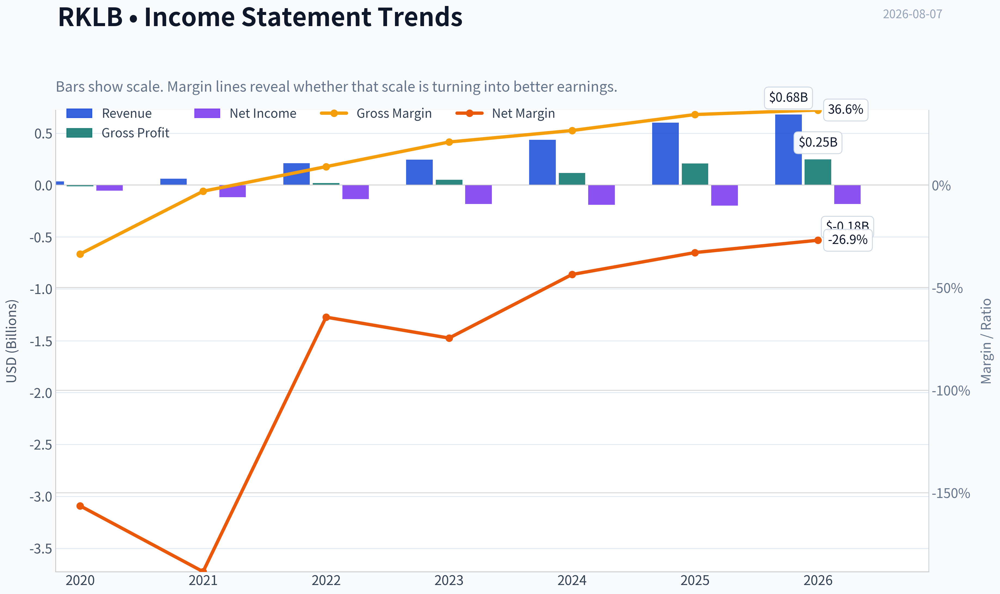

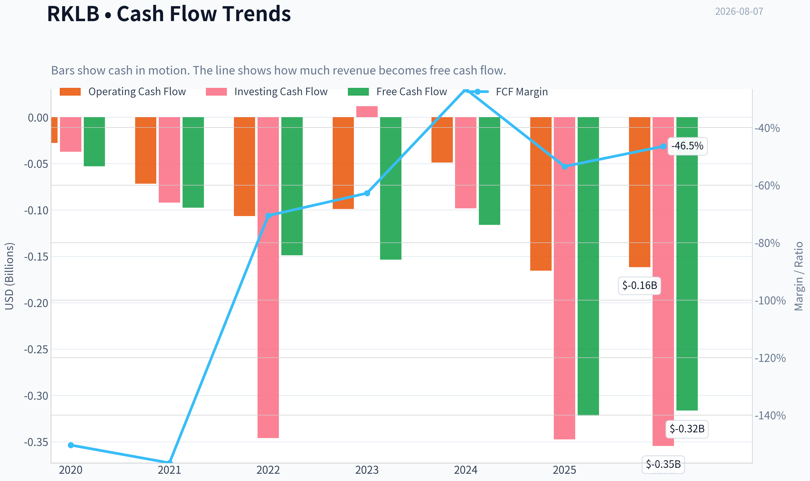

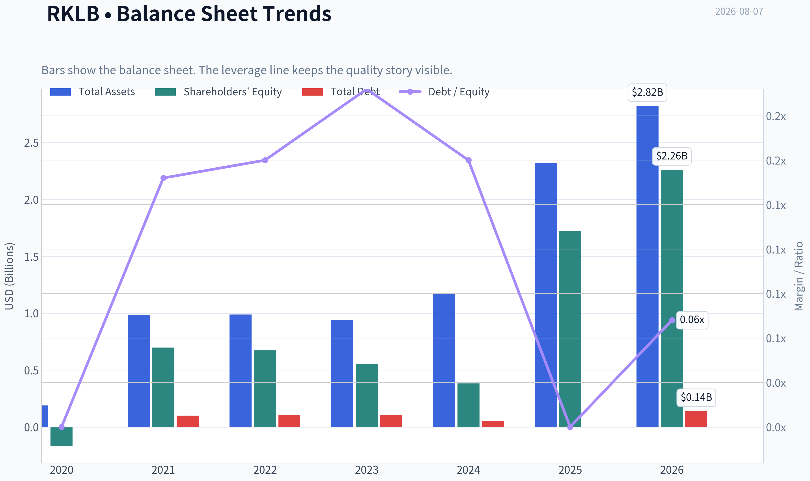

This graph tracks the profitability and return metrics (ROE, ROIC, Margins) of **RKLB** over the past decade, highlighting capital efficiency trends.

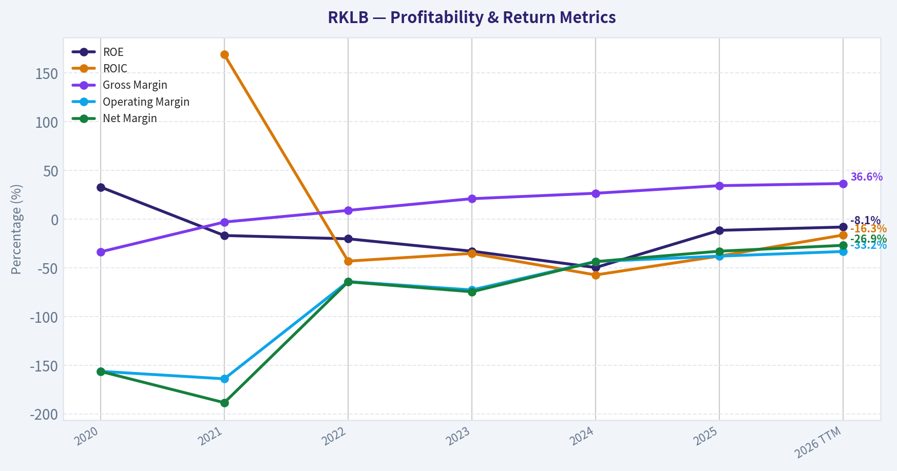

This chart illustrates the financial health of **RKLB** over the last 10 years, mapping cash equivalents and free cash flow against total obligations (Debt).

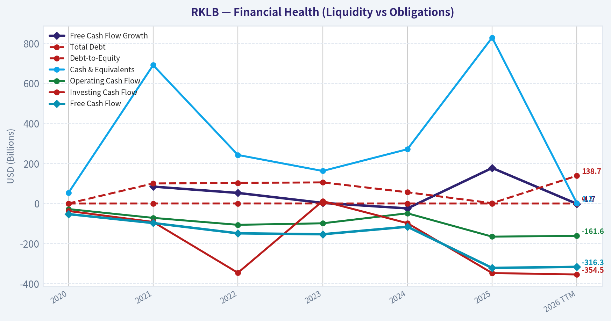

---

### Intrinsic Value Analysis (Buffett)

> *Following Warren Buffett's value investing philosophy: Circle of Competence, Economic Moat, Management Quality, and Margin of Safety.*

#### Intrinsic Value Snapshot

Price is what you pay. Intrinsic value is what the business may be worth based on the cash it can create for owners over time. We show a range, not one magic number.

- Current Price: $82.83
- Value Range (conservative to optimistic across both DCF methods): $1.76 to $1.76

##### Owner Earnings (Buffett Method)
- Net Income: $-198,209,000.00
- Depreciation & Amortization: $43,935,000.00
- Capital Expenditures: $-156,285,000.00
- Working Capital Changes: $-58,777,000.00
- Owner Earnings: $-139,432,000.00

##### Intrinsic Value
###### Buffett Method
Uses owner earnings. Stricter, and usually more conservative.
- Conservative: $1.76
- Average: $1.76
- Optimistic: $1.76
- Discount Rate: N/A

###### Cash Flow Method
Uses free cash flow. Better for companies spending heavily today to grow tomorrow.
- Conservative: $1.76
- Average: $1.76
- Optimistic: $1.76
- Discount Rate: N/A

ANALYST STANCE: **AVOID**

#### RKLB Buffett-Style Investment Report - Rocket Lab USA

Rocket Lab is an exciting space infrastructure company, but at **$83 per share and a $51.75 billion market capitalization**, the stock price requires an extremely optimistic future. The company has strong revenue growth and real technical credibility, but it remains unprofitable, free cash flow negative, and valued at a level far above current owner earnings power. This is not a solvency-driven rejection; it is a valuation and business-quality mismatch.

---

#### 1. Factor Scorecard

| Factor | Score | Evidence |
|---|---:|---|
| Circle of Competence & Business Simplicity | 3.0 / 5 | Rocket Lab makes money from launch services, spacecraft components, satellite systems, and government/commercial space contracts. The business is understandable, but long-term economics are harder to forecast because launch cadence, defense awards, manufacturing scale, and competitive dynamics matter heavily. |
| Moat Test | 2.5 / 5 | Rocket Lab has technical know-how, mission heritage, and government credibility, but gross margin is only **34.4%**, below the 40% threshold that often signals strong pricing power. SpaceX remains a formidable competitor, and the moat is still developing rather than proven. |
| Management Quality & Capital Allocation | 3.0 / 5 | Founder-led leadership under Peter Beck is a positive, and the company has pursued vertical integration and strategic capabilities. However, capital allocation is still unproven because the business has not yet demonstrated durable profitability or positive free cash flow. |
| Industry Structure | 2.5 / 5 | Space infrastructure has high barriers to entry and attractive long-term demand, especially defense and satellite markets. But it is capital intensive, technically risky, and competitively pressured by better-capitalized players. |
| Gate 5 - Quality/Solvency Hard Floor | Not Tripped | Fundamentals are growth-oriented rather than deteriorating: revenue growth is **38.0% YoY** and current ratio is **4.08**. The company is loss-making and FCF negative, but the hard distress floor is not triggered. |

**Key Takeaways:** Rocket Lab is not a broken company; it is a promising but still speculative industrial technology business. The largest problem is not immediate solvency, but the gap between today's financial output and the valuation implied by the stock price. Buffett-style investors should distinguish between an exciting company and an attractive investment.

---

#### 2. Moat Analysis

| Moat Source | Assessment | Evidence |
|---|---|---|
| Intangible Assets | Moderate | Rocket Lab has brand credibility in small launch and space systems, plus a track record of successful missions. However, the brand does not yet appear to confer consumer-style pricing power. |
| Switching Costs | Emerging | Government and aerospace customers value reliability, certification, and mission history. Once designed into spacecraft or defense programs, switching can be costly, but this advantage is still scaling. |
| Cost Advantage | Unproven | Vertical integration could become a cost advantage, but current profitability does not yet prove superior unit economics. |
| Network Effects | Weak | Launch and space systems do not have classic network effects. Scale helps, but each program remains operationally complex and capital demanding. |
| Moat Rating | Narrow / Developing | The company has real capabilities, but the moat is not yet wide, dominant, or financially proven. |

**Key Takeaways:** Rocket Lab has the beginnings of a moat through mission history, engineering capability, and government credibility. But a Buffett-quality moat usually shows up in pricing power, high returns on capital, and resilient free cash flow. Rocket Lab has not yet reached that stage.

---

#### 3. Management Quality Assessment

| Management Test | Assessment |
|---|---|
| Owner Mentality | Positive founder-led culture; Peter Beck's long-term vision is a meaningful asset. |
| Candor & Execution | Operational credibility is improving, supported by successful launches and recent contract wins. |
| Capital Allocation | Still unproven. The company is investing heavily in growth, but shareholders have not yet seen durable positive free cash flow or high ROIC. |
| Use of Debt / Dilution Risk | Balance sheet liquidity appears adequate, but continued negative FCF may require future capital raises if profitability does not arrive quickly. |

**Key Takeaways:** Management deserves credit for building a real aerospace platform rather than a promotional concept. Still, Buffett's test is not vision alone; it is whether retained capital produces high, durable per-share value. Rocket Lab has not yet proven that outcome.

---

#### 4. Financial Summary

| Metric | Current / TTM |
|---|---:|
| Share Price | $83.00 |
| Market Capitalization | $51.75B |
| P/E Ratio | N/A |
| ROE | -11.5% |
| Gross Margin | 34.4% |
| Revenue Growth YoY | 38.0% |
| Free Cash Flow Yield | -0.6% |
| Current Ratio | 4.08 |
| Headline Intrinsic Value | $1.76 / share |
| Margin of Safety vs. Price | -4600.7% |

**Key Takeaways:** Rocket Lab is growing quickly, but the company is still not profitable on a conventional earnings basis and is free cash flow negative. The balance sheet has near-term liquidity, but the valuation is already discounting a much larger and more profitable business than exists today. The current price leaves essentially no room for execution mistakes.

---

#### 5. Owner Earnings Calculation

Buffett's preferred metric is:

| Component | Current Assessment |
|---|---:|
| Net Income | Negative |
| Plus: Depreciation & Amortization | Positive add-back |
| Less: Maintenance CapEx | Material, given aerospace manufacturing and launch infrastructure |
| Less: Working Capital Increases | Growth business likely requires working capital investment |
| Estimated Current Owner Earnings Quality | Weak / not yet durable |
| Normalized Owner Earnings Implied by No-Growth IV | ~$0.18 per share |
| Aggregate Normalized Owner Earnings Implied | ~$110M |

**Key Takeaways:** Rocket Lab's true owner earnings are not yet strong or predictable. Even using a normalized owner earnings estimate implied by the valuation model, the business generates only about **$0.18 per share** of economic earnings against an **$83** stock price. That is an enormous valuation gap.

---

#### 6. Three-Scenario DCF Valuation

Using normalized owner earnings of approximately **$0.18 per share** and a 10% discount rate:

| Scenario | Assumption | Estimated Intrinsic Value |
|---|---|---:|
| A - No Growth | Owner earnings capitalized at 10% | $1.76 |
| B - GDP Growth | 3% perpetual growth | $2.59 |
| C - Historical Growth Haircut | 10% growth for 10 years, then 3% terminal growth | ~$4.35 |

**Key Takeaways:** Even generous growth assumptions do not come close to the current $83 share price when starting from today's owner earnings base. The stock does not merely require growth; it requires a dramatic future margin expansion and scale transformation. That may be possible, but it is not a Buffett-style margin of safety.

---

#### 7. Margin of Safety Analysis

| Valuation Measure | Value |
|---|---:|
| Current Price | $83.00 |
| Headline Intrinsic Value | $1.76 |
| Upside / Downside to Headline IV | -97.9% |
| Margin of Safety | -4600.7% |
| Quality-Scaled Required Margin of Safety | At least 35-50%, given unproven profitability and narrow developing moat |
| Actual Margin of Safety | None |

**Key Takeaways:** Rocket Lab trades far above conservative intrinsic value. A wonderful company can be worth buying at a fair price, but Rocket Lab has not yet proven wonderful-company economics. At today's price, the stock requires heroic assumptions rather than conservative underwriting.

---

#### 8. Final Buffett Scorecard

| Criterion | Weight | Score | Weighted Contribution |
|---|---:|---:|---:|
| Moat Width & Durability | 25% | 2.5 | 0.63 |
| Valuation / Margin of Safety | 20% | 0.5 | 0.10 |
| Capital Returns - ROIC vs. WACC | 15% | 1.0 | 0.15 |
| Business Understanding & Predictability | 12% | 3.0 | 0.36 |
| Management Quality & Capital Allocation | 12% | 3.0 | 0.36 |
| Reinvestment Runway | 8% | 4.0 | 0.32 |
| Balance Sheet Strength | 4% | 3.5 | 0.14 |
| Industry Structure | 4% | 2.5 | 0.10 |
| **Total Score** | **100%** |  | **2.16 / 5** |

**Key Takeaways:** Rocket Lab scores well on reinvestment runway and reasonably on management, but poorly on valuation, current returns on capital, and proven moat durability. The weighted score falls below the Buffett threshold for a compelling investment. The business may succeed, but the stock already prices in too much success.

---

#### 9. Investment Stance

| Category | View |
|---|---|
| Stance | **AVOID** |
| Conviction | High |
| Primary Reason | Extreme overvaluation versus current owner earnings and intrinsic value |
| Secondary Reason | Negative ROE, negative free cash flow yield, and unproven high-return economics |
| What Would Change the View | A much lower stock price, sustained positive FCF, rising gross margins, improving ROIC, and evidence that space systems can produce durable high-margin recurring revenue |

**Key Takeaways:** Rocket Lab is a legitimate company with an exciting mission and real revenue growth, but the stock is priced as though the hard part has already been accomplished. From a Buffett perspective, this is a business to admire from a distance, not one to buy at today's valuation. The appropriate stance is **AVOID** until price and proven economics become far more favorable.
#### Valuation Bridge

This bridge places the current market price beside each intrinsic value lens so readers can see whether upside depends on one method or shows up across several methods.

| Scenario | Intrinsic Value / Share |
| --- | ---: |
| Buffett Method | $1.76 |
| Cash Flow Method | $1.76 |
| Damodaran Method | $-16.69 |
| Current Price | $82.83 |

#### Key Takeaways

If one method is far above the others, the upside case depends on a specific modelling assumption. When several methods cluster together, the valuation story is more robust.

#### Valuation Visuals

This comparison chart from *Latest Earnings Snapshot* stacks current figures against historical benchmarks for **RKLB**, making it easy to see where the company trades relative to its own averages.

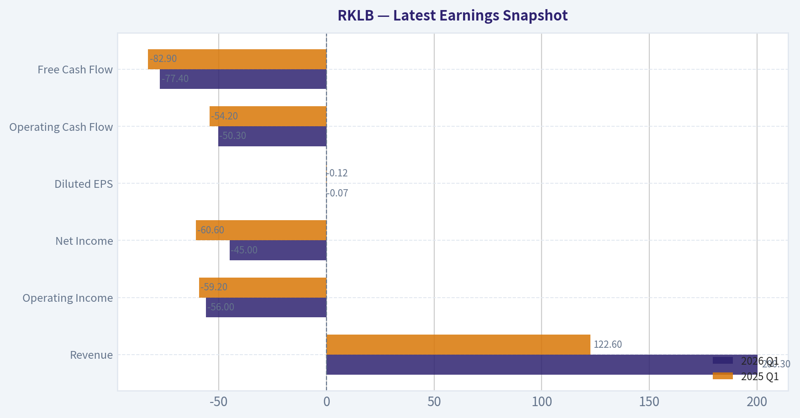

This comparison chart from *Current vs Historical Average Comparison* stacks current figures against historical benchmarks for **RKLB**, making it easy to see where the company trades relative to its own averages.

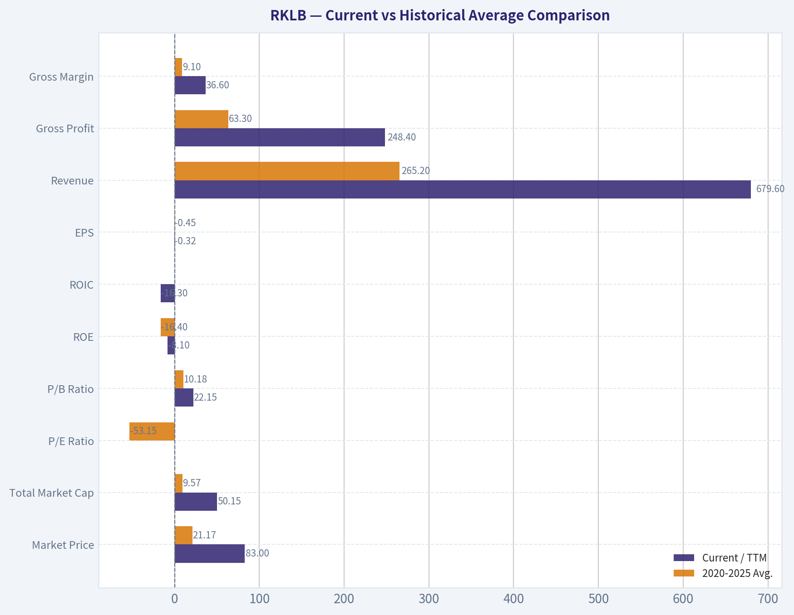

This comparison chart from *Balance Sheet and Financial Strength* stacks current figures against historical benchmarks for **RKLB**, making it easy to see where the company trades relative to its own averages.

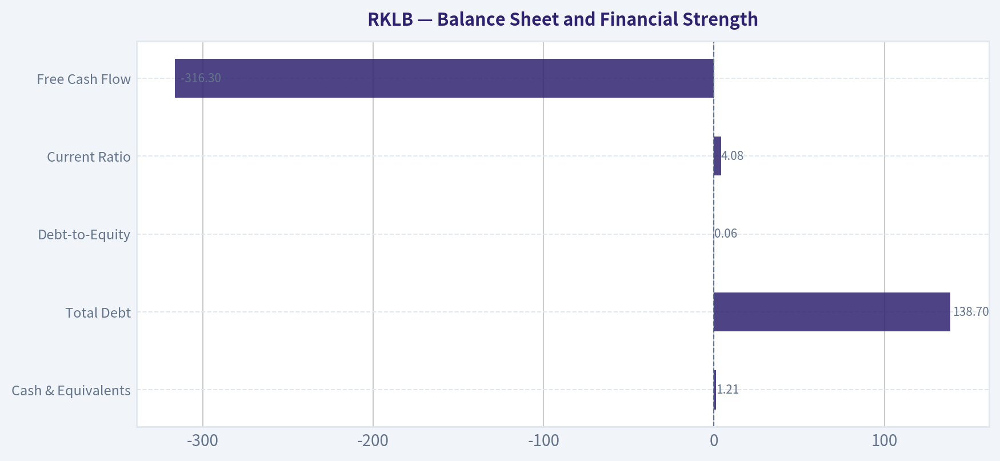

This comparison chart from *Financial Summary* stacks current figures against historical benchmarks for **RKLB**, making it easy to see where the company trades relative to its own averages.

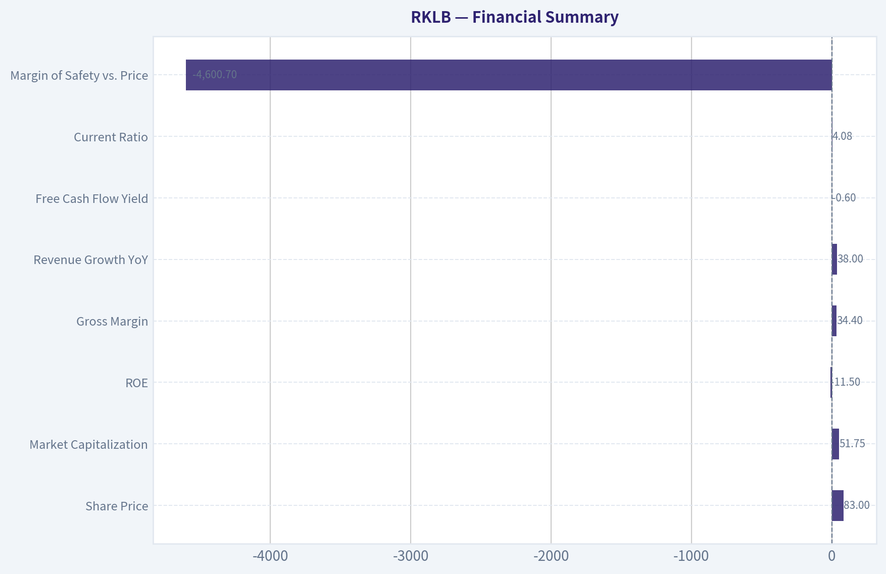

---

### Trend & Growth Analysis (Lynch/Druckenmiller/Fisher)

> *Following Peter Lynch's GARP, Stanley Druckenmiller's macro-aware approach, and Philip Fisher's scuttlebutt methodology.*

ANALYST STANCE: **WATCH**

#### Rocket Lab (RKLB) Growth Investment Report - 2026-08-07

Rocket Lab is a high-quality space infrastructure company with real inflection potential, but at **$83 per share and a $51.75B market cap**, the stock already prices in a large portion of the long-term dream. The business has the ingredients Lynch, Druckenmiller, and Fisher would like - revenue growth, secular tailwinds, defense demand, launch cadence, and vertical integration - but valuation discipline prevents an **ADVOCATE** stance today.

---

#### 1. Lynch Classification

| Category | Assessment |
|---|---|
| Lynch Type | **Fast Grower / Emerging Category Leader** |
| Current Growth | Revenue growth around **38% YoY** |
| Profitability | Still unprofitable; P/E not meaningful |
| Balance Sheet | Strong liquidity, current ratio around **4.1x** |
| Investor Fit | High-risk growth investors only |
| Stance | **WATCH** |

**Key Takeaways:** Rocket Lab fits the Lynch "fast grower" bucket because revenue is growing well above 20% and the company operates in a large, expanding market. However, the valuation is no longer cheap, and profitability has not yet caught up with the growth story. This is a promising company, but not an obvious bargain at the current price.

---

#### 2. The Story in 3 Bullets

- Rocket Lab is building an end-to-end space company: small launch with Electron, medium launch with Neutron, spacecraft components, satellite manufacturing, and mission services.
- The company benefits from rising demand for defense space systems, commercial satellite constellations, hypersonics, national security launches, and resilient space infrastructure.
- If Neutron succeeds, Rocket Lab could move from niche small-launch provider to a broader competitor in medium-lift launch and vertically integrated space systems.

---

#### 3. TAM Analysis and 10x Test

| Metric | Estimate / View |
|---|---:|
| Current market cap | **$51.75B** |
| Current price | **$83** |
| Recent / forward revenue run-rate proxy | About **$0.9B-$1.0B** annualized, using Q2 expectations near $231.6M |
| 10x revenue test | **$9B-$10B revenue** |
| Relevant TAM | Space launch, satellite systems, national security space, spacecraft components, and mission services; plausibly **$100B+** long term |
| 10x feasibility | **Yes, possible** if Rocket Lab becomes a full-stack space prime |
| TAM constraint | Execution, not market size |

**Key Takeaways:** Rocket Lab passes the 10x revenue runway test because a $9B to $10B revenue company would still be a modest share of the broader space infrastructure and defense space market. The limiting factor is not TAM size; it is whether Rocket Lab can execute Neutron, scale manufacturing, win large government programs, and generate durable margins.

---

#### 4. Revenue Growth Trend

| Indicator | Data / Interpretation |
|---|---|
| YoY revenue growth | **38%** |
| Q2 revenue expectation cited in news | Around **$231.6M** |
| Recent catalyst | Reported **$397M Space Force contract** win |
| Growth pattern | High growth, but needs confirmation of acceleration |
| Lynch view | Attractive fast-grower growth rate |
| Druckenmiller view | Potential inflection if defense contracts and Neutron scale together |

**Key Takeaways:** Revenue growth is strong at roughly 38%, which keeps Rocket Lab in fast-grower territory. The key question is whether growth is merely continuing or truly accelerating. The Space Force contract and Neutron ramp could create an inflection point, but the market already appears to be pricing in a lot of future success.

---

#### 5. Unit Economics and Efficiency

| Metric | Current View |
|---|---:|
| Gross margin | **34.4%** |
| FCF yield | **-0.6%** |
| Estimated FCF dollars | Roughly **-$310M**, based on market cap and FCF yield |
| LTV/CAC | Not applicable / not disclosed; not a subscription business |
| NRR | Not applicable |
| Rule of 40 proxy | Weak, because FCF remains negative while growth is high |
| Balance sheet liquidity | Strong, current ratio around **4.1x** |

**Key Takeaways:** Rocket Lab has decent gross margins for a complex aerospace hardware and services business, but free cash flow remains negative. This is acceptable during a major investment phase, especially with Neutron development, but investors need to see a credible path toward operating leverage. The balance sheet appears liquid enough for near-term execution risk, but valuation leaves little room for disappointment.

---

#### 6. Inflection Point Assessment

| Inflection Type | Status | Evidence |
|---|---|---|
| Product cycle | **Potentially strong** | Neutron could expand Rocket Lab's launch addressable market |
| Market share | **Emerging** | Electron cadence and space systems wins support credibility |
| Margin | **Not yet proven** | Gross margin positive, but FCF still negative |
| TAM | **Strong** | Defense space, satellite infrastructure, and launch demand expanding |
| Competitive | **Mixed** | SpaceX remains dominant; Rocket Lab may win as differentiated second source |
| Government contracts | **Positive** | Recent $397M Space Force contract is a meaningful validation point |

**Key Takeaways:** Rocket Lab has several possible inflection points, especially around Neutron, defense contracts, and space systems scale. The most important one is margin inflection, which has not yet clearly arrived. The stock will likely need evidence that revenue growth can convert into cash flow before the valuation becomes easier to justify.

---

#### 7. Macro Setup

| Macro Factor | Impact on RKLB |
|---|---|
| Interest rates | Lower rates would help long-duration growth stocks |
| Defense spending | Supportive, especially for resilient space and national security assets |
| AI and data demand | Indirectly supportive through satellite and connectivity infrastructure |
| Space economy growth | Strong secular tailwind |
| Risk appetite | Important; RKLB remains valuation-sensitive |
| Government procurement cycle | Positive but lumpy |

**Key Takeaways:** The macro backdrop is broadly supportive for Rocket Lab because defense space, satellite infrastructure, and national security demand are secular growth areas. Falling rates would further support the valuation of long-duration growth names. However, the company is still exposed to government contract timing, launch delays, and broad market risk appetite.

---

#### 8. Fisher 15 Points Score

| Fisher Point | Score / 5 | Comment |
|---|---:|---|
| Products with sizable market potential | 5 | Large space infrastructure opportunity |
| Management determination for new products | 5 | Neutron and vertical integration show ambition |
| Effective R&D | 4 | Strong technical record, but Neutron still execution risk |
| Above-average sales organization | 4 | Government and commercial traction improving |
| Worthwhile profit margin | 3 | Gross margin solid, net margin not yet attractive |
| Improving profit margins | 3 | Potential exists, not proven enough |
| Labor/personnel relations | 3 | Limited outside visibility |
| Executive relations | 4 | Founder-led culture appears strong |
| Management depth | 4 | Aerospace execution requires deep bench |
| Cost analysis/accounting | 3 | Hardware complexity makes cost control critical |
| Outstanding aspects/moat | 4 | Vertical integration, launch heritage, space systems |
| Long-range profit outlook | 4 | Strong if scale is achieved |
| Dilution risk | 3 | Capital intensity remains a risk |
| Candor with difficulties | 4 | Generally credible public communication |
| Integrity | 4 | No major red flag from available data |
| **Total** | **57/75** | **Good, not outstanding yet** |

**Key Takeaways:** Rocket Lab scores well on Fisher's product potential, innovation, technical ambition, and long-term market opportunity. The score is held back by unproven profitability, capital intensity, and the execution burden of scaling a complex aerospace business. Overall, this is a good Fisher-style company, but not yet a great one at any price.

---

#### 9. Valuation Analysis

| Valuation Metric | Assessment |
|---|---:|
| Market cap | **$51.75B** |
| P/E | N/A, company unprofitable |
| PEG | N/A |
| Implied annualized P/S using Q2 revenue run-rate | About **56x** |
| FCF yield | **-0.6%** |
| Shared DCF intrinsic value estimate | **$1.76** |
| Margin of safety versus price | Deeply negative |
| Valuation conclusion | **Very expensive** |

**Key Takeaways:** Valuation is the biggest problem. Even using an optimistic near-term revenue run-rate, Rocket Lab trades at roughly 56 times sales, which is extremely demanding for a hardware-heavy aerospace company that is still free-cash-flow negative. The market is valuing Rocket Lab less like a normal aerospace company and more like a future space infrastructure monopoly or dominant second-source prime.

#### 3-5 Year Revenue Multiple Scenario

| Scenario | Revenue Assumption | P/S Multiple | Implied Market Cap | Interpretation |
|---|---:|---:|---:|---|
| Bear | $1.8B | 8x | $14.4B | Major downside if growth disappoints |
| Base | $3.0B | 12x | $36.0B | Still below current market cap |
| Bull | $5.0B | 15x | $75.0B | Upside requires major execution success |
| Hyper-bull | $7.0B+ | 15x-20x | $105B-$140B | Requires Neutron success and prime-like scale |

**Key Takeaways:** The current $51.75B market cap already assumes significant future success. In a reasonable base case, the stock may be ahead of fundamentals. Meaningful upside from here likely requires Rocket Lab to become a much larger defense and space systems platform, not just a successful small-launch company.

---

#### 10. Growth Investor Scorecard

| Criterion | Weight | Score / 5 | Weighted Score |
|---|---:|---:|---:|
| The Story | 10% | 4.5 | 0.45 |
| TAM and Runway | 20% | 4.5 | 0.90 |
| Revenue Growth | 20% | 4.0 | 0.80 |
| Unit Economics | 15% | 2.5 | 0.38 |
| Competitive Position | 10% | 3.5 | 0.35 |
| Management Quality | 10% | 4.0 | 0.40 |
| Macro Setup | 5% | 4.0 | 0.20 |
| Profitability Path | 5% | 2.5 | 0.13 |
| Valuation | 5% | 1.0 | 0.05 |
| **Total** | **100%** |  | **3.66 / 5.0** |

**Key Takeaways:** Rocket Lab scores well on story, TAM, revenue growth, management, and macro tailwinds. The main deductions are valuation, negative free cash flow, and the still-unproven profitability path. A score of 3.66 supports a **WATCH** stance, close to advocate quality as a business, but not advocate quality as a stock at this price.

---

#### 11. Position Size Stance

| Investor Type | Suggested Stance |
|---|---|
| Existing long-term holder with low cost basis | **Hold / trim only if position oversized** |
| New investor | **Wait for better entry or proof of margin inflection** |
| Aggressive growth investor | Tiny starter only, maximum **0.5%-1.0%** |
| Concentrated portfolio | Avoid initiating at current valuation |
| Add zone | Prefer pullback or clear evidence of Neutron and cash-flow inflection |

**Key Takeaways:** Rocket Lab may be worth owning for investors who already bought much lower, because the long-term story remains intact. For new capital, the risk-reward is less attractive because the market cap already reflects a very optimistic future. Position sizing should be conservative until valuation or fundamentals improve.

---

#### 12. Key Catalysts and Risks

| Category | Catalysts |
|---|---|
| Neutron | Successful first launch, customer wins, reusability progress |
| Defense | Additional Space Force, SDA, missile defense, and national security contracts |
| Space Systems | Higher backlog, larger satellite manufacturing awards, margin expansion |
| Financials | Revenue acceleration, positive FCF roadmap, operating leverage |
| Market | Falling rates and renewed appetite for long-duration growth stocks |

**Key Takeaways:** The biggest upside catalysts are Neutron success and more large defense contracts. If Rocket Lab proves it can scale from launch provider to full-stack space prime, the current valuation becomes more defensible. Financial catalysts matter too; investors need to see revenue growth convert into cash flow.

| Category | Risks |
|---|---|
| Valuation | Current price requires very strong execution |
| Competition | SpaceX remains the dominant launch competitor |
| Execution | Neutron delays, launch failures, manufacturing bottlenecks |
| Margins | Hardware-heavy aerospace may never earn software-like multiples |
| Dilution | Capital needs could rise if cash burn persists |
| Contract timing | Government revenue can be lumpy and politically exposed |

**Key Takeaways:** The largest risk is that Rocket Lab becomes a successful company but the stock still underperforms because expectations are too high. SpaceX competition, Neutron execution, and negative free cash flow are the key operational concerns. At this valuation, even minor delays or margin disappointment could cause a sharp reset.

---

#### Bottom Line

Rocket Lab is one of the more compelling public space companies and has genuine ten-bagger characteristics at the business-model level: huge TAM, strong secular tailwinds, vertical integration, and a credible shot at becoming a national security space platform. But at **$51.75B market cap**, the stock has moved far ahead of current fundamentals.

This is a **WATCH**, not an **AVOID**, because the company is strategically valuable and may be entering a real inflection period. It is not an **ADVOCATE** because the valuation demands near-flawless execution. For new money, wait for either a major pullback or hard evidence that Neutron, defense contracts, and space systems scale can drive sustained free cash flow.

#### Growth & Scorecard Visuals

This comparison chart from *Growth Analysis* stacks current figures against historical benchmarks for **RKLB**, making it easy to see where the company trades relative to its own averages.

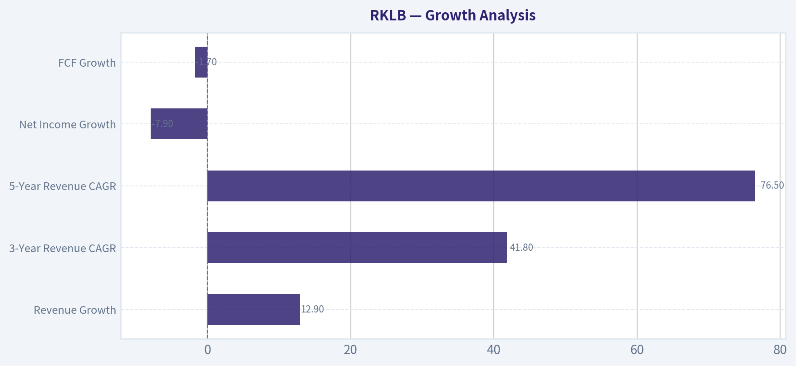

---

### Market Technical Analysis

ANALYST STANCE: **WATCH**

#### RKLB Technical Indicator Report - As of 2026-08-07

RKLB is showing a **short-term rebound attempt inside a still-damaged medium-term structure**. The stock has recovered sharply from the late-July low, momentum has improved, and RSI has moved back into neutral-positive territory. However, price remains below the falling 50-day SMA, MACD is still below zero, and the stock is only modestly above its long-term 200-day trend area. This favors a **WATCH** stance rather than an aggressive bullish call.

| Metric / Indicator | Latest Reading | Interpretation |
|---|---:|---|
| Short-term trend: 10 EMA | 72.99 | Short-term momentum has turned higher after a late-July washout. |
| Medium-term trend: 50 SMA | 90.55 | Price remains below this level, so the medium-term trend is still under pressure. |
| Long-term trend: 200 SMA | 77.98 | Price appears to be reclaiming or testing the long-term trend zone. |
| MACD | -3.66 | Still negative, but improving meaningfully from late July. |
| MACD Signal | -6.60 | MACD is above the signal line, suggesting bullish momentum repair. |
| RSI | 56.24 | Recovered from oversold/near-oversold levels into neutral-positive territory. |
| ATR | 6.68 | Volatility remains elevated, but lower than late June and early July. |
| VWMA | 69.32 | Price strength is now above the volume-weighted average, supporting the rebound. |

Key Takeaways: RKLB has transitioned from a deeply oversold decline into a tactical recovery phase. The short-term indicators are improving, but the stock has not yet repaired the medium-term downtrend because it remains below the 50-day SMA. Traders should treat the current setup as a developing rebound, not yet a confirmed full trend reversal.

---

#### Why These 8 Indicators Are Most Relevant

| Indicator | Why It Was Selected | What It Adds |
|---|---|---|
| `close_10_ema` | Captures the recent turn in short-term momentum. | Helps identify whether the rebound is gaining traction. |
| `close_50_sma` | Measures the medium-term trend after RKLB's large correction. | Key resistance and trend-confirmation level. |
| `close_200_sma` | Defines the long-term bull/bear boundary. | Helps separate a pullback from a broader structural breakdown. |
| `macd` | Measures directional momentum. | Shows whether downside momentum is fading. |
| `macds` | Complements MACD by identifying crossover behavior. | Confirms whether momentum is improving or failing. |
| `rsi` | Tracks overbought/oversold conditions and momentum recovery. | Useful after the July selloff and August bounce. |
| `atr` | Measures volatility and risk. | Critical for position sizing and stop placement in a high-beta stock. |
| `vwma` | Incorporates volume into trend assessment. | Helps judge whether the rebound has volume-confirmed support. |

Key Takeaways: The selected indicators cover trend, momentum, volatility, and volume without excessive redundancy. This mix is appropriate because RKLB is not in a clean trend; it is in a volatile recovery attempt after a major drawdown. The most important confirmation now would be price holding above the 200-day SMA area and eventually reclaiming the 50-day SMA.

---

#### Trend Structure: Short-Term Recovery, Medium-Term Damage

The **10 EMA has risen to 72.99**, climbing steadily from the late-July trough. This is an important short-term improvement because the 10 EMA had been falling throughout July as price cascaded lower. The fact that price is now trading above the 10 EMA suggests buyers have regained near-term control.

However, the **50 SMA is still much higher at 90.55 and falling**. That is a major caution flag. A falling 50-day average means the medium-term trend remains in a corrective phase. Until RKLB can reclaim and hold above the 50 SMA, rallies should be viewed as **countertrend rebounds within a broader correction**, not yet as confirmed trend resumption.

The **200 SMA is at 77.98 and rising slowly**, which is more constructive. RKLB's ability to recover back toward and potentially above this level suggests the long-term uptrend has not fully broken. But because the stock has recently been extremely volatile, a simple move above the 200 SMA is not enough by itself; traders should watch whether the 200 SMA becomes support on pullbacks.

#### Momentum: Improving, But Not Fully Bullish Yet

MACD remains below zero at **-3.66**, which means the broader momentum backdrop is still negative. That said, MACD has improved substantially from the late-July zone near **-9.5**, showing that bearish momentum has weakened. More importantly, MACD is now above the MACD signal line, which is at **-6.60**. This is a bullish crossover-style condition and often appears during early recovery attempts.

The nuance is that this is a **bullish momentum repair signal**, not a full bullish trend signal. For a stronger confirmation, MACD would ideally continue rising toward the zero line. If MACD stalls below zero while price approaches resistance near the 50 SMA, that would increase the risk of another failed rally.

RSI reinforces the recovery view. RSI has rebounded to **56.24**, up from a late-July low near **29.95**. That move out of oversold territory indicates the selling pressure has eased. RSI is not overbought, so there is room for additional upside, but the stock is no longer a deeply discounted oversold bounce either.

#### Volatility and Risk: Still Elevated, But Stabilizing

ATR is at **6.68**, down from readings above **10** in late June. This means RKLB's daily trading range has compressed from the peak panic phase, but volatility is still high in absolute terms. A $6-7 ATR on a stock trading around the upper-70s to low-80s range implies large percentage swings remain normal.

This has two implications. First, tight stops are likely to be triggered easily. Second, position sizing should be conservative unless the trader is specifically pursuing high-volatility momentum. A logical risk framework would use wider technical levels rather than very narrow intraday stops.

The **VWMA is 69.32**, and price is now above it, which supports the idea that the rebound has improved participation. During much of July, VWMA trended downward sharply, reflecting persistent volume-weighted selling pressure. The current recovery above VWMA is constructive, but traders should watch whether future up days occur on expanding volume and down days occur on lighter volume.

#### Key Price Zones to Watch

| Zone | Approximate Level | Importance |
|---|---:|---|
| Immediate support | 72-73 | Near the 10 EMA; first area where dip buyers should appear. |
| Key long-term support / pivot | 78 | Around the 200 SMA; holding this area would be constructive. |
| Rebound confirmation zone | 85-90 | A move into this area would test whether momentum can continue. |
| Major medium-term resistance | 90-91 | Near the falling 50 SMA; reclaiming this would materially improve the chart. |
| Failure zone | Below 69-70 | Losing VWMA and short-term support would weaken the rebound. |
| Major downside risk area | 58-60 | Late-July low zone; a retest would signal recovery failure. |

Key Takeaways: The most important upside test is the 90-91 region, where the falling 50-day SMA sits. The most important support area is around 78, near the 200-day SMA, followed by the 72-73 short-term trend zone. If RKLB holds above those areas, the recovery remains viable; if it falls back below 69-70, the rebound would look much weaker.

---

#### Trading Interpretation

For aggressive traders, RKLB may be a **tactical momentum-rebound candidate**, especially if it continues to hold above the 10 EMA and 200 SMA. The improving MACD crossover and RSI recovery support that view. However, the risk-reward becomes less attractive if price approaches the 50 SMA without stronger confirmation, because the 90-91 zone could attract sellers.

For swing traders, the cleaner setup would be either:

1. A pullback that holds above the 200 SMA / 10 EMA zone, followed by renewed buying; or
2. A decisive reclaim of the 50 SMA with strong volume and improving MACD.

For longer-term traders, the chart is not broken beyond repair, but it is not fully repaired either. The 200 SMA is still rising, which keeps the long-term structure alive. But the sharp fall from the May peak and the declining 50 SMA show that RKLB remains in a volatile post-parabolic correction.

#### Final Technical View

| Category | Assessment | Trader Implication |
|---|---|---|
| Short-term momentum | Improving | Rebound is active and buyers have regained some control. |
| Medium-term trend | Bearish-to-repairing | Still below the falling 50 SMA, so confirmation is incomplete. |
| Long-term trend | Cautiously constructive | Price is near or above the rising 200 SMA, which is important support. |
| Momentum indicators | Bullish repair, not full reversal | MACD crossover is positive, but MACD remains below zero. |
| RSI condition | Neutral-positive | No longer oversold; still not overbought. |
| Volatility | High but easing | Use wider stops and smaller position sizing. |
| Volume confirmation | Improving | Price above VWMA supports the bounce, but follow-through volume matters. |
| Overall stance | WATCH | Wait for either a confirmed breakout above 90-91 or a constructive pullback hold. |

Key Takeaways: RKLB's chart has improved meaningfully from the late-July low, but the recovery still needs confirmation. The bullish case strengthens if price holds above the 200-day SMA and later reclaims the 50-day SMA. Until then, the best stance is watchful and selective rather than aggressively bullish.

#### Market Visuals

This comparison chart from *Market Metrics Interpretation* stacks current figures against historical benchmarks for **RKLB**, making it easy to see where the company trades relative to its own averages.

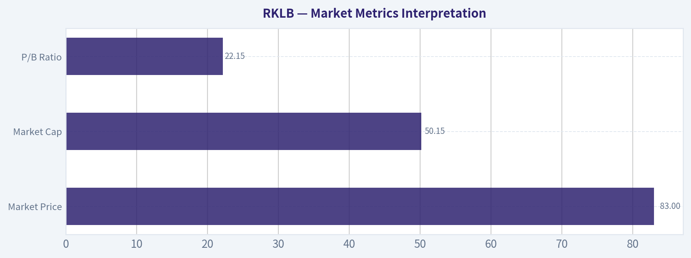

---

### Options Market Analysis

> *Reading options flow - put/call ratios, IV skew, and unusual activity - to gauge institutional positioning and event-driven risk.*

#### RKLB Options Flow Report - As of 2026-08-07

RKLB options are showing a clear **call-heavy near-term positioning profile**, with put/call ratios below the historical neutral baseline and several unusual upside call contracts trading at high volume relative to open interest. The signal is **bullish**, but with an important caveat: implied volatility is extremely elevated, meaning the market is pricing large moves and option buyers are paying very expensive premiums.

---

#### 1. Put/Call Ratio Analysis

| Expiration | Call Open Interest | Put Open Interest | Put/Call OI Ratio | Call Volume | Put Volume | Put/Call Volume Ratio |
|---|---:|---:|---:|---:|---:|---:|
| 2026-08-14 | 33,857 | 20,429 | 0.60 | 41,424 | 20,697 | 0.50 |
| 2026-08-21 | 93,971 | 41,856 | 0.45 | 17,527 | 8,561 | 0.49 |
| 2026-08-28 | 10,315 | 8,171 | 0.79 | 6,342 | 1,350 | 0.21 |
| **Near-Term Total** | **138,143** | **70,456** | **0.51** | **65,293** | **30,608** | **0.47** |

**Key Takeaways:** RKLB's near-term put/call open interest ratio is **0.51**, well below the historical neutral baseline of roughly **0.70**, showing a meaningful tilt toward calls. The volume ratio is also call-heavy at **0.47**, suggesting current trading activity is reinforcing the bullish/speculative call bias rather than merely reflecting stale open interest. The 2026-08-21 expiration is especially call-dominated, with nearly **94,000 call contracts** open versus roughly **42,000 puts**.

The put/call data points to **bullish positioning**, not defensive hedging. A ratio below 0.7 generally indicates more demand for upside exposure, although with high-growth names like RKLB, some call open interest may also reflect covered-call selling or retail speculation. Still, the combination of low OI ratio and low volume ratio suggests the dominant near-term options tone is **upside-seeking**.

---

#### 2. Implied Volatility Assessment

| Expiration | ATM Call IV | ATM Put IV | IV Read | Skew Interpretation |
|---|---:|---:|---|---|
| 2026-08-14 | 124.2% | 125.7% | Extremely elevated | Slight put premium |
| 2026-08-21 | 107.5% | 106.0% | Very elevated | Slight call premium |
| 2026-08-28 | 102.0% | 100.5% | Very elevated | Slight call premium |

**Key Takeaways:** RKLB's near-term ATM implied volatility is very high, ranging from about **100% to 126%**, indicating the market expects large price movement. The front-week expiration has a slight put IV premium, which may reflect short-term downside protection demand, but the following expirations show a modest call skew. Overall, the skew is not strongly bearish; it looks more like high-volatility speculative positioning with some short-term tail-risk hedging.

The IV level is elevated enough to suggest the market may be pricing an event, such as earnings, a launch-related catalyst, sector momentum, or broader risk appetite shifts. Without relying on an external catalyst calendar, the options market itself is signaling that traders expect **large near-term movement**. Importantly, high IV can make long calls and long puts expensive, so even if direction is right, option buyers may need a large move to overcome premium decay.

---

#### 3. Unusual Options Activity

| Expiration | Type | Strike | Volume | Open Interest | Vol/OI | IV | Moneyness / Positioning Read |
|---|---|---:|---:|---:|---:|---:|---|
| 2026-08-14 | Call | $90.00 | 8,497 | 1,625 | 5.2x | 125.7% | Likely near-the-money / active upside speculation |
| 2026-08-14 | Put | $47.50 | 6,519 | 57 | 114.4x | 219.5% | Far OTM crash hedge or speculative downside lottery ticket |
| 2026-08-28 | Call | $125.00 | 2,700 | 344 | 7.8x | 107.0% | Farther OTM upside chase into late August |
| 2026-08-14 | Call | $101.00 | 1,290 | 231 | 5.6x | 131.7% | OTM bullish positioning |
| 2026-08-14 | Call | $116.00 | 1,107 | 45 | 24.6x | 135.0% | Aggressive short-dated upside speculation |
| 2026-08-14 | Put | $82.00 | 823 | 109 | 7.6x | 122.2% | Nearer downside hedge or bearish short-term bet |

**Key Takeaways:** The unusual activity is dominated by **calls**, especially short-dated contracts expiring 2026-08-14 and one aggressive 2026-08-28 $125 call. The most striking put trade is the 2026-08-14 $47.50 put, where volume is over **114x open interest** and IV is extremely high at **219.5%**, suggesting a fresh tail-risk hedge or speculative crash bet rather than broad bearish positioning. Overall, unusual flow leans bullish, but the presence of very high-IV puts shows traders are also aware of sharp downside risk.

The unusual call activity appears consistent with **fresh directional upside bets**, because volume is significantly larger than open interest across several contracts. The 2026-08-14 $90 call has the largest unusual call volume and may be an important short-term magnet if the stock is trading near that area. The $101, $116, and $125 calls look more speculative, likely reflecting upside chase rather than conservative institutional hedging.

The $47.50 put is notable but should not dominate the signal by itself. A very far OTM put with massive volume-to-OI and extremely high IV can represent disaster insurance, a cheap convex hedge, or speculative retail-style downside lottery positioning. It does not outweigh the broader call-heavy volume and OI profile.

---

#### 4. Open Interest Concentration and Gamma Implications

| Expiration | Total Open Interest | Call Share of OI | Put Share of OI | Concentration Read |
|---|---:|---:|---:|---|
| 2026-08-14 | 54,286 | 62.4% | 37.6% | Short-term activity-heavy, call-skewed |
| 2026-08-21 | 135,827 | 69.2% | 30.8% | Largest OI concentration; likely most important near-term expiry |
| 2026-08-28 | 18,486 | 55.8% | 44.2% | Smaller OI base, still call-leaning |

**Key Takeaways:** The biggest expiration-level open interest concentration is 2026-08-21, with roughly **136,000 total contracts**, heavily tilted toward calls. This expiration is likely the most important near-term positioning zone for pinning, dealer hedging, and gamma-related effects. Strike-level full-chain open interest was not provided, so gamma wall identification must be treated as incomplete.

Based on the unusual activity table, the **$90 call** is the largest visible strike-level open interest among flagged unusual contracts, while the $101, $116, and $125 calls show fresh speculative upside interest. If RKLB trades near heavy call strikes into expiration, dealer hedging could amplify momentum on a breakout, particularly if market makers are short calls. Conversely, if price stalls below these call-heavy strikes, those options can decay quickly and contribute to a pinning effect.

Because the full strike-by-strike OI distribution is not available, confidence in exact "max pain" or gamma wall levels is limited. The most defensible conclusion is that **near-term gamma exposure is call-heavy**, with the 2026-08-21 expiration carrying the largest positioning weight.

---

#### 5. Overall Options Sentiment Signal

| Category | Read |
|---|---|
| Directional Bias | **Bullish** |
| Conviction | **Moderate** |
| Primary Driver | Low put/call ratios and unusual upside call volume |
| Main Risk | Extremely high IV and short-dated speculative positioning |
| Bearish Offset | Fresh downside put activity, especially the $47.50 and $82 puts |
| Best Interpretation | Bullish momentum/speculation with elevated event-risk premium |

**Key Takeaways:** The overall options signal for RKLB is **BULLISH**, driven primarily by call-heavy open interest, call-heavy volume, and multiple unusual call contracts trading at more than 5x open interest. However, the signal is not low-risk because IV is extremely elevated and some traders are buying aggressive downside protection. This is a bullish options tape, but one that reflects a volatile, event-sensitive setup rather than calm institutional accumulation.

RKLB options are showing **upside speculation with expensive volatility**. The put/call OI ratio of **0.51** and volume ratio of **0.47** are both meaningfully below the neutral baseline of ~0.7, indicating traders are favoring calls over puts. The unusual activity supports that interpretation, with short-dated upside call buying across the $90, $101, $116, and $125 strikes.

The caveat is that IV above 100% means the options market already expects a large move. That can be favorable for traders positioned before a major breakout, but it raises the hurdle for long premium strategies. A trader reading the options tape should view it as **bullish but volatile**, not as a clean low-risk long signal.

---

#### Summary Table

| Metric | Signal | Interpretation |
|---|---|---|
| Put/Call Ratio | **Bullish** | Near-term OI ratio of **0.51** and volume ratio of **0.47** are well below the ~0.7 neutral baseline |
| IV Level | **High Risk / Event-Priced** | ATM IV is extremely elevated, roughly **100%-126%** across near-term expirations |
| Skew Direction | **Slight Call Bias, Mixed Front-Week** | Front-week puts carry slight premium, but later expirations show mild call skew |
| Unusual Activity | **Bullish with Tail-Hedge Caveat** | Multiple unusual calls, especially $90, $101, $116, and $125; notable far OTM $47.50 put hedge |
| Overall Signal | **BULLISH** | Options flow favors upside speculation, though high IV and downside hedges lower confidence |

**Key Takeaways:** RKLB's options market is leaning **bullish**, with strong call demand and low put/call ratios across near-term expirations. The strongest warning is not bearish flow, but rather the extremely elevated IV, which means expectations are already very high. The best read is **bullish momentum positioning with elevated volatility risk**.

---

## Research Team Commentary

> *The Research Manager synthesizes the Bull vs Bear debate into action-free commentary. This is a pre-risk view, not the final stance.*

After reviewing the debate between our bull and bear analysts, the decision here is quite clear. The bull makes an incredibly compelling case for Rocket Lab as a business and an engineering marvel, highlighting its position as the only real commercial alternative to SpaceX and its smart pivot into vertically integrated space systems. However, the bear grounds us in the mathematical reality of value investing, and that is where the bull case completely falls apart.

Here is my core takeaway. We must decisively pass on Rocket Lab at this price. The company is a prime example of a fantastic technological achievement masquerading as an investable asset at its current valuation. At a 51.75 billion dollar market capitalization and a price of roughly 83 dollars a share, the stock is trading at 120 times trailing revenue with deeply negative returns on invested capital. This requires a level of heroic, flawless execution over the next decade that completely violates our requirement for a margin of safety.

Let me walk through the rationale from our value investing framework and how our past mistakes heavily inform this decision.

First, let us look at the reverse discounted cash flow reality, which the bear accurately dismantled. For Rocket Lab to justify a 51 billion dollar valuation, it would need to grow its revenue from roughly 420 million today to over 15 billion over the next decade, while simultaneously shifting from negative margins to 25 percent net margins. The bull points to a trillion dollar total addressable market to justify this, but we do not buy total addressable markets; we buy owner earnings. Space launch and hardware manufacturing are brutally capital intensive. They require constant, heavy reinvestment into launch pads, manufacturing facilities, and next-generation rocket R and D like Neutron. This is not an asset-light software compounder where incremental margins fall straight to the bottom line. It operates much more like the early railroad or aviation industries. As Buffett warned about aviation, transformational industries often destroy shareholder capital because the intense competition and heavy capital expenditure capture all the value, leaving nothing for the equity holders.

Second, this brings me directly to the lessons we learned from our missteps with Roper Technologies. With Roper, we learned the hard way that when a company has a great ecosystem narrative but its return on invested capital is deteriorating or deeply negative, you cannot give it a pass. Rocket Lab currently has a return on invested capital of negative 22.4 percent. The bull defends this as a temporary investment phase for Neutron, and while that may be strategically true, we cannot pay a premium for a software-like ecosystem when the underlying economics are currently destroying capital. Furthermore, Rocket Lab is rolling up space component companies to build this ecosystem. Our Roper experience taught us that serial acquisitions executed while ROIC is deeply negative often mask underlying capital inefficiencies. We cannot pay up for that risk.

Third, we must apply the lesson we learned from Reddit. With Reddit, we learned that chasing a high-multiple stock after a vertical momentum gap-up is incredibly dangerous, especially when the stock is sitting near technical resistance and lacks the fundamental cash flow to support the narrative. A great narrative does not equal a good entry point. Rocket Lab is experiencing a space euphoria momentum run. When expectations are priced for perfection, any slight delay in the Neutron timeline, any launch failure, or any aggressive pricing move by SpaceX will cause severe multiple compression. We do not chase vertical spikes in unprofitable equities.

Here is our monitoring plan over the next one to four quarters. We are not writing off Rocket Lab forever, as Peter Beck is undeniably a visionary allocator in this specific sector. To reconsider, we need to watch for three things. First, we need to see the successful testing and commercial scaling of the Neutron rocket, as that is the linchpin for their medium-lift economics. Second, we need to see a credible, sequential progression toward positive return on invested capital and free cash flow generation in their Space Systems segment, proving that these satellite components actually possess the pricing power the bull claims. Finally, we need a massive valuation reset. The price would need to compress to a level where the reverse DCF implies a growth rate the company can easily step over, rather than one requiring a heroic 40 percent compound annual growth rate for a decade.

We are looking for wonderful businesses at fair prices. Rocket Lab might one day prove to be a wonderful business, but its current price is priced for a utopia.

Final stance: AVOID.

---

## Value Investing Team Commentary

> *The Investor translates the research view into an investment thesis before risk review. This is still not the final stance.*

This analysis approach treats Rocket Lab (RKLB) not as a ticker tape phenomenon, but as a business partnership. While we admire the technical audacity of Peter Beck and his team, our duty is to protect capital and seek a "margin of safety"-a concept that is entirely absent at current price levels.

### 1. The Business Quality: Engineering Marvel vs. Economic Reality
Rocket Lab is a rare "Stage 2" space company. They have moved beyond the PowerPoint stage and into the execution stage with the Electron rocket. Their pivot into **Space Systems** (satellite components and manufacturing) is strategically sound. In the Buffett framework, this is an attempt to build a **switching cost moat**. Once a customer integrates a Rocket Lab star tracker or reaction wheel into their satellite bus, they are unlikely to switch.

However, we must distinguish between a "great business" and a "great industry." Space launch remains a brutally capital-intensive, low-margin "commodity" business at its core. Even with the vertical integration into satellite components, the company's **Return on Invested Capital (ROIC) of -22.4%** tells the true story: for every dollar of capital put into the business, 22 cents are currently evaporating. While growth is 38% YoY, Buffett famously noted that "growth is joined at the hip with value" only when it is profitable growth. Unprofitable growth in a capital-intensive industry is simply a faster way to burn through shareholder equity.

### 2. The "SpaceX Shadow" and the Durable Moat
A moat is only effective if it can withstand the competition. In the medium-lift category, Rocket Lab's Neutron is aiming for a market already dominated by the SpaceX Falcon 9, a vehicle with unmatched flight heritage and economies of scale.

From a value perspective, RKLB is currently a "price taker" in an industry where the "price setter" (SpaceX) has a much lower cost of capital and massive internal demand via Starlink. While being the "clear #2" is a narrative-friendly position, it does not guarantee owner earnings. We look for businesses that can raise prices without losing customers; RKLB is currently in a "race to the bottom" on launch pricing.

### 3. Valuation: The "Utopian" Reverse-DCF
At a $51.75 billion market cap and a price of $82.83, the market is pricing RKLB as if Neutron is already flying twice a week and the Space Systems segment has the margins of a software company like Adobe.

A reverse-DCF check reveals that to justify this price, RKLB would need to achieve **$15 billion in annual revenue** with high double-digit net margins within the decade. For context, the entire global launch market is currently not large enough to support that math for a single player other than SpaceX. We are not in the business of paying for "perfection" when we are buying a business that operates in the vacuum of space, where the "cost of a mistake" is a total loss of the asset.

### 4. Contrarian Sentiment Analysis: The "New Railroads" Trap
The current sentiment around RKLB is reminiscent of the "Space Euphoria" that ignores historical precedents. Throughout history-from the 19th-century railroads to the 20th-century airlines-transformational technologies have often been "wonderful for the world but terrible for the investor."

The crowd is currently focused on the **Total Addressable Market (TAM)** of $1 trillion. As value investors, we ignore TAM and focus on **Owner Earnings**. The market is euphoric because they see the rockets going up; we are cautious because we see the cash going out. When the news cycle is dominated by "Space is the New AI," it is time for the value investor to step back.

### 5. Lessons from Past Mistakes: ROP and RDDT
- **The Roper Lesson:** We cannot ignore ROIC just because the "ecosystem" sounds attractive. If a roll-up strategy (acquiring space component companies) is being done with negative ROIC, it is often a sign of "diworsification."
- **The Reddit Lesson:** Chasing a vertical spike driven by sentiment rather than cash flow is a recipe for a 50% drawdown. RKLB's current price is a product of momentum, not a calculation of intrinsic value.

### Conclusion
Peter Beck is a phenomenal manager, and Rocket Lab is a vital part of the Western industrial base. However, at $83 per share, the stock is a speculative instrument, not a value investment. We require a **quality-scaled margin of safety**, and at 120x trailing revenue, that margin is currently negative. We will wait for the "inevitable collision" between market euphoria and the reality of capital expenditure requirements.

ANALYST STANCE: **AVOID**

---

## Deep Values Commentary

> *The Risk Management Team debates and the Risk Judge provides the final action-free verdict. This section determines the final ADVOCATE / WATCH / AVOID stance.*

#### Final Stance Scorecard

This scorecard converts the final research view into a weighted decision frame. It does not replace the narrative judgement, but it makes the main drivers of the verdict easier to scan.

| Criterion | Score | Weight | Commentary |
| --- | ---: | ---: | --- |
| Business Quality | 2.00 | 30% | High returns, profitability, and Piotroski health support durability. |
| Valuation Support | 1.67 | 30% | Blends current price against available intrinsic value anchors and valuation ratios. |
| Financial Strength | 5.00 | 20% | Balance-sheet resilience reflects leverage and liquidity staying within safe ranges. |
| Growth Durability | 2.33 | 20% | Recent revenue, earnings, and free cash flow growth indicate how durable expansion looks. |
| TOTAL / FINAL STANCE | 2.57 | 100% | WATCH |

#### Key Takeaways

The weighted score lands at **2.57 / 5.0**, while the final stance remains **WATCH**. This is useful as a quick calibration aid rather than a mechanical signal.

#### Risk Summary

Higher scores indicate more risk pressure. The watch threshold is a simple guardrail: above it, the position needs tighter monitoring or a wider margin of safety.

| Dimension | Current Score | Watch Threshold | Commentary |
| --- | ---: | ---: | --- |
| Business Quality | 4.00 | 3.00 | High returns, profitability, and Piotroski health support durability. |
| Valuation Support | 4.33 | 3.00 | Blends current price against available intrinsic value anchors and valuation ratios. |
| Financial Strength | 1.00 | 3.00 | Balance-sheet resilience reflects leverage and liquidity staying within safe ranges. |
| Growth Durability | 3.67 | 3.00 | Recent revenue, earnings, and free cash flow growth indicate how durable expansion looks. |

#### Key Takeaways

This view helps readers separate *where* the risk sits: valuation, business quality, balance sheet, or growth durability. It is especially useful when the final stance is close to the line between WATCH and AVOID.
