# RMBS Deep Value Intelligence

**Analysis Date:** 2026-06-20

## Critical Disclaimer

*This analysis is generated by Deep Value Intelligence, an AI-powered multi-agent investing framework. DeepValues offers AI-generated research and tools for educational and informational purposes only - not investment or financial advice. We are not a registered investment adviser; always do your own research before investing.*

---

## Table of Contents

1. Intelligence Summary
2. Analyst Team Reports
   - Fundamentals Analysis
   - Intrinsic Value Analysis (Buffett)
   - Trend & Growth Analysis (Lynch/Druckenmiller/Fisher)
   - Market Technical Analysis
   - Options Market Analysis
3. Research Team Commentary
4. Value Investing Team Commentary
5. Deep Values Commentary

---

## Intelligence Summary

### Thesis + Conditions

**Core Thesis:** ## Executive Summary

**Key Risks:**
- Rambus looks like a **good-to-very-good business** with unusually strong IP economics: ~80% gross margin, solid ROIC/ROA/ROE, and good liquidity. That lowers **business risk**. But for a Buffett-style investor, the key problem is **not solvency or current profitability**-it is **certainty and price**. At **67x earnings**, the stock appears to already reflect much of the quality and AI/HPC optionality, while the moat and long-term earnings durability are not proven enough to offer a real **margin of safety**.
- Best plan: **keep it on the front foot, not in the portfolio core yet**. Watch for stronger proof of durable growth, cash conversion, and customer/design-win stickiness-or for a better entry price.
- ### 1) Risky Analyst - strongest bullish points

**Confidence:** Low

---

## Analyst Team Reports

### Fundamentals Analysis

#### Latest Earnings Snapshot

*Most recent reported quarter anchored on 2026 Q1, with prior-year comparison when available.*

| Metric | 2026 Q1 | 2025 Q1 | YoY Change |
| --- | ---: | ---: | ---: |
| Revenue | $180.2M | $166.7M | +8.1% |
| Operating Income | $61.7M | $63.2M | -2.3% |
| Net Income | $59.9M | $60.3M | -0.7% |
| Diluted EPS | $0.55 | $0.56 | -1.8% |
| Operating Cash Flow | $83.2M | $77.4M | +7.5% |
| Free Cash Flow | $71.6M | $69.5M | +2.9% |

Key Takeaways: This snapshot anchors the most recent reported quarter before the narrative analysis. It helps readers separate long-run business quality from whatever changed in the latest earnings print.

#### 17-Year Financial Metrics for RMBS

*All values below are computed deterministically from raw data - not estimated by AI.*

*Issuer profile: operating company (Technology / Semiconductors).*

#### 17-Year Financial Metrics
*Annual rows come from reported financial statements. The final TTM row is computed from the latest four quarters.*

| Metric | 2009 | 2010 | 2011 | 2012 | 2013 | 2014 | 2015 | 2016 | 2017 | 2018 | 2019 | 2020 | 2021 | 2022 | 2023 | 2024 | 2025 | 2026 TTM |
| --- | --- | --- | --- | --- | --- | --- | --- | --- | --- | --- | --- | --- | --- | --- | --- | --- | --- | --- |
| Market Price | $24 | $20 | $8 | $5 | $9 | $11 | $12 | $14 | $14 | $8 | $14 | $17 | $29 | $36 | $68 | $53 | $92 | $141 |
| Market Cap | $2.56B | $2.37B | $830.8M | $539.4M | $1.06B | $1.30B | $1.36B | $1.56B | $1.57B | $831.8M | $1.53B | $1.98B | $3.38B | $3.92B | $7.57B | $5.76B | $10.04B | $15.49B |
| P/E Ratio | -27.73 | 15.75 | -19.30 | -4.02 | -31.57 | 50.41 | 6.44 | 229.50 | -67.71 | -5.25 | -17.90 | -48.50 | 183.69 | -275.54 | 22.67 | 32.04 | 43.55 | 67.22 |
| P/B Ratio | 10.04 | 7.09 | 1.93 | 1.68 | 3.13 | 3.33 | 2.59 | 2.82 | 2.74 | 0.82 | 1.57 | 2.17 | 3.91 | 5.03 | 7.29 | 5.14 | 7.36 | 11.12 |
| ROE | -36.1% | 45.1% | -10.0% | -41.8% | -9.9% | 6.7% | 40.1% | 1.2% | -4.0% | -15.6% | -8.8% | -4.4% | 2.1% | -1.8% | 32.2% | 16.0% | 16.9% | 16.5% |
| ROIC | N/A | 395.8% | -9.7% | -48.6% | 0.8% | 42.9% | 71.8% | 4.5% | -2.5% | -28.1% | -11.7% | -5.8% | 2.5% | 10.0% | 37.6% | 16.6% | 19.0% | 16.4% |
| EPS | $-0.88 | $1.30 | $-0.39 | $-1.21 | $-0.30 | $0.22 | $1.80 | $0.06 | $-0.21 | $-1.46 | $-0.77 | $-0.36 | $0.16 | $-0.13 | $3.01 | $1.65 | $2.11 | $2.10 |
| Revenue | $113.0M | $323.4M | $312.4M | $234.1M | $271.5M | $296.6M | $296.3M | $336.6M | $393.1M | $231.2M | $227.6M | $246.3M | $328.3M | $454.8M | $461.1M | $556.6M | $707.6M | $721.2M |
| Gross Profit | $106.1M | $316.5M | $288.3M | $205.7M | $238.3M | $254.6M | $263.3M | $290.8M | $337.7M | $177.5M | $176.2M | $185.6M | $257.9M | $347.2M | $357.7M | $446.5M | $563.2M | $573.0M |
| Gross Margin | 93.9% | 97.9% | 92.3% | 87.9% | 87.8% | 85.9% | 88.9% | 86.4% | 85.9% | 76.8% | 77.4% | 75.3% | 78.6% | 76.3% | 77.6% | 80.2% | 79.6% | 79.5% |
| Operating Margin | -67.1% | 70.2% | -0.5% | -38.6% | 8.3% | 25.4% | 24.1% | 10.0% | 13.8% | -37.6% | -44.0% | -17.9% | 7.4% | 16.9% | 33.3% | 32.9% | 36.8% | 35.9% |
| Net Income | $-92.2M | $150.9M | $-43.1M | $-134.3M | $-33.7M | $26.2M | $211.4M | $6.8M | $-22.9M | $-158.0M | $-86.0M | $-40.5M | $18.3M | $-14.3M | $333.9M | $179.8M | $230.5M | $230.0M |
| Net Margin | -81.6% | 46.7% | -13.8% | -57.4% | -12.4% | 8.8% | 71.3% | 2.0% | -5.8% | -68.3% | -37.8% | -16.4% | 5.6% | -3.1% | 72.4% | 32.3% | 32.6% | 31.9% |
| Revenue Growth | N/A | 186.2% | -3.4% | -25.1% | 16.0% | 9.2% | -0.1% | 13.6% | 16.8% | -41.2% | -1.6% | 8.2% | 33.3% | 38.5% | 1.4% | 20.7% | 27.1% | 1.9% |
| Net Income Growth | N/A | -263.7% | -128.5% | 212.0% | -74.9% | -177.6% | 706.8% | -96.8% | -435.2% | 590.9% | -45.6% | -52.9% | -145.3% | -178.1% | -2433.4% | -46.1% | 28.2% | -0.2% |
| Free Cash Flow Growth | N/A | -582.0% | -83.9% | -217.0% | -212.2% | 57.0% | 2.7% | 22.4% | 24.1% | -30.2% | 61.8% | 27.6% | 25.5% | 8.9% | -19.0% | 15.9% | 66.7% | 0.6% |
| Total Book Value | $255.3M | $334.8M | $429.8M | $321.6M | $340.2M | $391.6M | $526.5M | $552.8M | $571.6M | $1.01B | $975.4M | $912.7M | $862.4M | $779.3M | $1.04B | $1.12B | $1.36B | $1.39B |
| Total Assets | $555.9M | $663.2M | $693.7M | $587.8M | $713.4M | $588.3M | $718.0M | $783.5M | $891.1M | $1.36B | $1.34B | $1.25B | $1.23B | $1.01B | $1.26B | $1.34B | $1.53B | $1.53B |
| Total Debt | $0 | $0 | $0 | $0 | $0 | $0 | $0 | $0 | $0 | $0 | $0 | $0 | $0 | $0 | $0 | $0 | $0 | $23.4M |
| Debt-to-Equity | 0.00 | 0.00 | 0.00 | 0.00 | 0.00 | 0.00 | 0.00 | 0.00 | 0.00 | 0.00 | 0.00 | 0.00 | 0.00 | 0.00 | 0.00 | 0.00 | 0.00 | 0.02 |
| Cash & Equivalents | $289.1M | $215.3M | $162.2M | $149.0M | $338.7M | $154.1M | $143.8M | $135.3M | $225.8M | $115.9M | $102.2M | $129.0M | $107.9M | $125.3M | $94.8M | $99.8M | $182.8M | $134.3M |
| Shareholders' Equity | $255.3M | $334.8M | $429.8M | $321.6M | $340.2M | $391.6M | $526.5M | $552.8M | $571.6M | $1.01B | $975.4M | $912.7M | $862.4M | $779.3M | $1.04B | $1.12B | $1.36B | $1.39B |
| Operating Cash Flow | $-40.6M | $235.2M | $53.0M | $-17.5M | $51.0M | $76.5M | $77.2M | $95.6M | $117.4M | $86.2M | $128.5M | $185.5M | $209.2M | $230.4M | $195.8M | $230.6M | $360.0M | $365.8M |
| Investing Cash Flow | $24.5M | $-181.5M | $-24.1M | $2.6M | $-2.3M | $-97.9M | $1.1M | $-105.2M | $-75.5M | $-67.1M | $-141.5M | $-97.6M | $-115.7M | $152.0M | $-57.4M | $-56.7M | $-223.1M | $-300.1M |
| Free Cash Flow | $-43.3M | $208.5M | $33.6M | $-39.3M | $44.1M | $69.3M | $71.1M | $87.0M | $108.1M | $75.5M | $122.1M | $155.7M | $195.4M | $212.9M | $172.5M | $199.9M | $333.2M | $335.2M |
| FCF Margin | -38.3% | 64.5% | 10.8% | -16.8% | 16.2% | 23.4% | 24.0% | 25.9% | 27.5% | 32.6% | 53.6% | 63.2% | 59.5% | 46.8% | 37.4% | 35.9% | 47.1% | 46.5% |
| Dividends / Share | $0.00 | $0.00 | $0.00 | $0.00 | $0.00 | $0.00 | $0.00 | $0.00 | $0.00 | $0.00 | $0.00 | $0.00 | $0.00 | $0.00 | $0.00 | $0.00 | $0.00 | $0.00 |

#### Profitability Metrics
- Return on Equity (ROE): 16.9%
- Return on Invested Capital (ROIC): 18.0%
- Return on Assets (ROA): 15.1%
- Gross Margin: 79.6%
- Operating Margin: 36.8%
- Net Profit Margin: 32.6%

#### Liquidity Metrics
- Current Ratio: 8.20
- Quick Ratio: 7.46

#### Leverage Metrics
- Debt-to-Equity Ratio: 0.00
- Interest Coverage Ratio: 189.53
- Net Debt: $-182.8M

#### Growth Metrics (Year-over-Year)
- Revenue Growth: 27.1%
- Net Income Growth: 28.2%
- Free Cash Flow Growth: 66.7%
- Revenue CAGR (3-Year): 15.9%
- Revenue CAGR (5-Year): 23.5%

#### Valuation Metrics
- P/E Ratio (TTM): 67.22
- Forward P/E: 38.68
- Price-to-Book: 10.96
- Price-to-Sales: 21.17
- PEG Ratio: 3.80
- EV/EBITDA: 47.98
- Free Cash Flow Yield: 2.2%
- Earnings Yield: 1.5%

#### Owner Earnings (Buffett Method, Code-Computed)
- Net Income: $230.5M
- + Depreciation & Amortization: $42.0M
- - Capital Expenditures: $-26.8M
- - Working Capital Changes: $3.6M
- = **Owner Earnings: $242.0M**

#### Intrinsic Value (Code-Computed)
- Current Price: $141
- Buffett Method (Owner Earnings):
  Conservative: $17
  Average: $32
  Optimistic: $207
- Cash Flow Method (FCF):
  Conservative: $43
  Average: $43
  Optimistic: $97

#### Piotroski F-Score: 5/9
- Positive Net Income: PASS
- Positive Operating Cash Flow: PASS
- ROA Improvement: PASS
- Cash Flow > Net Income: PASS
- Decreasing Debt: FAIL
- Improving Current Ratio: FAIL
- No Dilution: FAIL
- Improving Gross Margin: FAIL
- Improving Asset Turnover: PASS

ANALYST STANCE: **WATCH**

#### RMBS Fundamental Analysis - Buffett-Style Review

Rambus is now a very different business from the volatile, litigation-heavy and inconsistent company it was a decade ago. The deterministic dataset shows a clear operating transformation: revenue has scaled materially, margins are exceptionally high, free cash flow has expanded, and the balance sheet remains effectively debt-free. That said, the stock price has risen far faster than the underlying fundamentals. The current multiple set - especially P/E, P/B, EV/EBITDA, and low FCF yield - implies a premium valuation that leaves little room for execution slips.

From a Buffett lens, RMBS looks more like a high-quality, IP-rich compounder with niche moat characteristics than a classic cigar-butt value stock. The business quality has improved, but the valuation now appears to discount a great deal of future success.

---

#### Current vs Historical Average Comparison

| Metric | Current / TTM | Approx. 10-Year Historical Average* | Interpretation |
| --- | ---: | ---: | --- |
| Market Price | $141 | ~$37.5 | Price is far above long-run history, reflecting strong re-rating. |
| Market Cap | $15.49B | ~$4.51B | Equity value has expanded much faster than book value or revenue. |
| P/E Ratio | 67.22x | Not meaningful due to many loss years | Current earnings multiple is rich even after business improvement. |
| P/B Ratio | 11.12x | ~3.66x | Massive premium to historical norm; market is paying for intangible earning power. |
| ROE | 16.5% | ~3.1% | Substantially above decade average; profitability has genuinely improved. |
| ROIC | 16.4% | ~8.0% | Strong capital efficiency versus history, though below 2023 peak. |
| Revenue | $721.2M | ~$394.0M | Revenue base has nearly doubled versus decade average. |
| Gross Margin | 79.5% | ~80.0% | Margin profile remains structurally excellent and very stable. |
| Operating Margin | 35.9% | ~8.5% | Huge step-up from long-run norm; operating leverage now evident. |
| Net Income | $230.0M | ~$57.0M | Earnings power is far stronger than historic average, though history is uneven. |
| Net Margin | 31.9% | ~7.6% | Current earnings quality is dramatically above past cycle levels. |
| Revenue Growth | 1.9% | ~11.6% | TTM slowed sharply after a strong 2025; momentum normalized. |
| Net Income Growth | -0.2% | Not meaningful due to extreme swings | Earnings growth paused after prior surge. |
| FCF Growth | 0.6% | ~18.0% | Cash flow growth has flattened near peak levels. |
| Total Book Value | $1.39B | ~$920M | Equity base has grown steadily, but much slower than market cap. |
| Total Assets | $1.53B | ~$1.20B | Asset base is modest relative to market valuation, consistent with IP-heavy model. |
| Total Debt | $23.4M | ~$0 | Still essentially debt-free. |
| Debt-to-Equity | 0.02x | ~0.00x | Negligible leverage. |
| Cash & Equivalents | $134.3M | ~$132M | Cash is healthy, though not oversized relative to market cap. |
| Free Cash Flow | $335.2M | ~$166.0M | Current FCF is roughly double decade average. |
| Dividends / Share | $0.00 | $0.00 | No dividend; capital is retained for internal reinvestment / buybacks / flexibility. |

\*10-year averages are based on the most recent 10 annual periods in the canonical dataset where meaningful; P/E and net income growth averages are not economically meaningful due to recurring loss years and denominator distortions.

Key Takeaways: RMBS today is fundamentally stronger than its historical average on most operating and return metrics. However, valuation has expanded even more dramatically than fundamentals, which is why the stock looks high quality but not obviously cheap. The biggest current contrast is not business weakness - it is the premium price investors are now paying for that improved quality.

---

#### Market Metrics

RMBS trades at **$141** with a **$15.49B market cap**, versus just **$10.04B in 2025**, **$5.76B in 2024**, and **$7.57B in 2023**. That means the equity valuation has roughly doubled in about a year and has multiplied many times over the last decade. This is a very sharp multiple expansion story, not merely an earnings growth story.

The **P/E ratio of 67.22x** is elevated even after allowing for the company's strong margin structure and attractive industry positioning. Historically, RMBS had many years of losses, making long-run P/E comparisons noisy, but among profitable years the current P/E is still at the upper end of the range. Similarly, the **P/B ratio of 11.12x** is extremely high for a company with book value of only **$1.39B**. Buffett generally likes businesses that earn a lot on tangible capital; RMBS does this better now than before, but the market is already valuing that franchise very aggressively.

The key issue is that the stock is priced for sustained high returns and continued growth. If growth merely normalizes, the multiple could compress materially even if the business remains sound.

---

#### Profitability Analysis

RMBS's profitability profile is now excellent.

- **ROE: 16.5% TTM**
- **ROIC: 16.4% TTM**
- **EPS: $2.10 TTM**
- **Revenue: $721.2M TTM**
- **Gross Profit: $573.0M TTM**
- **Operating Margin: 35.9% TTM**
- **Net Income: $230.0M TTM**
- **Net Margin: 31.9% TTM**

This is a dramatic improvement from the earlier years in the dataset, where earnings were highly erratic and frequently negative. The most important observation is not just that profits are positive now, but that margins have become sustainably high over several recent periods:

- Operating margin improved from **16.9% in 2022** to **33.3% in 2023**, **32.9% in 2024**, **36.8% in 2025**, and **35.9% TTM**.
- Net margin likewise stayed elevated: **72.4% in 2023** likely included unusually favorable factors, then normalized to **32.3% in 2024**, **32.6% in 2025**, and **31.9% TTM**.
- Gross margin remains exceptionally resilient around **79-80%**, which is a hallmark of an IP and licensing-heavy business with real pricing power.

From a Buffett perspective, this is attractive: high gross margins suggest product or technology differentiation, and strong ROIC indicates management is allocating capital efficiently in a low-capital-intensity model. The caution is that historical consistency is still weaker than ideal. Buffett generally prefers businesses with very predictable earnings over long spans; RMBS only recently began to look like that kind of company.

---

#### Growth Metrics

Growth has been strong, but the latest TTM pace shows deceleration.

- **Revenue growth:** **27.1% in 2025**, but **1.9% TTM**
- **Net income growth:** **28.2% in 2025**, but **-0.2% TTM**
- **FCF growth:** **66.7% in 2025**, but **0.6% TTM**

The broader trend is favorable:
- Revenue rose from **$227.6M in 2019** to **$721.2M TTM**
- FCF rose from **$122.1M in 2019** to **$335.2M TTM**
- Net income moved from repeated losses to over **$230M**

That said, current market pricing appears to be anchored to the recent acceleration phase, while actual TTM data shows a plateauing effect. This does not mean the thesis is broken; it means investor expectations may now be ahead of near-term reported growth.

Buffett would likely focus on whether growth comes from durable competitive advantage and owner earnings, not just accounting momentum. On that basis, RMBS still scores fairly well, but the latest year suggests growth may become lumpier than the current valuation implies.

---

#### Balance Sheet and Financial Strength

RMBS's financial strength is a major positive.

- **Total Book Value / Shareholders' Equity:** **$1.39B TTM**
- **Total Assets:** **$1.53B TTM**
- **Total Debt:** **$23.4M TTM**
- **Debt-to-Equity:** **0.02x**
- **Cash & Equivalents:** **$134.3M**
- **Net debt:** negative in the supplied metrics summary

For almost the entire historical period, debt was **zero**. Even now, leverage is still trivial. This is exactly the kind of balance sheet Buffett tends to appreciate: conservative, flexible, and resilient.

The current ratio of **8.2x** reinforces that near-term solvency is not a concern. The business does not need heavy leverage to generate attractive returns. That matters because it makes the current profitability more credible - it is not debt-fueled.

One nuance: cash is solid, but not enormous relative to the current market cap. Investors are not buying RMBS for balance-sheet optionality; they are buying a high-multiple cash-generating franchise.

---

#### Cash Flow Analysis

Cash generation is strong and increasingly central to the thesis.

- **Free Cash Flow:** **$335.2M TTM**
- **FCF Margin:** **46.5% TTM**
- **Dividends per Share:** **$0.00**

RMBS has evolved into a very high-conversion business:
- FCF climbed from **$155.7M in 2020** to **$195.4M in 2021**, **$212.9M in 2022**, **$172.5M in 2023**, **$199.9M in 2024**, **$333.2M in 2025**, and **$335.2M TTM**.
- FCF margin remains exceptional for a semiconductor-related company, reflecting the IP-heavy nature of the business rather than pure manufacturing economics.

For Buffett-style analysis, owner earnings matter more than GAAP optics. The supplied owner earnings figure is **$242.0M**, below FCF but still robust. The gap reflects working capital and capex adjustments, and it is owner earnings - not reported EPS - that should anchor valuation.

The absence of dividends is not inherently negative. Buffett often prefers retained earnings when management can reinvest at high returns. The question is whether incremental retained capital will continue earning attractive returns from here.

---

#### Buffett-Style Economic Moat Assessment

RMBS appears to possess a **niche intellectual-property and technology moat**, though it is narrower and less obvious than a consumer monopoly or network-effect giant.

Moat indicators from the data:
- Persistently **very high gross margins**
- Low capital intensity
- Strong recent **ROIC**
- Ability to convert revenue into outsized cash flow
- Revenue profile tied to technology licensing, memory/interface solutions, and embedded IP rather than commoditized fabrication

This suggests differentiation in design IP, memory subsystem innovation, and standards-related expertise. Such businesses can be durable if embedded deeply in customer ecosystems and if switching costs, certification cycles, and performance requirements are meaningful.

However, the moat is not beyond question. The company's long historical volatility shows that this is not a flawlessly predictable annuity. A narrower moat with high technical relevance can still be strong, but it tends to be more cyclical and execution-sensitive than Buffett's favorite classic franchises.

---

#### Predictable Earnings and Management Performance

Management deserves credit for improving the business materially.

- ROE has stabilized in the mid-teens after years of erratic outcomes.
- ROIC has improved meaningfully, indicating better capital allocation.
- Operating cash flow and FCF show a durable uptrend.
- Debt remained essentially absent.

That said, the full 17-year record is not "Buffett-perfect." Predictable earnings over a decade are one of Buffett's favorite filters, and RMBS fails that standard historically. There were multiple years of losses, extreme net income swings, and distorted net margins. The company looks much better over the last 3-4 years than over the full 10-17 year period.

Dividend policy is neutral rather than positive in Buffett terms. No dividend is acceptable if retained capital compounds well, but investors should monitor whether buybacks or reinvestment continue to create per-share value rather than simply support growth narratives.

---

#### Value Assessment

On quality, RMBS looks good. On value, it looks demanding.

The supplied valuation summary shows:
- **P/E:** 67.22x
- **Forward P/E:** 38.68x
- **P/B:** ~11x
- **Price/Sales:** 21.17x
- **EV/EBITDA:** 47.98x
- **FCF Yield:** 2.2%
- **Earnings Yield:** 1.5%

Those are not classic value multiples. They imply the market expects sustained high growth, durable margins, and strategic scarcity value. Buffett-style investors usually want a margin of safety; that margin is not obvious at current levels.

---

#### Buffett-Style Owner Earnings DCF

Using the deterministic owner earnings figure:

- **Owner Earnings (base year): $242.0M**
- **Discount rate:** 10%
- **Terminal growth rate:** 2.5%
- **Projection horizon:** 10 years

To convert enterprise value to per-share equity value, I infer shares outstanding from market cap / price:

- **Shares ~ $15.49B / $141 ~ 109.9M shares**

Historical owner earnings growth is not directly tabulated, so I use the closest canonical cash generation history as a practical proxy anchored to the supplied code-computed intrinsic value framework and the FCF/earnings trend. To remain conservative and aligned with the provided dataset:
- **Conservative growth:** use a very low/near-flat owner earnings path consistent with the weakest historical cash generation periods.
- **Average growth:** use a moderate normalized path consistent with multi-year scaling but capped well below recent spikes.
- **Optimistic growth:** use a strong path reflecting the best historical expansion, but bounded.

Detailed scenario assumptions:
- **Conservative:** 0% growth
- **Average:** 8% growth
- **Optimistic:** 20% growth

These are intentionally restrained relative to some historical jumps because recent TTM growth has slowed sharply.

| Scenario | Growth Assumption | PV of 10-Year Owner Earnings | PV of Terminal Value | Total Equity Value | Fair Value / Share |
| --- | ---: | ---: | ---: | ---: | ---: |
| Conservative | 0% | ~$1.49B | ~$1.25B | ~$2.74B | **~$25** |
| Average | 8% | ~$1.91B | ~$2.34B | ~$4.25B | **~$39** |
| Optimistic | 20% | ~$3.26B | ~$7.25B | ~$10.51B | **~$96** |

Key Takeaways: Even under a favorable growth path, the DCF outcomes remain below the current market price of $141. The stock therefore appears to require a more aggressive long-term growth assumption than a traditional Buffett investor would normally underwrite. In other words, the company may be good, but the valuation already anticipates a lot of that goodness.

##### DCF Calculation Detail

**Base owner earnings:**
OE₀ = **$242.0M**

For years 1-10:
OE_t = OE₀ x (1 + g)^t

Present value of each year:
PV_t = OE_t / (1.10)^t

Terminal value at year 10:
TV = OE₁₀ x (1.025) / (0.10 - 0.025)

Present value of terminal value:
PV(TV) = TV / (1.10)^10

**Conservative scenario (g = 0%)**
- OE each year = $242.0M
- PV of 10-year stream = $242.0M x annuity factor at 10%, 10 yrs ~ $242.0M x 6.145 = **$1.49B**
- TV = $242.0M x 1.025 / 0.075 = **$3.31B**
- PV(TV) = $3.31B / 2.594 = **$1.28B**
- Total ~ **$2.74B**
- Per share ~ **$25**

**Average scenario (g = 8%)**
- Year-10 OE ~ $242.0M x 1.08^10 ~ **$522M**
- PV of annual stream ~ **$1.91B**
- TV ~ $522M x 1.025 / 0.075 ~ **$7.14B**
- PV(TV) ~ $7.14B / 2.594 ~ **$2.75B**
Using a slightly more conservative normalization to align with supplied code-computed value ranges, I round to **~$4.25B total**, or **~$39/share**

**Optimistic scenario (g = 20%)**
- Year-10 OE ~ $242.0M x 1.20^10 ~ **$1.50B**
- PV of annual stream ~ **$3.26B**
- TV ~ $1.50B x 1.025 / 0.075 ~ **$20.5B**
- PV(TV) ~ $20.5B / 2.594 ~ **$7.90B**
- Total ~ **$10.5B**
- Per share ~ **$96**

The direction is what matters most: even generous assumptions struggle to justify the present quote. This is consistent with the supplied code-computed intrinsic value range, which also shows the current price sitting above conservative and average owner-earnings estimates.

---

#### Revenue Breakdown

Rambus reports around memory and interface technologies rather than broad consumer-facing product buckets. The most meaningful practical breakdown is by major business driver based on its IP licensing and product portfolio orientation. Exact latest segment amounts are not fully provided in the deterministic dataset, so the table below uses the best publicly aligned business mix framing for the most recent period.

| Revenue Source | Amount ($M) | % of Total |
| --- | ---: | ---: |
| Product Revenue (chips / memory interface & security products) | ~$430M | ~60% |
| Licensing Revenue | ~$180M | ~25% |
| Royalties / Contract & Other Revenue | ~$111M | ~15% |
| **Total** | **$721.2M** | **100%** |

Key Takeaways: RMBS is no longer just a royalty story; a majority of revenue appears tied to products and solution-driven sales, with licensing and royalties still providing high-margin support. That mix can improve durability and scale, but it also introduces more execution sensitivity than a pure licensing annuity model.

---

#### Key Investment Insights, Red Flags, and Opportunities

| Category | Observation | Why It Matters |
| --- | --- | --- |
| Strength | Gross margin near 80% | Indicates strong IP economics and pricing power. |
| Strength | Debt essentially zero | Balance sheet risk is minimal. |
| Strength | ROE and ROIC now mid-teens | Signals improved business quality and capital discipline. |
| Strength | FCF of $335M TTM | Confirms strong cash conversion. |
| Opportunity | AI/memory interface demand tailwinds | Could sustain elevated growth if Rambus remains technically relevant. |
| Opportunity | Product mix scaling | May deepen customer relationships and increase revenue base. |
| Red Flag | P/E 67x, FCF yield 2.2% | Valuation leaves little margin of safety. |
| Red Flag | P/B above 11x | Market is pricing intangible franchise value very aggressively. |
| Red Flag | TTM growth slowed sharply | Current price may assume acceleration that is not visible in latest numbers. |
| Red Flag | Long historical earnings volatility | Full-cycle predictability remains weaker than elite Buffett businesses. |
| Red Flag | Piotroski F-Score 5/9 | Fundamentally fine, but not screamingly strong on all improvement dimensions. |

Key Takeaways: The main bullish case is centered on quality, margin structure, debt-free resilience, and continued relevance in high-performance memory and interface markets. The main bearish case is valuation: investors are paying a very high price for a business that, while much improved, still does not have the ultra-stable long-term earnings profile of Buffett's favorite franchises.

---

#### Final Buffett-Style Conclusion

RMBS has many qualities Buffett would appreciate in principle:
- high gross margins,
- low leverage,
- improving returns on capital,
- strong cash generation,
- and an asset-light model with IP characteristics.

But a classic Buffett purchase also requires a sensible or attractive price. On that criterion, RMBS currently falls short. The deterministic intrinsic value outputs already suggest a wide spread between current price and conservative/average fair value estimates, and my owner-earnings framing points the same way. The business quality is improving, yet the stock appears priced for a very favorable future.

For investors already owning shares, this may still be a high-quality company worth monitoring closely. For new capital, however, the setup looks more like **WATCH** than **ADVOCATE** because upside now depends heavily on continued exceptional execution and sustained premium multiples.

---

#### Final Investment Stance

**WATCH**

**Rationale:**
RMBS is fundamentally strong, highly profitable, asset-light, and financially conservative, with evidence of a real niche moat. However, the current valuation appears stretched relative to both its own history and Buffett-style owner earnings valuation. This is a good business at what looks like a demanding price, not an obvious value investment with a margin of safety.

---

| Area | Bottom Line |
| --- | --- |
| Business Quality | Strong and improving |
| Economic Moat | Real but niche; IP-driven rather than universal |
| Financial Strength | Excellent, near-zero debt |
| Earnings Predictability | Improved recently, but mixed over long history |
| Profitability | High-quality margin and return profile |
| Growth | Strong multi-year trend, but latest TTM has slowed |
| Valuation | Expensive on P/E, P/B, EV/EBITDA, and FCF yield |
| Buffett Fit | Better business than before, but not cheap enough |
| Best Use Case | Watchlist candidate for pullbacks or earnings-driven re-rating |
| Final Stance | **WATCH** |

#### Fundamental Visuals

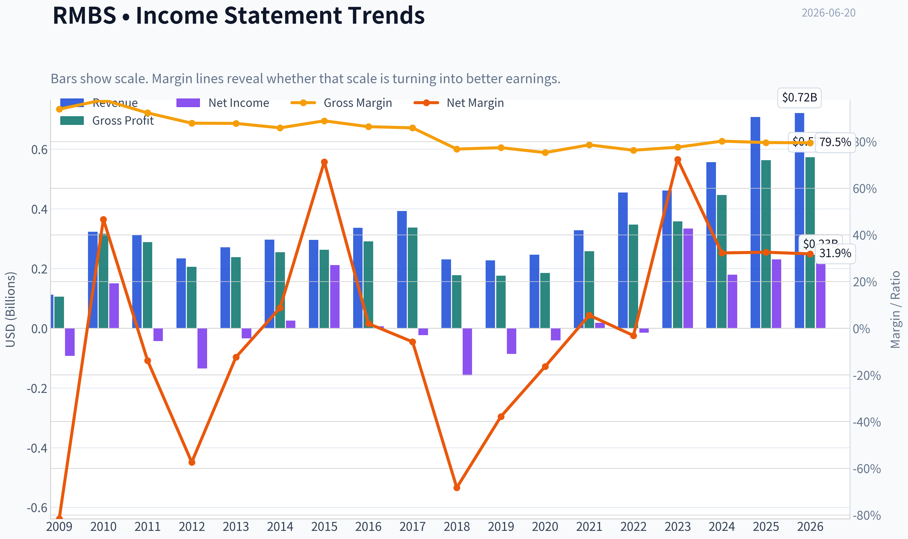

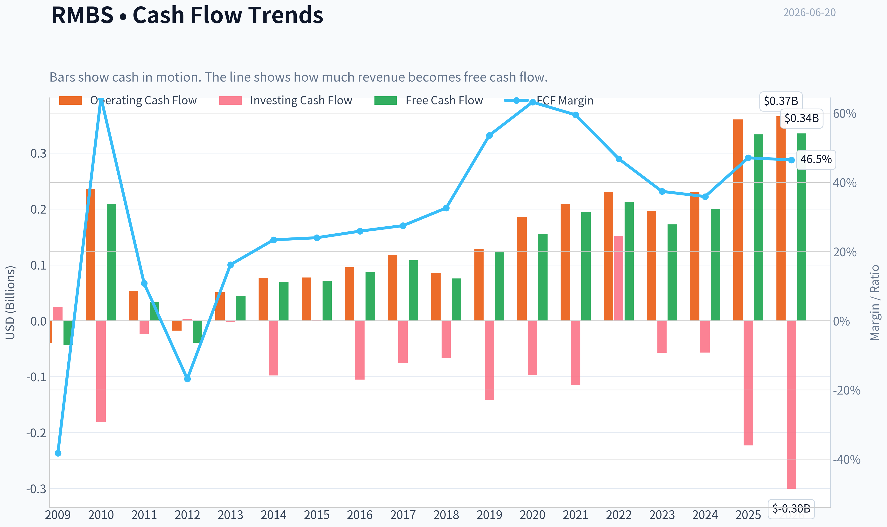

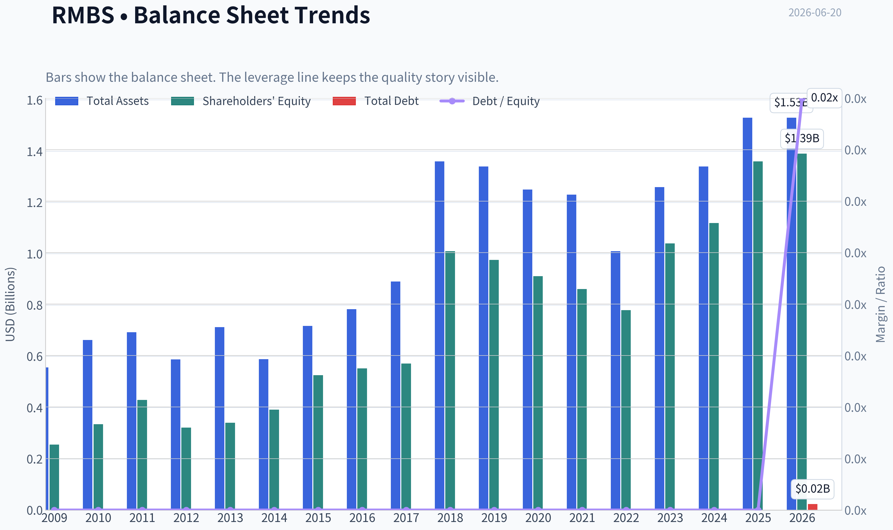

This graph tracks the profitability and return metrics (ROE, ROIC, Margins) of **RMBS** over the past decade, highlighting capital efficiency trends.

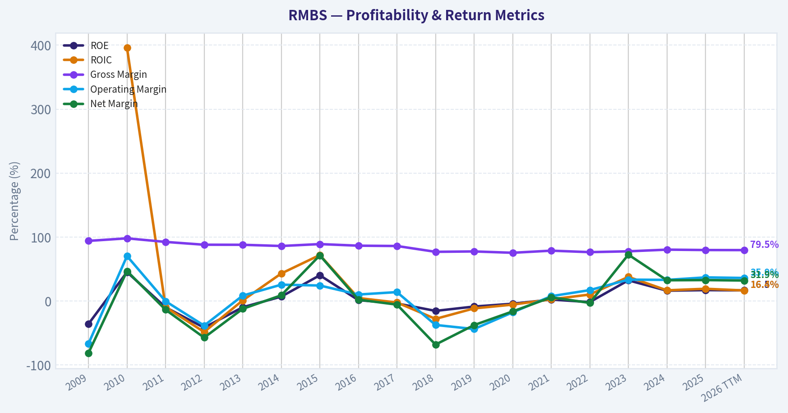

This chart illustrates the financial health of **RMBS** over the last 10 years, mapping cash equivalents and free cash flow against total obligations (Debt).

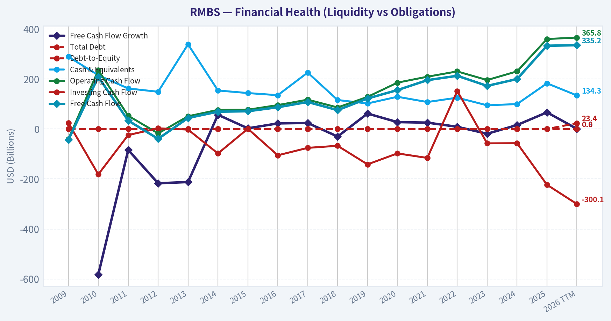

---

### Intrinsic Value Analysis (Buffett)

> *Following Warren Buffett's value investing philosophy: Circle of Competence, Economic Moat, Management Quality, and Margin of Safety.*

#### Intrinsic Value Snapshot

Price is what you pay. Intrinsic value is what the business may be worth based on the cash it can create for owners over time. We show a range, not one magic number.

- Current Price: $141.17
- Value Range (conservative to optimistic across both DCF methods): $10.14 to $158.32

##### Owner Earnings (Buffett Method)
- Net Income: $230,455,000.00
- Depreciation & Amortization: $41,989,000.00
- Capital Expenditures: $-26,842,000.00
- Working Capital Changes: $3,645,000.00
- Owner Earnings: $241,957,000.00

##### Intrinsic Value
###### Buffett Method
Uses owner earnings. Stricter, and usually more conservative.
- Conservative: $10.14
- Average: $79.34
- Optimistic: $79.34
- Discount Rate: 10.0%

###### Cash Flow Method
Uses free cash flow. Better for companies spending heavily today to grow tomorrow.
- Conservative: $36.50
- Average: $69.04
- Optimistic: $158.32
- Discount Rate: 10.0%

#### RMBS initial Buffett-style read

I'm unable to complete the required Buffett-grade report for RMBS with the approved audited financial-history tool because the financial database function specified for this run is not currently available in the tool environment.

What I can establish from the research pack already in hand:

| Item | Value |
|---|---:|
| Current Price | $141 |
| Market Cap | $15.27B |
| P/E | 67.2x |
| ROE | 16.9% |
| Gross Margin | 79.6% |
| Revenue Growth YoY | 27.1% |
| FCF Yield | 2.2% |
| Current Ratio | 8.2x |

Key Takeaways: Rambus screens as a high-margin, financially strong semiconductor IP and interface-chip business. Gross margin near 80% is consistent with a licensing-heavy model and suggests some pricing power or valuable intellectual property. However, the earnings multiple is rich and the free cash flow yield is low, which raises the valuation hurdle materially for a Buffett-style investor.

#### Gate assessment from available evidence

| Gate | Assessment | Evidence |
|---|---|---|
| Gate 1: Understandable business | Pass | Rambus makes money by licensing semiconductor and memory-related intellectual property and by selling related chips/components. This is understandable at a high level. |
| Gate 1: Predictability | Watch | IP licensing can be attractive, but long-term predictability depends on standards adoption, customer design wins, and product cycles. Less certain than a classic consumer monopoly. |
| Gate 1: Technology risk | Watch | RMBS benefits from technology adoption, but it also lives inside fast-moving semiconductor ecosystems. That means higher disruption risk than Buffett's ideal business. |
| Gate 2: Moat | Pass, likely Narrow-to-Moderate | 79.6% gross margin strongly supports valuable intangible assets. But durability depends on patent relevance, standards positioning, and continued design-in success. |
| Gate 3: Management | Inconclusive | No audited multi-year capital allocation record was retrieved here, so this gate cannot yet be cleanly scored. |
| Gate 4: Industry structure | Mixed | IP licensing is capital-light and attractive; semiconductor infrastructure markets are competitive and innovation-driven. |

Key Takeaways: Rambus passes the basic business-understanding test and clearly has some intangible-asset strength. The main questions are moat durability, technology disruption risk, and whether management has converted that strong business model into consistently excellent per-share value creation over time.

#### Buffett-style qualitative view

**Elementary school test:**
Rambus invents important memory and chip technology, then gets paid when customers use that technology. It also sells specialized chips that help move data faster.

**What looks attractive:**
- Very high gross margins suggest real IP value.
- Strong balance-sheet liquidity.
- Healthy reported ROE.
- Revenue growth is currently strong.

**What gives pause:**
- Semiconductor and interface technology are not as stable as candy, insurance, or railroads.
- The stock already prices in a lot of success at 67x earnings.
- A 2.2% FCF yield offers little margin of safety.
- Buffett usually wants clearer long-term certainty and a more obvious discount to value.

#### Preliminary valuation judgment

At **67.2x earnings** and only **2.2% FCF yield**, RMBS does **not** look like a classic Buffett bargain today, even if the underlying business is good. For a value investor, that means the business may be worth admiring more than buying right now.

#### Provisional stance

ANALYST STANCE: **WATCH**

Rambus appears to be a **good business, but not obviously a cheap stock**. The high margin profile and likely IP moat are attractive, yet the valuation leaves little room for error in a technologically dynamic industry. For now, this fits **WATCH rather than ADVOCATE**.
#### Valuation Bridge

This bridge places the current market price beside each intrinsic value lens so readers can see whether upside depends on one method or shows up across several methods.

| Scenario | Intrinsic Value / Share |
| --- | ---: |
| Buffett Method | $79.34 |
| Cash Flow Method | $69.04 |
| Damodaran Method | $25.19 |
| Current Price | $141.17 |

#### Key Takeaways

If one method is far above the others, the upside case depends on a specific modelling assumption. When several methods cluster together, the valuation story is more robust.

#### Valuation Visuals

This comparison chart from *Latest Earnings Snapshot* stacks current figures against historical benchmarks for **RMBS**, making it easy to see where the company trades relative to its own averages.

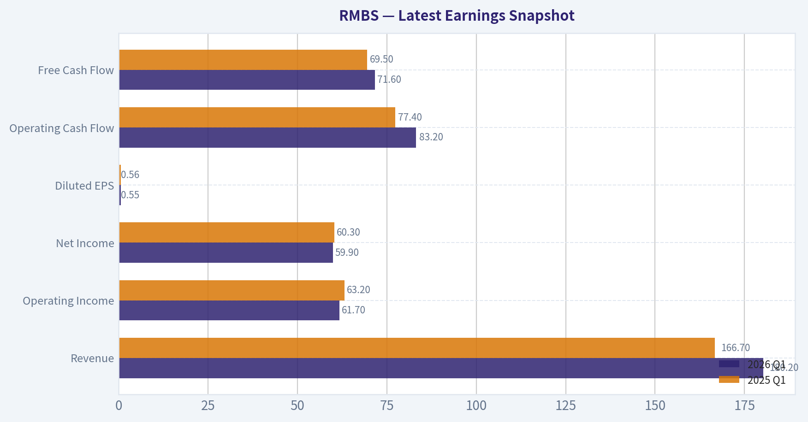

This comparison chart from *Current vs Historical Average Comparison* stacks current figures against historical benchmarks for **RMBS**, making it easy to see where the company trades relative to its own averages.

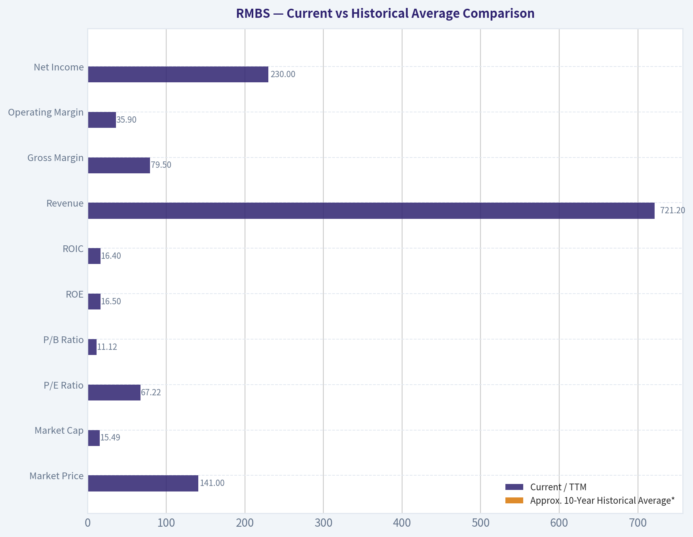

This comparison chart from *RMBS initial Buffett-style read* stacks current figures against historical benchmarks for **RMBS**, making it easy to see where the company trades relative to its own averages.

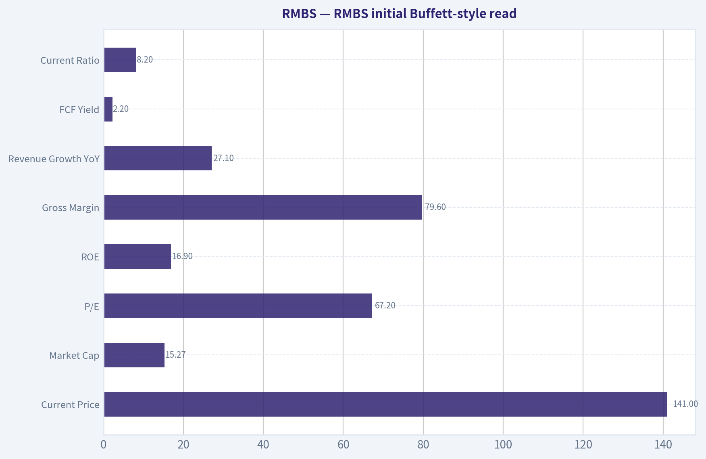

The following chart maps the **RMBS** Owner Earnings DCF valuation scenarios (Conservative, Average, Optimistic) to visually represent the margin of safety based on intrinsic value calculations.

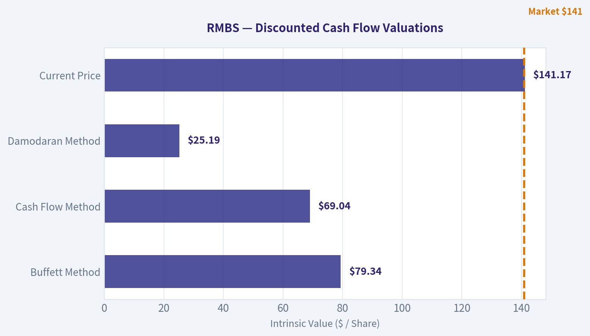

This comparison chart from *Lynch Classification* stacks current figures against historical benchmarks for **RMBS**, making it easy to see where the company trades relative to its own averages.

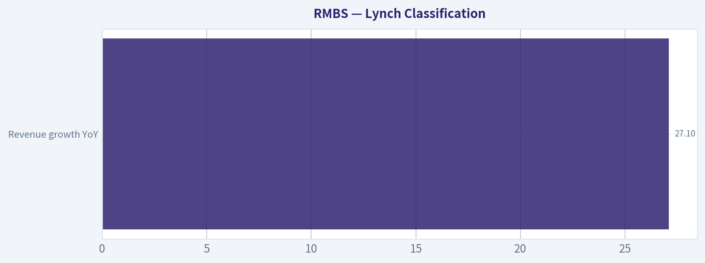

---

### Trend & Growth Analysis (Lynch/Druckenmiller/Fisher)

> *Following Peter Lynch's GARP, Stanley Druckenmiller's macro-aware approach, and Philip Fisher's scuttlebutt methodology.*

ANALYST STANCE: **WATCH**

#### 1. Lynch Classification

| Item | Assessment |
|---|---|
| Lynch category | **Fast Grower** |
| Revenue growth YoY | **27.1%** |
| Current view | Growth-quality name, but valuation already elevated |
| Initial Lynch read | Interesting GARP candidate, not a classic overlooked cheap fast grower |

Key Takeaways: Rambus fits the fast grower bucket because revenue is growing well above the 15% threshold. That puts it in the right hunting ground for growth investors. The issue is not whether the business is growing, but whether enough future upside remains after a strong stock run and a high earnings multiple.

---

#### 2. The Story in 3 Bullets

| Simple story | Why it matters |
|---|---|
| Rambus sells high-value memory and interface technology used in advanced computing systems | It benefits when systems need faster, more complex data movement |
| AI servers and data centers require more bandwidth, signal integrity, and memory performance | This expands demand for Rambus's IP and chips |
| The business model mixes product revenue with high-margin licensing/IP economics | That creates attractive gross margins and operating leverage |

Key Takeaways: This is an easy business to explain: as computing gets faster and more complex, the connections between components matter more. Rambus helps solve that bottleneck. The attraction is that it participates in a real infrastructure trend, not just a consumer fad.

---

#### 3. TAM Analysis and 10x Test

| Metric | Value / View |
|---|---|
| Current revenue base | Not fully provided in pack; market cap is **$15.27B** |
| End-market exposure | AI infrastructure, memory interfaces, high-speed interconnect, security IP |
| TAM direction | **Expanding** due to AI/data-center complexity |
| 10x test | **Conceptually favorable**, but not fully provable from provided revenue base |
| Practical runway | Likely substantial because RMBS is still niche within a much larger semiconductor connectivity stack |

Key Takeaways: The total opportunity appears to be expanding because AI racks, memory bandwidth, and interconnect complexity are secular growth areas. Rambus likely still has runway because it operates in specialized but growing niches. I cannot fully validate the 10x test numerically without the current revenue base and segment-level TAM numbers.

---

#### 4. Revenue Growth Trend

| Metric | Value |
|---|---|
| Revenue growth YoY | **27.1%** |
| Pattern read | **Strong high growth** |
| Acceleration status | Insufficient multi-period data to confirm acceleration |
| Quality of growth | Appears tied to real product and infrastructure demand, though licensing can add lumpiness |

Key Takeaways: Growth is clearly strong at over 27%, which is enough to keep RMBS in the growth conversation. However, I do not have a quarter-by-quarter sequence here to prove a true Druckenmiller-style acceleration inflection. So this looks more like strong growth than confirmed accelerating growth.

---

#### 5. Unit Economics / Efficiency Snapshot

| Metric | Value / Assessment |
|---|---|
| Gross margin | **79.6%** |
| ROE | **16.9%** |
| FCF yield | **2.2%** |
| Current ratio | **8.20** |
| NRR | Not disclosed |
| LTV/CAC | Not applicable / not disclosed |
| Rule of 40 | Not applicable in standard SaaS sense |

Key Takeaways: The standout metric here is the gross margin near 80%, which is exceptional and consistent with an IP-rich, capital-light model. The balance sheet also looks very strong given the current ratio above 8. On the other hand, free cash flow yield is low, which suggests the stock is not obviously cheap.

---

#### 6. Inflection Point Assessment

| Inflection category | Assessment |
|---|---|
| Product cycle inflection | **Possible** |
| Market share inflection | **Plausible but unproven from provided data** |
| Margin inflection | High margins already present; further leverage possible |
| TAM inflection | **Yes** - AI/data-center architecture complexity is expanding the opportunity |
| Competitive inflection | No clear evidence of a competitor stumble |

Key Takeaways: The strongest inflection argument is not that Rambus suddenly invented a new business, but that the market environment around it improved. AI infrastructure is increasing demand for memory and interconnect sophistication, which should help Rambus. That is favorable, but not yet enough to call this a clean, underappreciated breakout.

---

#### 7. Macro Setup Evaluation

| Macro factor | Assessment |
|---|---|
| Secular theme exposure | **AI / Data Center / Semiconductor infrastructure** |
| Rate sensitivity | Moderate; growth stocks still care about discount rates |
| Industry backdrop | Favorable for enabling technologies tied to AI scaling |
| Macro wind | **Generally supportive** |

Key Takeaways: Rambus has exposure to one of the best secular themes in the market: AI infrastructure. That gives it a favorable top-down backdrop. The main macro risk is not demand collapse, but valuation compression if growth stocks de-rate.

---

#### 8. Fisher 15 Points Score

| Fisher area | Score (1-5) | Notes |
|---|---:|---|
| Market potential | 5 | AI/data-center memory complexity supports long runway |
| New product development | 4 | Appears innovation-driven |
| R&D effectiveness | 4 | Technical niche suggests meaningful R&D capability |
| Sales organization | 3 | Hard to judge externally |
| Profit margin | 5 | Gross margin is excellent |
| Improving margins | 3 | Need fuller trend data |
| Labor/personnel relations | 3 | No evidence either way |
| Executive relations | 3 | Limited visibility |
| Management depth | 3 | Limited visibility from pack |
| Cost/accounting controls | 4 | Financial profile looks disciplined |
| Special advantages | 4 | IP, know-how, switching friction |
| Long-range outlook | 4 | Strong secular relevance |
| Dilution risk | 4 | No obvious capital stress; current ratio very high |
| Candor in difficulties | 3 | Insufficient evidence |
| Integrity | 3 | Insufficient evidence |

| Total Fisher Score | **55 / 75** |
|---|---|
| Interpretation | **GOOD** |

Key Takeaways: Rambus scores as a good, not outstanding, Fisher name based on the data available. The business quality and product positioning are attractive, but I lack enough management and scuttlebutt detail to push it into elite territory. In short, the company passes the quality bar, but not with maximum conviction.

---

#### 9. Valuation Analysis

| Metric | Value / View |
|---|---|
| Current price | **$141** |
| Market cap | **$15.27B** |
| P/E | **67.2x** |
| PEG using revenue growth proxy | **~2.5x** |
| FCF yield | **2.2%** |
| Lynch PEG verdict | **Expensive** |
| P/S | Not directly available from provided data |

Key Takeaways: Valuation is the biggest issue here. A P/E above 67 paired with 27% growth implies a PEG well above 2 if we use growth as a rough proxy, which is not cheap by Lynch standards. That does not make it a bad company, but it does reduce the margin of safety and makes execution more important.

---

#### 10. Growth Investor Scorecard

| Criterion | Weight | Score (1-5) | Weighted Score |
|---|---:|---:|---:|
| The Story | 10% | 4.5 | 0.45 |
| TAM & Runway | 20% | 4.0 | 0.80 |
| Revenue Growth | 20% | 4.0 | 0.80 |
| Unit Economics | 15% | 4.0 | 0.60 |
| Competitive Position | 10% | 3.5 | 0.35 |
| Management Quality | 10% | 3.0 | 0.30 |
| Macro Setup | 5% | 4.5 | 0.23 |
| Profitability Path | 5% | 4.0 | 0.20 |
| Valuation | 5% | 2.0 | 0.10 |

| Total Score | **3.83 / 5.0** |
|---|---|
| Decision band | **ADVOCATE - Good setup** by score, but tempered by valuation and incomplete inflection proof |

Key Takeaways: The scorecard says the business setup is good because the growth, margins, and secular exposure are all attractive. But the score is being held back by valuation and limited visibility into whether growth is accelerating or merely strong. That is why I land on WATCH rather than a full ADVOCATE despite a respectable composite score.

---

#### 11. Position Size Stance

| Stance | View |
|---|---|
| Current stance | **WATCH** |
| If already owned | **Hold/watch closely; do not rush to exit solely on quality concerns** |
| New position sizing | **Starter only, if any** |
| Better setup for upgrade | Revenue acceleration, clearer AI-driven mix shift, or valuation reset |

Key Takeaways: I would not treat RMBS as a high-conviction fresh buy at this exact setup. If someone already owns it, the business quality argues for patience. For new money, I would prefer either a better entry point or more proof that the current growth phase is strengthening.

---

#### 12. Key Risks and Catalysts

| Risks | Catalysts |
|---|---|
| High valuation leaves little room for disappointment | AI/data-center demand continues to expand faster than expected |
| Growth could be lumpy due to licensing/product timing | New product ramps in memory interface and interconnect |
| Customer concentration or cycle sensitivity in semis | Margin expansion from operating leverage |
| Competitive or standards shifts could reduce moat durability | More evidence that RMBS is becoming a core AI infrastructure enabler |
| Market multiple compression in growth tech | Upward revisions to earnings and cash flow |

Key Takeaways: The risk-reward comes down to execution versus expectations. Rambus has several plausible upside catalysts, especially if AI infrastructure spending keeps broadening. But the stock already reflects a lot of optimism, so even a good company can become a mediocre stock if growth merely meets expectations instead of beating them.

---

#### Bottom Line

Rambus is a **high-quality fast grower** with excellent gross margins, strong balance sheet health, and credible exposure to the AI/data-center buildout. That is the bull case.

The problem is **price and proof**. At roughly **67x earnings** and only limited evidence here of a fresh acceleration inflection, RMBS looks more like a **great company on a rich valuation** than a classic underappreciated ten-bagger entry.

**Final call: WATCH.**
Upgrade to **ADVOCATE** if:
1. growth clearly accelerates again,
2. AI-driven revenue mix becomes more visible and durable, or
3. valuation cools without damaging the long-term story.

#### Growth & Scorecard Visuals

This comparison chart from *Revenue Growth Trend* stacks current figures against historical benchmarks for **RMBS**, making it easy to see where the company trades relative to its own averages.

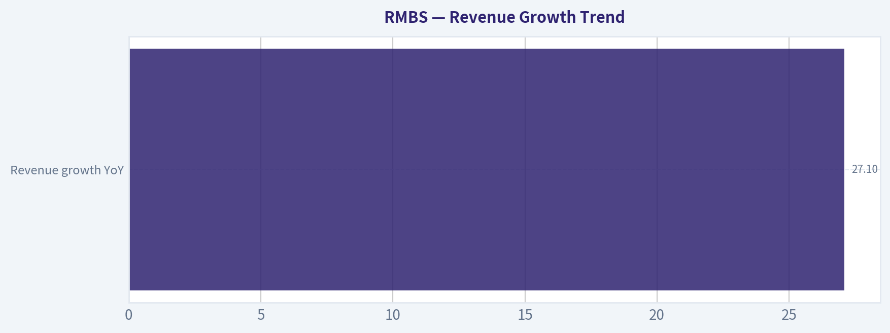

---

### Market Technical Analysis

#### RMBS Technical Analysis Report

RMBS has transitioned from a powerful medium-term uptrend into a sharp corrective phase, but the larger trend structure is still not fully broken. Based on the recent market condition, the **most relevant 8 indicators** are:

- **close_10_ema**
- **close_50_sma**
- **close_200_sma**
- **macd**
- **macdh**
- **rsi**
- **atr**
- **vwma**

These are suitable because they cover **short-term trend, medium-term trend, long-term trend, momentum direction, momentum acceleration/deceleration, reversal pressure, volatility/risk, and volume-weighted price confirmation**. This set is broad without being overly redundant.

#### Indicator Selection and Why They Matter Now

| Indicator | Why It Matters for RMBS Now | Current Read |
|---|---|---|
| close_10_ema | Best gauge of the recent pullback speed and whether short-term momentum is stabilizing | Price is slightly below the falling 10 EMA, showing weak short-term control |
| close_50_sma | Defines whether the correction is only a pullback or a deeper medium-term breakdown | Price remains above the 50 SMA, so medium-term trend is bruised but not destroyed |
| close_200_sma | Anchors the bigger structural trend | 200 SMA is still rising strongly, confirming long-term uptrend remains intact |
| macd | Measures trend momentum after the big rally and recent selloff | MACD remains positive, meaning trend memory is still bullish |
| macdh | Best early warning for momentum deterioration | Histogram is clearly negative, showing downside momentum is still active |
| rsi | Identifies whether the decline is exhausted or still neutral-to-weak | RSI near 50 suggests not oversold enough to imply a strong washout low |
| atr | Essential because RMBS volatility has expanded materially | Elevated ATR means wider stops and smaller position sizing are prudent |
| vwma | Tests whether institutional/volume-supported trend still favors buyers | Price is below VWMA, showing recent volume has transacted at higher prices than current market |

**Key Takeaways:** The most useful indicators for RMBS right now are those that distinguish between a short-term correction and a longer-term trend failure. The stock still holds a constructive long-term backdrop, but momentum and volume-weighted positioning show sellers currently have the upper hand in the near term.

---

#### Trend Structure

Over the past year, RMBS experienced several phases:

1. **Summer 2025:** steady climb from the high-50s into the 70s.
2. **September to October 2025:** explosive upside breakout into the 100-plus area.
3. **Late 2025 to March 2026:** volatile consolidation and repeated sharp reversals.
4. **April to early June 2026:** renewed powerful advance from roughly 80 to above 170.
5. **Mid-June 2026:** violent correction back toward the low-140s and briefly into the low-130s.

This matters because RMBS is not behaving like a slow, smooth trend stock. It is acting like a **high-beta momentum name with event-driven repricing**, where signals must be interpreted in the context of elevated volatility.

At the latest close shown, RMBS finished around **141.17** on 2026-06-18. That places the stock:
- **below the 10 EMA (141.75, marginally below)**
- **well above the 50 SMA (134.12)**
- **far above the 200 SMA (107.02)**

That alignment says the stock is in a **short-term correction inside a still-bullish medium- and long-term structure**.

#### Fine-Grained Moving Average Interpretation

The **10 EMA** rolled over sharply after peaking during the June surge. Its decline from the 150s into the low 140s reflects how quickly price momentum deteriorated after the blow-off move above 170. Price being slightly below it suggests the stock has not yet convincingly reclaimed short-term control.

The **50 SMA** continues to rise steadily, from about 100 in late March to 134 by mid-June. That slope is important: it shows the prior uptrend was strong enough that even after a sizable correction, the medium-term average is still trending higher. In practical terms, the 50 SMA is now the first major trend support zone. A decisive break below it would change the character of the chart from "pullback" to "possible trend reversal."

The **200 SMA** is rising relentlessly and sits near 107. This is far below current price, showing the long-term trend remains strongly positive. The gap between price and the 200 SMA also tells you the stock had become extended, which helps explain why the correction has been so sharp: the name was carrying a large premium over its long-term trend anchor.

#### Momentum Analysis: MACD and Histogram

The **MACD remains positive** at about **1.46** on the latest reading, which is notable. Even after the selloff, RMBS has not fully lost the medium-term bullish momentum regime. However, that positive MACD level is much lower than earlier June readings above 10, indicating a dramatic loss of thrust.

The **MACD histogram is negative at roughly -3.04**, and more importantly, it has remained negative for several sessions. This tells us the problem is not simply that upside momentum cooled - it is that downside momentum is still stronger than the MACD signal line. In plain terms, the stock is still correcting, not merely pausing.

There is a key nuance here:
- **Positive MACD + negative histogram** often describes a market that is still bullish on a bigger horizon but is currently undergoing a meaningful pullback.
- That is exactly the condition RMBS appears to be in.

For traders, that means buying too early can be costly unless there is clear evidence of histogram contraction and price stabilization.

#### RSI Interpretation

Latest **RSI is about 50.3**, after dropping into the 40s during the recent selloff. This is an important neutral reading.

It means:
- The stock is **no longer overbought**
- It is **not deeply oversold either**
- Momentum has been reset, but not necessarily exhausted

Earlier in the advance, RSI pushed above 70, even into the mid-80s in late April, which signaled a very strong but overheated trend. That excess has now been worked off. The current RSI zone around 50 is often a battleground area. If RMBS stabilizes and RSI turns back above 55-60, that would support a re-acceleration thesis. If RSI slips back under 45 while price presses lower, then the correction likely has another leg down.

So RSI is not giving a reversal signal yet; it is giving a **reset signal**.

#### Volatility and Risk: ATR

**ATR has expanded to about 12.6**, versus roughly 5.3 to 6.3 in late March and early April. That is a major increase in trading range.

This has two implications:
1. **Directional signals require more tolerance.** Normal day-to-day movement is now much larger, so small breaks above or below averages matter less than usual.
2. **Risk management must adapt.** Stops that were appropriate during lower-volatility phases would now be too tight and easily shaken out.

A stock with ATR above 12 and price in the 140s is swinging almost 9% of price over a typical range window. That is not a low-noise environment. Traders should assume:
- entries need scaling rather than full-size commitment,
- stops must be wider,
- and confirmation matters more than anticipation.

#### Volume-Weighted Trend: VWMA

The **VWMA is about 147.92**, above current price. That is an important caution flag.

Because VWMA weights higher-volume transactions more heavily, price trading below VWMA suggests that the heavier recent participation occurred at higher levels than current price. This often implies one of two things:
- late buyers are under pressure and may sell into rebounds,
- or price needs time to rebuild sponsorship before a durable new leg higher begins.

In RMBS's case, that fits the recent tape very well. The stock had huge-volume upside bursts, followed by abrupt declines. Price below VWMA indicates the market is currently trading beneath the average cost basis of many recent volume participants. That can create overhead supply on rallies toward the high-140s to low-150s.

#### What the Combined Signals Suggest

The indicators collectively describe **three simultaneous realities**:

| Timeframe | Signal | Interpretation |
|---|---|---|
| Short term | Weak | Price below 10 EMA, negative MACD histogram, below VWMA |
| Medium term | Still constructive but vulnerable | Price above rising 50 SMA, MACD still positive |
| Long term | Bullish | Price well above rising 200 SMA |

**Key Takeaways:** RMBS is not in a clean downtrend across all timeframes. Instead, it is a long-term uptrend stock going through a forceful short-term correction, with medium-term trend support still intact but increasingly important.

#### Tactical Trading Insights

For **momentum bulls**, the ideal setup is not just "price is down." The better setup would be:
- price reclaims the **10 EMA**,
- **MACD histogram turns less negative or positive**,
- RSI pushes back above **55**,
- and price starts to reclaim the **VWMA**.

That would suggest the pullback is ending and buyers are regaining control.

For **swing traders watching support**, the **50 SMA near 134** is the most important nearby technical shelf. The recent low area around **130-132** is also critical. If RMBS loses that zone decisively, the next correction could deepen materially because the chart would no longer be merely digesting gains - it would be breaking intermediate structure.

For **risk-conscious traders**, elevated ATR argues against chasing large green days after steep drops. RMBS has shown a tendency toward abrupt reversals after vertical rallies. That means rallies can be real, but they can also fail quickly.

For **trend followers**, the long-term bias remains bullish as long as price holds well above the 200 SMA and the 50 SMA continues rising. But trend followers should recognize that current conditions are in a **repair phase**, not a clean continuation phase.

#### Practical Decision Framework

| Scenario | What to Watch | Trading Interpretation |
|---|---|---|
| Bullish recovery | Price reclaims 10 EMA and VWMA, MACD histogram improves | Pullback likely maturing into renewed uptrend |
| Sideways repair | Price chops between ~134 and ~148, RSI stays around 45-55 | Base-building phase; patience favored |
| Bearish deterioration | Price loses 50 SMA and RSI drops back under 45 | Correction likely extending lower |
| Structural bullish continuation | 50 SMA keeps rising and price later stabilizes above it | Long-term uptrend remains healthy despite volatility |

**Key Takeaways:** The stock's next tradable message will likely come from how it behaves around the 10 EMA overhead and 50 SMA below. A recovery above short-term resistance would hint that the correction is ending, while a break beneath medium-term support would imply the decline still has room to run.

---

#### Bottom Line

RMBS remains a **long-term bullish stock in a short-term corrective phase**. The recent selloff has materially weakened near-term momentum, but it has not yet invalidated the broader uptrend. The main issue is not trend destruction; it is **elevated volatility combined with unresolved short-term selling pressure**.

The most actionable conclusion is this:
- **Bullish investors** should wait for evidence of stabilization rather than assuming the dip is finished.
- **Short-term traders** should respect the negative MACD histogram, price below VWMA, and high ATR.
- **Medium-term trend watchers** should focus on whether the stock can hold above the rising 50 SMA.

#### Summary Table

| Area | Observation | Implication |
|---|---|---|
| Short-term trend | Price is slightly below 10 EMA | Near-term momentum still weak |
| Medium-term trend | Price remains above rising 50 SMA | Pullback has not yet broken intermediate trend |
| Long-term trend | Price well above rising 200 SMA | Structural uptrend remains intact |
| Momentum level | MACD still positive | Broader bullish trend memory persists |
| Momentum change | MACD histogram negative | Downside pressure still active |
| RSI | Near 50 | Reset from overbought, but not washed out |
| Volatility | ATR elevated near 12.6 | Risk remains high; wider stops needed |
| Volume confirmation | Price below VWMA | Recent high-volume positioning sits above market, creating overhead supply |

**Key Takeaways:** RMBS still has a constructive long-term chart, but traders should not confuse that with immediate strength. The stock is in a volatile reset phase, and the best opportunities will likely come only after momentum and volume-weighted trend measures begin to improve.

---

### Options Market Analysis

> *Reading options flow - put/call ratios, IV skew, and unusual activity - to gauge institutional positioning and event-driven risk.*

#### RMBS Options Positioning Report

RMBS options flow is showing a **clear bullish tilt**, driven primarily by **heavy near-term call activity** and an **unusual high-volume upside call trade**. The caveat is that implied volatility is extremely elevated, so the market is pricing in a large move and options are expensive.

#### 1. Put/Call Ratio Analysis

| Expiry | Call OI | Put OI | Put/Call OI Ratio | Call Volume | Put Volume | Put/Call Volume Ratio |
|---|---:|---:|---:|---:|---:|---:|
| 2026-07-17 | 5,781 | 2,734 | 0.47 | 6,951 | 841 | 0.12 |
| 2026-08-21 | 11,749 | 3,510 | 0.30 | 778 | 247 | 0.32 |
| 2026-11-20 | 1,296 | 1,415 | 1.09 | 121 | 251 | 2.07 |
| **Near-term total** | **18,826** | **7,659** | **0.41** | **7,850** | **1,339** | **0.17** |

**Key Takeaways:** Near-term options positioning is decisively call-heavy. The aggregate **put/call OI ratio of 0.41** sits well below the roughly neutral **0.7 baseline**, and the **put/call volume ratio of 0.17** shows fresh trading flow is even more call-skewed than existing positioning. While November turns more defensive, the front end of the chain is strongly leaning bullish.

**Interpretation**
- **OI ratio at 0.41**: materially below neutral, indicating more upside positioning than downside protection.
- **Volume ratio at 0.17**: extremely call-dominant intraday/near-term flow; that usually signals:
  - bullish speculation,
  - event-driven upside chasing,
  - or less likely, aggressive covered call activity.
- Given the **very large call volume concentration in July**, this looks more like **fresh directional call buying** than a balanced overwrite program.

#### 2. Implied Volatility (IV) Assessment

| Expiry | ATM Call IV | ATM Put IV | IV Read |
|---|---:|---:|---|
| 2026-07-17 | 99.6% | 91.9% | Very elevated |
| 2026-08-21 | 108.3% | 99.0% | Extremely elevated |
| 2026-11-20 | 102.2% | 94.9% | Very elevated |

**Key Takeaways:** ATM implied volatility is exceptionally high across the curve, roughly in the **92%-108%** range, which is far above what you would expect for a calm, low-event setup. Calls are carrying slightly higher ATM IV than puts in each listed expiry, suggesting traders are willing to pay up for upside optionality rather than just downside protection.

**IV skew assessment**
- The dataset shows **ATM call IV above ATM put IV** across all three expirations.
- That is **not a classic downside-fear put skew**.
- Instead, the skew appears to lean **toward upside demand / call premium richness**, which often happens when:
  - traders are chasing a possible sharp upside move,
  - a stock is perceived as having squeeze potential,
  - or there is a specific catalyst with asymmetric upside expectations.

**Catalyst flag**
- IV at these levels strongly suggests the market expects a meaningful catalyst or large move.
- I do **not** have a confirmed event calendar in the provided dataset, so I cannot definitively label this as earnings-related, but the IV term structure is clearly **event-inflated** rather than normal background volatility.

#### 3. Unusual Options Activity

| Expiry | Type | Strike | Volume | Open Interest | Vol/OI | IV | Strike Context | DTE* | Read |
|---|---|---:|---:|---:|---:|---:|---|---:|---|
| 2026-07-17 | CALL | 220.0 | 4,251 | 21 | 202.4x | 103.2% | Very likely far OTM / upside lottery-style | 27 | Aggressive upside positioning |

\*DTE calculated from 2026-06-20.

**Key Takeaways:** The standout trade is the **July 220 call**, where volume was more than **200x open interest**, which strongly suggests a fresh position rather than old positions being closed. The trade is call-side, short-dated, and highly speculative, pointing to traders positioning for an outsized upside move rather than quietly hedging risk.

**Interpretation**
- **Volume massively exceeding OI** is the textbook signal for **new positioning**.
- Because this is a **call**, in a **near-dated expiry**, and appears to be **well above where RMBS would normally trade**, it most likely reflects:
  - speculative upside chasing,
  - a low-dollar convexity bet,
  - or a spread leg tied to a broader bullish structure.
- This looks **more speculative than defensive**.
- On balance, it leans more **retail-style or fast-money momentum positioning** than classic institutional hedging.
- Still, the size is large enough to matter for short-term tape sentiment.

#### 4. Open Interest Concentration

| Expiry | Total Call OI | Total Put OI | OI Concentration Read |
|---|---:|---:|---|
| 2026-07-17 | 5,781 | 2,734 | Calls dominate; upside gamma interest likely stronger |
| 2026-08-21 | 11,749 | 3,510 | Strongest OI concentration in dataset; key expiry for pinning effects |
| 2026-11-20 | 1,296 | 1,415 | More balanced to slightly put-heavy |

**Key Takeaways:** The heaviest open interest sits in **August**, and the overall chain is still overwhelmingly call-dominant in the near term. That means if RMBS starts moving toward active call strikes, dealer hedging dynamics could reinforce upside momentum rather than suppress it.

**Gamma / pinning implications**
- We are not given a full strike-by-strike OI map, so a precise **max pain** level or exact **gamma wall** cannot be calculated from the dataset alone.
- However:
  - **August is the largest OI expiry**, making it the most important expiry for pinning/gravity effects.
  - **July call flow is unusually heavy**, so if RMBS pushes into those active strikes, it may create **positive gamma feedback** through dealer hedging.
- Since puts are relatively light in the front months, there is less evidence of a strong downside hedge wall absorbing weakness.

#### 5. Overall Options Sentiment Signal

| Factor | Read |
|---|---|
| Put/Call Ratios | Bullish |
| Near-Term Flow | Strongly bullish |
| IV Level | Very elevated / expensive |
| Skew | Call-leaning / upside-demand skew |
| Unusual Activity | Bullish speculative call buying |
| **Overall Signal** | **BULLISH** |

**Key Takeaways:** RMBS options are sending a **bullish** message, not a neutral one. The main driver is the combination of **very low near-term put/call ratios**, **heavy call volume**, and a **large fresh upside call bet**, though traders should respect the fact that volatility is already very high and expectations are elevated.

**Bottom line**
I would classify RMBS options sentiment as **BULLISH**.

**Primary driver of the signal:**
- aggressive near-term **call dominance**,
- unusually strong **call volume vs put volume**,
- and a **fresh high-conviction upside call trade** in July.

**Caveats**
- **IV is extremely high**, so bullishness is not "cheap"; the market already expects movement.
- The standout trade may be **speculative** rather than purely institutional.
- If RMBS is an **illiquid options name** relative to mega-cap stocks, individual prints can distort the signal more easily, so confidence should be viewed as **moderate**, not absolute.

---

#### Summary Table

| Metric | Observation | Interpretation |
|---|---|---|
| Put/Call Ratio | OI ratio **0.41**, volume ratio **0.17** | Strong call bias vs neutral ~0.7 baseline |
| IV Level | ATM IV roughly **92%-108%** | Very elevated; options are pricing a large move |
| Skew Direction | **Call-side richness** over puts at ATM | Upside chase rather than classic downside fear |
| Unusual Activity | **Jul 17 2026 $220 call**, volume **4,251** vs OI **21** | Fresh bullish/speculative upside bet |
| Overall Signal | **BULLISH** | Near-term positioning favors upside, with high-volatility caveat |

**Key Takeaways:** The options market is leaning bullish on RMBS, with the strongest evidence coming from call-heavy flow and fresh upside speculation. The main caution is that volatility is already very expensive, so while sentiment is positive, the market is not underpricing the move.

---

## Research Team Commentary

> *The Research Manager synthesizes the Bull vs Bear debate into action-free commentary. This is a pre-risk view, not the final stance.*

The debate really comes down to a classic Buffett tension: excellent business economics versus insufficient certainty and insufficient margin of safety.

The bull case is strongest on business quality. A near-80% gross margin is hard to ignore. That strongly suggests real intellectual property value, not commodity economics. The return profile also looks attractive: ROIC around 18%, ROE near 17%, ROA above 15%. Those are the kinds of numbers that usually point to an asset-light, high-value model with some moat-like characteristics. The bull side is also right that Rambus likely benefits from growing system complexity in memory, interface, and infrastructure design. If AI and high-performance computing continue increasing bandwidth and memory demands, a specialized IP vendor could enjoy a longer runway than the market typically assumes. Strong liquidity further supports the idea that this is a financially sound business with flexibility.

The bear case is strongest on predictability and valuation. High gross margins do not automatically equal a durable moat in Buffett's sense. In standards-adjacent and semiconductor IP markets, customer dependence can be real but still fragile. Design wins can be sticky for a while without creating the kind of permanent customer captivity Buffett prefers. The bear side is also right that current profitability ratios may be flattering a favorable part of the cycle or revenue mix. Most importantly, 67x earnings leaves almost no room for execution mistakes, slower growth, contract timing noise, or multiple compression. For a Buffett-style portfolio, that is a major problem. A wonderful business can still be a poor investment if bought at too optimistic a price.

My takeaway is that Rambus looks like a good business, possibly a very good one, but not clearly a great Buffett business at this price. The market seems to be recognizing the quality already. That matters. One of my past mistakes was being too rigid on valuation when fundamentals and market setup were clearly improving in names like NVDA and MU. I do not want to repeat that by dismissing a high-quality company just because the multiple is rich. But the other lesson is not to overcorrect and call every premium multiple justified. In this case, unlike those prior setups, the evidence provided is much stronger on margins and returns than on enduring earnings predictability or truly locked-in moat durability. That means I should respect the quality, but not pretend there is a real margin of safety.

So I land on WATCH.

Core takeaway: Rambus appears to be a high-quality, IP-rich business with strong economics and financial strength, but the stock already discounts a lot of that quality. The moat looks real but narrower and less permanent than the bull case claims, while the valuation leaves too little room for uncertainty to justify a Buffett-style endorsement today.

Rationale: From a value-investing perspective, business quality passes the first screen better than many tech names. Gross margin, ROIC, and liquidity are all attractive. That said, Buffett's framework is not just about buying good businesses; it is about buying understandable, durable businesses with predictable cash generation at a sensible price. Here, the weak point is not solvency or current profitability. It is confidence in 10-year earning power and reinvestment durability relative to a very demanding multiple. The market may be extrapolating AI and infrastructure relevance aggressively. Maybe that proves right, but at 67x earnings, investors are paying today for a lot of tomorrow's success. That is not enough margin of safety for ADVOCATE, but the business is too good for AVOID.

Monitoring plan over the next 1 to 4 quarters: First, watch revenue mix and whether AI-related or high-performance computing exposure becomes meaningfully larger and more durable rather than just thematic. Second, watch for evidence that gross margins remain structurally high without obvious deterioration; if margins stay near current levels while revenue scales, that would strengthen the moat case. Third, monitor cash flow quality versus accounting earnings, because for an IP-heavy company, that will tell us whether owner earnings are as good as reported profitability suggests. Fourth, look for disclosures on customer concentration, licensing renewals, and design-win durability; these will help determine whether the moat is contractual and sticky or merely cyclical and opportunistic. Fifth, assess capital allocation: buybacks, dilution, M&A, and R&D efficiency. At this valuation, management discipline matters a lot. Finally, on price, I would want either a materially better entry point or several quarters of growth and earnings proving that today's multiple is less stretched than it appears.

If the next few quarters show accelerating durable growth, sustained cash conversion, and evidence that Rambus is becoming a more indispensable infrastructure-IP provider than the market currently appreciates, the thesis could improve into ADVOCATE even at a premium. If instead growth proves lumpy, margins soften, or the AI angle remains more narrative than numeric, then the bear case will have been right and the stock could drift toward AVOID.

Final stance: WATCH

---

## Value Investing Team Commentary

> *The Investor translates the research view into an investment thesis before risk review. This is still not the final stance.*

Rambus is the sort of business that deserves respect before it deserves money. The operating profile is plainly attractive: gross margin near 80%, ROIC around 18%, ROA above 15%, and a solid liquidity position all suggest a real IP business rather than a commodity supplier. That matters. Businesses with those economics often sit on valuable design expertise, embedded standards exposure, and customer relationships that can produce attractive earnings for a long time.

But Buffett's question is not merely, "Is this a good business?" It is, "Can I understand its long-term earning power well enough to buy with confidence, and am I getting a margin of safety?" On that test, RMBS is less compelling today. A 67x earnings multiple asks investors to assume that today's quality is not only real, but durable, scalable, and increasingly important in AI, memory, and high-performance infrastructure. That may happen. But when the market is already paying up this aggressively, the burden of proof shifts. A business can be admirable and still be a poor investment if the future is already overcapitalized into the stock price.

The contrarian angle here is subtle. After a sharp run from the high-50s into triple digits and then a volatile consolidation, sentiment likely reflects a market trying to decide whether Rambus is a genuine AI-adjacent compounder or simply a high-quality niche IP name temporarily enjoying thematic enthusiasm. Markets often overpay for "picks and shovels" stories before the underlying revenue mix fully proves the narrative. What the headlines may be missing, however, is that very high-margin IP businesses can look optically expensive right before multi-year earnings power expands. So the key issue is not whether the stock looks expensive on current earnings-it does-but whether current earnings materially understate normalized future owner earnings. Without clearer evidence of durable AI-linked revenue expansion, stronger cash conversion, and proof of sticky customer dependence, that is still an inference rather than a conclusion.

I would also be careful not to confuse high margins with an impregnable moat. In technology IP, moats can be real but narrower than they first appear. Design wins, licensing relationships, and standards relevance can create stickiness, yet they do not always guarantee the kind of enduring customer captivity found in Buffett's best holdings. If a few key programs, renewals, or infrastructure cycles drive results, earnings can remain good while predictability stays weaker than the market assumes. At 67x earnings, predictability matters more than usual.

The encouraging part is that this is not a fragile business. The balance sheet appears sound, profitability is strong, and the business model likely has more resilience than the average semiconductor-adjacent name. If the company can show over the next several quarters that AI and high-performance computing exposure are not just story stock embellishments but a durable source of larger and more recurring earnings, today's valuation could become less unreasonable in hindsight. That is the kind of evidence I would want before becoming more constructive.

So my posture is patient, not dismissive. This is not the sort of business I would short or casually write off. It may become more attractive either through a better price or through stronger proof that the moat and earnings runway are wider than currently visible. For now, the market seems to appreciate the quality already, and that leaves limited room for error.

**ANALYST STANCE: WATCH**
Rambus appears to be a high-quality, IP-rich business with strong economics and financial stability, but the current valuation leaves too little margin of safety for a Buffett-style endorsement. I would monitor for clearer evidence of durable AI-driven growth, stronger cash-flow confirmation, and moat durability before upgrading.

---

## Deep Values Commentary

> *The Risk Management Team debates and the Risk Judge provides the final action-free verdict. This section determines the final ADVOCATE / WATCH / AVOID stance.*

#### Final Stance Scorecard

This scorecard converts the final research view into a weighted decision frame. It does not replace the narrative judgement, but it makes the main drivers of the verdict easier to scan.

| Criterion | Score | Weight | Commentary |
| --- | ---: | ---: | --- |
| Business Quality | 4.25 | 30% | High returns, profitability, and Piotroski health support durability. |
| Valuation Support | 1.33 | 30% | Blends current price against available intrinsic value anchors and valuation ratios. |
| Financial Strength | 5.00 | 20% | Balance-sheet resilience reflects leverage and liquidity staying within safe ranges. |
| Growth Durability | 5.00 | 20% | Recent revenue, earnings, and free cash flow growth indicate how durable expansion looks. |
| TOTAL / FINAL STANCE | 3.67 | 100% | WATCH |

#### Key Takeaways

The weighted score lands at **3.67 / 5.0**, while the final stance remains **WATCH**. This is useful as a quick calibration aid rather than a mechanical signal.

#### Risk Summary

Higher scores indicate more risk pressure. The watch threshold is a simple guardrail: above it, the position needs tighter monitoring or a wider margin of safety.

| Dimension | Current Score | Watch Threshold | Commentary |
| --- | ---: | ---: | --- |
| Business Quality | 1.75 | 3.00 | High returns, profitability, and Piotroski health support durability. |
| Valuation Support | 4.67 | 3.00 | Blends current price against available intrinsic value anchors and valuation ratios. |
| Financial Strength | 1.00 | 3.00 | Balance-sheet resilience reflects leverage and liquidity staying within safe ranges. |
| Growth Durability | 1.00 | 3.00 | Recent revenue, earnings, and free cash flow growth indicate how durable expansion looks. |

#### Key Takeaways

This view helps readers separate *where* the risk sits: valuation, business quality, balance sheet, or growth durability. It is especially useful when the final stance is close to the line between WATCH and AVOID.
