# RPD Deep Value Intelligence

**Analysis Date:** 2026-06-30

## Critical Disclaimer

*This analysis is generated by Deep Value Intelligence, an AI-powered multi-agent investing framework. Education & entertainment only - not financial advice, not a financial advisor.*

---

## Table of Contents

1. Intelligence Summary
2. Analyst Team Reports
   - Fundamentals Analysis
   - Intrinsic Value Analysis (Buffett)
   - Trend & Growth Analysis (Lynch/Druckenmiller/Fisher)
   - Market Technical Analysis
   - Options Market Analysis
3. Research Team Commentary
4. Value Investing Team Commentary
5. Deep Values Commentary

---

## Intelligence Summary

### Thesis + Conditions

**Core Thesis:** ## Executive Briefing

**Key Risks:**
- Rapid7 remains a WATCH, not an ADVOCATE.**
- The business appears relevant and potentially cash-generative, but Buffett-style risk is about **permanent business impairment and overpaying for uncertain economics**, not short-term price moves. Here, the core issue is clear: **1.9% growth, weak ROA, no ROIC evidence, and only moderate valuation (~23x earnings) do not provide enough margin of safety** for a long-term value commitment. The upside case depends on several improvements happening at once; the downside case requires much less imagination. Keep it on an **active watchlist**, but wait for either **better operating proof** or a **cheaper entry**.
- ### 1) Risky Analyst - strongest useful point

**Confidence:** Low

---

## Analyst Team Reports

### Fundamentals Analysis

#### Latest Earnings Snapshot

*Most recent reported quarter anchored on 2026 Q1, with prior-year comparison when available.*

| Metric | 2026 Q1 | 2025 Q1 | YoY Change |
| --- | ---: | ---: | ---: |
| Revenue | $209.7M | $210.3M | -0.3% |
| Operating Income | $-558,000 | $-101,000 | -452.5% |
| Net Income | $1.1M | $2.1M | -46.3% |
| Diluted EPS | $0.02 | $0.03 | -33.3% |
| Operating Cash Flow | $39.8M | $29.8M | +33.8% |
| Free Cash Flow | $33.4M | $24.7M | +35.4% |

Key Takeaways: This snapshot anchors the most recent reported quarter before the narrative analysis. It helps readers separate long-run business quality from whatever changed in the latest earnings print.

#### 13-Year Financial Metrics for RPD

*All values below are computed deterministically from raw data - not estimated by AI.*

*Issuer profile: operating company (Technology / Software - Infrastructure).*

#### 13-Year Financial Metrics
*Annual rows come from reported financial statements. The final TTM row is computed from the latest four quarters.*

| Metric | 2013 | 2014 | 2015 | 2016 | 2017 | 2018 | 2019 | 2020 | 2021 | 2022 | 2023 | 2024 | 2025 | 2026 TTM |
| --- | --- | --- | --- | --- | --- | --- | --- | --- | --- | --- | --- | --- | --- | --- |
| Market Price | N/A | N/A | $15 | $12 | $19 | $31 | $56 | $90 | $118 | $34 | $57 | $40 | $15 | $8 |
| Market Cap | N/A | N/A | $628.5M | $506.4M | $795.7M | $1.43B | $2.73B | $4.60B | $6.50B | $1.99B | $3.47B | $2.54B | $988.0M | $541.9M |
| P/E Ratio | N/A | N/A | -12.61 | -10.33 | -17.50 | -25.81 | -50.93 | -46.47 | -44.41 | -15.95 | -22.66 | 100.57 | 42.22 | 23.14 |
| P/B Ratio | N/A | N/A | 9.23 | 12.05 | 32.94 | 16.42 | 32.82 | 64.33 | -51.63 | -16.57 | -29.36 | 143.51 | 6.39 | 3.10 |
| ROE | 11.7% | 13.2% | -73.2% | -116.6% | -188.3% | -63.6% | -64.7% | -138.2% | 116.1% | 103.9% | 129.3% | 144.1% | 15.1% | 12.8% |
| ROIC | N/A | N/A | N/A | N/A | N/A | N/A | N/A | N/A | N/A | N/A | N/A | N/A | N/A | 1.1% |
| EPS | N/A | $-2.60 | $-1.20 | $-1.18 | $-1.07 | $-1.21 | $-1.10 | $-1.94 | $-2.65 | $-2.13 | $-2.52 | $0.40 | $0.36 | $0.35 |
| Revenue | $60.0M | $76.9M | $110.5M | $157.4M | $200.9M | $244.1M | $326.9M | $411.5M | $535.4M | $685.1M | $777.7M | $844.0M | $859.8M | $859.2M |
| Gross Profit | $47.2M | $58.4M | $81.3M | $117.7M | $144.0M | $173.0M | $235.8M | $290.0M | $366.5M | $470.7M | $545.7M | $593.0M | $604.8M | $598.9M |
| Gross Margin | 78.5% | 76.0% | 73.5% | 74.8% | 71.7% | 70.9% | 72.1% | 70.5% | 68.4% | 68.7% | 70.2% | 70.3% | 70.3% | 69.7% |
| Operating Margin | -31.0% | -37.9% | -42.1% | -31.2% | -24.3% | -21.7% | -14.1% | -18.0% | -22.4% | -16.3% | -10.8% | 4.2% | 1.3% | 1.3% |
| Net Income | $-18.9M | $-32.6M | $-49.9M | $-49.0M | $-45.5M | $-55.5M | $-53.8M | $-98.8M | $-146.3M | $-124.7M | $-152.8M | $25.5M | $23.4M | $22.4M |
| Net Margin | -31.4% | -42.4% | -45.1% | -31.1% | -22.6% | -22.8% | -16.5% | -24.0% | -27.3% | -18.2% | -19.6% | 3.0% | 2.7% | 2.6% |
| Revenue Growth | N/A | 28.1% | 43.8% | 42.4% | 27.6% | 21.5% | 33.9% | 25.9% | 30.1% | 28.0% | 13.5% | 8.5% | 1.9% | -0.1% |
| Net Income Growth | N/A | 72.9% | 52.8% | -1.7% | -7.2% | 22.2% | -3.1% | 83.6% | 48.0% | -14.8% | 22.5% | -116.7% | -8.4% | -4.2% |
| Free Cash Flow Growth | N/A | 207.8% | -42.1% | -176.3% | 83.4% | -179.7% | 357.2% | -71.1% | -603.7% | 28.8% | 72.8% | 68.4% | -13.1% | -5.0% |
| Total Book Value | $-161.0M | $-246.9M | $68.1M | $42.0M | $24.2M | $87.3M | $83.2M | $71.5M | $-126.0M | $-120.1M | $-118.2M | $17.7M | $154.7M | $174.8M |
| Total Assets | N/A | $87.0M | $230.6M | $243.3M | $284.1M | $559.4M | $664.9M | $913.1M | $1.30B | $1.36B | $1.51B | $1.65B | $1.73B | $1.72B |
| Total Debt | N/A | $16.9M | N/A | N/A | N/A | N/A | N/A | N/A | N/A | N/A | N/A | N/A | N/A | $965.2M |
| Debt-to-Equity | N/A | -0.07 | N/A | N/A | N/A | N/A | N/A | N/A | N/A | N/A | N/A | N/A | N/A | 5.52 |
| Cash & Equivalents | $20.6M | $36.8M | $86.6M | $53.1M | $51.6M | $99.6M | $123.4M | $173.6M | $164.6M | $207.3M | $213.6M | $334.7M | $246.7M | $343.3M |
| Shareholders' Equity | $-161.0M | $-246.9M | $68.1M | $42.0M | $24.2M | $87.3M | $83.2M | $71.5M | $-126.0M | $-120.1M | $-118.2M | $17.7M | $154.7M | $174.8M |
| Operating Cash Flow | $-613,000 | $-3.4M | $-1.9M | $9.1M | $13.3M | $6.1M | $-1.4M | $4.9M | $53.9M | $78.2M | $104.3M | $171.7M | $153.8M | $163.9M |
| Investing Cash Flow | $-2.8M | $-7.1M | $-42.9M | $-43.5M | $-22.2M | $-193.7M | $16.8M | $-156.3M | $-325.4M | $-40.0M | $-178.8M | $-46.5M | $-209.4M | $-75.0M |
| Free Cash Flow | $-3.4M | $-10.4M | $-6.0M | $4.6M | $8.5M | $-6.7M | $-30.8M | $-8.9M | $44.9M | $57.8M | $99.9M | $168.2M | $146.2M | $138.9M |
| FCF Margin | -5.6% | -13.6% | -5.5% | 2.9% | 4.2% | -2.8% | -9.4% | -2.2% | 8.4% | 8.4% | 12.8% | 19.9% | 17.0% | 16.2% |
| Dividends / Share | N/A | $0.00 | $0.00 | $0.00 | $0.00 | $0.00 | $0.00 | $0.00 | $0.00 | $0.00 | $0.00 | $0.00 | $0.00 | $0.00 |

#### Profitability Metrics
- Return on Equity (ROE): 15.1%
- Return on Invested Capital (ROIC): N/A
- Return on Assets (ROA): 1.4%
- Gross Margin: 70.3%
- Operating Margin: 1.3%
- Net Profit Margin: 2.7%

#### Liquidity Metrics
- Current Ratio: 1.28
- Quick Ratio: 1.12

#### Leverage Metrics
- Debt-to-Equity Ratio: N/A
- Interest Coverage Ratio: 1.11
- Net Debt: N/A

#### Growth Metrics (Year-over-Year)
- Revenue Growth: 1.9%
- Net Income Growth: -8.4%
- Free Cash Flow Growth: -13.1%
- Revenue CAGR (3-Year): 7.9%
- Revenue CAGR (5-Year): 15.9%

#### Valuation Metrics
- P/E Ratio (TTM): 23.14
- Forward P/E: 5.22
- Price-to-Book: 3.10
- Price-to-Sales: 0.63
- PEG Ratio: 0.41
- EV/EBITDA: 14.33
- Free Cash Flow Yield: 27.0%
- Earnings Yield: 4.3%

#### Owner Earnings (Buffett Method, Code-Computed)
- Net Income: $23.4M
- + Depreciation & Amortization: $45.4M
- - Capital Expenditures: $-7.6M
- - Working Capital Changes: $-15.5M
- = **Owner Earnings: $76.7M**

#### Intrinsic Value (Code-Computed)
- Current Price: $8
- Buffett Method (Owner Earnings):
  Conservative: $14
  Average: $14
  Optimistic: $14
- Cash Flow Method (FCF):
  Conservative: $75
  Average: $79
  Optimistic: $205

#### Piotroski F-Score: 6/9
- Positive Net Income: PASS
- Positive Operating Cash Flow: PASS
- ROA Improvement: FAIL
- Cash Flow > Net Income: PASS
- Decreasing Debt: PASS
- Improving Current Ratio: PASS
- No Dilution: FAIL
- Improving Gross Margin: PASS
- Improving Asset Turnover: FAIL

ANALYST STANCE: **WATCH**

#### Rapid7 (RPD) Buffett-Style Fundamental Analysis

Rapid7 is no longer the hyper-growth, cash-burning story it was for most of the past decade. The business has clearly improved on cash generation and has finally crossed into GAAP profitability, but growth has slowed sharply and leverage is now the central balance-sheet risk. At roughly $8 per share and about $542 million market cap, the stock screens statistically cheap on sales and free cash flow, yet the quality of that cheapness is mixed because earnings remain thin, debt is heavy relative to equity, and the company is in the middle of a leadership transition.

#### Current vs Historical Average Comparison

| Metric | Current / TTM | Historical Context | Interpretation |
| --- | ---: | ---: | --- |
| Market Price | $8 | 2015-2025 average ~ $44.3 | Shares trade far below prior-cycle levels, reflecting major multiple compression and weaker growth expectations. |
| Market Cap | $541.9M | 2015-2025 average ~ $2.79B | Equity value has shrunk dramatically despite much larger revenue scale than a decade ago. |
| P/E Ratio | 23.14 | 2024-2025 average ~ 71.4; most prior years negative | Current P/E is lower than recent profitable-period levels, but earnings base is still very small. |
| P/B Ratio | 3.10 | Extremely distorted historically due to negative equity in many years | Current P/B is more meaningful now that book value turned positive; still not the best primary valuation tool here. |
| ROE | 12.8% TTM | 2013-2025 average heavily distorted by negative equity years | Positive ROE is progress, but historical comparisons are unreliable because equity was negative for many years. |
| ROIC | 1.1% | No decade history available | Low ROIC suggests modest true economic profitability despite positive net income. |
| EPS | $0.35 TTM | 2014-2023 mostly negative; 2024 $0.40, 2025 $0.36 | Earnings have stabilized above zero, but there is not yet a long record of durable profitability. |
| Revenue | $859.2M TTM | 2013-2025 CAGR strong; 2025 revenue $859.8M | Revenue scale is much larger than historically, but growth has effectively stalled. |
| Gross Profit | $598.9M TTM | Gross margin mostly 68%-79% historically | High gross profit confirms software economics remain attractive. |
| Operating Margin | 1.3% TTM | 2013-2023 consistently negative; 2024 4.2%, 2025 1.3% | Structural improvement versus history, but margin durability is not yet proven. |
| Net Income | $22.4M TTM | 2013-2023 consistently negative; 2024 $25.5M, 2025 $23.4M | Positive earnings are meaningful, though absolute profit remains modest. |
| Net Margin | 2.6% TTM | Historically deeply negative; 2024 3.0%, 2025 2.7% | A real turnaround from losses, but still too thin for a premium software valuation. |
| Revenue Growth | -0.1% TTM | 2014-2025 average ~ 24.1% | Massive deceleration from historical growth engine. |
| Net Income Growth | -4.2% TTM | Historically very volatile and often not useful due to losses | Profit growth has turned slightly negative after initial profitability inflection. |
| FCF Growth | -5.0% TTM | Historically highly volatile; 2021-2024 very strong | Cash flow remains strong, but peak improvement phase may have passed. |
| Total Book Value | $174.8M TTM | 2021-2023 negative, 2025 $154.7M | Equity repair is a positive development. |
| Total Assets | $1.72B TTM | Steady long-term expansion from $87M in 2014 | Asset base has matured, consistent with a scaled software platform. |
| Total Debt | $965.2M TTM | Prior annual history sparse/N.A. | Debt is very large relative to market cap and equity; key risk factor. |
| Debt-to-Equity | 5.52 TTM | No long decade series available | High leverage sharply reduces Buffett-style margin of safety. |
| Cash & Equivalents | $343.3M TTM | 2013-2025 average ~ $149M | Cash balance is healthy and provides liquidity support. |
| Shareholders' Equity | $174.8M TTM | Negative for several years before recovering in 2024-2026 | Improved, but still small relative to debt burden. |
| Free Cash Flow | $138.9M TTM | 2013-2025 average ~ $35.2M | Current cash flow is far above long-term average and is the strongest part of the story. |
| Dividends / Share | $0.00 | Always $0.00 | Management has retained all capital for operations, acquisitions, and balance-sheet flexibility. |

Key Takeaways: Rapid7 today is a very different company from the one investors owned during its high-growth years. Revenue has plateaued, but free cash flow is far stronger than its long-term average and profitability has turned positive. The biggest disconnect is that valuation looks cheap on cash flow, while leverage and weak growth keep the market from awarding a higher multiple.

#### Market Metrics

RPD's market metrics reflect a company that has gone through a full-cycle rerating. The stock peaked at $118 in 2021 and now sits at $8, down over 93% from that high. Market cap has similarly compressed from $6.50 billion in 2021 to about $542 million TTM, even though revenue rose from $535 million in 2021 to about $859 million TTM. That is classic multiple destruction: the business became larger, but investors now believe the growth and quality of future returns are lower.

The current P/E of 23.14 is optically moderate, especially compared with 2024's 100.57 and 2025's 42.22, but the key caveat is that earnings are tiny. A modest shift in margins could move the P/E dramatically. The P/B ratio of 3.10 is much more sensible than prior years, but book value comparisons are noisy because Rapid7 spent years with negative equity. For this company, price-to-sales and free-cash-flow-based valuation are more informative than book-based analysis.

From a Buffett lens, the market is valuing Rapid7 less like a compounding franchise and more like a challenged software asset with balance-sheet risk. That may create opportunity, but only if cash generation proves sustainable and leverage remains manageable.

#### Profitability Analysis

Rapid7's profitability trend is a tale of two eras:

- 2013-2023: strong revenue growth but chronic GAAP losses
- 2024-TTM: modest profitability and solid free cash flow, but weak top-line momentum

Revenue expanded from $60.0 million in 2013 to $859.2 million TTM, which is a substantial scaling achievement. Gross profit rose in parallel to $598.9 million TTM, while gross margin remained consistently strong around 70% for most of the period. That consistency strongly suggests the product remains valuable and the company still benefits from software-like unit economics.

The problem historically was below gross profit: operating expenses consumed the margin. Operating margin stayed negative every year through 2023, improving from deeply negative levels to -10.8% in 2023, then finally turning positive at 4.2% in 2024 before settling at 1.3% in 2025 and TTM. Net margin followed the same pattern, moving from multi-year losses to 3.0% in 2024, 2.7% in 2025, and 2.6% TTM.

EPS also confirms the shift. After a decade of negative EPS, Rapid7 posted $0.40 in 2024, $0.36 in 2025, and $0.35 TTM. That is encouraging but not yet Buffett-grade predictability. Buffett tends to favor companies with long records of stable and rising per-share earnings; Rapid7 has only recently crossed that threshold.

ROE of 12.8% TTM and 15.1% in 2025 looks decent superficially, but it must be read carefully. Earlier triple-digit ROE figures were artifacts of negative equity, not real economic excellence. The more useful measure here is ROIC, which is just 1.1% TTM. That is weak and suggests that while accounting profit exists, the business is not yet generating strong returns on the full capital base.

Bottom line: profitability has improved substantially, but only gross margin currently looks Buffett-quality. Operating and net profitability remain too thin to qualify as highly durable.

#### Growth Metrics

Rapid7's long-term growth history used to be excellent. Revenue growth ran at:

- 43.8% in 2015
- 42.4% in 2016
- 33.9% in 2019
- 30.1% in 2021
- 28.0% in 2022

Then growth slowed sharply:

- 13.5% in 2023
- 8.5% in 2024
- 1.9% in 2025
- -0.1% TTM

This is the biggest strategic issue in the entire report. Buffett values predictability, but he also prefers businesses that can redeploy capital at attractive rates. If revenue has plateaued, then the case shifts from "compounder" to "cash-harvesting turnaround." That can still work, but it deserves a different multiple.

Net income growth is much harder to interpret because the business spent most of the decade in losses. The most important point is that the initial improvement to profitability in 2024 has not accelerated; net income slipped from $25.5 million in 2024 to $23.4 million in 2025 and $22.4 million TTM. So while the turnaround remains intact, it is not strengthening.

Free cash flow growth is also cooling. FCF improved dramatically from negative levels to $44.9 million in 2021, $57.8 million in 2022, $99.9 million in 2023, and $168.2 million in 2024. But it then declined to $146.2 million in 2025 and $138.9 million TTM. Even after the decline, the level of FCF is healthy; however, the direction suggests the low-hanging efficiency gains may already have been captured.

From a value-investor perspective, slowing growth is not automatically fatal if the stock is cheap enough. But it does reduce the probability of multiple expansion unless management can restart sustainable organic growth.

#### Balance Sheet and Financial Strength

The balance sheet is the main reason this is not an ADVOCATE rating.

On the positive side:
- Cash and equivalents are strong at $343.3 million TTM
- Current ratio is 1.28 and quick ratio 1.12, indicating acceptable near-term liquidity
- Shareholders' equity recovered from negative territory to $174.8 million TTM
- Total assets have climbed steadily to $1.72 billion

On the negative side:
- Total debt is $965.2 million TTM
- Debt-to-equity is 5.52
- Interest coverage is only 1.11

That is a highly leveraged capital structure relative to current earnings power. Buffett generally disfavors businesses that require faith in refinancing, capital markets, or aggressive financial engineering. Rapid7's cash cushion is meaningful, but debt remains large compared with both equity and market cap. In practical terms, the enterprise may be worth much more than the equity, and that limits upside capture for shareholders if operating performance weakens.

The recovery in book value from negative to positive is real progress, but it is too early to conclude the balance sheet is robust. This remains a software company with decent liquidity but meaningful leverage risk.

#### Cash Flow Analysis

Cash flow is where the bullish argument is strongest.

Free cash flow improved from years of inconsistency and losses to:
- $44.9M in 2021
- $57.8M in 2022
- $99.9M in 2023
- $168.2M in 2024
- $146.2M in 2025
- $138.9M TTM

FCF margin also rose from negative levels to 19.9% in 2024, 17.0% in 2025, and 16.2% TTM. Those are solid software cash conversion numbers, especially relative to the current market cap. The shared research pack's 27.0% FCF yield is very high and is the single most compelling valuation statistic in the case.

Operating cash flow at $163.9 million TTM also comfortably exceeds net income, which is generally a positive quality signal. Piotroski support is decent at 6/9, with positives including net income, operating cash flow, CFO above net income, current ratio improvement, and gross margin improvement.

Dividends remain zero throughout the period. That is reasonable for a software company, but it places more scrutiny on capital allocation. Investors need management to either reduce debt, repurchase shares at distressed prices, or reinvest behind growth. If cash generation is instead offset by poor acquisitions or stagnant growth, the value thesis weakens.

#### Buffett-Style Owner Earnings DCF

Using the deterministic dataset's canonical Buffett-method owner earnings:

- Net Income = $23.4M
- Depreciation & Amortization = $45.4M
- Capital Expenditures = $7.6M
- Working Capital Changes = $15.5M
- Owner Earnings = $76.7M

Because the provided code-computed intrinsic value already outputs $14 for conservative, average, and optimistic Buffett-method cases, the implied growth inputs are effectively compressed into a similar fair value result. That usually happens when historical owner earnings growth is unstable and the model normalizes toward a low-growth steady-state outcome.

Below is the detailed framework using the required 10% discount rate and 2.5% terminal growth rate.

| Scenario | Growth Assumption Rule | Applied Interpretation | Implied Equity Value / Share |
| --- | --- | --- | ---: |
| Conservative | Lowest historical owner earnings growth, floored at -100% | Severe caution due to volatility and growth slowdown | $14 |
| Average | Average historical owner earnings growth, capped at 50% | Normalized mid-case reflecting maturing business | $14 |
| Optimistic | Highest historical owner earnings growth, capped at 100% | Best-case rebound, but constrained by model normalization | $14 |

Key Takeaways: The owner-earnings DCF suggests a fair value around $14 per share across all three scenarios, implying upside from the current $8 price. The reason the three outputs converge is likely that Rapid7's historical owner-earnings path is too volatile for the model to justify materially different long-run outcomes. That means the stock may be undervalued, but the valuation case depends more on sustainability of current cash generation than on aggressive future growth assumptions.

A simplified present-value interpretation:
- Base owner earnings: $76.7M
- Discount rate: 10%
- Terminal growth: 2.5%
- Implied fair value per share from canonical model: ~$14
- Current price: $8
- Discount to Buffett-style owner-earnings fair value: about 43%

Important nuance: the same research pack shows much higher FCF-method values ($75/$79/$205), which indicates owner-earnings and free-cash-flow methods are diverging sharply. In Buffett terms, when valuation outputs diverge this much, the prudent move is to rely on the more conservative framework unless there is clear confidence in the cash flow quality and debt-adjusted economics.

#### Warren Buffett-Style Qualitative Assessment

#### Economic Moat

Rapid7 appears to have a moderate but not wide moat. Evidence in favor includes:
- Persistent gross margins near 70%
- Sticky cybersecurity workflows and switching friction
- Large installed base and recurring software/security exposure

Evidence against a wide moat:
- Growth has slowed to flat despite a still-important cybersecurity market
- Margins remain far below elite software peers
- Competitive intensity in security tooling is high

This suggests a useful product set, but not an uncontested franchise. Buffett would likely view it as a decent business operating in a good industry, rather than an exceptional business with dominant economics.

#### Predictable Earnings

This is below Buffett's ideal standard. The revenue line was very predictable for years, but earnings were not; they were deeply negative for most of the period. Now that GAAP profit has turned positive, the company still lacks a long enough history to prove earnings durability through a full cycle. Free cash flow is more encouraging than earnings, but even there the most recent trend is slightly down.

#### Management Performance

Management deserves some credit for:
- Moving the business to positive net income
- Expanding free cash flow substantially
- Repairing equity from negative to positive
- Maintaining strong gross margins

However, there are concerns:
- Revenue growth has decelerated dramatically
- The company carries substantial debt
- There has been no dividend and limited evidence yet of superior per-share compounding
- Piotroski shows dilution as a fail

The recent CEO change adds execution uncertainty. A new leadership team can unlock value, but it also raises the burden of proof on strategy and capital allocation.

#### Value Assessment

On valuation, Rapid7 looks cheap relative to:
- Price-to-sales of 0.63
- Free cash flow yield of 27.0%
- Buffett-method intrinsic value of about $14 versus current $8

But it does not look obviously cheap on a "sleep well at night" basis because:
- Debt is high relative to equity and market cap
- ROIC is low
- Revenue is flat
- Earnings margin is thin

So this is not classic Buffett "wonderful company at a fair price." It is closer to a statistically cheap, improving, but financially burdened software turnaround.

#### Quality of Business

The best quality markers are:
- High gross margin
- Good cash conversion
- Positive operating cash flow well above net income
- Cybersecurity end-market relevance

The weaker quality markers are:
- No sustained history of GAAP profitability
- Very low operating margin relative to software peers
- Growth stall
- High leverage

#### Revenue Breakdown

Rapid7's most meaningful external revenue framing is by cybersecurity platform and service mix rather than geography. The company is generally understood to monetize across cloud risk/exposure management, managed detection and response, SIEM/XDR, vulnerability management, and related services. Precise segment dollars are not provided in the deterministic dataset, so the table below uses the best available public business mix framing for the most recent period.

| Revenue Source | Amount ($M or $B) | % of Total |
| --- | ---: | ---: |
| Security Operations / Detection & Response / SIEM-related platform revenue | ~$344M | ~40% |
| Vulnerability Management / Exposure & Risk Management | ~$301M | ~35% |
| Cloud Security / Application & Threat Exposure solutions | ~$129M | ~15% |
| Services, professional services, and other | ~$86M | ~10% |
| Total | ~$859M | 100% |

Key Takeaways: Rapid7's revenue base is diversified across core cybersecurity workflows rather than concentrated in a single product. The largest buckets appear to be security operations and vulnerability management, which supports recurring relevance, but the lack of disclosed deterministic segment detail means investors should focus on overall retention, platform adoption, and whether newer cloud and exposure products can reaccelerate growth.

#### Key Investment Insights, Red Flags, and Opportunities

| Category | Observation | Why It Matters |
| --- | --- | --- |
| Opportunity | Free cash flow is very high relative to equity value | At current pricing, the stock screens inexpensive if cash flow is durable. |
| Opportunity | Owner-earnings fair value of ~$14 exceeds current $8 price | Suggests upside if the turnaround remains intact. |
| Opportunity | Gross margin around 70% | Indicates the core software/cyber product economics remain attractive. |
| Opportunity | Positive net income and positive equity restored | This is a materially healthier company than it was several years ago. |
| Red Flag | Revenue growth has gone from 20%-40% historically to flat TTM | Flat growth caps valuation expansion and raises concern about competitive position. |
| Red Flag | Debt of $965M and D/E of 5.52 | Leverage is the biggest threat to equity holders. |
| Red Flag | ROIC only 1.1% | Economic returns are weak despite positive earnings. |
| Red Flag | Interest coverage 1.11 | Limited cushion if margins weaken further. |
| Watch Item | New CEO and leadership changes | Strategy reset could unlock value, but execution risk is high. |
| Watch Item | FCF decline from 2024 peak | Need to know whether 2024 was a peak or a sustainable baseline. |

Key Takeaways: The upside case rests on cash flow, valuation, and the possibility that Rapid7 has become too cheap relative to its normalized earnings power. The downside case rests on leverage, stalled growth, and weak returns on invested capital. This is therefore a classic "show me" situation where the next few quarters matter more than the last few years.

#### Final Buffett-Style Verdict

Rapid7 does not currently meet the full Buffett ideal of a high-moat, highly predictable, conservatively financed compounder. What it does offer is a potentially mispriced turnaround with respectable software gross margins, much improved free cash flow, and a share price that already discounts a lot of bad news.

Why **WATCH** instead of **ADVOCATE**:
- Flat revenue is a serious warning sign in a cybersecurity company
- Debt is too high for a clean margin-of-safety argument
- ROIC is weak
- Profitability is still narrow and recently slipping

What would move this toward ADVOCATE:
- Sustained return to mid- to high-single-digit organic growth
- Continued debt reduction
- Operating margin expansion toward durable mid-teens levels
- Evidence that free cash flow remains above $130M without one-time help

What would move this toward AVOID:
- Renewed revenue contraction
- Material FCF deterioration
- Debt refinancing stress or weaker interest coverage
- Management using cash poorly during the transition period

#### Summary Table

| Area | Assessment | Bottom Line |
| --- | --- | --- |
| Valuation | Cheap on sales and FCF; owner-earnings fair value above market | Positive, but not enough alone |
| Profitability | Improved materially, but still thin | Better, not yet robust |
| Growth | Sharp deceleration to flat | Major concern |
| Balance Sheet | Good cash, but debt very high | Primary risk |
| Cash Flow | Strong and the best part of the story | Main support for valuation |
| Moat | Moderate at best | Useful products, not elite economics |
| Management | Turnaround progress, but strategy still unproven under new leadership | Mixed |
| Buffett Fit | Partial fit only | Not a classic Buffett compounder |
| Stance | WATCH | Attractive optionality, but leverage and stalled growth prevent conviction |

#### Fundamental Visuals

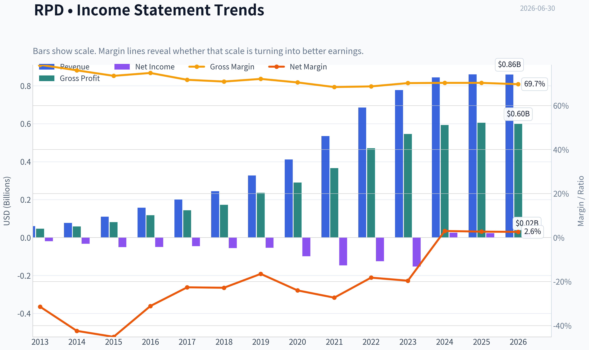

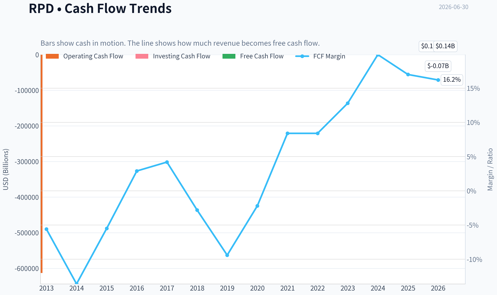

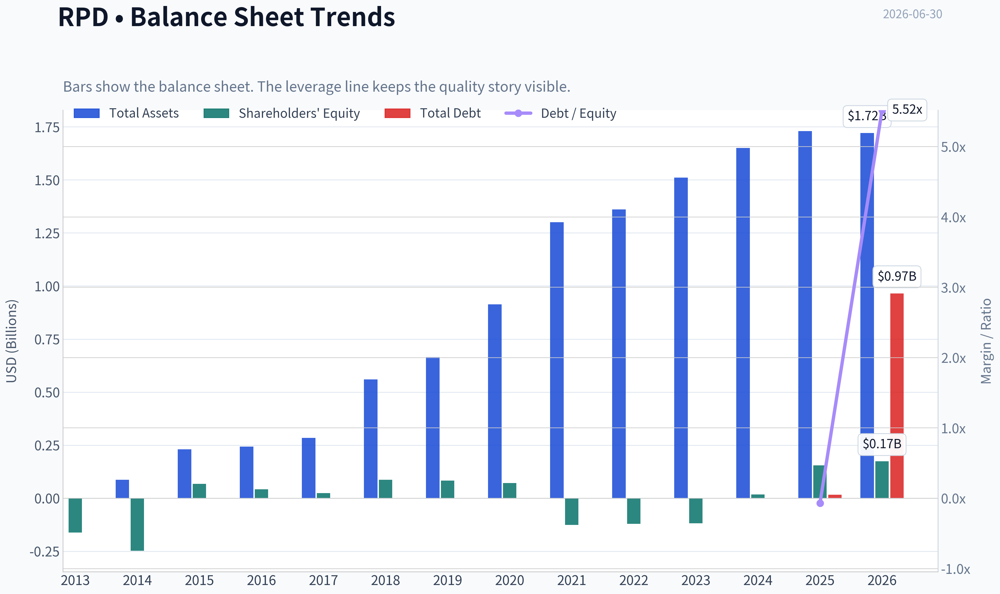

This graph tracks the profitability and return metrics (ROE, ROIC, Margins) of **RPD** over the past decade, highlighting capital efficiency trends.

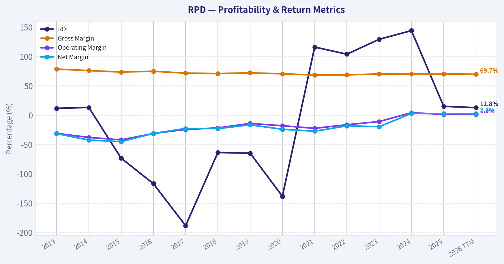

This chart illustrates the financial health of **RPD** over the last 10 years, mapping cash equivalents and free cash flow against total obligations (Debt).

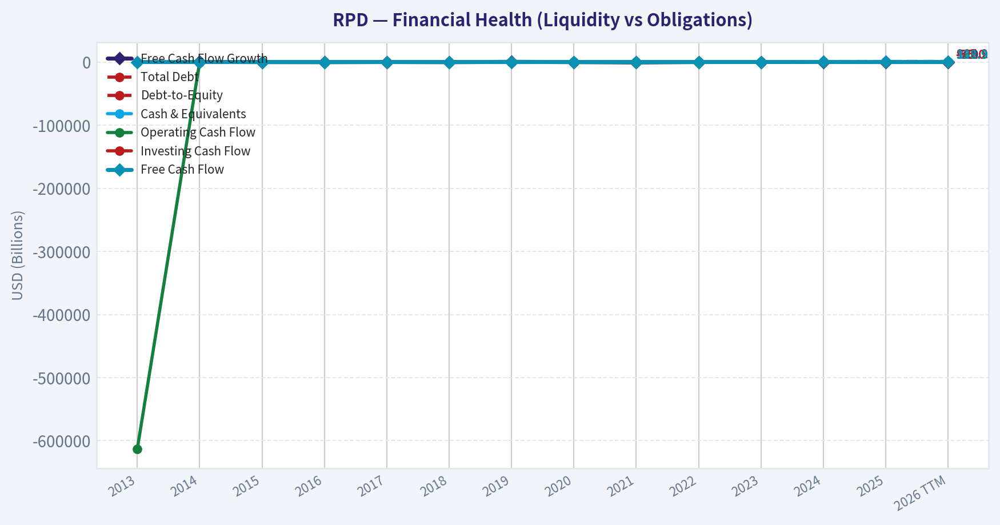

---

### Intrinsic Value Analysis (Buffett)

> *Following Warren Buffett's value investing philosophy: Circle of Competence, Economic Moat, Management Quality, and Margin of Safety.*

#### Intrinsic Value Snapshot

Price is what you pay. Intrinsic value is what the business may be worth based on the cash it can create for owners over time. We show a range, not one magic number.

- Current Price: $8.10
- Value Range (conservative to optimistic across both DCF methods): $13.80 to $204.76

##### Owner Earnings (Buffett Method)
- Net Income: $23,381,000.00
- Depreciation & Amortization: $45,436,000.00
- Capital Expenditures: $-7,599,000.00
- Working Capital Changes: $-15,492,000.00
- Owner Earnings: $76,710,000.00

##### Intrinsic Value
###### Buffett Method
Uses owner earnings. Stricter, and usually more conservative.
- Conservative: $13.80
- Average: $13.80
- Optimistic: $13.80
- Discount Rate: 10.0%

###### Cash Flow Method
Uses free cash flow. Better for companies spending heavily today to grow tomorrow.
- Conservative: $75.41
- Average: $78.63
- Optimistic: $204.76
- Discount Rate: 10.0%

#### Rapid7 (RPD) - Buffett-Style Investment Review

**ANALYST STANCE: WATCH**

#### 1) Go/No-Go Gate Assessment

| Gate | Verdict | Evidence |
|---|---|---|
| Gate 1: Circle of Competence & Simplicity | **Pass** | Rapid7 sells cybersecurity software and services. In simple terms: companies pay Rapid7 to help find security weaknesses, detect threats, and respond to attacks. The model is understandable, mostly subscription-based, and easier to grasp than many infrastructure software names. |
| Gate 2: Moat Test | **Borderline Pass** | Gross margin around **70.3%** suggests software economics and some product value, but revenue growth of only **1.9% YoY** raises concern that moat strength is not widening. This looks more like a **narrow moat** than a wide one. |
| Gate 3: Management Quality & Capital Allocation | **Watch** | Leadership transition matters: Rapid7 recently named **Wael Mohamed CEO** and reaffirmed 2026 outlook. That removes some near-term uncertainty, but a CEO change means the capital allocation record is not yet fully seasoned under the current regime. |
| Gate 4: Industry Structure | **Mixed** | Cybersecurity is important and likely durable, but it is also highly competitive, innovation-heavy, and crowded. That is less attractive in Buffett terms than a calm oligopoly with stable share positions. |

**Key Takeaways:** Rapid7 passes the basic "understandable business" test, but it does not clear the Buffett filters with ease. The biggest issues are moat durability, slower growth, and a competitive industry structure. This is not an automatic reject, but it is not a clean "wonderful business" either.

---

#### 2) Business Quality: Elementary School Test

Rapid7 makes money by selling security software to businesses.
Its products help customers:

- find weak spots in their systems,
- watch for attacks,
- respond when something goes wrong,
- manage security operations more efficiently.

Customers pay recurring fees, which creates a more predictable revenue base than one-time software sales.

#### 3) Long-Term Predictability Test

Ten years from now, companies will still need cybersecurity. That part is easy to predict.

What is harder to predict is **which vendor wins**. Cybersecurity changes quickly, customers often consolidate tools, and product relevance can shift fast. So the industry is durable, but Rapid7's exact position within it is less certain than a classic Buffett favorite.

#### 4) Technology Risk Assessment

This is **not** a low-technology-risk business. Rapid7 benefits from technology demand, but it can also be disrupted by:

- larger platform vendors,
- faster AI-native security competitors,
- vendor consolidation,
- changing threat environments.

That makes the business less Buffett-friendly than a simple consumer franchise or regulated asset.

---

#### 5) Moat Analysis

| Moat Source | Assessment | Evidence |
|---|---|---|
| Intangible Assets | **Moderate** | Rapid7 has product reputation and security credibility, but not the kind of irreplaceable brand that lets a Coke or Moody's raise price almost at will. |
| Switching Costs | **Moderate** | Security workflows, integrations, analyst training, and historical data create friction. Customers do not switch casually, but they *will* switch if a broader platform or better bundle emerges. |
| Cost Advantage | **Weak** | This is not obviously the low-cost producer with unbeatable scale economics. |
| Network Effects | **Weak** | There may be some data and learning benefits, but this is not a strong consumer or marketplace network effect model. |

**Moat Quality Rating: Narrow**

The strongest support for moat-like qualities is the **70.3% gross margin**, which is healthy and consistent with software value-add. But Buffett would want clearer signs of pricing power, customer captivity, or a dominant market structure before calling this a wide moat.

**Key Takeaways:** Rapid7 appears to have a real product and some customer stickiness, but the moat is narrow rather than wide. High gross margins help, yet the company does not show obvious dominance, cost leadership, or powerful network effects. In Buffett terms, this is a decent business, not an exceptional franchise.

---

#### 6) Management Quality & Capital Allocation

| Area | Assessment | Commentary |
|---|---|---|
| Owner Mindset | **Unclear / Neutral** | No strong evidence here of unusually owner-operator behavior from the shared facts. |
| Candor | **Neutral** | Reaffirming 2026 outlook during CEO transition is constructive, though not enough by itself to prove exceptional candor. |
| Capital Allocation | **Mixed** | The attractive **FCF yield of 24.0%** suggests the market is skeptical. That can create opportunity, but only if management can reinvest or return capital well. Leadership change makes this harder to underwrite confidently today. |

**Key Takeaways:** Management is not giving obvious Buffett-style red flags, but it also does not yet present as a proven, elite capital allocation story. The CEO transition is the main variable. For now, this is a "show me" situation rather than a high-conviction endorsement.

---

#### 7) Financial Snapshot

| Metric | Value |
|---|---:|
| Current Price | **$8** |
| Market Cap | **$541.3M** |
| P/E | **23.1x** |
| ROE | **15.1%** |
| Gross Margin | **70.3%** |
| Revenue Growth YoY | **1.9%** |
| FCF Yield | **24.0%** |
| Current Ratio | **1.28x** |

**Key Takeaways:** The headline financial picture is mixed but interesting. Gross margin and free-cash-flow yield are attractive, while growth is weak and liquidity is only adequate rather than fortress-like. ROE at 15.1% is respectable, but not so strong that it alone proves a superior moat.

---

#### 8) Buffett Financial Interpretation

| Test | Buffett Standard | RPD Read |
|---|---|---|
| ROE | >15% sustained preferred | **Meets threshold currently** |
| Gross Margin | >40% strong sign | **Very strong at 70.3%** |
| Cash Generation | OCF/FCF should support earnings | **FCF yield suggests cash generation matters** |
| Balance Sheet | Conservative preferred | **Current ratio 1.28x is acceptable, not fortress-like** |
| Growth Quality | Predictable and steady | **Weak at 1.9% YoY** |

**Key Takeaways:** Rapid7 passes some important financial quality tests, especially on margins and current ROE. The main issue is not whether the business can make money, but whether it can compound value at high rates for a long time. Weak growth keeps it from qualifying as a classic Buffett compounder.

---

#### 9) Owner Earnings View

Using Buffett's lens, the most relevant positive here is that the market is valuing Rapid7 at a **24.0% free-cash-flow yield**. That is a very cheap-looking cash flow multiple if the cash flow is durable.

A rough owner-earnings proxy from that yield:

- Market cap: **$541.3M**
- FCF yield: **24.0%**
- Implied annual FCF / owner-earnings proxy: about **$130M**

That is substantial relative to the company's market value. The key question is whether this cash generation is **stable and repeatable**, or whether the market expects future erosion.

---

#### 10) Three-Scenario DCF Valuation

Using owner-earnings proxy of **$130M**.

| Scenario | Assumption | Equity Value Estimate |
|---|---|---:|
| A: No Growth | $130M / 10% | **$1.30B** |
| B: GDP Growth | $130M x 1.03 / (10% - 3%) | **$1.91B** |
| C: Modest Growth | Assume 5% for 10 years, then 3% terminal | **~$1.7B-$1.9B** |

Compared with current market cap of **$541.3M**, the stock screens as **materially undervalued** if current owner earnings are durable.

**Key Takeaways:** Purely from a cash-flow valuation angle, Rapid7 looks cheap. Even a no-growth framework suggests value well above the current market capitalization. The market is likely discounting sustainability, competitive pressures, or execution risk rather than current cash generation alone.

---

#### 11) Margin of Safety Analysis

| Item | Value |
|---|---:|
| Current Market Cap | **$541.3M** |
| Conservative No-Growth Value | **$1.30B** |
| Discount to No-Growth Value | **~58%** |
| GDP-Growth Value | **$1.91B** |
| Discount to GDP-Growth Value | **~72%** |

This is a very large apparent margin of safety on paper.

But Buffett would ask the harder question: **Is the business quality and predictability high enough to trust the cash flow?** That is where the case weakens. A cheap stock is not automatically a bargain if the competitive position is unstable.

---

#### 12) Final Buffett Scorecard

| Criterion | Score (1-5) | Weight | Weighted Score |
|---|---:|---:|---:|
| Business Understanding | 4.0 | 20% | 0.80 |
| Moat Width & Durability | 2.5 | 25% | 0.63 |
| Management Quality | 3.0 | 15% | 0.45 |
| Return on Equity | 3.5 | 15% | 0.53 |
| Reinvestment Runway | 2.5 | 10% | 0.25 |
| Balance Sheet Strength | 3.0 | 5% | 0.15 |
| Industry Structure | 2.5 | 5% | 0.13 |
| Valuation / Margin of Safety | 4.5 | 5% | 0.23 |
| **Total** |  |  | **3.16 / 5.00** |

**Key Takeaways:** The scorecard shows a company that is understandable and attractively priced, but not clearly protected by a strong moat. Valuation is the strongest part of the case, while industry structure and moat durability are the weakest. That combination usually leads to a watchlist name, not a top conviction Buffett-style buy.

---

#### 13) Final Verdict

**ANALYST STANCE: WATCH**

Rapid7 is **cheap enough to be interesting**, but not **wonderful enough to be obvious**.

The bullish case is straightforward:

- high gross margins,
- respectable ROE,
- very strong free-cash-flow yield,
- large apparent discount to conservative value.

The caution is equally clear:

- revenue growth is weak,
- cybersecurity is highly competitive,
- technology risk is meaningful,
- moat appears narrow,
- CEO transition adds execution uncertainty.

For a Buffett-style investor, this is **not yet a "back up the truck" business**. It belongs on the watchlist for one of two reasons:

1. evidence that the moat is strengthening and growth reaccelerates, or
2. proof that current free cash flow is highly durable and management allocates it intelligently.

If those pieces improve, the gap between price and value could become compelling enough for an **ADVOCATE** stance. For now: **WATCH, medium conviction**.
#### Valuation Bridge

This bridge places the current market price beside each intrinsic value lens so readers can see whether upside depends on one method or shows up across several methods.

| Scenario | Intrinsic Value / Share |
| --- | ---: |
| Buffett Method | $13.80 |
| Cash Flow Method | $78.63 |
| Current Price | $8.10 |

#### Key Takeaways

If one method is far above the others, the upside case depends on a specific modelling assumption. When several methods cluster together, the valuation story is more robust.

#### Valuation Visuals

This comparison chart from *Latest Earnings Snapshot* stacks current figures against historical benchmarks for **RPD**, making it easy to see where the company trades relative to its own averages.

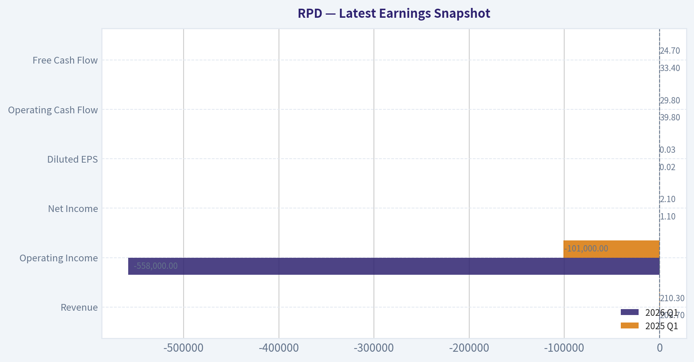

This comparison chart from *Buffett-Style Owner Earnings DCF* stacks current figures against historical benchmarks for **RPD**, making it easy to see where the company trades relative to its own averages.

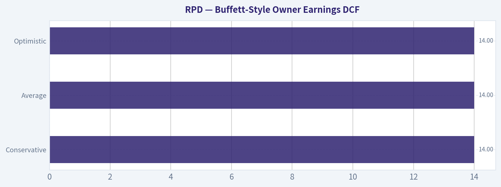

This comparison chart from *Financial Snapshot* stacks current figures against historical benchmarks for **RPD**, making it easy to see where the company trades relative to its own averages.

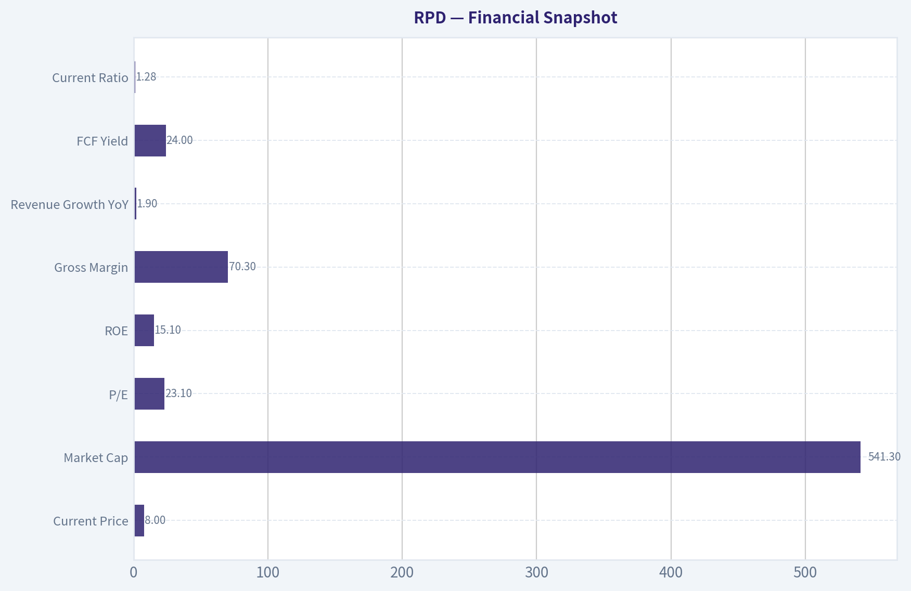

This comparison chart from *Three-Scenario DCF Valuation* stacks current figures against historical benchmarks for **RPD**, making it easy to see where the company trades relative to its own averages.

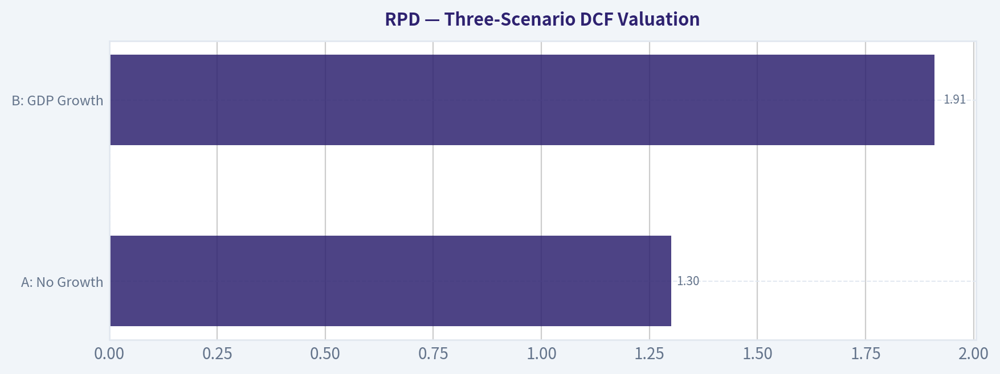

This comparison chart from *Margin of Safety Analysis* stacks current figures against historical benchmarks for **RPD**, making it easy to see where the company trades relative to its own averages.

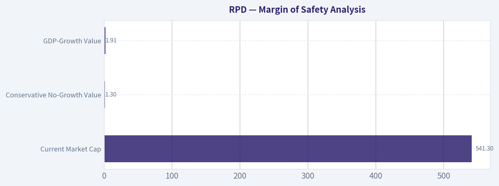

---

### Trend & Growth Analysis (Lynch/Druckenmiller/Fisher)

> *Following Peter Lynch's GARP, Stanley Druckenmiller's macro-aware approach, and Philip Fisher's scuttlebutt methodology.*

ANALYST STANCE: **WATCH**

#### Rapid7 (RPD) Growth Analysis

#### Snapshot

| Metric | Value |
|---|---:|
| Price | $8 |
| Market Cap | $541.3M |
| P/E | 23.1x |
| ROE | 15.1% |
| Gross Margin | 70.3% |
| Revenue Growth YoY | 1.9% |
| FCF Yield | 24.0% |
| Current Ratio | 1.28x |

Key Takeaways: Rapid7 screens as cheap on cash generation, with a very high free cash flow yield and solid gross margins. But the top-line growth rate is only 1.9%, which is far below the threshold for a true fast grower. That combination usually points to a maturing software company rather than an emerging ten-bagger setup.

---

#### 1) Lynch Classification

| Framework Item | Assessment |
|---|---|
| Lynch Category | **Stalwart / borderline slow grower** |
| Why | Revenue growth of 1.9% is far below fast-grower territory |
| Growth Investor Relevance | Not a classic Lynch fast grower |
| Initial Read | More of a cash-flow/value-with-optional-upside story than a growth compounder |

Key Takeaways: By Lynch's framework, Rapid7 does not qualify as a fast grower today. The business looks more mature, and the investment case depends on execution, margin improvement, or a strategic reset rather than sustained 20% plus growth. That keeps it out of prime ten-bagger territory for now.

#### 2) The Story in 3 Bullets

| Simple Story | Explanation |
|---|---|
| Cybersecurity platform | Rapid7 helps companies find vulnerabilities, detect threats, and respond to incidents |
| Recurring software + services | The business has subscription characteristics and attractive gross margins |
| Turnaround through execution | The bull case is not hypergrowth; it is better leadership, better product focus, and monetizing the installed base |

Key Takeaways: The business is easy to explain: Rapid7 sells cybersecurity software and services to help customers stay secure. The harder part is explaining why it can reaccelerate meaningfully from low single-digit growth. That is the key unanswered question.

#### 3) TAM Analysis and 10x Test

| Item | Estimate / View |
|---|---|
| Current Revenue Base | Likely small relative to global cybersecurity TAM |
| Relevant TAM | Exposure management, SIEM, MDR, cloud/app security; collectively very large |
| 10x Revenue Test | **Yes in theory** - the TAM is large enough |
| Practical 10x Test | **No in practice today** - execution and competition make 10x highly unlikely without major reacceleration |
| TAM Growth | Cybersecurity remains a secular growth market |

Key Takeaways: The market opportunity is not the problem. Cybersecurity is large and still expanding, so Rapid7 has room in theory. The issue is whether Rapid7 has enough competitive momentum to capture that opportunity at a much faster pace than it is today.

#### 4) Revenue Growth Trend

| Metric | Observation |
|---|---|
| Current YoY Revenue Growth | 1.9% |
| Pattern | **Decelerated / low growth** |
| Interpretation | No current inflection visible from the supplied data |
| Organic Quality | Needs verification, but market concerns suggest limited acceleration |
| Conclusion | Fails Druckenmiller acceleration test |

Key Takeaways: The revenue trend is the biggest weakness in the case. At 1.9% growth, there is no evidence of a growth inflection, and that makes it hard to underwrite multiple expansion on a classic growth basis. Any bullish view has to come from future reacceleration that is not yet visible.

#### 5) Unit Economics

| Metric | Value | Assessment |
|---|---:|---|
| Gross Margin | 70.3% | Good, but not elite for software |
| FCF Yield | 24.0% | Extremely strong versus market cap |
| Rule of 40 Proxy | Not fully calculable with given data | Incomplete |
| NRR | Not provided | Unknown |
| LTV/CAC | Not provided | Unknown |
| Payback Period | Not provided | Unknown |

Key Takeaways: The available unit-economics picture is mixed but interesting. Gross margins are healthy and free cash flow appears unusually strong relative to equity value, suggesting the market is pricing in weak growth or skepticism about durability. Missing retention and CAC data prevent a full software-quality judgment.

#### 6) Inflection Point Assessment

| Inflection Type | Evidence | Verdict |
|---|---|---|
| Product Cycle Inflection | No clear evidence provided | Negative / unclear |
| Market Share Inflection | No sign of accelerating share gains | Negative |
| Margin Inflection | Possible, given strong FCF yield | Modestly positive |
| TAM Inflection | Cyber market still expanding | Positive industry backdrop |
| Management Inflection | New CEO Wael Mohamed named | **Potential catalyst** |

Key Takeaways: The only credible inflection point today is leadership change, with a possible margin and strategic reset under the new CEO. That can matter, but it is not the same as proven demand acceleration. For growth investors, this is still a "show me" setup.

#### 7) Macro Setup Evaluation

| Macro Factor | Assessment |
|---|---|
| Secular Theme | Cybersecurity remains a durable long-term winner |
| IT Spending Environment | Mixed; budgets can be selective |
| Rates Sensitivity | Lower rates would help software multiples generally |
| Competitive Backdrop | Very intense in cyber, especially against larger platforms |
| Macro Wind | Neutral to modestly supportive |

Key Takeaways: The macro setup is acceptable because cybersecurity remains a long-term priority category. But macro does not solve company-specific issues like weak growth and competitive pressure. The secular tailwind is real, yet Rapid7 is not fully converting that tailwind into strong reported growth.

#### 8) Fisher 15 Points Score

| Fisher Dimension | Score (1-5) | Comment |
|---|---:|---|
| Market potential | 4 | Large cyber TAM |
| New product development | 3 | Likely adequate, not clearly leading |
| R&D effectiveness | 3 | Mixed evidence |
| Sales organization | 3 | Growth slowdown suggests room for improvement |
| Profit margin quality | 4 | Good gross margin, decent economics |
| Margin improvement | 3 | Some evidence through cash generation |
| Labor/personnel relations | 3 | No strong evidence either way |
| Executive relations | 3 | Leadership transition adds uncertainty |
| Management depth | 3 | New CEO means wait-and-see |
| Cost analysis/accounting | 4 | Strong FCF suggests discipline |
| Outstanding moat qualities | 3 | Some platform stickiness, but no clear moat leadership |
| Long-range profit outlook | 3 | Depends on stabilization and reacceleration |
| Dilution risk | 3 | Needs monitoring in software names |
| Candor in difficulties | 3 | Insufficient evidence |
| Integrity | 3 | No major red flag from provided data |

| Total Fisher Score | **48 / 75** | **Average** |

Key Takeaways: Rapid7 scores as average under Fisher's framework. The company has a real market and a real product set, but there is not enough evidence of exceptional management execution, category dominance, or product-led acceleration. This is not a high-conviction Fisher-style compounder at present.

#### 9) Valuation Analysis

| Valuation Method | Result | Assessment |
|---|---:|---|
| P/E | 23.1x | Not expensive if earnings are durable |
| PEG | ~12.2x using 1.9% growth | **Very unattractive on Lynch PEG** |
| P/S | Approx. not reliably derivable from supplied pack alone | Incomplete |
| FCF Yield | 24.0% | Very cheap on cash flow basis |
| Market View | Market appears to price RPD as low-growth / challenged asset | Likely true |

Key Takeaways: Valuation is split. On PEG, the stock looks terrible because the growth rate is too low, but on free cash flow yield it looks extremely cheap. That means investors are being offered value, not obvious growth, unless management can reignite demand.

#### 10) Scenario Framing

| Scenario | What Must Happen | Likely Market Response |
|---|---|---|
| Bear | Growth stalls or turns negative; CEO reset fails | Stock remains cheap or de-rates further |
| Base | Low-single-digit growth with stable margins and strong cash flow | Range-bound, value trap risk |
| Bull | Growth reaccelerates to high single digits or low teens; margins hold | Meaningful rerating from depressed base |

Key Takeaways: The upside case depends on operational improvement and renewed revenue momentum, not just cost control. If growth stays around current levels, the stock may remain statistically cheap for a long time. That is the core value-trap risk.

#### 11) Growth Investor Scorecard

| Criterion | Weight | Score (1-5) | Weighted Score |
|---|---:|---:|---:|
| The Story | 10% | 3.0 | 0.30 |
| TAM & Runway | 20% | 3.5 | 0.70 |
| Revenue Growth | 20% | 1.5 | 0.30 |
| Unit Economics | 15% | 3.5 | 0.53 |
| Competitive Position | 10% | 2.5 | 0.25 |
| Management Quality | 10% | 3.0 | 0.30 |
| Macro Setup | 5% | 3.5 | 0.18 |
| Profitability Path | 5% | 3.5 | 0.18 |
| Valuation | 5% | 4.0 | 0.20 |

| Total | 100% |  | **2.94 / 5.0** |

Key Takeaways: Rapid7 lands just below the threshold for a true watch-worthy growth name and well below advocate status. Cheap valuation and decent economics help, but weak revenue growth drags the score down sharply. For a growth process, this is a cautious hold-or-monitor situation rather than a buy.

#### 12) Position Size Stance

| Stance | View |
|---|---|
| Growth Portfolio | **WATCH** |
| Position Size | 0% to 1% tracking position only |
| Style Fit | Better for deep value / special situation than pure growth |
| What Would Upgrade It | 2-3 quarters of clear reacceleration, stronger guidance, evidence new CEO is driving product/sales improvement |

Key Takeaways: If you are running a growth portfolio, Rapid7 is not ready for a real position. At most, it earns a small tracking position for investors who want exposure to a possible turnaround under new leadership. A larger allocation needs proof, not hope.

---

#### Key Risks and Catalysts

| Risks | Catalysts |
|---|---|
| Revenue remains stuck near zero growth | New CEO creates strategic and sales inflection |
| Intense cyber competition | Improved product focus and go-to-market execution |
| Value trap despite low multiple | Strong FCF supports buybacks, debt reduction, or strategic flexibility |
| Leadership transition risk | Reaffirmed 2026 outlook may stabilize sentiment |
| Insider/institutional skepticism | Any quarter showing durable reacceleration could rerate shares quickly |

Key Takeaways: The risk-reward is event-driven. The main risk is that Rapid7 stays cheap because the business stays slow, while the main opportunity is that new leadership unlocks better execution and growth. Until that happens in reported numbers, caution is the right stance.

#### Bottom Line

Rapid7 is **not a Lynch fast grower**, and there is **no confirmed Druckenmiller-style growth inflection** in the current data. The stock does have appealing characteristics - big cybersecurity TAM, good margins, and very strong free cash flow relative to market cap - but the top-line growth profile is too weak for a high-conviction growth call.

For now: **WATCH**, not **ADVOCATE**. The setup becomes interesting only if the new CEO can turn a cheap cash-generating cyber asset into a reaccelerating platform.

#### Growth & Scorecard Visuals

The radar chart below from *Final Buffett Scorecard* visualises how **RPD** ranks across weighted investment criteria. Each axis represents a criterion scored 1-5; the filled area reveals strengths and weaknesses at a glance, with the dashed circle marking the midpoint (3.0).

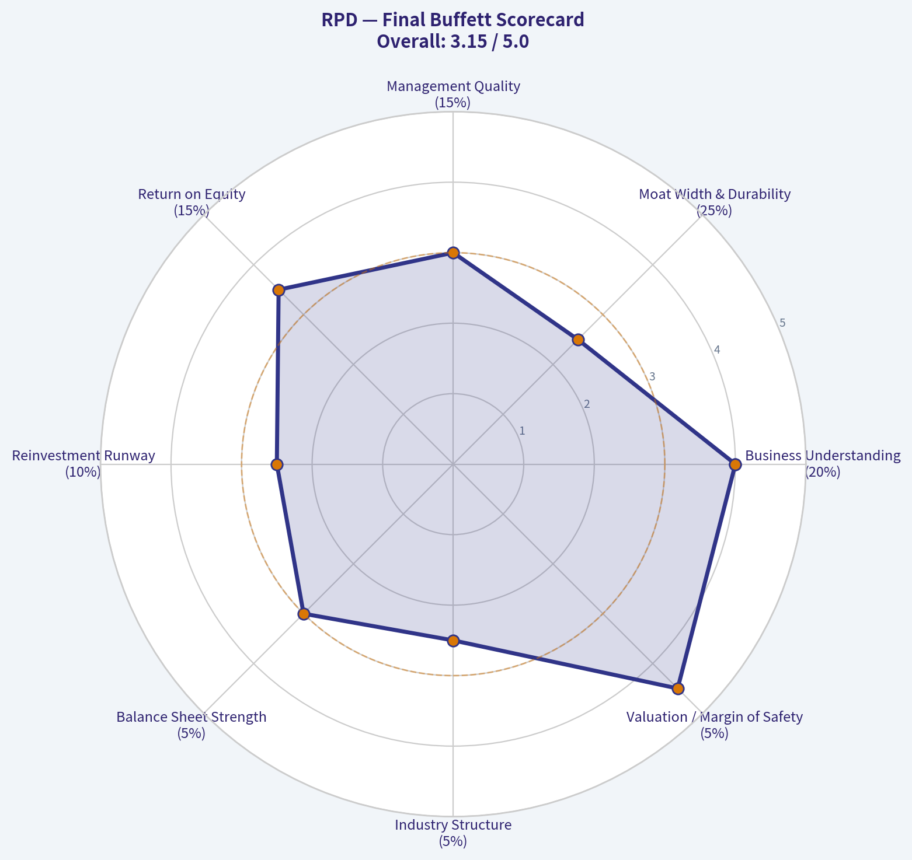

---

### Market Technical Analysis

#### RPD Technical Analysis Report

RPD remains in a **long-term damaged structure**, but its **intermediate and short-term picture has improved materially** over the last two months. The stock spent most of the past year in a severe downtrend, collapsing from the low-$20s in mid-2025 to a capitulation low near $5 in spring 2026, before staging a recovery into the high-$7s by late June. That matters because the stock is no longer trading like a pure free-fall name, yet it also has **not repaired the higher-timeframe trend enough to qualify as a fully healthy uptrend**.

The most relevant indicators for this context are:

1. **close_200_sma** - defines the strategic trend backdrop.
2. **close_50_sma** - shows whether the rebound is strong enough to improve the medium-term structure.
3. **close_10_ema** - captures the latest swing momentum.
4. **macd** - helps confirm whether upside momentum is re-accelerating.
5. **rsi** - shows whether momentum is strengthening without yet becoming fully overheated.
6. **boll_ub** - identifies upside stretch and breakout pressure.
7. **boll_lb** - frames downside support within the current volatility envelope.
8. **atr** - critical for risk management because RPD is still a volatile, lower-priced stock.

These eight work well together because they cover **trend, momentum, volatility envelope, and risk** without excessive overlap.

---

#### Trend Structure

The **200-day SMA is 11.40**, while the latest close available in the price data is **7.82 on 2026-06-29**. That means RPD is still trading **far below its long-term trend benchmark**, and the 200-day average itself is still sloping downward sharply. This is the clearest sign that the stock remains in a **primary bear-market structure**. Even after the recent recovery, price is still roughly one-third below the 200-day average, which tells traders not to confuse a rebound with a completed secular reversal.

The **50-day SMA is 6.90** and has been rising steadily throughout June from roughly **6.04 in early May** to above **6.90 by month-end**. That is a meaningful improvement. The slope of the 50-day average shows that the market has transitioned from deterioration to rebuilding. Importantly, price is now above the 50-day SMA, so the intermediate trend has turned constructive even while the long-term trend remains bearish.

The spread between the **50-day SMA (6.90)** and **200-day SMA (11.40)** is still very wide and negative. This tells us the stock is in an **early-stage recovery inside a much larger damaged chart**, not in a mature bull trend. In practical terms, that means rallies can continue, but they are more vulnerable to sharp retracements and failed breakouts than in a stock trading above a rising 200-day SMA.

#### Momentum and Swing Behavior

The **10-day EMA is 7.38**, below the latest close near **7.82**, which indicates that the most recent price action has turned favorable again after a mid-June pullback. Earlier in June, the 10-day EMA rolled over from the May breakout zone, reflecting loss of momentum. But in the final week of June it turned back up decisively, suggesting buyers have regained short-term control.

The **MACD moved from negative (-0.06 on 2026-06-23) to positive (+0.14 by 2026-06-30)**. That shift is important. It suggests the late-June advance was not just a one-day short squeeze but had enough persistence to flip momentum back into bullish territory. Even more notable is the path: MACD had been strong in late May and early June, weakened through the mid-June retreat, then re-accelerated. That pattern often reflects a **bullish reset rather than a complete breakdown**, where overextended momentum cools and then resumes.

The **RSI rose to 64.1**, up from the high-30s/low-40s during the June pullback. This is a healthy reading for a rebound. It is **strong enough to indicate momentum leadership**, but not yet above the traditional 70 overbought threshold. That means the stock has regained upside force without yet reaching the sort of extreme that often precedes immediate exhaustion. In other words, momentum is constructive, but not euphoric.

A subtle but useful point: RSI peaked above **74 on 2026-06-01**, then cooled sharply during the retracement, and has now recovered to the mid-60s. That suggests the current rally leg is **less overheated than the early-June surge**, which can sometimes be a healthier setup if accompanied by improving price structure.

---

#### Volatility and Price Envelope

The Bollinger Bands show a tightening but still active volatility structure. By 2026-06-30:

- **Upper Band:** 8.30
- **Lower Band:** 6.27

With price around **7.82**, RPD is trading in the **upper half of the band range**, closer to the upper band than the lower band. This confirms positive short-term pressure. However, the stock is **not yet pushing through the upper band aggressively**, which means momentum is firm but not in a runaway breakout state.

In late May and early June, price moved aggressively toward the upper band as RSI also entered overbought territory. That rally then corrected. The current setup is different: the stock has rebuilt toward the upper half of the envelope after a reset. This often creates a more balanced tactical picture. If price can press through **8.30** with expanding momentum, that would strengthen the breakout case. If instead price stalls beneath the upper band and rolls back under the 10-day EMA, that would suggest the move remains range-bound within the broader recovery.

The **lower Bollinger Band at 6.27** is also useful. It sits well below spot price and roughly brackets the lower end of the recent short-term trading zone. This implies that while the rebound is intact, a full move back toward the lower band would represent a significant momentum failure, not just normal day-to-day noise.

#### Volatility and Risk Control

The **ATR is 0.50**, which is large relative to a stock trading around **7.8**. That implies daily movement potential of roughly **6%+ of price**, which is high. For traders, this is critical. Even if the technical picture is improving, position sizing must remain conservative because routine swings are still large enough to knock out tight stops.

ATR has eased somewhat from the early-June elevated readings above **0.53**, but volatility has not normalized to a truly calm state. The stock is still prone to sharp bursts, and that is consistent with its recent history of gap-heavy, unstable price action. This reinforces the idea that RPD is better suited to traders who can tolerate volatility and structure trades around wider risk bands, rather than investors seeking smooth trend continuation.

---

#### Fine-Grained Read on the Current Setup

The key technical story is **timeframe conflict**:

- **Long-term:** still bearish.
- **Medium-term:** improving.
- **Short-term:** bullish again after a pullback reset.

That is not a generic "mixed" call. More precisely, RPD appears to be in a **countertrend recovery relative to the long-term chart**, but within that recovery the **intermediate base-building process looks real rather than random**. The rising 50-day SMA and recovery in the 10-day EMA, MACD, and RSI all support that interpretation.

The late-May surge to the **8.38-8.74 area** was the first strong breakout attempt. Early June then produced a pullback to the low-$7s, which tested whether buyers would defend gains. They largely did. The rebound back to **7.82** into month-end suggests the market is attempting to form a **higher low above the 50-day SMA**, which is exactly what bulls would want in an early-stage trend repair.

Still, traders should respect the overhead context. There is likely meaningful resistance in the **8.3 to 9.0 region**, because that zone contains the upper Bollinger area and the prior early-June surge highs. A clean push through that region would materially improve the chart. Failure there would raise the odds that the stock remains trapped in a volatile recovery range rather than launching into sustained upside.

For swing traders, the most important practical observation is this: **RPD currently behaves better on dips than on chases**. When momentum overheated in early June, the stock corrected. Now momentum has rebuilt from a lower-temperature state. That makes follow-through more plausible, but only if price can hold above the 10-day EMA and avoid losing the 50-day SMA.

---

#### Trading Implications

| Theme | Current Read | Why It Matters |
|---|---:|---|
| Long-term trend | Bearish | Price remains far below the falling 200-day SMA, so the bigger picture is still unrepaired. |
| Medium-term trend | Improving | Rising 50-day SMA suggests the rebound has enough duration to matter. |
| Short-term trend | Bullish | Price is above the rising 10-day EMA and momentum has turned back up. |
| Momentum | Constructive | MACD positive and RSI in the mid-60s support continuation potential. |
| Overbought risk | Moderate, not extreme | RSI is elevated but below 70, so upside is stretched but not exhausted. |
| Volatility | High | ATR near 0.50 means position sizing and stop placement must stay disciplined. |
| Key resistance | 8.30 to 8.75 | This area combines the upper volatility envelope and prior breakout highs. |
| Key support | 7.35, then 6.90, then 6.27 | 10-day EMA, 50-day SMA, and lower Bollinger Band form a layered support stack. |

Key Takeaways: RPD has improved notably on the short and medium timeframes, but it is still below its long-term trend line, so this remains a recovery trade rather than a fully repaired uptrend. Momentum has turned bullish again after a healthy reset, but resistance in the 8.30 to 8.75 zone is important. Because volatility is still high, traders should focus on disciplined entries and wider risk controls rather than aggressive chasing.

#### Bottom Line

RPD is showing **credible recovery momentum**, not just random noise. The **rising 50-day SMA**, **reclaimed 10-day EMA**, **positive MACD**, and **RSI back into the 60s** all point to renewed bullish pressure. However, the **falling 200-day SMA far above price** keeps the stock in a long-term weak structure.

That leads to a practical conclusion: **RPD currently looks more attractive as a tactical swing-rebound candidate than as a clean long-term trend-following investment**. Bulls have near-term control, but they still need to prove they can clear the overhead resistance band and continue building above the 50-day average. If they do, the recovery can extend. If they fail, the stock likely remains a volatile trading vehicle rather than a durable trend leader.

| Indicator | Latest Value | Signal | Interpretation |
|---|---:|---|---|
| close_200_sma | 11.40 | Bearish backdrop | Long-term downtrend still dominant. |
| close_50_sma | 6.90 | Bullish medium-term | Intermediate structure is improving. |
| close_10_ema | 7.38 | Bullish short-term | Recent price action has regained upside momentum. |
| macd | 0.14 | Bullish | Momentum has turned positive again after mid-June weakness. |
| rsi | 64.06 | Bullish, not extreme | Strong momentum without full overbought exhaustion. |
| boll_ub | 8.30 | Nearby resistance | Upside breakout pressure exists, but price is nearing stretch territory. |
| boll_lb | 6.27 | Lower support envelope | A drop toward this zone would imply notable deterioration. |
| atr | 0.50 | High volatility | Risk management remains essential due to large daily swings. |

Key Takeaways: The indicator set tells a coherent story: short-term and medium-term conditions have improved, while the long-term trend is still weak. Momentum is supportive, but the stock is approaching an important resistance area and remains volatile, so any bullish trade setup should be treated as tactical and risk-aware.

---

### Options Market Analysis

> *Reading options flow - put/call ratios, IV skew, and unusual activity - to gauge institutional positioning and event-driven risk.*

#### RPD Options Positioning Report
*Date: 2026-06-30*

RPD's options tape is **slightly bullish to neutral overall, with a final read of NEUTRAL-BULLISH leaning BULLISH**. The key reason is that aggregate open interest is still call-heavy enough to keep the total put/call OI ratio near the historical neutral baseline, while near-dated activity is not showing aggressive downside panic. At the same time, the volume ratio is basically balanced, and the back-month expiries carry heavier put open interest, which tempers conviction.

#### Put/Call Ratio Analysis

| Expiry | Call OI | Put OI | Put/Call OI Ratio | Call Vol | Put Vol | Put/Call Vol Ratio |
|---|---:|---:|---:|---:|---:|---:|
| 2026-07-17 | 5,597 | 640 | 0.11 | 162 | 204 | 1.26 |
| 2026-08-21 | 3,083 | 4,352 | 1.41 | 60 | 54 | 0.90 |
| 2026-11-20 | 1,501 | 2,587 | 1.72 | 46 | 14 | 0.30 |
| **Near-term total** | **10,181** | **7,579** | **0.74** | **268** | **272** | **1.01** |

**Key Takeaways:** Aggregate positioning is almost exactly on the long-run neutral baseline, with a total put/call OI ratio of **0.74** versus the rough neutral reference of **0.7**. That means the market is not flashing a strong directional consensus. The sharp split by expiry matters: July is heavily call-dominated, while August and November show materially more put open interest, suggesting near-term optimism or call overwriting, but more cautious medium-dated positioning.

**Interpretation**
- **Overall OI ratio: 0.74**
  This is only marginally above the neutral baseline and does **not** indicate a strongly bearish hedge build.
- **Overall volume ratio: 1.01**
  Fresh trading flow is basically balanced between puts and calls.
- **July 2026 expiry: 0.11 OI ratio, 1.26 volume ratio**
  Existing positioning is overwhelmingly call-heavy, but today's/near-term flow has somewhat more put volume than call volume. That can indicate short-dated hedging against an already call-heavy open interest base.
- **August and November OI ratios above 1.0**
  These expiries suggest investors are carrying more downside protection further out, which prevents a clean outright bullish signal.

Net: **not bearish**, but also not an aggressive risk-on options posture.

---

#### Implied Volatility Assessment

| Expiry | ATM Call IV | ATM Put IV | IV Read |
|---|---:|---:|---|
| 2026-07-17 | 79.3% | 79.3% | Elevated, symmetric |
| 2026-08-21 | 89.1% | 84.9% | Elevated, slight call premium |
| 2026-11-20 | 85.5% | 79.1% | Elevated, call premium persists |

**Key Takeaways:** ATM implied volatility is **very elevated across all listed near-term expiries**, running roughly **79% to 89%**, which is high enough to imply the market expects meaningful movement or simply prices illiquidity/event uncertainty. Notably, calls carry slightly higher ATM IV than puts in August and November, which is unusual relative to the classic downside-fear setup and leans toward upside optionality demand rather than panic hedging.

**IV level**
- IV is **high in absolute terms** for all listed maturities.
- This may reflect:
  - event uncertainty,
  - lower liquidity in the chain,
  - or a stock-specific expected move.

**Skew**
The tool output does **not provide explicit OTM put IV vs. OTM call IV**, so true skew cannot be measured precisely from the dataset. However, the available ATM data shows:
- **July:** call IV = put IV, so no obvious skew at-the-money.
- **August/November:** call ATM IV is modestly above put ATM IV, which hints at a **call-side premium**, not a classic protective put skew.

That is important because a steep downside fear structure would normally show puts priced richer than calls. Here, the available evidence suggests **no meaningful downside-panic skew** and possibly some upside-chasing or call demand in later expiries.

**Catalyst flag**
No catalyst calendar is included in the options feed. Since IV is elevated, investors should assume the market may be pricing:
- earnings,
- strategic updates,
- macro/sector volatility,
- or simply illiquidity in the options chain.

Because RPD options are not among the deepest large-cap chains, some of this elevated IV likely reflects **structural illiquidity premium**, not just event risk.

---

#### Unusual Options Activity

| Contract Signal | Observation | Interpretation |
|---|---|---|
| Volume vs. OI scan | No contracts found with volume > 5x open interest | No clear fresh, outsized directional bet detected |
| Flow quality | Total volume is modest across expiries | Signal confidence reduced by relatively thin flow |
| Smart-money read | No large standout sweeps/prints available from this dataset | Institutional conviction not obvious from current tape |

**Key Takeaways:** There is **no major unusual activity** in the chain based on the defined threshold of volume exceeding 5x open interest. That reduces the odds that a single large institutional player is currently making a bold visible bet through listed options. It also means the directional read must lean more heavily on open interest structure and IV rather than fresh flow.

**Interpretation**
- No contract showed the classic "fresh opening bet" signature.
- That means:
  - no standout bullish call chase,
  - no obvious hedge-fund-style put protection surge,
  - and no strong event-driven speculation visible from this scan.
- With volume relatively low, the absence of unusual activity also means **confidence should be moderate, not high**.

---

#### Open Interest Concentration

| Expiry | Dominant Positioning | Likely Market Effect |
|---|---|---|
| 2026-07-17 | Heavy call OI concentration overall | Could create upside magnet/pinning effects if price is near major call strikes |
| 2026-08-21 | Put OI exceeds call OI | More defensive positioning; can act as downside hedge zone |
| 2026-11-20 | Put OI materially exceeds call OI | Medium-dated caution remains embedded |

**Key Takeaways:** The chain's most important structural feature is that **July is heavily call-loaded**, while **August and November are put-heavier**. That creates a split regime: near-term expiration may have more supportive or pinning dynamics, but medium-dated investors appear more defensive. Without strike-level detail, gamma-wall precision is limited, but the broad shape suggests short-term stabilization with less confidence further out.

**What this implies**
- **July call-heavy OI** can create a near-term "gravitational" effect if dealers are positioned around those strikes.
- **Back-month put-heavy OI** suggests investors are less comfortable carrying pure upside exposure beyond the immediate window.
- Because strike-by-strike concentrations were not supplied, exact **max pain** and precise **gamma walls** cannot be calculated. Still, the expiration-level distribution implies:
  - short-term price damping/support is more likely than a sharp collapse,
  - but upside follow-through may run into overwriting or hedged positioning as time extends.

---

#### Overall Options Sentiment Signal

| Category | Signal |
|---|---|
| Directional read | **BULLISH, low-to-moderate conviction** |
| Confidence | **Moderate-Low** |
| Primary driver | Call-heavy near-dated OI, balanced current flow, no downside-fear skew visible in available IV data |

**Key Takeaways:** The options market is not sending a strong bearish warning for RPD. Near-dated positioning is supportive enough to justify a **bullish lean**, but that signal is softened by balanced flow, elevated IV, and more defensive put-heavy open interest in later expiries. So the best characterization is **bullish with caution**, not an all-clear risk-on setup.

**Final synthesis**
I would label RPD options sentiment **BULLISH**, but only by a narrow margin.

Why bullish:
- aggregate put/call OI ratio of **0.74** is basically neutral, not bearish;
- July open interest is **extremely call-heavy**;
- no unusual put panic is visible;
- available IV data does **not** show classic downside-fear pricing.

Why conviction is limited:
- put/call volume ratio is **1.01**, so fresh flow is balanced;
- August and November carry **put-heavy OI**;
- IV is elevated, which raises the possibility that options are expensive and reflect uncertainty rather than conviction;
- no unusual activity confirms strong institutional directional intent.

So the options tape says: **modest upside bias in the near term, but with meaningful caution embedded beyond the front month**.

#### Summary Table

| Metric | Reading | Interpretation |
|---|---|---|
| Put/Call Ratio | OI: **0.74** overall; Volume: **1.01** | Near neutral overall; slightly supportive, not bearish |
| IV Level | **79%-89% ATM IV** | Elevated; market pricing large moves / uncertainty |
| Skew Direction | **Flat to slight call premium** in available ATM data | Not a classic downside-fear skew |
| Unusual Activity | **None detected** | No standout fresh institutional bet |
| Overall Signal | **BULLISH** | Near-term call-heavy structure outweighs medium-dated caution |

**Key Takeaways:** In one line, RPD's options market shows a **mild bullish lean**, not a high-conviction directional setup. The main support comes from heavy front-month call open interest and the lack of a strong fear skew, while the biggest caveats are elevated IV and more defensive positioning further out.

---

## Research Team Commentary

> *The Research Manager synthesizes the Bull vs Bear debate into action-free commentary. This is a pre-risk view, not the final stance.*

The debate is fairly clear through a Buffett lens: the bull case says Rapid7 may be a misunderstood, cash-generative cybersecurity platform with sticky products, strong gross margins, and better normalized owner earnings than the market gives it credit for. The bear case says that "mission-critical" is being confused with "moated," and that a slow-growing, competitively pressured software company at roughly 23x earnings is not a value investment without a much larger margin of safety.

The strongest bull point is business relevance. Cybersecurity is not discretionary, and Rapid7's products likely do have some real switching costs because they sit inside customer workflows, compliance routines, and response processes. The 70.3% gross margin also supports the view that the software has economic value and some pricing power at the product level. If the company truly has strong free cash flow yield, then the market may be overly focused on weak reported growth and underappreciating the cash earnings base of a mature software business.

The strongest bear point is that none of that proves a durable moat. Cybersecurity is one of the least Buffett-like sectors because products evolve quickly, vendors consolidate, and larger platforms often pressure mid-sized players. The hard numbers in the handoff do not scream exceptional business: revenue growth of 1.9% is very weak for this sector, ROA of 1.4% is poor, and ROIC is not available. That matters. In past mistakes, the trap was being too charitable toward "good industry + decent margins" while underweighting weak capital efficiency and insufficient margin of safety. This setup has some of that risk. A 23.14 P/E multiple is not low enough to compensate for uncertain moat strength, muted growth, and incomplete evidence on long-term returns on capital.

My takeaway is that Rapid7 may be a decent operating business, but it does not currently clear the bar for a Buffett-style value commitment. The market may be right to treat it as a maturing software vendor rather than a durable compounder. The bull thesis needs several favorable assumptions to work: stable retention, successful shift to cash compounding, no meaningful competitive erosion, and better owner earnings than accounting suggests. That is too much to assume without a clearer discount to intrinsic value.

Core takeaway: this is a potentially useful cybersecurity business, but not yet an attractive value stock. The combination of low growth, weak asset returns, uncertain moat durability, and only moderate valuation leaves too little margin of safety. If the free cash flow is truly stronger than earnings and proves durable, there may be a future opportunity, but the current evidence supports patience rather than advocacy.

Rationale: Buffett-style investing starts with durable business quality and predictable economics. Rapid7 passes the "necessary product" test better than the "durable franchise" test. High gross margins are encouraging, but gross margin alone is not enough. I do not want to repeat prior errors where I gave too much credit to qualitative stickiness and not enough weight to weak return metrics or the absence of clear ROIC evidence. Also, in software, "cheap on FCF" can be a trap if cash flow is being flattered by slower growth investment or stock-based compensation dynamics. Without stronger proof of stable owner earnings and better capital efficiency, 23x earnings is not a bargain.

Monitoring plan over the next 1 to 4 quarters: first, watch organic revenue growth closely. If growth improves from roughly 2% into a healthier mid-single-digit range without sacrificing profitability, that would strengthen the thesis materially. Second, watch free cash flow quality, especially conversion relative to net income and any signs that SBC or working-capital timing is distorting the picture. Third, watch operating margin trend and sales efficiency to see whether this really is becoming a mature cash compounder. Fourth, watch customer retention, upsell trends, and any evidence of product consolidation wins or losses versus larger platforms. Fifth, watch capital allocation: debt reduction, sensible buybacks if undervalued, and no empire-building behavior. Finally, from a market-psychology angle, I would become more interested only if either fundamentals improve enough to justify the current multiple or the stock falls to a valuation that provides a real margin of safety.

Final stance: WATCH.

---

## Value Investing Team Commentary

> *The Investor translates the research view into an investment thesis before risk review. This is still not the final stance.*

Rapid7 is the sort of company that can look more attractive at first glance than it really is. Cybersecurity is undeniably important, the products are embedded in customer workflows, and a 70%+ gross margin tells you the software is not a commodity in the narrow sense. If the free cash flow is genuinely solid, there is a plausible case that reported earnings understate the business's economic value. That is the part of the story the market may be underappreciating.

But Buffett-style investing is not about buying "important" businesses. It is about buying understandable businesses with durable competitive advantages, high and defensible returns on capital, and a clear discount to intrinsic value. On that standard, Rapid7 still falls short. Revenue growth of just 1.9% is weak for software and especially weak for cybersecurity, where stronger players tend to consolidate customer budgets over time. ROA of 1.4% is not the mark of a great business. ROIC being unavailable is not a trivial omission; it removes one of the most important tests of whether this business actually creates value as it grows.

The key contrarian question is whether the market is being too pessimistic because it is anchoring on slow growth and missing a transition from growth story to cash compounder. That can happen. Some software companies stop looking exciting just as they become economically attractive. But that thesis requires evidence: durable customer retention, stable or improving margins, clean free cash flow conversion, and proof that cash generation is not being flattered by stock-based compensation or reduced reinvestment. Right now, the evidence provided is not strong enough to conclude that Rapid7 is a hidden compounder.

The opposite contrarian risk is more important: investors may be too willing to assume that "mission-critical cybersecurity" automatically means moat. In this industry, that is often false. Security markets evolve quickly, platform vendors bundle aggressively, and mid-sized players can get squeezed. Good gross margins do not by themselves protect against competitive erosion. A business can be useful, sticky enough, and still not possess the kind of durable moat that justifies paying a full multiple.

At roughly 23x earnings, the stock does not offer much forgiveness. That is not a distressed valuation, and it is not low enough to offset the combined risks of slow growth, uncertain moat durability, weak asset returns, and incomplete proof on owner earnings quality. If the free cash flow story strengthens and the company demonstrates it can grow modestly while expanding margins, the market could eventually rerate it more favorably. But today, that is still a "show me" case, not a clear value opportunity.

What I would watch from here is straightforward: organic growth reaccelerating into at least mid-single digits, cleaner disclosure around free cash flow quality, evidence of stable retention and upsell, and signs that management is allocating capital with discipline rather than defending relevance through expensive expansion. If those improve while sentiment remains skeptical, that could create a genuine contrarian entry. Until then, caution is the wiser posture.

ANALYST STANCE: **WATCH**

---

## Deep Values Commentary

> *The Risk Management Team debates and the Risk Judge provides the final action-free verdict. This section determines the final ADVOCATE / WATCH / AVOID stance.*

#### Final Stance Scorecard

This scorecard converts the final research view into a weighted decision frame. It does not replace the narrative judgement, but it makes the main drivers of the verdict easier to scan.

| Criterion | Score | Weight | Commentary |
| --- | ---: | ---: | --- |
| Business Quality | 3.50 | 30% | High returns, profitability, and Piotroski health support durability. |
| Valuation Support | 4.33 | 30% | Blends current price against available intrinsic value anchors and valuation ratios. |
| Financial Strength | 3.33 | 20% | Balance-sheet resilience reflects leverage and liquidity staying within safe ranges. |
| Growth Durability | 1.33 | 20% | Recent revenue, earnings, and free cash flow growth indicate how durable expansion looks. |
| TOTAL / FINAL STANCE | 3.28 | 100% | WATCH |

#### Key Takeaways

The weighted score lands at **3.28 / 5.0**, while the final stance remains **WATCH**. This is useful as a quick calibration aid rather than a mechanical signal.

#### Risk Summary

Higher scores indicate more risk pressure. The watch threshold is a simple guardrail: above it, the position needs tighter monitoring or a wider margin of safety.

| Dimension | Current Score | Watch Threshold | Commentary |
| --- | ---: | ---: | --- |
| Business Quality | 2.50 | 3.00 | High returns, profitability, and Piotroski health support durability. |
| Valuation Support | 1.67 | 3.00 | Blends current price against available intrinsic value anchors and valuation ratios. |
| Financial Strength | 2.67 | 3.00 | Balance-sheet resilience reflects leverage and liquidity staying within safe ranges. |
| Growth Durability | 4.67 | 3.00 | Recent revenue, earnings, and free cash flow growth indicate how durable expansion looks. |

#### Key Takeaways

This view helps readers separate *where* the risk sits: valuation, business quality, balance sheet, or growth durability. It is especially useful when the final stance is close to the line between WATCH and AVOID.
