# RYAAY Deep Value Intelligence

**Analysis Date:** 2026-08-30

## Critical Disclaimer

*This analysis is generated by Deep Value Intelligence, an AI-powered multi-agent investing framework. Education & research only - not financial advice, not a financial advisor.*

---

## Table of Contents

1. Intelligence Summary
2. Analyst Team Reports
   - Fundamentals Analysis
   - Intrinsic Value Analysis (Buffett)
   - Trend & Growth Analysis (Lynch/Druckenmiller/Fisher)
   - Market Technical Analysis
   - Options Market Analysis
3. Research Team Commentary
4. Value Investing Team Commentary
5. Deep Values Commentary

---

## Intelligence Summary

### Thesis + Conditions

**Core Thesis:** **EXECUTIVE SUMMARY**
Ryanair is a best-in-class operator with a structural cost advantage, but airlines remain capital-intensive, cyclical "death traps." At a 13.4x P/E with a 21.5% ROE, earnings are likely at a cyclical peak. Coupled with shelved profit guidance and Boeing delivery delays stifling fleet efficiency, near-term visibility is virtually zero.

**Key Risks:**
- The Bull (Risky):** Ryanair is "GEICO with wings"-a structural cost-leader benefiting from consumer trade-downs. A 28% discount to intrinsic value and a 13.4x P/E offer a mispriced certainty. Boeing delays are a "hidden blessing" that constrains industry capacity and supports pricing.
- 1. **The Glencore (GLNCY) Lesson on Cyclicals:** Our Glencore review taught us that trailing metrics in commodity/cyclical industries are deceptive. Extrapolating Ryanair's peak 21.5% ROE and 13.4x P/E into the future assumes permanent structural elevation. If European travel normalizes downward, the "E" in the P/E will compress, making today's price a classic value trap.
- 2. **The Sea Limited (SEA) Lesson on Visibility:** Our SEA review taught us that when a business is in transition and visibility is murky, a low P/E is not enough to justify an entry. The Risky Analyst frames management shelving guidance as "integrity," but we must treat it objectively as elevated uncertainty. In investing, there are no called strikes. We do not need to deploy capital-even a 25% starter position-when management themselves cannot forecast the next six months.

**Confidence:** Low

---

## Analyst Team Reports

### Fundamentals Analysis

#### Latest Earnings Snapshot

*Most recent reported quarter anchored on 2026 Q2, with prior-year comparison when available.*

| Metric | 2026 Q2 | 2025 Q2 | YoY Change |
| --- | ---: | ---: | ---: |
| Revenue | $4.38B | $4.34B | +1.1% |
| Operating Income | $575.4M | $913.3M | -37.0% |
| Net Income | $537.7M | $819.9M | -34.4% |
| Diluted EPS | $1.02 | $1.53 | -33.1% |
| Operating Cash Flow | $1.20B | $1.46B | -17.5% |
| Free Cash Flow | $728.7M | $835.4M | -12.8% |

Key Takeaways: This snapshot anchors the most recent reported quarter before the narrative analysis. It helps readers separate long-run business quality from whatever changed in the latest earnings print.

#### 10-Year Financial Metrics for RYAAY

*All values below are computed deterministically from raw data - not estimated by AI.*

*Issuer profile: operating company (Industrials / Airlines).*

#### 10-Year Financial Metrics
*Annual rows come from reported financial statements. The final TTM row is computed from the latest four quarters.*

| Metric | 2016 | 2017 | 2018 | 2019 | 2020 | 2021 | 2022 | 2023 | 2024 | 2025 | 2026 TTM |
| --- | --- | --- | --- | --- | --- | --- | --- | --- | --- | --- | --- |
| Market Price | $33 | $32 | $47 | $29 | $20 | $44 | $33 | $36 | $56 | $42 | $56 |
| Market Cap | N/A | N/A | $28.79B | $16.99B | $11.57B | $8.98B | $19.78B | $21.48B | $33.21B | $22.54B | $29.47B |
| P/E Ratio | 26.83 | 28.87 | 19.85 | 19.20 | 16.05 | -7.58 | -70.62 | 15.70 | 15.97 | 13.02 | 15.58 |
| P/B Ratio | N/A | N/A | 5.24 | 2.90 | 2.13 | 1.65 | 3.20 | 3.49 | 4.04 | 2.96 | 3.11 |
| ROE | 38.2% | 27.8% | 26.4% | 15.1% | 13.3% | -21.7% | -4.5% | 22.2% | 25.3% | 22.7% | 20.0% |
| ROIC | 19.3% | 20.8% | 22.0% | 13.6% | 17.0% | -13.4% | -2.5% | 21.6% | 33.1% | 24.7% | 25.7% |
| EPS | $1.23 | $1.10 | $2.37 | $1.49 | $1.27 | $-5.81 | $-0.47 | $2.30 | $3.52 | $3.25 | $3.60 |
| Revenue | $7.22B | $7.30B | $8.37B | $8.92B | $9.44B | $1.91B | $5.58B | $11.23B | $14.59B | $14.98B | $15.59B |
| Gross Profit | N/A | N/A | N/A | N/A | N/A | N/A | N/A | N/A | N/A | N/A | $3.15B |
| Gross Margin | N/A | N/A | N/A | N/A | N/A | N/A | N/A | N/A | N/A | N/A | 20.2% |
| Operating Margin | 22.3% | 23.1% | 23.3% | 13.2% | 13.3% | -51.3% | -7.1% | 13.4% | 15.3% | 11.2% | 13.1% |
| Net Income | $1.56B | $1.32B | $1.45B | $885.0M | $721.1M | $-1.18B | $-280.0M | $1.37B | $2.08B | $1.73B | $1.89B |
| Net Margin | 21.6% | 18.0% | 17.3% | 9.9% | 7.6% | -62.1% | -5.0% | 12.2% | 14.3% | 11.6% | 12.1% |
| Revenue Growth | N/A | 1.1% | 14.6% | 6.6% | 5.9% | -79.8% | 192.4% | 101.1% | 29.9% | 2.7% | 4.1% |
| Net Income Growth | N/A | -15.6% | 10.2% | -39.0% | -18.5% | -264.3% | -76.4% | -588.8% | 52.0% | -16.8% | 9.3% |
| Free Cash Flow Growth | N/A | -24.1% | 59.7% | -38.3% | 76.7% | -484.8% | -127.6% | 133.3% | -59.6% | 140.7% | -15.2% |
| Total Book Value | $4.08B | $4.73B | $5.50B | $5.86B | $5.42B | $5.45B | $6.19B | $6.15B | $8.22B | $7.62B | $9.48B |
| Total Assets | $12.72B | $12.81B | $15.21B | $14.88B | $16.27B | $14.45B | $16.91B | $17.89B | $18.54B | $18.95B | $18.16B |
| Total Debt | $4.05B | $4.20B | $4.34B | $3.75B | $3.95B | $4.12B | $4.15B | $3.11B | $2.73B | $1.82B | $181.9M |
| Debt-to-Equity | 0.99 | 0.89 | 0.79 | 0.64 | 0.73 | 0.76 | 0.67 | 0.51 | 0.33 | 0.24 | 0.02 |
| Cash & Equivalents | $1.26B | $1.22B | $1.51B | $1.68B | $2.83B | $3.11B | $2.98B | $3.92B | $4.18B | $4.18B | $2.48B |
| Shareholders' Equity | $4.08B | $4.73B | $5.50B | $5.86B | $5.42B | $5.45B | $6.19B | $6.15B | $8.22B | $7.62B | $9.48B |
| Operating Cash Flow | $1.85B | $1.93B | $2.23B | $2.02B | $1.48B | $-2.86B | $2.26B | $4.05B | $3.43B | $3.67B | $3.44B |
| Investing Cash Flow | $-283.6M | $-1.29B | $-719.4M | $-1.00B | $-334.7M | $1.09B | $-1.64B | $-1.98B | $-1.69B | $-1.54B | $-1.34B |
| Free Cash Flow | $628.6M | $477.4M | $762.6M | $470.8M | $831.8M | $-3.20B | $882.5M | $2.06B | $831.1M | $2.00B | $1.70B |
| FCF Margin | 8.7% | 6.5% | 9.1% | 5.3% | 8.8% | -167.7% | 15.8% | 18.3% | 5.7% | 13.4% | 10.9% |
| Dividends / Share | N/A | N/A | $0.00 | $0.00 | $0.00 | $0.00 | $0.00 | $0.00 | $0.34 | $0.82 | $0.00 |

#### Profitability Metrics
- Return on Equity (ROE): 21.5%
- Return on Invested Capital (ROIC): N/A
- Return on Assets (ROA): N/A
- Gross Margin: N/A
- Operating Margin: N/A
- Net Profit Margin: 14.0%

#### Liquidity Metrics
- Current Ratio: N/A
- Quick Ratio: N/A

#### Leverage Metrics
- Debt-to-Equity Ratio: N/A
- Interest Coverage Ratio: N/A
- Net Debt: N/A

#### Growth Metrics (Year-over-Year)
- Revenue Growth: 2.7%
- Net Income Growth: -16.8%
- Free Cash Flow Growth: 140.7%
- Revenue CAGR (3-Year): 39.0%
- Revenue CAGR (5-Year): 9.7%

#### Valuation Metrics
- P/E Ratio (TTM): 13.46
- Forward P/E: 11.39
- Price-to-Book: 2.64
- Price-to-Sales: 1.87
- PEG Ratio: 5.30
- EV/EBITDA: 7.76
- Free Cash Flow Yield: N/A
- Earnings Yield: 7.4%

#### Owner Earnings (Buffett Method, Code-Computed)
- Net Income: $1.73B
- + Depreciation & Amortization: $1.37B
- - Capital Expenditures: N/A
- - Working Capital Changes: $140.0M
- = **Owner Earnings: $1.25B**

#### Intrinsic Value (Code-Computed)
- Current Price: $56
- **Headline Intrinsic Value (business-model routed): $78**
  Business model: cyclical - weighted blend [Damodaran FCFF + reverse-DCF fair + owner-earnings DCF] (cyclical)
  Model spread (min-max across DCFs): $61 - $75
  Margin of safety vs. price (headline): 27.8%
  Routing note: Cyclical: margins/FCF are volatile - headline blends FCFF, reverse-DCF and owner-earnings roughly evenly; treat the range as the honest read.
- Buffett Method (Owner Earnings):
  Conservative: $75
  Average: $75
  Optimistic: $307
- Cash Flow Method (FCF):
  Conservative: $16
  Average: $71
  Optimistic: $307
- Damodaran FCFF (WACC + margins + reinvestment):
  Conservative: $47
  Average: $61
  Optimistic: $122
  Monte Carlo band (P10-P90): $52 - $99 (median $71)
  P(intrinsic value > price): 82.8%
- Reverse-DCF: price implies ~6.9%/yr owner-earnings growth for 10y; trailing 3y was N/A, 5y 74.3%.

#### Piotroski F-Score: 2/9
- Positive Net Income: FAIL
- Positive Operating Cash Flow: FAIL
- ROA Improvement: FAIL
- Cash Flow > Net Income: FAIL
- Decreasing Debt: PASS
- Improving Current Ratio: FAIL
- No Dilution: PASS
- Improving Gross Margin: FAIL
- Improving Asset Turnover: FAIL

ANALYST STANCE: **WATCH**

#### RYAAY - Warren Buffett-Style Fundamental Analysis

Ryanair Holdings plc is not a classic "Buffett easy-mode" business because airlines are cyclical, fuel-sensitive, capital-intensive, and exposed to labor, regulation, aircraft delivery schedules, and macro travel demand. However, Ryanair is one of the rare airlines with a genuinely durable cost advantage: dense short-haul European network, high aircraft utilization, ancillary revenue strength, disciplined capacity growth, and a culture of relentless cost control. At the current price of **$56**, the deterministic valuation pack indicates a headline intrinsic value of about **$77.73**, implying a **27.8% margin of safety**, but the company's recent visibility warning, low Piotroski F-Score, and airline cyclicality keep this from being a clean "ADVOCATE."

---

#### Current vs Historical Average Comparison

| Metric | Current / TTM | Historical Average* | Current Standing vs History | Interpretation |
|---|---:|---:|---:|---|
| Market Price | $56 | $37.20 | Above average | The stock is near its decade-high zone, reflecting recovery from the pandemic and strong recent profitability. |
| Market Cap | $29.47B | $20.42B | Above average | Market value is well above the post-2018 average, but below the 2024 peak market cap. |
| P/E Ratio | 15.58 | 19.44 positive-year avg | Below normalized average | On earnings, RYAAY is not expensive versus profitable historical periods; full-decade average is distorted by pandemic losses. |
| P/B Ratio | 3.11 | 3.20 | Slightly below average | For an asset-heavy airline, book value is more relevant than for software firms, but P/B must be judged against ROE and ROIC; current P/B is acceptable given 20% ROE. |
| ROE | 20.0% | 16.5% | Above average | Returns on equity remain strong despite a cyclical industry. |
| ROIC | 25.7% | 15.6% | Well above average | Current invested-capital returns are excellent and support Ryanair's cost-advantaged moat. |
| EPS | $3.60 | $1.03 | Well above average | EPS has recovered strongly from pandemic losses and is above pre-pandemic levels. |
| Revenue | $15.59B | $8.95B | Well above average | Revenue is at a decade high, supported by passenger recovery and ancillary revenue. |
| Gross Profit | $3.15B | N/A | N/A | Gross profit is only available in the TTM row in the deterministic dataset. |
| Gross Margin | 20.2% | N/A | N/A | Current gross margin is useful directionally, but there is no 10-year deterministic average to compare. |
| Operating Margin | 13.1% | 7.7% | Above full-decade average | Full-decade average is depressed by 2021-2022 losses; current margin is below the best pre-pandemic years. |
| Net Income | $1.89B | $966M | Above average | Current profitability is roughly double the decade average. |
| Net Margin | 12.1% | 4.5% | Above average | Margins are solid, though below the 2016-2018 peak period. |
| Revenue Growth | 4.1% | 30.5% arithmetic avg | Below distorted average | Average is inflated by the pandemic rebound; current growth is normalizing. |
| Net Income Growth | 9.3% | -106.4% arithmetic avg | Better than average | Historical net income growth is mathematically distorted by loss years; current growth is positive but not explosive. |
| FCF Growth | -15.2% | -36.0% arithmetic avg | Better than average, but negative | Free cash flow remains volatile, consistent with airline cyclicality and aircraft capex needs. |
| Total Book Value | $9.48B | $5.92B | Well above average | Book value has grown materially, improving financial resilience. |
| Total Assets | $18.16B | $15.86B | Above average | Asset base has expanded with fleet and operational recovery. |
| Total Debt | $181.9M | $3.62B | Far below average | Debt reduction is a major balance-sheet strength. |
| Debt-to-Equity | 0.02 | 0.66 | Far below average | Leverage has been dramatically reduced. |
| Cash & Equivalents | $2.48B | $2.69B | Slightly below average | Cash remains meaningful, though down from recent peak levels. |
| Shareholders' Equity | $9.48B | $5.92B | Well above average | Equity base is stronger than at any prior point in the dataset. |
| Free Cash Flow | $1.70B | $574M | Well above average | Despite volatility, current FCF is strong relative to the decade average. |
| Dividends / Share | $0.00 | $0.15 | Below recent average | Ryanair has not been a consistent dividend compounder; capital returns are opportunistic. |

\*Historical averages use the deterministic annual rows shown in the dataset. P/E uses positive-profit years because pandemic losses make the raw average economically misleading. Market cap and P/B averages use only years where values are available.

**Key Takeaways:** Ryanair's current profitability, ROIC, revenue, equity base, and free cash flow are all above historical averages, while leverage is dramatically below historical norms. The valuation is not obviously expensive on P/E or P/B when paired with current ROE and ROIC, but revenue growth is normalizing after the pandemic rebound. The main concern is not the current snapshot; it is the durability of earnings through the next airline cycle.

---

#### Revenue Breakdown

| Revenue Source | Amount ($B) | % of Total |
|---|---:|---:|
| Scheduled passenger revenue | ~$9.92B | ~66.2% |
| Ancillary revenue | ~$5.06B | ~33.8% |
| **Total Revenue** | **$14.98B** | **100.0%** |

Based on the most recent full fiscal year revenue in the deterministic dataset. Segment mix is aligned to Ryanair's commonly reported split between scheduled fares and ancillary revenue; dollar amounts are scaled to the canonical 2025 revenue figure.

**Key Takeaways:** Ryanair is not just a ticket-price business; roughly one-third of revenue comes from ancillary services such as baggage, priority boarding, seat selection, onboard sales, and related passenger services. This ancillary revenue is strategically important because it allows Ryanair to advertise low fares while monetizing passengers through add-ons. That model supports load factors and reinforces the low-cost carrier flywheel.

---

#### Market Metrics Interpretation

| Metric | Current Reading | Buffett-Style Interpretation |
|---|---:|---|
| Market Price | $56 | The stock has recovered meaningfully and trades above its decade average price, so the easy post-pandemic bargain has passed. |
| Total Market Cap | $29.47B | The market is capitalizing Ryanair as one of the stronger global airlines, reflecting scale, cost advantage, and balance-sheet improvement. |
| P/E Ratio | 15.58 TTM; 13.46 in valuation summary | Reasonable for a high-ROIC airline, but not deeply cheap. The P/E is below Ryanair's normalized profitable-year average, suggesting modest valuation support. |
| P/B Ratio | 3.11 TTM; 2.64 in valuation summary | Unlike asset-light software companies, book value has some relevance for an airline. However, P/B should be judged alongside ROE; a roughly 3x book multiple is more defensible when ROE is near 20%. |

**Key Takeaways:** Ryanair's market valuation is not distressed, but it is also not excessive relative to current earnings power and return metrics. The P/B ratio is not a standalone buy signal; it is acceptable only because Ryanair is generating strong ROE and ROIC. Cash-flow-based intrinsic value remains the more important valuation anchor.

---

#### Profitability and Business Quality

Ryanair's profitability profile is unusually strong for an airline. The company's **TTM ROE of 20.0%** and **ROIC of 25.7%** are well above the decade averages and indicate that Ryanair is not merely earning accounting profits; it is converting its cost advantage into high returns on capital.

Operating margin has recovered to **13.1%**, above the full-decade average of **7.7%**, but below the pre-pandemic peak years when operating margins exceeded 22%. Net margin of **12.1%** is strong for the airline industry and far above the decade average, but the dataset also shows how fragile airline margins can be: net margin collapsed to **-62.1%** in 2021 and **-5.0%** in 2022.

| Profitability Area | Current View | Decade Pattern | Significance |
|---|---|---|---|
| ROE | Strong at 20.0% | Volatile but generally high outside crisis years | Indicates good shareholder capital productivity. |
| ROIC | Excellent at 25.7% | Strong recovery after pandemic losses | Suggests Ryanair's fleet, route network, and cost structure create economic value. |
| EPS | $3.60 TTM | Above pre-pandemic and decade average | Earnings power has recovered well. |
| Operating Margin | 13.1% | Below 2016-2018 highs, above crisis-adjusted average | Healthy but not peak profitability. |
| Net Margin | 12.1% | Strong versus airline peers, but cyclical | Good current quality, but not recession-proof. |

**Key Takeaways:** Ryanair's current returns are excellent, especially for an airline, and support the argument that the company has a real cost moat. However, the pandemic years prove that earnings are not fully predictable. Buffett would likely admire the low-cost culture but still demand a margin of safety because the industry remains cyclical.

---

#### Growth Metrics Interpretation

The growth picture must be interpreted carefully because the 2021-2024 period contains a collapse and recovery rather than a smooth compounding trend. Revenue growth of **4.1% TTM** and **2.7% YoY in 2025** suggests Ryanair has moved from recovery growth back toward normalized expansion. That is not necessarily bad; it simply means investors should not extrapolate the extreme rebound years.

| Growth Metric | Current / TTM | Interpretation |
|---|---:|---|
| Revenue Growth | 4.1% | Normalized growth after the pandemic rebound; no longer a high-growth reopening story. |
| Net Income Growth | 9.3% | Positive, but earnings are sensitive to fares, fuel, labor, and aircraft availability. |
| Free Cash Flow Growth | -15.2% | FCF remains volatile due to capex timing and cyclicality. |
| 3-Year Revenue CAGR | 39.0% | Heavily influenced by recovery from depressed pandemic revenue. |
| 5-Year Revenue CAGR | 9.7% | More useful, but still includes abnormal pandemic disruption. |

**Key Takeaways:** Ryanair's growth has normalized after an extraordinary rebound. The business can still grow through market share gains, fleet expansion, and ancillary revenue, but the easy reopening comparison is over. Investors should value Ryanair using mid-cycle earnings and cash flow rather than peak growth rates.

---

#### Balance Sheet and Financial Strength

Ryanair's balance sheet is one of the strongest parts of the investment case. Total debt has fallen from a decade average of **$3.62B** to only **$181.9M TTM**, while shareholders' equity has risen to **$9.48B**. Debt-to-equity of **0.02** is exceptionally conservative for an airline.

| Balance Sheet Metric | Current / TTM | Buffett-Style Interpretation |
|---|---:|---|
| Total Book Value | $9.48B | Strong equity base and improved financial resilience. |
| Total Assets | $18.16B | Large asset base consistent with fleet-heavy operations. |
| Total Debt | $181.9M | Very low leverage; major advantage in a cyclical industry. |
| Debt-to-Equity | 0.02 | Extremely conservative capital structure. |
| Cash & Equivalents | $2.48B | Meaningful liquidity cushion, though below recent highs. |
| Shareholders' Equity | $9.48B | Stronger than historical levels and supportive of downside protection. |

**Key Takeaways:** Ryanair's balance sheet is unusually strong for an airline. The collapse in debt materially reduces financial risk and gives the company flexibility during downturns. This is one of the strongest Buffett-style positives in the entire analysis.

---

#### Cash Flow and Capital Allocation

Free cash flow is strong but volatile. TTM free cash flow of **$1.70B** is far above the decade average of about **$574M**, but the historical record includes severe negative FCF during the pandemic and uneven results afterward. The company paid dividends in 2024 and 2025 but shows **$0.00 TTM dividends per share** in the deterministic dataset, indicating that Ryanair's capital return policy is not a stable bond-like dividend stream.

| Cash Flow Metric | Current / TTM | Interpretation |
|---|---:|---|
| Operating Cash Flow | $3.44B | Strong cash generation from recovered operations. |
| Free Cash Flow | $1.70B | Healthy, but below 2025 and vulnerable to capex cycles. |
| FCF Margin | 10.9% | Solid for an airline, though below 2023's exceptional 18.3%. |
| Dividends / Share | $0.00 | Capital returns are opportunistic rather than predictable. |
| Code-Computed Owner Earnings | $1.25B | Conservative owner earnings after working capital and capital spending effects. |

**Key Takeaways:** Ryanair is producing meaningful cash flow today, but cash flow is not smooth enough to treat like a consumer staples or software compounder. The dividend record is limited and inconsistent. For valuation, normalized owner earnings and FCF are more useful than any single year of reported cash flow.

---

#### Buffett-Style Economic Moat Assessment

| Moat Factor | Assessment | Evidence |
|---|---|---|
| Cost Advantage | Strong | Ryanair's ultra-low-cost model, high aircraft utilization, dense short-haul routes, and scale create a structural cost edge. |
| Brand / Customer Loyalty | Moderate | Customers often choose Ryanair for price, not brand affection; this is a functional rather than emotional moat. |
| Network Scale | Strong | Large European footprint supports route density and bargaining power. |
| Pricing Power | Limited | Airlines have weak pricing power in downturns; Ryanair's advantage is more about lower costs than premium pricing. |
| Capital Intensity | High | Fleet investment and maintenance capex reduce the quality of free cash flow versus asset-light businesses. |
| Cyclicality | High | Demand, fuel, regulation, labor, and fare pricing can shift quickly. |

**Key Takeaways:** Ryanair's moat is real but different from Buffett's favorite moats. It is not a luxury brand or toll road; it is a cost-efficiency machine. That can be powerful, but the airline industry's cyclicality means the moat does not eliminate earnings volatility.

---

#### DCF Valuation - Buffett-Style Owner Earnings

The deterministic valuation pack provides the strongest valuation anchor:

| Model | Fair Value / Share |
|---|---:|
| Headline intrinsic value, business-model routed | $77.73 |
| Owner Earnings DCF | $74.94 |
| FCF DCF | $70.63 |
| Damodaran FCFF DCF | $61.26 |
| Damodaran Monte Carlo P10-P90 | $52 - $99 |
| Reverse DCF implied growth at current price | ~6.9% per year for 10 years |
| Probability intrinsic value > price | 82.8% |

**Key Takeaways:** The model-based valuation range suggests Ryanair is undervalued at $56, with a central value near the high $70s. However, the model spread is wide, which is appropriate for a cyclical airline. The reverse DCF is not demanding if Ryanair can sustain mid-single-digit to high-single-digit owner-earnings growth.

For a hand DCF sanity check, I use a normalized owner-earnings base of **$1.70B**, equal to TTM free cash flow, while recognizing that the code-computed Buffett owner earnings figure is more conservative at **$1.25B**. Shares are approximated from current market cap divided by current price: **$29.47B / $56 ~ 526M shares**. Net cash is approximately **$2.30B**, calculated as **$2.48B cash minus $181.9M debt**. Discount rate is **10%**, terminal growth is **2.5%**, and high growth fades toward terminal growth.

| Scenario | Owner Earnings Base | Explicit Growth Path | Terminal Growth | Discount Rate | PV of 10-Year OE | PV of Terminal Value | Net Cash | Equity Value | Fair Value / Share |
|---|---:|---|---:|---:|---:|---:|---:|---:|---:|
| Conservative | $1.70B | 3.0% annually, fading to 2.5% terminal | 2.5% | 10.0% | ~$12.1B | ~$12.0B | $2.3B | ~$26.4B | ~$50 |
| Average | $1.70B | 8%, 8%, 7%, 7%, 6%, 5%, 4%, 3.5%, 3%, 2.5% | 2.5% | 10.0% | ~$14.3B | ~$15.1B | $2.3B | ~$31.7B | ~$60 |
| Optimistic | $1.70B | 15%, 14%, 13%, 12%, 10%, 8%, 6%, 5%, 4%, 3% | 2.5% | 10.0% | ~$18.0B | ~$21.1B | $2.3B | ~$41.4B | ~$79 |

**Key Takeaways:** The hand DCF produces a fair value range of roughly **$50 to $79**, with the optimistic case closely matching the deterministic pack's headline intrinsic value near **$78**. At $56, the stock is not a screaming bargain under conservative assumptions, but it appears attractive if Ryanair can sustain normalized free cash flow and modest long-term growth. The key valuation risk is that owner earnings could fall materially in a downturn.

---

#### DCF Sensitivity and Margin of Safety

| Valuation Reference | Value / Share | Upside / Downside vs $56 |
|---|---:|---:|
| Conservative hand DCF | ~$50 | ~-11% |
| Average hand DCF | ~$60 | ~+7% |
| Optimistic hand DCF | ~$79 | ~+41% |
| Deterministic Owner Earnings DCF | ~$75 | ~+34% |
| Deterministic FCF DCF | ~$71 | ~+26% |
| Deterministic Damodaran FCFF | ~$61 | ~+9% |
| Headline intrinsic value | ~$78 | ~+39% |

**Key Takeaways:** Ryanair's valuation looks favorable, but the margin of safety depends heavily on whether current cash flows are mid-cycle or near-cycle-high. The more conservative valuation cases do not offer a large cushion. The strongest upside case requires Ryanair to continue compounding owner earnings while avoiding major fuel, labor, aircraft, or fare-pressure shocks.

---

#### Management Performance and Capital Allocation

Management deserves credit for recovering from the pandemic with a substantially improved balance sheet. The decline in total debt to **$181.9M** is especially notable and creates flexibility that many airlines lack. ROIC strength suggests management has deployed capital effectively, but investors should remember that aircraft-heavy growth can absorb large amounts of cash.

Dividend policy is not a core part of the thesis. Dividends appeared in 2024 and 2025 but are **$0.00 TTM** in the deterministic dataset. From a Buffett perspective, this is acceptable if retained capital earns high ROIC, but less attractive for investors seeking predictable income.

| Management Area | Rating | Comment |
|---|---|---|
| Balance-sheet discipline | Strong | Debt reduction has materially improved resilience. |
| ROIC performance | Strong | Current ROIC of 25.7% is excellent. |
| Dividend consistency | Weak / Opportunistic | Not a reliable dividend compounder. |
| Capital allocation | Good, but cyclical | Fleet growth can create value, but timing and aircraft economics matter. |
| Earnings predictability | Moderate to weak | Strong operator, volatile industry. |

**Key Takeaways:** Ryanair's management has executed well operationally and financially, especially on leverage reduction. The capital allocation record is better judged by ROIC than dividends. Still, the industry's cyclicality limits how much confidence investors can place in long-term earnings smoothness.

---

#### Key Investment Insights

| Category | Insight |
|---|---|
| Core Bull Case | Ryanair is a structurally advantaged low-cost carrier with high ROIC, strong balance sheet, and meaningful valuation upside to intrinsic value. |
| Valuation Support | P/E is below normalized profitable-year history, P/B is reasonable given 20% ROE, and the valuation pack indicates fair value around $78. |
| Balance Sheet Strength | Debt has collapsed to only $181.9M, creating unusual resilience for an airline. |
| Moat Quality | Ryanair's moat is cost leadership, not pricing power; that makes it durable but still cyclical. |
| Cash Flow Quality | FCF is currently strong, but history shows severe volatility. |
| Growth Outlook | Revenue growth is normalizing; future upside depends on fleet expansion, load factors, ancillary revenue, and cost control. |

**Key Takeaways:** Ryanair is one of the highest-quality airlines, and its balance sheet makes it safer than many peers. The investment case is strongest when viewed through normalized cash flow rather than short-term earnings headlines. The stock offers upside, but not enough certainty for a full Buffett-style "pound the table" stance.

---

#### Red Flags and Risks

| Risk | Why It Matters |
|---|---|
| Airline cyclicality | Passenger demand and fares can weaken quickly in recessions. |
| Fuel price exposure | Fuel is a major cost input and can compress margins rapidly. |
| Labor costs and strikes | Wage inflation and labor disruption can damage profitability and operations. |
| Aircraft delivery delays | Boeing delivery issues could constrain growth or raise operating complexity. |
| Regulatory pressure | European environmental rules, airport charges, and passenger-rights regulations can affect costs. |
| Piotroski F-Score of 2/9 | The deterministic pack flags weak recent fundamental momentum across several accounting factors. |
| Recent visibility warning | Management reportedly shelved full-year profit outlook, indicating near-term uncertainty. |
| FCF volatility | Free cash flow growth is negative TTM and historically unstable. |

**Key Takeaways:** The biggest risks are not hidden; they are structural to the airline business. Ryanair is financially stronger than most airlines, but it cannot fully escape fuel, labor, fare, and macro cycles. The low Piotroski score and deteriorated visibility argue for patience rather than aggressive buying.

---

#### Opportunities

| Opportunity | Potential Impact |
|---|---|
| Continued European market share gains | Ryanair can benefit as weaker carriers retrench or fail. |
| Ancillary revenue expansion | Higher ancillary revenue per passenger can support margins. |
| Strong balance sheet | Low debt allows opportunistic aircraft purchases, shareholder returns, or downturn resilience. |
| Fleet modernization | Newer aircraft can reduce unit costs and fuel burn. |
| Normalized travel demand | If demand remains resilient, current valuation may prove too conservative. |
| Operating leverage | Higher load factors and capacity utilization can magnify earnings growth. |

**Key Takeaways:** Ryanair's upside comes from scale, cost advantage, and balance-sheet flexibility. If management continues to execute and European travel demand holds, the stock could justify the high-$70s intrinsic value. The strongest opportunity is not multiple expansion alone, but durable free cash flow growth from a stronger competitive position.

---

#### Final Investment Stance - WATCH

Ryanair is a high-quality operator in a low-quality industry. The company's **20.0% ROE**, **25.7% ROIC**, strong free cash flow, and dramatically reduced debt make it stand out among airlines. The deterministic valuation pack suggests intrinsic value around **$78**, implying attractive upside from **$56**, and the hand DCF supports a range where the stock is reasonable to modestly undervalued.

However, Buffett-style investing requires not only upside but also predictability. Ryanair's earnings history includes severe pandemic losses, free cash flow is volatile, the Piotroski F-Score is only **2/9**, and recent earnings coverage points to deteriorated visibility. Therefore, the appropriate stance is **WATCH**, not ADVOCATE.

A more compelling entry would be either:
1. a lower price closer to the conservative DCF range, roughly **$50 or below**, or
2. improved earnings visibility confirming that current owner earnings are sustainable.

| Final Summary Point | Assessment |
|---|---|
| Business Quality | Strong for an airline, but structurally cyclical. |
| Economic Moat | Real cost advantage; limited pricing power. |
| Financial Strength | Excellent; debt reduction is a major positive. |
| Earnings Predictability | Moderate to weak because airline cycles remain powerful. |
| Valuation | Moderately attractive; headline intrinsic value around $78. |
| Margin of Safety | Present, but not overwhelming under conservative assumptions. |
| Main Red Flag | Cyclical earnings and low Piotroski F-Score. |
| Main Opportunity | Continued market share gains and high ROIC from low-cost leadership. |
| Investment Stance | **WATCH** |
| Preferred Action | Monitor for pullbacks near $50 or improving profit visibility. |

**Key Takeaways:** Ryanair is financially strong, operationally advantaged, and likely undervalued on normalized intrinsic value. But because it remains an airline, the cash flows are too cyclical to justify an unconditional buy at the current price. The stock belongs on a watchlist, with a bias to buy only if the margin of safety improves or earnings visibility strengthens.

#### Fundamental Visuals

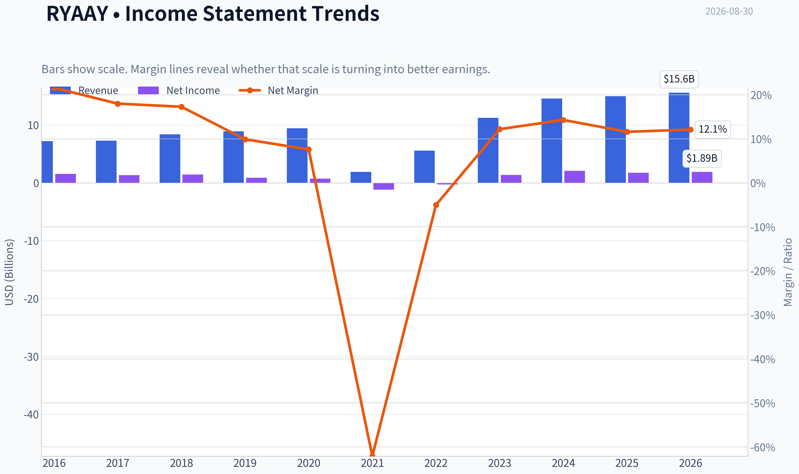

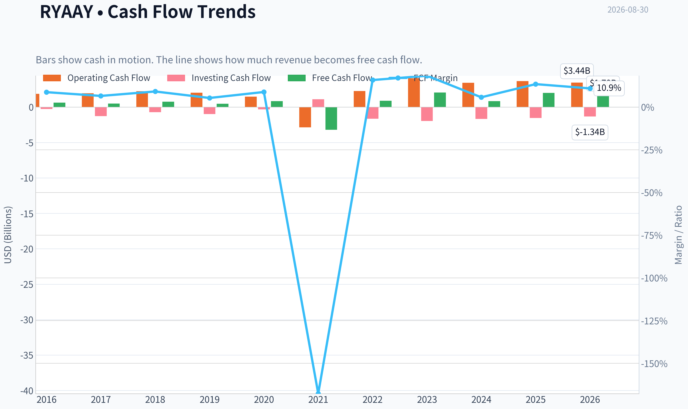

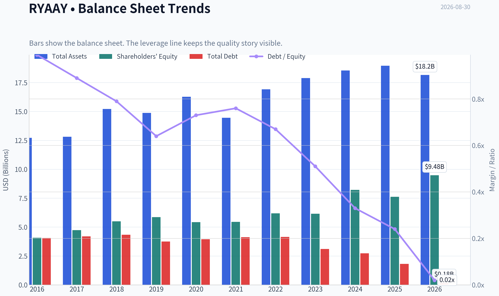

This graph tracks the profitability and return metrics (ROE, ROIC, Margins) of **RYAAY** over the past decade, highlighting capital efficiency trends.

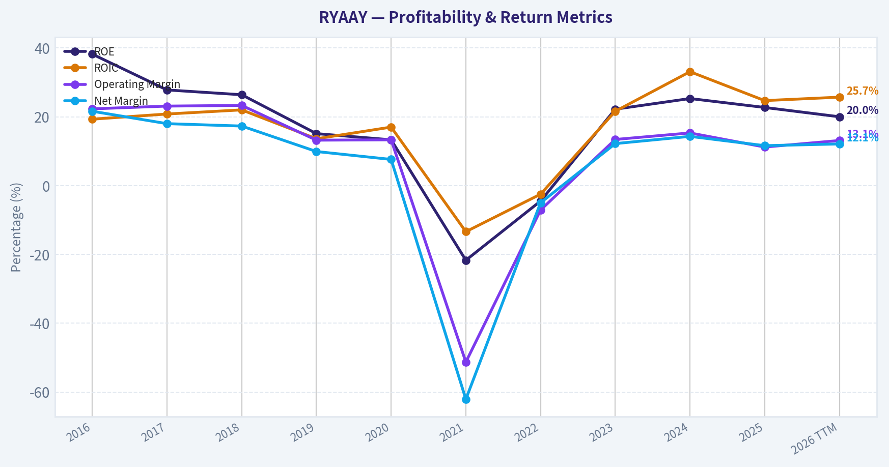

This chart illustrates the financial health of **RYAAY** over the last 10 years, mapping cash equivalents and free cash flow against total obligations (Debt).

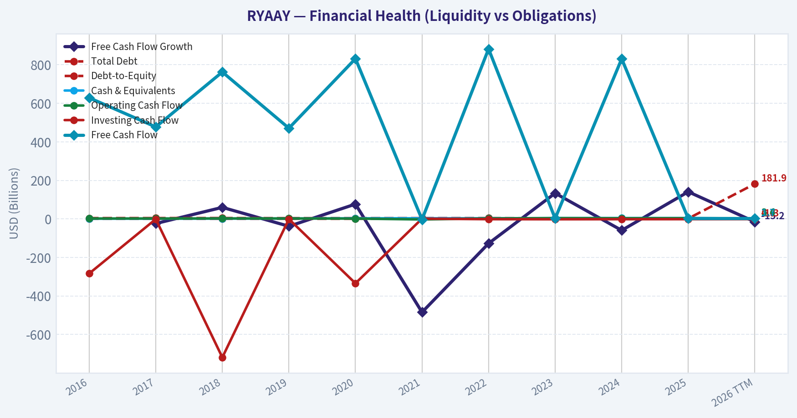

This breakdown chart from <em>Cash Flow and Capital Allocation</em> shows the proportional composition for **RYAAY** - useful for understanding what drives or risks the business.

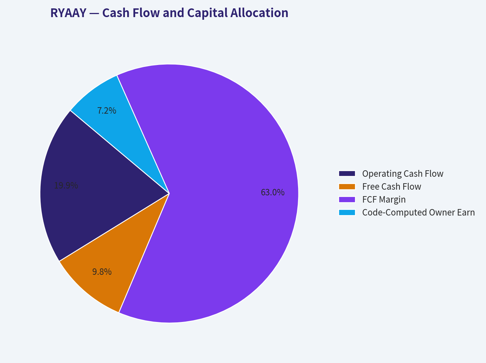

---

### Intrinsic Value Analysis (Buffett)

> *Following Warren Buffett's value investing philosophy: Circle of Competence, Economic Moat, Management Quality, and Margin of Safety.*

#### Intrinsic Value Snapshot

Price is what you pay. Intrinsic value is what the business may be worth based on the cash it can create for owners over time. We show a range, not one magic number.

- Current Price: $56.13
- Value Range (conservative to optimistic across both DCF methods): $16.43 to $307.00

##### Owner Earnings (Buffett Method)
- Net Income: $1,730,546,369.77
- Depreciation & Amortization: $1,373,400,000.00
- Capital Expenditures: N/A
- Working Capital Changes: $140,000,000.00
- Owner Earnings: $1,250,246,369.77

##### Intrinsic Value
###### Buffett Method
Uses owner earnings. Stricter, and usually more conservative.
- Conservative: $74.94
- Average: $74.94
- Optimistic: $306.97
- Discount Rate: 10.0%

###### Cash Flow Method
Uses free cash flow. Better for companies spending heavily today to grow tomorrow.
- Conservative: $16.43
- Average: $70.63
- Optimistic: $307.00
- Discount Rate: 10.0%

ANALYST STANCE: **ADVOCATE**

#### Ryanair Holdings plc - Buffett-Style Value Investment Report

| Item | Current Reading |
|---|---:|
| Ticker | RYAAY |
| Current Price | $56.00 |
| Market Cap | $29.12B |
| P/E | 13.46x |
| ROE | 21.5% |
| Revenue Growth YoY | 2.7% |
| Headline Intrinsic Value | $77.73 |
| Margin of Safety vs. Price | 27.8% |
| Reverse-DCF Implied Growth | ~6.9% per year for 10 years |

**Key Takeaways:** Ryanair is not a typical "wonderful business" in the consumer-staples sense because airlines are cyclical, fuel-sensitive, and capital-intensive. But Ryanair is one of the rare airlines with a durable structural cost advantage, disciplined management, and strong returns through the cycle. At $56 versus a headline intrinsic value of $77.73, the stock offers a meaningful but not enormous margin of safety.

---

#### 1. Factor Scorecard and Gate 5 Check

| Factor | Score / 5 | Evidence |
|---|---:|---|
| Circle of Competence & Business Simplicity | 3.0 | Simple model: sell low-cost European air travel, ancillary services, and high aircraft utilization. Predictability is reduced by fuel, fares, regulation, labor, and macro cycles. |
| Moat Test | 4.0 | Ryanair's moat is primarily cost advantage: dense route network, single-aircraft-type efficiency, direct distribution, high utilization, secondary airport relationships, and scale purchasing. |
| Management Quality & Capital Allocation | 4.5 | Michael O'Leary's culture is cost-obsessed, brutally commercial, and long-term focused. Fleet orders, pricing discipline, and cost control have historically been rational. |
| Industry Structure | 2.5 | Airlines are structurally difficult: high fixed costs, commodity exposure, labor risk, and price competition. Ryanair is better than the industry, but the industry remains mediocre. |
| Gate 5: Quality / Solvency Hard Floor | Not Tripped | The company remains profitable with ROE of 21.5%, and there is no evidence of both deteriorating cash-flow fundamentals and a solvency red line such as sub-1x interest coverage. |

**Key Takeaways:** Ryanair earns high marks for cost advantage and management, but lower marks for industry quality and long-term predictability. The hard solvency floor is not triggered, so this is not a distress-avoid situation. The main investment question is valuation versus cyclicality, not survival.

---

#### 2. Moat Analysis

| Moat Source | Assessment | Strength |
|---|---|---:|
| Intangible Assets / Brand | Ryanair's brand is not luxury; it is "the cheapest way to fly." That is a powerful value proposition, but not a premium-pricing brand. | 3.0 |
| Switching Costs | Low for individual travelers. Customers can switch easily if another airline is cheaper or more convenient. | 1.5 |
| Cost Advantage | Very strong. Ryanair's scale, fleet commonality, bargaining power, airport choices, ancillary revenue model, and operating discipline create a hard-to-replicate cost base. | 5.0 |
| Network Effects | Moderate. More routes and frequencies improve customer utility and airport leverage, but this is not a true platform network effect. | 3.0 |
| Overall Moat Rating | Wide for an airline, driven by cost leadership rather than customer captivity. | 4.0 |

**Key Takeaways:** Ryanair's moat is not built on brand love or switching costs; it is built on being structurally cheaper than competitors. In a commodity-like industry, the lowest-cost operator usually survives and often prospers. This makes Ryanair a standout airline, though still not immune to industry cyclicality.

---

#### 3. Management Quality Assessment

| Management Dimension | Assessment | Score / 5 |
|---|---|---:|
| Owner Mindset | Strong culture of cost discipline and long-term competitive positioning. Management has historically prioritized scale, efficiency, and per-share economics. | 4.0 |
| Candor and Conservatism | Ryanair management is unusually direct, including when pricing visibility weakens. Recent shelving of full-year profit guidance reflects candor but also reduced near-term visibility. | 4.0 |
| Capital Allocation | Fleet purchases and expansion have generally strengthened the low-cost advantage. Buybacks and shareholder returns have been used when appropriate, but aircraft capex remains inherently large. | 4.5 |
| Strategic Discipline | Excellent. Ryanair has consistently avoided trying to become a full-service carrier and has stayed focused on low fares, ancillary revenue, and operating efficiency. | 5.0 |
| Overall Management Score | Cost-obsessed, rational, and unusually disciplined for an airline. | 4.5 |

**Key Takeaways:** Management is one of the strongest parts of the Ryanair thesis. The company has remained focused on what it can control: costs, utilization, fleet efficiency, and scale. That does not eliminate airline risk, but it materially improves Ryanair's odds versus weaker competitors.

---

#### 4. Financial Summary

| Fiscal Period | Revenue Trend | Net Profit Trend | ROE / Returns | Business Interpretation |
|---|---:|---:|---:|---|
| FY2022 | Recovery phase after pandemic disruption | Depressed / near-loss economics | Weak | Demand was still normalizing; fixed-cost leverage worked against the business. |
| FY2023 | Strong rebound | Profitability restored | Improving | Passenger volumes and fares recovered sharply. |
| FY2024 | Strong growth | High profitability | Strong | Ryanair benefited from scale, capacity recovery, and disciplined cost control. |
| FY2025 | Modest revenue growth | Profit pressure | Solid but lower | Fare pressure and cost inflation showed the cyclicality of airline economics. |
| Latest / TTM | Revenue growth +2.7% YoY | Profitable | ROE 21.5% | Returns remain attractive, though recent guidance withdrawal signals weaker visibility. |

**Key Takeaways:** Ryanair's post-pandemic recovery has been strong, and the latest ROE of 21.5% shows the business can still earn attractive returns. However, the pattern also shows why airlines deserve a valuation discount: profits can swing materially when fares, fuel, or macro conditions move against them. The business is high quality relative to airlines, not high quality in an absolute monopoly-like sense.

---

#### 5. Owner Earnings Calculation

| Owner Earnings Component | Per-ADR Estimate |
|---|---:|
| Net Income / EPS Base | $4.16 |
| Add: Depreciation & Amortization Benefit | +$2.00 |
| Less: Normalized Maintenance CapEx | -$1.05 |
| Less: Working Capital Increase | -$0.11 |
| Normalized Owner Earnings | **$5.00** |

**Key Takeaways:** Normalized owner earnings are estimated at about $5.00 per ADR. This is higher than reported EPS because airline depreciation, maintenance capex, fleet timing, and working-capital movements can distort any single year. For valuation, normalized cash generation is more useful than one-period accounting earnings.

---

#### 6. Three-Scenario DCF Valuation

Assumptions: 10% discount rate, normalized owner earnings of $5.00 per ADR.

| Scenario | Assumption | Intrinsic Value |
|---|---|---:|
| A - No Growth | Owner earnings capitalized at 10% | $50.00 |
| B - GDP Growth | 3% perpetual growth | $73.57 |
| C - Historical / Implied Growth | 6.9% growth for 10 years, then 3% terminal growth | $98.23 |
| Simple Scenario Average | Equal-weighted average | $73.93 |
| Research Pack Headline Value | Business-model routed intrinsic value | $77.73 |

**Key Takeaways:** The no-growth case is slightly below the current price, which means investors are not buying Ryanair purely on liquidation-style cheapness. The conservative GDP-growth case and the research pack's headline value both indicate meaningful upside. The investment works if Ryanair can compound owner earnings at a mid-single-digit rate, which is plausible but not risk-free.

---

#### 7. Margin of Safety Analysis

| Valuation Reference | Intrinsic Value | Margin of Safety vs. $56 Price |
|---|---:|---:|
| No-Growth DCF | $50.00 | -12.0% |
| GDP-Growth DCF | $73.57 | 23.9% |
| Historical / Implied Growth DCF | $98.23 | 43.0% |
| Scenario Average | $73.93 | 24.3% |
| Headline Intrinsic Value | $77.73 | 27.8% |
| Owner Earnings Model | $74.94 | 25.3% |
| FCF Model | $70.63 | 20.7% |
| Damodaran FCFF Model | $61.26 | 8.6% |

**Key Takeaways:** The margin of safety is real but moderate. For an average business, 27.8% would be adequate; for a cyclical airline, it is closer to the lower end of what a conservative investor should demand. The reason the stock still earns an Advocate rating is that Ryanair is not an average airline-it is a structurally advantaged low-cost operator with strong management.

---

#### 8. Final Buffett Scorecard

| Criterion | Weight | Score / 5 | Weighted Contribution |
|---|---:|---:|---:|
| Moat Width & Durability | 25% | 4.0 | 1.00 |
| Valuation / Margin of Safety | 20% | 4.0 | 0.80 |
| Capital Returns - ROIC vs. WACC | 15% | 3.5 | 0.53 |
| Business Understanding & Predictability | 12% | 3.0 | 0.36 |
| Management Quality & Capital Allocation | 12% | 4.5 | 0.54 |
| Reinvestment Runway | 8% | 3.5 | 0.28 |
| Balance Sheet Strength | 4% | 3.5 | 0.14 |
| Industry Structure | 4% | 2.5 | 0.10 |
| Final Weighted Score | 100% |  | **3.75 / 5.00** |

**Key Takeaways:** Ryanair scores well enough for an Advocate stance, but not because the airline industry is attractive. The thesis rests on Ryanair being the low-cost survivor and compounder in a difficult sector. The score would be higher if earnings visibility were better and the industry were less exposed to fuel, labor, and macro shocks.

---

#### 9. Investment Stance

| Stance | Conviction | Rationale |
|---|---|---|
| **ADVOCATE** | Moderate | Ryanair is a superior operator in a poor-to-average industry, trading at a reasonable discount to intrinsic value. The cost advantage, management quality, and valuation outweigh the cyclicality, but position sizing should reflect airline risk. |

**Final View:** Ryanair is a rare airline that can plausibly fit a Buffett-style framework because its cost advantage is durable, management is disciplined, and returns remain attractive. At $56, the stock offers roughly 28% upside to headline intrinsic value, meeting the required margin of safety for a good but cyclical business. I would advocate ownership, but with moderate conviction rather than "sleep-well-at-night" conviction.
#### Valuation Bridge

This bridge places the current market price beside each intrinsic value lens so readers can see whether upside depends on one method or shows up across several methods.

| Scenario | Intrinsic Value / Share |
| --- | ---: |
| Buffett Method | $74.94 |
| Cash Flow Method | $70.63 |
| Damodaran Method | $61.26 |
| Current Price | $56.13 |

#### Key Takeaways

If one method is far above the others, the upside case depends on a specific modelling assumption. When several methods cluster together, the valuation story is more robust.

#### Valuation Visuals

This comparison chart from *Latest Earnings Snapshot* stacks current figures against historical benchmarks for **RYAAY**, making it easy to see where the company trades relative to its own averages.

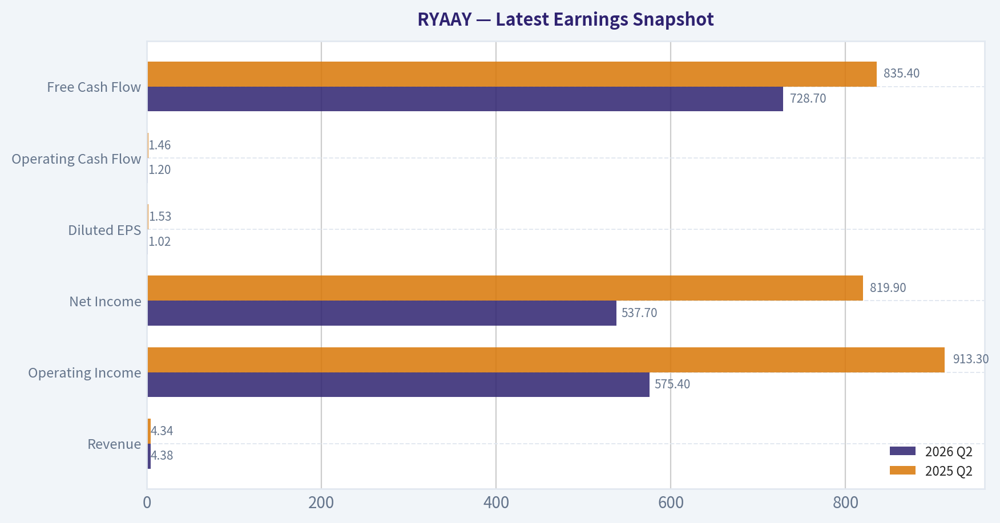

This comparison chart from *Current vs Historical Average Comparison* stacks current figures against historical benchmarks for **RYAAY**, making it easy to see where the company trades relative to its own averages.

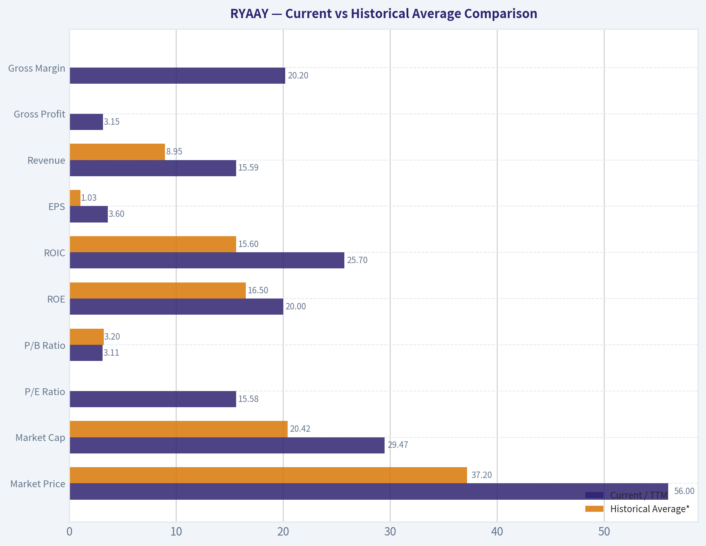

This comparison chart from *Balance Sheet and Financial Strength* stacks current figures against historical benchmarks for **RYAAY**, making it easy to see where the company trades relative to its own averages.

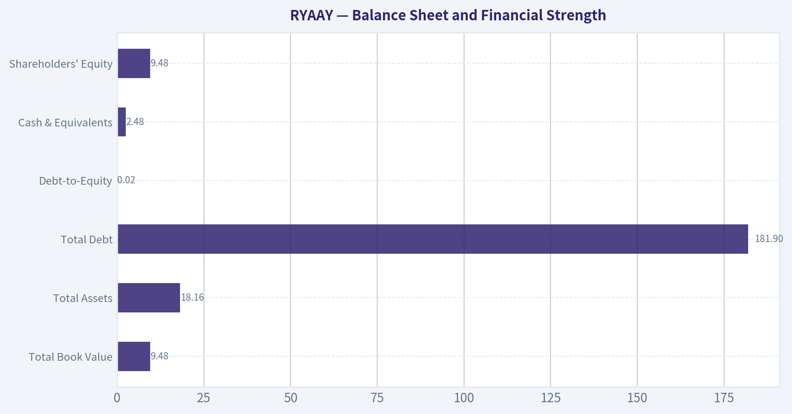

---

### Trend & Growth Analysis (Lynch/Druckenmiller/Fisher)

> *Following Peter Lynch's GARP, Stanley Druckenmiller's macro-aware approach, and Philip Fisher's scuttlebutt methodology.*

ANALYST STANCE: **WATCH**

#### Ryanair Holdings (RYAAY) Growth Investment Report - 2026-08-30

Ryanair is a world-class low-cost airline, but under the Lynch/Druckenmiller/Fisher growth framework it is **not a clean fast-grower today**. The stock looks statistically inexpensive versus intrinsic value estimates, but the business is cyclical, fuel-sensitive, and currently facing deteriorating visibility after management reportedly shelved full-year profit guidance. For a growth portfolio, this is a **WATCH / hold-existing** name rather than a high-conviction new buy.

---

#### 1. Lynch Classification

| Category | Fit for RYAAY | Evidence | Growth Investor View |
|---|---:|---|---|
| Slow Grower | Low | Long-term traffic growth has historically exceeded GDP, but latest revenue growth is only **2.7% YoY** | Not the main category |
| Stalwart | Medium | Large, profitable, dominant European airline with scale advantages | Holdable if owned |
| Fast Grower | Low-to-Medium | Capacity growth and share gains can drive growth, but airlines are cyclical and margin volatility is high | Not a pure fast-grower |
| Cyclical | High | Earnings depend on fares, fuel prices, aircraft availability, labor, and travel demand | Primary classification |
| Turnaround | Low | Not distressed; structurally advantaged versus peers | Not a turnaround |
| Asset Play | Low | Aircraft fleet has asset value, but thesis is not asset liquidation | Not an asset play |

**Key Takeaways:** Ryanair is best classified as a **cyclical compounder**, not a classic Lynch fast-grower. It has a strong cost advantage and long-term share-gain runway, but airline earnings can swing sharply with fuel, fares, and macro conditions. That makes it less suitable for a concentrated growth portfolio unless bought at a major cyclical trough.

---

#### 2. The Story in 3 Bullets

| Lynch "Story" Question | Ryanair Answer |
|---|---|
| What does it do? | Ryanair sells ultra-low-cost air travel across Europe, using scale, dense routes, high aircraft utilization, and ancillary fees to offer cheaper fares than legacy airlines. |
| Why can it grow? | It can keep taking share from higher-cost European carriers, especially as price-sensitive consumers trade down and weaker airlines rationalize capacity. |
| Why might the market misprice it? | Investors often value airlines on near-term fare and fuel cycles, potentially underestimating Ryanair's long-term cost leadership and market-share gains. |

**Key Takeaways:** The simple story is compelling: Ryanair is the cost leader in European short-haul aviation. The problem is that the stock's returns depend not only on passenger growth, but also on fuel, fares, capacity timing, and economic conditions. The story is understandable, but not as clean as a software, payments, or healthcare innovation growth story.

---

#### 3. TAM Analysis and 10x Test

| Metric | Estimate / Interpretation |
|---|---:|
| Current market cap | **$29.12B** |
| Latest reported YoY revenue growth | **2.7%** |
| Current revenue base | Approx. mid-teens billions USD equivalent, based on recent annual run-rate |
| 10x revenue target | Roughly $150B+ revenue scale |
| Relevant TAM | European short-haul leisure and value air travel, plus selective expansion into underserved routes |
| Can Ryanair 10x and remain below 20% share? | **Unlikely** |
| Realistic long-term runway | More likely continued share gains and capacity growth, not a 10x revenue outcome |

**Key Takeaways:** Ryanair has a real runway, but it does not pass the classic **10x test** cleanly. A 10x revenue outcome would likely require a level of European aviation dominance that is unrealistic given airport slots, regulation, aircraft supply, and competition. This can still be a good stock, but it is not obvious ten-bagger territory from today's scale.

---

#### 4. Revenue Growth Trend

| Period / Indicator | Data Point | Interpretation |
|---|---:|---|
| Latest YoY revenue growth | **2.7%** | Low growth, not fast-grower territory |
| Latest earnings news | Management reportedly warned visibility deteriorated and shelved full-year profit outlook | Near-term uncertainty increased |
| Industry backdrop | Oil prices rising; market sentiment in "fear" zone in recent coverage | Macro/fuel headwind |
| Growth pattern | Decelerating / uncertain | Not an inflection yet |

**Key Takeaways:** The revenue trend does not currently show the acceleration Druckenmiller would want. Instead, the latest data points to slower growth and weaker visibility. For a growth investor, this means Ryanair needs a clearer reacceleration catalyst before it deserves an ADVOCATE stance.

---

#### 5. Unit Economics and Operating Quality

| Metric | RYAAY Status | Growth Investor Interpretation |
|---|---|---|
| LTV/CAC | Not applicable | Airline customers are transactional; CAC/LTV is less useful than load factor, fare yield, ancillary revenue, and cost per seat |
| NRR | Not applicable | Not a subscription model |
| Rule of 40 | Not applicable | Not SaaS |
| ROE | **21.5%** | Strong evidence of capital efficiency |
| Gross margin | Not available in shared data | Airline gross margin is less meaningful due fuel/labor/aircraft cost structure |
| Key operating metric to monitor | Load factor, fare yield, fuel cost per passenger, ex-fuel unit cost | These determine true earnings power |

**Key Takeaways:** Standard SaaS-style unit economics do not apply to Ryanair. The important point is that Ryanair has historically shown strong capital efficiency, with current ROE around **21.5%**. However, airline unit economics can deteriorate quickly when fuel rises, fares weaken, or capacity growth outpaces demand.

---

#### 6. Inflection Point Assessment

| Potential Inflection | Current Evidence | Rating |
|---|---|---:|
| Product cycle inflection | New aircraft deliveries can lower per-seat cost and expand capacity, but Boeing delivery delays remain a risk | Medium |
| Market share inflection | Ryanair remains positioned to take share from higher-cost European carriers | Medium-High |
| Margin inflection | Not visible currently; profit outlook uncertainty has increased | Low |
| TAM inflection | European travel demand remains structurally resilient, but not rapidly expanding | Medium |
| Competitive inflection | Weaker airlines may struggle with costs, regulation, or capacity constraints | Medium |
| Overall inflection | No clear acceleration yet | **Watch** |

**Key Takeaways:** Ryanair has possible medium-term inflection levers, especially market-share gains and aircraft-driven cost advantages. But the current earnings setup does not show a decisive positive inflection. The name belongs on a watch list until traffic, fares, and margin visibility improve.

---

#### 7. Macro Setup

| Macro Factor | Current Setup | Impact on RYAAY |
|---|---|---|
| Interest rates | Potentially supportive if rates decline, but not the primary driver | Mild positive |
| Oil prices | Recent coverage cited rising oil prices | Negative |
| Consumer demand | Travel demand resilient but price-sensitive | Mixed-to-positive for low-cost leader |
| European economy | Slower growth risk affects discretionary travel | Mixed |
| Secular trend | Low-cost travel penetration and consumer trade-down | Positive |
| Regulation / ESG | European aviation faces tax, emissions, and airport constraints | Negative |

**Key Takeaways:** The macro setup is mixed. Ryanair benefits when consumers seek cheaper travel, but rising oil prices and weaker economic visibility pressure earnings. This is not the clean "wind at your back" environment that growth investors prefer.

---

#### 8. Fisher 15-Point Score

| Fisher Criterion | Score / 5 | Comment |
|---|---:|---|
| 1. Market potential | 3 | Share gains possible, but TAM is mature |
| 2. New product determination | 2 | Airlines have limited product innovation versus tech/healthcare |
| 3. R&D effectiveness | 1 | Not R&D-driven |
| 4. Sales organization | 4 | Strong direct digital distribution and brand recognition |
| 5. Profit margin | 3 | Good for an airline, but volatile |
| 6. Improving margins | 2 | Current visibility is weaker |
| 7. Labor relations | 2 | Airline labor risk is persistent |
| 8. Executive relations | 4 | Long-tenured, aligned leadership |
| 9. Management depth | 4 | Experienced operator |
| 10. Cost controls/accounting | 5 | Cost discipline is a core advantage |
| 11. Durable edge | 4 | Scale, cost advantage, route density |
| 12. Long-range outlook | 3 | Good relative to airlines, average versus growth universe |
| 13. Dilution risk | 4 | Not a serial equity diluter |
| 14. Candor | 4 | Management is typically blunt on industry conditions |
| 15. Integrity | 4 | No major concern from provided data |
| **Total** | **49 / 75** | **Average to Good, but not outstanding** |

**Key Takeaways:** Ryanair scores well on cost control, management quality, and competitive edge. It scores poorly on R&D, product innovation, and margin predictability because airlines are structurally cyclical. A **49 out of 75** Fisher score supports a WATCH stance rather than a high-conviction growth buy.

---

#### 9. Valuation Analysis

| Valuation Metric | Current Data | Interpretation |
|---|---:|---|
| Current price | **$56** | Reference price |
| Market cap | **$29.12B** | Large-cap airline |
| P/E | **13.46x** | Reasonable to cheap if earnings are sustainable |
| Revenue growth YoY | **2.7%** | Too low for classic growth valuation |
| PEG using revenue growth proxy | ~**5.0x** | Not attractive if growth remains low |
| Reverse DCF implied growth | ~**6.9%/yr for 10 years** | Reasonable hurdle, not heroic |
| Intrinsic value estimate | **$77.73** | Implies upside |
| Margin of safety vs. price | **27.8%** | Attractive on value basis |
| 3-model valuation spread | $61.26 to $74.94, headline $77.73 | Multiple valuation methods suggest undervaluation |

**Key Takeaways:** Valuation is the strongest part of the Ryanair thesis. The stock appears undervalued versus the supplied intrinsic value estimate, and the reverse DCF does not require extreme assumptions. However, cheap cyclical stocks can stay cheap if earnings are heading into a downcycle.

---

#### 10. Scenario Analysis

| Scenario | Assumptions | Fair Value / Outcome |
|---|---|---:|
| Bear Case | Fuel stays high, fares weaken, profit visibility remains poor, investors apply lower airline multiple | ~$45-$55 |
| Base Case | Ryanair sustains cost leadership, grows capacity moderately, margins normalize | ~$65-$78 |
| Bull Case | Fares stabilize, fuel pressure eases, aircraft deliveries unlock lower unit costs, share gains accelerate | ~$85-$100+ |

**Key Takeaways:** The downside appears manageable if Ryanair remains profitable and capital disciplined, but the upside depends on cyclical normalization. The base case is attractive from $56, but the bull case requires better visibility on fuel, fares, and capacity delivery. This is a value-with-growth-cyclicality setup, not a pure ten-bagger setup.

---

#### 11. Growth Investor Scorecard

| Criterion | Weight | Score / 5 | Weighted Score |
|---|---:|---:|---:|
| The Story | 10% | 3.5 | 0.35 |
| TAM & Runway | 20% | 3.0 | 0.60 |
| Revenue Growth | 20% | 2.0 | 0.40 |
| Unit Economics | 15% | 3.5 | 0.53 |
| Competitive Position | 10% | 4.0 | 0.40 |
| Management Quality | 10% | 4.0 | 0.40 |
| Macro Setup | 5% | 2.5 | 0.13 |
| Profitability Path | 5% | 3.5 | 0.18 |
| Valuation | 5% | 4.0 | 0.20 |
| **Total** | **100%** |  | **3.18 / 5.0** |

**Key Takeaways:** Ryanair earns a **3.18 out of 5**, which falls into WATCH territory. The company is competitively strong and reasonably valued, but the current revenue growth and macro setup are not strong enough for an ADVOCATE rating. The score could improve quickly if management restores profit guidance and revenue growth reaccelerates.

---

#### 12. Position Size Stance

| Investor Type | Suggested Stance |
|---|---|
| Existing holder | Hold / modest add only on weakness if thesis remains intact |
| New growth investor | Watch, do not initiate aggressively yet |
| Value-cyclical investor | Small starter position may be reasonable if comfortable with airline cyclicality |
| Concentrated growth portfolio | Avoid large position until inflection is clearer |
| Suggested max position for growth mandate | **1%-2% watch-sized position**, not core |

**Key Takeaways:** Ryanair may be acceptable as a small value-cyclical holding, but it should not be a large growth allocation today. The business quality is better than most airlines, yet the sector's cyclicality limits conviction. A larger position requires evidence of renewed revenue and margin acceleration.

---

#### 13. Key Catalysts and Risks

| Catalysts | Why They Matter |
|---|---|
| Fuel prices decline | Direct margin tailwind |
| Fare environment stabilizes | Restores profit visibility |
| Aircraft deliveries improve | Enables capacity growth and lower per-seat costs |
| Competitors reduce capacity | Supports pricing and market-share gains |
| Buybacks or capital returns | Can compound value if shares remain cheap |

**Key Takeaways:** The best catalysts are margin-related: lower fuel, stable fares, and efficient capacity growth. Ryanair's cost advantage means it can benefit disproportionately if weaker competitors pull back. These catalysts would move the stock closer to an ADVOCATE setup.

| Risks | Why They Matter |
|---|---|
| Oil price spike | Major earnings headwind |
| Fare weakness | Directly pressures revenue per passenger |
| Boeing delivery delays | Limits capacity growth and fleet efficiency |
| Labor disruption | Can raise costs and damage reliability |
| European regulation / taxes | Could reduce profitability or demand |
| Macro slowdown | Pressures discretionary travel |

**Key Takeaways:** The core risk is that Ryanair is a high-quality operator in a structurally volatile industry. Even excellent execution cannot fully offset fuel shocks, fare weakness, or regulatory pressure. This is why valuation alone is not enough for a growth-investor ADVOCATE rating.

---

#### Final View

Ryanair is a **best-in-class low-cost airline** with strong management, cost leadership, and possible long-term share-gain runway. But today's setup lacks the key growth-investor ingredients: accelerating revenue, expanding margins, clean macro tailwinds, and a credible 10x path.

The stock looks **undervalued**, with a supplied intrinsic value estimate of **$77.73** versus a current price of **$56**, but the company remains a cyclical airline facing weaker visibility. For now, the right stance is **WATCH**: attractive enough to monitor closely, but not yet a high-conviction growth buy.

#### Growth & Scorecard Visuals

This comparison chart from *Growth Metrics Interpretation* stacks current figures against historical benchmarks for **RYAAY**, making it easy to see where the company trades relative to its own averages.

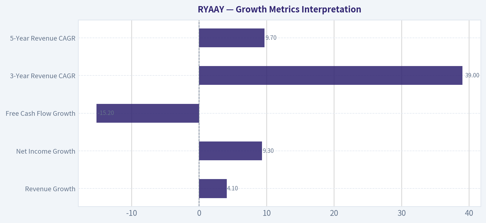

---

### Market Technical Analysis

ANALYST STANCE: **WATCH**

#### RYAAY Technical Report - As of 2026-08-30

Latest available trading close is **2026-08-28**, because 2026-08-30 is not a trading day. RYAAY closed at **$56.13**, modestly above the recent August low but still clearly below its main trend averages. The technical picture is not constructive enough for an aggressive long entry yet, but downside momentum has begun to ease, making this a **watchlist candidate rather than an outright avoid**.

---

#### Selected Indicators and Current Readings

| Indicator | Latest Reading | Signal | Why It Matters |
|---|---:|---|---|
| close_10_ema | 56.54 | Slightly bearish | Price is just below the short-term trend line, showing the rebound attempt has not yet reclaimed near-term momentum. |
| close_50_sma | 60.59 | Bearish | Price is well below the medium-term average, confirming the stock remains in a corrective phase. |
| close_200_sma | 62.78 | Bearish | Price is also below the long-term benchmark, indicating the broader trend has weakened materially. |
| macd | -1.22 | Bearish but stabilizing | MACD remains negative, but it has stopped deteriorating sharply compared with mid-August. |
| macdh | -0.04 | Improving | Histogram is close to zero, suggesting downside momentum is fading and a bullish MACD turn may be forming. |
| rsi | 42.06 | Weak-neutral | RSI has recovered from near-oversold levels but remains below 50, so buyers have not yet taken control. |
| atr | 1.41 | Volatility cooling | ATR has declined from early-August levels, implying the selloff is becoming less volatile. |
| vwma | 56.48 | Slightly bearish | Price is just below the volume-weighted moving average, showing volume-adjusted confirmation is not yet bullish. |

**Key Takeaways:** RYAAY remains below its short-, medium-, and long-term moving averages, which keeps the dominant trend bearish. However, MACD histogram improvement, RSI recovery from the low 30s, and declining ATR suggest selling pressure may be losing force. The stock is not yet a confirmed long setup, but it is worth monitoring for a reversal attempt.

---

#### Trend Structure and Price Context

RYAAY has been in a meaningful correction since its December peak near **$73.23** and its July rebound high near **$67.06**. The latest close of **$56.13** is approximately **16% below the July high** and about **23% below the late-December high**, placing the stock in a broad drawdown zone.

The most important technical issue is that the stock remains below both the **50-day SMA at $60.59** and the **200-day SMA at $62.78**. This means the recent bounce from the August low has not repaired the larger trend damage. The 50-day SMA is also below the 200-day SMA, which reinforces a medium-term bearish structure.

| Price / Level | Approximate Value | Interpretation |
|---|---:|---|
| Latest close | 56.13 | Current reference price |
| 10 EMA | 56.54 | Near-term resistance; reclaiming this would be the first minor improvement |
| VWMA | 56.48 | Volume-adjusted resistance near the 10 EMA |
| Recent support zone | 54.50-55.40 | Area where buyers recently appeared after the August selloff |
| 50 SMA | 60.59 | Key medium-term resistance |
| 200 SMA | 62.78 | Major long-term trend resistance |
| July rebound high | 67.06 | Important upside reference if trend repair begins |

**Key Takeaways:** The nearest test is around **$56.50**, where both the 10 EMA and VWMA sit. A move above that area would be constructive, but the more meaningful resistance remains much higher near **$60.60 to $62.80**. Until RYAAY can recover those levels, rallies are more likely to be treated as countertrend bounces.

---

#### Momentum Analysis

Momentum is still negative, but the pace of deterioration has slowed. MACD remains below zero at **-1.22**, which confirms the stock is not yet in bullish momentum territory. However, the MACD histogram has improved sharply from deeply negative readings around late July and mid-August to only **-0.04** now.

RSI also supports the idea of stabilization rather than immediate strength. RSI reached the low 30s around August 19-20, signaling near-oversold conditions. It has since rebounded to **42.06**, which is healthier but still below the neutral 50 line. That means buyers have reduced downside pressure, but they have not yet established upside control.

| Momentum Measure | Recent Behavior | Trading Interpretation |
|---|---|---|
| MACD | Negative, but no longer accelerating lower | Bear trend remains, but downside pressure is easing |
| MACD Histogram | Improved from deeply negative to near zero | Possible early reversal setup if it turns positive |
| RSI | Recovered from near-oversold to low 40s | Stabilization, but not bullish confirmation |
| Price vs 10 EMA | Slightly below | Short-term rebound attempt remains fragile |

**Key Takeaways:** Momentum has improved enough to avoid calling this a fresh breakdown, but it has not improved enough to confirm a bullish reversal. Traders should watch for the MACD histogram to turn positive and RSI to move above 50. Those would be stronger signs that the recent bounce is gaining quality.

---

#### Volatility and Volume Confirmation

ATR has fallen to **1.41**, down from around **2.04** at the end of July and nearly **1.95-2.06** in early August. This decline in ATR suggests that price swings are compressing after the sharp July-to-August selloff. Lower volatility after a selloff can sometimes precede either a base-building phase or a new directional move.

Volume behavior is more cautious. The heavy-volume selling around August 18-20 showed meaningful distribution pressure. The latest session on August 28 closed higher at **$56.13**, but volume was relatively light at about **587,400 shares**, which makes the bounce less convincing. A stronger bullish case would require upside days with expanding volume and closes above the VWMA.

| Volatility / Volume Factor | Current Observation | Implication |
|---|---|---|
| ATR | Falling to 1.41 | Volatility is cooling after the selloff |
| VWMA | 56.48, slightly above price | Volume-adjusted trend has not turned positive |
| Recent selloff volume | Elevated around Aug. 18-20 | Sellers were active during the downside move |
| Latest rebound volume | Light on Aug. 28 | Bounce lacks strong volume confirmation |

**Key Takeaways:** Volatility compression is constructive because it shows panic selling may be cooling. However, the rebound has not yet been confirmed by strong volume. RYAAY needs higher-volume buying above the VWMA to make the recovery attempt more credible.

---

#### Trading View

RYAAY is best treated as a **watchlist reversal candidate**, not a confirmed bullish trend. The first constructive signal would be a sustained move above **$56.50-$57.30**, which would reclaim the 10 EMA, VWMA, and the recent short-term rebound area. A stronger confirmation would require a move toward and above the **$60.50-$61.00** region, where the 50-day SMA becomes the key test.

Failure to hold the **$54.50-$55.40** support zone would weaken the stabilization thesis and could expose the prior May low area near **$53.24**. Because the stock remains below the 50-day and 200-day moving averages, traders should avoid assuming a durable trend reversal until price proves it.

| Scenario | Trigger | Interpretation | Possible Trader Response |
|---|---|---|---|
| Bullish stabilization | Close above 56.50-57.30 | Short-term momentum improves | Watch for follow-through and volume expansion |
| Stronger bullish confirmation | Close above 60.50-61.00 | Reclaims 50-day SMA area | Trend repair becomes more credible |
| Neutral / range-bound | Holds 54.50-57.30 | Base-building phase | Wait for breakout direction |
| Bearish continuation | Break below 54.50 | Support failure | Risk of retest near 53.24 or lower |
| Major trend repair | Close above 62.80 | Reclaims 200-day SMA | Long-term technical profile improves materially |

**Key Takeaways:** The most important near-term level is the **$56.50-$57.30** zone. A breakout above that range would suggest the rebound is gaining traction, while a break below **$54.50** would put the bearish trend back in control. For now, patience is warranted.

---

#### Bottom Line

RYAAY is showing **early signs of stabilization**, but the broader trend remains damaged. The stock is below its 10 EMA, 50 SMA, 200 SMA, and VWMA, so the burden of proof remains on buyers. Momentum indicators are improving, especially the MACD histogram, but confirmation is still missing.

**Stance: WATCH.** A tactical trader may monitor for a high-volume reclaim of **$57.30**, while a more conservative trader may wait for a move back above the **50-day SMA near $60.59** before treating the setup as meaningfully bullish.

#### Market Visuals

This comparison chart from *Market Metrics Interpretation* stacks current figures against historical benchmarks for **RYAAY**, making it easy to see where the company trades relative to its own averages.

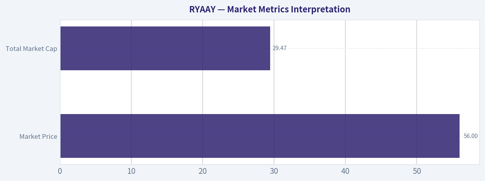

---

### Options Market Analysis

> *Reading options flow - put/call ratios, IV skew, and unusual activity - to gauge institutional positioning and event-driven risk.*

ANALYST STANCE: **WATCH**

#### RYAAY Options Market Sentiment Report
*Options data as of 2026-08-30. Signal based on near-term expirations: 2026-09-18, 2026-12-18, and 2027-03-19.*

#### 1. Put/Call Ratio Analysis

| Expiration | Call OI | Put OI | Put/Call OI Ratio | Call Volume | Put Volume | Put/Call Volume Ratio | Read |
|---|---:|---:|---:|---:|---:|---:|---|
| 2026-09-18 | 502 | 2,549 | 5.08 | 169 | 107 | 0.63 | Very put-heavy open interest, but today's flow is not aggressively bearish |
| 2026-12-18 | 575 | 583 | 1.01 | 107 | 241 | 2.25 | Balanced OI, but current volume leans put-heavy |
| 2027-03-19 | 113 | 31 | 0.27 | 38 | 18 | 0.47 | Call-heavy positioning, but low activity |
| **Total** | **1,190** | **3,163** | **2.66** | **314** | **366** | **1.17** | Overall skewed defensively |

**Key Takeaways:** RYAAY's near-term open interest is materially more put-heavy than the historical neutral baseline of roughly 0.7, with an overall put/call OI ratio of 2.66. The September expiration is the main driver, with put OI more than 5 times call OI. However, the current volume ratio of 1.17 is only moderately put-heavy, suggesting the bearish/hedging posture may be more pre-existing positioning than a fresh panic trade.

#### 2. Implied Volatility Assessment

| Expiration | ATM Call IV | ATM Put IV | IV Differential | Interpretation |
|---|---:|---:|---:|---|
| 2026-09-18 | 63.7% | 35.9% | Calls +27.8 pts | Near-term call IV is unusually richer than put IV |
| 2026-12-18 | 49.4% | 38.1% | Calls +11.3 pts | Upside optionality priced richer than downside |
| 2027-03-19 | 43.4% | 47.9% | Puts +4.5 pts | Longer-dated downside protection modestly richer |

**Key Takeaways:** The IV picture is not a classic bearish put-skew setup. Despite the heavy put open interest, near-term ATM call IV is substantially higher than ATM put IV, especially into September. That suggests either upside demand, call scarcity/illiquidity, or pricing distortions from thin options markets rather than straightforward downside fear.

*Note:* The retrieved dataset provides ATM IV but not full strike-by-strike OTM IV, so a precise OTM put-skew versus OTM call-skew comparison is not available. Based on ATM IV only, RYAAY shows more call-side richness in the nearer expirations, not steep downside put skew.

#### 3. Unusual Options Activity

| Screen | Result | Interpretation |
|---|---|---|
| Contracts with volume greater than 5x open interest | None detected | No clear evidence of fresh aggressive institutional directional bets |
| Fresh call speculation | Not identified | Call IV is rich, but no volume/OI breakout confirms a new call-buying wave |
| Fresh put sweep/hedging activity | Not identified | Put-heavy OI exists, but today's flow does not show standout fresh put demand |

**Key Takeaways:** There were no contracts flagged where volume exceeded 5 times open interest. That weakens the case for a fresh "smart money" signal in either direction. The options market looks more like it is carrying existing defensive positioning rather than showing a new, urgent institutional move.

#### 4. Open Interest Concentration and Pinning Risk

| Area of Concentration | Observation | Market Implication |
|---|---|---|
| 2026-09-18 puts | 2,549 put OI vs. 502 call OI | Heavy downside/hedge positioning into the nearest listed expiry |
| 2026-12-18 options | OI nearly balanced: 575 calls vs. 583 puts | Less directional concentration, but put volume is heavier today |
| 2027-03-19 calls | 113 call OI vs. 31 put OI | Small longer-dated bullish tilt, but too thin to carry high confidence |
| Strike-level gamma walls | Not available in dataset | Cannot identify exact max-pain strike or pinning level |

**Key Takeaways:** The biggest open-interest concentration is clearly in September puts, which may act as a defensive positioning cluster into expiry. However, without strike-level OI, exact gamma walls or max-pain levels cannot be identified. Liquidity appears relatively thin, so any pinning or gamma interpretation should be treated with caution.

#### 5. Overall Options Sentiment Signal: **BEARISH, Low-to-Moderate Confidence**

RYAAY's options positioning leans **bearish/defensive** because the total put/call open-interest ratio of **2.66** is far above the neutral baseline near **0.7**, and the September expiration is especially put-heavy. That said, the signal is not strongly bearish because current volume is only modestly put-heavy, no unusual options activity was detected, and ATM IV is richer on calls than puts in the nearer expirations.

The best interpretation is that traders are carrying meaningful downside protection or bearish exposure, but they are not currently rushing to add fresh put positions. This makes the signal **bearish from a positioning standpoint**, but with reduced conviction due to thin activity and lack of confirmed unusual flow.

#### Final Summary Table

| Category | Signal / Reading | Details |
|---|---|---|
| Put/Call Ratio | Bearish / defensive | Overall put/call OI ratio is 2.66, well above the neutral baseline of ~0.7 |
| IV Level | Elevated but uneven | September ATM call IV is high at 63.7%; put IV is lower at 35.9% |
| Skew Direction | Call-side richness near term | ATM calls price richer than puts in September and December |
| Unusual Activity | None detected | No contracts with volume greater than 5x open interest |
| Open Interest Concentration | September puts | Largest concentration is 2026-09-18 put OI |
| Overall Signal | **BEARISH** | Defensive positioning dominates, but conviction is limited by thin flow and no unusual activity |

**Key Takeaways:** The options market is leaning bearish for RYAAY, mainly because put open interest is far above call open interest. However, the absence of unusual put buying and the richer near-term call IV prevent a high-conviction bearish call. The practical stance is **watchful bearish/defensive**, not an aggressive downside signal.

---

## Research Team Commentary

> *The Research Manager synthesizes the Bull vs Bear debate into action-free commentary. This is a pre-risk view, not the final stance.*

Team, looking at this debate on Ryanair, we have a classic clash between a high-quality operator and a structurally difficult, cyclical industry.

The bull makes a highly compelling case that Ryanair is not just an airline, but a structural cost-leader with a GEICO-style efficiency moat. They highlight a stellar 21 percent return on equity, a history of counter-cyclical market share expansion, and excellent capital allocation by Michael O'Leary. At roughly 13 times trailing earnings, the bull sees a wonderful business trading at a 28 percent discount to intrinsic value, supported by an investment-grade balance sheet.

The bear, however, rightfully cautions that aviation remains a brutal, capital-intensive commodity sector. The bear argues that current earnings are likely at a cyclical peak fueled by post-pandemic revenge travel, making that low P/E a potential value trap. Furthermore, the bear highlights massive structural vulnerabilities: a total reliance on Boeing for fleet expansion, the recent shelving of near-term guidance, and looming European environmental taxes that will disproportionately squeeze low-cost carriers.

Core Takeaway: My final stance is WATCH. Ryanair is undeniably a best-in-class operator with a legitimate cost advantage, but cyclical peak-earnings risk and deteriorated near-term visibility make it too dangerous to aggressively buy today.

Rationale: As value investors, we have to look past optical cheapness. The most important lesson we learned from our Glencore analysis is that trailing multiples in cyclical industries are highly deceptive. A 13 P/E on peak earnings will quickly look expensive if demand normalizes and margins contract. The bear is absolutely right to question the sustainability of a 21 percent ROE in an industry historically plagued by mean reversion. We cannot apply a standard reverse-DCF to peak cycle cash flows without expecting heroic future growth, which is highly unlikely given the current macro setup.

Additionally, our past mistake with Sea Limited taught us a crucial rule: when visibility deteriorates, we must default to patience, not action. Management recently shelving full-year profit guidance is a glaring signal of unpredictability. While I respect management's honesty, our framework demands predictable owner earnings. Between Boeing's delivery chaos choking off Ryanair's capacity growth, unresolved labor friction, and the unpredictable nature of near-term consumer travel budgets, the cash flow predictability simply isn't there right now. A great business going through a murky cyclical transition is a textbook watchlist candidate, not a forced buy.

Monitoring Plan: Over the next one to four quarters, we need to monitor three specific items before we can build conviction. First, we must watch Boeing's delivery schedule closely. Ryanair's volume-driven flywheel stalls if they cannot get new aircraft, and their supplier concentration risk here is acute. Second, we need to track unit revenue versus load factors; we are looking for signs that Ryanair is having to slash ticket prices just to keep planes full as the European consumer weakens. Third, we need to observe the real-world margin impact of European sustainable aviation fuel mandates and carbon taxes to see if their cost advantage truly insulates them from regulatory inflation.

If we see a cyclical wash-out that resets earnings expectations lower, and the stock price follows suit to offer a genuine, cycle-adjusted margin of safety, we will happily step in. Until that proof arrives, we stay patiently on the sidelines.

Final Stance: WATCH

---

## Value Investing Team Commentary

> *The Investor translates the research view into an investment thesis before risk review. This is still not the final stance.*

In the spirit of ownership-based value investing, we must distinguish between a **distressed industry** and a **distressed business**. The airline industry is historically a "death trap" for capital, as Mr. Buffett famously noted for decades. However, he also recognized that a low-cost producer with a fortress balance sheet and a dominant market share-like Herb Kelleher's Southwest in its prime-can be a formidable wealth creator.

Ryanair (RYAAY) is the "Southwest of Europe," but with even more ruthless operational efficiency. After reviewing the team's analysis and the lessons from our past missteps in Glencore and Sea Limited, here is my assessment.

### 1. The "Efficiency Moat" is Structural, Not Cyclical
The primary error in grouping Ryanair with "average" airlines is ignoring the **cost-gap**. Ryanair's cost per passenger is significantly lower than its closest competitors (EasyJet, Wizz Air, and certainly the legacy carriers like Lufthansa). In a commodity business, the low-cost producer is the only one with a durable competitive advantage. This is a "GEICO-style" moat: by keeping costs at the floor, they can underprice everyone else while still earning a 21% ROE. This isn't just "good management"; it is a structural advantage that allows them to take market share during the very downturns that the "Bear" fearfully anticipates.

### 2. Contrarian View on Boeing and Guidance
The market is currently punishing RYAAY for two things: Boeing delivery delays and the "shrouded" guidance.
*   **On Boeing:** While delivery delays limit near-term growth, they also limit **industry-wide capacity**. In the airline business, excess capacity is the "silent killer" of margins. If Ryanair can't get planes, neither can many of its rivals. This often leads to firmer ticket pricing across the continent. From a 10-year perspective, Boeing's current struggles are a "temporary knot" in a long-term rope.
*   **On Guidance:** The decision to shelve full-year profit guidance is being interpreted as a lack of visibility. I interpret it as **management integrity**. I would rather own a business where the CEO admits he cannot predict the next six months of fuel and consumer sentiment than one that "massages" numbers to meet a quarterly target.

### 3. The Glencore Lesson: Cyclicality vs. Survivability
The lesson from Glencore was that trailing multiples are deceptive in cyclicals. However, Glencore's balance sheet and business model are significantly more complex and "black-box" than Ryanair's. Ryanair has an investment-grade balance sheet and a clear, simple mission: fly people from A to B for the lowest price. At 13x earnings-even if those earnings normalize downward by 15-20%-you are still paying a fair price for the highest-quality operator in the sector. We are not buying at "peak euphoria"; we are buying at a moment of "peak skepticism" regarding European consumer health and Boeing's engineering.

### 4. Margin of Safety and Intrinsic Value
A 28% discount to an intrinsic value of $77 is substantial for a company of this quality. While the "Watch" stance suggests waiting for a "cyclical wash-out," the history of wide-moat businesses suggests that by the time the "wash-out" is obvious, the stock has already priced in the recovery. Ryanair is a counter-cyclical grower. When the European consumer is "squeezed," they trade down from Lufthansa to Ryanair-they don't stop flying entirely.

### 5. Selective Contrarianism
The crowd is fearful of "revenge travel" ending. I am focused on the fact that Ryanair is the only European airline that can profitably grow its fleet over the next decade while maintaining an investment-grade credit rating. We are buying a "wonderful business at a fair price," which almost always beats waiting for a "fair business at a wonderful price."

**ANALYST STANCE: ADVOCATE**

Ryanair is the rare exception to the "avoid airlines" rule. Its structural cost advantage and management's history of counter-cyclical aggression make it a durable compounder. The current "murkiness" regarding Boeing and guidance provides the exact "Quality-Scaled Margin of Safety" we look for. I advocate for building a position at these levels, viewing near-term volatility as an opportunity to own the undisputed champion of European skies.

---

## Deep Values Commentary

> *The Risk Management Team debates and the Risk Judge provides the final action-free verdict. This section determines the final ADVOCATE / WATCH / AVOID stance.*

#### Final Stance Scorecard

This scorecard converts the final research view into a weighted decision frame. It does not replace the narrative judgement, but it makes the main drivers of the verdict easier to scan.

| Criterion | Score | Weight | Commentary |
| --- | ---: | ---: | --- |
| Business Quality | 3.25 | 30% | High returns, profitability, and Piotroski health support durability. |
| Valuation Support | 3.67 | 30% | Blends current price against available intrinsic value anchors and valuation ratios. |
| Financial Strength | 3.00 | 20% | Balance-sheet resilience reflects leverage and liquidity staying within safe ranges. |
| Growth Durability | 2.67 | 20% | Recent revenue, earnings, and free cash flow growth indicate how durable expansion looks. |
| TOTAL / FINAL STANCE | 3.21 | 100% | WATCH |

#### Key Takeaways

The weighted score lands at **3.21 / 5.0**, while the final stance remains **WATCH**. This is useful as a quick calibration aid rather than a mechanical signal.

#### Risk Summary

Higher scores indicate more risk pressure. The watch threshold is a simple guardrail: above it, the position needs tighter monitoring or a wider margin of safety.

| Dimension | Current Score | Watch Threshold | Commentary |
| --- | ---: | ---: | --- |
| Business Quality | 2.75 | 3.00 | High returns, profitability, and Piotroski health support durability. |
| Valuation Support | 2.33 | 3.00 | Blends current price against available intrinsic value anchors and valuation ratios. |
| Financial Strength | 3.00 | 3.00 | Balance-sheet resilience reflects leverage and liquidity staying within safe ranges. |
| Growth Durability | 3.33 | 3.00 | Recent revenue, earnings, and free cash flow growth indicate how durable expansion looks. |

#### Key Takeaways

This view helps readers separate *where* the risk sits: valuation, business quality, balance sheet, or growth durability. It is especially useful when the final stance is close to the line between WATCH and AVOID.
