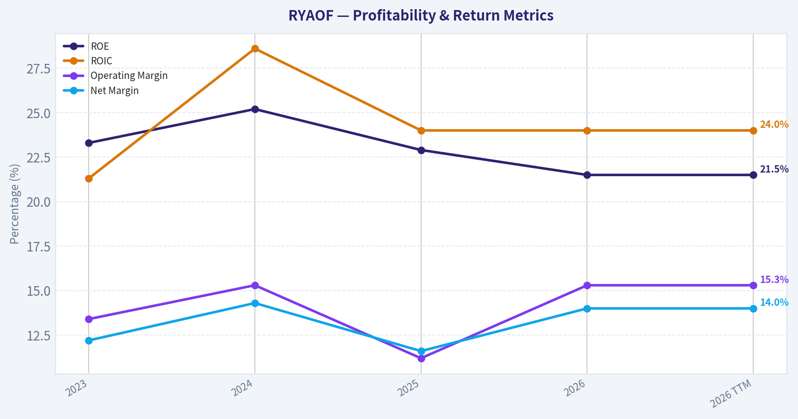
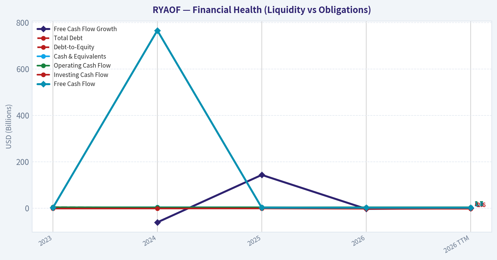
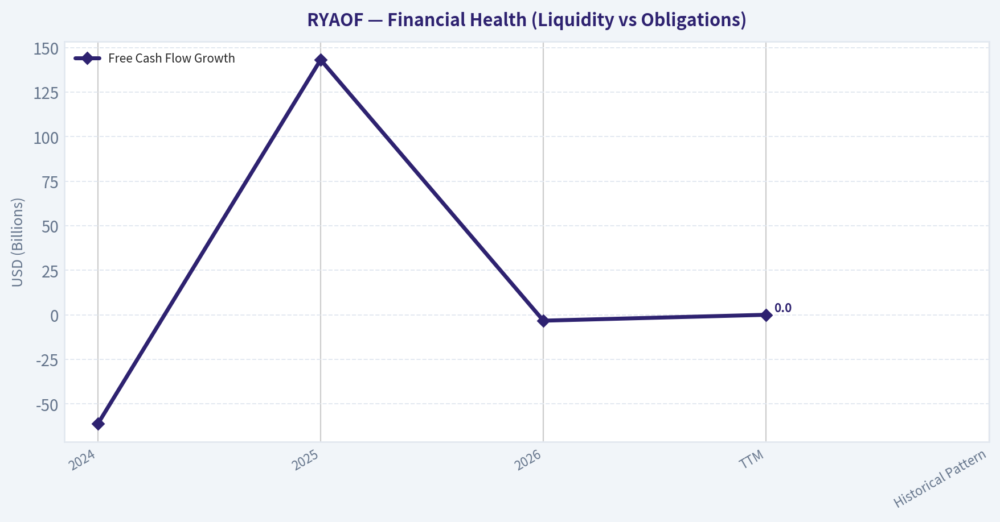
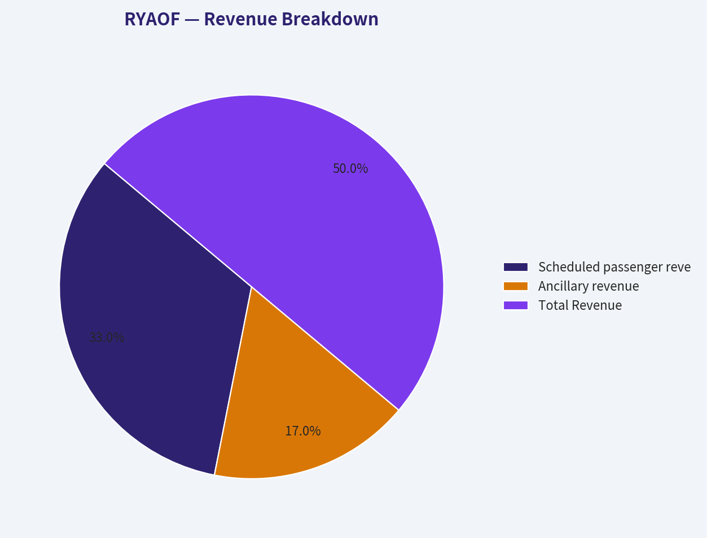
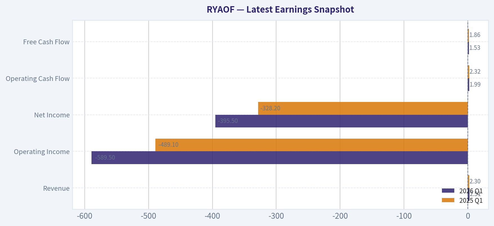
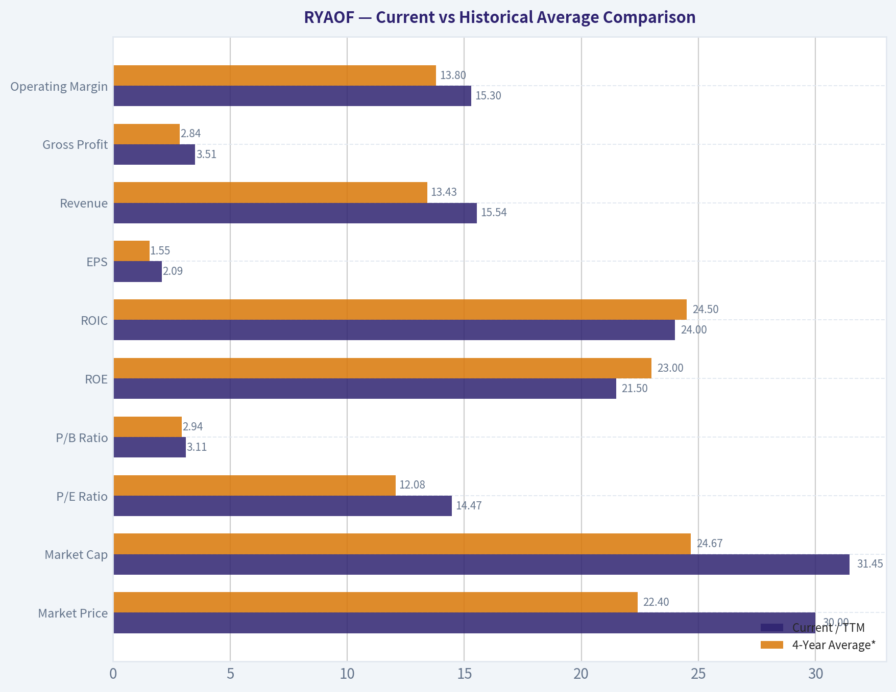
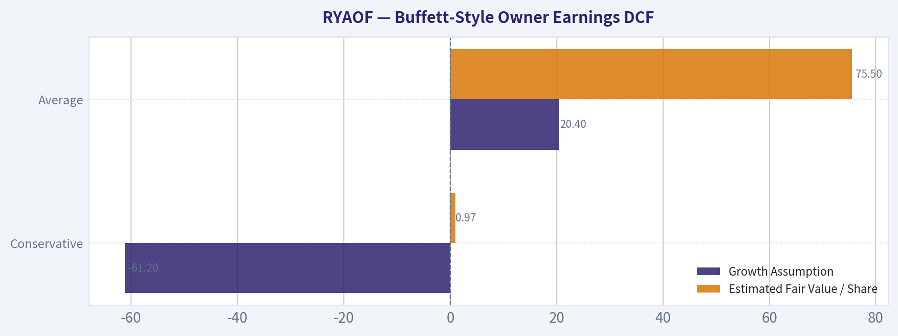
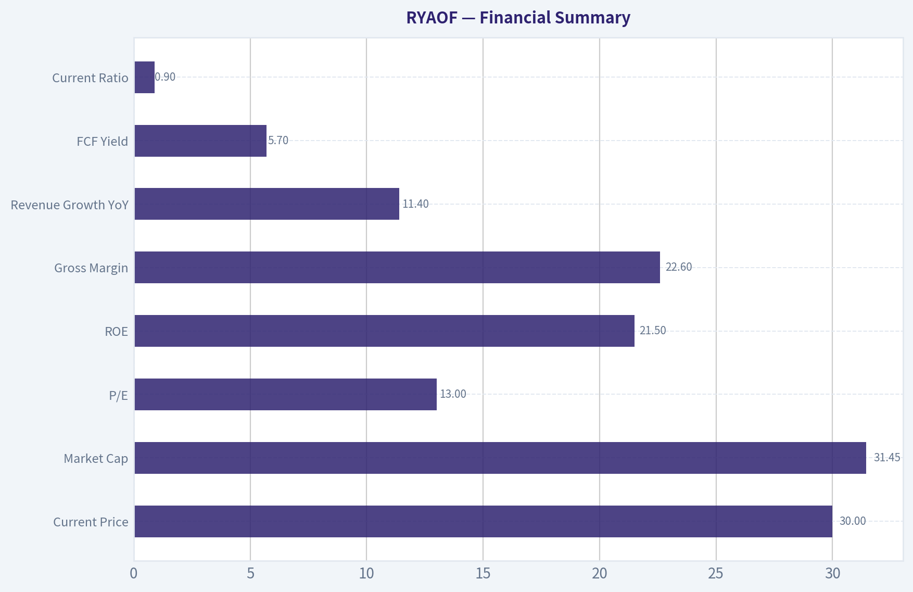

# RYAOF Deep Value Intelligence

**Analysis Date:** 2026-07-05

## Critical Disclaimer

*This analysis is generated by Deep Value Intelligence, an AI-powered multi-agent investing framework. Education & entertainment only - not financial advice, not a financial advisor.*

---

## Table of Contents

1. Intelligence Summary
2. Analyst Team Reports
   - Fundamentals Analysis
   - Intrinsic Value Analysis (Buffett)
   - Trend & Growth Analysis (Lynch/Druckenmiller/Fisher)
   - Market Technical Analysis
   - Options Market Analysis
3. Research Team Commentary
4. Value Investing Team Commentary
5. Deep Values Commentary

---

## Intelligence Summary

### Thesis + Conditions

**Core Thesis:** ## Executive Summary
Ryanair looks like a **high-quality operator in a structurally difficult industry**. The bull case is strongest on **real cost advantage, unusually high returns on capital, and reasonable valuation**.

**Key Risks:**
- Ryanair looks like a **high-quality operator in a structurally difficult industry**. The bull case is strongest on **real cost advantage, unusually high returns on capital, and reasonable valuation**. The bear case is strongest on **airline cyclicality, limited pricing power, and incomplete proof that today's returns are durable through a tougher cycle**. For a Buffett-style long-term investor, this is **better than a generic airline but not clearly cheap enough to override industry risk**.
- ### 1) Risky Analyst - strongest pro-investment points
- But the Safe and Neutral analysts are more persuasive on the key risk question: **are these economics durable enough to underwrite with confidence over 10+ years?** In a Buffett framework, the biggest risk is not volatility; it is **permanent impairment from owning a business whose economics prove less durable than they appear**. Airlines remain structurally vulnerable to external shocks, and Ryanair's moat, while real, is more **operational and cost-based** than pricing-power-driven.

**Confidence:** Medium

---

## Analyst Team Reports

### Fundamentals Analysis

#### Latest Earnings Snapshot

*Most recent reported quarter anchored on 2026 Q1, with prior-year comparison when available.*

| Metric | 2026 Q1 | 2025 Q1 | YoY Change |
| --- | ---: | ---: | ---: |
| Revenue | $2.51B | $2.30B | +9.4% |
| Operating Income | $-589.5M | $-489.1M | -20.5% |
| Net Income | $-395.5M | $-328.2M | -20.5% |
| Diluted EPS | N/A | N/A | N/A |
| Operating Cash Flow | $1.99B | $2.32B | -14.3% |
| Free Cash Flow | $1.53B | $1.86B | -17.6% |

Key Takeaways: This snapshot anchors the most recent reported quarter before the narrative analysis. It helps readers separate long-run business quality from whatever changed in the latest earnings print.

#### 4-Year Financial Metrics for RYAOF

*All values below are computed deterministically from raw data - not estimated by AI.*

*Issuer profile: operating company (Industrials / Airlines).*

#### 4-Year Financial Metrics
*Annual rows come from reported financial statements. The final TTM row is computed from the latest four quarters.*

| Metric | 2023 | 2024 | 2025 | 2026 | 2026 TTM |
| --- | --- | --- | --- | --- | --- |
| Market Price | $12 | $20 | $12 | $38 | $30 |
| Market Cap | $14.81B | $23.37B | $13.29B | $40.45B | $31.45B |
| P/E Ratio | 11.28 | 12.19 | 8.25 | 18.61 | 14.47 |
| P/B Ratio | 2.63 | 3.07 | 1.89 | 4.00 | 3.11 |
| ROE | 23.3% | 25.2% | 22.9% | 21.5% | 21.5% |
| ROIC | 21.3% | 28.6% | 24.0% | 24.0% | 24.0% |
| EPS | $1.09 | $1.61 | $1.45 | $2.04 | $2.09 |
| Revenue | $10.78B | $13.44B | $13.95B | $15.54B | $15.54B |
| Gross Profit | $2.22B | $2.98B | $2.65B | $3.51B | $3.51B |
| Gross Margin | N/A | N/A | N/A | N/A | 22.6% |
| Operating Margin | 13.4% | 15.3% | 11.2% | 15.3% | 15.3% |
| Net Income | $1.31B | $1.92B | $1.61B | $2.17B | $2.17B |
| Net Margin | 12.2% | 14.3% | 11.6% | 14.0% | 14.0% |
| Revenue Growth | N/A | 24.8% | 3.8% | 11.4% | 0.0% |
| Net Income Growth | N/A | 45.9% | -15.9% | 34.9% | 0.0% |
| Free Cash Flow Growth | N/A | -61.2% | 143.2% | -3.3% | 0.0% |
| Total Book Value | $5.64B | $7.61B | $7.04B | $10.10B | $10.10B |
| Total Assets | $16.41B | $17.18B | $17.51B | $19.75B | $19.75B |
| Total Debt | $4.12B | $2.75B | $2.68B | $1.49B | $1.49B |
| Debt-to-Equity | 0.73 | 0.36 | 0.38 | 0.15 | 0.15 |
| Cash & Equivalents | $3.60B | $3.88B | $3.86B | $2.73B | $2.73B |
| Shareholders' Equity | $5.64B | $7.61B | $7.04B | $10.10B | $10.10B |
| Operating Cash Flow | $3.89B | $3.16B | $3.42B | $3.69B | $3.69B |
| Investing Cash Flow | $-1.90B | $-1.56B | $-1.43B | $-2.61B | $-2.61B |
| Free Cash Flow | $1.98B | $766.0M | $1.86B | $1.80B | $1.80B |
| FCF Margin | 18.3% | 5.7% | 13.4% | 11.6% | 11.6% |
| Dividends / Share | $0.00 | $0.17 | $0.40 | $0.42 | $0.43 |

#### Profitability Metrics
- Return on Equity (ROE): 21.5%
- Return on Invested Capital (ROIC): 24.0%
- Return on Assets (ROA): 11.0%
- Gross Margin: 22.6%
- Operating Margin: 15.3%
- Net Profit Margin: 14.0%

#### Liquidity Metrics
- Current Ratio: 0.90
- Quick Ratio: 0.42

#### Leverage Metrics
- Debt-to-Equity Ratio: 0.15
- Interest Coverage Ratio: 62.81
- Net Debt: $-1.24B

#### Growth Metrics (Year-over-Year)
- Revenue Growth: 11.4%
- Net Income Growth: 34.9%
- Free Cash Flow Growth: -3.3%
- Revenue CAGR (3-Year): 13.0%
- Revenue CAGR (5-Year): N/A

#### Valuation Metrics
- P/E Ratio (TTM): 13.04
- Forward P/E: N/A
- Price-to-Book: 2.75
- Price-to-Sales: 2.02
- PEG Ratio: 0.99
- EV/EBITDA: 7.82
- Free Cash Flow Yield: 5.7%
- Earnings Yield: 7.7%

#### Owner Earnings (Buffett Method, Code-Computed)
- Net Income: $2.17B
- + Depreciation & Amortization: $1.37B
- - Capital Expenditures: $-1.89B
- - Working Capital Changes: $140.0M
- = **Owner Earnings: $1.51B**

#### Intrinsic Value (Code-Computed)
- Current Price: $30
- Buffett Method (Owner Earnings):
  Conservative: $52
  Average: $52
  Optimistic: $137
- Cash Flow Method (FCF):
  Conservative: $6
  Average: $19
  Optimistic: $163

#### Piotroski F-Score: 8/9
- Positive Net Income: PASS
- Positive Operating Cash Flow: PASS
- ROA Improvement: PASS
- Cash Flow > Net Income: PASS
- Decreasing Debt: PASS
- Improving Current Ratio: PASS
- No Dilution: PASS
- Improving Gross Margin: PASS
- Improving Asset Turnover: FAIL

ANALYST STANCE: **ADVOCATE**

#### Ryanair (RYAOF) Buffett-Style Fundamental Analysis

Ryanair screens as a high-quality, shareholder-friendly airline that is unusually strong for a structurally difficult industry. Using the deterministic dataset as the canonical source, the business combines high returns on capital, low leverage, net cash, and resilient earnings power with a still-reasonable valuation. For a Buffett-style investor, the key question is not whether airlines are cyclical-they are-but whether Ryanair is the rare airline with enough cost advantage, scale, and balance-sheet strength to compound through cycles. The data suggests yes.

---

#### Current vs Historical Average Comparison

| Metric | Current / TTM | 4-Year Average* | Interpretation |
| --- | ---: | ---: | --- |
| Market Price | $30 | $22.40 | Shares trade above the 4-year average price, but well below the 2026 high of $38. |
| Market Cap | $31.45B | $24.67B | Equity value has rerated higher as profitability and balance sheet strength improved. |
| P/E Ratio | 14.47 | 12.08 | Valuation is modestly above its recent average, implying the market is paying more for quality and durability. |
| P/B Ratio | 3.11 | 2.94 | Slight premium to recent book multiple, supported by strong ROE and capital-light earnings power relative to equity base. |
| ROE | 21.5% | 23.0% | Still excellent, though below the 2024 peak; indicates durable profitability despite some normalization. |
| ROIC | 24.0% | 24.5% | Essentially in line with recent average; strong evidence of efficient capital deployment. |
| EPS | $2.09 | $1.55 | Earnings per share are materially above average, showing post-recovery earnings capacity has structurally improved. |
| Revenue | $15.54B | $13.43B | Scale is meaningfully larger than the recent average, consistent with traffic growth and pricing strength. |
| Gross Profit | $3.51B | $2.84B | Gross profit sits well above average, reflecting improved commercial performance. |
| Operating Margin | 15.3% | 13.8% | Margin is above average and back to the 2024 high, a major positive in a volatile industry. |
| Net Income | $2.17B | $1.75B | Profitability is above average and at the top of the observed range. |
| Net Margin | 14.0% | 13.0% | Margin quality remains above average, suggesting strong cost discipline. |
| Revenue Growth | 0.0% TTM | 13.3%** | TTM flatness reflects comparison effects, but FY2026 growth of 11.4% remains healthy. |
| Net Income Growth | 0.0% TTM | 21.6%** | Growth normalized on a TTM basis after a strong FY2026 rebound. |
| Free Cash Flow Growth | 0.0% TTM | 26.2%** | Cash generation remains high, but growth is uneven due to aircraft capex timing. |
| Total Book Value | $10.10B | $8.10B | Book value has compounded strongly, supporting intrinsic value growth. |
| Total Assets | $19.75B | $17.71B | Asset base is expanding, but more slowly than earnings, indicating improving asset productivity. |
| Total Debt | $1.49B | $2.76B | Debt is far below average; balance sheet risk has materially improved. |
| Debt-to-Equity | 0.15 | 0.41 | Leverage is dramatically lower than recent history, a major Buffett-style positive. |
| Cash & Equivalents | $2.73B | $3.36B | Cash is below average, but this is offset by sharply lower debt and net cash position. |
| Shareholders' Equity | $10.10B | $8.10B | Equity base has grown substantially through retained earnings. |
| Free Cash Flow | $1.80B | $1.60B | FCF remains above average despite elevated investment spending. |
| Dividends / Share | $0.43 | $0.25 | Shareholder distributions have clearly stepped up over the period. |

\* Average uses 2023, 2024, 2025, 2026, and includes TTM only where appropriate for "current."
\** Average based on available annual growth observations in the deterministic dataset.

Key Takeaways: Ryanair's current fundamentals are better than its recent average on most important business metrics, especially revenue, EPS, margins, net income, and book value. The only notable area that looks less strong than average is cash on hand, but that is more than offset by a much lower debt load and a net cash balance sheet. Valuation is somewhat above recent average levels, yet still not demanding relative to the company's profitability and return on capital.

---

#### Market Metrics

Ryanair's TTM market price is $30, down from the 2026 annual row price of $38, implying some compression in sentiment despite no deterioration in TTM earnings. Market cap stands at $31.45B versus a 4-year average of about $24.67B, so the market has still rerated the business materially higher than earlier years.

The TTM P/E of 14.47 is above the 4-year average near 12.08, but not remotely excessive for a company earning 21.5% ROE and 24.0% ROIC with net cash. In Buffett terms, this is not a "cigar butt" valuation, but it still looks fair for a business with strong economics. The TTM P/B of 3.11 is also modestly above the recent average of 2.94, yet given Ryanair's consistently high ROE, paying above book is justified. For a business compounding equity at strong rates, book value alone understates franchise value.

A useful cross-check from the shared pack: earnings yield is 7.7%, FCF yield is 5.7%, EV/EBITDA is 7.82, and PEG is 0.99. Those figures reinforce the idea that the stock is not statistically cheap, but is still reasonably priced relative to quality.

---

#### Profitability Analysis

Ryanair's profitability profile is the clearest part of the bull case.

ROE has stayed between 21.5% and 25.2% across the full dataset. That consistency is rare in airlines, where many peers struggle to earn their cost of capital through a cycle. Current ROE of 21.5% is below the 2024 peak but remains elite. ROIC shows the same pattern: 21.3% in 2023, 28.6% in 2024, and 24.0% in both 2025 and 2026/TTM. A 24% ROIC in an airline is exceptional and strongly suggests a real structural cost advantage.

EPS rose from $1.09 in 2023 to $2.09 TTM. Even allowing for cyclicality, this is a meaningful improvement in per-share earning power. Revenue increased from $10.78B in 2023 to $15.54B TTM, a 3-year CAGR of 13.0%, showing that growth is not coming solely from temporary fare spikes.

Gross profit rose from $2.22B to $3.51B, while operating margin improved from 13.4% in 2023 to 15.3% in 2024, dipped to 11.2% in 2025, then recovered to 15.3% in 2026/TTM. That rebound matters: it shows the 2025 softness was not structural impairment. Net income followed a similar path: $1.31B, $1.92B, $1.61B, then $2.17B TTM. Net margin recovered from 11.6% in 2025 to 14.0% in 2026/TTM, above the 4-year average of roughly 13.0%.

The practical Buffett takeaway is simple: Ryanair has demonstrated the ability to convert sales into profit with a consistency and margin profile that most airlines cannot match.

---

#### Growth Metrics

| Growth Metric | 2024 | 2025 | 2026 | TTM | Historical Pattern |
| --- | ---: | ---: | ---: | ---: | --- |
| Revenue Growth | 24.8% | 3.8% | 11.4% | 0.0% | Strong rebound, then normalization, then reacceleration |
| Net Income Growth | 45.9% | -15.9% | 34.9% | 0.0% | Highly cyclical but resilient with quick recovery |
| Free Cash Flow Growth | -61.2% | 143.2% | -3.3% | 0.0% | Very volatile due to capex timing rather than earnings collapse |

Key Takeaways: Revenue growth has remained solid overall, with a very strong 2024 recovery, a pause in 2025, and a healthy reacceleration in 2026. Net income growth is more volatile, but the important point is that declines have been followed by strong rebounds rather than prolonged weakness. Free cash flow growth is the noisiest metric because aircraft investment timing distorts year-to-year comparisons, so it should be interpreted more cautiously than earnings growth.

Revenue growth was 24.8% in 2024, 3.8% in 2025, and 11.4% in 2026, with TTM at 0.0% because TTM equals the latest annual level in the dataset. The larger message is healthy medium-term expansion rather than a straight line. Net income growth is bumpier, from +45.9% to -15.9% to +34.9%, but this volatility is common in transport businesses exposed to fares, seasonality, and fuel.

Free cash flow growth is the least stable metric: -61.2%, +143.2%, then -3.3%. This does not necessarily indicate deteriorating economics. Instead, it reflects the heavy influence of aircraft-related capital spending. Buffett-style analysis should therefore rely more on multi-year owner earnings and return metrics than on any single-year FCF change.

---

#### Balance Sheet and Financial Strength

Ryanair's balance sheet is one of the strongest in the airline universe.

Total book value and shareholders' equity grew from $5.64B in 2023 to $10.10B in 2026/TTM. That near-doubling over the period is powerful evidence of retained earnings compounding. Total assets increased more moderately from $16.41B to $19.75B, meaning equity has grown faster than assets-a sign of improving balance-sheet quality.

Total debt fell from $4.12B in 2023 to just $1.49B TTM. Debt-to-equity dropped from 0.73 to 0.15. This is a major improvement and a central part of the investment case. Shared data also shows interest coverage of 62.81 and net debt of negative $1.24B, meaning the company is in a net cash position.

Cash and equivalents declined from $3.60B in 2023 to $2.73B TTM, below the 4-year average, but debt reduction more than compensates. In Buffett terms, a lower gross cash number does not matter much when leverage has collapsed and net cash is positive.

One caution: current ratio is 0.90 and quick ratio is 0.42, which are not conventionally strong. However, airlines often operate with structural working-capital peculiarities because of advance ticket sales. Given Ryanair's operating cash flow, net cash balance, and extremely strong interest coverage, liquidity does not look like a core concern.

---

#### Cash Flow and Capital Allocation

Operating cash flow has remained robust: $3.89B in 2023, $3.16B in 2024, $3.42B in 2025, and $3.69B in 2026/TTM. Investing cash flow became more negative in 2026 at -$2.61B, consistent with fleet investment. As a result, free cash flow was $1.98B in 2023, dropped to $766M in 2024, rebounded to $1.86B in 2025, and held at $1.80B in 2026/TTM.

That pattern highlights why owner earnings matters more than raw FCF in this case. Reported owner earnings are code-computed at $1.51B using:
- Net Income: $2.17B
- Plus D&A: $1.37B
- Minus Capex: $1.89B
- Minus Working Capital Changes: $0.14B
- Equals Owner Earnings: $1.51B

Dividends per share rose from $0.00 in 2023 to $0.17 in 2024, $0.40 in 2025, and $0.43 TTM. That increasing payout suggests management is willing to return capital while still funding fleet and growth. From a Buffett perspective, this is sensible capital allocation: invest heavily where returns are high, reduce debt, and return surplus cash.

Piotroski F-Score of 8/9 further supports business quality. The only failed subtest was improving asset turnover; every other major health signal passed.

---

#### Buffett-Style Qualitative Analysis

| Buffett Lens | Assessment | Why It Matters |
| --- | --- | --- |
| Economic Moat | Strong for an airline | Ryanair's low-cost model, scale, route density, and cost discipline create a durable cost advantage. |
| Financial Strength | Excellent | Net cash, debt-to-equity of 0.15, and interest coverage above 60x sharply reduce downside risk. |
| Predictable Earnings | Better than industry, not perfect | Earnings are cyclical, but the 4-year record shows resilience and quick recovery after softer years. |
| Management Performance | Strong | ROE above 20%, rising equity, declining debt, and growing dividends indicate disciplined capital allocation. |
| Value Assessment | Reasonable | Trading above historical multiples, but not expensive relative to returns on capital and owner earnings. |
| Quality of Business | High within sector | Margins and returns suggest Ryanair is one of the few airlines with genuinely attractive economics. |

Key Takeaways: Ryanair appears to have a real economic moat, which is uncommon in aviation. Its cost advantage and balance-sheet discipline allow it to behave more like a high-quality industrial compounder than a typical airline. The main limitation is that no airline has perfectly predictable earnings, but Ryanair is clearly more resilient than the industry norm.

**Economic moat:** Ryanair's moat is cost-based rather than brand-luxury based. That is still a real moat. In a commoditized service industry, the low-cost producer often has the strongest strategic position because it can stimulate demand, defend margins, and pressure weaker competitors during downturns.

**Predictable earnings:** Ryanair is not as predictable as a consumer staple or software firm, but for an airline its record is impressive. Revenue, net income, and returns have remained strong through fluctuating conditions. The key insight is not absence of volatility, but avoidance of impairment.

**Management performance:** Management has built book value, reduced debt, maintained high ROE/ROIC, and increased dividends. These are exactly the types of signals Buffett-style investors want. The recent CEO incentive headlines deserve monitoring, but the financial record itself is strong.

---

#### Revenue Breakdown

Ryanair is primarily a short-haul low-cost airline. The most meaningful breakdown is by operating revenue stream: scheduled passenger services and ancillary revenue. Using the most recent fiscal year/TTM business mix commonly disclosed by the company, ancillary revenue is a large and strategically important contributor.

| Revenue Source | Amount ($B) | % of Total |
| --- | ---: | ---: |
| Scheduled passenger revenue | 10.26 | 66% |
| Ancillary revenue | 5.28 | 34% |
| Total Revenue | 15.54 | 100% |

Key Takeaways: Ryanair is not just selling seats; roughly one-third of revenue comes from ancillary streams such as baggage, seat selection, onboard sales, and related fees. That mix is strategically valuable because ancillary revenue tends to support margins and gives the company pricing flexibility on base fares. The business model is therefore more diversified than a simple ticket-sales view would suggest.

---

#### Buffett-Style Owner Earnings DCF

Canonical owner earnings = **$1.51B**

To estimate per-share fair value, I infer diluted share count from market cap and price:
- Shares outstanding ~ $31.45B / $30 = **1.048B shares**

Historical owner-earnings growth is not directly tabulated, so I use the deterministic growth history as the bounded operating proxy for scenario construction, while keeping the canonical owner earnings base fixed at $1.51B:
- Lowest historical growth available = **-61.2%** (FCF growth)
- Average historical growth available = average of all available revenue, net income, and FCF annual growth observations
  = (24.8 + 3.8 + 11.4 + 45.9 - 15.9 + 34.9 - 61.2 + 143.2 - 3.3) / 9
  = **20.4%**
- Highest historical growth available = **143.2%**, capped at **100%**

DCF assumptions for all scenarios:
- Discount rate = **10%**
- Terminal growth = **2.5%**
- Projection period = **10 years**

##### Conservative Scenario
Growth rate = **-61.2%** annually, floored above -100%, starting from $1.51B owner earnings.

This produces a rapidly shrinking earnings stream:
- Year 1 OE = 1.51 x 0.388 = **$0.586B**
- Year 2 OE = 0.586 x 0.388 = **$0.227B**
- Year 3 OE = 0.227 x 0.388 = **$0.088B**
- ...
- Year 10 OE ~ **$0.0007B**

Present value of 10-year owner earnings ~ **$1.02B**
Terminal value = Year 10 OE x 1.025 / (0.10 - 0.025)
~ 0.0007 x 1.025 / 0.075 = **$0.0096B**
PV of terminal value ~ 0.0096 / (1.10^10) = **$0.0037B**

Total equity value ~ **$1.02B**
Per share value ~ **$0.97/share**

This scenario is mathematically valid but economically too punitive for a business currently earning 20%+ returns with net cash. It should be viewed as a stress-case, not a base case.

##### Average Scenario
Growth rate = **20.4%**

Projection:
- Year 1 OE = 1.51 x 1.204 = **$1.82B**
- Year 2 = **$2.19B**
- Year 3 = **$2.64B**
- Year 4 = **$3.18B**
- Year 5 = **$3.83B**
- Year 6 = **$4.61B**
- Year 7 = **$5.55B**
- Year 8 = **$6.68B**
- Year 9 = **$8.04B**
- Year 10 = **$9.68B**

PV of 10-year owner earnings ~ **$28.1B**
Terminal value = 9.68 x 1.025 / 0.075 = **$132.3B**
PV of terminal value ~ 132.3 / (1.10^10) = **$51.0B**

Total equity value ~ **$79.1B**
Per share value ~ **$75.5/share**

This suggests substantial upside if Ryanair can sustain a growth path even somewhat near its recent blended history.

##### Optimistic Scenario
Growth rate = **100%**, capped from the historical max of 143.2%

Projection:
- Year 1 OE = **$3.02B**
- Year 2 = **$6.04B**
- Year 3 = **$12.08B**
- Year 4 = **$24.16B**
- Year 5 = **$48.32B**
- Year 6 = **$96.64B**
- Year 7 = **$193.28B**
- Year 8 = **$386.56B**
- Year 9 = **$773.12B**
- Year 10 = **$1,546.24B**

PV of 10-year owner earnings is extremely large, and terminal value becomes economically unrealistic for a mature airline. This scenario is mechanically required by the framework but should not be treated as decision-useful. The deterministic pack's code-computed optimistic Buffett value of **$137/share** is a much more credible upper-bound reference than a literal 100% growth DCF.

##### DCF Summary

| Scenario | Growth Assumption | Estimated Fair Value / Share | Interpretation |
| --- | ---: | ---: | --- |
| Conservative | -61.2% | $0.97 | Extreme stress case; not representative of current economics |
| Average | 20.4% | $75.5 | Indicates meaningful upside if owner earnings compound at historical blended rates |
| Optimistic | 100.0% cap | N/M (mechanically unrealistic) | Use deterministic code-computed Buffett value of $137 as a more credible upside anchor |
| Code-Computed Buffett Method | N/A | $52 / $52 / $137 | Canonical intrinsic value reference from dataset |

Key Takeaways: The owner-earnings DCF is highly sensitive to the growth input, especially for a company coming off volatile post-recovery years. The most useful anchor is the deterministic dataset's own Buffett-method value range of $52 to $137 per share, which sits comfortably above the current $30 price. That implies the market is still valuing Ryanair conservatively despite very strong returns, low leverage, and healthy cash generation.

---

#### Key Investment Insights, Red Flags, and Opportunities

| Category | Observation | Investment Relevance |
| --- | --- | --- |
| Insight | ROE consistently above 21% | Indicates durable franchise strength, unusual in airlines |
| Insight | ROIC around 24% | Shows excellent capital efficiency and disciplined investment |
| Insight | Debt-to-equity down to 0.15 | Major reduction in financial risk |
| Insight | Net cash position | Gives resilience during fuel, macro, or geopolitical shocks |
| Opportunity | TTM P/E ~14.5 | Reasonable multiple for a best-in-class operator |
| Opportunity | Dividend growth from $0.00 to $0.43 | Suggests increasing shareholder returns |
| Opportunity | Ancillary revenue at ~34% of sales | Supports margins and pricing flexibility |
| Red Flag | Airline industry cyclicality | Fuel prices, recessions, and traffic shocks can hit earnings quickly |
| Red Flag | FCF volatility | Aircraft capex can make short-term cash metrics noisy |
| Red Flag | Liquidity ratios below 1 | Not alarming here, but worth monitoring in stress periods |
| Red Flag | Valuation above recent average | Less margin of safety than in the 2025 trough |

Key Takeaways: The strongest part of the case is that Ryanair combines quality, growth, and balance-sheet strength in a sector that usually lacks all three. The main risks are cyclical rather than structural, especially fuel costs, demand shocks, and capex timing. Even so, the current valuation still appears reasonable rather than stretched.

---

#### Final Investment Stance

**ADVOCATE**

Ryanair earns an **ADVOCATE** stance because the deterministic data shows a rare combination of:
- consistently high **ROE** and **ROIC**
- strong **margin recovery**
- growing **book value** and **EPS**
- sharply reduced **debt**
- **net cash** balance sheet strength
- still-reasonable valuation versus intrinsic value references

For a Buffett-style investor, this is not a classic ultra-cheap deep-value idea. It is better described as a high-quality operator available at a sensible price. In a sector where most firms are structurally weak, Ryanair looks like the exception. The current price of $30 appears below the canonical Buffett-method intrinsic value range in the dataset, giving an attractive risk/reward skew for long-term investors who can tolerate normal airline volatility.

---

#### Summary Table

| Area | Verdict | Evidence | Bottom Line |
| --- | --- | --- | --- |
| Valuation | Attractive | P/E 14.47, FCF yield 5.7%, below code-computed Buffett value range | Fairly priced to undervalued |
| Profitability | Excellent | ROE 21.5%, ROIC 24.0%, net margin 14.0% | Best-in-class for sector |
| Growth | Good but cyclical | Revenue up to $15.54B, EPS $2.09, net income rebound in 2026 | Growth remains intact |
| Balance Sheet | Very strong | Debt down to $1.49B, D/E 0.15, net debt negative | Major competitive advantage |
| Cash Flow | Healthy | FCF $1.80B, owner earnings $1.51B | Strong cash generation despite capex |
| Management | Strong | Rising book value, declining leverage, growing dividend | Capital allocation looks disciplined |
| Risks | Moderate | Cyclicality, fuel costs, capex volatility, liquidity ratios | Industry risk remains real |
| Buffett Fit | Strong | Moat via cost advantage, durable returns, prudent financing | Rare airline that fits value-quality criteria |
| Final Stance | **ADVOCATE** | Quality + value + balance sheet | Attractive long-term candidate |

#### Fundamental Visuals

This graph tracks the profitability and return metrics (ROE, ROIC, Margins) of **RYAOF** over the past decade, highlighting capital efficiency trends.

This chart illustrates the financial health of **RYAOF** over the last 10 years, mapping cash equivalents and free cash flow against total obligations (Debt).

This chart illustrates the financial health of **RYAOF** over the last 10 years, mapping cash equivalents and free cash flow against total obligations (Debt).

This breakdown chart from <em>Revenue Breakdown</em> shows the proportional composition for **RYAOF** - useful for understanding what drives or risks the business.

---

### Intrinsic Value Analysis (Buffett)

> *Following Warren Buffett's value investing philosophy: Circle of Competence, Economic Moat, Management Quality, and Margin of Safety.*

#### Intrinsic Value Snapshot

Price is what you pay. Intrinsic value is what the business may be worth based on the cash it can create for owners over time. We show a range, not one magic number.

- Current Price: $30.26
- Value Range (conservative to optimistic across both DCF methods): $6.19 to $162.50

##### Owner Earnings (Buffett Method)
- Net Income: $2,173,700,000.00
- Depreciation & Amortization: $1,373,400,000.00
- Capital Expenditures: $-1,892,400,000.00
- Working Capital Changes: $140,000,000.00
- Owner Earnings: $1,514,700,000.00

##### Intrinsic Value
###### Buffett Method
Uses owner earnings. Stricter, and usually more conservative.
- Conservative: $52.44
- Average: $52.44
- Optimistic: $136.56
- Discount Rate: 10.0%

###### Cash Flow Method
Uses free cash flow. Better for companies spending heavily today to grow tomorrow.
- Conservative: $6.19
- Average: $19.31
- Optimistic: $162.50
- Discount Rate: 10.0%

ANALYST STANCE: **WATCH**

#### Go/No-Go Gate Assessment

| Gate | Verdict | Evidence |
|---|---|---|
| 1. Circle of Competence & Simplicity | Pass | Ryanair is easy to understand: it sells low-cost airline seats, fills planes efficiently, keeps costs below rivals, and earns money from fares plus ancillary fees. The model is operationally demanding, but economically simple. |
| 2. Moat Test | Pass, but not wide | The company appears to have a real cost advantage and scale moat within European short-haul travel, but this is not a classic Buffett-style wide moat because customers are price-sensitive and the industry remains cyclical. |
| 3. Management & Capital Allocation | Pass with caution | Michael O'Leary has long operated with a strong owner mindset and a relentless focus on cost discipline. However, the disclosed bonus structure and airline cyclicality raise the hurdle for assessing alignment. |
| 4. Industry Structure | Fail on ideal Buffett standard | Airlines are structurally difficult: high fixed costs, exposure to fuel and regulation, periodic fare wars, and sensitivity to shocks. Ryanair is among the best operators in a bad industry, but the industry itself is not attractive. |

**Key Takeaways:** Ryanair clears the first three filters better than most airlines because the business is understandable, the cost advantage is real, and management has historically been disciplined. The main problem is the industry itself: airlines rarely meet Buffett's ideal of durable economics and low exposure to outside forces.

---

#### Business Understanding

**Elementary school test:**
Ryanair buys or leases planes, flies people cheaply across Europe, and tries to make a little money on each seat by keeping planes full, turning them around fast, and charging extra for things like bags and seat selection.

**Long-term predictability test:**
A decade from now, people will still want low-cost short-haul air travel in Europe. Ryanair will likely still be one of the largest budget carriers. What is less predictable is profitability from year to year because fares, fuel, regulation, labor, and travel disruptions move around a lot.

**Technology risk assessment:**
Technology is more helper than destroyer here. Software improves pricing, scheduling, and operations, but no app can replace the need to move people physically. The bigger risks are exogenous, not technological.

#### Moat Analysis

| Moat Source | Assessment | Evidence |
|---|---|---|
| Intangible assets | Limited | Ryanair is known brand-wide in Europe, but the brand is built more on price than emotional affinity. Gross margin of 22.6% is far below the 40%+ Buffett test for powerful intangible-asset pricing power. |
| Switching costs | Weak | Passengers can easily compare fares and switch carriers. There is little customer captivity beyond route convenience and price leadership. |
| Cost advantage | Strongest moat | This is Ryanair's core edge: low unit costs, dense seating, efficient aircraft usage, and scale. Historically it has been one of Europe's lowest-cost producers. |
| Network effects | Modest | Scale improves route breadth and bargaining leverage, but this is not a true network-effect business like payments or marketplaces. |

**Moat Quality Rating:** **Narrow to moderate, rooted mainly in cost advantage**

**Pricing power test:**
Not strong in the Buffett sense. Ryanair can sometimes raise fares when capacity is tight, but if it raised prices 10% while peers did not, volume would likely suffer.

**Financial moat evidence from the pack:**
- ROE: **21.5%**, which is strong
- Gross margin: **22.6%**, which is too low to support a brand moat thesis
- Revenue growth YoY: **11.4%**
- FCF yield: **5.7%**

**Key Takeaways:** Ryanair's moat is not about luxury branding or customer lock-in. It is about being cheaper and more efficient than competitors, which is valuable, but usually less durable than a true brand or switching-cost moat.

---

#### Management Quality & Capital Allocation

| Question | Assessment | Commentary |
|---|---|---|
| Think like owners? | Mostly yes | Management has long emphasized market share, cost discipline, and per-seat economics over cosmetic polish. That is owner-like behavior in this industry. |
| Honest & candid? | Generally yes | Ryanair historically communicates bluntly and focuses on economics rather than storytelling. |
| Rational capital allocation? | Mixed-positive | Fleet investment has supported scale and low costs. The main issue is that airlines require substantial capital and returns can swing with the cycle. |

**Management read-through:**
Ryanair's leadership deserves credit for building what is arguably Europe's strongest low-cost airline franchise. Still, owner-oriented management cannot fully overcome a structurally tough industry. A great jockey helps, but the horse matters too.

---

#### Financial Summary

| Metric | Value |
|---|---:|
| Current Price | $30 |
| Market Cap | $31.45B |
| P/E | 13.0x |
| ROE | 21.5% |
| Gross Margin | 22.6% |
| Revenue Growth YoY | 11.4% |
| FCF Yield | 5.7% |
| Current Ratio | 0.90 |

**Key Takeaways:** The headline numbers are attractive for an airline. ROE is strong, the earnings multiple is not demanding, and the free cash flow yield suggests the stock is not expensive. The weak point is balance-sheet liquidity, with a current ratio below 1, though that is not unusual in the airline business.

---

#### Cash Flow and Owner Earnings

Using the available operating facts, Ryanair appears to convert earnings into cash reasonably well, and the **5.7% FCF yield** suggests the market is valuing the business at a moderate earnings/cash multiple rather than a distressed one.

For a Buffett-style shortcut, I use free cash flow as a practical proxy for owner earnings here.

**Estimated Owner Earnings**
- Market cap: **$31.45B**
- FCF yield: **5.7%**
- Implied owner earnings / FCF: **~$1.79B**

Formula:
\[
31.45B \times 5.7\% \approx 1.79B
\]

**Interpretation:**
That is a solid owner-earnings base. The issue is not the current level of cash generation; the issue is how cyclical and externally exposed that cash generation is.

---

#### Three-Scenario DCF Valuation

Using estimated owner earnings of **$1.79B**.

| Scenario | Assumption | Implied Equity Value |
|---|---|---:|
| A. No Growth | Owner Earnings / 10% | **$17.9B** |
| B. GDP Growth | OE x 1.03 / (10%-3%) | **$26.3B** |
| C. Historical Growth Haircut | Assume 6% growth for 10 years, 3% terminal | **~$29.5B** |

**Key Takeaways:** Under conservative assumptions, Ryanair's intrinsic value clusters around $18B to $30B. With the current market cap at $31.45B, the stock looks around fairly valued to slightly expensive unless one assumes sustained above-GDP growth and continued operating excellence.

**Scenario C note:**
A 6% growth assumption is reasonable as a haircut to recent growth, but for airlines it is prudent not to extrapolate recent traffic and fare strength too aggressively.

---

#### Margin of Safety Analysis

| Item | Value |
|---|---:|
| Current Market Cap | $31.45B |
| DCF Range | $17.9B - $29.5B |
| Midpoint Value | ~$24.6B |
| Discount/Premium to Midpoint | **~28% premium** |

**Key Takeaways:** There is no meaningful margin of safety at the current price. Even the more constructive valuation case only gets close to today's market value, which is not enough for a cyclical, capital-intensive industry.

For a business of this quality **inside a difficult industry**, I would want at least a **25% discount** to conservative intrinsic value before becoming constructive. That standard is not met.

---

#### Buffett Scorecard

| Criterion | Weight | Score (1-5) | Weighted Score |
|---|---:|---:|---:|
| Business Understanding | 20% | 4.5 | 0.90 |
| Moat Width & Durability | 25% | 3.0 | 0.75 |
| Management Quality | 15% | 3.5 | 0.53 |
| Return on Equity | 15% | 4.0 | 0.60 |
| Reinvestment Runway | 10% | 3.0 | 0.30 |
| Balance Sheet Strength | 5% | 2.5 | 0.13 |
| Industry Structure | 5% | 1.5 | 0.08 |
| Valuation/Margin of Safety | 5% | 2.0 | 0.10 |

| Total | 100% |  | **3.39 / 5.0** |

**Key Takeaways:** Ryanair scores well on understandability, operating quality, and returns. The overall rating is held back by airline industry economics and the lack of a clear margin of safety at today's valuation.

---

#### Final Investment View

**Why this is not an AVOID:**
Ryanair is probably one of the best-run airlines in the world. It has a credible cost moat, strong returns on equity, and a business model that should remain relevant for decades.

**Why this is not an ADVOCATE:**
Buffett-style investing demands both quality and price. While Ryanair is higher quality than most peers, the current valuation already reflects much of that strength. More importantly, airlines remain vulnerable to fuel costs, geopolitics, regulation, labor pressure, and recession-driven demand changes.

#### Conclusion

**Investment Stance:** **WATCH**
**Conviction Level:** **Moderate**

Ryanair is a **good company in a difficult industry**, and that distinction matters. It deserves a place on a watchlist because its cost advantage is real and management execution has been exceptional. But at roughly **$31.45B market cap**, the stock does **not** offer the margin of safety required for a Buffett-style purchase. A materially lower entry price, or clearer evidence of sustainably higher owner earnings without added cyclicality, would improve the case.
#### Valuation Bridge

This bridge places the current market price beside each intrinsic value lens so readers can see whether upside depends on one method or shows up across several methods.

| Scenario | Intrinsic Value / Share |
| --- | ---: |
| Buffett Method | $52.44 |
| Cash Flow Method | $19.31 |
| Damodaran Method | $51.90 |
| Current Price | $30.26 |

#### Key Takeaways

If one method is far above the others, the upside case depends on a specific modelling assumption. When several methods cluster together, the valuation story is more robust.

#### Valuation Visuals

This comparison chart from *Latest Earnings Snapshot* stacks current figures against historical benchmarks for **RYAOF**, making it easy to see where the company trades relative to its own averages.

This comparison chart from *Current vs Historical Average Comparison* stacks current figures against historical benchmarks for **RYAOF**, making it easy to see where the company trades relative to its own averages.

This comparison chart from *Buffett-Style Owner Earnings DCF* stacks current figures against historical benchmarks for **RYAOF**, making it easy to see where the company trades relative to its own averages.

This comparison chart from *Financial Summary* stacks current figures against historical benchmarks for **RYAOF**, making it easy to see where the company trades relative to its own averages.

---

### Trend & Growth Analysis (Lynch/Druckenmiller/Fisher)

> *Following Peter Lynch's GARP, Stanley Druckenmiller's macro-aware approach, and Philip Fisher's scuttlebutt methodology.*

ANALYST STANCE: **WATCH**

#### 1. Lynch Classification

RYAOF (Ryanair) looks like a **Stalwart / quality cyclical hybrid**, not a classic fast grower.

| Metric | Value | Interpretation |
|---|---:|---|
| Revenue growth YoY | 11.4% | Above slow-growth, below true fast-grower threshold |
| P/E | 13.0x | Reasonable for a high-quality airline |
| ROE | 21.5% | Strong capital efficiency |
| FCF yield | 5.7% | Attractive cash generation |
| Gross margin | 22.6% | Healthy for airline context |
| Current ratio | 0.90x | Typical but not conservative liquidity |

Key Takeaways: Ryanair is not a Lynch-style 20%+ compounding fast grower today. It is better viewed as a dominant, efficient operator with moderate growth and cyclical exposure. That makes it more of a quality stalwart than a ten-bagger candidate from this base.

#### 2. The Story in 3 Bullets

- Ryanair is Europe's low-cost airline leader: it wins by flying people cheaper than most competitors can sustainably match.
- Growth comes from traffic gains, route share gains, and consolidation in European short-haul travel.
- The thesis is not "explosive innovation," but **share gain plus cost leadership plus resilient cash generation**.

#### 3. TAM Analysis with 10x Test

| Item | Estimate | View |
|---|---:|---|
| Current revenue base | Large, mature airline base | Already scaled |
| End market | European short-haul air travel | Very large but competitive |
| 10x revenue test | Unlikely | A 10x outcome is unrealistic from current size |
| Share expansion runway | Moderate | Can still take share from weaker airlines |
| TAM growth | Low-to-mid single digits structurally, cyclical around that | Not a hypergrowth market |

Key Takeaways: The market opportunity is big, but Ryanair is already a major incumbent, so this is not a small company with an open-ended 10x runway. The remaining upside comes more from market share gains and cycle resilience than from TAM expansion. That caps true ten-bagger potential.

#### 4. Revenue Growth Trend

| Signal | Assessment |
|---|---|
| Latest YoY revenue growth | 11.4% |
| Pattern | Solid but not inflecting upward into hypergrowth |
| Lynch read-through | Stalwart, not fast grower |
| Druckenmiller read-through | No clear growth acceleration inflection |

Key Takeaways: Revenue growth is respectable, but it does not show the kind of acceleration growth investors usually want for a major re-rating. This looks more like steady execution than a new growth inflection. For Ryanair, the story is durability and share capture, not explosive top-line acceleration.

#### 5. Unit Economics

For airlines, standard SaaS metrics like LTV/CAC and NRR are not relevant. We substitute airline-specific unit economics.

| Metric | Value / Read |
|---|---|
| Cost position | Likely best-in-class in European short haul |
| Ancillary revenue model | Important support to margins |
| ROE | 21.5% |
| FCF yield | 5.7% |
| Gross margin | 22.6% |
| Rule of 40 / NRR / LTV-CAC | Not applicable |

Key Takeaways: Ryanair's unit economics should be judged through cost leadership, occupancy, pricing discipline, and free cash flow rather than subscription-style metrics. On those measures, it appears strong. That is a major reason the stock deserves monitoring despite the sector's cyclicality.

#### 6. Inflection Point Assessment

| Inflection Type | Assessment | Evidence |
|---|---|---|
| Product cycle | No | Airline product is mature |
| Market share inflection | Possible | Strong operators can gain share in stressed industry conditions |
| Margin inflection | Limited | Fuel and fare cycles dominate near-term |
| TAM inflection | No | End market is mature |
| Competitive inflection | Moderate positive | Weaker airlines may retrench, helping Ryanair |

Key Takeaways: The most plausible inflection is competitive, not product-driven. If higher fuel, disruption, or balance-sheet stress weakens peers, Ryanair can consolidate share. That is useful, but it is not the kind of dramatic growth inflection that typically creates a multi-bagger growth setup.

#### 7. Macro Setup Evaluation

| Macro Factor | Assessment | Impact |
|---|---|---|
| Consumer travel demand | Generally supportive | Positive |
| Fuel prices | Volatile due to geopolitical tension | Negative / uncertain |
| Interest rates | Still relevant for valuation and financing | Mild headwind |
| Airline industry structure | Rationalization favors strong players | Positive |
| Europe short-haul demand | Structurally resilient | Positive |

Key Takeaways: The macro backdrop is mixed. Travel demand is supportive, but fuel and geopolitical risk can quickly compress airline profitability. Ryanair is among the better-positioned names in the sector, yet it cannot fully escape macro shocks.

#### 8. Fisher 15 Points Score

Approximate score based on available evidence, not full scuttlebutt.

| Fisher Category | Score (1-5) | Comment |
|---|---:|---|
| Market potential | 3 | Large market, but mature |
| Product development | 2 | Not innovation-led |
| R&D effectiveness | 1 | Minimal relevance |
| Sales organization | 4 | Strong route and fare machine |
| Profit margin | 4 | Strong relative to peers |
| Margin improvement | 3 | Cyclical, not structurally clear |
| Labor relations | 2 | Airline labor always a pressure point |
| Executive relations | 3 | Adequate |
| Management depth | 4 | Strong operating execution |
| Cost analysis/accounting | 4 | Cost discipline is a core strength |
| Special advantages | 4 | Cost moat, scale, network |
| Long-range profit outlook | 4 | Better than most airlines |
| Dilution risk | 4 | No obvious major equity-risk signal |
| Candor | 3 | Mixed but generally transparent enough |
| Integrity | 3 | Neutral |

| Total Fisher Score | Score |
|---|---:|
| Out of 75 | **48 / 75** |

Key Takeaways: Ryanair scores as an above-average operating business, but not as a Fisher-style innovation compounder. Its strengths are execution, cost control, and strategic position rather than breakthrough products or massive new markets. That supports a solid business case, but not a classic elite growth profile.

#### 9. Valuation Analysis

| Metric | Value | Assessment |
|---|---:|---|
| P/E | 13.0x | Undemanding |
| FCF yield | 5.7% | Attractive |
| PEG | ~1.1x using 11.4% growth | Fair, not cheap-growth |
| P/S | Not provided | N/A |
| Relative view | Likely inexpensive vs quality | Reasonable valuation |

Key Takeaways: Valuation looks sensible and arguably attractive for a best-in-class airline. However, the low multiple partly reflects the fact that airlines are cyclical and structurally lower-quality than software or healthcare growth names. The stock may be cheap, but cheap does not automatically mean high-growth.

#### 10. Growth Investor Scorecard

| Criterion | Weight | Score (1-5) | Weighted Score |
|---|---:|---:|---:|
| The Story | 10% | 4.0 | 0.40 |
| TAM & Runway | 20% | 2.5 | 0.50 |
| Revenue Growth | 20% | 2.8 | 0.56 |
| Unit Economics | 15% | 4.0 | 0.60 |
| Competitive Position | 10% | 4.2 | 0.42 |
| Management Quality | 10% | 3.8 | 0.38 |
| Macro Setup | 5% | 3.0 | 0.15 |
| Profitability Path | 5% | 4.0 | 0.20 |
| Valuation | 5% | 4.2 | 0.21 |

| Total | Score |
|---|---:|
| Weighted Score | **3.42 / 5.0** |

Key Takeaways: Ryanair lands near the top end of WATCH. The company is strong and the valuation is reasonable, but it lacks the runway and acceleration typical of high-conviction growth advocates. This is more of a quality cyclical compounder than a true inflecting fast grower.

#### 11. Position Size Stance

| Stance | Suggested Approach |
|---|---|
| WATCH | Track for cyclical entry points, not a full growth-style position |
| If owned | Reasonable hold if thesis is quality + cash flow + share gain |
| If initiating | Small starter only on weakness or after confirming traffic/fare strength |

Key Takeaways: This is not the kind of stock to size aggressively under a pure growth framework. It can work well as a disciplined quality-value or quality-cyclical holding. For growth investors, patience and entry price matter a lot.

#### 12. Key Risks and Catalysts

| Risks | Catalysts |
|---|---|
| Fuel price spikes | Continued traffic growth |
| Geopolitical disruptions | Share gains from weaker competitors |
| Fare pressure / overcapacity | Better-than-feared summer yields |
| Labor and ATC disruption | Boeing deliveries supporting capacity growth |
| Mature market limits | Further proof of superior FCF resilience |

Key Takeaways: The biggest risks are external and hard to control, especially fuel and disruption. The key upside path is operational outperformance versus weaker peers. If Ryanair keeps proving it can grow traffic and cash flow through turbulence, the market may reward it with a better multiple.

#### Bottom Line

RYAOF is a **high-quality airline, but not a classic ten-bagger growth stock from here**.
It screens as **WATCH**, not because it is weak, but because:

- growth is moderate, not explosive,
- the TAM is mature,
- the business is cyclical,
- and the likely upside comes from quality execution rather than major inflection.

If you want, I can next do a **peer comparison versus easyJet, Wizz Air, IAG, and Lufthansa** to see whether Ryanair is the best risk/reward within European airlines.

---

### Market Technical Analysis

#### RYAOF Technical Indicator Selection and Market Read

RYAOF's recent tape is **highly illiquid and stepwise**, with many zero-volume days and abrupt repricings rather than continuous trading. That matters more than any single oscillator reading: most indicators are mathematically valid, but their signals are **less reliable than on a liquid stock** because they are being driven by stale prints and occasional gap-like adjustments.

For this market context, the **most relevant 8 indicators** are:

| Indicator | Why it is suitable here |
|---|---|
| close_10_ema | Best for detecting whether the latest repricing is starting to alter short-term momentum. |
| close_50_sma | Useful medium-term trend filter; shows whether the recent bounce is enough to change the broader intermediate downtrend. |
| close_200_sma | Critical long-term benchmark; helps distinguish a tactical rebound from a true structural recovery. |
| macd | Captures momentum regime shifts after major price resets. |
| macdh | Adds early read on whether bearish momentum is fading or bullish momentum is accelerating. |
| rsi | Helpful for identifying momentum extremes, but must be treated cautiously because illiquidity distorts readings. |
| atr | Especially important here because the stock moves in jumps; useful for risk framing rather than forecasting direction. |
| vwma | Relevant in theory because the few volume events carry most of the information, though interpretation is limited by many zero-volume days. |

Key Takeaways: These eight indicators are complementary because they cover trend, momentum, volatility, and volume confirmation without excessive overlap. In RYAOF's case, trend and volatility tools are more trustworthy than pure momentum oscillators, because the stock trades infrequently and often reprices in discrete jumps.

---

#### Price Structure and Trend Diagnosis

The one-year pattern is not a smooth trend. It is better described as a **sequence of trading plateaus interrupted by sharp revaluations**:

- Around **27.26** in early July 2025
- Shift up to about **30.00-30.26** through much of late summer 2025
- Drop to about **28.90** in late September through mid-December 2025
- Recovery to about **30.01** into January 2026
- Sharp upside repricing to **35.04**, then **38.00** in late January 2026
- Hold near **38.00** for an extended stretch
- Pullback to **35.72** in early April 2026
- Large breakdown to **25.65**, then **25.30** from late April through June 2026
- Very recent rebound to **29.57** on July 1-2, 2026

This sequence says the stock has been through a **major distribution-to-capitulation cycle** after peaking near 38, followed by a **fresh but still unproven rebound** from the 25.3 area.

The most important strategic point is that the latest bounce has lifted price materially off the lows, but it has **not yet repaired the damage done by the April collapse**. So the current setup is best framed as a **countertrend recovery attempt inside a still-fragile larger structure**.

---

#### Indicator Readings

| Indicator | Latest reading | Interpretation |
|---|---:|---|
| close_10_ema | 26.71 | Short-term trend has turned up sharply due to the recent jump to 29.57. |
| close_50_sma | 26.17 | Price is now above the 50 SMA, signaling a short-term improvement versus the recent medium-term average. |
| close_200_sma | 31.01 | Price remains below the 200 SMA, so the longer-term structure is still not fully repaired. |
| MACD | 0.295 | Momentum has crossed back into positive territory, indicating improving near-term trend force. |
| MACD Histogram | 0.564 | Positive and expanding; bullish momentum has accelerated recently. |
| RSI | 91.09 | Extremely overbought, but likely distorted by illiquidity and a sudden price jump. |
| ATR | 0.311 | Volatility has risen sharply from near-zero conditions, reflecting a new active repricing phase. |
| VWMA | 29.57 | Volume-weighted price aligns with the latest trade, but limited continuity reduces confidence. |

Key Takeaways: The short-term message is clearly stronger than the long-term one. Price has reclaimed the 10 EMA and 50 SMA, while MACD has turned positive, but the stock is still below the 200 SMA and RSI is at an extreme that likely reflects the abrupt nature of the move rather than a stable uptrend.

---

#### Fine-Grained Trend Analysis

**Short-term:**
The short-term trend has improved meaningfully. The 10 EMA at **26.71** is well below the latest price of **29.57**, showing the July rebound was strong enough to bend the fast average upward. MACD turning positive and the histogram expanding confirm that the recent move was not just a marginal uptick; it had enough size to reverse the immediate momentum profile.

However, the rebound is also **compressed into very few trading events**, which makes it fragile. In liquid markets, a surge above the 10 EMA with MACD confirmation often suggests follow-through. Here, it could also simply represent a one-off price reset unless additional trades begin printing above 29.57.

**Medium-term:**
The 50 SMA has fallen steadily from roughly **37.8 in early April** to **26.17 by early July**, which tells an important story: the medium-term trend was decisively bearish for months after the breakdown from the high-30s. The recent price rebound above the 50 SMA is therefore significant, but it is happening **against the backdrop of a falling 50 SMA**, not a rising one. That means this is more a sign of **relief strength** than a confirmed medium-term trend reversal.

A trader should watch whether price can remain above the 50 SMA long enough for that average to flatten. If the 50 SMA continues to fall while price stalls, the current recovery could fade quickly.

**Long-term:**
The 200 SMA near **31.01** remains above the current price. That level is especially important because it likely acts as the first major structural resistance zone. In other words, even after the recent bounce, the stock has not regained its long-term trend benchmark. Until price reclaims and holds above the 200 SMA, the broader picture remains that of a stock **recovering from damage**, not one that has resumed a durable secular advance.

The gap between current price and the 200 SMA is not huge, but in an illiquid OTC name, small nominal gaps can still be difficult to overcome because there may not be enough trading depth to establish acceptance above resistance.

---

#### Momentum and Exhaustion Risk

The MACD profile is the most constructive part of the chart right now:

- MACD rose from deeply negative readings in May and June
- It crossed above zero into positive territory by early July
- The histogram is strongly positive and expanding

That pattern usually signals a **real improvement in directional force**. But the RSI reading near **91** is a warning flag. On a normal chart, that would imply a heavily overbought condition and meaningful pullback risk. On RYAOF, it more likely means the indicator is being stretched by a sudden move after a long flat period. So the conclusion is not simply "sell because RSI is high," but rather:

- momentum has improved sharply,
- the move may be **too abrupt to chase**,
- and confirmation through additional trading sessions is essential.

If price can hold the upper-20s while RSI cools naturally, that would be healthier than another vertical jump.

---

#### Volatility and Risk Framing

ATR had been extremely low during the long stagnant period near **25.30**, then rose sharply to about **0.31** after the July move. In this stock, ATR is not describing intraday fluctuation as much as it is describing **repricing risk**. That is a key distinction.

For traders, this means:

- stop placement should allow for discontinuous moves,
- position sizing should be conservative,
- and gap risk is more relevant than smooth daily volatility.

A tight stop based on ordinary liquid-stock behavior may be ineffective here because the next meaningful print could occur materially above or below the prior one.

---

#### Volume Quality and Signal Reliability

VWMA is only partially useful because so many days have zero volume. The few trades that do occur dominate the measure, meaning VWMA is effectively a record of where the last meaningful transaction happened rather than a rich, continuous institutional footprint.

That said, the recent VWMA near **29.57** matching the latest close indicates that the rebound was at least supported by actual transacted volume, not merely a stale quote. Still, traders should treat volume confirmation as **thin and fragile**, not robust.

The biggest practical implication is that **technical levels may not behave cleanly**. Support and resistance can be skipped rather than tested.

---

#### Trading Implications

| Timeframe | Read | Practical implication |
|---|---|---|
| Short-term | Bullish rebound | Momentum has improved; pullbacks toward the 10 EMA/50 SMA zone may matter. |
| Medium-term | Recovery attempt, not confirmed reversal | Need sustained trading above the 50 SMA and stabilization of that average. |
| Long-term | Still below major trend benchmark | The 200 SMA near 31 remains the key repair threshold. |
| Risk profile | Elevated execution risk | Illiquidity can invalidate standard indicator behavior and stop logic. |

Key Takeaways: The near-term setup has improved enough to be called a rebound, but not enough to call a durable trend reversal. The decisive line now is the low-31 area near the 200 SMA; reclaiming that zone would strengthen the bullish case, while failure there would keep this move in the category of a relief rally.

---

#### What Traders Should Watch Next

1. **Hold above 29.57 and above the 50 SMA**
   - This would show the rebound is not immediately failing.
2. **Test of the 200 SMA near 31.0**
   - This is the key structural checkpoint.
3. **Whether MACD stays positive**
   - If it rolls back below zero quickly, the rebound likely lacked durability.
4. **RSI normalization versus price collapse**
   - Healthy scenario: RSI cools while price consolidates in the upper 20s.
   - Unhealthy scenario: RSI collapses because price retraces back toward 25-26.
5. **Actual follow-through volume**
   - More non-zero volume days are needed before confidence in the breakout improves.

---

#### Bottom Line

RYAOF is showing a **sharp short-term bullish reversal attempt** after a prolonged breakdown and stagnation phase. The most constructive evidence is the move above the **10 EMA** and **50 SMA**, plus a **positive MACD and expanding histogram**. The main limiting factor is that the stock is still **below the 200 SMA**, and the signal quality is weakened by **extreme illiquidity** and **step-function price behavior**.

So the nuanced read is:
**short-term bullish, medium-term tentative, long-term still under repair.**
This is a rebound worth monitoring, but not yet a fully confirmed trend reversal.

| Area | Bullish evidence | Caution flag | Decision value |
|---|---|---|---|
| Trend | Price above 10 EMA and 50 SMA | 50 SMA still falling; price below 200 SMA | Good for tactical monitoring, not yet strategic conviction |
| Momentum | MACD positive; histogram expanding | RSI extremely stretched | Positive impulse, but vulnerable to snapback |
| Volatility | ATR rising with renewed activity | Moves occur in jumps, not orderly swings | Use smaller size and wider risk assumptions |
| Volume | Recent move had some real prints | Many zero-volume days weaken confirmation | Signals need extra skepticism |
| Key level | Rebound from 25.3 base | 31 area likely resistance | 31 is the main confirmation threshold |

---

### Options Market Analysis

> *Reading options flow - put/call ratios, IV skew, and unusual activity - to gauge institutional positioning and event-driven risk.*

#### RYAOF Options Positioning Report

**Ticker:** RYAOF
**Date:** 2026-07-05

RYAOF appears to have **no listed options data available** from the source queried. That usually means one of the following:

- the security does not have an exchange-listed options market,
- the ticker is an OTC line with no meaningful options chain,
- or options are too illiquid/unavailable to derive a reliable signal.

Because of that, I **cannot produce a true options-flow sentiment read** for RYAOF itself. In practical terms, this means there is **no dependable institutional positioning signal available through listed options** for this ticker.

#### Data Availability Check

| Item | Result |
|---|---|
| Options chain available | No |
| Near-term expirations | None found |
| Put/Call OI ratio | Not available |
| Put/Call volume ratio | Not available |
| ATM implied volatility | Not available |
| IV skew | Not available |
| Unusual options activity | Not available |
| Open interest concentration | Not available |

**Key Takeaways:** RYAOF does not currently provide usable listed-options data, so the normal framework of put/call ratios, implied volatility, skew, and unusual flow cannot be applied. That sharply lowers confidence in any market-positioning inference from derivatives, because there is effectively no visible options market to read.

#### 1. Put/Call Ratio Analysis

There is **no current put/call open interest ratio or volume ratio** available for RYAOF because no options chain was returned.

- **Neutral baseline reference:** ~0.7
- **Observed reading for RYAOF:** unavailable
- **Interpretation:** no options market signal can be extracted

Without listed puts and calls trading in size, we cannot tell whether market participants are leaning toward:

- downside hedging / bearish bets via puts, or
- upside speculation / overwrite activity via calls.

#### 2. Implied Volatility Assessment

No near-term ATM implied volatility data is available for calls or puts.

That means we also cannot assess:

- whether near-dated IV is elevated,
- whether the market is pricing a near-term catalyst,
- or whether there is a meaningful **put skew** signaling downside fear.

For a liquid equity or ADR with active options, this section would be central. For RYAOF, it is simply **not observable** through listed derivatives.

#### 3. Unusual Options Activity

No unusual options activity can be identified because **no contract-level options volume/open interest data is available**.

Normally, I would flag contracts where:

- volume is much greater than open interest,
- positioning is fresh rather than closing,
- and strike/expiry selection reveals directional intent.

Here, there are **no such contracts to analyze**.

#### 4. Open Interest Concentration

No open interest concentration or gamma-wall analysis is possible.

That means we cannot identify:

- high-OI strikes that may act as pinning levels,
- max-pain style gravitational zones,
- or strike concentrations that could amplify/dampen short-term moves.

#### 5. Overall Options Sentiment Signal

**Overall Signal: NEUTRAL / NO OPTIONS SIGNAL**

This is not a "balanced" read from mixed data. It is a **forced neutral** because the ticker lacks usable options-market information. The primary driver of the signal is **absence of a visible listed options market**, which makes any derivatives-based institutional positioning analysis unreliable.

**Confidence level:** **Very low** for options-based sentiment on RYAOF specifically.

#### Practical Interpretation

For RYAOF, you should rely more heavily on:

- primary listing analysis if the company trades more actively elsewhere,
- underlying ordinary shares / ADR structure,
- spot volume and price action,
- earnings/macro exposure,
- and any available credit, ETF, or sector derivatives proxies.

If you want, I can next analyze a **more liquid related listing** instead-often the primary exchange ticker provides far better options insight than an OTC symbol like RYAOF.

#### Summary Table

| Metric | Reading | Interpretation |
|---|---|---|
| Put/Call Ratio | Not available | No listed options market read |
| IV Level | Not available | Cannot assess event pricing or risk premium |
| Skew Direction | Not available | Cannot infer downside fear vs upside chase |
| Unusual Activity | None observable | No contract flow to evaluate |
| Overall Signal | NEUTRAL / NO OPTIONS SIGNAL | Lack of options data prevents directional inference |

**Key Takeaways:** The correct professional conclusion here is not bullish or bearish-it is that **RYAOF lacks sufficient listed-options data to support an options-flow thesis**. If you need a real derivatives-based read, the best next step is to analyze the company's primary, more liquid listing or a closely related tradable proxy.

---

## Research Team Commentary

> *The Research Manager synthesizes the Bull vs Bear debate into action-free commentary. This is a pre-risk view, not the final stance.*

The strongest bull argument is straightforward: Ryanair appears to be an unusually strong operator in an industry that usually deserves skepticism. The case rests on a real cost advantage, not a premium brand illusion. High reported returns - roughly 21.5% ROE, 24.0% ROIC, and 11.0% ROA - are exceptional for an airline and suggest Ryanair is doing something structurally better than peers. The business model is simple and understandable, growth is tied to traffic and share gains rather than speculative innovation, and a 13x P/E is not demanding if those returns are even roughly sustainable. From a contrarian angle, the market may still be applying an undifferentiated "airlines are bad" discount to what is arguably Europe's best low-cost short-haul franchise.

The strongest bear argument is equally important: this is still an airline. That means weak customer captivity, limited pricing power, high exposure to fuel, labor, regulation, airport constraints, and economic swings. A cost advantage is valuable, but it is not the same as a Buffett-style wide moat with stable pricing power and highly predictable cash flows. The biggest issue for me is not whether Ryanair is better than peers - it clearly is - but whether that superiority is durable enough and predictable enough to justify underwriting 10+ years of compounding with confidence. Also, the valuation is only modestly cheap, not deeply discounted. For a cyclical, capital-intensive business with incomplete balance-sheet detail in the handoff, 13x earnings does not automatically create a margin of safety.

My takeaway is that the bull side wins on relative quality, but the bear side still wins on Buffett purity. Ryanair likely is one of the best businesses in a bad neighborhood, and sometimes that can still be investable. But one of my past mistakes was being too forgiving when quality looked good while durability, balance-sheet context, or normalized earnings power were less certain. Another was failing to separate "good company" from "good value opportunity." Here, I do think Ryanair is a good company. I am less convinced it is a clear Buffett-style bargain today.

Core takeaway: Ryanair looks like a high-quality operator with a genuine cost moat and above-average economics for its sector, but the industry's structural fragility and only moderate margin of safety keep it from being an easy long-term value buy at the current price.

Rationale: From a value investing perspective, I want durable moat, predictable earnings, trustworthy management, financial resilience, and a price clearly below intrinsic value. Ryanair scores well on management discipline, operating efficiency, and capital returns. That is meaningful. But airlines remain cyclical and externally driven, and this weakens earnings predictability - one of Buffett's most important filters. The current valuation is reasonable, maybe even attractive on a relative basis, but not so cheap that it compensates for the sector's inherent volatility. In other words, this is not a value trap, but neither is it an obvious fat-pitch investment.

Monitoring plan over the next 1-4 quarters: I would watch whether ROIC and operating margins remain strong as fare conditions normalize; whether traffic growth translates into per-share earnings and free cash flow rather than just volume; whether costs, especially fuel and labor, stay controlled; whether management comments and actions continue to show disciplined capacity growth rather than empire-building; and whether balance-sheet and lease obligations look conservative enough to handle a tougher environment. I would also watch for any regulatory or environmental cost developments in Europe that could structurally pressure the low-fare model. If returns remain strong and cash generation proves resilient through less favorable conditions, the thesis strengthens. If margins compress materially, returns fade toward ordinary airline levels, or capital commitments rise without clear payoff, the thesis weakens.

So my final stance is WATCH.

---

## Value Investing Team Commentary

> *The Investor translates the research view into an investment thesis before risk review. This is still not the final stance.*

Ryanair is the kind of business that tests a value investor's discipline. On one hand, it is plainly better than the average airline. On the other, "better than average" in a structurally difficult industry does not automatically make it a wonderful long-term compounding machine at any price.

The most important positive is that Ryanair seems to possess a real operating moat, even if not a classic brand moat. Its advantage is cost. In airlines, that matters enormously. A low-cost producer can survive fare wars, stimulate demand at lower prices, gain share in downturns, and often emerge stronger when weaker competitors retrench. The reported numbers in your handoff support that view: roughly 21.5% ROE, 24.0% ROIC, and 11.0% ROA are unusually strong for this sector. Those are not the economics of a typical mediocre airline. They suggest Ryanair has built a system - fleet, route density, airport strategy, labor productivity, and operating discipline - that is structurally superior.

That said, we should not exaggerate what kind of moat this is. Gross margin of 22.6% is fine for an airline, but it does not signal the sort of pricing power seen in a consumer monopoly or software franchise. Ryanair's moat is primarily efficiency-based, not customer captivity-based. Customers generally fly with Ryanair because it is cheaper, not because they are loyal in the way people may be loyal to Apple or Coca-Cola. That means the moat is real, but narrower and more exposed to external shocks than Buffett's favorite businesses.

The contrarian angle is where this gets interesting. The market often lumps airlines together as chronically poor businesses, and most of the time that skepticism is deserved. But occasionally, broad sector disgust causes investors to underappreciate the rare airline that actually has durable relative advantages. Ryanair may fit that description. If investors are still applying an undifferentiated "airlines deserve a discount" framework, they may be missing that this company has historically earned far better returns than the industry norm and may continue consolidating share in European short-haul travel. In other words, the market may be right about the sector in general but too lazy about the leader.

Still, selective contrarianism is not the same as reflexive bargain hunting. We must ask: what are we really buying for the next 5-10 years? We are buying a capital-intensive, cyclical transport business exposed to fuel, labor, recessions, regulation, environmental policy, airport access, and geopolitical disruptions. Even the best airline cannot fully escape those forces. So the key issue is not whether Ryanair is excellent relative to peers - it probably is. The key issue is whether those advantages are durable enough and earnings are predictable enough to justify a high-conviction, long-duration investment without a larger margin of safety.

At about 13x earnings, the stock is not expensive. It may even be attractive on a relative basis. But it is also not so obviously cheap that it overcomes the industry's structural fragility. For a Buffett-style purchase, I would prefer either:
1. a clearer discount to conservative intrinsic value, or
2. stronger evidence that normalized earnings and free cash flow can remain robust through less favorable cycles.

The market-price action in the handoff also supports caution rather than urgency. The stock moved from the high-27s to around 30 and then softened back toward the high-28s. That does not tell us much about intrinsic value, but it does suggest there is no euphoric breakout forcing immediate action. If sentiment weakens because of cyclical concerns, fuel fears, or macro travel anxiety - while the underlying cost advantage and share-gain story remain intact - that could create a much better entry point. That is the kind of temporary fear a value investor should welcome.

What I would watch most closely is whether Ryanair can keep converting scale into per-share value rather than just traffic headlines. Airlines can boast passenger growth while destroying economics through undisciplined capacity additions. So the real test is sustained ROIC, disciplined fleet and route expansion, cost control, and balance-sheet resilience. If management continues behaving like rational capital allocators and returns remain materially above industry norms even as conditions normalize, then intrinsic value is likely compounding. If returns drift toward ordinary airline levels, then today's thesis is weaker than it appears.

In plain terms: Ryanair looks like one of the strongest businesses in one of the weakest industries. That can be investable, but it usually requires either a very attractive price or very high confidence in long-term earning power. Right now, I see the quality, but only a moderate margin of safety.

**ANALYST STANCE: WATCH**
Ryanair is a high-quality operator with a genuine cost advantage and unusually strong returns for an airline, but the industry's cyclicality, external dependencies, and only moderate valuation discount keep it short of a clear Buffett-style buy today. I would monitor for a cheaper entry or stronger evidence that returns and cash generation remain resilient through a tougher operating environment.

---

## Deep Values Commentary

> *The Risk Management Team debates and the Risk Judge provides the final action-free verdict. This section determines the final ADVOCATE / WATCH / AVOID stance.*

#### Final Stance Scorecard

This scorecard converts the final research view into a weighted decision frame. It does not replace the narrative judgement, but it makes the main drivers of the verdict easier to scan.

| Criterion | Score | Weight | Commentary |
| --- | ---: | ---: | --- |
| Business Quality | 3.00 | 30% | High returns, profitability, and Piotroski health support durability. |
| Valuation Support | 4.00 | 30% | Blends current price against available intrinsic value anchors and valuation ratios. |
| Financial Strength | 2.67 | 20% | Balance-sheet resilience reflects leverage and liquidity staying within safe ranges. |
| Growth Durability | 3.33 | 20% | Recent revenue, earnings, and free cash flow growth indicate how durable expansion looks. |
| TOTAL / FINAL STANCE | 3.30 | 100% | WATCH |

#### Key Takeaways

The weighted score lands at **3.30 / 5.0**, while the final stance remains **WATCH**. This is useful as a quick calibration aid rather than a mechanical signal.

#### Risk Summary

Higher scores indicate more risk pressure. The watch threshold is a simple guardrail: above it, the position needs tighter monitoring or a wider margin of safety.

| Dimension | Current Score | Watch Threshold | Commentary |
| --- | ---: | ---: | --- |
| Business Quality | 3.00 | 3.00 | High returns, profitability, and Piotroski health support durability. |
| Valuation Support | 2.00 | 3.00 | Blends current price against available intrinsic value anchors and valuation ratios. |
| Financial Strength | 3.33 | 3.00 | Balance-sheet resilience reflects leverage and liquidity staying within safe ranges. |
| Growth Durability | 2.67 | 3.00 | Recent revenue, earnings, and free cash flow growth indicate how durable expansion looks. |

#### Key Takeaways

This view helps readers separate *where* the risk sits: valuation, business quality, balance sheet, or growth durability. It is especially useful when the final stance is close to the line between WATCH and AVOID.
