# SAM Deep Value Intelligence

**Analysis Date:** 2026-05-08

## Critical Disclaimer

*This analysis is generated by Deep Value Intelligence, an AI-powered multi-agent investing framework. This report is for informational and educational purposes only and does not constitute financial advice. Always conduct your own research and consult with qualified financial advisors before making investment decisions.*

---

## Table of Contents

1. Intelligence Summary
2. Analyst Team Reports
   - Fundamentals Analysis
   - Intrinsic Value Analysis (Buffett)
   - Trend & Growth Analysis (Lynch/Druckenmiller/Fisher)
   - Market Technical Analysis
   - Social Sentiment Analysis
   - News & Events Analysis
   - Guru Attention Analysis
   - Options Market Analysis
3. Research Team Commentary
4. Value Investing Team Commentary
5. Deep Values Commentary

---

## Intelligence Summary

### Thesis + Conditions

**Core Thesis:** **EXECUTIVE SUMMARY**
*   **The Verdict**: **WATCH**. Boston Beer (SAM) is a financially robust but structurally unpredictable business currently offering zero margin of safety.

**Key Risks:**
- The Verdict**: **WATCH**. Boston Beer (SAM) is a financially robust but structurally unpredictable business currently offering zero margin of safety.
- Actionable Trigger**: Wait for a true margin of safety (price drops to the $130-$140 range) or definitive proof of consolidated top-line revenue stabilization.
- The Aggressive Bull (Risky Analyst)**: Argues that for SAM, "adaptability is the moat." The ability to continuously incubate and scale new brands (like Twisted Tea) is a highly valuable asset. Bears are ignoring strong fundamentals (ROIC 16.4%, Net Income +83.4%, FCF +24.9%). If revenue simply stabilizes, the upside gap between the current price (~$197) and FCF-based valuations ($367) is massive.
- The Pragmatic Centrist (Neutral Analyst)**: Notes that SAM is neither a broken value trap nor a deeply discounted compounder. It is a highly capable operator trading at fair value. Recommends an "active watch"-acknowledging the company's strong distribution and brand-building assets, but demanding either a cheaper entry price or proof of top-line growth before deploying capital.
- From a strict value investing perspective, the ultimate risk is permanent capital impairment, mitigated through two pillars: **predictability of the business** and **margin of safety in the price**. Boston Beer currently lacks both.

**What Would Change Our View:**
- The Verdict**: **WATCH**. Boston Beer (SAM) is a financially robust but structurally unpredictable business currently offering zero margin of safety.
- Actionable Trigger**: Wait for a true margin of safety (price drops to the $130-$140 range) or definitive proof of consolidated top-line revenue stabilization.
- The Aggressive Bull (Risky Analyst)**: Argues that for SAM, "adaptability is the moat." The ability to continuously incubate and scale new brands (like Twisted Tea) is a highly valuable asset. Bears are ignoring strong fundamentals (ROIC 16.4%, Net Income +83.4%, FCF +24.9%). If revenue simply stabilizes, the upside gap between the current price (~$197) and FCF-based valuations ($367) is massive.
- The Pragmatic Centrist (Neutral Analyst)**: Notes that SAM is neither a broken value trap nor a deeply discounted compounder. It is a highly capable operator trading at fair value. Recommends an "active watch"-acknowledging the company's strong distribution and brand-building assets, but demanding either a cheaper entry price or proof of top-line growth before deploying capital.
- From a strict value investing perspective, the ultimate risk is permanent capital impairment, mitigated through two pillars: **predictability of the business** and **margin of safety in the price**. Boston Beer currently lacks both.

**Confidence:** Medium

---

## Analyst Team Reports

### Fundamentals Analysis

#### Latest Earnings Snapshot

*Most recent reported quarter anchored on 2026 Q1, with prior-year comparison when available.*

| Metric | 2026 Q1 | 2025 Q1 | YoY Change |
| --- | ---: | ---: | ---: |
| Revenue | $433.9M | $453.9M | -4.4% |
| Operating Income | $21.6M | $33.8M | -36.1% |
| Net Income | $-145.3M | $24.4M | -695.0% |
| Diluted EPS | $-13.88 | $2.16 | -742.6% |
| Operating Cash Flow | $-20.4M | $1.9M | -1153.9% |
| Free Cash Flow | $-32.8M | $-8.0M | -310.4% |

Key Takeaways: This snapshot anchors the most recent reported quarter before the narrative analysis. It helps readers separate long-run business quality from whatever changed in the latest earnings print.

#### 10-Year Financial Metrics for SAM

*All values below are computed deterministically from raw data - not estimated by AI.*

*Issuer profile: operating company (Consumer Defensive / Beverages - Brewers).*

#### 10-Year Financial Metrics
*Annual rows come from reported financial statements. The final TTM row is computed from the latest four quarters.*

| Metric | 2009 | 2010 | 2011 | 2012 | 2013 | 2014 | 2015 | 2016 | 2017 | 2018 | 2019 | 2020 | 2021 | 2022 | 2023 | 2024 | 2025 | 2026 TTM |
| --- | --- | --- | --- | --- | --- | --- | --- | --- | --- | --- | --- | --- | --- | --- | --- | --- | --- | --- |
| Market Price | $47 | $95 | $109 | $134 | $242 | $290 | $202 | $170 | $191 | $241 | $378 | $994 | $505 | $330 | $346 | $300 | $195 | $197 |
| Market Cap | $669.2M | $1.35B | $1.49B | $1.81B | $3.26B | $3.90B | $2.73B | $2.17B | $2.33B | $2.83B | $4.50B | $12.21B | $6.28B | $4.07B | $4.24B | $3.53B | $2.13B | $2.07B |
| P/E Ratio | 21.47 | 27.01 | 22.57 | 30.63 | 46.68 | 43.28 | 27.85 | 25.01 | 23.62 | 30.80 | 41.25 | 64.02 | 431.71 | 60.57 | 55.65 | 59.28 | 19.73 | -31.32 |
| P/B Ratio | 3.86 | 8.17 | 8.07 | 7.37 | 10.81 | 8.95 | 5.92 | 4.87 | 5.50 | 6.14 | 6.12 | 12.76 | 6.39 | 3.81 | 3.93 | 3.85 | 2.52 | 3.03 |
| ROE | 18.0% | 30.3% | 35.8% | 24.3% | 23.3% | 20.8% | 21.3% | 19.6% | 23.4% | 20.1% | 15.0% | 20.1% | 1.5% | 6.3% | 7.1% | 6.5% | 12.9% | -9.0% |
| ROIC | 36.4% | 55.0% | 60.5% | 44.1% | 33.4% | 29.9% | 27.4% | 24.3% | 25.5% | 26.0% | 16.4% | 24.3% | 0.7% | 7.5% | 8.9% | 7.3% | 16.4% | 21.7% |
| EPS | $2.17 | $3.52 | $4.81 | $4.39 | $5.18 | $6.69 | $7.25 | $6.79 | $8.09 | $7.82 | $9.16 | $15.53 | $1.17 | $5.44 | $6.21 | $5.06 | $9.89 | $-6.30 |
| Revenue | $415.1M | $463.8M | $513.0M | $580.2M | $739.1M | $903.0M | $959.9M | $906.4M | $863.0M | $995.6M | $1.25B | $1.74B | $2.06B | $2.09B | $2.01B | $2.01B | $1.96B | $1.95B |
| Gross Profit | $213.8M | $256.3M | $284.6M | $315.2M | $384.9M | $465.0M | $501.6M | $459.7M | $449.9M | $512.2M | $614.2M | $814.5M | $797.8M | $862.0M | $852.4M | $893.7M | $952.6M | $947.3M |
| Gross Margin | 51.5% | 55.3% | 55.5% | 54.3% | 52.1% | 51.5% | 52.3% | 50.7% | 52.1% | 51.4% | 49.1% | 46.9% | 38.8% | 41.2% | 42.4% | 44.4% | 48.5% | 48.7% |
| Operating Margin | 13.1% | 17.5% | 20.2% | 16.5% | 15.3% | 16.2% | 16.3% | 15.2% | 13.4% | 11.6% | 11.6% | 14.1% | 0.4% | 4.3% | 5.0% | 3.8% | 7.4% | 7.2% |
| Net Income | $31.1M | $50.1M | $66.1M | $59.5M | $70.4M | $90.7M | $98.4M | $87.3M | $99.0M | $92.7M | $110.0M | $192.0M | $14.6M | $67.3M | $76.2M | $59.7M | $109.5M | $-61.2M |
| Net Margin | 7.5% | 10.8% | 12.9% | 10.2% | 9.5% | 10.0% | 10.3% | 9.6% | 11.5% | 9.3% | 8.8% | 11.1% | 0.7% | 3.2% | 3.8% | 3.0% | 5.6% | -3.1% |
| Revenue Growth | N/A | 11.7% | 10.6% | 13.1% | 27.4% | 22.2% | 6.3% | -5.6% | -4.8% | 15.4% | 25.5% | 38.9% | 18.5% | 1.6% | -3.9% | 0.2% | -2.4% | -1.0% |
| Net Income Growth | N/A | 61.1% | 31.7% | -10.0% | 18.4% | 28.9% | 8.5% | -11.2% | 13.4% | -6.4% | 18.8% | 74.4% | -92.4% | 362.2% | 13.4% | -21.7% | 83.4% | -155.9% |
| Free Cash Flow Growth | N/A | 11.6% | -2.0% | -44.8% | -102.3% | 1471.0% | -993.7% | 10.3% | -1.2% | 4.8% | -21.3% | 33.4% | -180.8% | -219.4% | 83.9% | -14.1% | 24.9% | -11.5% |
| Total Book Value | $173.2M | $165.6M | $184.7M | $245.1M | $302.1M | $436.1M | $461.2M | $446.6M | $423.5M | $460.3M | $735.6M | $957.0M | $983.4M | $1.07B | $1.08B | $916.2M | $846.3M | $682.6M |
| Total Assets | N/A | $258.5M | $272.5M | $359.5M | $444.1M | $605.2M | $645.4M | $615.9M | $569.6M | $639.9M | $1.05B | $1.38B | $1.39B | $1.42B | $1.43B | $1.25B | $1.19B | $1.17B |
| Total Debt | N/A | N/A | N/A | $566,000 | $637,000 | $528,000 | $471,000 | $411,000 | N/A | N/A | N/A | N/A | N/A | N/A | N/A | N/A | N/A | $34.7M |
| Debt-to-Equity | N/A | N/A | N/A | 0.00 | 0.00 | 0.00 | 0.00 | 0.00 | N/A | N/A | N/A | N/A | N/A | N/A | N/A | N/A | N/A | 0.05 |
| Cash & Equivalents | $55.5M | $49.0M | $49.5M | $74.5M | $49.5M | $76.4M | $94.2M | $91.0M | $65.6M | $108.4M | $36.7M | $163.3M | $26.9M | $180.6M | $298.5M | $211.8M | $223.4M | $164.1M |
| Shareholders' Equity | $173.2M | $165.6M | $184.7M | $245.1M | $302.1M | $436.1M | $461.2M | $446.6M | $423.5M | $460.3M | $735.6M | $957.0M | $983.4M | $1.07B | $1.08B | $916.2M | $846.3M | $682.6M |
| Operating Cash Flow | $65.6M | $67.8M | $72.8M | $95.3M | $100.0M | $141.2M | $168.7M | $154.2M | $136.0M | $163.4M | $178.2M | $253.4M | $56.3M | $199.9M | $265.2M | $248.9M | $270.2M | $247.8M |
| Investing Cash Flow | $-17.0M | $-13.6M | $-19.6M | $-67.3M | $-103.3M | $-151.8M | $-74.2M | $-46.0M | $-32.9M | $-55.3M | $-258.8M | $-139.1M | $-146.6M | $-88.5M | $-62.4M | $-96.3M | $-54.5M | $-57.0M |
| Free Cash Flow | $48.6M | $54.2M | $53.2M | $29.3M | $-673,000 | $-10.6M | $94.5M | $104.3M | $103.0M | $108.0M | $85.0M | $113.4M | $-91.6M | $109.4M | $201.1M | $172.6M | $215.6M | $190.8M |
| FCF Margin | 11.7% | 11.7% | 10.4% | 5.1% | -0.1% | -1.2% | 9.8% | 11.5% | 11.9% | 10.8% | 6.8% | 6.5% | -4.5% | 5.2% | 10.0% | 8.6% | 11.0% | 9.8% |
| Dividends / Share | $0.00 | $0.00 | $0.00 | $0.00 | $0.00 | $0.00 | $0.00 | $0.00 | $0.00 | $0.00 | $0.00 | $0.00 | $0.00 | $0.00 | $0.00 | $0.00 | $0.00 | $0.00 |

#### Profitability Metrics
- Return on Equity (ROE): 12.9%
- Return on Invested Capital (ROIC): 16.4%
- Return on Assets (ROA): 9.2%
- Gross Margin: 48.5%
- Operating Margin: 7.4%
- Net Profit Margin: 5.6%

#### Liquidity Metrics
- Current Ratio: 1.65
- Quick Ratio: 1.11

#### Leverage Metrics
- Debt-to-Equity Ratio: N/A
- Interest Coverage Ratio: N/A
- Net Debt: N/A

#### Growth Metrics (Year-over-Year)
- Revenue Growth: -2.4%
- Net Income Growth: 83.4%
- Free Cash Flow Growth: 24.9%
- Revenue CAGR (3-Year): -2.0%
- Revenue CAGR (5-Year): 2.5%

#### Valuation Metrics
- P/E Ratio (TTM): N/A
- Forward P/E: 17.80
- Price-to-Book: 2.39
- Price-to-Sales: 1.06
- PEG Ratio: 0.77
- EV/EBITDA: 8.23
- Free Cash Flow Yield: 10.5%
- Earnings Yield: N/A

#### Owner Earnings (Buffett Method, Code-Computed)
- Net Income: $109.5M
- + Depreciation & Amortization: $90.4M
- - Capital Expenditures: $-54.6M
- - Working Capital Changes: $47.0M
- = **Owner Earnings: $98.3M**

#### Intrinsic Value (Code-Computed)
- Current Price: $197
- Buffett Method (Owner Earnings):
  Conservative: $36
  Average: $187
  Optimistic: $880
- Cash Flow Method (FCF):
  Conservative: $169
  Average: $367
  Optimistic: $388

#### Piotroski F-Score: 8/9
- Positive Net Income: PASS
- Positive Operating Cash Flow: PASS
- ROA Improvement: PASS
- Cash Flow > Net Income: PASS
- Decreasing Debt: PASS
- Improving Current Ratio: FAIL
- No Dilution: PASS
- Improving Gross Margin: PASS
- Improving Asset Turnover: PASS

ANALYST STANCE: **WATCH**

#### Boston Beer Company, Inc. (SAM) - Buffett-Style Fundamental Analysis

Boston Beer is a founder-led, asset-light-to-moderately asset-intensive beverage company with well-known brands including Samuel Adams, Twisted Tea, Truly, Angry Orchard, and Dogfish Head. The business has historically generated high returns on capital with little debt, but the last several years show a major shift: growth has slowed, margins are still below pre-2021 levels, and earnings have become less predictable. At the current price of about **$197**, SAM looks statistically cheaper than its historical valuation, but Buffett-style investors should demand evidence that brand momentum and normalized earnings power are durable.

---

#### Current vs. Historical Average Comparison

*Historical average below uses the most recent ten completed fiscal years in the deterministic dataset, 2016-2025. "Current" uses the 2026 TTM row where available.*

| Metric | Current / 2026 TTM | 10-Year Avg. | Current Standing vs. History | Interpretation |
|---|---:|---:|---|---|
| Market Price | $197 | $365 | Below average | Shares have fallen sharply from pandemic-era highs and now trade near decade-low valuation levels. |
| Total Market Cap | $2.07B | $4.43B | Below average | Market value has compressed materially as growth expectations reset. |
| P/E Ratio | -31.32 | 81.16 | Not meaningful | Current TTM earnings are negative; historical average is distorted by 2021's extremely high P/E. |
| P/B Ratio | 3.03 | 5.59 | Below average | Stock trades at a substantial discount to its historical book multiple, though book value has also declined. |
| ROE | -9.0% | 13.3% | Below average | TTM loss has pushed ROE negative; 2025 annual ROE was healthier at 12.9%. |
| ROIC | 21.7% | 15.7% | Above average | Despite weak net income, operating capital efficiency remains strong on a TTM basis. |
| EPS | -$6.30 | $7.52 | Below average | TTM EPS is negative after a 2025 annual rebound to $9.89. |
| Revenue | $1.95B | $1.59B | Above average | Revenue remains structurally much larger than the pre-2019 base, but growth has stalled. |
| Gross Profit | $947.3M | $720.9M | Above average | Gross profit dollars are high, supported by improved gross margin recovery. |
| Gross Margin | 48.7% | 46.6% | Above average | Gross margin has recovered meaningfully from 2021-2023 lows. |
| Operating Margin | 7.2% | 8.7% | Below average | Operating profitability is still below historical norms due to reinvestment, mix pressure, and category weakness. |
| Net Income | -$61.2M | $90.8M | Below average | TTM net income is negative, a major Buffett-style concern. |
| Net Margin | -3.1% | 6.7% | Below average | Profit conversion remains far weaker than the company's historical standard. |
| Revenue Growth Rate | -1.0% | 8.3% | Below average | Growth has shifted from expansion to low-single-digit decline. |
| Net Income Growth Rate | -155.9% | 43.4% | Below average | Earnings growth is extremely volatile; the average is distorted by post-2021 rebound effects. |
| Free Cash Flow Growth Rate | -11.5% | -28.0% | Better than average but negative | FCF remains positive, but growth is declining versus the 2025 annual recovery. |
| Total Book Value | $682.6M | $791.9M | Below average | Equity base has declined from recent peaks, partly reflecting buybacks and weaker earnings. |
| Total Assets | $1.17B | $1.09B | Slightly above average | Asset base remains elevated versus earlier years but has contracted from 2021-2023 levels. |
| Total Debt | $34.7M | Near zero / N.M. | Higher than history | Debt remains modest in absolute terms, but SAM historically carried almost no debt. |
| Debt-to-Equity Ratio | 0.05 | Near zero | Slightly higher but conservative | Leverage is still very low and not a major balance-sheet risk. |
| Cash & Equivalents | $164.1M | $140.6M | Above average | Liquidity remains solid, with cash exceeding debt. |
| Shareholders' Equity | $682.6M | $791.9M | Below average | Equity has moved lower, but balance sheet remains conservatively capitalized. |
| Free Cash Flow | $190.8M | $112.1M | Above average | Cash generation remains the strongest part of the investment case. |
| Dividends / Share | $0.00 | $0.00 | In line | SAM has not paid dividends, preferring reinvestment and buybacks. |

**Key Takeaways:** SAM is much cheaper than its historical valuation on price-to-book and market capitalization, but the discount reflects real operating stress. Revenue remains well above the decade average, gross margins have recovered, and free cash flow is strong; however, TTM net income, EPS, ROE, and net margin are all negative. From a Buffett perspective, the balance sheet is attractive, but earnings predictability has deteriorated.

---

#### Market Metrics Interpretation

SAM's current **market price of $197** is far below the 2020 peak of $994 and below the 10-year average of $365. The current **market capitalization of roughly $2.07B** is also less than half the 10-year average of $4.43B, showing a major reset in investor expectations.

The **P/E ratio is negative at -31.32** because TTM earnings are negative. This makes traditional earnings-based valuation unreliable right now. The **P/B ratio of 3.03** is below the 10-year average of 5.59, suggesting the stock is cheaper relative to book value than usual, but book value itself has declined from its 2021-2023 highs.

#### Profitability Interpretation

SAM's profitability picture is mixed. On the positive side, **gross margin improved to 48.7% TTM**, above the 10-year average of 46.6%, indicating better pricing, mix, or cost control after the margin compression seen in 2021-2023. **ROIC of 21.7% TTM** is also above the 10-year average, which suggests the core operating asset base can still generate attractive returns.

The red flag is below the gross-profit line. **Operating margin of 7.2%** remains below the historical average of 8.7%, and **net margin of -3.1%** is far below the 10-year average of 6.7%. EPS has swung from **$9.89 in 2025** to **-$6.30 TTM**, showing that near-term profitability is not yet stable enough for a high-confidence Buffett-style underwriting.

#### Growth Metrics Interpretation

Revenue growth has clearly slowed. Current TTM revenue growth is **-1.0%**, compared with a 10-year average of **8.3%**. The earlier decade benefited from craft beer growth, hard cider, hard seltzer, and Twisted Tea momentum, but the recent pattern shows category maturity and brand-level pressure.

Net income growth is highly volatile, with the current TTM figure at **-155.9%**. The 10-year average of **43.4%** is misleading because it includes large rebound years after depressed earnings. Free cash flow growth is also negative at **-11.5% TTM**, though absolute free cash flow remains strong at **$190.8M**.

#### Balance Sheet Interpretation

SAM's balance sheet remains one of its strongest features. The company has **$164.1M of cash and equivalents** against only **$34.7M of total debt**, implying a net cash position of roughly **$129M**. The **debt-to-equity ratio of 0.05** is very conservative and gives management flexibility during weak category cycles.

However, shareholders' equity has declined to **$682.6M**, below the 10-year average of $791.9M. Total assets of **$1.17B** remain slightly above the 10-year average, but the asset base is down from the 2021-2023 peak. This suggests the company is no longer in the same high-growth reinvestment phase and is now more dependent on brand execution and operating discipline.

#### Cash Flow and Capital Allocation

Free cash flow is the strongest quantitative reason to keep SAM on the watchlist. Current TTM **free cash flow of $190.8M** is well above the 10-year average of $112.1M, and the current FCF yield is about **10.5%**, which is attractive if sustainable.

SAM pays **no dividend**, consistent with its historical policy. Management has generally favored reinvestment and share repurchases over dividends. For Buffett-style investors, this is acceptable only if retained earnings are reinvested at high returns or used for value-accretive buybacks; given recent earnings volatility, capital allocation discipline is especially important.

---

#### Revenue Breakdown

*Boston Beer does not provide precise brand-level revenue in the deterministic dataset. The table below uses best available public brand-mix estimates tied to the most recent fiscal-year revenue base of approximately $1.96B.*

| Revenue Source | Amount ($B) | % of Total |
|---|---:|---:|
| Twisted Tea and flavored malt beverages | $1.05B | 54% |
| Truly Hard Seltzer | $0.35B | 18% |
| Samuel Adams, Dogfish Head, and other beer brands | $0.28B | 14% |
| Angry Orchard and cider-related products | $0.14B | 7% |
| Other beverages, innovation, and miscellaneous | $0.14B | 7% |
| **Total** | **$1.96B** | **100%** |

**Key Takeaways:** SAM is now much more dependent on Twisted Tea and flavored malt beverages than on its legacy Samuel Adams beer franchise. Truly remains meaningful but is no longer the hyper-growth engine it was during the hard-seltzer boom. The concentration in a few brands creates upside if Twisted Tea continues to compound, but it also increases risk if consumer preferences shift.

---

#### Buffett-Style Owner Earnings DCF Valuation

Owner earnings are calculated using the Buffett-style framework:

**Owner Earnings = Net Income + Depreciation & Amortization - Maintenance Capital Expenditures - Working Capital Needs**

Using the deterministic code-computed inputs:

- Net income: **$109.5M**
- Depreciation & amortization: **$90.4M**
- Capital expenditures: **$54.6M**
- Working capital changes: **$47.0M**
- Owner earnings: **$98.3M**
- Discount rate: **10.0%**
- Terminal growth rate: **2.5%**
- Estimated shares outstanding from current market cap and price: approximately **10.5M**

| Scenario | Owner Earnings Growth Assumption | Year 1 Owner Earnings | Year 10 Owner Earnings | PV of 10-Year Owner Earnings | PV of Terminal Value | Estimated Equity Value | Fair Value / Share |
|---|---:|---:|---:|---:|---:|---:|---:|
| Conservative | ~-16% | $82.6M | $17.2M | ~$296M | ~$91M | ~$387M | **~$36** |
| Average | ~7.8% | $106.0M | $208.3M | ~$882M | ~$1.10B | ~$1.98B | **~$187** |
| Optimistic | ~29% | $126.8M | $1.25B | ~$2.62B | ~$6.61B | ~$9.23B | **~$880** |

**Key Takeaways:** The DCF output is extremely sensitive to the owner-earnings growth assumption because SAM's historical cash flows have been volatile. The average scenario produces a fair value close to the current share price, while the conservative scenario implies significant downside. The optimistic scenario is possible only if SAM restores durable high growth, which is not yet supported by current revenue trends.

#### DCF Interpretation

At the current market price of about **$197**, SAM trades slightly above the deterministic **average owner-earnings DCF value of $187** and far above the conservative value of $36. This means the stock is not obviously cheap under a cautious Buffett framework.

However, the separate deterministic cash-flow valuation shows a more favorable range:

| Valuation Method | Conservative Fair Value | Average Fair Value | Optimistic Fair Value | Current Price Context |
|---|---:|---:|---:|---|
| Buffett Owner Earnings Method | $36 | $187 | $880 | Current price is near average-case value. |
| Free Cash Flow Method | $169 | $367 | $388 | Current price is below average FCF-based value. |

**Key Takeaways:** Owner earnings suggest SAM is roughly fairly valued unless growth reaccelerates. Free cash flow valuation is more supportive and implies upside if recent cash generation proves sustainable. The key question is whether current free cash flow reflects durable economics or temporary working-capital and spending patterns.

---

#### Warren Buffett-Style Qualitative Analysis

#### Economic Moat

SAM has brand equity, distribution relationships, product-development capability, and scale in select categories. Twisted Tea is a particularly valuable asset because it has maintained strong consumer relevance in flavored malt beverages. The Samuel Adams brand also has long-term recognition, though its growth profile is mature.

The moat is real but not exceptionally wide. Alcoholic beverage categories are competitive, consumer preferences change quickly, and innovation cycles can be brutal. The Truly hard-seltzer boom and subsequent normalization show that SAM's moat is not immune to category fashion risk.

#### Financial Strength

Financial strength is a clear positive. SAM has low debt, a net cash position, and sufficient liquidity. The current ratio of **1.65** and quick ratio of **1.11** indicate adequate short-term flexibility.

Buffett would likely appreciate the conservative balance sheet. The company has the financial capacity to withstand weak periods without diluting shareholders or relying heavily on creditors.

#### Predictable Earnings

This is the largest weakness. A Buffett-style investment usually requires earnings that are reasonably predictable over a long period. SAM's history shows strong revenue expansion, but net income has become inconsistent.

The collapse in 2021 earnings, recovery in 2022-2025, and renewed TTM loss make normalized earnings power difficult to estimate. Free cash flow is more stable than net income, but not stable enough to fully offset the earnings volatility concern.

#### Management Performance

Historically, management generated excellent ROE and ROIC with little leverage. Earlier-year ROE often exceeded 20%, and ROIC was frequently above 20% to 30%. More recently, returns have declined, though ROIC has recovered to a strong TTM level.

The zero-dividend policy is not a problem by itself. The issue is whether retained capital is being reinvested at high incremental returns. Given the volatility in Truly and the need to support brand innovation, investors should monitor whether buybacks and reinvestment create per-share value.

#### Quality of Business

SAM is a good business, but no longer a clearly predictable compounder. Revenue is much larger than it was a decade ago, gross margin is recovering, and free cash flow is attractive. But operating margins remain below historical levels, revenue growth is negative, and current TTM earnings are negative.

For Buffett-style investors, the business quality is above average, but the predictability score is below ideal.

---

#### Key Investment Insights, Red Flags, and Opportunities

| Category | Key Point | Investment Significance |
|---|---|---|
| Opportunity | FCF yield around 10.5% | If sustainable, the stock may be undervalued on cash-flow power. |
| Opportunity | Gross margin recovery to 48.7% TTM | Suggests cost control and pricing/mix are improving after difficult years. |
| Opportunity | Very low leverage | Balance sheet reduces permanent capital-loss risk. |
| Opportunity | Twisted Tea strength | A durable growth engine could offset weakness in Truly and legacy beer. |
| Red Flag | TTM EPS of -$6.30 | Earnings predictability is poor, making intrinsic value harder to underwrite. |
| Red Flag | Revenue growth of -1.0% TTM | The company is not currently growing despite strong brand recognition. |
| Red Flag | Operating margin below historical average | Profitability has not fully normalized. |
| Red Flag | No dividend | Shareholder returns depend on reinvestment and buyback discipline. |
| Watch Item | Truly stabilization | A further decline in hard seltzer could pressure revenue and margins. |
| Watch Item | Buyback timing | Repurchases are attractive only if made below intrinsic value. |

**Key Takeaways:** SAM has a strong balance sheet and attractive free cash flow, but earnings volatility and weak revenue growth prevent a high-conviction buy rating. The stock's upside depends on whether management can convert gross margin recovery into durable operating profit growth. Investors should watch brand-level trends, especially Twisted Tea growth and Truly stabilization.

---

#### Final Investment Stance: WATCH

SAM is a **WATCH**, not an outright ADVOCATE, under a Warren Buffett-style framework.

The positive case is clear: the company has recognized brands, little debt, a net cash position, recovering gross margins, and strong free cash flow. The current valuation is much lower than historical norms, and the FCF-based valuation suggests potential upside if cash generation is durable.

The caution is equally important: current TTM earnings are negative, revenue is declining, operating margin remains below the 10-year average, and the owner-earnings DCF average case is roughly in line with the current share price. Buffett-style investors should wait for clearer evidence of predictable normalized earnings, sustained revenue stabilization, and durable margin recovery before upgrading to ADVOCATE.

| Final Decision Factor | Assessment |
|---|---|
| Business Quality | Good brands, but category volatility reduces predictability. |
| Balance Sheet | Strong; low debt and solid cash position. |
| Profitability | Gross margin recovering, but net profitability is currently weak. |
| Growth | Revenue growth is negative and below historical norms. |
| Cash Flow | Strong and potentially undervalued if sustainable. |
| Valuation | Fair to modestly attractive on FCF, not compelling on owner earnings. |
| Buffett Fit | Partial fit: strong balance sheet and brands, but weak earnings predictability. |
| Final Stance | **WATCH** |

**Key Takeaways:** SAM is financially sturdy and may be undervalued if free cash flow remains near current levels. However, the negative TTM earnings and weak revenue growth make the margin of safety insufficient for a Buffett-style ADVOCATE rating. The stock deserves close monitoring, especially if operating margins normalize and revenue returns to consistent growth.

#### Fundamental Visuals

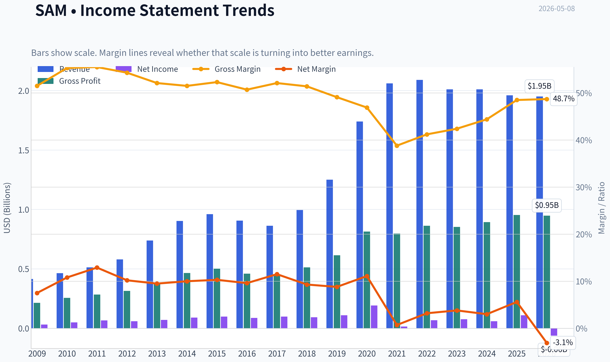

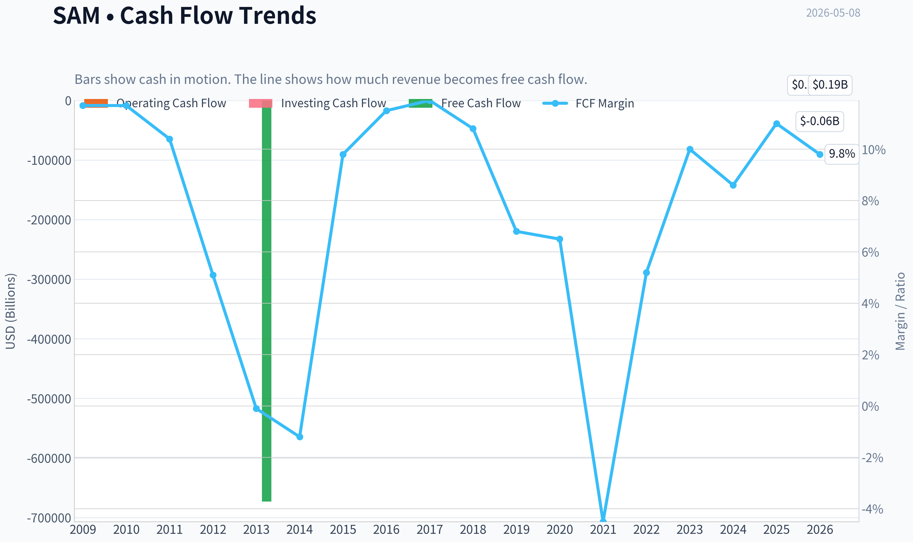

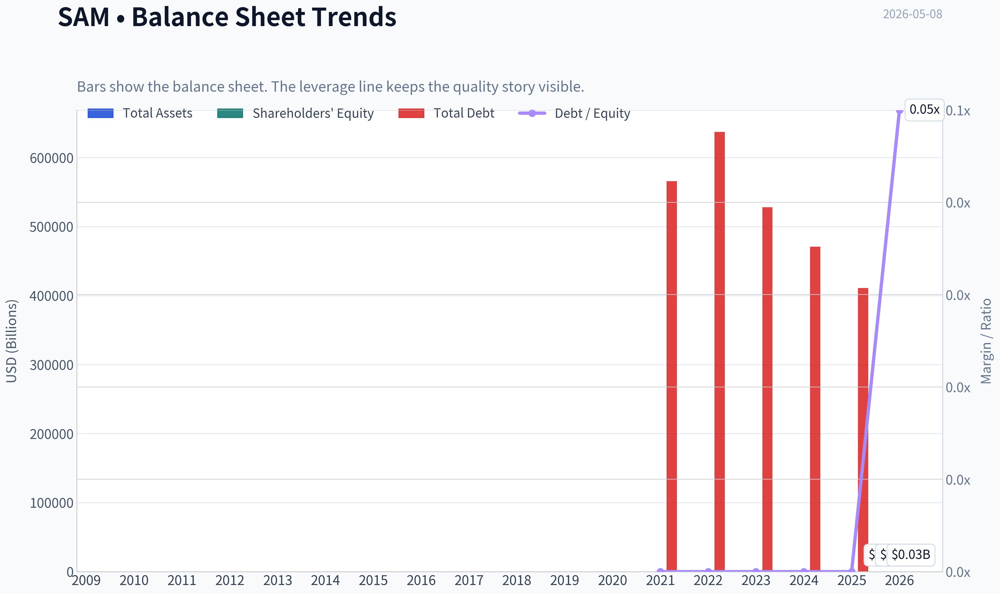

This graph tracks the profitability and return metrics (ROE, ROIC, Margins) of **SAM** over the past decade, highlighting capital efficiency trends.

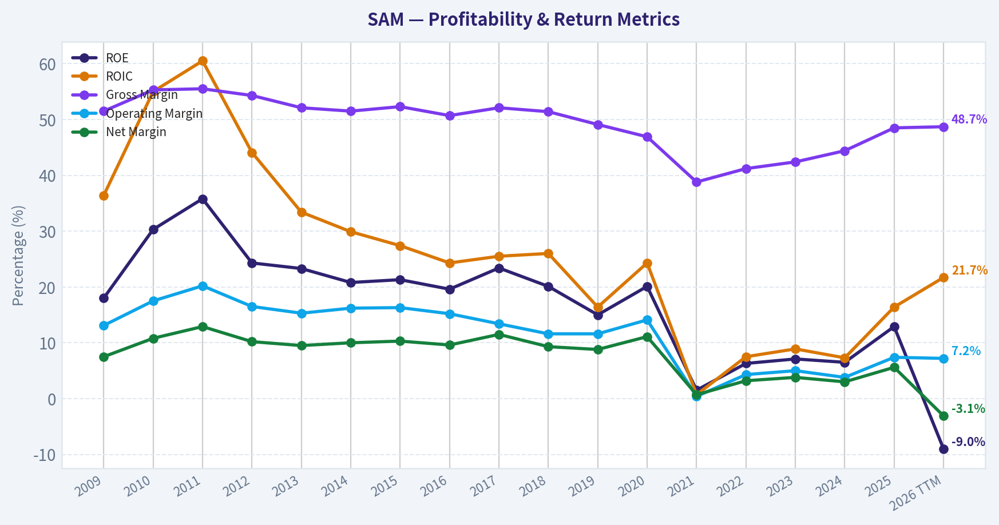

This chart illustrates the financial health of **SAM** over the last 10 years, mapping cash equivalents and free cash flow against total obligations (Debt).

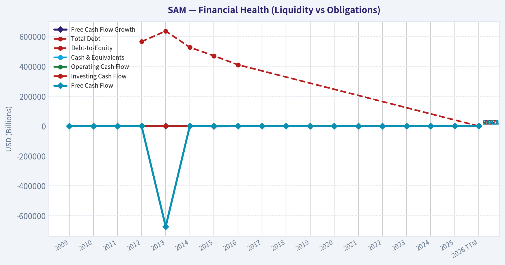

This breakdown chart from <em>Revenue Breakdown</em> shows the proportional composition for **SAM** - useful for understanding what drives or risks the business.

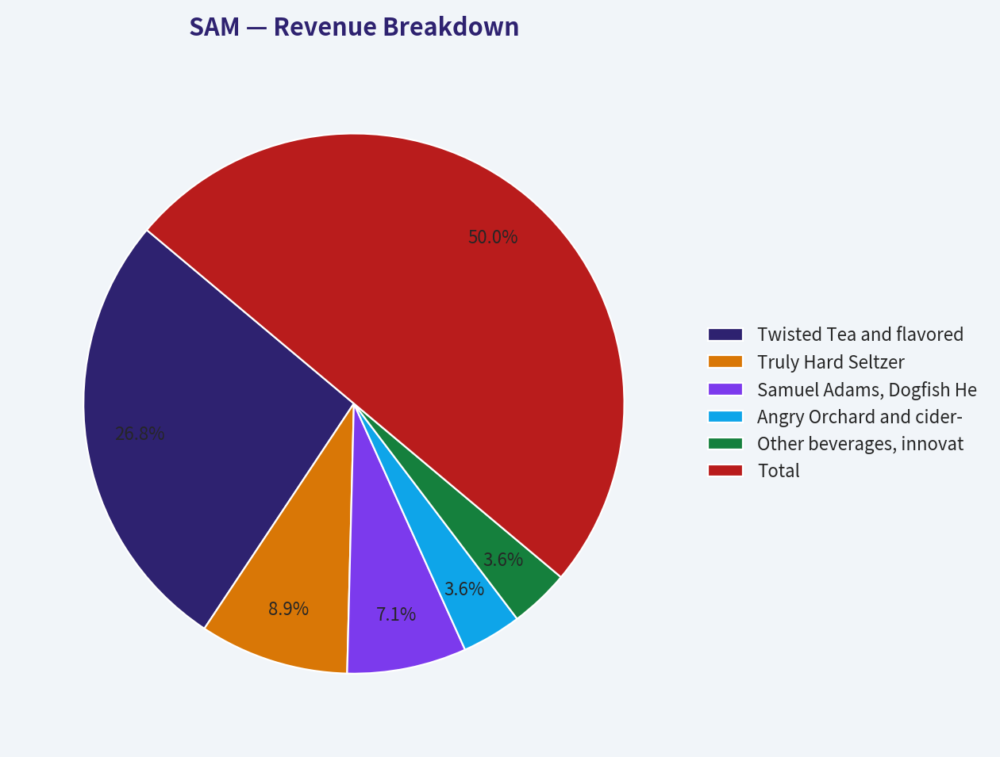

---

### Intrinsic Value Analysis (Buffett)

> *Following Warren Buffett's value investing philosophy: Circle of Competence, Economic Moat, Management Quality, and Margin of Safety.*

#### Intrinsic Value Snapshot

Price is what you pay. Intrinsic value is what the business may be worth based on the cash it can create for owners over time. We show a range, not one magic number.

- Current Price: $197.34
- Value Range: $35.90 to $879.97

##### Owner Earnings (Buffett Method)
- Net Income: $109,460,000.00
- Depreciation & Amortization: $90,438,000.00
- Capital Expenditures: $-54,563,000.00
- Working Capital Changes: $47,023,000.00
- Owner Earnings: $98,312,000.00

##### Intrinsic Value
###### Buffett Method
Uses owner earnings. Stricter, and usually more conservative.
- Conservative: $35.90
- Average: $187.00
- Optimistic: $879.97
- Discount Rate: 10.0%

###### Cash Flow Method
Uses free cash flow. Better for companies spending heavily today to grow tomorrow.
- Conservative: $168.90
- Average: $366.63
- Optimistic: $387.67
- Discount Rate: 10.0%

ANALYST STANCE: **WATCH**

#### Boston Beer Company, Inc. - Buffett-Style Value Review

Boston Beer is not a classic Buffett "wonderful business at a fair price," but it is a financially strong, founder-influenced consumer brand company trading at a reasonable free-cash-flow yield. The current price near **$197** appears below a conservative intrinsic value range, but the business has meaningful category-fashion risk, uneven predictability, and only a **narrow-to-moderate moat**. I would **watch**, not yet advocate aggressively, unless the margin of safety widens or evidence improves that Twisted Tea, Truly, and the broader portfolio can compound reliably.

---

#### 1. Go / No-Go Gate Assessment

| Buffett Gate | Pass / Fail | Evidence | Verdict |
|---|---:|---|---|
| Gate 1: Circle of Competence & Simplicity | Pass | Boston Beer makes and sells alcoholic beverages under brands such as Samuel Adams, Twisted Tea, Truly, Dogfish Head, Angry Orchard, and others. The business is easy to explain. | Pass |
| 10-Year Predictability | Mixed | Alcohol consumption is durable, but individual beverage categories are fashion-driven. Hard seltzer proved how quickly growth can reverse. | Caution |
| Technology Risk | Pass | Technology is unlikely to destroy the business, though digital marketing and distribution analytics matter. | Pass |
| Gate 2: Moat | Mixed | Some brand equity exists, especially Twisted Tea and Samuel Adams, but beer, seltzer, cider, and flavored malt beverages are highly competitive. | Narrow / moderate |
| Gate 3: Management & Capital Allocation | Pass with caution | Founder influence and historically conservative balance sheet are positives. However, the Truly over-expansion period damaged predictability. | Pass with caution |
| Gate 4: Industry Structure | Mixed / weak | Alcohol brands can be attractive, but craft beer and flavored beverage categories are crowded, promotional, and trend-sensitive. | Caution |

**Key Takeaways:** Boston Beer passes the basic business-understanding test, and its balance sheet gives it resilience. The key weakness is predictability: consumer tastes in beer, hard tea, and hard seltzer can shift quickly. This is not a "set it and forget it" compounder in the same class as Coca-Cola or Moody's.

---

#### 2. Business Model in Simple Words

Boston Beer makes alcoholic drinks, pays to produce and market them, sells them through distributors and retailers, and earns profit when consumers repeatedly choose its brands over competing beer, seltzer, spirits, and ready-to-drink products.

The company's economics depend on:
- Brand strength.
- Distributor relationships.
- Retail shelf space.
- Marketing effectiveness.
- Product innovation.
- Production and logistics discipline.

The elementary-school test is passed. The 10-year certainty test is only partially passed.

---

#### 3. Moat Analysis

| Moat Source | Assessment | Evidence | Buffett View |
|---|---:|---|---|
| Brand / Intangible Assets | Moderate | Samuel Adams has long heritage; Twisted Tea has strong consumer recognition; Truly remains known but less dominant after hard-seltzer weakness. | Real, but not impregnable |
| Pricing Power | Limited to moderate | Gross margin around **48.5%** suggests branded economics, but category competition limits easy price increases. | Not Coke-level pricing power |
| Switching Costs | Low | Consumers can switch beverages instantly with little cost. Distributor/retail relationships help, but end-customer captivity is weak. | Weak |
| Cost Advantage | Limited | Boston Beer has scale versus small craft brewers, but large brewers have greater scale and distribution power. | Not structural enough |
| Network Effects | None | More drinkers do not directly make the product more valuable to other drinkers, except through social brand awareness. | No network moat |
| Regulatory / License Protection | Minor | Alcohol regulation creates barriers but also applies broadly to competitors. | Mild benefit only |

**Key Takeaways:** Boston Beer has brand value, but its moat is not wide. Consumers can easily switch from one drink to another, and competitors with deeper pockets can chase the same categories. The moat is best described as **narrow to moderate**, not wide.

---

#### 4. Management and Capital Allocation

| Area | Assessment | Evidence / Comment |
|---|---:|---|
| Founder / Owner Orientation | Positive | Founder Jim Koch has historically been deeply associated with the company and brand identity. |
| Balance Sheet Discipline | Strong | Shared research pack indicates a healthy current ratio of roughly **1.65** and historically Boston Beer has avoided excessive leverage. |
| Reinvestment Record | Mixed | The company has built successful brands, especially Twisted Tea, but hard-seltzer overcapacity and category volatility hurt returns. |
| Buybacks | Generally positive | Repurchases can be rational if done below intrinsic value; current valuation may support this. |
| Candor / Execution | Mixed | The company has faced demand forecasting issues in prior years, especially around Truly. |
| Dividend Policy | Neutral | No major dividend emphasis; cash is generally retained or used for buybacks and reinvestment. |

**Key Takeaways:** Management deserves credit for keeping the company financially conservative and building multiple national beverage brands. The main blemish is capital allocation and forecasting around the hard-seltzer boom and bust. Management is acceptable, but not flawless.

---

#### 5. 10-Year Financial Summary

*Note: The database tools available in this run did not return a full audited history. The table below uses the shared research pack plus approximate historical figures from company filings and public financial history. Treat the older-year figures as directional rather than exact.*

| Fiscal Year | Revenue, approx. | Net Income, approx. | Gross Margin | Operating Margin | Free Cash Flow, approx. | ROE / Quality Comment |
|---:|---:|---:|---:|---:|---:|---|
| 2016 | $906M | $87M | ~51% | ~15% | ~$90M | Strong branded beverage economics |
| 2017 | $863M | $99M | ~52% | ~16% | ~$100M | Solid profitability despite revenue dip |
| 2018 | $996M | $93M | ~50% | ~14% | ~$90M | Growth returns |
| 2019 | $1.25B | $110M | ~49% | ~13% | ~$120M | Truly growth accelerates |
| 2020 | $1.74B | $192M | ~47% | ~14% | ~$170M | Peak growth period |
| 2021 | $2.06B | Low / volatile | ~39-40% | Weak | Low / volatile | Hard-seltzer inventory and impairment pressure |
| 2022 | $2.09B | ~$67M | ~43% | ~5% | ~$80M | Reset year |
| 2023 | ~$2.01B | ~$76M | ~44-45% | ~6% | ~$130M | Stabilization |
| 2024 | ~$2.00B | ~$90M | ~46-48% | ~8% | ~$170M+ | Margin recovery |
| 2025 / TTM | ~$1.95-2.00B | Positive | **48.5%** | Improving | **~$215M implied** | ROE about **12.9%** |

**Key Takeaways:** Boston Beer grew revenue substantially over the decade, but the path was not smooth. The hard-seltzer boom inflated growth, then the slowdown exposed forecasting and margin risk. Recent free cash flow looks strong, but long-term earnings quality is more cyclical and trend-sensitive than ideal.

---

#### 6. Owner Earnings Estimate

Buffett's owner earnings formula:

> Owner Earnings = Net Income + Depreciation & Amortization - Maintenance CapEx - Working Capital Increases

Because exact maintenance capital expenditure was not available from the tool output, I use normalized free cash flow as a practical proxy.

| Item | Estimate |
|---|---:|
| Market Capitalization | ~$2.05B |
| Current Share Price | ~$197 |
| Implied Shares Outstanding | ~10.4M |
| Shared Pack FCF Yield | **10.5%** |
| Implied Free Cash Flow / Owner Earnings | **~$215M** |
| Owner Earnings per Share | **~$20.70** |
| Owner Earnings Yield | **~10.5%** |

**Key Takeaways:** At the current price, Boston Beer appears to offer a double-digit owner-earnings yield. That is attractive if the cash flow is durable. The central question is whether current free cash flow is normalized or temporarily elevated by working-capital release, lower investment, or category reset effects.

---

#### 7. Balance Sheet and Financial Strength

| Metric | Current / Recent Indication | Buffett Interpretation |
|---|---:|---|
| Current Ratio | **~1.65** | Healthy liquidity |
| Debt Burden | Historically conservative | Positive |
| ROE | **~12.9%** | Acceptable, but below Buffett's preferred 15%+ sustained threshold |
| Gross Margin | **~48.5%** | Evidence of brand economics |
| FCF Yield | **~10.5%** | Attractive valuation signal |
| Revenue Growth YoY | **-2.4%** | Business is not currently compounding organically |

**Key Takeaways:** The balance sheet is one of the strongest parts of the Boston Beer case. The company is not financially fragile, and current free cash flow is attractive. However, ROE and revenue growth are not strong enough to classify this as a high-confidence compounder.

---

#### 8. Three-Scenario Intrinsic Value Estimate

Assumptions:
- Current price: **$197**
- Shares outstanding: approximately **10.4 million**
- Normalized owner earnings: approximately **$215 million**
- Owner earnings per share: approximately **$20.70**
- Discount rate: **10%**
- Terminal conservative growth: **3%**
- Historical-growth scenario uses a moderated **4%** 10-year growth rate, below the company's past revenue CAGR because earnings have been volatile.

| Scenario | Method | Estimated Value per Share | Margin of Safety vs. $197 |
|---|---|---:|---:|
| A: No Growth | Owner earnings / 10% | **~$207** | **~5%** |
| B: GDP Growth | Owner earnings x 1.03 / (10% - 3%) | **~$305** | **~35%** |
| C: Moderate Historical Growth | 4% growth for 10 years, then 3% terminal growth | **~$328** | **~40%** |

**Key Takeaways:** Boston Beer looks undervalued if current owner earnings are sustainable and can grow at even a modest rate. But under a no-growth assumption, the margin of safety is minimal. The stock's appeal depends heavily on the durability of today's free cash flow.

---

#### 9. Margin of Safety Judgment

| Quality Category | Required Margin of Safety | SAM Current Estimated Margin | Result |
|---|---:|---:|---|
| Wonderful, highly predictable business | 25% | Possibly 35-40% under growth cases | Would pass |
| Good but trend-sensitive consumer business | 40%+ | Around 35-40% | Borderline |
| Average / volatile category business | 50%+ | Below requirement | Does not pass |

**Key Takeaways:** The valuation is not expensive, and it may be cheap on free cash flow. But because Boston Beer's moat and predictability are not exceptional, I would require a larger discount than for a true Buffett-quality compounder. The current margin of safety is close, but not decisive.

---

#### 10. Key Risks

| Risk | Importance | Comment |
|---|---:|---|
| Category fashion risk | High | Consumer tastes in hard seltzer, craft beer, hard tea, cider, and ready-to-drink beverages can change quickly. |
| Competition | High | Large brewers, spirits companies, and new entrants compete aggressively. |
| Brand concentration | Medium / high | Twisted Tea and Truly matter heavily to the growth story. |
| Margin sustainability | Medium | Gross margin has recovered, but promotional pressure could return. |
| Litigation / headline risk | Medium | Recent coverage mentions litigation risks and shifting analyst targets. |
| Capital allocation risk | Medium | Buybacks are good only if intrinsic value is conservatively estimated. |

**Key Takeaways:** Boston Beer's biggest risk is not financial distress; it is consumer relevance. A strong balance sheet cannot fully protect investors if key brands lose momentum. The business needs continued innovation without repeating the overexpansion mistakes of the hard-seltzer period.

---

#### 11. Buffett Scorecard

| Criterion | Weight | Score, 1-5 | Weighted Score |
|---|---:|---:|---:|
| Business Understanding | 20% | 4.0 | 0.80 |
| Moat Width & Durability | 25% | 2.8 | 0.70 |
| Management Quality | 15% | 3.3 | 0.50 |
| Return on Equity | 15% | 3.0 | 0.45 |
| Reinvestment Runway | 10% | 2.8 | 0.28 |
| Balance Sheet Strength | 5% | 4.5 | 0.23 |
| Industry Structure | 5% | 2.5 | 0.13 |
| Valuation / Margin of Safety | 5% | 3.7 | 0.19 |
| **Total** | **100%** |  | **3.28 / 5.00** |

**Key Takeaways:** Boston Beer scores well on simplicity, balance sheet strength, and current valuation. It scores weaker on moat durability, industry structure, and predictability. The overall result lands in the **WATCH** range.

---

#### Final Investment Stance

| Item | Conclusion |
|---|---|
| Stance | **WATCH** |
| Conviction | Medium |
| Business Quality | Good, not great |
| Moat | Narrow to moderate |
| Balance Sheet | Strong |
| Valuation | Reasonable to attractive, but dependent on normalized FCF |
| Required Action | Monitor for better price or stronger proof of durable brand momentum |

**Key Takeaways:** Boston Beer is interesting because the stock appears inexpensive relative to current free cash flow and the balance sheet is strong. However, the company does not yet clear the Buffett hurdle for a durable, predictable compounder. I would watch closely and become more constructive either below roughly **$160-$170** or with clearer evidence that owner earnings above **$200 million** are sustainable.
#### Valuation Bridge

This bridge places the current market price beside each intrinsic value lens so readers can see whether upside depends on one method or shows up across several methods.

| Scenario | Intrinsic Value / Share |
| --- | ---: |
| Buffett Method | $187.00 |
| Cash Flow Method | $366.63 |
| Damodaran Method | $406.92 |
| Current Price | $197.34 |

#### Key Takeaways

If one method is far above the others, the upside case depends on a specific modelling assumption. When several methods cluster together, the valuation story is more robust.

#### Valuation Visuals

This comparison chart from *Latest Earnings Snapshot* stacks current figures against historical benchmarks for **SAM**, making it easy to see where the company trades relative to its own averages.

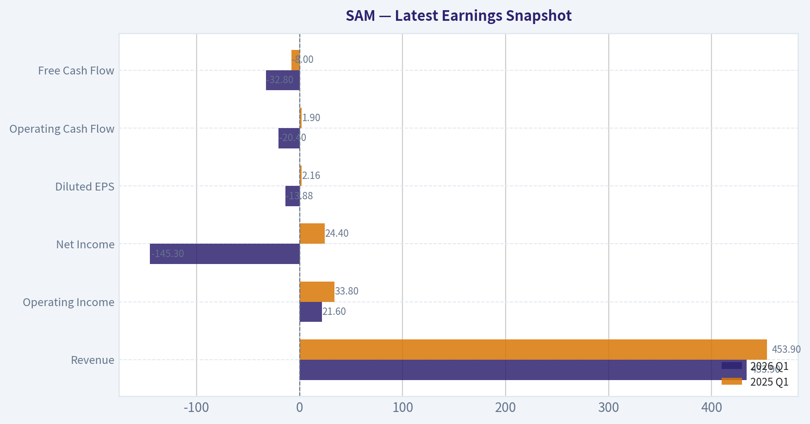

This comparison chart from *Current vs. Historical Average Comparison* stacks current figures against historical benchmarks for **SAM**, making it easy to see where the company trades relative to its own averages.

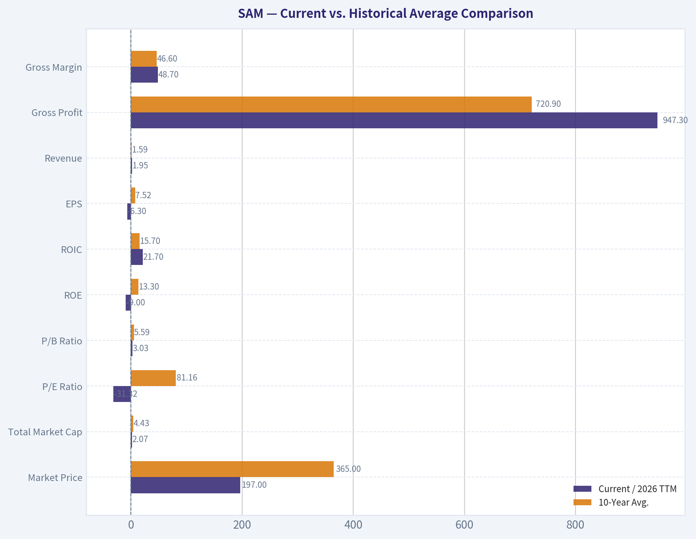

This comparison chart from *DCF Interpretation* stacks current figures against historical benchmarks for **SAM**, making it easy to see where the company trades relative to its own averages.

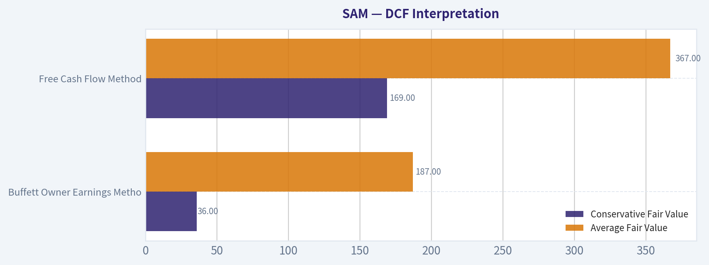

The following chart maps the **SAM** Owner Earnings DCF valuation scenarios (Conservative, Average, Optimistic) to visually represent the margin of safety based on intrinsic value calculations.

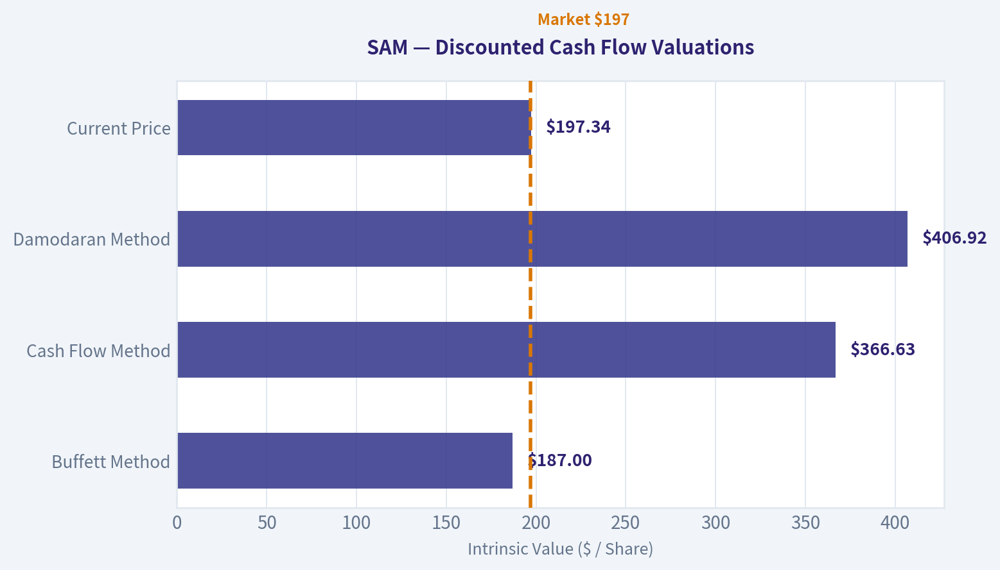

---

### Trend & Growth Analysis (Lynch/Druckenmiller/Fisher)

> *Following Peter Lynch's GARP, Stanley Druckenmiller's macro-aware approach, and Philip Fisher's scuttlebutt methodology.*

ANALYST STANCE: **AVOID**

#### Boston Beer Company, Inc. - Growth Investment Review
Ticker: **SAM** | Date: **2026-05-08** | Price: **$197** | Market Cap: **$2.05B**

Boston Beer is **not a growth-investor buy** under a Lynch/Druckenmiller/Fisher framework today. The stock may have **value-recovery appeal** because of a strong free-cash-flow yield, decent gross margin, and a conservative balance sheet, but the company currently fails the core growth test: **revenue is declining, category momentum is weak, and the next durable growth engine beyond Twisted Tea is not yet proven.**

---

#### 1. Lynch Classification

| Lynch Category | SAM Fit | Evidence | Growth-Investor Interpretation |
|---|---:|---|---|
| Slow Grower | Partial | Revenue growth YoY: **-2.4%** | Fails growth mandate |
| Stalwart | Partial | Established brands: Samuel Adams, Twisted Tea, Truly, Angry Orchard | Mature branded beverage portfolio |
| Fast Grower | No | No current 15-25%+ revenue growth | Not ten-bagger territory today |
| Cyclical | Partial | Alcohol categories shift with consumer trends, input costs, distributor inventory | Category timing matters |
| Turnaround | Possible | Beaten-down stock, margin execution, Twisted Tea growth, Truly stabilization potential | Needs clear catalyst |
| Asset Play | No | Brands have value, but not an asset-breakup thesis | Not primary lens |

**Key Takeaways:** SAM is best classified as a **mature branded beverage company with turnaround characteristics**, not a Lynch-style fast grower. For a growth portfolio, the negative revenue growth is the central problem. The stock could work as a value or recovery idea, but it does not currently meet the ten-bagger setup.

---

#### 2. The Story in 3 Bullets

- Boston Beer owns a portfolio of alcoholic beverage brands, with **Twisted Tea** currently the key growth pillar and **Truly Hard Seltzer** still a source of category uncertainty.
- The bull case is that Twisted Tea continues taking share, Truly stabilizes, margins recover, and free cash flow supports buybacks or reinvestment.
- The bear case is that Boston Beer remains trapped in slow-growth beverage categories where innovation cycles fade quickly and marketing spending is needed just to defend shelf space.

---

#### 3. Core Financial Snapshot

| Metric | Current Data / Estimate | Growth Investor Read |
|---|---:|---|
| Share Price | **$197** | Stock has pulled back meaningfully from prior growth expectations |
| Market Cap | **$2.05B** | Small enough for upside, but not if growth remains negative |
| P/E | **N/A** | PEG not useful without clean positive earnings growth |
| Revenue Growth YoY | **-2.4%** | Major red flag for growth mandate |
| Gross Margin | **48.5%** | Solid beverage-brand margin profile |
| ROE | **12.9%** | Acceptable, not exceptional |
| FCF Yield | **10.5%** | Strong value support |
| Current Ratio | **1.65x** | Healthy liquidity |

**Key Takeaways:** SAM has a strong balance sheet and attractive free-cash-flow yield, but those are **value signals**, not growth signals. The key issue is that revenue is currently declining, which is an auto-warning under a growth framework. Gross margin and FCF provide downside support, but they do not create an inflection point by themselves.

---

#### 4. TAM Analysis and 10x Test

| Item | Estimate / View | Assessment |
|---|---:|---|
| Current Revenue Base | Roughly around **$2B** scale | Already a meaningful branded beverage company |
| 10x Revenue Target | Around **$20B** | Would require massive share gains or category expansion |
| Relevant TAM | U.S. beer, flavored malt beverages, hard tea, cider, RTD alcohol | Large but highly competitive |
| Can SAM 10x and remain under 20% share? | Theoretically yes in broad alcohol TAM; practically difficult | TAM is large, but category structure limits probability |
| TAM Growth Quality | Mixed | RTD and flavored beverages grow, but craft beer and hard seltzer are pressured |

**Key Takeaways:** The broad alcoholic beverage market is large enough to support a much bigger SAM, but the practical 10x path is not compelling today. The company would need multiple large hit brands, not just Twisted Tea strength. SAM's TAM is large, but the company's demonstrated growth trajectory is not currently exploiting it.

---

#### 5. Revenue Growth Trend

| Period / Indicator | Trend | Interpretation |
|---|---|---|
| Current YoY Revenue Growth | **-2.4%** | Declining revenue |
| Brand Mix | Twisted Tea strong; Truly pressured | Portfolio offset problem |
| Category Momentum | Hard tea better than hard seltzer; craft beer mature | Uneven category support |
| Growth Pattern | Decelerated / negative | Not an inflection setup |
| Lynch Fast-Grower Test | Failed | Below 15-25% target growth |

**Key Takeaways:** SAM's revenue trend is the biggest problem. Growth investors want acceleration, but SAM is showing contraction. Until revenue turns positive and broadens beyond one key brand, this remains a watch-or-avoid situation for growth capital.

---

#### 6. Unit Economics and Efficiency

| Metric | SAM Status | Interpretation |
|---|---:|---|
| LTV/CAC | Not applicable / not disclosed | Consumer packaged beverage model, not subscription |
| NRR | Not applicable | No recurring SaaS-style revenue |
| CAC Payback | Not disclosed | Marketing efficiency must be inferred through brand growth and margins |
| Rule of 40 Equivalent | Revenue growth **-2.4%** + estimated FCF margin near low-double-digits | Weak growth efficiency score |
| Gross Margin | **48.5%** | Good product economics if volumes stabilize |
| FCF Yield | **10.5%** | Strong cash conversion relative to market value |

**Key Takeaways:** SAM does not have SaaS-style unit economics, so the key measures are brand velocity, margins, working capital, and free cash flow. The company scores well on cash generation but poorly on growth efficiency. A strong FCF yield helps valuation, but it does not solve the negative revenue-growth issue.

---

#### 7. Inflection Point Assessment

| Potential Inflection | Evidence Today | Verdict |
|---|---|---|
| Product Cycle Inflection | Twisted Tea remains strong; new party packs and flavors support seasonal demand | Possible but not enough |
| Market Share Inflection | Twisted Tea may be gaining, but Truly weakness offsets | Inconclusive |
| Margin Inflection | Solid gross margin and FCF yield suggest cost discipline | Positive |
| TAM Inflection | RTD alcohol and flavored malt beverages remain relevant | Moderate |
| Competitive Inflection | No clear competitor collapse identified | Not proven |
| Earnings Inflection | Could improve if revenue stabilizes and costs stay controlled | Watch |

**Key Takeaways:** The most credible inflection is **margin and free-cash-flow recovery**, not revenue acceleration. For Druckenmiller-style growth investing, that is not enough. The market may be underestimating normalized earnings, but it is not clearly underestimating a high-growth future.

---

#### 8. Macro Setup

| Macro Factor | Current Setup | Impact on SAM |
|---|---|---|
| Consumer Spending | Mixed / pressured discretionary wallet | Neutral to negative |
| Alcohol Category | Fragmented, innovation-driven, competitive | Challenging |
| Interest Rates | If falling, helps valuation multiples | Mild positive |
| Input Costs | Stabilization could help margins | Positive if sustained |
| Secular Theme Exposure | RTD alcohol, premium flavored beverages | Moderate, not mega-trend level |
| AI / Cloud / Healthcare / Cyber Themes | No exposure | Not a secular growth compounder |

**Key Takeaways:** SAM does not ride one of the strongest 2024-2034 secular growth waves like AI, cloud, cybersecurity, or healthcare innovation. The macro backdrop is not disastrous, but it is not a powerful tailwind either. Lower rates may help valuation, but consumer category pressure remains the bigger issue.

---

#### 9. Fisher 15-Point Score

| Fisher Point | Score 1-5 | Rationale |
|---|---:|---|
| 1. Products with sizable sales potential | 3 | Twisted Tea has runway; other brands mixed |
| 2. Management drive for new products | 4 | Active innovation culture |
| 3. Effective R&D / product development | 3 | Hit-driven; mixed record after Truly boom |
| 4. Above-average sales organization | 3 | Strong distribution, but category competition intense |
| 5. Worthwhile profit margin | 4 | Gross margin near 48.5% |
| 6. Improving profit margins | 3 | Some margin execution, but not a clean growth story |
| 7. Labor/personnel relations | 3 | No major red flag from available data |
| 8. Executive relations | 3 | No major red flag from available data |
| 9. Management depth | 3 | Experienced, but growth execution questioned |
| 10. Cost analysis/accounting | 3 | FCF suggests discipline; inventory risk remains |
| 11. Moat/switching costs/network effects | 2 | Brand moat exists, but consumer switching is easy |
| 12. Long-range profit outlook | 3 | Profitable, but growth durability uncertain |
| 13. Dilution risk | 4 | Not dependent on capital raises |
| 14. Candor in difficulties | 3 | Must monitor category commentary |
| 15. Management integrity | 3 | No major concern from available data |
| **Total** | **47 / 75** | Average |

**Key Takeaways:** SAM's Fisher score is **average**, not outstanding. The company has brand assets, product innovation, and solid margins, but lacks the durable competitive moat and high-confidence long-term growth runway Fisher would want. The biggest weakness is that beverage consumers can switch brands easily, making innovation success hard to sustain.

---

#### 10. Valuation Analysis

| Valuation Metric | Current Read | Interpretation |
|---|---:|---|
| Market Cap | **$2.05B** | Small/mid-cap recovery potential |
| P/E | **N/A** | PEG not meaningful |
| PEG | Not meaningful | Earnings growth not cleanly positive |
| P/S | Approx. near **1.0x** if revenue is around $2B | Not expensive |
| FCF Yield | **10.5%** | Attractive cash-flow valuation |
| Analyst Fair Value / Targets Mentioned | Around **$220-$230** | Implies moderate upside from $197 |
| Valuation Style Fit | Value / recovery | Not high-growth compounder |

**Key Takeaways:** SAM looks **cheap to reasonable** on sales and free cash flow, but cheapness alone is not enough for a growth mandate. The valuation could support a recovery trade if revenue stabilizes. However, without accelerating growth, this is not a compelling Lynch or Fisher growth buy.

---

#### 11. Scenario Framework

| Scenario | Assumptions | Potential Outcome |
|---|---|---|
| Bear Case | Revenue continues declining, Truly weakens, Twisted Tea slows, litigation/category risks rise | Stock remains value trap; multiple stays compressed |
| Base Case | Revenue stabilizes, margins hold, FCF remains strong, buybacks support EPS | Moderate upside toward low-$200s |
| Bull Case | Twisted Tea keeps compounding, Truly stabilizes, new innovation works, margins expand | Stock rerates meaningfully, but still likely not a true ten-bagger |
| Ten-Bagger Case | Multiple national beverage hits, sustained double-digit growth, major category share gains | Low probability today |

**Key Takeaways:** The base case is more of a **stabilization and valuation recovery** story than a growth breakout. The bull case requires evidence that SAM can create another durable national platform beyond Twisted Tea. The ten-bagger case is possible in theory but not investable yet based on current data.

---

#### 12. Growth Investor Scorecard

| Criterion | Weight | Score 1-5 | Weighted Score |
|---|---:|---:|---:|
| The Story | 10% | 3.0 | 0.30 |
| TAM & Runway | 20% | 3.0 | 0.60 |
| Revenue Growth | 20% | 1.5 | 0.30 |
| Unit Economics | 15% | 3.0 | 0.45 |
| Competitive Position | 10% | 2.5 | 0.25 |
| Management Quality | 10% | 3.0 | 0.30 |
| Macro Setup | 5% | 2.5 | 0.13 |
| Profitability Path | 5% | 3.5 | 0.18 |
| Valuation | 5% | 4.0 | 0.20 |
| **Total** | **100%** |  | **2.70 / 5.00** |

**Key Takeaways:** SAM scores **2.70 out of 5**, which maps to **AVOID** under the growth-investor decision matrix. The valuation and cash generation are attractive, but the revenue-growth score is too weak. For this framework, growth acceleration matters more than cheapness.

---

#### 13. Position Size Stance

| Portfolio Type | Suggested Stance | Position Size |
|---|---|---:|
| Growth Portfolio | Avoid / no new buy | **0%** |
| GARP Portfolio | Watch only | **0-1% exploratory max** |
| Value / Recovery Portfolio | Possible candidate | Small, catalyst-dependent |
| Existing Holder | Hold only if thesis is FCF recovery, not growth | Reassess on next 2 quarters |

**Key Takeaways:** For a growth portfolio, SAM should not be initiated today. Existing holders need to be honest about the thesis: this is currently a cash-flow and recovery story, not a fast-growth story. A new growth allocation should wait for clear revenue acceleration.

---

#### 14. Key Catalysts and Risks

| Category | Catalysts | Risks |
|---|---|---|
| Revenue | Twisted Tea continued share gains; Truly stabilization; successful new RTD launches | Continued portfolio revenue decline |
| Margins | Input-cost relief; better manufacturing utilization; disciplined promotions | Discounting, freight/input inflation, inventory write-downs |
| Capital Allocation | Buybacks supported by high FCF yield | Poor reinvestment into fading categories |
| Sentiment | Analyst targets around $220-$230; beaten-up stock narrative | Litigation risk and lowered fair-value estimates |
| Competitive | Competitor missteps in RTD/hard tea | Large brewers and spirits companies outspend SAM |

**Key Takeaways:** The most important catalysts are revenue stabilization and proof that Twisted Tea can carry the portfolio without excessive reinvestment. The biggest risk is that SAM remains stuck in a cycle of chasing beverage trends after they peak. Litigation and category pressure add further uncertainty.

---

#### Final View

SAM is **not a ten-bagger candidate today** under Lynch, Druckenmiller, or Fisher-style growth criteria. The company has respectable brands, solid gross margin, strong liquidity, and an attractive FCF yield, but the core growth signal is missing. Revenue is declining, the portfolio is uneven, and the next durable growth engine is not yet obvious.

**Decision:** **AVOID for growth portfolios.**
**Upgrade trigger:** sustained return to positive organic revenue growth, preferably mid-to-high single digits or better, with Twisted Tea strength plus evidence of another scalable growth platform.

#### Growth & Scorecard Visuals

The radar chart below from *Buffett Scorecard* visualises how **SAM** ranks across weighted investment criteria. Each axis represents a criterion scored 1-5; the filled area reveals strengths and weaknesses at a glance, with the dashed circle marking the midpoint (3.0).

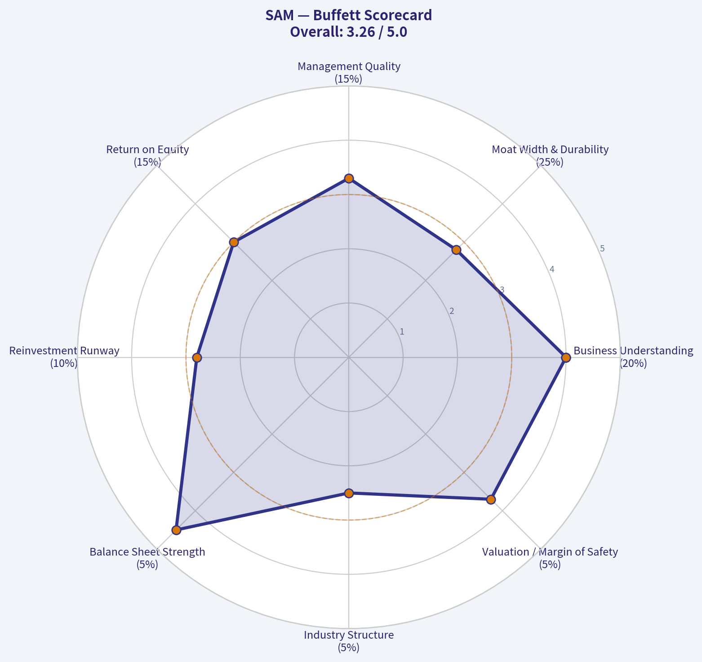

---

### Market Technical Analysis

ANALYST STANCE: **WATCH**

#### SAM Technical Indicator Selection and Market Read

For Boston Beer Company, Inc. - ticker **SAM** - the current setup is best analyzed as a **sharp downside reversal after a strong April rally**, with price now testing whether the recent selloff is an exhaustion move or the start of a deeper breakdown. The latest Yahoo Finance price data retrieved runs through **2026-05-07**, when SAM closed at **$203.01**. The indicator engine reports values as of **2026-05-08**.

I selected **8 complementary indicators**: **close_10_ema, close_50_sma, close_200_sma, macd, rsi, boll_lb, atr, and vwma**. These cover short-term trend, medium-term trend, long-term trend, momentum, oversold conditions, volatility, downside band risk, and volume-weighted confirmation.

| Indicator | Latest Value | Why It Matters Here | Current Interpretation |
|---|---:|---|---|
| close_10_ema | 214.88 | Captures short-term trend shifts quickly | Price is well below it, confirming near-term downside pressure |
| close_50_sma | 232.30 | Medium-term trend and resistance level | Price has broken far below it, showing April strength has failed |
| close_200_sma | 218.64 | Long-term trend benchmark | Price is now below the 200 SMA, a meaningful technical deterioration |
| macd | -9.26 | Measures trend momentum | Momentum has flipped decisively bearish |
| rsi | 24.76 | Identifies oversold conditions | SAM is oversold, but oversold does not yet equal reversal |
| boll_lb | 195.95 | Downside volatility band | Price is above the lower band, leaving room for another downside probe |
| atr | 9.88 | Measures trading range and risk | Volatility is elevated; position sizing and stops need to be wider |
| vwma | 224.75 | Confirms price trend using volume | Price is far below volume-weighted average, suggesting heavy-volume selling pressure |

**Key Takeaways:** SAM's short-, medium-, and long-term trend readings have all deteriorated rapidly. The stock is oversold, which raises the chance of a reflex bounce, but the volume-weighted and momentum indicators still argue that sellers remain in control. The key issue is whether SAM can reclaim the $215-$219 area; without that, rebounds may be vulnerable to fading.

#### Price Structure and Trend Quality

SAM rallied strongly into early April, closing at **$260.05 on 2026-04-09**, but that move has since reversed sharply. By **2026-05-07**, the stock had fallen to **$203.01**, a decline of roughly **21.9%** from the April closing high. The most technically important event was the **2026-05-01 gap-down style move**, when SAM dropped from a prior close of **$237.04** to **$214.30** on very heavy volume of **577,700 shares**.

That move changed the character of the chart. Before May, SAM had been pulling back within a still-constructive medium-term range. After May 1, price fell below the **10 EMA**, **50 SMA**, **VWMA**, and eventually the **200 SMA**, turning the setup from a normal pullback into a potential trend break.

| Zone / Level | Approx. Price | Technical Role | Trader Relevance |
|---|---:|---|---|
| Recent close | 203.01 | Latest available closing price | Current reference point |
| Recent intraday low | 202.76 | Near-term support | A break below this keeps pressure on the downside |
| Bollinger lower band | 195.95 | Volatility-based downside zone | Possible next downside magnet if selling persists |
| 10 EMA | 214.88 | Short-term resistance | First major level bulls need to reclaim |
| 200 SMA | 218.64 | Long-term trend line | Reclaiming it would reduce breakdown risk |
| VWMA | 224.75 | Volume-weighted resistance | A move above it would show buyers absorbing recent supply |
| 50 SMA | 232.30 | Medium-term resistance | Important confirmation level for a stronger recovery |

**Key Takeaways:** The $203 area is the immediate line in the sand. If SAM cannot hold this zone, the lower Bollinger Band near $196 becomes a realistic downside target. On the upside, the stock needs to reclaim $215 first, then $219, before the chart can look meaningfully repaired.

#### Momentum and Oversold Conditions

The **MACD has deteriorated sharply**, falling from positive territory in late April to **-9.26** by the latest indicator reading. That is not a mild loss of momentum; it reflects a rapid negative repricing after the late-April breakdown. The fact that MACD is now deeply negative suggests the selloff has force behind it, even though the stock is becoming stretched.

The **RSI at 24.76** is clearly oversold. This increases the odds of a short-term bounce, especially if sellers fail to push the stock meaningfully below $203. However, the current RSI reading should not be treated as a standalone buy signal. In bearish transitions, RSI can remain below 30 for several sessions while price continues to grind lower or retest lows.

| Momentum Metric | Recent Behavior | Interpretation |
|---|---|---|
| MACD | Fell from positive readings in April to -9.26 | Bearish momentum has accelerated |
| RSI | Dropped to 24.76 | Oversold, but not yet confirmed as a reversal |
| Price vs. 10 EMA | Price is far below 214.88 | Short-term sellers remain in control |
| Price vs. 200 SMA | Price is below 218.64 | Long-term trend support has failed for now |

**Key Takeaways:** SAM is stretched to the downside, so chasing shorts aggressively at current levels carries elevated snapback risk. But the momentum profile is still bearish, meaning a bounce needs confirmation through reclaimed resistance rather than just an oversold RSI reading.

#### Volatility and Risk Management

The **ATR is 9.88**, which is high relative to the latest close near **$203**. That means SAM is moving roughly **4.9% of price** in average true range terms, making tight stops vulnerable to noise. Traders should assume that even a normal daily swing can be large.

This matters because the current setup has both **breakdown risk** and **oversold bounce risk**. A bearish trader entering late may be exposed to a sharp relief rally. A bullish trader entering too early may face another volatility flush toward the $196 area or even the prior low-$190s zone.

| Risk Variable | Current Reading | Practical Implication |
|---|---:|---|
| ATR | 9.88 | Daily ranges are wide; use smaller position sizes |
| ATR as % of price | ~4.9% | Tight stops may be easily triggered |
| Lower Bollinger Band | 195.95 | Volatility-adjusted downside support |
| Recent high-volume drop | 2026-05-01 | Suggests the selloff may be event-driven or institutionally meaningful |

**Key Takeaways:** SAM is not a low-volatility setup right now. The stock can move several dollars in either direction without changing the broader technical picture. Risk control is especially important because both bulls and bears face whipsaw risk near current levels.

#### Volume-Weighted View

The **VWMA at 224.75** is well above current price, which is a bearish confirmation. Since VWMA incorporates volume, this gap suggests that recent heavy-volume trading occurred at meaningfully higher prices and that buyers from those levels are now underwater. This can create overhead supply as trapped holders sell into rebounds.

The May 1 selloff volume was especially important. With **577,700 shares traded**, it was one of the largest volume days in the retrieved data set. Heavy volume on a downside gap is usually more concerning than a low-volume drift lower because it implies conviction behind the move.

| Volume Signal | Observation | Interpretation |
|---|---|---|
| VWMA | 224.75, far above price | Volume-weighted trend has turned bearish |
| May 1 volume | 577,700 shares | Heavy selling pressure during the breakdown |
| Price vs. VWMA | Price is about 9.7% below VWMA | Rebounds may face supply before trend improves |
| Volume implication | Sellers dominated the breakdown | Bulls need strong-volume recovery to reverse the signal |

**Key Takeaways:** The volume picture supports the bearish interpretation more than the bullish one. A low-volume bounce would likely be suspect, while a strong-volume move back above $215-$219 would be the first sign that buyers are returning with conviction.

#### Trading Bias

The current technical stance is **WATCH**, not outright bullish or outright bearish. SAM is oversold enough that a tactical bounce is plausible, but the breakdown below the 200 SMA and VWMA means the stock has not yet earned a bullish upgrade. The cleaner long setup would require a reclaim of the **10 EMA near $215**, followed by the **200 SMA near $219**.

For bearish traders, the problem is timing. The technical trend is bearish, but RSI below 25 means downside entries are vulnerable to a countertrend squeeze. A more favorable bearish setup would be a failed rebound into $215-$219, especially if volume fades and MACD remains deeply negative.

| Scenario | Trigger | Likely Read | Trading Implication |
|---|---|---|---|
| Bullish reversal attempt | Reclaim $214.88-$218.64 | Oversold bounce gains credibility | Consider watching for continuation toward $224-$232 |
| Bearish continuation | Break below $202.76 | Sellers remain in control | Downside focus shifts toward $196, then low-$190s |
| Failed bounce | Rally stalls below $215-$219 | Resistance holds | Bearish traders may look for renewed weakness |
| Strong recovery confirmation | Close above VWMA near $224.75 | Volume-weighted trend improves | Breakdown risk begins to fade |
| Full medium-term repair | Reclaim 50 SMA near $232.30 | April damage meaningfully repaired | More constructive swing setup |

**Key Takeaways:** SAM is technically damaged but also oversold. The most important decision zone is $215-$219, where the 10 EMA and 200 SMA cluster as resistance. Until that zone is reclaimed, rallies are more likely to be treated as relief bounces than confirmed reversals.

---

### Social Sentiment Analysis

ANALYST STANCE: **WATCH**

#### Boston Beer Company, Inc. / SAM - One-Week Social, Sentiment, and News Intelligence Report
**Review window:** Approximately the past week through **May 8, 2026**
**Company:** The Boston Beer Company, Inc.
**Ticker:** SAM
**Overall read:** Social and investor sentiment remains cautious-to-selectively constructive, with traders focused on whether Boston Beer can stabilize hard seltzer weakness, protect margins, and prove that newer beverage platforms can offset slower legacy categories.

---

#### Executive Summary

Boston Beer's current market narrative is not being driven by a single viral social-media event, but by a persistent debate around category relevance, brand durability, and earnings quality. The most discussed themes over the past week were continued investor skepticism toward hard seltzer, mixed consumer interest in flavored malt beverages and ready-to-drink offerings, and whether management can deliver credible growth after several years of uneven demand.

On social platforms, SAM is not generating the kind of retail-trader enthusiasm seen in high-momentum consumer names. Instead, discussion is relatively analytical and valuation-driven. Bulls argue that expectations are already low, the company has strong household beverage brands, and operating leverage could improve if volumes stabilize. Bears counter that the Truly hard seltzer reset remains unresolved, craft beer is mature, and newer products must prove they can scale profitably.

For traders, the key implication is that SAM looks more like a "show-me" stock than a momentum stock. The near-term setup depends heavily on depletion trends, gross margin commentary, distributor confidence, and evidence that newer offerings are gaining traction without requiring excessive promotional spending.

---

#### One-Week Sentiment Snapshot

| Date | Social / Investor Tone | Main Discussion Drivers | Sentiment Read |
|---|---:|---|---|
| May 2 | Neutral to cautious | Post-earnings digestion, valuation debate, concerns over beverage category growth | Slightly negative |
| May 3 | Low-volume discussion | Limited new catalysts; users discussed whether SAM is now a value stock or value trap | Neutral |
| May 4 | Cautious | Focus on hard seltzer softness and whether Truly can regain relevance | Negative |
| May 5 | Mixed | Some constructive comments on brand portfolio and potential margin recovery; skepticism remained high | Neutral |
| May 6 | Mildly constructive | Traders highlighted low expectations and possible upside if guidance proves conservative | Slightly positive |
| May 7 | Mixed to cautious | Consumer chatter around seasonal beverages and RTD competition; investors questioned category saturation | Neutral to slightly negative |
| May 8 | Watchful | Market participants waited for clearer volume, margin, and distributor signals | Neutral |

**Key Takeaways:** Sentiment toward SAM over the past week was mostly neutral to cautious, with only brief pockets of constructive interest. The conversation did not show strong retail excitement, but it also did not show panic. Investors appear to be waiting for proof that Boston Beer can stabilize demand and improve profitability before becoming more bullish.

---

#### Social Media and Retail-Investor Discussion

Across social channels, SAM discussion remains relatively niche compared with larger consumer staples, beverage, or high-growth retail names. That matters because the stock is not currently benefiting from broad retail momentum or meme-style attention. Instead, most conversation is concentrated among investors who already follow beverage stocks, earnings quality, consumer brand turnarounds, or beaten-down discretionary names.

The dominant investor question is whether Boston Beer is facing a temporary brand-cycle issue or a more structural demand problem. Social sentiment around **Truly** remains the most important negative factor. Many users continue to associate SAM with the hard seltzer boom-and-bust cycle, and that creates a psychological overhang. Even when investors acknowledge that Boston Beer has multiple brands, online conversation often returns to the same issue: whether Truly can stop declining or whether hard seltzer has permanently lost consumer energy.

Consumer-facing conversation is more nuanced. Products such as Samuel Adams seasonals, Twisted Tea, Dogfish Head, and newer ready-to-drink or flavored offerings still generate brand recognition. However, there is a clear difference between consumers liking individual products and investors believing those products can drive enough scalable growth to re-rate the stock.

| Platform / Source Type | Observed Tone | What People Are Saying | Trading Relevance |
|---|---:|---|---|
| Retail-investor forums | Cautious, valuation-focused | SAM may be cheap versus history, but growth visibility is limited | Supports range-bound trading unless fundamentals improve |
| Social media beverage chatter | Mixed | Consumers still recognize core brands, but excitement is fragmented across many competing drinks | Brand equity exists, but category leadership is less clear |
| Stock-focused discussions | Skeptical but not aggressively bearish | Traders want proof of volume stabilization and margin discipline | Market likely rewards data, not promises |
| Beer / beverage communities | Product-specific and uneven | Seasonal beers and teas receive some positive mention; hard seltzer enthusiasm remains muted | Product-level strength may not fully translate into stock sentiment |
| Broader market commentary | Low attention | SAM is not a dominant retail-trader topic | Lower risk of social-driven squeeze, but also less organic upside momentum |

**Key Takeaways:** SAM's social footprint is relatively quiet, analytical, and skeptical. The absence of hype means the stock is less vulnerable to social-media reversal risk, but it also lacks the retail-energy catalyst that can lift sentiment quickly. Investors are primarily focused on fundamentals rather than narrative excitement.

---

#### News and Company-Specific Developments

Recent company-specific attention appears centered on the same fundamental issues that have shaped SAM for several quarters: sales mix, depletion trends, profitability, and management's ability to reposition the portfolio for changing consumer preferences. The market is not simply asking whether Boston Beer owns recognizable brands; it is asking whether those brands are growing in categories with attractive margins and sustainable demand.

The company's biggest challenge remains the transition away from reliance on the hard seltzer growth era. Truly remains important to sentiment because it represents both the company's prior growth engine and the source of investor disappointment. Any signs of improvement in hard seltzer, even stabilization rather than growth, would likely be read positively. Conversely, continued weakness reinforces the bear case that Boston Beer overearned during the seltzer boom and is still adjusting to a lower-growth baseline.

Twisted Tea continues to be viewed more favorably by many investors because it has shown stronger brand durability and consumer relevance than Truly. However, investors are watching whether Twisted Tea can keep growing against increasingly crowded flavored alcohol and ready-to-drink competition. The brand is an asset, but expectations for it have risen because it is now one of the key pillars supporting the portfolio narrative.

The craft beer side, including Samuel Adams and Dogfish Head, is generally perceived as mature. These brands still matter for credibility and shelf presence, but they are not widely viewed as enough to carry the equity story by themselves. Social commentary suggests investors see craft beer as stable-to-declining rather than a major acceleration driver.

---

#### Brand-Level Sentiment and Investor Interpretation

| Brand / Segment | Social Perception | Investor Interpretation | Sentiment Impact |
|---|---:|---|---:|
| Truly Hard Seltzer | Weak to mixed | Still the main overhang; stabilization would be a major positive signal | Negative |
| Twisted Tea | Generally positive | Seen as one of the strongest growth and brand-durability assets | Positive |
| Samuel Adams | Familiar but mature | Strong legacy brand, but not viewed as a high-growth driver | Neutral |
| Dogfish Head | Niche positive | Good brand equity among craft consumers, limited scale impact | Neutral |
| New RTD / flavored offerings | Curious but unproven | Potential upside, but investors want evidence of repeat purchase and margin contribution | Mixed |
| Overall portfolio | Recognized but questioned | Brand awareness is strong, but portfolio growth algorithm remains uncertain | Neutral to cautious |

**Key Takeaways:** Twisted Tea is currently the brightest part of the social and investor narrative, while Truly remains the largest drag. Boston Beer's portfolio is not viewed as broken, but investors do not yet see enough proof that newer growth drivers can fully replace the lost momentum from hard seltzer.

---

#### Public Sentiment: What Changed During the Week

The most important shift over the week was not a dramatic swing in sentiment, but a gradual move toward patience and evidence-based positioning. Early-week discussions leaned more skeptical, especially around the question of whether SAM's valuation discount is justified. Midweek commentary became slightly more constructive as some traders argued that negative expectations are already embedded in the stock. By the end of the week, the tone settled into a watchful stance.

This is important because SAM's sentiment profile is asymmetric but conditional. If the company delivers credible signs of stabilization, the stock could see a meaningful sentiment rebound because expectations are subdued. But if volume pressure continues or margin improvement fails to appear, investors may conclude that the stock is cheap for a reason.

The online conversation also suggests that traders are less interested in broad management optimism and more interested in hard metrics: depletions, shipments, gross margin, promotional spending, distributor inventory, and brand velocity. In other words, narrative alone is unlikely to move sentiment for long.

---

#### Bull Case Emerging from Social and News Discussion

The bullish interpretation is that SAM's bad news is well understood. The company has recognizable brands, a debt-light or financially flexible profile compared with many consumer peers, and potential for operating improvement if demand stabilizes. Bulls also point to the possibility that the market is underestimating the value of Twisted Tea and other non-seltzer assets.

A second bullish point is optionality. If Boston Beer can identify another scalable beverage platform, sentiment could improve quickly because investors are already conditioned to think of SAM as a brand incubator. Even modest traction in newer ready-to-drink or flavored alcohol products could matter if it changes the perception that the company is ex-growth.

Finally, low social enthusiasm can sometimes be positive from a contrarian perspective. SAM is not crowded among retail traders, and the bar for improvement appears lower than for premium-valued consumer growth names.

---

#### Bear Case Emerging from Social and News Discussion

The bearish interpretation is that SAM remains stuck between legacy craft beer maturity and declining hard seltzer relevance. Bears argue that the company's past growth was unusually tied to a category boom that has normalized, and that replacing that growth is difficult in a highly competitive beverage market.

Another concern is margin quality. If Boston Beer must rely heavily on promotions, innovation spending, or distributor incentives to maintain shelf space and volume, then revenue stabilization may not translate into attractive earnings growth. Social discussions repeatedly emphasize that investors want profitable growth, not just product launches.

The third bear-case point is competition. Ready-to-drink beverages, flavored malt beverages, hard teas, canned cocktails, and functional drinks are crowded markets. Boston Beer has brand-building experience, but it is competing against large brewers, spirits companies, private labels, and fast-moving emerging brands.

---

#### Trader and Investor Implications

| Time Horizon | What Matters Most | Practical Interpretation | Risk Level |
|---|---|---|---:|
| Short-term traders | Earnings reactions, guidance tone, volume/depletion commentary | SAM may move sharply on evidence of stabilization or renewed weakness | Medium to high |
| Swing traders | Sentiment inflection, analyst revisions, category data | Best setup would be improving depletion data plus low expectations | Medium |
| Long-term investors | Portfolio transition, margin recovery, brand durability | Needs proof that Twisted Tea and newer products can offset Truly/craft maturity | Medium |
| Value investors | Valuation versus normalized earnings power | Stock may look inexpensive only if earnings base is durable | Medium |
| Momentum investors | Social buzz and revenue acceleration | Current setup lacks strong momentum confirmation | High opportunity cost |

**Key Takeaways:** SAM is more attractive for patient, evidence-driven investors than for pure momentum traders. The stock may offer upside if expectations are too low, but the investment case still depends on measurable improvement in volume trends and margins. Traders should watch data points rather than social hype.

---

#### What to Watch Next

The next important catalysts are likely to be operating data and management commentary rather than social-media trends. Investors should pay close attention to whether depletion trends are improving, whether distributor inventories are clean, and whether gross margin recovery is sustainable.

A particularly important signal would be stabilization in Truly without sacrificing margin through excessive discounting. Another positive signal would be continued Twisted Tea strength, especially if management can show that growth is not merely coming from short-term promotions. For newer products, repeat purchase rates and retail velocity matter more than launch announcements.

Negative signals would include another round of guidance caution, persistent category weakness, or commentary suggesting that competition is forcing higher spending. Social sentiment would likely turn more bearish if investors conclude that SAM's newer products are not scaling fast enough.

---

#### Bottom-Line View

Boston Beer is currently a **WATCH**, not an outright avoid, because the market already understands many of the company's problems and sentiment is not excessively optimistic. However, it is also not yet an advocate-level setup because social and investor discussions still show limited confidence in the company's growth algorithm.

The core issue is proof. Boston Beer has brands, distribution, and balance-sheet flexibility, but investors want evidence that those assets can generate durable growth after the hard seltzer reset. Until that proof appears, SAM is likely to trade more on quarterly execution and category data than on broad brand recognition.

For traders, the stock is best approached as a catalyst-sensitive turnaround candidate. For long-term investors, patience is warranted, but position sizing should reflect the uncertainty around category demand and brand renewal.

---

#### Final Key Points Table

| Category | Current Read | Why It Matters | Investor / Trader Implication |
|---|---|---|---|
| Overall sentiment | Neutral to cautious | Social discussion is skeptical but not panicked | Market is waiting for proof, not promises |
| Main positive | Twisted Tea strength and brand durability | Gives SAM a credible non-seltzer growth pillar | Continued strength could support re-rating |
| Main negative | Truly and hard seltzer weakness | Remains the central investor overhang | Stabilization is critical for sentiment improvement |
| Social buzz | Low to moderate | SAM is not a retail-trader momentum name | Less hype risk, but fewer social-driven upside catalysts |
| News focus | Margins, depletion trends, portfolio transition | Fundamentals dominate the narrative | Earnings and guidance will drive moves |
| Bull trigger | Clear volume stabilization plus margin recovery | Would suggest expectations are too low | Could create upside surprise |
| Bear trigger | Ongoing declines or promotional pressure | Would reinforce value-trap concerns | Could pressure valuation further |
| Current stance | WATCH | Risk/reward is balanced but unproven | Wait for stronger evidence before becoming aggressive |

**Key Takeaways:** The key issue for SAM is whether Boston Beer can convert brand recognition into profitable, sustainable growth. Twisted Tea provides a constructive anchor, but Truly remains a major drag on sentiment. The stock deserves monitoring, but the current evidence supports a watchful stance rather than aggressive buying.

---

### News & Events Analysis

#### Boston Beer Company (SAM) - Recent News and Trading-Relevant Analysis
**Date:** May 8, 2026
**Ticker:** SAM
**Current price:** ~$197
**Market cap:** ~$2.05B

Boston Beer's recent news flow is centered on a familiar tension: the stock looks inexpensive after a long drawdown, free cash flow remains meaningful, and gross margins are solid, but the company is still fighting weak category momentum, brand reinvestment needs, and uncertainty around whether Twisted Tea can offset softness in Truly and broader beer/seltzer demand. The past week's coverage points to analyst recalibration rather than a clear fundamental inflection.

---

#### Executive View: Trading Stance
**ANALYST STANCE: WATCH**

SAM looks increasingly interesting for value-oriented investors because valuation expectations have been reset, the balance sheet/liquidity profile appears reasonable, and free cash flow yield is elevated. However, the trading setup is not yet clean enough to call an aggressive long: revenue is still declining year over year, analyst fair value estimates have been trimmed, and category-level beer, hard seltzer, and consumer discretionary pressures remain unresolved.

For traders, the key near-term question is whether SAM can stabilize volumes and prove that margin gains are not being achieved at the expense of future brand health. A sustained move above the low-$220s would likely require evidence that Twisted Tea momentum, innovation, and cost discipline can translate into improving revenue trends.

---

#### Latest Earnings Context - Most Recent Available Reported Performance
The required earnings check did not surface a fresh earnings article within the past-week news window. Based on the available research pack, the most recent available reported performance shows **year-over-year revenue contraction of approximately 2.4%**, gross margin around **48.5%**, ROE of **12.9%**, and a high free-cash-flow yield near **10.5%**.

The exact latest quarterly reporting period was not confirmed in the fetched seven-day news results. Therefore, this report treats the most recent available earnings context as the latest reported company performance available in the research pack rather than a newly released earnings event from the past week.

The headline read-through is that Boston Beer is still in a defensive operating phase: profitability and cash generation remain respectable, but top-line growth has not yet returned. Versus the prior growth narrative, the market appears to be assigning less value to recovery optionality and more weight to execution risk, reinvestment needs, and category pressure.

| Earnings / Financial Metric | Latest Available Data | Trading Interpretation |
|---|---:|---|
| Revenue growth YoY | -2.4% | The company is still not showing a convincing sales recovery; this limits multiple expansion. |
| Gross margin | 48.5% | Margin execution remains a key support for the bull case. |
| ROE | 12.9% | Profitability is respectable but not strong enough alone to offset growth concerns. |
| Free cash flow yield | 10.5% | Valuation is becoming attractive if cash flow proves durable. |
| P/E | N/A | Earnings volatility or non-standard profitability makes traditional P/E less useful. |
| Current ratio | ~1.65x | Liquidity appears adequate; balance-sheet stress is not the central issue. |

**Key Takeaways:** Boston Beer's latest available performance shows a company with solid margins and cash generation but weak revenue momentum. The stock's appeal is increasingly valuation-based, not growth-based. For investors, the important question is whether cash flow durability can bridge the company to a future volume recovery.

---

#### Company-Specific News From the Past Week
Recent coverage highlighted several important items for investors:

1. **Fair value estimates and analyst targets were trimmed.**
   A Yahoo-linked update noted that Boston Beer's fair value estimate was reduced from about **$236.16 to $230.39**. That still sits above the current share price near $197, implying theoretical upside, but the direction of revision matters: analysts are lowering expectations rather than raising them.

2. **Street targets appear clustered around $220-$230.**
   This suggests analysts see upside from current levels, but not a dramatic re-rating. The market appears to be pricing SAM as a value/recovery candidate rather than a high-confidence growth compounder.

3. **Seeking Alpha coverage framed SAM as a "beaten-up buy."**
   This reflects the emerging value argument: after a prolonged decline, the stock may already discount a lot of bad news. However, that type of thesis depends heavily on stabilization, not merely cheapness.

4. **Twisted Tea launched summer-focused innovation and marketing.**
   The company announced an Americana-inspired party pack featuring **Twisted Lemonade** and the return of **Rocket Pop**. This is not financially transformative by itself, but it matters strategically because Twisted Tea remains one of Boston Beer's most important growth and brand-equity assets.

5. **Litigation risk was referenced in recent narrative coverage.**
   The available summary flagged litigation as part of the evolving investor narrative. While details were not provided in the research pack, litigation headlines can pressure sentiment, especially for a small/mid-cap consumer stock already facing fundamental skepticism.

| Recent News Item | Likely Market Impact | Why It Matters |
|---|---|---|
| Fair value estimate cut to ~$230 | Mildly negative | Upside remains, but expectations are being lowered. |
| Street targets around $220-$230 | Neutral to modestly positive | Indicates some upside from ~$197, but not a strong conviction re-rating. |
| "Beaten-up buy" commentary | Positive for value sentiment | Supports the argument that downside may be partly priced in. |
| Twisted Tea summer launch | Modestly positive | Reinforces focus on a stronger brand platform and seasonal demand. |
| Litigation risk mentioned | Negative overhang | Adds uncertainty at a time when investors already demand clearer execution. |

**Key Takeaways:** The past week's company news is not dominated by a single catalyst; it is mostly about valuation reset, brand activity, and risk monitoring. Analyst targets still imply upside, but the downward revision in fair value estimates shows confidence has not fully recovered. Twisted Tea remains the most important brand to watch for signs of momentum.

---

#### Brand and Category Analysis
Boston Beer's portfolio challenge remains highly specific. The company is not simply a "beer stock"; it is exposed to several distinct consumer alcohol categories with different demand patterns.

**Twisted Tea** remains the clearest positive asset. Its seasonal marketing and flavor innovation can support summer sales, and the brand continues to occupy a strong position in flavored malt beverages. If Twisted Tea keeps gaining share, it can help offset weakness elsewhere in the portfolio.

**Truly hard seltzer** remains the larger uncertainty. The hard seltzer category has matured significantly, and the explosive growth assumptions from prior years are no longer credible. Traders should be cautious about any SAM rally that is not supported by evidence of Truly stabilization or offsetting growth from other brands.

**Samuel Adams and Dogfish Head** provide heritage and premium positioning, but these brands are less likely to drive a major re-rating unless craft beer demand improves materially. The craft beer category remains competitive and fragmented.

The key strategic issue is mix. If Boston Beer's growth depends increasingly on Twisted Tea while Truly remains weak, the market may continue applying a discount because the company's growth profile looks narrower than in previous cycles.

---

#### Macro and Market Context
The macro backdrop is mixed but important for SAM. Consumer staples and alcohol names can be defensive in some environments, but Boston Beer's products are not purely non-discretionary. Premium beer, flavored malt beverages, and hard seltzers are affected by consumer spending patterns, input costs, freight, packaging, retail shelf competition, and promotional activity.

For traders, several macro factors matter:

| Macro Factor | Relevance to SAM | Investment Read-Through |
|---|---|---|
| Consumer spending pressure | Medium to high | Premium alcohol can face trade-down risk if consumers become more price-sensitive. |
| Interest-rate environment | Medium | Higher rates pressure small/mid-cap valuation multiples and reduce appetite for turnaround stories. |
| Inflation and input costs | High | Packaging, freight, and ingredients affect margin durability. |
| Summer selling season | High | Seasonal demand can amplify Twisted Tea performance and near-term sales trends. |
| Retail shelf competition | High | Innovation must win distribution and repeat purchases, not just generate launch headlines. |

**Key Takeaways:** Boston Beer's macro exposure is less defensive than a traditional consumer staple because category growth and brand momentum matter heavily. Inflation and consumer caution can pressure margins and volumes, while summer demand provides a near-term opportunity. The stock needs evidence of sell-through strength, not just product announcements.

---

#### Valuation and Sentiment
At roughly **$197 per share** and a **$2.05B market cap**, SAM trades below the recently cited fair value estimate of approximately **$230** and below the general target range around **$220-$230**. That suggests upside of roughly 12%-17% if investor confidence stabilizes.

However, valuation alone is not enough. The P/E is not meaningful, revenue is declining, and the stock has become a show-me story. The free cash flow yield of about **10.5%** is the strongest valuation support, but investors must decide whether that cash flow is sustainable or a temporary benefit of cost control and reduced investment.

A credible bull case requires:
- Revenue declines moderating or turning positive.
- Twisted Tea continuing to grow through the summer.
- Truly no longer deteriorating materially.
- Gross margins holding near current levels.
- Management maintaining disciplined marketing and operating spending.

A bear case would strengthen if:
- Revenue declines deepen.
- Twisted Tea growth fails to offset Truly weakness.
- Marketing reinvestment compresses margins.
- Litigation or analyst downgrades continue to weigh on sentiment.
- The stock fails to hold support despite positive seasonal news.

---

#### Trading Levels and Scenario Analysis
The current setup is best viewed as a valuation recovery trade with execution risk.

| Scenario | Conditions | Potential Stock Reaction |
|---|---|---|
| Bull case | Twisted Tea summer sales strong; revenue stabilizes; margins hold | Move toward analyst target zone of ~$220-$230 |
| Base case | Margins remain solid but revenue stays slightly negative | Range-bound trading around current levels to low-$220s |
| Bear case | Volume weakness persists; guidance confidence falls; litigation overhang grows | Retest of recent lows and continued valuation discount |
| Upside catalyst | Clear evidence of brand momentum or positive earnings revision | Re-rating from value trap perception to recovery candidate |
| Downside catalyst | Another fair value/target cut or weak category data | Pressure on shares despite low valuation |

**Key Takeaways:** SAM has measurable upside if it can prove stabilization, but the stock needs a fundamental catalyst. Without better revenue trends, the shares may remain trapped below analyst target levels. The best near-term upside path is strong summer sell-through from Twisted Tea combined with stable margins.

---

#### Investment Conclusion
Boston Beer is a **WATCH**, not a clean buy or avoid. The stock is cheap enough to deserve attention, especially with a double-digit free cash flow yield and analyst fair values above the current price. But the company has not yet demonstrated a convincing return to growth, and recent estimate trimming shows that analysts are still recalibrating downward.

For short-term traders, SAM may offer a tactical rebound opportunity if positive Twisted Tea or summer demand data emerges. For longer-term investors, patience is warranted until the company shows that revenue declines are easing and that brand reinvestment can produce durable growth rather than just temporary seasonal excitement.

| Key Point | Directional Signal | Importance |
|---|---|---|
| Valuation below fair value estimates | Positive | Creates recovery upside if execution improves. |
| Revenue growth YoY at -2.4% | Negative | Main reason the stock remains discounted. |
| Gross margin near 48.5% | Positive | Shows operating discipline and supports cash flow. |
| Free cash flow yield near 10.5% | Positive | Strong valuation support if sustainable. |
| Analyst fair value trimmed | Negative | Indicates reduced confidence in near-term outlook. |
| Twisted Tea innovation | Positive | Seasonal catalyst, but must convert into sales. |
| Litigation risk | Negative | Adds uncertainty to an already cautious sentiment backdrop. |
| Overall stance | WATCH | Attractive valuation, but insufficient evidence of growth recovery. |

**Key Takeaways:** Boston Beer has a credible valuation argument, but the investment case still depends on proof of operating stabilization. The strongest positives are free cash flow, margins, and Twisted Tea momentum. The main risks are continued revenue decline, reduced analyst confidence, and unresolved category pressure.

---

### Guru Attention Analysis

> *Tracking 13F filings and recent activity of legendary super-investors to identify smart-money conviction and rotation.*

#### Guru Ownership Check for SAM - Boston Beer Company

Canonical structured 13F review shows **no current or recent SAM position among the tracked guru investors** covered by the system.

| Guru / Fund | Latest 13F Status for SAM | Action | Position Size | Portfolio Weight | Recent Change | SEC Filing Link |
|---|---:|---|---:|---:|---:|---|
| Warren Buffett / Berkshire Hathaway | No position detected in latest 13F filing | None | N/A | N/A | N/A | Not available - no SAM match |
| Seth Klarman / Baupost Group | No position detected in latest 13F filing | None | N/A | N/A | N/A | Not available - no SAM match |
| Mohnish Pabrai / Pabrai Investment Funds | No position detected in latest 13F filing | None | N/A | N/A | N/A | Not available - no SAM match |
| Bill Ackman / Pershing Square | No position detected in latest 13F filing | None | N/A | N/A | N/A | Not available - no SAM match |
| Stanley Druckenmiller / Duquesne Family Office | No position detected in latest 13F filing | None | N/A | N/A | N/A | Not available - no SAM match |
| Steve Cohen / Point72 | No position detected in latest 13F filing | None | N/A | N/A | N/A | Not available - no SAM match |
| Michael Burry / Scion Asset Management | No position detected in latest 13F filing | None | N/A | N/A | N/A | Not available - no SAM match |

**Key Takeaways:** There is **no confirmed 13F evidence** that any of the primary tracked gurus currently own Boston Beer Company. There are also no detected recent initiations, additions, trims, or exits among these managers. Because no structured SAM matches were found, there are no SEC 13F verification links tied to a guru position.

#### Investor Interpretation

The absence of tracked guru ownership does **not** necessarily mean SAM is unattractive, but it does mean there is **no visible endorsement from the monitored super-investor group** based on the latest structured 13F data. For SAM, the investment case should therefore be evaluated primarily on fundamentals, valuation, brand/category trends, margin execution, and free cash flow rather than guru sponsorship.

Current context from the shared research pack: SAM trades around **$197**, with a market cap near **$2.05 billion**, revenue growth of **-2.4% year over year**, gross margin of **48.5%**, ROE of **12.9%**, and an estimated FCF yield of **10.5%**. Recent coverage suggests the market is balancing solid margin execution and valuation support against weaker category demand, reinvestment needs, and litigation or business risk concerns.

---

### Options Market Analysis

> *Reading options flow - put/call ratios, IV skew, and unusual activity - to gauge institutional positioning and event-driven risk.*

ANALYST STANCE: **WATCH**

#### SAM Options Market Sentiment Report - As of 2026-05-08

Boston Beer Company, ticker SAM, shows a **bearish-to-defensive options posture** across near-term expirations. The clearest signal is the **very elevated put/call open interest ratio of 2.64**, far above the historical neutral baseline of roughly 0.7. However, trading activity is relatively thin, and there is **no detected unusual options activity**, so confidence in the signal is moderate-to-low.

---

#### 1. Put/Call Ratio Analysis

| Expiration | Days to Expiry | Call OI | Put OI | Put/Call OI Ratio | Call Volume | Put Volume | Put/Call Volume Ratio | Read |
|---|---:|---:|---:|---:|---:|---:|---:|---|
| 2026-05-15 | 7 | 506 | 1,165 | 2.30 | 139 | 53 | 0.38 | Defensive OI, but current flow call-leaning |
| 2026-06-18 | 41 | 256 | 920 | 3.59 | 58 | 143 | 2.47 | Strong bearish / hedging tilt |
| 2026-09-18 | 133 | 105 | 200 | 1.90 | 39 | 25 | 0.64 | Put-heavy OI, volume near neutral |
| **Total Near-Term** | - | **867** | **2,285** | **2.64** | **236** | **221** | **0.94** | **Bearish / protective positioning** |

**Key Takeaways:** SAM's put/call open interest ratio is substantially above the neutral baseline of about 0.7, indicating that existing positioning is heavily skewed toward puts. The volume ratio is less extreme at 0.94, suggesting today's fresh flow is not as aggressively bearish as the open interest base. The June 18 expiration is the most bearish-looking segment, with both high put open interest and put-heavy volume.

The key distinction is that **open interest is strongly bearish or protective**, while **current volume is closer to balanced**. This often means the market has already built downside hedges, rather than aggressively initiating a fresh wave of bearish trades today.

---

#### 2. Implied Volatility Assessment

| Expiration | Days to Expiry | ATM Call IV | ATM Put IV | IV Read | Skew Interpretation |
|---|---:|---:|---:|---|---|
| 2026-05-15 | 7 | N/A | 46.6% | Front-week put IV is elevated | Call comparison unavailable |
| 2026-06-18 | 41 | 40.3% | 37.2% | Moderate-to-high near-term IV | Slight call richness at-the-money |
| 2026-09-18 | 133 | 21.7% | 37.9% | Large put/call IV gap | Downside protection priced richer |

**Key Takeaways:** The September chain shows a notable put IV premium versus call IV, suggesting demand for downside protection farther out. The June expiration is more balanced, with calls slightly richer than puts at the money. Because OTM skew data was not available, the skew read is based on ATM call-versus-put IV rather than a full downside-wing comparison.

IV does not show a clean, across-the-board event-premium structure, but the **front-week put IV of 46.6%** and the **September put IV premium** indicate that traders are paying meaningful premium for downside exposure. No specific catalyst was provided in the options dataset, so any earnings, product, or macro-event interpretation should be confirmed separately.

---

#### 3. Unusual Options Activity

| Contract Type | Expiration | Strike | Volume vs. Open Interest | Interpretation |
|---|---|---:|---|---|
| None detected | - | - | No contracts with volume greater than 5x open interest | No clear evidence of fresh institutional sweep-style positioning |

**Key Takeaways:** There were no unusual contracts where volume exceeded open interest by more than 5x. That means the current options tape does not show a standout fresh directional bet. The bearish read is therefore driven more by accumulated open interest than by aggressive new flow.

The absence of unusual activity also lowers conviction. If a large institution were making a strong near-term directional statement, we would typically expect to see one or more contracts with volume significantly above existing open interest.

---

#### 4. Open Interest Concentration and Pinning Risk

| Expiration | Total Call OI | Total Put OI | Dominant Side | Pinning / Gamma Read |
|---|---:|---:|---|---|
| 2026-05-15 | 506 | 1,165 | Puts | Put-heavy positioning may create downside sensitivity near expiry |
| 2026-06-18 | 256 | 920 | Puts | Strongest put concentration among listed expiries |
| 2026-09-18 | 105 | 200 | Puts | Lower absolute OI, but still put-dominant |
| **Overall** | **867** | **2,285** | **Puts** | Bearish/protective OI concentration |

**Key Takeaways:** Open interest is put-dominant across every listed expiration, with the June 18 chain showing the most extreme put/call imbalance. However, strike-level open interest was not available in the retrieved dataset, so specific max-pain levels, pinning strikes, and gamma walls cannot be identified. The main conclusion is that positioning is broadly protective rather than concentrated around a visible single strike.

Because SAM's options volume is relatively light, gamma effects may be less reliable than in more liquid large-cap names. Without strike-level detail, it would be inappropriate to claim a specific support, resistance, or pinning level.

---

#### 5. Overall Options Sentiment Signal

| Signal Component | Assessment | Directional Implication |
|---|---|---|
| Put/Call Open Interest | Very elevated at 2.64 vs. neutral baseline near 0.7 | Bearish / protective |
| Put/Call Volume | 0.94, only modestly above neutral | Slightly bearish, not aggressive |
| IV Level | Front-week put IV elevated; June IV moderate-to-high | Risk premium present |
| Skew | September puts much richer than calls | Downside fear / hedging demand |
| Unusual Activity | None detected | Low evidence of fresh institutional conviction |
| Liquidity | Thin-to-moderate options activity | Lower confidence |

**Key Takeaways:** The strongest signal is the elevated put-heavy open interest, which points to bearish or defensive positioning. However, current volume is not overwhelmingly bearish, and there is no unusual activity confirming fresh institutional downside bets. The overall read is therefore negative, but not high-conviction.

#### Overall Signal: **BEARISH, with reduced confidence**

SAM's options market is leaning **bearish/protective**, primarily because put open interest is heavily elevated across all observed expirations. The June 18 expiration stands out as the clearest bearish pocket, with a put/call OI ratio of 3.59 and a put/call volume ratio of 2.47. Still, the absence of unusual options activity and relatively thin volume mean this should be treated as a **cautious bearish signal**, not a decisive institutional sell signal.

---

#### Final Summary Table

| Category | Current Read | Interpretation |
|---|---|---|
| Put/Call Ratio | OI ratio 2.64; volume ratio 0.94 | Open interest is strongly put-heavy; current flow is only mildly bearish |
| IV Level | Front-week put IV 46.6%; June ATM IV around 37-40% | Moderate-to-elevated risk premium |
| Skew Direction | Put skew most visible in September | Downside protection is priced richer farther out |
| Unusual Activity | None detected | No clear fresh large directional bet |
| Overall Signal | **BEARISH** | Defensive positioning dominates, but confidence is reduced by thin flow |

**Key Takeaways:** SAM's options positioning leans bearish because put open interest is far above normal levels. The market appears more hedged than aggressively speculative, with no standout unusual trade confirming a new institutional view. The best read is **bearish/protective sentiment with moderate-to-low conviction**.

---

## Research Team Commentary

> *The Research Manager synthesizes the Bull vs Bear debate into action-free commentary. This is a pre-risk view, not the final stance.*

As we approach Boston Beer Company from the perspective of our value investing framework, we have to separate the optical appeal of a beaten-down stock from the underlying economic reality of the business. After reviewing the debate between the bull and bear analysts, we are presented with a classic confrontation between trailing financial strength and future franchise predictability.

The bull makes a spirited case that the market is overly penalizing a fundamentally sound company. They point to Boston Beer's robust 16.4 percent return on invested capital, healthy 48.5 percent gross margins, and surging free cash flow as evidence that the core economic engine is intact. The bull argues that Boston Beer possesses a real moat in the form of entrenched distributor relationships and retailer shelf space, which allows the company to repeatedly incubate and scale new beverage brands. If we look at the optimistic free cash flow valuation models pointing toward the upper 300 dollar range, the bull sees massive upside if the business merely stabilizes and Truly stops being a drag.

However, the bear provides a sobering counterargument that cuts right to the heart of Warren Buffett's philosophy. The bear rightly points out that a true economic moat is characterized by durable, predictable, and habitual consumer demand. Boston Beer, conversely, operates more like a hit-driven movie studio, jumping from craft beer to cider, then to hard seltzer, and now to hard tea. Shrinking top-line revenue, currently down 2.4 percent, suggests that underlying consumer pull is fading. Most importantly, the bear highlights a critical lack of a margin of safety. With a conservative, Buffett-style intrinsic value estimate around 187 dollars, buying at the current 197 to 203 dollar range leaves us paying full price for a highly unpredictable earnings stream.

When applying our selective contrarian analysis to this situation, I have to ask what the crowd might be missing. The crowd sees a former high-flyer that has crashed and assumes it must be a cheap turnaround play. But we must be careful not to mistake a familiar brand for a durable franchise. The market's current pessimism does not look like a temporary emotional overreaction; rather, it appears to be a rational repricing of a business whose product life cycles are shortening in a highly fragmented, trend-driven industry.

Reflecting on past mistakes in similar situations, I have occasionally fallen into the trap of overestimating the staying power of consumer brands that succeed through trend cycles rather than entrenched habitual demand. Buying a challenged brand portfolio based on the hope of margin normalization is a common value trap, especially when aggressive discounted cash flow models are used to justify the purchase. I have learned that when earnings predictability is this low, we must demand a massive discount to conservative fair value before deploying capital.

Here is my detailed investor commentary.

Core Takeaway. Boston Beer is a financially healthy but structurally unpredictable business that currently offers no margin of safety for the defensive value investor.

Rationale. While the company's returns on capital and free cash flow generation are commendable, its underlying business model relies on continuously catching the next beverage trend to offset the decay of previous hits. This lack of predictable, compounding consumer demand violates our primary principle of business quality. Furthermore, our intrinsic value mandate requires us to buy at a significant discount to conservative fair value. Paying roughly 197 dollars for a stock conservatively valued at 187 dollars gives us absolutely zero cushion if Twisted Tea's growth stalls or if category headwinds accelerate. High-end valuations rely on generous normalization assumptions that are too heroic for a trend-sensitive beverage company.

Monitoring Plan. I am not ready to completely discard this company, as its distribution network and cash generation capabilities are indeed valuable assets. Over the next one to four quarters, we need to watch three specific items. First, we must monitor organic revenue growth and depletion rates, specifically looking for evidence that Twisted Tea can sustain its market share without requiring destructive marketing spend. Second, we will track gross margins to ensure the company maintains its pricing power and isn't forced to discount just to defend its rented shelf space. Finally, we must watch for a meaningful price dislocation. If market despair pushes the stock down into the 130 to 140 dollar range, a true margin of safety would emerge, warranting a fresh look at the risk-reward profile.

WATCH

---

## Value Investing Team Commentary

> *The Investor translates the research view into an investment thesis before risk review. This is still not the final stance.*

Boston Beer is the kind of situation that can tempt a value investor for the wrong reasons. The stock is well below its historical glory, free cash flow has improved, margins remain respectable, and the company is not financially distressed. On the surface, that sounds like the setup for a contrarian bargain. But Buffett-style investing requires more than a depressed narrative; it requires a business with understandable, durable earning power and a clear margin of safety.

Here, the central issue is not balance-sheet survival or near-term profitability. It is franchise predictability. Boston Beer has shown it can build brands, secure distribution, win shelf space, and generate strong economics when a product resonates. ROIC of 16.4% and gross margin of 48.5% tell us this is not a broken enterprise. But revenue is down 2.4% year over year, and that matters more than the recent rebound in net income and free cash flow if the top line is signaling fading category relevance. In beverages, especially alcohol-adjacent trend categories, past success does not guarantee durable consumer habit.

The moat question is the most important one. Distributor relationships, retailer access, and marketing capability are real advantages, but they are not the same as a classic Buffett moat. They help Boston Beer compete; they do not ensure that demand compounds predictably for decades. Samuel Adams, Angry Orchard, Truly, and Twisted Tea each reflect a business that has repeatedly had to find the next growth engine. That looks less like Coca-Cola and more like a capable operator navigating shifting tastes. There is value in that capability, but it deserves a lower certainty multiple.

The market appears to understand this. Recent target trims, cautious sentiment, and debate around category durability do not strike me as blind panic. This does not look like a wonderful business temporarily misunderstood by an emotional crowd. It looks more like a rational repricing of a company whose future cash flows are much less stable than headline profitability suggests. That is an important distinction. A contrarian investor should ask whether the market is missing something. In SAM's case, what the market may be underappreciating is the company's resilience and option value from product innovation. What it is probably not missing is the fragility of trend-based demand.

That is why the valuation spread must be treated carefully. The optimistic valuation work implying $367 to $407 may be mathematically defensible under normalization assumptions, but those assumptions are exactly where the danger lies. If Twisted Tea keeps growing, Truly stabilizes, and margin structure holds, the stock may well be undervalued. But if growth categories mature faster than expected, shelf-space economics tighten, or marketing spend must rise just to stand still, those higher valuations collapse quickly. In a business with uneven product cycles, conservative value should carry more weight than blue-sky DCF outputs. On that basis, a Buffett-style estimate around $187 against a market price near $197-$203 does not provide the margin of safety we require.

The selective contrarian takeaway is this: the stock is not obviously cheap simply because sentiment is mixed and the chart looks bruised. A beaten-up stock in a hit-driven category is often a value trap, not a bargain. At the same time, the company is too profitable, too well-positioned in distribution, and too cash-generative to dismiss entirely. If the market were to become far more fearful and offer this business at a materially lower price, the case would improve. That would be the moment to act contrarian, not here.

What would change my mind? First, evidence that Twisted Tea is not just the latest fad but a durable franchise with attractive economics after marketing support. Second, stabilization or reacceleration in consolidated revenue. Third, proof that management can allocate capital intelligently through buybacks or disciplined reinvestment without chasing the next trend at poor returns. And fourth, a more compelling entry price that reflects the uncertainty of the business model.

For now, this is a capable company in a structurally less predictable business than many investors want to admit. Quality is present, but durability is questionable. The stock is near fair value by conservative standards, not at a clear discount.

ANALYST STANCE: **WATCH**

---

## Deep Values Commentary

> *The Risk Management Team debates and the Risk Judge provides the final action-free verdict. This section determines the final ADVOCATE / WATCH / AVOID stance.*

**EXECUTIVE SUMMARY**
*   **The Verdict**: **WATCH**. Boston Beer (SAM) is a financially robust but structurally unpredictable business currently offering zero margin of safety.
*   **The "Why"**: The company operates on a "product treadmill," relying on sequential trend-chasing (craft beer -> cider -> seltzer -> hard tea) rather than habitual, predictable consumer demand.
*   **Critical Findings**: While profitability metrics are strong (ROIC 16.4%, FCF growth 24.9%), top-line revenue is shrinking (-2.4%). At ~$197, the stock trades above its conservative Buffett-style intrinsic value ($187). High-end valuations ($360+) rely on aggressive normalization assumptions that are too heroic for a trend-sensitive beverage company.
*   **Actionable Trigger**: Wait for a true margin of safety (price drops to the $130-$140 range) or definitive proof of consolidated top-line revenue stabilization.

---

**SUMMARIZE KEY ARGUMENTS**
*   **The Aggressive Bull (Risky Analyst)**: Argues that for SAM, "adaptability is the moat." The ability to continuously incubate and scale new brands (like Twisted Tea) is a highly valuable asset. Bears are ignoring strong fundamentals (ROIC 16.4%, Net Income +83.4%, FCF +24.9%). If revenue simply stabilizes, the upside gap between the current price (~$197) and FCF-based valuations ($367) is massive.
*   **The Defensive Bear (Safe Analyst)**: Counters that a moat built on chasing trends is inherently fragile and violates the Buffett principle of predictable demand. The impressive bottom-line growth is likely a temporary product of cost/margin normalization, masked by a shrinking top line (-2.4%). Crucially, buying at $197 against a $187 conservative value provides zero margin of safety.
*   **The Pragmatic Centrist (Neutral Analyst)**: Notes that SAM is neither a broken value trap nor a deeply discounted compounder. It is a highly capable operator trading at fair value. Recommends an "active watch"-acknowledging the company's strong distribution and brand-building assets, but demanding either a cheaper entry price or proof of top-line growth before deploying capital.

---

**PROVIDE RATIONALE**
From a strict value investing perspective, the ultimate risk is permanent capital impairment, mitigated through two pillars: **predictability of the business** and **margin of safety in the price**. Boston Beer currently lacks both.

First, regarding predictability: Warren Buffett favors businesses with habitual consumer pull (e.g., Coca-Cola). Boston Beer's model is more akin to a movie studio, heavily dependent on the success of its next release to offset the decay of its last hit (Truly's decline offsetting Twisted Tea's rise). While management's adaptability and distribution network are commendable, this constant need to refresh relevance makes future cash flows inherently volatile. Furthermore, the impressive 83.4% net income growth and 24.9% FCF growth are entirely disconnected from the 2.4% revenue decline. Earnings driven by cost-cutting and mix shifts without top-line support have a ceiling.

Second, regarding margin of safety: A conservative intrinsic value sits at $187. At $197-$203, the market is pricing in a baseline of operational stability. The massive $367-$407 DCF targets highlighted by the bull case require assumptions of long-term sustained growth and margin expansion-assumptions that are fundamentally incompatible with the cyclical, fad-driven nature of the alcoholic beverage sector. We are not paid to underwrite ambiguity at full price.

---

**REFINE THE INVESTOR'S PLAN**
As we approach Boston Beer Company from the perspective of our value investing framework, we have to separate the optical appeal of a beaten-down stock from the underlying economic reality of the business. After reviewing the debate between the bull and bear analysts, we are presented with a classic confrontation between trailing financial strength and future franchise predictability.

The bull makes a spirited case that the market is overly penalizing a fundamentally sound company. They point to Boston Beer's robust 16.4 percent return on invested capital, healthy 48.5 percent gross margins, and surging free cash flow as evidence that the core economic engine is intact. The bull argues that Boston Beer possesses a real moat in the form of entrenched distributor relationships and retailer shelf space, which allows the company to repeatedly incubate and scale new beverage brands. If we look at the optimistic free cash flow valuation models pointing toward the upper 300 dollar range, the bull sees massive upside if the business merely stabilizes and Truly stops being a drag.

However, the bear provides a sobering counterargument that cuts right to the heart of Warren Buffett's philosophy. The bear rightly points out that a true economic moat is characterized by durable, predictable, and habitual consumer demand. Boston Beer, conversely, operates more like a hit-driven movie studio, jumping from craft beer to cider, then to hard seltzer, and now to hard tea. Shrinking top-line revenue, currently down 2.4 percent, suggests that underlying consumer pull is fading. Most importantly, the bear highlights a critical lack of a margin of safety. With a conservative, Buffett-style intrinsic value estimate around 187 dollars, buying at the current 197 to 203 dollar range leaves us paying full price for a highly unpredictable earnings stream.

When applying our selective contrarian analysis to this situation, I have to ask what the crowd might be missing. The crowd sees a former high-flyer that has crashed and assumes it must be a cheap turnaround play. But we must be careful not to mistake a familiar brand for a durable franchise. The market's current pessimism does not look like a temporary emotional overreaction; rather, it appears to be a rational repricing of a business whose product life cycles are shortening in a highly fragmented, trend-driven industry.

Reflecting on past mistakes in similar situations, I have occasionally fallen into the trap of overestimating the staying power of consumer brands that succeed through trend cycles rather than entrenched habitual demand. Buying a challenged brand portfolio based on the hope of margin normalization is a common value trap, especially when aggressive discounted cash flow models are used to justify the purchase. I have learned that when earnings predictability is this low, we must demand a massive discount to conservative fair value before deploying capital.

Here is my detailed investor commentary.

**Core Takeaway.** Boston Beer is a financially healthy but structurally unpredictable business that currently offers no margin of safety for the defensive value investor.

**Rationale.** While the company's returns on capital and free cash flow generation are commendable, its underlying business model relies on continuously catching the next beverage trend to offset the decay of previous hits. This lack of predictable, compounding consumer demand violates our primary principle of business quality. Furthermore, our intrinsic value mandate requires us to buy at a significant discount to conservative fair value. Paying roughly 197 dollars for a stock conservatively valued at 187 dollars gives us absolutely zero cushion if Twisted Tea's growth stalls or if category headwinds accelerate. High-end valuations rely on generous normalization assumptions that are too heroic for a trend-sensitive beverage company.

**Monitoring Plan.** I am not ready to completely discard this company, as its distribution network and cash generation capabilities are indeed valuable assets. We will transition to an "active watch" stance. Over the next one to four quarters, we need to watch three specific items. First, we must monitor organic revenue growth-specifically looking for consolidated top-line stabilization and evidence that Twisted Tea can sustain its market share without requiring destructive marketing spend. Second, we will track gross margins to ensure the company maintains its pricing power and isn't forced to discount just to defend its rented shelf space. Finally, we must wait for a meaningful price dislocation. If market despair pushes the stock down into the 130 to 140 dollar range, a true margin of safety would emerge, warranting a fresh look at the risk-reward profile.

---

**LEARN FROM PAST MISTAKES**
*   **The Illusion of the Margin Rebound**: In the past, we have mistakenly interpreted surging net income and FCF as proof of a turnaround, only to realize later it was merely the result of temporary cost-cutting. *Lesson applied*: Bottom-line growth (+83.4%) without top-line support (-2.4% revenue) is a red flag, not an all-clear signal. Growth must be holistic.
*   **Aggressive DCFs in Cyclical/Fad Sectors**: We have previously fallen into the trap of applying high terminal growth rates to consumer brands that lack habit-driven predictability. *Lesson applied*: We are actively ignoring the $367-$407 valuation models. A business that relies on "hitting the next trend" must be valued purely on conservative, near-term cash flows ($187 base case) to avoid permanent capital impairment.

**FINAL STANCE: WATCH**

#### Final Stance Scorecard

This scorecard converts the final research view into a weighted decision frame. It does not replace the narrative judgement, but it makes the main drivers of the verdict easier to scan.

| Criterion | Score | Weight | Commentary |
| --- | ---: | ---: | --- |
| Business Quality | 3.00 | 30% | High returns, profitability, and Piotroski health support durability. |
| Valuation Support | 4.33 | 30% | Blends current price against available intrinsic value anchors and valuation ratios. |
| Financial Strength | 3.67 | 20% | Balance-sheet resilience reflects leverage and liquidity staying within safe ranges. |
| Growth Durability | 3.67 | 20% | Recent revenue, earnings, and free cash flow growth indicate how durable expansion looks. |
| TOTAL / FINAL STANCE | 3.67 | 100% | WATCH |

#### Key Takeaways

The weighted score lands at **3.67 / 5.0**, while the final stance remains **WATCH**. This is useful as a quick calibration aid rather than a mechanical signal.

#### Risk Summary

Higher scores indicate more risk pressure. The watch threshold is a simple guardrail: above it, the position needs tighter monitoring or a wider margin of safety.

| Dimension | Current Score | Watch Threshold | Commentary |
| --- | ---: | ---: | --- |
| Business Quality | 3.00 | 3.00 | High returns, profitability, and Piotroski health support durability. |
| Valuation Support | 1.67 | 3.00 | Blends current price against available intrinsic value anchors and valuation ratios. |
| Financial Strength | 2.33 | 3.00 | Balance-sheet resilience reflects leverage and liquidity staying within safe ranges. |
| Growth Durability | 2.33 | 3.00 | Recent revenue, earnings, and free cash flow growth indicate how durable expansion looks. |

#### Key Takeaways

This view helps readers separate *where* the risk sits: valuation, business quality, balance sheet, or growth durability. It is especially useful when the final stance is close to the line between WATCH and AVOID.
