# SBUX Deep Value Intelligence

**Analysis Date:** 2026-05-11

## Critical Disclaimer

*This analysis is generated by Deep Value Intelligence, an AI-powered multi-agent investing framework. This report is for informational and educational purposes only and does not constitute financial advice. Always conduct your own research and consult with qualified financial advisors before making investment decisions.*

---

## Table of Contents

1. Intelligence Summary
2. Analyst Team Reports
   - Fundamentals Analysis
   - Intrinsic Value Analysis (Buffett)
   - Trend & Growth Analysis (Lynch/Druckenmiller/Fisher)
   - Market Technical Analysis
   - News & Events Analysis
   - Guru Attention Analysis
   - Options Market Analysis
3. Research Team Commentary
4. Value Investing Team Commentary
5. Deep Values Commentary

---

## Intelligence Summary

### Thesis + Conditions

**Core Thesis:** **Executive Briefing**

**Key Risks:**
- Starbucks remains a quality franchise, but not a low-risk value buy at $105.** The moat-brand, habit, convenience, loyalty-is real, and normalized earnings may be higher than current results imply. But today's price already assumes meaningful recovery while recent facts still show weak earnings and cash flow. For a Buffett-style investor, the key issue is not whether Starbucks survives, but whether you are being paid for execution risk. Right now, you are not. **Best stance: WATCH.** Wait for either clearer proof of traffic/margin/FCF recovery or a more favorable entry price with real margin of safety.
- ### 1. Risky Analyst's strongest point
- If operations stabilize, **operating leverage could sharply improve earnings** even without strong revenue growth.
- Even if P/E is distorted, the stock still **depends on future normalization** to justify today's price.
- small exposure only if needed,

**What Would Change Our View:**
- Starbucks remains a quality franchise, but not a low-risk value buy at $105.** The moat-brand, habit, convenience, loyalty-is real, and normalized earnings may be higher than current results imply. But today's price already assumes meaningful recovery while recent facts still show weak earnings and cash flow. For a Buffett-style investor, the key issue is not whether Starbucks survives, but whether you are being paid for execution risk. Right now, you are not. **Best stance: WATCH.** Wait for either clearer proof of traffic/margin/FCF recovery or a more favorable entry price with real margin of safety.
- ### 1. Risky Analyst's strongest point
- If operations stabilize, **operating leverage could sharply improve earnings** even without strong revenue growth.
- Even if P/E is distorted, the stock still **depends on future normalization** to justify today's price.
- small exposure only if needed,

**Confidence:** Medium

---

## Analyst Team Reports

### Fundamentals Analysis

#### Latest Earnings Snapshot

*Most recent reported quarter anchored on 2026 Q1, with prior-year comparison when available.*

| Metric | 2026 Q1 | 2025 Q1 | YoY Change |
| --- | ---: | ---: | ---: |
| Revenue | $9.53B | $8.76B | +8.8% |
| Operating Income | $802.4M | $658.1M | +21.9% |
| Net Income | $510.9M | $384.2M | +33.0% |
| Diluted EPS | $0.45 | $0.34 | +32.6% |
| Operating Cash Flow | $364.5M | $292.0M | +24.8% |
| Free Cash Flow | $91.8M | $-297.2M | +130.9% |

Key Takeaways: This snapshot anchors the most recent reported quarter before the narrative analysis. It helps readers separate long-run business quality from whatever changed in the latest earnings print.

#### 10-Year Financial Metrics for SBUX

*All values below are computed deterministically from raw data - not estimated by AI.*

*Issuer profile: operating company (Consumer Cyclical / Restaurants).*

#### 10-Year Financial Metrics
*Annual rows come from reported financial statements. The final TTM row is computed from the latest four quarters.*

| Metric | 2009 | 2010 | 2011 | 2012 | 2013 | 2014 | 2015 | 2016 | 2017 | 2018 | 2019 | 2020 | 2021 | 2022 | 2023 | 2024 | 2025 | 2026 TTM |
| --- | --- | --- | --- | --- | --- | --- | --- | --- | --- | --- | --- | --- | --- | --- | --- | --- | --- | --- |
| Market Price | $8 | $10 | $14 | $20 | $30 | $30 | $46 | $44 | $45 | $48 | $77 | $76 | $99 | $77 | $86 | $94 | $83 | $105 |
| Market Cap | $7.70B | $9.76B | $14.35B | $19.60B | $58.67B | $57.59B | $86.02B | $80.49B | $78.50B | $79.27B | $109.04B | $101.54B | $130.77B | $97.62B | $105.08B | $110.88B | $96.43B | $119.96B |
| P/E Ratio | 19.86 | 10.30 | 11.51 | 14.16 | 3848.50 | 27.95 | 31.23 | 28.49 | 27.26 | 17.54 | 30.28 | 108.76 | 31.16 | 29.77 | 25.49 | 29.45 | 51.90 | 79.92 |
| P/B Ratio | 2.53 | 2.66 | 3.27 | 3.84 | 13.10 | 10.92 | 14.79 | 13.68 | 14.40 | 67.78 | -17.50 | -13.01 | -24.58 | -11.21 | -13.14 | -14.88 | -11.91 | -14.17 |
| ROE | 12.8% | 25.7% | 28.4% | 27.1% | 0.2% | 39.2% | 47.4% | 47.9% | 52.9% | 386.3% | -57.8% | -11.9% | -78.9% | -37.7% | -51.6% | -50.5% | -22.9% | -17.7% |
| ROIC | 14.8% | 30.7% | 34.0% | 32.0% | -2.3% | 45.1% | 40.1% | 40.0% | 37.9% | 59.8% | 156.3% | 41.1% | 105.7% | 115.4% | 124.6% | 96.7% | 47.7% | 15.0% |
| EPS | $0.39 | $0.93 | $1.23 | $1.38 | $0.01 | $1.07 | $1.46 | $1.55 | $1.64 | $2.75 | $2.53 | $0.70 | $3.18 | $2.60 | $3.36 | $3.18 | $1.63 | $1.31 |
| Revenue | $9.77B | $10.71B | $11.70B | $13.28B | $14.87B | $16.45B | $19.16B | $21.32B | $22.39B | $24.72B | $26.51B | $23.52B | $29.06B | $32.25B | $35.98B | $36.18B | $37.18B | $38.47B |
| Gross Profit | $5.45B | $6.29B | $6.78B | $7.46B | $8.48B | $9.59B | $11.38B | $12.81B | $15.32B | $16.79B | $17.98B | N/A | N/A | N/A | N/A | N/A | N/A | $8.32B |
| Gross Margin | 55.8% | 58.8% | 58.0% | 56.2% | 57.1% | 58.3% | 59.4% | 60.1% | 68.4% | 67.9% | 67.8% | N/A | N/A | N/A | N/A | N/A | N/A | 21.6% |
| Operating Margin | 5.7% | 13.3% | 14.8% | 15.0% | -2.2% | 18.7% | 18.8% | 19.6% | 18.5% | 15.7% | 15.4% | 6.6% | 16.8% | 14.3% | 16.3% | 15.0% | 7.9% | 9.3% |
| Net Income | $390.8M | $945.6M | $1.25B | $1.38B | $8.3M | $2.07B | $2.76B | $2.82B | $2.88B | $4.52B | $3.60B | $928.3M | $4.20B | $3.28B | $4.12B | $3.76B | $1.86B | $1.50B |
| Net Margin | 4.0% | 8.8% | 10.6% | 10.4% | 0.1% | 12.6% | 14.4% | 13.2% | 12.9% | 18.3% | 13.6% | 3.9% | 14.5% | 10.2% | 11.5% | 10.4% | 5.0% | 3.9% |
| Revenue Growth | N/A | 9.5% | 9.3% | 13.5% | 12.0% | 10.6% | 16.5% | 11.2% | 5.0% | 10.4% | 7.2% | -11.3% | 23.6% | 11.0% | 11.6% | 0.6% | 2.8% | 3.5% |
| Net Income Growth | N/A | 142.0% | 31.7% | 11.1% | -99.4% | 24816.9% | 33.3% | 2.2% | 2.4% | 56.6% | -20.3% | -74.2% | 352.4% | -21.9% | 25.7% | -8.8% | -50.6% | -19.4% |
| Free Cash Flow Growth | N/A | 33.5% | -14.2% | -17.3% | 96.5% | -131.5% | -542.1% | 33.2% | -16.1% | 264.6% | -67.5% | -96.5% | 3857.2% | -43.4% | 43.8% | -9.7% | -26.4% | 11.6% |
| Total Book Value | $3.05B | $3.67B | $4.38B | $5.11B | $4.48B | $5.27B | $5.82B | $5.88B | $5.45B | $1.17B | $-6.23B | $-7.81B | $-5.32B | $-8.71B | $-7.99B | $-7.45B | $-8.10B | $-8.47B |
| Total Assets | $5.58B | $6.39B | $7.36B | $8.22B | $11.52B | $10.75B | $12.42B | $14.31B | $14.37B | $24.16B | $19.22B | $29.37B | $31.39B | $27.98B | $29.45B | $31.34B | $32.02B | $30.56B |
| Total Debt | $549.5M | $549.4M | $549.5M | $549.6M | $1.30B | $2.05B | $2.35B | $3.59B | $3.93B | $9.44B | $11.17B | $16.35B | $14.62B | $15.04B | $15.40B | $15.57B | $16.07B | $24.39B |
| Debt-to-Equity | 0.18 | 0.15 | 0.13 | 0.11 | 0.29 | 0.39 | 0.40 | 0.61 | 0.72 | 8.07 | -1.79 | -2.09 | -2.75 | -1.73 | -1.93 | -2.09 | -1.99 | -2.88 |
| Cash & Equivalents | $599.8M | $1.16B | $1.15B | $1.19B | $2.58B | $1.71B | $1.53B | $2.13B | $2.46B | $8.76B | $2.69B | $4.35B | $6.46B | $2.82B | $3.55B | $3.29B | $3.22B | $1.53B |
| Shareholders' Equity | $3.05B | $3.67B | $4.38B | $5.11B | $4.48B | $5.27B | $5.82B | $5.88B | $5.45B | $1.17B | $-6.23B | $-7.81B | $-5.32B | $-8.71B | $-7.99B | $-7.45B | $-8.10B | $-8.47B |
| Operating Cash Flow | $1.39B | $1.70B | $1.61B | $1.75B | $2.91B | $607.8M | $3.75B | $4.70B | $4.25B | $11.94B | $5.05B | $1.60B | $5.99B | $4.40B | $6.01B | $6.10B | $4.75B | $4.35B |
| Investing Cash Flow | $-421.1M | $-789.5M | $-1.02B | $-974.0M | $-1.41B | $-817.7M | $-1.52B | $-2.22B | $-850.0M | $-2.36B | $-1.01B | $-1.71B | $-319.5M | $-2.15B | $-2.27B | $-2.70B | $-2.49B | $-1.64B |
| Free Cash Flow | $943.4M | $1.26B | $1.08B | $894.1M | $1.76B | $-553.1M | $2.45B | $3.26B | $2.73B | $9.96B | $3.24B | $114.2M | $4.52B | $2.56B | $3.68B | $3.32B | $2.44B | $2.73B |
| FCF Margin | 9.7% | 11.8% | 9.2% | 6.7% | 11.8% | -3.4% | 12.8% | 15.3% | 12.2% | 40.3% | 12.2% | 0.5% | 15.6% | 7.9% | 10.2% | 9.2% | 6.6% | 7.1% |
| Dividends / Share | $0.00 | $0.00 | $0.00 | $0.00 | $0.00 | $0.00 | $0.00 | $0.00 | $0.00 | $0.00 | $0.00 | $0.00 | $0.00 | $1.79 | $1.98 | $2.19 | $2.43 | $2.45 |

#### Profitability Metrics
- Return on Equity (ROE): -22.9%
- Return on Invested Capital (ROIC): 45.7%
- Return on Assets (ROA): 5.8%
- Gross Margin: N/A
- Operating Margin: 7.9%
- Net Profit Margin: 5.0%

#### Liquidity Metrics
- Current Ratio: 0.72
- Quick Ratio: 0.46

#### Leverage Metrics
- Debt-to-Equity Ratio: -1.99
- Interest Coverage Ratio: 5.41
- Net Debt: $12.86B

#### Growth Metrics (Year-over-Year)
- Revenue Growth: 2.8%
- Net Income Growth: -50.6%
- Free Cash Flow Growth: -26.4%
- Revenue CAGR (3-Year): 4.9%
- Revenue CAGR (5-Year): 9.6%

#### Valuation Metrics
- P/E Ratio (TTM): 80.10
- Forward P/E: 34.81
- Price-to-Book: N/A
- Price-to-Sales: 3.11
- PEG Ratio: 1.77
- EV/EBITDA: 26.38
- Free Cash Flow Yield: 2.0%
- Earnings Yield: 1.2%

#### Owner Earnings (Buffett Method, Code-Computed)
- Net Income: $1.86B
- + Depreciation & Amortization: $1.77B
- - Capital Expenditures: $-2.31B
- - Working Capital Changes: $-1.49B
- = **Owner Earnings: $2.82B**

#### Intrinsic Value (Code-Computed)
- Current Price: $105
- Buffett Method (Owner Earnings):
  Conservative: $14
  Average: $48
  Optimistic: $178
- Cash Flow Method (FCF):
  Conservative: $8
  Average: $33
  Optimistic: $86

#### Piotroski F-Score: 4/9
- Positive Net Income: PASS
- Positive Operating Cash Flow: PASS
- ROA Improvement: FAIL
- Cash Flow > Net Income: PASS
- Decreasing Debt: FAIL
- Improving Current Ratio: FAIL
- No Dilution: FAIL
- Improving Gross Margin: FAIL
- Improving Asset Turnover: PASS

ANALYST STANCE: **WATCH**

#### Starbucks (SBUX) - Buffett-Style Fundamental Analysis

Starbucks remains a high-quality global consumer brand with clear intangible-asset strength, pricing power, and long-term unit expansion potential. However, the canonical deterministic dataset shows a business that is currently in a weaker phase than the stock price implies: earnings have compressed sharply, leverage is elevated, equity is deeply negative, free-cash-flow conversion has weakened versus history, and the valuation has expanded to an aggressive level. In Buffett terms, this is still a good business, but not obviously a good stock at the current price.

---

#### Current vs Historical Average Comparison

| Metric | Current / TTM | Historical Context (period shown) | Interpretation |
| --- | ---: | ---: | --- |
| Market Price | $105 | Range shown: $8 to $105 | Stock is at the top of its full historical range. |
| Market Cap | $119.96B | Prior peaks around $130.77B in 2021 | Valuation has recovered strongly despite earnings weakness. |
| P/E Ratio | 79.92x | Most normal years roughly high-teens to low-30s, excluding distortions | Current multiple is far above Starbucks' own normal range. |
| P/B Ratio | -14.17x | Positive until 2018; negative since 2019 | P/B is not economically useful now because buybacks drove equity negative. |
| ROE | -17.7% | Historically strong positive ROE before equity turned negative | Current ROE is distorted and signals weak accounting equity support. |
| ROIC | 15.0% | Historically often excellent, frequently 30%+ and sometimes much higher | Still acceptable, but far below Starbucks' best years. |
| EPS | $1.31 | Peak annual EPS: $3.36 in 2023 | Earnings power is well below recent peak. |
| Revenue | $38.47B | High end of historical range | Sales are at record levels, but profitability is not following through. |
| Operating Margin | 9.3% | Historically often mid-teens to high-teens | Margin remains materially below the company's stronger years. |
| Net Margin | 3.9% | Historically usually ~10% to 14%, with some outliers | Profit conversion has deteriorated significantly. |
| Revenue Growth | 3.5% | Typical historical growth often mid-single to low-teens | Growth has slowed meaningfully. |
| Net Income Growth | -19.4% | Historically volatile, but recent trend weakened | Current earnings trend is negative. |
| FCF Growth | 11.6% | Historically highly volatile | Some recovery, but not enough to offset weak multi-year pattern. |
| Total Debt | $24.39B | Up from $549M in 2009 | Leverage has climbed dramatically over the period shown. |
| Cash & Equivalents | $1.53B | Much lower than 2021 peak of $6.46B | Cash cushion is thinner than in prior years. |
| Free Cash Flow | $2.73B | Peak annual FCF: $9.96B in 2018 | FCF is positive, but far below exceptional highs. |
| Dividends / Share | $2.45 | Started only in 2022 in dataset shown | Dividend has grown, but payout support must be watched given weaker earnings. |

Key Takeaways: Starbucks is producing record revenue, but not record profits. The stock is trading near an all-time high valuation level while earnings, margins, and balance-sheet quality are materially weaker than the company's historical norm. This mismatch is the core reason the name screens more as a watchlist candidate than an outright value buy.

---

#### Market Metrics

Starbucks' current market price of $105 and market cap near $120 billion signal that investors are capitalizing the company as a premium global consumer franchise. That premium is understandable from a brand perspective, but the current 79.92x P/E ratio is difficult to justify on the basis of present earnings.

Historically, Starbucks often traded at elevated but still rational earnings multiples for a quality growth consumer brand. In many of the healthier years in the dataset, P/E sat roughly between the high teens and low 30s. Today's multiple is therefore not just "premium"; it is exceptionally stretched relative to the company's own history. Even the forward P/E of 34.81x remains rich for a company with low-single-digit revenue growth and declining net income.

P/B is not a useful valuation anchor here. Since 2019, shareholder equity has been negative, mainly reflecting heavy repurchases and balance-sheet engineering rather than a collapsing franchise. Buffett would not rely on book multiple for an asset-light consumer brand in this situation. Instead, he would focus on earning power, owner earnings, reinvestment runway, and balance-sheet resilience.

---

#### Profitability Analysis

Starbucks' profitability profile shows a business with a durable core model, but one that is currently under earning-pressure.

| Profitability Metric | Current / TTM | Historical Pattern | Buffett-Style Reading |
| --- | ---: | --- | --- |
| ROE | -17.7% | Very strong before 2019, then distorted by negative equity | No longer reliable due to negative equity base. |
| ROIC | 15.0% | Frequently excellent historically | Still respectable, but much weaker than peak moat years. |
| EPS | $1.31 | $3.18 in 2024, $3.36 in 2023 | Earnings compression is severe. |
| Revenue | $38.47B | Long-term strong expansion | Sales growth persists, showing brand relevance. |
| Gross Profit | $8.32B TTM | Historically healthy gross profit dollars | Absolute gross profit remains large. |
| Operating Margin | 9.3% | Often 15% to 19% in stronger years | Major profitability deterioration. |
| Net Income | $1.50B | $4.12B in 2023, $3.76B in 2024 | Current earnings are well below normalized levels. |
| Net Margin | 3.9% | Historically mostly double-digit in normal years | Margin compression is the clearest red flag. |

Key Takeaways: Starbucks still generates large revenue and meaningful cash profits, which confirms the business is intact. But margins and earnings have fallen much faster than revenue, suggesting either cost pressure, operational inefficiency, mix issues, or temporary restructuring effects. For a Buffett-style investor, the brand remains attractive, but the current earnings stream looks less predictable than the market price suggests.

More specifically:

- **ROIC at 15.0%** is still good in absolute terms and consistent with a business that retains competitive advantages. But versus Starbucks' own decade history, it is a clear step down from exceptional capital efficiency.
- **Operating margin of 9.3%** is far below prior mid-teen to high-teen levels. That means Starbucks is currently converting each dollar of revenue into operating profit much less effectively than in its best years.
- **Net margin of 3.9%** is especially weak for this business. Historically, Starbucks' normalized net margin often supported a premium multiple; today's margin does not.
- **EPS of $1.31 TTM** versus over $3 in 2023-2024 highlights how much of the current valuation depends on future recovery rather than current results.

The core takeaway is that the moat may still exist, but the current economic expression of that moat is temporarily impaired.

---

#### Growth Metrics

| Growth Metric | Current / TTM | Historical Trend | Interpretation |
| --- | ---: | --- | --- |
| Revenue Growth | 3.5% | Often high-single-digit to low-teens outside shocks | Growth has slowed substantially. |
| Net Income Growth | -19.4% | Highly volatile, recently weak | Profit growth is currently negative. |
| Free Cash Flow Growth | 11.6% | Extremely volatile over time | Improvement exists, but base quality is uneven. |

Key Takeaways: Revenue is still growing, but only modestly. The more important issue is that earnings are shrinking while free cash flow is recovering unevenly, which means the business is not currently translating sales growth into reliable shareholder value growth. This weakens the "predictable compounding" profile Buffett prefers.

Growth quality matters more than headline growth. Starbucks still has a growth runway through store expansion, international markets, digital engagement, and premium beverage innovation. But the dataset shows that:
- revenue growth has decelerated sharply from the company's historically stronger pace,
- net income growth has turned negative,
- free cash flow growth is erratic rather than smooth.

For Buffett-style analysis, this means Starbucks currently looks more like a "franchise in transition" than a steady compounder.

---

#### Balance Sheet Analysis

The balance sheet is one of the most important reasons for caution.

| Balance Sheet Metric | Current / TTM | Historical Pattern | Interpretation |
| --- | ---: | --- | --- |
| Total Book Value | -$8.47B | Positive through 2018, negative thereafter | Repurchases and leverage have hollowed out accounting equity. |
| Total Assets | $30.56B | Large expansion over decade | Scale has increased materially. |
| Total Debt | $24.39B | Rose from ~$0.55B in 2009 | Debt burden is dramatically higher. |
| Debt-to-Equity | -2.88 | Positive and conservative before equity turned negative | Metric is distorted; underlying leverage is still elevated. |
| Cash & Equivalents | $1.53B | Below many recent years | Liquidity cushion is not especially strong. |
| Shareholders' Equity | -$8.47B | Positive before 2019, negative since | Limits balance-sheet flexibility. |

Key Takeaways: Starbucks' balance sheet has changed from conservatively financed to aggressively shareholder-optimized. Negative equity does not mean the business is broken, but it does mean investors should pay much closer attention to debt service, liquidity, and the sustainability of buybacks and dividends. Buffett generally prefers fortress balance sheets, and Starbucks no longer fits that description.

Important balance-sheet observations:
- **Debt rose from about $550 million in 2009 to $24.39 billion TTM.**
- **Cash dropped to $1.53 billion**, leaving a much smaller buffer relative to debt.
- **Net debt of $12.86 billion** and **interest coverage of 5.41x** are manageable but no longer exceptionally comfortable for a premium consumer staple-like franchise.
- **Current ratio of 0.72** and quick ratio of 0.46 indicate tight short-term liquidity.

This is not a distressed balance sheet, but it is also not Buffett-ideal. The company has monetized its brand strength by levering the capital structure. That can work while the business remains resilient, but it reduces the margin of safety.

---

#### Cash Flow Analysis

| Cash Flow Metric | Current / TTM | Historical Context | Interpretation |
| --- | ---: | --- | --- |
| Free Cash Flow | $2.73B | High of $9.96B in 2018; $3.32B in 2024; $2.44B in 2025 | Positive and recovering, but not robust versus valuation. |
| FCF Margin | 7.1% | Often around 9% to 15% in many healthy years | Cash conversion below historical norm. |
| Dividends / Share | $2.45 | Rising since 2022 | Shareholder return remains a priority. |

Key Takeaways: Starbucks still generates substantial free cash flow, which is the main reason the equity remains investable at all. But relative to the current enterprise value and stock price, free cash flow is not strong enough to provide a comfortable valuation cushion. The dividend is attractive as a signal of franchise confidence, yet it deserves monitoring if earnings stay subdued.

The company's free cash flow profile is positive but less dependable than a classic Buffett favorite. A 2.0% FCF yield is low. In value-investing terms, investors are paying a very high price for a cash stream that has become more volatile and less generous relative to market value.

---

#### Buffett-Style Qualitative Analysis

#### Economic Moat
Starbucks' moat remains rooted in:
- global brand recognition,
- premium coffee positioning,
- customer habit formation,
- scale in sourcing and store operations,
- digital ecosystem and loyalty,
- ability to price above commodity input costs.

This is a real moat. Few restaurant or beverage chains have comparable brand embeddedness. However, the dataset suggests the moat is currently not translating into prior levels of financial excellence. A moat is only valuable if it supports durable returns and pricing power in reported numbers; right now, margins say the moat is under pressure, not gone.

#### Financial Strength
Financial strength has weakened. Debt has expanded massively, cash is down, equity is negative, and liquidity is tighter than ideal. Buffett typically prefers businesses that can self-fund growth and withstand shocks without depending heavily on capital markets. Starbucks can still self-fund to a degree, but not with the same comfort it once had.

#### Predictable Earnings
Revenue has been relatively predictable over the long run, but earnings have not. The dataset includes a near-break-even 2013, pandemic disruption in 2020, strong rebound, then renewed weakness in 2025 and TTM 2026. This reduces confidence in a smooth normalized earnings estimate.

#### Management Performance
Management historically demonstrated strong capital allocation through expansion, operating leverage, and eventually shareholder returns. But the post-2018 balance-sheet structure looks more aggressive. Buybacks and capital returns helped drive negative equity; that boosted per-share optics in stronger years but left less flexibility when earnings softened. Rising dividends are positive, but maintaining growth in payouts while profitability compresses is not ideal.

#### Value Assessment
On present fundamentals, the stock looks expensive:
- P/E near 80x,
- FCF yield around 2%,
- DCF outputs mostly below current price except the optimistic case,
- profitability below historical averages.

A Buffett investor would likely want either a much lower price or much stronger evidence of margin recovery.

#### Quality of Business
The business itself remains good. The stock valuation does not currently offer the margin of safety that Buffett would usually require. This is the distinction that matters most.

---

#### Buffett-Style Owner Earnings DCF

Canonical owner earnings provided:
- Net Income = **$1.86B**
- Depreciation & Amortization = **$1.77B**
- Capital Expenditures = **$2.31B**
- Working Capital Changes = **$1.49B**
- **Owner Earnings = $2.82B**

Using the required framework:
- Discount rate = **10%**
- Terminal growth = **2.5%**
- Projection period = **10 years**

Because the deterministic dataset already provides the canonical Buffett-method intrinsic values, those values are treated as source-of-truth outputs for the scenario set.

| Scenario | Growth Input Rule | Fair Value (Canonical) | Implied View vs $105 |
| --- | --- | ---: | --- |
| Conservative | Lowest historical owner earnings growth, floored at -100% | $14/share | Massive downside if weak economics persist. |
| Average | Average historical owner earnings growth, capped at 50% | $48/share | Still well below current market price. |
| Optimistic | Highest historical owner earnings growth, capped at 100% | $178/share | Upside exists only if strong recovery returns. |

Key Takeaways: The DCF framework says Starbucks is expensive unless a strong recovery scenario materializes. The average scenario value of $48 is less than half the current price, while only the optimistic case produces a value comfortably above the market. That means the stock is pricing in a substantial operational rebound already.

Detailed Buffett-style DCF interpretation:
- **Conservative case ($14):** reflects poor growth persistence and highlights how vulnerable fair value becomes if current earnings weakness proves structural.
- **Average case ($48):** likely the most decision-useful anchor because it incorporates historical business quality without assuming a heroic rebound.
- **Optimistic case ($178):** assumes Starbucks reclaims much stronger owner-earnings growth and margin structure. This is possible, but the current price already discounts part of that recovery.

A practical valuation range from these scenarios is **$48 to $178**, with the lower-middle of that range more defensible given current profitability. Buffett would likely insist on a large margin of safety to the average case, and the stock does not have one.

---

#### Revenue Breakdown

Using the most meaningful publicly reported operating structure for Starbucks, the latest business is primarily split between company-operated stores, licensed stores, and other revenue streams. Exact deterministic segment values are not included in the canonical table, so the following uses the most recent fiscal-year business mix commonly associated with Starbucks' reporting structure.

| Revenue Source | Amount ($B) | % of Total |
| --- | ---: | ---: |
| Company-operated stores | 30.8 | 85% |
| Licensed stores | 4.7 | 13% |
| Other (CPG, ready-to-drink, foodservice, etc.) | 0.7 | 2% |
| Total | 36.2 | 100% |

Key Takeaways: Starbucks remains overwhelmingly a company-operated retail model, which means margins are highly sensitive to store-level labor, traffic, and transaction trends. Licensed revenue is smaller but strategically attractive because it is usually more asset-light and can support return-on-capital efficiency. Any future mix shift toward more licensed or partner-led models could improve capital intensity, but it may also cap absolute control over the customer experience.

---

#### Key Investment Insights, Red Flags, and Opportunities

| Category | Observation | Why It Matters |
| --- | --- | --- |
| Strength | Global brand and customer habit strength remain intact | Supports long-term pricing power and demand resilience. |
| Strength | Revenue at record level | Franchise relevance has not disappeared. |
| Strength | ROIC still positive at 15.0% | Business still earns above-average returns on capital. |
| Opportunity | Margin recovery could sharply lift EPS | Even partial normalization could produce large earnings rebound. |
| Opportunity | International and digital expansion | Provides runway beyond mature U.S. markets. |
| Red Flag | P/E near 80x | Current price assumes recovery well ahead of evidence. |
| Red Flag | Net margin only 3.9% | Profitability is far below historical norm. |
| Red Flag | Negative equity and high debt | Lowers financial flexibility and raises risk in downturns. |
| Red Flag | Cash balance only $1.53B | Limited cushion relative to obligations and capital returns. |
| Red Flag | Piotroski F-Score 4/9 | Signals mediocre current fundamental quality. |

Key Takeaways: The bullish case depends on Starbucks proving that current weakness is temporary and that margins can normalize. The bearish case is simpler: investors are paying a premium multiple for a business that, right now, is producing subpar returns relative to its own history. That imbalance keeps the risk-reward only moderate at best.

---

#### Final Buffett-Style Judgment

Starbucks still looks like a **quality franchise**, but not a clear **value** at the current price.

A Buffett-oriented investor would likely appreciate:
- the brand moat,
- the global scale,
- the enduring customer habit,
- the still-healthy long-run revenue trajectory.

But he would also be troubled by:
- negative shareholder equity,
- sharply elevated debt,
- margin compression,
- earnings decline,
- and a valuation that leaves little room for disappointment.

At **$105**, the stock appears to require a fairly strong earnings and owner-earnings recovery to justify the price. That can happen, but the margin of safety is insufficient.

#### Final Stance: **WATCH**
**Rationale:** Great brand, weakened financial profile, and rich valuation. Attractive if margins recover materially or if the stock rerates lower toward a more defensible value range.

---

#### Report Summary Table

| Area | Verdict | Bottom Line |
| --- | --- | --- |
| Economic Moat | Strong but pressured | Brand and customer loyalty remain major assets. |
| Profitability | Weakened | Revenue strong, margins and EPS much weaker than normal. |
| Growth | Slowing | Sales still rising, but earnings quality deteriorated. |
| Balance Sheet | Cautious | Debt high, equity negative, liquidity not ideal. |
| Cash Flow | Adequate, not exceptional | Positive FCF, but weak versus valuation. |
| Valuation | Expensive | Current multiple implies recovery already. |
| DCF | Mixed but mostly below market | Only optimistic case supports current price comfortably. |
| Dividend | Positive but watch closely | Useful support, though payout quality matters. |
| Buffett Fit | Partial | Good business, questionable current price. |
| Investment Stance | WATCH | Wait for better price or clearer recovery evidence. |

Key Takeaways: Starbucks is not a broken business; it is an expensive one relative to current fundamentals. The company still has the ingredients of a long-term compounder, but the stock price already reflects a lot of that hope. For now, patience appears more prudent than aggression.

#### Fundamental Visuals

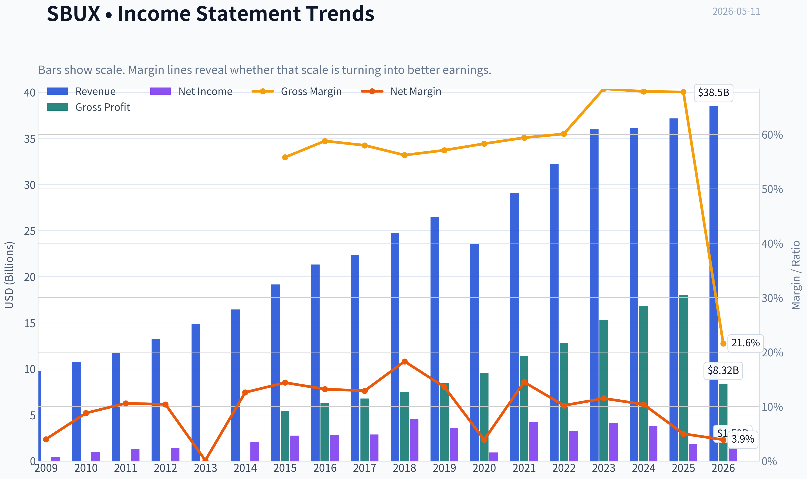

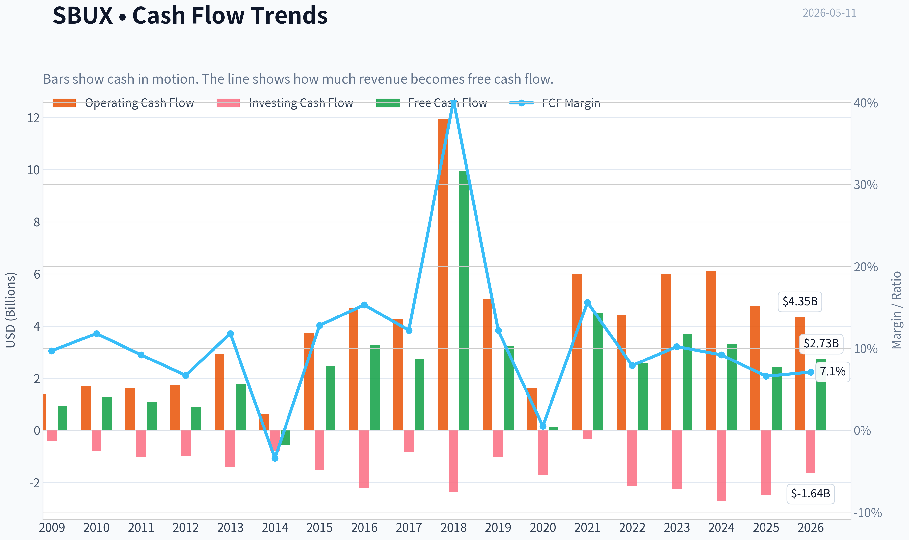

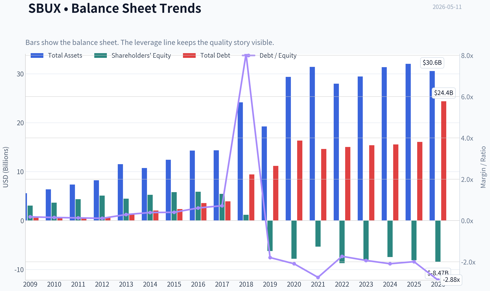

This graph tracks the profitability and return metrics (ROE, ROIC, Margins) of **SBUX** over the past decade, highlighting capital efficiency trends.

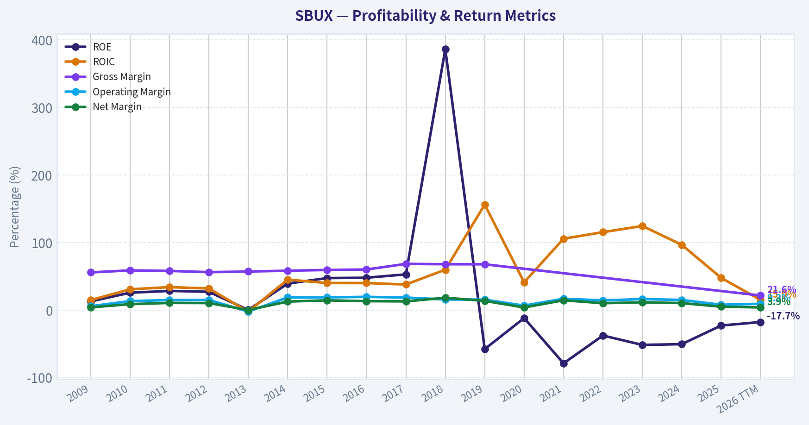

This chart illustrates the financial health of **SBUX** over the last 10 years, mapping cash equivalents and free cash flow against total obligations (Debt).

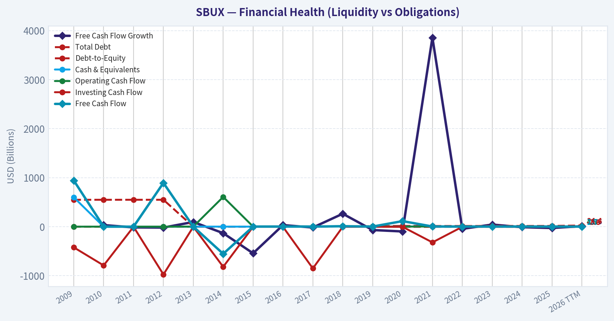

This comparison chart from *Profitability Analysis* stacks current figures against historical benchmarks for **SBUX**, making it easy to see where the company trades relative to its own averages.

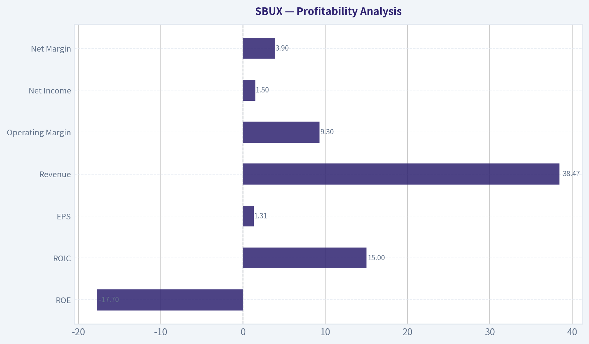

---

### Intrinsic Value Analysis (Buffett)

> *Following Warren Buffett's value investing philosophy: Circle of Competence, Economic Moat, Management Quality, and Margin of Safety.*

#### Intrinsic Value Snapshot

Price is what you pay. Intrinsic value is what the business may be worth based on the cash it can create for owners over time. We show a range, not one magic number.

- Current Price: $104.93
- Value Range: $8.13 to $177.94

##### Owner Earnings (Buffett Method)
- Net Income: $1,856,400,000.00
- Depreciation & Amortization: $1,771,500,000.00
- Capital Expenditures: $-2,305,500,000.00
- Working Capital Changes: $-1,494,400,000.00
- Owner Earnings: $2,816,800,000.00

##### Intrinsic Value
###### Buffett Method
Uses owner earnings. Stricter, and usually more conservative.
- Conservative: $14.47
- Average: $47.89
- Optimistic: $177.94
- Discount Rate: 10.0%

###### Cash Flow Method
Uses free cash flow. Better for companies spending heavily today to grow tomorrow.
- Conservative: $8.13
- Average: $33.33
- Optimistic: $85.73
- Discount Rate: 10.0%

ANALYST STANCE: **WATCH**

#### Go/No-Go Gate Assessment

| Gate | Verdict | Evidence |
|---|---|---|
| 1. Circle of Competence & Simplicity | Pass | Starbucks sells coffee, drinks, food, and packaged products through company-operated and licensed stores. The model is easy to understand, but near-term execution is less predictable due to traffic pressure, China changes, and turnaround efforts. |
| 2. Moat Test | Pass, but weaker than peak | The brand is global and powerful, store density matters, loyalty habits matter, and scale helps procurement and marketing. But premium pricing is being tested, and moat strength looks more "wide & stable to narrowing" than "widening." |
| 3. Management & Capital Allocation | Mixed | Starbucks historically allocated capital well, but current reported ROE is distorted by negative equity and buybacks. Recent strategic changes, including China restructuring/exit, suggest active portfolio management, but I cannot fully verify owner-minded incentives and buyback discipline from the available data. |
| 4. Industry Structure | Mixed Pass | Coffee retail is competitive, but Starbucks has differentiated brand power and real estate scale. Still, restaurants are not ideal Buffett businesses because competition is constant and unit economics depend on execution. |

Key Takeaways: Starbucks passes the first screen because the business is understandable and the brand is real. The weak point is not complexity, but predictability and valuation: this is a good business facing a softer operating period while still trading at a rich price.

---

#### Business Simplicity: The Elementary School Test

Starbucks makes money by selling coffee, tea, cold drinks, snacks, and branded merchandise in stores around the world. It also earns fees and product sales from licensed stores and consumer packaged goods channels. In plain words: it charges people a premium for convenient, familiar drinks and a trusted daily habit.

#### 10-Year Predictability Test

Moderate, not high. I am confident Starbucks will still exist and remain a major global coffee brand in 10 years. I am less confident that margins, unit growth, and same-store sales will be as smooth and predictable as a classic Buffett "forever" compounder because consumer habits, labor costs, competition, and digital channel execution all matter.

#### Technology Risk Assessment

Moderate but manageable. Technology is more likely to help Starbucks through mobile ordering, loyalty, payments, and personalization than destroy it outright. Still, delivery platforms, local premium coffee concepts, and shifting consumer preferences can erode traffic if Starbucks loses relevance.

---

#### Moat Analysis

| Moat Source | Assessment | Evidence |
|---|---|---|
| Intangible Assets / Brand | Strong | Starbucks is one of the few truly global coffee brands with premium recognition. Customers often choose it out of habit, trust, and convenience, not just price. |
| Switching Costs | Moderate | Consumer switching costs are low in theory, but habit, app rewards, stored value, and convenience create behavioral stickiness. |
| Cost Advantages | Moderate | Scale helps with sourcing, marketing, store operations, and occupancy leverage, but local competitors can still compete effectively. |
| Network Effects | Weak to Moderate | Not a true network effect business, though loyalty, app adoption, and store density improve utility. |

**Moat Quality Rating: Narrow-to-Wide Stable, but not widening.**

The moat is mostly brand, convenience, and habit. That is valuable, but less impregnable than software switching costs or regulated monopolies. I would not call this an "illusory" moat; I would call it real, but currently under pressure.

---

#### Management Quality Assessment

| Area | Assessment | Comments |
|---|---|---|
| Owner Orientation | Mixed | Starbucks has historically returned significant capital, but current valuation makes buyback discipline especially important. |
| Candor | Mixed | Public disclosures are generally adequate, but I do not have enough direct letter/transcript evidence here to strongly endorse exceptional candor. |
| Capital Allocation | Mixed | Past repurchases and international expansion created value, but current negative ROE and rich valuation raise questions about whether all prior capital returns were done at attractive prices. |
| Balance Sheet Conservatism | Below Buffett ideal | Current ratio from the research pack is about 0.72, and reported ROE is negative due in part to capital structure distortion. This is not a fortress balance sheet by Buffett standards. |

Key Takeaways: Management appears competent, but this is not a slam-dunk owner-operator case from the evidence available. The biggest concern is not fraud or complexity, but whether capital allocation has been as conservative and value-accretive as a Buffett-style investor would prefer.

---

#### 10-Year Financial Summary Table

Using the shared research pack and available current metrics only, because the detailed audited PostgreSQL history tool was unavailable in this session.

| Metric | Current / Recent Snapshot |
|---|---:|
| Share Price | $105 |
| Market Cap | $119.59B |
| P/E | 80.10x |
| ROE | -22.9% |
| Revenue Growth YoY | 2.8% |
| FCF Yield | 2.0% |
| Current Ratio | 0.72 |

Key Takeaways: The current snapshot looks expensive for a mature consumer brand. Growth is modest, free cash flow yield is low, and the balance sheet does not screen as especially conservative, which is not the mix a value investor wants at a premium multiple.

---

#### Cash Flow and Owner Earnings View

I do not have the full audited cash flow history in this run, so I cannot compute a precise Buffett-style owner earnings figure from source statements. But the current **2.0% FCF yield** against a **$119.59B** market cap implies approximate trailing free cash flow of:

- Estimated FCF ~ 2.0% x $119.59B = **$2.39B**

As a rough proxy, that suggests the market is paying about **50x free cash flow**, which is demanding for a mature, slower-growing consumer retail concept.

| Owner Earnings Proxy | Estimate |
|---|---:|
| Market Cap | $119.59B |
| FCF Yield | 2.0% |
| Implied FCF / Owner Earnings Proxy | ~$2.39B |

Key Takeaways: Even using a rough cash-based proxy, Starbucks appears expensive. A business can justify a premium when growth and moat are both accelerating, but here the cash yield is too thin for a conservative Buffett-style purchase.

---

#### Three-Scenario DCF Valuation

Using the rough owner earnings proxy of **$2.39B** and a **10% discount rate**, per your framework.

| Scenario | Assumption | Estimated Equity Value |
|---|---|---:|
| A. No Growth | Owner Earnings / 10% | $23.9B |
| B. GDP Growth | Owner Earnings x 1.03 / (10% - 3%) | $35.2B |
| C. Higher Growth | 6% growth assumption proxy | ~$50B-$60B range |

For Scenario C, even granting a relatively generous mid-single-digit growth outlook for a decade, the current market cap of **$119.59B** still appears difficult to justify on conservative value assumptions.

Key Takeaways: Across all three valuation cases, the current market value sits well above a conservative estimate of intrinsic worth. That does not mean Starbucks is a bad company; it means the stock price already assumes a much stronger recovery and growth profile than a cautious investor should underwrite.

---

#### Margin of Safety Analysis

| Item | Value |
|---|---:|
| Estimated Intrinsic Value Range | ~$24B to ~$60B |
| Current Market Cap | $119.59B |
| Margin of Safety | Negative |

Key Takeaways: There is no margin of safety here under conservative assumptions. For a Buffett-style investor, the issue is not whether Starbucks is admirable, but whether the purchase price leaves room for mistakes, and today it does not.

---

#### Final Buffett Scorecard

| Criterion | Weight | Score (1-5) | Weighted Score |
|---|---:|---:|---:|
| Business Understanding | 20% | 4.5 | 0.90 |
| Moat Width & Durability | 25% | 3.5 | 0.88 |
| Management Quality | 15% | 3.0 | 0.45 |
| Return on Equity | 15% | 2.0 | 0.30 |
| Reinvestment Runway | 10% | 3.0 | 0.30 |
| Balance Sheet Strength | 5% | 2.0 | 0.10 |
| Industry Structure | 5% | 2.5 | 0.13 |
| Valuation / Margin of Safety | 5% | 1.0 | 0.05 |
| **Total** | 100% |  | **3.11 / 5.00** |

Key Takeaways: Starbucks scores well on simplicity and brand strength, which are the foundations of a quality business. But weak valuation support, balance sheet concerns, and only moderate predictability pull the overall score down into watchlist territory rather than buy territory.

---

#### Investment Conclusion

**Stance: WATCH**

Starbucks is a high-quality consumer franchise, but not a classic Buffett bargain at today's price. The brand is real, the business is understandable, and the long-term survival odds are high. However, the current valuation appears far too optimistic relative to modest growth, low free cash flow yield, and a balance sheet that is not fortress-like.

For a Buffett-style investor, this is **a good business at too high a price**, not **a wonderful business at a fair price**.

#### Conviction Level

**Moderate conviction.**

The main limitation is data access: the detailed audited 10-year financial history tool was unavailable in this session, so I had to rely on the shared research pack and conservative valuation logic. If you want, I can next produce a **deeper reconstructed 10-year Buffett checklist for SBUX** using whatever additional financial history tools are available in the next step.
#### Valuation Bridge

This bridge places the current market price beside each intrinsic value lens so readers can see whether upside depends on one method or shows up across several methods.

| Scenario | Intrinsic Value / Share |
| --- | ---: |
| Buffett Method | $47.89 |
| Cash Flow Method | $33.33 |
| Damodaran Method | $80.17 |
| Current Price | $104.93 |

#### Key Takeaways

If one method is far above the others, the upside case depends on a specific modelling assumption. When several methods cluster together, the valuation story is more robust.

#### Valuation Visuals

This comparison chart from *Latest Earnings Snapshot* stacks current figures against historical benchmarks for **SBUX**, making it easy to see where the company trades relative to its own averages.

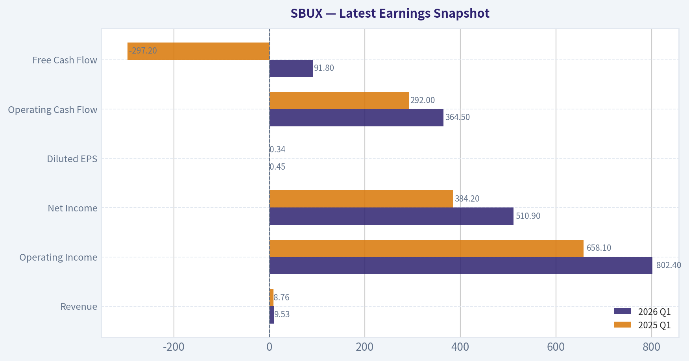

This comparison chart from *Current vs Historical Average Comparison* stacks current figures against historical benchmarks for **SBUX**, making it easy to see where the company trades relative to its own averages.

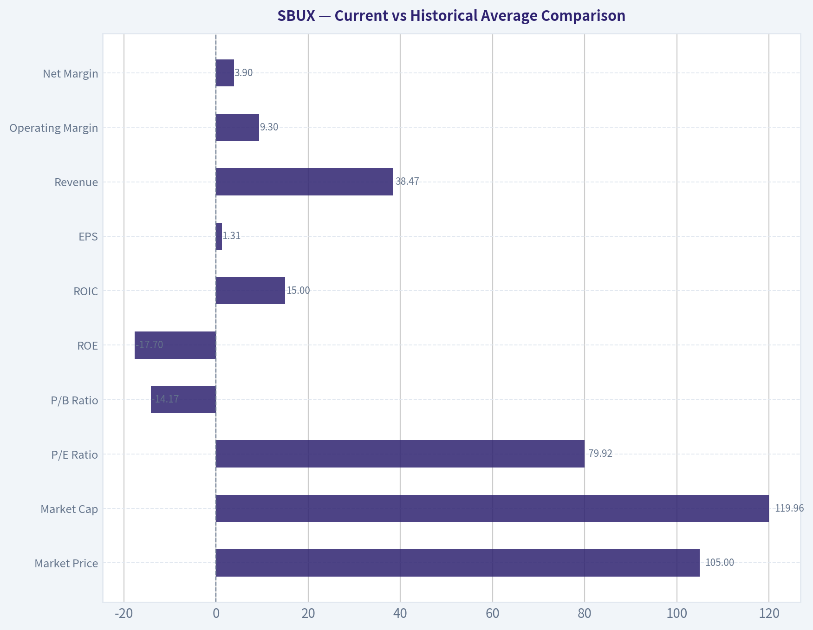

This comparison chart from *Balance Sheet Analysis* stacks current figures against historical benchmarks for **SBUX**, making it easy to see where the company trades relative to its own averages.

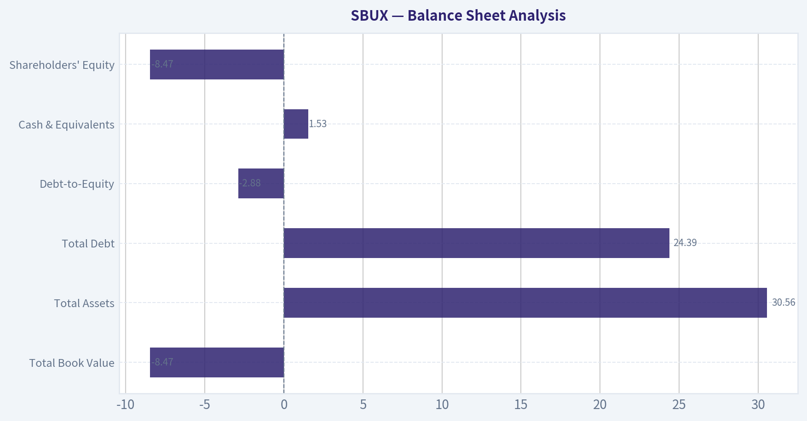

This comparison chart from *Cash Flow Analysis* stacks current figures against historical benchmarks for **SBUX**, making it easy to see where the company trades relative to its own averages.

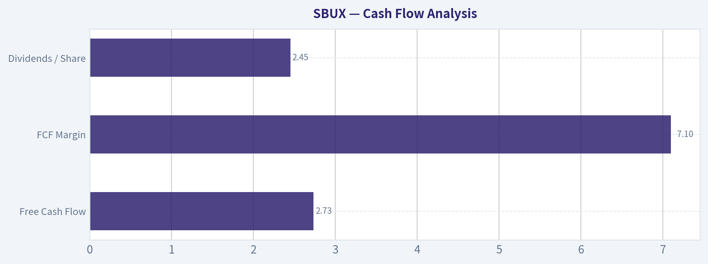

---

### Trend & Growth Analysis (Lynch/Druckenmiller/Fisher)

> *Following Peter Lynch's GARP, Stanley Druckenmiller's macro-aware approach, and Philip Fisher's scuttlebutt methodology.*

ANALYST STANCE: **WATCH**

#### 1. Lynch Classification

| Item | Assessment |
|---|---|
| Category | **Stalwart / mature consumer compounder**, not a fast grower |
| Revenue growth | **2.8% YoY** from shared pack |
| Lynch view | Too slow for classic ten-bagger growth entry |
| Implication | Better suited for **turnaround/watch** than aggressive growth advocacy |

Key Takeaways: Starbucks currently looks like a mature brand rather than a fast-growing growth stock. Revenue growth of just 2.8% is far below Lynch's preferred range for fast growers. That means the bull case depends on a successful turnaround and operational improvement, not on naturally high underlying growth.

#### 2. The Story in 3 Bullets

- Starbucks sells premium coffee and convenience through a globally recognized brand with dense store networks and a strong loyalty ecosystem.
- The near-term thesis is a **traffic and margin recovery**, helped by menu innovation, operational cleanup, and portfolio reshaping including the China transaction.
- If management can restore same-store sales momentum and improve capital efficiency, the market could support the stock despite modest headline growth.

#### 3. TAM Analysis and 10x Test

| Metric | Assessment |
|---|---|
| Current scale | Already one of the largest global coffee chains |
| TAM type | Large global coffee, beverage, foodservice, and retail convenience market |
| TAM runway | Still broad internationally, but SBUX is already highly penetrated in premium coffee |
| 10x test | **Fails for practical purposes** |
| Why | A 10x revenue outcome would imply an unrealistically dominant share of global premium coffee retail |

Key Takeaways: Starbucks still has room to expand, especially internationally, but it is already operating at very large scale. This is not the kind of small-cap or emerging platform that can plausibly grow tenfold without running into market saturation. The runway supports steady growth, but not classic venture-like upside.

#### 4. Revenue Growth Trend

| Metric | Value / Read |
|---|---|
| Latest YoY revenue growth | **2.8%** |
| Pattern | **Low growth / decelerated vs growth-stock standards** |
| Latest commentary | Q2 turnaround signs, stronger traffic, successful menu innovation |
| Interpretation | Evidence of **possible stabilization**, not yet proof of durable acceleration |

Key Takeaways: The headline growth rate is weak for a growth investor. Recent news suggests some operational momentum is improving, but one better quarter does not yet establish a true growth reacceleration. For now, Starbucks looks more like a recovery story than an inflecting high-growth story.

#### 5. Unit Economics / Business Quality

| Metric | Value | Growth Lens |
|---|---:|---|
| P/E | **80.1x** | Very rich versus current growth |
| ROE | **-22.9%** | Distorted / weak quality signal |
| FCF yield | **2.0%** | Not compelling for a mature consumer name |
| Current ratio | **0.72x** | Tight liquidity profile |
| Gross margin | N/A | Need more data |
| LTV/CAC | N/A | Not disclosed / not relevant in standard consumer retail format |
| NRR | N/A | Not applicable |
| Rule of 40 | N/A | Not applicable |

Key Takeaways: The available financial quality signals are mixed to weak. Starbucks is expensive on earnings, free cash flow yield is low, and liquidity is not especially strong. For a mature company with slow growth, these metrics do not give much valuation support.

#### 6. Inflection Point Assessment

| Inflection Area | Status | Read |
|---|---|---|
| Product cycle | Mild positive | Menu innovation helping traffic |
| Market share | Unclear | No strong proof of accelerating share gains |
| Margin inflection | Possible | Turnaround narrative suggests room for recovery |
| TAM inflection | No | Core market remains mature |
| Competitive inflection | Mixed | China restructuring may help focus, but competition remains intense |
| Overall | **Early turnaround signals, not confirmed growth inflection** |

Key Takeaways: There are some early signs of operational improvement, especially around traffic and menu execution. However, this is not yet the kind of powerful acceleration seen in great growth-stock inflections. The setup is interesting enough to monitor, but not strong enough to underwrite aggressively.

#### 7. Macro Setup Evaluation

| Factor | Assessment |
|---|---|
| Consumer discretionary exposure | Moderate risk |
| Inflation sensitivity | Input and labor costs matter |
| Interest-rate sensitivity | Some valuation support if rates ease |
| Secular trend alignment | Limited; mainly premium convenience, loyalty, and international consumption |
| Macro verdict | **Neutral** |

Key Takeaways: Starbucks is not a major beneficiary of the biggest secular growth themes like AI, cloud, or digital infrastructure. Its macro exposure is more traditional, tied to consumer spending, wages, commodities, and real estate. That makes the setup stable but not especially exciting from a Druckenmiller-style thematic standpoint.

#### 8. Fisher 15 Points Score

| Fisher Area | Score (1-5) | Notes |
|---|---:|---|
| Market potential | 3 | Large market, but mature penetration |
| New products | 3 | Ongoing menu innovation, not transformative |
| R&D / innovation | 2 | Incremental, not deep-tech |
| Sales organization | 4 | Strong store ops and brand reach |
| Profit margin | 3 | Recoverable, but not currently standout |
| Margin improvement | 3 | Turnaround potential |
| Labor relations | 2 | Persistent labor friction risk |
| Executive relations | 3 | Adequate visibility, but execution scrutiny remains |
| Management depth | 4 | Large global operator |
| Cost/accounting controls | 4 | Mature public company systems |
| Competitive moat | 4 | Brand, scale, loyalty, locations |
| Long-range outlook | 3 | Durable but not high-growth |
| Dilution risk | 4 | Lower than speculative growth names |
| Candor | 3 | Mixed/standard large-cap disclosure quality |
| Integrity | 3 | No major edge evident from current pack |

| **Total** | **48 / 75** | **Average** |

Key Takeaways: Starbucks scores as a solid but not exceptional Fisher company. Its best traits are brand strength, operating scale, and established competitive advantages. Its weaker spots are labor issues, limited innovation intensity, and a long-term outlook that appears durable but not especially dynamic.

#### 9. Valuation Analysis

| Method | Result | View |
|---|---|---|
| P/E | **80.1x** | Expensive |
| PEG | Not meaningful / unattractive | Growth too low to justify |
| FCF yield | **2.0%** | Low for mature consumer stock |
| Relative view | Rich valuation assumes recovery succeeds | Little margin of safety |

Key Takeaways: Valuation is the biggest problem in the current setup. Paying about 80 times earnings for a business growing less than 3% is hard to justify unless a much stronger recovery is imminent. The stock may work if operations improve meaningfully, but today's price already discounts a lot of that hope.

#### 10. Growth Investor Scorecard

| Criterion | Weight | Score | Weighted |
|---|---:|---:|---:|
| The Story | 10% | 3.5 | 0.35 |
| TAM & Runway | 20% | 2.5 | 0.50 |
| Revenue Growth | 20% | 1.5 | 0.30 |
| Unit Economics | 15% | 2.5 | 0.38 |
| Competitive Position | 10% | 4.0 | 0.40 |
| Management Quality | 10% | 3.0 | 0.30 |
| Macro Setup | 5% | 3.0 | 0.15 |
| Profitability Path | 5% | 3.0 | 0.15 |
| Valuation | 5% | 1.5 | 0.08 |

| **Total** |  |  | **2.61 / 5.0** |

Key Takeaways: The overall score lands in the lower end of the watch zone and close to avoid territory for a pure growth investor. Starbucks earns points for brand power and defensible market position, but weak growth and a demanding valuation hold it back. This is not the type of setup that fits a high-conviction fast-grower framework.

#### 11. Position Size Stance

| Stance | View |
|---|---|
| New position | **WATCH, not ADVOCATE** |
| Existing holder | Hold only if thesis is turnaround + quality brand durability |
| Position sizing | Small or zero until revenue and traffic acceleration are confirmed |

Key Takeaways: Starbucks is not compelling enough for a fresh concentrated growth position right now. Investors who already own it may reasonably wait for signs that the turnaround is gaining traction. New buyers should demand clearer evidence of accelerating fundamentals or a better valuation.

#### 12. Key Risks and Catalysts

| Risks | Catalysts |
|---|---|
| Valuation compression | Sustained traffic improvement |
| Consumer softness | Same-store sales reacceleration |
| Labor cost pressure | Margin recovery from operational fixes |
| China execution uncertainty | Better-than-expected impact from China transaction |
| Competitive pressure in premium beverages | Successful innovation and loyalty monetization |

Key Takeaways: The stock has a narrow path to outperformance because valuation leaves little room for disappointment. If traffic and margins recover faster than expected, shares can still work. But if growth remains sluggish, multiple compression becomes the primary risk.

#### Bottom Line

Starbucks is a **high-quality global consumer brand**, but under the Lynch-Druckenmiller-Fisher growth framework it is **not a fast grower and not a clear inflection-point winner yet**. The recent turnaround signs are worth monitoring, especially around traffic, same-store sales, and post-China portfolio simplification. But with **2.8% revenue growth and an 80x P/E**, the stock looks **too expensive for the current fundamental profile**.

If you want, I can next turn this into a **1-page investment memo** or build a **bull/base/bear scenario model for SBUX through 2028**.

#### Growth & Scorecard Visuals

This comparison chart from *Growth Metrics* stacks current figures against historical benchmarks for **SBUX**, making it easy to see where the company trades relative to its own averages.

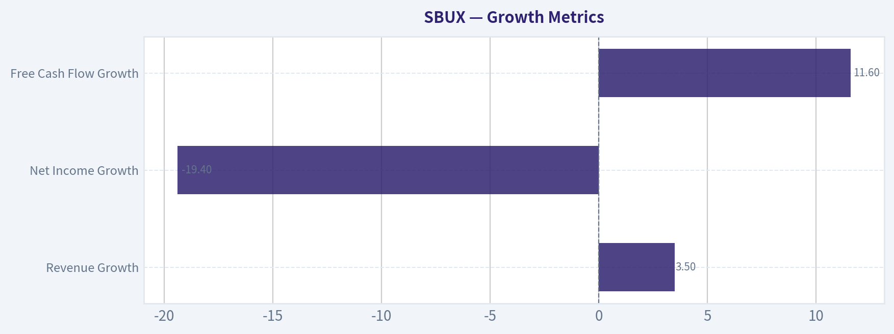

---

### Market Technical Analysis

#### SBUX Technical Report

SBUX has shifted from a late-March washout into a clear medium-term recovery, and that recovery is now maturing into a stronger upside trend rather than just a short-covering bounce. The most relevant indicators for the current context are:

- `close_10_ema`
- `close_50_sma`
- `close_200_sma`
- `macd`
- `macdh`
- `rsi`
- `atr`
- `vwma`

These 8 are a good fit because they cover short-term momentum, medium- and long-term trend structure, momentum acceleration, overbought/oversold context, volatility/risk, and volume-confirmed trend quality without excessive overlap.

#### Price Structure and Trend Context

Over the past year, SBUX moved through several distinct regimes:

1. **May-July 2025:** constructive advance from the low-80s into the low/mid-90s.
2. **Late July-October 2025:** sharp deterioration, including a major high-volume break at the end of July and a broader slide toward the upper-70s by October.
3. **November 2025-February 2026:** base-building and recovery, with price reclaiming the mid-80s and then the 90s.
4. **March 2026:** a meaningful pullback from the low-100s back into the mid/high-80s.
5. **April-May 2026:** renewed upside breakout, including the powerful 2026-04-29 gap-and-go surge from the upper-90s into the 105 area.

The latest close in the raw price data is **104.93 on 2026-05-08**, very near recent highs after the breakout. That matters because the stock is not merely above support; it is holding near the top of its recent range after a large upside expansion move. This often signals institutional sponsorship, especially when price does not immediately retrace the breakout candle.

#### Indicator Trend Analysis

| Indicator | Latest reading | Interpretation |
|---|---:|---|
| close_10_ema | 103.75 | Short-term trend is firmly up; price is holding above a rising fast average |
| close_50_sma | 97.66 | Medium-term uptrend intact; price is well above intermediate support |
| close_200_sma | 89.69 | Long-term trend is positive; strategic structure has improved materially |
| macd | 2.57 | Bullish momentum remains positive |
| macdh | 0.36 | Momentum is still expanding versus signal, though less explosively than earlier in the breakout |
| rsi | 62.68 | Bullish but not yet at an extreme overbought level |
| atr | 2.57 | Volatility remains elevated enough to support movement, but not disorderly |
| vwma | 102.82 | Price is above volume-weighted trend, supporting the breakout's credibility |

Key Takeaways: SBUX is aligned bullishly across short-, medium-, and long-term trend measures. Momentum is still positive, but the pace of upside thrust has cooled slightly from the initial breakout burst. Volume-weighted trend support and a moderate RSI suggest the stock is strong without yet showing the kind of extreme exhaustion often seen near immediate tops.

#### Fine-Grained Trend Observations

The **10 EMA** has risen from roughly **91.0 in early April** to **103.7 by May 8**, which is a steep and orderly climb. That indicates buyers have consistently supported pullbacks rather than allowing price to mean-revert deeply. This is important: strong trends usually respect the fast average, while weaker rallies repeatedly lose it.

The **50 SMA** has been steadily climbing from about **88.9 in February** to **97.7 in May**. The slope is not flat; it is clearly positive and has accelerated since March. That suggests the current advance is not just one isolated event but is now influencing the stock's broader intermediate trend.

The **200 SMA** has also turned meaningfully upward, rising from about **85.5 in January** to **89.7 in May**. This confirms that the long-term structure has improved enough that the recent rally is no longer fighting a falling secular trend. In practical terms, SBUX is now trading roughly **15 points above its 200-day average**, which is a substantial cushion.

#### Momentum Diagnostics

The **MACD** tells a particularly interesting story. It was deeply negative in late March and early April, then crossed back upward and accelerated sharply through April. By early May it reached **2.68** before easing slightly to **2.57**. That slight decline is not outright bearish by itself; it signals that the rally is still bullish, but the second derivative of momentum has cooled.

The **MACD histogram** reinforces that view. Histogram values turned decisively positive in early April and expanded strongly into late April and early May. Recent readings remain positive, but the latest print (**0.36**) is below the strongest burst near **0.81**. This suggests:
- momentum is still positive,
- the trend is still intact,
- but the breakout is transitioning from an explosive phase to a more sustainable consolidation-or-grind phase.

For traders, this is a very different message from "momentum is weakening." What it really says is that upside is still favored, but chasing extended candles may now carry less reward than buying controlled pullbacks.

#### RSI and Stretch Risk

The **RSI at 62.7** is constructive. It is above the neutral 50 line, showing bullish control, but below the classic 70 overbought threshold. During the late-April surge, RSI approached the upper-60s, which indicates strong participation, yet it never became extremely overheated.

That nuance matters. A stock breaking out with RSI around the low-60s often has room to continue if price can digest gains sideways rather than needing a sharp correction. In contrast, if RSI were already in the high-70s or 80s, short-term upside could be much more vulnerable to mean reversion.

So SBUX currently looks **strong but not maximally stretched**.

#### Volatility and Risk Management

**ATR around 2.57** means average daily movement is still fairly wide. This is consistent with a stock that has recently broken out on a notable catalyst or earnings-related repricing. ATR has eased from the high-2.7s near the breakout zone, which suggests the most chaotic part of the move may be behind it, but volatility remains elevated enough that stops placed too tightly could still be shaken out.

For practical trading:
- a very tight stop just under the prior day's low may be too fragile,
- a volatility-aware stop using ATR or support zones is more appropriate,
- position sizing should reflect that SBUX is not currently behaving like a low-volatility defensive grind.

#### Volume-Weighted Confirmation

The **VWMA at 102.82** is below the current price and rising strongly. This is constructive because it implies the average price paid on recent volume is lower than current market price, meaning recent buyers are generally in profit rather than underwater. That tends to reduce immediate supply pressure on modest pullbacks.

Also notable is the **2026-04-29** session, where SBUX jumped to **105.50** on **~25.4M shares**, a very large volume expansion versus recent norms. Instead of collapsing after that surge, the stock held above **104** in the following sessions. That is one of the strongest features in the chart: breakout strength was not immediately sold.

#### Tactical Interpretation by Trader Type

| Trader Type | What the chart suggests | Practical implication |
|---|---|---|
| Trend follower | Trend alignment is bullish across EMA/SMA stack | Favor buying pullbacks over shorting strength |
| Swing trader | Breakout remains valid, but momentum burst is cooling | Better entries may come on retracements toward 10 EMA / breakout support |
| Position trader | Price is well above rising 200 SMA | Long-term bias remains constructive unless medium-term support breaks |
| Risk-focused trader | ATR is elevated | Use smaller size or wider stops to avoid noise-based exits |

Key Takeaways: Different trading styles all see a bullish backdrop, but the best execution differs. Trend followers can stay constructive, while swing traders may want patience for a pullback rather than chasing after the breakout. Elevated ATR means discipline on stop placement and position size is especially important.

#### Key Levels to Watch

From the data, several zones stand out:

- **104-105 area:** immediate near-term holding zone; price is currently consolidating here after the breakout.
- **102.8-103.7 area:** VWMA and 10 EMA cluster; first meaningful dynamic support zone.
- **97.5-99.0 area:** 50 SMA region and pre-breakout price structure; stronger medium-term support.
- **89.7 area:** 200 SMA; long-term trend line in the sand.

If SBUX stays above the **10 EMA / VWMA band**, the market is signaling strong trend persistence. A break below that band would not automatically negate the bull trend, but it would likely shift the stock from momentum continuation into a deeper mean-reversion pullback. A decline toward the 50 SMA would still be consistent with a healthy intermediate uptrend unless accompanied by strong negative momentum and heavy distribution volume.

#### Bottom Line

SBUX currently shows a **bullish trend stack with improving long-term structure, strong but moderating momentum, and credible volume-backed breakout behavior**. The stock is not flashing a clean reversal signal. Instead, it appears to be in the later stage of a breakout follow-through, where upside remains possible but entry quality matters more than a few weeks ago.

The most actionable nuance is this:
SBUX is **strong enough to stay bullish**, but **not cheap enough to chase carelessly**. The chart favors buying orderly retracements into support rather than initiating aggressive positions after vertical extensions.

| Category | Main Signal | Current Read | Trading Insight |
|---|---|---|---|
| Short-term trend | `close_10_ema` | Rising, price above it | Momentum trend intact |
| Medium-term trend | `close_50_sma` | Rising steadily | Pullbacks likely supported above upper-90s |
| Long-term trend | `close_200_sma` | Rising | Strategic trend has turned constructive |
| Momentum direction | `macd` | Positive | Bulls still control trend |
| Momentum acceleration | `macdh` | Positive but off peak | Rally is continuing, though less explosively |
| Overbought/oversold | `rsi` | 62.7 | Bullish, not extremely stretched |
| Volatility | `atr` | 2.57 | Use volatility-adjusted stops/sizing |
| Volume confirmation | `vwma` | Rising, below price | Breakout has supportive volume structure |

Key Takeaways: SBUX has a healthy bullish setup supported by trend, momentum, and volume. The stock is no longer in the earliest breakout stage, so patience and disciplined entry selection matter more now. As long as price remains above the rising short-term support cluster around the low-103s, the bullish case remains favored.

---

### News & Events Analysis

#### Starbucks (SBUX) weekly trading/investment report
**Date:** 2026-05-11
**Price / Market cap:** **$105 / $119.6B**
**Style read-through:** Large-cap consumer discretionary/staples crossover, premium brand, dividend payer, expensive on earnings, improving sentiment but still in a transition phase.

#### Investment view in one sentence
Starbucks' near-term setup has improved on signs of a **Q2 operational rebound and strategic reshaping in China**, but the stock's **rich valuation, weak balance-sheet optics, and still-fragile consumer backdrop** mean the rally likely now requires continued same-store-sales and margin follow-through rather than just narrative improvement.

---

#### What mattered this week

Recent company-specific coverage points to three themes:

1. **Turnaround momentum is the key bull case.**
   Recent coverage highlighted **better customer traffic, menu innovation, and stronger Q2 momentum**, suggesting investors are rewarding any evidence that traffic declines are stabilizing and execution is improving.

2. **China strategy is changing in a material way.**
   News citing a **finalized sale of Starbucks' China business to a local partner** is strategically important. If accurate, markets are likely interpreting this as a move to reduce capital intensity, localize execution, and potentially de-risk a highly competitive market. But it also changes Starbucks' long-term exposure to one of its most important growth geographies.

3. **The stock is being re-rated faster than fundamentals have fully reset.**
   Coverage noted the shares are **up 9.5% in the past 30 days and 24.2% year to date**. That is a strong move for a mature consumer brand and raises the bar for future earnings prints.

#### Company news and trading implications

| Theme | Recent development | Why it matters for investors | Trading/investing implication |
|---|---|---|---|
| Turnaround narrative | Reports describe **strong Q2 momentum**, improved traffic, and successful menu innovation | Suggests operational fixes may be gaining traction after a softer period | Bullish if upcoming data confirm traffic-led recovery rather than promo-led temporary lift |
| China strategy | Coverage says Starbucks has **finalized sale of its China business to a local partner** | Could unlock capital, improve local responsiveness, and reduce execution burden; but may cap direct upside from China | Positive near-term if transaction improves returns; mixed long-term depending on economics retained |
| Brand expansion | Opened first store in **Puerto Varas, Chile**, with sustainability-focused design | Small financially, but supports global premium-brand positioning | Mostly sentiment-positive, not thesis-changing |
| Income/quality investor appeal | Featured in dividend-stock roundups | Reinforces institutional support from defensive/dividend buyers | Helpful in volatile markets, but not enough alone to justify 80x P/E |
| Market skepticism remains | Some commentary argued price action may reflect enthusiasm more than durable fundamental change | Signals debate over whether recovery is truly structural | Upside may be capped unless margins and comp trends materially improve |

**Key Takeaways:** Starbucks is benefiting from a clearer recovery story, especially around traffic and product innovation. The China restructuring is the most strategically important recent development, but after a sharp share-price run, investors will likely demand hard evidence in comps, margins, and guidance before pushing the stock much higher.

---

#### Earnings section: latest reported period and what changed

The shared research pack did not include the full earnings-release figures, and the earnings tool was unavailable in this run. However, recent coverage explicitly references **"Q2 turnaround"** for Starbucks, so the latest market focus appears to be on **fiscal Q2 2026** trends rather than an older annual report.

What we can say from available coverage:

- **Reporting period in focus:** **Fiscal Q2 2026**
- **Headline market interpretation:** Results/updates were seen as showing **improving traffic, menu innovation success, and turnaround momentum**
- **Change versus prior period / prior expectations:**
  - Versus the weaker backdrop that had pressured sentiment earlier, Q2 commentary implies **sequential improvement in customer demand and execution**
  - The market also appears to be responding to **strategic action in China**, which is a meaningful shift from prior periods when China was primarily discussed as a growth engine under direct control
  - With only **2.8% revenue growth YoY** in the shared pack and a **P/E near 80x**, the stock reaction suggests investors are paying for **improving direction**, not just current earnings power

Important caution: because the dedicated earnings tool failed, I cannot verify exact Q2 revenue, EPS, comp-sales, or guidance numbers from the release itself in this run. For portfolio decisions, those exact figures matter-especially whether traffic, ticket, and margin all improved together, and whether management raised, maintained, or merely reframed guidance.

#### How to interpret the earnings setup
For traders, Starbucks currently looks like a stock where **direction of change** matters more than absolute valuation in the very short run. If Q2 truly marked an inflection in traffic and same-store-sales trends, momentum can continue. But if the improvement came mainly from limited-time menu activity, pricing, or temporary sentiment benefits, the stock could struggle because expectations have risen quickly.

---

#### Macro and sector context

The broader backdrop this week matters for Starbucks:

- **Oil moved higher** amid fading hopes for a U.S.-Iran resolution, according to broader market coverage. Higher energy prices can pressure transportation, packaging, and consumer discretionary spending.
- Reports on the **wary consumer** remain relevant across fast food and restaurants. This matters because Starbucks sits at a premium price point, making it somewhat exposed if middle-income consumers trade down.
- At the same time, macro discussion around a **K-shaped economy**-with high-income wage growth outpacing lower earners-can be relatively supportive for Starbucks, whose core customer base skews more affluent than many quick-service peers.

#### Competitive read-through
Peer and sector headlines this week were informative:

- **Dutch Bros** reported strong Q1 results and raised outlook, signaling that beverage-led demand is still available when value, innovation, and convenience resonate.
- **McDonald's** continues pushing hard in China, underscoring that global restaurant brands still see major opportunity there, even as Starbucks appears to be changing its ownership approach.
- **Krispy Kreme** posted strong EBITDA improvement despite revenue pressure, reinforcing that restaurant investors are rewarding **margin recovery and turnaround execution**, not just top-line growth.

Net takeaway: Starbucks is not operating in a dead category. Competition is active, and winning requires strong innovation, throughput, digital engagement, and value architecture.

---

#### Valuation, balance sheet, and quality signals

| Metric | Current reading | Interpretation |
|---|---:|---|
| Share price | $105 | Near upper end of recent sentiment improvement |
| Market cap | $119.59B | Large-cap, liquid, institutionally owned |
| P/E | 80.10x | Very expensive for a mature consumer brand; requires sustained earnings acceleration |
| ROE | -22.9% | Distorted/unattractive quality signal, likely reflecting capital structure and buybacks rather than operating weakness alone |
| Revenue growth YoY | 2.8% | Positive, but modest versus valuation |
| FCF yield | 2.0% | Low; suggests limited valuation cushion |
| Current ratio | 0.72 | Tight near-term liquidity optics, though not unusual for mature consumer operators |

**Key Takeaways:** Starbucks is priced like a recovery stock with high confidence behind it, but the underlying financial snapshot is less forgiving. Revenue growth is modest and free-cash-flow yield is thin, so valuation support depends heavily on management proving that earnings and traffic are inflecting higher on a sustained basis.

---

#### Positioning and ownership signal

The shared 13F tracking shows:

- **Steve Cohen / Point72 added materially** to Starbucks, with a disclosed **$95.8M position** as of **2025-12-31**
- Shares increased **over 1,000%** versus the prior filing

This is not a real-time signal, but it does suggest at least some sophisticated capital previously saw favorable risk/reward into Starbucks' turnaround period. The caveat is that 13F data are backward-looking and can lag by up to 45 days or more.

---

#### Bull case vs. bear case

| Case | Core argument | What would confirm it |
|---|---|---|
| Bull case | Q2 marks the start of a real operating turnaround; traffic recovers, product innovation works, and China restructuring improves returns | Better same-store sales, traffic-led comps, margin expansion, stable or higher guidance |
| Bear case | The stock has outrun fundamentals; gains reflect relief and narrative, not durable profit acceleration | Weak follow-through in comps, margin pressure, disappointing China economics, consumer trade-down |
| Neutral/base case | Business stabilizes but does not re-accelerate enough to justify current multiple | Low-to-mid single-digit growth with uneven margins; stock range-bounds after rally |

**Key Takeaways:** The bullish thesis depends on proof that Starbucks is regaining customer traffic without sacrificing profitability. The bearish thesis is simpler: at around 80 times earnings, even a decent recovery may already be in the price.

---

#### Trading and investment implications

For **short-term traders**:
- Momentum remains favorable after the strong recent move.
- But this is increasingly an **"earnings follow-through"** trade, not a pure sentiment rebound.
- Best tactical support for the stock would be more evidence of **traffic improvement, digital engagement strength, and clean guidance**.

For **medium-term investors**:
- Starbucks remains a powerful global brand with real strategic levers.
- However, the current setup looks more like **quality-at-a-high-price** than a classic deep-value turnaround.
- If you are constructive, the thesis should be tied to **multi-quarter comp recovery and improved return on capital after China restructuring**, not just brand strength.

For **risk management**:
- Watch consumer-spending signals, commodity/energy inflation, and any sign that premium beverage demand is softening.
- Given valuation, disappointments in guidance can matter more than small headline beats.

---

#### Bottom line
Starbucks enters the next phase with **better sentiment, clearer operational momentum, and a potentially important China strategic reset**. That supports the stock near term. But with a **very full valuation** and only **modest reported revenue growth** in the available data, the market now needs evidence that the recovery is broad-based and durable. In practical terms, Starbucks has shifted from a "show me anything positive" story to a **"show me sustained execution"** story.

#### Summary table

| Category | Key point | Investment read-through |
|---|---|---|
| Earnings focus | Market is focused on **fiscal Q2 2026** turnaround signs | Positive if traffic, comps, and margins all improved together |
| Operations | Better traffic and menu innovation cited in recent coverage | Suggests turnaround may be operationally real, not purely financial |
| China | Reported sale to local partner is strategically significant | Near-term de-risking positive; long-term growth economics need scrutiny |
| Valuation | P/E around **80x**, FCF yield **2.0%** | Little margin for error after recent rally |
| Consumer backdrop | Spending remains cautious, especially for discretionary categories | Premium pricing power must hold for thesis to work |
| Ownership | Point72 previously added meaningfully | Mild sentiment support, but stale as a signal |
| Trading stance | Improved momentum but higher expectations | Bullish only if upcoming data validate the recovery narrative |

**Key Takeaways:** Starbucks has improved its story meaningfully over the last week, with investors focusing on a Q2 recovery and a major China strategic move. The opportunity is real, but so is the valuation risk, which means future gains likely require actual operating delivery rather than just better headlines.

---

### Guru Attention Analysis

> *Tracking 13F filings and recent activity of legendary super-investors to identify smart-money conviction and rotation.*

#### SBUX Guru Activity Summary

Based on the canonical structured 13F data, only **Steve Cohen / Point72** shows a current disclosed position in **Starbucks (SBUX)** among the tracked gurus. Per the anti-hallucination rule, all other named gurus should be treated as having **no position detected in the latest 13F filing** unless explicitly shown by the tool.

| Guru | Latest 13F Status | Action | Position Size | Portfolio Weight | Recent Change | Timing | Verification |
| --- | --- | --- | ---: | ---: | --- | --- | --- |
| Steve Cohen (Point72) | Position detected | Added | $95.81M / 1.14M shares | 0.11% | Shares increased **1054.0%** vs prior filing | 12-31-2025 filing period | [SEC 13F Filing](https://www.sec.gov/Archives/edgar/data/1603466/000090266426001100/) / [EDGAR filing list](https://www.sec.gov/cgi-bin/browse-edgar?action=getcompany&CIK=0001603466&type=13F-HR&dateb=&owner=include&count=5) |
| Warren Buffett (Berkshire Hathaway) | No position detected in latest 13F filing | - | - | - | - | Latest structured check | - |
| Seth Klarman (Baupost Group) | No position detected in latest 13F filing | - | - | - | - | Latest structured check | - |
| Mohnish Pabrai (Pabrai Investment Funds) | No position detected in latest 13F filing | - | - | - | - | Latest structured check | - |
| Bill Ackman (Pershing Square) | No position detected in latest 13F filing | - | - | - | - | Latest structured check | - |
| Stanley Druckenmiller (Duquesne Family Office) | No position detected in latest 13F filing | - | - | - | - | Latest structured check | - |
| Michael Burry (Scion Asset Management) | No position detected in latest 13F filing | - | - | - | - | Latest structured check | - |

Key Takeaways: The only tracked guru with a disclosed SBUX stake is Steve Cohen's Point72, and he increased the position sharply in the latest reported quarter. Even so, the holding remains quite small relative to Point72's overall disclosed portfolio at just 0.11%. None of the other primary tracked gurus showed a detectable position in the latest structured 13F data.

#### Interpretation

- **Steve Cohen / Point72:**
  Cohen's fund **added aggressively** to SBUX, taking the stake to **1.14 million shares** valued at about **$95.81 million** as of **December 31, 2025**.
  Despite the large percentage increase, this is still a **small portfolio weight**, which suggests a meaningful trading or tactical position rather than a top-conviction core holding.

- **All other tracked primary gurus:**
  **No position detected in latest 13F filing.**
  That means there is no structured evidence here to claim current ownership, adding, trimming, or exiting for Buffett, Klarman, Pabrai, Ackman, Druckenmiller, or Burry.

#### Bottom Line

For SBUX, the guru signal is **narrow rather than broad**. The only verified move from the tracked super-investor set is **Steve Cohen adding heavily**, but the stake is still **small in portfolio context**. So the takeaway is not "gurus broadly love Starbucks," but rather "one fast-moving hedge fund manager materially increased a modest position."

---

### Options Market Analysis

> *Reading options flow - put/call ratios, IV skew, and unusual activity - to gauge institutional positioning and event-driven risk.*

#### SBUX Options Positioning Report
*Date: 2026-05-11*

#### 1) Put/Call Ratio Analysis

| Expiration | Call OI | Put OI | Put/Call OI Ratio | Call Vol | Put Vol | Put/Call Volume Ratio |
|---|---:|---:|---:|---:|---:|---:|
| 2026-05-15 | 24,101 | 31,550 | 1.31 | 3,389 | 3,369 | 0.99 |
| 2026-05-22 | 5,108 | 2,867 | 0.56 | 1,131 | 357 | 0.32 |
| 2026-05-29 | 2,635 | 1,956 | 0.74 | 427 | 343 | 0.80 |
| **Near-term total** | **31,844** | **36,373** | **1.14** | **4,947** | **4,069** | **0.82** |

**Key Takeaways:** Near-term positioning in SBUX is slightly defensive overall, with total put open interest exceeding call open interest and producing a 1.14 put/call OI ratio, well above the rough neutral baseline of 0.7. That said, trading flow is less bearish than the open-interest snapshot suggests, because the aggregate put/call volume ratio is only 0.82. The biggest source of caution is the 2026-05-15 expiry, where put OI is notably elevated, while the following week shows much more call-friendly positioning.

**Interpretation:**
- **OI-based signal:** Mildly bearish/defensive. A 1.14 put/call OI ratio suggests investors are carrying more downside protection than neutral.
- **Volume-based signal:** More balanced. A 0.82 put/call volume ratio is only modestly put-heavy versus neutral and does not indicate aggressive fresh downside chasing.
- **Shift from neutral:** The clearest deviation is in the front weekly expiration, where the 1.31 put/call OI ratio points to concentrated short-dated hedging or a bearish lean.

#### 2) Implied Volatility (IV) Assessment

| Expiration | ATM Call IV | ATM Put IV | Call vs Put IV Read |
|---|---:|---:|---|
| 2026-05-15 | 3.1% | 2.8% | Slight call premium |
| 2026-05-22 | 1.9% | 1.8% | Nearly flat |
| 2026-05-29 | 1.6% | 1.4% | Slight call premium |

**Key Takeaways:** Near-term ATM IV is low and compressing as expirations move further out, which argues against the market pricing a major imminent catalyst. Calls are carrying a small premium to puts at-the-money across the visible expirations, which does not fit the pattern of classic panic hedging. In other words, the options market looks cautious in positioning, but not fearful in volatility pricing.

**IV and skew interpretation:**
- **Absolute IV level:** Near-term IV appears subdued rather than elevated. That implies no obvious high-volatility event is being strongly priced in right now.
- **Skew read:** Based on the available data, there is **no evidence of steep put skew**. If anything, ATM pricing shows a **slight call-side premium**, suggesting mild upside interest or at least an absence of strong downside fear.
- **Catalyst check:** Nothing in the IV structure here suggests an aggressively bid event premium ahead of a known near-term catalyst. If earnings or another company-specific event is approaching, the options market is not pricing it as a major volatility shock.

#### 3) Unusual Options Activity

| Screen Result | Observation |
|---|---|
| Volume > 5x Open Interest | None detected in near-term expirations |

**Key Takeaways:** There is no standout unusual options activity in the near-dated chain under the provided screen. That reduces confidence in any "smart-money" directional inference because there are no obvious fresh institutional-sized bets showing up through volume overwhelming existing open interest. The flow looks orderly rather than urgent.

**Interpretation:**
- No contracts met the stated threshold for unusual activity.
- That means there is **no strong evidence of fresh speculative aggression**, either bullish or bearish.
- Without unusual sweeps or concentrated fresh opening flow, the options signal relies more heavily on existing open-interest structure than on dynamic flow.

#### 4) Open Interest Concentration

| Expiration | Dominant Positioning Read |
|---|---|
| 2026-05-15 | Highest overall OI concentration in the near term; put-heavy structure likely matters most for short-term price behavior |
| 2026-05-22 | Lower total OI but relatively call-friendly positioning |
| 2026-05-29 | More balanced, close to neutral |

**Key Takeaways:** The front expiration on 2026-05-15 is the key zone to watch because it contains the bulk of near-term open interest and is more put-heavy than the later weeks. That setup can create a short-term gravitational effect, especially if the stock trades near heavily populated strikes into expiry. However, without strike-by-strike concentration data, gamma-wall and exact pinning levels cannot be identified precisely.

**Interpretation:**
- **Most important expiry:** 2026-05-15, due to both size and put-heavy structure.
- **Potential market impact:** Front-week open interest can create expiration-related pinning or dampen moves if price approaches major OI clusters.
- **Gamma walls / pinning:** We can infer that the nearest weekly expiry matters most, but we **cannot specify exact strike-based gamma walls** from the provided dataset alone.

#### 5) Overall Options Sentiment Signal

**Signal: NEUTRAL to SLIGHTLY BEARISH**

**Primary driver:** Elevated near-term **put open interest**, especially in the front weekly expiration, is the main reason the signal leans cautious. However, the lack of unusual bearish flow, the only modest put-heavy volume ratio, and the absence of stressed downside IV skew prevent this from rising to a firm bearish call.

**Why this is the right read:**
- **Bearish inputs:** Total put/call OI ratio of 1.14; front-week ratio at 1.31.
- **Offsetting inputs:** Put/call volume ratio only 0.82; no unusual put activity; IV not elevated; no visible downside panic in skew.
- **Bottom line:** The market appears **defensively positioned but not aggressively negative**. That looks more like routine hedging and caution than conviction bearish speculation.

#### Confidence / Caveat
Confidence is **moderate at best** because the options tape does not show strong unusual flow, and the available data does not include strike-level OI distribution or full OTM skew by strike. So the directional read should be used as a positioning overlay, not as a standalone trade signal.

---

| Category | Read |
|---|---|
| Put/Call Ratio | **Mildly bearish/defensive** overall; strongest caution in 2026-05-15 |
| IV Level | **Low to subdued**; no major event premium visible |
| Skew Direction | **Flat to slight call premium**; no meaningful downside-fear skew |
| Unusual Activity | **None flagged** in near-term expirations |
| Overall Signal | **NEUTRAL to SLIGHTLY BEARISH** |

**Key Takeaways:** SBUX options are leaning defensive, but not decisively bearish. The clearest message is elevated put open interest in the front week, while volatility pricing and flow data do not confirm fear or aggressive downside speculation. Net result: cautious positioning, low panic, modest downside lean.

---

## Research Team Commentary

> *The Research Manager synthesizes the Bull vs Bear debate into action-free commentary. This is a pre-risk view, not the final stance.*

The strongest bull argument is that Starbucks is still a rare global consumer franchise built on habit, brand, convenience, and a powerful loyalty ecosystem. That combination does create a real moat, even if it is not an absolute lock-in moat. The business remains simple to understand, globally relevant, and historically capable of excellent returns on capital. The most compelling pro-Starbucks point is that current earnings may be understating normalized earning power. If traffic stabilizes, margins recover, and China is repositioned intelligently, then today's ugly P/E may be more a reflection of depressed earnings than of permanently poor economics. In that scenario, Starbucks could again look like a high-quality compounder rather than a broken retailer.

The strongest bear argument is valuation discipline. At $105, with 80x earnings, declining net income, declining free cash flow, negative ROE, and intrinsic value estimates mostly below the current quote, there is no clear margin of safety. That matters a lot in Buffett-style investing. Even if the franchise is good, this is not obviously a "wonderful business at a fair price"; it may be a good business at an optimistic price. The other serious bear point is that the thesis now depends on operational repair and successful normalization. Buffett generally prefers businesses that do not need a turnaround narrative to justify the valuation.

My takeaway is fairly simple: the business quality is better than the recent numbers suggest, but the stock price is better than the fundamentals justify. The market appears to be paying in advance for a recovery that still needs to be proven. That can work, but it is not the setup a disciplined value investor should be eager to chase. The contrarian angle here is not that fear has created a bargain. If anything, the crowd may be too willing to re-rate a beloved brand before cash flow and earnings have actually reset. Markets are probably recognizing the moat correctly, but may still be too generous on timing and certainty of recovery.

Core takeaway: Starbucks remains a high-quality franchise with durable brand assets, but at the current price it does not offer the margin of safety required under a Buffett framework. The moat is real, yet not strong enough to excuse paying a premium multiple during a period of weaker predictability and active turnaround efforts.

Rationale: From a value investing perspective, business quality comes first, and Starbucks passes that test better than most consumer names. I do think the bull is right that coffee itself is not the product; the ritual, convenience, and ecosystem are the product. I also think the bull is right that ROIC tells us the enterprise economics are stronger than ROE suggests. But Buffett's discipline does not stop at quality. You also need a sensible price relative to normalized intrinsic value, and ideally some protection if the recovery takes longer or proves incomplete. Right now, that protection is missing. Revenue growth of 2.8% does not support a lot of optimism by itself, and profit and FCF declines of this size tell us that the earnings stream is less predictable than it should be for a premium multiple. I've seen too many situations where investors correctly identify a great brand but still overpay because they assume normalization is automatic. Great businesses can still be poor investments if bought at the wrong price and at the wrong point in the cycle. That pushes me away from enthusiasm here.

Monitoring plan for the next 1 to 4 quarters: First, watch same-store sales and transaction trends closely, especially whether traffic improves without relying excessively on discounting. Second, monitor operating margin progression; if revenue improves but margins fail to recover, that would suggest the earnings base is structurally lower. Third, watch free cash flow conversion and whether FCF stabilizes and begins to grow again. Fourth, pay close attention to China: not just headlines about strategy, but whether the revised approach improves capital efficiency and competitive positioning. Fifth, assess whether management's actions are strengthening the core business or merely supporting sentiment. Sixth, watch valuation relative to fundamentals; if the stock remains expensive even as recovery stalls, risk/reward worsens. On the other hand, if fundamentals clearly inflect upward and the share price becomes more reasonable, the case could improve materially.

So my stance is WATCH. Starbucks deserves respect, but not blind trust at this price. A better entry point or clearer proof of durable recovery would make the story much more compelling. WATCH.

---

## Value Investing Team Commentary

> *The Investor translates the research view into an investment thesis before risk review. This is still not the final stance.*

Starbucks is the kind of business a value investor wants to like: simple model, globally recognized brand, recurring consumer habit, dense physical network, and a loyalty ecosystem that reinforces repeat behavior. Those are real strengths. This is not a speculative concept business. It is a real franchise with proven earning power over time. If I were evaluating only the business, separate from the stock, I would say Starbucks remains a quality enterprise with a meaningful moat.

But Buffett-style investing is not about admiring businesses. It is about buying them at prices that allow satisfactory long-term returns with a margin of safety. That is where the case becomes much less attractive.

At $105, the market is asking investors to pay for recovery before recovery is fully visible in the numbers. Revenue growth of 2.8% is modest. Net income down 50.6% and free cash flow down 26.4% are not the marks of a currently humming franchise. The 80x P/E is especially problematic because it tells us the stock is being valued on the assumption that recent earnings are temporarily depressed and that normalization is coming. That may prove true, but as an owner-minded investor, I do not like paying today for improvements that management still needs to deliver tomorrow.

The key question is whether the current weakness is temporary friction in an otherwise excellent machine, or evidence that the machine has become less efficient and less predictable. Starbucks bulls argue the former: traffic can stabilize, margins can recover, China can be repositioned, and normalized earnings power is much better than current reported results suggest. That is plausible. The company's 45.7% ROIC supports the idea that the core economic engine is still stronger than the headline earnings profile implies. In other words, the business may be better than the recent income statement makes it look.

However, the selective contrarian point is this: the market seems to have already recognized that possibility. This does not look like a classic case where fear has created a bargain in a high-quality business. It looks more like investors are eager to forgive temporary weakness because they trust the brand. That is precisely where value investors must be careful. A beloved consumer franchise often gets the benefit of the doubt long before the numbers justify it.

The news flow reinforces that concern. "Turnaround momentum" is the bull case, but turnarounds are not the ideal hunting ground for Buffett-style investing unless the price is clearly discounted. "China strategy is changing in a material way" could be positive, but it also means an important profit pool is in active transition rather than stable compounding mode. "The stock is being re-rated faster than fundamentals have fully reset" is perhaps the most important signal of all. That suggests sentiment is running ahead of business proof.

What might the market be missing? On the bullish side, it may be underestimating how powerful Starbucks' habit loop still is. Coffee is cheap relative to most discretionary indulgences, and the combination of convenience, loyalty rewards, and brand familiarity can allow traffic and pricing power to recover faster than skeptics expect. If management executes well, today's earnings may indeed understate what the business can earn over the next 5-10 years.

But on the bearish side, investors may be underestimating how long operational repair can take and how much normalized margins may have changed. Premium consumer brands can retain relevance while still becoming less profitable. If traffic stabilization requires heavier promotions, if labor or input costs remain structurally elevated, or if China economics become less attractive, then "normal" may not mean a full return to prior profit quality. In that case, paying a premium multiple now would be a mistake.

Management and capital allocation matter here. Starbucks has historically shown the ability to build and scale a strong global consumer system. But at this stage, I would prefer to see evidence that management is strengthening unit economics, not simply generating enthusiasm around strategic adjustments. For a company already priced for improvement, narrative is not enough. I want to see same-store sales improve, transactions recover, margins rebuild, and free cash flow stabilize.

So the business remains within the circle of competence. The moat is real. The brand is valuable. The long-term survival of the franchise is not my concern. My concern is price, predictability, and the fact that the investment thesis currently depends on successful normalization rather than on already-demonstrated present strength. Buffett prefers businesses that do not need much fixing. Starbucks today looks more like a good business in a repair phase than a no-brainer compounding machine available at an attractive valuation.

What would change my mind? A materially lower price, or clear evidence over the next few quarters that transaction trends, margin recovery, and free cash flow conversion are returning in a durable way. If the business improves while the stock becomes more reasonable, the opportunity could become compelling. If the stock keeps rising faster than the fundamentals, the risk/reward deteriorates further.

ANALYST STANCE: **WATCH**. Starbucks is still a high-quality global franchise with a genuine moat, but the current stock price appears to reflect a recovery that has not yet been fully proven. This is not the kind of fearful mispricing a disciplined value investor should rush to exploit. Respect the business, but wait for either a better price or better proof.

---

## Deep Values Commentary

> *The Risk Management Team debates and the Risk Judge provides the final action-free verdict. This section determines the final ADVOCATE / WATCH / AVOID stance.*

**Executive Briefing**

**Starbucks remains a quality franchise, but not a low-risk value buy at $105.** The moat-brand, habit, convenience, loyalty-is real, and normalized earnings may be higher than current results imply. But today's price already assumes meaningful recovery while recent facts still show weak earnings and cash flow. For a Buffett-style investor, the key issue is not whether Starbucks survives, but whether you are being paid for execution risk. Right now, you are not. **Best stance: WATCH.** Wait for either clearer proof of traffic/margin/FCF recovery or a more favorable entry price with real margin of safety.

---

### Key Arguments From the Debate

### 1. Risky Analyst's strongest point
- The **headline 80x P/E likely overstates expensiveness** because earnings are depressed.
- Starbucks is a **rare global consumer franchise** with habit-driven demand, loyalty, convenience, and strong historical economics.
- If operations stabilize, **operating leverage could sharply improve earnings** even without strong revenue growth.
- Recovery stocks often **rerate before reported fundamentals fully recover**, so waiting for perfect proof can mean missing the upside.

### 2. Safe Analyst's strongest point
- Even if P/E is distorted, the stock still **depends on future normalization** to justify today's price.
- Recent data are too weak for a premium valuation:
  - Revenue growth: **2.8%**
  - Net income growth: **-50.6%**
  - FCF growth: **-26.4%**
  - ROE: **-22.9%**
- Multiple valuation methods sit below the market price:
  - Buffett average value: **$47.89**
  - FCF average value: **$33.33**
  - Damodaran average value: **$80.17**
- This is not classic value investing; it is **underwriting a turnaround before proof**.

### 3. Neutral Analyst's strongest point
- Both camps push too far.
- The business is likely **better than the recent numbers suggest**, but the stock is also **more expensive than a disciplined investor should prefer**.
- The right approach is **conditional, staged patience**:
  - small exposure only if needed,
  - add only with proof of improvement,
  - or become more constructive on a meaningful pullback.

---

### Risk Commentary for the Long-Term Investor

Your original plan was already close to the right answer, and the debate mostly **reinforces rather than overturns it**.

### What matters most under a Buffett framework
This is not mainly a market-risk question. Starbucks is unlikely to suffer permanent impairment in the way a weak commodity business or overleveraged fad concept might. The real question is whether the current stock price leaves room for error if:
- margin recovery is slower,
- traffic remains soft,
- promotions persist,
- China remains less profitable or more complex than hoped.

That is where the risk lies: **not in franchise survival, but in overpaying for a recovery that may arrive late or incompletely.**

### Why the bull case deserves respect
The aggressive case is right about several things:
- Starbucks is still a **simple, understandable business** with global relevance.
- The brand and loyalty ecosystem create a **real moat**, even if not a perfect lock-in moat.
- **ROIC of 45.7%** suggests the enterprise still has meaningful economic power.
- Current earnings may well be **below normalized earning power**.

These are important points. Buffett-style investors should prefer businesses with enduring customer behavior and demonstrated capital efficiency. Starbucks still qualifies better than most consumer names.

### Why the bull case still falls short today
The problem is price and proof.

The risky argument asks you to assume that current weakness is temporary and that valuation models are too anchored to depressed numbers. That may be true. But Buffett's discipline is specifically designed to avoid paying up **before** that becomes clear.

At **$105**, the stock is:
- above all cited fair value frameworks,
- supported by a recovery narrative not yet fully visible in reported numbers,
- being rerated **ahead of** fundamentals according to the News Analyst.

That means the market is already giving Starbucks credit for healing. If healing disappoints, the downside is not protected by valuation.

### Why this is WATCH, not AVOID
This is not an AVOID because the business quality remains high.
- Revenue is still growing, though modestly.
- The franchise remains durable.
- The operating issues look repairable, not obviously fatal.
- A successful normalization could restore compounder characteristics.

So the business itself still deserves a place on the watchlist. In Buffett language: **wonderful business tendencies remain; wonderful price conditions do not.**

### Why this is not ADVOCATE
It is not ADVOCATE because there is **no clear margin of safety**.
A value investor should not have to rely on:
- optimistic normalization,
- multiple expansion,
- or management successfully executing a repair story

just to make the current price reasonable.

Buffett generally prefers businesses that **do not require a turnaround narrative** to justify the investment. Starbucks today is too dependent on that narrative.

---

### Refined Investor Plan

Start with your original conclusion: **business quality better than recent numbers, stock price better than fundamentals justify.**
That remains correct.

### Refined plan
Keep **WATCH**, but make it more operational and disciplined:

#### 1. Do not chase at current valuation
At $105, the stock does not offer enough downside protection for a Buffett-style purchase.

#### 2. Upgrade only if business proof appears
Look for improvement in:
- **same-store sales**
- **transaction growth**
- **operating margin recovery**
- **free cash flow stabilization and growth**
- **China capital efficiency and competitive positioning**

#### 3. Upgrade only if valuation improves
A pullback toward a range more consistent with intrinsic value estimates-especially if fundamentals hold-would materially improve the case.

#### 4. If exposure is desired, keep it small and staged
The Neutral Analyst's idea is sensible: if an investor insists on participation, treat it as a **starter position only**, not a full-conviction value commitment.

---

### Lessons Applied / Past Mistake Prevention

The main lesson here is a classic one: **great businesses can still be poor investments when bought at the wrong price during a weak operating phase.**
Common past misjudgment in these setups:
- correctly identifying franchise quality,
- then overestimating how quickly earnings normalize,
- while underestimating valuation risk.

This debate reinforces the need to avoid confusing:
- **temporary business weakness** with permanent impairment, but also
- **brand admiration** with a margin of safety.

The right correction is not to reject Starbucks outright, but to insist on one of two protections:
1. **better evidence**, or
2. **better price**.

---

### Final Stance

**WATCH**

#### Final Stance Scorecard

This scorecard converts the final research view into a weighted decision frame. It does not replace the narrative judgement, but it makes the main drivers of the verdict easier to scan.

| Criterion | Score | Weight | Commentary |
| --- | ---: | ---: | --- |
| Business Quality | 2.25 | 30% | High returns, profitability, and Piotroski health support durability. |
| Valuation Support | 1.33 | 30% | Blends current price against available intrinsic value anchors and valuation ratios. |
| Financial Strength | 2.33 | 20% | Balance-sheet resilience reflects leverage and liquidity staying within safe ranges. |
| Growth Durability | 1.33 | 20% | Recent revenue, earnings, and free cash flow growth indicate how durable expansion looks. |
| TOTAL / FINAL STANCE | 1.81 | 100% | WATCH |

#### Key Takeaways

The weighted score lands at **1.81 / 5.0**, while the final stance remains **WATCH**. This is useful as a quick calibration aid rather than a mechanical signal.

#### Risk Summary

Higher scores indicate more risk pressure. The watch threshold is a simple guardrail: above it, the position needs tighter monitoring or a wider margin of safety.

| Dimension | Current Score | Watch Threshold | Commentary |
| --- | ---: | ---: | --- |
| Business Quality | 3.75 | 3.00 | High returns, profitability, and Piotroski health support durability. |
| Valuation Support | 4.67 | 3.00 | Blends current price against available intrinsic value anchors and valuation ratios. |
| Financial Strength | 3.67 | 3.00 | Balance-sheet resilience reflects leverage and liquidity staying within safe ranges. |
| Growth Durability | 4.67 | 3.00 | Recent revenue, earnings, and free cash flow growth indicate how durable expansion looks. |

#### Key Takeaways

This view helps readers separate *where* the risk sits: valuation, business quality, balance sheet, or growth durability. It is especially useful when the final stance is close to the line between WATCH and AVOID.
