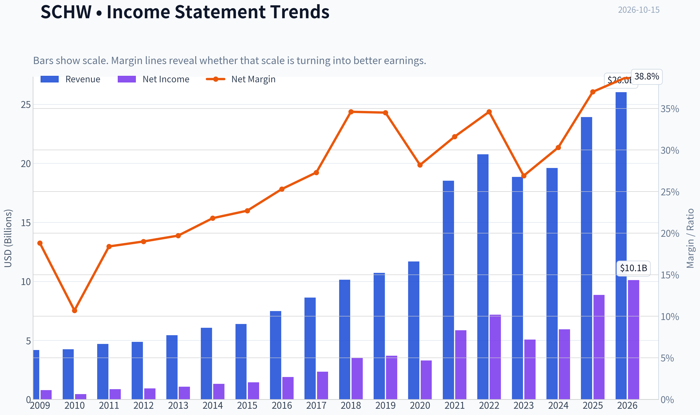
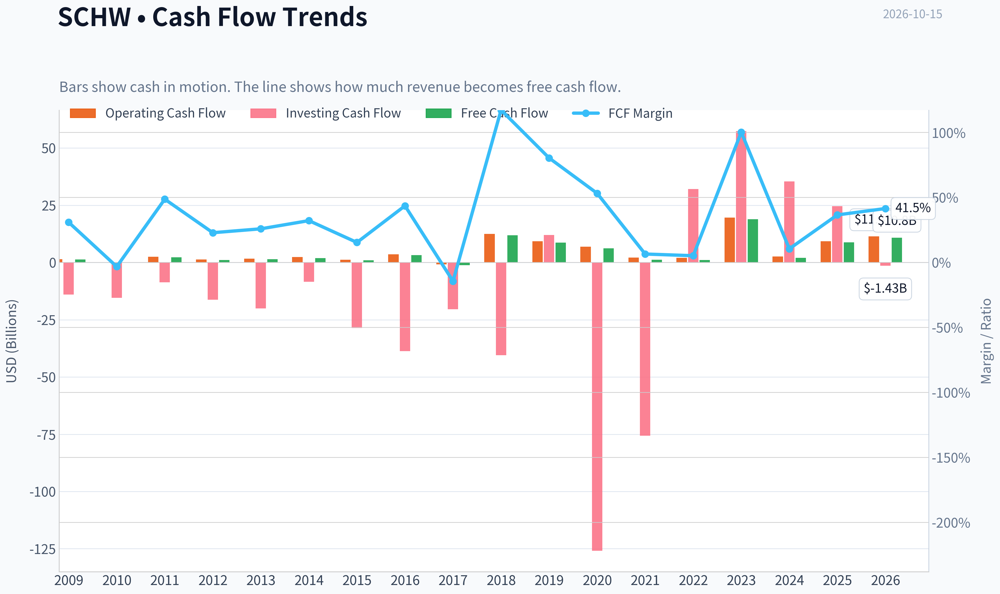
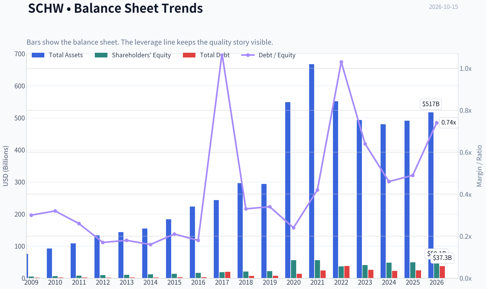
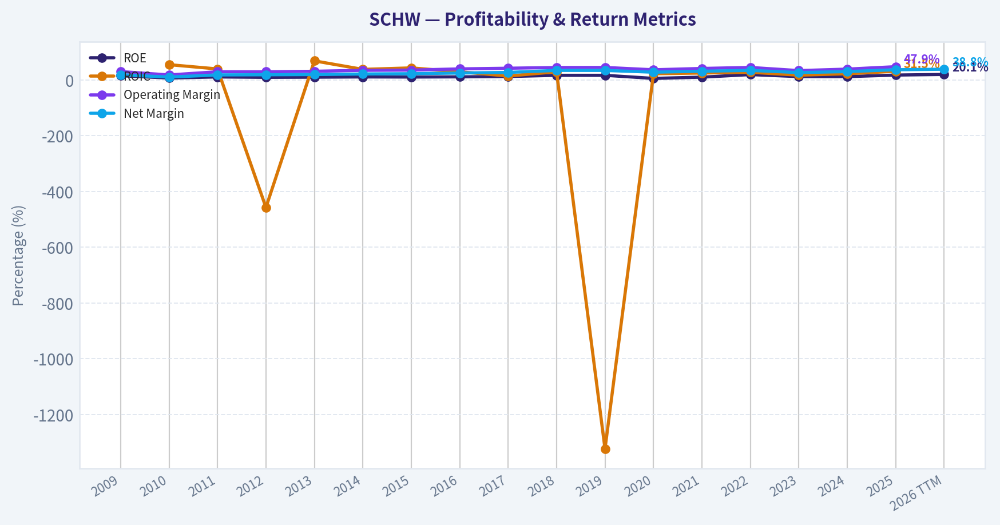
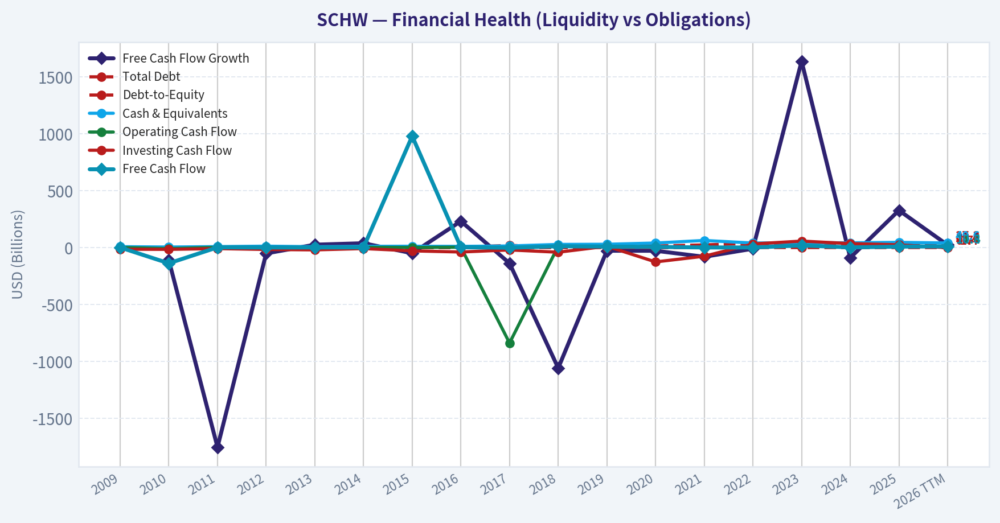
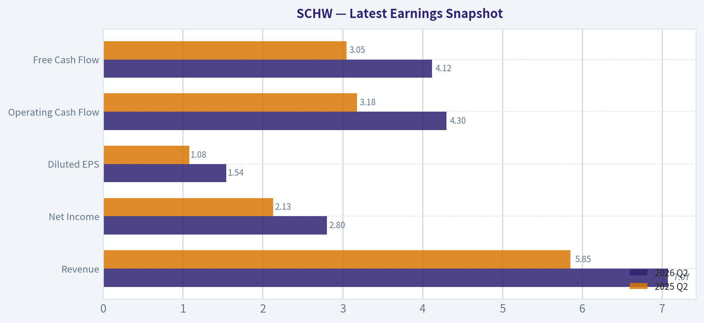
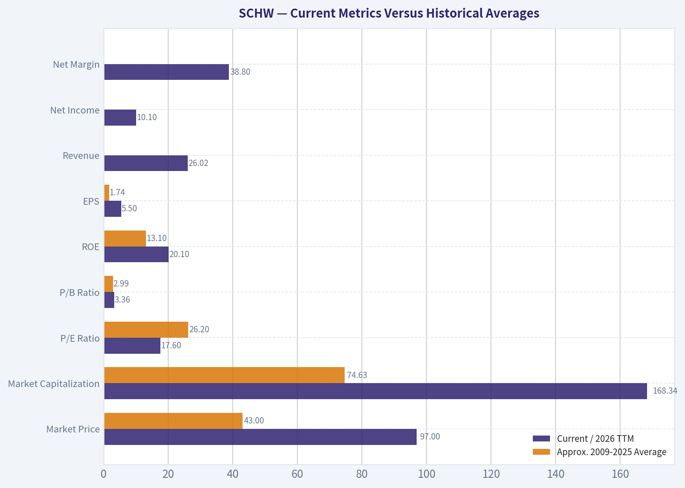
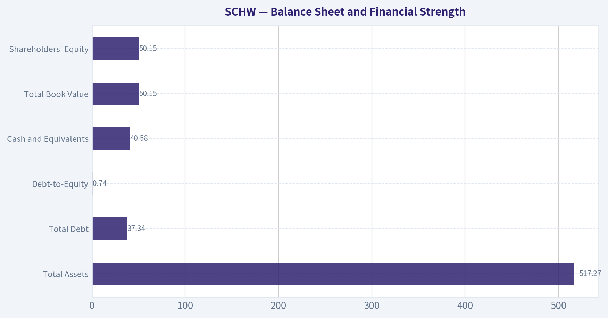
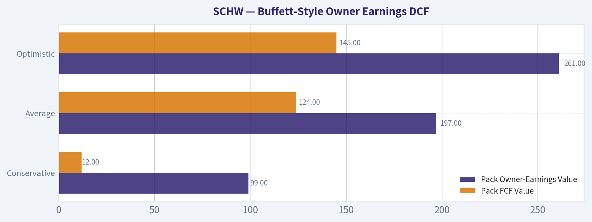
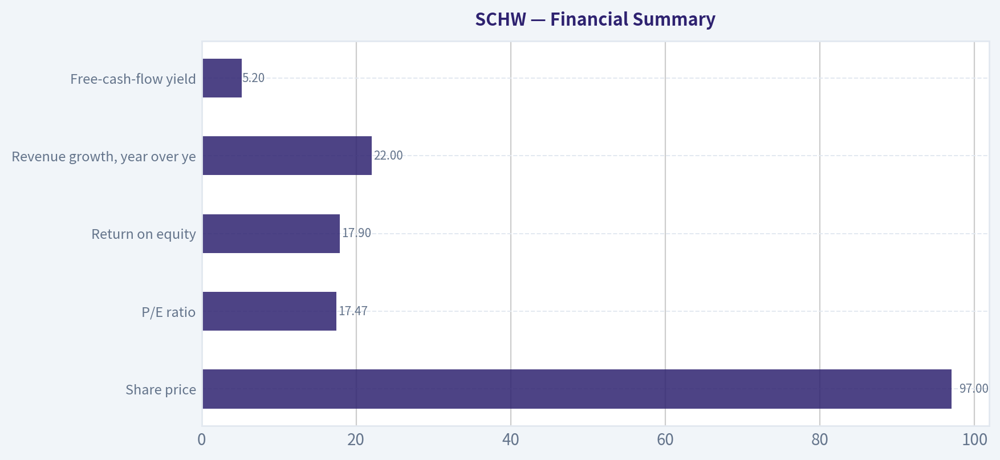

# SCHW Deep Value Intelligence

**Analysis Date:** 2026-10-15

## Critical Disclaimer

*This analysis is generated by Deep Value Intelligence, an AI-powered multi-agent investing framework. Education & research only - not financial advice, not a financial advisor.*

---

## Table of Contents

1. Intelligence Summary
2. Analyst Team Reports
   - Fundamentals Analysis
   - Intrinsic Value Analysis (Buffett)
   - Trend & Growth Analysis (Lynch/Druckenmiller/Fisher)
   - Market Technical Analysis
   - Options Market Analysis
3. Research Team Commentary
4. Value Investing Team Commentary
5. Deep Values Commentary

---

## Intelligence Summary

### Thesis + Conditions

**Core Thesis:** ## Executive Briefing

**Key Risks:**
- ### Risky Analyst: Strong on opportunity cost, aggressive on valuation
- The Risky Analyst correctly emphasizes that Schwab's client relationship is the scarce asset. Clients moving cash into Schwab money-market funds generally remain within the ecosystem, preserving opportunities to earn advisory, asset-management, custody, trading, and retirement revenue. The analyst is also right that financial stocks often rerate before balance-sheet normalization becomes obvious.
- The suggestion to use call spreads is poorly aligned with a long-duration normalization thesis. Options add expiration risk and elevated implied-volatility costs to a situation where timing is especially uncertain.

**Confidence:** Low

---

## Analyst Team Reports

### Fundamentals Analysis

#### Latest Earnings Snapshot

*Most recent reported quarter anchored on 2026 Q2, with prior-year comparison when available.*

| Metric | 2026 Q2 | 2025 Q2 | YoY Change |
| --- | ---: | ---: | ---: |
| Revenue | $7.07B | $5.85B | +20.9% |
| Operating Income | N/A | N/A | N/A |
| Net Income | $2.80B | $2.13B | +31.7% |
| Diluted EPS | $1.54 | $1.08 | +42.6% |
| Operating Cash Flow | $4.30B | $3.18B | +35.3% |
| Free Cash Flow | $4.12B | $3.05B | +35.0% |

Key Takeaways: This snapshot anchors the most recent reported quarter before the narrative analysis. It helps readers separate long-run business quality from whatever changed in the latest earnings print.

#### 17-Year Financial Metrics for SCHW

*All values below are computed deterministically from raw data - not estimated by AI.*

*Issuer profile: asset manager (Financial Services / Capital Markets).*

#### 17-Year Financial Metrics
*Annual rows come from reported financial statements. The final TTM row is computed from the latest four quarters.*

| Metric | 2009 | 2010 | 2011 | 2012 | 2013 | 2014 | 2015 | 2016 | 2017 | 2018 | 2019 | 2020 | 2021 | 2022 | 2023 | 2024 | 2025 | 2026 TTM |
| --- | --- | --- | --- | --- | --- | --- | --- | --- | --- | --- | --- | --- | --- | --- | --- | --- | --- | --- |
| Market Price | $15 | $14 | $9 | $12 | $22 | $26 | $29 | $35 | $46 | $37 | $43 | $49 | $79 | $79 | $66 | $72 | $99 | $97 |
| Market Cap | $21.83B | $20.43B | $13.84B | $18.31B | $33.62B | $39.70B | $43.70B | $52.65B | $69.50B | $56.52B | $62.78B | $76.11B | $159.54B | $157.69B | $125.97B | $135.73B | $180.74B | $168.34B |
| P/E Ratio | 27.68 | 45.03 | 16.09 | 20.81 | 33.33 | 31.78 | 31.97 | 30.13 | 31.91 | 16.95 | 17.81 | 25.02 | 29.72 | 23.79 | 27.09 | 24.75 | 21.49 | 17.60 |
| P/B Ratio | 4.30 | 3.28 | 1.79 | 1.91 | 3.24 | 3.36 | 3.26 | 3.21 | 3.75 | 2.73 | 2.89 | 1.36 | 2.84 | 4.31 | 3.08 | 2.81 | 3.66 | 3.36 |
| ROE | 15.5% | 7.3% | 11.2% | 9.7% | 10.3% | 11.2% | 10.8% | 11.5% | 12.7% | 17.0% | 17.0% | 5.9% | 10.4% | 19.6% | 12.4% | 12.3% | 17.9% | 20.1% |
| ROIC | N/A | 55.2% | 39.8% | -457.1% | 68.8% | 38.3% | 43.6% | 29.6% | 14.5% | 29.6% | -1322.9% | 22.6% | 25.2% | 28.0% | 17.5% | 22.6% | 31.5% | N/A |
| EPS | $0.55 | $0.31 | $0.58 | $0.59 | $0.67 | $0.82 | $0.90 | $1.15 | $1.43 | $2.20 | $2.43 | $1.97 | $2.65 | $3.32 | $2.45 | $2.92 | $4.65 | $5.50 |
| Revenue | $4.19B | $4.25B | $4.69B | $4.88B | $5.43B | $6.06B | $6.38B | $7.48B | $8.62B | $10.13B | $10.72B | $11.69B | $18.52B | $20.76B | $18.84B | $19.61B | $23.92B | $26.02B |
| Gross Profit | N/A | N/A | N/A | N/A | N/A | N/A | N/A | N/A | N/A | N/A | N/A | N/A | N/A | N/A | N/A | N/A | N/A | N/A |
| Gross Margin | N/A | N/A | N/A | N/A | N/A | N/A | N/A | N/A | N/A | N/A | N/A | N/A | N/A | N/A | N/A | N/A | N/A | N/A |
| Operating Margin | 30.4% | 18.3% | 29.7% | 29.7% | 31.4% | 34.9% | 35.7% | 40.0% | 42.4% | 45.0% | 45.2% | 36.8% | 41.6% | 45.2% | 33.9% | 39.2% | 47.9% | N/A |
| Net Income | $787.0M | $454.0M | $864.0M | $928.0M | $1.07B | $1.32B | $1.45B | $1.89B | $2.35B | $3.51B | $3.70B | $3.30B | $5.86B | $7.18B | $5.07B | $5.94B | $8.85B | $10.10B |
| Net Margin | 18.8% | 10.7% | 18.4% | 19.0% | 19.7% | 21.8% | 22.7% | 25.3% | 27.3% | 34.6% | 34.5% | 28.2% | 31.6% | 34.6% | 26.9% | 30.3% | 37.0% | 38.8% |
| Revenue Growth | N/A | 1.3% | 10.4% | 4.1% | 11.3% | 11.5% | 5.3% | 17.2% | 15.2% | 17.6% | 5.8% | 9.0% | 58.4% | 12.1% | -9.3% | 4.1% | 22.0% | 8.8% |
| Net Income Growth | N/A | -42.3% | 90.3% | 7.4% | 15.4% | 23.3% | 9.5% | 30.5% | 24.6% | 49.0% | 5.6% | -10.9% | 77.5% | 22.7% | -29.5% | 17.3% | 49.0% | 14.1% |
| Free Cash Flow Growth | N/A | -110.6% | -1755.1% | -51.1% | 25.8% | 38.5% | -49.7% | 232.3% | -138.0% | -1059.3% | -27.5% | -27.8% | -80.7% | -9.7% | 1639.1% | -89.1% | 327.5% | 23.1% |
| Total Book Value | $5.07B | $6.23B | $7.71B | $9.59B | $10.38B | $11.80B | $13.40B | $16.42B | $18.52B | $20.67B | $21.75B | $56.06B | $56.26B | $36.61B | $40.96B | $48.38B | $49.42B | $50.15B |
| Total Assets | $75.43B | $92.57B | $108.55B | $133.64B | $143.64B | $154.64B | $183.71B | $223.38B | $243.27B | $296.48B | $294.00B | $549.01B | $667.27B | $551.77B | $493.18B | $479.84B | $491.00B | $517.27B |
| Total Debt | $1.51B | $2.01B | $2.00B | $1.63B | $1.90B | $1.90B | $2.88B | $2.88B | $19.75B | $6.88B | $7.43B | $13.63B | $23.77B | $37.88B | $26.13B | $22.43B | $24.10B | $37.34B |
| Debt-to-Equity | 0.30 | 0.32 | 0.26 | 0.17 | 0.18 | 0.16 | 0.21 | 0.18 | 1.07 | 0.33 | 0.34 | 0.24 | 0.42 | 1.03 | 0.64 | 0.46 | 0.49 | 0.74 |
| Cash & Equivalents | $8.24B | $4.93B | $8.68B | $12.66B | $7.73B | $11.36B | $11.98B | $10.83B | $14.22B | $27.94B | $29.34B | $40.35B | $62.98B | $40.20B | $43.34B | $42.08B | $46.03B | $40.58B |
| Shareholders' Equity | $5.07B | $6.23B | $7.71B | $9.59B | $10.38B | $11.80B | $13.40B | $16.42B | $18.52B | $20.67B | $21.75B | $56.06B | $56.26B | $36.61B | $40.96B | $48.38B | $49.42B | $50.15B |
| Operating Cash Flow | $1.44B | $-9.0M | $2.46B | $1.27B | $1.66B | $2.35B | $1.25B | $3.60B | $-839.0M | $12.46B | $9.32B | $6.85B | $2.12B | $2.06B | $19.59B | $2.67B | $9.31B | $11.42B |
| Investing Cash Flow | $-14.06B | $-15.41B | $-8.67B | $-16.26B | $-20.05B | $-8.39B | $-28.62B | $-38.77B | $-20.47B | $-40.55B | $11.96B | $-125.85B | $-75.66B | $32.05B | $57.41B | $35.43B | $24.54B | $-1.43B |
| Free Cash Flow | $1.30B | $-138.0M | $2.28B | $1.12B | $1.41B | $1.95B | $980.0M | $3.26B | $-1.24B | $11.89B | $8.62B | $6.22B | $1.20B | $1.09B | $18.89B | $2.05B | $8.76B | $10.79B |
| FCF Margin | 30.9% | -3.2% | 48.7% | 22.9% | 25.9% | 32.2% | 15.4% | 43.6% | -14.4% | 117.3% | 80.4% | 53.2% | 6.5% | 5.2% | 100.3% | 10.5% | 36.6% | 41.5% |
| Dividends / Share | $0.00 | $0.00 | $0.00 | $0.00 | $0.00 | $0.00 | $0.00 | $0.00 | $0.00 | $0.00 | $0.00 | $0.00 | $0.00 | $0.00 | $0.00 | $0.00 | $0.00 | $0.00 |

#### Profitability Metrics
- Return on Equity (ROE): 17.9%
- Return on Invested Capital (ROIC): 32.2%
- Return on Assets (ROA): 1.8%
- Gross Margin: Not meaningful
- Operating Margin: 47.9%
- Net Profit Margin: 37.0%

#### Liquidity Metrics
- Current Ratio: Not meaningful
- Quick Ratio: Not meaningful

#### Leverage Metrics
- Debt-to-Equity Ratio: 0.49
- Interest Coverage Ratio: N/A
- Net Debt: $-21.93B

#### Growth Metrics (Year-over-Year)
- Revenue Growth: 22.0%
- Net Income Growth: 49.0%
- Free Cash Flow Growth: 327.5%
- Revenue CAGR (3-Year): 4.8%
- Revenue CAGR (5-Year): 15.4%

#### Valuation Metrics
- P/E Ratio (TTM): 17.47
- Forward P/E: 12.15
- Price-to-Book: 3.81
- Price-to-Sales: 6.43
- PEG Ratio: 0.81
- EV/EBITDA: Not meaningful
- Free Cash Flow Yield: 5.2%
- Earnings Yield: 5.7%

#### Owner Earnings (Buffett Method, Code-Computed)
- Net Income: $8.85B
- + Depreciation & Amortization: $1.36B
- - Capital Expenditures: $-548.0M
- - Working Capital Changes: $-3.00B
- = **Owner Earnings: $12.67B**

#### Intrinsic Value (Code-Computed)
- Current Price: $97
- Headline Intrinsic Value: not meaningful (financial issuer - DCF/FCFF is not the right primary frame; use sector-specific book/earnings metrics)
- Buffett Method (Owner Earnings):
  Conservative: $99
  Average: $197
  Optimistic: $261
- Cash Flow Method (FCF):
  Conservative: $12
  Average: $124
  Optimistic: $145
- Reverse-DCF: price implies ~0.4%/yr owner-earnings growth for 10y; trailing 3y was -7.6%, 5y 36.6%.

#### Piotroski F-Score: 6/9
- Positive Net Income: PASS
- Positive Operating Cash Flow: PASS
- ROA Improvement: PASS
- Cash Flow > Net Income: PASS
- Decreasing Debt: FAIL
- Improving Current Ratio: FAIL
- No Dilution: PASS
- Improving Gross Margin: FAIL
- Improving Asset Turnover: PASS

ANALYST STANCE: **ADVOCATE**

#### Executive View

Charles Schwab is a high-quality, scaled financial-services platform whose current valuation is more attractive than its long-term average. At approximately $97 per share, SCHW trades at about 17.6 times trailing earnings versus an estimated 17-year average near 26 times. Profitability has also strengthened: current ROE is approximately 20.1%, compared with a long-term average near 13.1%.

The principal caveat is that Schwab is a financial issuer, so conventional free-cash-flow and owner-earnings calculations are less reliable than they would be for an industrial or software company. Client cash balances, securities lending, deposits, and balance-sheet movements create unusually volatile operating and investing cash flow. Valuation should therefore emphasize earnings power, ROE, capital adequacy, balance-sheet resilience, and normalized cash generation rather than mechanically relying on P/B or FCF.

#### Current Metrics Versus Historical Averages

The averages below are approximate arithmetic averages of the 2009-2025 annual observations in the deterministic dataset. Highly volatile metrics, especially ROIC, FCF growth, and cash flow, should not be interpreted as stable economic averages.

| Metric | Current / 2026 TTM | Approx. 2009-2025 Average | Interpretation |
|---|---:|---:|---|
| Market Price | $97 | $43 | Price has compounded substantially, but current earnings have also expanded |
| Market Capitalization | $168.34B | $74.63B | Scale has more than doubled; 2026 TTM is below the 2025 peak |
| P/E Ratio | 17.60x | 26.20x | Discount to history; favorable if earnings remain durable |
| P/B Ratio | 3.36x | 2.99x | Slightly above average, but must be judged with ROE for a financial issuer |
| ROE | 20.1% | 13.1% | Materially above average; strongest valuation support |
| EPS | $5.50 | $1.74 | Long-term earnings power has increased substantially |
| Revenue | $26.02B | Approximately $11.6B | Revenue scale and monetization have expanded materially |
| Operating Margin | N/A TTM; 47.9% in 2025 | Approximately 36.7% | 2025 was well above historical norms; TTM data is unavailable |
| Net Income | $10.10B | Approximately $3.3B | Current earnings are roughly three times the historical average |
| Net Margin | 38.8% | Approximately 26.7% | Significant improvement in profitability |
| Revenue Growth | 8.8% TTM | Approximately 12.0% simple average | Current growth is below the average because the average includes acquisition-related surges |
| Net Income Growth | 14.1% TTM | Approximately 20.7% simple average | Current growth remains healthy but less exceptional than rebound years |
| Free Cash Flow | $10.79B | Approximately $4.1B | Current FCF is high, but the historical series is distorted by financial-balance-sheet flows |
| Debt-to-Equity | 0.74x | Approximately 0.44x | Leverage is above normal historical levels and merits monitoring |
| Cash and Equivalents | $40.58B | Approximately $25.3B | Large liquidity reserve, although cash is partly operational within the financial model |
| Shareholders' Equity | $50.15B | Approximately $25.8B | Strong increase in capital base, despite periodic balance-sheet volatility |
| Dividends per Share | $0.00 in dataset | $0.00 | Dataset does not report dividends; this conflicts with normal SCHW market reporting and should be independently verified |

**Key Takeaways:** SCHW's current valuation is considerably below its historical earnings multiple despite substantially higher earnings, margins, and ROE. The main negative deviation is leverage, which is above its long-term norm. The deterministic dataset reports zero dividends per share throughout, so dividend conclusions should not be drawn from this field without external verification.

#### Market Metrics and Valuation

At $97 per share and approximately $168.34 billion of market capitalization, SCHW is valued at 17.6 times trailing earnings and 3.36 times book value. The P/E ratio is the clearest valuation signal: it is well below the estimated 26.2 times historical average.

The P/B ratio requires more careful interpretation. Schwab is a financial-services issuer, and book value is economically relevant, but P/B should not be treated as a universal "low is cheap, high is expensive" metric. A 3.36 times book multiple can be justified when ROE is approximately 20%, particularly if that ROE is sustainable and balance-sheet risk remains controlled. The current P/B is above the historical average, but the company's current ROE is also far above its historical average.

The 5.7% earnings yield and 5.2% FCF yield provide reasonable support at the current price. The reported forward P/E of 12.15 times suggests analysts expect continued earnings normalization or growth, but forward estimates carry risk because Schwab's net interest revenue is sensitive to interest rates, deposit behavior, and client cash allocation.

#### Profitability and Growth

| Profitability or Growth Metric | Current Value | Historical Pattern | Assessment |
|---|---:|---|---|
| ROE | 20.1% TTM; 17.9% headline | Generally 10%-17%; peaks of 19.6% in 2022 and 17.9% in 2025 | Current ROE is near a cycle high and is a major quality signal |
| ROIC | 32.2% headline; TTM unavailable in table | Extremely distorted, including negative and unusually high values | Not reliable as a standalone metric for Schwab |
| EPS | $5.50 | Increased from $0.55 in 2009 to $4.65 in 2025 | Strong long-term compounding with cyclical interruptions |
| Revenue | $26.02B | Expanded from $4.19B in 2009 | Structural scale growth, helped by business expansion and acquisitions |
| Operating Margin | 47.9% in 2025; TTM unavailable | Improved from 30.4% in 2009, with a 45.2% level in 2022 | Evidence of operating leverage and platform economics |
| Net Income | $10.10B TTM | $787M in 2009; $8.85B in 2025 | Record-level earnings in the supplied data |
| Net Margin | 38.8% TTM | Approximately 26.7% average | Current profitability is materially above normal |
| Revenue Growth | 8.8% TTM; 22.0% headline YoY | Volatile; 58.4% in 2021 and -9.3% in 2023 | Growth is positive, but the headline 22% figure may reflect a different comparison basis |
| Net Income Growth | 14.1% TTM; 49.0% headline YoY | Highly cyclical, with several rebound years | Good momentum, but not a steady secular growth rate |
| FCF Growth | 23.1% TTM; 327.5% headline YoY | Extremely volatile | Weak metric for trend analysis because financial working-capital flows dominate |

**Key Takeaways:** The most persuasive evidence is the combination of high ROE, rising EPS, expanding margins, and current earnings near record levels. Revenue and net income growth are favorable, but their historical volatility means investors should underwrite normalized earnings rather than extrapolate the latest growth rate. ROIC and FCF growth are not dependable primary indicators for a brokerage and custody platform.

Revenue growth has been positive in most years, but not consistently smooth. The 2021 surge reflects unusually favorable market conditions and the TD Ameritrade integration, while the 2023 decline demonstrates sensitivity to market activity, interest rates, and client cash behavior. Net income has shown a similar pattern: strong long-term expansion, interrupted by cyclical declines in 2010, 2020, and 2023.

#### Balance Sheet and Financial Strength

| Balance-Sheet Metric | Current / 2026 TTM | Historical Comparison | Interpretation |
|---|---:|---|---|
| Total Assets | $517.27B | $75.43B in 2009; peak $667.27B in 2021 | Large and operationally complex balance sheet |
| Total Debt | $37.34B | $1.51B in 2009; $24.10B in 2025 | Debt has risen substantially over the decade |
| Debt-to-Equity | 0.74x | Approx. 0.44x average | Above historical norm; key risk monitor |
| Cash and Equivalents | $40.58B | Approx. $25.3B average | Significant liquidity buffer |
| Net Debt | Negative $21.93B | Generally net cash historically | Cash exceeds reported debt |
| Total Book Value | $50.15B | $5.07B in 2009; $49.42B in 2025 | Capital base has expanded dramatically |
| Shareholders' Equity | $50.15B | Approx. $25.8B average | Strong capital growth, though accounting changes and acquisitions affect comparability |

**Key Takeaways:** Schwab has substantial cash and remains in a net-cash position on the supplied figures, which supports financial resilience. However, debt-to-equity has risen to 0.74 times from a long-term average near 0.44 times. The balance sheet is not distressed, but leverage and funding composition deserve more attention than they would have several years ago.

The reported asset base is not directly comparable to that of a normal operating company because client-related balances and investment securities can expand or contract with market and deposit conditions. The negative net debt position is reassuring, but liquidity should be assessed together with deposit stability, regulatory capital, securities financing, and the duration of assets and liabilities.

#### Cash Flow and Dividend Policy

The deterministic dataset reports $10.79 billion of 2026 TTM free cash flow and $12.67 billion of code-computed owner earnings based on 2025 net income, depreciation and amortization, capital expenditures, and working-capital changes.

These figures should be treated cautiously. For a brokerage and custody business, working-capital movements and investing cash flow include economically important movements in client cash, securities, deposits, and investment balances. A very high FCF margin, such as 41.5% in the supplied TTM data, does not necessarily represent the same kind of recurring distributable cash flow as it would for a software or consumer-products company.

The dataset reports dividends per share of zero for every year. That field is inconsistent with the commonly understood profile of Charles Schwab and should be independently checked before making an income-investment decision. Within the canonical dataset, however, no dividend yield can be credited.

#### Revenue Breakdown

Precise current segment revenue amounts are not included in the deterministic dataset. Accordingly, the table below identifies the economically important revenue sources without inventing amounts or percentages.

| Revenue Source | Amount ($M or $B) | % of Total |
|---|---:|---:|
| Net interest revenue from client cash, deposits, margin lending, and securities portfolios | Not provided in deterministic dataset | Not available |
| Asset management and administration fees | Not provided in deterministic dataset | Not available |
| Trading revenue and client transaction-related income | Not provided in deterministic dataset | Not available |
| Bank deposit account, advisory, and other service fees | Not provided in deterministic dataset | Not available |
| Total revenue | $26.02B, 2026 TTM | 100.0% |

**Key Takeaways:** Schwab's revenue model is diversified across net interest revenue, asset-management and administration fees, trading activity, and other client-service income. The deterministic dataset supplies consolidated revenue but not segment amounts, so precise percentages cannot be calculated without violating the source-of-truth rule. The key analytical issue is the balance between rate-sensitive net interest revenue and more recurring fee-based revenue.

#### Buffett-Style Owner Earnings DCF

A conventional DCF is imperfect for SCHW because financial institutions reinvest and fund their businesses through balance-sheet assets and liabilities rather than conventional industrial capital expenditure. The supplied owner-earnings model therefore provides a useful valuation cross-check, but earnings and ROE-based valuation should remain the primary framework.

The code-computed owner-earnings base is:

- Net income: $8.85 billion
- Depreciation and amortization: $1.36 billion
- Capital expenditures: $0.548 billion
- Working-capital adjustment: $3.00 billion
- Owner earnings: **$12.67 billion**
- Approximate diluted share base used for illustration: **1.73 billion shares**
- Owner earnings per share: approximately **$7.32**

The supplied model-based valuation outputs are:

| Scenario | Pack Owner-Earnings Value | Pack FCF Value | Implied Upside From $97 |
|---|---:|---:|---:|
| Conservative | $99 | $12 | 2% owner-earnings upside; FCF result not economically reliable |
| Average | $197 | $124 | 103% owner-earnings upside; 28% FCF upside |
| Optimistic | $261 | $145 | 169% owner-earnings upside; 49% FCF upside |

**Key Takeaways:** The owner-earnings model indicates that the market price assumes very little long-term growth, while the FCF model gives a more moderate valuation because financial-sector cash flow is difficult to normalize. The $197 average owner-earnings result should not be accepted mechanically, but it provides meaningful evidence that SCHW is not demanding an aggressive valuation if current profitability is durable.

##### Hand DCF Sanity Check

Using the $12.67 billion owner-earnings base, a 10-year explicit forecast, a 10% discount rate, and a 2.5% terminal growth rate:

**Conservative scenario**

- Initial owner-earnings growth: 0%
- Terminal growth: 2.5%
- Approximate present value of explicit cash flows: $77.8 billion
- Approximate present value of terminal value: $66.8 billion
- Total equity value: approximately $144.6 billion
- Per-share value: approximately **$84**

This is below the supplied $99 conservative model value because the hand calculation uses a flat owner-earnings base and gives no near-term growth benefit.

**Average scenario**

- Initial growth: 8%
- Growth fades toward 2.5% terminal growth
- Approximate present value of explicit cash flows: $106 billion
- Approximate present value of terminal value: $144 billion
- Total equity value: approximately $250 billion
- Per-share value: approximately **$145**

This is deliberately more conservative than the pack's $197 average owner-earnings value because it uses a lower normalized growth assumption than the strongest historical periods.

**Optimistic scenario**

- Initial growth: 12%
- Growth fades toward 2.5% terminal growth
- Approximate present value of explicit cash flows: $122 billion
- Approximate present value of terminal value: $190 billion
- Total equity value: approximately $312 billion
- Per-share value: approximately **$180**

The optimistic hand case is below the supplied $261 model value because the hand model imposes a 10% discount rate and explicit growth fade rather than sustaining a high growth rate.

| DCF Case | Initial Growth Assumption | Terminal Growth | Hand DCF Value | Practical Fair-Value Range |
|---|---:|---:|---:|---:|
| Conservative | 0% | 2.5% | Approximately $84 | $85-$105 |
| Average | 8%, fading to terminal | 2.5% | Approximately $145 | $125-$200 |
| Optimistic | 12%, fading to terminal | 2.5% | Approximately $180 | $180-$260 |

**Key Takeaways:** The reasonable valuation range is wide because owner earnings are difficult to normalize for a financial institution. At $97, SCHW is close to the conservative hand-DCF value but below the average and optimistic ranges. A prudent investor should require evidence that current ROE and earnings are durable before assigning the upper end of the range.

The reverse-DCF result is particularly important: the supplied model says the current price implies only approximately 0.4% annual owner-earnings growth for 10 years. That is a low embedded expectation for a company with a large platform, positive revenue momentum, improving profitability, and a long history of expanding EPS. However, this conclusion is only as reliable as the owner-earnings normalization.

#### Economic Moat and Business Quality

Schwab's moat is based on scale, trust, switching costs, brand reputation, technology, client account breadth, and operating leverage. Brokerage clients may be price-sensitive, but moving taxable accounts, retirement accounts, advisory relationships, and banking connections is inconvenient and potentially tax-sensitive. The platform becomes more valuable as client assets, advisor relationships, and product breadth increase.

The company also benefits from a powerful distribution model. A large client base generates recurring opportunities for net interest revenue, asset-management fees, securities lending, margin lending, trading, and advisory services. The same client relationship can produce several revenue streams over time.

The principal limitation is that the moat does not eliminate cyclicality. Revenue depends on interest rates, client cash allocation, market levels, trading activity, asset flows, and regulatory conditions. Schwab is durable, but not economically identical to a subscription software company with highly predictable recurring revenue.

#### Management and Capital Allocation

Management performance is supported by:

- Long-term EPS and revenue expansion.
- Current ROE above the historical norm.
- Strong operating and net-margin improvement.
- Successful integration and scaling of the platform.
- A substantial increase in book equity and cash resources.

The caution is that debt has increased, and the dataset shows a 0.74 debt-to-equity ratio versus a historical average near 0.44. The 2020-2022 balance-sheet changes also make simple period-to-period comparisons difficult. Management should be judged not only by reported earnings but also by deposit retention, liquidity management, regulatory capital, share count, and the stability of fee-based revenue.

#### Key Investment Insights, Risks, and Opportunities

| Category | Specific Insight | Investor Implication |
|---|---|---|
| Opportunity | P/E is well below the long-term average | Potential for multiple normalization if earnings remain strong |
| Opportunity | ROE is approximately 20.1% | Supports a premium to book value |
| Opportunity | Current price implies roughly 0.4% long-term owner-earnings growth in the reverse DCF | Market expectations appear undemanding |
| Opportunity | Large cash balance and negative reported net debt | Provides a meaningful liquidity cushion |
| Risk | Debt-to-equity is above historical norms | Monitor funding, capital, and interest-rate sensitivity |
| Risk | Net interest revenue is rate-sensitive | Falling rates or deposit migration could pressure earnings |
| Risk | FCF is structurally noisy for a financial issuer | Do not value SCHW solely on the headline FCF yield |
| Risk | Current ROE and margins may be above normalized levels | Mean reversion could reduce valuation upside |
| Risk | Dataset dividend field reports zero dividends | Verify independently before relying on income returns |
| Risk | Revenue growth has been volatile | Avoid extrapolating 22% headline growth indefinitely |

**Key Takeaways:** The strongest opportunity is a combination of above-average profitability and below-average P/E valuation. The greatest risk is not business failure but normalization: lower interest-related revenue, weaker asset flows, higher funding costs, or a decline in ROE could reduce both earnings and the justified P/B multiple. SCHW is attractive when viewed as a durable compounder, but less attractive if current margins are treated as permanently elevated.

#### Final Investment Stance

**ADVOCATE - with a financial-sector risk qualification.**

At approximately $97, SCHW offers a favorable combination of:

- P/E below its long-term average.
- ROE materially above its historical average.
- Strong EPS and revenue expansion over the long run.
- Large cash reserves and negative reported net debt.
- A durable platform moat based on scale, trust, client relationships, and switching costs.
- Reverse-DCF expectations that imply very limited long-term growth.

The stock is not risk-free. Its earnings are sensitive to interest rates, client cash behavior, market activity, funding costs, and balance-sheet management. Furthermore, the owner-earnings and FCF measures are less dependable than they would be for a nonfinancial company. The most appropriate posture is therefore to advocate SCHW for a long-term value portfolio, while sizing the position below that of a business with more predictable contractual cash flows.

A reasonable valuation framework is approximately $85-$105 in a conservative normalization case, $125-$200 in an average case, and $180-$260 in an optimistic case. At $97, the downside appears reasonably supported if current earnings do not deteriorate materially, while the upside is substantial if Schwab sustains ROE near current levels and earnings continue to compound.

| Final Assessment Area | Conclusion |
|---|---|
| Business quality | High-quality, scaled financial platform |
| Economic moat | Strong brand, scale, switching costs, and distribution |
| Profitability | Current ROE and margins are well above historical norms |
| Financial strength | Strong cash position, but leverage is elevated versus history |
| Earnings predictability | Good long-term trend, cyclical year to year |
| Valuation | Attractive on P/E and reasonable relative to ROE |
| DCF range | Approximately $85 conservative; $125-$200 average; $180-$260 optimistic |
| Principal risk | Interest rates, deposit flows, balance-sheet leverage, and earnings normalization |
| Final stance | **ADVOCATE** |

**Key Takeaways:** SCHW merits an advocate stance because the current price does not appear to require aggressive growth, while profitability and platform quality are strong. The investment case depends on normalized ROE staying meaningfully above historical levels and on management controlling balance-sheet and funding risks. The stock is best suited to investors seeking long-term compounding with financial-sector cyclicality rather than completely predictable cash flows.

#### Fundamental Visuals

This graph tracks the profitability and return metrics (ROE, ROIC, Margins) of **SCHW** over the past decade, highlighting capital efficiency trends.

This chart illustrates the financial health of **SCHW** over the last 10 years, mapping cash equivalents and free cash flow against total obligations (Debt).

---

### Intrinsic Value Analysis (Buffett)

> *Following Warren Buffett's value investing philosophy: Circle of Competence, Economic Moat, Management Quality, and Margin of Safety.*

#### Intrinsic Value Snapshot

Price is what you pay. Intrinsic value is what the business may be worth based on the cash it can create for owners over time. We show a range, not one magic number.

- Current Price: $96.80
- Value Range (conservative to optimistic across both DCF methods): $12.26 to $261.34

##### Owner Earnings (Buffett Method)
- Net Income: $8,852,000,000.00
- Depreciation & Amortization: $1,362,000,000.00
- Capital Expenditures: $-548,000,000.00
- Working Capital Changes: $-3,005,000,000.00
- Owner Earnings: $12,671,000,000.00

##### Intrinsic Value
###### Buffett Method
Uses owner earnings. Stricter, and usually more conservative.
- Conservative: $98.62
- Average: $196.50
- Optimistic: $261.34
- Discount Rate: 10.0%

###### Cash Flow Method
Uses free cash flow. Better for companies spending heavily today to grow tomorrow.
- Conservative: $12.26
- Average: $124.46
- Optimistic: $144.55
- Discount Rate: 10.0%

ANALYST STANCE: **ADVOCATE**

#### Executive View

Charles Schwab is a high-quality financial-services platform benefiting from scale, trusted branding, customer switching costs, and long-term asset gathering. At approximately **$97 per share and 17.5 times earnings**, the stock appears reasonably valued rather than deeply discounted.

The principal risk is that Schwab's earnings are sensitive to interest rates, client cash sorting, securities lending, and market activity. Nevertheless, the business has attractive long-term economics, a strong franchise, and a plausible path to continued earnings and asset growth.

**Conviction: Moderate.**

---

#### 1. Factor Scorecard

| Factor | Score | Assessment |
|---|---:|---|
| Circle of Competence & Simplicity | 4.0/5 | Schwab earns asset-management fees, interest income on client cash and securities, and service fees. The model is understandable, although banking and regulatory mechanics add complexity. |
| Moat | 4.0/5 | Strong brand, scale, customer trust, broad product ecosystem, and meaningful switching costs. |
| Management & Capital Allocation | 3.5/5 | Generally shareholder-oriented and strategically focused, but capital allocation must be judged alongside regulatory capital requirements and the TD Ameritrade integration. |
| Industry Structure | 4.0/5 | Large-scale brokerage is increasingly concentrated among a few trusted platforms, though competition on fees remains intense. |
| Gate 5: Quality/Solvency | **Not tripped** | No evidence supplied of deteriorating earnings combined with a solvency red line such as sub-1x interest coverage or distress-level capitalization. |

**Key Takeaways:** Schwab scores well because its platform is understandable, scalable, and supported by customer trust. The primary deductions are financial-sector complexity, interest-rate sensitivity, and the absence of a very large valuation discount.

---

#### 2. Financial Summary

| Metric | Latest Available |
|---|---:|
| Share price | $97.00 |
| Market capitalization | $167.40 billion |
| P/E ratio | 17.47x |
| Implied trailing earnings | Approximately $9.58 billion |
| Implied earnings per share | Approximately $5.55 |
| Return on equity | 17.9% |
| Revenue growth, year over year | 22.0% |
| Free-cash-flow yield | 5.2% |
| Implied free cash flow | Approximately $8.71 billion |
| Gross margin | Not meaningful for a financial issuer |
| Current ratio | Not meaningful for a financial issuer |
| Headline intrinsic value | Not meaningful under a standard industrial-company model |

**Key Takeaways:** Schwab is producing a strong combination of growth and profitability, with revenue up 22% and ROE near 18%. The 17.5 times earnings valuation is not bargain-basement pricing, but it is reasonable for a durable financial platform with substantial recurring customer assets.

For Schwab, traditional industrial-company metrics such as gross margin, current ratio, and free cash flow require careful interpretation. Client cash, securities, and regulatory balance-sheet requirements make normalized earnings, capital adequacy, and return on equity more informative.

---

#### 3. Moat Analysis

| Moat Source | Evidence | Assessment |
|---|---|---|
| Brand and trust | Schwab is one of the best-known U.S. brokerage and wealth platforms. Trust is especially valuable when customers hold retirement assets and taxable portfolios. | Strong |
| Switching costs | Customers connect brokerage accounts, retirement accounts, banking services, recurring deposits, tax records, and advisory relationships to the platform. | Strong |
| Scale advantage | Schwab can spread technology, compliance, service, and custody costs over a very large asset base. | Strong |
| Network and ecosystem effects | A broad product ecosystem improves customer retention and attracts advisors, employers, and asset managers. | Moderate to strong |
| Pricing power | Commission-free trading limits direct pricing power, but Schwab monetizes relationships through spread income, asset fees, lending, and advice. | Moderate |
| Competitive durability | The platform is difficult to replicate at national scale, although Fidelity, Vanguard, Morgan Stanley, and digital brokers remain capable competitors. | Strong and stable |

**Moat Rating: 4.0/5 - Wide and stable.**

Schwab's moat is less about charging high prices for a single product and more about becoming the trusted operating system for a customer's financial life. Once assets, account history, tax information, and advisory relationships are embedded, switching is inconvenient and potentially costly.

---

#### 4. Management Quality and Capital Allocation

Management's strategic challenge is balancing growth with balance-sheet resilience. Schwab's most important capital-allocation decisions include:

- Reinvesting in technology, cybersecurity, service, and advisor capabilities.
- Managing client cash and deposit pricing without sacrificing customer trust.
- Integrating and monetizing the TD Ameritrade customer base.
- Maintaining adequate regulatory capital.
- Returning excess capital through dividends and repurchases when appropriate.

The TD Ameritrade acquisition increased scale and broadened Schwab's customer base, but it also increased integration complexity and balance-sheet sensitivity. The success of the transaction should ultimately be measured by per-share earnings, customer retention, and asset gathering-not merely by headline revenue growth.

**Management Score: 3.5/5.**

There is no indication in the supplied information of accounting restatements or reckless leverage. However, a financial institution requires more conservative judgment than an asset-light software business because apparent cash generation can be affected by client balances and funding conditions.

---

#### 5. Owner Earnings Estimate

For a broker-dealer, conventional owner earnings are less precise than for a manufacturing or software company. Reported free cash flow can be influenced by client cash movements, securities balances, and regulatory capital requirements.

A practical normalized estimate is therefore based on earnings:

| Calculation | Estimate |
|---|---:|
| Market capitalization | $167.40 billion |
| P/E ratio | 17.47x |
| Implied normalized net income | $9.58 billion |
| Implied normalized earnings per share | $5.55 |
| FCF-yield cross-check | Approximately $8.71 billion |

**Key Takeaways:** Normalized earnings and the free-cash-flow cross-check are broadly similar in scale, which supports the view that Schwab's reported profitability is economically meaningful. The estimate should be adjusted through the cycle rather than treated as a mechanically stable industrial-company owner-earnings figure.

---

#### 6. Three-Scenario Valuation

The following valuation uses normalized earnings of approximately **$5.55 per share** as the owner-earnings proxy. A 10% discount rate is applied.

| Scenario | Assumption | Estimated Value per Share | Upside/(Downside) vs. $97 |
|---|---|---:|---:|
| A: No growth | Earnings remain permanently flat | $55.50 | (42.8%) |
| B: GDP-like growth | 3% perpetual growth | $81.70 | (15.8%) |
| C: Moderate historical-growth case | Approximately 5.25% normalized perpetual growth | $123.00 | 26.8% |

**Key Takeaways:** The no-growth case is not attractive, which is typical for a business whose value depends on continued customer, asset, and earnings growth. The 3% case suggests the shares are somewhat expensive, while the moderate-growth case indicates meaningful upside if Schwab can compound earnings at mid-single-digit rates for the long term.

The historical-growth scenario deliberately does not extrapolate the latest 22% revenue growth indefinitely. That rate is too high to treat as a permanent assumption for a mature financial platform.

---

#### 7. Margin of Safety Analysis

Schwab is not a classic deep-value purchase at $97. Its valuation depends on continued franchise strength and normalized earnings growth.

- **Against the no-growth value:** no margin of safety.
- **Against the 3% growth value:** approximately 16% overvaluation.
- **Against the moderate-growth value:** approximately 22% margin of safety.
- **At 17.5 times earnings:** valuation is broadly fair for a high-quality financial platform, provided long-term earnings growth remains in the mid-single digits.

Because Schwab has a durable brand, high customer retention characteristics, scale economies, and an ROE near 18%, a **10% to 15% margin of safety can be acceptable** under the quality-scaled framework. The current price is close to that range of fair value rather than clearly below it.

---

#### 8. Final Buffett Scorecard

| Criterion | Weight | Score | Weighted Contribution |
|---|---:|---:|---:|
| Moat width and durability | 25% | 4.0 | 1.00 |
| Valuation and margin of safety | 20% | 3.5 | 0.70 |
| Capital returns: ROIC/returns versus capital cost | 15% | 4.0 | 0.60 |
| Business understanding and predictability | 12% | 4.0 | 0.48 |
| Management quality and capital allocation | 12% | 3.5 | 0.42 |
| Reinvestment runway | 8% | 4.0 | 0.32 |
| Balance-sheet strength | 4% | 3.5 | 0.14 |
| Industry structure | 4% | 4.0 | 0.16 |
| **Total** | **100%** |  | **3.82/5** |

**Key Takeaways:** Schwab's weighted score is supported by its moat, scale, predictable customer relationships, and attractive reinvestment runway. Valuation prevents a higher score: the stock is reasonably priced for quality, but it does not offer the large discount associated with a classic bargain purchase.

---

#### 9. Investment Stance

**ANALYST STANCE: ADVOCATE**

Schwab is a good business at a defensible price, with the potential to compound shareholder value through asset gathering, operating leverage, and customer expansion. It is suitable for a long-term investor who accepts financial-sector cyclicality and interest-rate sensitivity.

The most attractive buying opportunities would likely occur during periods of:

- Sharp interest-rate or client-cash concerns.
- Temporary weakness in brokerage activity.
- Market-wide financial-sector pessimism.
- A valuation closer to 14-16 times normalized earnings.

At approximately 17.5 times earnings, SCHW is not a screaming bargain, but its quality is sufficient to justify ownership at a fair price.
#### Valuation Bridge

This bridge places the current market price beside each intrinsic value lens so readers can see whether upside depends on one method or shows up across several methods.

| Scenario | Intrinsic Value / Share |
| --- | ---: |
| Buffett Method | $196.50 |
| Cash Flow Method | $124.46 |
| Current Price | $96.80 |

#### Key Takeaways

If one method is far above the others, the upside case depends on a specific modelling assumption. When several methods cluster together, the valuation story is more robust.

#### Valuation Visuals

This comparison chart from *Latest Earnings Snapshot* stacks current figures against historical benchmarks for **SCHW**, making it easy to see where the company trades relative to its own averages.

This comparison chart from *Current Metrics Versus Historical Averages* stacks current figures against historical benchmarks for **SCHW**, making it easy to see where the company trades relative to its own averages.

This comparison chart from *Balance Sheet and Financial Strength* stacks current figures against historical benchmarks for **SCHW**, making it easy to see where the company trades relative to its own averages.

This comparison chart from *Buffett-Style Owner Earnings DCF* stacks current figures against historical benchmarks for **SCHW**, making it easy to see where the company trades relative to its own averages.

This comparison chart from *Buffett-Style Owner Earnings DCF* stacks current figures against historical benchmarks for **SCHW**, making it easy to see where the company trades relative to its own averages.

This comparison chart from *Financial Summary* stacks current figures against historical benchmarks for **SCHW**, making it easy to see where the company trades relative to its own averages.

---

### Trend & Growth Analysis (Lynch/Druckenmiller/Fisher)

> *Following Peter Lynch's GARP, Stanley Druckenmiller's macro-aware approach, and Philip Fisher's scuttlebutt methodology.*

ANALYST STANCE: **WATCH**

#### 1. Lynch Classification

**Fast grower, with stalwart-like risk characteristics.** SCHW's latest reported revenue growth is approximately 22%, placing it in Lynch's fast-grower range. However, as a large, mature financial institution, its growth is more exposed to interest rates, market activity, and client cash balances than a typical secular-growth company.

#### 2. The Story

- Charles Schwab is gathering assets and client relationships at scale through its brokerage, advisory, banking, and retirement platforms.
- Revenue growth can accelerate when client assets, trading activity, and net interest revenue improve simultaneously.
- The investment case is primarily a scale-and-operating-leverage story, not a disruptive technology story.

#### 3. Key Fundamental Data

| Metric | SCHW |
|---|---:|
| Share price | $97 |
| Market capitalization | $167.4 billion |
| Revenue growth, latest available | 22.0% year over year |
| P/E ratio | 17.5x |
| ROE | 17.9% |
| FCF yield | 5.2% |
| Latest expected quarterly revenue | $7.19 billion |
| Latest expected quarterly EPS | $1.66 |

**Key Takeaways:** SCHW combines solid growth with a relatively moderate earnings multiple. Its 17.9% ROE and 5.2% free-cash-flow yield provide quality support, although financial-sector cash-flow metrics are less directly comparable with those of operating companies. The October 15 earnings report is the immediate catalyst, but the figures above are partly based on market expectations rather than confirmed results.

#### 4. TAM and the 10x Test

| TAM Factor | Assessment |
|---|---|
| Core markets | Retail brokerage, wealth management, advisory, retirement, banking, and cash management |
| Current scale | Approximately $28.8 billion annualized revenue using $7.19 billion quarterly revenue |
| 10x revenue test | Approximately $288 billion annualized revenue |
| Runway | Large, but a 10x outcome would require substantial share gains and/or continued industry expansion |
| TAM growth | Favorable over the long term, but tied to household financial assets, retirement savings, and market appreciation |
| Main constraint | SCHW is already a major incumbent, so future growth is likely to be slower than that of a small emerging platform |

**Key Takeaways:** The addressable market is large enough to support further expansion, but the 10x test is demanding for a company of SCHW's size. A much larger outcome is possible only if Schwab continues taking share, increases wallet share per client, and expands higher-value advisory and banking services. This is a long-duration compounding thesis rather than an obvious ten-bagger setup from current scale.

#### 5. Revenue Growth Trend

| Indicator | Current Read |
|---|---|
| Latest revenue growth | 22% year over year |
| Direction | Strong, but acceleration cannot be confirmed from the supplied data |
| Growth quality | Likely influenced by asset gathering, market levels, interest income, and client cash behavior |
| Earnings catalyst | Q3 results and management outlook on asset gathering and net interest revenue |
| Classification | Sustaining high growth, pending evidence of acceleration |

**Key Takeaways:** The current growth rate is attractive, but one period does not establish an accelerating trend. Investors should compare reported revenue, adjusted earnings, net new assets, client cash balances, and net interest revenue with both the prior quarter and the year-ago period. A clear acceleration would materially improve the thesis; a slowdown would reinforce SCHW's stalwart classification.

#### 6. Unit Economics and Operating Leverage

| Metric | Assessment |
|---|---|
| LTV/CAC | Not provided; not reliably calculable from available data |
| Net revenue retention | Not applicable in the traditional SaaS sense |
| Rule of 40 | Not applicable |
| ROE | 17.9% |
| FCF yield | 5.2% |
| Scale advantage | Broad client base, established brand, infrastructure, and cross-selling potential |
| Key profitability driver | Revenue mix, interest-rate spread, client assets, and operating expense discipline |

**Key Takeaways:** Traditional SaaS metrics such as LTV/CAC, NRR, and Rule of 40 are not suitable for SCHW. The more relevant measures are net new assets, client acquisition cost, client cash trends, revenue per account, pre-tax margin, and return on equity. The current ROE and free-cash-flow yield suggest a financially productive platform, but earnings remain sensitive to the rate cycle.

#### 7. Inflection Point Assessment

| Potential Inflection | Current Evidence | Status |
|---|---|---|
| Asset-gathering inflection | Earnings coverage emphasizes strong asset gathering | Possible |
| Revenue inflection | 22% growth is strong | Unconfirmed |
| Margin inflection | No current margin data supplied | Unconfirmed |
| TAM inflection | Ongoing shift toward self-directed and advisory investing | Positive secular backdrop |
| Competitive inflection | No verified competitor disruption identified | Neutral |
| Earnings estimate catalyst | Q3 earnings expected October 15 | Near-term |

**Key Takeaways:** The most credible potential inflection is asset gathering. If new assets and client balances are rising faster than expected while expenses remain controlled, SCHW could experience operating leverage and upward earnings revisions. At present, the market has not provided enough verified data to confirm that this is a durable acceleration rather than a favorable cycle.

#### 8. Macro Setup

| Macro Variable | Impact on SCHW |
|---|---|
| Equity-market levels | Positive for client assets and asset-based revenue |
| Interest rates | Mixed: supportive for cash and net interest revenue, but potentially harmful to client cash behavior and valuation |
| Economic cycle | Moderately supportive, but financial activity remains cyclical |
| Secular trends | Retirement savings, self-directed investing, digital advice, and wealth consolidation |
| Key macro risk | Falling interest income or a sharp market correction |

**Key Takeaways:** SCHW has a mixed macro profile. Higher rates can support interest income, while strong markets support client assets and fee revenue; however, rate cuts or declining client cash balances can pressure earnings. The company benefits from long-term financial-asset growth but does not have the clean macro tailwind of a pure software or infrastructure growth company.

#### 9. Fisher 15-Point Assessment

| Fisher Area | Score / 5 | Comment |
|---|---:|---|
| Market potential | 4 | Large wealth and brokerage markets |
| New-product determination | 4 | Broad platform and service expansion |
| R&D effectiveness | 3 | Technology is important, but data is limited |
| Sales organization | 4 | Strong distribution and brand |
| Profit margins | 4 | Financially productive business, though cyclical |
| Margin improvement | 3 | Needs confirmation from reported results |
| Labor relations | 3 | Insufficient data |
| Executive relations | 4 | Established management platform |
| Management depth | 4 | Large, diversified organization |
| Cost analysis | 3 | Insufficient data |
| Outstanding competitive aspects | 4 | Brand, scale, trust, and platform breadth |
| Long-range profit outlook | 4 | Favorable, but cyclical |
| Dilution | 4 | No major dilution issue identified in supplied data |
| Candor | 3 | Requires review of latest filings and call |
| Integrity | 4 | No specific integrity concern identified |
| **Total** | **55 / 75** | **Good, but not outstanding on available evidence** |

**Key Takeaways:** SCHW scores in Fisher's "good" range, supported by brand, scale, distribution, and a large market. The score is held back by incomplete evidence on R&D productivity, margin trajectory, cost controls, and management candor during difficult operating periods. A review of the earnings call and annual filings could move the score higher or lower.

#### 10. Valuation

| Valuation Measure | Result | Interpretation |
|---|---:|---|
| P/E | 17.5x | Moderate for a quality financial platform |
| PEG using 22% revenue growth as proxy | 0.79x | Attractive, but not a true earnings-growth PEG |
| FCF yield | 5.2% | Reasonable support for valuation |
| Bear case | 14-16x normalized earnings | Rate pressure, weaker markets, or slower asset gathering |
| Base case | 18-21x normalized earnings | Continued double-digit growth and stable profitability |
| Bull case | 22-25x normalized earnings | Sustained asset-gathering acceleration and operating leverage |

**Key Takeaways:** SCHW's valuation appears reasonable if the current growth rate is durable. The calculated PEG below 1.0 is encouraging, but it uses revenue growth instead of earnings growth and therefore should not be treated as definitive. The main valuation risk is not an extreme multiple; it is a normalization of earnings if interest income or market activity weakens.

#### 11. Growth Investor Scorecard

| Criterion | Weight | Score / 5 |
|---|---:|---:|
| Story | 10% | 3.8 |
| TAM and runway | 20% | 3.7 |
| Revenue growth | 20% | 4.0 |
| Unit economics | 15% | 3.2 |
| Competitive position | 10% | 4.2 |
| Management quality | 10% | 3.7 |
| Macro setup | 5% | 3.3 |
| Profitability path | 5% | 4.0 |
| Valuation | 5% | 4.1 |
| **Weighted score** | **100%** | **3.8 / 5** |

**Key Takeaways:** SCHW earns a 3.8 out of 5, which qualifies as a favorable setup but not a high-conviction growth recommendation. The strongest attributes are valuation, scale, competitive position, and current revenue growth. The largest uncertainties are cyclical earnings exposure, incomplete evidence of acceleration, and the lack of a clearly measurable ten-bagger runway.

#### 12. Position Size Stance

**Small-to-moderate position: approximately 2%-4% for a diversified growth portfolio.**

A larger position would require confirmation of:

1. Revenue and EPS growth exceeding expectations.
2. Continued strong net new asset gathering.
3. Stable or improving pre-tax margins.
4. Evidence that client cash balances and net interest revenue are not deteriorating materially.
5. Management raising or strengthening forward guidance.

#### 13. Key Risks and Catalysts

| Catalysts | Risks |
|---|---|
| Strong Q3 earnings and guidance | Falling net interest revenue |
| Accelerating net new assets | Equity-market correction |
| Higher client cash and advisory balances | Lower client cash yields or cash migration |
| Operating leverage | Margin compression |
| Successful cross-selling into banking and advice | Intense competition from low-cost brokers |
| Positive analyst estimate revisions | Regulatory, credit, or platform-investment costs |

**Key Takeaways:** The immediate catalyst is the October 15 earnings report, especially asset gathering, net interest revenue, margins, and guidance. The central risk is that current growth reflects favorable market or rate conditions rather than a durable share-gain inflection. SCHW is investable at the current valuation, but the evidence supports monitoring and confirmation rather than aggressive concentration.

#### Bottom Line

SCHW is a **high-quality, reasonably valued financial compounder with current fast-grower characteristics**, but it is not yet a clearly demonstrated ten-bagger candidate. The appropriate stance is **WATCH**, with potential to upgrade to **ADVOCATE** if earnings confirm accelerating asset gathering, improving margins, and durable double-digit growth.

---

### Market Technical Analysis

ANALYST STANCE: **WATCH**

#### SCHW technical analysis - as of October 14, 2026

The latest available SCHW close is **$96.80** on October 14; October 15 is not yet represented as a trading session in the retrieved data. The stock has weakened materially from its recent high near **$114.53 on August 24**, declining approximately **15.5%**. The technical picture is therefore constructive over the longer horizon but decidedly weak over the intermediate and short horizons.

I selected eight complementary indicators: **10 EMA, 50 SMA, 200 SMA, MACD, RSI, Bollinger upper band, Bollinger lower band, and ATR**. Together, they assess trend across multiple time frames, momentum, potential exhaustion, volatility, and risk-management conditions without adding redundant oscillators.

#### Trend structure

| Indicator | Latest value | Recent direction | Interpretation |
|---|---:|---|---|
| Close | $96.80 | Down from August peak | Price remains in a multi-week correction |
| 10 EMA | $97.24 | Falling from $107.98 on September 15 | Short-term trend is bearish; price is slightly below the average |
| 50 SMA | $104.99 | Falling from $106.43 | Intermediate trend remains clearly negative |
| 200 SMA | $97.80 | Slightly rising over the month | Long-term trend is nearly flat, with price now marginally below it |

**Key Takeaways:** SCHW is below both its 10-day EMA and 50-day SMA, confirming that short- and medium-term sellers remain in control. The stock is also just below its 200-day SMA, making the roughly **$97.80** area an important long-term trend test. A sustained recovery above the 200-day average would improve the setup, while continued closes below it would increase the risk of a broader trend deterioration.

The moving averages show a notable transition. On September 15, SCHW traded near **$107.79**, well above all three longer-term reference levels. By October 14, price had fallen to $96.80, while the 10 EMA dropped sharply to $97.24 and the 50 SMA declined to $104.99. This is not merely a one- or two-day pullback; it reflects persistent distribution across several weeks.

At the same time, the 200 SMA remains relatively stable near $97.80, indicating that the long-run trend has not yet decisively rolled over. However, the close is below that level, and the 200 SMA has only a modest upward slope. The next several sessions are important: reclaiming $97.80-$98.00 would offer an initial stabilization signal, whereas failure to regain that zone could make the 200-day average act as resistance.

#### Momentum analysis

| Indicator | Latest value | Recent behavior | Interpretation |
|---|---:|---|---|
| MACD | -2.46 | Improved from -2.81 on October 7, but remains negative | Downtrend momentum may be easing, but the bearish regime persists |
| RSI | 37.86 | Rebounded from 30.35 on October 7 | Weak momentum, but no longer at the most extreme oversold level |

**Key Takeaways:** MACD remains substantially below zero, so the primary momentum bias is still bearish. Its recent improvement suggests that downside momentum has moderated, but this is not yet a confirmed reversal. RSI near 38 indicates weak demand and some recovery from oversold conditions, but it remains below the neutral 50 level.

The momentum data offer the first tentative signs of stabilization, but they are not yet bullish. MACD improved from approximately **-2.81** on October 7 to **-2.46** on October 14, while RSI recovered from roughly **30** to **38**. This combination often occurs during an early relief bounce within a downtrend.

For a more credible reversal, traders would ideally want to see RSI move above 50, MACD continue rising toward its signal line and preferably cross above it, and price reclaim the 10 EMA. Until those conditions appear, oversold readings should be treated as evidence of selling pressure having become extended-not as proof that a durable bottom is in place.

#### Bollinger-band and volatility context

| Indicator | Latest value | Relationship to price | Interpretation |
|---|---:|---|---|
| Bollinger upper band | $105.25 | Well above price | Upside resistance and evidence that price is far from an overbought condition |
| Bollinger lower band | $92.66 | $4.14 below price | Downside support zone; price is weak but not currently pressing the lower band |
| ATR | $1.99 | About 2.1% of price | Daily volatility has eased from late-September levels but remains meaningful |

**Key Takeaways:** SCHW is positioned in the lower half of its Bollinger range, confirming downside pressure without showing a fresh lower-band breakdown on October 14. The lower band near $92.66 is an important tactical support reference, while ATR near $1.99 implies that ordinary daily moves of about two dollars are still possible. Stops placed too tightly could therefore be vulnerable to normal volatility.

Bollinger bands have contracted from their much wider September configuration, and ATR has declined from approximately **$2.55** on September 22 to **$1.99** on October 14. This indicates that the initial shock and forced selling have cooled. However, declining volatility after a sustained decline does not automatically mean accumulation; it can also reflect a pause before the next directional move.

The immediate technical range is approximately **$92.66 to $105.25**, using the current Bollinger boundaries. Price near $96.80 is closer to the lower band than the upper band, leaving the risk-reward profile asymmetric unless a trader has a clearly defined reversal signal. A move below $92.66 would signal renewed downside expansion. Conversely, recovery through $98 and then $100 would be more constructive, but the falling 50 SMA near $105 would remain a major overhead hurdle.

#### Trading implications

| Scenario | Confirmation level or condition | Potential implication |
|---|---|---|
| Bearish continuation | Sustained close below $97.80, followed by a break under $95 or $92.66 | Confirms that the 200-day trend test has failed and opens room for additional downside |
| Neutral stabilization | Price holds approximately $95-$98 while RSI improves and MACD continues rising | Suggests basing activity, but not yet a confirmed uptrend |
| Initial bullish reversal | Close above the 10 EMA near $97.24, followed by a reclaim of $100 | Indicates improving short-term control by buyers |
| Stronger trend reversal | Recovery above the 50 SMA near $104.99 with positive MACD confirmation | Would materially improve the medium-term structure |
| Risk management | ATR near $1.99 | Volatility-aware stops should allow roughly two dollars or more of movement, depending on strategy |

**Key Takeaways:** The most important near-term levels are $97.80 for the 200-day average, $100 for psychological and short-term confirmation, and $104.99 for the declining 50-day average. The bearish case strengthens below $95 and becomes more consequential below the lower Bollinger band near $92.66. Current evidence favors patience rather than aggressive new long exposure.

#### Overall assessment

SCHW's **long-term structure is at a decision point**, not yet decisively bearish but no longer comfortably bullish. The stock's price is below its 10 EMA, 50 SMA, and 200 SMA, while MACD remains negative and RSI remains below neutral. Those readings collectively favor a defensive stance.

There are modest early stabilization signals: RSI has risen from oversold territory, MACD has improved from its recent low, and ATR has declined. Nevertheless, the improvement has not yet produced a decisive price reversal. The preferred technical posture is therefore **WATCH**: wait for a sustained reclaim of approximately **$97.80-$100**, ideally accompanied by rising RSI and a continued MACD recovery, before treating the move as a durable bullish reversal.

Existing holders may monitor the **$92.66-$95** area as the key downside risk zone. A decisive break there would undermine the stabilization thesis. Traders considering a contrarian long should recognize that the setup is attempting to bottom against a still-negative medium-term trend, so position sizing and volatility-adjusted risk controls are particularly important. This is technical analysis only and not personalized investment advice.

| Area | Current reading | Practical conclusion |
|---|---|---|
| Short-term trend | Bearish; price below 10 EMA | Buyers have not regained immediate control |
| Intermediate trend | Bearish; price well below 50 SMA | The multi-week correction remains intact |
| Long-term trend | Fragile; price just below 200 SMA | SCHW is testing a major trend boundary |
| Momentum | MACD negative, RSI 37.86 | Momentum is weak, though selling pressure has moderated |
| Volatility | ATR $1.99 and declining | Volatility is easing but remains large enough to affect stops |
| Support | $97.80, then $95 and $92.66 | Failure of these zones would increase downside risk |
| Resistance | $100, then approximately $105 | A sustained recovery must overcome these levels |
| Stance | WATCH | Await confirmation rather than assuming the dip is complete |

---

### Options Market Analysis

> *Reading options flow - put/call ratios, IV skew, and unusual activity - to gauge institutional positioning and event-driven risk.*

#### SCHW Options Market Report

**Data date: October 15, 2026**

#### Put/Call Ratio Analysis

| Near-term expiration | Call OI | Put OI | Put/Call OI ratio | Call volume | Put volume |
|---|---:|---:|---:|---:|---:|
| Oct. 16, 2026 | 147 | 1 | 0.01 | 6,933 | 10,808 |
| Oct. 23, 2026 | 0 | 0 | N/A | 732 | 2,270 |
| Oct. 30, 2026 | 0 | 0 | N/A | 633 | 484 |
| **Total** | **147** | **1** | **0.01** | **8,298** | **13,562** |

The reported near-term put/call volume ratio is **1.63**, meaning put volume substantially exceeds call volume. That contrasts sharply with the **0.01 put/call open-interest ratio**, which reflects only one put contract versus 147 call contracts. However, the extremely small put open-interest base makes the OI ratio statistically unreliable. Relative to the approximately 0.7 neutral baseline, current trading activity is more defensive or bearish, while existing open interest appears call-heavy.

**Key Takeaways:** Put trading dominates current volume, suggesting hedging or bearish speculation. The apparent bullish signal from open interest is weak because nearly all OI is concentrated in only 147 call contracts and one put contract.

#### Implied Volatility Assessment

| Expiration | Call ATM IV | Put ATM IV | Put-minus-call IV spread |
|---|---:|---:|---:|
| Oct. 16, 2026 | 3.5% | 4.9% | +1.4 percentage points |
| Oct. 23, 2026 | 1.9% | 2.3% | +0.4 percentage points |
| Oct. 30, 2026 | 1.4% | 2.0% | +0.6 percentage points |

Near-term implied volatility is **very low overall**, particularly beyond the front-week expiration. Puts carry higher ATM IV than calls at every listed expiration, indicating a modest downside skew and greater demand for downside protection. The data does not include an earnings calendar or other catalyst schedule, so a specific event-driven IV premium cannot be confirmed.

The absence of strike-level IV data also prevents a precise comparison of far-out-of-the-money put IV versus far-out-of-the-money call IV. The available ATM data nevertheless points to a mild put skew rather than an upside call chase.

**Key Takeaways:** SCHW's near-term IV is unusually subdued, implying limited expected movement or thin options demand. The consistent premium for put IV shows that downside protection is relatively more valuable than upside exposure, but the skew is not extreme.

#### Unusual Options Activity

| Measure | Result |
|---|---|
| Contracts meeting unusual-activity threshold | None |
| Screening threshold | Volume greater than 5 times open interest |
| Fresh directional institutional signal | Not identified |

No individual contract had volume greater than five times its open interest. Therefore, the data does not identify a clear fresh institutional position or a high-conviction sweep. The heavier put volume could represent hedging, closing activity, or fragmented retail trading rather than new bearish bets.

Strike-level contract details were not provided, so it is not possible to classify specific trades as ITM, ATM, or OTM, or to calculate days to expiration for individual unusual contracts.

**Key Takeaways:** There is no confirmed unusual-options trade to anchor the sentiment assessment. The put-heavy flow is notable, but without contract-level evidence it should be treated as a broad warning signal rather than a definitive smart-money bearish position.

#### Open Interest Concentration and Gamma Levels

| Expiration | Highest reported call OI | Highest reported put OI | Concentration assessment |
|---|---:|---:|---|
| Oct. 16, 2026 | 147 contracts in aggregate | 1 contract in aggregate | Call-side concentration, but very small absolute size |
| Oct. 23, 2026 | 0 | 0 | No reported OI |
| Oct. 30, 2026 | 0 | 0 | No reported OI |

The available data reports only aggregate open interest by expiration and does not provide individual strikes. As a result, specific max-pain levels, gamma walls, and likely pinning prices cannot be calculated. The front-week call OI concentration could create some localized resistance or pinning if it is concentrated at one strike, but the absolute size is too small to assume a meaningful market-wide effect.

**Key Takeaways:** Open-interest concentration is too limited to establish a reliable gamma wall. Any potential pinning effect is likely modest and confined to the nearest expiration, unless the 147 call contracts are unusually concentrated at a single strike.

#### Overall Options Sentiment

**Overall signal: BEARISH, low confidence.**

The primary bearish drivers are:

- Near-term put volume exceeds call volume, producing a reported volume ratio of **1.63**.
- Put ATM IV is consistently higher than call ATM IV, indicating downside-protection demand.
- There is no evidence of aggressive upside call chasing.

The main counterpoint is the extremely low **0.01 put/call OI ratio**, but that figure is based on only one put contract and 147 call contracts, making it a fragile signal rather than strong bullish confirmation. Overall options liquidity and positioning appear thin, so this should be interpreted as **mildly bearish or defensive**, not as a high-conviction institutional forecast.

| Category | Assessment |
|---|---|
| Put/Call Ratio | OI ratio 0.01, but volume ratio 1.63; current flow is put-heavy |
| IV Level | Very low overall; front-week ATM IV is 3.5% for calls and 4.9% for puts |
| Skew Direction | Mild downside or put skew |
| Unusual Activity | None detected using the volume-over-5-times-OI screen |
| Overall Signal | **BEARISH, low confidence** |

**Key Takeaways:** SCHW options flow leans bearish because puts are trading more actively and carry higher implied volatility. Confidence is low because open interest is extremely small, no unusual individual contracts were detected, and strike-level data is unavailable.

---

## Research Team Commentary

> *The Research Manager synthesizes the Bull vs Bear debate into action-free commentary. This is a pre-risk view, not the final stance.*

Core takeaway: Charles Schwab is a high-quality financial franchise, but the evidence provided does not establish enough undervaluation to justify immediate advocacy at $96.80. The moat, asset-gathering runway, and operating leverage are compelling, while the recent pullback may be creating an opportunity. However, the proposed $110 base value offers only about 14% upside and depends on an insufficiently supported estimate of distributable earnings. For a rate-sensitive, regulated financial institution, that is a thin margin of safety until capital, liquidity, and funding trends are better verified.

The strongest bull argument is that Schwab possesses a durable combination of scale, trust, switching costs, and ecosystem breadth. Retail investors and advisers may technically be able to transfer accounts, but tax records, retirement assets, automated transactions, advisory workflows, and custody infrastructure make relationships sticky. Schwab can monetize those relationships through advice, asset management, trading, banking, and cash management. Its 17.9% ROE and 1.8% ROA are healthy, while 22% revenue growth shows meaningful earnings recovery and operating leverage. The TD Ameritrade customer base provides additional opportunities for retention, cost savings, and cross-selling.

The valuation is also defensible rather than obviously excessive. At 17.5 times trailing earnings, investors are not paying a technology-style multiple. If normalized earnings can grow around 7% while capital distributions gradually recover, the shares could plausibly be worth approximately $110-$128. The 15.5% decline from the recent high, weak intermediate technical trend, and defensive options positioning may reflect near-term fear rather than permanent franchise deterioration. The prior Broadcom lesson matters here: demanding a perfect valuation and full technical confirmation can cause an investor to miss the rebound in a strong business. Short-term weakness should therefore not be treated as a reason to reject Schwab outright.

The strongest bear argument is that the bull valuation has not adequately reconciled growth with capital retention. Using 85% of earnings as a distributable cash-flow proxy while also assuming 7% long-term growth is aggressive for a regulated financial company. The bear's sustainable-growth calculation is somewhat too mechanical because Schwab can grow fee-based and off-balance-sheet client assets without retaining capital dollar-for-dollar. Nevertheless, the underlying criticism is valid: reported EPS is not automatically equivalent to distributable owner earnings, particularly when regulatory capital, liquidity, and balance-sheet growth must be funded.

That matters because the valuation does not leave much room for error. The bull's own values range from approximately $81 in the bear case to $110 in the base case. From $96.80, that means roughly 16% downside versus 14% base-case upside. A 9% cost of equity also appears mildly optimistic if funding and cash-sorting volatility remain elevated. Modestly lowering the distributable-earnings conversion or raising the discount rate could eliminate most of the apparent discount.

Cash sorting is more than a temporary headline. Schwab can retain the client relationship while losing the economics of low-cost cash when customers move funds into higher-yielding products. The company therefore appears to have a stronger retention moat than monetization moat. That does not destroy the franchise, but it can make earnings less predictable than the bull's quality-scaled margin of safety assumes.

The missing balance-sheet information is the decisive limitation. Current and quick ratios are irrelevant here, and the reported 32.2% ROIC should not receive much weight for a financial institution. The essential measures are deposit composition, supplemental borrowing, regulatory capital, liquidity, securities duration, unrealized losses, and parent-company distribution capacity. Without them, one cannot confidently judge how much of current earnings is truly available to shareholders. For a broker-bank, this is not peripheral due diligence; the balance sheet is central to intrinsic value.

My rationale is therefore balanced but cautious. Schwab is too good to avoid merely because its chart and options positioning are weak, and its current valuation is not clearly excessive. Conversely, it is not predictable enough to accept a 10-15% modeled discount without stronger support for normalized owner earnings. The 22% revenue growth rate likely reflects some cyclical recovery and should not anchor the ten-year case. At the present price, the likely return may be acceptable, but the margin of safety is not yet sufficiently demonstrated.

This applies both lessons from the prior mistakes. I would not use valuation as a short-term timing tool or wait reflexively for a perfect entry in a quality franchise. But I also would not let an appealing narrative outrun the verified financial data. The appropriate response is to keep Schwab high on the watchlist and define clear upgrade conditions rather than either chasing the rebound or declaring the franchise unattractive.

Over the next one to four quarters, I would monitor organic net new assets and client or adviser attrition, separating genuine relationship losses from cash merely moving into Schwab money-market products. Stable asset gathering would confirm that the moat remains intact.

I would also watch bank deposits, cash-sorting activity, supplemental funding, funding costs, net interest margin, and net interest revenue. A decline in expensive supplemental funding alongside stable deposits and improving net interest revenue would materially strengthen the thesis. Persistent funding pressure despite a favorable rate environment would weaken it.

Regulatory capital and liquidity need explicit review, including relevant bank capital ratios, securities duration and unrealized losses, parent-company liquidity, and the capacity to resume sustainable repurchases. Evidence that Schwab can distribute substantially more capital without compromising growth would answer the bear's most important valuation objection.

For TD Ameritrade, the key indicators are client retention, service quality, integration-related expenses, realized cost savings, and revenue per acquired relationship. Cost reductions accompanied by improving service and retention would support the $110-$128 valuation range. Attrition, outages, or recurring integration costs would undermine it.

Finally, I would track expense growth relative to revenue and calculate normalized earnings across different rate and market conditions. An upgrade to ADVOCATE would become reasonable if Schwab demonstrates mid-single-digit or better normalized earnings growth, stable funding and capital, and distributable conversion materially above 70%, even if the share price remains near current levels. Alternatively, a decline into roughly the low-to-mid $80s without fundamental deterioration would create a more convincing price-based margin of safety. Deteriorating net asset flows, capital pressure, persistent expensive funding, or evidence that normalized earnings cannot grow around 5% would push the stance toward AVOID.

STANCE: WATCH

---

## Value Investing Team Commentary

> *The Investor translates the research view into an investment thesis before risk review. This is still not the final stance.*

### Charles Schwab: A Strong Franchise, but the Valuation Still Requires Proof

Charles Schwab should be evaluated as an asset-gathering and financial-services ecosystem rather than as a conventional bank. Its most valuable assets are client relationships, custody infrastructure, brand trust, and the ability to monetize trillions of dollars of client assets across brokerage, advice, banking, and asset management.

That is an attractive long-term business. The question is whether investors are receiving enough compensation at **$96.80** for Schwab's funding, capital, and interest-rate sensitivity.

### Business quality and moat

Schwab possesses several durable advantages:

- Enormous scale lowers custody, technology, compliance, and service costs per account.
- Retirement assets, tax records, adviser workflows, recurring transfers, and integrated financial products create meaningful switching costs.
- The brand is trusted by both retail investors and independent advisers.
- The TD Ameritrade acquisition expands the customer base and offers cross-selling and cost-saving opportunities.
- Organic asset gathering can increase fee revenue without requiring capital growth equal to the increase in client assets.

The distinction between Schwab's **relationship moat** and its **monetization moat**, however, is important. Clients may keep their accounts at Schwab while moving idle cash from low-cost bank deposits into higher-yielding money-market funds. Schwab retains the relationship, but earns less from that cash. The franchise remains intact while its earnings economics become less favorable.

Consequently, client retention alone is not sufficient. Schwab must demonstrate that it can monetize retained assets attractively across different interest-rate environments.

### Earnings quality and financial interpretation

The reported figures are encouraging:

- **22% revenue growth**
- **17.9% ROE**
- **1.8% ROA**
- **17.5 times trailing earnings**

ROE and ROA are meaningful for Schwab, but the reported **32.2% ROIC should receive little weight**. Conventional ROIC calculations are often misleading for financial companies because deposits, securities, and funding are operating inputs rather than ordinary financing items.

The 22% revenue growth rate should also not be extrapolated. It likely includes recovery from an unusually difficult funding and cash-sorting period. Schwab's normalized long-term growth should be judged through a cycle, including different combinations of rates, trading activity, asset values, deposit behavior, and supplemental funding costs.

Management deserves credit for building the franchise and completing a strategically important acquisition. Nevertheless, the prior funding strain showed that even an excellent client franchise can be affected by securities duration, deposit migration, and balance-sheet decisions. Management's capital allocation record therefore needs to be evaluated not only through acquisitions and technology spending, but also through liquidity and interest-rate-risk management.

### Valuation and reverse-DCF perspective

At $96.80 and 17.47 times earnings, trailing EPS is approximately **$5.54**. The valuation is not extreme, but its attractiveness depends heavily on how much of those earnings can ultimately be distributed without impairing capital or growth.

An illustrative perpetuity calculation demonstrates the sensitivity:

- At a **70% distributable conversion**, current distributable earnings would be about **$3.88 per share**.
- At an **85% conversion**, they would be approximately **$4.71**.
- Assuming 5% long-term growth and a 9.5% required return produces values of roughly **$90** and **$110**, respectively.

This is not a complete valuation model, but it exposes the central issue. At the present price, the market appears to assume either relatively high distributable conversion, a lower required return, or durable growth above roughly 4-5%. Those assumptions are plausible, but the price does not provide a large cushion if funding or capital requirements absorb more earnings than expected.

The proposed **$110 base value** represents approximately 14% upside. That would ordinarily be enough for a truly predictable, wide-moat compounder under a quality-scaled margin-of-safety framework. Schwab's complication is that normalized owner earnings are not yet sufficiently established. A nominal 14% discount is less valuable when a modest change in funding costs, discount rate, or distributable conversion can eliminate it.

This does not mean the shares are clearly overvalued. It means they are priced around a reasonable outcome rather than an obviously conservative one.

### Selective contrarian interpretation

The stock has fallen approximately 15.5% from its recent high, while put volume and implied-volatility skew indicate elevated demand for downside protection. That is potentially constructive from a contrarian perspective: investors are already paying attention to near-term risks, and there is no evidence of speculative upside euphoria.

But bearish sentiment alone is not a buying thesis. The options market may be responding rationally to:

- Uncertainty around future rate policy
- Deposit and cash-sorting behavior
- Funding costs
- Capital-distribution capacity
- The durability of the recent earnings recovery

Interest rates are also not a simple one-directional catalyst. Lower rates may reduce incentives for clients to move cash and may ease expensive funding, but they can also pressure asset yields. Higher rates can support reinvestment yields while sustaining cash migration and deposit pricing pressure. The key variable is not merely the direction of rates but Schwab's net interest margin, funding mix, and balance-sheet repricing.

The selective contrarian opportunity would emerge if the share price remains weak while operating evidence improves. In that case, put-heavy sentiment and a weak chart could reflect backward-looking fear rather than deterioration in intrinsic value. Conversely, buying solely because the stock is down would be superficial contrarianism.

### What would justify an upgrade?

An upgrade to ADVOCATE near the current price would require evidence that:

1. Organic net new assets remain healthy and TD Ameritrade attrition is limited.
2. Bank deposits stabilize after adjusting for ordinary seasonal activity.
3. Expensive supplemental borrowing continues to decline.
4. Net interest revenue and margins improve without aggressive deposit pricing.
5. Regulatory capital, parent liquidity, and securities-related risks support sustainable capital distributions.
6. Normalized earnings can grow at least in the mid-single digits.
7. At least approximately 70-75% of normalized earnings can be distributed or reinvested at attractive incremental returns.

Alternatively, a decline into the **low-to-mid $80s** without corresponding fundamental deterioration would create a more compelling price-based margin of safety. That range would better compensate investors for uncertainty in owner-earnings conversion and interest-rate sensitivity.

Deteriorating asset flows, persistent reliance on expensive funding, capital pressure, service problems, or evidence that normalized earnings cannot grow around 5% would materially weaken the thesis.

**ANALYST STANCE: WATCH** - Schwab is a high-quality, wide-moat financial franchise and the recent weakness could develop into an opportunity. However, at $96.80 the valuation assumes a reasonably successful earnings and funding normalization while offering only a modest base-case discount. The shares belong high on the watchlist, but confirmation of deposit stability, capital strength, funding normalization, and distributable earnings-or a lower price-is needed before advocating a full long-term position.

---

## Deep Values Commentary

> *The Risk Management Team debates and the Risk Judge provides the final action-free verdict. This section determines the final ADVOCATE / WATCH / AVOID stance.*

#### Final Stance Scorecard

This scorecard converts the final research view into a weighted decision frame. It does not replace the narrative judgement, but it makes the main drivers of the verdict easier to scan.

| Criterion | Score | Weight | Commentary |
| --- | ---: | ---: | --- |
| Business Quality | 3.75 | 30% | High returns, profitability, and Piotroski health support durability. |
| Valuation Support | 4.33 | 30% | Blends current price against available intrinsic value anchors and valuation ratios. |
| Financial Strength | 4.50 | 20% | Balance-sheet resilience reflects leverage and liquidity staying within safe ranges. |
| Growth Durability | 5.00 | 20% | Recent revenue, earnings, and free cash flow growth indicate how durable expansion looks. |
| TOTAL / FINAL STANCE | 4.32 | 100% | WATCH |

#### Key Takeaways

The weighted score lands at **4.32 / 5.0**, while the final stance remains **WATCH**. This is useful as a quick calibration aid rather than a mechanical signal.

#### Risk Summary

Higher scores indicate more risk pressure. The watch threshold is a simple guardrail: above it, the position needs tighter monitoring or a wider margin of safety.

| Dimension | Current Score | Watch Threshold | Commentary |
| --- | ---: | ---: | --- |
| Business Quality | 2.25 | 3.00 | High returns, profitability, and Piotroski health support durability. |
| Valuation Support | 1.67 | 3.00 | Blends current price against available intrinsic value anchors and valuation ratios. |
| Financial Strength | 1.50 | 3.00 | Balance-sheet resilience reflects leverage and liquidity staying within safe ranges. |
| Growth Durability | 1.00 | 3.00 | Recent revenue, earnings, and free cash flow growth indicate how durable expansion looks. |

#### Key Takeaways

This view helps readers separate *where* the risk sits: valuation, business quality, balance sheet, or growth durability. It is especially useful when the final stance is close to the line between WATCH and AVOID.
