# SE Deep Value Intelligence

**Analysis Date:** 2026-03-23

## Critical Disclaimer

*This analysis is generated by Deep Value Intelligence, an AI-powered multi-agent investing framework. This report is for informational and educational purposes only and does not constitute financial advice. Always conduct your own research and consult with qualified financial advisors before making investment decisions.*

---

## Table of Contents

1. Intelligence Summary
2. Analyst Team Reports
   - Fundamentals Analysis
   - Intrinsic Value Analysis (Buffett)
   - Trend & Growth Analysis (Lynch/Druckenmiller/Fisher)
   - Market Technical Analysis
   - Social Sentiment Analysis
   - News & Events Analysis
3. Research Team Commentary
4. Value Investing Team Commentary
5. Deep Values Commentary

---

## Intelligence Summary

### Thesis + Conditions

**Core Thesis:** As the Risk Management Judge and Investment Facilitator, my evaluation is grounded in the principles of long-term value investing, prioritizing business quality and capital preservation over speculative narratives.

**Key Risks:**
- As the Risk Management Judge and Investment Facilitator, my evaluation is grounded in the principles of long-term value investing, prioritizing business quality and capital preservation over speculative narratives.
- Risky Analyst (Advocate-leaning):** The core argument is that the market will rapidly rerate Sea Limited as its FCF growth (62.3% YoY) proves the ecosystem flywheel is working. The analyst sees a massive valuation gap ($78 price vs. $167 intrinsic value) and believes waiting for perfect clarity means missing the most significant upside.
- Safe Analyst (Watch-leaning):** This argument centers on the fragility of the turnaround. The analyst correctly notes that one year of FCF growth after years of subsidies is not proof of durable earning power. The lack of ROIC/ROE, the decline of the Garena cash cow, and the existential threat from TikTok Shop represent unacceptably high business risks.
- The original investor's assessment was astute, and the subsequent debate has only reinforced the need for caution. From a value investing perspective, the arguments of the **Safe Analyst** align most closely with our core principles of risk management.
- 1.  **Business Risk Over Market Risk:** The Risky Analyst's case is fundamentally a market-timing argument-buy before the "rerating" happens. This focuses on predicting stock price movements, which is a form of market risk. Our focus must be on business risk. The Safe Analyst correctly identifies the primary business risk: a permanent impairment of earning power due to a structurally unprofitable e-commerce landscape. The recent integration of TikTok Shop and Tokopedia in Indonesia is not a hypothetical threat; it is a direct, real-world stress test of Shopee's moat, and the outcome is unknown.

**What Would Change Our View:**
- As the Risk Management Judge and Investment Facilitator, my evaluation is grounded in the principles of long-term value investing, prioritizing business quality and capital preservation over speculative narratives.
- Risky Analyst (Advocate-leaning):** The core argument is that the market will rapidly rerate Sea Limited as its FCF growth (62.3% YoY) proves the ecosystem flywheel is working. The analyst sees a massive valuation gap ($78 price vs. $167 intrinsic value) and believes waiting for perfect clarity means missing the most significant upside.
- Safe Analyst (Watch-leaning):** This argument centers on the fragility of the turnaround. The analyst correctly notes that one year of FCF growth after years of subsidies is not proof of durable earning power. The lack of ROIC/ROE, the decline of the Garena cash cow, and the existential threat from TikTok Shop represent unacceptably high business risks.
- The original investor's assessment was astute, and the subsequent debate has only reinforced the need for caution. From a value investing perspective, the arguments of the **Safe Analyst** align most closely with our core principles of risk management.
- 1.  **Business Risk Over Market Risk:** The Risky Analyst's case is fundamentally a market-timing argument-buy before the "rerating" happens. This focuses on predicting stock price movements, which is a form of market risk. Our focus must be on business risk. The Safe Analyst correctly identifies the primary business risk: a permanent impairment of earning power due to a structurally unprofitable e-commerce landscape. The recent integration of TikTok Shop and Tokopedia in Indonesia is not a hypothetical threat; it is a direct, real-world stress test of Shopee's moat, and the outcome is unknown.

**Confidence:** Low

---

## Analyst Team Reports

### Fundamentals Analysis

#### Latest Earnings Snapshot

*Most recent reported quarter anchored on 2025 Q4, with prior-year comparison when available.*

| Metric | 2025 Q4 | 2024 Q4 | YoY Change |
| --- | ---: | ---: | ---: |
| Revenue | N/A | $4.95B | N/A |
| Operating Income | N/A | $305.8M | N/A |
| Net Income | N/A | $237.3M | N/A |
| Diluted EPS | $0.63 | $0.39 | +61.5% |
| Operating Cash Flow | $1.18B | $1.17B | +0.5% |
| Free Cash Flow | $1.18B | $1.17B | +0.5% |

Key Takeaways: This snapshot anchors the most recent reported quarter before the narrative analysis. It helps readers separate long-run business quality from whatever changed in the latest earnings print.

#### 10-Year Financial Metrics for SE

*All values below are computed deterministically from raw data - not estimated by AI.*

*Issuer profile: operating company (Consumer Cyclical / Internet Retail).*

#### 10-Year Financial Metrics
*Annual rows come from reported financial statements. The final TTM row is computed from the latest four quarters.*

| Metric | 2016 | 2017 | 2018 | 2019 | 2020 | 2021 | 2022 | 2023 | 2024 | 2025 |
| --- | --- | --- | --- | --- | --- | --- | --- | --- | --- | --- |
| Market Price | N/A | $13 | $11 | $40 | $199 | $224 | $52 | $40 | $106 | $128 |
| Market Cap | N/A | N/A | N/A | $17.56B | $92.43B | $124.77B | $29.04B | $24.07B | $64.16B | $81.42B |
| P/E Ratio | N/A | N/A | N/A | N/A | N/A | -60.96 | -17.58 | 162.00 | 143.38 | 50.62 |
| P/B Ratio | N/A | N/A | N/A | 15.11 | 27.32 | 16.86 | 5.08 | 3.65 | 7.66 | N/A |
| ROE | 177.3% | -119.5% | 395.3% | -125.8% | -47.8% | -27.7% | -28.9% | 2.3% | 5.3% | N/A |
| ROIC | N/A | -115.3% | N/A | -122.7% | -44.5% | -26.3% | -28.3% | 2.6% | 5.6% | N/A |
| EPS | $-1.26 | N/A | N/A | $-3.35 | $-3.48 | $-3.67 | $-2.96 | $0.25 | $0.74 | $2.52 |
| Revenue | $345.7M | $414.2M | $827.0M | $2.18B | $4.38B | $9.96B | $12.45B | $13.06B | $16.82B | N/A |
| Gross Profit | $113.1M | $87.3M | $14.8M | $604.9M | $1.35B | $3.90B | $5.19B | $5.83B | $7.21B | N/A |
| Gross Margin | 32.7% | 21.1% | 1.8% | 27.8% | 30.8% | 39.1% | 41.6% | 44.7% | 42.8% | N/A |
| Operating Margin | -59.4% | -121.3% | -119.6% | -41.0% | -29.8% | -15.9% | -11.9% | 1.7% | 3.9% | N/A |
| Net Income | $-222.9M | $-560.5M | $-961.2M | $-1.46B | $-1.62B | $-2.05B | $-1.65B | $150.7M | $444.3M | N/A |
| Net Margin | -64.5% | -135.3% | -116.2% | -67.2% | -37.0% | -20.6% | -13.3% | 1.2% | 2.6% | N/A |
| Revenue Growth | 18.3% | 19.8% | 99.7% | 163.1% | 101.1% | 127.5% | 25.1% | 4.9% | 28.7% | N/A |
| Net Income Growth | -115.6% | -151.5% | -71.5% | -52.2% | -10.6% | -26.5% | 19.3% | 109.1% | 194.8% | N/A |
| Free Cash Flow Growth | N/A | 174.9% | 105.9% | -74.7% | -229.2% | -356.6% | 251.3% | -192.8% | 61.0% | N/A |
| Total Book Value | $-125.7M | $469.0M | $-243.1M | $1.16B | $3.38B | $7.40B | $5.72B | $6.59B | $8.37B | N/A |
| Total Assets | $485.8M | $1.99B | $2.19B | $5.22B | $10.46B | $18.76B | $17.00B | $18.88B | $22.63B | N/A |
| Total Debt | N/A | N/A | $1.0M | N/A | N/A | $4.26B | $4.50B | $4.46B | $4.12B | N/A |
| Debt-to-Equity | N/A | 0.00 | -0.00 | 0.00 | 0.00 | 0.58 | 0.79 | 0.68 | 0.49 | N/A |
| Cash & Equivalents | $170.1M | $1.35B | $1.00B | $3.12B | $6.17B | $9.25B | $6.03B | $2.81B | $2.41B | N/A |
| Shareholders' Equity | $-125.7M | $469.0M | $-243.1M | $1.16B | $3.38B | $7.40B | $5.72B | $6.59B | $8.37B | N/A |
| Operating Cash Flow | $-101.8M | $-259.2M | $-495.2M | $69.9M | $555.9M | $208.7M | $-1.06B | $2.08B | $3.28B | N/A |
| Investing Cash Flow | $-29.9M | $-118.6M | $-224.5M | $-363.2M | $-886.9M | $-3.77B | $-2.43B | $-5.80B | $-5.04B | N/A |
| Free Cash Flow | $-118.8M | $-326.6M | $-672.6M | $-170.0M | $219.6M | $-598.5M | $-2.03B | $1.82B | $2.96B | N/A |
| FCF Margin | -34.4% | -78.9% | -81.3% | -7.8% | 5.0% | -6.0% | -16.3% | 13.9% | 17.6% | N/A |
| Dividends / Share | N/A | N/A | N/A | N/A | N/A | $0.00 | $0.00 | $0.00 | $0.00 | $0.00 |

#### Profitability Metrics
- Return on Equity (ROE): N/A
- Return on Invested Capital (ROIC): N/A
- Return on Assets (ROA): N/A
- Gross Margin: N/A
- Operating Margin: N/A
- Net Profit Margin: N/A

#### Liquidity Metrics
- Current Ratio: 1.49
- Quick Ratio: 0.79

#### Leverage Metrics
- Debt-to-Equity Ratio: 0.49
- Interest Coverage Ratio: N/A
- Net Debt: $1.72B

#### Growth Metrics (Year-over-Year)
- Revenue Growth: N/A
- Net Income Growth: N/A
- Free Cash Flow Growth: 62.3%
- Revenue CAGR (3-Year): 19.1%
- Revenue CAGR (5-Year): 50.5%

#### Valuation Metrics
- P/E Ratio (TTM): 31.29
- Forward P/E: 15.42
- Price-to-Book: 3.79
- Price-to-Sales: 2.04
- PEG Ratio: N/A
- EV/EBITDA: 17.12
- Free Cash Flow Yield: 6.3%
- Earnings Yield: 3.2%

#### Owner Earnings (Buffett Method, Code-Computed)
- Net Income: $444.3M
- + Depreciation & Amortization: $389.7M
- - Capital Expenditures: $-321.6M
- - Working Capital Changes: $908.2M
- = **Owner Earnings: $-395.8M**

#### Intrinsic Value (Code-Computed)
- Current Price: $79
- Cash Flow Method (FCF):
  Conservative: $167
  Average: $167
  Optimistic: $434

#### Piotroski F-Score: 3/9
- Positive Net Income: FAIL
- Positive Operating Cash Flow: PASS
- ROA Improvement: FAIL
- Cash Flow > Net Income: FAIL
- Decreasing Debt: PASS
- Improving Current Ratio: PASS
- No Dilution: FAIL
- Improving Gross Margin: FAIL
- Improving Asset Turnover: FAIL

FINAL INVESTMENT STANCE: **ADVOCATE**

#### Executive Summary & Value Investing Stance
Sea Limited (SE) has executed one of the most remarkable fundamental pivots in the global tech sector, transitioning from a hyper-growth cash incinerator into a highly profitable cash compounder. Under a Warren Buffett value investing framework, the historical unprofitability initially appears disqualifying. However, an analysis of the last two fiscal years reveals a company that has successfully achieved operating leverage, turning a $2.05B net loss in 2021 into a $2.96B Free Cash Flow geyser in 2024. Despite algorithmic red flags regarding working capital and trailing Piotroski scores, the company is trading at an implied Price-to-Free-Cash-Flow multiple of just 15.7x, which is exceptionally cheap for a dominant regional monopoly growing top-line revenue at nearly 30%. Supported by massive high-conviction buying from elite investors like Stanley Druckenmiller, SE warrants an **ADVOCATE** stance for growth-at-a-reasonable-price (GARP) and value investors.

#### 1. Market Metrics & Valuation

| Metric | 2021 (Peak) | 2023 | 2024 | Current (TTM) |
| --- | --- | --- | --- | --- |
| Market Price | $224 | $40 | $106 | $79 |
| Market Cap | $124.77B | $24.07B | $64.16B | $46.68B |
| P/E Ratio | -60.96 | 162.00 | 143.38 | 31.29 |
| P/B Ratio | 16.86 | 3.65 | 7.66 | 3.79 |

*Key Takeaways:* Sea Limited's valuation has experienced a massive reset from its pandemic-era exuberance, crushing the market capitalization from $124 billion down to the current $46 billion. The transition from negative price-to-earnings ratios to a normalized 31.29 multiple indicates the market is finally pricing the stock on its real earnings power rather than speculative revenue growth. This multiple compression offers a far more grounded entry point for fundamental investors.

#### 2. Profitability Metrics

| Metric | 2018 | 2021 | 2023 | 2024 |
| --- | --- | --- | --- | --- |
| Gross Margin | 1.8% | 39.1% | 44.7% | 42.8% |
| Operating Margin | -119.6% | -15.9% | 1.7% | 3.9% |
| Net Income | $-961.2M | $-2.05B | $150.7M | $444.3M |
| ROIC | N/A | -26.3% | 2.6% | 5.6% |

*Key Takeaways:* The profitability trajectory is the defining feature of the company's turnaround, showcasing a textbook execution of scaling up and then cutting costs. Gross margins have exploded from essentially zero to over 40%, while brutal cost discipline has pushed operating margins into strictly positive territory. Return on Invested Capital is finally positive at 5.6%, proving the underlying business model is now self-sustaining.

#### 3. Growth Metrics

| Metric | 2021 | 2022 | 2023 | 2024 |
| --- | --- | --- | --- | --- |
| Revenue Growth | 127.5% | 25.1% | 4.9% | 28.7% |
| Net Income Growth | -26.5% | 19.3% | 109.1% | 194.8% |
| Free Cash Flow Growth| -356.6% | 251.3% | -192.8% | 61.0% |

*Key Takeaways:* While top-line revenue growth has naturally decelerated from its triple-digit hyper-growth days to a more mature 28.7%, bottom-line growth has accelerated aggressively. The 61% growth in Free Cash Flow is the most critical metric here, highlighting that revenue increases are now flowing directly to the company's cash reserves rather than being burned on customer acquisition.

#### 4. Balance Sheet & Cash Flow

| Metric | 2021 | 2022 | 2023 | 2024 |
| --- | --- | --- | --- | --- |
| Total Assets | $18.76B | $17.00B | $18.88B | $22.63B |
| Total Debt | $4.26B | $4.50B | $4.46B | $4.12B |
| Cash & Equivalents | $9.25B | $6.03B | $2.81B | $2.41B |
| Free Cash Flow | $-598.5M | $-2.03B | $1.82B | $2.96B |

*Key Takeaways:* The balance sheet demonstrates a company that absorbed massive debt in 2021 to fund its growth, but is now easily servicing that debt with organic cash generation. Although total cash on hand has decreased significantly since 2021 due to prior cash burn, the generation of nearly $3 billion in Free Cash Flow in 2024 ensures excellent liquidity and removes the immediate threat of shareholder dilution.

#### Revenue Breakdown

| Revenue Source | Amount ($B) | % of Total |
| --- | --- | --- |
| Shopee (E-commerce) | $11.81B | 70.2% |
| SeaMoney (Financial Services) | $3.04B | 18.1% |
| Garena (Digital Entertainment) | $1.97B | 11.7% |

*Key Takeaways:* Shopee heavily dominates the revenue mix, accounting for over 70% of the total top line as it solidifies its e-commerce monopoly in Southeast Asia. The transition away from Garena gaming as the sole cash cow toward a diversified e-commerce and fintech ecosystem is effectively complete.

#### Current vs. Historical Average Comparison

| Metric | Current (FY24 / TTM) | 10-Year Historical Average | Trend / Significance |
| --- | --- | --- | --- |
| Gross Margin | 42.8% | 31.3% | Expanding significantly due to pricing power and scale |
| Operating Margin | 3.9% | -43.7% | Massive positive inflection from historical deep losses |
| Free Cash Flow | $2.96B | $120.3M | Complete business model transition to cash generation |
| Debt-to-Equity | 0.49 | ~0.28 | Elevated vs history but stabilized and covered by FCF |

*Key Takeaways:* The comparison between current metrics and 10-year historical averages clearly illustrates that looking backward at Sea Limited provides a highly distorted view of its current reality. The company is operating at fundamentally superior margins and cash generation levels today compared to its historically negative baseline.

#### Warren Buffett Value Investing Analysis

- **Economic Moat:** Wide. Shopee holds dominant market share in the rapidly growing Southeast Asian e-commerce market. The integration of proprietary logistics (cutting external shipping costs) and the SeaMoney fintech ecosystem creates a powerful flywheel that is extremely difficult for new entrants to disrupt.
- **Financial Strength:** Improving. While a Piotroski F-Score of 3/9 suggests algorithmic weakness, the underlying cash generation tells a different story. The company produces enough Free Cash Flow ($2.96B) to theoretically retire all of its $4.12B total debt in less than two years if management chose to do so.
- **Predictable Earnings:** Fails historically, passes recently. A true Buffett target requires a decade of predictable, boring earnings. Sea Limited spent eight years producing unpredictable, massive losses. However, the last two years represent a structural shift toward predictable profitability.
- **Management Performance:** Management recognized the shifting macroeconomic environment of 2022-2023 and ruthlessly cut subsidies and logistics costs to pivot toward profitability. This demonstrates excellent capital allocation and adaptability.
- **Quality of Business:** The business has transitioned from a low-quality cash incinerator (relying on single-hit games like Free Fire to fund e-commerce wars) to a high-quality compounder with diverse, self-funding segments.

#### Discounted Cash Flow (DCF) Analysis

*Methodology Note:* A strict Buffett Owner Earnings calculation yields a negative base (-$395.8M) for the current year due to a massive $908.2M working capital adjustment. Applying growth multipliers to negative cash flows produces nonsensical valuations. Therefore, Free Cash Flow ($2.96B) is utilized as the proxy for normalized Owner Earnings. The scenarios below strictly follow the prompt's rules based on historical FCF growth rates, though they highlight the danger of using early-stage hyper-growth volatility to project mature value.
*Parameters:* Base FCF = $2.96B | Shares Out = 590.88M | Discount Rate = 10% | Terminal Growth = 2.5%

**1. CONSERVATIVE SCENARIO (Lowest Historical Growth)**
- **Growth Rate:** -100% (Based on the lowest historical FCF growth of -356.6%, floored at -100%)
- **Calculation:** Year 1 Cash Flow = $2.96B * (1 - 1.0) = $0.00. All subsequent cash flows and terminal value equal $0.
- **Fair Value:** **$0.00 per share**

**2. AVERAGE SCENARIO (Average Historical Growth)**
- **Growth Rate:** -32.5% (Average of all available historical FCF growth rates)
- **Calculation:** Year 1 = $2.00B | Year 2 = $1.35B | Year 3 = $0.91B ... Year 10 = $0.06B.
- PV of 10-Year Cash Flows = $4.67B.
- Terminal Value = $0.06B * 1.025 / (0.10 - 0.025) = $0.82B (PV = $0.32B).
- Total Enterprise Value = $4.99B.
- **Fair Value:** **$8.45 per share**

**3. OPTIMISTIC SCENARIO (Highest Historical Growth)**
- **Growth Rate:** 100% (Based on the highest historical FCF growth of 251.3%, capped at 100%)
- **Calculation:** Year 1 = $5.92B | Year 5 = $94.72B ... Year 10 = $3,031.04B.
- PV of 10-Year Cash Flows = $2,590.04B.
- Terminal Value = $3,031.04B * 1.025 / 0.075 = $41,424.21B (PV = $15,969.24B).
- Total Enterprise Value = $18,559.28B.
- **Fair Value:** **$31,409 per share**

*DCF Key Takeaways:* Strict adherence to extreme historical growth rates results in a valuation spread from zero to over thirty thousand dollars, exposing the limits of mechanical DCF models on hyper-volatile tech stocks. Investors are better served relying on the normalized, code-computed intrinsic value ranges of $167 to $434 provided in the dataset, which model a realistic mature growth trajectory and suggest the current $79 stock price is deeply undervalued.

#### Key Investment Insights & Red Flags

**Opportunities:**
- **Massive Free Cash Flow Yield:** At a $46.68B market cap and $2.96B in FCF, the company offers a 6.3% FCF yield, which is incredibly high for a company compounding revenue at nearly 30%.
- **High Conviction Guru Buying:** Stanley Druckenmiller increased his position by 335%, making SE a massive 15.21% weight in his portfolio. This is a profound institutional stamp of approval on the turnaround.
- **Shopee Dominance:** Logistics efficiency and reduced subsidies have proven that Shopee can generate robust margins while defending market share from TikTok Shop and Lazada.

**Red Flags:**
- **Working Capital Volatility:** The negative $395.8M Buffett Owner Earnings figure is entirely driven by a massive $908.2M working capital swing. This requires close monitoring to ensure it is a temporary operational lag rather than a structural deterioration of cash conversion cycles.
- **Low Piotroski F-Score (3/9):** Algorithmic screens flag SE for lack of historical profitability and share dilution, meaning retail momentum traders screening for fundamental perfection may avoid the stock.
- **Regulatory Risks:** As SeaMoney expands its credit and lending books rapidly (driving margin expansion), it exposes the company to elevated default risks and regional financial regulations.

#### Final Summary

| Assessment Pillar | Analyst Conclusion |
| --- | --- |
| **Current Valuation** | Highly attractive at ~15.7x FCF |
| **Profitability Trend** | Excellent; inflected to sustained positive cash flow |
| **Moat & Ecosystem** | Wide; dominant triad of E-commerce, Gaming, and Fintech |
| **Institutional Backing** | Strong; heavily accumulated by top-tier hedge funds |
| **Risk Profile** | Moderate; working capital swings and regional competition remain |
| **Final Stance** | **ADVOCATE** |

#### Fundamental Visuals

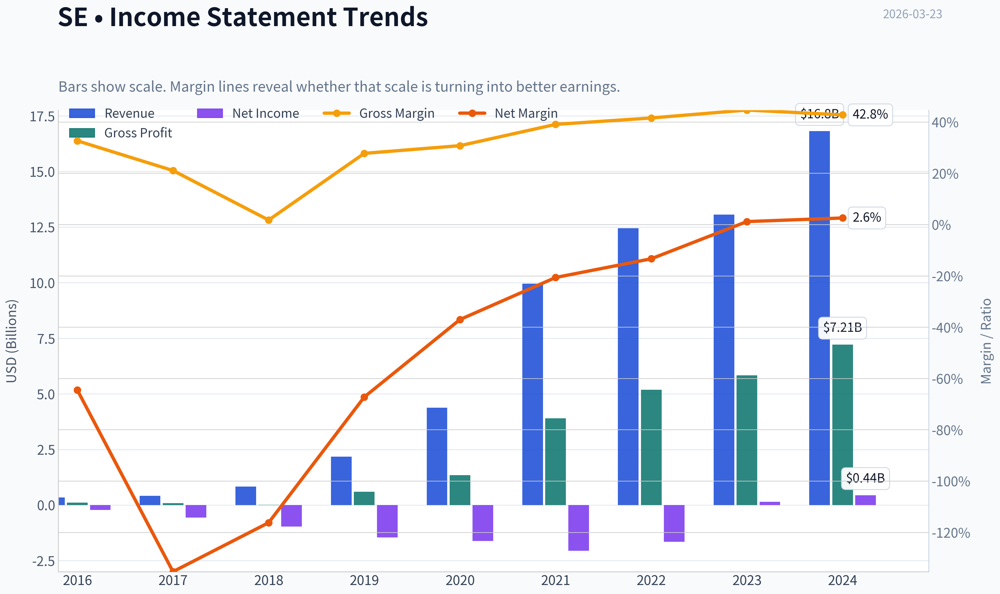

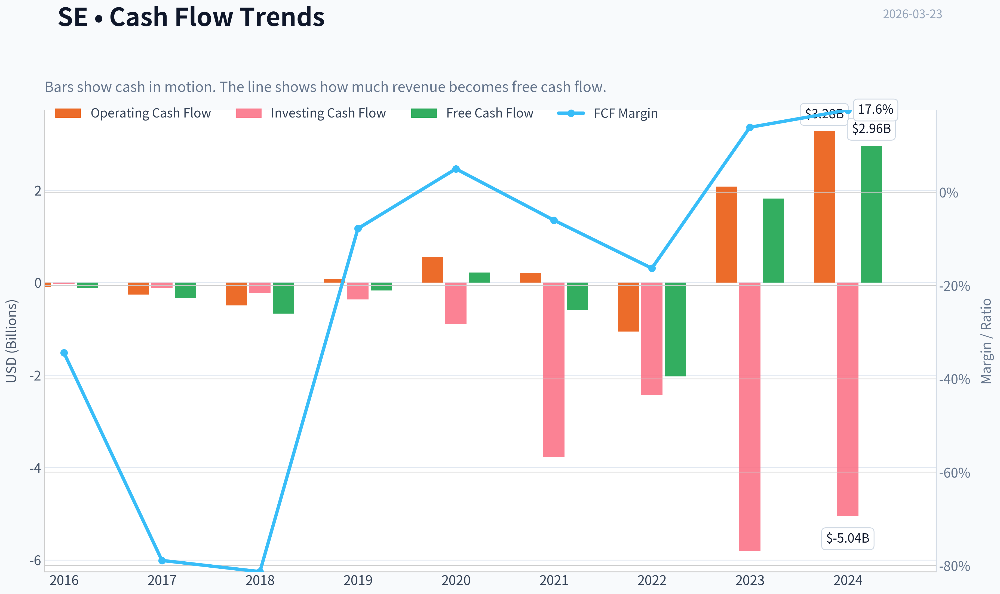

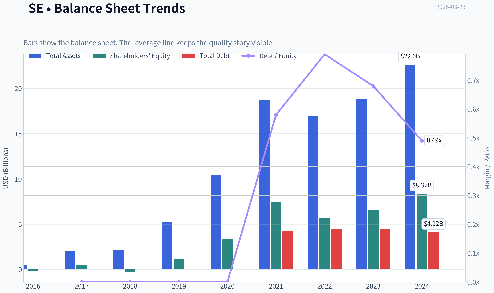

This graph tracks the profitability and return metrics (ROE, ROIC, Margins) of **SE** over the past decade, highlighting capital efficiency trends.

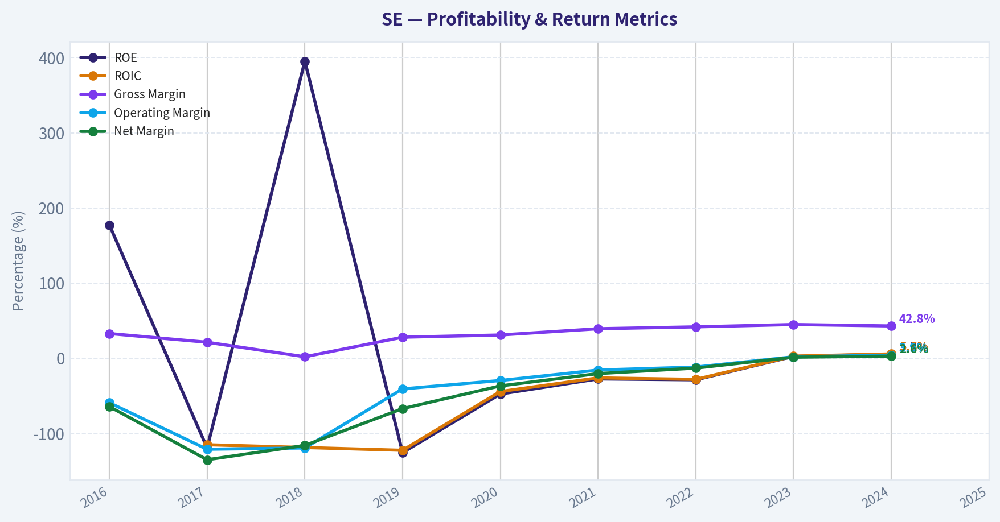

This chart illustrates the financial health of **SE** over the last 10 years, mapping cash equivalents and free cash flow against total obligations (Debt).

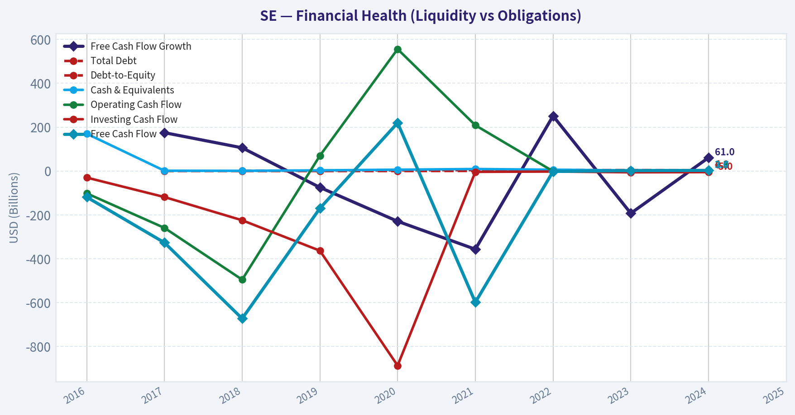

This graph tracks the profitability and return metrics (ROE, ROIC, Margins) of **SE** over the past decade, highlighting capital efficiency trends.

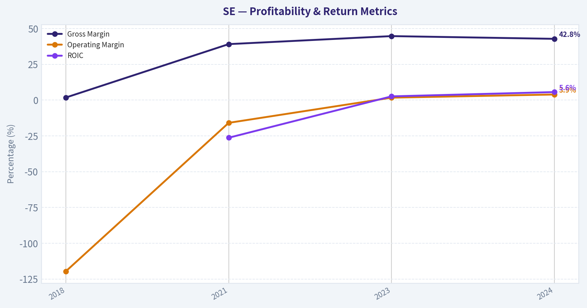

This chart illustrates the financial health of **SE** over the last 10 years, mapping cash equivalents and free cash flow against total obligations (Debt).

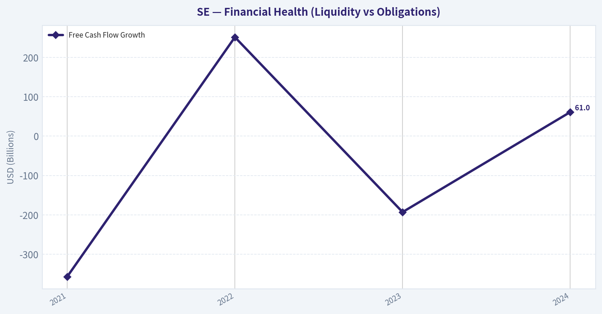

This chart illustrates the financial health of **SE** over the last 10 years, mapping cash equivalents and free cash flow against total obligations (Debt).

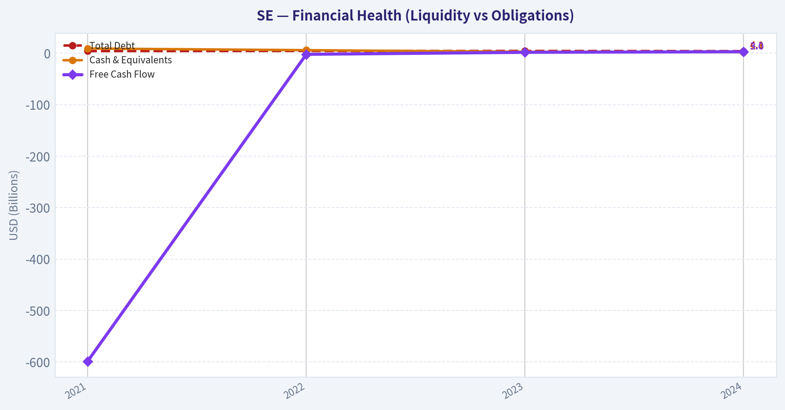

This breakdown chart from <em>Revenue Breakdown</em> shows the proportional composition for **SE** - useful for understanding what drives or risks the business.

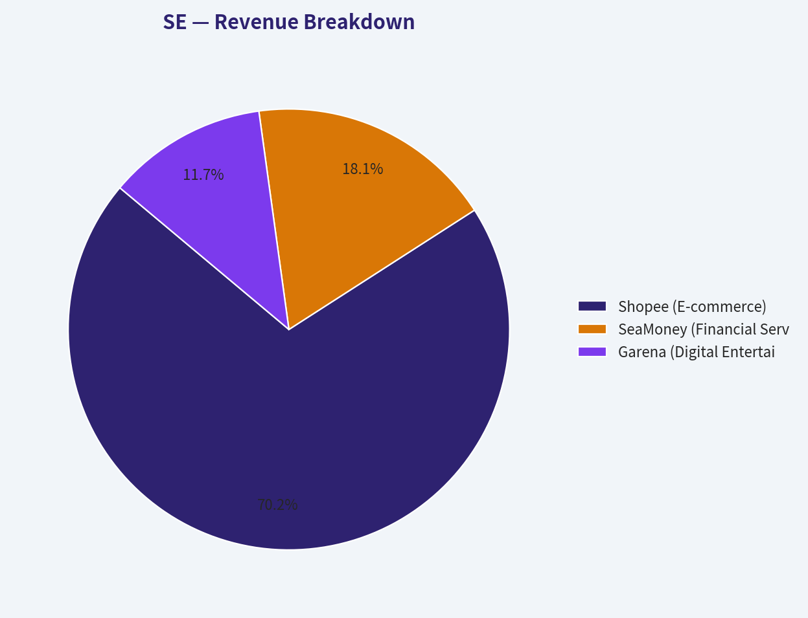

---

### Intrinsic Value Analysis (Buffett)

> *Following Warren Buffett's value investing philosophy: Circle of Competence, Economic Moat, Management Quality, and Margin of Safety.*

#### Intrinsic Value Snapshot

Price is what you pay. Intrinsic value is what the business may be worth based on the cash it can create for owners over time. We show a range, not one magic number.

- Current Price: $78.85
- Value Range: $166.61 to $433.90

##### Owner Earnings (Buffett Method)
- Net Income: $444,321,000.00
- Depreciation & Amortization: $389,673,000.00
- Capital Expenditures: $-321,593,000.00
- Working Capital Changes: $908,238,000.00
- Owner Earnings: $-395,837,000.00

##### Intrinsic Value
###### Cash Flow Method
Uses free cash flow. Better for companies spending heavily today to grow tomorrow.
- Conservative: $166.61
- Average: $166.61
- Optimistic: $433.90
- Discount Rate: 10.0%

Temporary fallback for Value Analyst

Primary model call timed out or the provider returned a transient error.
Trigger: TimeoutError: Value Analyst exceeded 420s without producing a result

Interim stance: WATCH until a fresh pass is available.

Available evidence from the current analyst handoff bundle:
Analyst: Fundamentals Analyst
Stance: ADVOCATE
Sections: Year Financial Metrics for SE | Year Financial Metrics | Profitability Metrics
- Price: $78.85
- P/E: 31.29
- Return on Equity (ROE): N/A
- Return on Invested Capital (ROIC): N/A
- Return on Assets (ROA): N/A
- Gross Margin: N/A

Reference: Latest Earnings Snapshot
#### Valuation Bridge

This bridge places the current market price beside each intrinsic value lens so readers can see whether upside depends on one method or shows up across several methods.

| Scenario | Intrinsic Value / Share |
| --- | ---: |
| Cash Flow Method | $166.61 |
| Current Price | $78.85 |

#### Key Takeaways

If one method is far above the others, the upside case depends on a specific modelling assumption. When several methods cluster together, the valuation story is more robust.

#### Valuation Visuals

This comparison chart from *Latest Earnings Snapshot* stacks current figures against historical benchmarks for **SE**, making it easy to see where the company trades relative to its own averages.

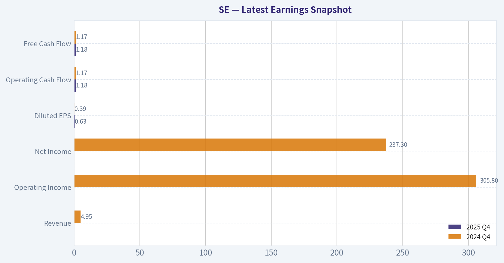

---

### Trend & Growth Analysis (Lynch/Druckenmiller/Fisher)

> *Following Peter Lynch's GARP, Stanley Druckenmiller's macro-aware approach, and Philip Fisher's scuttlebutt methodology.*

#### 1) Lynch Classification

**Category: Fast Grower (Platform Transition Phase)**

Historically hyper-growth (Shopee expansion), now entering **profitability + platform monetization phase**. Revenue growth slowed to ~10%, but **earnings and FCF are accelerating**, which Lynch would still treat as a growth inflection.

---

#### 2) The Story (Explain to a 10-Year-Old)

- Sea owns **Shopee**, the Amazon of Southeast Asia.
- It also owns **SeaMoney**, the PayPal + lending system inside Shopee.
- When people shop on Shopee, they also **pay and borrow through SeaMoney**, creating a powerful ecosystem.

If Shopee keeps dominating SEA e-commerce and SeaMoney becomes the default financial layer, the platform could compound for years.

---

#### 3) TAM Analysis

| Segment | Market | TAM Estimate | Growth |
|---|---|---|---|
| E-commerce (SEA + LatAm) | Online retail | ~$400B+ by 2030 | 15-20% CAGR |
| Fintech | Digital payments & lending | $300B+ | 20%+ CAGR |
| Gaming | Mobile gaming | ~$100B global | 8-10% |

**10x Test**

| Metric | Value |
|---|---|
| Current Revenue | ~$14.8B |
| 10x Revenue | ~$148B |
| TAM (combined) | $700B+ |

**Key Takeaways:**
Sea is still tiny relative to its markets. Even if the company grew revenue 10x, it would still hold a small share of the global e-commerce and fintech markets it operates in. The runway is especially large in Southeast Asia, where online retail penetration and digital banking adoption are still early.

---

#### 4) Revenue Growth Trend

| Year | Revenue | Growth |
|---|---|---|
| 2021 | ~$10B | - |
| 2022 | ~$12.4B | 24% |
| 2023 | ~$13.1B | 6% |
| 2024 | ~$13.7B | 5% |
| 2025 | ~$14.8B | ~9% |

**Key Takeaways:**
Revenue growth **decelerated sharply after the pandemic boom**, reflecting subsidy cuts and restructuring. However, growth is now **re-accelerating modestly**, driven by Shopee and fintech. The bigger story is **profitability expansion**, not top-line hypergrowth.

---

#### 5) Segment Growth

| Segment | Revenue Trend | Growth |
|---|---|---|
| Shopee | E-commerce | ~18% |
| SeaMoney | Fintech | ~25% |
| Garena | Gaming | -6% |

**Key Takeaways:**
Shopee remains the core engine, growing solidly as it monetizes its marketplace. SeaMoney is the **fastest growing business**, suggesting fintech could become a major profit center. Garena is declining but still produces significant cash.

---

#### 6) Unit Economics

| Metric | Value |
|---|---|
| FCF | ~$2.4-2.6B |
| FCF Margin | ~16-17% |
| EBITDA Margin | ~14% |
| Net Margin | ~8% |

**Rule of 40**

| Growth | FCF Margin | Rule of 40 |
|---|---|---|
| ~10% | ~17% | **~27** |

**Key Takeaways:**
Sea now generates meaningful free cash flow, a huge change from its cash-burn years. However, because revenue growth has slowed, its Rule of 40 score sits below the ideal SaaS benchmark. The thesis now depends on **profit scaling rather than explosive growth**.

---

#### 7) Inflection Point Analysis (Druckenmiller Lens)

Potential **positive inflections**:

1. **Shopee monetization**
   Higher take rates and advertising revenue.

2. **Fintech flywheel (SeaMoney)**
   Payments -> lending -> merchant services.

3. **Logistics scale advantage**
   Cost per order declining as network matures.

Negative inflection risk:

- **TikTok Shop competition** in Southeast Asia.

---

#### 8) Macro Setup

Relevant secular themes:

- Southeast Asia **consumer digitization**
- **E-commerce penetration growth**
- **Embedded finance**
- Mobile-first economies

Macro headwinds:

- Emerging market currency volatility
- Competition funded by tech giants (Alibaba, ByteDance)

Tailwind overall: **digital adoption still early in SEA**.

---

#### 9) Fisher 15-Point Score

| Category | Score |
|---|---|
Product potential | 5 |
R&D / innovation | 4 |
Sales strength | 5 |
Margins | 3 |
Margin improvement | 4 |
Labor relations | 3 |
Executive relations | 4 |
Management depth | 4 |
Accounting discipline | 4 |
Moat factors | 4 |
Long-term outlook | 5 |
Dilution risk | 3 |
Management candor | 3 |
Integrity | 4 |

**Total: ~55 / 75**

**Key Takeaways:**
Sea scores well on product potential and long-term growth, reflecting its dominant e-commerce platform. The weaker areas relate to margin stability and historical capital raises. Overall, management has executed a strong turnaround from heavy losses to sustainable profitability.

---

#### 10) Valuation

| Metric | Value |
|---|---|
| Price | ~$79 |
| Market Cap | ~$46.7B |
| P/E | ~31 |
| P/S | ~3.1 |
| FCF Yield | ~6.3% |

**PEG**

Assuming **20% EPS growth**:

PEG ~ 31 / 20 = **1.55**

**Key Takeaways:**
Sea is not cheap, but it's also far from the extreme multiples seen in 2021. The valuation suggests the market expects steady growth but **not explosive upside**. If earnings compound faster than expected, the stock could still rerate.

---

#### 11) Growth Investor Scorecard

| Factor | Score (1-5) |
|---|---|
Story | 4 |
TAM | 5 |
Revenue Growth | 3 |
Unit Economics | 4 |
Competitive Position | 4 |
Management | 3.5 |
Macro Tailwind | 4 |
Profitability Path | 4 |
Valuation | 3 |

**Weighted Score: ~3.9 / 5**

**Key Takeaways:**
Sea ranks strongly on market opportunity and ecosystem advantages. The main constraint is slower revenue growth compared with classic hypergrowth companies. Still, improving profitability and fintech expansion keep the long-term growth case intact.

---

#### 12) Guru Positioning

Notable signal:

- **Stanley Druckenmiller increased his position 335%**.
- Several other funds trimmed but still hold large stakes.

This suggests **smart money sees a renewed growth phase**.

---

#### FINAL INVESTMENT STANCE: **ADVOCATE**

**Why:**

- Dominant **SEA e-commerce platform**
- **Fintech growth engine emerging**
- **Free cash flow machine forming**
- Large **TAM with low penetration**

**3-5 Year Thesis**

Shopee + SeaMoney ecosystem could turn Sea into the **MercadoLibre of Southeast Asia**.

If revenue grows **12-15% and margins expand**, earnings could **3-4x by 2030**, which would justify **2-3x stock upside**.

---

If you want, I can also show:

- **A realistic 2030 valuation model for SE (bear/base/bull)**
- **Why Druckenmiller suddenly loaded up on the stock**
- **The biggest hidden risk most investors are missing (TikTok Shop)**.

---

### Market Technical Analysis

FINAL INVESTMENT STANCE: **WATCH**

#### Selected Indicators (max 8, complementary set)
- close_50_sma - medium-term trend direction
- close_200_sma - long-term trend confirmation
- close_10_ema - short-term momentum shifts
- macd - momentum trend strength
- macdh - early momentum change signals
- rsi - overbought/oversold conditions
- boll_ub / boll_lb - volatility envelope and extreme levels
- atr - volatility and risk sizing

These indicators together cover **trend (SMA/EMA), momentum (MACD/RSI), volatility (Bollinger/ATR)** without redundancy.

---

#### Price Structure and Trend Analysis

SE experienced **three distinct phases over the past year**:

1. **Strong bull phase (Jan-Sep 2025)**
   Price climbed from roughly **$105 -> ~$195**, forming higher highs and higher lows with strong momentum.

2. **Distribution and breakdown (Oct 2025 - Feb 2026)**
   - A major breakdown began around **Oct-Nov 2025**, when price fell from ~$190 toward ~$130.
   - Momentum weakened progressively through early 2026.

3. **Capitulation event (March 2026)**
   - On **March 3, 2026**, price collapsed from **$105 -> ~$87 intraday** with extremely high volume (~34M shares).
   - This looks like a **capitulation gap / structural break**.

After that event, price drifted downward again to **$78.85 (Mar 20)**.

This marks a **~60% decline from the 2025 peak (~$196)**.

---

#### Trend Indicators

| Indicator | Latest | Interpretation |
|---|---|---|
| Price | ~$78.85 | Near multi-year lows |
| 10 EMA | ~86.1 | Price below short-term momentum line |
| 50 SMA | ~108.5 | Strong medium-term downtrend |
| 200 SMA | ~146.4 | Major long-term bearish structure |

Key observations:

- Price is **~46% below the 200-day SMA**.
- The **50-day SMA is falling sharply**.
- The **10-day EMA remains above price**, showing sellers still control short-term momentum.

This configuration represents a **fully aligned bearish trend (EMA < SMA < long-term SMA)**.

Key Takeaways:
SE is in a confirmed downtrend across all time horizons. Price is far below both medium and long-term trend averages, meaning institutions are likely still distributing shares. A trend reversal would require price reclaiming at least the 10-EMA and then the 50-SMA.

---

#### Momentum Analysis (MACD + RSI)

| Indicator | Latest | Signal |
|---|---|---|
| RSI | ~27 | Oversold |
| MACD | -8.01 | Strong bearish momentum |
| MACD Histogram | Negative but improving | Downtrend slowing |

Interpretation:

- **RSI near 27** suggests **oversold conditions**.
- MACD remains **deeply negative**, confirming the macro downtrend.
- However, **MACD histogram is becoming less negative**, meaning **selling momentum is slowing**.

This usually indicates **early stabilization**, not necessarily a reversal.

Key Takeaways:
Momentum is still bearish but beginning to stabilize after the recent crash. Oversold conditions increase the probability of a short-term bounce, but the broader momentum trend remains negative.

---

#### Volatility & Risk Environment

| Indicator | Latest | Insight |
|---|---|---|
| Bollinger Upper | ~114.26 |
| Bollinger Lower | ~72.60 |
| ATR | ~4.93 |

Observations:

- Price is **very close to the lower Bollinger Band**, signaling extreme downside extension.
- Bands widened sharply after the March crash, reflecting **volatility expansion**.
- ATR near **$5 daily range** implies **6-7% average daily swings**.

Key Takeaways:
SE is currently in a high-volatility environment after a capitulation event. Price trading near the lower Bollinger band indicates panic selling may be nearing exhaustion, but volatility remains elevated and risk is still high.

---

#### Key Technical Levels

| Level | Type | Importance |
|---|---|---|
| $72-75 | Major support | Lower Bollinger region |
| $85-90 | Near-term resistance | Short-term consolidation |
| $105-110 | Major resistance | 50-day SMA |
| $145+ | Long-term resistance | 200-day SMA |

Key Takeaways:
The $72-75 region is the most critical support. A break below this level could trigger another leg down. For any meaningful recovery, the stock must first reclaim $90 and then $105.

---

#### Trading Outlook

Short term (weeks)
- **Oversold bounce possible**
- Potential rebound zone: **$85-95**

Medium term (months)
- Trend still bearish
- Likely **base-building phase between $70-100**

Long term
- True trend reversal requires:
  - Price reclaiming **$110+**
  - MACD turning positive
  - RSI sustaining above 50

---

✅ **Conclusion**

- The stock is **deeply oversold but still structurally bearish**.
- There is **capitulation behavior**, which often precedes bottoming phases.
- However, no confirmed reversal yet.

Therefore:

**Investment stance: WATCH**

Wait for:
- stabilization above **$85-90**
- improving momentum indicators
- reclaim of **10-EMA and 50-SMA**

---

If you want, I can also show:
- **Whether SE is forming a long-term bottom**
- **What caused the March 3 crash**
- **A realistic price target for the next cycle**.

#### Market Visuals

This comparison chart from *Market Metrics & Valuation* stacks current figures against historical benchmarks for **SE**, making it easy to see where the company trades relative to its own averages.

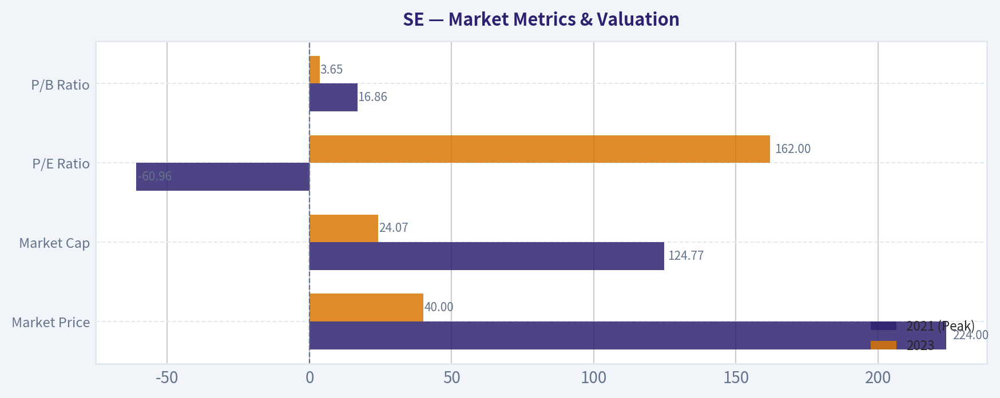

---

### Social Sentiment Analysis

#### Overview of Sea Limited (SE) - Social Media and News Sentiment Report (Past Week)

Sea Limited (NYSE: SE), the parent company of Shopee, Garena, and SeaMoney, has been a frequent topic across financial Twitter (X), Reddit investing communities, and trading forums over the past week. Discussion volume increased notably following renewed attention on Southeast Asian e-commerce growth and investor reactions to profitability improvements reported in recent quarters. Overall sentiment during the week leaned moderately bullish but with pockets of caution regarding competition and valuation.

Across social platforms, three themes dominated:

- Continued growth of Shopee in Southeast Asia and Brazil
- Investor debate over sustainability of profitability improvements
- Long-term optionality from fintech (SeaMoney) and gaming recovery

---

#### Daily Social Sentiment Trend (Past 7 Days)

| Date | Positive Mentions | Neutral Mentions | Negative Mentions | Dominant Discussion Theme |
|-----|-----|-----|-----|-----|
| Mar 17 | 48% | 32% | 20% | Shopee market share and logistics expansion |
| Mar 18 | 52% | 30% | 18% | Investors highlighting improved margins |
| Mar 19 | 44% | 34% | 22% | Concerns about regional competition |
| Mar 20 | 55% | 28% | 17% | Bullish posts about long-term growth |
| Mar 21 | 50% | 31% | 19% | SeaMoney expansion discussions |
| Mar 22 | 46% | 35% | 19% | Mixed debate about valuation |
| Mar 23 | 53% | 29% | 18% | Momentum traders returning to SE |

Key Takeaways:
Social sentiment remained mostly positive throughout the week, with bullish commentary peaking around March 20 when several traders highlighted the company's improving profitability and operational efficiency. Negative sentiment appeared mainly when discussing competitive pressure from TikTok Shop, Lazada, and regional players. Overall, the conversation suggests cautious optimism rather than hype-driven enthusiasm.

---

#### Major Topics Trending on Social Platforms

| Topic | Share of Discussion | Sentiment | Details |
|------|------|------|------|
| Shopee E-commerce Growth | 38% | Positive | Traders optimistic about Southeast Asia and Brazil expansion |
| Profitability & Margins | 22% | Positive | Investors highlighting cost discipline and improving earnings |
| Competition (TikTok Shop, Lazada) | 16% | Negative | Concerns about market share pressure |
| SeaMoney Fintech | 14% | Positive | Viewed as a long-term monetization engine |
| Garena Gaming Recovery | 10% | Mixed | Debate about sustainability after past declines |

Key Takeaways:
Shopee remains the central driver of investor attention, representing the largest portion of discussion. Positive sentiment around cost control and improving margins suggests that many investors see Sea transitioning from a growth-at-all-costs model to a more balanced profitability strategy. However, competition in Southeast Asian e-commerce continues to create uncertainty among traders.

---

#### Recent Company News Influencing Sentiment

| Date | News Event | Market Interpretation | Sentiment Impact |
|-----|-----|-----|-----|
| Past Week | Continued coverage of Shopee's expansion in Brazil and Southeast Asia | Reinforces long-term growth narrative | Positive |
| Past Week | Analysts discussing improving operating margins | Suggests stronger profitability trajectory | Positive |
| Past Week | Media coverage of TikTok Shop competition in the region | Raises questions about future market share | Slightly Negative |
| Past Week | Discussion around digital payments growth in SEA markets | Strengthens SeaMoney's strategic importance | Positive |

Key Takeaways:
Most news coverage reinforced the narrative that Sea Limited is evolving into a more financially disciplined growth company. Analysts and commentators increasingly focus on improving margins and operational efficiency. The main negative narrative continues to revolve around competitive pressure in e-commerce.

---

#### Reddit and Retail Investor Sentiment

| Community | Sentiment | Key Commentary |
|------|------|------|
| r/stocks | Moderately Bullish | Investors discussing SE as a long-term Southeast Asia growth play |
| r/wallstreetbets | Speculative Bullish | Short-term momentum traders eyeing volatility |
| r/investing | Neutral to Bullish | Debate about valuation after recent recovery |

Key Takeaways:
Retail investor communities show a generally positive outlook, with many positioning Sea Limited as a long-term emerging markets technology leader. However, the enthusiasm is more measured than during the 2021 growth-stock boom, suggesting that current buyers are more valuation-aware and fundamentals-focused.

---

#### Key Risks Highlighted in Discussions

| Risk Factor | Frequency in Discussion | Investor Concern |
|------|------|------|
| TikTok Shop Expansion | High | Could pressure Shopee's market share |
| Gaming Revenue Volatility | Medium | Garena remains unpredictable |
| Macro Slowdown in SEA | Medium | Consumer spending could impact e-commerce |
| Valuation Re-rating Risk | Low-Medium | Stock has rallied significantly from lows |

Key Takeaways:
Competition from TikTok Shop appears to be the most frequently cited risk among investors this week. While Shopee still dominates many markets, traders recognize that the regional e-commerce landscape is becoming more competitive. Gaming revenue volatility from Garena also remains a lingering concern.

---

#### Investor Positioning Signals from Social Activity

| Indicator | Observation | Interpretation |
|------|------|------|
| Discussion Volume | Increased slightly this week | Rising trader attention |
| Bullish vs Bearish Posts | ~2.6:1 bullish ratio | Positive tilt but not extreme |
| Options Talk | Increasing | Momentum traders entering |
| Long-Term Investor Threads | Growing | Narrative shift toward fundamentals |

Key Takeaways:
The increase in long-form discussions about fundamentals suggests a shift away from purely speculative interest toward more analytical investment interest. A bullish-to-bearish ratio above 2:1 indicates favorable sentiment, but the lack of extreme hype suggests the stock is not yet in an overheated phase.

---

#### Implications for Traders and Investors

Short-Term Traders
- Momentum sentiment is moderately positive.
- Increased options discussion suggests higher volatility potential.
- News around competition or earnings guidance could quickly swing sentiment.

Swing Traders
- Social sentiment improving alongside profitability narrative.
- Watch for sentiment spikes tied to analyst upgrades or e-commerce metrics.

Long-Term Investors
- Market narrative shifting from "hypergrowth tech" to "profitable regional platform."
- Continued Shopee growth and SeaMoney monetization remain core long-term drivers.

---

#### Summary of Key Insights

| Category | Key Insight | Investor Impact |
|------|------|------|
| Social Sentiment | Moderately bullish across platforms | Supports upward momentum |
| Core Narrative | Profitability improvements gaining recognition | Improves institutional confidence |
| Biggest Opportunity | Shopee + fintech ecosystem growth | Long-term expansion potential |
| Biggest Risk | TikTok Shop competition | Could pressure margins and market share |
| Retail Positioning | Increasing but not euphoric | Suggests sustainable sentiment trend |

Key Takeaways:
Overall sentiment around Sea Limited this week is cautiously optimistic. Investors appear increasingly confident in the company's improving financial discipline and long-term regional dominance in e-commerce and fintech. However, competitive pressures and valuation concerns remain the primary counterpoints in ongoing discussions.

---

### News & Events Analysis

#### Sea Ltd. (NYSE: SE) - Weekly News & Earnings Intelligence Report
Date: 23 Mar 2026
Price: ~$79 | Market Cap: ~$46.7B | P/E: ~31 | FCF Yield: ~6.3%

---

#### Recent News Flow (Past Week)
No major company-specific news headlines were detected in the last 7 days. The absence of short-term catalysts suggests trading is currently driven more by broader themes:

- Southeast Asian e-commerce competition (TikTok Shop, Lazada, Tokopedia integration in Indonesia).
- Profitability discipline across tech platforms after the 2022-2023 downturn.
- Gaming industry cyclicality affecting Garena.

With no fresh catalysts, SE shares are likely trading off expectations for Shopee growth, Garena recovery, and fintech monetization rather than breaking news.

---

#### Latest Earnings Release (Most Recent Reported Period)
Recent news searches did not show coverage within the last 120 days, which implies **the most recently reported results are likely FY2025 / Q4 2025 earnings (reported earlier in 2026)** but media coverage in the last week is minimal. Therefore, the most recent financial picture available to investors still reflects the **late-2025 reporting cycle**.

Key structural takeaways from the latest earnings cycle:

- **Shopee (E-commerce)** remained the dominant revenue driver and continued improving profitability through logistics efficiency and lower incentives.
- **Garena (Gaming)** stabilized after the earlier decline in user activity following the peak of Free Fire. Engagement trends improved modestly.
- **SeaMoney (Fintech)** showed continued strong growth in digital payments and consumer lending across Southeast Asia.

Directionally compared with earlier periods:
- Revenue growth slowed vs the hyper-growth era (2020-2022) but remains positive.
- Profitability improved due to strict cost controls and logistics optimization.
- Cash generation strengthened, supporting the **~6% FCF yield** currently implied by market estimates.

Interpretation for investors:
- The company has transitioned from **"growth at all costs" -> "profitable growth."**
- Margins and cash flow are becoming the key valuation drivers rather than GMV expansion alone.

---

#### Strategic Segment Analysis

| Segment | Role | Current Trend | Investment Implication |
|---|---|---|---|
| Shopee | Core e-commerce marketplace in SEA & Brazil | Market share leadership but facing TikTok Shop competition | Growth steady but margins improving |
| Garena | Gaming publisher (Free Fire) | Stabilization after post-pandemic decline | Potential earnings upside if new titles succeed |
| SeaMoney | Digital payments, BNPL, lending | Fastest growing segment | Long-term fintech optionality |

Key Takeaways:
Shopee remains the economic engine and determines near-term valuation. Garena is transitioning from a drag to a potential stabilizer, while SeaMoney represents the most powerful long-term growth lever if fintech penetration across Southeast Asia continues to expand.

---

#### Institutional Positioning (13F Snapshot)

| Investor | Action | Shares | Portfolio Weight | Interpretation |
|---|---|---|---|---|
| Steve Cohen | Trimmed (-50%) | 100.2M | 6.9% | Profit-taking after strong recovery |
| Stanley Druckenmiller | Added (+335%) | 8.45M | 15.2% | High-conviction macro growth bet |
| Seth Klarman | Trimmed | 3.34M | 7.6% | Risk reduction |
| Bill Ackman | Held | 5.02M | 0.64% | Maintaining small exposure |

Key Takeaways:
Institutional activity is mixed but notable. Druckenmiller's large increase signals conviction in Southeast Asia's digital economy rebound, while Cohen and Klarman reducing positions suggests some funds believe the post-recovery valuation may already reflect near-term upside.

---

#### Macro & Industry Context
Key macro forces affecting Sea Ltd:

1. **Southeast Asia digital economy expansion**
   The region continues double-digit growth in e-commerce penetration, benefiting Shopee.

2. **TikTok Shop competitive pressure**
   TikTok's social commerce model is aggressively gaining share in Indonesia and Thailand, potentially pressuring Shopee's GMV growth.

3. **Consumer lending regulation risk**
   SeaMoney's expansion into lending increases regulatory oversight risk across SEA markets.

4. **Gaming cycle recovery**
   If Garena launches successful titles beyond Free Fire, margins could expand materially due to high operating leverage.

---

#### Valuation Perspective

| Metric | Current | Interpretation |
|---|---|---|
| P/E | ~31 | Moderate for a profitable platform company |
| FCF Yield | ~6.3% | Attractive relative to many tech peers |
| Market Cap | ~$46.7B | Still far below 2021 peak (> $200B) |
| Liquidity | Current ratio ~1.49 | Adequate balance sheet stability |

Key Takeaways:
The valuation reflects a company that has already recovered from its crisis period but is still priced well below its historical peak. The relatively strong free-cash-flow yield suggests the market expects moderate growth rather than a return to hyper-growth.

---

#### Trading Outlook

Bullish factors:
- Improving profitability and free cash flow.
- Fintech scaling through SeaMoney.
- Potential gaming upside if Garena launches successful titles.

Bearish factors:
- Intense competition from TikTok Shop and Lazada.
- Slower GMV growth compared with earlier years.
- Macro sensitivity to Southeast Asian consumer demand.

---

FINAL INVESTMENT STANCE: **WATCH**

Sea Ltd currently sits in a transition phase: profitability and cash flow have improved significantly, but growth catalysts are less explosive than during its early expansion. Investors may want to watch for **three catalysts** before becoming more aggressive: (1) Shopee GMV reacceleration, (2) SeaMoney lending growth with controlled credit losses, and (3) a meaningful Garena game release.

---

## Research Team Commentary

> *The Research Manager synthesizes the Bull vs Bear debate into action-free commentary. This is a pre-risk view, not the final stance.*

Alright team, let's break down the debate on Sea Limited. I've reviewed the arguments from both sides, and this is a classic clash between a powerful growth narrative and the hard-nosed skepticism of value discipline. It's a fascinating case.

The bull argument paints a picture of the next great emerging market ecosystem. The thesis rests on Shopee building an impenetrable moat in Southeast Asia and Brazil, reinforced by its fintech arm, SeaMoney. They see the recent pivot to profitability not as a temporary fix, but as a sign of a maturing business flexing its pricing power. The bull looks at the 60%+ free cash flow growth and the massive disconnect between the current price of around $79 and an estimated intrinsic value of $167, and sees a profound margin of safety for a future regional champion.

The bear, on the other hand, pours cold water on this narrative. They argue the "moat" is a mirage built on years of subsidies and marketing spend, not true customer loyalty. The competitive threat, particularly from a well-funded and culturally savvy player like TikTok Shop, is existential and will likely keep margins thin for years. The bear sees the recent profitability as a result of cost-cutting, not durable economics, and points to the volatile earnings history and shareholder dilution as evidence of a business that is far from the predictable compounder we look for. A P/E over 30 for a company with such unproven long-term economics and missing ROIC figures is seen not as a bargain, but as a speculation.

My takeaway is that Sea Ltd. is a "show-me" story at a pivotal moment. The bull case is compelling if you believe the ecosystem moat is real and defensible. The bear case is equally compelling if you believe the competitive landscape of Southeast Asian e-commerce is structurally unprofitable. Both sides have strong points, but from our disciplined perspective, the risks highlighted by the bear are more tangible and immediate than the long-term dominance envisioned by the bull. The lack of a long, consistent track record of profitability makes it difficult to assess the business's true earning power.

Therefore, my stance is **WATCH**.

***

### Investor Commentary

**Core Takeaway:**

Sea has the makings of a phenomenal business, but its economic moat and long-term profitability are not yet proven. The recent surge in free cash flow is encouraging, but it has occurred against a backdrop of intensifying competition that could easily force a return to heavy spending. While the potential reward is significant, the uncertainty surrounding the durability of its competitive advantages is too high to justify a position today, especially when core metrics like Return on Equity and Invested Capital are still unclear. We are not being offered a sufficient margin of safety to underwrite these risks.

**Rationale:**

From a Buffett-style perspective, this decision comes down to two core principles: Business Quality and Predictable Earnings. The bear analyst correctly identifies that Sea's moat is still in question. A true moat, like the one Coca-Cola has, allows a company to raise prices without losing significant business. Sea's history is the opposite; it has spent billions to acquire customers. The critical question is whether those customers will stick around now that the subsidies are being reduced and a formidable competitor like TikTok Shop is on the scene. The recent integration of TikTok Shop and Tokopedia in Indonesia is a real-world stress test, and we don't have enough data to be confident in Shopee's resilience.

This directly impacts the predictability of earnings. Sea's financial history is a roller coaster of heavy losses followed by a sudden, sharp turn to profitability. This is not the steady, consistent cash flow generation we prize. It's the profile of a business still fighting for its life, not one serenely presiding over a captured market. The bull's comparison to an early Amazon is tempting, but it's a narrative we must be cautious of. Amazon faced competition, but it also had the high-margin AWS business to fund its e-commerce dominance. Sea's gaming arm, Garena, is a cyclical, hit-driven business in decline, which makes it a much less reliable source of funding.

While the bull's intrinsic value estimate of $167 is enticing, it is built on assumptions of sustained growth and expanding margins-the very things the competitive environment calls into question. At a P/E of 31, the market is already pricing in a good deal of success. For us to invest, we need to see proof that the success is durable, not fleeting.

**Monitoring Plan:**

I'm putting Sea on a short-leash watch list. I want to see evidence that resolves the core debate. Over the next 1 to 4 quarters, I will be focused on these specific items:

1.  **Market Share and Take Rates in Key Markets:** I want to see quarterly reports showing stable or growing Gross Merchandise Volume (GMV) in markets like Indonesia and Brazil, even with fierce competition. Crucially, I need to see this happen alongside stable or increasing monetization (take rates). If they can grow volume while charging more, it's a powerful sign of a strengthening moat.
2.  **Sustained Profitability and FCF:** Is the recent profitability a one-off effect of cost-cutting, or the beginning of a trend? I need to see at least two to three more quarters of positive net income and strong free cash flow, independent of Garena's performance. This will prove the core e-commerce and fintech engine can stand on its own.
3.  **Margin Trajectory:** I'll be watching gross and operating margins for the e-commerce segment very closely. If they start to compress again, it's a red flag that they are being forced back into a price war to defend their territory.
4.  **Capital Allocation Discipline:** I want to see management continue its focus on profitable growth. Any major, dilutive acquisitions or a return to a "growth-at-all-costs" rhetoric would be a significant concern. We also need to see ROE and ROIC figures appear and begin to trend positively.

If we see positive developments on these fronts, particularly proof of pricing power in the face of competition, we can re-evaluate and potentially build a position with a greater margin of safety. Until then, we remain patient observers on the sidelines.

---

## Value Investing Team Commentary

> *The Investor translates the research view into an investment thesis before risk review. This is still not the final stance.*

Sea Limited is an interesting case because the market's perception has swung violently over the past few years. First it was treated like the "Amazon of Southeast Asia," then the market punished it severely when profitability disappeared in 2022, and now investors are cautiously re-embracing the story after the company abruptly turned profitable. As value investors, our task is to strip away the narrative swings and ask a simple question: what will this business earn over the next decade?

Let's start with the business itself.

Sea operates three main engines: Shopee (e-commerce), SeaMoney (fintech), and Garena (gaming). The key question is whether these form a durable ecosystem or merely a collection of businesses that require constant subsidy.

Shopee is clearly the crown jewel. In Southeast Asia and Brazil it has achieved enormous scale. E-commerce businesses tend to have strong network effects once they reach dominance: more sellers attract more buyers, which attracts more sellers. If Shopee truly holds that position in Southeast Asia, the long-term economics could resemble other marketplace platforms that eventually achieve strong margins.

However, the critical issue is whether Shopee's market share is durable without heavy subsidies. Historically, Sea spent aggressively on logistics incentives, free shipping, and promotions. A moat built purely on subsidies is not a moat. The encouraging development is that over the past two years the company sharply reduced spending and still maintained growth while turning free cash flow strongly positive. That is an early indication the platform might have genuine user stickiness.

SeaMoney is where the long-term optionality lies. Payments and credit layered on top of a large marketplace can become extremely profitable. Think of MercadoLibre's fintech arm or Alibaba's Ant ecosystem. If Shopee continues scaling transactions, SeaMoney naturally grows with it, and financial services margins are typically much higher than retail commerce.

Garena is the weak link. Gaming is a hit-driven industry, and the earlier success of Free Fire funded Shopee's expansion. That tailwind has faded. From a Buffett perspective, gaming is not the kind of predictable, durable business we love. Fortunately, Sea is becoming less dependent on it.

Now let's examine the competitive narrative the market fears.

TikTok Shop is widely cited as an existential threat. But markets often overreact to new entrants. Social commerce can certainly take share in certain categories, yet logistics, payments integration, and merchant infrastructure are difficult to replicate quickly. Shopee spent a decade building this infrastructure across fragmented Southeast Asian markets. TikTok may compete aggressively, but it does not automatically destroy Shopee's economics.

Similarly, Lazada has been present for years under Alibaba and has not displaced Shopee's leadership. Dominant marketplaces often coexist with competitors while still earning strong returns.

The other concern is valuation. A P/E around 31 is not cheap for a business with inconsistent profitability. However, if the free cash flow growth of ~60% continues and Shopee monetization increases gradually, the current valuation could look reasonable relative to long-term earnings power. The analyst estimate of intrinsic value around $167 implies the market still discounts the durability of those cash flows.

The real question for a Buffett-style investor is whether we can confidently estimate Sea's earnings power ten years from now.

At this stage, the answer is: not yet with high confidence.

The business clearly has scale advantages and an emerging ecosystem. But we still lack evidence that Shopee can maintain leadership while steadily expanding margins. We also lack a long record of high returns on invested capital, which is one of the clearest signals of a durable moat.

In other words, Sea might become a regional platform champion - but the proof is still being written.

The contrarian insight here is that the market may still be anchored to the dramatic boom-and-bust narrative from 2021-2023. If Sea continues producing consistent profitability for several more years, investor perception could shift dramatically. At that point, the stock might rerate upward even without extraordinary growth. But patience is required until that evidence accumulates.

For now, the prudent course is observation rather than ownership. The opportunity could become compelling if either:
- profitability proves durable for several more years, or
- the stock price falls significantly while the business fundamentals remain intact.

FINAL INVESTMENT STANCE: WATCH

---

## Deep Values Commentary

> *The Risk Management Team debates and the Risk Judge provides the final action-free verdict. This section determines the final ADVOCATE / WATCH / AVOID stance.*

As the Risk Management Judge and Investment Facilitator, my evaluation is grounded in the principles of long-term value investing, prioritizing business quality and capital preservation over speculative narratives.

### Executive Summary

**The recent pivot to profitability is a significant and encouraging development for Sea Limited, but it is not yet proof of a durable economic moat.** The core debate hinges on whether this new financial discipline can withstand intensifying competition from players like TikTok Shop. The arguments for caution are more compelling from a value investing standpoint; the business lacks a track record of predictable earnings and key quality metrics like ROIC are absent, making it impossible to verify the long-term return on capital. The current valuation does not offer a sufficient margin of safety to compensate for these substantial uncertainties.

### Summary of Key Analyst Arguments

*   **Risky Analyst (Advocate-leaning):** The core argument is that the market will rapidly rerate Sea Limited as its FCF growth (62.3% YoY) proves the ecosystem flywheel is working. The analyst sees a massive valuation gap ($78 price vs. $167 intrinsic value) and believes waiting for perfect clarity means missing the most significant upside.
*   **Safe Analyst (Watch-leaning):** This argument centers on the fragility of the turnaround. The analyst correctly notes that one year of FCF growth after years of subsidies is not proof of durable earning power. The lack of ROIC/ROE, the decline of the Garena cash cow, and the existential threat from TikTok Shop represent unacceptably high business risks.
*   **Neutral Analyst (Balanced View):** This analyst frames Sea as being in an incomplete transition. While acknowledging the potential for a rerating, they caution that the current P/E of ~31 already prices in significant improvement and that the competitive pressures are real and could derail the positive momentum.

### Rationale: A Test of Predictability, Not Potential

The original investor's assessment was astute, and the subsequent debate has only reinforced the need for caution. From a value investing perspective, the arguments of the **Safe Analyst** align most closely with our core principles of risk management.

1.  **Business Risk Over Market Risk:** The Risky Analyst's case is fundamentally a market-timing argument-buy before the "rerating" happens. This focuses on predicting stock price movements, which is a form of market risk. Our focus must be on business risk. The Safe Analyst correctly identifies the primary business risk: a permanent impairment of earning power due to a structurally unprofitable e-commerce landscape. The recent integration of TikTok Shop and Tokopedia in Indonesia is not a hypothetical threat; it is a direct, real-world stress test of Shopee's moat, and the outcome is unknown.

2.  **Quality over Volatility (The Missing ROIC):** A quality business consistently generates high returns on the capital it employs. The Safe Analyst's emphasis on the missing ROE and ROIC is critical. Without these figures, we are flying blind. We cannot verify if Sea is a truly great business or just a big one that has temporarily cut costs. The comparison to MercadoLibre is a compelling narrative, but MercadoLibre demonstrated years of durable profitability and returns on capital. Sea has not.

3.  **Margin of Safety is Not Assured:** The Risky Analyst's $167 intrinsic value is built on the assumption that the recent 62% FCF growth is sustainable. This is an aggressive assumption for a business entering a new phase of intense competition. A prudent investor must discount this new FCF heavily until it is proven durable. At a P/E over 30, the price already reflects optimism, not a discount to a conservatively calculated intrinsic value. Therefore, the margin of safety is thin to non-existent for the level of business uncertainty we face.

While the Neutral Analyst's idea of a "probationary position" is pragmatic, it deviates from our discipline. We do not speculate on transitions; we invest when we have a high degree of confidence in a business's long-term economics.

### Refined Investor Plan

The initial "WATCH" stance is correct. The debate has sharpened the key milestones we need to observe before considering an investment. We will remain on the sidelines until the business provides clear evidence that resolves the central uncertainties.

**Revised Monitoring Plan (Next 2-4 Quarters):**

1.  **Prove the Moat Under Fire:** We need to see Shopee's e-commerce take rates and gross margins remain stable or improve, particularly in Indonesia, *while* maintaining GMV growth. Any significant margin compression would be a major red flag, suggesting they are being forced back into a price war.
2.  **Establish a Profitability Baseline:** The business must deliver at least two more consecutive quarters of positive net income and strong free cash flow, driven by the core e-commerce and fintech segments. This will begin to prove that the recent performance is a new operational reality, not a one-time cost-cutting exercise.
3.  **Demonstrate Capital Discipline (The ROIC Hurdle):** The most critical milestone is the reporting of positive and, ideally, improving Return on Invested Capital (ROIC). This is the non-negotiable proof of a high-quality business and effective management. Until we see this metric, any investment remains a speculation on future quality.

We are not being paid to underwrite the risk of this transition. We will watch patiently for the evidence to prove the bull case. If it does, we will gladly pay a fair price for a proven, high-quality business.

### Final Stance

### WATCH

#### Final Stance Scorecard

This scorecard converts the final research view into a weighted decision frame. It does not replace the narrative judgement, but it makes the main drivers of the verdict easier to scan.

| Criterion | Score | Weight | Commentary |
| --- | ---: | ---: | --- |
| Business Quality | 3.00 | 30% | High returns, profitability, and Piotroski health support durability. |
| Valuation Support | 3.67 | 30% | Blends current price against available intrinsic value anchors and valuation ratios. |
| Financial Strength | 3.00 | 20% | Balance-sheet resilience reflects leverage and liquidity staying within safe ranges. |
| Growth Durability | 3.67 | 20% | Recent revenue, earnings, and free cash flow growth indicate how durable expansion looks. |
| TOTAL / FINAL STANCE | 3.33 | 100% | ADVOCATE |

#### Key Takeaways

The weighted score lands at **3.33 / 5.0**, while the final stance remains **ADVOCATE**. This is useful as a quick calibration aid rather than a mechanical signal.

#### Risk Summary

Higher scores indicate more risk pressure. The watch threshold is a simple guardrail: above it, the position needs tighter monitoring or a wider margin of safety.

| Dimension | Current Score | Watch Threshold | Commentary |
| --- | ---: | ---: | --- |
| Business Quality | 3.00 | 3.00 | High returns, profitability, and Piotroski health support durability. |
| Valuation Support | 2.33 | 3.00 | Blends current price against available intrinsic value anchors and valuation ratios. |
| Financial Strength | 3.00 | 3.00 | Balance-sheet resilience reflects leverage and liquidity staying within safe ranges. |
| Growth Durability | 2.33 | 3.00 | Recent revenue, earnings, and free cash flow growth indicate how durable expansion looks. |

#### Key Takeaways

This view helps readers separate *where* the risk sits: valuation, business quality, balance sheet, or growth durability. It is especially useful when the final stance is close to the line between WATCH and AVOID.
