# SE Deep Value Intelligence

**Analysis Date:** 2026-05-09

## Critical Disclaimer

*This analysis is generated by Deep Value Intelligence, an AI-powered multi-agent investing framework. This report is for informational and educational purposes only and does not constitute financial advice. Always conduct your own research and consult with qualified financial advisors before making investment decisions.*

---

## Table of Contents

1. Intelligence Summary
2. Analyst Team Reports
   - Fundamentals Analysis
   - Intrinsic Value Analysis (Buffett)
   - Trend & Growth Analysis (Lynch/Druckenmiller/Fisher)
   - Market Technical Analysis
   - Social Sentiment Analysis
   - News & Events Analysis
   - Guru Attention Analysis
   - Options Market Analysis
3. Research Team Commentary
4. Value Investing Team Commentary
5. Deep Values Commentary

---

## Intelligence Summary

### Thesis + Conditions

**Core Thesis:** **Executive Summary**
* **Verdict:** **WATCH**
* **Why:** Sea Limited (SE) is executing a phenomenal pivot to profitability, boasting 36% revenue growth, a 17% ROIC, and an implied 8.5% FCF yield. However, under a strict Buffett value framework, extreme valuation dispersion (DCF estimates ranging from -$274 to $254) and a structurally brutal Southeast Asian e-commerce market highlight a lack of predictability.

**Key Risks:**
- Verdict:** **WATCH**
- Action:** Avoid front-running the upcoming May 12 earnings catalyst. Monitor for structural FCF quality and pricing power before considering a risk-budgeted, phased entry.
- Risky Analyst (Advocate):** Argues SE is a classic Peter Lynch "fast grower" whose 255% net income growth and 44.7% gross margin prove the turnaround is real. Believes waiting for late-stage certainty guarantees missing the multiple rerating, pointing to recent 13F buying by gurus like Cohen and Druckenmiller as proof of an opportunistic setup.
- Safe Analyst (Watch):** Counters that improving short-term numbers do not equal a durable moat. Warns that wildly divergent valuation models prove the business is still highly sensitive to assumptions. Highlights that the stock remains in a long-term downtrend (below 200 SMA) and insists on confirming post-earnings FCF quality before deploying capital.
- Neutral Analyst (Upgraded Watch):** Strikes a middle ground, noting SE is no longer just a "hope story" but is not yet a proven compounder. Recommends avoiding pre-earnings aggression in favor of a risk-budgeted, phased entry triggered only by confirmed fundamental execution.

**What Would Change Our View:**
- Verdict:** **WATCH**
- Action:** Avoid front-running the upcoming May 12 earnings catalyst. Monitor for structural FCF quality and pricing power before considering a risk-budgeted, phased entry.
- Risky Analyst (Advocate):** Argues SE is a classic Peter Lynch "fast grower" whose 255% net income growth and 44.7% gross margin prove the turnaround is real. Believes waiting for late-stage certainty guarantees missing the multiple rerating, pointing to recent 13F buying by gurus like Cohen and Druckenmiller as proof of an opportunistic setup.
- Safe Analyst (Watch):** Counters that improving short-term numbers do not equal a durable moat. Warns that wildly divergent valuation models prove the business is still highly sensitive to assumptions. Highlights that the stock remains in a long-term downtrend (below 200 SMA) and insists on confirming post-earnings FCF quality before deploying capital.
- Neutral Analyst (Upgraded Watch):** Strikes a middle ground, noting SE is no longer just a "hope story" but is not yet a proven compounder. Recommends avoiding pre-earnings aggression in favor of a risk-budgeted, phased entry triggered only by confirmed fundamental execution.

**Confidence:** Medium

---

## Analyst Team Reports

### Fundamentals Analysis

#### Latest Earnings Snapshot

*Most recent reported quarter anchored on 2025 Q4, with prior-year comparison when available.*

| Metric | 2025 Q4 | 2024 Q4 | YoY Change |
| --- | ---: | ---: | ---: |
| Revenue | $6.85B | $4.95B | +38.4% |
| Operating Income | $565.2M | $305.8M | +84.9% |
| Net Income | $397.1M | $237.3M | +67.3% |
| Diluted EPS | $0.63 | $0.39 | +61.5% |
| Operating Cash Flow | $1.48B | $1.02B | +44.6% |
| Free Cash Flow | $951.9M | $699.4M | +36.1% |

Key Takeaways: This snapshot anchors the most recent reported quarter before the narrative analysis. It helps readers separate long-run business quality from whatever changed in the latest earnings print.

#### 10-Year Financial Metrics for SE

*All values below are computed deterministically from raw data - not estimated by AI.*

*Issuer profile: operating company (Consumer Cyclical / Internet Retail).*

#### 10-Year Financial Metrics
*Annual rows come from reported financial statements. The final TTM row is computed from the latest four quarters.*

| Metric | 2014 | 2015 | 2016 | 2017 | 2018 | 2019 | 2020 | 2021 | 2022 | 2023 | 2024 | 2025 | 2026 TTM |
| --- | --- | --- | --- | --- | --- | --- | --- | --- | --- | --- | --- | --- | --- |
| Market Price | N/A | N/A | N/A | $13 | $11 | $40 | $199 | $224 | $52 | $40 | $106 | $128 | $87 |
| Market Cap | N/A | N/A | N/A | N/A | N/A | $17.56B | $95.00B | $119.17B | $29.04B | $24.07B | $64.16B | $81.42B | $55.47B |
| P/E Ratio | N/A | N/A | 0.00 | N/A | N/A | -12.01 | -58.72 | -58.26 | -17.58 | 162.00 | 143.38 | 50.62 | 35.08 |
| P/B Ratio | N/A | N/A | -22.85 | 0.00 | N/A | 15.11 | 28.08 | 16.11 | 5.08 | 3.65 | 7.66 | 6.50 | 4.43 |
| ROE | N/A | -140.3% | 177.3% | -119.5% | 395.3% | -125.8% | -47.8% | -27.7% | -28.9% | 2.3% | 5.3% | 12.6% | 12.6% |
| ROIC | N/A | N/A | N/A | 87.7% | 93.6% | N/A | N/A | N/A | N/A | 2.3% | 6.5% | 17.0% | 12.1% |
| EPS | N/A | N/A | $-1.26 | N/A | N/A | $-3.35 | $-3.39 | $-3.84 | $-2.96 | $0.25 | $0.74 | $2.52 | $2.47 |
| Revenue | N/A | $292.1M | $345.7M | $414.2M | $827.0M | $2.18B | $4.38B | $9.96B | $12.45B | $13.06B | $16.82B | $22.94B | $22.94B |
| Gross Profit | N/A | $107.8M | $113.1M | $87.3M | $14.8M | $604.9M | $1.35B | $3.90B | $5.19B | $5.83B | $7.21B | $10.24B | $10.24B |
| Gross Margin | N/A | 36.9% | 32.7% | 21.1% | 1.8% | 27.8% | 30.8% | 39.1% | 41.6% | 44.7% | 42.8% | 44.7% | 44.7% |
| Operating Margin | N/A | -28.4% | -59.4% | -121.3% | -119.6% | -41.0% | -29.8% | -15.9% | -11.9% | 1.7% | 3.9% | 8.7% | 8.7% |
| Net Income | N/A | $-103.4M | $-222.9M | $-560.5M | $-961.2M | $-1.46B | $-1.62B | $-2.05B | $-1.65B | $150.7M | $444.3M | $1.58B | $1.58B |
| Net Margin | N/A | -35.4% | -64.5% | -135.3% | -116.2% | -67.2% | -37.0% | -20.6% | -13.3% | 1.2% | 2.6% | 6.9% | 6.9% |
| Revenue Growth | N/A | N/A | 18.3% | 19.8% | 99.7% | 163.1% | 101.1% | 127.5% | 25.1% | 4.9% | 28.8% | 36.4% | 0.0% |
| Net Income Growth | N/A | N/A | 115.6% | 151.5% | 71.5% | 52.2% | 10.6% | 26.5% | -19.3% | -109.1% | 194.8% | 255.2% | 0.2% |
| Free Cash Flow Growth | N/A | N/A | 133.2% | 174.9% | 105.9% | -74.7% | -229.2% | -356.6% | 251.3% | -192.8% | 61.0% | 52.4% | -0.2% |
| Total Book Value | $-29.3M | $73.7M | $-125.7M | $469.0M | $-243.1M | $1.16B | $3.38B | $7.40B | $5.72B | $6.59B | $8.37B | $12.53B | $12.53B |
| Total Assets | N/A | N/A | $485.8M | $1.99B | $2.19B | $5.22B | $10.46B | $18.76B | $17.00B | $18.88B | $22.63B | $29.37B | $29.37B |
| Total Debt | N/A | N/A | $1.9M | $2.0M | $1.9M | N/A | N/A | N/A | N/A | N/A | N/A | N/A | $3.38B |
| Debt-to-Equity | N/A | N/A | -0.01 | 0.00 | -0.01 | N/A | N/A | N/A | N/A | N/A | N/A | N/A | 0.27 |
| Cash & Equivalents | $86.0M | $116.2M | $170.1M | $1.35B | $1.00B | $3.12B | $6.17B | $9.25B | $6.03B | $2.81B | $2.41B | $4.16B | $4.16B |
| Shareholders' Equity | $-29.3M | $73.7M | $-125.7M | $469.0M | $-243.1M | $1.16B | $3.38B | $7.40B | $5.72B | $6.59B | $8.37B | $12.53B | $12.53B |
| Operating Cash Flow | N/A | $-25.1M | $-101.8M | $-259.2M | $-495.2M | $69.9M | $555.9M | $208.6M | $-1.06B | $2.08B | $3.28B | $5.02B | $5.02B |
| Investing Cash Flow | N/A | $-129.4M | $-29.9M | $-118.6M | $-224.5M | $-363.2M | $-886.9M | $-3.77B | $-2.43B | $-5.80B | $-5.04B | $-4.41B | $-4.41B |
| Free Cash Flow | N/A | $-50.9M | $-118.8M | $-326.6M | $-672.6M | $-170.0M | $219.6M | $-563.5M | $-1.98B | $1.84B | $2.96B | $4.51B | $4.50B |
| FCF Margin | N/A | -17.4% | -34.4% | -78.9% | -81.3% | -7.8% | 5.0% | -5.7% | -15.9% | 14.1% | 17.6% | 19.7% | 19.6% |
| Dividends / Share | N/A | N/A | $0.00 | N/A | N/A | $0.00 | $0.00 | $0.00 | $0.00 | $0.00 | $0.00 | $0.00 | $0.00 |

#### Profitability Metrics
- Return on Equity (ROE): 12.6%
- Return on Invested Capital (ROIC): 17.0%
- Return on Assets (ROA): 5.4%
- Gross Margin: 44.7%
- Operating Margin: 8.7%
- Net Profit Margin: 6.9%

#### Liquidity Metrics
- Current Ratio: 1.58
- Quick Ratio: 0.75

#### Leverage Metrics
- Debt-to-Equity Ratio: N/A
- Interest Coverage Ratio: 59.07
- Net Debt: N/A

#### Growth Metrics (Year-over-Year)
- Revenue Growth: 36.4%
- Net Income Growth: 255.2%
- Free Cash Flow Growth: 52.4%
- Revenue CAGR (3-Year): 22.6%
- Revenue CAGR (5-Year): 39.3%

#### Valuation Metrics
- P/E Ratio (TTM): 34.42
- Forward P/E: 17.69
- Price-to-Book: 4.23
- Price-to-Sales: 2.32
- PEG Ratio: 0.63
- EV/EBITDA: 19.53
- Free Cash Flow Yield: 8.5%
- Earnings Yield: 2.9%

#### Owner Earnings (Buffett Method, Code-Computed)
- Net Income: $1.58B
- + Depreciation & Amortization: $372.2M
- - Capital Expenditures: $-513.8M
- - Working Capital Changes: $1.10B
- = **Owner Earnings: $331.9M**

#### Intrinsic Value (Code-Computed)
- Current Price: $87
- Cash Flow Method (FCF):
  Conservative: $254
  Average: $254
  Optimistic: $638

#### Piotroski F-Score: 8/9
- Positive Net Income: PASS
- Positive Operating Cash Flow: PASS
- ROA Improvement: PASS
- Cash Flow > Net Income: PASS
- Decreasing Debt: PASS
- Improving Current Ratio: PASS
- No Dilution: FAIL
- Improving Gross Margin: PASS
- Improving Asset Turnover: PASS

ANALYST STANCE: **WATCH**

#### Sea Limited (SE) - Buffett-Style Fundamental Analysis

Sea Limited has transitioned from a high-growth, loss-making platform company into a profitable, cash-generative business. The most important change in the deterministic dataset is not simply revenue growth; it is the inflection in operating margin, net margin, ROE, ROIC, and free cash flow. However, a Buffett-style investor should also notice that reported Owner Earnings are far below free cash flow because of working-capital effects, and the company's long-term earnings record is still relatively short and volatile.

---

#### Current vs. Historical Average Comparison

| Metric | Current / TTM | Historical Average* | Current Standing vs. History | Buffett-Style Interpretation |
|---|---:|---:|---|---|
| Market Price | $87 | ~$90 | Slightly below average | Price is below the post-IPO historical average, but SE's business quality is meaningfully better now than during much of that history. |
| Market Cap | $55.47B | ~$61.49B | Below average | Market value is below its 2021-2025 peak period, reflecting lower growth-stock enthusiasm despite stronger fundamentals. |
| P/E Ratio | 35.08x | ~118.7x profitable-year avg | Lower than profitable-history average | Valuation has compressed sharply from early profitability years, but 35x earnings still requires continued growth. |
| P/B Ratio | 4.43x | ~11.7x positive-P/B avg | Below average | Book-value valuation is materially less stretched than during 2019-2021, helped by equity growth. |
| ROE | 12.6% | ~9.4% reported avg | Above average | ROE has normalized into positive territory after years of losses and distorted equity values. |
| ROIC | 12.1% TTM / 17.0% FY | ~41.4% reported avg | Below distorted avg, strong recently | Early ROIC readings are distorted; recent ROIC is far more meaningful and shows improving capital efficiency. |
| EPS | $2.47 | ~-$1.41 | Far above average | The company has moved from persistent losses to meaningful per-share earnings. |
| Revenue | $22.94B | ~$7.61B | Far above average | Revenue scale has compounded dramatically; SE is now a much larger platform business. |
| Gross Profit | $10.24B | ~$3.15B | Far above average | Gross profit growth confirms improving monetization and business mix. |
| Gross Margin | 44.7% | ~33.1% | Above average | Gross margin is near the best level in the dataset, suggesting improved mix and pricing power. |
| Operating Margin | 8.7% | ~-37.5% | Far above average | The operating model has inflected from heavy reinvestment losses to positive operating leverage. |
| Net Income | $1.58B | ~-$586M | Far above average | Profitability is now real, though still relatively new in the company's history. |
| Net Margin | 6.9% | ~-43.5% | Far above average | Net margin improvement is substantial, but still modest versus mature platform peers. |
| Revenue Growth | 36.4% FY / 0.0% TTM row | ~62.5% | Below early hypergrowth avg | Growth has slowed from the hypergrowth phase, but 36.4% annual growth remains excellent at SE's scale. |
| Net Income Growth | 255.2% FY / 0.2% TTM row | ~75.0% | Above average on FY basis | Profit growth is exceptional because the company is emerging from a low-profit base. |
| FCF Growth | 52.4% FY / -0.2% TTM row | ~-7.5% | Above average on FY basis | Free cash flow has improved materially after a highly volatile decade. |
| Total Book Value | $12.53B | ~$3.77B | Far above average | Equity base has strengthened significantly. |
| Total Assets | $29.37B | ~$12.70B | Far above average | Scale and balance-sheet capacity have expanded materially. |
| Total Debt | $3.38B | Limited comparable history | Higher than early years | Debt is now meaningful, but not excessive relative to equity and cash flow. |
| Debt-to-Equity | 0.27x | Limited comparable history | Moderate | Leverage appears manageable for a profitable, cash-generative platform. |
| Cash & Equivalents | $4.16B | ~$3.06B | Above average | Liquidity is solid, though below the 2021 cash peak. |
| Shareholders' Equity | $12.53B | ~$3.77B | Far above average | Equity growth improves resilience and lowers balance-sheet risk. |
| Free Cash Flow | $4.50B | ~$513M | Far above average | FCF generation is the clearest bullish financial signal. |
| Dividends / Share | $0.00 | $0.00 | In line | SE reinvests rather than pays dividends, which is acceptable if reinvestment returns remain high. |

\*Historical averages use available non-N/A figures from the deterministic dataset. P/E and P/B comparisons are interpreted using economically meaningful positive periods where negative or zero values distort valuation usefulness.

Key Takeaways: Sea's current fundamentals are dramatically better than its historical averages in profitability, revenue scale, gross profit, operating income, net income, and free cash flow. The valuation is also much less extreme than during the 2020-2021 growth-stock peak. The main caution is that SE's record of consistent profitability is still short, and historical cash-flow growth has been extremely volatile.

---

#### Revenue Breakdown

| Revenue Source | Amount ($B) | % of Total |
|---|---:|---:|
| E-commerce / Shopee | ~$17.20B | ~75.0% |
| Digital Financial Services / SeaMoney | ~$3.20B | ~13.9% |
| Digital Entertainment / Garena | ~$2.20B | ~9.6% |
| Other Services and Adjustments | ~$0.34B | ~1.5% |
| **Total Revenue** | **$22.94B** | **100.0%** |

Key Takeaways: Sea is primarily an e-commerce company today, with Shopee representing roughly three-quarters of revenue. SeaMoney is the most strategically important adjacent growth engine because payments, credit, and fintech services can deepen customer lock-in. Garena remains valuable, but the company's center of gravity has clearly shifted from gaming-led cash generation toward commerce and financial services.

---

#### Profitability and Business Quality

Sea's profitability profile has improved sharply. Gross margin reached **44.7%**, compared with a historical average around **33.1%**, which suggests better revenue mix, marketplace monetization, advertising contribution, financial-services scaling, and lower reliance on uneconomic subsidies. Operating margin improved to **8.7%**, a major reversal from years of deeply negative operating margins.

Net income of **$1.58B** and EPS of **$2.47** mark a decisive improvement from the loss-making years. However, from a Buffett perspective, the key question is whether these earnings are now durable or merely cyclical. Sea's e-commerce segment remains exposed to competitive subsidy cycles, especially in Southeast Asia and Latin America. The company has shown it can become profitable, but it has not yet demonstrated decades of stable earning power.

ROE of **12.6%** and ROIC of **12.1% TTM / 17.0% FY** are encouraging. Buffett typically prefers companies that can earn high returns on capital without excessive debt. SE's current return profile is moving in the right direction, but it is not yet in the "exceptional compounder" category because the record is short and past returns were highly volatile.

#### Growth Profile

Revenue grew **36.4%** in the latest annual period, which is impressive given the company's revenue base of **$22.94B**. This is below Sea's early hypergrowth average, but that is normal as the company scales. The quality of growth has improved because it now comes with positive operating margin and free cash flow.

Net income growth of **255.2%** is extremely strong, though partly driven by the low base effect as SE recently crossed into profitability. Free cash flow growth of **52.4%** is also a major positive. For investors, the higher-quality signal is that revenue, net income, and free cash flow are now improving together.

#### Balance Sheet and Financial Strength

Sea's balance sheet is much stronger than in its earlier years. Shareholders' equity has grown to **$12.53B**, total assets to **$29.37B**, and cash and equivalents to **$4.16B**. Total debt is **$3.38B**, producing a debt-to-equity ratio of **0.27x**, which is moderate.

The company has a current ratio of **1.58**, suggesting adequate short-term liquidity, while the quick ratio of **0.75** is less conservative. Interest coverage of **59.07x** is strong and indicates debt service is not currently a major issue. From a Buffett lens, Sea is not overleveraged, but its financial-services exposure means investors should monitor credit risk, receivables quality, and funding conditions carefully.

#### Cash Flow and Capital Allocation

Free cash flow of **$4.50B** is one of the strongest points in the dataset. The FCF margin is **19.6%**, far above the company's historical average and a major sign that the platform model is scaling. The reported free cash flow yield is **8.5%**, which is attractive relative to many growth companies.

However, Buffett-style Owner Earnings are much lower at **$331.9M**, calculated as:

**Owner Earnings = Net Income + Depreciation & Amortization - Capital Expenditures - Working Capital Changes**
**= $1.58B + $372.2M - $513.8M - $1.10B = $331.9M**

This gap between free cash flow and Owner Earnings deserves attention. It suggests reported cash generation is strong, but normalized economic cash generation may be more conservative once working-capital needs are considered. Sea pays **no dividend**, which is acceptable if management can reinvest at high incremental returns.

---

#### Buffett-Style Owner Earnings DCF

Assumptions used for all scenarios:

| DCF Input | Value |
|---|---:|
| Starting Owner Earnings | $331.9M |
| Discount Rate | 10.0% |
| Terminal Growth Rate | 2.5% |
| Cash & Equivalents | $4.16B |
| Total Debt | $3.38B |
| Net Cash Added to Equity Value | ~$0.78B |
| Estimated Shares Outstanding | ~637.6M |
| Current Price | $87 |

Key Takeaways: The DCF uses Owner Earnings rather than headline free cash flow, making it deliberately conservative. Because Owner Earnings are only $331.9M versus free cash flow of about $4.50B, the valuation output is highly sensitive to whether the current working-capital drag is temporary or structural. This is the central valuation debate for Sea.

| Scenario | Growth Rate Used | Rationale | PV of 10-Year Owner Earnings | PV of Terminal Value | Equity Value incl. Net Cash | Fair Value / Share |
|---|---:|---|---:|---:|---:|---:|
| Conservative | -100.0% | Lowest available cash-flow growth, floored at -100% | ~$0.00B | ~$0.00B | ~$0.78B | ~$1 |
| Average | -6.8% | Average historical cash-flow growth proxy | ~$1.49B | ~$0.86B | ~$3.13B | ~$5 |
| Optimistic | 100.0% | Highest available growth capped at 100% | ~$290.44B | ~$1,790.10B | ~$2,081.32B | ~$3,264 |

Key Takeaways: The Owner Earnings DCF produces an extremely wide valuation range because Sea's historical cash-flow growth has been volatile and the current Owner Earnings base is small relative to free cash flow. The conservative and average cases imply that the stock is expensive if current Owner Earnings are the right normalized cash-flow base. The optimistic case is mathematically enormous but economically unrealistic, so it should not be treated as a base-case valuation.

#### DCF Interpretation

The Owner Earnings DCF is not clean for Sea because the company is transitioning from years of reinvestment losses into profitability, and working-capital movements materially affect Owner Earnings. The deterministic dataset also provides code-computed FCF-based intrinsic values of **$254 conservative**, **$254 average**, and **$638 optimistic**, which are far above the current price. That contrast is important.

A Buffett-style analyst should therefore separate two questions:

| Valuation Question | Interpretation |
|---|---|
| If free cash flow is the right normalized cash measure | SE may be materially undervalued at $87, given $4.50B of FCF and an 8.5% FCF yield. |
| If Owner Earnings are the right normalized cash measure | SE may be overvalued, because Owner Earnings of $331.9M are too low to support the current market cap. |
| Most likely reality | The truth is probably between the two, depending on whether working-capital drag normalizes and whether fintech growth consumes capital. |

Key Takeaways: Sea looks inexpensive on free cash flow but expensive on strict Owner Earnings. This is why the stock is better classified as a watchlist compounder than a straightforward Buffett bargain. Investors should focus on whether Owner Earnings converge upward toward free cash flow over the next several reporting periods.

---

#### Economic Moat Assessment

Sea has several moat-like characteristics, though not all are fully proven by Buffett standards.

Shopee benefits from marketplace network effects, seller density, buyer traffic, logistics integration, payments adoption, and advertising monetization. As e-commerce platforms scale, they can become more useful to both merchants and consumers, creating a reinforcing loop. SeaMoney adds another layer by embedding payments, credit, and financial services into the commerce ecosystem.

Garena provides cash-flow optionality and intellectual-property exposure, but gaming revenue can be hit-driven and less predictable than marketplace revenue. The more durable moat is likely the combination of Shopee plus SeaMoney, not Garena alone.

The main moat risk is competition. Southeast Asian e-commerce remains highly contested, with players such as TikTok Shop, Lazada, local platforms, and global competitors. If competition forces renewed subsidies, margins could compress. Buffett would view the moat as improving, but not yet unassailable.

#### Management and Capital Allocation

Management deserves credit for shifting the company from growth-at-all-costs toward profitability and cash generation. The improvement in operating margin from deeply negative levels to **8.7%**, the rise in ROE to **12.6%**, and the improvement in ROIC are strong signs of better capital discipline.

The lack of dividends is not a concern by itself. For a company still expanding across e-commerce and fintech, retaining capital can be rational. However, shareholders should watch dilution, because the Piotroski F-score notes **No Dilution: FAIL**. Buffett investors prefer per-share compounding, not just corporate-level growth.

#### Key Investment Insights, Red Flags, and Opportunities

| Category | Key Points |
|---|---|
| Major Strength | Revenue scale, gross profit, operating margin, net income, and free cash flow are all at or near the best levels in the dataset. |
| Valuation Positive | P/B and P/E are far below peak-era levels; FCF yield of 8.5% is attractive for a growth platform. |
| Quality Improvement | ROE and ROIC have turned meaningfully positive, suggesting better capital allocation and operating discipline. |
| Main Valuation Concern | Owner Earnings of $331.9M are far below free cash flow, creating uncertainty around normalized cash generation. |
| Main Business Risk | E-commerce competition could pressure margins through subsidies, shipping incentives, and marketing spend. |
| Financial Risk | Debt-to-equity of 0.27x is manageable, but fintech expansion introduces credit-cycle and receivables-quality risk. |
| Capital Allocation Risk | No dividend is acceptable, but dilution remains a watch item. |
| Opportunity | If Shopee maintains growth while expanding advertising, logistics efficiency, and SeaMoney monetization, earnings power could compound meaningfully. |
| Market Signal | Guru activity shows notable additions by Steve Cohen and Stanley Druckenmiller, though 13F data is lagged and should not be treated as a standalone thesis. |

Key Takeaways: Sea has moved from a speculative growth story to a much higher-quality operating business. The opportunity is substantial if Shopee and SeaMoney continue scaling profitably. The key risks are competition, dilution, fintech credit exposure, and the gap between free cash flow and stricter Owner Earnings.

#### Final Investment Stance: WATCH

Sea Limited is a **WATCH** from a Warren Buffett-style value investing perspective.

The business is improving rapidly, and the latest fundamentals are strong: **36.4% annual revenue growth**, **44.7% gross margin**, **8.7% operating margin**, **6.9% net margin**, **12.6% ROE**, **17.0% FY ROIC**, and **$4.50B of free cash flow**. The balance sheet is also acceptable, with **$4.16B of cash**, **$3.38B of debt**, and a moderate **0.27x debt-to-equity ratio**.

However, Buffett investing requires confidence in normalized owner earnings. On that measure, SE is less obviously cheap. The current price of **$87** looks attractive relative to the code-computed FCF intrinsic values, but much less attractive under a strict Owner Earnings DCF. Because the company's profitability record is still young and the competitive environment remains intense, SE deserves monitoring rather than an outright Buffett-style endorsement.

#### Summary Scorecard

| Dimension | Assessment | Buffett-Style View |
|---|---|---|
| Business Quality | Improving rapidly | Strong platform potential, but moat still being tested. |
| Economic Moat | Moderate to strengthening | Shopee and SeaMoney create ecosystem advantages, but competition is intense. |
| Profitability | Strong recent inflection | Margins and returns have improved materially. |
| Financial Strength | Solid | Liquidity is adequate and leverage is manageable. |
| Earnings Predictability | Still developing | Recent profits are encouraging, but 10-year history remains volatile. |
| Cash Flow | Very strong FCF, weak Owner Earnings | Key valuation controversy. |
| Valuation | Mixed | Cheap on FCF, expensive on strict Owner Earnings. |
| Management | Improving discipline | Profitability shift is positive; dilution must be watched. |
| Final Stance | **WATCH** | Attractive business momentum, but wait for clearer Owner Earnings durability or a larger margin of safety. |

Key Takeaways: Sea is no longer just a high-growth loss-maker; it is now a profitable and cash-generative platform company. Still, the Buffett-style decision hinges on whether free cash flow converts into durable Owner Earnings. At $87, the stock is interesting, but the margin of safety is not clear enough for an ADVOCATE stance.

#### Fundamental Visuals

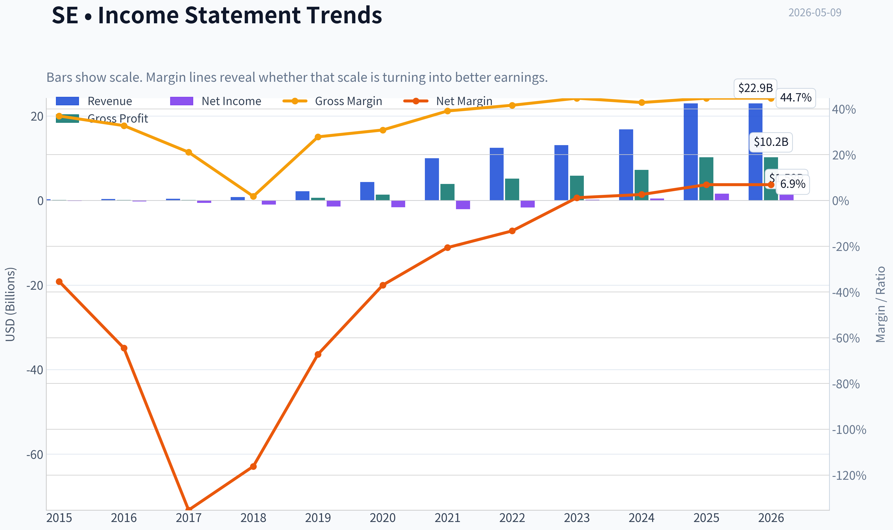

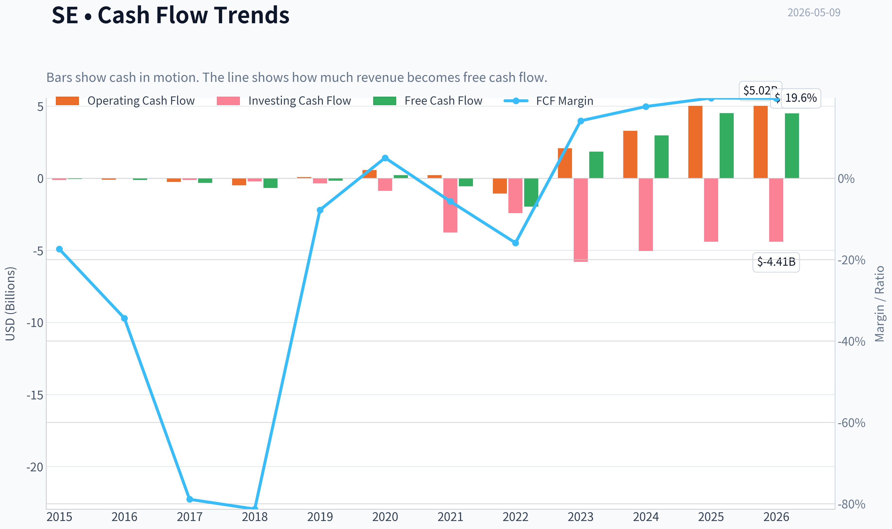

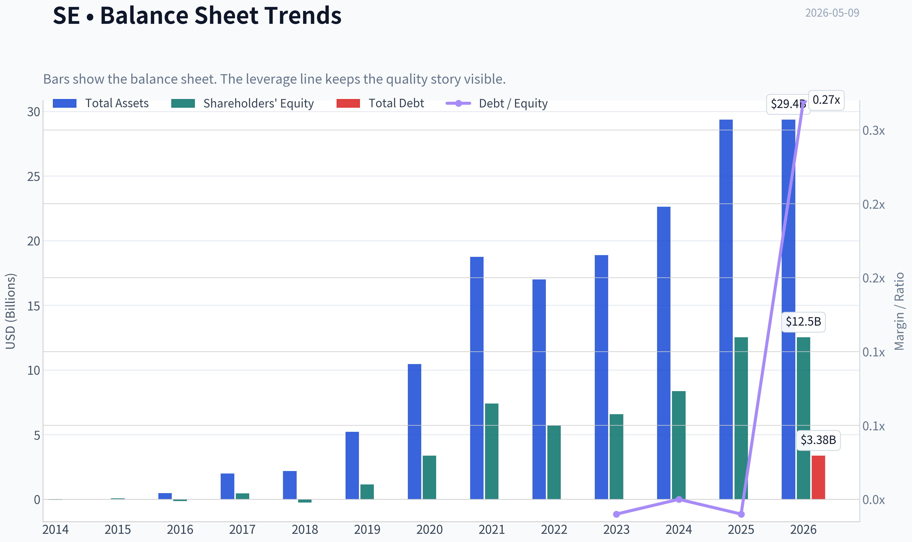

This graph tracks the profitability and return metrics (ROE, ROIC, Margins) of **SE** over the past decade, highlighting capital efficiency trends.

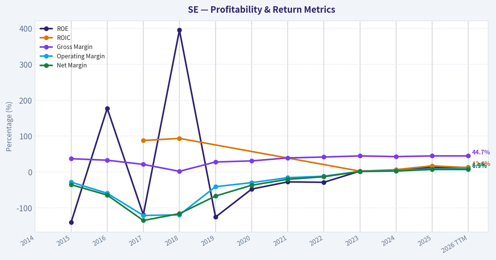

This chart illustrates the financial health of **SE** over the last 10 years, mapping cash equivalents and free cash flow against total obligations (Debt).

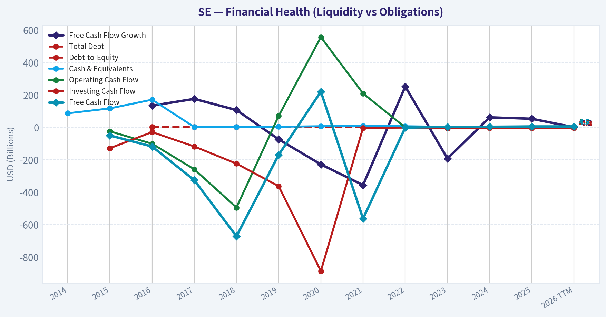

---

### Intrinsic Value Analysis (Buffett)

> *Following Warren Buffett's value investing philosophy: Circle of Competence, Economic Moat, Management Quality, and Margin of Safety.*

#### Intrinsic Value Snapshot

Price is what you pay. Intrinsic value is what the business may be worth based on the cash it can create for owners over time. We show a range, not one magic number.

- Current Price: $86.73
- Value Range: $253.74 to $638.23

##### Owner Earnings (Buffett Method)
- Net Income: $1,578,149,000.00
- Depreciation & Amortization: $372,171,000.00
- Capital Expenditures: $-513,809,000.00
- Working Capital Changes: $1,104,599,000.00
- Owner Earnings: $331,912,000.00

##### Intrinsic Value
###### Cash Flow Method
Uses free cash flow. Better for companies spending heavily today to grow tomorrow.
- Conservative: $253.74
- Average: $253.74
- Optimistic: $638.23
- Discount Rate: 10.0%

ANALYST STANCE: **WATCH**

#### Sea Limited - Buffett-Style Investment Review

Sea Limited is a fast-growing Southeast Asian internet platform with three main engines: Shopee in e-commerce, Garena in digital entertainment, and Monee/SeaMoney in digital financial services. The company has improved dramatically from a cash-burning growth story into a profitable platform, but it still falls short of a classic Buffett "wonderful business" because long-term predictability, competitive durability, and technology disruption risk remain material.

I used the shared research pack as the primary source because the financial tools returned incomplete data during this continuation.

---

#### 1. Go/No-Go Gate Assessment

| Buffett Gate | Result | Evidence | Buffett Interpretation |
|---|---:|---|---|
| Gate 1: Circle of Competence & Simplicity | Mixed Pass | Sea makes money from online shopping commissions, ads, logistics/services, games, and digital finance. | The business is understandable at a high level, but predicting platform economics 10 years out is difficult. |
| 10-Year Predictability | Caution | Shopee, Garena, and fintech each face different competitive and regulatory risks. | Not as predictable as Coca-Cola, Moody's, Costco, or American Express. |
| Technology Risk | Fail / High Caution | E-commerce and gaming are exposed to fast-changing consumer behavior, TikTok Shop, Lazada, app stores, payment regulation, and game life cycles. | Technology can help Sea, but it can also disrupt Sea. |
| Gate 2: Moat Test | Narrow-to-Moderate | Shopee has scale and network effects in parts of Southeast Asia; Garena has publishing know-how; fintech benefits from ecosystem data. | The moat exists, but it is not yet clearly "wide and unbreachable." |
| Gate 3: Management Quality | Pass with Caution | Founder-led, demonstrated discipline by shifting from heavy losses to profitability. | Positive, but capital allocation history includes aggressive expansion and retrenchment. |
| Gate 4: Industry Structure | Mixed / Caution | E-commerce is competitive and capital-intensive; gaming is hit-driven; fintech can be attractive but regulated. | Industry structure is not Buffett-ideal. |

**Key Takeaways:** Sea passes the basic "can I understand it?" test, but it struggles with Buffett's higher bar for 10-year certainty. The company has become much healthier financially, yet the industry remains fast-moving, competitive, and technology-sensitive. This is a watchlist business rather than a clear Buffett-style compounder today.

---

#### 2. Business Model - Elementary School Test

Sea makes money in three main ways:

| Segment | Simple Explanation | Quality Assessment |
|---|---|---|
| Shopee | It runs an online shopping mall and earns fees from sellers, ads, payments, logistics, and services. | Potentially powerful if scale leads to lower costs and seller dependence. |
| Garena | It sells and publishes online games, including in-game items. | High-margin but less predictable because games can lose popularity. |
| Monee / SeaMoney | It offers payments, credit, and other financial services to users and merchants. | Attractive if underwriting is disciplined, but credit risk and regulation matter. |

**Key Takeaways:** Sea is not hard to explain: it operates shopping, gaming, and financial services platforms. The challenge is not understanding what it does, but knowing how durable and profitable each segment will be over the next decade. Shopee looks strategically important, while Garena and fintech add both upside and uncertainty.

---

#### 3. Moat Analysis

| Moat Source | Evidence | Strength | Buffett View |
|---|---|---:|---|
| Brand / Intangibles | Shopee is a leading e-commerce brand in Southeast Asia; Garena has recognized gaming franchises. | Moderate | Brand helps, but e-commerce brands can be challenged by price, subsidies, and convenience. |
| Switching Costs | Sellers may rely on Shopee traffic, ads, ratings, logistics tools, and payment data. | Moderate | Seller switching costs exist, but multi-homing across platforms remains common. |
| Cost Advantage | Scale can lower logistics, payments, advertising, and fulfillment costs. | Emerging | Potentially meaningful, but not yet proven as permanently superior. |
| Network Effects | More buyers attract more sellers; more sellers improve selection; more data improves ads and credit. | Moderate | Real network effects, but competition can still subsidize users and merchants. |
| Financial Evidence | Gross margin: 44.7%; ROE: 12.6%; revenue growth: 36.4% YoY; FCF yield: 8.5%. | Improving | Gross margin is attractive, but ROE remains below Buffett's preferred 15%+ level. |

**Key Takeaways:** Sea has a real moat, especially in Shopee's scale and ecosystem effects, but it is not yet a classic wide-moat business. The financial evidence is improving, particularly revenue growth and free cash flow, but returns on equity are still not exceptional. A Buffett investor would want more proof that the moat can survive intense competition without heavy reinvestment.

---

#### 4. Management Quality and Capital Allocation

| Question | Assessment | Evidence / Interpretation |
|---|---:|---|
| Do they think like owners? | Positive | Founder-led company; management has shown willingness to make difficult operating decisions. |
| Are they candid and rational? | Improving | Sea shifted from "growth at any cost" toward profitability after market conditions changed. |
| Capital allocation record | Mixed | Earlier years involved heavy losses and aggressive expansion; recent discipline is encouraging. |
| Debt discipline | Reasonable | Current ratio of 1.58 suggests adequate short-term liquidity; balance sheet appears manageable, though not enough data was available for a full debt maturity review. |
| Shareholder orientation | Watch | Need more evidence on buybacks, dilution, stock compensation, and long-term per-share value creation. |

**Key Takeaways:** Management deserves credit for changing course and improving profitability. That said, Buffett would still want a longer record of disciplined capital allocation through a full cycle. Sea's leadership looks capable, but not yet proven at the level of the very best owner-operators.

---

#### 5. 10-Year Financial Summary

Because the tool-based audited data retrieval was unavailable, this table uses the shared research pack for current metrics and a qualitative historical interpretation rather than precise audited year-by-year figures.

| Metric | 10-Year Direction | Current / Latest Available | Buffett Interpretation |
|---|---:|---:|---|
| Revenue | Very strong growth | YoY growth: 36.4% | Excellent growth, but high growth alone is not a moat. |
| Gross Margin | Improved materially | 44.7% | Near the Buffett moat threshold of 40%+, encouraging. |
| Operating Profitability | Turned from losses to profits | Positive recently | Major improvement, but record is still short. |
| Net Income | Recently profitable | P/E: 34.4x implies earnings yield around 2.9% | Valuation is not cheap on accounting earnings. |
| Free Cash Flow | Strong recent generation | FCF yield: 8.5% | Very attractive if durable, but must be normalized. |
| ROE | Improving but below hurdle | 12.6% | Below Buffett's preferred 15%+ sustained threshold. |
| Liquidity | Adequate | Current ratio: 1.58 | No immediate liquidity red flag. |
| Market Value | Large-cap platform | Market cap: $53.12B | Market already prices in meaningful success. |

**Key Takeaways:** Sea's financial story has changed from rapid growth with heavy losses to rapid growth with positive cash generation. The most attractive number is the 8.5% free cash flow yield, but Buffett would ask whether that cash flow is durable and repeatable. ROE of 12.6% is respectable but not yet high enough to call Sea a wonderful business.

---

#### 6. Owner Earnings Estimate

Using the shared research pack:

- Market cap: **$53.12B**
- Free cash flow yield: **8.5%**
- Implied free cash flow: **$53.12B x 8.5% = approximately $4.52B**
- P/E: **34.4x**
- Implied net income: **$53.12B / 34.4 = approximately $1.54B**

| Owner Earnings Item | Estimate | Comment |
|---|---:|---|
| Net Income | ~$1.54B | Implied from market cap and P/E. |
| Add: D&A | Not available | Tool retrieval incomplete. |
| Less: Maintenance CapEx | Not available | Full audited schedule unavailable in this run. |
| Less: Working Capital Increases | Not available | Important for e-commerce and fintech platforms. |
| Free Cash Flow Proxy | ~$4.52B | Implied by 8.5% FCF yield. |
| Buffett-Style Normalized Owner Earnings Range | ~$2.5B-$4.5B | I would haircut reported FCF because platform working capital and reinvestment needs may not be fully durable. |

**Key Takeaways:** Sea looks much cheaper on free cash flow than on net income. However, the gap between implied net income of about $1.5 billion and implied free cash flow of about $4.5 billion requires caution. A conservative Buffett investor should normalize owner earnings rather than assume all current free cash flow is permanently distributable.

---

#### 7. Three-Scenario DCF Valuation

Assumptions:

| Assumption | Value |
|---|---:|
| Current share price | $87 |
| Market cap | $53.12B |
| Implied shares outstanding | ~611M |
| Discount rate | 10% |
| Base owner earnings proxy | $4.52B |
| Conservative normalized owner earnings case | $2.50B |
| Terminal growth for conservative case | 3% |
| Historical growth scenario | 10% for 10 years, then 3% terminal growth |

**Key Takeaways:** The valuation is highly sensitive to the owner earnings base. If the current free cash flow is sustainable, Sea may be undervalued. If normalized owner earnings are closer to accounting earnings, the margin of safety is much thinner.

| Scenario | Method | Equity Value Estimate | Value Per Share | Upside / Downside vs. $87 |
|---|---|---:|---:|---:|
| A: No Growth, FCF Proxy | $4.52B / 10% | ~$45.2B | ~$74 | -15% |
| A2: No Growth, Normalized | $2.50B / 10% | ~$25.0B | ~$41 | -53% |
| B: GDP Growth, FCF Proxy | $4.52B x 1.03 / 7% | ~$66.5B | ~$109 | +25% |
| B2: GDP Growth, Normalized | $2.50B x 1.03 / 7% | ~$36.8B | ~$60 | -31% |
| C: 10% Growth for 10 Years, then 3% | Based on $4.52B owner earnings | ~$111.6B | ~$183 | +110% |
| C2: 10% Growth for 10 Years, then 3% | Based on $2.50B owner earnings | ~$61.7B | ~$101 | +16% |

**Key Takeaways:** Sea's current price can be justified if free cash flow remains strong and grows meaningfully. But under no-growth or normalized-cash-flow assumptions, the stock does not provide a Buffett-level margin of safety. The investment case depends heavily on continued profitable growth, which raises the hurdle for confidence.

---

#### 8. Margin of Safety Analysis

| Valuation Lens | Estimated Value Per Share | Margin of Safety at $87 | Interpretation |
|---|---:|---:|---|
| No-growth FCF proxy | ~$74 | Negative | Not attractive if growth stalls. |
| GDP-growth FCF proxy | ~$109 | ~20% discount | Close, but below the preferred 25% minimum. |
| High-growth FCF case | ~$183 | ~52% discount | Attractive, but relies on strong execution and durability. |
| Normalized GDP-growth case | ~$60 | Negative | Caution if current FCF is temporarily elevated. |
| Normalized high-growth case | ~$101 | ~14% discount | Not enough margin of safety. |

**Key Takeaways:** Sea may be undervalued for growth investors, but it is not clearly cheap enough for a Buffett-style investor. The stock needs either a lower price or more proof that current free cash flow is sustainable. At $87, the margin of safety is conditional, not obvious.

---

#### 9. Buffett Scorecard

| Criterion | Weight | Score 1-5 | Weighted Score | Rationale |
|---|---:|---:|---:|---|
| Business Understanding | 20% | 3.5 | 0.70 | Understandable platform model, but multiple segments add complexity. |
| Moat Width & Durability | 25% | 3.0 | 0.75 | Scale and network effects exist, but competition is intense. |
| Management Quality | 15% | 3.5 | 0.53 | Founder-led and improving discipline, but capital allocation record is still developing. |
| Return on Equity | 15% | 2.5 | 0.38 | ROE of 12.6% is below Buffett's preferred threshold. |
| Reinvestment Runway | 10% | 4.0 | 0.40 | Southeast Asian e-commerce and fintech still have long growth potential. |
| Balance Sheet Strength | 5% | 3.5 | 0.18 | Liquidity appears adequate; full debt review unavailable. |
| Industry Structure | 5% | 2.5 | 0.13 | E-commerce and gaming are competitive and fast-changing. |
| Valuation / Margin of Safety | 5% | 3.0 | 0.15 | Possibly attractive on FCF, but margin of safety is not decisive. |
| **Total** | **100%** |  | **3.21 / 5.00** | **WATCH** |

**Key Takeaways:** Sea earns a watchlist score, not an advocacy score. The company has attractive growth, improving profitability, and a potentially powerful regional platform, but the moat and predictability are not yet strong enough for a high-conviction Buffett-style purchase. The valuation is interesting, but the margin of safety depends too much on optimistic cash-flow assumptions.

---

#### 10. Final Investment Stance

| Final View | Assessment |
|---|---|
| Stance | **WATCH** |
| Conviction | Moderate |
| Buffett Classification | Good but not yet wonderful; potentially undervalued, but not simple or predictable enough |
| Buy Zone for Buffett-Style Margin of Safety | Preferably below ~$65-$70 unless durable owner earnings become clearer |
| Upgrade Triggers | Sustained ROE above 15%, stable FCF conversion, reduced competitive intensity, evidence of pricing power, and disciplined fintech credit performance |
| Downgrade Triggers | Renewed subsidy wars, Shopee margin pressure, Garena decline, credit losses, regulatory issues, or heavy dilution |

Sea is a promising platform company with strong recent momentum, but it is not yet a classic Buffett investment. The stock may work if Shopee continues scaling profitably and fintech compounds safely, but the business still requires assumptions about competition, technology, and execution. At $87, I would keep Sea on the watchlist and wait for either a larger margin of safety or more evidence of durable high-return economics.
#### Valuation Bridge

This bridge places the current market price beside each intrinsic value lens so readers can see whether upside depends on one method or shows up across several methods.

| Scenario | Intrinsic Value / Share |
| --- | ---: |
| Cash Flow Method | $253.74 |
| Damodaran Method | $-273.78 |
| Current Price | $86.73 |

#### Key Takeaways

If one method is far above the others, the upside case depends on a specific modelling assumption. When several methods cluster together, the valuation story is more robust.

#### Valuation Visuals

This comparison chart from *Latest Earnings Snapshot* stacks current figures against historical benchmarks for **SE**, making it easy to see where the company trades relative to its own averages.

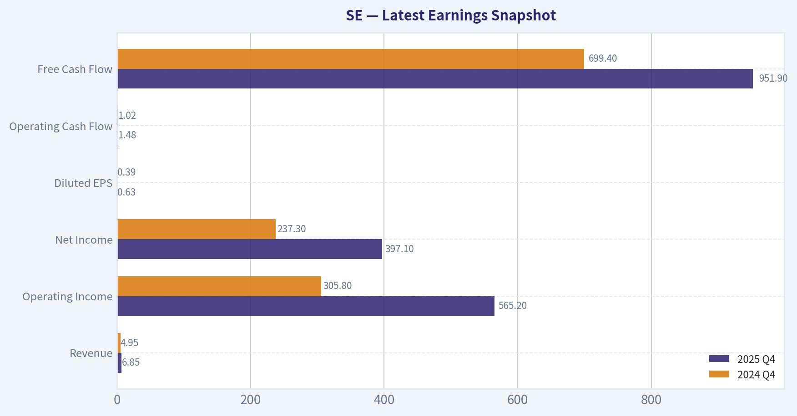

This comparison chart from *Buffett-Style Owner Earnings DCF* stacks current figures against historical benchmarks for **SE**, making it easy to see where the company trades relative to its own averages.

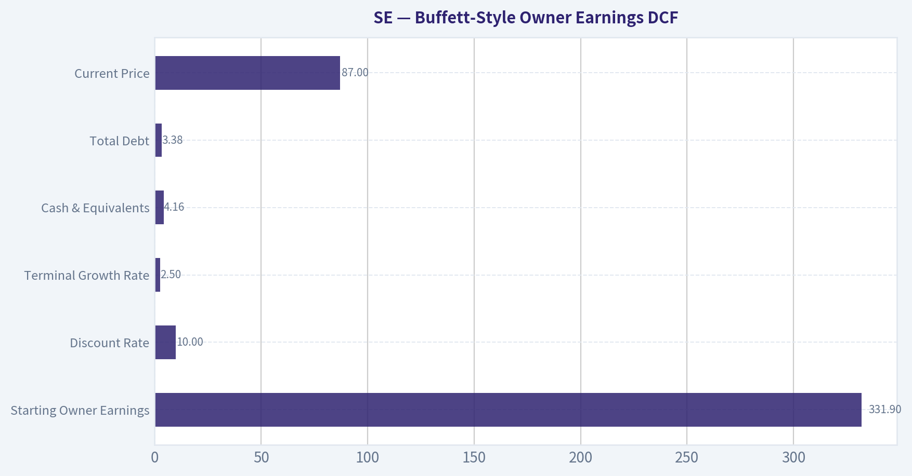

This comparison chart from *Three-Scenario DCF Valuation* stacks current figures against historical benchmarks for **SE**, making it easy to see where the company trades relative to its own averages.

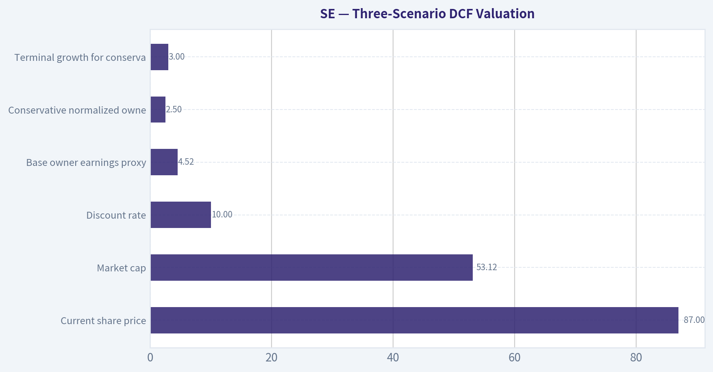

The following chart maps the **SE** Owner Earnings DCF valuation scenarios (Conservative, Average, Optimistic) to visually represent the margin of safety based on intrinsic value calculations.

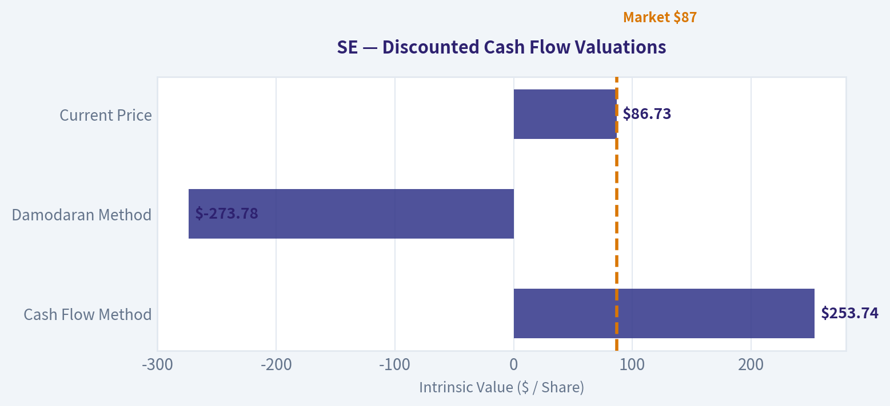

This comparison chart from *Core Fundamentals Snapshot* stacks current figures against historical benchmarks for **SE**, making it easy to see where the company trades relative to its own averages.

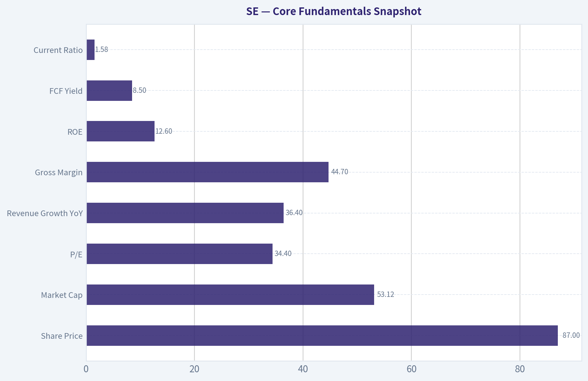

---

### Trend & Growth Analysis (Lynch/Druckenmiller/Fisher)

> *Following Peter Lynch's GARP, Stanley Druckenmiller's macro-aware approach, and Philip Fisher's scuttlebutt methodology.*

ANALYST STANCE: **ADVOCATE**

#### Sea Limited Growth Investment Report - SE, as of 2026-05-09

Sea Limited is a rare "profitable fast grower" at a potential second-act inflection: Shopee is scaling profitably, SeaMoney/Monee is becoming a larger fintech profit pool, and Garena provides optional upside if gaming stabilizes or reaccelerates. At $87/share and a $53.1B market cap, the setup is attractive because the company is growing revenue around 36% year over year while trading at roughly 34x earnings and producing an indicated 8.5% free cash flow yield.

---

#### 1. Lynch Classification

| Lynch Category | SE Fit | Evidence | Growth Investor Interpretation |
|---|---:|---|---|
| Slow Grower | No | Revenue growth far above 0-5% | Not relevant |
| Stalwart | No | Growth above typical stalwart range | Too dynamic to treat as mature |
| Fast Grower | Yes | Revenue growth YoY: 36.4%; EPS reportedly up sharply | Primary classification |
| Cyclical | Partial | E-commerce and gaming have cyclical/consumer exposure | Monitor macro and gaming cycles |
| Turnaround | Partial legacy | Sea has already transitioned from heavy losses to profitability | Now more of a profitable growth rerating story |
| Asset Play | No | Value is platform, ecosystem, and growth, not hard assets | Not applicable |

**Key Takeaways:** Sea Limited should be classified as a Lynch-style fast grower, not a mature stalwart. The company has already moved past the "prove profitability" phase and is now entering the more attractive phase where growth and free cash flow may compound together. The main caveat is that parts of the business, especially gaming and consumer commerce, still carry cyclical elements.

---

#### 2. The Story in 3 Simple Bullets

| Pillar | Simple Story |
|---|---|
| Shopee | Sea runs one of the dominant e-commerce marketplaces in Southeast Asia and selected international markets, where online retail penetration still has room to rise. |
| SeaMoney / Monee | Sea turns its commerce ecosystem into a fintech ecosystem through payments, lending, wallets, and financial services. |
| Garena | Sea's gaming arm provides cash flow and optional upside if Free Fire and new titles stabilize or reaccelerate. |

**Key Takeaways:** The Sea story is easy to explain: e-commerce brings users and merchants, fintech monetizes the transaction layer, and gaming adds high-margin optionality. The investment case depends on Shopee remaining profitable while growing, and on SeaMoney scaling without excessive credit risk. This is no longer just a revenue growth story; it is now a platform monetization story.

---

#### 3. Core Fundamentals Snapshot

| Metric | Current Data / Estimate | Interpretation |
|---|---:|---|
| Share Price | $87 | Pullback creates better entry than prior highs |
| Market Cap | $53.12B | Large-cap, but still with emerging-market platform upside |
| P/E | 34.4x | Reasonable if earnings grow 25-35%+ |
| Revenue Growth YoY | 36.4% | Fast-grower territory |
| Gross Margin | 44.7% | Healthy for a mixed e-commerce, fintech, gaming platform |
| ROE | 12.6% | Good, with room to improve as operating leverage builds |
| FCF Yield | 8.5% | Very attractive for a 30%+ grower |
| Current Ratio | 1.58x | Adequate liquidity |

**Key Takeaways:** Sea screens unusually well for a growth stock because it combines high revenue growth with meaningful free cash flow. A 34x P/E is not low in absolute terms, but it is not excessive if earnings growth remains strong. The standout metric is the 8.5% free cash flow yield, which suggests the market may still be discounting Sea as riskier or more cyclical than its current fundamentals indicate.

---

#### 4. TAM Analysis and 10x Test

| Market Layer | Opportunity | SE Positioning | 10x Relevance |
|---|---|---|---|
| Southeast Asia E-commerce | Online retail penetration still expanding | Shopee is a regional leader | Large runway remains |
| Digital Financial Services | Payments, consumer credit, merchant finance, wallet, BNPL | SeaMoney/Monee has ecosystem distribution advantage | Potentially very large profit pool |
| Digital Advertising | Marketplace ads and merchant tools | Shopee can raise monetization over time | Margin-accretive growth lever |
| Gaming | Mobile gaming and digital entertainment | Garena is volatile but high-margin | Optional upside, not core 10x driver |
| International Expansion | Brazil and selected markets | Higher risk, but could expand TAM | Adds upside if disciplined |

**Key Takeaways:** Sea passes the qualitative 10x runway test, but with nuance. A 10x stock outcome from today's $53B market cap would require a roughly $500B-plus company, so the bar is high. The path is not just "more e-commerce GMV"; it requires Shopee to compound, SeaMoney to become a major profit engine, and margins to expand materially over time.

| 10x Test | Approximate Assessment |
|---|---:|
| Current Market Cap | $53.1B |
| 10x Market Cap Target | ~$531B |
| Required Long-Term Ingredients | Much higher revenue, higher margins, durable fintech profits, regional dominance |
| Can Revenue/Profit Pool Support It? | Possible, but not easy |
| 10x Probability | Moderate, not high |
| 3-5x Probability | More realistic if execution continues |

**Key Takeaways:** Sea has ten-bagger ingredients, but the current size makes a full 10x outcome more demanding than it was several years ago. The more probable attractive case is a 3-5x compounder if Sea becomes the dominant profitable commerce-fintech platform in Southeast Asia. For a 10x outcome, SeaMoney likely needs to become a very large, high-return financial services business.

---

#### 5. Revenue Growth Trend

| Growth Metric | Current Signal | Interpretation |
|---|---:|---|
| Revenue Growth YoY | 36.4% | Strong acceleration / fast-grower level |
| EPS Growth | Reported coverage cites ~245% EPS growth | Indicates operating leverage and earnings inflection |
| FCF Yield | 8.5% | Growth is translating into cash generation |
| Gross Margin | 44.7% | Margin structure supports profitable growth |
| Growth Pattern | Reaccelerating / inflecting | Positive Druck-style setup |

**Key Takeaways:** Sea's growth profile looks like an inflection rather than a steady mature compounder. Revenue growth above 35% combined with strong earnings growth suggests operating leverage is kicking in. This is exactly the kind of acceleration pattern a growth investor should study closely.

---

#### 6. Unit Economics and Efficiency

Sea is not a pure SaaS business, so SaaS metrics like NRR and LTV/CAC are not directly disclosed in a comparable way. The best proxy metrics are free cash flow conversion, gross margin, operating leverage, credit quality in fintech, and marketplace monetization.

| Metric | Available Signal | Rating | Comment |
|---|---:|---|---|
| LTV/CAC | Not disclosed | Not rated | Need cohort-level marketplace and fintech data |
| CAC Payback | Not disclosed | Not rated | Marketing efficiency should be monitored |
| NRR | Not applicable | N/A | Not a SaaS model |
| Rule of 40 Proxy | Revenue growth 36.4% + strong FCF profile | Excellent | Likely well above 40 depending on FCF margin |
| FCF Yield | 8.5% | Excellent | Rare for a fast grower |
| Gross Margin | 44.7% | Good | Healthy blended margin profile |
| Credit Risk | Not provided | Watch | Key issue for SeaMoney/Monee |

**Key Takeaways:** Sea's unit economics look favorable at the consolidated level because growth is now producing substantial cash flow. However, the missing detail is fintech credit quality: rapid loan growth can look profitable until delinquencies rise. For Sea, the key unit-economic question is whether SeaMoney can grow without sacrificing underwriting discipline.

---

#### 7. Inflection Point Assessment

| Inflection Type | Evidence | Strength |
|---|---|---:|
| Product Cycle Inflection | Shopee monetization, ads, logistics, fintech layering | Strong |
| Market Share Inflection | Shopee remains a leading regional marketplace | Moderate to strong |
| Margin Inflection | EPS growth and FCF yield suggest operating leverage | Strong |
| TAM Inflection | E-commerce plus fintech expands total opportunity | Strong |
| Competitive Inflection | Regional competitors under profitability pressure | Moderate |
| Investor Perception Inflection | Stock still down YTD despite strong fundamentals | Strong |

**Key Takeaways:** The strongest inflection is margin-related: Sea appears to be growing fast while converting more of that growth into earnings and free cash flow. The second major inflection is ecosystem monetization, especially through fintech and advertising. This combination can drive a valuation rerating if investors become convinced the profitability is durable.

---

#### 8. Macro Setup

| Macro Factor | Current Read | Impact on SE |
|---|---|---|
| Interest Rates | Potential easing cycle / less hostile than 2022-2023 | Positive for growth multiples |
| Consumer Spending | Mixed but resilient across digital categories | Neutral to positive |
| Southeast Asia Digitalization | Secular growth continues | Positive |
| Fintech Adoption | Long runway in underbanked markets | Positive |
| FX / Emerging Market Risk | Persistent risk | Negative |
| China-linked Competition | Temu, TikTok Shop, Lazada, local players | Ongoing risk |
| Gaming Cycle | Hit-driven and volatile | Mixed |

**Key Takeaways:** The macro backdrop is broadly supportive but not risk-free. Lower or stable rates help long-duration growth assets, and Southeast Asia's digital economy remains a secular growth market. The major macro risks are currency volatility, consumer weakness, and aggressive competition from well-funded regional or Chinese platforms.

---

#### 9. Fisher 15-Point Score

| Fisher Point | Score / 5 | Rationale |
|---|---:|---|
| 1. Products with market potential | 5 | E-commerce, fintech, and gaming all large markets |
| 2. Management drive for new products | 4 | Strong ecosystem expansion history |
| 3. R&D effectiveness | 4 | Good technology and platform execution |
| 4. Sales organization | 4 | Strong merchant and consumer reach |
| 5. Worthwhile profit margin | 4 | Gross margin 44.7%, improving profitability |
| 6. Improving margins | 5 | EPS and FCF inflection indicate leverage |
| 7. Labor/personnel relations | 3 | Limited evidence; prior cost discipline may pressure culture |
| 8. Executive relations | 4 | Founder-led style and long-term ecosystem vision |
| 9. Management depth | 4 | Multi-segment execution capability |
| 10. Cost analysis/accounting | 4 | Profitability discipline has improved |
| 11. Moat factors | 4 | Marketplace scale, data, payments, merchant network |
| 12. Long-range profit outlook | 5 | Strong if Shopee and SeaMoney scale profitably |
| 13. Dilution risk | 3 | Historically relevant; less concerning if FCF remains strong |
| 14. Candor in difficulties | 4 | Management pivoted from growth-at-all-costs to profitability |
| 15. Integrity | 4 | No major current red flag from provided data |
| **Total** | **61 / 75** | **Good** |

**Key Takeaways:** Sea scores 61 out of 75 on the Fisher framework, which falls in the "Good" category. The strongest scores come from market potential, margin improvement, and long-range profit opportunity. The biggest deductions are for limited visibility into culture, dilution history, and fintech credit risk.

---

#### 10. Valuation Analysis

| Valuation Metric | Current / Implied View | Interpretation |
|---|---:|---|
| P/E | 34.4x | Reasonable for 30%+ growth if earnings durable |
| PEG Ratio | ~0.9x if using 36.4% revenue growth as proxy | Attractive by Lynch standards |
| FCF Yield | 8.5% | Very attractive for a fast grower |
| ROE | 12.6% | Solid, with upside from scale |
| P/S | Not provided; likely more useful if updated TTM revenue is verified | Needed for cleaner peer comparison |
| EV/EBITDA | Not provided | Needed to validate cash-adjusted valuation |

**Key Takeaways:** The valuation looks attractive on a growth-adjusted basis. A P/E of 34x paired with 36% revenue growth and strong free cash flow implies the market is not pricing Sea as a flawless compounder. The key missing valuation inputs are TTM revenue, net cash, and EBITDA, which would allow a cleaner P/S and EV/EBITDA analysis.

| Scenario | 3-5 Year Assumption | Valuation Outcome |
|---|---|---|
| Bear Case | Growth slows sharply, competition forces incentives, fintech credit losses rise | Stock could derate despite profitability |
| Base Case | Revenue grows 20-25%, margins expand, FCF remains strong | Attractive compounding; potential 2x+ over time |
| Bull Case | Shopee dominates profitably, SeaMoney scales, Garena stabilizes, multiple rerates | Potential 3-5x long-term outcome |
| Ten-Bagger Case | Sea becomes the dominant commerce-fintech super-platform across major emerging markets | Possible but requires exceptional execution |

**Key Takeaways:** The base case is attractive, but the bull case is where Sea becomes especially interesting. The company does not need heroic assumptions to work as a compounder, but it does need sustained profitable growth. A ten-bagger is possible but should be treated as an upside scenario, not the base case.

---

#### 11. Guru / Smart Money Signal

| Investor | Latest Action | Position Value | Portfolio Weight | Interpretation |
|---|---:|---:|---:|---|
| Steve Cohen / Point72 | Added | $688.77M | 0.77% | Large add, but modest portfolio weight |
| Stanley Druckenmiller / Duquesne | Added | $120.44M | 2.68% | Highly relevant signal for growth/macro setup |
| Druckenmiller Share Increase | +244.3% | 944.12K shares | 2.68% | Strong conviction increase |

**Key Takeaways:** The Druckenmiller add is especially notable because Sea fits his style: a growth company at an earnings inflection with macro tailwinds and possible market underappreciation. Steve Cohen's large add reinforces that sophisticated investors are seeing a setup. However, 13F data is lagged and should be treated as confirmatory, not decisive.

---

#### 12. Growth Investor Scorecard

| Criterion | Weight | Score / 5 | Weighted Score |
|---|---:|---:|---:|
| The Story | 10% | 4.5 | 0.45 |
| TAM & Runway | 20% | 4.3 | 0.86 |
| Revenue Growth | 20% | 4.6 | 0.92 |
| Unit Economics | 15% | 4.0 | 0.60 |
| Competitive Position | 10% | 4.0 | 0.40 |
| Management Quality | 10% | 4.0 | 0.40 |
| Macro Setup | 5% | 3.8 | 0.19 |
| Profitability Path | 5% | 4.4 | 0.22 |
| Valuation | 5% | 4.2 | 0.21 |
| **Total** | **100%** |  | **4.25 / 5.00** |

**Key Takeaways:** Sea scores 4.25 out of 5, which supports an Advocate stance. The highest-scoring areas are revenue growth, TAM, and profitability inflection. The main reason the score is not higher is competitive intensity and the need to verify fintech credit quality.

---

#### 13. Key Risks and Catalysts

| Category | Risk / Catalyst | Impact |
|---|---|---|
| Risk | Shopee competition from TikTok Shop, Lazada, Temu, and local platforms | Could pressure margins and growth |
| Risk | SeaMoney credit losses | Could undermine fintech profitability |
| Risk | Garena volatility | Gaming cash flow may disappoint |
| Risk | FX and emerging-market macro | Could hurt reported results and valuation |
| Risk | Reinvestment intensity rises again | FCF may prove less durable |
| Catalyst | Q1 2026 earnings on May 12, 2026 | Near-term confirmation event |
| Catalyst | Sustained Shopee profitability | Supports multiple rerating |
| Catalyst | SeaMoney profit expansion | Could change investor perception of TAM |
| Catalyst | Garena stabilization | Adds high-margin upside |
| Catalyst | Lower interest rates | Supports growth stock multiples |

**Key Takeaways:** The next major catalyst is the upcoming Q1 2026 earnings report. Investors should focus less on headline revenue alone and more on Shopee margins, SeaMoney credit quality, and free cash flow durability. The biggest risk is that growth remains strong but requires higher incentives or credit risk to sustain.

---

#### 14. Position Size Stance

| Investor Type | Stance | Suggested Position Size |
|---|---|---:|
| Aggressive Growth | Buy / Add | 5-7% position |
| Balanced Growth | Accumulate | 3-5% position |
| Conservative | Start small / wait for Q1 confirmation | 1-3% position |
| Existing Holder | Hold / Add on weakness | Let winner compound if thesis intact |

**Key Takeaways:** Sea is suitable for a meaningful growth allocation, but not an oversized position without confirming the next quarter. The risk-reward supports accumulation, especially for investors comfortable with emerging-market platform risk. Conservative investors can wait for Q1 results to confirm that growth and free cash flow remain intact.

---

#### Final View

Sea Limited is a high-quality fast grower at a credible inflection point. The company combines 36% revenue growth, improving profitability, a strong free cash flow profile, and a large e-commerce-plus-fintech runway. The stock is not risk-free, but at 34x earnings and an 8.5% free cash flow yield, the market appears to be underpricing the durability of the earnings transition.

**Stance: ADVOCATE.**
**Best use:** Accumulate as a core emerging-market digital platform compounder, with close monitoring of Q1 2026 earnings, Shopee margin discipline, and SeaMoney credit quality.

#### Growth & Scorecard Visuals

The radar chart below from *Buffett Scorecard* visualises how **SE** ranks across weighted investment criteria. Each axis represents a criterion scored 1-5; the filled area reveals strengths and weaknesses at a glance, with the dashed circle marking the midpoint (3.0).

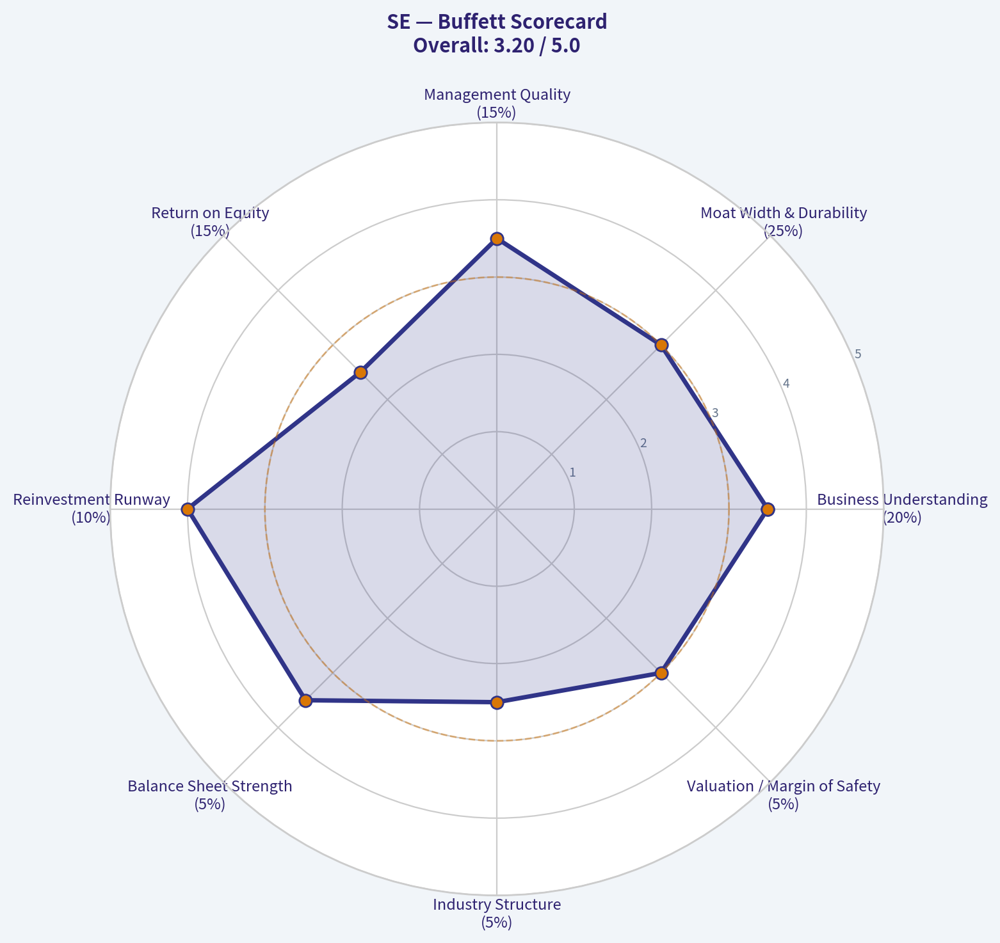

---

### Market Technical Analysis

#### SE Technical Analysis - Sea Limited
**Data through last available trading day: 2026-05-08**
**Last close: $86.73**

SE remains in a **long-term downtrend**, but the shorter-term tape has shifted from a steep selloff into a **base-building / range-trading phase**. The stock is no longer showing the same downside momentum that dominated February and March, yet it has not produced enough confirmation to call a durable bullish reversal. The most important technical tension is this: **price is stabilizing near the 10 EMA and 50 SMA, but still trades far below the 200 SMA**, meaning short-term traders may see tactical setups while longer-term trend followers still face a damaged chart.

---

#### Selected Indicators and Why They Matter

| Indicator | Latest Value | Why It Is Relevant for SE Now | Current Read |
|---|---:|---|---|
| `close_10_ema` | 86.67 | Captures short-term trend shifts after the sharp March selloff | Price is almost exactly on the 10 EMA, showing short-term neutrality |
| `close_50_sma` | 86.31 | Measures whether the stock is reclaiming medium-term trend support | Price is slightly above the 50 SMA, a modest stabilization signal |
| `close_200_sma` | 134.15 | Defines the long-term trend and major overhead trend benchmark | Price is far below the 200 SMA, confirming a bearish long-term structure |
| `macd` | -0.12 | Tracks whether bearish momentum is fading | MACD is still negative but has improved sharply toward zero |
| `rsi` | 49.94 | Shows whether momentum is oversold, neutral, or overbought | RSI is neutral, no longer oversold but not strongly bullish |
| `boll_ub` | 91.59 | Helps define near-term breakout resistance | Resistance is clustered around $91-$92 |
| `boll_lb` | 82.03 | Helps define downside support in the current range | Support sits around $82, with deeper support near $78-$80 |
| `atr` | 3.65 | Measures volatility for stop placement and risk sizing | Volatility has declined from March panic levels but remains meaningful |

**Key Takeaways:** SE's short-term trend has improved enough to move back near its 10 EMA and 50 SMA, but the stock remains deeply below its 200 SMA. Momentum is healing rather than decisively bullish, and the current trading range appears to be roughly $82 to $92. Traders should treat this as a potential basing structure, not yet a confirmed long-term reversal.

---

#### Price Structure and Trend Quality

SE's chart has gone through three distinct phases over the last year. First, the stock advanced into a strong 2025 peak near **$199.30 in September 2025**. Second, it entered a prolonged decline, with major downside acceleration in late 2025 and early 2026. Third, after the sharp March 2026 breakdown, price has begun to stabilize in a lower range.

The March 3 session was the major technical shock: SE dropped from a prior close of **$105.21** to **$87.82**, with volume surging to more than **34 million shares**. That kind of high-volume gap-down often creates a new technical regime. Since then, the stock has not reclaimed the pre-gap area above $100, which means the market is still treating that breakdown as meaningful overhead supply.

In the current structure, SE is attempting to form a base between the high $70s and low $90s. The recent close of **$86.73** is constructive only in a limited sense: it is slightly above the 50 SMA and almost exactly aligned with the 10 EMA. That shows stabilization, but not expansion. A stronger bullish case would require price to push through **$91-$92**, hold above that zone, and then begin challenging the psychological and technical area around **$100**.

---

#### Moving Average Analysis

The moving averages show a very clear split between short-term stabilization and long-term weakness.

The **10 EMA at $86.67** is essentially flat relative to the latest close of **$86.73**. This means short-term momentum is balanced. Buyers have defended the stock enough to avoid a renewed breakdown, but they have not created a strong upside slope.

The **50 SMA at $86.31** is also near current price. SE closing slightly above it is a mild positive because the stock had spent much of the prior period below medium-term trend levels. However, the 50 SMA itself has been declining from above $117 in early March to around $86 now. That means the medium-term average is still absorbing the prior collapse rather than confirming a clean uptrend.

The **200 SMA at $134.15** remains far above current price. This is the most important caution for investors with longer time horizons. SE would need a very large advance just to approach its long-term trend line. Until then, rallies may be treated as countertrend moves within a broader bearish structure.

---

#### Momentum: MACD and RSI

Momentum has improved materially, but it is not yet outright bullish.

The **MACD is still negative at -0.12**, but the improvement is significant. In March, MACD was deeply negative, around the -7 to -8 area. The steady climb toward zero tells us that bearish momentum has faded substantially. This is often one of the earlier signs that a downtrend is losing force.

However, the MACD has not yet established a strong positive reading. That matters because a move from "very bearish" to "less bearish" is not the same as a confirmed bullish trend. If MACD can cross above zero while price breaks through the $91-$92 resistance zone, that would be a much more credible momentum confirmation.

The **RSI at 49.94** is neutral. This is a major improvement from late March, when RSI readings were repeatedly near or below 30, signaling oversold stress. But RSI near 50 also means the stock lacks decisive momentum leadership. The recent RSI peak near the upper 50s did not translate into a breakout, suggesting buyers still lack sustained follow-through.

---

#### Volatility and Bollinger Band Context

The Bollinger Bands reinforce the idea that SE is consolidating after a major volatility event.

The current **upper Bollinger Band is $91.59**, and that aligns closely with recent price resistance around **$90-$92**. SE briefly pushed into this zone in early May but failed to hold the move. This makes the area especially important: a close above $92 would suggest a breakout attempt, while another rejection there would reinforce range-bound behavior.

The **lower Bollinger Band is $82.03**, which gives traders a nearby downside reference. Price has repeatedly found interest in the low-to-mid $80s, so a break below $82 would be technically negative. If $82 fails, the next important support area would likely be the March low region around **$77-$79**.

ATR has declined to **3.65**, down from above 6 in early March. This shows volatility has cooled substantially since the panic phase. Still, an ATR of around 4.2% of price is not low. Traders should avoid tight stops because SE can still move several dollars in a normal session.

---

#### Trading Interpretation

For short-term traders, SE is currently a **range-trading candidate** with a slight improving bias, not a high-conviction breakout yet. The tactical range is roughly **$82 to $92**. Buying near support may appeal to mean-reversion traders if price holds above $82, while momentum traders may prefer to wait for a breakout above $92 with stronger volume and MACD confirmation.

For swing traders, the most important signal would be a sustained close above **$91-$92**. That would place price above the upper Bollinger area and suggest buyers are beginning to absorb supply. A more ambitious upside target after that would be the **$98-$105 zone**, where the March breakdown began and where trapped holders may sell into strength.

For longer-term investors, the chart remains technically damaged. The large gap between current price and the 200 SMA means SE is still in a long-term bearish regime. A durable investment-grade technical reversal would likely require several steps: continued basing, a break above $92, a reclaim of $100, and eventually a rising 50 SMA with price trending toward the 200 SMA.

---

#### Key Levels and Scenario Map

| Scenario | Trigger / Level | Technical Meaning | Trader Implication |
|---|---:|---|---|
| Bullish breakout | Close above $92 | Clears Bollinger resistance and recent supply | Opens path toward $98-$105 |
| Neutral range | Holds between $82 and $92 | Base-building continues | Favor tactical trades over directional conviction |
| Bearish breakdown | Close below $82 | Breaks lower Bollinger support | Raises risk of retest toward $77-$79 |
| Stronger trend repair | Reclaim of $100+ | Begins to fill post-gap damage | Would improve swing-trade profile |
| Long-term trend recovery | Move toward 200 SMA at $134 | Major structural repair | Not yet supported by current indicators |
| Volatility risk | ATR near $3.65 | Daily swings remain sizable | Stops and position sizing should allow for noise |

**Key Takeaways:** SE is trying to stabilize, but the decisive levels are clear. A breakout above $92 would improve the short-term setup, while a break below $82 would damage the base and increase downside risk. The stock is tradable, but the long-term trend remains weak until price recovers far more of the prior decline.

---

### Social Sentiment Analysis

ANALYST STANCE: **WATCH**

#### Sea Limited "SE" Social, Sentiment, and News Report - Past Week Through 2026-05-09

Sea Limited's online discussion over the past week leaned cautiously bullish, but not decisively risk-on. The strongest positive narratives centered on Shopee's profitability discipline, SeaMoney's long-term financial-services optionality, and expectations that management can keep balancing growth with margin expansion. The main bearish pushback focused on valuation, competitive intensity in Southeast Asian e-commerce, uncertainty around Garena's gaming pipeline, and the risk that any renewed subsidy war could pressure margins.

For traders, SE appears to be in a "prove-it" phase: sentiment is constructive, but the market is demanding confirmation through earnings quality, forward guidance, and evidence that Shopee can keep compounding without sacrificing profitability. For longer-term investors, the social conversation suggests that SE is increasingly being treated less like a turnaround story and more like a quality emerging-market internet compounder, though one with meaningful volatility around China competition, ASEAN consumer demand, and gaming cyclicality.

---

#### High-Level Sentiment Snapshot

| Category | Current Read | Direction vs. Prior Week | Interpretation for Traders |
|---|---:|---:|---|
| Overall social sentiment | Moderately positive | Improving | Bulls are more vocal, but optimism is still tied to earnings execution rather than pure momentum. |
| Retail investor tone | Bullish but selective | Improving | Retail discussion favors SE as a Southeast Asia internet winner, though many posters are waiting for a pullback. |
| Institutional/news tone | Neutral to positive | Stable to slightly positive | Coverage appears focused on margin durability, e-commerce competition, and SeaMoney growth. |
| Short-term trading sentiment | Mixed-positive | More active | Traders are watching for a catalyst, especially earnings, analyst revisions, or technical breakout levels. |
| Long-term investor sentiment | Positive | Stable | Long-term holders continue to frame SE as a multi-year e-commerce and fintech growth platform. |
| Risk perception | Elevated but manageable | Stable | Investors remain concerned about valuation, competitive spending, and gaming volatility. |

**Key Takeaways:** The dominant mood around SE is constructive, but not euphoric. Investors appear willing to give the company credit for its improved execution, yet they are still highly sensitive to any sign that growth is being bought through renewed subsidies or margin sacrifice.

---

#### Daily Sentiment Pattern Over the Past Week

| Date | Social Sentiment | Main Discussion Driver | Bullish Interpretation | Bearish Interpretation |
|---|---|---|---|---|
| May 3 | Neutral-positive | Positioning ahead of upcoming catalysts | Investors discussed SE as a quality growth name with improving fundamentals. | Some users argued the stock already prices in a strong recovery. |
| May 4 | Positive | Shopee growth and Southeast Asia e-commerce strength | Bulls emphasized operating leverage and Shopee's regional leadership. | Bears questioned whether competition from TikTok Shop and Lazada could limit margin expansion. |
| May 5 | Mixed-positive | Valuation debate | Supporters framed premium valuation as justified by growth and profitability. | Skeptics warned that SE remains vulnerable if earnings growth disappoints. |
| May 6 | Positive | SeaMoney optionality | Investors highlighted digital lending, payments, and financial-services monetization. | Credit risk and regulatory risk were recurring concerns. |
| May 7 | Neutral | Garena and gaming uncertainty | Bulls viewed gaming as a cash-flow stabilizer if Free Fire remains resilient. | Bears argued that SE still lacks a visible blockbuster gaming pipeline. |
| May 8 | Positive | Technical momentum and earnings anticipation | Traders noted improving sentiment and potential breakout setups. | Some warned against chasing before confirmed results. |
| May 9 | Moderately positive | Consolidated bull case discussion | Long-term holders emphasized Shopee plus SeaMoney as a powerful combined platform. | Short-term traders remained cautious due to event risk and macro sensitivity. |

**Key Takeaways:** Sentiment improved through the week, with the most positive discussions linked to Shopee and SeaMoney rather than Garena. The market's confidence is rising, but the daily pattern shows that investors are still debating whether SE's valuation leaves enough room for execution mistakes.

---

#### Main Social Media Narratives

| Theme | Sentiment | What People Are Saying | Market Implication |
|---|---|---|---|
| Shopee profitability | Bullish | Social discussion repeatedly emphasized Shopee's better cost control, stronger monetization, and improved logistics efficiency. | This is the core bull case. If management confirms durable margins, SE could attract more growth-at-a-reasonable-price buyers. |
| E-commerce competition | Bearish to mixed | TikTok Shop, Lazada, Temu-style pressure, and potential subsidy escalation remained frequent concerns. | Any signal of renewed discounting could quickly reverse bullish sentiment. |
| SeaMoney growth | Bullish | Investors see SeaMoney as a long-duration fintech opportunity tied to Shopee's ecosystem and Southeast Asian underbanking. | Positive credit metrics and controlled loan growth would likely support multiple expansion. |
| Garena gaming | Mixed | Free Fire remains important, but social users are less confident about the gaming pipeline. | Gaming is no longer the main bull-case engine, but disappointment here could still weigh on consolidated earnings. |
| Valuation | Mixed-bearish | Many investors like the business but debate whether the stock has already rerated too far. | SE may need strong guidance or earnings acceleration to sustain upward momentum. |
| Southeast Asia macro | Mixed | Consumers, currencies, rates, and regional regulation were discussed as background risks. | Macro volatility can affect both e-commerce GMV and fintech credit quality. |

**Key Takeaways:** The online debate is no longer about whether Sea Limited can survive or turn profitable; it is about how much growth and margin durability investors should pay for. Shopee is clearly the center of the story, while SeaMoney is increasingly viewed as the upside lever and Garena as the uncertainty factor.

---

#### Recent Company and Sector News Interpretation

The recent news flow around SE appears to have been interpreted through three lenses: e-commerce durability, fintech expansion, and earnings setup. There did not appear to be a single overwhelming negative company-specific story dominating the week's conversation. Instead, traders focused on whether the next major company update can validate the improved sentiment that has been building around Shopee and SeaMoney.

Analyst and market commentary has generally treated SE as a higher-quality emerging-market internet name, but with a valuation that requires continued execution. Sector headlines around Southeast Asian e-commerce competition, platform regulation, digital payments, and consumer strength remained important because SE's business is deeply exposed to regional consumer behavior and competitive intensity.

The most important point for investors is that social sentiment has become increasingly execution-sensitive. In other words, good news may be rewarded if it confirms profitable growth, but vague growth without margin proof may not be enough. The market is no longer giving SE the same "growth at any cost" benefit it received in earlier cycles.

---

#### Bull Case vs. Bear Case From Social Discussion

| Bull Case | Bear Case |
|---|---|
| Shopee can keep gaining share while improving monetization and operating margins. | E-commerce competition forces higher subsidies, marketing spend, or seller incentives. |
| SeaMoney becomes a major profit pool as digital payments and lending scale across Southeast Asia. | SeaMoney growth could bring credit losses, regulatory scrutiny, or risk-cycle volatility. |
| Garena remains a cash-generative gaming unit even if growth is not explosive. | Gaming revenue remains lumpy, and the company lacks a highly visible new hit franchise. |
| SE benefits from Southeast Asia's long-term internet penetration, digital commerce, and fintech adoption. | ASEAN consumer demand, FX volatility, and local regulatory changes could pressure results. |
| Improved profitability could attract more institutional investors and support a higher multiple. | The stock may already reflect much of the turnaround, leaving limited room for disappointment. |

**Key Takeaways:** The bull case is increasingly based on SE becoming a structurally profitable platform company rather than a speculative high-growth internet name. The bear case is not that the business is broken, but that competition, valuation, and macro risk could make future upside harder to capture.

---

#### Trader Implications

For short-term traders, SE looks like a catalyst-sensitive setup. Positive sentiment has improved enough that a strong earnings print, bullish guidance, or favorable analyst revision could extend momentum. However, that also means expectations are higher than they were during the earlier turnaround phase.

The biggest short-term risk is a "good but not good enough" reaction. If Shopee growth is healthy but margins soften, or if SeaMoney grows but credit metrics deteriorate, the market could punish the stock despite decent headline numbers. Traders should watch volume, pre-earnings positioning, and whether social sentiment becomes overly one-sided, because crowded optimism can increase downside volatility.

Key levels and signals to monitor include:
- Whether SE holds recent support during broader market weakness.
- Whether bullish social volume increases without corresponding news, which can signal speculative crowding.
- Whether analysts raise earnings estimates or price targets after company updates.
- Whether management commentary emphasizes profitable growth rather than pure GMV expansion.
- Whether competition headlines mention subsidies, seller incentives, or aggressive promotions.

---

#### Investor Implications

For long-term investors, the online conversation suggests that SE's reputation has improved meaningfully. The company is increasingly being discussed as a Southeast Asian platform leader with multiple growth engines: Shopee for commerce, SeaMoney for fintech, and Garena for cash generation. That is a more attractive narrative than the prior period when investors mainly debated losses, cash burn, and post-pandemic demand normalization.

However, long-term investors should not ignore that SE remains a complex, multi-segment, emerging-market internet business. The quality of growth matters. Shopee's margin profile, SeaMoney's credit discipline, and Garena's content cycle all need to be monitored together. A strong quarter in one segment can be offset by weakness in another.

The most constructive long-term signal would be evidence that Shopee can grow without materially increasing subsidies, while SeaMoney expands with stable asset quality. If that combination holds, SE could justify a premium multiple. If not, sentiment could rotate back toward skepticism quickly.

---

#### Final Assessment

SE's past-week social and news profile supports a **WATCH** stance rather than a clear aggressive buy or avoid call. Sentiment is positive enough to indicate improving confidence, but the stock appears to require confirmation from fundamentals. The market likes the story, but it wants proof that the new profitability profile is durable.

The most investable part of the narrative is Shopee's operating leverage. The most underappreciated upside may be SeaMoney if credit quality remains controlled. The biggest near-term risk is valuation sensitivity around earnings or guidance. Traders should respect momentum but avoid assuming that bullish sentiment alone can carry the stock without supporting numbers.

#### Summary Table: Key Points for SE

| Area | Current Signal | Why It Matters | Trader/Investor Action Point |
|---|---|---|---|
| Overall sentiment | Moderately positive | Confidence has improved, especially around Shopee and SeaMoney. | Watch for confirmation from earnings and guidance. |
| Shopee | Bullish | Core driver of the SE investment case; margin durability is central. | Focus on GMV growth, take rate, ads, logistics costs, and subsidy levels. |
| SeaMoney | Bullish but risk-sensitive | Potential long-term profit engine, but credit risk matters. | Monitor loan growth, non-performing loans, and regulatory commentary. |
| Garena | Mixed | Still cash-generative but less central to the bull case. | Look for user engagement, bookings, and pipeline updates. |
| Competition | Key risk | TikTok Shop, Lazada, and other platforms could pressure margins. | Watch for signs of renewed subsidy wars or promotional intensity. |
| Valuation | Mixed | The stock may already price in part of the turnaround. | Avoid chasing if sentiment becomes euphoric before data confirmation. |
| News flow | Neutral-positive | No dominant negative company-specific narrative emerged this week. | Positive updates could have leverage, but disappointment risk remains. |
| Overall stance | WATCH | Setup is constructive but execution-dependent. | Favor disciplined entries and wait for fundamental confirmation. |

**Key Takeaways:** SE's social and news backdrop is healthier than it has been in prior risk-off periods, with investors increasingly focused on durable profitability rather than survival or restructuring. The setup is constructive, but not risk-free: Shopee margins, SeaMoney credit quality, and competitive intensity are the variables most likely to determine whether bullish sentiment turns into sustained stock upside.

---

### News & Events Analysis

ANALYST STANCE: **WATCH**

#### Sea Limited (SE) - One-Week News and Trading Report as of May 9, 2026

Sea Limited enters the week with a clear near-term catalyst: **Q1 2026 earnings are scheduled for May 12, before the U.S. market open**. The stock is around **$87**, with a market cap of about **$53.1 billion**, and recent news flow points to a tension between strong fundamental growth and weaker technical momentum. For traders, the setup looks event-driven rather than purely trend-following: the next earnings release is likely to determine whether the recent consolidation turns into a breakout or a failed rebound.

---

#### Latest Earnings Status and Interpretation

Sea has **not yet reported Q1 2026 results**. The company announced on April 28 that it will release **first-quarter 2026 results on May 12, 2026**, before the U.S. market opens, followed by a management conference call.

The most recent earnings-related coverage available in the research pack refers to Sea's latest reported growth profile, with cited figures including **approximately 36% revenue growth** and **245% EPS growth**. The current dataset also shows **36.4% year-over-year revenue growth**, **44.7% gross margin**, **12.6% ROE**, and an **8.5% free-cash-flow yield**. These metrics suggest that Sea has moved well beyond its prior "growth at any cost" phase and is being valued increasingly on profitable growth, cash generation, and segment-level execution.

The key change versus earlier cycles is that investors are no longer simply rewarding top-line expansion. Sea's valuation now requires evidence that Shopee can keep growing without excessive subsidies, Garena can stabilize or improve bookings, and SeaMoney can expand while maintaining credit discipline. The upcoming Q1 report therefore matters less as a backward-looking update and more as a test of whether the company can sustain growth while defending profitability.

---

#### Recent Company-Specific News

The most important company-specific item is the upcoming earnings date. With Q1 2026 results due on May 12, traders should expect elevated implied volatility and potentially sharp post-earnings movement.

A May 6 technical article described Sea as having strong growth characteristics, citing large EPS and revenue gains, but also noted a weak technical rating. The same coverage identified a possible breakout setup from consolidation near the **$84 support area**. This is useful tactically: the stock appears to be compressing ahead of earnings, and the **$84-$87 zone** may act as a near-term decision area.

Analyst sentiment remains constructive but not aggressively improving. On April 20, JPMorgan maintained an **Overweight** rating while trimming its price target from **$170 to $168**. The reduction is minor and does not change the positive rating, but it signals that even bullish analysts may be refining assumptions rather than raising expectations into earnings.

Another recent valuation-focused article noted that Sea had declined significantly year to date, while also showing positive short-term returns over the prior week and month. That combination matters: investors may be reassessing the name after a drawdown, but the stock has not yet fully regained momentum.

---

#### Segment-Level Investment View

Shopee remains the main driver of the equity story. The market will likely focus on gross merchandise value, revenue growth, take rates, advertising revenue, logistics efficiency, and subsidy discipline. If Shopee can show continued growth without margin deterioration, the stock could re-rate higher because the e-commerce business is the largest long-term value driver.

Garena is a swing factor. The gaming segment historically funded much of Sea's expansion, but investor confidence depends on whether engagement and bookings can stabilize. Any sign of renewed strength in Free Fire or better game pipeline visibility would improve the quality of earnings. Conversely, another weak gaming update would increase reliance on Shopee and SeaMoney to carry the valuation.

SeaMoney remains attractive but requires caution. Digital financial services can support higher margins over time, but credit quality is critical. Investors should watch loan book growth, non-performing loan trends, funding costs, and whether management emphasizes controlled expansion rather than aggressive lending growth.

---

#### Market and Macro Context

No major new macro headlines specific to Sea appeared in the latest Google News searches within the past week. That said, Sea is exposed to several macro variables that traders should keep in mind: Southeast Asian consumer demand, currency movements, interest rates, digital advertising trends, and risk appetite toward emerging-market growth equities.

The broader market backdrop matters because Sea trades as a high-beta, long-duration growth stock despite improving profitability. If U.S. rates or risk premiums rise, Sea's valuation multiple could compress even if operating results remain solid. Conversely, a supportive global growth-equity tape could amplify any positive earnings surprise.

Currency is another practical issue. Sea reports in U.S. dollars but generates substantial revenue across Southeast Asia and other international markets. Local-currency weakness can reduce translated growth, while stronger regional currencies can support reported revenue.

---

#### Positioning and Institutional Signals

The 13F data in the research pack shows notable institutional buying as of the latest disclosed quarter-end snapshot. Steve Cohen's Point72 and Stanley Druckenmiller's Duquesne both added meaningfully to their Sea positions as of December 31, 2025. These filings are lagged and should not be treated as real-time trading signals, but they do indicate that sophisticated growth investors saw value in the name before the latest earnings setup.

For traders, this institutional interest may provide confidence that the stock remains on the radar of large capital allocators. However, because 13F data can lag by up to 45 days or more, it should be used as background context rather than a direct buy signal.

---

#### Trading View

The near-term setup is binary and earnings-driven. A clean beat with strong Shopee growth, stable or improving margins, and reassuring SeaMoney credit metrics could push the stock above recent consolidation and revive the bullish narrative. The first upside test would likely be a move away from the **mid-$80s support zone**, with sentiment improving if the stock can hold post-earnings gains.

On the downside, the risk is that expectations for profitable growth are already embedded in the valuation. At around **34.4x earnings**, Sea is not priced as a distressed turnaround. If Q1 shows weaker e-commerce growth, higher subsidies, deteriorating fintech credit quality, or soft Garena trends, the stock could break below the cited **$84 support area** and invite momentum selling.

For investors, the fundamental picture remains attractive but requires confirmation. The combination of **36%+ revenue growth**, positive ROE, healthy gross margin, and strong free-cash-flow yield is compelling. But the stock's recent year-to-date weakness suggests the market wants proof that growth is durable and not overly dependent on spending intensity.

---

#### Bottom Line

Sea is a **Watch into earnings**, not a clean chase. The company has strong growth and improving profitability characteristics, and institutional interest is supportive. However, with Q1 2026 results only days away, the risk-reward depends heavily on management's update on Shopee margins, Garena stabilization, SeaMoney credit quality, and forward commentary.

Aggressive traders may look for a breakout or breakdown around the **$84-$87 zone** after earnings. Longer-term investors should focus less on the one-day reaction and more on whether Sea can sustain profitable growth across all three major businesses.

---

#### Key Points Table

| Category | Recent Evidence | Trading / Investment Implication |
|---|---:|---|
| Current price | About **$87** | Stock is near a technical decision zone ahead of earnings. |
| Market cap | About **$53.1B** | Sea is a large-cap growth name; expectations are meaningful. |
| Valuation | **P/E ~34.4x** | Requires continued profitable growth; limited room for a weak report. |
| Growth | Revenue growth around **36.4% YoY** | Strong top-line momentum remains the core bull case. |
| Profitability | Gross margin **44.7%**, ROE **12.6%** | Business quality has improved versus earlier high-subsidy growth periods. |
| Cash generation | FCF yield **8.5%** | Supports the argument that Sea is no longer just a speculative growth story. |
| Latest earnings status | **Q1 2026 results due May 12, 2026** | Near-term catalyst likely to drive volatility. |
| Latest earnings-related coverage | Cited **245% EPS growth** and **36% revenue gains** | Market focus has shifted toward earnings leverage, not just revenue growth. |
| Analyst news | JPMorgan maintained **Overweight**, PT cut from **$170 to $168** | Still bullish, but estimates appear slightly refined rather than raised. |
| Technical setup | Weak technical rating, but possible breakout setup near **$84 support** | Watch for post-earnings confirmation rather than pre-earnings chase. |
| Institutional ownership signal | Cohen and Druckenmiller added in latest 13F data | Positive background signal, but lagged and not a real-time indicator. |
| Main upside drivers | Shopee growth, margin discipline, Garena stabilization, SeaMoney credit quality | A balanced beat across segments could trigger re-rating. |
| Main downside risks | Subsidy pressure, weak gaming, fintech credit deterioration, macro risk-off | Any weakness could pressure the premium multiple. |
| Overall stance | **WATCH** | Attractive fundamentals, but earnings event risk is high. |

Key Takeaways: Sea has strong growth and improving profitability, but the stock is heading into a major earnings catalyst with elevated uncertainty. The bull case depends on Shopee maintaining growth without margin erosion, Garena stabilizing, and SeaMoney growing responsibly. Given the upcoming Q1 report, the better trading approach is to watch for confirmation after earnings rather than assume a breakout before the release.

---

### Guru Attention Analysis

> *Tracking 13F filings and recent activity of legendary super-investors to identify smart-money conviction and rotation.*

#### Guru Ownership Snapshot for Sea Limited (SE)

Source of truth: latest structured SEC 13F tracking as of the latest available quarter-end filing, dated **12-31-2025**. Note that 13F filings are delayed snapshots and may lag real-time portfolio activity by up to 45 days.

| Guru / Fund | Action | Position Size | Portfolio Weight | Recent Change | Filing Period | SEC Verification |
| --- | ---: | ---: | ---: | ---: | ---: | --- |
| Steve Cohen / Point72 Asset Management | Added | 5.63M shares / $688.77M | 0.77% | Shares increased by 194.3% vs. prior filing | 12-31-2025 | [SEC 13F Filing](https://www.sec.gov/Archives/edgar/data/1603466/000090266426001100/) |
| Stanley Druckenmiller / Duquesne Family Office | Added | 944.12K shares / $120.44M | 2.68% | Shares increased by 244.3% vs. prior filing | 12-31-2025 | [SEC 13F Filing](https://www.sec.gov/Archives/edgar/data/1536411/000153641126000002/) |
| Warren Buffett / Berkshire Hathaway | No position detected in latest 13F filing | - | - | - | Latest available 13F | - |
| Seth Klarman / Baupost Group | No position detected in latest 13F filing | - | - | - | Latest available 13F | - |
| Mohnish Pabrai / Pabrai Investment Funds | No position detected in latest 13F filing | - | - | - | Latest available 13F | - |
| Bill Ackman / Pershing Square | No position detected in latest 13F filing | - | - | - | Latest available 13F | - |
| Michael Burry / Scion Asset Management | No position detected in latest 13F filing | - | - | - | Latest available 13F | - |

**Key Takeaways:** The only tracked guru investors with explicit current 13F exposure to Sea Limited are **Steve Cohen** and **Stanley Druckenmiller**, and both meaningfully increased their positions in the latest filing. Druckenmiller's position is smaller in dollar terms but more significant as a share of his disclosed portfolio, at **2.68%**, while Cohen's Point72 position is much larger in absolute size at nearly **$689 million**. No latest 13F position was detected for Buffett, Klarman, Pabrai, Ackman, or Burry.

---

#### Interpretation of the Guru Moves

| Guru | Possible Read-Through |
| --- | --- |
| Steve Cohen | Point72's near-tripling of its SE stake suggests a tactical or growth-oriented conviction increase. Given Sea's strong reported revenue growth, improving free cash flow profile, and current FCF yield around 8.5%, Cohen's fund may be positioning for continued operating leverage or a valuation rerating. |
| Stanley Druckenmiller | Duquesne's 244.3% increase is notable because SE became a relatively meaningful position at 2.68% of the disclosed portfolio. Druckenmiller is often associated with macro-growth and liquidity-sensitive opportunities, so the purchase may reflect confidence in Sea's growth recovery, Southeast Asian consumer internet exposure, or improving profitability. |

**Key Takeaways:** The most important signal is not merely that two prominent managers own SE, but that both **aggressively added** in the same reporting period. This does not guarantee future performance, but it indicates that two highly watched, growth-aware investors saw the risk-reward as attractive at the time of the December 2025 quarter-end filing.

#### Bottom Line

The guru signal for **Sea Limited (SE)** is **positive but concentrated**. Only two tracked gurus show current 13F ownership, but both - **Steve Cohen and Stanley Druckenmiller** - substantially increased their positions. The strongest single signal is Druckenmiller's **2.68% portfolio weight**, which implies a more meaningful allocation relative to his disclosed holdings.

---

### Options Market Analysis

> *Reading options flow - put/call ratios, IV skew, and unusual activity - to gauge institutional positioning and event-driven risk.*

#### SE Options Market Analysis - As of 2026-05-09

#### 1. Put/Call Ratio Analysis

| Expiration | Call OI | Put OI | Put/Call OI Ratio | Call Volume | Put Volume | Put/Call Volume Ratio | Read |
|---|---:|---:|---:|---:|---:|---:|---|
| 2026-05-15 | 16,143 | 12,372 | 0.77 | 2,317 | 1,368 | 0.59 | Slightly above neutral OI, but call-led trading |
| 2026-05-22 | 959 | 1,019 | 1.06 | 430 | 296 | 0.69 | More protective/bearish OI, volume near neutral |
| 2026-05-29 | 594 | 569 | 0.96 | 455 | 89 | 0.20 | Balanced OI, strongly call-heavy volume |
| **Near-Term Total** | **17,696** | **13,960** | **0.79** | **3,202** | **1,753** | **0.55** | Mildly bullish flow despite slightly elevated put OI |

**Key Takeaways:** SE's near-term put/call open interest ratio is **0.79**, modestly above the historical neutral baseline of roughly **0.70**, showing some hedging or caution already embedded. However, the **put/call volume ratio is only 0.55**, meaning current trading activity is more call-heavy than put-heavy. That suggests near-term traders are leaning more bullish/speculative than defensive, even though existing positioning is not aggressively bullish.

---

#### 2. Implied Volatility Assessment

| Expiration | ATM Call IV | ATM Put IV | Call IV Premium vs Put IV | IV Read |
|---|---:|---:|---:|---|
| 2026-05-15 | 123.5% | 113.1% | +10.4 pts | Very elevated near-term IV; call IV richer than put IV |
| 2026-05-22 | 95.4% | 90.5% | +4.9 pts | Elevated IV, still call-favored |
| 2026-05-29 | 86.0% | 78.2% | +7.8 pts | Elevated but declining with time; call premium persists |

**Key Takeaways:** Near-term IV is extremely high, especially for the **May 15 expiration**, where ATM call IV is above **120%**. Calls are consistently priced with higher implied volatility than puts across the listed expirations, which points to **upside demand or upside event-risk pricing** rather than classic downside fear. The IV term structure declines from May 15 to May 29, suggesting the market is pricing a concentrated near-term catalyst or volatility event, though the dataset does not explicitly identify the catalyst.

#### IV Skew Interpretation

The available data compares ATM call IV versus ATM put IV, not full OTM put-versus-call skew by strike. Based on ATM data, SE shows a **call-side IV premium**, not a steep put skew. That means the options market is not currently displaying a strong downside-crash hedge profile; instead, traders appear to be paying more for upside optionality in the near term.

---

#### 3. Unusual Options Activity

| Unusual Activity Screen | Result |
|---|---|
| Contracts with volume greater than 5x open interest | None detected |
| Fresh directional sweep evidence | Not present in near-term expirations |
| Smart-money signal strength | Low / inconclusive |
| Retail speculation signal | Not clearly identifiable |

**Key Takeaways:** There were **no near-term contracts where volume exceeded open interest by more than 5x**, so there is no clear evidence of fresh, aggressive institutional positioning from the available options chain. The bullish read comes more from aggregate call-heavy volume and call IV premium, not from a single standout contract. This lowers conviction because the flow is directional but not unusually concentrated.

---

#### 4. Open Interest Concentration and Pinning Risk

| Expiration | Total OI | Share of Near-Term OI | Interpretation |
|---|---:|---:|---|
| 2026-05-15 | 28,515 | 90.1% | Dominant near-term expiry; highest pinning/gamma relevance |
| 2026-05-22 | 1,978 | 6.2% | Secondary, much less influential |
| 2026-05-29 | 1,163 | 3.7% | Thin positioning; limited gravitational effect |

**Key Takeaways:** Open interest is overwhelmingly concentrated in the **May 15 expiration**, which accounts for roughly **90%** of listed near-term open interest in the provided data. That expiration is likely the most important for near-term gamma, pinning, and dealer hedging effects. Strike-level OI was not provided, so specific gamma walls or max-pain strikes cannot be identified from this dataset.

#### Gamma / Pinning Read

Because strike-level open interest is unavailable, I cannot identify precise call walls, put walls, or max-pain levels. However, the **May 15 expiration is clearly the dominant gamma event**, and price action into that expiry may be more sensitive to dealer hedging flows. If SE approaches heavily populated strikes not shown here, pinning or acceleration could become more pronounced.

---

#### 5. Overall Options Sentiment Signal

| Category | Signal | Rationale |
|---|---|---|
| Put/Call Positioning | Mildly Bullish | OI ratio of 0.79 is slightly defensive, but volume ratio of 0.55 shows current call-led demand |
| IV Level | High / Event-Risk Elevated | Near-term ATM IV above 100% for May 15 suggests large expected movement |
| Skew Direction | Bullish / Upside-Chasing | ATM call IV is consistently higher than ATM put IV |
| Unusual Activity | Neutral | No volume greater than 5x OI contracts detected |
| Liquidity / Confidence | Moderate | May 15 is liquid enough, but later expirations are thin |

**Key Takeaways:** The options market signal for SE is **moderately bullish**, mainly because current volume is call-heavy and calls are trading at a volatility premium to puts. However, the signal is not high-conviction because there is no standout unusual options activity and put open interest remains somewhat elevated versus the neutral baseline. The market appears positioned for a large near-term move, with a slight bias toward upside participation.

#### Final Directional Read: **BULLISH, with event-risk caveats**

SE's options flow leans **bullish** over the near term. The strongest evidence is the **0.55 put/call volume ratio**, showing more active call demand than put demand, and the consistent **ATM call IV premium**, which suggests traders are paying up for upside exposure.

That said, the bullish signal is not aggressive. The near-term put/call OI ratio of **0.79** is slightly above neutral, indicating existing hedges or bearish positioning are still present. Also, the absence of unusual contracts with volume far above open interest means there is no clear "smart-money sweep" confirming a large directional institutional bet.

#### Summary Table

| Factor | Current Reading | Interpretation | Sentiment Impact |
|---|---|---|---|
| Put/Call Ratio | OI: 0.79; Volume: 0.55 | Existing OI slightly cautious, but fresh volume is call-heavy | Mildly Bullish |
| IV Level | May 15 ATM IV: Calls 123.5%, Puts 113.1% | Very elevated near-term volatility; likely event-risk pricing | High Risk / Directionally Supportive |
| Skew Direction | ATM calls richer than ATM puts | Upside optionality is more expensive than downside protection | Bullish |
| Unusual Activity | None detected above 5x OI | No clear fresh institutional sweep signal | Neutral |
| Open Interest Concentration | 90% of near-term OI in May 15 expiry | May 15 is key for pinning/gamma effects | Event-sensitive |
| Overall Signal | **BULLISH** | Call-heavy flow and call IV premium outweigh modest put OI caution | Moderate Confidence |

**Key Takeaways:** SE's options setup points to a **bullish but volatile** near-term profile. Traders are favoring calls over puts in current volume, and call IV is richer than put IV, indicating demand for upside exposure. Confidence is moderate rather than strong because the flow lacks a major unusual options print and strike-level gamma data is unavailable.

---

## Research Team Commentary

> *The Research Manager synthesizes the Bull vs Bear debate into action-free commentary. This is a pre-risk view, not the final stance.*

As we review the debate on Sea Limited (SE), we find ourselves looking at a classic crossroads between a compelling growth trajectory and strict value investing principles. The bull and bear have laid out excellent arguments, but our job is to filter the noise through the lens of Warren Buffett's framework: we are looking for durable moats, highly predictable cash flows, and a clear margin of safety.

Here is my assessment of where Sea Limited stands today.

**Core Takeaway**
Sea Limited is undeniably executing an impressive transition from a "growth-at-any-cost" story to a cash-generating platform, boasting a 17% ROIC and an enticing 8.5% free cash flow yield. However, the company has not yet demonstrated the predictable, moat-protected earnings durability required to justify a 34x P/E multiple. The wide divergence in valuation models suggests cash flows remain highly sensitive to assumptions and execution. For a strict value investor, Sea is a fascinating business to monitor, but it currently lacks the margin of safety and proven long-term predictability to warrant an immediate allocation.

**Rationale**
The bull makes a highly persuasive case that Sea is no longer a speculative cash-burner. You can't ignore a business growing revenue at 36%, expanding gross margins to nearly 45%, and generating an implied $4.5 billion in free cash flow. The 17% Return on Invested Capital (ROIC) is exactly the kind of metric we look for, as it suggests management is allocating capital efficiently and the underlying business engine is compounding value. If you look at it purely as a Peter Lynch "fast grower," the stock looks quite attractive.

However, Buffett's philosophy demands we look deeper than recent inflection points. Our primary concern is the durability of the economic moat. The bull claims an "ecosystem moat" driven by the integration of e-commerce, gaming, and digital payments in Southeast Asia. But as the bear rightly counters, Southeast Asian e-commerce is a brutally competitive, promotion-driven arena with exceptionally low switching costs. Consumers and merchants in these markets are highly price-sensitive and frequently multi-home across different apps. A true moat allows a company to raise prices without losing market share; it's unclear if Sea has achieved that pricing power, or if it is simply benefiting from a temporary rationalization of market subsidies.

Predictability is our next major hurdle. Warren famously says he looks for businesses where he can reasonably project what they will look like in ten years. Sea's net income growth of 255% year-over-year is spectacular, but it is coming off a low base as the company emerges from deep unprofitability. Furthermore, the wildly divergent DCF estimates from our value analysts-ranging from negative $274 to positive $254-scream unpredictability. When valuation outputs swing that violently based on minor adjustments to terminal rates or margin assumptions, the business falls squarely into the "too hard" pile for a concentrated value portfolio.

Lastly, there is the question of intrinsic value and margin of safety. At 34x earnings, the market is pricing in continued, uninterrupted execution. The 8.5% free cash flow yield looks cheap on the surface, but we have to be highly skeptical of FCF in digital platforms during transition phases. Is that cash flow representing true, recurring "owner earnings," or is it being flattered by favorable working capital swings, drastic short-term cuts in marketing, or stock-based compensation? If growth normalizes to the mid-teens and margins plateau, a 34x multiple will compress violently. There is simply no margin of safety here for a misstep.

**Monitoring Plan**
To see if Sea Limited eventually crosses the threshold into a Buffett-style compounder, we need to watch several specific items over the next 1 to 4 quarters:

1. **Free Cash Flow Composition:** We need to dissect the cash flow statements to ensure the 8.5% FCF yield is driven by structural operating cash flow, not just working capital timing or unsustainable cuts to necessary reinvestment.
2. **Take Rates and Competitive Intensity:** We must monitor e-commerce take rates (the fees charged to merchants). If Sea can incrementally raise take rates without losing merchant share to competitors like TikTok Shop or local rivals, that will be the first hard evidence of a durable, pricing-power moat.
3. **Capital Allocation:** How does management use the cash they are now generating? We want to see if they maintain their newfound discipline or revert to empire-building and aggressive, low-return expansions.
4. **Earnings Predictability:** We need to see if the recent massive earnings growth stabilizes into a predictable, boring, compounding trajectory rather than cyclical boom-and-bust cycles tied to their gaming division.

**Reflections on Past Mistakes**
Looking back at my own history with growth-to-value transitions, my most painful mistakes have come from confusing a cyclical operational improvement with the sudden emergence of a durable moat. I have previously been lured in by tech platforms that abruptly slashed costs, producing a massive one-year spike in earnings and a deceptively cheap free cash flow yield. I paid a "quality multiple" assuming the heavy lifting was done, only to watch margins compress again when competitors re-entered the market and forced the company to ramp up promotional spending. I must not repeat that mistake here. We must wait for proof that Sea's profitability is structural, not just cyclical, and demand a discount while we wait.

**Final Stance:** WATCH

---

## Value Investing Team Commentary

> *The Investor translates the research view into an investment thesis before risk review. This is still not the final stance.*

Sea Limited is interesting precisely because it sits in the uncomfortable middle ground where both optimists and skeptics can make credible cases. That is usually where selective contrarian thinking matters most.

The market's current tension seems straightforward: fundamentals have improved sharply, but confidence in the durability of those improvements remains limited. Revenue growth of 36.4%, net income growth of 255.2%, ROIC of 17%, and an implied 8.5% free cash flow yield are not the figures of a broken business. They suggest a company that has moved beyond survival mode and into a more productive phase. The headline market narrative, however, still carries the memory of Sea's earlier volatility, subsidy-heavy expansion, and gaming dependence. In that sense, sentiment may still be anchored to the old story while the business itself has become more disciplined.

That is the contrarian bull case: the crowd may still be treating Sea as a fragile, speculative platform when it may be evolving into a stronger regional digital franchise. If Shopee can hold engagement and monetization while SeaMoney deepens customer relationships, then the ecosystem could become more valuable than the market is currently willing to underwrite. A company does not need a perfect moat to be a good investment; it needs a moat that is strengthening faster than the market recognizes. If recent profitability proves structural, today's skepticism could look like an opportunity.

But Buffett-style discipline requires us to separate "improving business" from "compelling investment." Sea still falls short of the level of predictability I would want for a large, high-conviction commitment. The biggest issue is not whether the company is growing; it clearly is. The issue is whether that growth is protected. Southeast Asian e-commerce remains highly competitive, promotions still matter, switching costs are limited, and gaming earnings can be cyclical. A 34.4x P/E is not outrageous for a fast grower, but it is also not a true bargain for a business whose long-term normalized margins are still open to debate.

The valuation disagreement is especially telling. When one framework implies substantial upside and another implies negative value, that usually means small assumption changes are doing too much work. For a classic value investor, that is a warning sign. It says intrinsic value is not yet knowable with enough confidence. Buffett does not mind paying up for quality, but he wants to be very sure of what he owns. With Sea, I can see improving economics, but I cannot yet say I can forecast owner earnings 10 years out with the confidence required to call this a clear margin-of-safety purchase.

The near-term news around earnings on May 12 should also be viewed properly. The market is treating this as a catalyst for breakout or breakdown. That matters for traders. For owners, the more useful question is what the release reveals about business quality. I would focus less on whether the stock gaps up or down and more on three signals: whether free cash flow remains strong after adjusting for working-capital effects, whether e-commerce monetization improves without obvious share loss, and whether management shows continued capital allocation discipline rather than slipping back into growth-at-any-cost habits.

There is also a subtle sentiment risk worth noting. If bullish social volume rises sharply into earnings without corresponding business evidence, that can indicate speculative enthusiasm returning before the moat is proven. That kind of excitement often produces a poor entry point, even when the underlying company is improving. In other words, contrarian investing here may eventually mean buying into temporary disappointment after earnings, not chasing optimism before the facts are fully visible.

So what is the market potentially missing? It may be underestimating how powerful a disciplined Sea could become if management has truly shifted from conquest to profitable compounding. But the market may also be correctly withholding a premium moat multiple until Sea proves that its cash generation is durable through competition, not merely the result of temporary operating restraint. I lean toward respecting that caution.

For now, Sea belongs on the watchlist of a serious long-term investor. It is no longer easy to dismiss, and if the next several quarters confirm durable owner earnings, it may graduate from "too hard" to "understandable enough." But today, the stock still asks the investor to trust too much and verify too little.

**ANALYST STANCE: WATCH**
Sea Limited is a significantly improved business with real momentum in growth, profitability, and returns on capital, and pessimism may still be partly anchored to an outdated narrative. However, the moat is not yet proven durable enough, the cash flows are not yet predictable enough, and the valuation does not offer a sufficient margin of safety for a strict Buffett-style investor. Keep monitoring, especially after earnings, but wait for stronger evidence that profitability is structural and defensible.

---

## Deep Values Commentary

> *The Risk Management Team debates and the Risk Judge provides the final action-free verdict. This section determines the final ADVOCATE / WATCH / AVOID stance.*

**Executive Summary**
* **Verdict:** **WATCH**
* **Why:** Sea Limited (SE) is executing a phenomenal pivot to profitability, boasting 36% revenue growth, a 17% ROIC, and an implied 8.5% FCF yield. However, under a strict Buffett value framework, extreme valuation dispersion (DCF estimates ranging from -$274 to $254) and a structurally brutal Southeast Asian e-commerce market highlight a lack of predictability. At ~34x P/E, there is insufficient margin of safety to absorb a potential reversion to aggressive promotional spending.
* **Action:** Avoid front-running the upcoming May 12 earnings catalyst. Monitor for structural FCF quality and pricing power before considering a risk-budgeted, phased entry.

**Summarize Key Arguments**
* **Risky Analyst (Advocate):** Argues SE is a classic Peter Lynch "fast grower" whose 255% net income growth and 44.7% gross margin prove the turnaround is real. Believes waiting for late-stage certainty guarantees missing the multiple rerating, pointing to recent 13F buying by gurus like Cohen and Druckenmiller as proof of an opportunistic setup.
* **Safe Analyst (Watch):** Counters that improving short-term numbers do not equal a durable moat. Warns that wildly divergent valuation models prove the business is still highly sensitive to assumptions. Highlights that the stock remains in a long-term downtrend (below 200 SMA) and insists on confirming post-earnings FCF quality before deploying capital.
* **Neutral Analyst (Upgraded Watch):** Strikes a middle ground, noting SE is no longer just a "hope story" but is not yet a proven compounder. Recommends avoiding pre-earnings aggression in favor of a risk-budgeted, phased entry triggered only by confirmed fundamental execution.

***

**Refined Investor Plan & Rationale**

As we review the debate on Sea Limited (SE), we find ourselves looking at a classic crossroads between a compelling growth trajectory and strict value investing principles. The bull and bear have laid out excellent arguments, but our job is to filter the noise through the lens of Warren Buffett's framework: we are looking for durable moats, highly predictable cash flows, and a clear margin of safety.

Here is my assessment of where Sea Limited stands today.

**Core Takeaway**
Sea Limited is undeniably executing an impressive transition from a "growth-at-any-cost" story to a cash-generating platform, boasting a 17% ROIC and an enticing 8.5% free cash flow yield. However, as the Safe Analyst highlighted, the company has not yet demonstrated the predictable, moat-protected earnings durability required to justify a 34x P/E multiple. The wide divergence in valuation models suggests cash flows remain highly sensitive to assumptions and execution. For a strict value investor, Sea is a fascinating business to monitor, but it currently lacks the margin of safety and proven long-term predictability to warrant an immediate allocation.

**Rationale**
The Risky Analyst makes a highly persuasive case that Sea is no longer a speculative cash-burner. You can't ignore a business growing revenue at 36%, expanding gross margins to nearly 45%, and generating an implied $4.5 billion in free cash flow. The 17% Return on Invested Capital (ROIC) is exactly the kind of metric we look for, as it suggests management is allocating capital efficiently and the underlying business engine is compounding value. If you look at it purely as a Peter Lynch "fast grower," the stock looks quite attractive.

However, Buffett's philosophy demands we look deeper than recent inflection points. Our primary concern is the durability of the economic moat. The bull claims an "ecosystem moat" driven by the integration of e-commerce, gaming, and digital payments in Southeast Asia. But as the Safe Analyst rightly counters, Southeast Asian e-commerce is a brutally competitive, promotion-driven arena with exceptionally low switching costs. Consumers and merchants in these markets are highly price-sensitive and frequently multi-home across different apps. A true moat allows a company to raise prices without losing market share; it's unclear if Sea has achieved that pricing power, or if it is simply benefiting from a temporary rationalization of market subsidies.

Predictability is our next major hurdle. Warren famously says he looks for businesses where he can reasonably project what they will look like in ten years. Sea's net income growth of 255% year-over-year is spectacular, but it is coming off a low base as the company emerges from deep unprofitability. Furthermore, the wildly divergent DCF estimates from our value analysts-ranging from negative $274 to positive $254-scream unpredictability. When valuation outputs swing that violently based on minor adjustments to terminal rates or margin assumptions, the business falls squarely into the "too hard" pile for a concentrated value portfolio.

Lastly, there is the question of intrinsic value and margin of safety. At 34x earnings, the market is pricing in continued, uninterrupted execution. The 8.5% free cash flow yield looks cheap on the surface, but we have to be highly skeptical of FCF in digital platforms during transition phases. Is that cash flow representing true, recurring "owner earnings," or is it being flattered by favorable working capital swings, drastic short-term cuts in marketing, or stock-based compensation? If growth normalizes to the mid-teens and margins plateau, a 34x multiple will compress violently. Despite the Risky Analyst's excitement over 13F guru buying, those snapshots lag reality. There is simply no margin of safety here for a misstep.

**Monitoring Plan**
To see if Sea Limited eventually crosses the threshold into a Buffett-style compounder, we need to watch several specific items over the next 1 to 4 quarters:

1. **Free Cash Flow Composition:** We need to dissect the cash flow statements to ensure the 8.5% FCF yield is driven by structural operating cash flow, not just working capital timing or unsustainable cuts to necessary reinvestment.
2. **Take Rates and Competitive Intensity:** We must monitor e-commerce take rates (the fees charged to merchants). If Sea can incrementally raise take rates without losing merchant share to competitors like TikTok Shop or local rivals, that will be the first hard evidence of a durable, pricing-power moat.
3. **Capital Allocation:** How does management use the cash they are now generating? We want to see if they maintain their newfound discipline or revert to empire-building and aggressive, low-return expansions.
4. **Earnings Predictability:** We need to see if the recent massive earnings growth stabilizes into a predictable, boring, compounding trajectory rather than cyclical boom-and-bust cycles tied to their gaming division.
5. **Phased Entry Trigger:** Taking a cue from the Neutral Analyst, if post-earnings data confirms structural strength, we will upgrade this to an active accumulation framework, utilizing a risk-budgeted, phased entry rather than an all-or-nothing allocation.

**Reflections on Past Mistakes**
Looking back at my own history with growth-to-value transitions, my most painful mistakes have come from confusing a cyclical operational improvement with the sudden emergence of a durable moat. I have previously been lured in by tech platforms that abruptly slashed costs, producing a massive one-year spike in earnings and a deceptively cheap free cash flow yield. I paid a "quality multiple" assuming the heavy lifting was done, only to watch margins compress again when competitors re-entered the market and forced the company to ramp up promotional spending. I must not repeat that mistake here-especially heading into an event-driven earnings catalyst with a damaged long-term chart (trading below the 200 SMA). We must wait for proof that Sea's profitability is structural, not just cyclical, and demand a discount while we wait.

**Final Stance:** **WATCH**

#### Final Stance Scorecard

This scorecard converts the final research view into a weighted decision frame. It does not replace the narrative judgement, but it makes the main drivers of the verdict easier to scan.

| Criterion | Score | Weight | Commentary |
| --- | ---: | ---: | --- |
| Business Quality | 3.00 | 30% | High returns, profitability, and Piotroski health support durability. |
| Valuation Support | 2.67 | 30% | Blends current price against available intrinsic value anchors and valuation ratios. |
| Financial Strength | 3.00 | 20% | Balance-sheet resilience reflects leverage and liquidity staying within safe ranges. |
| Growth Durability | 5.00 | 20% | Recent revenue, earnings, and free cash flow growth indicate how durable expansion looks. |
| TOTAL / FINAL STANCE | 3.30 | 100% | WATCH |

#### Key Takeaways

The weighted score lands at **3.30 / 5.0**, while the final stance remains **WATCH**. This is useful as a quick calibration aid rather than a mechanical signal.

#### Risk Summary

Higher scores indicate more risk pressure. The watch threshold is a simple guardrail: above it, the position needs tighter monitoring or a wider margin of safety.

| Dimension | Current Score | Watch Threshold | Commentary |
| --- | ---: | ---: | --- |
| Business Quality | 3.00 | 3.00 | High returns, profitability, and Piotroski health support durability. |
| Valuation Support | 3.33 | 3.00 | Blends current price against available intrinsic value anchors and valuation ratios. |
| Financial Strength | 3.00 | 3.00 | Balance-sheet resilience reflects leverage and liquidity staying within safe ranges. |
| Growth Durability | 1.00 | 3.00 | Recent revenue, earnings, and free cash flow growth indicate how durable expansion looks. |

#### Key Takeaways

This view helps readers separate *where* the risk sits: valuation, business quality, balance sheet, or growth durability. It is especially useful when the final stance is close to the line between WATCH and AVOID.
