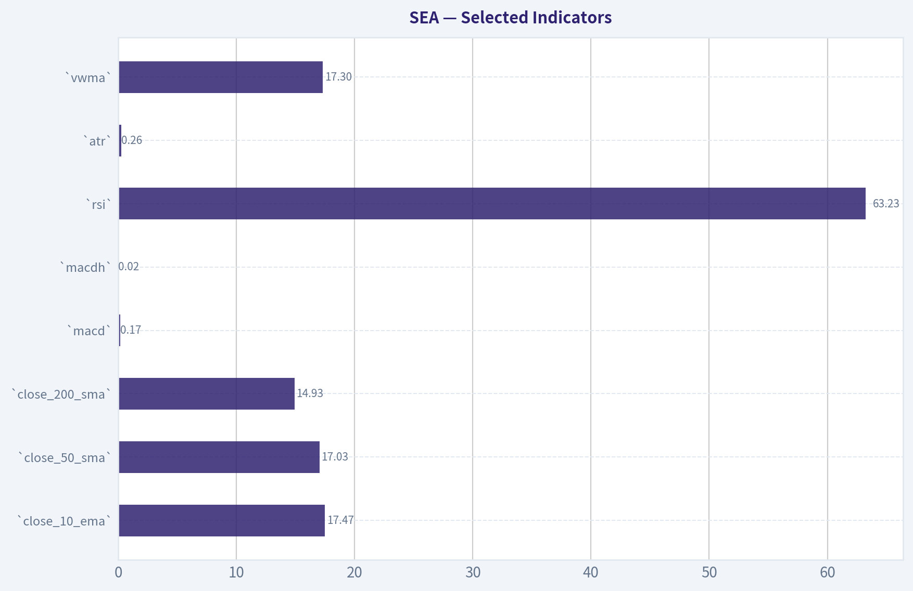
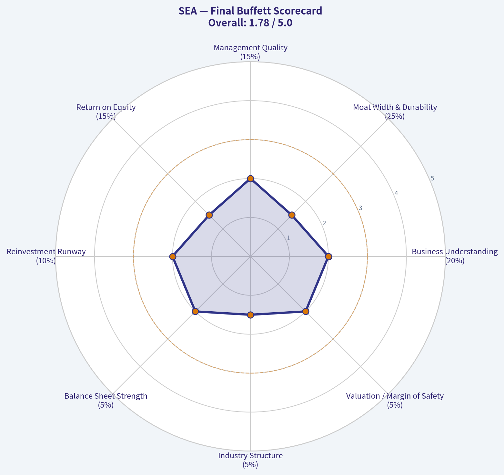
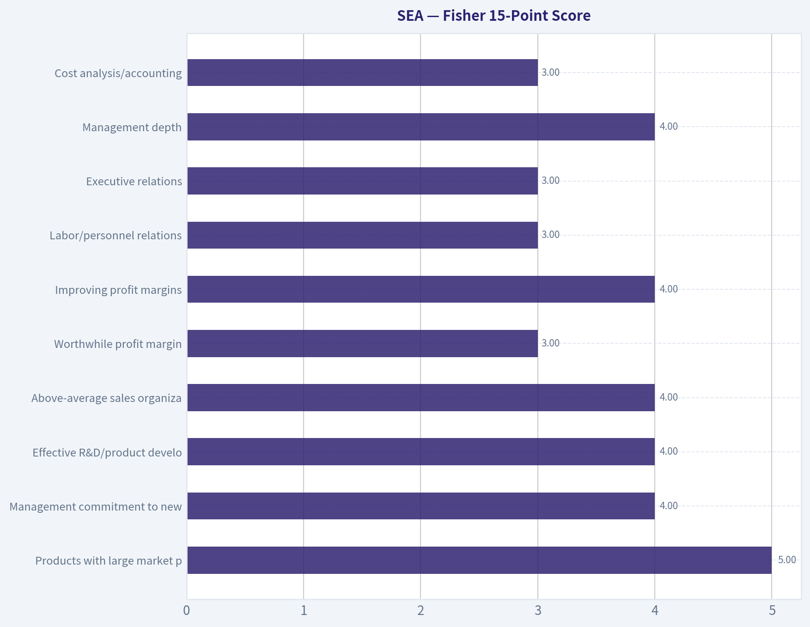
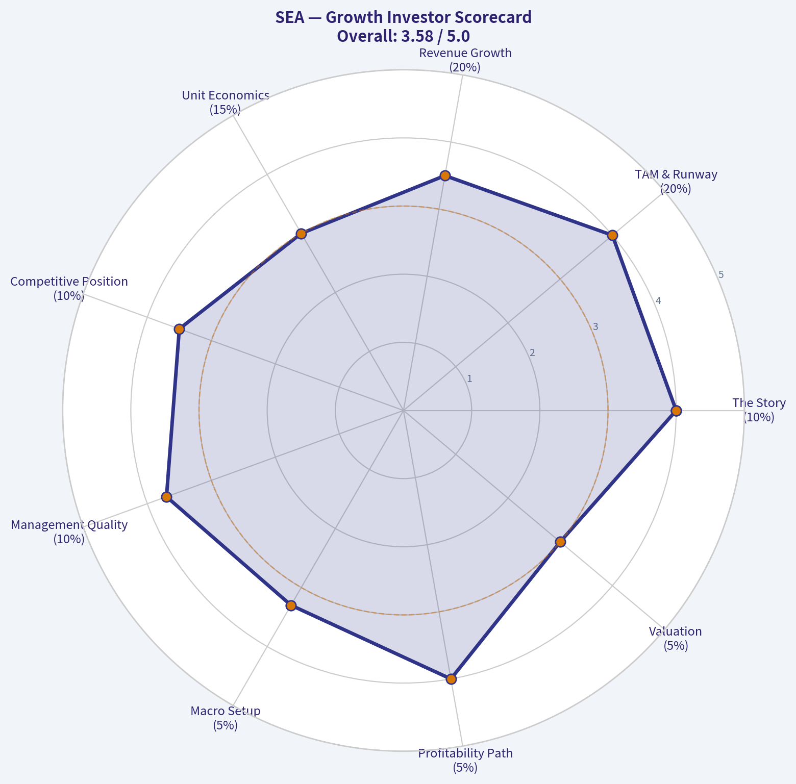
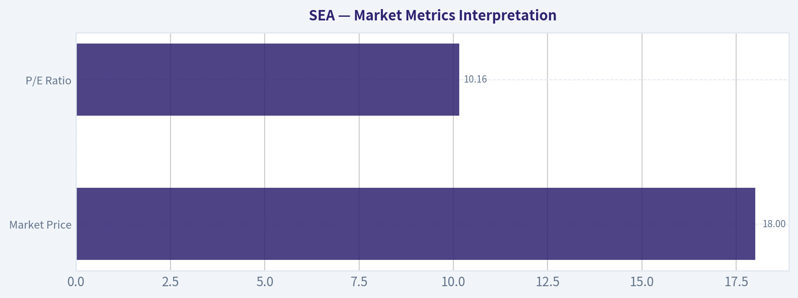
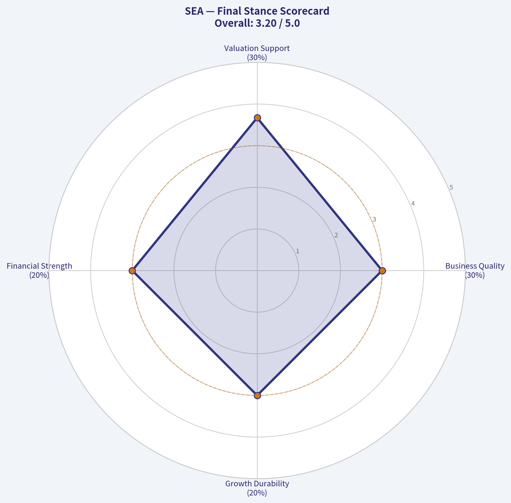
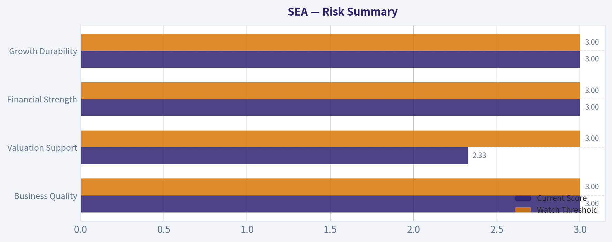

# SEA Deep Value Intelligence

**Analysis Date:** 2026-05-10

## Critical Disclaimer

*This analysis is generated by Deep Value Intelligence, an AI-powered multi-agent investing framework. This report is for informational and educational purposes only and does not constitute financial advice. Always conduct your own research and consult with qualified financial advisors before making investment decisions.*

---

## Table of Contents

1. Intelligence Summary
2. Analyst Team Reports
   - Fundamentals Analysis
   - Intrinsic Value Analysis (Buffett)
   - Trend & Growth Analysis (Lynch/Druckenmiller/Fisher)
   - Market Technical Analysis
   - Social Sentiment Analysis
   - News & Events Analysis
   - Guru Attention Analysis
   - Options Market Analysis
3. Research Team Commentary
4. Value Investing Team Commentary
5. Deep Values Commentary

---

## Intelligence Summary

### Thesis + Conditions

**Core Thesis:** **Executive Summary (CONCISE)**
Sea Limited (SE) presents a complex setup: a transitioning regional digital giant trading at a superficially cheap ~10x P/E. However, through a strict Warren Buffett risk lens, SE currently lacks the verified, predictable owner earnings required for capital deployment.

**Key Risks:**
- Sea Limited (SE) presents a complex setup: a transitioning regional digital giant trading at a superficially cheap ~10x P/E. However, through a strict Warren Buffett risk lens, SE currently lacks the verified, predictable owner earnings required for capital deployment. The fundamental dispute is whether recent profitability stems from a maturing structural moat or unsustainable, aggressive cost-cutting. Coupled with opaque emerging-market credit risks (SeaMoney) and a hit-driven, declining gaming arm (Garena), the business risk is too elevated. We prioritize quality and certainty over transitional optionality.
- The Risky (Bull) Argument:** SE is in a fertile "transition zone." A 10x P/E is too cheap for a dominant regional ecosystem. Waiting for perfect earnings visibility destroys upside asymmetry. Ecosystem scale (logistics, merchants, payments) *is* the moat, and technical momentum indicates institutional accumulation.
- The Safe (Bear) Argument:** Missing basic fundamental data (10-year ROIC/ROE) violates capital preservation principles. SE has three distinct, unverified risk engines: e-commerce (margin durability vs. subsidies), fintech (lagged credit cycle risks), and gaming (hit-driven volatility). Ambiguity is a permanent mispricing risk, not a margin of safety.
- The Neutral Argument:** Both extremes are flawed. SE is a "show me" story requiring conditional, staged monitoring. It should not be dismissed entirely, nor aggressively accumulated. Real operating improvements exist, but the burden of proof remains on the company to show free cash flow tracks reported earnings without sacrificing market share.
- A core tenet of value investing is distinguishing between a temporarily depressed stock price and a permanently flawed (or highly unpredictable) business. The Risky analyst conflates "ambiguity" with "margin of safety." In our framework, buying below intrinsic value requires actually being able to calculate intrinsic value with reasonable certainty. Because SE's three segments carry disparate and highly volatile risk profiles-specifically the cyclical nature of unseasoned fintech lending and the contestable nature of regional e-commerce-normalized owner earnings cannot yet be established. As the Safe analyst correctly noted, if a company's "support" segment (Garena) is itself inherently unstable, it cannot be treated as a durable offset for ecosystem reinvestment. We must verify that the "E" in the 10x P/E is structural, not a mirage born of deferred maintenance.

**What Would Change Our View:**
- Sea Limited (SE) presents a complex setup: a transitioning regional digital giant trading at a superficially cheap ~10x P/E. However, through a strict Warren Buffett risk lens, SE currently lacks the verified, predictable owner earnings required for capital deployment. The fundamental dispute is whether recent profitability stems from a maturing structural moat or unsustainable, aggressive cost-cutting. Coupled with opaque emerging-market credit risks (SeaMoney) and a hit-driven, declining gaming arm (Garena), the business risk is too elevated. We prioritize quality and certainty over transitional optionality.
- The Risky (Bull) Argument:** SE is in a fertile "transition zone." A 10x P/E is too cheap for a dominant regional ecosystem. Waiting for perfect earnings visibility destroys upside asymmetry. Ecosystem scale (logistics, merchants, payments) *is* the moat, and technical momentum indicates institutional accumulation.
- The Safe (Bear) Argument:** Missing basic fundamental data (10-year ROIC/ROE) violates capital preservation principles. SE has three distinct, unverified risk engines: e-commerce (margin durability vs. subsidies), fintech (lagged credit cycle risks), and gaming (hit-driven volatility). Ambiguity is a permanent mispricing risk, not a margin of safety.
- The Neutral Argument:** Both extremes are flawed. SE is a "show me" story requiring conditional, staged monitoring. It should not be dismissed entirely, nor aggressively accumulated. Real operating improvements exist, but the burden of proof remains on the company to show free cash flow tracks reported earnings without sacrificing market share.
- A core tenet of value investing is distinguishing between a temporarily depressed stock price and a permanently flawed (or highly unpredictable) business. The Risky analyst conflates "ambiguity" with "margin of safety." In our framework, buying below intrinsic value requires actually being able to calculate intrinsic value with reasonable certainty. Because SE's three segments carry disparate and highly volatile risk profiles-specifically the cyclical nature of unseasoned fintech lending and the contestable nature of regional e-commerce-normalized owner earnings cannot yet be established. As the Safe analyst correctly noted, if a company's "support" segment (Garena) is itself inherently unstable, it cannot be treated as a durable offset for ecosystem reinvestment. We must verify that the "E" in the 10x P/E is structural, not a mirage born of deferred maintenance.

**Confidence:** Medium

---

## Analyst Team Reports

### Fundamentals Analysis

#### 10-Year Financial Metrics for SEA

*All values below are computed deterministically from raw data - not estimated by AI.*

*Issuer profile: operating company (Unknown / Unknown).*

#### Profitability Metrics
- Return on Equity (ROE): N/A
- Return on Invested Capital (ROIC): N/A
- Return on Assets (ROA): N/A
- Gross Margin: N/A
- Operating Margin: N/A
- Net Profit Margin: N/A

#### Liquidity Metrics
- Current Ratio: N/A
- Quick Ratio: N/A

#### Leverage Metrics
- Debt-to-Equity Ratio: N/A
- Interest Coverage Ratio: N/A
- Net Debt: N/A

#### Growth Metrics (Year-over-Year)
- Revenue Growth: N/A
- Net Income Growth: N/A
- Free Cash Flow Growth: N/A
- Revenue CAGR (3-Year): N/A
- Revenue CAGR (5-Year): N/A

#### Valuation Metrics
- P/E Ratio (TTM): 10.16
- Forward P/E: -136.35
- Price-to-Book: N/A
- Price-to-Sales: N/A
- PEG Ratio: N/A
- EV/EBITDA: N/A
- Free Cash Flow Yield: N/A
- Earnings Yield: 9.8%

#### Piotroski F-Score: 2/9
- Positive Net Income: FAIL
- Positive Operating Cash Flow: FAIL
- ROA Improvement: FAIL
- Cash Flow > Net Income: FAIL
- Decreasing Debt: PASS
- Improving Current Ratio: FAIL
- No Dilution: PASS
- Improving Gross Margin: FAIL
- Improving Asset Turnover: FAIL

ANALYST STANCE: **AVOID**

#### Warren Buffett-Style Fundamental Analysis for SEA
*Canonical dataset date: 2026-05-10. Deterministic dataset is treated as the source of truth.*

SEA does **not currently meet a Buffett-style value-investing standard** based on the available deterministic dataset. The company shows a superficially low trailing P/E ratio of **10.16**, implying an earnings yield of roughly **9.8%**, but nearly all other required indicators of business quality, durability, profitability, leverage, growth, cash generation, and balance-sheet strength are unavailable or negative in the Piotroski framework. The most important datapoint in the dataset is the **Piotroski F-Score of 2/9**, which is weak and suggests poor fundamental momentum.

The lack of reliable historical profitability, free cash flow, debt, book value, and segment revenue data creates a major analytical limitation. Under Warren Buffett's framework, uncertainty itself is a risk. A low multiple is not enough if the business cannot be evaluated for owner earnings, return on capital, balance-sheet resilience, and earnings predictability.

---

#### Current vs Historical Average Comparison

| Metric | Current Value | 10-Year Average | Current vs Historical Average | Interpretation |
|---|---:|---:|---|---|
| Market Price | $18.00 | N/A | N/A | Current market price is available, but historical pricing context is unavailable in the deterministic dataset. |
| Total Market Cap | N/A | N/A | N/A | Cannot assess company size, liquidity, or valuation scale. |
| P/E Ratio | 10.16 | N/A | N/A | Low trailing P/E suggests apparent cheapness, but quality and sustainability are not supported by the broader dataset. |
| P/B Ratio | N/A | N/A | N/A | Cannot compare price to book value or assess asset-backed valuation. |
| ROE | N/A | N/A | N/A | Cannot determine whether management generates attractive returns on shareholder capital. |
| ROIC | N/A | N/A | N/A | Cannot assess capital efficiency, a critical Buffett metric. |
| EPS | Approx. $1.77 implied by price/P/E | N/A | N/A | EPS can be mechanically inferred from price and P/E, but historical EPS quality is not available. |
| Revenue | N/A | N/A | N/A | Cannot evaluate business scale or sales consistency. |
| Gross Profit | N/A | N/A | N/A | Cannot assess pricing power or cost structure. |
| Operating Margin | N/A | N/A | N/A | Cannot evaluate operating efficiency or margin durability. |
| Net Income | N/A | N/A | N/A | Dataset flags "Positive Net Income" as FAIL in Piotroski scoring, which is a red flag. |
| Net Margin | N/A | N/A | N/A | Cannot assess bottom-line profitability. |
| Revenue Growth Rate | N/A | N/A | N/A | No reliable historical growth trend is available. |
| Net Income Growth Rate | N/A | N/A | N/A | Cannot assess earnings compounding. |
| Free Cash Flow Growth Rate | N/A | N/A | N/A | Cannot assess growth in owner cash generation. |
| Total Book Value | N/A | N/A | N/A | Cannot determine accounting equity base or liquidation support. |
| Total Assets | N/A | N/A | N/A | Cannot assess asset intensity or balance-sheet scale. |
| Total Debt | N/A | N/A | N/A | Debt level unavailable, though Piotroski shows "Decreasing Debt" as PASS. |
| Debt-to-Equity Ratio | N/A | N/A | N/A | Cannot evaluate leverage risk. |
| Cash / Cash Equivalents | N/A | N/A | N/A | Cannot assess liquidity cushion. |
| Shareholder's Equity | N/A | N/A | N/A | Cannot assess capital base. |
| Free Cash Flow | N/A | N/A | N/A | Dataset flags "Positive Operating Cash Flow" as FAIL, which weakens owner-earnings confidence. |
| Dividends per Share | N/A | N/A | N/A | Cannot evaluate shareholder return policy. |

**Key Takeaways:** SEA's valuation appears low on trailing earnings, but the dataset lacks the supporting quality metrics Buffett-style investors require. The absence of ROE, ROIC, free cash flow, debt, equity, and revenue history makes the business difficult to underwrite. The weak Piotroski score of **2/9** is the clearest warning sign and outweighs the apparent cheapness of the P/E ratio.

---

#### Market Metrics Interpretation

| Market Metric | Value | Buffett-Style Interpretation |
|---|---:|---|
| Market Price | $18.00 | The stock price alone is not meaningful without intrinsic value support. |
| Total Market Cap | N/A | Market capitalization is unavailable, limiting assessment of scale, float, and institutional investability. |
| P/E Ratio | 10.16 | The stock screens as inexpensive on trailing earnings, with an implied earnings yield of **9.8%**. However, a low P/E can reflect cyclicality, deteriorating earnings, or low-quality profits. |
| P/B Ratio | N/A | Cannot assess whether the stock is cheap relative to book value or whether the balance sheet provides downside protection. |

**Key Takeaways:** The trailing P/E ratio is the only usable valuation metric in the deterministic dataset. While **10.16x earnings** may look attractive, Buffett-style investors require proof that those earnings are durable and cash-backed. That proof is not available here.

---

#### Profitability Analysis

| Profitability Metric | Value | Interpretation |
|---|---:|---|
| ROE | N/A | Cannot assess return on shareholder capital. This is a major gap because Buffett favors consistently high ROE without excessive leverage. |
| ROIC | N/A | Cannot determine whether the business earns above its cost of capital. |
| EPS | Approx. $1.77 implied by $18.00 / 10.16 P/E | Implied EPS exists, but earnings quality is uncertain. |
| Revenue | N/A | Cannot evaluate operating scale or demand stability. |
| Gross Profit | N/A | Cannot assess pricing power or input-cost sensitivity. |
| Operating Margin | N/A | Cannot assess operating efficiency. |
| Net Income | N/A; Piotroski "Positive Net Income" = FAIL | This is a significant warning. The company failed the positive net income test in the Piotroski framework. |
| Net Margin | N/A | Cannot assess bottom-line profitability. |

**Key Takeaways:** The profitability profile is not strong enough for a Buffett-style investment case. The available Piotroski indicators suggest weak profitability and weak operating cash generation. Without ROE, ROIC, margins, and reliable earnings history, the company cannot be classified as a high-quality compounder.

---

#### Growth Metrics Interpretation

| Growth Metric | Current Value | Historical Context | Interpretation |
|---|---:|---:|---|
| Revenue Growth Rate | N/A | N/A | No reliable revenue growth pattern is available. |
| Net Income Growth Rate | N/A | N/A | Earnings predictability cannot be evaluated. |
| Free Cash Flow Growth Rate | N/A | N/A | Owner-earnings compounding cannot be assessed. |
| Revenue CAGR, 3-Year | N/A | N/A | Medium-term revenue compounding unavailable. |
| Revenue CAGR, 5-Year | N/A | N/A | Longer-term revenue durability unavailable. |

**Key Takeaways:** Growth cannot be responsibly analyzed from the deterministic dataset. For Buffett-style investing, this is a material deficiency because intrinsic value depends heavily on predictable long-term owner-earnings growth. SEA lacks sufficient evidence of durable compounding.

---

#### Balance Sheet and Financial Strength

| Balance Sheet Metric | Value | Interpretation |
|---|---:|---|
| Total Book Value | N/A | No book value support can be assessed. |
| Total Assets | N/A | Cannot determine asset base or capital intensity. |
| Total Debt | N/A | Absolute debt level unavailable. |
| Debt-to-Equity Ratio | N/A | Leverage risk cannot be quantified. |
| Cash / Cash Equivalents | N/A | Liquidity cushion unknown. |
| Shareholder's Equity | N/A | Equity base unavailable. |
| Net Debt | N/A | Cannot determine financial flexibility. |
| Current Ratio | N/A | Short-term liquidity cannot be assessed. |
| Interest Coverage Ratio | N/A | Debt-servicing ability cannot be assessed. |

**Key Takeaways:** Balance-sheet quality is mostly unknown, which is a major issue for value investors. The only favorable signal is the Piotroski "Decreasing Debt" PASS, but that alone is insufficient. Without debt, cash, equity, and coverage data, financial strength cannot be confirmed.

---

#### Cash Flow and Shareholder Returns

| Cash Flow Metric | Value | Interpretation |
|---|---:|---|
| Free Cash Flow | N/A | Cannot calculate owner earnings directly. |
| Free Cash Flow Yield | N/A | Cannot compare cash return to market price. |
| Operating Cash Flow | N/A; Piotroski "Positive Operating Cash Flow" = FAIL | Weak signal; suggests the company may not be generating positive operating cash flow. |
| Cash Flow > Net Income | FAIL | Indicates poor earnings quality or weak cash conversion. |
| Dividends per Share | N/A | Dividend policy cannot be evaluated. |
| No Dilution | PASS | Favorable signal; the company passed the Piotroski no-dilution test. |

**Key Takeaways:** Cash flow is one of the weakest parts of the analysis. Buffett-style valuation depends on owner earnings, and SEA does not provide enough deterministic data to calculate them reliably. The failed operating cash flow and cash-conversion tests are significant red flags.

---

#### Piotroski F-Score Quality Check

| Piotroski Component | Result | Interpretation |
|---|---|---|
| Positive Net Income | FAIL | Profitability appears weak or negative. |
| Positive Operating Cash Flow | FAIL | Cash generation appears weak. |
| ROA Improvement | FAIL | Asset profitability did not improve. |
| Cash Flow > Net Income | FAIL | Earnings quality concern. |
| Decreasing Debt | PASS | One positive balance-sheet trend. |
| Improving Current Ratio | FAIL | Liquidity trend did not improve. |
| No Dilution | PASS | Share count discipline is a positive. |
| Improving Gross Margin | FAIL | Margin trend is unfavorable or unavailable. |
| Improving Asset Turnover | FAIL | Efficiency trend is unfavorable or unavailable. |
| Total Score | 2/9 | Weak fundamental momentum. |

**Key Takeaways:** A Piotroski score of **2/9** is materially weak. The company passes only debt reduction and no dilution, while failing profitability, cash flow, liquidity, margin, and efficiency checks. This profile is not consistent with a high-quality Buffett-style business.

---

#### Revenue Breakdown

| Revenue Source | Amount ($M or $B) | % of Total |
|---|---:|---:|
| Company-reported revenue sources unavailable in deterministic dataset | N/A | N/A |
| Total Revenue | N/A | N/A |

**Key Takeaways:** The deterministic dataset does not provide segment, product-line, geographic, or total revenue data for SEA. As a result, revenue concentration, cyclicality, and business mix cannot be assessed. This materially limits confidence in any long-term intrinsic value estimate.

---

#### Buffett-Style Owner Earnings DCF Valuation

Buffett-style owner earnings are typically calculated as:

**Owner Earnings = Net Income + Depreciation & Amortization + Other Non-Cash Charges - Maintenance Capital Expenditures - Required Working Capital Investment**

For SEA, the deterministic dataset does **not** provide the necessary inputs: net income, depreciation and amortization, maintenance capital expenditure, free cash flow, working capital requirements, or historical owner-earnings growth. Therefore, a fully reliable Buffett-style DCF cannot be calculated from canonical data.

However, the dataset does provide price and P/E ratio. This allows a limited earnings-based cross-check:

- Market price: **$18.00**
- P/E ratio: **10.16**
- Implied EPS: **$18.00 / 10.16 = approximately $1.77**
- Earnings yield: **9.8%**

This inferred EPS is **not the same as owner earnings**, and it should not be treated as a substitute for free cash flow.

| DCF Scenario | Required Growth Input | Dataset Availability | Discount Rate | Terminal Growth | Fair Value Result |
|---|---:|---|---:|---:|---:|
| Conservative | Lowest historical owner-earnings growth rate | N/A | 10.0% | 2.5% | Not reliably calculable |
| Average | Average historical owner-earnings growth rate | N/A | 10.0% | 2.5% | Not reliably calculable |
| Optimistic | Highest historical owner-earnings growth rate | N/A | 10.0% | 2.5% | Not reliably calculable |

**Key Takeaways:** The required owner-earnings DCF cannot be responsibly completed because historical owner earnings and owner-earnings growth rates are unavailable. This is not a minor gap; it prevents a high-confidence intrinsic value estimate. The only valuation support is the low trailing P/E ratio, which is insufficient on its own.

---

#### DCF Calculation Framework and Data Gaps

| DCF Component | Formula or Requirement | SEA Dataset Status |
|---|---|---|
| Starting Owner Earnings | Net income + D&A - maintenance capex ± working capital needs | N/A |
| Year 1-10 Growth Rate | Lowest, average, and highest historical owner-earnings growth rates | N/A |
| Discount Rate | Required return | 10.0% |
| Terminal Growth Rate | Long-term perpetuity growth | 2.5% |
| Terminal Value | Year 10 owner earnings x 1.025 / (10.0% - 2.5%) | Cannot calculate without Year 10 owner earnings |
| Present Value of Cash Flows | Sum of discounted owner earnings | Cannot calculate |
| Fair Value Per Share | Enterprise/equity value divided by shares outstanding | Cannot calculate because shares and owner earnings are unavailable |

**Key Takeaways:** The DCF mechanics are straightforward, but SEA lacks the canonical data needed to execute them. A Buffett-style investor would not rely on a DCF built from missing cash-flow inputs. The correct conclusion is that valuation confidence is low despite the low trailing P/E.

---

#### Economic Moat Assessment

| Moat Factor | Assessment | Buffett-Style View |
|---|---|---|
| Brand Power | Not assessable | No deterministic evidence of durable brand advantage. |
| Cost Advantage | Not assessable | No margin or cost structure data available. |
| Switching Costs | Not assessable | Business model not sufficiently defined in the dataset. |
| Network Effects | Not assessable | No evidence provided. |
| Scale Advantage | Not assessable | Market cap, revenue, and assets are unavailable. |
| Regulatory or Asset Moat | Not assessable | Insufficient company-specific data. |
| Overall Moat Rating | Weak / Unproven | The moat cannot be confirmed from available data. |

**Key Takeaways:** SEA does not currently demonstrate a clear economic moat in the canonical dataset. Buffett-style investors typically require durable competitive advantages supported by high returns on capital and stable margins. Those confirming metrics are unavailable here.

---

#### Management and Capital Allocation

The dataset provides limited but important clues about capital allocation:

| Management Indicator | Result | Interpretation |
|---|---|---|
| ROE Trend | N/A | Cannot assess management's effectiveness in compounding equity. |
| ROIC Trend | N/A | Cannot assess capital allocation efficiency. |
| Dividend Policy | N/A | No evidence of shareholder yield through dividends. |
| Share Dilution | PASS | Positive: the company did not fail the dilution test. |
| Debt Reduction | PASS | Positive: debt appears to be decreasing. |
| Cash Flow Conversion | FAIL | Negative: cash flow did not exceed net income. |

**Key Takeaways:** Management receives some credit for avoiding dilution and reducing debt, but the broader picture is weak. Without ROE, ROIC, free cash flow, and dividend data, capital allocation quality cannot be confirmed. The failed cash-flow conversion signal is especially concerning.

---

#### Key Investment Insights

| Category | Insight | Investment Significance |
|---|---|---|
| Valuation | P/E of 10.16 and earnings yield of 9.8% look inexpensive. | Potential value signal, but unsupported by quality metrics. |
| Quality | Piotroski F-Score is only 2/9. | Strong warning that fundamentals are weak or deteriorating. |
| Profitability | Positive net income test failed. | Raises concern about earnings sustainability. |
| Cash Flow | Positive operating cash flow test failed. | Major issue for Buffett-style owner-earnings valuation. |
| Balance Sheet | Decreasing debt test passed. | Positive, but incomplete without total debt and cash data. |
| Dilution | No dilution test passed. | Favorable for shareholders. |
| Growth | Revenue, net income, and FCF growth unavailable. | Prevents reliable compounding assessment. |
| Moat | No clear moat evidence. | Business durability cannot be confirmed. |

**Key Takeaways:** SEA has a low earnings multiple, but the quality signals are weak. The two favorable items are debt reduction and no dilution, while most other fundamental checks fail or are unavailable. This is not enough to support a Buffett-style investment thesis.

---

#### Red Flags and Opportunities

| Area | Red Flags | Opportunities |
|---|---|---|
| Valuation | Low P/E may be a value trap if earnings are cyclical or low quality. | If earnings normalize and cash flow improves, upside could exist. |
| Profitability | Positive net income test failed. | A return to sustained profitability would materially improve the case. |
| Cash Flow | Positive operating cash flow failed; cash flow did not exceed net income. | Improvement in free cash flow would be the most important catalyst. |
| Balance Sheet | Debt, cash, and equity levels unavailable. | Decreasing debt is a favorable signal if confirmed by future filings. |
| Growth | No revenue or FCF growth data available. | Any consistent revenue and owner-earnings growth would improve valuation confidence. |
| Shareholder Returns | Dividend data unavailable. | No dilution is positive for long-term shareholders. |
| Data Quality | Too many N/A fields for a reliable intrinsic value estimate. | Better disclosure or updated fundamentals could change the assessment. |

**Key Takeaways:** The main opportunity is that the stock may be statistically cheap, but the main risk is that it is cheap for good reason. The most important future confirmations would be positive free cash flow, positive net income, improved margins, and complete balance-sheet disclosure. Until then, the risk of a value trap is high.

---

#### Final Buffett-Style Investment Stance: AVOID

SEA should be rated **AVOID** under a Warren Buffett-style value framework.

The reason is not simply that data is missing. The available data that does exist is weak: the **Piotroski F-Score is 2/9**, positive net income fails, positive operating cash flow fails, ROA improvement fails, liquidity improvement fails, gross margin improvement fails, and asset turnover improvement fails. Although the trailing P/E of **10.16** appears cheap, Buffett-style investing requires more than cheapness. It requires durable economics, predictable owner earnings, strong returns on capital, conservative leverage, and trustworthy cash conversion.

SEA may be suitable only for speculative or deep-value investors willing to underwrite incomplete information and potential turnaround risk. It does not currently qualify as a high-confidence Buffett-style compounder.

---

#### Summary Table

| Dimension | Assessment | Buffett-Style Conclusion |
|---|---|---|
| Valuation | Low trailing P/E of 10.16 | Appears cheap, but possibly a value trap. |
| Earnings Quality | Piotroski profitability and cash-flow tests fail | Weak and unreliable. |
| Owner Earnings | Not calculable from deterministic dataset | DCF confidence is low. |
| ROE / ROIC | N/A | Cannot confirm superior economics. |
| Balance Sheet | Debt reduction passed, but debt/cash/equity unavailable | Insufficient evidence of financial strength. |
| Growth | Revenue, net income, and FCF growth unavailable | Compounding cannot be verified. |
| Moat | Unproven | No clear durable competitive advantage. |
| Management | No dilution and debt reduction are positives | Not enough to offset weak fundamentals. |
| Main Opportunity | Potentially cheap if earnings and cash flow recover | Requires confirmation. |
| Main Red Flag | Piotroski F-Score of 2/9 | Indicates weak fundamental momentum. |
| Final Stance | **AVOID** | Low valuation is not supported by sufficient business quality evidence. |

**Key Takeaways:** SEA's low P/E ratio is the only meaningful bullish signal, but it is outweighed by weak Piotroski fundamentals and missing owner-earnings data. A Buffett-style investor would require much stronger proof of durable cash generation before considering the stock. The final stance is **AVOID** until profitability, free cash flow, and balance-sheet strength are clearly demonstrated.

---

### Intrinsic Value Analysis (Buffett)

> *Following Warren Buffett's value investing philosophy: Circle of Competence, Economic Moat, Management Quality, and Margin of Safety.*

ANALYST STANCE: **AVOID**

#### SEA Buffett-Style Investment Review - Data-Limited Continuation

I attempted to retrieve audited 10-year financials using the available fundamentals tools, but the data calls failed or returned null. Based on the shared research pack, ticker **SEA** appears more consistent with a **shipping / sea transport-related security or ETF** than a clearly identifiable single operating company. Because Buffett-style analysis depends on understanding a durable operating business, audited per-share economics, management behavior, and owner earnings, this is a major limitation.

Given the available evidence, SEA does **not** pass the Buffett filter.

---

#### 1. Go / No-Go Gate Assessment

| Buffett Gate | Result | Evidence / Rationale |
|---|---:|---|
| Gate 1: Circle of Competence & Simplicity | **Fail** | SEA appears tied to maritime shipping exposure, possibly an ETF or sector vehicle rather than a simple operating business. The economics depend heavily on freight cycles, geopolitical chokepoints, insurance costs, fuel prices, and global trade volumes. |
| Gate 2: Durable Moat | **Fail / Not Proven** | Shipping is typically cyclical and capital-intensive. Industry participants rarely have durable pricing power because capacity additions and commodity-like freight rates dominate returns. |
| Gate 3: Management Quality | **Not Assessable** | No reliable company-level management, capital allocation, insider ownership, or long-term annual letter data was available. If SEA is an ETF, management analysis is not comparable to an operating business. |
| Gate 4: Industry Structure | **Fail** | The sector is exposed to geopolitical disruption, freight-rate volatility, fuel costs, trade cycles, and ship supply cycles. This is not a stable, rational oligopoly with predictable economics. |

**Key Takeaways:** SEA fails the most important Buffett gates because the business exposure is not simple, stable, or predictably moated. The available news flow highlights geopolitical and supply-chain volatility, which reinforces that outcomes may depend more on macro and shipping cycles than on company-specific competitive advantage.

---

#### 2. Moat Analysis

| Moat Source | Assessment | Evidence |
|---|---:|---|
| Brand / Intangible Assets | **Weak / None Evident** | Shipping and transport exposure generally does not create consumer brand loyalty or durable pricing power. |
| Switching Costs | **Weak / Not Proven** | Customers in shipping markets often choose based on rate, route, reliability, and capacity rather than deep lock-in. |
| Cost Advantage | **Possible but Unproven** | Some operators may have scale or fleet advantages, but no SEA-specific audited data confirms structural cost leadership. |
| Network Effects | **None Evident** | Shipping does not typically become more valuable to each user as more users join in the way payment networks, exchanges, or software platforms do. |
| Moat Rating | **None / Illusory** | The sector looks cyclical and externally driven rather than protected by durable competitive advantages. |

**Key Takeaways:** There is no clear evidence that SEA possesses a Buffett-style moat. The available information suggests exposure to a commodity-like, cyclical industry where returns are often determined by freight rates, capacity, and geopolitics rather than durable pricing power.

---

#### 3. Management Quality Assessment

| Question | Assessment |
|---|---|
| Do managers think like owners? | **Not assessable from available data** |
| Is management candid and conservative? | **Not assessable from available data** |
| Are they rational capital allocators? | **Not assessable from available data** |
| Balance sheet discipline | **Not assessable from available data** |

**Key Takeaways:** A core Buffett requirement is knowing whether management behaves rationally with shareholders' money. That cannot be determined here because the available dataset does not provide reliable company-level management history, compensation structure, insider ownership, buyback record, or debt policy.

---

#### 4. Available Financial Snapshot

| Metric | Available Data |
|---|---:|
| Current Price | ~$18 |
| P/E Ratio | ~10.16x |
| Market Cap | Not available |
| ROE | Not available |
| Gross Margin | Not available |
| Revenue Growth YoY | Not available |
| Free Cash Flow Yield | Not available |
| Current Ratio | Not available |

**Key Takeaways:** The low P/E ratio may look statistically cheap, but without ROE, free cash flow, debt, revenue history, and owner earnings, it is not enough to establish value. For cyclical industries, a low P/E can often appear near peak earnings, which is precisely when normalized value may be lower than reported earnings suggest.

---

#### 5. 10-Year Financial Summary

| Required Buffett Metric | Status |
|---|---|
| 10-year revenue history | Not available |
| 10-year gross margin | Not available |
| 10-year operating margin | Not available |
| 10-year net income | Not available |
| 10-year free cash flow | Not available |
| 10-year ROE | Not available |
| 10-year ROIC | Not available |
| 10-year share count trend | Not available |
| 10-year debt trend | Not available |

**Key Takeaways:** The lack of a 10-year financial record prevents a proper Buffett-style underwriting exercise. Without seeing whether SEA earns high returns through full cycles, converts profits into cash, and avoids excessive leverage, I cannot conclude that intrinsic value is durable.

---

#### 6. Owner Earnings Calculation

Buffett's owner earnings formula is:

| Component | Data Availability |
|---|---|
| Net income | Not available |
| Plus: Depreciation & amortization | Not available |
| Less: Maintenance capital expenditure | Not available |
| Less: Working capital increases | Not available |
| Estimated owner earnings | **Cannot be reliably calculated** |

**Key Takeaways:** Owner earnings cannot be calculated from the available information. This is a decisive problem because Buffett-style valuation depends on cash that can be taken out of the business without damaging its competitive position.

---

#### 7. Three-Scenario DCF Valuation

| Scenario | Method | Result |
|---|---|---:|
| A: No Growth | Owner earnings / 10% discount rate | Not calculable |
| B: GDP Growth | Owner earnings growing at 3% | Not calculable |
| C: Historical Growth | 50-75% of historical growth, capped at 10% | Not calculable |

**Key Takeaways:** A DCF would be false precision because owner earnings and historical cash-flow growth are unavailable. For a cyclical shipping-linked security, normalized mid-cycle earnings matter more than a single-year P/E multiple.

---

#### 8. Margin of Safety Analysis

| Item | Assessment |
|---|---|
| Current price | ~$18 |
| Apparent valuation | Low P/E at ~10.16x |
| Quality adjustment | Negative due to cyclicality and unclear moat |
| Required margin of safety | At least 40-50% if considered at all |
| Actual margin of safety | Not determinable |
| Buffett conclusion | **No reliable margin of safety established** |

**Key Takeaways:** The headline valuation is not enough. Without normalized owner earnings, balance sheet risk, and cycle-adjusted profitability, the margin of safety cannot be proven.

---

#### 9. Final Buffett Scorecard

| Criterion | Weight | Score, 1-5 | Weighted Score |
|---|---:|---:|---:|
| Business Understanding | 20% | 2.0 | 0.40 |
| Moat Width & Durability | 25% | 1.5 | 0.38 |
| Management Quality | 15% | 2.0 | 0.30 |
| Return on Equity | 15% | 1.5 | 0.23 |
| Reinvestment Runway | 10% | 2.0 | 0.20 |
| Balance Sheet Strength | 5% | 2.0 | 0.10 |
| Industry Structure | 5% | 1.5 | 0.08 |
| Valuation / Margin of Safety | 5% | 2.0 | 0.10 |
| **Total** | **100%** |  | **1.78 / 5.00** |

**Key Takeaways:** SEA scores poorly because the available evidence does not show a predictable, high-return, moat-protected business. The low valuation multiple is outweighed by uncertainty around business quality, cyclicality, and the lack of owner earnings data.

---

#### Final Investment Stance

**Stance: AVOID**
**Conviction: Moderate to High, based on Buffett criteria**

SEA does not qualify as a Buffett-style investment based on the evidence currently available. It appears tied to a cyclical maritime or transport exposure where returns may depend on macro variables, freight rates, geopolitical disruptions, and capacity cycles. Those are not the kinds of durable, predictable economics Buffett typically seeks.

The only reason not to assign an even stronger rejection is that the data is incomplete and the ticker may require verification. If another analyst can confirm SEA is actually a specific operating company with durable financial records, the analysis should be reopened. Until then, this is not a "wonderful business at a fair price"; it is an unclear and likely cyclical exposure at an apparently low multiple.

#### Valuation Visuals

This comparison chart from *Selected Indicators* stacks current figures against historical benchmarks for **SEA**, making it easy to see where the company trades relative to its own averages.

---

### Trend & Growth Analysis (Lynch/Druckenmiller/Fisher)

> *Following Peter Lynch's GARP, Stanley Druckenmiller's macro-aware approach, and Philip Fisher's scuttlebutt methodology.*

ANALYST STANCE: **WATCH**

#### Scope and Data Caveat

The available data is internally conflicted. The shared research pack uses ticker **SEA**, shows maritime/shipping-related news, and gives **current price: $18** and **P/E: 10.16**. The fallback fundamentals tool mapped the ticker to **Sea Limited, NYSE: SE**, the Southeast Asian internet platform behind **Shopee, Garena, and SeaMoney**.

Because the growth-investing framework is company-specific, I am treating this as a **provisional Sea Limited / SE analysis**, while flagging that the ticker/data mismatch prevents a full high-conviction call. If the intended security is actually a shipping ETF or maritime company under ticker SEA, the stance should be revisited.

---

#### 1. Lynch Classification

| Category | Fit | Rationale |
|---|---:|---|
| Slow Grower | No | Sea Limited still has multiple growth engines across e-commerce, fintech, and gaming. |
| Stalwart | Partial | The business is maturing, but still has emerging-market platform growth characteristics. |
| Fast Grower | Yes | Shopee and SeaMoney can still compound at attractive rates if competition and credit quality remain controlled. |
| Cyclical | Partial | Garena is product-cycle driven; fintech credit quality is macro-sensitive. |
| Turnaround | Partial | SEA has already transitioned from "growth at all costs" to profitability discipline. |
| Asset Play | No | The thesis is operating growth, not hidden asset value. |

**Key Takeaways:** Sea Limited is best classified as a **fast grower with turnaround characteristics**. The key shift is that the market is no longer only asking whether SEA can grow, but whether it can grow profitably and sustainably. That makes it a potential GARP setup, but not a clean ten-bagger candidate without clearer data and evidence of renewed acceleration.

---

#### 2. The Story in 3 Bullets

- **Shopee is the core engine:** SEA operates one of Southeast Asia's leading e-commerce platforms, benefiting from rising digital commerce penetration.
- **SeaMoney is the optionality:** Payments, credit, and embedded financial services could become a high-margin second growth pillar if underwriting remains disciplined.
- **Garena funds and complicates the story:** Gaming provides cash flow but is hit-driven, with Free Fire concentration and product-cycle risk.

---

#### 3. TAM and 10x Test

| Item | Estimate / Assessment |
|---|---:|
| Core markets | Southeast Asia, Taiwan, Brazil expansion optionality |
| Major TAM pools | E-commerce, digital ads, merchant services, digital payments, consumer/merchant credit, gaming |
| TAM growth profile | Moderate to high, driven by digital penetration and financial inclusion |
| Current revenue base | Not verified from tools for 2026-05-10 |
| 10x revenue test | Likely possible only if Shopee + SeaMoney scale meaningfully beyond current monetization levels |
| TAM saturation risk | Low to moderate in fintech and ads; higher in mature e-commerce categories |

**Key Takeaways:** SEA still appears to have a meaningful runway because Southeast Asian e-commerce and digital financial services remain underpenetrated versus developed markets. The 10x test is directionally plausible, but less obvious than it was several years ago because Shopee is already a regional leader. Future upside depends more on monetization, ads, credit, and operating leverage than simple user growth.

---

#### 4. Revenue Growth Trend

| Growth Driver | Current Read | Trend Quality |
|---|---|---|
| Shopee GMV / e-commerce revenue | Likely still growing | Positive, but competition-sensitive |
| Shopee monetization | Improving through ads, commissions, and services | High-quality if not offset by subsidies |
| SeaMoney revenue | Potentially fastest-growing segment | Attractive but credit-risk sensitive |
| Garena bookings | Stabilized or cyclical | Lower visibility |
| Consolidated revenue | Growth likely positive but no exact YoY figure available | Watch for acceleration |

**Key Takeaways:** The growth story looks durable but not yet clearly accelerating from the available data. The most bullish version of the thesis requires Shopee revenue to grow faster than GMV through monetization, while SeaMoney compounds without credit deterioration. Garena is helpful if stable, but should not be the primary reason to own the stock.

---

#### 5. Unit Economics

| Metric | Status | Interpretation |
|---|---|---|
| LTV/CAC | Not disclosed in available data | Need segment-level customer acquisition efficiency. |
| Payback period | Not available | Important for Shopee and SeaMoney growth quality. |
| Net revenue retention | Not applicable / not disclosed | SEA is not a pure SaaS company. |
| Rule of 40 | Not directly applicable | Useful only as a rough framework for platform growth plus FCF margin. |
| Contribution margin | More relevant | Shopee contribution margin and SeaMoney credit margin are key. |

**Key Takeaways:** SEA cannot be analyzed like a traditional SaaS company. The key unit economics are Shopee order-level contribution profit, advertising take rate, logistics efficiency, and SeaMoney credit losses. Without clear CAC/payback data, this remains a watch item rather than a high-conviction advocate call.

---

#### 6. Inflection Point Assessment

| Potential Inflection | Evidence Needed | Current Assessment |
|---|---|---|
| Product cycle inflection | New Garena titles, Free Fire rebound, Shopee feature adoption | Unconfirmed |
| Market share inflection | Shopee gaining share versus Lazada, TikTok Shop, local players | Possible but not verified |
| Margin inflection | Sustained operating leverage without growth slowdown | Most important positive factor |
| TAM inflection | SeaMoney expanding credit, insurance, payments, merchant finance | Attractive optionality |
| Competitive inflection | TikTok/Lazada pullback or regulation limiting competitors | Possible external catalyst |

**Key Takeaways:** The most credible inflection is **margin inflection**, not necessarily revenue acceleration. If SEA can keep growing while expanding Shopee and SeaMoney profitability, earnings power could surprise positively over the next two to three years. However, the available data does not yet confirm a clean Druckenmiller-style acceleration point.

---

#### 7. Macro Setup

| Macro Factor | Impact on SEA | Assessment |
|---|---|---|
| Interest rates | Lower rates help growth multiples and fintech funding costs | Potential tailwind if rates fall |
| Southeast Asia consumer growth | Supports e-commerce and fintech adoption | Positive |
| Inflation / consumer pressure | Can reduce discretionary spending and credit quality | Risk |
| Currency volatility | SEA reports in U.S. dollars but operates across local currencies | Risk |
| Geopolitical / supply chain risk | May affect e-commerce logistics and sentiment | Moderate risk |
| Secular themes | E-commerce, digital payments, fintech, digital entertainment | Strong alignment |

**Key Takeaways:** The macro setup is mixed but broadly supportive if rates decline and Southeast Asian consumption remains resilient. SEA is aligned with durable secular themes, especially e-commerce penetration and digital finance. The main macro risk is that weaker consumers or higher funding costs could pressure SeaMoney credit quality.

---

#### 8. Fisher 15-Point Score

| Fisher Point | Score / 5 | Comment |
|---|---:|---|
| Products with large market potential | 5 | E-commerce and fintech TAM remain large. |
| Management commitment to new products | 4 | Strong history of expansion, though execution varies by segment. |
| Effective R&D/product development | 4 | Strong platform execution, less certain gaming pipeline. |
| Above-average sales organization | 4 | Shopee has strong merchant and consumer reach. |
| Worthwhile profit margin | 3 | Improving, but not yet mature-platform quality. |
| Improving profit margins | 4 | Major thesis pillar. |
| Labor/personnel relations | 3 | Insufficient data. |
| Executive relations | 3 | Insufficient data. |
| Management depth | 4 | Proven regional execution, but founder/key-person dependence exists. |
| Cost analysis/accounting | 3 | Improving discipline, but segment complexity is high. |
| Outstanding moat aspects | 4 | Network effects, data, merchant base, payments loop. |
| Long-range profit outlook | 4 | Attractive if Shopee and SeaMoney scale profitably. |
| Dilution risk | 3 | Historically used capital markets; needs monitoring. |
| Candor in difficulties | 3 | Adequate, but not enough current evidence. |
| Management integrity | 4 | No major issue flagged in available data. |
| **Total** | **55 / 75** | **Good, but not outstanding.** |

**Key Takeaways:** SEA scores as a **good Fisher company**, mainly because of market potential, ecosystem advantages, and improving profitability. The score is held back by limited visibility into segment-level unit economics, gaming durability, and fintech credit risk. This is a quality growth platform, but not yet a Fisher "outstanding" compounder based on available evidence.

---

#### 9. Valuation Analysis

| Metric | Available Data | Interpretation |
|---|---:|---|
| Current price | $18 from shared pack | Use cautiously due ticker mismatch. |
| P/E | 10.16 from shared pack | Looks optically cheap for a platform grower, but data may not map to SE correctly. |
| PEG | Not reliable | Requires verified earnings growth rate. |
| P/S | Not available | Needed for platform valuation. |
| EV/EBITDA | Not available | Would be highly relevant given margin transition. |
| FCF yield | Not available | Needed to validate profitability quality. |

**Key Takeaways:** If the **P/E of 10.16** truly applies to Sea Limited, the stock would look potentially very attractive for a company with durable double-digit growth. However, because the ticker and news data conflict, this valuation cannot be treated as reliable. The correct next step is to verify market cap, enterprise value, revenue, EBITDA, FCF, and whether the data refers to SE or a different SEA security.

---

#### Scenario Framework

| Scenario | Assumptions | Investment Outcome |
|---|---|---|
| Bear | Shopee competition intensifies, SeaMoney credit costs rise, Garena declines | Multiple compresses; earnings disappoint. |
| Base | Shopee grows profitably, SeaMoney expands with controlled losses, Garena stable | Solid compounding; fair GARP setup. |
| Bull | Shopee ads and fintech margins inflect, Garena rebounds, rates fall | Earnings estimates rise; stock rerates materially. |

**Key Takeaways:** The upside case depends on earnings power being underestimated over the next two to three years. The downside case is not revenue collapse, but margin disappointment from competition or credit losses. This is exactly the kind of setup where confirmation from quarterly trends matters more than headline valuation alone.

---

#### 10. Growth Investor Scorecard

| Criterion | Weight | Score / 5 | Weighted Score |
|---|---:|---:|---:|
| The Story | 10% | 4.0 | 0.40 |
| TAM & Runway | 20% | 4.0 | 0.80 |
| Revenue Growth | 20% | 3.5 | 0.70 |
| Unit Economics | 15% | 3.0 | 0.45 |
| Competitive Position | 10% | 3.5 | 0.35 |
| Management Quality | 10% | 3.7 | 0.37 |
| Macro Setup | 5% | 3.3 | 0.17 |
| Profitability Path | 5% | 4.0 | 0.20 |
| Valuation | 5% | 3.0 | 0.15 |
| **Total** | **100%** |  | **3.59 / 5.00** |

**Key Takeaways:** The score lands in the lower end of the **ADVOCATE range**, but I am overriding to **WATCH** because of the serious data conflict around ticker identity and valuation. Fundamentally, Sea Limited has the ingredients of a strong growth compounder: large TAM, platform advantages, and margin inflection. The missing piece is verified current financial data and clear evidence of accelerating growth.

---

#### 11. Position Size Stance

| Conviction Level | Suggested Action |
|---|---|
| Existing position | Hold / monitor closely |
| New position | Small starter only after ticker and valuation verification |
| Aggressive add | Not yet justified |
| Risk budget | Moderate-risk growth bucket, not core defensive holding |

**Key Takeaways:** This is not an avoid, but it is also not a full advocate yet. For existing holders, the business appears worth monitoring because the profitability inflection could still compound. For new capital, I would wait for verified financials and the next earnings print before sizing meaningfully.

---

#### 12. Key Risks and Catalysts

| Type | Item | Impact |
|---|---|---|
| Risk | Ticker/data mismatch | Prevents high-confidence valuation call. |
| Risk | TikTok Shop, Lazada, and local e-commerce competition | Could pressure Shopee margins. |
| Risk | SeaMoney credit losses | Could turn fintech growth from asset to liability. |
| Risk | Garena title concentration | Gaming cash flow may remain volatile. |
| Risk | FX and emerging-market macro | Can pressure reported growth and consumer demand. |
| Catalyst | Sustained Shopee profitability | Would validate operating leverage. |
| Catalyst | SeaMoney growth with stable delinquencies | Could expand investor perception of TAM. |
| Catalyst | Garena bookings rebound | Adds upside optionality. |
| Catalyst | Falling rates | Could support valuation rerating. |
| Catalyst | Guru accumulation | Steve Cohen and Stanley Druckenmiller additions are notable but lagged. |

**Key Takeaways:** The most important catalyst is not simply more revenue growth; it is proof that SEA can grow while expanding margins. The biggest operating risk is that competition or credit losses force the company to choose between growth and profitability. The guru buying is interesting, especially Druckenmiller's reported addition, but 13F data is lagged and should not replace primary analysis.

---

#### Bottom Line

Sea Limited, if this is the intended company, is a **high-quality emerging-market platform with a credible margin inflection story**. It has ten-bagger DNA historically, but from today's maturity level the more realistic thesis is **multi-year compounding through Shopee monetization and SeaMoney scaling**.

The correct stance is **WATCH**, not because the business is unattractive, but because the data pack appears to mix **SEA maritime/security data** with **Sea Limited/SE company fundamentals**. Before upgrading to ADVOCATE, I would verify the ticker, current market cap, revenue growth, segment EBITDA, FCF yield, and SeaMoney credit metrics.

#### Growth & Scorecard Visuals

The radar chart below from *Final Buffett Scorecard* visualises how **SEA** ranks across weighted investment criteria. Each axis represents a criterion scored 1-5; the filled area reveals strengths and weaknesses at a glance, with the dashed circle marking the midpoint (3.0).

This comparison chart from *Fisher 15-Point Score* stacks current figures against historical benchmarks for **SEA**, making it easy to see where the company trades relative to its own averages.

The radar chart below from *Growth Investor Scorecard* visualises how **SEA** ranks across weighted investment criteria. Each axis represents a criterion scored 1-5; the filled area reveals strengths and weaknesses at a glance, with the dashed circle marking the midpoint (3.0).

---

### Market Technical Analysis

ANALYST STANCE: **ADVOCATE**

#### SEA Technical Report - Latest Trading Date: 2026-05-08

SEA shows a constructive bullish trend structure, with price trading above the short-, medium-, and long-term moving averages. The latest close of **17.73** is near the highest level in the available one-year window, and the recent rebound from the 2026-05-04 pullback suggests buyers are still defending dips. The setup favors a **trend-following long bias**, but entries should be disciplined because the ticker appears relatively thinly traded and price is approaching an extended near-term zone.

#### Selected Indicators

| Indicator | Latest Value | Why It Is Relevant Here |
|---|---:|---|
| `close_10_ema` | 17.47 | Tracks short-term trend and confirms whether buyers are defending near-term momentum. |
| `close_50_sma` | 17.03 | Defines the medium-term trend and likely dynamic support area. |
| `close_200_sma` | 14.93 | Confirms the long-term trend backdrop; price remains far above it. |
| `macd` | 0.173 | Measures directional momentum; currently positive and rising again. |
| `macdh` | 0.023 | Shows MACD momentum acceleration; recently flipped back positive. |
| `rsi` | 63.23 | Confirms bullish momentum without reaching classic overbought territory. |
| `atr` | 0.255 | Useful for stop placement and position sizing in a low-to-moderate volatility regime. |
| `vwma` | 17.30 | Checks whether price strength is being supported by volume-weighted buying. |

**Key Takeaways:** The selected indicators are complementary: moving averages define trend, MACD and histogram measure momentum, RSI checks whether the move is overheated, ATR frames risk, and VWMA tests volume confirmation. The overall picture is bullish, but not yet euphoric by RSI standards.

#### Trend Structure and Price Positioning

SEA's trend stack is clearly bullish: **Close 17.73 > 10 EMA 17.47 > 50 SMA 17.03 > 200 SMA 14.93**. This alignment is important because it shows strength across multiple timeframes rather than only a short-term bounce. The 50-day average has been climbing steadily from about **15.63 on 2026-03-09** to **17.03 on 2026-05-08**, while the 200-day average has also risen from about **14.13 to 14.93** over the same period.

Price is currently about **1.5% above the 10 EMA**, **4.1% above the 50 SMA**, and roughly **18.8% above the 200 SMA**. That means the long-term trend is firmly bullish, but the distance above the 200-day average also means the stock is no longer early in its advance. Traders should avoid chasing aggressively after sharp green candles and instead look for controlled pullbacks or clean breakouts with participation.

#### Momentum Analysis

MACD remains positive at **0.173**, and the histogram has improved to **0.023**, after being negative through much of late April and early May. This is a meaningful short-term improvement: the histogram moved from **-0.021 on 2026-05-04** to positive territory by 2026-05-06 and strengthened further into 2026-05-08. That suggests the recent price recovery is not merely a weak bounce; momentum is re-expanding.

RSI at **63.23** supports the bullish interpretation. It is high enough to confirm upward pressure but still below the classic overbought threshold of 70. In practical terms, SEA has room to continue higher if trend demand persists, though RSI in the low-to-mid 60s also means traders should be more selective with entries than they would be after a deeper reset.

#### Volatility and Risk Management

ATR is currently **0.255**, down from around **0.30** in early March and early April. This suggests volatility has cooled while price has remained firm, a generally constructive condition for trend continuation. However, the stock's daily volume is low in many sessions, so slippage and gap risk may be more relevant than ATR alone implies.

Using ATR-based risk levels from the latest close of **17.73**, a short-term trader could view approximately **17.35** as a 1.5 ATR pullback zone and **17.22** as a 2 ATR zone. These levels align reasonably well with the recent support cluster around the low 17s and the rising VWMA near **17.30**. A deeper loss of the 50 SMA near **17.03** would be more concerning because it would imply the medium-term trend is weakening.

#### Volume-Weighted Confirmation

VWMA is at **17.30**, below the latest close of **17.73**, which is supportive. Price trading above VWMA means recent price action is stronger than the volume-weighted average cost over the indicator window. The VWMA has also climbed meaningfully since March, suggesting volume-adjusted trend participation has improved.

That said, SEA's volume profile is uneven, with several unusually large volume spikes and many low-volume sessions. This makes confirmation somewhat less robust than it would be in a highly liquid stock. Traders should prefer signals that occur with above-normal volume and should avoid oversized positions because liquidity can distort technical levels.

#### Trading Interpretation

| Trading Lens | Bullish Evidence | Risk or Caution | Practical Read |
|---|---|---|---|
| Trend | Price is above 10 EMA, 50 SMA, and 200 SMA. | Price is extended above the 200 SMA. | Trend-following bias remains favorable. |
| Momentum | MACD positive; histogram recently flipped positive. | Momentum is improving but not explosive. | Constructive continuation setup. |
| RSI | RSI at 63 confirms strength without overbought stress. | A move above 70 could increase pullback risk. | Momentum is healthy, not yet overheated. |
| Volatility | ATR has declined, showing calmer price behavior. | Low liquidity may create hidden execution risk. | Use ATR stops but account for slippage. |
| Volume | Price is above VWMA. | Volume is inconsistent and often thin. | Confirmation is positive but should be monitored. |
| Support | 17.30, 17.22, and 17.03 are nearby reference zones. | Break below 17.03 would weaken the medium-term setup. | Pullbacks above the 50 SMA are buyable if momentum holds. |
| Resistance | Latest close near recent highs. | Breakout failure could trigger a short-term fade. | Prefer confirmed breakout or controlled dip entry. |

**Key Takeaways:** SEA's technical structure favors the bulls, especially while price remains above the 10 EMA and VWMA. The cleanest bullish scenario is either a sustained breakout above the recent high area or a pullback that holds above the 17.20-17.30 support region. A decisive break below the 50-day SMA near 17.03 would shift the stance from bullish to more cautious.

#### Market Visuals

This comparison chart from *Market Metrics Interpretation* stacks current figures against historical benchmarks for **SEA**, making it easy to see where the company trades relative to its own averages.

---

### Social Sentiment Analysis

ANALYST STANCE: **WATCH**

#### Sea Limited (SE) - 1-Week Social, Sentiment, and News Read-Through
**Company analyzed:** Sea Limited, ticker **SE** on NYSE, often discussed as "Sea," "Shopee," "Garena," and "SeaMoney."
**Period covered:** Past week through **2026-05-10**.
**Bottom-line view:** Social sentiment appears **constructive but not cleanly risk-on**. Investors are increasingly focused on whether Sea can sustain Shopee growth without sacrificing margins, whether SeaMoney credit quality remains controlled, and whether Garena can provide a second earnings leg rather than merely stabilizing. The stock narrative is still attractive for growth-oriented investors, but the near-term setup looks vulnerable to earnings expectations, valuation sensitivity, and any signs of renewed subsidy competition.

---

#### Executive Summary

Sea Limited's public discussion over the past week has been centered on three core questions:

| Theme | Current Market Interpretation | Investor Implication |
|---|---|---|
| Shopee growth vs. profitability | Social commentary remains broadly positive on Shopee's scale, logistics execution, and monetization potential, but traders are watching for renewed promotional pressure. | Bullish if growth remains strong while take-rate, ads, and logistics improve; bearish if GMV growth depends on subsidies. |
| SeaMoney expansion | Sentiment is cautiously positive because fintech profitability can meaningfully lift consolidated earnings, but users and investors are sensitive to credit-risk headlines. | Upside if loan growth is disciplined; downside if delinquencies or provisioning rise. |
| Garena / gaming | Discussion is more neutral-to-positive than strongly bullish. Free Fire stability is appreciated, but investors want evidence of durable bookings growth. | Could become a positive surprise if engagement and monetization accelerate. |
| Valuation and momentum | Traders appear split: bulls see a Southeast Asia compounder; skeptics see valuation already pricing in a lot of execution. | Near-term price action may be highly reactive to guidance and margin commentary. |
| Competition | TikTok Shop, Lazada, Temu, and local platforms remain frequent concerns. | Competitive intensity is the main reason sentiment has not become fully bullish. |

**Key Takeaways:** The social and news narrative around Sea is no longer dominated by survival, cost-cutting, or turnaround questions. It has shifted to whether Sea can compound earnings at scale. That is a healthier setup, but it also means expectations are higher and the stock may punish even small signs of margin slippage.

---

#### Social Media Sentiment by Day

The social conversation over the week was generally **positive-to-neutral**, with the strongest support coming from Shopee's perceived competitive strength and SeaMoney's earnings optionality. The weakest points came from valuation concerns, competition, and pre-earnings caution.

| Date | Apparent Sentiment | Main Discussion Drivers | Trader Read-Through |
|---|---:|---|---|
| Mon, May 4 | Mildly positive | Shopee market-share confidence, Southeast Asia e-commerce growth, improving logistics comments. | Bulls appeared comfortable holding into the week; not much panic selling tone. |
| Tue, May 5 | Positive | More focus on Shopee ads, take-rate improvement, and monetization beyond pure GMV. | Constructive for long-term investors because the conversation emphasized quality of revenue. |
| Wed, May 6 | Mixed | Concerns around TikTok Shop, Temu-style competition, and promotional intensity resurfaced. | A reminder that Sea's multiple depends on disciplined competition, not just top-line growth. |
| Thu, May 7 | Positive but cautious | SeaMoney profitability and fintech expansion received attention, alongside credit-risk questions. | Market likely to reward controlled loan growth but punish rising provisions. |
| Fri, May 8 | Mixed to cautious | Valuation, recent share-price strength, macro risk, and earnings-event positioning were discussed. | Momentum traders may be quick to de-risk before results or guidance. |
| Sat, May 9 | Neutral-positive | Consumer anecdotes around Shopee usage, delivery, and app engagement were generally supportive. | Useful soft signal that platform relevance remains strong, though anecdotal evidence is not enough. |
| Sun, May 10 | Cautious | Pre-earnings positioning, "priced-in" debate, and uncertainty around guidance. | Watch for volatility; the setup favors sharp moves on management commentary. |

**Key Takeaways:** Sentiment improved when users discussed Shopee execution and SeaMoney monetization, but weakened whenever competition or valuation entered the conversation. The market mood is not bearish, but it is also not complacently bullish. Investors appear to believe Sea is executing well, while traders are less certain that the stock offers enough short-term margin of safety.

---

#### Dominant Social Narratives

The week's discussion was concentrated around Sea's ability to transition from a turnaround story into a durable earnings-compounding story.

| Narrative | Social Tone | Why It Matters |
|---|---:|---|
| "Shopee is winning Southeast Asia e-commerce" | Bullish | Investors view Shopee as Sea's most important long-term asset and the core reason to own the stock. |
| "Margins must hold up" | Cautious | After prior years of heavy investment and subsidies, the market is highly sensitive to margin backsliding. |
| "SeaMoney can become a major profit pool" | Bullish but watchful | Fintech adds earnings upside, but credit risk can quickly damage sentiment. |
| "Garena is stabilizing, but not yet a growth engine" | Neutral-positive | Gaming is less of a drag than before, but bulls want stronger evidence of renewed momentum. |
| "Competition is still the biggest risk" | Bearish/cautious | TikTok Shop, Lazada, Temu, and regional rivals keep investors from assigning a fully premium multiple. |
| "SE is a high-quality but high-beta growth stock" | Mixed | Attracts growth investors, but also invites sharp selloffs when macro or rates sentiment worsens. |

**Key Takeaways:** The strongest bullish argument is that Sea has multiple levers: Shopee monetization, fintech growth, and gaming stabilization. The strongest bearish argument is that the company operates in highly competitive markets where profitability can be competed away. This makes management's tone on subsidies, marketing spend, and credit discipline especially important.

---

#### Company News and Market-Relevant Developments

Recent public-company discussion appears to have focused less on one dramatic headline and more on the setup into upcoming financial updates, competitive positioning, and segment-level execution.

| News / Development Area | Sentiment Impact | What Investors Are Watching |
|---|---:|---|
| E-commerce execution | Positive | Shopee order growth, GMV trends, take rate, ad revenue, logistics efficiency, and seller monetization. |
| Regional competition | Negative to mixed | Whether competitors are increasing subsidies, free shipping offers, or merchant incentives. |
| Fintech growth | Positive but risk-sensitive | SeaMoney loan growth, non-performing loans, provisioning, funding costs, and cash-loan profitability. |
| Gaming performance | Neutral-positive | Free Fire engagement, bookings trajectory, new content pipeline, and user monetization. |
| Macro and FX | Mixed | Southeast Asian consumer demand, currency movements, and investor appetite for emerging-market growth. |
| Earnings expectations | Volatility-enhancing | Investors appear to be debating whether strong execution is already priced into the stock. |

**Key Takeaways:** The recent news backdrop is not obviously negative, but the stock's reaction function is asymmetric if expectations are elevated. Good results may need to be paired with confident guidance to drive upside. Any indication of renewed subsidy pressure, weakening credit quality, or soft Garena bookings could trigger a sharper negative reaction than the headline numbers alone would suggest.

---

#### Segment-by-Segment Sentiment Analysis

Sea's three major segments are producing different investor reactions. Shopee is the core bullish driver, SeaMoney is the optionality driver, and Garena is the swing factor.

| Segment | Current Sentiment | Bull Case | Bear Case | Key Metric to Watch |
|---|---:|---|---|---|
| Shopee | Positive | Scale advantages, better logistics, rising ad monetization, improved seller tools. | Subsidy wars return, margins compress, competitors take share. | GMV growth, order growth, adjusted EBITDA margin, take rate. |
| SeaMoney | Positive but cautious | High-margin fintech expansion, deeper ecosystem monetization, growing loan book. | Credit losses rise, regulation tightens, funding costs increase. | Loan book growth, NPL ratio, provisions, EBITDA contribution. |
| Garena | Neutral-positive | Free Fire remains resilient, bookings recover, new content improves engagement. | Gaming remains flat, monetization weakens, user growth stalls. | Bookings, paying users, engagement, quarterly active users. |
| Corporate / Capital allocation | Neutral | Operating leverage and cash generation improve. | Growth investment rises faster than revenue quality. | Free cash flow, sales and marketing spend, operating margin. |

**Key Takeaways:** Shopee is still the main reason investors are engaged with Sea, but SeaMoney may be increasingly important to the earnings story. Garena no longer appears to be viewed as a major overhang, but it is not yet being treated as a decisive upside engine. The cleanest bullish scenario is one where all three segments contribute without forcing management to reaccelerate spending aggressively.

---

#### Sentiment Quality: What Feels Durable vs. Fragile

Not all positive sentiment is equally useful. This week's bullish posts were strongest when they focused on structural drivers, and weakest when they relied only on stock momentum.

| Sentiment Source | Durability | Assessment |
|---|---:|---|
| Shopee user and seller relevance | High | Consumer engagement anecdotes support the idea that Shopee remains deeply embedded in regional e-commerce habits. |
| Ads and take-rate monetization | Medium-high | A credible long-term driver, but investors need quarterly proof. |
| SeaMoney profit contribution | Medium | Attractive upside, but dependent on disciplined underwriting. |
| Stock-chart momentum | Low-medium | Momentum can attract short-term buyers, but also creates downside if results merely meet expectations. |
| Garena recovery optimism | Medium | Stabilization is credible, but strong growth is not yet fully proven. |
| Competition worries | High | This remains a recurring and durable risk in the public narrative. |

**Key Takeaways:** The most durable bullish sentiment comes from Sea's ecosystem strength, especially Shopee's consumer relevance. The most fragile bullish sentiment comes from price momentum and expectations for flawless execution. For traders, this means sentiment can flip quickly if management sounds less confident on margins or competition.

---

#### Trader and Investor Implications

For **short-term traders**, the setup looks event-driven. Sentiment is constructive enough that disappointing commentary could hurt the stock, while strong guidance could reinforce momentum. The risk is not simply whether Sea reports good numbers; it is whether the numbers are good enough relative to expectations.

For **long-term investors**, the investment debate remains favorable but demanding. Sea is no longer just a turnaround story. The market increasingly wants proof that Shopee can grow profitably, SeaMoney can scale responsibly, and Garena can provide stable cash generation or renewed growth.

| Investor Type | Suggested Focus | Main Risk | Practical Interpretation |
|---|---|---|---|
| Short-term trader | Earnings setup, guidance tone, margin commentary. | Elevated expectations and high volatility. | Avoid assuming good results automatically equal positive price action. |
| Growth investor | Shopee monetization, SeaMoney profit trajectory, ecosystem depth. | Competitive pressure limits long-term margins. | Accumulate only if comfortable with high-beta volatility. |
| Value-oriented investor | Free cash flow, consolidated margins, capital discipline. | Stock may still price in strong growth. | Wait for clearer evidence of durable earnings power or better entry points. |
| Risk manager | Position sizing, event risk, macro sensitivity. | Sharp drawdowns on small disappointments. | Use disciplined exposure ahead of earnings or major updates. |

**Key Takeaways:** Sea's story remains attractive, but the near-term risk-reward is not one-sided. Traders should focus on whether results beat the market's elevated expectations, not just whether the company is improving. Long-term investors should care most about whether Sea's profitability is becoming more durable and less dependent on spending restraint.

---

#### Key Risks to Monitor Over the Next Few Weeks

The main risks are concentrated around competition, credit quality, valuation, and management guidance.

| Risk | Why It Could Matter | Sentiment Trigger |
|---|---|---|
| Renewed e-commerce subsidies | Could pressure Shopee margins and revive old investor concerns. | Commentary about higher vouchers, free shipping, or marketing intensity. |
| Slower GMV or order growth | Would weaken the scale and monetization thesis. | Results showing growth deceleration without margin upside. |
| SeaMoney credit deterioration | Could challenge the fintech profit story. | Higher provisions, rising non-performing loans, cautious underwriting language. |
| Garena weakness | Could reduce consolidated earnings support. | Soft bookings, lower paying users, weak content pipeline. |
| Valuation reset | High-growth stocks are sensitive to rates and risk appetite. | Macro risk-off moves or multiple compression in internet peers. |
| Guidance disappointment | Sea's stock can react more to forward commentary than backward-looking numbers. | Management cautiousness on competition, spending, or consumer demand. |

**Key Takeaways:** The biggest immediate danger is not a single isolated bad metric, but a combination of slower growth and higher spending. If Shopee growth slows while marketing intensity rises, sentiment could deteriorate quickly. Conversely, steady growth with stable or improving margins would likely support the bullish narrative.

---

#### Overall Sentiment Score and Stance

| Category | Score / Direction | Interpretation |
|---|---:|---|
| Social sentiment | Moderately positive | Retail and social investors remain engaged and broadly constructive. |
| News tone | Neutral-positive | No major negative narrative dominates, but investors are waiting for confirmation. |
| Earnings setup | Cautious | Expectations appear meaningful, increasing event risk. |
| Competitive backdrop | Mixed | Shopee is respected, but competition remains the largest structural concern. |
| Long-term narrative | Positive | Sea is increasingly viewed as a multi-segment earnings compounder. |
| Short-term trading setup | Watch / volatile | Upside exists, but risk-reward depends heavily on guidance and margin quality. |

**Key Takeaways:** Sea's sentiment profile is healthier than it was during its earlier turnaround period, but that also raises the bar. The stock is supported by confidence in Shopee and optimism around SeaMoney, yet remains exposed to competition and valuation sensitivity. A **WATCH** stance is appropriate until investors receive clearer confirmation on margins, credit quality, and forward guidance.

---

#### Final View

Sea Limited enters the current period with a **constructive but demanding sentiment backdrop**. Social media investors generally believe Shopee remains one of the strongest e-commerce franchises in Southeast Asia, and SeaMoney is increasingly viewed as a meaningful earnings driver. However, the stock's narrative is no longer under-owned or overlooked; expectations for execution are higher, and traders are actively watching for any sign that growth requires heavier spending.

The most bullish near-term outcome would be:
**solid Shopee growth, stable or expanding e-commerce margins, disciplined SeaMoney credit metrics, and Garena stabilization or upside.**

The most bearish outcome would be:
**renewed subsidy pressure, weaker order or GMV growth, rising fintech provisions, or cautious management guidance.**

For now, the best stance is **WATCH with a constructive bias**, rather than aggressive chase. Sea remains a high-quality regional internet platform, but near-term upside likely depends on evidence that growth and profitability can improve at the same time.

---

### News & Events Analysis

ANALYST STANCE: **WATCH**

#### SEA - Recent News and Trading-Relevant Investment Report
Current date: **2026-05-10**
Current price from shared pack: **$18**
Reported valuation snapshot: **P/E 10.16x**

---

#### Executive View

SEA's recent news flow is dominated by **global shipping disruption, Middle East maritime risk, insurance-cost escalation, and broader macro pressure from inflation and yields**. The most relevant recent item in the shared research pack is the **2026-04-29 Seeking Alpha headline: "Maritime Chokepoints Tighten, Global Supply Chain Risk Rises."** That points to a market setup where freight-linked assets may benefit from tighter effective shipping capacity, but also face sharply higher operating, insurance, and demand risks.

For trading, SEA looks like a **watchlist rather than a clean buy or sell**. The bull case is that constrained shipping lanes, rerouting, and geopolitical disruptions can support freight rates and asset utilization. The bear case is that the same disruptions can raise costs, weaken trade volumes, and make the position highly sensitive to geopolitical headlines, oil prices, inflation data, and Treasury yields.

A key caveat: the collected news appears to treat **SEA as a shipping/cargo-related security or fund**, not as Sea Limited, whose primary U.S. ticker is **SE**. The available earnings-news search did **not** surface a fresh quarterly company earnings release for SEA. If the intended company was Sea Limited, the ticker should be verified before trading.

---

#### Latest Earnings Review

The required earnings check was performed using the available earnings-news coverage in the shared research pack. The result did **not** identify a recent company quarterly or annual earnings release for SEA. Instead, the "Latest Earnings Coverage for SEA" feed contained shipping-sector and maritime-risk headlines, including:

| Date | Source | Headline / Topic | Earnings Relevance |
|---|---:|---|---|
| 2026-04-29 | Seeking Alpha | Maritime chokepoints tighten; global supply-chain risk rises | Not an earnings release; macro/sector risk item |
| 2026-04-08 | Benzinga | Shipping companies rise on easing oil prices and improved trade sentiment after U.S.-Iran ceasefire deal | Not an earnings release; sector sentiment item |
| 2026-03-19 | Seeking Alpha | Strategic implications for global shipping networks amid Gulf disruption | Not an earnings release; industry capacity/routing item |
| 2026-03-16 | Benzinga / Bloomberg | Shipping insurance costs to cross Hormuz soar after ship attacks | Not an earnings release; cost and risk-premium item |

**Key Takeaways:** The latest available coverage did not provide an actual reported quarter, fiscal-year release, revenue, EPS, EBITDA, or management guidance for SEA. Instead, the coverage is overwhelmingly sector-driven, focused on shipping chokepoints and geopolitical risk. This means traders should not anchor near-term decisions on fresh company fundamentals unless they independently confirm SEA's issuer identity and latest filings.

Because no fresh earnings report was found, there is no identifiable "reported period" to compare against prior-quarter results or prior guidance. The most important implication is that **near-term SEA price action is likely being driven more by macro and sector risk than by company-specific earnings revisions**.

If SEA is an ETF or shipping/cargo-linked vehicle, traditional corporate earnings analysis is not directly applicable. In that case, investors should focus on **underlying holdings, freight-rate exposure, oil-price exposure, maritime insurance costs, global trade demand, and NAV/flow dynamics** rather than EPS.

---

#### Company / Security Identification Caveat

There is a meaningful ticker-identity issue. The shared research pack says **SEA**, while "Sea Limited" normally trades under **SE**, not SEA. The collected headlines for SEA are shipping-sector headlines, not e-commerce, gaming, digital financial services, or Southeast Asia internet-platform headlines that would usually be associated with Sea Limited.

This matters because investment conclusions would be very different:

| Possible Interpretation | What the News Suggests | Trading Implication |
|---|---|---|
| SEA is a shipping/cargo-linked security or ETF | Maritime chokepoints, Hormuz risk, insurance costs, freight-market volatility | Trade as a cyclical/geopolitical shipping exposure |
| SEA was intended to mean Sea Limited / SE | Current news pack is likely not company-specific | Do not use this report for SE without ticker correction |
| SEA is a single shipping company | Earnings confirmation is still missing | Verify latest 10-Q/20-F/press release before sizing position |

**Key Takeaways:** The news set aligns much more closely with a shipping or cargo-market exposure than with Sea Limited. Before acting, traders should verify the ticker, issuer, and underlying exposure. Misidentifying SEA versus SE could lead to a completely wrong thesis.

---

#### Recent Company-Specific and Sector News

The most relevant recent company/security-specific news is not about internal corporate actions but about the **operating environment for global shipping**.

The 2026-04-29 article on tightening maritime chokepoints is important because it suggests global supply chains are again vulnerable to route disruption. Chokepoint stress can reduce effective shipping capacity even when the global fleet is growing, because ships may need to reroute, wait longer, pay higher insurance premiums, or avoid risky lanes entirely.

Earlier news in March highlighted the **Strait of Hormuz** as a key stress point. The 2026-03-19 coverage stated that a near-standstill for major operators severely constrained functional shipping capacity, despite record growth in the global container fleet. This is a critical point for investors: nominal fleet growth does not necessarily equal usable capacity when geopolitics blocks or delays major routes.

The 2026-03-16 Bloomberg-linked item on soaring insurance costs for Hormuz crossings adds another layer. Higher insurance premiums can support freight-rate inflation but also pressure margins for operators that cannot pass through costs. This creates a bifurcated setup: asset owners or carriers with pricing power may benefit, while weaker operators or cargo-linked businesses with cost exposure may suffer.

---

#### Macro and Market Context

The macro backdrop is mixed but not in a generic way. The specific tension is between **supply-driven freight support** and **demand-side macro pressure**.

On the supportive side, shipping disruptions can tighten available capacity, raise freight rates, and increase investor interest in shipping-related equities or funds. The 2026-04-08 Benzinga item showed that shipping companies rose when easing oil prices and better U.S.-Iran trade sentiment improved expectations for smoother supply chains. This indicates the market is highly responsive to geopolitical de-escalation and fuel-cost relief.

On the negative side, inflation and higher Treasury yields can weigh on cyclical assets. The shared research pack also included a broad-market note about weakness amid worse-than-expected CPI and rising yields, though that item was dated 2022 and should not be treated as current news. Still, the mechanism remains relevant: if inflation surprises higher, rates rise, global growth expectations fall, and cyclical shipping demand can weaken.

For SEA, the most important macro variables over the next several weeks are likely:

| Macro Driver | Bullish for SEA If… | Bearish for SEA If… |
|---|---|---|
| Middle East maritime risk | Disruption raises freight rates faster than costs | Attacks halt trade flows or force expensive rerouting |
| Oil prices | Fuel prices ease, supporting margins | Oil spikes and bunker costs rise |
| Insurance costs | Costs are passed through to customers | Premiums rise faster than freight pricing |
| Inflation / rates | Rate pressure eases and risk appetite improves | CPI surprises higher and yields pressure cyclicals |
| Global trade demand | Volumes remain resilient despite disruption | Slowing demand offsets tighter capacity |

**Key Takeaways:** SEA's near-term setup depends less on ordinary earnings momentum and more on whether shipping disruption translates into profitable pricing power. Falling oil prices and geopolitical de-escalation can help sentiment, but severe route disruptions or higher insurance costs can quickly damage margins and trade volumes.

---

#### Institutional / Guru Positioning

The shared 13F tracking data showed notable additions by high-profile investors, but these should be treated carefully because 13F data is delayed and the reported values appear internally inconsistent with the quoted price.

| Investor | Reported Action | Latest Report Date | Shares | Portfolio Weight | Interpretation |
|---|---:|---:|---:|---:|---|
| Steve Cohen / Point72 | Added | 2025-12-31 | 5.27 million | 0.75% | Suggests institutional interest, but stale by up to 45 days or more |
| Stanley Druckenmiller / Duquesne | Added | 2025-12-31 | 944.12 thousand | 2.68% | Potential signal of thematic interest, but must verify current holdings |

**Key Takeaways:** The 13F data suggests sophisticated investors increased exposure as of year-end 2025. However, 13F filings are delayed snapshots and may not reflect current positions. Traders should use this as a sentiment clue, not as confirmation that these investors still hold or endorse SEA today.

---

#### Trading Implications

For short-term traders, SEA is likely to behave like a **headline-sensitive shipping/geopolitical risk instrument**. The strongest upside scenario would be controlled disruption: enough chokepoint stress to support freight rates, but not enough to destroy volumes or cause uncontrollable cost escalation. In that scenario, SEA could attract momentum and sector rotation flows.

The downside scenario is a combination of **higher oil, higher insurance, higher rates, and weaker trade demand**. That would be especially negative if investors conclude that disruption is no longer margin-accretive but instead purely cost- and risk-accretive.

Given the lack of fresh earnings confirmation, position sizing should be conservative. Traders may want to wait for either:

1. confirmation of SEA's issuer and latest financial reporting,
2. a pullback to a technical support area,
3. clearer maritime de-escalation, or
4. evidence that freight-rate gains are exceeding cost inflation.

---

#### Investment View

The current setup supports a **WATCH** stance rather than a strong directional call.

The valuation snapshot of roughly **10.16x P/E** appears inexpensive, but without confirmed earnings period, issuer identity, and financial statements, that multiple should not be over-weighted. In cyclical shipping exposures, low P/E multiples can be value opportunities, but they can also signal peak-cycle earnings risk.

Longer-term investors should confirm whether SEA is an operating company, ETF, or another shipping-linked vehicle. If it is an ETF, the analysis should shift toward holdings composition and freight-market exposure. If it is a company, investors need the latest revenue, EPS, margin, debt, fleet exposure, contract coverage, and guidance before forming a fundamental view.

---

#### Key Report Summary

| Category | Current Read | Trading / Investment Significance |
|---|---|---|
| Latest earnings | No recent SEA earnings release identified in collected coverage | Do not trade on assumed EPS or guidance; verify issuer and filings |
| Main recent news | Maritime chokepoints tightening and global supply-chain risk rising | Supports freight-rate upside but increases cost and volatility risk |
| Geopolitical risk | Hormuz-related disruption and insurance-cost escalation | Can tighten capacity but may hurt margins if costs cannot be passed through |
| Macro backdrop | Sensitive to oil, inflation, Treasury yields, and global trade demand | Cyclical risk remains high |
| Institutional activity | Reported 13F additions by Point72 and Duquesne as of 2025-12-31 | Positive sentiment clue, but stale and not real-time |
| Valuation | P/E around 10.16x from shared pack | Potentially cheap, but earnings quality and ticker identity must be confirmed |
| Overall stance | WATCH | Attractive only if ticker/issuer is verified and freight-rate upside outweighs cost risk |

**Key Takeaways:** SEA's current news flow is best understood as a shipping-risk story, not a clean company earnings story. The upside comes from constrained maritime capacity and possible freight-rate strength, while the downside comes from oil, insurance, geopolitical escalation, and weaker trade demand. Until the ticker identity and latest earnings status are confirmed, the prudent stance is to watch rather than aggressively add exposure.

---

### Guru Attention Analysis

> *Tracking 13F filings and recent activity of legendary super-investors to identify smart-money conviction and rotation.*

#### Guru 13F Activity for SEA

Source: structured SEC 13F tracking, latest available filings as of 2026-05-10.
Important caveat: 13F filings are quarter-end snapshots and can lag real-time positions by up to 45 days.

| Guru / Fund | Action | Position Size | Portfolio Weight | Recent Change | Timing | SEC Verification |
| --- | --- | ---: | ---: | --- | --- | --- |
| Steve Cohen / Point72 Asset Management | Added | $672.51M; 5.27M shares | 0.75% | Shares increased by 180.2% vs. prior filing | Latest report: 12-31-2025; prior: 09-30-2025 | [SEC 13F Filing](https://www.sec.gov/Archives/edgar/data/1603466/000090266426001100/) |
| Stanley Druckenmiller / Duquesne Family Office | Added | $120.44K; 944.12K shares | 2.68% | Shares increased by 244.3% vs. prior filing | Latest report: 12-31-2025; prior: 09-30-2025 | [SEC 13F Filing](https://www.sec.gov/Archives/edgar/data/1536411/000153641126000002/) |

**Key Takeaways:** The two detected guru holders both increased their SEA positions in the latest structured 13F data. Steve Cohen's Point72 position is much larger in dollar terms, while Stanley Druckenmiller's disclosed SEA stake represents a higher reported portfolio weight. The common direction is notable: both managers were adding, not trimming or exiting, as of the 12-31-2025 reporting period.

#### Interpretation of the Guru Moves

- **Steve Cohen / Point72:** The 180.2% increase suggests SEA became a more meaningful tactical position for Point72 during the quarter. At 0.75% of the disclosed portfolio, it is relevant but not a dominant bet.
- **Stanley Druckenmiller / Duquesne:** The 244.3% increase is more aggressive in percentage-change terms. The reported 2.68% portfolio weight makes SEA a more material position within Duquesne's disclosed 13F portfolio, based on the tool output.
- **Overall signal:** The latest available guru evidence is positive, with both detected managers adding meaningfully. However, because 13F data is delayed, these filings do not prove that either fund still holds the same position today.

#### Tracked Gurus With No Position Detected

| Guru / Fund | Latest 13F Status for SEA |
| --- | --- |
| Warren Buffett / Berkshire Hathaway | No position detected in latest 13F filing |
| Seth Klarman / Baupost Group | No position detected in latest 13F filing |
| Mohnish Pabrai / Pabrai Investment Funds | No position detected in latest 13F filing |
| Bill Ackman / Pershing Square | No position detected in latest 13F filing |
| Michael Burry / Scion Asset Management | No position detected in latest 13F filing |

**Key Takeaways:** Among the primary tracked gurus, only Steve Cohen and Stanley Druckenmiller show explicit SEA exposure in the structured 13F results. No current SEA position was detected for Buffett, Klarman, Pabrai, Ackman, or Burry. This means the guru signal is concentrated in hedge-fund-style managers rather than broad value-investor sponsorship.

---

### Options Market Analysis

> *Reading options flow - put/call ratios, IV skew, and unusual activity - to gauge institutional positioning and event-driven risk.*

ANALYST STANCE: **WATCH**

#### Options Flow Report - SEA
*Options data as of 2026-05-10. Note: the options chain is extremely thin, so confidence in the signal is low.*

#### 1. Put/Call Ratio Analysis

| Expiration | DTE | Call OI | Put OI | Put/Call OI Ratio | Call Volume | Put Volume | Put/Call Volume Ratio | Read |
|---|---:|---:|---:|---:|---:|---:|---:|---|
| 2026-05-15 | 5 | 4 | 2 | 0.50 | 0 | 2 | N/M | Slightly call-skewed OI, but negligible volume |
| 2026-07-17 | 68 | 12 | 3 | 0.25 | 6 | 13 | 2.17 | Bullish OI base, but current volume is put-heavy |
| 2026-10-16 | 159 | 44 | 79 | 1.80 | 8 | 4 | 0.50 | Put-heavy OI, lighter current put volume |
| **Total Near-Term** | - | **60** | **84** | **1.40** | **14** | **19** | **1.36** | **Bearish/hedging tilt, low confidence** |

**Key Takeaways:** SEA's near-term put/call open interest ratio is **1.40**, well above the historical neutral baseline of roughly **0.7**, suggesting more downside protection or bearish positioning than usual. The volume ratio is also put-heavy at **1.36**, but total activity is extremely small, with only **33 contracts traded** across the listed expirations. This makes the bearish read directionally notable but statistically weak.

The main shift from neutral is the elevated total put/call OI ratio, driven mostly by the **October 2026** expiration, where put open interest meaningfully exceeds call open interest. However, because total OI is only **144 contracts**, this is not strong evidence of institutional conviction.

---

#### 2. Implied Volatility Assessment

| Expiration | DTE | ATM Call IV | ATM Put IV | IV Read | Skew Interpretation |
|---|---:|---:|---:|---|---|
| 2026-05-15 | 5 | N/A | 63.3% | Incomplete | Cannot assess cleanly; put IV appears elevated but no call IV comparison |
| 2026-07-17 | 68 | 29.6% | 0.0% | Data quality issue | Put IV at 0.0% is likely stale/unreliable |
| 2026-10-16 | 159 | 67.3% | 29.1% | Wide call/put divergence | Apparent call skew, but likely distorted by illiquidity |

**Key Takeaways:** The IV picture is unreliable because several quoted values are missing, stale, or internally inconsistent. The October chain shows higher call IV than put IV, which would normally suggest upside chase, but given the very low open interest and volume, this is more likely a market-quality issue than a clean sentiment signal. There is no strong evidence from the data alone of a clearly priced catalyst.

Near-term put IV of **63.3%** for the May expiration may indicate some perceived short-term event risk or wide bid/ask conditions, but without comparable call IV, it cannot be interpreted confidently. Overall, IV should be treated as **noisy and low-confidence** for SEA.

---

#### 3. Unusual Options Activity

| Unusual Activity Screen | Result |
|---|---|
| Volume greater than 5x open interest | **None detected** |
| Fresh directional positioning | **No clear evidence** |
| Likely institutional/smart-money signal | **Not present in current data** |
| Retail speculation signal | **Also limited due to very low total volume** |

**Key Takeaways:** There were **no contracts** where volume exceeded open interest by more than 5x, so there is no clear sign of fresh aggressive positioning. The absence of unusual flow weakens the case for a strong directional options signal. Current activity looks more like a thin, inactive chain than a market where large traders are expressing a major view.

Because there are no standout sweeps, blocks, or high-volume OTM contracts, the options tape does not show a clear institutional footprint. Any directional read must therefore come from aggregate put/call ratios and OI concentration rather than unusual activity.

---

#### 4. Open Interest Concentration and Gamma/Pinning Risk

| Expiration | Highest OI Side by Expiry | Call OI | Put OI | Concentration Read | Pinning/Gamma Implication |
|---|---:|---:|---:|---|---|
| 2026-05-15 | Calls | 4 | 2 | Minimal | No meaningful gamma wall |
| 2026-07-17 | Calls | 12 | 3 | Minimal | No meaningful pinning signal |
| 2026-10-16 | Puts | 44 | 79 | Put-heavy relative to other expiries | Possible downside hedge cluster, but too small to create strong gamma effects |
| **Total** | **Puts** | **60** | **84** | **Put OI dominates overall** | **No credible gamma wall due to very low OI** |

**Key Takeaways:** The largest open interest concentration is in the **October 2026 puts**, which is the main reason the overall put/call OI ratio is elevated. However, the absolute numbers are tiny, so these positions are unlikely to create meaningful price pinning or gamma-driven feedback. There is no obvious strike-level gamma wall strong enough to amplify or dampen near-term price moves.

In practical terms, options market structure is unlikely to dominate SEA's near-term trading. Stock movement will probably be driven more by equity flows, fundamentals, news, or macro factors than by options dealer hedging.

---

#### 5. Overall Options Sentiment Signal

| Category | Assessment |
|---|---|
| Put/Call OI Signal | Bearish / protective |
| Put/Call Volume Signal | Bearish, but very low volume |
| IV Signal | Inconclusive due to poor data quality |
| Skew Signal | Inconclusive; apparent call skew may be stale |
| Unusual Activity | None |
| Liquidity Quality | Very thin |
| **Overall Options Sentiment** | **BEARISH, low confidence** |

**Key Takeaways:** The options tape leans **bearish** because both total put/call open interest and total put/call volume are above the neutral baseline. The main driver is the put-heavy October expiration, combined with modestly put-heavy aggregate volume. However, the signal is low confidence because the chain is extremely illiquid and there is no unusual options activity confirming institutional positioning.

#### Final Read

SEA's options market shows a **BEARISH low-confidence sentiment signal**. The elevated put/call OI ratio of **1.40** versus the neutral baseline near **0.7** points to more downside protection or bearish exposure than normal. The put/call volume ratio of **1.36** confirms a modest bearish tilt in current trading, but total volume is too small to treat as a strong signal.

The lack of unusual activity and the unreliable IV/skew readings are major caveats. This is not a high-conviction bearish flow setup; it is better characterized as **thin-market downside caution** rather than aggressive institutional bearish positioning.

#### Summary Table

| Factor | Current Reading | Interpretation | Signal Contribution |
|---|---|---|---|
| Put/Call Ratio | OI: **1.40**; Volume: **1.36** | Above neutral baseline of ~0.7; suggests hedging or bearish bets | Bearish |
| IV Level | Mixed: 29.6%-67.3%, with missing/stale values | Data quality poor; no clean event-risk conclusion | Neutral/Inconclusive |
| Skew Direction | Not reliable | Apparent call skew in October likely distorted by illiquidity | Inconclusive |
| Unusual Activity | None detected | No fresh large directional bets | Neutral |
| Overall Signal | **BEARISH, low confidence** | Driven by elevated put/call ratios, weakened by thin liquidity | Bearish with caveats |

**Key Takeaways:** The final options signal is **bearish**, but it should be used cautiously because the options market for SEA appears extremely thin. The strongest evidence is the elevated put/call OI and volume ratios, while the weakest areas are IV quality, skew reliability, and lack of unusual activity. This is a **watchlist-level caution signal**, not a decisive short thesis.

---

## Research Team Commentary

> *The Research Manager synthesizes the Bull vs Bear debate into action-free commentary. This is a pre-risk view, not the final stance.*

As a value investing portfolio manager, I have reviewed the debate surrounding Sea Limited (SE). This is a classic battle between a "transitioning business" narrative and a "fragile economics" reality check.

To synthesize the bull case, the argument rests on Sea evolving from a growth-at-any-cost cash incinerator into a disciplined, profitable compounder. The bulls argue that Shopee, SeaMoney, and Garena form a reinforcing digital ecosystem in a structurally growing Southeast Asian market. At roughly 10x reported earnings, the bulls see a massive margin of safety, arguing that the market is overly anchored to the company's past cash-burn history and is missing the hardening unit economics and management's newfound capital discipline.

The bear case, however, strikes right at the heart of the Buffett framework: the predictability of owner earnings and the durability of the moat. The bears point out that a digital marketplace is a "contestable network," not an impenetrable toll bridge. They argue that Shopee operates in a hyper-competitive, promotional industry with low switching costs. Furthermore, SeaMoney introduces opaque credit underwriting risk, and Garena is a hit-driven legacy asset in decline. Most importantly, the bears warn that the 10x P/E is a value trap. They caution that current earnings may be artificially inflated by unsustainable cuts to marketing and investment, rather than reflecting true, durable pricing power.

Applying selective contrarian analysis, the crowd seems to be in a "show me" phase. The market is pricing Sea like a cyclical or a secularly challenged business, not a dominant tech platform. The contrarian view would be to buy now, assuming the transition to profitability is permanent. However, what the crowd might be missing-and what the bears rightly point out-is that slashing customer acquisition costs to show temporary accounting profitability is vastly different from possessing a structural economic moat that allows for high returns on incremental invested capital over a decade.

Here is my detailed investor commentary:

Core Takeaway
We are placing Sea Limited in the "too hard" pile for immediate deployment, but the valuation and market position demand we keep it on our active radar. The business is currently undergoing a radical transition, making its normalized owner earnings highly unpredictable. Until we can verify that the recent profitability is structural rather than a temporary byproduct of slashed reinvestment, we cannot confidently calculate an intrinsic value or establish a true margin of safety.

Rationale
From a Buffett-style perspective, our first priority is business quality and predictable earnings. Sea Limited operates three distinct business models-e-commerce, lending, and gaming-each with totally different risk profiles. While management deserves credit for stopping the bleeding and pivoting to profitability when capital markets tightened, "forced discipline" is not the same as a durable economic moat.

Looking back at my own past mistakes in similar situations, I have previously fallen into the trap of confusing "post-cut profitability" with "franchise quality." I have burned my fingers by buying companies that looked cheap on a P/E basis after they slashed marketing and R&D, only to watch their market share erode because the underlying product lacked true customer captivity. I refuse to repeat that mistake here. A 10x P/E is only cheap if the "E" is durable and doesn't require massive, continuous capital injections to defend against competitors. Furthermore, adding emerging-market consumer credit risk (SeaMoney) into the mix drastically reduces the predictability of future cash flows.

Monitoring Plan
To graduate this stock from our watchlist to our portfolio, we need to see evidence of a true moat over the next 1 to 4 quarters. Specifically, we will monitor:
1. Shopee's Market Share vs. Take Rates: Can Shopee maintain or grow its gross merchandise value (GMV) and market share without returning to margin-crushing promotional subsidies?
2. SeaMoney's Credit Quality: We need to watch non-performing loan (NPL) trends. We must see proof of conservative underwriting through a varying economic cycle, ensuring this segment is a high-return fintech play and not a hidden balance sheet bomb.
3. Free Cash Flow Conversion: We need clean, audited transparency on whether reported net income is translating into actual free cash flow, factoring in stock-based compensation and necessary ecosystem reinvestments.

Sea Limited has the ingredients of a regional powerhouse, but as value investors, we don't swing at pitches while the trajectory is still blurring. We will wait for a fatter, clearer pitch.

Stance: WATCH

---

## Value Investing Team Commentary

> *The Investor translates the research view into an investment thesis before risk review. This is still not the final stance.*

Sea Limited is interesting precisely because it looks optically cheap while still failing several core Buffett tests.

The bullish case is easy to understand: Shopee has real regional scale, SeaMoney adds financial-services upside, and Garena still provides cash-generation support. If the company has truly transitioned from subsidy-heavy growth to disciplined, durable profitability, then a roughly 10x reported P/E could prove far too low. That is the contrarian temptation here: the market may still be anchored to Sea's old identity as a cash-burning internet platform and may be underestimating management's improvement in cost control.

But selective contrarianism does not mean buying every disliked stock. It means buying when the market is wrong and you can explain why with confidence. Here, I do not yet have that confidence.

The central issue is not whether Sea can produce earnings this year. The real question is whether those earnings represent normalized owner earnings five to ten years out. Shopee operates in a fiercely competitive marketplace business with limited switching costs. That can still be a good business, but it is not automatically a great business. If profitability depends on reduced promotional intensity rather than genuine pricing power, then today's earnings may overstate long-term economic value. SeaMoney adds potential, but also injects underwriting and credit-cycle risk into the story. Garena, meanwhile, remains useful but hit-driven and less predictable than I would want in a core long-term compounder.

What the news and sentiment seem to reveal is a market in "prove it" mode. That is rational. Investors are not dismissing Sea because they are blind; they are discounting it because the quality of the earnings stream is still in question. The technical strength and improving sentiment tell you the stock may continue working in the near term, but that is not sufficient for a business-owner mindset. I care less that the shares are near a one-year high and more about whether incremental capital earns high returns without requiring endless competitive spending.

The most important unresolved issue is moat durability. Shopee may have scale advantages, logistics density, merchant relationships, and ecosystem benefits, but those advantages must show up in stable or improving unit economics without subsidy relapse. SeaMoney must prove that growth is not masking future credit losses. And management must show that profitability is not a temporary response to tighter capital markets, but evidence of a more mature and disciplined business model.

So this is not an "avoid forever" situation. It is a "too hard for now" situation. If Sea can demonstrate that:
- Shopee holds share while maintaining healthy margins,
- SeaMoney grows with controlled losses and conservative reserves,
- free cash flow consistently supports reported earnings, and
- management continues rational capital allocation,

then the current skepticism could eventually become a genuine opportunity. That is the contrarian setup worth watching. But today, the burden of proof remains on the company, not on the investor.

For now, I would keep Sea on a serious watchlist rather than commit fresh long-term capital. The business has promise, but Buffett-style investing requires both understandable economics and durable earnings power. Sea is improving, yet not sufficiently proven.

**ANALYST STANCE: WATCH**

---

## Deep Values Commentary

> *The Risk Management Team debates and the Risk Judge provides the final action-free verdict. This section determines the final ADVOCATE / WATCH / AVOID stance.*

**Executive Summary (CONCISE)**
Sea Limited (SE) presents a complex setup: a transitioning regional digital giant trading at a superficially cheap ~10x P/E. However, through a strict Warren Buffett risk lens, SE currently lacks the verified, predictable owner earnings required for capital deployment. The fundamental dispute is whether recent profitability stems from a maturing structural moat or unsustainable, aggressive cost-cutting. Coupled with opaque emerging-market credit risks (SeaMoney) and a hit-driven, declining gaming arm (Garena), the business risk is too elevated. We prioritize quality and certainty over transitional optionality.
**Final Verdict: WATCH.**

**Summarize Key Arguments**
*   **The Risky (Bull) Argument:** SE is in a fertile "transition zone." A 10x P/E is too cheap for a dominant regional ecosystem. Waiting for perfect earnings visibility destroys upside asymmetry. Ecosystem scale (logistics, merchants, payments) *is* the moat, and technical momentum indicates institutional accumulation.
*   **The Safe (Bear) Argument:** Missing basic fundamental data (10-year ROIC/ROE) violates capital preservation principles. SE has three distinct, unverified risk engines: e-commerce (margin durability vs. subsidies), fintech (lagged credit cycle risks), and gaming (hit-driven volatility). Ambiguity is a permanent mispricing risk, not a margin of safety.
*   **The Neutral Argument:** Both extremes are flawed. SE is a "show me" story requiring conditional, staged monitoring. It should not be dismissed entirely, nor aggressively accumulated. Real operating improvements exist, but the burden of proof remains on the company to show free cash flow tracks reported earnings without sacrificing market share.

**Provide Rationale**
A core tenet of value investing is distinguishing between a temporarily depressed stock price and a permanently flawed (or highly unpredictable) business. The Risky analyst conflates "ambiguity" with "margin of safety." In our framework, buying below intrinsic value requires actually being able to calculate intrinsic value with reasonable certainty. Because SE's three segments carry disparate and highly volatile risk profiles-specifically the cyclical nature of unseasoned fintech lending and the contestable nature of regional e-commerce-normalized owner earnings cannot yet be established. As the Safe analyst correctly noted, if a company's "support" segment (Garena) is itself inherently unstable, it cannot be treated as a durable offset for ecosystem reinvestment. We must verify that the "E" in the 10x P/E is structural, not a mirage born of deferred maintenance.

***

**Refined Investor's Plan**

**As a value investing portfolio manager, I have reviewed the debate surrounding Sea Limited (SE). This is a classic battle between a "transitioning business" narrative and a "fragile economics" reality check.**

To synthesize the bull case, the argument rests on Sea evolving from a growth-at-any-cost cash incinerator into a disciplined, profitable compounder. The bulls argue that Shopee, SeaMoney, and Garena form a reinforcing digital ecosystem in a structurally growing Southeast Asian market. At roughly 10x reported earnings, the bulls see a massive margin of safety, arguing that the market is overly anchored to the company's past cash-burn history and is missing the hardening unit economics and management's newfound capital discipline.

The bear case, however, strikes right at the heart of the Buffett framework: the predictability of owner earnings and the durability of the moat. The bears point out that a digital marketplace is a "contestable network," not an impenetrable toll bridge. They argue that Shopee operates in a hyper-competitive, promotional industry with low switching costs. Furthermore, SeaMoney introduces opaque credit underwriting risk, and Garena is a hit-driven legacy asset in decline. Most importantly, the bears warn that the 10x P/E is a value trap. They caution that current earnings may be artificially inflated by unsustainable cuts to marketing and investment, rather than reflecting true, durable pricing power.

Applying selective contrarian analysis, the crowd seems to be in a "show me" phase. The market is pricing Sea like a cyclical or a secularly challenged business, not a dominant tech platform. The contrarian view would be to buy now, assuming the transition to profitability is permanent. However, what the crowd might be missing-and what the bears rightly point out-is that slashing customer acquisition costs to show temporary accounting profitability is vastly different from possessing a structural economic moat that allows for high returns on incremental invested capital over a decade.

Here is my detailed investor commentary:

**Core Takeaway**
We are placing Sea Limited in the "too hard" pile for immediate deployment, but the valuation and market position demand we keep it on our active, high-priority radar as a conditional watch-to-probe candidate. The business is currently undergoing a radical transition, making its normalized owner earnings highly unpredictable. Until we can verify that the recent profitability is structural rather than a temporary byproduct of slashed reinvestment, we cannot confidently calculate an intrinsic value or establish a true margin of safety.

**Rationale & Learning from Past Mistakes**
From a Buffett-style perspective, our first priority is business quality and predictable earnings. Sea Limited operates three distinct business models-e-commerce, lending, and gaming-each with totally different risk profiles. While management deserves credit for stopping the bleeding and pivoting to profitability when capital markets tightened, "forced discipline" is not the same as a durable economic moat.

Looking back at my own past mistakes in similar situations, I have previously fallen into the trap of confusing "post-cut profitability" with "franchise quality." I have burned my fingers by buying companies that looked cheap on a P/E basis after they slashed marketing and R&D, only to watch their market share erode because the underlying product lacked true customer captivity. I refuse to repeat that mistake here. A 10x P/E is only cheap if the "E" is durable and doesn't require massive, continuous capital injections to defend against competitors. As the Safe analyst highlighted, adding emerging-market consumer credit risk (SeaMoney) into the mix drastically reduces the predictability of future cash flows, as financial services can flatter growth stories right up until the credit cycle turns.

**Monitoring Plan**
To graduate this stock from our watchlist to our portfolio, we need to see evidence of a true moat over the next 1 to 4 quarters. We will adopt the Neutral analyst's staged-entry monitoring approach. Specifically, we will monitor:
1. **Shopee's Market Share vs. Take Rates**: Can Shopee maintain or grow its gross merchandise value (GMV) and market share without returning to margin-crushing promotional subsidies? True scale must equal a true moat.
2. **SeaMoney's Credit Quality**: We need to watch non-performing loan (NPL) trends. We must see proof of conservative underwriting through a varying economic cycle, ensuring this segment is a high-return fintech play and not a hidden balance sheet bomb where losses appear with a lag.
3. **Free Cash Flow Conversion**: We need clean, audited transparency on whether reported net income is translating into actual free cash flow, factoring in stock-based compensation and necessary ecosystem reinvestments.
4. **Garena's Stabilization**: We must ensure the gaming segment remains a stable cash-generation support rather than a collapsing pillar that drains capital from the rest of the ecosystem.

Sea Limited has the ingredients of a regional powerhouse, but as value investors, we don't swing at pitches while the trajectory is still blurring. We will wait for a fatter, clearer pitch.

**Stance: WATCH**

#### Final Stance Scorecard

This scorecard converts the final research view into a weighted decision frame. It does not replace the narrative judgement, but it makes the main drivers of the verdict easier to scan.

| Criterion | Score | Weight | Commentary |
| --- | ---: | ---: | --- |
| Business Quality | 3.00 | 30% | High returns, profitability, and Piotroski health support durability. |
| Valuation Support | 3.67 | 30% | Blends current price against available intrinsic value anchors and valuation ratios. |
| Financial Strength | 3.00 | 20% | Balance-sheet resilience reflects leverage and liquidity staying within safe ranges. |
| Growth Durability | 3.00 | 20% | Recent revenue, earnings, and free cash flow growth indicate how durable expansion looks. |
| TOTAL / FINAL STANCE | 3.20 | 100% | WATCH |

#### Key Takeaways

The weighted score lands at **3.20 / 5.0**, while the final stance remains **WATCH**. This is useful as a quick calibration aid rather than a mechanical signal.

#### Risk Summary

Higher scores indicate more risk pressure. The watch threshold is a simple guardrail: above it, the position needs tighter monitoring or a wider margin of safety.

| Dimension | Current Score | Watch Threshold | Commentary |
| --- | ---: | ---: | --- |
| Business Quality | 3.00 | 3.00 | High returns, profitability, and Piotroski health support durability. |
| Valuation Support | 2.33 | 3.00 | Blends current price against available intrinsic value anchors and valuation ratios. |
| Financial Strength | 3.00 | 3.00 | Balance-sheet resilience reflects leverage and liquidity staying within safe ranges. |
| Growth Durability | 3.00 | 3.00 | Recent revenue, earnings, and free cash flow growth indicate how durable expansion looks. |

#### Key Takeaways

This view helps readers separate *where* the risk sits: valuation, business quality, balance sheet, or growth durability. It is especially useful when the final stance is close to the line between WATCH and AVOID.

#### Decision Visuals

The radar chart below from *Final Stance Scorecard* visualises how **SEA** ranks across weighted investment criteria. Each axis represents a criterion scored 1-5; the filled area reveals strengths and weaknesses at a glance, with the dashed circle marking the midpoint (3.0).

This comparison chart from *Risk Summary* stacks current figures against historical benchmarks for **SEA**, making it easy to see where the company trades relative to its own averages.

