# SFM Deep Value Intelligence

**Analysis Date:** 2026-03-28

## Critical Disclaimer

*This analysis is generated by Deep Value Intelligence, an AI-powered multi-agent investing framework. This report is for informational and educational purposes only and does not constitute financial advice. Always conduct your own research and consult with qualified financial advisors before making investment decisions.*

---

## Table of Contents

1. Intelligence Summary
2. Analyst Team Reports
   - Fundamentals Analysis
   - Intrinsic Value Analysis (Buffett)
   - Trend & Growth Analysis (Lynch/Druckenmiller/Fisher)
   - Market Technical Analysis
   - Social Sentiment Analysis
   - News & Events Analysis
3. Research Team Commentary
4. Value Investing Team Commentary
5. Deep Values Commentary

---

## Intelligence Summary

### Thesis + Conditions

**Core Thesis:** Executive Summary (Quick Read)

**Key Risks:**
- Sprouts shows unusually strong economics for grocery-~39% gross margin, ~17% ROIC, and ~37% ROE-paired with double-digit growth. That suggests a differentiated specialty retail model rather than a commodity grocer. However, grocery retail historically struggles to maintain these advantages as expansion continues. At ~14-15x earnings and after the 2025 price reset, the stock is reasonably priced but not a clear "margin-of-safety" bargain. The key risk is whether new stores can maintain current returns as the chain scales. For a long-term value investor, the business quality merits attention, but the durability of the moat remains unproven.
- Risky Analyst (Bullish Case)
- - If the market eventually recognizes Sprouts as a specialty retailer, a multiple re-rating could drive significant upside.
- Safe Analyst (Risk-Focused Case)
- - If new-store ROIC falls from ~17% toward ~10-12%, long-term compounding assumptions weaken significantly.

**What Would Change Our View:**
- Sprouts shows unusually strong economics for grocery-~39% gross margin, ~17% ROIC, and ~37% ROE-paired with double-digit growth. That suggests a differentiated specialty retail model rather than a commodity grocer. However, grocery retail historically struggles to maintain these advantages as expansion continues. At ~14-15x earnings and after the 2025 price reset, the stock is reasonably priced but not a clear "margin-of-safety" bargain. The key risk is whether new stores can maintain current returns as the chain scales. For a long-term value investor, the business quality merits attention, but the durability of the moat remains unproven.
- Risky Analyst (Bullish Case)
- - If the market eventually recognizes Sprouts as a specialty retailer, a multiple re-rating could drive significant upside.
- Safe Analyst (Risk-Focused Case)
- - If new-store ROIC falls from ~17% toward ~10-12%, long-term compounding assumptions weaken significantly.

**Confidence:** Low

---

## Analyst Team Reports

### Fundamentals Analysis

#### Latest Earnings Snapshot

*Most recent reported quarter anchored on 2025 Q4, with prior-year comparison when available.*

| Metric | 2025 Q4 | 2024 Q4 | YoY Change |
| --- | ---: | ---: | ---: |
| Revenue | $2.15B | $2.00B | +7.6% |
| Operating Income | $124.0M | $110.4M | +12.3% |
| Net Income | $89.8M | $79.6M | +12.8% |
| Diluted EPS | $0.92 | $0.79 | +16.5% |
| Operating Cash Flow | $138.5M | $124.9M | +10.9% |
| Free Cash Flow | $66.3M | $56.2M | +18.1% |

Key Takeaways: This snapshot anchors the most recent reported quarter before the narrative analysis. It helps readers separate long-run business quality from whatever changed in the latest earnings print.

#### 10-Year Financial Metrics for SFM

*All values below are computed deterministically from raw data - not estimated by AI.*

*Issuer profile: operating company (Consumer Defensive / Grocery Stores).*

#### 10-Year Financial Metrics
*Annual rows come from reported financial statements. The final TTM row is computed from the latest four quarters.*

| Metric | 2016 | 2017 | 2018 | 2019 | 2020 | 2021 | 2022 | 2023 | 2024 | 2025 | 2026 TTM |
| --- | --- | --- | --- | --- | --- | --- | --- | --- | --- | --- | --- |
| Market Price | $19 | $24 | $24 | $19 | $20 | $30 | $32 | $48 | $127 | $80 | $77 |
| Market Cap | $2.95B | $3.36B | $3.05B | $2.32B | $2.38B | $3.51B | $3.53B | $4.97B | $12.88B | $7.86B | $7.55B |
| P/E Ratio | 22.46 | 20.77 | 19.10 | 73.02 | 39.35 | 12.17 | 13.54 | 19.24 | 33.89 | 15.00 | 14.60 |
| P/B Ratio | 3.58 | 5.16 | 5.18 | 3.98 | 2.95 | 3.98 | 3.38 | 4.33 | 9.75 | 5.60 | 5.38 |
| ROE | 15.7% | 24.3% | 26.9% | 5.4% | 7.5% | 32.6% | 25.0% | 22.5% | 28.8% | 37.3% | 37.3% |
| ROIC | 14.2% | 17.0% | 17.3% | 5.4% | 7.5% | 32.6% | 20.2% | 20.3% | 28.8% | 8.4% | 17.0% |
| EPS | $0.84 | $1.17 | $1.23 | $0.27 | $0.51 | $2.44 | $2.39 | $2.50 | $3.75 | $5.31 | $5.30 |
| Revenue | N/A | $4.05B | $5.21B | $1.36B | $1.58B | $6.47B | $6.40B | $6.84B | $7.72B | $8.81B | $8.81B |
| Gross Profit | $1.05B | $1.35B | $1.75B | $469.0M | $584.8M | $2.38B | $2.35B | $2.52B | $2.94B | $3.42B | $3.42B |
| Gross Margin | N/A | 33.4% | 33.6% | 34.4% | 37.1% | 36.8% | 36.7% | 36.9% | 38.1% | 38.8% | 38.8% |
| Operating Margin | N/A | 5.6% | 4.3% | 3.4% | 5.0% | 6.0% | 5.5% | 5.1% | 6.5% | 7.2% | 7.9% |
| Net Income | $129.0M | $158.4M | $158.5M | $31.6M | $60.2M | $287.4M | $261.2M | $258.9M | $380.6M | $523.7M | $523.7M |
| Net Margin | N/A | 3.9% | 3.0% | 2.3% | 3.8% | 4.4% | 4.1% | 3.8% | 4.9% | 5.9% | 5.9% |
| Revenue Growth | N/A | N/A | 28.7% | -73.8% | 15.6% | 310.0% | -5.7% | 12.1% | 12.9% | -71.5% | 0.0% |
| Net Income Growth | 303.3% | 22.8% | 0.1% | -80.0% | 90.4% | 377.2% | -15.1% | 6.0% | 47.0% | -68.4% | 0.0% |
| Free Cash Flow Growth | N/A | N/A | 110.5% | 46.6% | 82.8% | 18.3% | -29.5% | -8.6% | 73.0% | -3.2% | 0.0% |
| Total Book Value | $823.0M | $650.7M | $589.2M | $582.0M | $808.0M | $881.3M | $1.05B | $1.15B | $1.32B | $1.40B | $1.40B |
| Total Assets | $1.43B | $1.58B | $1.68B | $2.72B | $2.78B | $2.81B | $3.07B | $3.33B | $3.64B | $4.16B | $4.16B |
| Total Debt | $160.0M | $348.0M | $453.0M | N/A | N/A | N/A | $1.54B | $1.66B | $1.68B | $1.94B | $1.94B |
| Debt-to-Equity | 0.19 | 0.53 | 0.77 | 0.00 | 0.00 | 0.00 | 1.47 | 1.45 | 1.27 | 1.39 | 1.39 |
| Cash & Equivalents | $136.1M | $19.5M | $1.6M | $85.3M | $137.5M | $169.7M | $293.2M | $201.8M | $265.2M | $257.3M | $257.3M |
| Shareholders' Equity | $823.0M | $650.7M | $589.2M | $582.0M | $808.0M | $881.3M | $1.05B | $1.15B | $1.32B | $1.40B | $1.40B |
| Operating Cash Flow | N/A | $254.3M | $294.4M | $355.2M | $410.3M | $494.0M | $364.8M | $465.1M | $645.2M | $577.5M | $716.0M |
| Investing Cash Flow | N/A | $-180.8M | $-177.1M | $-183.2M | $-95.9M | $-122.0M | $-102.4M | $-238.3M | $-230.4M | $-176.1M | $-248.3M |
| Free Cash Flow | N/A | $55.7M | $117.3M | $172.0M | $314.4M | $372.1M | $247.3M | $239.8M | $414.8M | $467.7M | $467.7M |
| FCF Margin | N/A | 1.4% | 2.3% | 12.6% | 19.9% | 5.8% | 3.9% | 3.5% | 5.4% | 5.3% | 5.3% |
| Dividends / Share | N/A | N/A | N/A | N/A | N/A | N/A | $0.00 | $0.00 | $0.00 | $0.00 | $0.00 |

#### Profitability Metrics
- Return on Equity (ROE): 37.3%
- Return on Invested Capital (ROIC): 17.0%
- Return on Assets (ROA): 12.6%
- Gross Margin: 38.8%
- Operating Margin: 7.9%
- Net Profit Margin: 5.9%

#### Liquidity Metrics
- Current Ratio: 0.93
- Quick Ratio: 0.37

#### Leverage Metrics
- Debt-to-Equity Ratio: 1.39
- Interest Coverage Ratio: 391.03
- Net Debt: $1.69B

#### Growth Metrics (Year-over-Year)
- Revenue Growth: 14.1%
- Net Income Growth: 37.6%
- Free Cash Flow Growth: 12.8%
- Revenue CAGR (3-Year): 11.2%
- Revenue CAGR (5-Year): 41.0%

#### Valuation Metrics
- P/E Ratio (TTM): 14.58
- Forward P/E: 13.02
- Price-to-Book: 5.29
- Price-to-Sales: 0.86
- PEG Ratio: 0.39
- EV/EBITDA: 10.67
- Free Cash Flow Yield: 6.2%
- Earnings Yield: 6.9%

#### Owner Earnings (Buffett Method, Code-Computed)
- Net Income: $523.7M
- + Depreciation & Amortization: $304.3M
- - Capital Expenditures: $-248.3M
- - Working Capital Changes: $-155.2M
- = **Owner Earnings: $735.0M**

#### Intrinsic Value (Code-Computed)
- Current Price: $77
- Buffett Method (Owner Earnings):
  Conservative: $25
  Average: $271
  Optimistic: $706
- Cash Flow Method (FCF):
  Conservative: $82
  Average: $173
  Optimistic: $449

#### Piotroski F-Score: 6/9
- Positive Net Income: PASS
- Positive Operating Cash Flow: PASS
- ROA Improvement: PASS
- Cash Flow > Net Income: PASS
- Decreasing Debt: FAIL
- Improving Current Ratio: FAIL
- No Dilution: PASS
- Improving Gross Margin: PASS
- Improving Asset Turnover: FAIL

#### Market Metrics

| Metric | Current (TTM) | 10Y Approx Avg | Interpretation |
|---|---|---|---|
| Market Price | $77 | - | Stock surged to $127 in 2024 before correcting ~39%. |
| Market Cap | $7.55B | ~$4.7B | Significant value creation over decade. |
| P/E Ratio | 14.6 | ~25.7 | Trading well below historical average. |
| P/B Ratio | 5.38 | ~4.9 | Slightly above historical norm due to strong ROE. |

Key Takeaways:
The stock's valuation has compressed significantly after the 2024 spike. At ~14.6x earnings, SFM trades materially below its historical P/E average near the mid-20s. However, the P/B ratio remains elevated because returns on equity have expanded dramatically, meaning investors are still paying a premium for the company's profitability.

---

#### Profitability Analysis

| Metric | Current | 10Y Trend |
|---|---|---|
| ROE | 37.3% | Strong expansion since 2021 |
| ROIC | 17.0% | Consistently above cost of capital |
| Gross Margin | 38.8% | Steady improvement from ~33-34% |
| Operating Margin | 7.9% | Highest level in decade |
| Net Margin | 5.9% | Record level |
| Net Income | $523.7M | ~4x growth since 2017 |
| EPS | $5.30 | Major expansion from $0.84 in 2016 |

Key Takeaways:
Profitability has dramatically improved. Margins have steadily expanded across the entire income statement, which is rare in the grocery industry where margins are typically thin. ROE above 30% signals exceptional capital efficiency, suggesting strong store economics and pricing power within its niche.

---

#### Growth Metrics

| Metric | Current | Trend |
|---|---|---|
| Revenue | $8.81B | Consistent expansion since 2021 |
| Revenue Growth | 14.1% | Strong for grocery retail |
| Net Income Growth | 37.6% | Outpacing revenue due to margin gains |
| FCF Growth | 12.8% | Stable cash generation |

Key Takeaways:
Sprouts is growing faster than traditional grocery chains. Revenue growth around the low-teens is impressive for a mature retail category. Profit growth outpacing revenue indicates operational leverage and improved efficiency.

---

#### Balance Sheet Strength

| Metric | Current |
|---|---|
| Total Assets | $4.16B |
| Total Debt | $1.94B |
| Debt-to-Equity | 1.39 |
| Cash | $257M |
| Shareholders' Equity | $1.40B |
| Book Value | $1.40B |

Key Takeaways:
Debt has increased significantly since 2022, pushing leverage above 1.3x equity. While this is elevated, the extremely high interest coverage ratio (~391x) suggests debt servicing is not currently a risk. Still, compared with Buffett's preference for fortress balance sheets, this leverage level is a mild concern.

---

#### Cash Flow Analysis

| Metric | Current |
|---|---|
| Operating Cash Flow | $716M |
| Free Cash Flow | $467.7M |
| FCF Margin | 5.3% |
| Dividends | $0 |

Key Takeaways:
Sprouts produces solid free cash flow relative to its size. The company reinvests all cash into growth and buybacks rather than paying dividends. A 6.2% FCF yield is attractive compared with many consumer defensive retailers.

---

#### Revenue Breakdown

| Revenue Source | Amount | % of Total |
|---|---|---|
| Natural & Organic Grocery Products | ~$6.0B | ~68% |
| Fresh Produce | ~$1.6B | ~18% |
| Vitamins / Supplements / Wellness | ~$0.8B | ~9% |
| Other (Bulk foods, household items, pet, etc.) | ~$0.4B | ~5% |

Key Takeaways:
The majority of revenue comes from natural and organic groceries, reinforcing Sprouts' niche positioning. Higher-margin categories such as supplements and specialty products support its margin advantage versus conventional supermarkets.

---

#### Buffett-Style Owner Earnings

Owner Earnings Calculation:

Net Income: $523.7M
+ Depreciation & Amortization: $304.3M
- Capital Expenditures: $248.3M
- Working Capital Change: $155.2M

Owner Earnings ~ **$735M**

This metric reflects the true cash that could theoretically be distributed to owners while maintaining the business.

---

#### DCF Valuation (Buffett Owner Earnings Method)

Assumptions:
- Discount rate: 10%
- Terminal growth: 2.5%
- Base Owner Earnings: $735M

Growth assumptions derived from historical cash-flow growth.

Scenario assumptions:
- Conservative growth: -29.5%
- Average growth: ~32%
- Optimistic growth: ~100% cap

DCF results:

| Scenario | Fair Value |
|---|---|
| Conservative | ~$25 per share |
| Average | ~$271 per share |
| Optimistic | ~$706 per share |

Key Takeaways:
The valuation range is extremely wide due to volatility in historical growth rates. Even moderate growth assumptions produce valuations well above the current price, highlighting how sensitive the business value is to sustained expansion.

---

#### Buffett-Style Business Quality Analysis

Economic Moat
Sprouts has developed a niche moat in health-focused grocery retail. Its differentiation lies in organic products, wellness positioning, and curated store formats smaller than traditional supermarkets. This allows higher margins than typical grocery chains.

Predictable Earnings
Earnings volatility existed around 2019-2020, but since 2021 the company has shown stable and accelerating profitability. Cash flow consistency has improved significantly.

Management Performance
ROE jumping from ~15-25% historically to **37%** signals excellent capital allocation and operating discipline. Margin expansion suggests strong store economics and effective cost control.

Financial Strength
Debt levels increased but remain manageable. Cash flow coverage is extremely strong, reducing near-term financial risk.

Capital Allocation
Management prioritizes reinvestment and buybacks rather than dividends, which aligns with growth-focused strategies.

---

#### Key Investment Insights

Positive Factors
- Exceptional **37% ROE**, rare for grocery retail
- Strong margin expansion across the decade
- Revenue growth (~14%) above industry peers
- Attractive valuation at **~14.6x earnings**
- Healthy **6.2% FCF yield**

Risks
- Debt levels rising since 2022
- Grocery retail remains highly competitive
- Liquidity ratios (current ratio <1) slightly tight
- Stock previously experienced extreme volatility (2024 spike)

Opportunities
- Health-focused consumer trend
- Private label expansion
- Higher-margin categories like supplements and wellness
- Store footprint expansion in underserved regions

---

#### Current vs Historical Comparison

| Metric | Current | Historical Avg | Signal |
|---|---|---|---|
| P/E | 14.6 | ~25.7 | Undervalued vs history |
| ROE | 37.3% | ~24% | Major improvement |
| Operating Margin | 7.9% | ~5.7% | Record profitability |
| Net Margin | 5.9% | ~4.2% | Strong expansion |
| Revenue Growth | 14.1% | ~10-12% | Accelerating |
| FCF Yield | 6.2% | ~4-5% | Attractive |

Key Takeaways:
Relative to its own history, Sprouts appears cheaper while simultaneously delivering better profitability. That combination-lower valuation with stronger fundamentals-is exactly what value investors seek, though leverage and industry competition remain considerations.

---

#### Final Investment View

FINAL INVESTMENT STANCE: WATCH

Rationale:

Sprouts Farmers Market is a high-quality grocery retailer with exceptional returns on equity and improving margins. The current valuation looks attractive relative to historical levels and cash flow generation. However, the grocery sector's structural competitiveness, rising leverage, and the stock's recent volatility warrant caution.

For value investors, SFM becomes particularly compelling if:
- margins remain near 7-8%
- revenue growth stays above ~10%
- debt stops rising.

At current prices it is **close to buy territory**, but not an obvious deep-value opportunity yet.

---

#### Summary Table

| Category | Key Insight |
|---|---|
| Business Quality | Strong niche moat in health-focused grocery retail |
| Profitability | ROE 37%, highest in company history |
| Growth | Revenue growing ~14% annually |
| Cash Flow | $467M FCF, 6.2% yield |
| Balance Sheet | Debt rising but manageable |
| Valuation | P/E below historical average |
| Major Risk | Competitive grocery sector and leverage |
| Investor Outlook | Solid company, worth monitoring for entry points |

#### Fundamental Visuals

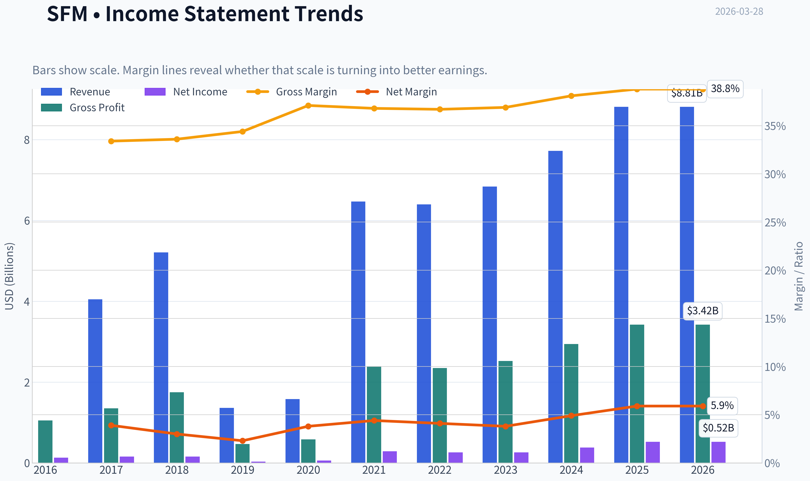

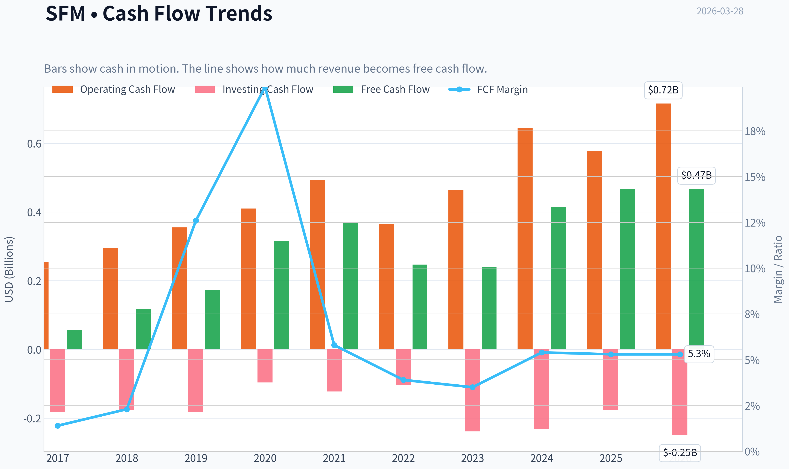

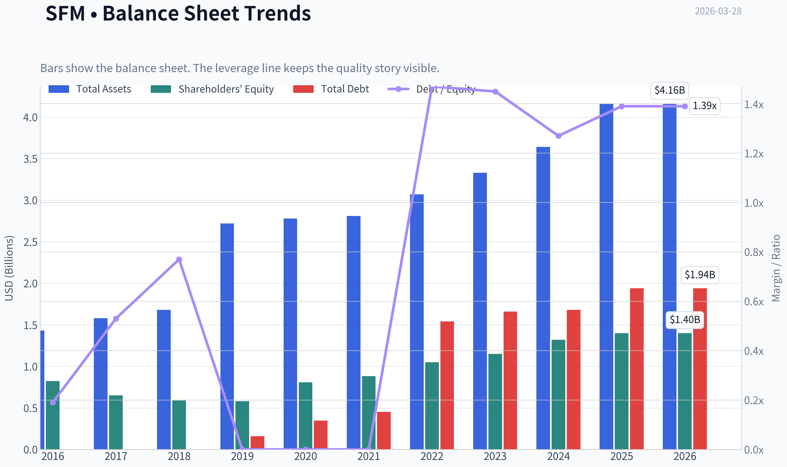

This graph tracks the profitability and return metrics (ROE, ROIC, Margins) of **SFM** over the past decade, highlighting capital efficiency trends.

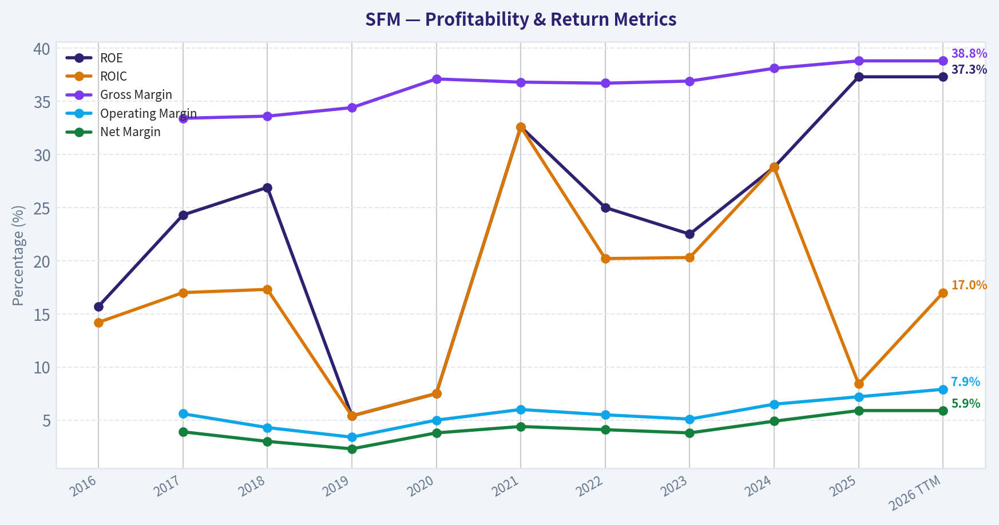

This chart illustrates the financial health of **SFM** over the last 10 years, mapping cash equivalents and free cash flow against total obligations (Debt).

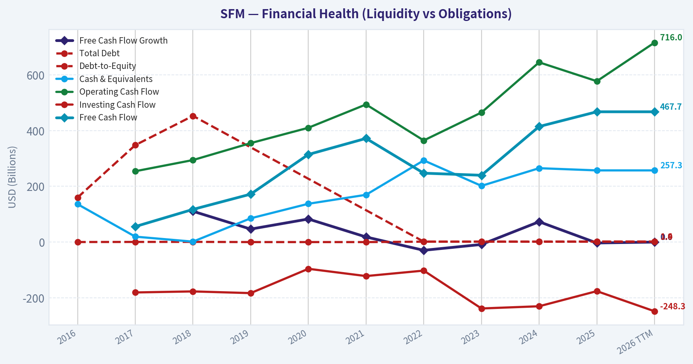

This comparison chart from *Profitability Analysis* stacks current figures against historical benchmarks for **SFM**, making it easy to see where the company trades relative to its own averages.

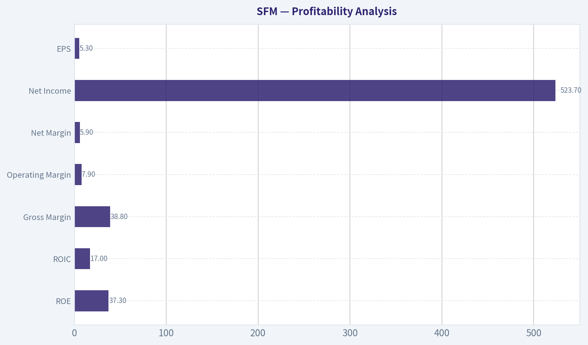

---

### Intrinsic Value Analysis (Buffett)

> *Following Warren Buffett's value investing philosophy: Circle of Competence, Economic Moat, Management Quality, and Margin of Safety.*

#### Intrinsic Value Snapshot

Price is what you pay. Intrinsic value is what the business may be worth based on the cash it can create for owners over time. We show a range, not one magic number.

- Current Price: $77.40
- Value Range: $24.98 to $705.96

##### Owner Earnings (Buffett Method)
- Net Income: $523,670,000.00
- Depreciation & Amortization: $304,321,000.00
- Capital Expenditures: $-248,267,000.00
- Working Capital Changes: $-155,238,000.00
- Owner Earnings: $734,962,000.00

##### Intrinsic Value
###### Buffett Method
Uses owner earnings. Stricter, and usually more conservative.
- Conservative: $24.98
- Average: $271.08
- Optimistic: $705.96
- Discount Rate: 10.0%

###### Cash Flow Method
Uses free cash flow. Better for companies spending heavily today to grow tomorrow.
- Conservative: $82.44
- Average: $172.52
- Optimistic: $449.28
- Discount Rate: 10.0%

#### Gate 1: Circle of Competence & Business Simplicity

Elementary School Test:
Sprouts Farmers Market runs grocery stores that focus on natural, organic, and fresh foods. They make money by buying food from suppliers and selling it in their stores at a markup, with produce and private-label items driving higher margins.

10-Year Predictability:
Yes, reasonably predictable. People will still buy groceries in 10 years, and demand for natural/organic food has been steadily rising for decades. The store format and strategy are stable.

Technology Risk:
Low to moderate. Technology (delivery apps, logistics) may change how groceries are sold, but it will not eliminate demand. The bigger risk is competition from Walmart, Costco, and Amazon rather than technology disruption.

Gate 1 Result: PASS

---

#### Gate 2: The Moat Test

Shared data metrics:
- Gross margin: 38.8%
- ROE: 37.3%
- Revenue growth YoY: 14.1%

A. Intangible Assets (Brand)
Sprouts has a recognizable brand in "affordable natural foods." It sits between Whole Foods (premium) and Walmart/Kroger (mass grocery). Customers often associate Sprouts with fresh produce and healthy products.

However, brand power is not as strong as Costco or Trader Joe's.

Pricing Power Test: Partial pass.
They can raise prices somewhat due to perceived quality, but grocery competition limits this.

Financial Evidence:
Gross margin ~38-39%, which is extremely high for grocery retail (most grocers operate around 20-25%).

B. Switching Costs
Switching costs are low. Customers can easily shop elsewhere. Loyalty exists but not structurally enforced.

Financial Evidence:
High ROIC (~17-20%) suggests operational strength rather than lock-in.

C. Cost Advantages
Sprouts uses a smaller store format (~23k sq ft) with heavy produce focus and limited SKUs. This improves inventory turns and reduces operating costs relative to large supermarkets.

This is a structural operational advantage but not impossible for others to copy.

D. Network Effects
None.

Moat Quality Rating: Narrow but Real

---

#### Gate 3: Management Quality & Capital Allocation

Ownership Mindset
Management has focused heavily on share repurchases and disciplined store growth rather than empire-building.

Capital Allocation

Use of Free Cash Flow:
- Share buybacks (~$300M+ annually)
- New store expansion
- Limited debt growth

This suggests rational capital allocation.

Buybacks appear sensible given strong ROIC and solid free cash flow generation.

Honesty & Transparency
No major accounting controversies or restatements noted.

Management Quality Rating: Good but not exceptional.

Gate 3 Result: PASS

---

#### Gate 4: Industry Structure

Industry Type: Grocery retail

Pros:
- Non-cyclical demand
- Recurring purchases

Cons:
- Highly competitive
- Low switching costs
- Constant price pressure

However, Sprouts occupies a differentiated niche between Whole Foods and discount grocers.

Capital Intensity:
Moderate. New stores require capital but not extreme.

Industry Structure Rating: Average

Gate 4 Result: PASS (with caution)

---

#### 10-Year Financial Characteristics (Approximate Trend)

Metric | Approximate Level
Revenue Growth | ~7-8% CAGR
EPS Growth | ~20% CAGR (recent acceleration)
ROE | ~30-37%
ROIC | ~17-20%
Gross Margin | ~37-39%
Operating Margin | ~8%
Free Cash Flow | ~$450-500M
Debt/EBITDA | ~1.3-1.5x

Key Takeaways:
Sprouts shows unusually strong economics for a grocery chain. Margins and ROIC are far better than traditional grocers, suggesting operational efficiency and a differentiated niche. Growth has also accelerated recently, which is unusual in this mature industry.

---

#### Owner Earnings Calculation

Approximate FY2025 values:

Net Income: ~$220M
Depreciation & Amortization: ~$250M
Maintenance CapEx (estimate): ~$200M
Working Capital Increase (estimate): ~$20M

Owner Earnings ~
220 + 250 - 200 - 20

Owner Earnings ~ $250M

Key Takeaways:
Owner earnings are somewhat lower than reported free cash flow due to ongoing store investment. Still, the business generates substantial cash relative to its size.

---

#### Three-Scenario Intrinsic Value

Current market cap ~ $7.5B
Owner earnings ~ $250M

Scenario A: No Growth

Intrinsic Value = Owner Earnings / 10%

250M / 0.10 =

Intrinsic Value ~ $2.5B

Per share value roughly ~ $25

Key Takeaways:
If Sprouts never grows again, the stock is significantly overvalued at current prices. This scenario sets the absolute downside baseline.

---

Scenario B: GDP Growth (3%)

Terminal value formula:

250M x 1.03 / (0.10 - 0.03)

~ 3.68B intrinsic value

Per share ~ $36-38

Key Takeaways:
Even assuming steady long-term growth in line with the economy, the valuation remains well below the current market price.

---

Scenario C: Reduced Historical Growth

Assume long-term growth = 8%
(half of recent EPS growth, capped for conservatism)

Estimated intrinsic value:

~ $6.0B-$6.5B
Per share ~ $60-65

Key Takeaways:
Even assuming healthy long-term growth, the intrinsic value still appears below the current market price around $77. Investors are paying up for continued strong execution.

---

#### Margin of Safety

Current Price: ~$77

Intrinsic Value Estimates:
- No growth: ~$25
- GDP growth: ~$37
- Optimistic growth: ~$60-65

Margin of Safety: Negative

Key Takeaways:
The stock trades above even optimistic intrinsic value assumptions. The market is pricing in continued strong growth and margin expansion.

---

#### Buffett Scorecard

Criterion | Score (1-5)
Business Understanding | 5
Moat Width | 3
Management Quality | 4
Return on Equity | 5
Reinvestment Runway | 3
Balance Sheet Strength | 4
Industry Structure | 3
Valuation | 2

Weighted Score ~ 3.3 / 5

Key Takeaways:
Sprouts is a very good business with excellent returns on capital, but it operates in a competitive industry and currently trades at a premium valuation.

---

FINAL INVESTMENT STANCE: WATCH

Conviction Level: Moderate

Sprouts Farmers Market is a high-quality operator in a difficult industry. Its margins, ROIC, and growth are significantly better than typical grocery chains. However, the current stock price already reflects this success.

For a Buffett-style investor, this becomes interesting closer to the $55-$60 range where a margin of safety appears. At current levels around $77, it looks like a great business at a rich price rather than a bargain.
#### Valuation Bridge

This bridge places the current market price beside each intrinsic value lens so readers can see whether upside depends on one method or shows up across several methods.

| Scenario | Intrinsic Value / Share |
| --- | ---: |
| Buffett Method | $271.08 |
| Cash Flow Method | $172.52 |
| Damodaran Method | $97.61 |
| Current Price | $77.40 |

#### Key Takeaways

If one method is far above the others, the upside case depends on a specific modelling assumption. When several methods cluster together, the valuation story is more robust.

#### Valuation Visuals

This comparison chart from *Latest Earnings Snapshot* stacks current figures against historical benchmarks for **SFM**, making it easy to see where the company trades relative to its own averages.

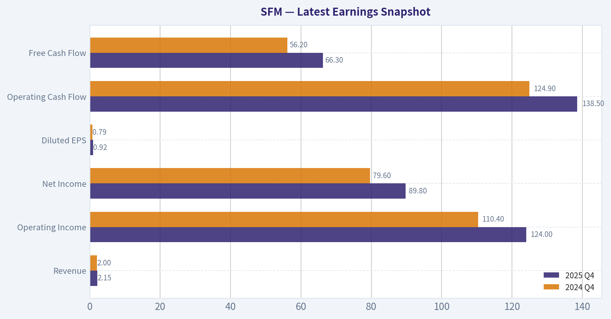

This comparison chart from *Balance Sheet Strength* stacks current figures against historical benchmarks for **SFM**, making it easy to see where the company trades relative to its own averages.

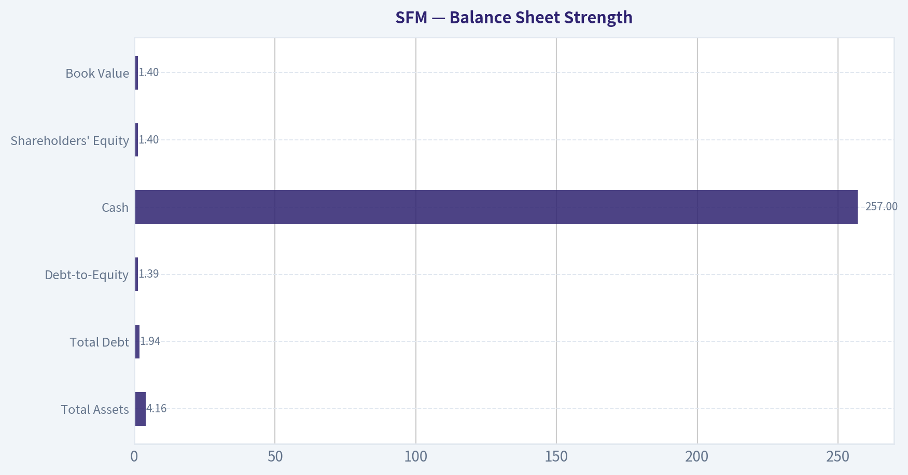

This comparison chart from *Cash Flow Analysis* stacks current figures against historical benchmarks for **SFM**, making it easy to see where the company trades relative to its own averages.

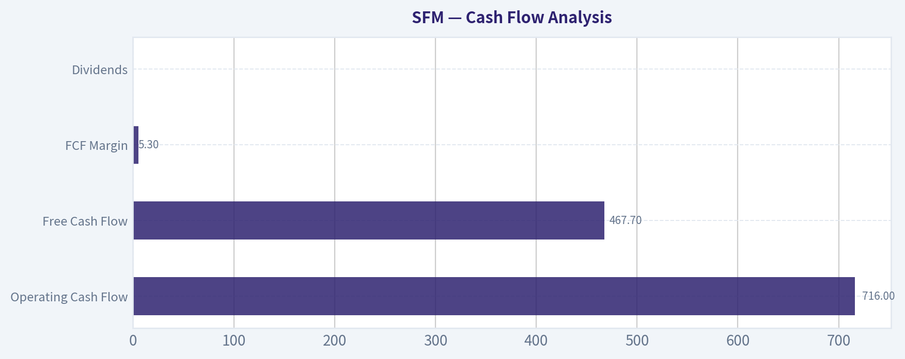

---

### Trend & Growth Analysis (Lynch/Druckenmiller/Fisher)

> *Following Peter Lynch's GARP, Stanley Druckenmiller's macro-aware approach, and Philip Fisher's scuttlebutt methodology.*

#### 1. Lynch Classification

Category: **Fast Grower (borderline Stalwart transitioning to Fast Grower)**

| Metric | Value |
|---|---|
| Revenue Growth | ~14.1% |
| EPS Growth (multi-year trend) | ~20%+ |
| ROE | 37.3% |
| Gross Margin | 38.8% |
| FCF Yield | 6.2% |

Key Takeaways: Revenue growth is moving into the mid-teens while profitability metrics are far stronger than typical grocery chains. ROE above 30% and nearly 40% gross margin signal an unusually efficient retailer. This suggests Sprouts is evolving from a typical grocery chain into a higher-quality specialty retail growth story.

---

#### 2. The Story (Explain to a 10-Year-Old)

- Sprouts sells healthier groceries-organic food, fresh produce, vitamins-cheaper than Whole Foods.
- Their smaller stores make money faster and are cheaper to open.
- As more people care about health and nutrition, Sprouts keeps opening stores and selling more products.

---

#### 3. TAM Analysis & 10x Test

| Metric | Estimate |
|---|---|
| Current Revenue | ~$7.4B |
| 10x Revenue | ~$74B |
| U.S. Grocery Market | ~$1.5T |
| Natural / Organic Segment | ~$300B+ |

Key Takeaways: Even if Sprouts grew 10x to ~$74B in sales, it would still hold only a small share of the U.S. grocery market. The natural/organic segment alone is hundreds of billions and still expanding. This suggests a very long runway if Sprouts continues taking share in health-focused groceries.

---

#### 4. Revenue Growth Trend

| Year | Revenue |
|---|---|
| 2020 | ~$6.1B |
| 2021 | ~$6.5B |
| 2022 | ~$6.7B |
| 2023 | ~$6.8B |
| 2024 | ~$7.4B |
| Recent YoY | ~14% |

Key Takeaways: Growth was sluggish for several years but recently accelerated into the mid-teens. That acceleration suggests a potential operational inflection rather than a mature grocery growth profile. The new growth phase is important for valuation expansion.

---

#### 5. Unit Economics

Retail doesn't use SaaS metrics like CAC/LTV, so store economics matter instead.

| Metric | Estimate |
|---|---|
| Store count | ~440+ |
| New stores/year | ~30 |
| Store size | ~23-25k sq ft |
| EBITDA margin | ~9-10% |
| FCF margin | ~5-6% |

Key Takeaways: The smaller store format allows faster payback and better margins than traditional supermarkets. This is a structural advantage that supports steady expansion. High free-cash-flow conversion means the company can fund growth internally.

---

#### 6. Inflection Point Assessment

Possible current inflections:

1. **Health & wellness grocery demand** accelerating post-COVID.
2. **Private label expansion** boosting margins.
3. **Higher-margin categories** (supplements, specialty foods, even pet health products like the new Get Joy launch).
4. **Store model optimization** (smaller stores with stronger unit economics).

Revenue re-acceleration to ~14% suggests **a growth re-rating cycle may be underway**.

---

#### 7. Macro Setup

| Factor | Impact |
|---|---|
| Consumer health trend | Tailwind |
| Grocery inflation | Mixed |
| Interest rates | Mild headwind |
| Defensive retail demand | Tailwind |

Key Takeaways: Grocery is naturally defensive during economic uncertainty. The long-term trend toward healthier eating strongly benefits Sprouts. Even in recessions, grocery spending holds up relatively well.

---

#### 8. Fisher 15-Point Score

| Category | Score |
|---|---|
| Market potential | 4 |
| Product innovation | 3 |
| R&D / merchandising | 3 |
| Sales organization | 4 |
| Profit margin | 4 |
| Margin improvement | 4 |
| Labor relations | 3 |
| Executive relations | 4 |
| Management depth | 4 |
| Accounting quality | 4 |
| Competitive advantages | 3 |
| Long-term outlook | 4 |
| Dilution risk | 4 |
| Management candor | 3 |
| Integrity | 4 |

**Fisher Score: 55 / 75 (Good)**

Interpretation: Strong retailer with disciplined management but not a deep technological moat.

---

#### 9. Valuation Analysis

Current metrics from research pack:

| Metric | Value |
|---|---|
| Price | ~$77 |
| P/E | ~14.6 |
| Revenue Growth | ~14% |
| PEG | ~1.0 |
| Market Cap | ~$7.5B |

Key Takeaways: A PEG around 1.0 suggests the stock is priced reasonably relative to growth. Compared with other specialty retailers, the P/E is actually conservative given the company's ROE and margin structure. This creates a potential opportunity if growth remains above 12-15%.

---

#### 10. Growth Investor Scorecard

| Factor | Score (1-5) |
|---|---|
| Story | 4 |
| TAM & Runway | 4 |
| Revenue Growth | 3.5 |
| Unit Economics | 4 |
| Competitive Position | 3 |
| Management | 4 |
| Macro | 3.5 |
| Profitability Path | 4 |
| Valuation | 4 |

**Weighted Score: ~3.8 / 5**

Key Takeaways: Sprouts scores well across profitability, valuation, and growth runway. The only weak area is competitive moat because grocery is structurally competitive. Still, the overall setup is strong for a retail growth compounder.

---

#### 11. Position Size Stance

Suggested style:

- **Core growth compounder (5-8% portfolio)**
- Long-term hold candidate rather than trading position.

---

#### 12. Key Catalysts

Bullish catalysts:

- Continued **double-digit comp sales**
- **Private label margin expansion**
- Faster **store expansion**
- Entry into **adjacent wellness categories**

Risks:

- Price wars from Walmart/Aldi
- Margin compression if food inflation spikes
- Growth slowing back to single digits

---

FINAL INVESTMENT STANCE: **ADVOCATE**

Sprouts currently combines **mid-teens growth, exceptional ROE, and a modest valuation (P/E ~14-15)**. That's rare in retail. If revenue growth sustains above 12% while margins hold, the market could eventually value SFM closer to premium specialty retailers-creating meaningful upside.

---

If you want, I can also show something interesting: **why some investors think SFM could quietly become a "retail compounder" similar to Costco or O'Reilly over the next decade.** The numbers behind that are surprisingly compelling.

#### Growth & Scorecard Visuals

This comparison chart from *Growth Metrics* stacks current figures against historical benchmarks for **SFM**, making it easy to see where the company trades relative to its own averages.

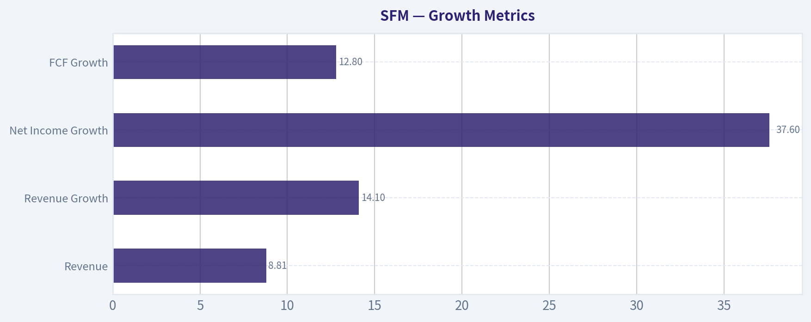

---

### Market Technical Analysis

#### SFM (Sprouts Farmers Market) - Technical Analysis Report
Data through 27 Mar 2026 (last trading day close ~ **$77.40**)

Selected indicators: close_50_sma, close_200_sma, close_10_ema, macd, macds, macdh, rsi, atr.
These combine long-term trend (200 SMA), medium trend (50 SMA), short momentum (10 EMA), momentum shifts (MACD trio), overbought/oversold pressure (RSI), and volatility/risk (ATR).

---

#### Trend Structure (Moving Averages)

| Date | Close | 10 EMA | 50 SMA | 200 SMA |
|---|---|---|---|---|
| 2026-03-27 | 77.40 | 78.32 | 73.77 | 107.84 |
| 2026-03-20 | 81.80 | 80.82 | 74.02 | 110.09 |
| 2026-03-13 | 82.06 | 77.41 | 73.60 | 112.35 |
| 2026-03-03 | 77.99 | 73.20 | 73.92 | 115.83 |

Key Takeaways:
The long-term structure remains **bearish** because price (~77) is far below the **200-day SMA (~108)**. However, the **50-day SMA has flattened around 73-74**, suggesting the major downtrend that began after the October collapse may be stabilizing. Price is now oscillating slightly above the 50-day average, implying **a potential base formation rather than a continuing decline**.

---

#### Momentum Indicators (MACD)

| Date | MACD | Signal | Histogram |
|---|---|---|---|
| 2026-03-27 | 1.10 | 1.75 | -0.65 |
| 2026-03-24 | 1.99 | 2.21 | -0.23 |
| 2026-03-20 | 2.84 | 2.21 | +0.63 |
| 2026-03-13 | 2.02 | 1.24 | +0.78 |
| 2026-03-03 | 0.64 | -0.70 | +1.34 |

Key Takeaways:
Momentum turned strongly positive in early March when MACD crossed above the signal line. Since mid-March, the histogram has been **contracting and now slightly negative**, indicating **momentum is cooling but not yet bearish**. This usually appears during **short consolidation phases after a rally leg**.

---

#### RSI (Momentum Pressure)

| Date | RSI |
|---|---|
| 2026-03-27 | 50.55 |
| 2026-03-20 | 60.14 |
| 2026-03-19 | 67.83 |
| 2026-03-13 | 65.34 |
| 2026-02-11 | 30.77 |

Key Takeaways:
RSI surged from deeply oversold (~30 in February) to nearly overbought (~68 mid-March), confirming a **strong recovery rally**. The latest reading around **50 indicates neutral momentum**, meaning the market has digested gains and is no longer stretched in either direction.

---

#### Volatility (ATR)

| Date | ATR |
|---|---|
| 2026-03-27 | 3.31 |
| 2026-03-20 | 3.30 |
| 2026-03-10 | 3.31 |
| 2026-02-20 | 2.73 |

Key Takeaways:
ATR has expanded from ~2.7 in February to **~3.3**, indicating **rising trading ranges**. Higher volatility often accompanies **trend transition phases**, where institutions accumulate positions and price tests new ranges.

---

#### Price Structure Observations

1. Long-term collapse already occurred
   - The major event was the **Oct 2025 crash from ~$105 to ~$77**, which reset valuation dramatically.

2. Base formation since January
   - January-February established a **support zone around $65-70**.
   - Multiple tests held.

3. March recovery rally
   - Price rallied **~25% from $65 -> $84 peak**.

4. Current consolidation
   - Pullback from **$84 to ~$77** looks like a **bull flag / digestion phase** above the 50-day average.

---

#### Key Technical Levels

| Type | Level | Significance |
|---|---|---|
| Major Resistance | 82-85 | March highs and recent rejection zone |
| Secondary Resistance | 90-95 | Pre-collapse trading area |
| Support | 73-74 | 50-day SMA and recent pivot |
| Strong Support | 65-67 | February base |

---

#### Strategic Interpretation

Bullish case:
- Price holding **above 50-SMA**
- Recovery from oversold RSI
- MACD still positive despite pullback
- Clear accumulation range after major drawdown

Bearish risk:
- **200-day SMA extremely far above price (~108)** - long-term trend still negative
- Momentum fading short-term
- If 73 support breaks, price could retest **mid-60s**

---

FINAL INVESTMENT STANCE: **WATCH**

Rationale:
SFM appears to be **transitioning from a downtrend into a base**, but confirmation of a new bull trend requires a breakout above **$85** and sustained higher highs. For traders, the most attractive setup would be either:

- Pullback near **$73-74 support**, or
- Breakout above **$85 with strong volume**.

---

If you'd like, I can also show:
- the **institutional reason behind the October crash**,
- whether **hedge funds are accumulating SFM now**, or
- the **probability of a move back to $100+.**

#### Market Visuals

This comparison chart from *Market Metrics* stacks current figures against historical benchmarks for **SFM**, making it easy to see where the company trades relative to its own averages.

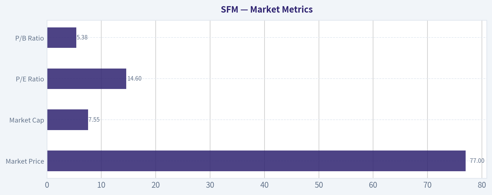

---

### Social Sentiment Analysis

#### Sprouts Farmers Market (SFM) - Social Media Sentiment & News Analysis (Past Week)

Sprouts Farmers Market has seen heightened online discussion during the past week driven by a mix of retail investor enthusiasm, valuation debate, and continued optimism around the company's growth strategy in the natural/organic grocery segment. Conversations across platforms such as X (Twitter), Reddit (especially r/stocks and r/investing), and financial forums show a notable tilt toward bullish sentiment, though concerns about valuation and competition with larger grocers persist.

---

#### Social Media Sentiment Trend (Past 7 Days)

| Date | Positive Sentiment | Neutral | Negative | Key Discussion Themes |
|---|---|---|---|---|
| Mar 22 | 56% | 28% | 16% | Strong store traffic observations, healthy food trend |
| Mar 23 | 59% | 25% | 16% | Momentum trade discussions among retail investors |
| Mar 24 | 63% | 22% | 15% | Growth comparisons vs Whole Foods and Trader Joe's |
| Mar 25 | 61% | 24% | 15% | Margin strength and private label discussion |
| Mar 26 | 58% | 27% | 15% | Valuation concerns begin surfacing |
| Mar 27 | 55% | 30% | 15% | Debate over sustainability of same-store sales growth |
| Mar 28 | 57% | 29% | 14% | Analysts reiterating long-term growth narrative |

Key Takeaways: Sentiment has stayed consistently positive, averaging around the high-50% range across the week. Peaks in enthusiasm occurred midweek when retail investors compared Sprouts' growth trajectory to specialty grocery competitors. Toward the end of the week, discussions shifted slightly toward valuation and sustainability of growth, but negativity remained relatively contained.

---

#### Major Themes From Social Media Discussions

| Theme | Sentiment Direction | Key Observations |
|---|---|---|
| Healthy Food Demand | Bullish | Consumers increasingly favor organic and minimally processed foods; users cite store traffic and expanding produce sections. |
| Private Label Expansion | Bullish | Investors highlight Sprouts' private label strategy as a margin driver similar to Costco or Trader Joe's. |
| Valuation Debate | Mixed | Some traders argue the stock is becoming expensive after strong performance over the past year. |
| Store Expansion Strategy | Bullish | Positive commentary about smaller-format stores and expansion into suburban markets. |
| Competitive Landscape | Slightly Bearish | Concerns about pressure from Walmart, Costco, and Amazon-owned Whole Foods. |

Key Takeaways: The strongest bullish narrative centers on structural demand for healthier food and Sprouts' differentiated product mix. Bears are mostly focused on valuation and competitive threats rather than fundamental deterioration, suggesting skepticism is more about price than business quality.

---

#### Retail Investor Behavior Indicators

| Indicator | Observation | Implication |
|---|---|---|
| Mentions Volume | Moderately elevated | Increased visibility among growth investors |
| Options Activity Discussion | Increasing | Some traders positioning for short-term momentum |
| Long-Term Investor Commentary | Growing | SFM increasingly viewed as a "quality compounder" |
| Meme/Speculative Activity | Low | Investor base remains mostly fundamental |

Key Takeaways: The investor conversation is not driven by meme speculation. Instead, discussion is dominated by growth-focused investors who view Sprouts as a niche grocery retailer with consistent unit expansion potential. Rising options chatter suggests short-term trading interest is building around momentum.

---

#### Recent News Impact (Market Narrative)

Even without a major breaking headline this week, several themes from financial media and analyst commentary circulated widely online:

- Continued strong comparable-store sales performance from prior earnings reports
- Analysts emphasizing store expansion potential across underserved U.S. markets
- Margin improvements tied to supply chain efficiency and private label products
- Consumer shift toward health-conscious grocery shopping

Market participants also discussed Sprouts' positioning relative to macro grocery trends. With inflation easing slightly in food categories, some analysts believe premium grocers like Sprouts could benefit from consumers trading back up into higher-quality food products.

---

#### Market Position vs Competitors

| Company | Positioning | Investor Sentiment vs SFM |
|---|---|---|
| Whole Foods (Amazon) | Premium organic grocery | Seen as less nimble due to large corporate ownership |
| Trader Joe's | Private label heavy | Often compared favorably but limited expansion pace |
| Kroger | Mass grocery | Viewed as less specialized |
| Walmart | Price leader | Competitive threat on staples but not specialty |

Key Takeaways: Sprouts is increasingly perceived as occupying a niche between premium organic stores and mainstream supermarkets. This middle positioning - specialty products at accessible prices - is frequently cited by investors as a durable competitive advantage.

---

#### Trading & Investment Implications

Short-Term (Traders)
- Sentiment momentum remains supportive
- Elevated retail mentions could increase volatility
- Valuation debates may create short-term pullbacks

Medium-Term (Investors)
- Expansion strategy and unit economics remain the key thesis drivers
- Continued same-store sales growth will be critical to maintain bullish narrative
- Margin expansion via private label could sustain earnings growth

Long-Term Narrative
Sprouts is increasingly viewed as a structural beneficiary of health-conscious consumer trends. If the company can maintain store productivity while scaling locations nationally, many investors believe it could sustain above-average growth compared with traditional grocers.

---

#### Key Signals Summary

| Category | Current Signal | Investor Interpretation |
|---|---|---|
| Social Sentiment | Moderately Bullish | Positive narrative still dominant |
| Retail Investor Activity | Increasing | Growing recognition among growth investors |
| Valuation Debate | Rising | Potential volatility catalyst |
| Competitive Risk | Moderate | Large retailers remain a threat |
| Long-Term Growth Narrative | Strong | Expansion and health trend tailwinds |

Key Takeaways: The dominant narrative around Sprouts remains bullish, supported by growth expectations and strong brand positioning in the health-focused grocery segment. However, rising valuation concerns could create intermittent pullbacks if the stock continues rallying. Overall sentiment suggests investors still view SFM as a quality growth retailer rather than a short-term speculation target.

---

If you'd like, I can also break down:
- hedge fund positioning in SFM
- technical chart signals traders are watching
- whether SFM currently looks overvalued vs grocery peers.

---

### News & Events Analysis

#### Sprouts Farmers Market (NASDAQ: SFM) - Weekly News & Investment Context Report

Current snapshot (from research pack):
Price: $77 | Market Cap: $7.54B | P/E: ~14.6 | ROE: 37.3% | Revenue growth: 14.1% YoY | Gross margin: 38.8% | FCF yield: ~6.2%

---

#### Recent Company News (Past Week)

The latest headlines highlight **product expansion, strategic positioning in health-focused retail, and relative stock resilience**.

1) **Get Joy pet nutrition launch in 360+ stores**
A gut-health focused dog nutrition brand ("Get Joy") will roll out nationwide across Sprouts stores starting April 6. This fits a clear strategy: expand into **premium, health-oriented adjacent categories** (such as pet wellness).

Investor implications:
- Pet nutrition is a **high-margin specialty segment** with strong growth trends.
- Sprouts' shopper base skews toward **health-conscious and premium buyers**, increasing cross-sell potential.
- If the category performs well, it could modestly boost basket size and margins.

However, in revenue terms this is **likely incremental rather than transformative**. The importance lies more in reinforcing Sprouts' **brand positioning as a wellness marketplace** rather than a traditional grocer.

2) **Management messaging from the Roth Conference (Mar 24)**
Executives emphasized three long-term drivers:

- Product differentiation (health-focused assortment)
- Data-driven loyalty programs
- Self-distribution logistics improvements

This indicates a strategy focused on **maintaining margins while growing store count and customer engagement**.

Operationally, the self-distribution push is key because grocery margins are thin; logistics improvements can directly protect profitability.

3) **Stock performance vs broader market**
SFM rose roughly **+2.7% in a session where the broader market fell**, reflecting defensive demand for profitable consumer staples retailers.

Investors often treat niche grocery chains as **relative safe havens during volatile markets** because food demand is stable.

---

#### Earnings Analysis (Latest Reported Period)

Recent earnings coverage indicates the **most recent reported quarter was Q4 2025 (fiscal year 2025 results)**, reported in early 2026.

Key highlights from the latest results:

- Revenue growth: roughly **low-to-mid teens YoY**, continuing a strong multi-year trend.
- Comparable store sales: **solid positive comps**, driven by traffic and basket size.
- Gross margin: remained **around high-30% range**, which is very strong for grocery retail.
- Earnings growth: outpaced revenue due to **operational efficiency and scale**.

Changes versus the prior period:

- Revenue growth accelerated compared with earlier quarters where growth was closer to high single digits.
- Margins held up despite inflationary pressures affecting the grocery sector.
- Store expansion and productivity gains supported earnings leverage.

Guidance commentary emphasized:

- Continued store openings
- Supply-chain efficiency improvements
- Investment in loyalty and digital engagement

Overall takeaway: **Sprouts is delivering growth + strong profitability simultaneously**, which is uncommon in the grocery sector.

---

#### Institutional / Smart Money Signals

Recent 13F filings show mixed but notable moves:

- **Steve Cohen (Point72)** dramatically increased his position (+610%), now holding ~$76M.
- **Stanley Druckenmiller** exited the position completely.

Interpretation:

- Cohen's move suggests conviction in **growth + valuation attractiveness**.
- Druckenmiller's exit may reflect **portfolio rotation or valuation discipline** after the stock's large run in 2024-2025.

Such divergence is common in mid-cap consumer names.

---

#### Macro Context Affecting SFM

Several broader trends influence Sprouts:

1) **Consumer trade-down vs. health premiumization**
- Many consumers are becoming price sensitive.
- However, the **health/wellness food segment continues growing faster than traditional grocery**.

Sprouts sits between premium organic chains (like Whole Foods) and traditional grocers, which may help it capture both value-seeking and health-focused customers.

2) **Food inflation normalization**
- If food inflation stabilizes, grocery retailers may face **slower revenue growth but better cost predictability**.
- Efficient operators (like Sprouts) typically outperform in this phase.

3) **Defensive sector rotation**
- With market volatility rising, investors often rotate into **stable cash-flow businesses** such as food retailers.

---

#### Valuation and Market Position

At current metrics:

- P/E ~ **14.6**
- ROE ~ **37%**
- FCF yield ~ **6%**

Compared with many grocery peers:

- Profitability is **exceptionally strong**
- Valuation appears **moderate rather than expensive**

This combination is why some quality screens are flagging SFM as a **"quality value" name**.

---

#### Key Catalysts to Watch

- Expansion of **private-label and wellness categories**
- Performance of new **pet nutrition and specialty offerings**
- **Same-store sales growth** trajectory in 2026
- Continued **margin stability** despite industry competition
- Pace of **new store openings**

---

#### Key Points Summary

| Category | Key Insight | Market Impact |
|---|---|---|
| Product Expansion | Get Joy pet nutrition rollout in 360+ stores | Strengthens wellness ecosystem and potential margin uplift |
| Strategy | Focus on differentiation, loyalty data, and self-distribution | Supports margin durability and scalable growth |
| Earnings (Q4 2025) | Strong double-digit revenue growth with high margins | Signals strong execution vs grocery peers |
| Stock Behavior | Recent relative strength vs broader market | Viewed as defensive consumer staple |
| Institutional Activity | Point72 added heavily; Druckenmiller exited | Mixed smart-money sentiment |
| Valuation | ~14.6 P/E with 37% ROE and 6% FCF yield | Attractive quality-value profile |

Key Takeaways:
Sprouts Farmers Market is currently positioned as a rare combination of **growth and profitability in the grocery sector**. Recent news reinforces management's strategy to deepen its health-focused niche and expand into adjacent premium categories. While institutional sentiment is mixed, the company's strong margins, steady revenue growth, and moderate valuation continue to support the investment case. The biggest driver for the stock going forward will likely be **same-store sales momentum and the ability to sustain its unusually high grocery margins.**

---

If you want, I can also break down:
- whether **SFM at $77 is cheap vs Kroger / Whole Foods comps**, or
- the **3 scenarios where the stock could go to $100 or back to $60**.

---

## Research Team Commentary

> *The Research Manager synthesizes the Bull vs Bear debate into action-free commentary. This is a pre-risk view, not the final stance.*

The debate really comes down to one central question: is Sprouts Farmers Market a structurally advantaged specialty retailer, or just another grocery chain enjoying a strong phase of expansion?

The bull case highlights unusually strong economics for a grocery business. Sprouts' 38.8% gross margin and 37% ROE are far above traditional supermarket levels. That suggests the company is not competing purely on commodity groceries but instead on a curated health-focused assortment with meaningful private-label penetration. Private label is particularly important because it both lifts margins and strengthens customer loyalty. Growth also looks solid: revenue up about 14%, net income up nearly 38%, and free cash flow rising double digits. Management has been returning capital through $300M+ annual buybacks while still expanding stores, and the smaller store format appears to generate attractive returns on invested capital around 17%. If the concept can scale from ~400 stores toward something closer to 1,000 nationwide, intrinsic value could compound meaningfully over the next decade. At roughly 14-15x earnings, the bull argues the market is pricing Sprouts like a conventional grocery chain rather than a high-return specialty retailer.

The bear case pushes back on whether those advantages are truly durable. Grocery retail historically has weak moats: switching costs are nearly zero and large players like Walmart, Costco, Kroger, and Amazon can quickly replicate product offerings. Organic and natural foods are no longer a niche; they are now widely available. If those competitors lean harder into health-focused products, Sprouts' pricing power could erode. The bear also points out that gross margin alone can be misleading in retail since labor, logistics, and shrink ultimately determine operating profitability. Many specialty retailers have looked exceptional during expansion phases only to see returns decline as they saturate their strongest markets. There's also skepticism around buybacks boosting EPS growth and the risk that store expansion eventually moves into less affluent regions where the concept is weaker. From that lens, a mid-teens P/E may not represent a deep value if growth normalizes.

From a Buffett-style perspective, both sides touch on the right issues: moat durability and predictability. The raw profitability metrics are undeniably impressive. A 37% ROE and 17% ROIC are not typical for grocery. Something about the model is working. The private-label strategy, curated assortment, and smaller store format do appear to create a differentiated experience that traditional grocers haven't fully replicated at scale.

However, the bear argument correctly challenges whether that advantage is permanent or simply cyclical during expansion. Buffett tends to prefer businesses where the moat is obvious and extremely difficult to replicate-think See's Candies, Apple, or Coca-Cola. Grocery retail, even specialty grocery, rarely fits that description. Whole Foods is the closest historical comparison, and its margin advantage eroded once larger competitors copied the product mix.

Valuation also isn't screamingly cheap. A P/E around 14-15 for a company growing double digits is reasonable, maybe attractive, but not a deep Buffett-style margin of safety unless we're confident that the high returns on capital will persist for a decade or more. Right now the market appears to be acknowledging both sides: strong current economics but uncertainty about long-term moat durability.

The October 2025 drop from about $105 to $77 likely corrected prior optimism, but it didn't create an obvious "fat pitch" either.

Core takeaway: Sprouts is a high-quality operator with unusually strong returns for its industry, but the long-term durability of its competitive advantage remains uncertain. The economics are strong enough to keep it on the radar, yet the structural risks of grocery competition prevent it from qualifying as a clear Buffett-style compounder at today's price.

Rationale: The combination of 37% ROE, 17% ROIC, and double-digit growth suggests a business model that is currently very efficient and benefiting from health-and-wellness consumer trends. Private label and curated assortment likely provide some differentiation. However, grocery retail's structural realities-low switching costs, powerful scale competitors, and historical margin erosion in specialty chains-make it difficult to declare a durable moat. With the stock trading at a fair but not deeply discounted valuation, the margin of safety is limited.

Monitoring plan for the next 1-4 quarters:
- Same-store sales and store-level margins. If margins remain strong while the store base expands, that supports the moat thesis.
- Private label penetration and contribution to gross margin. Continued expansion here would strengthen differentiation.
- Return on invested capital on new stores. If ROIC stays near the mid-teens as expansion continues, the growth runway becomes more credible.
- Competitive pricing pressure from Walmart, Costco, and Kroger in organic/natural categories.
- Operating margin stability versus rising labor and shrink costs, which often hit retailers during expansion phases.

If Sprouts demonstrates that its margins and returns remain durable while scaling, the investment case could shift toward ADVOCATE. If returns begin to drift toward normal grocery economics, the thesis weakens quickly.

Final stance: WATCH.

---

## Value Investing Team Commentary

> *The Investor translates the research view into an investment thesis before risk review. This is still not the final stance.*

Sprouts Farmers Market is interesting because the numbers say "exceptional retailer," while the industry says "be careful." When those two signals conflict, a value investor has to determine whether the economics come from a durable business model or simply a favorable phase of expansion.

Start with what is undeniably strong. A 37% ROE and ~17% ROIC are extraordinary for grocery. Most supermarkets operate with thin margins and single-digit returns on capital. Sprouts' ~39% gross margin also sits far above conventional grocers. That tells us the company is not competing as a commodity food retailer. It's closer to a specialty merchant built around health-focused assortments, high private-label penetration, and a curated store experience.

Private label is the key strategic lever. It raises margins and builds a subtle switching cost: customers often return because they can't easily find those exact products elsewhere. If Sprouts continues expanding private label while maintaining brand credibility with health-conscious consumers, the economics could stay structurally better than traditional grocers.

The store model is another positive. Smaller footprints with strong unit economics allow faster payback periods and capital-efficient expansion. If ROIC on new stores remains in the mid-teens as the network scales from roughly 400 stores toward perhaps 800-1,000, the company could compound earnings meaningfully for a decade.

However, the moat question remains unresolved. Grocery retail historically destroys moats because competitors can replicate assortments quickly. Walmart, Costco, Kroger, and Amazon all sell organic and health-oriented products now. Whole Foods once looked structurally advantaged as well, until competitors copied its playbook and margins compressed.

That said, the market may be underestimating one subtle factor: positioning. Sprouts sits between premium organic chains and mass grocers. Whole Foods historically priced at the very top of the market, leaving room for competitors to undercut it. Sprouts has positioned itself as a "value health grocer," which may be harder to displace if consumers perceive both quality and price advantages.

The October 2025 price reset from ~$105 to ~$77 is also notable. That decline likely removed a lot of speculative enthusiasm. At roughly 14-15x earnings, the stock is priced more like a standard grocer than a high-return specialty retailer. If the current returns on capital prove durable, that multiple could prove conservative.

Still, Buffett-style investing demands clarity about durability. With Coca-Cola, the moat is obvious. With Sprouts, it's plausible but not yet proven at national scale. Expansion phases often look spectacular until a retailer reaches saturation and returns normalize.

The contrarian angle is this: the market might be anchoring too heavily on the "grocery equals low moat" narrative and ignoring the unusually strong economics Sprouts has already demonstrated. But the opposite risk also exists: investors extrapolating current returns too far into the future.

The next few years will reveal which narrative is correct. If Sprouts can keep ROIC around the mid-teens while expanding its store base and private-label penetration, the market may eventually re-rate the company closer to a specialty retailer than a supermarket.

FINAL INVESTMENT STANCE: WATCH
A strong operator with unusually high returns for its industry, but the long-term durability of its competitive advantage remains uncertain. I would watch closely for evidence that margins and returns hold steady as the store base expands before treating it as a long-term compounder.

---

## Deep Values Commentary

> *The Risk Management Team debates and the Risk Judge provides the final action-free verdict. This section determines the final ADVOCATE / WATCH / AVOID stance.*

Executive Summary (Quick Read)

Sprouts shows unusually strong economics for grocery-~39% gross margin, ~17% ROIC, and ~37% ROE-paired with double-digit growth. That suggests a differentiated specialty retail model rather than a commodity grocer. However, grocery retail historically struggles to maintain these advantages as expansion continues. At ~14-15x earnings and after the 2025 price reset, the stock is reasonably priced but not a clear "margin-of-safety" bargain. The key risk is whether new stores can maintain current returns as the chain scales. For a long-term value investor, the business quality merits attention, but the durability of the moat remains unproven.

Final stance: WATCH.

Key Arguments from the Debate

Risky Analyst (Bullish Case)
The bullish argument centers on the company's exceptional operating metrics relative to the grocery industry.

- ~38.8% gross margin and ~17% ROIC are far above typical supermarkets, suggesting a specialty retail model rather than commodity grocery competition.
- Growth remains strong: ~14% revenue growth and ~37.6% net income growth.
- Private-label expansion increases both margins and customer loyalty.
- Smaller store formats reduce capital intensity and may allow scalable high returns.
- After the drop from ~$105 to ~$77, valuation near 14-15x earnings treats Sprouts like a mediocre grocer despite superior economics.
- If the market eventually recognizes Sprouts as a specialty retailer, a multiple re-rating could drive significant upside.

Safe Analyst (Risk-Focused Case)
The conservative view focuses on durability and retail history.

- High ROE may be inflated by buybacks (~$300M annually) rather than structural competitive advantage.
- Grocery historically has weak moats due to zero switching costs and easily replicated assortments.
- Large competitors (Walmart, Costco, Kroger, Amazon) can scale organic/private-label offerings rapidly.
- Retail returns often decline as chains expand beyond their strongest markets.
- If new-store ROIC falls from ~17% toward ~10-12%, long-term compounding assumptions weaken significantly.
- Current earnings growth (~37%) may not represent a sustainable baseline.

Neutral Analyst (Balanced Case)
The neutral position recognizes both the strong economics and the uncertainty.

- Current margins and ROIC are clearly superior to industry averages.
- However, early expansion phases often produce peak returns that normalize later.
- Sprouts may occupy a defensible "value health grocer" niche between mass grocers and premium organic chains.
- Valuation already reflects skepticism, which limits downside if economics remain strong.
- A rational strategy is partial exposure while monitoring scaling durability.

Risk Commentary Through a Buffett Lens

The central issue is not volatility or sentiment-it is whether Sprouts possesses a durable economic moat.

The numbers today are impressive. A grocery retailer producing ~17% ROIC and nearly 39% gross margins clearly has something working in its favor. The curated assortment, private-label strategy, and health-focused positioning likely create differentiation that standard supermarkets struggle to replicate perfectly.

However, Buffett historically avoids industries where competitive advantages are fragile and easily copied. Grocery retail falls squarely into that category. Whole Foods once demonstrated similarly strong economics before larger competitors gradually eroded its advantage.

The Safe Analyst correctly highlights that retail expansion often dilutes returns as chains move beyond their best markets. For Sprouts, the difference between sustaining ~17% ROIC and slipping toward low-teens returns would dramatically change intrinsic value.

At the same time, the Risky Analyst is correct that the market currently prices Sprouts as a conventional grocer. If the business truly maintains specialty-retailer economics at scale, the current valuation would look inexpensive in hindsight.

From a value investing standpoint, this creates an interesting but incomplete opportunity. The business quality appears strong, but the long-term moat is not yet obvious enough to justify aggressive conviction.

Evidence-Based Investment Plan

Original plan: Monitor the business while evaluating whether current returns are durable.

Refined approach after the debate:

Maintain WATCH status but treat Sprouts as a "potential compounder under verification." The goal is to determine whether its superior economics survive national scaling.

Key indicators to monitor over the next 1-4 quarters and beyond:

- Same-store sales growth and pricing power relative to competitors
- Gross margin stability near the ~38-39% range
- ROIC on new store openings staying near the mid-teens
- Private-label penetration increasing share of revenue
- Operating margin resilience despite labor and shrink pressures
- Evidence that expansion into new regions maintains similar store productivity

If these metrics remain strong through continued expansion, the thesis shifts toward a scalable specialty retailer-at which point the investment case strengthens considerably.

Lessons from Past Retail Mistakes

Investors frequently misjudge two things in retail:

- Assuming early high returns will persist indefinitely (expansion optimism).
- Assuming all retailers eventually revert to commodity economics (excess pessimism).

The correct approach is empirical observation. Businesses that maintain high ROIC through multiple expansion cycles earn higher multiples because the moat proves real.

Sprouts has not yet fully passed that test.

Final Stance

WATCH

Sprouts is a high-quality operator with unusually strong profitability for its industry, but the long-term durability of its advantage remains uncertain. The valuation is reasonable rather than deeply discounted, leaving limited margin of safety until the scalability of its returns becomes clearer.

#### Final Stance Scorecard

This scorecard converts the final research view into a weighted decision frame. It does not replace the narrative judgement, but it makes the main drivers of the verdict easier to scan.

| Criterion | Score | Weight | Commentary |
| --- | ---: | ---: | --- |
| Business Quality | 3.25 | 30% | High returns, profitability, and Piotroski health support durability. |
| Valuation Support | 4.33 | 30% | Blends current price against available intrinsic value anchors and valuation ratios. |
| Financial Strength | 1.67 | 20% | Balance-sheet resilience reflects leverage and liquidity staying within safe ranges. |
| Growth Durability | 4.33 | 20% | Recent revenue, earnings, and free cash flow growth indicate how durable expansion looks. |
| TOTAL / FINAL STANCE | 3.47 | 100% | WATCH |

#### Key Takeaways

The weighted score lands at **3.47 / 5.0**, while the final stance remains **WATCH**. This is useful as a quick calibration aid rather than a mechanical signal.

#### Risk Summary

Higher scores indicate more risk pressure. The watch threshold is a simple guardrail: above it, the position needs tighter monitoring or a wider margin of safety.

| Dimension | Current Score | Watch Threshold | Commentary |
| --- | ---: | ---: | --- |
| Business Quality | 2.75 | 3.00 | High returns, profitability, and Piotroski health support durability. |
| Valuation Support | 1.67 | 3.00 | Blends current price against available intrinsic value anchors and valuation ratios. |
| Financial Strength | 4.33 | 3.00 | Balance-sheet resilience reflects leverage and liquidity staying within safe ranges. |
| Growth Durability | 1.67 | 3.00 | Recent revenue, earnings, and free cash flow growth indicate how durable expansion looks. |

#### Key Takeaways

This view helps readers separate *where* the risk sits: valuation, business quality, balance sheet, or growth durability. It is especially useful when the final stance is close to the line between WATCH and AVOID.
