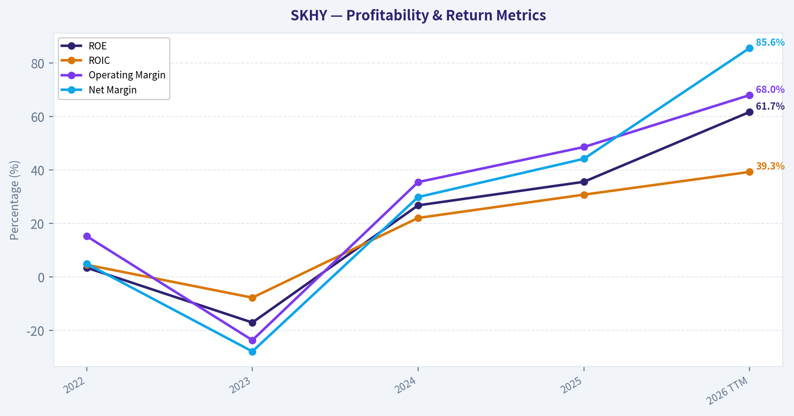
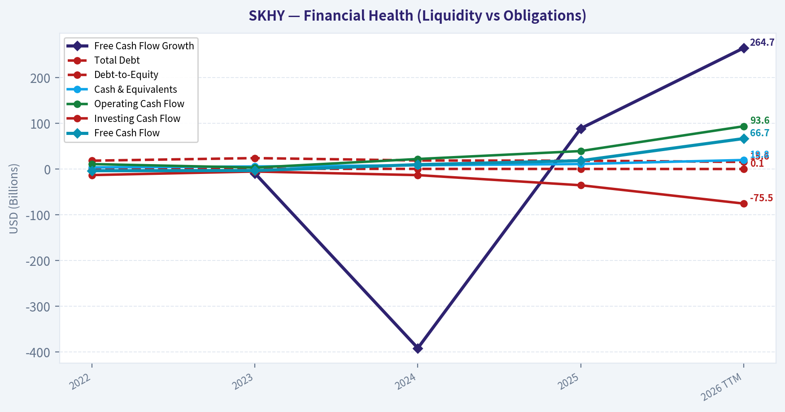
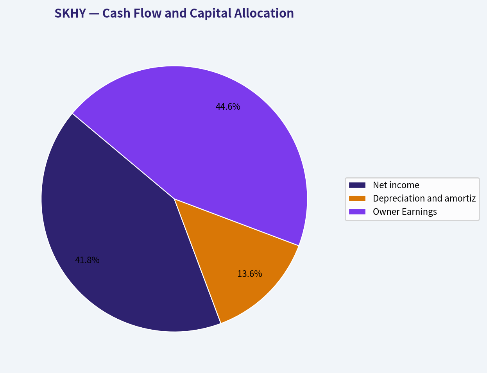
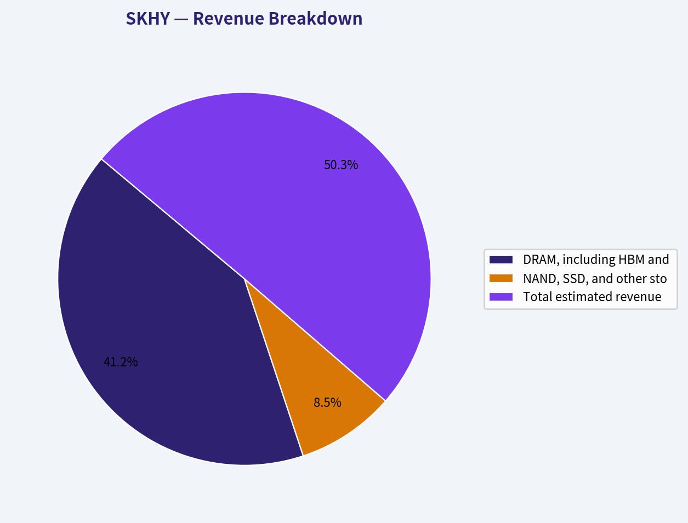
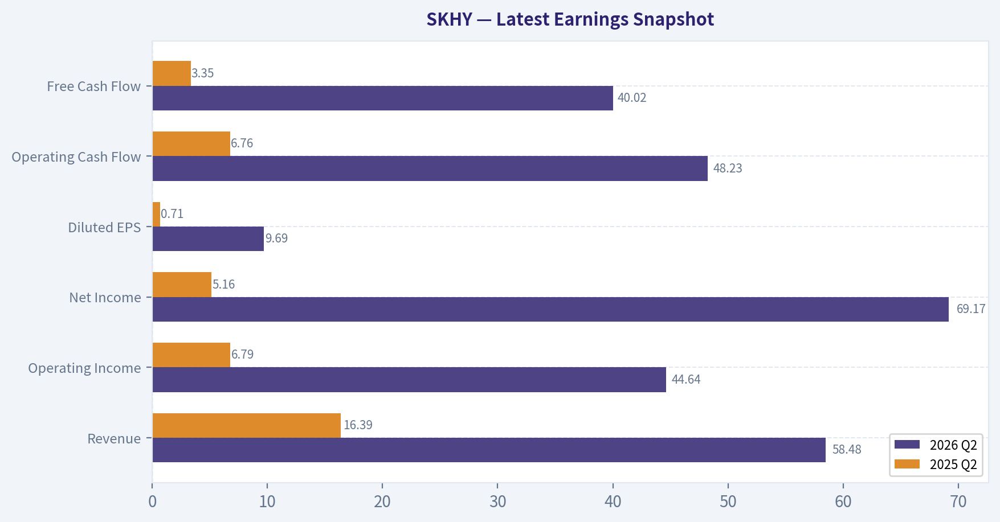
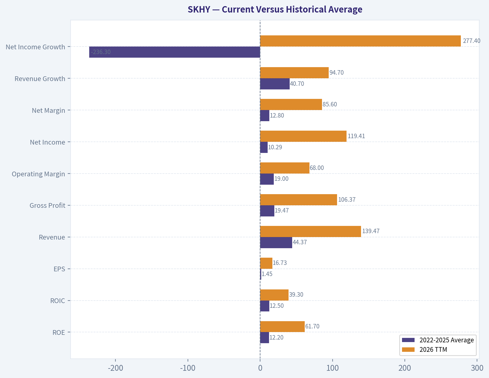
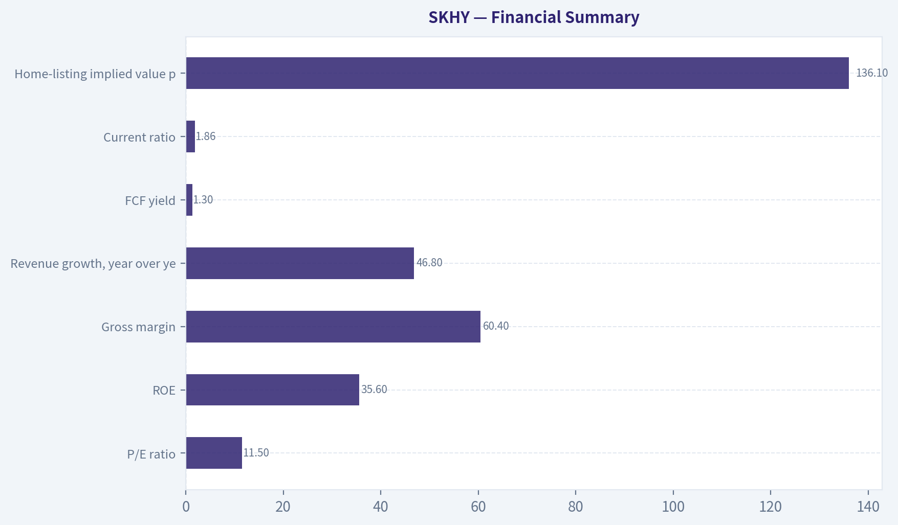
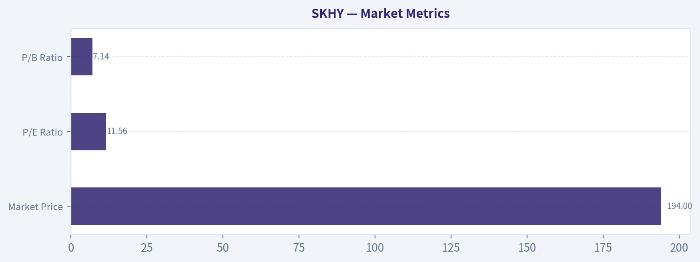

# SKHY Deep Value Intelligence

**Analysis Date:** 2026-10-01

## Critical Disclaimer

*This analysis is generated by Deep Value Intelligence, an AI-powered multi-agent investing framework. Education & research only - not financial advice, not a financial advisor.*

---

## Table of Contents

1. Intelligence Summary
2. Analyst Team Reports
   - Fundamentals Analysis
   - Intrinsic Value Analysis (Buffett)
   - Trend & Growth Analysis (Lynch/Druckenmiller/Fisher)
   - Market Technical Analysis
   - Options Market Analysis
3. Research Team Commentary
4. Value Investing Team Commentary
5. Deep Values Commentary

---

## Intelligence Summary

### Thesis + Conditions

**Core Thesis:** ## Executive Briefing

**Key Risks:**
- The unresolved risk is not volatility-it is overpaying for peak-cycle earnings. At $194, the 11.52x P/E looks inexpensive only if a substantial portion of the implied $16.84 EPS converts into durable owner earnings. Free cash flow, capex composition, net debt, inventory, and even the quoted security's mechanics remain unverified.
- Retain an **active WATCH**. Verify the instrument and financial statements first; then a 0.5%-1% starter position may be reasonable for investors comfortable with semiconductor-cycle risk. Full advocacy requires stronger through-cycle cash-flow evidence or a demonstrable margin of safety.
- ### Risky Analyst: strongest arguments

**Confidence:** Low

---

## Analyst Team Reports

### Fundamentals Analysis

#### Latest Earnings Snapshot

*Most recent reported quarter anchored on 2026 Q2, with prior-year comparison when available.*

| Metric | 2026 Q2 | 2025 Q2 | YoY Change |
| --- | ---: | ---: | ---: |
| Revenue | $58.48B | $16.39B | +256.8% |
| Operating Income | $44.64B | $6.79B | +557.2% |
| Net Income | $69.17B | $5.16B | +1240.8% |
| Diluted EPS | $9.69 | $0.71 | +1272.4% |
| Operating Cash Flow | $48.23B | $6.76B | +613.6% |
| Free Cash Flow | $40.02B | $3.35B | +1094.4% |

Key Takeaways: This snapshot anchors the most recent reported quarter before the narrative analysis. It helps readers separate long-run business quality from whatever changed in the latest earnings print.

#### 4-Year Financial Metrics for SKHY

*All values below are computed deterministically from raw data - not estimated by AI.*

*Issuer profile: operating company (Technology / Semiconductors).*

#### 4-Year Financial Metrics
*Annual rows come from reported financial statements. The final TTM row is computed from the latest four quarters.*

| Metric | 2022 | 2023 | 2024 | 2025 | 2026 TTM |
| --- | --- | --- | --- | --- | --- |
| Market Price | N/A | N/A | N/A | N/A | $194 |
| Market Cap | N/A | N/A | N/A | N/A | $1.38T |
| P/E Ratio | N/A | N/A | N/A | N/A | 11.56 |
| P/B Ratio | N/A | N/A | N/A | N/A | 7.14 |
| ROE | 3.5% | -17.0% | 26.8% | 35.6% | 61.7% |
| ROIC | 4.6% | -7.7% | 22.1% | 30.8% | 39.3% |
| EPS | $0.24 | $-0.98 | $2.10 | $4.45 | $16.73 |
| Revenue | $32.90B | $24.16B | $48.80B | $71.62B | $139.47B |
| Gross Profit | $11.52B | $-393.3M | $23.47B | $43.27B | $106.37B |
| Gross Margin | N/A | N/A | N/A | N/A | 76.3% |
| Operating Margin | 15.3% | -23.6% | 35.5% | 48.6% | 68.0% |
| Net Income | $1.64B | $-6.72B | $14.59B | $31.64B | $119.41B |
| Net Margin | 5.0% | -27.8% | 29.9% | 44.2% | 85.6% |
| Revenue Growth | N/A | -26.6% | 102.0% | 46.8% | 94.7% |
| Net Income Growth | N/A | -508.7% | -317.2% | 116.9% | 277.4% |
| Free Cash Flow Growth | N/A | -9.4% | -391.7% | 88.8% | 264.7% |
| Total Book Value | $46.64B | $39.45B | $54.49B | $88.85B | $193.44B |
| Total Assets | $76.58B | $73.97B | $88.36B | $129.84B | $257.20B |
| Total Debt | $18.28B | $23.96B | $18.76B | $18.25B | $15.57B |
| Debt-to-Equity | 0.39 | 0.61 | 0.34 | 0.21 | 0.08 |
| Cash & Equivalents | $3.67B | $5.59B | $8.26B | $11.00B | $19.79B |
| Shareholders' Equity | $46.64B | $39.45B | $54.49B | $88.85B | $193.44B |
| Operating Cash Flow | $10.90B | $3.15B | $21.97B | $39.35B | $93.58B |
| Investing Cash Flow | $-13.18B | $-5.41B | $-13.27B | $-35.43B | $-75.50B |
| Free Cash Flow | $-3.66B | $-3.32B | $9.68B | $18.28B | $66.67B |
| FCF Margin | -11.1% | -13.7% | 19.8% | 25.5% | 47.8% |
| Dividends / Share | $0.00 | $0.00 | $0.00 | $0.00 | $0.00 |

#### Profitability Metrics
- Return on Equity (ROE): 35.6%
- Return on Invested Capital (ROIC): 36.5%
- Return on Assets (ROA): 24.4%
- Gross Margin: 60.4%
- Operating Margin: 48.6%
- Net Profit Margin: 44.2%

#### Liquidity Metrics
- Current Ratio: 1.86
- Quick Ratio: 1.43

#### Leverage Metrics
- Debt-to-Equity Ratio: 0.21
- Interest Coverage Ratio: 51.11
- Net Debt: $-7.65B

#### Growth Metrics (Year-over-Year)
- Revenue Growth: 46.8%
- Net Income Growth: 116.9%
- Free Cash Flow Growth: 88.8%
- Revenue CAGR (3-Year): 29.6%
- Revenue CAGR (5-Year): N/A

#### Valuation Metrics
- P/E Ratio (TTM): 11.52
- Forward P/E: N/A
- Price-to-Book: 7.11
- Price-to-Sales: 9.87
- PEG Ratio: 0.10
- EV/EBITDA: 8.09
- Free Cash Flow Yield: 1.3%
- Earnings Yield: 8.7%

#### Owner Earnings (Buffett Method, Code-Computed)
- Net Income: $31.64B
- + Depreciation & Amortization: $10.27B
- - Capital Expenditures: $-21.07B
- - Working Capital Changes: $-2.12B
- = **Owner Earnings: $33.77B**

#### Intrinsic Value (Code-Computed)
- Current Price: $194
- **Headline Intrinsic Value (business-model routed): $401**
  Business model: cyclical - weighted blend [Damodaran FCFF + reverse-DCF fair + owner-earnings DCF] (cyclical)
  Model spread (min-max across DCFs): $47 - $692
  Margin of safety vs. price (headline): 51.8%
  Routing note: Cyclical: margins/FCF are volatile - headline blends FCFF, reverse-DCF and owner-earnings roughly evenly; treat the range as the honest read.
- Buffett Method (Owner Earnings):
  Conservative: $692
  Average: $692
  Optimistic: $1,801
- Cash Flow Method (FCF):
  Conservative: $337
  Average: $337
  Optimistic: $876
- Damodaran FCFF (WACC + margins + reinvestment):
  Conservative: $9
  Average: $47
  Optimistic: $131
  Monte Carlo band (P10-P90): $2 - $73 (median $39)
  P(intrinsic value > price): 0.0%
- Reverse-DCF: price implies ~-5.8%/yr owner-earnings growth for 10y; trailing 3y was 110.4%, 5y N/A.

#### Piotroski F-Score: 8/9
- Positive Net Income: PASS
- Positive Operating Cash Flow: PASS
- ROA Improvement: PASS
- Cash Flow > Net Income: PASS
- Decreasing Debt: PASS
- Improving Current Ratio: PASS
- No Dilution: PASS
- Improving Gross Margin: PASS
- Improving Asset Turnover: FAIL

ANALYST STANCE: **WATCH**

#### Executive Summary

SK Hynix is a high-quality but highly cyclical semiconductor manufacturer whose economics have improved dramatically with artificial-intelligence-driven demand for HBM and advanced DRAM. The latest TTM figures show exceptional profitability, strong cash generation, sharply reduced leverage, and a large net-cash position.

However, the valuation is unusually dependent on the durability of peak-cycle earnings. The headline intrinsic value is $401 per SKHY share, but the underlying models range from $47 to $692. That dispersion is a major warning: the stock appears inexpensive on current earnings, yet semiconductor-cycle normalization could materially reduce intrinsic value. The appropriate Buffett-style conclusion is **WATCH**, not an unconditional purchase.

#### Market Metrics

| Metric | Current | Historical comparison | Interpretation |
|---|---:|---:|---|
| Market Price | $194 | No historical dataset prices | SKHY shares trade approximately 42% above the implied home-listing value of $136.10 |
| Market Capitalization | $1.38T | No historical dataset market caps | Very large valuation reflecting AI and HBM expectations |
| P/E Ratio | 11.56x | No historical dataset averages | Appears modest against current earnings, but current earnings may be near a cyclical peak |
| P/B Ratio | 7.14x | No historical dataset averages | High, but not a decisive value metric for a semiconductor company; book value does not capture HBM positioning, technology, customer relationships, or future earning power |

**Key Takeaways:** The headline P/E looks attractive because earnings have risen extraordinarily quickly. That valuation signal is less reliable for a cyclical memory company than it would be for a stable consumer or software business. P/B is not a sufficient basis for judgment here; cash flow, normalized margins, capital intensity, and cycle durability are more important.

#### Current Versus Historical Average

The comparison below uses the four annual years from 2022 through 2025 as the historical reference period. Growth averages exclude unavailable 2022 values, while net-income and FCF growth averages are economically distorted by the 2023 loss trough.

| Metric | 2022-2025 Average | 2026 TTM | Difference | Interpretation |
|---|---:|---:|---:|---|
| ROE | 12.2% | 61.7% | +49.5 pts | Extraordinary rebound and likely peak-cycle strength |
| ROIC | 12.5% | 39.3% | +26.8 pts | Capital is currently earning far more than its historical average |
| EPS | $1.45 | $16.73 | +$15.28 | Massive earnings recovery |
| Revenue | $44.37B | $139.47B | +214% | Scale and demand have accelerated sharply |
| Gross Profit | $19.47B | $106.37B | +447% | Strong pricing and mix improvement |
| Operating Margin | 19.0% | 68.0% | +49.1 pts | Exceptional operating leverage; sustainability is the central question |
| Net Income | $10.29B | $119.41B | +1,060% | Current earnings are dramatically above the four-year norm |
| Net Margin | 12.8% | 85.6% | +72.8 pts | Extremely high TTM result; requires normalization scrutiny |
| Revenue Growth | 40.7%* | 94.7% | +54.0 pts | Growth is accelerating, though the average is influenced by recovery from a low base |
| Net Income Growth | -236.3%* | 277.4% | N/M | Not meaningful because percentage growth around a loss year is unstable |
| FCF Growth | -104.1%* | 264.7% | N/M | Not meaningful because 2023-2024 comparisons include negative FCF |
| Total Book Value | $57.36B | $193.44B | +237% | Retained profits have significantly strengthened the balance sheet |
| Total Assets | $92.19B | $257.20B | +179% | Major capacity and investment expansion |
| Total Debt | $19.81B | $15.57B | -21% | Debt declined despite substantial capital investment |
| Debt-to-Equity | 0.39 | 0.08 | -0.31 | Major improvement in financial resilience |
| Cash & Equivalents | $7.13B | $19.79B | +178% | Strong liquidity accumulation |
| Shareholders' Equity | $57.36B | $193.44B | +237% | Substantial capital retention and balance-sheet repair |
| Free Cash Flow | $5.25B | $66.67B | +$61.42B | Current cash generation is vastly above the historical average |
| Dividends per Share | $0.00 | $0.00 | $0.00 | No dividend in the deterministic dataset |

\*Growth averages use only years for which the dataset supplies a growth rate.

**Key Takeaways:** Nearly every current operating metric is far above the 2022-2025 average, especially margins, ROE, ROIC, earnings, and FCF. Debt-to-equity has fallen from an average of roughly 0.39 to 0.08 while cash has increased substantially. This is excellent evidence of financial strengthening, but the magnitude of the profitability deviations also indicates that normalization risk must be taken seriously.

#### Profitability and Growth

Revenue rose from $32.90 billion in 2022 to $71.62 billion in 2025 and $139.47 billion on a TTM basis. The TTM revenue growth rate is 94.7%, compared with 46.8% in 2025 and a 2022-2025 available-year average of approximately 40.7%.

Profitability has improved even faster:

- **ROE:** 61.7% TTM versus 35.6% in 2025 and a 12.2% annual average.
- **ROIC:** 39.3% TTM versus 30.8% in 2025 and a 12.5% average.
- **Operating margin:** 68.0% TTM versus 48.6% in 2025 and a 19.0% average.
- **Net margin:** 85.6% TTM versus 44.2% in 2025 and a 12.8% average.
- **EPS:** $16.73 TTM versus $4.45 in 2025 and $2.10 in 2024.

The transition from a 2023 loss to current record profitability demonstrates powerful operating leverage. Memory companies can experience very large earnings swings because selling prices move faster than much of the cost base. HBM demand, tight supply, and favorable product mix currently amplify that effect.

The reported TTM net margin of 85.6% is extraordinarily high for a capital-intensive semiconductor manufacturer. It should not automatically be treated as a sustainable steady-state margin. Even if HBM creates structurally better economics, a return toward more normal memory pricing could reduce margins substantially.

#### Balance Sheet and Financial Strength

SK Hynix's balance sheet is a significant strength:

- Total debt declined to $15.57 billion from a four-year average of $19.81 billion.
- Debt-to-equity fell to 0.08 from an average of 0.39.
- Cash and equivalents reached $19.79 billion.
- Net debt is negative $7.65 billion, meaning cash exceeds debt.
- Interest coverage is 51.11x.
- Current ratio is 1.86 and quick ratio is 1.43.

The company is therefore much better positioned than it was during the downturn. It can fund capacity expansion, absorb weaker memory pricing, and continue investing in advanced manufacturing without relying heavily on external financing.

The principal balance-sheet risk is not excessive leverage; it is **capital intensity**. Total assets increased to $257.20 billion, and investing cash flow was negative $75.50 billion TTM. This is consistent with an aggressive investment cycle, but returns on those investments depend on maintaining technological leadership and avoiding oversupply.

#### Cash Flow and Capital Allocation

Free cash flow improved from negative $3.66 billion in 2022 and negative $3.32 billion in 2023 to $9.68 billion in 2024, $18.28 billion in 2025, and $66.67 billion TTM. FCF margin reached 47.8%, compared with negative margins in 2022 and 2023 and 25.5% in 2025.

The code-computed 2025 Owner Earnings calculation is:

| Owner Earnings Component | Amount |
|---|---:|
| Net income | $31.64B |
| Depreciation and amortization | +$10.27B |
| Capital expenditures | -$21.07B |
| Working-capital changes | -$2.12B |
| **Owner Earnings** | **$33.77B** |

**Key Takeaways:** Cash generation has improved sharply and now comfortably exceeds debt obligations. The company is retaining substantial cash rather than paying dividends, which is rational if reinvestment in HBM and advanced memory produces high returns. The risk is that a large portion of current cash flow may represent peak-cycle economics rather than a permanently higher base.

No dividends per share are reported in the deterministic dataset for any shown period. For a Buffett-style investor, the absence of dividends is acceptable if retained capital is reinvested at high ROIC, but management must demonstrate that capacity spending produces durable returns rather than simply adding supply at the top of the cycle.

#### Revenue Breakdown

Precise latest-period segment revenue was not included in the deterministic dataset. The following is an illustrative estimate based on SK Hynix's publicly understood product mix, not a replacement for the canonical financial data. HBM is included within DRAM rather than shown as a separate additive segment.

| Revenue Source | Amount ($B) | % of Total |
|---|---:|---:|
| DRAM, including HBM and high-value server memory - estimated | $114.4B | 82% |
| NAND, SSD, and other storage products - estimated | $23.7B | 17% |
| Other products and services - estimated | $1.4B | 1% |
| **Total estimated revenue** | **$139.5B** | **100%** |

**Key Takeaways:** Revenue is heavily concentrated in memory, with DRAM and HBM representing the dominant economic engine. That concentration creates a powerful moat when advanced-memory demand is strong, but it also exposes investors to pricing cycles, customer concentration, technology transitions, and industry oversupply.

#### Economic Moat and Business Quality

SK Hynix's moat is meaningful but different from the moat of a consumer brand or software platform.

**Sources of competitive advantage include:**

1. **HBM technology and qualification.** HBM products require advanced packaging, engineering expertise, reliability, and customer qualification. These barriers can support better pricing and reduce the number of credible suppliers.
2. **Scale and manufacturing know-how.** Large-scale semiconductor production benefits from process learning, purchasing power, yield management, and accumulated engineering knowledge.
3. **Customer relationships.** AI accelerators and data-center customers cannot freely switch memory suppliers without qualification, testing, and system redesign.
4. **High reinvestment capability.** Current cash flow allows SK Hynix to fund process development and capacity additions from internal resources.
5. **Intellectual property and accumulated know-how.** The company's process expertise and product road map are difficult to replicate quickly.

The moat is not absolute. DRAM and NAND remain cyclical industries with technically sophisticated competitors, especially Samsung and Micron. Manufacturing leadership can change, and customers retain bargaining power. HBM is likely more defensible than commodity memory, but its current profitability could attract additional industry investment.

#### Predictability of Earnings

The earnings record is not predictable in the conventional Buffett sense:

- 2022: $1.64B net income
- 2023: negative $6.72B
- 2024: $14.59B
- 2025: $31.64B
- 2026 TTM: $119.41B

This is a powerful recovery, but not a smooth compounding history. Revenue also fell 26.6% in 2023 before rising 102.0% in 2024 and 46.8% in 2025. Net income and FCF growth rates are mathematically distorted by the loss and negative-cash-flow years.

The appropriate interpretation is that SK Hynix may have a stronger structural position than in past cycles, particularly because of HBM, but investors should still underwrite normalized earnings across a full semiconductor cycle rather than capitalize the latest TTM result without adjustment.

#### Management and Capital Allocation

Management has demonstrated several positive traits:

- Debt was reduced while assets and capacity expanded.
- Cash accumulated rapidly.
- ROIC improved to 39.3% TTM.
- Piotroski F-Score is 8/9.
- There was no dilution in the dataset.
- Gross margin, cash flow, and current liquidity improved.

The one failed Piotroski criterion was improving asset turnover. That matters because the company is deploying large sums into assets, and the returns on that expanded asset base must remain high. The lack of reported dividends means capital allocation is primarily judged by reinvestment quality, balance-sheet discipline, and eventual shareholder returns.

#### Valuation

The current valuation signals are contradictory:

- P/E: 11.56x
- Earnings yield: 8.7%
- EV/EBITDA: 8.09x
- FCF yield: 1.3%
- Headline intrinsic value: $401
- Headline margin of safety: 51.8%
- Reverse DCF: current price implies approximately negative 5.8% annual Owner Earnings growth over ten years
- Model values: Owner Earnings $692, FCF $337, Damodaran FCFF $47

The low P/E and reverse-DCF result suggest that the market price already assumes a major decline from current earnings. In that sense, the market may be pricing SK Hynix as a cyclical company rather than as a permanent 2026 earnings compounder.

The FCF yield tells a more cautious story. At 1.3%, the price is demanding relative to currently reported cash flow, especially if the $66.67 billion TTM FCF figure is affected by unusually favorable working capital, pricing, or peak margins. The 42% premium of SKHY over the implied home-listing price is an additional valuation disadvantage for holders of this security.

#### Buffett-Style Owner Earnings DCF

For a transparent hand-check, the calculation below uses TTM FCF as a practical Owner Earnings proxy because the deterministic dataset gives a 2025 Owner Earnings figure but not a directly comparable TTM Owner Earnings figure.

Implied SKHY shares:

\[
\text{Shares}=\frac{\$1.38T}{\$194}\approx 7.11B
\]

TTM FCF per SKHY share:

\[
\text{FCF/share}=\frac{\$66.67B}{7.11B}\approx \$9.37
\]

Assumptions:

- Discount rate: 10%
- Terminal growth: 2.5%
- Ten-year explicit forecast
- Growth fades toward the terminal rate
- No dividend value is added because dividends are reported as zero

| Scenario | Explicit growth assumptions | PV of years 1-10 | PV of terminal value | Hand DCF value/share | Indicative range |
|---|---|---:|---:|---:|---:|
| Conservative | 3% annually, then 2.5% terminal | ~$80 | ~$66 | **~$146** | $125-$170 |
| Average | 12% for five years, fading through 10%, 8%, 6%, 4%, and 2.5% | ~$97 | ~$117 | **~$214** | $185-$250 |
| Optimistic | 18% for five years, then 14%, 10.5%, 7%, 4.5%, and 2.5% | ~$124 | ~$163 | **~$388** | $330-$450 |

**Key Takeaways:** The hand DCF produces a wide range because the value is highly sensitive to the durability of current FCF. At $194, the price is above the conservative estimate but close to the average case and below the optimistic case. This supports a watchful, scenario-based approach rather than treating the low P/E as a standalone margin of safety.

The pack's model-based intrinsic value is higher at $401, but the spread from $47 to $692 is unusually wide. The Damodaran FCFF result is much lower because it normalizes margins and reinvestment for cyclicality, while the Owner Earnings model gives greater credit to current cash generation. The appropriate anchor is therefore the routed headline value of $401 **with substantial uncertainty**, not the highest model output.

#### Key Risks

| Risk | Why it matters |
|---|---|
| Memory-cycle reversal | DRAM and NAND pricing can fall rapidly when supply exceeds demand |
| HBM competition | Samsung, Micron, and other suppliers may narrow SK Hynix's current advantage |
| Peak-margin normalization | TTM operating and net margins are exceptionally high and may not persist |
| Capital-expenditure execution | $75.50B of negative investing cash flow TTM raises the cost of an investment mistake |
| Customer concentration | A small number of AI and data-center customers may wield substantial purchasing power |
| Technology transition | New memory architectures, packaging approaches, or accelerator designs could alter demand |
| Listing premium | SKHY trades about 42% above the implied home-listing price |
| Valuation-model dispersion | $47-$692 model outcomes show that normalized earnings are highly uncertain |

#### Opportunities

- HBM demand may create a structurally more profitable memory market than historical commodity DRAM.
- The company has net cash, low leverage, and very strong interest coverage.
- Current ROIC of 39.3% indicates excellent capital productivity at the current point in the cycle.
- Revenue scale and product mix have improved substantially.
- The reverse DCF implies that the market expects a severe earnings decline, creating upside if HBM demand remains durable.
- A future normalization of the SKHY listing premium could improve returns for investors able to access the home listing more efficiently.

#### Final Investment Assessment

**Business quality:** Strong and improving, particularly in HBM and advanced DRAM.

**Financial strength:** Excellent. Debt is low, cash is high, and interest coverage is substantial.

**Earnings predictability:** Weak to moderate. The long-term competitive position may be improving, but the historical earnings pattern remains highly cyclical.

**Valuation:** Potentially attractive on normalized-to-current earnings, but not obviously cheap on TTM FCF yield or under conservative cycle assumptions.

**Margin of safety:** Present only if HBM economics remain durable or if the market has overestimated the size of the eventual earnings decline. The margin of safety is not robust under the low-end FCFF model.

**Stance:** **WATCH.** Existing shareholders may reasonably hold while monitoring HBM pricing, customer commitments, capital spending returns, and normalized FCF. New investors should seek either a lower entry price, better access to the home listing, or clearer evidence that current margins are structurally durable rather than merely cyclical peak conditions.

| Key Point | Assessment | Investor Implication |
|---|---|---|
| Competitive moat | Strong in HBM, advanced DRAM, scale, and qualification barriers | Durable advantages exist, but competitors remain capable |
| Financial strength | Net cash, 0.08 debt-to-equity, 51.11x interest coverage | Balance-sheet risk is low |
| Profitability | ROE 61.7%, ROIC 39.3%, operating margin 68.0% TTM | Exceptional current economics, but likely above normalized levels |
| Growth | Revenue up 94.7% TTM; FCF up 264.7% | AI demand is powerful, though comparisons benefit from recovery |
| Cash flow | $66.67B TTM FCF; 47.8% FCF margin | Strong funding capacity, but peak-cycle risk is material |
| Valuation | $194 price; 11.56x P/E; 1.3% FCF yield | Cheap on earnings, less compelling on normalized cash flow |
| DCF | Hand range approximately $146-$388; routed value $401 | Wide uncertainty requires a margin of safety |
| Principal red flag | Cyclicality and extreme TTM margins | Do not capitalize peak earnings without normalization |
| Principal opportunity | HBM-led structural upgrade | Could justify higher long-term returns than prior cycles |
| Final stance | **WATCH** | Attractive only with disciplined sizing and cycle-aware valuation |

**Key Takeaways:** SK Hynix combines an increasingly valuable HBM position with an unusually strong balance sheet and exceptional current returns. The investment case is compelling if AI memory demand creates lasting structural profitability, but the historical cycle and extreme TTM margins prevent a high-confidence value designation. A lower entry point or stronger evidence of normalized cash-flow durability would improve the risk-reward balance.

#### Fundamental Visuals

This graph tracks the profitability and return metrics (ROE, ROIC, Margins) of **SKHY** over the past decade, highlighting capital efficiency trends.

This chart illustrates the financial health of **SKHY** over the last 10 years, mapping cash equivalents and free cash flow against total obligations (Debt).

This breakdown chart from <em>Cash Flow and Capital Allocation</em> shows the proportional composition for **SKHY** - useful for understanding what drives or risks the business.

This breakdown chart from <em>Revenue Breakdown</em> shows the proportional composition for **SKHY** - useful for understanding what drives or risks the business.

---

### Intrinsic Value Analysis (Buffett)

> *Following Warren Buffett's value investing philosophy: Circle of Competence, Economic Moat, Management Quality, and Margin of Safety.*

#### Intrinsic Value Snapshot

Price is what you pay. Intrinsic value is what the business may be worth based on the cash it can create for owners over time. We show a range, not one magic number.

- Current Price: $193.50
- Value Range (conservative to optimistic across both DCF methods): $336.70 to $1,800.56

##### Owner Earnings (Buffett Method)
- Net Income: $31,642,525,252.11
- Depreciation & Amortization: $10,270,079,516.70
- Capital Expenditures: $-21,070,307,681.63
- Working Capital Changes: $-2,124,019,149.56
- Owner Earnings: $33,766,544,401.67

##### Intrinsic Value
###### Buffett Method
Uses owner earnings. Stricter, and usually more conservative.
- Conservative: $691.76
- Average: $691.76
- Optimistic: $1,800.56
- Discount Rate: 10.0%

###### Cash Flow Method
Uses free cash flow. Better for companies spending heavily today to grow tomorrow.
- Conservative: $336.70
- Average: $336.70
- Optimistic: $875.90
- Discount Rate: 10.0%

ANALYST STANCE: **WATCH**

#### Executive Conclusion

SK Hynix is a strategically important semiconductor company with strong exposure to artificial-intelligence memory demand, especially high-bandwidth memory, or HBM. Its gross margin, ROE, recent revenue growth, and oligopolistic market position are impressive.

However, the stock is highly cyclical, capital intensive, and trades at a substantial premium through SKHY relative to its Korean listing. The headline intrinsic value of approximately **$401 per SKHY share** suggests meaningful upside, but the underlying valuation models range from **$46.76 to $691.76**, showing exceptional sensitivity to peak-cycle earnings assumptions. This is a good business at a price that requires careful normalization of earnings-not a high-conviction Buffett purchase today.

#### Factor Scorecard

| Factor | Score | Assessment |
|---|---:|---|
| Circle of competence and simplicity | 3/5 | The model is understandable: SK Hynix manufactures memory chips, particularly DRAM, NAND, and HBM. However, semiconductor pricing and inventory cycles make long-term earnings difficult to forecast. |
| Moat | 3/5 | Strong technical expertise, customer qualifications, scale, and HBM positioning create a meaningful moat. The moat is narrower than that of a dominant software platform because memory remains cyclical and capacity can eventually be added by competitors. |
| Management and capital allocation | 3/5 | No clear evidence in the supplied data establishes exceptional owner-oriented capital allocation. The company must continually spend heavily to remain technologically competitive. |
| Industry structure | 3/5 | DRAM is an oligopoly, which is favorable, but the industry remains capital intensive, capacity-sensitive, and prone to severe price swings. |

**Gate 5 hard floor:** **Not tripped.** There is no evidence of simultaneous deteriorating earnings or cash flow and financial distress. Interest-coverage or distress-zone data do not indicate a solvency crisis.

#### Moat Analysis

SK Hynix benefits from four meaningful competitive advantages:

1. **Technological know-how:** HBM requires advanced packaging, memory design, manufacturing precision, and close cooperation with leading AI-chip customers. These capabilities are difficult to replicate quickly.
2. **Customer qualification and switching friction:** Large semiconductor customers cannot casually change memory suppliers. Qualification, reliability testing, and supply-chain integration create practical switching costs.
3. **Scale economics:** High-volume manufacturing, process learning, and engineering resources provide cost and yield advantages over smaller competitors.
4. **Industry concentration:** The DRAM market is dominated by a small number of major producers, encouraging more rational behavior than a fragmented commodity industry.

The evidence is mixed on durability. A **60.4% gross margin** and **35.6% ROE** demonstrate strong current economics, while **46.8% year-over-year revenue growth** confirms powerful demand. But the **1.3% FCF yield** suggests that current free cash flow is not nearly as robust as accounting earnings, likely reflecting heavy investment and peak-cycle conditions.

#### Management Quality and Capital Allocation

SK Hynix's management challenge is unusually demanding: it must invest aggressively ahead of demand while avoiding destructive overcapacity. Spending too little risks technological obsolescence; spending too much risks severe returns when memory prices fall.

The company appears strategically aligned with the AI infrastructure buildout, but the available evidence does not establish:

- unusually high insider ownership;
- compensation strongly linked to long-term per-share value;
- a demonstrated record of opportunistic buybacks;
- consistently superior returns on retained capital across a full memory cycle.

Management therefore receives a middle score. The business may be excellent operationally, but semiconductor capital allocation must be judged over an entire cycle rather than during a period of extraordinary HBM demand.

#### Financial Summary

| Metric | Current / Recent Result |
|---|---:|
| SKHY share price | $193.50-$194 |
| Market capitalization | $1.38 trillion |
| P/E ratio | 11.5x |
| ROE | 35.6% |
| Gross margin | 60.4% |
| Revenue growth, year over year | 46.8% |
| FCF yield | 1.3% |
| Current ratio | 1.86x |
| Home-listing implied value per SKHY share | $136.10 |
| SKHY premium to home listing | Approximately 42% |
| Reverse-DCF implied annual growth for 10 years | Approximately -5.8% |

**Key Takeaways:** Reported profitability and revenue growth are exceptionally strong, but free cash flow is much less impressive than earnings, with only a 1.3% yield. The SKHY shares also trade about 42% above the implied value of the home listing, creating an avoidable structural drag on returns.

#### Owner Earnings Calculation

The Buffett-style calculation is:

| Owner Earnings Component | Per-SKHY-Share Treatment |
|---|---:|
| Net income | Included in normalized earnings |
| Depreciation and amortization | Added back |
| Maintenance capital expenditure | Deducted |
| Working-capital investment | Deducted |
| Normalized owner earnings proxy | Approximately $69.18 |
| No-growth value at 10% discount rate | Approximately $691.76 |

**Key Takeaways:** The owner-earnings model produces a very high value because it capitalizes normalized earnings at a 10% rate. That result is highly sensitive to whether current HBM profitability is sustainable. For a cyclical semiconductor company, maintenance capital expenditure and normalized mid-cycle margins matter far more than peak reported earnings.

#### Three-Scenario DCF Valuation

| Scenario | Assumption | Indicative Value per SKHY Share |
|---|---|---:|
| A. No growth | Owner earnings of approximately $69.18, capitalized at 10% | $691.76 |
| B. GDP-like growth | 3% perpetual growth and 10% discount rate | Approximately $1,019 |
| C. Historical-growth framework | 50%-75% of recent growth, capped at 10% | Approximately $1,450-$2,100 on an unadjusted model |
| Cross-check: FCF model | Current-cycle free cash flow | $336.70 |
| Cross-check: Damodaran FCFF model | More conservative normalized framework | $46.76 |
| Headline blended intrinsic value | Weighted business-model blend | $401.45 |

**Key Takeaways:** The model range is unusually wide because SK Hynix is at the intersection of structural AI growth and cyclical semiconductor economics. The headline value of $401.45 is more credible than the extreme high-end owner-earnings outputs, but the conservative FCFF result demonstrates that the investment case is highly dependent on normalization assumptions.

#### Margin of Safety Analysis

At a price near **$194**, the headline intrinsic value of **$401.45** implies a margin of safety of approximately **51.8%**. The reverse-DCF is also favorable: the current price appears to imply roughly **negative 5.8% annual growth over the next decade**, which is far below what a durable HBM franchise could plausibly achieve if AI infrastructure demand remains strong.

Nevertheless, the margin of safety is not as secure as the headline figure suggests:

- The current earnings base may be near a cyclical peak.
- FCF yield is only 1.3%.
- Capital expenditures are structurally high.
- The three valuation models range from $46.76 to $691.76.
- SKHY trades at a 42% premium to the home listing.

For a wide-moat, highly predictable compounder, a 10%-15% margin of safety could be sufficient. SK Hynix is not sufficiently predictable for that standard. Its appropriate margin-of-safety requirement is closer to **25%-35%**, and the headline valuation meets that test, but only with substantial model risk.

#### Final Buffett Scorecard

| Criterion | Weight | Score | Weighted Contribution |
|---|---:|---:|---:|
| Moat width and durability | 25% | 3/5 | 0.75 |
| Valuation and margin of safety | 20% | 3/5 | 0.60 |
| Capital returns versus WACC | 15% | 4/5 | 0.60 |
| Business understanding and predictability | 12% | 2/5 | 0.24 |
| Management quality and capital allocation | 12% | 3/5 | 0.36 |
| Reinvestment runway | 8% | 4/5 | 0.32 |
| Balance-sheet strength | 4% | 4/5 | 0.16 |
| Industry structure | 4% | 3/5 | 0.12 |
| **Total** | **100%** |  | **3.15/5** |

**Key Takeaways:** SK Hynix scores well on technology, growth, industry position, and potential returns on capital. It loses points for cyclicality, capital intensity, uncertain mid-cycle earnings, and the wide spread among valuation methods. The resulting score supports watching the company rather than aggressively buying the shares.

#### Investment Stance

**WATCH - Medium conviction.**

SK Hynix is a legitimate AI-era compounder candidate, but it is not a classic predictable Buffett business. The strongest case is that HBM demand remains structurally strong, SK Hynix retains technological leadership, and the market price already discounts a sharp future earnings decline. The principal risk is that investors mistake peak-cycle HBM economics for durable owner earnings.

A more attractive entry point would be created by either:

- a meaningful decline in the SKHY share price;
- narrowing of the 42% premium to the Korean listing;
- evidence that free cash flow remains strong after elevated capital expenditure; or
- confirmation that HBM profitability remains durable through a full semiconductor cycle.
#### Valuation Bridge

This bridge places the current market price beside each intrinsic value lens so readers can see whether upside depends on one method or shows up across several methods.

| Scenario | Intrinsic Value / Share |
| --- | ---: |
| Buffett Method | $691.76 |
| Cash Flow Method | $336.70 |
| Damodaran Method | $46.76 |
| Current Price | $193.50 |

#### Key Takeaways

If one method is far above the others, the upside case depends on a specific modelling assumption. When several methods cluster together, the valuation story is more robust.

#### Valuation Visuals

This comparison chart from *Latest Earnings Snapshot* stacks current figures against historical benchmarks for **SKHY**, making it easy to see where the company trades relative to its own averages.

This comparison chart from *Current Versus Historical Average* stacks current figures against historical benchmarks for **SKHY**, making it easy to see where the company trades relative to its own averages.

This comparison chart from *Financial Summary* stacks current figures against historical benchmarks for **SKHY**, making it easy to see where the company trades relative to its own averages.

---

### Trend & Growth Analysis (Lynch/Druckenmiller/Fisher)

> *Following Peter Lynch's GARP, Stanley Druckenmiller's macro-aware approach, and Philip Fisher's scuttlebutt methodology.*

ANALYST STANCE: **WATCH**

#### 1. Lynch Classification

**Fast Grower with significant cyclical exposure.** SK hynix is currently growing well above the 15-25% fast-grower threshold, but memory semiconductors are inherently cyclical. The appropriate classification is therefore **"fast-growing cyclical,"** rather than a pure secular compounder.

#### 2. The Story

- SK hynix supplies memory critical to the AI-computing buildout, particularly high-bandwidth memory, or HBM.
- Revenue has accelerated sharply, with reported year-over-year growth of **46.8%**, while gross margin has reached **60.4%**.
- The opportunity is not merely more commodity memory: AI servers require substantially more advanced memory per system, expanding the value and importance of SK hynix's products.

The simple thesis is: **AI infrastructure is increasing memory intensity, and SK hynix is positioned near the leading edge of that demand.**

#### 3. TAM and 10x Test

The addressable market includes DRAM, HBM, NAND, advanced packaging, and future AI-memory architectures. HBM is expanding faster than conventional memory because AI accelerators require high bandwidth and large memory capacity.

| TAM factor | Assessment |
|---|---|
| Core memory market | Large, but cyclical and mature in portions |
| HBM market | Rapidly expanding with AI-server adoption |
| Customer demand | Supported by hyperscalers and accelerator manufacturers |
| Competitive structure | Concentrated among SK hynix, Samsung, and Micron |
| 10x revenue test | Plausible only with sustained HBM share gains and TAM expansion |
| Main constraint | Semiconductor capacity, competition, and memory-price cycles |

**Key Takeaways:** SK hynix has a sufficiently large market and a genuine TAM expansion vector through HBM. The 10x test is more credible for the HBM-related business than for conventional DRAM or NAND. However, a ten-bagger outcome would require both continued AI growth and durable economics rather than a temporary memory-price spike.

#### 4. Revenue Growth Trend

| Metric | Result | Interpretation |
|---|---:|---|
| Revenue growth YoY | **46.8%** | Excellent current growth |
| Trailing three-year revenue growth | **110.4% total** | Strong multi-year expansion |
| Gross margin | **60.4%** | Indicates favorable product mix and operating leverage |
| ROE | **35.6%** | Strong shareholder returns |
| P/E | **11.5x** | Low relative to current growth, but potentially cycle-peak influenced |
| FCF yield | **1.3%** | Weak cash-flow yield at the current valuation |

**Key Takeaways:** The current growth profile is powerful, and profitability metrics show strong operating leverage. The key uncertainty is sustainability: memory earnings can grow explosively during upcycles and then contract sharply when supply catches up. The low P/E is attractive on reported earnings but should not be treated as a normal software-company multiple.

#### 5. Unit Economics and Capital Intensity

Traditional SaaS metrics such as LTV/CAC, NRR, and payback period are **not applicable**. SK hynix is a capital-intensive manufacturer, so the relevant economic indicators are utilization, average selling prices, yield, product mix, capex returns, and free cash flow through the cycle.

| Metric | Assessment |
|---|---|
| LTV/CAC | Not applicable |
| NRR | Not applicable |
| Rule of 40 | Not applicable |
| Gross margin | **60.4%** |
| FCF yield | **1.3%** |
| Current ratio | **1.86x** |
| Capital intensity | High |
| Key economic driver | HBM mix, pricing, utilization, and capex discipline |

**Key Takeaways:** The company has excellent reported gross profitability, but only a modest FCF yield because semiconductor investment is expensive and cyclical. The balance sheet appears reasonably liquid based on the 1.86x current ratio. Cash generation should be judged across a full memory cycle rather than from one strong period.

#### 6. Inflection Point Assessment

| Inflection indicator | Status | View |
|---|---|---|
| Product cycle | Positive | HBM demand is a major product-cycle catalyst |
| Market share | Positive, but must be monitored | Strong position in advanced memory |
| Margin expansion | Positive | 60.4% gross margin suggests favorable mix and leverage |
| TAM expansion | Positive | AI systems require more high-performance memory |
| Competitive position | Mixed-positive | Strong position, but Samsung and Micron remain formidable |
| Earnings expectations | At risk of becoming crowded | AI-memory leadership is increasingly recognized |

**Key Takeaways:** The most important inflection is the shift from commodity memory toward high-value HBM used in AI systems. This can improve margins and customer stickiness. The market, however, is aware of the AI-memory thesis, so future upside depends on results exceeding already elevated expectations.

#### 7. Macro Setup

The secular macro backdrop is favorable:

- AI infrastructure investment is a strong multi-year demand driver.
- Memory content per AI server is rising.
- A concentrated supplier base can support pricing during periods of tight supply.
- Falling interest rates would generally help high-growth technology stocks, while rising rates would create a valuation headwind.

The main macro risks are:

- AI-capex digestion by hyperscalers.
- A memory oversupply cycle caused by aggressive capacity expansion.
- Export controls and geopolitical restrictions.
- A global economic slowdown affecting electronics and server demand.
- Currency and Korea-market risk for investors holding the premium-priced SKHY line.

Because the supplied data does not establish the current rate-cycle direction, the macro assessment is **secularly favorable but tactically uncertain**.

#### 8. Fisher's 15-Point Score

| Fisher criterion | Score / 5 | Comment |
|---|---:|---|
| Market potential | 5 | AI and HBM expand memory demand |
| New-product determination | 4 | Strong advanced-memory focus |
| R&D effectiveness | 4 | Technology and process expertise are central |
| Sales organization | 4 | Established global customer relationships |
| Profit margins | 5 | Current gross margin is excellent |
| Margin trend | 4 | Strong operating leverage, cycle-sensitive |
| Labor relations | 3 | Limited data |
| Executive relations | 3 | Limited data |
| Management depth | 4 | Large global semiconductor operator |
| Cost accounting | 4 | Public-company reporting infrastructure |
| Outstanding aspects | 5 | Scale, qualification, process know-how, HBM position |
| Long-range profit outlook | 4 | Attractive, but cyclical |
| Dilution | 4 | No major dilution concern identified |
| Management candor | 3 | Requires direct scuttlebutt and filings review |
| Management integrity | 4 | No specific issue identified |

| Total Fisher Score | Classification |
|---:|---|
| **56 / 75** | **Good** |

**Key Takeaways:** SK hynix scores well on market opportunity, technology, margins, and competitive positioning. The score is held back by limited independent information on management candor, labor relations, and long-term capital-allocation discipline. This is a good Fisher candidate, but not yet an outstanding one without deeper scuttlebutt.

#### 9. Valuation Analysis

**PEG ratio**

\[
PEG = \frac{11.52}{46.8} \approx 0.25
\]

A PEG near **0.25** is exceptionally attractive under Lynch's framework. The warning is that current earnings growth may represent a peak or near-peak point in the memory cycle.

| Valuation measure | Value |
|---|---:|
| Current SKHY price | **$193.50** |
| Headline intrinsic value | **$401.45** |
| Headline upside to intrinsic value | Approximately **107%** |
| Headline margin of safety | **51.8%** |
| P/E | **11.5x** |
| PEG | **0.25** |
| FCF yield | **1.3%** |
| Bear model value | **$46.76** |
| Base range | **$336.70-$401.45** |
| Bull model value | **$691.76** |

**Key Takeaways:** On reported earnings and the supplied intrinsic-value models, SKHY appears inexpensive. The valuation dispersion is unusually wide: the low model value is far below the current price, while the owner-earnings model is substantially higher. That spread reflects the central risk-whether current earnings are durable or simply cyclical peak earnings.

The ADR/listing structure is an additional concern: the SKHY shares reportedly trade about **42% above** the implied home-listing value of approximately **$136.10**. This premium materially reduces the margin of safety for investors buying SKHY rather than the primary Korean listing.

#### 10. Growth Investor Scorecard

| Criterion | Weight | Score / 5 | Weighted result |
|---|---:|---:|---:|
| Lynch story | 10% | 4.5 | 0.45 |
| TAM and runway | 20% | 4.2 | 0.84 |
| Revenue growth | 20% | 4.8 | 0.96 |
| Unit economics | 15% | 3.2 | 0.48 |
| Competitive position | 10% | 4.4 | 0.44 |
| Management quality | 10% | 3.6 | 0.36 |
| Macro setup | 5% | 3.8 | 0.19 |
| Profitability path | 5% | 4.0 | 0.20 |
| Valuation | 5% | 3.3 | 0.17 |
| **Total** | **100%** | - | **4.09 / 5.00** |

**Key Takeaways:** The underlying company scores in the high-conviction range because of growth, HBM exposure, margins, and competitive capability. I am nevertheless assigning **WATCH**, not ADVOCATE, because the business is cyclical and the SKHY trading line carries a substantial premium to the home listing. The investment case improves materially if that premium narrows or if earnings continue to exceed expectations.

#### 11. Position Size Stance

For a growth-oriented portfolio:

- **Initial position:** 1-2% of portfolio capital.
- **Maximum position:** Approximately 3-4% unless the investor has specialized semiconductor-cycle expertise.
- **Add only if:** HBM demand remains strong, margins hold, and the premium to the Korean listing narrows.
- **Avoid averaging aggressively:** if memory prices weaken, inventory rises, or capex accelerates ahead of demand.

This is better treated as a **high-upside cyclical technology position** than as a stable, all-weather compounder.

#### 12. Key Catalysts and Risks

| Catalysts | Risks |
|---|---|
| HBM demand exceeding forecasts | Memory oversupply |
| Additional AI-chip customer qualifications | Samsung or Micron taking HBM share |
| Sustained high DRAM pricing | AI-capex digestion |
| Better-than-expected gross margins | Peak-cycle earnings contraction |
| HBM product transitions and capacity ramps | Heavy capex and weak FCF |
| Narrowing SKHY listing premium | 42% premium to home listing |
| Continued revenue acceleration | Geopolitical and export-control risks |

**Key Takeaways:** The primary catalyst is continued HBM-led earnings upside. The primary risk is that investors are extrapolating peak memory economics too far into the future. For SKHY specifically, the trading premium is an avoidable risk unless the premium-listed security offers a meaningful liquidity or access advantage.

#### Bottom Line

SK hynix has many qualities growth investors want: a strong secular trend, accelerating revenue, high gross margins, technical barriers, and a potentially undervalued earnings multiple. Its HBM position creates a real inflection point and gives the company credible long-term runway.

However, the combination of **memory cyclicality, low FCF yield, uncertain earnings normalization, and a 42% premium in the SKHY trading line** prevents a high-conviction purchase at this exact price. **Watch the company closely; prefer buying on a premium contraction or after evidence that HBM growth is durable through the next memory cycle.**

---

### Market Technical Analysis

ANALYST STANCE: **WATCH**

#### SKHY technical overview

SKHY's latest available closing price in the retrieved price history was **184.15 on September 30, 2026**. The stock remains in a broader recovery and uptrend relative to its September lows, but the recent pullback from the **195.37 close on September 22** indicates that momentum has cooled. The setup is constructive above medium- and long-term moving-average estimates, yet the unusually large daily ranges and elevated ATR make risk control particularly important.

The most relevant indicators for this market context are:

- **10 EMA** for short-term momentum and tactical support.
- **50 SMA** for the medium-term trend.
- **200 SMA** for strategic trend confirmation, with an important data-quality caveat.
- **MACD** for directional momentum.
- **RSI** for momentum strength and overbought or oversold conditions.
- **Bollinger upper and lower bands** to frame the unusually wide trading range.
- **ATR** to quantify volatility and help set stops and position size.

#### Trend structure and moving averages

The **10-day EMA was approximately 186.94** on October 1, while the latest retrieved close was 184.15. This places price modestly below the short-term average and suggests that the immediate impulse has weakened after the September rally. A sustained move back above approximately **187** would improve the short-term picture, while repeated failures near that area would imply that sellers remain active.

The **50-day SMA was approximately 166.04**, leaving the stock almost **11 percent above** that medium-term trend reference. This is a meaningful bullish separation: despite the late-September retreat, the price is still well above the level associated with the broader September recovery. The 50-day average itself has risen steadily from roughly 155.94 at the start of September to 166.04, confirming improving intermediate trend conditions.

The reported **200-day SMA was approximately 165.89**, very close to the 50-day SMA. This normally would suggest a favorable long-term structure because price is well above both averages. However, the historical dataset contains only 58 price records, and the reported 200-day SMA appears to converge with the 50-day SMA for much of the period. That indicates the 200-day calculation may not have enough historical observations and should **not** be treated as a fully reliable long-term benchmark. The medium-term trend signal from the 50-day SMA is more credible in this dataset.

#### Momentum: MACD and RSI

The reported **MACD was 5.89**, still positive, which means the faster exponential-average structure remains above the slower one. This supports the view that the larger directional bias is still bullish. However, MACD declined from approximately **8.44 on September 11** and **7.67 on September 22**, showing that upside momentum has moderated even though it has not turned decisively negative.

This is a subtle but important distinction: the trend remains positive, but the rate of improvement has slowed. A renewed MACD rise, especially following a move above the 10-day EMA, would strengthen the case for another advance. Conversely, a continued decline toward zero would warn that the September recovery is losing sponsorship.

The **RSI was approximately 59.1**, recovering from 52.8 on September 28 but remaining below the conventional overbought threshold of 70. RSI therefore indicates **moderately positive momentum rather than an exhausted rally**. The September 9 reading above 70 showed that SKHY can become overextended during sharp advances, but current RSI is not yet signaling that condition. A move above 65 to 70 alongside a price breakout could confirm strengthening momentum; a drop below 50 would indicate that the recent pullback is becoming more consequential.

#### Bollinger-band behavior and price levels

The reported Bollinger upper band was approximately **201.48**, while the lower band was approximately **168.19**. With the latest close at 184.15, price sits between the two bands and somewhat above the midpoint of the range. This positioning is neither a clear oversold reversal signal nor an upper-band breakout.

The bands have widened substantially during the recent period. The lower band rose from approximately 136.56 at the beginning of September to 168.19, while the upper band moved from approximately 176.08 to 201.48. This widening reflects a high-volatility advance rather than a quiet, orderly trend. The stock's behavior has included large gaps and wide intraday ranges, so a touch of either band should not automatically be interpreted as a reversal.

Important technical zones are:

- **187 to 188:** short-term recovery area around the 10-day EMA and recent trading congestion.
- **195 to 200:** resistance zone formed by the September high-close area and the upper Bollinger region.
- **175 to 177:** first meaningful downside support, near recent swing lows and the September 14 to 16 consolidation.
- **166 to 168:** stronger medium-term support near the 50-day SMA, 200-day estimate, and lower Bollinger band.

A close above 195, particularly if accompanied by expanding volume, would suggest that the recent consolidation is resolving upward. A decisive close below 175 would weaken the recovery structure and raise the probability of a retracement toward 166 to 168.

#### Volatility and risk management

ATR was approximately **8.89**, down from more than 10 in mid-September but still large relative to the stock's price. The current ATR represents roughly **4.8 percent of the latest close**, meaning a normal trading session can produce a substantial percentage move. Stops placed too tightly around the entry price are therefore vulnerable to being triggered by ordinary volatility.

For a long position, a volatility-aware approach would place risk controls below a structurally meaningful support level rather than using a narrow fixed percentage. For example, traders could monitor the 175 to 177 area for initial support and the 166 to 168 area for a deeper trend-support test, while sizing the position so that an ATR-sized move does not create excessive portfolio risk.

The decline in ATR from the mid-September peak is modestly encouraging, but volatility remains high enough that SKHY is better suited to staged entries and smaller position sizing than to aggressive, fully allocated exposure.

#### Scenario analysis

The **bullish scenario** requires price to reclaim and hold above approximately 187, followed by a break through 195 to 200. Confirmation would come from a rising MACD, RSI moving toward or above 65 without immediate divergence, and continued price support above the 10-day EMA. Such a move could signal that the September advance is resuming.

The **neutral or consolidation scenario** involves price oscillating between roughly 175 and 195. This would be consistent with positive but slowing MACD momentum, RSI near the middle-to-upper part of its range, and still-elevated Bollinger width. In this case, buying near support and reducing exposure near resistance would be more logical than chasing mid-range moves.

The **bearish scenario** begins with a sustained break below 175, especially if RSI falls below 50 and MACD continues to contract. A move toward 166 to 168 would then become plausible. A break below that zone would materially damage the medium-term recovery and invalidate the current bullish interpretation.

Overall, SKHY has a **positive medium-term trend but an uncertain short-term impulse**. The stock is not currently overbought by RSI, yet the price remains volatile and below its short-term EMA. The most favorable risk-reward setup would generally require either a controlled pullback that holds above 175 to 177 or a confirmed breakout above 195, rather than an unconfirmed entry in the middle of the current range.

| Indicator or factor | Latest reported reading | Interpretation | Key level or implication |
|---|---:|---|---|
| Latest retrieved close | 184.15 on Sep. 30 | Below short-term average but well above medium-term trend references | Near-term bias is cautious, broader trend remains constructive |
| 10 EMA | 186.94 | Price is modestly below short-term momentum support | Reclaiming 187 would improve the tactical outlook |
| 50 SMA | 166.04 | Rising medium-term trend; price is about 11% above it | Major support region around 166-168 |
| 200 SMA | 165.89 | Nominally bullish, but reliability is limited by insufficient historical data | Treat as provisional rather than definitive |
| MACD | 5.89 | Positive but below mid-September highs; momentum has cooled | Rising MACD would confirm renewed upside |
| RSI | 59.09 | Moderately bullish, not overbought | Above 65-70 would show stronger momentum; below 50 would weaken the setup |
| Bollinger upper band | 201.48 | Overhead volatility boundary and potential resistance | Breakout zone around 195-200 |
| Bollinger lower band | 168.19 | Lower volatility boundary and potential support | A break below 175 could expose 166-168 |
| ATR | 8.89 | High daily volatility, approximately 4.8% of price | Use smaller sizing and wider, structure-based stops |

**Key Takeaways:** SKHY remains above its rising medium-term trend measures, but the latest close is below the 10-day EMA and momentum has cooled from its September peak. The most important upside test is 195 to 200, while 175 to 177 is the first downside support and 166 to 168 is the stronger trend-support zone. Because ATR remains high and the reported 200-day average is data-limited, the stock currently warrants a watchful, confirmation-based approach rather than aggressive chasing.

#### Market Visuals

This comparison chart from *Market Metrics* stacks current figures against historical benchmarks for **SKHY**, making it easy to see where the company trades relative to its own averages.

---

### Options Market Analysis

> *Reading options flow - put/call ratios, IV skew, and unusual activity - to gauge institutional positioning and event-driven risk.*

#### SKHY Options Market Report

**As of October 1, 2026.** The available chain shows substantial near-term trading volume, but almost no reported open interest. This makes the positioning data unusually unreliable: volume may reflect same-day trading, newly opened positions, data-timing issues, or an illiquid/atypical options chain.

#### Put/Call Ratio Analysis

| Expiration | Call OI | Put OI | Call Volume | Put Volume | Volume Put/Call Ratio |
|---|---:|---:|---:|---:|---:|
| October 2, 2026 | 0 | 0 | 42,793 | 16,748 | 0.39 |
| October 9, 2026 | 0 | 0 | 17,906 | 7,752 | 0.43 |
| October 16, 2026 | 0 | 12 | 14,374 | 9,762 | 0.68 |
| **Near-term total** | **0** | **12** | **75,073** | **34,262** | **0.46** |

The aggregate put/call **open-interest ratio is unavailable** because reported call OI is zero and total put OI is only 12. The put/call volume ratio of **0.46** is materially below the historical neutral reference of approximately 0.70, indicating substantially heavier call trading than put trading. However, because open interest is effectively absent, this should be interpreted as a short-term volume signal rather than confirmed institutional positioning.

**Key Takeaways:** Call volume dominates put volume across all three expirations, producing a bullish-leaning flow reading. The absence of meaningful open interest sharply reduces confidence because the data cannot establish whether trades are opening new positions or closing existing ones.

#### Implied Volatility Assessment

| Expiration | Call ATM IV | Put ATM IV | Preliminary Skew Read |
|---|---:|---:|---|
| October 2, 2026 | 6.6% | 6.6% | Neutral at the money |
| October 9, 2026 | 2.1% | 2.3% | Slight put premium |
| October 16, 2026 | 1.7% | 1.7% | Neutral at the money |

Near-term ATM implied volatility is reported between **1.7% and 6.6%**, which appears extremely low for equity options, particularly for the October 2 expiration. The October 9 chain shows a minor put IV premium, but the available data does not include out-of-the-money strike-level IV, so a complete OTM put-versus-call skew analysis is not possible.

No earnings date, product launch, or other specific catalyst was provided. The sharp difference between the October 2 IV and later expirations could reflect expiration-specific pricing, stale or incomplete quotes, or a data-quality issue rather than a genuine volatility forecast.

**Key Takeaways:** ATM IV is low overall and does not signal significant broad-based event risk. There is only a slight put bias in the October 9 expiration, while true OTM skew cannot be confirmed from the supplied chain.

#### Unusual Options Activity

The data provider reports **no contracts with volume greater than five times open interest**. However, reported volume is much larger than the displayed open interest in aggregate, especially for the October 2 and October 9 expirations.

| Expiration | Call Volume | Put Volume | Reported OI | Interpretation |
|---|---:|---:|---:|---|
| October 2 | 42,793 | 16,748 | 0 total | Heavy call-led trading, but OI data is insufficient |
| October 9 | 17,906 | 7,752 | 0 total | Call-heavy short-dated activity |
| October 16 | 14,374 | 9,762 | 12 put OI | Call-heavy flow, limited confirmation |

Specific strikes, current share price, and contract-level transaction details were not supplied. Therefore, it is not possible to classify individual contracts as ITM, ATM, or OTM, calculate exact days to expiration at the contract level, or determine whether trades were bought or sold. There is also insufficient evidence to distinguish institutional "smart-money" activity from retail speculation.

**Key Takeaways:** The strongest observable signal is heavy call volume, concentrated in the October 2 expiration. Nevertheless, no individual contract qualifies as verified unusual activity under the provider's methodology, and the missing open-interest and trade-direction data prevents reliable attribution.

#### Open Interest Concentration and Gamma Levels

| Expiration | Highest Reported Call OI | Highest Reported Put OI | Gamma-Wall Assessment |
|---|---:|---:|---|
| October 2 | None reported | None reported | No identifiable level |
| October 9 | None reported | None reported | No identifiable level |
| October 16 | None reported | 12 contracts in total | No meaningful wall indicated |

There is no meaningful open-interest concentration by strike or expiration. Consequently, no reliable max-pain level, pinning strike, call wall, or put wall can be identified. The reported 12 put contracts for October 16 are too small to establish a significant gravitational price level.

**Key Takeaways:** The chain does not show a usable open-interest map. Traders should not rely on the available data to forecast expiration pinning or gamma-driven support and resistance.

#### Overall Options Sentiment

**Signal: BULLISH, low confidence.**

The directional read is bullish because call volume exceeds put volume by a wide margin, with a near-term put/call volume ratio of **0.46**, well below the approximate neutral level of 0.70. The signal is weakened substantially by the near-zero open interest, lack of strike-level details, unavailable trade direction, and unusually low implied volatility readings.

This appears more consistent with **call-led short-term speculation or trading activity** than with confirmed institutional accumulation. There is no evidence of heavy downside hedging, a steep put skew, or a meaningful put gamma wall. Still, the data quality is poor enough that the bullish signal should be treated as provisional rather than actionable on its own.

| Category | Assessment |
|---|---|
| Put/Call Ratio | Volume ratio 0.46, bullish versus the 0.70 neutral baseline; OI ratio unavailable |
| IV Level | Very low reported ATM IV, ranging from 1.7% to 6.6% |
| Skew Direction | Mostly neutral; slight put premium for October 9, with full OTM skew unavailable |
| Unusual Activity | No provider-flagged contracts; call volume is high but contract-level confirmation is absent |
| Overall Signal | **BULLISH, low confidence** |

**Key Takeaways:** SKHY's options flow leans bullish because call volume substantially outweighs put volume. Confidence is low because the chain reports virtually no open interest, provides no strike-level concentration, and shows unusually low IV; the options signal should therefore be corroborated with price action, liquidity, and fundamental information.

---

## Research Team Commentary

> *The Research Manager synthesizes the Bull vs Bear debate into action-free commentary. This is a pre-risk view, not the final stance.*

Core Takeaway: SK hynix appears to be a substantially better business than the old "commodity memory producer" label suggests, but the evidence does not yet establish that $194 offers a sufficient through-cycle margin of safety. Its HBM leadership, customer qualification barriers, manufacturing learning curve, 60.4% gross margin, and 36.5% ROIC support a genuine structural-improvement thesis. At the same time, the apparent 11.52x valuation is anchored to earnings generated during exceptionally favorable conditions. Without verified free cash flow, capex composition, net debt, and normalized owner earnings, I would not yet treat that multiple as reliably cheap. My stance is constructive WATCH rather than AVOID: this may continue performing well, but the present underwriting is not complete enough for a full Buffett-style commitment.

The strongest bull argument is that HBM is materially more differentiated than traditional memory. Advanced packaging, yield expertise, reliability requirements, and close integration with leading AI-accelerator customers create real barriers. Qualification is time-consuming, and a poorly performing memory component can compromise an extremely expensive computing system. SK hynix also benefits from scale, process data, and accumulated manufacturing knowledge that cannot be recreated merely by spending money on a new fabrication facility.

The current economics reinforce that argument. Revenue growth of 46.8%, a 60.4% gross margin, 36.5% ROIC, 24.4% ROA, and 35.6% ROE are exceptional for a capital-intensive manufacturer. These figures suggest more than a routine volume rebound: they indicate favorable mix, scarcity value, and strong execution in a strategically important product category. AI systems require substantially more bandwidth and memory value per system, so SK hynix participates in both greater memory content and a richer product mix.

The valuation could also be attractive. The supplied P/E implies approximately $16.84 of EPS. If normalized owner earnings are around 70% of that amount, or approximately $11.79 per share, the reverse DCF suggests that roughly 5% annual growth could support the current price under the stated assumptions. That is plausible given secular AI demand and SK hynix's competitive position. The market may still be applying an outdated commodity-cycle discount to a business whose normalized economics have improved.

The strongest bear argument is not that HBM lacks value. It is that the valuation conclusion depends heavily on treating today's earnings as a reasonable starting point. If normalized owner earnings are only 50% of current EPS, the effective valuation rises to roughly 23 times earnings and the reverse DCF requires approximately 9% annual growth. At 40% normalization, the effective multiple approaches 29 times and the implied growth requirement becomes much more demanding. Those are not absurd outcomes for a leader, but they are no longer obvious bargains for a cyclical, capital-intensive manufacturer.

The bull's $145 conservative valuation is also not a severe cyclical stress test because it assumes reduced owner earnings that immediately resume growth. A genuine downturn could combine weaker HBM pricing, lower utilization, elevated capex, inventory corrections, and delayed customer deployments. Even the stated conservative case implies roughly 25% downside, while the base case offers about 30% upside. That is not enough asymmetry to compensate for the current uncertainty unless we become more confident that normalized owner earnings are at least $12-$13 per share.

The moat deserves credit, but it is a renewable moat. SK hynix must maintain product leadership, yields, packaging execution, and customer qualifications with each new HBM generation. Competitors are already scaled and well financed, while major customers have strong incentives to qualify second sources. Current scarcity can remain favorable for several quarters without representing permanent economics. The key question is not whether supply appears tomorrow; it is whether incremental industry capacity eventually lowers pricing and returns on the capital being committed today.

Management's operational execution appears excellent, particularly its early HBM positioning. However, shareholder-oriented capital allocation cannot be judged from the supplied figures. There is no adequate information on free-cash-flow conversion, maintenance versus growth capex, net debt, maturities, repurchases, issuance, or incremental returns on new capacity. In a capital-intensive upcycle, these omissions are central rather than cosmetic. Current ROIC proves that existing capital is earning attractive returns; it does not prove that newly announced capacity will earn 36.5%.

There is also a security-identification issue that needs resolution. The quoted $194 price, ticker SKHY, P/E, EPS, and any depositary-share or currency conversion must be confirmed as applying to the same instrument. SK hynix's primary Korean listing and any foreign or depositary representation may not have a simple one-for-one relationship. Until that is verified, the per-share DCF outputs should be treated as provisional.

The prior Micron and NVIDIA mistakes argue against turning these concerns into an AVOID call. Strong secular demand, earnings revisions, scarcity economics, and leadership can drive substantial appreciation before normalized-cycle concerns become visible. Valuation uncertainty is not a short-term bearish catalyst. Here, the options data are unusable because reported open interest is nearly absent, and the technical handoff does not supply actual moving-average levels or momentum readings. There is therefore no objective basis for forecasting an imminent reversal. The lesson is to remain open to a structural rerating while refusing to confuse a strong narrative with proven owner earnings.

My rationale is therefore balanced but decisive: SK hynix is probably a high-quality cyclical technology leader rather than a low-quality commodity producer. Nevertheless, a cyclical manufacturer requires a wider margin of safety than a predictable, asset-light compounder. The estimated 16%-26% probability-weighted upside is not sufficient by itself when the downside case is around 25% and may not incorporate a full downturn. I would keep the company high on the watchlist, consider only a modest starter position for investors comfortable with semiconductor-cycle risk, and reserve full-sized advocacy for better cash-flow evidence or a more attractive entry price.

Over the next one to four quarters, I would monitor the following:

First, free-cash-flow conversion. Reported earnings should translate into meaningful cash after total capex. Owner earnings consistently near or above roughly $12-$13 per share on a comparable security basis would materially strengthen the valuation case. Weak conversion despite strong accounting margins would support the bear thesis.

Second, capex discipline and incremental returns. HBM investment should be tied to qualified demand, credible customer commitments, and strong yields. Rapid capacity expansion across the industry without corresponding order visibility would increase the probability of oversupply.

Third, gross margins and pricing. Some normalization from 60.4% would be unsurprising. A controlled decline with continued strong ROIC would suggest structurally improved economics. A rapid fall toward old-cycle levels, particularly alongside rising inventory, would indicate that scarcity rents were being mistaken for durable franchise earnings.

Fourth, HBM leadership. Watch customer qualifications, shipment growth, yields, packaging capacity, market share, and execution on successive HBM generations. Losing a major qualification or experiencing a delayed product transition would weaken the moat more seriously than an ordinary quarterly demand fluctuation.

Fifth, customer and competitor behavior. Continued AI infrastructure spending and rising memory content would support the secular thesis. More concerning would be simultaneous customer digestion, aggressive multi-sourcing, competitor yield improvements, and broad capacity additions.

Sixth, balance-sheet resilience. Verify cash, net debt, interest coverage, maturity schedules, and committed capital spending. Moderate leverage would be manageable given current returns, but substantial fixed commitments could magnify the next downturn.

Seventh, estimate revisions and price confirmation. Given the lessons from Micron and NVIDIA, upward earnings revisions and sustained relative strength should not be ignored merely because normalized valuation is uncertain. Conversely, a combination of negative revisions, falling HBM pricing, weakening margins, and a technical trend breakdown would be a meaningful warning. Options activity should remain excluded until reliable open-interest data become available.

An upgrade to ADVOCATE would require verification of the security mechanics, resilient owner earnings around $12-$13 per share or better, healthy free-cash-flow conversion after capex, a sound balance sheet, and evidence that new HBM investment is earning attractive incremental returns. A substantial price decline without corresponding deterioration could also create the necessary margin of safety. I would move toward AVOID only if technological leadership weakened while capex, leverage, inventories, and pricing all deteriorated together, or if the valuation began requiring sustained double-digit owner-earnings growth.

Final stance: WATCH.

---

## Value Investing Team Commentary

> *The Investor translates the research view into an investment thesis before risk review. This is still not the final stance.*

### Business-owner assessment

SK hynix appears to be evolving from a conventional commodity-memory producer into a strategically important supplier of AI infrastructure. Its leadership in high-bandwidth memory gives the company better economics, deeper customer integration, and greater technological differentiation than traditional DRAM manufacturing.

The reported figures support this improvement:

- Revenue growth: **46.8%**
- Gross margin: **60.4%**
- ROIC: **36.5%**
- ROE: **35.6%**
- ROA: **24.4%**
- Reported P/E: **11.52x**

Those are exceptional results for a capital-intensive semiconductor manufacturer. However, the central underwriting question is not whether current results are excellent. It is how much of those results will remain after supply, pricing, customer inventories, and capital expenditure normalize.

### Moat: real, valuable, but renewable

SK hynix's HBM position has several genuine competitive advantages:

1. **Manufacturing and yield expertise:** Advanced memory requires process knowledge that cannot be acquired simply by constructing a fabrication plant.
2. **Customer qualification barriers:** AI-accelerator customers require extensive reliability testing and system integration. Switching suppliers is possible, but neither quick nor risk-free.
3. **Scale and accumulated process data:** High production volumes create learning advantages in yields, cost, packaging, and product transitions.
4. **Strategic product importance:** Memory bandwidth can constrain the performance of an expensive AI system, increasing customers' willingness to pay for reliability and performance.

This is stronger than an ordinary commodity moat, but it is not permanent in the manner of a dominant consumer brand or asset-light software ecosystem. SK hynix must renew its advantage with every HBM generation. Competitors are sophisticated, well capitalized, and motivated to close the gap, while customers want qualified second sources.

I would therefore describe the company as a **high-quality cyclical technology franchise**, not a permanently insulated compounder.

### What the market may be missing

The constructive contrarian argument is that investors may still be applying an outdated commodity-memory discount.

AI servers require substantially more advanced and valuable memory than conventional servers. HBM's technical complexity, packaging constraints, qualification requirements, and performance importance could support structurally higher margins and returns than prior memory cycles. If normalized owner earnings are truly around **$12-$13 per share**, the current $194 price represents approximately **15-16 times owner earnings**. That would be a reasonable price for a leader with durable AI exposure and high incremental returns.

The prior Micron and NVIDIA lessons are relevant: valuation uncertainty alone is not a bearish catalyst. Strong earnings revisions, scarcity economics, and technological leadership can produce a sustained rerating well before traditional cycle models become comfortable. Waiting for every uncertainty to disappear can mean paying much more later.

Accordingly, the absence of a deep historical-value discount should not automatically produce an AVOID call.

### What bullish sentiment may be overlooking

The opposing contrarian view is that investors may be capitalizing scarcity-period earnings as though they were permanent.

At $194 and 11.52 times reported earnings, implied EPS is approximately **$16.84**. The valuation changes materially depending on how much of that translates into sustainable owner earnings:

| Normalized owner earnings | Price/owner earnings | Interpretation |
|---|---:|---|
| $11.79, or 70% of EPS | 16.5x | Reasonable if HBM economics remain structurally strong |
| $8.42, or 50% of EPS | 23.0x | Requires meaningful durable growth |
| $6.74, or 40% of EPS | 28.8x | Aggressive for a capital-intensive cyclical business |

A 60.4% gross margin and 36.5% ROIC may contain both structural improvement and temporary scarcity rents. Current ROIC measures returns on capital already deployed; it does not establish that the next wave of expensive capacity will earn comparable returns. Semiconductor economics can deteriorate when high current returns induce synchronized industry investment.

The principal risk is therefore not that AI demand disappears. It is that supply expands, customers qualify alternatives, pricing moderates, and capital intensity consumes a greater portion of accounting earnings. Revenue can continue growing while shareholder economics weaken if each incremental dollar of growth requires disproportionately heavy investment.

### Valuation and margin of safety

A wonderful asset-light compounder might justify purchase with only a 10-15% discount to intrinsic value. SK hynix deserves a wider discount because it remains:

- capital intensive;
- exposed to semiconductor supply cycles;
- dependent on successful product transitions;
- vulnerable to customer concentration and multi-sourcing;
- subject to substantial maintenance and growth capital requirements.

Given the quality of its HBM franchise, I would not demand the 40-50% discount appropriate for a weak commodity producer. But a **25-35% margin of safety** is reasonable until through-cycle free cash flow is demonstrated.

At $194, the investment may meet that threshold if sustainable owner earnings are at least $12-$13 and can grow at a mid-single-digit rate. It does not meet it if normalized owner earnings are closer to $7-$9. The supplied data do not resolve that distinction because they omit:

- cash flow from operations;
- total capital expenditure;
- maintenance versus expansion capex;
- working-capital effects;
- net debt and maturities;
- share issuance or repurchases;
- currency and depositary-share conversion mechanics.

That makes the apparent cheapness provisional rather than proven.

### Management and capital allocation

Management deserves substantial credit for anticipating HBM demand and establishing a strong competitive position. Operational execution appears excellent.

Capital allocation remains harder to evaluate. The decisive question is whether management will convert favorable conditions into durable per-share value, rather than overbuild near the top of the cycle. A shareholder-oriented strategy would tie expansion to qualified demand, preserve balance-sheet flexibility, and avoid assuming that current pricing and returns will persist indefinitely.

Without capex and balance-sheet information, it is premature to conclude that high reported profitability equals high distributable owner earnings.

### Security and data-quality concerns

Before relying on any per-share valuation, investors should verify that the following all refer to the same instrument:

- the **SKHY** ticker;
- the quoted **$194** price;
- reported EPS and P/E;
- the underlying Korean shares;
- any depositary ratio;
- currency conversion;
- fees, withholding taxes, and liquidity.

A mismatch could invalidate the per-share DCF and valuation comparisons even if the business analysis is correct.

The options information contributes little. Near-zero reported open interest makes put/call positioning unreliable. It should not be interpreted as either bullish or bearish sentiment. Likewise, the technical handoff supplies methodologies but not actual moving-average levels, so there is no objective technical basis for predicting an imminent reversal or breakout.

### What would change the stance?

I would upgrade SKHY to **ADVOCATE** if the following are verified:

- normalized owner earnings of at least approximately **$12-$13 per comparable share**;
- healthy free-cash-flow conversion after total capex;
- manageable net debt and fixed commitments;
- HBM investment supported by customer qualifications and credible demand visibility;
- resilient margins and ROIC as new industry supply enters;
- correct security and currency conversion mechanics.

A material price decline without deterioration in HBM leadership or owner earnings could also create the required margin of safety.

I would move toward **AVOID** if several adverse developments occurred together:

- loss or delay of major HBM qualifications;
- declining HBM pricing and gross margins;
- rising inventories;
- aggressive capacity expansion despite weaker orders;
- poor cash conversion;
- increasing leverage;
- a valuation requiring sustained double-digit owner-earnings growth.

### Bottom line

SK hynix should not be dismissed as an ordinary commodity-memory producer. HBM leadership, qualification friction, manufacturing know-how, and scale support a credible structural improvement in the business. The market may still underestimate that transition.

Nevertheless, the supplied valuation relies too heavily on peak-period accounting earnings and does not establish normalized free cash flow. At $194, the stock could be attractively valued if owner earnings are sustainably near $12-$13, but substantially overvalued on a through-cycle basis if they normalize below $9. That uncertainty argues for keeping the company high on the watchlist rather than making a full-sized commitment. A modest starter position may be defensible for investors with high semiconductor-cycle tolerance, but the evidence is not yet sufficient for broad advocacy.

**ANALYST STANCE: WATCH** - SK hynix is a high-quality cyclical technology leader with a credible HBM moat and meaningful structural upside, but security mechanics, free-cash-flow conversion, balance-sheet resilience, and normalized owner earnings must be verified before concluding that $194 provides an adequate through-cycle margin of safety.

---

## Deep Values Commentary

> *The Risk Management Team debates and the Risk Judge provides the final action-free verdict. This section determines the final ADVOCATE / WATCH / AVOID stance.*

#### Final Stance Scorecard

This scorecard converts the final research view into a weighted decision frame. It does not replace the narrative judgement, but it makes the main drivers of the verdict easier to scan.

| Criterion | Score | Weight | Commentary |
| --- | ---: | ---: | --- |
| Business Quality | 4.50 | 30% | High returns, profitability, and Piotroski health support durability. |
| Valuation Support | 4.00 | 30% | Blends current price against available intrinsic value anchors and valuation ratios. |
| Financial Strength | 4.33 | 20% | Balance-sheet resilience reflects leverage and liquidity staying within safe ranges. |
| Growth Durability | 5.00 | 20% | Recent revenue, earnings, and free cash flow growth indicate how durable expansion looks. |
| TOTAL / FINAL STANCE | 4.42 | 100% | WATCH |

#### Key Takeaways

The weighted score lands at **4.42 / 5.0**, while the final stance remains **WATCH**. This is useful as a quick calibration aid rather than a mechanical signal.

#### Risk Summary

Higher scores indicate more risk pressure. The watch threshold is a simple guardrail: above it, the position needs tighter monitoring or a wider margin of safety.

| Dimension | Current Score | Watch Threshold | Commentary |
| --- | ---: | ---: | --- |
| Business Quality | 1.50 | 3.00 | High returns, profitability, and Piotroski health support durability. |
| Valuation Support | 2.00 | 3.00 | Blends current price against available intrinsic value anchors and valuation ratios. |
| Financial Strength | 1.67 | 3.00 | Balance-sheet resilience reflects leverage and liquidity staying within safe ranges. |
| Growth Durability | 1.00 | 3.00 | Recent revenue, earnings, and free cash flow growth indicate how durable expansion looks. |

#### Key Takeaways

This view helps readers separate *where* the risk sits: valuation, business quality, balance sheet, or growth durability. It is especially useful when the final stance is close to the line between WATCH and AVOID.
