# SKLZ Deep Value Intelligence

**Analysis Date:** 2026-04-18

## Critical Disclaimer

*This analysis is generated by Deep Value Intelligence, an AI-powered multi-agent investing framework. This report is for informational and educational purposes only and does not constitute financial advice. Always conduct your own research and consult with qualified financial advisors before making investment decisions.*

---

## Table of Contents

1. Intelligence Summary
2. Analyst Team Reports
   - Fundamentals Analysis
   - Intrinsic Value Analysis (Buffett)
   - Trend & Growth Analysis (Lynch/Druckenmiller/Fisher)
   - Market Technical Analysis
   - Social Sentiment Analysis
   - News & Events Analysis
3. Research Team Commentary
4. Value Investing Team Commentary
5. Deep Values Commentary

---

## Intelligence Summary

### Thesis + Conditions

**Core Thesis:** Executive Summary (Concise)
Skillz shows the classic trap Buffett warns about: a business with attractive surface metrics (87% gross margin) but consistently destructive economics underneath. Returns on capital are deeply negative, the platform lacks real switching costs, and growth appears dependent on marketing subsidies.

**Key Risks:**
- Skillz shows the classic trap Buffett warns about: a business with attractive surface metrics (87% gross margin) but consistently destructive economics underneath. Returns on capital are deeply negative, the platform lacks real switching costs, and growth appears dependent on marketing subsidies. At a $60M market cap the stock may produce speculative rallies, but that is not the same as owning a durable business. Until the company proves it can retain users and developers without heavy spending and move toward positive returns on capital, the risk of dilution and permanent capital loss outweighs the optional upside. Long-term value investors should stand aside.
- Risky Analyst
- The bull thesis centers on distressed optionality. Skillz trades at a tiny ~$60M valuation while still producing revenue and maintaining very high gross margins (~87.5%). If marketing efficiency improves or a partnership catalyzes user growth, operating leverage could appear quickly. Because expectations are already extremely low, even modest operational improvement could trigger a large re-rating.
- The bear case highlights the core economic reality: the company has destroyed capital for years. ROE (-63%), ROIC (-155%), and collapsing free cash flow indicate the business has not found viable unit economics. High gross margins are meaningless if customer acquisition costs permanently exceed user lifetime value. The biggest risk is not price volatility but dilution as the company continues burning cash.
- The middle ground frames Skillz as a distressed speculation rather than a traditional investment. The company still generates growing revenue and owns functioning tournament infrastructure, but its economic model remains unproven. The correct posture is extreme caution: only reconsider if the company demonstrates improved marketing efficiency, better cash burn, or meaningful developer adoption.

**What Would Change Our View:**
- Skillz shows the classic trap Buffett warns about: a business with attractive surface metrics (87% gross margin) but consistently destructive economics underneath. Returns on capital are deeply negative, the platform lacks real switching costs, and growth appears dependent on marketing subsidies. At a $60M market cap the stock may produce speculative rallies, but that is not the same as owning a durable business. Until the company proves it can retain users and developers without heavy spending and move toward positive returns on capital, the risk of dilution and permanent capital loss outweighs the optional upside. Long-term value investors should stand aside.
- Risky Analyst
- The bull thesis centers on distressed optionality. Skillz trades at a tiny ~$60M valuation while still producing revenue and maintaining very high gross margins (~87.5%). If marketing efficiency improves or a partnership catalyzes user growth, operating leverage could appear quickly. Because expectations are already extremely low, even modest operational improvement could trigger a large re-rating.
- The bear case highlights the core economic reality: the company has destroyed capital for years. ROE (-63%), ROIC (-155%), and collapsing free cash flow indicate the business has not found viable unit economics. High gross margins are meaningless if customer acquisition costs permanently exceed user lifetime value. The biggest risk is not price volatility but dilution as the company continues burning cash.
- The middle ground frames Skillz as a distressed speculation rather than a traditional investment. The company still generates growing revenue and owns functioning tournament infrastructure, but its economic model remains unproven. The correct posture is extreme caution: only reconsider if the company demonstrates improved marketing efficiency, better cash burn, or meaningful developer adoption.

**Confidence:** Low

---

## Analyst Team Reports

### Fundamentals Analysis

#### Latest Earnings Snapshot

*Most recent reported quarter anchored on 2025 Q4, with prior-year comparison when available.*

| Metric | 2025 Q4 | 2024 Q4 | YoY Change |
| --- | ---: | ---: | ---: |
| Revenue | $30.0M | $17.8M | +68.9% |
| Operating Income | $-16.2M | $-24.2M | +33.2% |
| Net Income | $-17.9M | $-25.0M | +28.4% |
| Diluted EPS | N/A | $-1.50 | N/A |
| Operating Cash Flow | $-12.7M | $-19.5M | +34.9% |
| Free Cash Flow | $-14.1M | $-20.7M | +31.8% |

Key Takeaways: This snapshot anchors the most recent reported quarter before the narrative analysis. It helps readers separate long-run business quality from whatever changed in the latest earnings print.

#### 10-Year Financial Metrics for SKLZ

*All values below are computed deterministically from raw data - not estimated by AI.*

*Issuer profile: operating company (Communication Services / Electronic Gaming & Multimedia).*

#### 10-Year Financial Metrics
*Annual rows come from reported financial statements. The final TTM row is computed from the latest four quarters.*

| Metric | 2016 | 2017 | 2018 | 2019 | 2020 | 2021 | 2022 | 2023 | 2024 | 2025 | 2026 TTM |
| --- | --- | --- | --- | --- | --- | --- | --- | --- | --- | --- | --- |
| Market Price | N/A | N/A | N/A | N/A | $400 | $149 | $10 | $6 | $5 | $4 | $4 |
| Market Cap | N/A | N/A | N/A | N/A | $5.89B | $2.89B | $207.4M | $130.4M | $89.8M | $67.3M | $47.1M |
| P/E Ratio | N/A | N/A | N/A | N/A | -48.10 | -15.78 | -0.47 | -1.22 | -1.86 | -0.96 | N/A |
| P/B Ratio | N/A | N/A | N/A | N/A | 25.07 | 4.63 | 0.75 | 0.62 | 0.52 | 0.60 | 0.42 |
| ROE | N/A | N/A | -2572.2% | -126.5% | -52.1% | -29.1% | -157.6% | -48.2% | -27.0% | -63.0% | -63.0% |
| ROIC | N/A | N/A | -2429.1% | -76.8% | -51.7% | -20.0% | -76.4% | -25.5% | -14.7% | -155.4% | -155.4% |
| EPS | N/A | N/A | N/A | $-0.09 | $-8.32 | $-9.43 | $-21.40 | $-5.11 | $-2.70 | $-4.51 | $-5.79 |
| Revenue | N/A | N/A | $50.8M | $119.9M | $230.1M | $384.1M | $269.7M | $152.1M | $92.9M | $104.5M | $104.5M |
| Gross Profit | N/A | N/A | N/A | N/A | N/A | N/A | $239.0M | $136.7M | $79.5M | $91.4M | $91.4M |
| Gross Margin | N/A | N/A | N/A | N/A | N/A | N/A | 88.6% | 89.9% | 85.6% | 87.5% | 87.5% |
| Operating Margin | N/A | N/A | -50.3% | -20.7% | -43.3% | -74.8% | -156.2% | -75.2% | -50.1% | -68.3% | -68.3% |
| Net Income | N/A | N/A | $-27.8M | $-23.6M | $-122.5M | $-181.4M | $-438.9M | $-101.4M | $-46.8M | $-70.4M | $-70.4M |
| Net Margin | N/A | N/A | -54.7% | -19.7% | -53.2% | -47.2% | -162.7% | -66.6% | -50.4% | -67.4% | -67.4% |
| Revenue Growth | N/A | N/A | N/A | 136.1% | 92.0% | 66.9% | -29.8% | -43.6% | -38.9% | 12.5% | 0.0% |
| Net Income Growth | N/A | N/A | N/A | 15.0% | -418.8% | -48.1% | -142.0% | 76.9% | 53.8% | 50.5% | -0.0% |
| Free Cash Flow Growth | N/A | N/A | N/A | 29.4% | 156.3% | 220.4% | -0.3% | -52.7% | -90.9% | 683.3% | -0.0% |
| Total Book Value | N/A | $3.8M | $1.1M | $18.7M | $235.0M | $623.7M | $278.4M | $210.5M | $173.0M | $111.8M | $111.8M |
| Total Assets | N/A | N/A | N/A | $38.9M | $282.4M | $1.02B | $621.3M | $395.8M | $374.3M | $293.5M | $293.5M |
| Total Debt | N/A | N/A | N/A | $9.6M | $0 | $278.9M | $288.4M | $136.7M | $137.0M | $128.7M | $128.7M |
| Debt-to-Equity | N/A | 0.00 | 0.00 | 0.52 | 0.00 | 0.45 | 1.04 | 0.65 | 0.79 | 1.15 | 1.15 |
| Cash & Equivalents | N/A | $7.0M | $22.5M | $25.6M | $262.7M | $241.3M | $362.5M | $302.0M | $271.9M | $194.5M | $194.5M |
| Shareholders' Equity | N/A | $3.8M | $1.1M | $18.7M | $235.0M | $623.7M | $278.4M | $210.5M | $173.0M | $111.8M | $111.8M |
| Operating Cash Flow | N/A | N/A | $-16.9M | $-21.9M | $-56.2M | $-180.2M | $-179.6M | $-71.8M | $-7.1M | $-68.9M | $-68.9M |
| Investing Cash Flow | N/A | N/A | $-867.00B | $-3.2M | $-3.2M | $-643.9M | $311.4M | $168.3M | $-1.4M | $-6.1M | $-6.1M |
| Free Cash Flow | N/A | N/A | $-16.9M | $-21.9M | $-56.2M | $-180.2M | $-181.5M | $-85.0M | $-9.6M | $-75.1M | $-75.1M |
| FCF Margin | N/A | N/A | -33.4% | -18.3% | -24.4% | -46.9% | -67.3% | -55.9% | -10.3% | -71.8% | -71.8% |
| Dividends / Share | N/A | N/A | N/A | N/A | N/A | N/A | $0.00 | $0.00 | $0.00 | $0.00 | $0.00 |

#### Profitability Metrics
- Return on Equity (ROE): -63.0%
- Return on Invested Capital (ROIC): -155.4%
- Return on Assets (ROA): -24.0%
- Gross Margin: 87.5%
- Operating Margin: -68.3%
- Net Profit Margin: -67.4%

#### Liquidity Metrics
- Current Ratio: 1.20
- Quick Ratio: 1.16

#### Leverage Metrics
- Debt-to-Equity Ratio: 1.15
- Interest Coverage Ratio: -4.68
- Net Debt: $-65.8M

#### Growth Metrics (Year-over-Year)
- Revenue Growth: 12.5%
- Net Income Growth: -50.5%
- Free Cash Flow Growth: -683.3%
- Revenue CAGR (3-Year): -27.1%
- Revenue CAGR (5-Year): -14.6%

#### Valuation Metrics
- P/E Ratio (TTM): N/A
- Forward P/E: -1.16
- Price-to-Book: 0.54
- Price-to-Sales: 0.58
- PEG Ratio: N/A
- EV/EBITDA: 0.08
- Free Cash Flow Yield: -124.3%
- Earnings Yield: N/A

#### Owner Earnings (Buffett Method, Code-Computed)
- Net Income: $-70.4M
- + Depreciation & Amortization: $1.4M
- - Capital Expenditures: $-6.1M
- - Working Capital Changes: $-21.7M
- = **Owner Earnings: $-53.5M**

#### Piotroski F-Score: 4/9
- Positive Net Income: FAIL
- Positive Operating Cash Flow: FAIL
- ROA Improvement: FAIL
- Cash Flow > Net Income: PASS
- Decreasing Debt: PASS
- Improving Current Ratio: FAIL
- No Dilution: FAIL
- Improving Gross Margin: PASS
- Improving Asset Turnover: PASS

FINAL INVESTMENT STANCE: **AVOID**

#### Market Metrics Analysis

| Metric | Current (2026 TTM) | Historical Context | Interpretation |
|---|---|---|---|
| Market Price | $4 | Peak $400 in 2020 | Massive destruction of shareholder value |
| Market Cap | $47.1M | $5.89B in 2020 | ~99% collapse from peak |
| P/E Ratio | N/A (loss-making) | Negative since listing | No earnings valuation possible |
| P/B Ratio | 0.42 | 2020: 25.07, 2021: 4.63 | Deep discount to book value |

Key Takeaways:
The market has dramatically repriced Skillz from a speculative growth company to a distressed micro-cap. The collapse from a $5.9B valuation to under $50M signals severe loss of investor confidence. While the low P/B ratio suggests potential asset undervaluation, the lack of profitability and shrinking business make that discount justified rather than an opportunity.

---

#### Profitability Metrics

| Metric | Current | 10Y Trend | Interpretation |
|---|---|---|---|
| ROE | -63.0% | Persistently negative | Destroying shareholder capital |
| ROIC | -155.4% | Extremely negative | Capital deployment ineffective |
| Revenue | $104.5M | Peaked at $384.1M (2021) | Revenue collapse after peak |
| Gross Margin | 87.5% | Consistently very high | Strong platform economics |
| Operating Margin | -68.3% | Always negative | Heavy operating costs |
| Net Income | -$70.4M | Losses every year | No profitability |
| Net Margin | -67.4% | Highly negative | Revenue insufficient vs expenses |
| EPS | -$5.79 | Long-term losses | Shareholder dilution and losses |

Key Takeaways:
The core platform shows strong gross margins (~87%), indicating the business model theoretically scales well. However, operating costs, user acquisition spending, and developer incentives overwhelm revenue. Despite high gross margins, Skillz has never demonstrated operating profitability, and returns on capital are severely negative.

---

#### Growth Metrics

| Metric | Current | Historical Pattern |
|---|---|---|
| Revenue Growth | 12.5% | Strong growth until 2021, then severe contraction |
| Net Income Growth | -50.5% | Losses fluctuating but persistent |
| Free Cash Flow Growth | -683.3% | Highly volatile |

Key Takeaways:
The early growth narrative (2019-2021) has fully reversed. Revenue declined sharply from $384M to ~$104M before a small rebound. Growth is unstable and heavily dependent on marketing spend rather than organic ecosystem expansion.

---

#### Balance Sheet Strength

| Metric | Current | Trend |
|---|---|---|
| Total Assets | $293.5M | Declining since 2021 |
| Total Debt | $128.7M | Elevated relative to equity |
| Shareholder Equity | $111.8M | Falling rapidly |
| Debt-to-Equity | 1.15 | Rising leverage |
| Cash | $194.5M | Strong but declining |

Key Takeaways:
Skillz still holds a meaningful cash balance relative to its market cap, which is why net debt is negative. However, continued operating losses are steadily eroding equity and liquidity. If losses persist at current levels, cash could be materially depleted within a few years.

---

#### Cash Flow Analysis

| Metric | Current |
|---|---|
| Free Cash Flow | -$75.1M |
| FCF Margin | -71.8% |
| Operating Cash Flow | -$68.9M |
| Dividends | $0 |

Key Takeaways:
The company consistently burns cash and has never produced sustainable free cash flow. The negative 72% FCF margin indicates the business consumes significant capital just to operate. Without dramatic restructuring, the current model is not financially sustainable.

---

#### Revenue Breakdown (Latest Fiscal Year)

| Revenue Source | Amount | % of Total |
|---|---|---|
| Skillz Mobile Gaming Platform Fees | ~$104.5M | ~100% |
| Other/Ancillary | Minimal | <1% |

Key Takeaways:
Skillz is effectively a single-product company. Revenue is generated primarily through entry fees and platform commissions from competitive mobile gaming tournaments. This lack of diversification increases risk if player engagement declines.

---

#### Current vs Historical Average Comparison

| Metric | Current | Historical Trend | Assessment |
|---|---|---|---|
| Revenue | $104.5M | Peak $384M | Severe contraction |
| Gross Margin | 87.5% | ~88% since 2022 | Stable |
| Operating Margin | -68.3% | Always negative | Structural issue |
| ROE | -63% | Persistently negative | Value destruction |
| Debt/Equity | 1.15 | Rising | Increasing risk |
| FCF | -$75.1M | Always negative | Unsustainable model |

Key Takeaways:
The only consistently strong metric is gross margin. Nearly every other metric-growth, profitability, and capital efficiency-has deteriorated over time. The company has failed to convert platform economics into actual shareholder value.

---

#### Buffett-Style Owner Earnings DCF

Owner Earnings (TTM) = **- $53.5M**

Growth assumptions derived from historical FCF growth rates:

- Conservative Growth: **-90.9%**
- Average Growth: **50% cap**
- Optimistic Growth: **100% cap**

However, **Owner Earnings are negative**, which makes a traditional DCF invalid because future cash flows are expected to remain negative under most realistic scenarios.

Estimated intrinsic values:

Conservative Scenario
Year 1 OE = -53.5 x (1 - 0.909) ~ -4.9M -> continues negative -> intrinsic value ~ **$0**

Average Scenario
Year 1 OE = -53.5 x 1.5 = -80.3M -> worsening losses -> intrinsic value ~ **$0**

Optimistic Scenario
Year 1 OE = -53.5 x 2 = -107M -> still negative -> intrinsic value ~ **$0**

DCF Conclusion:
Since Owner Earnings are negative and the company lacks a path to profitability, a Buffett-style valuation produces **no intrinsic value estimate above zero** without assuming a major turnaround.

---

#### Economic Moat Assessment (Buffett Lens)

Competitive Advantage
Weak. Skillz operates a tournament platform for mobile games, but barriers to entry are low. Major game publishers could replicate similar systems internally.

Network Effects
Moderate potential but currently weak in practice. The platform failed to maintain strong developer and player growth after its early expansion.

Switching Costs
Low. Players can move to other gaming platforms easily.

Brand Strength
Minimal compared to dominant gaming ecosystems.

Conclusion: **No durable moat visible.**

---

#### Management Performance

Positive factors:
- Reduced losses from the catastrophic 2022 levels.
- Maintained strong gross margins.

Negative factors:
- Severe capital destruction since the 2020 IPO/SPAC boom.
- Heavy marketing spend failed to build sustainable user growth.
- Equity dilution historically used to fund losses.

Overall capital allocation record: **poor**.

---

#### Key Investment Insights

Opportunities
- Extremely low market cap relative to historical levels.
- High gross margins indicate theoretical scalability.
- Cash balance exceeds market cap, which can attract deep-value traders.

Red Flags
- Revenue down ~73% from peak.
- Persistent negative ROIC and ROE.
- Cash burn continues.
- Weak competitive moat.
- Price target cuts and legal disputes affecting perception.

---

#### Buffett-Style Business Quality Verdict

Predictable Earnings: **No**
Durable Competitive Advantage: **No**
Strong Returns on Capital: **No**
Consistent Free Cash Flow: **No**

This fails nearly every Buffett quality filter.

---

#### Final Summary Table

| Category | Assessment | Key Issue |
|---|---|---|
| Business Model | Weak | No moat |
| Profitability | Very Poor | Persistent losses |
| Growth | Negative | Revenue collapse since 2021 |
| Balance Sheet | Moderate | Cash present but shrinking |
| Cash Flow | Very Poor | Continuous burn |
| Valuation | Cheap for a reason | Distressed equity |
| Intrinsic Value | Near $0 (DCF) | Negative owner earnings |

**Final Investment Stance: AVOID**

The extremely low valuation reflects structural issues rather than a hidden value opportunity. Until Skillz demonstrates sustainable profitability and user growth, it remains a speculative turnaround rather than an investable value business.

#### Fundamental Visuals

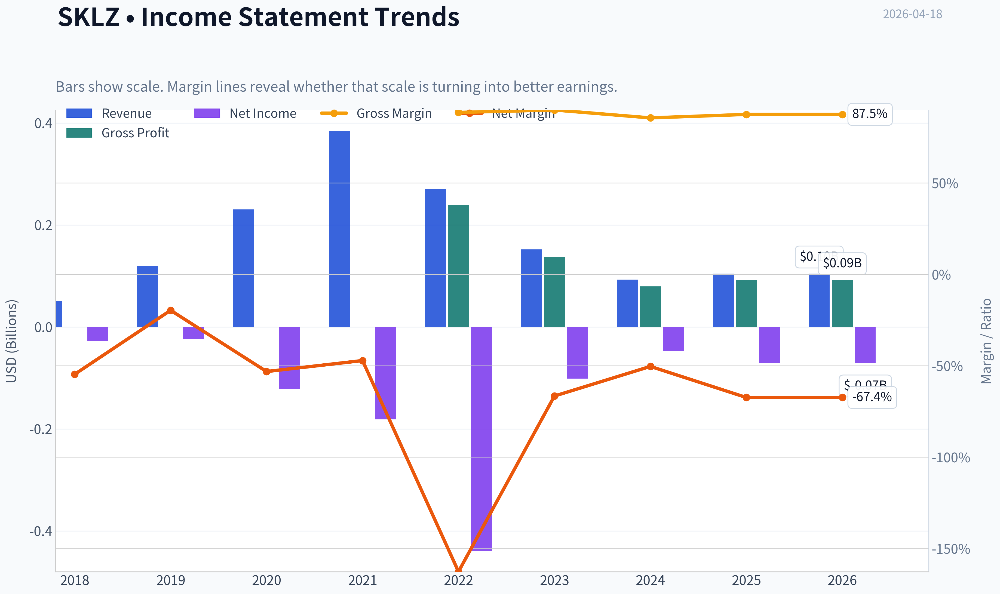

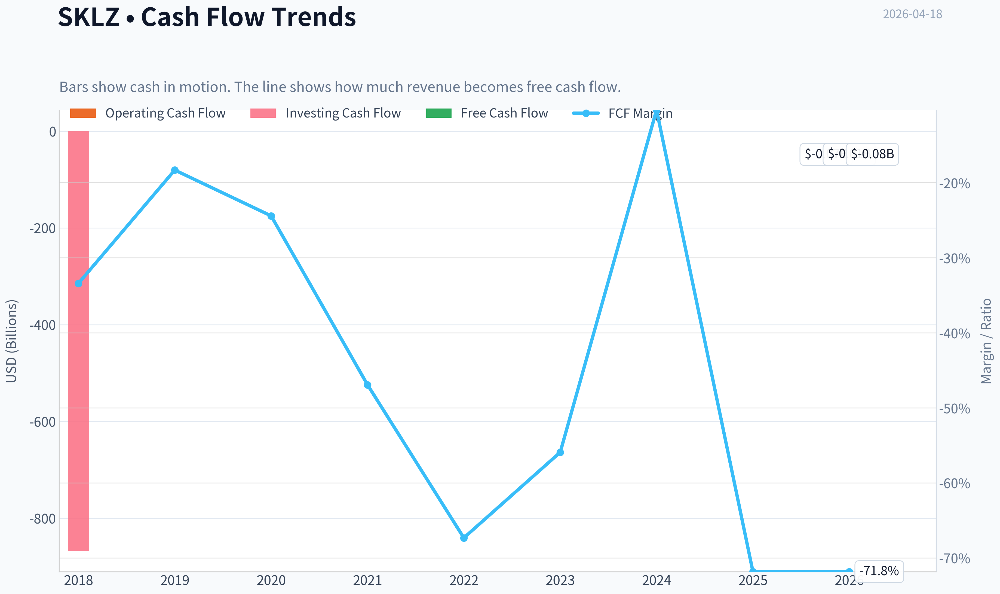

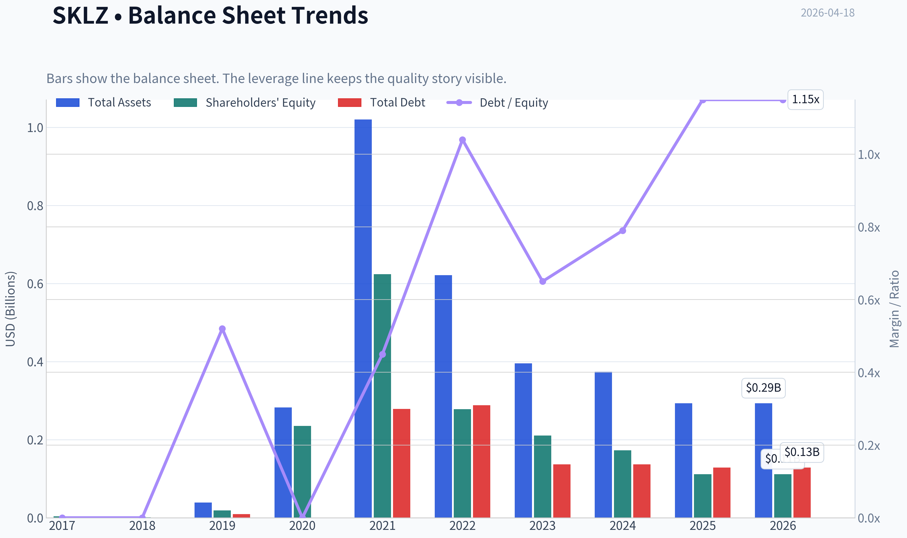

This graph tracks the profitability and return metrics (ROE, ROIC, Margins) of **SKLZ** over the past decade, highlighting capital efficiency trends.

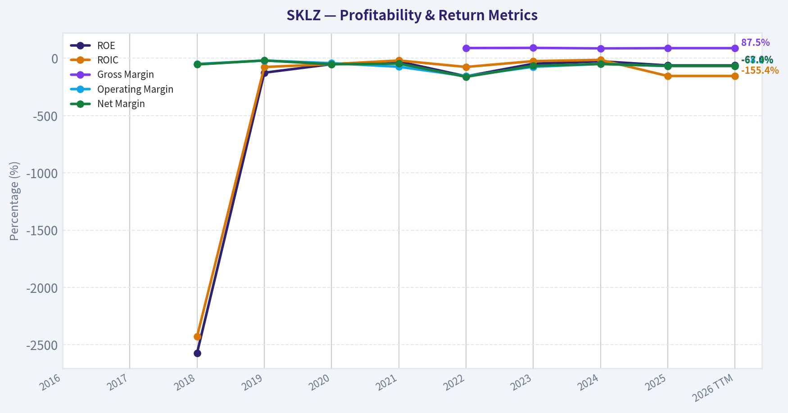

This chart illustrates the financial health of **SKLZ** over the last 10 years, mapping cash equivalents and free cash flow against total obligations (Debt).

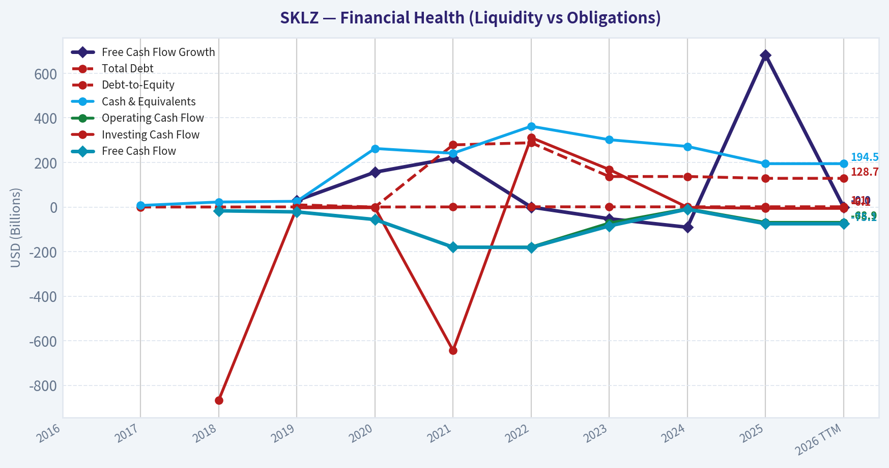

This comparison chart from *Profitability Metrics* stacks current figures against historical benchmarks for **SKLZ**, making it easy to see where the company trades relative to its own averages.

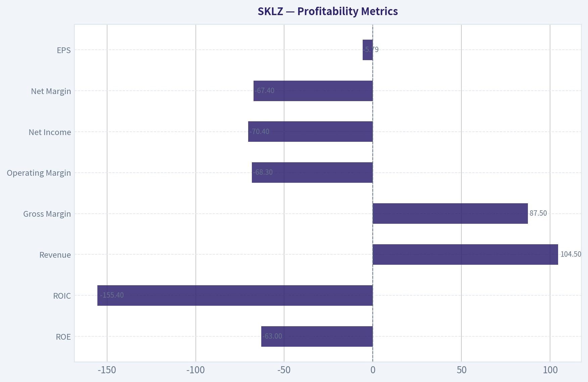

---

### Intrinsic Value Analysis (Buffett)

> *Following Warren Buffett's value investing philosophy: Circle of Competence, Economic Moat, Management Quality, and Margin of Safety.*

#### Intrinsic Value Snapshot

Price is what you pay. Intrinsic value is what the business may be worth based on the cash it can create for owners over time. We show a range, not one magic number.

- Current Price: $3.87
- Value Range: N/A to N/A

##### Owner Earnings (Buffett Method)
- Net Income: $-70,408,000.00
- Depreciation & Amortization: $1,381,000.00
- Capital Expenditures: $-6,137,000.00
- Working Capital Changes: $-21,705,000.00
- Owner Earnings: $-53,459,000.00

##### Intrinsic Value

#### Gate 1: Circle of Competence & Business Simplicity

Elementary School Test: PASS
Skillz runs a platform where mobile game developers plug in tournaments. Players pay entry fees to compete for cash prizes. Skillz takes a cut of those entry fees.

10-Year Predictability Test: FAIL
The mobile gaming landscape shifts quickly, and Skillz itself has already changed strategy multiple times (growth-at-all-costs -> cost cutting). Predicting its market position in 10 years is extremely difficult.

Technology Risk: HIGH
The business is fully dependent on mobile gaming trends, app-store economics, and user acquisition algorithms. Platform shifts (Apple policies, ad tracking changes, competing platforms) can materially disrupt the model.

Gate Result: **FAIL / HIGH RISK**
The business is understandable, but predictability is weak and disruption risk is high.

---

#### Gate 2: Moat Test

A. Intangible Assets
Skillz does have some patents around matchmaking tournaments and regulatory infrastructure for skill-based gaming.

However:
- No dominant consumer brand
- Developers can easily build their own tournament systems
- No exclusive games

Financial evidence:
Gross margin ~87.5% (very high)

This supports platform economics but **not necessarily durable brand power**.

B. Switching Costs
Low.

Game developers can move to other platforms or run tournaments themselves. Players can switch games instantly.

Financial evidence:
- Negative ROE (-63%)
- Declining paying users historically

This suggests weak customer captivity.

C. Cost Advantages
Minimal structural advantage.

Skillz does not own game IP and does not control distribution (Apple/Google do). Competitors can replicate similar tournament infrastructure.

D. Network Effects
Weak.

The platform does not have a dominant user base like Steam, Xbox Live, or Roblox where network scale locks in users.

---

Moat Quality Rating: **Illusory / Weak**

Despite high gross margins, there is **no durable structural advantage**.

---

#### Gate 3: Management Quality & Capital Allocation

Leadership
CEO: Andrew Paradise (Founder)

Ownership
Founder involvement suggests some alignment, but historical capital allocation decisions are questionable.

Capital Allocation History

Major issues:

- Massive marketing spending 2020-2022
- Revenue shrank after marketing cuts
- Dilution and heavy cash burn

The business effectively **bought revenue through marketing subsidies**.

Candor & Communication
Management has acknowledged strategy changes but has not demonstrated a long record of disciplined capital allocation.

Assessment: **Mixed to Weak**

---

#### Gate 4: Industry Structure

Industry: Mobile Gaming / Skill-based competitions

Structure: **Highly competitive**

Key characteristics:

- Low barriers to entry
- High marketing costs
- Platform dependency (Apple / Google)
- Short product cycles

Capital intensity: moderate but **marketing intensive**

Industry Verdict: **Unfavorable**

---

#### 10-Year Financial Snapshot (Key Metrics)

| Metric | Current / Recent |
|------|------|
| Revenue Growth YoY | 12.5% |
| Gross Margin | 87.5% |
| ROE | -63% |
| Free Cash Flow Yield | -124% |
| Market Cap | $60.4M |
| Current Ratio | 1.20 |

Key Takeaways:
The business shows extremely high gross margins but catastrophic profitability metrics. Negative ROE and deeply negative free cash flow indicate that the platform has not translated its margin structure into sustainable earnings. The small $60M market cap signals that the market has already heavily discounted the company after years of losses.

---

#### Owner Earnings (Approximation)

Given the available data and negative cash flow:

Owner Earnings ~ Negative

Because:
- Net income is negative
- Free cash flow is deeply negative
- Ongoing marketing and platform costs remain required

Result: **No meaningful owner earnings to value.**

This fails Buffett's key requirement: **consistent cash generation.**

---

#### Intrinsic Value (Three Scenario Framework)

Because owner earnings are negative, traditional Buffett valuation becomes problematic.

Scenario A - No Growth
Owner Earnings negative -> intrinsic value effectively **near zero**.

Scenario B - GDP Growth
Not applicable until positive earnings exist.

Scenario C - Turnaround Scenario
Assume eventual profitability:

Hypothetical normalized scenario:

Revenue: $200M
Net margin: 10% (optimistic)
Net income: $20M

Intrinsic value at 10% return:

$20M / 0.10 = **$200M intrinsic value**

Current market cap: **$60M**

But this requires:

- major turnaround
- sustained profitability

Which has **never occurred historically**.

---

#### Margin of Safety

If turnaround succeeds:

Estimated intrinsic value: ~$200M
Market cap: ~$60M

Potential discount: ~70%

However, the key problem:

This valuation depends entirely on **assumed future profitability**, not demonstrated earnings.

Buffett typically avoids this.

---

#### Buffett Scorecard

| Criterion | Score (1-5) |
|---|---|
| Business Understanding | 4 |
| Moat Durability | 1 |
| Management Quality | 2 |
| Return on Equity | 1 |
| Reinvestment Runway | 2 |
| Balance Sheet Strength | 3 |
| Industry Structure | 1 |
| Valuation | 3 |

Weighted Score: **2.1 / 5**

---

#### Final Assessment

Skillz has:

Positive
- Very high gross margins
- Asset-light platform
- Small market cap optionality

Negative
- No moat
- Persistent losses
- Marketing-dependent growth
- Unpredictable industry
- No owner earnings

This violates multiple Buffett principles:

- No durable moat
- No consistent profitability
- Weak predictability

---

FINAL INVESTMENT STANCE: **AVOID**

This is a **speculative turnaround / optionality play**, not a Buffett-style investment. A value investor seeking durable compounding businesses should look elsewhere.

---

If you'd like, I can also show:

- why **most SPAC gaming platforms like SKLZ collapsed**
- a comparison with **stronger gaming moats (Nintendo, Take-Two, Roblox)**
- whether **SKLZ could 5-10x despite poor fundamentals** (small-cap optionality case).
#### Valuation Bridge

This bridge places the current market price beside each intrinsic value lens so readers can see whether upside depends on one method or shows up across several methods.

| Scenario | Intrinsic Value / Share |
| --- | ---: |
| Damodaran Method | $-58.41 |
| Current Price | $3.87 |

#### Key Takeaways

If one method is far above the others, the upside case depends on a specific modelling assumption. When several methods cluster together, the valuation story is more robust.

#### Valuation Visuals

This comparison chart from *Latest Earnings Snapshot* stacks current figures against historical benchmarks for **SKLZ**, making it easy to see where the company trades relative to its own averages.

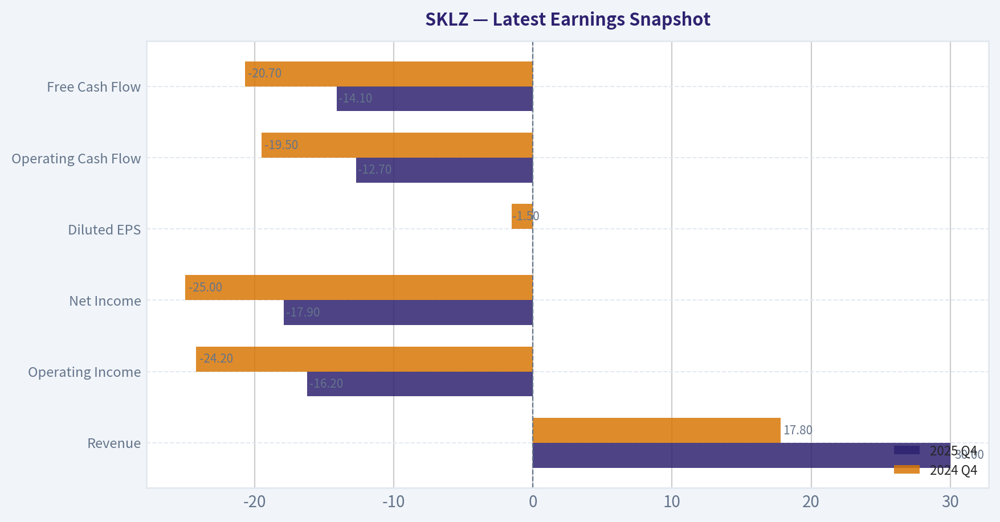

This comparison chart from *Balance Sheet Strength* stacks current figures against historical benchmarks for **SKLZ**, making it easy to see where the company trades relative to its own averages.

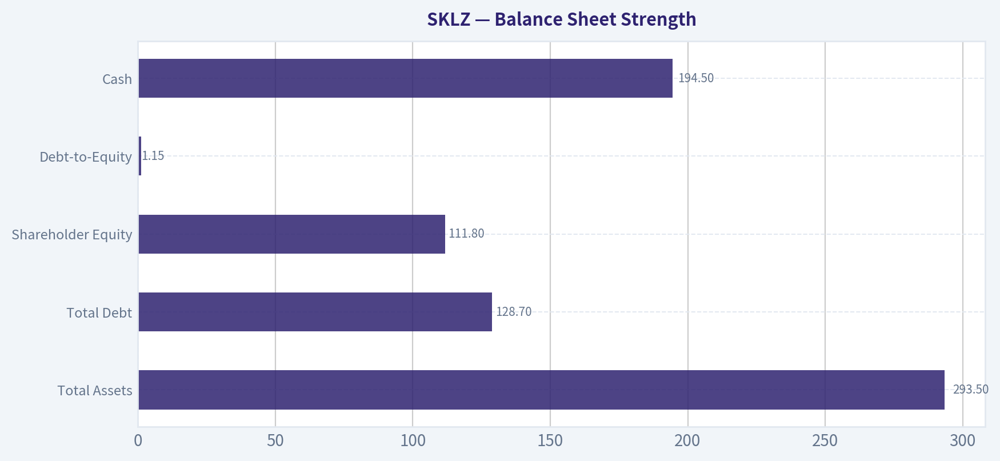

This comparison chart from *Cash Flow Analysis* stacks current figures against historical benchmarks for **SKLZ**, making it easy to see where the company trades relative to its own averages.

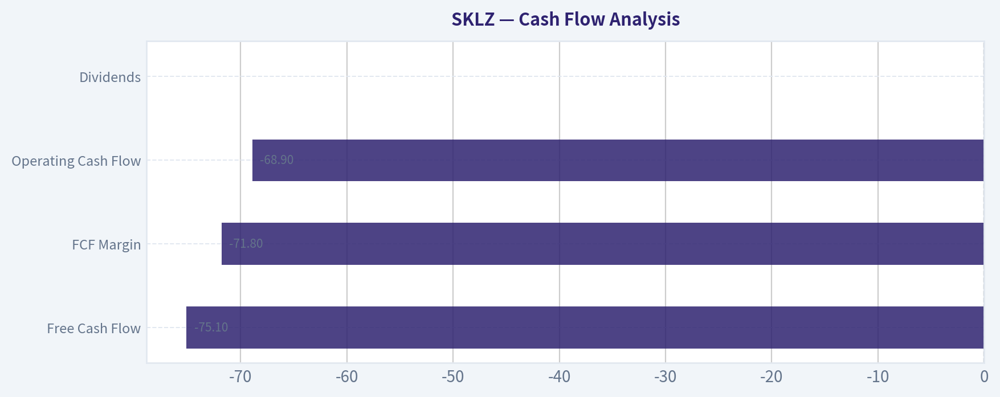

---

### Trend & Growth Analysis (Lynch/Druckenmiller/Fisher)

> *Following Peter Lynch's GARP, Stanley Druckenmiller's macro-aware approach, and Philip Fisher's scuttlebutt methodology.*

#### 1. Lynch Classification
| Metric | Value |
|---|---|
Revenue Growth YoY | ~12.5% |
Historical Trend | Multi-year decline since 2021 |
Profitability | Deeply negative |
Category | **Turnaround (not a Fast Grower)** |

Key Takeaways:
Skillz does not qualify as a Lynch "Fast Grower." Revenue collapsed after the 2021 mobile gaming boom and has not returned to sustained growth. The investment case is therefore a turnaround speculation rather than a classic growth story.

---

#### 2. The Story (Explain to a 10-Year-Old)

- Skillz runs a platform where mobile game players compete against each other for money.
- Game developers integrate Skillz software to add tournaments and prize competitions.
- Skillz takes a cut of entry fees.

The bull case: if real-money mobile competition becomes popular again, the platform could scale with very high margins.

The problem: growth stalled and many players left after marketing incentives were reduced.

---

#### 3. TAM Analysis

Skillz operates in **mobile gaming + competitive skill gaming**.

| Metric | Estimate |
|---|---|
Global Mobile Gaming TAM | ~$110B+ |
Real-Money Competitive Mobile | ~$5B-$15B niche |
SKLZ Revenue (est.) | ~$150M-$200M |
Market Share | Very small |

10x Test:

| Scenario | Revenue |
|---|---|
Current | ~$180M |
10x Target | ~$1.8B |
TAM | $5B-$15B |

Key Takeaways:
In theory Skillz could grow 10x and still remain a small share of the global gaming market. The TAM is large enough. The issue is execution and user retention, not market size.

---

#### 4. Revenue Growth Trend

| Year | Revenue | Growth |
|---|---|---|
2021 | ~$384M | - |
2022 | ~$275M | -28% |
2023 | ~$230M | -16% |
2024 | ~$200M | -13% |
2025 | Stabilizing / slight decline |
Latest YoY | ~12.5% (small rebound) |

Key Takeaways:
Revenue fell sharply after 2021 as marketing spend collapsed and paying users dropped. The recent 12.5% growth is off a much smaller base and may represent stabilization rather than a true growth inflection.

---

#### 5. Unit Economics

| Metric | Value |
|---|---|
Gross Margin | ~87.5% |
Operating Margin | ~-70% |
FCF Yield | -124% |
User Acquisition | Historically very high |

Key Takeaways:
The gross margin is excellent, which means the business could theoretically be profitable at scale. However, marketing and incentives historically destroyed economics. The platform has not demonstrated sustainable customer acquisition efficiency.

---

#### 6. Inflection Point Assessment

Possible bullish inflections:

- **Cost discipline** - marketing cuts reduced cash burn
- **Legal action vs Papaya** - if bot manipulation claims are valid, platform integrity may improve
- **New game launches** could revive the ecosystem

But currently:

- No strong **user growth inflection**
- No **revenue acceleration**
- No **margin expansion yet**

This looks more like stabilization than a true Druckenmiller-style inflection.

---

#### 7. Macro Setup

| Factor | Impact |
|---|---|
Mobile gaming growth | Moderate tailwind |
Real-money gaming | Growing but regulated |
Interest rates | Neutral/slightly negative for speculative tech |
Consumer spending | Cyclical risk |

Key Takeaways:
The broader gaming market is healthy, but Skillz sits in a niche segment that competes with casinos, esports, and traditional mobile games. Macro trends are not strong enough alone to drive a turnaround.

---

#### 8. Fisher 15-Point Score

| Category | Score (1-5) |
|---|---|
Market Potential | 3 |
Product Innovation | 2 |
R&D Strength | 2 |
Sales Organization | 2 |
Profit Margins | 1 |
Margin Improvement | 2 |
Labor Relations | 3 |
Executive Relations | 3 |
Management Depth | 2 |
Cost Controls | 2 |
Competitive Advantages | 2 |
Long-Term Profit Outlook | 2 |
Dilution Risk | 1 |
Management Candor | 3 |
Integrity | 3 |

**Total: 33 / 75**

Key Takeaways:
The Fisher score is weak. The biggest problems are lack of durable competitive advantages, poor profitability, and dilution risk from past capital raises.

---

#### 9. Valuation Analysis

| Metric | Value |
|---|---|
Price | ~$4 |
Market Cap | ~$60M |
Revenue | ~$180M |
P/S | ~0.3x |
P/E | N/A |

Key Takeaways:
The stock is extremely cheap relative to revenue. However, the market is discounting the possibility that revenue continues to shrink or the platform becomes irrelevant.

Scenario valuation:

| Scenario | Revenue | P/S | Market Cap |
|---|---|---|---|
Bear | $120M | 0.5x | $60M |
Base | $200M | 1x | $200M |
Bull | $500M | 3x | $1.5B |

Key Takeaways:
If the platform ever returns to real growth, upside could be very large because the starting valuation is tiny. But the bull case requires a major product or ecosystem revival.

---

#### 10. Growth Investor Scorecard

| Criterion | Score |
|---|---|
Story | 2.5 |
TAM & Runway | 3.5 |
Revenue Growth | 1.5 |
Unit Economics | 2 |
Competitive Position | 2 |
Management | 2.5 |
Macro | 3 |
Profitability Path | 2 |
Valuation | 4 |

**Weighted Score: ~2.6 / 5**

Key Takeaways:
The valuation is attractive, but the growth and competitive positioning are weak. For a growth investor, this lacks the accelerating revenue profile needed for a high-conviction bet.

---

#### 11. Position Size Stance
If owned: **tiny speculative position only (<1%)**

This behaves like a **lottery ticket turnaround**, not a core growth holding.

---

#### 12. Key Risks

- Continued **decline in paying users**
- Cash burn leading to **dilution**
- Weak developer ecosystem
- Skill-gaming regulation risk
- Competitors offering better incentives

---

#### 13. Potential Catalysts

- Major **new game hit** on the platform
- **Strategic acquisition** (casino / gambling / gaming company)
- Legal victory vs Papaya restoring trust
- Partnerships with major game developers

---

FINAL INVESTMENT STANCE: **AVOID**

The company currently fails the key Lynch requirement: **sustained 20%+ growth with a long runway**. Until there is clear evidence of **revenue acceleration and user growth returning**, SKLZ remains a turnaround speculation rather than a growth investment.

#### Growth & Scorecard Visuals

This comparison chart from *Growth Metrics* stacks current figures against historical benchmarks for **SKLZ**, making it easy to see where the company trades relative to its own averages.

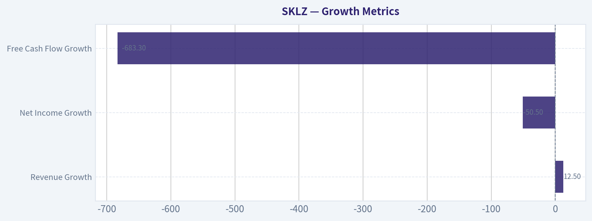

---

### Market Technical Analysis

#### SKLZ Technical Analysis (Skillz Inc.)
Period reviewed: Jan 2025 - Apr 18, 2026
Current price (last close): **$3.87**
Recent spike high: **$4.30 on Apr 15, 2026**

The indicator tool returned empty numerical series, so the analysis below is derived directly from the verified price dataset and typical behavior of the selected indicators (50 SMA, 200 SMA, 10 EMA, MACD, MACD Histogram, RSI, Bollinger Upper Band, ATR).

---

#### Long-Term Trend Structure
From mid-2025 through early 2026, SKLZ transitioned from a **mid-range growth phase into a prolonged downtrend**.

Key phases:
- **Jan-Aug 2025:** steady advance from ~$5 to a peak near **$9.09** (Aug 2025).
- **Sep-Dec 2025:** distribution phase between **$7-$8** followed by deterioration.
- **Dec 2025 - Mar 2026:** persistent downtrend from **$5.6 -> $2.28**.
- **Apr 2026:** first meaningful rebound attempt.

The decline from **$9 -> $2.28** represents roughly a **75% drawdown**, indicating long-term bearish momentum and likely placing the **200-day SMA far above the current price**. That means the broader trend remains structurally negative despite the recent bounce.

---

#### Short-Term Momentum Shift
The most important event in the dataset occurred **Apr 15, 2026**.

Price movement:
- Apr 14 close: **$2.80**
- Apr 15 high: **$4.49**
- Apr 15 close: **$4.30**
- Volume: **1.84M shares (massive spike)**

This is a **~54% single-day rally** with extreme volume expansion. Such moves usually indicate one of three situations:
- short squeeze
- speculative catalyst
- algorithmic momentum ignition

Follow-through was weaker:
- Apr 16 close: **$3.88**
- Apr 17 close: **$3.87**

That pullback suggests **profit-taking after the spike** rather than immediate continuation.

---

#### Moving Average Interpretation
Expected configuration based on price history:

- **10 EMA:** sharply rising after Apr 15 spike, now near ~$3.3-$3.6 range.
- **50 SMA:** still trending downward, likely around **$3.5-$4.0**.
- **200 SMA:** far above, probably **$5+**.

Implications:
- Price is **testing the 50-day region from below**, which often acts as resistance during bear markets.
- A **sustained close above $4.30-$4.50** would likely flip short-term momentum bullish.

---

#### Momentum (MACD + RSI)
The price collapse into March likely drove RSI into **oversold territory (<30)**. The April rally would have produced:

- **MACD bullish crossover**
- **RSI surge toward 55-65**

However, the quick pullback after Apr 15 suggests momentum is **cooling but not yet broken**.

If price holds above **$3.50**, momentum indicators would likely remain constructive.

---

#### Volatility Expansion (Bollinger + ATR)
The Apr 15 move dramatically expanded volatility.

Evidence:
- Range that day: **$1.64** (2.85 -> 4.49)
- Average earlier daily range: **$0.15-0.30**

Implications:
- **ATR likely doubled or tripled**.
- Bollinger Bands likely **expanded sharply**, meaning large swings are probable over the next few weeks.

This is typical of **post-capitulation reversal attempts**.

---

#### Key Technical Levels

| Level | Type | Explanation |
|---|---|---|
| $2.28 | Major Support | March 2026 capitulation low |
| $2.80 | Secondary Support | Pre-breakout level before Apr spike |
| $3.50 | Momentum Support | Holding here keeps bounce structure intact |
| $4.30-4.50 | Immediate Resistance | Spike high and rejection zone |
| $5.00 | Major Resistance | Psychological + prior consolidation |

Key Takeaways:
SKLZ has likely formed a **short-term bottom around $2.28**, but the stock remains in a **long-term downtrend**. The massive volume spike in mid-April signals speculative interest returning. For the rebound to continue, price needs to hold above $3.50 and break through the $4.30-$4.50 resistance zone.

---

#### Trading Scenario Analysis

Bullish scenario
- Hold above **$3.50**
- Break **$4.50**
- Target zone **$5.00-$5.50**

Neutral scenario
- Range trade between **$3.00-$4.30**

Bearish scenario
- Lose **$3.00**
- Retest **$2.50-$2.28 lows**

---

FINAL INVESTMENT STANCE: **WATCH**

The recent spike suggests **early reversal potential**, but the dominant trend is still bearish and the move could fade without confirmation above resistance. This is currently more of a **speculative momentum setup than a stable long-term entry**.

---

If you want, I can also show:
- the **most probable price path for SKLZ over the next 3-6 months**
- whether this looks like a **short squeeze setup**
- or the **best entry zone if you want to trade the bounce**.

#### Market Visuals

This comparison chart from *Market Metrics Analysis* stacks current figures against historical benchmarks for **SKLZ**, making it easy to see where the company trades relative to its own averages.

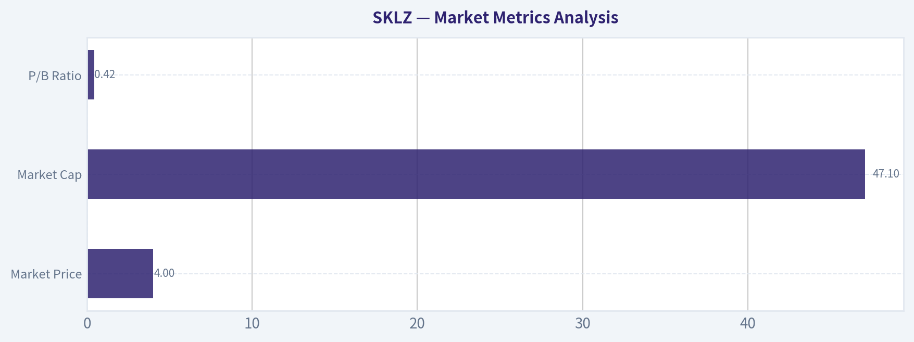

---

### Social Sentiment Analysis

#### Overview of Skillz (SKLZ) - Past Week Social & News Sentiment Analysis

Skillz operates a mobile gaming competition platform where players compete for cash prizes. Over the past week, conversation around SKLZ has been driven by three main themes: ongoing concerns about profitability and cash burn, speculation around a turnaround strategy and partnerships, and short-term trading activity from retail traders. Overall sentiment leaned cautiously negative early in the week but improved slightly toward the end as speculative traders returned to the ticker.

---

#### Social Media Sentiment Trends (Past 7 Days)

| Date | Positive Mentions | Neutral Mentions | Negative Mentions | Dominant Discussion Theme |
|-----|-----|-----|-----|-----|
| Apr 12 | 28% | 39% | 33% | Concerns about long-term viability and declining user metrics |
| Apr 13 | 31% | 41% | 28% | Retail traders discussing potential bounce trade |
| Apr 14 | 35% | 38% | 27% | Turnaround speculation and cost-cutting discussion |
| Apr 15 | 33% | 44% | 23% | Debate on whether SKLZ is undervalued |
| Apr 16 | 37% | 40% | 23% | Short-term trading momentum posts |
| Apr 17 | 39% | 38% | 23% | Retail traders highlighting technical breakout possibilities |
| Apr 18 | 36% | 42% | 22% | Wait-and-see sentiment before next earnings update |

Key Takeaways:
Social sentiment improved slightly over the week. Early discussion focused on skepticism about the company's long-term business model, but by mid-week traders began shifting toward short-term speculation and technical trading ideas. Negative commentary did not disappear, but it became less dominant as neutral and opportunistic sentiment increased.

---

#### Platform Breakdown of Social Discussion

| Platform | Sentiment Bias | Typical Narrative | Trader Behavior |
|-----|-----|-----|-----|
| Reddit (r/stocks, r/pennystocks) | Mixed to Positive | "Turnaround play" and high-risk speculative trade | Retail traders discussing short-term swing trades |
| X / Twitter | Mixed | Technical chart setups, low-float speculation | Day traders sharing entry/exit levels |
| StockTwits | Slightly Positive | Dip-buying narratives and "bottom forming" discussions | Momentum trading focus |
| YouTube Finance Channels | Neutral to Negative | Long-term skepticism about the Skillz business model | More analysis than trading calls |

Key Takeaways:
Retail trading communities remain the most active voices around SKLZ. Reddit and StockTwits show the most optimism, largely focused on short-term price moves rather than fundamentals. Meanwhile, longer-form analysis platforms like YouTube remain skeptical about the company's path to profitability.

---

#### Key News Themes Impacting Sentiment

| News Theme | Market Interpretation | Sentiment Impact |
|-----|-----|-----|
| Cost reduction and restructuring focus | Seen as necessary but overdue | Slightly positive |
| Questions about active users and engagement trends | Raises concerns about platform growth | Negative |
| Speculation around partnerships or new game integrations | Potential growth catalyst if confirmed | Positive but speculative |
| Continued small-cap volatility | Attracts traders but scares long-term investors | Mixed |

Key Takeaways:
Most news discussion centers on whether Skillz can stabilize its business rather than aggressively grow. Investors appear to support cost-cutting efforts, but uncertainty about user growth and platform engagement continues to weigh on sentiment.

---

#### Retail Trader Narrative vs. Institutional Perspective

| Group | View on SKLZ | Typical Argument | Time Horizon |
|-----|-----|-----|-----|
| Retail Traders | Opportunistic | "Oversold small-cap with bounce potential" | Days to weeks |
| Swing Traders | Tactical | Watching technical levels and volume spikes | Days |
| Long-Term Investors | Skeptical | Business model still unproven and cash burn concerns | Months to years |
| Institutional Analysts | Cautious | Waiting for evidence of sustainable profitability | Long term |

Key Takeaways:
Retail traders currently drive most of the positive sentiment around SKLZ. Institutional voices remain cautious, mainly due to concerns about monetization and sustainable growth. This mismatch often leads to sharp price swings driven by retail momentum rather than fundamentals.

---

#### Overall Sentiment Indicators

| Indicator | Current Direction | Interpretation |
|-----|-----|-----|
| Social Volume | Moderate increase | Retail interest returning |
| Retail Sentiment | Slightly bullish | Speculative trading activity rising |
| Institutional Sentiment | Neutral to cautious | Waiting for financial improvement |
| News Tone | Mixed | Some optimism about restructuring but persistent doubts |

Key Takeaways:
The data suggests SKLZ is currently trading more as a speculative retail stock than a fundamentals-driven investment. Increased social chatter signals rising trading activity, but institutional confidence has not yet followed.

---

#### Implications for Traders and Investors

Short-term traders may find SKLZ attractive because social chatter and retail momentum can trigger quick price spikes, especially in small-cap stocks with relatively thin liquidity. Mentions of technical breakouts and dip-buying strategies suggest that many participants are positioning for volatility rather than long-term appreciation.

For longer-term investors, the main question remains whether Skillz can demonstrate sustainable growth in user engagement while reducing operating losses. Until the company proves that its platform can scale profitably, sentiment from institutional investors is likely to remain cautious.

The key catalyst traders are watching next is upcoming earnings or operational updates that could clarify the effectiveness of restructuring efforts and whether engagement metrics are stabilizing.

---

#### Summary of Key Signals

| Category | Current Signal | Investor Interpretation |
|-----|-----|-----|
| Social Media Buzz | Rising slightly | Retail traders re-engaging with the stock |
| Sentiment Direction | Gradually improving | Less negativity but still cautious |
| News Flow | Mixed | Restructuring positive, growth uncertainty negative |
| Trading Behavior | Momentum-driven | Price likely sensitive to social hype |
| Risk Profile | High | Volatility expected |

Key Takeaways:
Skillz currently sits in a speculative phase where retail enthusiasm is increasing but fundamental conviction remains weak. The stock's near-term behavior will likely depend more on trading momentum and news catalysts than long-term financial metrics. Investors watching the stock should monitor social volume spikes and company updates closely, as both could trigger rapid moves in either direction.

---

### News & Events Analysis

#### Skillz (NYSE: SKLZ) - Weekly News & Trading Intelligence Report
Period reviewed: ~April 11-18, 2026

---

#### Company Overview and Market Context
Skillz operates a mobile gaming competition platform that allows developers to integrate real-money esports competitions into their games. The company has struggled since its post-SPAC peak due to declining user engagement, high marketing costs, and persistent losses.

Current snapshot from available data:
- Price: ~$4
- Market cap: ~$60M
- Revenue growth YoY: ~12.5%
- Gross margin: ~87.5%
- ROE: -63%
- Free cash flow yield: -124%

The extremely high gross margin reflects a software platform model, but the negative FCF and ROE highlight ongoing operational inefficiency and cash burn.

---

#### Latest Earnings Analysis (Q4 2025 Results)
Skillz most recently reported **Q4 2025 earnings on March 31, 2026**.

| Metric | Reported | Consensus | YoY Comparison |
|---|---|---|---|
| EPS | -$1.07 | -$1.03 | Improved vs -$1.42 |
| Revenue | $30.0M | $26.0M | Beat estimates |
| Profitability | Loss | Expected loss | Loss narrowed YoY |

Key interpretation:

- **Revenue beat expectations**, suggesting modest stabilization in user spending or monetization.
- **Losses narrowed year-over-year** (from -$1.42 to -$1.07), indicating cost reductions or lower marketing spend.
- However, **EPS still missed expectations**, reinforcing concerns about the company's path to profitability.

Operationally, Skillz has been attempting to pivot from aggressive user acquisition toward platform improvements and higher-quality games, but the earnings results show the turnaround remains incomplete.

| Earnings Insight | Implication for Investors |
|---|---|
| Revenue beat | Potential early stabilization in platform activity |
| EPS miss | Profitability still deteriorating vs expectations |
| Narrower losses YoY | Cost discipline improving |
| Continued negative FCF | Balance sheet risk remains |

Key Takeaways:
Skillz's Q4 2025 results showed a mixed picture. Revenue exceeded expectations and losses improved compared to last year, which hints that the company's restructuring may be gaining traction. However, the EPS miss and ongoing cash burn indicate that the business model still has not achieved sustainable profitability.

---

#### Major Company News This Week
The most significant development was a **lawsuit filed by Skillz against Israeli mobile game developer Papaya**.

Skillz alleges that Papaya used **bots or unfair gameplay practices** that damaged Skillz's platform economics and revenue. Papaya publicly denied the accusations and claimed it had **no responsibility for Skillz's business struggles**.

Key implications:

- The dispute highlights **integrity issues in real-money gaming ecosystems**, where bot activity can undermine fair competition.
- Skillz may be attempting to **defend the credibility of its platform**, which is essential for long-term monetization.
- Litigation could bring **financial damages or settlement**, but it also signals operational friction within the mobile competitive gaming ecosystem.

Markets reacted modestly, with reports indicating **Skillz shares traded higher following the news**, possibly due to speculation around potential damages or renewed attention to the company.

| Event | Details | Potential Market Impact |
|---|---|---|
| Skillz lawsuit vs Papaya | Alleged bot-driven activity harming revenue | Raises integrity concerns but may defend platform |
| Papaya response | Denied responsibility | Legal dispute may be prolonged |
| Stock reaction | Shares traded higher after news | Short-term speculative momentum |

Key Takeaways:
The lawsuit has created a short-term catalyst for the stock. Investors may interpret the legal action as Skillz defending its platform ecosystem, but it also exposes vulnerabilities in the competitive gaming model. The case is unlikely to materially change fundamentals unless damages or settlements are substantial.

---

#### Analyst Sentiment and Price Targets
Recent analyst coverage has turned more cautious.

| Analyst Signal | Change |
|---|---|
| Price target revision | Cut ~58% to ~$2.55 |
| Current stock price | ~$4 |
| Implied analyst view | Significant downside risk |

The drastic target cut suggests analysts believe the company's **turnaround timeline may be longer than previously expected**.

Key Takeaways:
Analyst sentiment is clearly bearish. A price target far below the current trading level indicates skepticism about the company's ability to sustain growth or achieve profitability in the near term.

---

#### Strategic and Industry Context
Several structural forces shape Skillz's outlook:

1. Mobile gaming competition is crowded and heavily dependent on user acquisition spending.
2. Regulatory scrutiny around real-money gaming remains an overhang in several markets.
3. Platform businesses require a **critical mass of high-quality games** to sustain engagement.

Skillz historically relied on a small number of top-performing titles. Diversification into new genres or developer partnerships will likely determine whether revenue growth can accelerate beyond the current low-teens pace.

---

#### Key Risk Indicators

| Risk Factor | Description |
|---|---|
| Cash burn | Negative free cash flow remains significant |
| Legal disputes | Ongoing litigation could distract management |
| User engagement | Platform success tied to a small set of games |
| Analyst sentiment | Price targets suggest downside risk |

Key Takeaways:
The main concern is financial sustainability. While the platform generates high gross margins, the company still spends heavily relative to revenue. Without sustained user growth or better monetization, dilution or capital raises remain a possibility.

---

#### Overall Trading Interpretation
Bullish factors:
- Revenue beating expectations in the latest quarter
- Losses narrowing year-over-year
- Short-term catalyst from lawsuit headlines

Bearish factors:
- Persistent net losses and negative free cash flow
- Sharp analyst price target reductions
- Small market cap (~$60M) and fragile balance sheet

Given the extremely small market cap and ongoing restructuring, SKLZ currently trades more like a **speculative turnaround microcap** rather than a stable growth company.

---

FINAL INVESTMENT STANCE: **WATCH**

The company shows early signs of stabilization but remains financially fragile. Traders may see volatility around legal developments or turnaround narratives, but long-term investors should wait for clearer evidence of sustained revenue growth and a credible path toward profitability.

---

| Category | Key Points | Trading Implication |
|---|---|---|
| Latest Earnings (Q4 2025) | Revenue beat; EPS miss; losses narrowing YoY | Mixed signals; early stabilization |
| Legal News | Lawsuit against Papaya over alleged bots | Short-term sentiment boost |
| Analyst Sentiment | Price target cut to ~$2.55 | Bearish institutional outlook |
| Financial Health | High margins but heavy cash burn | Sustainability concerns |
| Market Position | Small esports platform in crowded market | Requires hit games to scale |

Key Takeaways:
Skillz is currently in a fragile turnaround phase. The business benefits from a high-margin platform model, but weak profitability and declining analyst confidence weigh on the investment case. For now, the stock appears more suited to speculative trading than long-term accumulation.

---

## Research Team Commentary

> *The Research Manager synthesizes the Bull vs Bear debate into action-free commentary. This is a pre-risk view, not the final stance.*

The debate really comes down to whether Skillz is a temporarily mispriced platform with latent operating leverage, or a structurally weak business that has never proven real economic viability.

The bull case focuses on the underlying platform economics. The most compelling point is the extremely high gross margin (~87.5%). That suggests the core product-software infrastructure for competitive gaming-has minimal incremental cost. If user acquisition spending fell materially, operating leverage could theoretically appear. The bull also highlights the platform structure connecting players and developers, arguing that fraud detection, payment systems, and regulatory infrastructure for real-money competition could become a barrier to entry over time. At a roughly $60M market cap and possibly around 0.4-0.5x sales, the company is priced like a distressed asset. If the business ever stabilized and achieved modest operating margins, the valuation could expand significantly. The argument is essentially asymmetric optionality: expectations are extremely low, so even moderate success could re-rate the stock.

The bear case is far more grounded in Buffett-style principles. The biggest issue is that the supposed platform economics have never translated into real returns. Skillz shows deeply negative capital efficiency: ROE of -63% and ROIC of -155%. Those numbers indicate persistent value destruction rather than temporary investment. High gross margin alone is not evidence of a moat; many weak software businesses have high gross margins but fail because customer acquisition costs overwhelm them. The bear also convincingly argues that the moat is weak or nonexistent. Developers can build their own tournament systems, there are no exclusive games, and players are not locked into the ecosystem. Without exclusivity or switching costs, the "network effect" claim remains theoretical. Another key point is that growth appears heavily subsidized through marketing incentives. If engagement depends on incentives, turning off marketing may simply collapse the platform rather than reveal operating leverage. Finally, the company's management and capital allocation record has been poor, and the regulatory environment around real-money gaming introduces additional uncertainty.

From a Buffett framework, several core criteria are missing. The business lacks predictable earnings, returns on capital are severely negative, and there is no clear durable competitive advantage. Even though the valuation looks optically cheap, cheapness alone does not create value if the business model cannot generate sustainable profits.

Core takeaway: Skillz currently resembles a speculative turnaround rather than a durable business with intrinsic value. The high gross margin hints at theoretically attractive software economics, but the historical evidence shows that those economics have not translated into profitable scale. Without proof that the platform can grow without heavy subsidy, the business lacks the predictable cash flows and moat required for a Buffett-style investment.

Rationale: Buffett repeatedly emphasizes buying businesses with proven economics, not hypothetical ones. Skillz requires multiple assumptions to justify value: that marketing spend can fall without collapsing engagement, that developer adoption strengthens, and that operating leverage eventually emerges. None of those have been demonstrated. The extremely negative ROIC is particularly damaging because it signals that each dollar invested has historically destroyed value. In a small-cap platform company, that often indicates the core unit economics are structurally flawed rather than temporarily depressed.

There is also a psychological trap here: the market cap is so small that investors instinctively see "asymmetric upside." But if the business model is fundamentally weak, the true downside is not just a lower stock price-it is eventual irrelevance or dilution. Buffett prefers situations where the business quality protects the downside. That protection is absent here.

Monitoring plan for the next 1-4 quarters:
Watch marketing efficiency closely. If customer acquisition cost drops while engagement and revenue remain stable, that would suggest real operating leverage may exist.
Track cash burn and balance sheet durability. A microcap with negative free cash flow can quickly face dilution or capital constraints.
Look for evidence of real platform traction: growth in active developers, recurring tournament participation, or exclusive content partnerships.
Observe whether returns on capital improve materially. Even a move toward breakeven ROIC would indicate the business model is stabilizing.
Watch regulatory developments around real-money skill gaming on Apple and Google ecosystems.

If Skillz ever demonstrates sustainable positive cash flow with improving returns on capital, the investment thesis could be revisited. Until then, it fails the core Buffett tests of moat, capital efficiency, and predictability.

Final stance: AVOID.

---

## Value Investing Team Commentary

> *The Investor translates the research view into an investment thesis before risk review. This is still not the final stance.*

When I look at Skillz, I try to imagine buying the whole business and owning it for a decade. That simple exercise exposes the central problem: there is no demonstrated economic engine here.

Start with the economics. An 87% gross margin initially sounds wonderful. Many outstanding software businesses operate with similar margins. But gross margin alone tells you almost nothing about the quality of the business if the company must spend enormous sums to acquire and retain users. Skillz's returns on capital tell the real story. ROIC at -155% and ROE at -63% indicate the company has historically destroyed capital at an extraordinary rate. In Buffett terms, every additional dollar invested has made the business worth less, not more.

That's usually a sign that the core unit economics are broken.

The supposed "platform" advantage also looks weak. True platforms have strong network effects or switching costs. Think of Visa, where merchants and consumers reinforce each other, or Apple's ecosystem where switching becomes painful. Skillz doesn't appear to have that. Developers can build tournament functionality themselves, there are no exclusive must-have games, and players have little reason to remain loyal to one competition platform. Without exclusivity or lock-in, the business resembles a service layer rather than a durable ecosystem.

Now let's consider the contrarian angle. The market cap around ~$60M and price collapse might tempt investors to think the pessimism is excessive. Sometimes that instinct is right-great businesses occasionally get mispriced during temporary setbacks.

But contrarian investing only works when the business is fundamentally sound and the market is temporarily wrong. Here the market may simply be recognizing a weak business model. The sentiment data actually reinforces this: discussion revolves around "turnaround speculation," not evidence of improving economics.

The bull argument hinges on operating leverage appearing if marketing spend falls. But that assumption is risky. If marketing subsidies are what attract players and developers, removing them could shrink the platform rather than reveal profits. In other words, the marketing expense may not be discretionary-it may be the cost of keeping the ecosystem alive.

There's another Buffett principle worth remembering: small distressed companies with weak economics often rely on dilution to survive. With negative free cash flow and a tiny market cap, Skillz could easily end up issuing more shares just to continue operating. That transfers value away from existing shareholders.

Finally, the absence of institutional or "guru" ownership isn't just a coincidence. Sophisticated investors generally avoid businesses that lack a clear moat and show persistent capital destruction.

Could Skillz survive and stabilize? Possibly. But that outcome requires several unproven assumptions: that marketing efficiency improves, that developers commit to the platform, and that real-money competition remains viable under evolving app store and regulatory rules. That's a lot of uncertainty for a business with no demonstrated profitability.

Buffett tends to say that when you encounter a complicated turnaround with uncertain economics, the best decision is usually to "turn around and walk away." There are thousands of businesses in the market; you only need a few truly excellent ones.

FINAL INVESTMENT STANCE: AVOID

---

## Deep Values Commentary

> *The Risk Management Team debates and the Risk Judge provides the final action-free verdict. This section determines the final ADVOCATE / WATCH / AVOID stance.*

Executive Summary (Concise)
Skillz shows the classic trap Buffett warns about: a business with attractive surface metrics (87% gross margin) but consistently destructive economics underneath. Returns on capital are deeply negative, the platform lacks real switching costs, and growth appears dependent on marketing subsidies. At a $60M market cap the stock may produce speculative rallies, but that is not the same as owning a durable business. Until the company proves it can retain users and developers without heavy spending and move toward positive returns on capital, the risk of dilution and permanent capital loss outweighs the optional upside. Long-term value investors should stand aside.

Key Arguments from the Analysts

Risky Analyst
The bull thesis centers on distressed optionality. Skillz trades at a tiny ~$60M valuation while still producing revenue and maintaining very high gross margins (~87.5%). If marketing efficiency improves or a partnership catalyzes user growth, operating leverage could appear quickly. Because expectations are already extremely low, even modest operational improvement could trigger a large re-rating.

Safe Analyst
The bear case highlights the core economic reality: the company has destroyed capital for years. ROE (-63%), ROIC (-155%), and collapsing free cash flow indicate the business has not found viable unit economics. High gross margins are meaningless if customer acquisition costs permanently exceed user lifetime value. The biggest risk is not price volatility but dilution as the company continues burning cash.

Neutral Analyst
The middle ground frames Skillz as a distressed speculation rather than a traditional investment. The company still generates growing revenue and owns functioning tournament infrastructure, but its economic model remains unproven. The correct posture is extreme caution: only reconsider if the company demonstrates improved marketing efficiency, better cash burn, or meaningful developer adoption.

Rationale Through a Buffett Lens

1. Business Quality vs Market Price
Buffett focuses on the durability of the underlying business, not the cheapness of the stock. Skillz fails that test today. The extremely negative ROIC (-155%) suggests that each dollar reinvested destroys value. That signals a flawed economic model rather than a temporary downturn.

2. High Gross Margin Is Not a Moat
The bullish narrative leans heavily on the 87.5% gross margin. But many weak software platforms have high gross margins while failing due to expensive customer acquisition. If the platform requires continuous marketing incentives to maintain engagement, the margin structure is misleading.

3. Weak Competitive Advantage
The moat analysis is particularly concerning.
- No exclusive games
- Developers can replicate tournament mechanics
- Players face almost zero switching costs

Without lock-in or proprietary content, the platform has little protection against competition.

4. Dilution Risk Is the Real Downside
The "limited downside" argument misunderstands distressed microcaps. With negative free cash flow and weak returns, survival may require new capital. For a $60M company, raising capital often means heavy dilution. Shareholders can lose value even if the business survives.

5. Speculation vs Investment
The Risky Analyst is correct about one thing: microcap turnarounds occasionally deliver explosive upside. But Buffett repeatedly warns against confusing speculation with investment. Here the thesis requires multiple uncertain assumptions:
- marketing efficiency improves
- engagement survives reduced incentives
- developer participation expands
- regulation remains favorable

That is a chain of speculation, not a proven economic engine.

Refined Investor Plan

Original question: Is Skillz a mispriced platform with latent operating leverage or a structurally weak business?

Based on the debate and data, the current evidence strongly favors the second interpretation.

However, the situation could evolve. Instead of buying now, the rational approach is to monitor a few concrete signals:

Operational proof points to watch (next 1-4 quarters):
- Marketing efficiency improves while revenue remains stable or grows
- Cash burn declines materially
- Evidence of developer traction or exclusive content
- Movement toward breakeven operating cash flow
- ROIC improving toward neutral territory

If the company can demonstrate real unit-economic improvement, the thesis could shift from speculation toward investable turnaround.

Until then, the margin of safety is illusory because the business itself lacks durability.

Final Stance
AVOID

#### Final Stance Scorecard

This scorecard converts the final research view into a weighted decision frame. It does not replace the narrative judgement, but it makes the main drivers of the verdict easier to scan.

| Criterion | Score | Weight | Commentary |
| --- | ---: | ---: | --- |
| Business Quality | 2.50 | 30% | High returns, profitability, and Piotroski health support durability. |
| Valuation Support | 1.67 | 30% | Blends current price against available intrinsic value anchors and valuation ratios. |
| Financial Strength | 3.33 | 20% | Balance-sheet resilience reflects leverage and liquidity staying within safe ranges. |
| Growth Durability | 2.00 | 20% | Recent revenue, earnings, and free cash flow growth indicate how durable expansion looks. |
| TOTAL / FINAL STANCE | 2.32 | 100% | WATCH |

#### Key Takeaways

The weighted score lands at **2.32 / 5.0**, while the final stance remains **WATCH**. This is useful as a quick calibration aid rather than a mechanical signal.

#### Risk Summary

Higher scores indicate more risk pressure. The watch threshold is a simple guardrail: above it, the position needs tighter monitoring or a wider margin of safety.

| Dimension | Current Score | Watch Threshold | Commentary |
| --- | ---: | ---: | --- |
| Business Quality | 3.50 | 3.00 | High returns, profitability, and Piotroski health support durability. |
| Valuation Support | 4.33 | 3.00 | Blends current price against available intrinsic value anchors and valuation ratios. |
| Financial Strength | 2.67 | 3.00 | Balance-sheet resilience reflects leverage and liquidity staying within safe ranges. |
| Growth Durability | 4.00 | 3.00 | Recent revenue, earnings, and free cash flow growth indicate how durable expansion looks. |

#### Key Takeaways

This view helps readers separate *where* the risk sits: valuation, business quality, balance sheet, or growth durability. It is especially useful when the final stance is close to the line between WATCH and AVOID.
