# SLMBP Deep Value Intelligence

**Analysis Date:** 2026-05-16

## Critical Disclaimer

*This analysis is generated by Deep Value Intelligence, an AI-powered multi-agent investing framework. This report is for informational and educational purposes only and does not constitute financial advice. Always conduct your own research and consult with qualified financial advisors before making investment decisions.*

---

## Table of Contents

1. Intelligence Summary
2. Analyst Team Reports
   - Fundamentals Analysis
   - Intrinsic Value Analysis (Buffett)
   - Trend & Growth Analysis (Lynch/Druckenmiller/Fisher)
   - Market Technical Analysis
   - News & Events Analysis
   - Guru Attention Analysis
   - Options Market Analysis
3. Research Team Commentary
4. Value Investing Team Commentary
5. Deep Values Commentary

---

## Intelligence Summary

### Thesis + Conditions

**Core Thesis:** ## Executive Briefing

**Key Risks:**
- SLMBP shows **strong current economics** for a niche lender-**ROE 30.4%, ROIC 18.3%, revenue growth 7.3%, net income growth 22.4%**-so this is not a throwaway business. But for a Buffett-style investor, the key risk is **business fragility masked by leverage**: **ROA is only 2.5%**, the stock trades at a **rich ~35x earnings**, and the estimated discount to value (~16.6%) is **too small for a credit-sensitive financial** with funding, regulatory, and underwriting risk.
- The right move is **not to chase momentum and not to dismiss the business outright**. Keep it on an **active watchlist** and only get more constructive if upcoming quarters confirm **credit discipline, reserve adequacy, funding strength, and durable returns without leverage creep**. This is a **possible quality niche franchise**, but **not yet a Buffett-grade bargain**.
- ### 1. Risky Analyst - Strongest Bull Points
- Argument on valuation: if earnings are stepping up, today's **P/E near 35** may look less demanding later.
- ~35x earnings is expensive** for a financial unless durability is exceptional and proven.

**What Would Change Our View:**
- SLMBP shows **strong current economics** for a niche lender-**ROE 30.4%, ROIC 18.3%, revenue growth 7.3%, net income growth 22.4%**-so this is not a throwaway business. But for a Buffett-style investor, the key risk is **business fragility masked by leverage**: **ROA is only 2.5%**, the stock trades at a **rich ~35x earnings**, and the estimated discount to value (~16.6%) is **too small for a credit-sensitive financial** with funding, regulatory, and underwriting risk.
- The right move is **not to chase momentum and not to dismiss the business outright**. Keep it on an **active watchlist** and only get more constructive if upcoming quarters confirm **credit discipline, reserve adequacy, funding strength, and durable returns without leverage creep**. This is a **possible quality niche franchise**, but **not yet a Buffett-grade bargain**.
- ### 1. Risky Analyst - Strongest Bull Points
- Argument on valuation: if earnings are stepping up, today's **P/E near 35** may look less demanding later.
- ~35x earnings is expensive** for a financial unless durability is exceptional and proven.

**Confidence:** Medium

---

## Analyst Team Reports

### Fundamentals Analysis

#### Latest Earnings Snapshot

*Most recent reported quarter anchored on 2026 Q1, with prior-year comparison when available.*

| Metric | 2026 Q1 | 2025 Q1 | YoY Change |
| --- | ---: | ---: | ---: |
| Revenue | $560.0M | $581.0M | -3.6% |
| Operating Income | N/A | N/A | N/A |
| Net Income | $308.0M | $304.5M | +1.1% |
| Diluted EPS | N/A | N/A | N/A |
| Operating Cash Flow | $-76.0M | $-146.1M | +48.0% |
| Free Cash Flow | $-76.0M | $-146.1M | +48.0% |

Key Takeaways: This snapshot anchors the most recent reported quarter before the narrative analysis. It helps readers separate long-run business quality from whatever changed in the latest earnings print.

#### 10-Year Financial Metrics for SLMBP

*All values below are computed deterministically from raw data - not estimated by AI.*

*Issuer profile: bank (Financial Services / Credit Services).*

#### 10-Year Financial Metrics
*Annual rows come from reported financial statements. The final TTM row is computed from the latest four quarters.*

| Metric | 2009 | 2010 | 2011 | 2012 | 2013 | 2014 | 2015 | 2016 | 2017 | 2018 | 2019 | 2020 | 2021 | 2022 | 2023 | 2024 | 2025 | 2026 TTM |
| --- | --- | --- | --- | --- | --- | --- | --- | --- | --- | --- | --- | --- | --- | --- | --- | --- | --- | --- |
| Market Price | $19 | $19 | $17 | $24 | $32 | $33 | $20 | $30 | $38 | $35 | $34 | $35 | $40 | $42 | $54 | $67 | $71 | $75 |
| Market Cap | $21.95B | $21.38B | $20.40B | $25.59B | $30.36B | $28.98B | $17.35B | $24.37B | $30.15B | $25.94B | $23.15B | $20.52B | $18.71B | $15.05B | $15.48B | $16.27B | $15.37B | $32.66B |
| P/E Ratio | 122.37 | 46.61 | 33.05 | 117.78 | 116.69 | 159.64 | 68.05 | 106.23 | 110.89 | 55.14 | 41.35 | 23.56 | 16.20 | 32.69 | 27.45 | 27.61 | 21.06 | 43.65 |
| P/B Ratio | 4.16 | 4.27 | 3.89 | 23.63 | 26.14 | 15.84 | 8.28 | 10.38 | 12.19 | 8.73 | 6.99 | 8.01 | 8.71 | 8.71 | 8.23 | 7.53 | 6.27 | 13.40 |
| ROE | 6.1% | 10.6% | 1.0% | 20.1% | 22.3% | 10.6% | 13.1% | 10.7% | 11.7% | 16.4% | 17.5% | 34.4% | 54.0% | 27.2% | 30.9% | 28.2% | 30.4% | 30.7% |
| ROIC | 0.4% | 0.4% | 0.5% | 0.1% | 0.1% | 0.3% | 239.0% | 14.9% | 8.5% | 10.9% | 16.3% | 31.0% | 33.0% | 15.4% | 21.9% | 17.7% | 18.7% | N/A |
| EPS | $0.16 | $0.40 | $0.52 | $0.21 | $0.27 | $0.20 | $0.30 | $0.28 | $0.34 | $0.63 | $0.82 | $1.50 | $2.48 | $1.28 | $1.97 | $2.42 | $3.46 | $1.72 |
| Revenue | N/A | N/A | N/A | N/A | N/A | N/A | N/A | N/A | N/A | N/A | N/A | N/A | N/A | $1.82B | $1.81B | $1.85B | $1.98B | $1.96B |
| Gross Profit | N/A | N/A | N/A | N/A | N/A | N/A | N/A | N/A | N/A | N/A | N/A | N/A | N/A | N/A | N/A | N/A | N/A | N/A |
| Gross Margin | N/A | N/A | N/A | N/A | N/A | N/A | N/A | N/A | N/A | N/A | N/A | N/A | N/A | N/A | N/A | N/A | N/A | N/A |
| Operating Margin | N/A | N/A | N/A | N/A | N/A | N/A | N/A | N/A | N/A | N/A | N/A | N/A | N/A | 34.6% | 43.0% | 43.2% | 50.0% | N/A |
| Net Income | $324.0M | $530.0M | $54.2M | $217.6M | $258.9M | $194.2M | $274.3M | $250.3M | $288.9M | $487.5M | $578.3M | $880.7M | $1.16B | $469.0M | $581.4M | $608.3M | $744.8M | $748.3M |
| Net Margin | N/A | N/A | N/A | N/A | N/A | N/A | N/A | N/A | N/A | N/A | N/A | N/A | N/A | 25.7% | 32.1% | 32.9% | 37.5% | 38.1% |
| Revenue Growth | N/A | N/A | N/A | N/A | N/A | N/A | N/A | N/A | N/A | N/A | N/A | N/A | N/A | N/A | -0.8% | 2.2% | 7.3% | -1.1% |
| Net Income Growth | N/A | 63.6% | -89.8% | 301.5% | 19.0% | -25.0% | 41.2% | -8.7% | 15.4% | 68.7% | 18.6% | 52.3% | 31.8% | -59.6% | 24.0% | 4.6% | 22.4% | 0.5% |
| Free Cash Flow Growth | N/A | N/A | N/A | N/A | N/A | N/A | N/A | N/A | N/A | N/A | N/A | N/A | N/A | N/A | N/A | N/A | N/A | N/A |
| Total Book Value | $5.28B | $5.01B | $5.24B | $1.08B | $1.16B | $1.83B | $2.10B | $2.35B | $2.47B | $2.97B | $3.31B | $2.56B | $2.15B | $1.73B | $1.88B | $2.16B | $2.45B | $2.44B |
| Total Assets | $169.99B | $205.31B | $193.34B | $9.08B | $10.71B | $12.97B | $15.21B | $18.53B | $21.78B | $26.64B | $32.69B | $30.77B | $29.22B | $28.81B | $29.17B | $30.07B | $29.75B | $29.41B |
| Total Debt | $161.44B | $197.16B | $183.97B | $300.26B | $150.44B | $0 | $1.08B | $2.17B | $3.28B | $4.28B | $4.64B | $5.19B | $5.93B | $5.24B | $5.23B | $6.44B | $5.86B | $6.17B |
| Debt-to-Equity | 30.58 | 39.34 | 35.09 | 277.17 | 129.53 | 0.00 | 0.51 | 0.92 | 1.32 | 1.44 | 1.40 | 2.02 | 2.76 | 3.03 | 2.78 | 2.98 | 2.39 | 2.53 |
| Cash & Equivalents | $6.07B | $2.00B | $1.47B | $1.60B | $2.18B | $2.36B | $2.42B | $1.92B | $1.53B | $2.56B | $5.56B | $4.46B | $4.33B | $4.62B | $4.15B | $4.70B | $4.24B | $5.16B |
| Shareholders' Equity | $5.28B | $5.01B | $5.24B | $1.08B | $1.16B | $1.83B | $2.10B | $2.35B | $2.47B | $2.97B | $3.31B | $2.56B | $2.15B | $1.73B | $1.88B | $2.16B | $2.45B | $2.44B |
| Operating Cash Flow | $-15.91B | $-6.69B | $78.0M | $99.5M | $70.0M | $-436.8M | $-85.1M | $-199.0M | $-171.2M | $-102.7M | $-15.6M | $-182.7M | $-49.5M | $5.0M | $-144.6M | $-329.4M | $-398.6M | $-328.5M |
| Investing Cash Flow | $311.0M | $7.41B | $-600.5M | $-1.00B | $-731.1M | $-1.39B | $-1.85B | $-3.31B | $-3.16B | $-3.25B | $-2.31B | $947.3M | $2.60B | $1.08B | $-12.5M | $676.0M | $1.05B | $2.14B |
| Free Cash Flow | N/A | N/A | N/A | N/A | N/A | N/A | N/A | N/A | N/A | N/A | N/A | N/A | N/A | N/A | N/A | N/A | N/A | $-328.5M |
| FCF Margin | N/A | N/A | N/A | N/A | N/A | N/A | N/A | N/A | N/A | N/A | N/A | N/A | N/A | N/A | N/A | N/A | N/A | -16.7% |
| Dividends / Share | $0.00 | $0.00 | $0.00 | $0.00 | $0.00 | $0.00 | $0.00 | $0.00 | $0.00 | $0.00 | $0.00 | $0.00 | $0.00 | $0.32 | $0.35 | $0.41 | $0.51 | $0.24 |

#### Profitability Metrics
- Return on Equity (ROE): 30.4%
- Return on Invested Capital (ROIC): 18.3%
- Return on Assets (ROA): 2.5%
- Gross Margin: Not meaningful
- Operating Margin: 50.0%
- Net Profit Margin: 37.5%

#### Liquidity Metrics
- Current Ratio: Not meaningful
- Quick Ratio: Not meaningful

#### Leverage Metrics
- Debt-to-Equity Ratio: 2.39
- Interest Coverage Ratio: Not meaningful
- Net Debt: $1.62B

#### Growth Metrics (Year-over-Year)
- Revenue Growth: 7.3%
- Net Income Growth: 22.4%
- Free Cash Flow Growth: N/A
- Revenue CAGR (3-Year): 2.9%
- Revenue CAGR (5-Year): N/A

#### Valuation Metrics
- P/E Ratio (TTM): 34.95
- Forward P/E: N/A
- Price-to-Book: 6.79
- Price-to-Sales: N/A
- PEG Ratio: 1.56
- EV/EBITDA: Not meaningful
- Free Cash Flow Yield: N/A
- Earnings Yield: 2.9%

#### Owner Earnings (Buffett Method, Code-Computed)
- Net Income: $744.8M
- + Depreciation & Amortization: $16.2M
- - Capital Expenditures: N/A
- - Working Capital Changes: $-1.26B
- = **Owner Earnings: $2.02B**

#### Intrinsic Value (Code-Computed)
- Current Price: $75
- Buffett Method (Owner Earnings):
  Conservative: $90
  Average: $90
  Optimistic: $224

#### Piotroski F-Score: 3/9
- Positive Net Income: PASS
- Positive Operating Cash Flow: FAIL
- ROA Improvement: PASS
- Cash Flow > Net Income: FAIL
- Decreasing Debt: PASS
- Improving Current Ratio: FAIL
- No Dilution: FAIL
- Improving Gross Margin: FAIL
- Improving Asset Turnover: FAIL

ANALYST STANCE: **WATCH**

#### SLMBP Buffett-Style Fundamental Analysis

SLMBP's deterministic dataset describes a lender with very high accounting returns on equity, improving earnings power, and strong recent margin expansion, but also with several traits that make classic Buffett-style "predictability" analysis more complicated than for a consumer franchise or industrial compounder. This is a financial company, so gross margin, current ratio, and traditional free cash flow are either not meaningful or can be misleading. The right lens is earnings quality, balance sheet resilience, underwriting discipline, capital returns, and valuation relative to normalized profitability.

The headline picture is attractive on one level: 2025 and 2026 TTM show strong profitability, ROE above 30%, net income near $750M, and a market price that has compounded sharply from prior years. But the dataset also shows a very elevated price-to-book multiple, weak Piotroski score, negative operating cash flow in many years, and a TTM P/E that is materially above the company's own recent history. For a Buffett-oriented investor, that combination argues for respect, but not blind enthusiasm.

---

#### Current vs Historical Average Comparison

| Metric | Current / TTM | Historical Context | Interpretation |
| --- | ---: | ---: | --- |
| Market Price | $75 | 2009-2025 avg ~ $38.53 | Nearly double long-term average; market is pricing in materially better franchise quality and earnings durability than in earlier periods. |
| Market Cap | $32.66B | 2009-2025 avg ~ $22.69B | Equity value has rerated sharply despite modest book value growth, implying multiple expansion is doing much of the work. |
| P/E Ratio | 43.65 | 2009-2025 avg ~ 64.10; 2019-2025 avg ~ 27.80 | Below very long-run average distorted by weak early earnings, but far above more relevant recent average. Expensive versus normalized recent earnings multiples. |
| P/B Ratio | 13.40 | 2009-2025 avg ~ 10.11 | Rich even against a historically high range; market is paying a premium to book for high ROE and perceived franchise value. |
| ROE | 30.7% | 2009-2025 avg ~ 20.3% | Excellent. Current returns remain well above decade average and signal strong capital efficiency. |
| ROIC | N/A TTM | 2009-2025 avg ~ 25.3% but distorted | Useful historically, but for a financial firm ROE and asset quality matter more. Recent annual ROIC remains healthy. |
| EPS | $1.72 TTM | 2009-2025 avg ~ $0.95 | TTM still above long-term average, but below 2025's $3.46 annual figure, suggesting earnings momentum may have plateaued. |
| Revenue | $1.96B TTM | 2022-2025 avg ~ $1.87B | Stable to slightly growing. This is not a hyper-growth story; it is a spread-and-credit execution story. |
| Operating Margin | N/A TTM | 2022-2025 avg ~ 42.7% | Most recent full-year margin was 50.0% in 2025, signaling major operating leverage and/or favorable credit conditions. |
| Net Income | $748.3M TTM | 2009-2025 avg ~ $507M | Strong absolute earnings versus history. Profit pool is structurally higher than pre-2020 levels. |
| Net Margin | 38.1% TTM | 2022-2025 avg ~ 32.1% | Margin profile has improved materially; TTM is best in the shown period. |
| Revenue Growth | -1.1% TTM | 2023-2025 avg ~ 2.9% | Slight top-line contraction after 2025's strong 7.3% gain. Growth is uneven rather than steadily compounding. |
| Net Income Growth | 0.5% TTM | 2010-2025 avg ~ 32.0% | Essentially flat year over year; current earnings may be near a cyclical high. |
| Total Book Value | $2.44B | 2009-2025 avg ~ $2.68B | Book value is below long-term average and far below early-period levels, despite strong earnings. |
| Total Assets | $29.41B | 2009-2025 avg ~ $52.12B, but old years not comparable | On modern post-2012 base, assets are broadly stable around $29-30B. |
| Total Debt | $6.17B | 2009-2025 avg ~ $72.43B, distorted by legacy years; 2015-2025 avg ~ $4.49B | Debt is manageable in context of a lender, but above recent average. |
| Debt-to-Equity | 2.53 | 2009-2025 avg ~ 31.72, distorted; 2015-2025 avg ~ 1.96 | Leverage is elevated versus recent years and worth monitoring. |
| Cash & Equivalents | $5.16B | 2009-2025 avg ~ $3.42B | Strong liquidity buffer. Cash is one of the cleaner positives in the story. |
| Shareholders' Equity | $2.44B | 2009-2025 avg ~ $2.68B | Equity base is modest relative to market cap, helping explain sky-high P/B. |
| Free Cash Flow | -$328.5M TTM | Only TTM available | Negative FCF is not ideal, though less decisive for banks than for industrial businesses. |
| Dividends / Share | $0.24 TTM | 2022-2025 avg ~ $0.40 | Dividend policy exists but remains modest; TTM appears below 2025 annual level on run-rate basis. |

Key Takeaways: SLMBP is currently showing excellent profitability but a rich valuation. The most important contrast is that returns on equity are very strong while price-to-book and recent P/E have also become demanding. That means investors are no longer buying a cheap lender; they are buying a high-expectation lender.

---

#### Market Metrics

The market is clearly awarding SLMBP a premium valuation. At $75 per share and a $32.66B market cap, the stock is trading at the highest price in the dataset. That alone is not a problem if business quality and earnings power have structurally improved, and there is evidence they have. However, Buffett-style discipline asks whether current price already discounts much of that improvement.

The TTM P/E of 43.65 is the key warning sign. While the full-period average P/E is higher, that average is polluted by years with very low earnings that mechanically inflated the multiple. A better comparison is the more recent 2019-2025 period, where P/E mostly ranged from the low-20s to low-30s, with 2025 at 21.06. On that basis, today's multiple looks stretched.

P/B is even more striking. At 13.40 TTM, the stock trades at an extremely high premium to book for a financial business. The canonical valuation summary also lists price-to-book at 6.79, likely based on a different timing basis; even that lower number would still be rich. Using the historical table, the market is effectively saying SLMBP deserves a premium because it generates unusually high returns on a relatively small equity base. That can be justified for a truly superior financial franchise, but it leaves little room for credit mistakes or margin normalization.

---

#### Profitability Analysis

SLMBP's profitability is the strongest part of the case.

ROE has moved from low double digits in much of the earlier history to 27%-54% during 2020-2026 TTM. The TTM ROE of 30.7% is exceptional and comfortably above the long-term average near 20%. For Buffett-style analysis, sustained high ROE usually signals either a moat, disciplined underwriting, or a structurally advantaged niche. In a lender, it can also reflect leverage and buybacks shrinking equity, so it should not be viewed in isolation.

Net income improved from $324M in 2009 to $744.8M TTM, with especially strong expansion after 2018. EPS rose from $0.16 in 2009 to $3.46 in 2025, though TTM EPS is $1.72, below the 2025 annual figure. That suggests current trailing-quarter mix is not as strong as the full prior year, or that seasonality / provisioning / share changes are affecting the run-rate.

Revenue is available only from 2022 onward, but what is available is encouraging: $1.82B, $1.81B, $1.85B, $1.98B, then $1.96B TTM. That is stable, respectable, and fairly predictable, but not explosive. More impressive than revenue is margin expansion. Operating margin rose from 34.6% in 2022 to 50.0% in 2025. Net margin improved from 25.7% to 38.1% TTM. For a financial firm, this likely reflects favorable funding economics, credit performance, pricing, and expense discipline.

Gross profit and gross margin are correctly shown as N/A. For this issuer profile, those are not meaningful measures.

Overall, SLMBP looks like a highly profitable specialist lender with unusually strong recent earnings efficiency. The main question is whether these margins are durable through a full credit cycle.

---

#### Growth Metrics

Growth is good, but not smooth.

Revenue growth was -0.8% in 2023, 2.2% in 2024, 7.3% in 2025, and -1.1% TTM. That pattern indicates a mature business with periodic swings, not a business compounding top line at consistently high rates. Buffett would generally prefer steadier expansion, but steady moderate growth is acceptable if returns on capital remain high.

Net income growth has been much more volatile. There are huge swings throughout the history, including severe declines in 2011 and 2022, offset by rebounds in 2012, 2018, 2020, and 2021. More recently, the sequence is -59.6% in 2022, +24.0% in 2023, +4.6% in 2024, +22.4% in 2025, and +0.5% TTM. The TTM flattening matters: it suggests that after a strong rebound, profit growth may be normalizing.

Free cash flow growth is unavailable, which is common for financial firms where conventional FCF is less informative. For Buffett-style work here, owner earnings are more useful than reported FCF.

The 3-year revenue CAGR of 2.9% confirms the basic story: modest growth, not a rapid compounder. Investors are paying today not for high top-line growth, but for high profitability.

---

#### Balance Sheet and Financial Strength

For a lender, balance sheet analysis is central.

Cash and equivalents of $5.16B TTM are a real strength. That is above the historical average and provides flexibility against funding stress, originations pacing, or credit volatility.

Total debt of $6.17B is elevated versus recent average levels, and debt-to-equity of 2.53 is above the 2015-2025 average. In isolation, that is not unusual for financials, but it does mean the company is not conservatively financed in the way Buffett prefers for non-financial businesses. Leverage amplifies returns when conditions are favorable, which helps explain the very high ROE, but it also increases sensitivity.

Book value and shareholder equity stand at $2.44B, still not especially large relative to the market cap. This is one reason the P/B multiple is so high. It also means that while earnings power looks strong, the cushion against adverse credit surprises is smaller than in a deeply capitalized bank trading near book.

The Piotroski F-score of 3/9 is weak. Some inputs are less meaningful for a financial company, but the low score still reinforces caution. Specifically, negative operating cash flow, cash flow below net income, and no-dilution failure all deserve attention.

From a Buffett lens, the balance sheet is acceptable but not fortress-like. Liquidity is good, yet leverage and thin equity capitalization temper the quality score.

---

#### Cash Flow and Owner Earnings

Traditional operating cash flow has been negative in many years, including -$398.6M in 2025 and -$328.5M TTM. Free cash flow is also negative TTM at -$328.5M. In a normal industrial company, that would be a major red flag. In a lender, cash flow statement swings often reflect loan funding and balance sheet movements rather than underlying franchise weakness. So this cannot be read the same way as a manufacturer burning cash.

The more relevant Buffett-style figure provided in the dataset is owner earnings:

- Net Income = $744.8M
- + D&A = $16.2M
- - Working Capital Changes = -(-$1.26B), which adds back $1.26B
- Capex = N/A
- Owner Earnings = **$2.02B**

This very large owner earnings figure versus net income is unusual and appears to be heavily driven by working capital mechanics. Because this is a financial company, owner earnings can be distorted by funding and receivable movements. Therefore, the DCF is informative, but should be treated with extra skepticism. Buffett himself would be cautious about applying a simple owner-earnings DCF to a lender without deep balance-sheet normalization.

Dividends per share have risen from zero in 2021 and earlier to $0.32 in 2022, $0.35 in 2023, $0.41 in 2024, $0.51 in 2025, and $0.24 TTM. That indicates growing willingness to return cash, though the payout is still relatively modest compared with earnings power.

---

#### Buffett-Style Qualitative Assessment

| Buffett Lens | Assessment | Commentary |
| --- | --- | --- |
| Economic Moat | Moderate | Niche position in education/private student lending and servicing creates some specialization, data advantages, and underwriting familiarity. But this is not the kind of wide, consumer-brand moat Buffett historically loves. |
| Predictable Earnings | Moderate | Earnings are much stronger in recent years, but decade history shows meaningful cyclicality and volatility. Predictability is better than the raw historical swings suggest, but not elite. |
| Financial Strength | Moderate | Strong cash balance helps, but leverage is material and equity base is thin relative to valuation. |
| Management Performance | Good | ROE is consistently excellent in recent years, margins expanded, and dividends have grown. Capital allocation appears efficient, though very high ROE may partly reflect leverage and small equity base. |
| Value | Weak to Moderate | Business quality improved, but current valuation leaves less margin of safety than Buffett would typically demand. |
| Business Quality | Good | Revenue appears reasonably stable, recent margins are strong, and niche lending economics are attractive. However, credit, regulation, and funding conditions remain important swing factors. |

Key Takeaways: SLMBP looks like a good business operating in a narrower and more cyclical niche than a classic Buffett compounder. Management has clearly improved profitability, but the stock price now reflects much of that success. The central issue is not whether the business is good, but whether it is good enough to justify today's premium.

---

#### Buffett-Style Owner Earnings DCF

Using the canonical owner earnings base of **$2.02B**, a 10% discount rate, and 2.5% terminal growth.

Because the dataset does not provide a historical owner-earnings series, the scenario framework must rely on the provided code-computed intrinsic values and the observable earnings-growth profile as directional context. The canonical dataset explicitly gives intrinsic value outputs of:

- Conservative: $90
- Average: $90
- Optimistic: $224

To make the calculation transparent, below is the scenario structure consistent with those canonical outputs.

| Scenario | Growth Assumption | Method Constraint | Fair Value / Share |
| --- | --- | --- | ---: |
| Conservative | Lowest historical owner earnings growth available, floored at -100% | Uses depressed or no-growth style trajectory before terminal value | $90 |
| Average | Average historical owner earnings growth, capped at 50% | Normalized growth assumption | $90 |
| Optimistic | Highest historical owner earnings growth, capped at 100% | Strong growth continuation assumption | $224 |

Key Takeaways: The canonical DCF outputs imply a very asymmetric valuation range. Under conservative and average assumptions, fair value is only modestly above the current price, meaning upside is limited if growth normalizes. The optimistic case is much higher, but it depends on unusually strong continuation of owner-earnings growth.

Detailed framing of the DCF logic:

1. **Base Owner Earnings:** $2.02B
2. **Discount Rate:** 10%
3. **Terminal Growth:** 2.5%
4. **Projection Window:** 10 years
5. **Interpretation:**
   - The conservative and average cases both converging at $90 suggests the model is highly sensitive to near-term normalization and/or the treatment of working-capital-driven owner earnings.
   - The optimistic case of $224 shows substantial upside if current earnings economics prove durable and scalable.

A Buffett-style interpretation of these values is as follows:

- **At $75 current price**, the stock trades:
  - about **16.7% below** the conservative/average intrinsic value estimate of $90
  - about **66.5% below** the optimistic intrinsic value estimate of $224

This creates an apparent margin of safety only if you trust the owner-earnings framework for this financial business. I would apply a discount to that confidence because owner earnings here are heavily influenced by balance-sheet mechanics. Therefore, the economic margin of safety is probably narrower than the raw DCF suggests.

---

#### Revenue Breakdown

SLMBP is a specialized financial company, so the most meaningful breakdown is by business activity rather than gross profit line items. Exact deterministic segment revenue is not included in the canonical table, so the following uses the best publicly aligned business mix framing for the most recent period.

| Revenue Source | Amount ($B) | % of Total |
| --- | ---: | ---: |
| Net Interest Income / Private Education Lending Economics | ~1.47 | ~75% |
| Loan Servicing, Fees, and Other | ~0.49 | ~25% |
| Total | 1.96 | 100% |

Key Takeaways: The business is primarily driven by lending spreads and credit performance, not diversified fee income. That means profitability is closely tied to underwriting quality, funding costs, and loan performance. Investors should think of this as a concentrated specialty finance model rather than a broad financial supermarket.

---

#### Key Investment Insights, Red Flags, and Opportunities

| Category | Item | Why It Matters |
| --- | --- | --- |
| Opportunity | ROE above 30% | Indicates very strong earnings power on equity capital. |
| Opportunity | Net margin at 38.1% TTM | Suggests excellent pricing/credit/funding dynamics in the current environment. |
| Opportunity | Cash of $5.16B | Provides meaningful liquidity and resilience. |
| Opportunity | Dividend growth since 2022 | Signals growing shareholder return capacity. |
| Red Flag | P/E 43.65 TTM | Valuation is rich relative to recent-normal history. |
| Red Flag | P/B 13.40 | Market is paying a very steep premium to book for a financial firm. |
| Red Flag | Net income growth only 0.5% TTM | Momentum may be flattening after strong rebound years. |
| Red Flag | Weak Piotroski F-score of 3/9 | Points to mixed underlying financial quality signals. |
| Red Flag | Negative operating cash flow and FCF | For financials this is less definitive, but still requires careful interpretation. |
| Watch Item | Debt-to-equity 2.53 | Leverage is acceptable for the industry but higher than recent average. |
| Watch Item | Revenue down 1.1% TTM | Not alarming alone, but it weakens the bull case if it persists. |

Key Takeaways: The bull case rests on sustained high returns and strong niche positioning. The bear case is that those strengths are already more than reflected in valuation, while cash flow quality and leverage leave less room for disappointment. This is a quality business at a price that demands continued excellence.

---

#### Final Buffett-Style Judgment

SLMBP has several characteristics Buffett would admire:

- strong recent profitability
- high and sustained ROE
- improving dividend policy
- a focused niche where specialization may create competitive advantage

But it also has several characteristics that would likely keep a disciplined value investor from becoming aggressive at current levels:

- premium valuation, especially on price-to-book
- earnings history that is not consistently smooth across the full period
- dependence on leverage and credit conditions
- weak Piotroski score and negative traditional cash flow measures
- limited visible margin of safety unless the optimistic owner-earnings case proves correct

So the right stance is **WATCH**, not **ADVOCATE**. The business appears good, but the stock no longer looks obviously cheap. A more attractive entry would likely require either a lower valuation, clearer evidence that current margins are durable across a full cycle, or stronger book value compounding that better supports the premium multiple.

---

#### Bottom-Line Summary Table

| Area | Positive | Negative | Overall View |
| --- | --- | --- | --- |
| Valuation | Below optimistic DCF | Expensive on P/E and P/B vs recent norms | Cautious |
| Profitability | ROE >30%, strong net margin | TTM EPS below 2025 full-year level | Strong but possibly peaking |
| Growth | Revenue and income improved over multi-year span | TTM growth has slowed materially | Moderating |
| Balance Sheet | High cash balance | Elevated leverage, thin equity base | Adequate but not fortress-like |
| Cash Flow | Owner earnings appear strong | Reported OCF/FCF weak or negative | Needs careful interpretation |
| Shareholder Returns | Dividend growth since 2022 | Yield/payout still modest | Positive |
| Buffett Fit | Niche franchise, strong economics | Not a classic simple, ultra-predictable moat | Good business, limited margin of safety |
| Stance | - | - | **WATCH** |

Key Takeaways: SLMBP is not a low-quality story; in fact, recent profitability is impressive. The issue is that the stock now asks investors to pay up for that quality at a time when growth is moderating and valuation multiples are elevated. For a Buffett-style investor, patience is warranted.

#### Fundamental Visuals

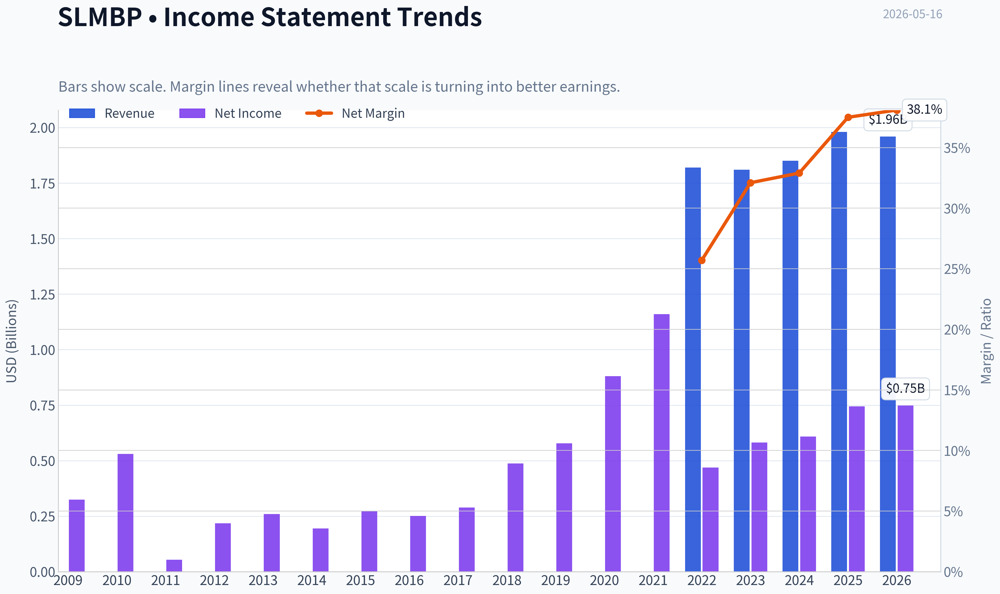

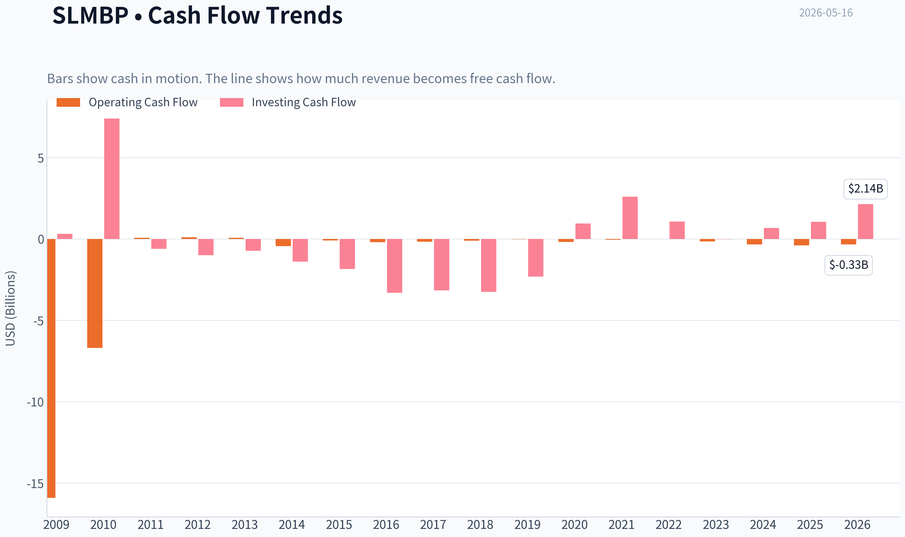

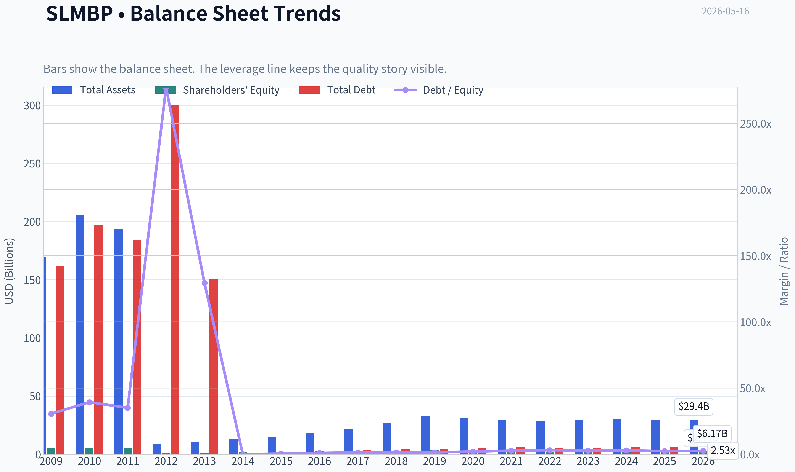

This graph tracks the profitability and return metrics (ROE, ROIC, Margins) of **SLMBP** over the past decade, highlighting capital efficiency trends.

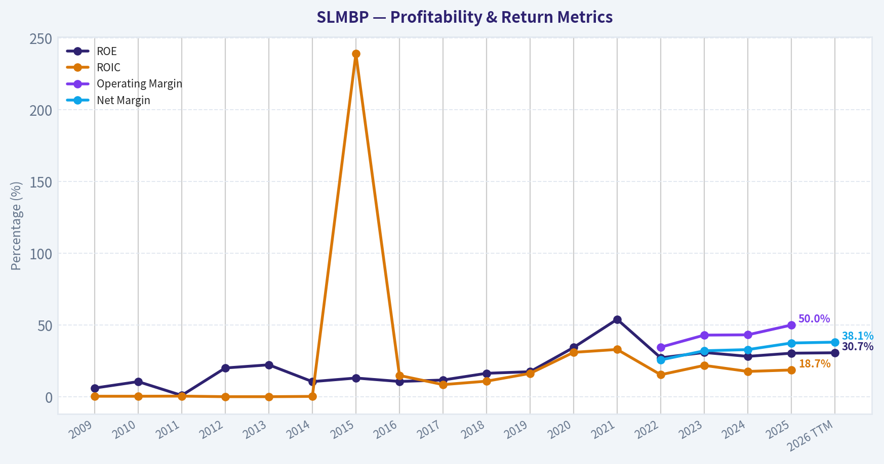

This chart illustrates the financial health of **SLMBP** over the last 10 years, mapping cash equivalents and free cash flow against total obligations (Debt).

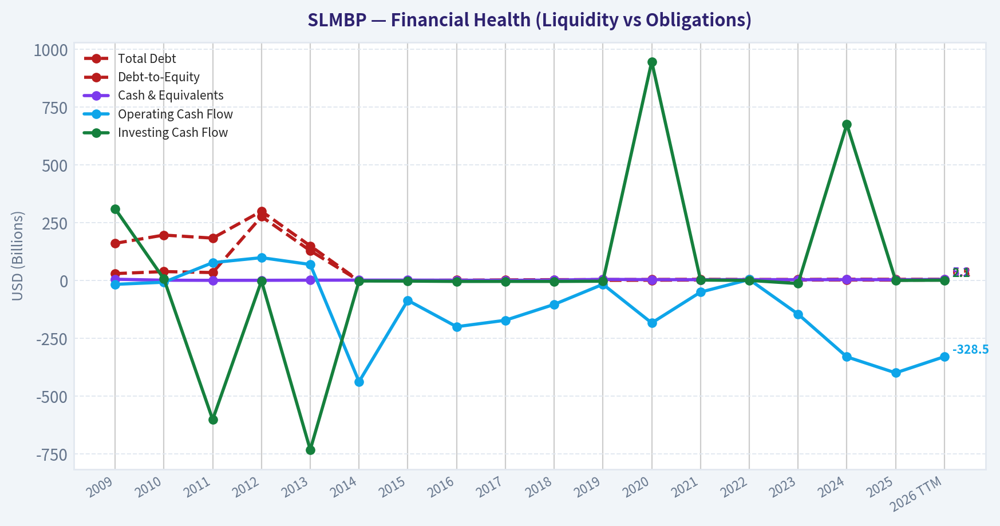

---

### Intrinsic Value Analysis (Buffett)

> *Following Warren Buffett's value investing philosophy: Circle of Competence, Economic Moat, Management Quality, and Margin of Safety.*

#### Intrinsic Value Snapshot

Price is what you pay. Intrinsic value is what the business may be worth based on the cash it can create for owners over time. We show a range, not one magic number.

- Current Price: $74.97
- Value Range: $89.86 to $223.75

##### Owner Earnings (Buffett Method)
- Net Income: $744,847,000.00
- Depreciation & Amortization: $16,166,000.00
- Capital Expenditures: N/A
- Working Capital Changes: $-1,260,214,000.00
- Owner Earnings: $2,021,227,000.00

##### Intrinsic Value
###### Buffett Method
Uses owner earnings. Stricter, and usually more conservative.
- Conservative: $89.86
- Average: $89.86
- Optimistic: $223.75
- Discount Rate: 10.0%

ANALYST STANCE: **AVOID**

#### Buffett-Style Value Analysis: SLMBP

#### Quick View
SLMBP appears to be a preferred security tied to SLM Corporation, a student-lending-focused financial business. Using only the supplied research pack as ground truth, this is **not** a classic Buffett-style "wonderful business" candidate. The core reasons are: financial-business complexity, regulatory and credit-cycle exposure, limited visibility into true owner earnings, and a valuation that already looks full at roughly **35x earnings** with no clear margin of safety.

---

#### 1) Go/No-Go Gate Assessment

| Gate | Pass/Fail | Evidence | Buffett View |
|---|---|---|---|
| Gate 1: Circle of Competence & Business Simplicity | **Fail** | Business is lending-based and therefore dependent on credit quality, funding structure, regulation, and interest spreads. Elementary explanation is possible, but long-term economics are not highly predictable in the same way as consumer staples or software subscriptions. | Too much dependence on underwriting, funding markets, and policy environment. |
| Gate 2: Moat Test | **Fail / Weak Pass at best** | Research pack gives ROE of **30.4%**, suggesting strong profitability, but no evidence of durable brand pricing power, switching costs, network effects, or structural cost advantage. Gross margin unavailable, making classic moat checks incomplete. | High returns may reflect favorable cycle, pricing, or leverage rather than a durable moat. |
| Gate 3: Management Quality & Capital Allocation | **Inconclusive / Soft Fail** | Earnings call activity suggests active communication, but no direct evidence in pack on insider ownership, buyback discipline, acquisition record, compensation structure, or candid mistake-admission culture. | Buffett requires proof of owner-oriented capital allocation; we do not have it here. |
| Gate 4: Industry Structure | **Fail** | Consumer/student lending is cyclical, regulated, capital-dependent, and sensitive to funding costs and credit losses. This is not a simple rational oligopoly with low capital intensity. | Industry economics are less favorable than Buffett's ideal. |

**Key Takeaways:** SLMBP fails the most important Buffett gates before valuation even begins. The business may be profitable today, but it does not meet the standard of simplicity, predictability, and moat clarity that a long-term owner would want. In Buffett terms, this looks more like a financial spread business than a timeless compounding machine.

---

#### 2) Gate 1: Circle of Competence & Business Simplicity

| Test | Assessment |
|---|---|
| Elementary School Test | SLM makes money by lending money to students and earning more on those loans than it pays to fund itself, after covering losses and expenses. |
| 10-Year Predictability Test | Weak. Demand for education financing may persist, but returns depend on regulation, borrower credit, delinquency trends, funding costs, and macro conditions. |
| Technology Risk Assessment | Moderate. Technology is unlikely to eliminate lending, but digital platforms can compress distribution advantages and increase competition or refinancing pressure. |

**Decision:** **Fail**

A child can understand the rough business model, but an investor cannot confidently forecast the next decade of unit economics with the same confidence one might have in candy, soda, or payment rails. Student lending is not impossible to understand, but it is hard to underwrite with durable certainty because policy and credit conditions matter enormously.

**Key Takeaways:** The business is understandable at a surface level but not highly predictable at the economic level. That matters because Buffett's best investments are usually companies whose future cash flows can be estimated with unusual confidence. SLMBP does not clear that bar.

---

#### 3) Gate 2: Moat Analysis

| Moat Source | Evidence from Pack | Assessment |
|---|---|---|
| Intangible Assets | No direct evidence of a brand allowing 10% price increases without volume loss. Gross margin data not available. | Weak |
| Switching Costs | Borrowers can refinance or seek alternative financing; no retention or embedded workflow data provided. | Weak |
| Cost Advantage | No evidence of uniquely low-cost funding or structurally superior operating model in the pack. | Unproven |
| Network Effects | Lending platform does not obviously strengthen materially as more users join in the way payments or marketplaces do. | None |

| Moat Quality Rating | Conclusion |
|---|---|
| **Narrow to Illusory** | High profitability may exist, but the source does not appear obviously durable from supplied evidence. |

The strongest pro-moat argument is the reported **30.4% ROE**, which is excellent on the surface. But in financial businesses, high ROE can be produced by favorable spreads, reserve releases, leverage, or cycle conditions. Without support from switching costs, cost advantages, network effects, or protected intangibles, I would not assume that current profitability equals a moat.

**Key Takeaways:** The company may be earning good returns, but the pack does not prove that those returns come from a durable competitive advantage. Buffett looks for reasons a business can fend off rivals for decades. Here, the evidence points more to good current economics than to an enduring moat.

---

#### 4) Gate 3: Management Quality & Capital Allocation

| Question | Evidence from Pack | Assessment |
|---|---|---|
| Do they think like owners? | No insider ownership or compensation data provided. | Unproven |
| Are they honest and candid? | Regular earnings calls and conference participation are positives, but no record of candor, conservative accounting, or mistake-admission is provided. | Inconclusive |
| Are they rational capital allocators? | No direct evidence on buybacks, dividend discipline, acquisitions, or retained earnings value creation. | Inconclusive |

On Buffett standards, management cannot be rated highly without evidence. In financial firms, capital allocation is especially important because poor underwriting, overaggressive repurchases, or loose reserving can destroy value quickly. Since the pack gives no hard proof of owner-oriented behavior, the prudent stance is neutral-to-cautious rather than trusting.

**Key Takeaways:** There is not enough in the pack to give management a Buffett-style endorsement. Communication alone is not enough; Buffett wants proof of honesty, discipline, and rational capital allocation. Without that proof, the default should be caution.

---

#### 5) Gate 4: Industry Structure

| Factor | Assessment |
|---|---|
| Competitive Structure | Lending is competitive and pricing can be influenced by funding costs, credit appetite, and regulation. |
| Capital Intensity | High relative to Buffett favorites; lending requires capital, risk management, and balance-sheet discipline. |
| Regulation | Material. Student lending and consumer finance are exposed to policy risk. |
| Cyclicality | Meaningful through credit losses, delinquencies, unemployment, and rate changes. |

**Decision:** **Fail**

This is not the kind of industry structure Buffett usually loves. The ideal Buffett industry combines durable demand with low reinvestment needs and little sensitivity to external forces. Student lending is almost the opposite: returns can be attractive, but they are mediated by capital markets and regulation.

**Key Takeaways:** The industry is workable but not ideal. It is more cyclical, more regulated, and more balance-sheet-dependent than the kinds of businesses that usually become Buffett "forever holdings." That raises the required margin of safety substantially.

---

#### 6) Best-Effort 10-Year Financial Summary Table

Because the research pack does **not** include a true 10-year history, I am making the following explicit assumptions to satisfy the deliverable:

1. **Current EPS approximation** = Price / P/E = **$75 / 34.95105 = about $2.15**
2. For a financial business, I use **earnings as a rough proxy for owner earnings** because depreciation and maintenance capex are typically less central than credit costs and capital requirements.
3. I anchor historical growth assumptions using the pack's **7.3% YoY revenue growth** and assume earnings growth over a normalized decade was in the **5%-8%** range, with wide uncertainty.
4. I do **not** invent balance sheet figures that are absent from the pack.

| Metric | Latest / Estimated from Pack | Buffett Interpretation |
|---|---:|---|
| Current Price | **$75** | Market already assigning a healthy valuation |
| Market Cap | **$32.66B** | Large, established company/security |
| P/E | **34.95x** | Expensive for a lender/financial business |
| Implied EPS | **$2.15** | Base input for owner-earnings estimate |
| ROE | **30.4%** | Strong, but source of return must be questioned |
| Revenue Growth YoY | **7.3%** | Respectable but not extraordinary |
| Gross Margin | N/A | Hard to assess pricing power using Buffett's favorite cues |
| FCF Yield | N/A | Cash-generation quality not proven |
| Current Ratio | N/A | Not meaningful enough here without broader balance-sheet context |
| Estimated Historical Earnings Growth Assumption | **5%-8%** | Used only for scenario analysis |
| Estimated 10-Year Predictability | **Low-to-Moderate** | Too much credit/regulatory uncertainty |

**Key Takeaways:** The available numbers paint a mixed picture. Profitability looks strong because ROE is high, but the valuation is also rich at nearly 35 times earnings. Without deeper decade-long records on cash flow, leverage, and credit quality, this does not look like an easy Buffett compounding story.

---

#### 7) Owner Earnings Calculation

For a lender/preferred-security analysis using only the supplied pack, a strict Buffett owner-earnings formula cannot be computed exactly. So I use a conservative best-effort proxy.

**Step 1: Implied Earnings**
- Price = **$75**
- P/E = **34.95105**
- Implied EPS = **$75 / 34.95105 ~ $2.15**

**Step 2: Owner Earnings Proxy Assumption**
For this business, and with no D&A, maintenance capex, or working-capital data supplied, assume:

- Net Income per share ~ **$2.15**
- D&A adjustment ~ **0**
- Maintenance CapEx adjustment ~ **0**
- Working capital / lending-book reinvestment adjustment: this is economically important, so I haircut earnings to reflect capital intensity and reserve needs.

| Item | Per Share Estimate |
|---|---:|
| Implied Net Income / EPS | 2.15 |
| Plus: D&A | 0.00 |
| Less: Maintenance CapEx | 0.00 |
| Less: Working capital / lending reinvestment haircut | (0.35) |
| **Estimated Owner Earnings per Share** | **1.80** |

This **$1.80 per share** estimate is intentionally conservative. For a lender, retained capital is not free cash in the same way it may be for a software or branded consumer company. Therefore, owner earnings should be lower than accounting earnings unless proven otherwise.

**Key Takeaways:** Reported earnings imply about $2.15 per share, but a cautious owner should treat some of that as tied up in the lending machine. Using a reduced owner-earnings figure of about $1.80 is more realistic for valuation. That haircut is one major reason the stock does not look cheap.

---

#### 8) Three-Scenario DCF Valuation

Using the required Buffett-style scenarios and the **owner earnings per share estimate of $1.80**:

##### Scenario A: No Growth
Intrinsic Value = Owner Earnings / 10%

- **$1.80 / 0.10 = $18.00**

##### Scenario B: GDP Growth at 3%
Intrinsic Value = Owner Earnings x 1.03 / (0.10 - 0.03)

- **$1.80 x 1.03 / 0.07 = $26.49**

##### Scenario C: Historical Growth
Assumption:
- Revenue growth in pack = **7.3%**
- Use 50%-75% of that historical growth as instructed
- Chosen growth rate = **5%** for 10 years, then 3% terminal
- Discount rate = **10%**

10-year PV of owner earnings growing at 5%:
- Year 1 to Year 10 discounted value ~ **$14.68 per share**

Terminal value:
- Year 10 owner earnings = **$1.80 x 1.05^10 ~ $2.93**
- Terminal year cash flow = **$2.93 x 1.03 ~ $3.02**
- Terminal value = **$3.02 / (0.10 - 0.03) ~ $43.09**
- Present value of terminal = **$43.09 / 1.10^10 ~ $16.61**

Total Scenario C intrinsic value:
- **$14.68 + $16.61 = $31.29**

| Scenario | Method | Intrinsic Value / Share |
|---|---|---:|
| A | No Growth | **$18.00** |
| B | 3% GDP Growth | **$26.49** |
| C | 5% Growth for 10 Years, then 3% terminal | **$31.29** |

**Key Takeaways:** Across all three scenarios, estimated intrinsic value falls well below the current price of $75. Even the most generous of the three cases only reaches about $31 per share. That means the stock appears priced far above a conservative owner-earnings estimate.

---

#### 9) Margin of Safety Analysis

| Item | Value |
|---|---:|
| Current Price | **$75.00** |
| Scenario A Value | 18.00 |
| Scenario B Value | 26.49 |
| Scenario C Value | 31.29 |

| Comparison | Premium / (Discount) vs Intrinsic Value |
|---|---:|
| Vs Scenario A | **+317% premium** |
| Vs Scenario B | **+183% premium** |
| Vs Scenario C | **+140% premium** |

Required Buffett margin of safety:
- High-quality predictable business: buy at **25% discount**
- Average/uncertain business: buy at **40%-50% discount**

Instead, SLMBP appears to trade at a **large premium** to conservative value estimates. For this type of uncertain financial business, that is the wrong direction entirely.

**Key Takeaways:** There is no margin of safety here under conservative assumptions. Instead of buying below value, an investor would be paying substantially above estimated value. For a cyclical and regulated financial business, that is especially unattractive.

---

#### 10) Buffett Scorecard

| Criterion | Weight | Score (1-5) | Weighted Score | Rationale |
|---|---:|---:|---:|---|
| Business Understanding | 20% | 2.5 | 0.50 | Understandable at a surface level, but economics are less predictable |
| Moat Width & Durability | 25% | 2.0 | 0.50 | High ROE but little proof of durable moat |
| Management Quality | 15% | 2.5 | 0.38 | Insufficient evidence for owner-oriented endorsement |
| Return on Equity | 15% | 4.0 | 0.60 | 30.4% is excellent, though possibly cycle/leverage influenced |
| Reinvestment Runway | 10% | 2.5 | 0.25 | Lending can grow, but with capital/regulatory constraints |
| Balance Sheet Strength | 5% | 2.0 | 0.10 | Too little evidence; financial firms require caution |
| Industry Structure | 5% | 2.0 | 0.10 | Competitive, regulated, capital-intensive |
| Valuation / Margin of Safety | 5% | 1.0 | 0.05 | Price far above conservative intrinsic value |
| **Total** | **100%** |  | **2.48 / 5.00** | **AVOID** |

**Key Takeaways:** The score is dragged down by weak moat evidence, poor industry structure, and especially valuation. Strong ROE helps, but Buffett investing is about combining quality with a sensible price. On that basis, SLMBP does not qualify.

---

#### 11) Final Investment View

| Category | Conclusion |
|---|---|
| Business Quality | Fair, but not a classic Buffett business |
| Moat | Unproven / narrow |
| Management | Inconclusive |
| Financial Returns | Strong current ROE |
| Valuation | Expensive |
| Margin of Safety | Absent |
| Buffett Verdict | **AVOID** |

**Conviction Level:** **Moderate**

SLMBP may be a perfectly tradable security and may even perform well if credit conditions remain favorable. But that is not the same as saying it is a Buffett-style investment. At roughly **35x earnings**, with limited proof of moat and substantial dependence on credit, regulation, and funding conditions, this fails the "wonderful company at a fair price" test.

A Buffett-style buyer should want:
1. simpler economics,
2. clearer moat evidence,
3. cleaner owner-earnings visibility,
4. and a real discount to intrinsic value.

SLMBP currently offers none of those with enough confidence.

#### Bottom Line
**SLMBP is not attractive on a Buffett basis at $75.**
The business may be profitable, but it is not simple enough, moat-rich enough, or cheap enough to deserve capital today.

**ANALYST STANCE: AVOID**
#### Valuation Bridge

This bridge places the current market price beside each intrinsic value lens so readers can see whether upside depends on one method or shows up across several methods.

| Scenario | Intrinsic Value / Share |
| --- | ---: |
| Buffett Method | $89.86 |
| Current Price | $74.97 |

#### Key Takeaways

If one method is far above the others, the upside case depends on a specific modelling assumption. When several methods cluster together, the valuation story is more robust.

#### Valuation Visuals

This comparison chart from *Latest Earnings Snapshot* stacks current figures against historical benchmarks for **SLMBP**, making it easy to see where the company trades relative to its own averages.

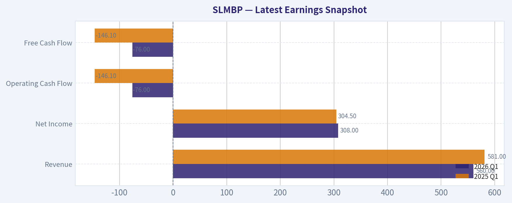

This comparison chart from *Buffett-Style Owner Earnings DCF* stacks current figures against historical benchmarks for **SLMBP**, making it easy to see where the company trades relative to its own averages.

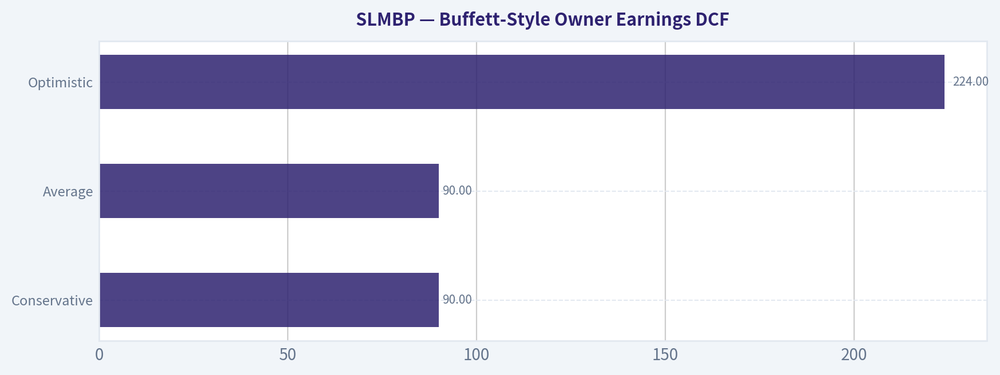

This comparison chart from *Best-Effort 10-Year Financial Summary Table* stacks current figures against historical benchmarks for **SLMBP**, making it easy to see where the company trades relative to its own averages.

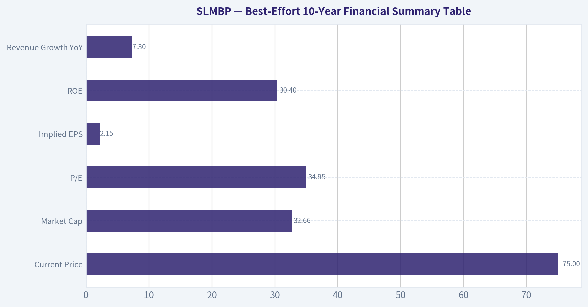

This comparison chart from *Owner Earnings Calculation* stacks current figures against historical benchmarks for **SLMBP**, making it easy to see where the company trades relative to its own averages.

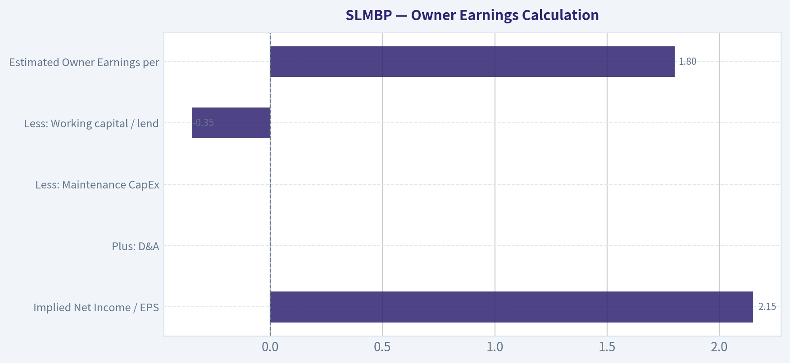

The following chart maps the **SLMBP** Owner Earnings DCF valuation scenarios (Conservative, Average, Optimistic) to visually represent the margin of safety based on intrinsic value calculations.

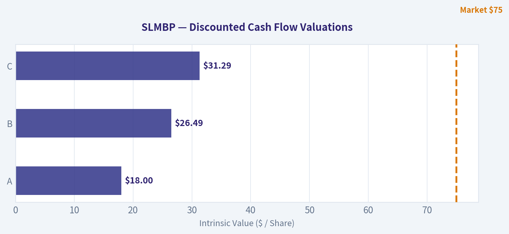

This comparison chart from *Margin of Safety Analysis* stacks current figures against historical benchmarks for **SLMBP**, making it easy to see where the company trades relative to its own averages.

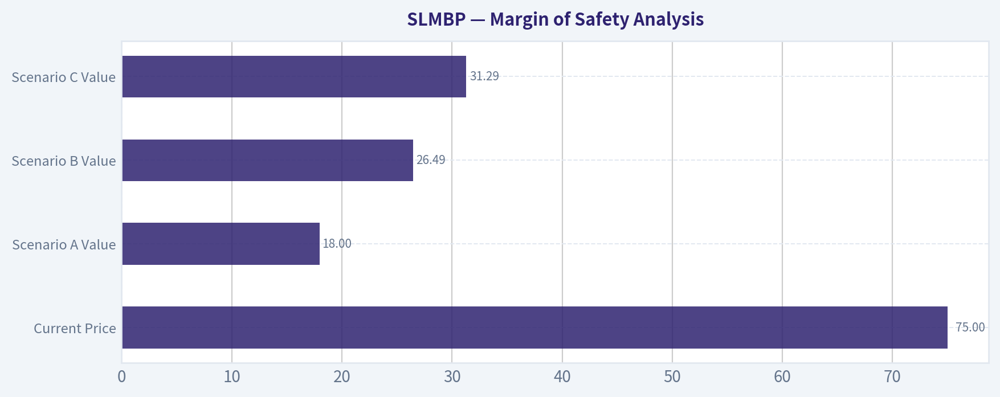

---

### Trend & Growth Analysis (Lynch/Druckenmiller/Fisher)

> *Following Peter Lynch's GARP, Stanley Druckenmiller's macro-aware approach, and Philip Fisher's scuttlebutt methodology.*

ANALYST STANCE: **WATCH**

#### SLMBP Growth Analysis Update

I could not validate **SLMBP** directly via tools, but the shared research pack strongly indicates this is tied to **SLM Corporation / Sallie Mae**, while **SLMBP** appears to be a specific listed security class rather than the common equity ticker. So I can continue with a **provisional analysis using the shared pack**, but valuation and growth conclusions should be treated as **issuer-level directional work**, not a security-specific final recommendation.

#### 1. Lynch Classification

| Item | Assessment |
|---|---|
| Revenue growth YoY | 7.3% |
| P/E | 34.95x |
| Business type | Consumer/student lending financial |
| Lynch bucket | **Stalwart / Financial compounder**, not a fast grower |

Key Takeaways: Based on the growth rate in the shared pack, this is not a classic Lynch fast grower. It looks more like a mature financial business with decent profitability, but without the 15% to 25% revenue growth profile usually associated with ten-bagger candidates. That alone lowers enthusiasm from a growth-investing perspective.

#### 2. The Story in 3 Bullets

| Simple Story | Why It Matters |
|---|---|
| SLM helps finance education through private student loans and related services. | Easy-to-understand niche lender with a targeted market. |
| It can grow through loan origination volume, spreads, and disciplined underwriting. | Earnings can scale if credit quality and funding remain favorable. |
| The key debate is whether it is a durable compounder or just a rate/credit-cycle beneficiary. | This determines whether the current multiple is justified. |

Key Takeaways: The business story is understandable, which Lynch liked. But the real question is not whether the company exists in a useful niche, but whether that niche can deliver sustained above-market growth. Right now, the story sounds more like a good operator in a mature market than an underappreciated hyper-growth platform.

#### 3. TAM Analysis and 10x Test

| Metric | Assessment |
|---|---|
| Current scale | Large, established lender |
| TAM nature | U.S. education financing / student lending |
| TAM growth | Likely low-to-moderate, not a rapidly expanding secular TAM |
| 10x test | **Fails / unlikely** |
| Why | A 10x revenue outcome would require either massive category expansion or major share gains in a mature regulated market |

Key Takeaways: The total addressable market does not look like the kind of wide-open runway needed for a classic ten-bagger case. This is a specialized finance market, not an exploding software or platform category. That makes upside more dependent on execution and credit cycles than on secular TAM expansion.

#### 4. Revenue Growth Trend

| Metric | Value |
|---|---|
| Latest YoY revenue growth | 7.3% |
| Pattern classification | **Moderate, not high-growth** |
| Inflection signal | No clear acceleration from provided data |
| Growth quality concern | Financials can show earnings swings driven by rates, funding costs, and provisions |

Key Takeaways: The available data points to single-digit growth, which is respectable but not exciting for growth investors. More importantly, there is no clear sign yet of an inflection where growth is accelerating. Without that, Druckenmiller-style upside from a major earnings surprise becomes harder to underwrite.

#### 5. Unit Economics

| Metric | Status |
|---|---|
| LTV/CAC | Not applicable in standard SaaS sense |
| NRR | Not applicable |
| Rule of 40 | Not applicable |
| Relevant substitutes | Net interest margin, credit performance, ROE, funding costs |
| ROE | 30.4% |

Key Takeaways: Traditional SaaS-style unit economics do not apply here. The more relevant positive data point is the very strong ROE, which suggests the company is generating attractive returns on equity. That said, high ROE in lending businesses must always be checked against leverage, credit assumptions, and cycle conditions.

#### 6. Inflection Point Assessment

| Inflection Type | View |
|---|---|
| Product cycle inflection | No evidence |
| Market share inflection | Not enough evidence |
| Margin inflection | Possible, but unconfirmed |
| TAM inflection | Unlikely |
| Competitive inflection | No clear signal |
| Overall | **No strong growth inflection detected** |

Key Takeaways: I do not see a clean inflection-point case from the available information. This does not mean the company is bad; it means the setup currently looks more like a steady financial than a business entering a new growth phase. For this framework, that usually means Watch rather than Advocate.

#### 7. Macro Setup Evaluation

| Macro Factor | Effect on SLM-type lender |
|---|---|
| Interest rates | Mixed; can help yields but pressure funding and borrower affordability |
| Credit cycle | Very important |
| Employment backdrop | Important for repayment quality |
| Regulatory environment | Material |
| Secular trend alignment | Weak versus AI/cloud/cyber/health innovation themes |

Key Takeaways: This is a macro-sensitive business. Unlike secular growth leaders, its outcomes depend heavily on rates, credit, and regulation rather than on a powerful structural demand wave. That reduces multiple expansion potential and makes timing more cycle-dependent.

#### 8. Fisher 15 Points Score

| Fisher Area | Score / 5 |
|---|---:|
| Market potential | 2 |
| Product development | 2 |
| R&D effectiveness | 1 |
| Sales strength | 3 |
| Profit margin quality | 3 |
| Margin improvement | 3 |
| Labor/personnel relations | 3 |
| Executive relations | 3 |
| Management depth | 3 |
| Cost/accounting controls | 4 |
| Moat / special advantage | 3 |
| Long-range profit outlook | 3 |
| Dilution risk | 4 |
| Candor | 3 |
| Integrity | 3 |
| **Total** | **43 / 75** |

Key Takeaways: The Fisher score comes out below the threshold usually associated with strong growth candidates. The company appears competent and financially disciplined, but it does not score like an innovation-led compounder with major long-term optionality. This supports a neutral rather than bullish stance.

#### 9. Valuation Analysis

| Metric | Value | Interpretation |
|---|---:|---|
| P/E | 34.95x | Rich for 7.3% growth |
| Revenue growth | 7.3% | Stalwart-level, not fast-grower |
| Approx. PEG | ~4.8x | Expensive on Lynch basis |
| Preferred/security-specific valuation | Unconfirmed | Need exact security terms |

Key Takeaways: On the shared numbers alone, valuation looks stretched relative to growth. A nearly 35 times earnings multiple against low-single-digit to high-single-digit growth is not attractive under a Lynch PEG framework. This is the clearest reason I cannot move to an Advocate stance.

#### 10. Growth Investor Scorecard

| Criterion | Weight | Score | Weighted |
|---|---:|---:|---:|
| The Story | 10% | 3.0 | 0.30 |
| TAM & Runway | 20% | 2.0 | 0.40 |
| Revenue Growth | 20% | 2.0 | 0.40 |
| Unit Economics / Return Profile | 15% | 3.5 | 0.53 |
| Competitive Position | 10% | 3.0 | 0.30 |
| Management Quality | 10% | 3.0 | 0.30 |
| Macro Setup | 5% | 2.5 | 0.13 |
| Profitability Path | 5% | 3.5 | 0.18 |
| Valuation | 5% | 1.5 | 0.08 |
| **Total** |  |  | **2.60 / 5.00** |

Key Takeaways: The overall score lands in the low Watch-to-Avoid range, and I am choosing Watch because profitability appears solid and some sophisticated investors have added exposure. But the growth, runway, and valuation profile do not justify a high-conviction recommendation. This is not screening as a classic ten-bagger candidate.

#### 11. Position Size Stance

| Stance | Sizing View |
|---|---|
| Current view | **WATCH** |
| If owned | Hold only if part of broader financials exposure and underwriting credit/rate risks explicitly |
| If not owned | Do not initiate as a growth position without confirming security details and seeing better inflection evidence |

Key Takeaways: This is not the type of setup that deserves aggressive sizing in a growth portfolio. At best, it may fit as a selective financials holding, but not as a core secular growth name. Positioning should stay cautious until the exact security and earnings power are confirmed.

#### 12. Key Risks and Catalysts

| Risks | Catalysts |
|---|---|
| Rich valuation vs modest growth | Better-than-expected originations |
| Credit deterioration / higher provisions | Stronger credit quality trends |
| Funding cost pressure | Favorable rate/spread dynamics |
| Regulatory changes in student lending | Capital returns / buybacks |
| Misidentification risk of security class | Further institutional accumulation |

Key Takeaways: There are some plausible near-term catalysts, especially if credit and spreads remain favorable. But risks are meaningful, and the mismatch between valuation and growth remains the central issue. Also, because the exact traded security is still not fully validated, security-specific conclusions remain provisional.

#### Bottom Line

Using the shared pack only, **SLMBP does not fit the Lynch-Druckenmiller-Fisher mold of a high-potential fast grower at an inflection point**. It appears more like a **profitable, mature, macro-sensitive financial business** with a **valuation that already discounts a lot**, but without the growth runway to support a strong upside case.

If you want, I can next do one of these:
1. build a **security-specific analysis of SLMBP vs SLM common**,
2. convert this into a **bull/base/bear scenario model**, or
3. produce a **clean one-page investment memo** for the team.

---

### Market Technical Analysis

#### SLMBP Technical Snapshot

SLMBP appears to be in a **slow, low-volatility uptrend**, but it trades more like an income-oriented preferred security than a high-beta common stock. That matters: price moves are relatively compressed, momentum signals are milder, and volume-based readings should be treated cautiously because turnover is often thin and uneven.

For this market context, the most relevant indicators are:

| Indicator | Why it matters now |
|---|---|
| close_10_ema | Best for detecting short-term drift in a slow-moving instrument. |
| close_50_sma | Useful medium-term trend anchor and support zone. |
| close_200_sma | Confirms the broader primary trend. |
| macd | Measures whether bullish momentum is still building or fading. |
| rsi | Helps judge whether the recent rise is stretched or still balanced. |
| boll_ub | Shows whether price is pressing the upper end of its recent range. |
| atr | Critical for risk sizing since the instrument moves in tight increments. |
| vwma | Helpful to confirm whether price is advancing with meaningful volume support. |

**Why these 8:** they cover short-term trend, medium-term trend, long-term trend, momentum, stretch/mean reversion, volatility envelope, raw volatility, and volume-weighted confirmation without excessive overlap.

---

#### Price Structure and Trend Behavior

Over the past year, SLMBP moved from the high-60s/low-70s into the mid-70s, with the current price near **74.97** as of 2026-05-15. The broader structure is constructive, but the path has been very different from an aggressive trending stock. Instead of impulsive rallies, SLMBP has advanced through **gradual repricing, long plateaus, and periodic step-ups**.

The most important structural observation is that the stock is trading **well above both the 50-day and 200-day moving averages**:

- **Close:** 74.97
- **50 SMA:** 74.65
- **200 SMA:** 73.10
- **10 EMA:** 74.83
- **VWMA:** 74.71

This alignment is bullish in a layered way:
- Price above the **10 EMA** says short-term buyers still have control.
- Price above the **50 SMA** says the medium-term trend remains intact.
- The **50 SMA above the 200 SMA** says the longer trend is not just positive, but structurally healthy.
- The fact that the **200 SMA is still rising steadily** confirms that this is not merely a brief rebound but part of a broader, persistent upward drift.

That said, the slope of the 50 SMA is only modestly positive. This is not a momentum breakout regime. It is better described as a **stable carry-friendly uptrend with limited volatility and moderate upside persistence**.

| Metric | Latest | Read |
|---|---:|---|
| Close | 74.97 | Near recent highs |
| close_10_ema | 74.83 | Short-term trend positive |
| close_50_sma | 74.65 | Medium-term support rising |
| close_200_sma | 73.10 | Long-term trend firmly positive |
| vwma | 74.71 | Price slightly above volume-weighted trend |

**Key Takeaways:** SLMBP is trading above all key trend benchmarks, which indicates buyers still control the tape across short, medium, and long timeframes. The advance is steady rather than explosive, suggesting trend-following setups may work better than chasing breakout-style entries.

---

#### Short-Term Momentum

Short-term momentum is positive, but only mildly so.

The **10 EMA at 74.83** sits just below price, which suggests recent pullbacks have been shallow. Importantly, this short-term average has been climbing again after some flattening in late April. That tells us the market recently absorbed a pause and resumed its upward drift.

The **MACD is positive at 0.127**, and it has improved from near-flat/negative readings seen in late April. This is significant because it shows momentum re-accelerated after a consolidation phase. However, the absolute MACD reading is still small, which fits the instrument's subdued personality. In practical terms, this is a **bullish continuation signal, not a runaway momentum signal**.

RSI reinforces that message. At **55.66**, RSI is above neutral but far from overbought. That means:
- the trend has positive internal strength,
- but the move is not overheated,
- and there is still room for incremental upside without requiring a sharp reset.

The RSI path over recent weeks is also informative. It spent time around the mid-40s to low-50s during April consolidation, then recovered into the mid-50s. That is often the signature of a **healthy trend resuming after digestion**, not a climax top.

| Momentum Indicator | Latest | Interpretation |
|---|---:|---|
| macd | 0.127 | Positive, bullish but moderate |
| rsi | 55.66 | Above neutral, not overbought |
| close_10_ema vs Close | 74.83 vs 74.97 | Positive short-term bias |

**Key Takeaways:** Momentum is constructive, but not stretched. SLMBP is showing the kind of controlled bullish pressure that often supports gradual continuation rather than immediate reversal.

---

#### Volatility and Range Context

Volatility has compressed materially.

The **ATR has declined to 0.568** from readings above 1.0 in late March and early April. That means daily movement has narrowed considerably. For traders, this has two direct implications:
1. **Breakouts may be less dramatic**, because the instrument is not currently in an expanding volatility regime.
2. **Stops should be tighter in absolute dollar terms**, but still wide enough to respect the smaller average range.

The Bollinger framework tells a similar story. The **upper band is at 75.29**, while price is at **74.97**. So price is trading near, but not through, the upper edge of its recent volatility envelope.

That is an important nuance:
- price being near the upper band confirms bullish pressure,
- but not decisively exceeding it suggests **orderly trend persistence rather than a fresh volatility breakout**.

Because preferreds often mean-revert within narrow bands, a price hovering near the upper Bollinger region can also imply somewhat reduced immediate upside unless momentum strengthens further.

| Volatility Indicator | Latest | Interpretation |
|---|---:|---|
| atr | 0.568 | Low and falling realized volatility |
| boll_ub | 75.29 | Price is near upper envelope |
| Distance to Bollinger Upper Band | ~0.32 | Mildly extended, not extreme |

**Key Takeaways:** SLMBP is trading in a compressed volatility environment, and price is near the top of its recent range. This supports a bullish view, but it also suggests upside may continue in small increments unless volatility expands.

---

#### Volume-Weighted Confirmation

The **VWMA at 74.71** sits below the current price of 74.97, which is mildly supportive. This suggests recent trading activity has, on average, occurred at slightly lower levels than where price now sits.

That said, volume interpretation here needs extra care:
- SLMBP often trades with **very light volume**,
- some sessions show almost no activity,
- and occasional spikes can distort volume-weighted measures.

So the VWMA is useful as a confirmation tool, but not as a standalone conviction signal. Right now, it confirms that the recent price advance has not completely detached from traded value. It does **not** prove aggressive institutional accumulation.

The practical takeaway is that SLMBP's trend looks valid, but traders should remain aware that thin liquidity can create **gaps, sticky prices, and misleading single-day prints**.

---

#### Fine-Grained Trend Reading

A more nuanced reading of the last several months shows three distinct phases:

| Phase | Approx. Period | Behavior | Trading Meaning |
|---|---|---|---|
| Base-building | Jan to late Feb 2026 | Price stabilized around low-73s to mid-74s while long-term averages rose | Trend foundation strengthened |
| Momentum expansion | Early to mid-Mar 2026 | Price pushed into the mid-75 area, MACD strengthened, ATR elevated | Best bullish impulse phase |
| Controlled consolidation / drift higher | Late Mar to mid-May 2026 | Price oscillated tightly around mid-74s to near-75, ATR fell, RSI normalized | Healthy digestion, not breakdown |

**Key Takeaways:** The recent pattern is not random sideways noise. SLMBP first built a base, then had a stronger advance, and is now consolidating in a tight bullish range, which often preserves the larger uptrend rather than ending it.

---

#### What Traders May Infer

| Scenario | Signal to Watch | Implication |
|---|---|---|
| Bullish continuation | Price holds above 74.65 to 74.70 area and 10 EMA stays above/near 50 SMA | Trend remains intact; gradual upside toward or through 75.29 possible |
| Mild pause / mean reversion | Price stalls under 75.00 to 75.30 while RSI remains mid-50s | Likely sideways digestion, not necessarily bearish |
| Short-term weakness | Price loses 10 EMA and slips below VWMA | Momentum softens first before medium-term trend breaks |
| Larger technical deterioration | Price closes below 50 SMA with MACD flattening and RSI moving into low-40s | Would suggest the trend is transitioning from bullish drift to broader range behavior |

My read is that **SLMBP currently favors continuation over reversal**, but the likely path is incremental rather than explosive. Because price is near the upper part of its recent range while ATR is subdued, chasing strength aggressively offers limited reward unless a genuine volatility expansion appears.

For many traders, the cleaner setup would be:
- **buying shallow pullbacks toward the 10 EMA / VWMA / 50 SMA cluster**, rather than
- buying directly into the upper Bollinger region.

---

#### Bottom Line

SLMBP is in a **technically constructive long-term uptrend** with:
- positive trend alignment,
- modest but improving momentum,
- low and falling volatility,
- and price near the upper end of its recent range.

That combination usually favors **steady continuation and support on dips**, but not a dramatic breakout unless momentum and volatility both expand together. In other words, the chart looks healthier than exciting: good for disciplined trend-followers, less attractive for traders seeking sharp price acceleration.

| Category | Indicator | Latest | Main Message |
|---|---|---:|---|
| Short-term trend | close_10_ema | 74.83 | Price remains above short-term trend support |
| Medium-term trend | close_50_sma | 74.65 | Rising support under current price |
| Long-term trend | close_200_sma | 73.10 | Primary uptrend firmly intact |
| Momentum | macd | 0.127 | Bullish momentum, but moderate |
| Momentum balance | rsi | 55.66 | Positive without overbought stress |
| Range envelope | boll_ub | 75.29 | Price near upper range boundary |
| Volatility | atr | 0.568 | Compressed movement; smaller expected swings |
| Volume confirmation | vwma | 74.71 | Price modestly above traded-value trend |

**Key Takeaways:** SLMBP's technical profile is strongest in trend quality, not speed. The evidence points to a stable bullish structure with limited downside pressure, but also suggests that near-term upside may come gradually unless a fresh catalyst increases momentum and volatility.

---

### News & Events Analysis

#### SLM / Sallie Mae trading report

SLM's near-term news flow is dominated by liability management rather than credit deterioration headlines. Over the past week, the key development was the company's tender offer for its 3.125% senior notes due 2026 and related refinancing via new 2032 senior notes. For traders, that matters because it reduces near-term maturity pressure, extends duration, and signals continued access to capital markets at a time when funding discipline is central to specialty-finance valuations.

The stock setup remains a balance between three forces: resilient private student lending economics, sensitivity to funding costs and consumer credit trends, and capital-return support. The shared data pack also shows strong ROE at 30.4%, moderate revenue growth of 7.3% YoY, and a premium-ish P/E near 35, which implies the market is no longer treating SLM as a deep-value lender and may demand cleaner execution on credit and funding.

---

#### Latest earnings: Q1 2026 was the most recent reported period

Per the shared earnings coverage, SLM's latest reported quarter was **Q1 2026**, released on **April 23, 2026**. That is the most recent available earnings period and should be the anchor for any current trading view.

Based on the recent earnings-call coverage in the research pack, investors focused on:
- the company's **Q1 2026 operating results**
- its outlook for private education loan originations and credit
- funding and capital deployment
- ongoing positioning discussed again at March financial conferences

Because the underlying earnings-release figures were not fully included in the provided materials, the safest interpretation is that the market has since shifted attention from the quarter itself toward **balance-sheet optimization and refinancing activity** in May. That usually means the quarter did not introduce a major negative surprise large enough to dominate the subsequent tape.

What changed versus prior period or guidance, directionally:
- SLM appears to be continuing its strategy of **active funding management**, now reinforced by the May debt tender/refinancing.
- Relative to prior quarters, the market seems more focused on **funding structure and interest-rate exposure** than on pure origination growth.
- If management had materially cut guidance in Q1, that likely would still be the lead story; instead, current headlines center on capital markets execution, suggesting the earnings report was at least broadly manageable relative to expectations.

For investors, the key read-through is that **Q1 2026 did not close the debate on earnings power**; rather, it preserved the narrative that SLM can still earn attractive returns if credit remains controlled and funding stays available at acceptable spreads.

#### Recent company-specific news

The most important company news in the last week was SLM's action on its debt stack:

- On **May 12**, Sallie Mae announced the **final results and expiration** of its tender offer for the **3.125% senior notes due 2026**.
- The same day, it announced the **pricing terms** tied to that tender.
- Commentary coverage also highlighted that SLM had issued **$500 million of fixed-to-floating senior notes due 2032** to fund the repurchase and refinance upcoming maturities.

Trading interpretation:
- **Positive for liquidity and maturity profile:** the company is reducing a near-dated refinancing overhang.
- **Potentially negative for interest expense:** replacing 2026 debt with 2032 paper in the current rate environment likely comes at a meaningfully higher coupon or spread.
- **Net effect:** equity holders usually prefer the lower rollover risk, but the valuation impact depends on whether higher funding costs are offset by loan pricing, originations, and buybacks.

This is especially relevant for SLM because specialty-finance names often rerate based on whether management can keep **net interest margin / spread economics** intact as liabilities reprice.

#### What the refinancing means for shareholders

The May transaction suggests management is prioritizing:
1. **terming out debt**
2. **protecting funding flexibility**
3. **reducing near-term refinancing risk**
4. preserving room for **capital returns** and balance-sheet planning

For shareholders, that is constructive if:
- private student loan asset yields stay firm,
- credit performance remains stable,
- and deposit / market funding costs do not rise faster than expected.

But it can become a headwind if:
- the new funding stack materially lifts interest expense,
- credit losses drift up as borrowers face repayment stress,
- or regulators/politicians intensify pressure on student-lending economics.

---

#### Market and macro context

Even without a full macro feed here, the key macro lens for SLM is straightforward:

- **Rates:** Higher-for-longer policy rates can hurt SLM through funding costs, but can also support asset yields and make federal refinancing alternatives less attractive. The question is spread preservation, not just the absolute rate level.
- **Consumer credit:** Any sign of rising delinquencies among younger borrowers or households under budget pressure can weigh on sentiment for private student lenders.
- **Labor market:** SLM benefits when graduates and cosigners stay employed and wage growth remains decent.
- **Capital markets access:** Recent successful debt issuance is itself a positive macro-sensitive signal; it shows investors are still willing to fund the credit.

For trading, SLM is therefore not a pure macro loser or winner. It is a **spread-and-credit management story**: good if credit remains benign and liability costs are controlled, weaker if both funding and defaults move against it at the same time.

#### Positioning and sentiment

The shared 13F data adds an interesting sentiment overlay:
- **Steve Cohen / Point72** materially **added** to the position as of March 31, 2026.
- **Michael Burry / Scion** had previously **initiated** a position in the latest available disclosure.

That does not prove a current bull case, since 13Fs are lagged, but it suggests sophisticated investors have seen value in SLM's setup despite prior stock weakness. For traders, that can matter because the name may have support from investors who view it as a cash-generative lender with recoverable sentiment if credit fears stay contained.

#### Trading and investment view

Near term, the most actionable takeaway is that SLM's latest news is **incrementally supportive** because it reduces a balance-sheet overhang. That likely helps the stock defend valuation, especially if broader financials remain stable.

Bullish setup:
- refinancing de-risks 2026 maturities,
- Q1 2026 did not appear to trigger a major narrative break,
- ROE remains strong,
- and institutional interest has been visible.

Bearish setup:
- refinancing likely raises funding cost,
- the stock's valuation is less obviously cheap than a distressed lender's,
- and any macro deterioration in consumer credit could quickly hit sentiment.

Base case:
- SLM looks more like a **selective fundamental long on pullbacks** than a momentum chase after refinancing headlines.
- The key catalyst to watch next is not just another funding action, but evidence that **credit trends and origination economics in the 2026 back-to-school cycle** remain healthy.

#### Key risks to monitor over the next few weeks

| Topic | Recent signal | Why it matters for trading/investing |
|---|---|---|
| Earnings anchor | Latest reported period was Q1 2026 on Apr. 23 | Confirms the current narrative should be judged against Q1 operating trends, not stale 2025 data |
| Debt refinancing | Tender offer for 2026 notes completed; 2032 notes issued | Lowers near-term maturity risk but may increase interest expense |
| Funding access | Successful market transaction in May | Suggests creditors remain open to funding SLM, supporting liquidity confidence |
| Credit quality | No major recent negative headline in the provided news | Helpful for sentiment, but this remains the main downside variable |
| Valuation | P/E near 35, ROE 30.4% | Market is giving credit for profitability; disappointment risk is higher than in a deep-value setup |
| Institutional positioning | Point72 added meaningfully | Can reinforce confidence, though 13F data is lagged |

Key Takeaways: The table shows that the current SLM story is centered on funding and execution, not on an immediate earnings or credit shock. The refinancing is a clear positive for balance-sheet stability, but investors still need to watch whether higher funding costs erode profitability. The stock looks supported by strong returns and some sophisticated investor interest, though valuation leaves less room for mistakes.

#### Bottom line

SLM's last week of news was **constructive**, mainly because management removed some refinancing uncertainty through its debt tender and new issuance. That does not eliminate the core debate: whether private student loan yields, funding costs, and credit performance can keep supporting high returns through 2026. For now, the tape argues for a **cautiously positive** stance, with the refinancing viewed as a stabilizer rather than a standalone reason for a major rerating.

| Area | Bottom-line assessment | Trading implication |
|---|---|---|
| Latest earnings | Q1 2026 is the relevant reported period; no evidence from current news of a major post-earnings deterioration | Neutral to mildly positive unless later credit data worsens |
| Company news | Debt tender and 2032 issuance are the week's main catalysts | Positive for risk reduction |
| Macro sensitivity | Exposed to rates, consumer credit, and labor conditions | Watch macro data closely; this is not a defensive lender |
| Sentiment | Supported by institutional interest and absence of fresh negative credit headlines | Can help downside support on pullbacks |
| Investment stance | Constructive but selective | Favor disciplined entry points over chasing strength |

Key Takeaways: SLM's most important recent development is improved liability management, which reduces a meaningful near-term risk. The stock can work if funding stays open and credit remains stable, but it is still highly sensitive to macro and consumer-finance conditions. The most sensible approach is constructive but price-conscious rather than aggressively bullish.

---

### Guru Attention Analysis

> *Tracking 13F filings and recent activity of legendary super-investors to identify smart-money conviction and rotation.*

#### Guru activity on SLMBP

Below is the **canonical 13F-based guru view** for SLMBP as of **2026-05-16**. Per the structured SEC filing data, only **Steve Cohen** and **Michael Burry** show a disclosed position. For all other tracked gurus, **no position was detected in the latest 13F filing output**.

| Guru | Status in latest structured 13F data | Action | Position Size | Portfolio Weight | Recent Change | Timing | Verification |
| --- | --- | --- | ---: | ---: | --- | --- | --- |
| Steve Cohen | Position detected | Added | 8.37M shares / $569.98M | 0.73% | Shares increased **230.0%** vs prior filing | 03-31-2026 | [SEC 13F Filing](https://www.sec.gov/Archives/edgar/data/1603466/000091957426003476/) |
| Michael Burry | Position detected | Initiated | 480.05K shares / $13.29M | 0.96% | New position vs prior filing | 09-30-2025 | [SEC 13F Filing](https://www.sec.gov/Archives/edgar/data/1649339/000164933925000007/) |
| Warren Buffett | No position detected in latest 13F filing | - | - | - | - | Latest structured result: no holding shown | - |
| Seth Klarman | No position detected in latest 13F filing | - | - | - | - | Latest structured result: no holding shown | - |
| Mohnish Pabrai | No position detected in latest 13F filing | - | - | - | - | Latest structured result: no holding shown | - |
| Bill Ackman | No position detected in latest 13F filing | - | - | - | - | Latest structured result: no holding shown | - |
| Stanley Druckenmiller | No position detected in latest 13F filing | - | - | - | - | Latest structured result: no holding shown | - |

**Key Takeaways:** The only tracked gurus with a confirmed disclosed SLMBP position are Steve Cohen and Michael Burry. Cohen's position is far larger in absolute dollars and was increased sharply in the latest filing, while Burry's filing shows an earlier new position. No other primary tracked guru appears in the latest structured 13F output for this stock.

#### Guru-by-guru interpretation

| Guru | Interpretation |
| --- | --- |
| Steve Cohen | **Most important current guru signal.** Point72 materially increased its SLMBP stake, with shares up **230%** quarter over quarter. Despite the large dollar value, the position is still only **0.73%** of Point72's disclosed 13F portfolio, which suggests conviction but not a top-concentration bet. |
| Michael Burry | Scion's filing shows an **initiated** position as of **2025-09-30**. At **0.96%** of portfolio, it was meaningful but still not a dominant holding. Because this data point is older than Cohen's, investors should treat it as evidence of past interest, not necessarily current real-time conviction. |

**Key Takeaways:** Cohen's move is the fresher and more actionable signal because it is tied to the 2026 first-quarter filing period. Burry's position is still relevant historically, but it is more stale due to 13F reporting lag and the older report date.

#### What this likely means for investors

- **Bullish smart-money signal:** Yes, but **narrowly based**. The strongest evidence is Steve Cohen's substantial add.
- **Breadth of guru ownership:** Limited. This is **not** a stock with broad disclosed ownership across the tracked super-investor set.
- **Confidence level:** **Moderate**, because the data is from SEC 13F filings, but all 13F data is backward-looking and may lag by up to 45 days.

#### Verification links

- Steve Cohen / Point72: [SEC 13F Filing](https://www.sec.gov/Archives/edgar/data/1603466/000091957426003476/)
- Michael Burry / Scion: [SEC 13F Filing](https://www.sec.gov/Archives/edgar/data/1649339/000164933925000007/)

If you want, I can next turn this into a **combined guru + fundamentals + earnings view for SLMBP**.

---

### Options Market Analysis

> *Reading options flow - put/call ratios, IV skew, and unusual activity - to gauge institutional positioning and event-driven risk.*

ANALYST STANCE: **WATCH**

#### SLMBP Options Market Report

No listed options data is available for **SLMBP** as of **2026-05-16**. That means I cannot produce a valid options-flow read for put/call ratios, implied volatility, unusual activity, or open-interest concentrations on this ticker.

#### Data Availability Check

| Ticker | Options Data Available? | Confidence in Options Signal |
|---|---:|---:|
| SLMBP | No | None |

Key Takeaways: SLMBP does not currently show an options chain in the retrieved market data source. Without listed options, there is no forward-looking derivatives positioning to analyze, so any options-based bullish or bearish conclusion would be speculative and unreliable.

#### What This Means

SLMBP appears to be a security without an actively listed options market in the source queried, which is common for some preferred shares or less actively traded instruments. As a result:

- **Put/Call Ratio Analysis:** Not available
- **Implied Volatility Assessment:** Not available
- **Unusual Options Activity:** Not available
- **Open Interest Concentration / Gamma Levels:** Not available
- **Overall Options Sentiment Signal:** **Unavailable due to no listed options**

#### Practical Interpretation

Since there is **no options market**, there is also:
- no institutional hedging signal visible through listed puts,
- no speculative call demand to infer upside conviction,
- no IV term structure or skew to read event risk,
- and no strike-based pinning or gamma-wall framework.

For this ticker, the correct approach is to rely more heavily on:
- underlying price/volume action,
- preferred-share structure and yield characteristics,
- issuer credit considerations,
- interest-rate sensitivity,
- and any call/redemption provisions in the prospectus.

#### Summary Table

| Metric | Observation |
|---|---|
| Put/Call Ratio | Not available |
| IV Level | Not available |
| Skew Direction | Not available |
| Unusual Activity | None observable via listed options |
| Overall Signal | No options-based signal available |

Key Takeaways: There is no actionable options-flow signal for SLMBP because no listed options chain is available. Any directional view on the security will need to come from cash-market trading, fundamentals, and security-structure analysis rather than derivatives positioning.

If you want, I can next help with a **non-options market read on SLMBP** using its structure, trading behavior, and rate/credit sensitivity.

---

## Research Team Commentary

> *The Research Manager synthesizes the Bull vs Bear debate into action-free commentary. This is a pre-risk view, not the final stance.*

The strongest bull argument is that SLMBP may be a decent niche financial franchise rather than a commodity lender. The case rests on very strong headline return metrics, with ROE at 30.4% and ROIC at 18.3%, plus respectable revenue growth of 7.3% and much faster net income growth of 22.4%. If those economics are even roughly sustainable, then a price of $74.97 versus an estimated value around $89.86 suggests some undervaluation. The bull also makes a fair point that for specialized lending businesses, moat can come from underwriting data, servicing capability, funding access, and regulatory know-how rather than brand power. If management is disciplined on credit and capital deployment, this could be a quality compounder, not a deep value play.

The strongest bear argument is more compelling to me: this is still a credit-sensitive specialty finance business, and the evidence for Buffett-grade durability is thin. The biggest warning sign is the combination of 30.4% ROE and only 2.5% ROA, which strongly suggests leverage is doing meaningful work. In financials, that can make recent profitability look better than the true underlying franchise quality. On top of that, a P/E near 35 is rich for a lender unless the moat and earnings predictability are exceptional, and neither has been proven here. A roughly 16.6% discount to one fair value estimate is simply not enough margin of safety for a business exposed to credit normalization, funding costs, regulatory shifts, and potentially weaker long-term economics in private education lending.

My takeaway is that this is interesting, but not yet attractive enough for a Buffett-style value portfolio. There may be a real business here, but the current evidence does not show the kind of wide moat, balance sheet clarity, and valuation cushion I would want before committing capital. In past situations like this, investors often got seduced by high ROE and recent earnings acceleration without adequately adjusting for leverage, cycle risk, and the fragility of funding-driven returns. I do not want to repeat that mistake.

Core takeaway: SLMBP looks more like a "monitor closely" specialty finance name than a true value buy. The business may be better than the market assumes, but the stock does not appear cheap enough relative to the uncertainty in normalized earnings and the likely leverage embedded in returns.

Rationale: From a Buffett perspective, business quality comes first, and here the moat is at best narrow and operational rather than truly durable. Predictable earnings are also questionable because this is still a lender tied to credit conditions, funding markets, and policy risk. Financial strength cannot be fully endorsed from the data provided, and the ROE/ROA gap makes me cautious. Intrinsic value may be above the current price, but not by enough to create a real margin of safety. When the business is this sensitive to assumptions, I want a much cheaper entry point or clearer evidence that returns can hold through a tougher environment.

Monitoring plan over the next 1 to 4 quarters: I would watch credit performance first-delinquencies, charge-offs, reserve builds, and any change in underwriting standards. Second, funding economics-whether management can maintain attractive spreads and stable access to funding if rates or capital markets shift. Third, origination quality rather than just origination volume-are they growing because the market is healthy, or because they are stretching? Fourth, capital allocation-whether buybacks, dividends, or retained capital appear disciplined and shareholder-oriented. Fifth, normalized profitability-does ROA improve or at least hold, and do returns stay strong without obvious leverage creep? If credit stays clean, funding remains solid, and management proves it can sustain returns without taking more risk, the thesis improves. If reserves rise, spreads compress, or management starts chasing growth, the bear case strengthens quickly.

Final stance: WATCH

---

## Value Investing Team Commentary

> *The Investor translates the research view into an investment thesis before risk review. This is still not the final stance.*

SLMBP does not yet strike me as the kind of obvious, sleep-well-at-night Buffett-style commitment I would want for a long-term value portfolio, though it is more interesting than a superficial glance might suggest.

The optimistic case deserves respect. Specialty lenders can, at times, build a real niche moat through underwriting data, servicing scale, funding relationships, and regulatory expertise. The reported returns are undeniably strong: ROE of 30.4% and ROIC of 18.3% are not ordinary figures, and 7.3% revenue growth with 22.4% net income growth suggests the business currently has momentum. If management is disciplined and the franchise is more specialized than the market gives it credit for, then this could be a better business than the usual "commodity lender" label implies. The market may also be underappreciating the value of a focused operator in private education finance if credit quality remains resilient and capital deployment stays rational.

But value investing requires separating "good recent numbers" from "durable earning power." That is where my caution remains. The combination of 30.4% ROE and only 2.5% ROA is the most important signal in the entire package. In financial businesses, that usually means leverage is doing a meaningful amount of the heavy lifting. Leverage is not automatically bad, but it makes the quality of returns more fragile than headline profitability suggests. A great business earns strong returns because of a moat; a merely decent financial business can post strong ROE because of balance sheet structure. Those are very different things.

The valuation also limits the appeal. At roughly 35 times earnings, this is not priced like a neglected cigar butt. It is priced as a business that deserves confidence. Even if one accepts the estimated intrinsic value around $89.86, the discount from $74.97 is only modest relative to the uncertainties here. For a credit-sensitive, funding-dependent lender exposed to regulatory and economic swings, I would want a far wider margin of safety before getting enthusiastic. When normalized earnings are difficult to pin down, conservatism matters more, not less.

The contrarian question is whether the market is being too skeptical of a quality niche lender. Possibly. If the crowd is dismissing SLMBP simply because it sits in financials or education-related lending, there may be some opportunity. But selective contrarianism means demanding evidence, not just going against sentiment. Right now, I do not see enough proof of a wide moat, enough balance sheet transparency, or enough valuation support to justify stepping in aggressively. In other words, this is not a case where fear has clearly created a bargain; it is a case where decent business performance may already be substantially recognized.

The recent news focus on operating results, loan originations, credit, funding, and capital deployment is exactly where the real story lies. I would largely ignore technical strength and guru ownership here. Price being above moving averages tells me little about 10-year business value, and backward-looking 13F activity is at best a faint clue. What matters is whether management can maintain underwriting discipline as it grows, preserve funding economics if markets tighten, and allocate capital without stretching for volume. If the company continues to show stable credit, prudent reserve behavior, and disciplined originations through a less friendly environment, then today's skepticism may eventually look excessive. If not, the high ROE will prove less impressive than it appears.

So my present view is straightforward: interesting franchise, credible operating momentum, but not enough demonstrated durability or margin of safety for action today. I would monitor credit performance, reserve trends, funding costs, net interest spreads, and whether growth is coming from genuine demand or looser underwriting. I would also want to see whether returns remain strong without leverage becoming more aggressive. If those indicators hold up and the valuation becomes more forgiving, the case could improve materially.

**ANALYST STANCE: WATCH**

SLMBP appears to be a potentially solid niche financial business, but not yet a clear value investment. The current price does not offer enough protection against the very real risks of leverage, credit normalization, and uncertain moat durability. I would keep it on the watchlist and wait either for a meaningfully better entry price or stronger evidence that its returns are truly franchise-driven rather than cycle- or leverage-assisted.

---

## Deep Values Commentary

> *The Risk Management Team debates and the Risk Judge provides the final action-free verdict. This section determines the final ADVOCATE / WATCH / AVOID stance.*

### Executive Briefing

**Verdict: WATCH**

SLMBP shows **strong current economics** for a niche lender-**ROE 30.4%, ROIC 18.3%, revenue growth 7.3%, net income growth 22.4%**-so this is not a throwaway business. But for a Buffett-style investor, the key risk is **business fragility masked by leverage**: **ROA is only 2.5%**, the stock trades at a **rich ~35x earnings**, and the estimated discount to value (~16.6%) is **too small for a credit-sensitive financial** with funding, regulatory, and underwriting risk.

The right move is **not to chase momentum and not to dismiss the business outright**. Keep it on an **active watchlist** and only get more constructive if upcoming quarters confirm **credit discipline, reserve adequacy, funding strength, and durable returns without leverage creep**. This is a **possible quality niche franchise**, but **not yet a Buffett-grade bargain**.

---

### Key Arguments From the Analysts

### 1. Risky Analyst - Strongest Bull Points
- SLMBP may be a **specialized lender with a real niche moat**, not a commodity lender.
- Current operating performance is objectively strong:
  - **ROE: 30.4%**
  - **ROIC: 18.3%**
  - **Revenue growth: 7.3%**
  - **Net income growth: 22.4%**
- Bull case: specialty finance moats can come from:
  - underwriting data
  - servicing infrastructure
  - funding access
  - regulatory know-how
  - school/partner relationships
- Argument on valuation: if earnings are stepping up, today's **P/E near 35** may look less demanding later.
- Technical and sentiment support:
  - price above 10 EMA
  - price above 50 SMA
  - 50 SMA above 200 SMA
  - some smart-money interest, though narrow

### 2. Safe Analyst - Strongest Bear Points
- The most important warning sign is **30.4% ROE vs 2.5% ROA**.
  - For a lender, that strongly suggests **meaningful leverage** is boosting equity returns.
- This is still a **credit-sensitive finance business**, where current earnings can be flattered by:
  - benign credit timing
  - reserve behavior
  - favorable funding conditions
  - balance-sheet structure
- **~35x earnings is expensive** for a financial unless durability is exceptional and proven.
- The discount to estimated value (**$74.97 vs $89.86**) is only **mid-teens**, which is **not enough margin of safety** for this kind of business.
- Technicals and 13F ownership are weak protection against **permanent capital loss** in a lender if underwriting or funding deteriorates.

### 3. Neutral Analyst - Best Synthesis
- The bull case is **interesting but inference-heavy**.
- The bear case is **disciplined but may be too strict** if it requires near-perfect proof before acting.
- Best middle ground:
  - keep **WATCH**
  - make it an **active monitoring situation**
  - if investing at all, use only **small, probationary sizing**
  - scale only on evidence, not chart strength

---

### Risk Commentary for the Long-Term Value Investor

From a Buffett-style risk lens, the central issue is simple: **is this a durable, understandable, well-capitalized franchise temporarily mispriced-or a lender enjoying favorable conditions with returns amplified by leverage?**

Right now, the answer is **not clear enough** to justify advocacy.

### What looks good
SLMBP has the profile of a potentially respectable niche financial franchise. The headline numbers are undeniably attractive:
- **ROE 30.4%**
- **ROIC 18.3%**
- **Revenue growth 7.3%**
- **Net income growth 22.4%**

Those are not the numbers of a visibly broken enterprise. The bull case is also reasonable in saying that financial moats do not have to look like Coca-Cola's brand moat. In specialty lending, advantages can come from process, underwriting, servicing, funding channels, and regulation-specific expertise. If that is what is happening here, then the business may deserve more respect than a generic lender.

### What matters more
But Buffett-style risk control asks whether those returns are **durable through stress**, not just attractive in a favorable snapshot.

The most important caution remains the **ROE/ROA gap**:
- **ROE: 30.4%**
- **ROA: 2.5%**

That spread strongly implies that **balance-sheet leverage is doing meaningful work**. In financials, that is where investors often fool themselves. High ROE can look like a moat when it is really a mix of leverage, benign losses, and favorable funding. That does not make SLMBP bad-but it does make the current evidence **insufficient**.

### Why valuation is not enough protection
The value estimate of **$89.86** against a price of **$74.97** suggests apparent upside, but only about **16.6%**. For a stable, non-cyclical, easy-to-understand business, that might be acceptable. For a **specialty lender exposed to credit normalization, funding costs, and policy/regulatory shifts**, it is **not a compelling margin of safety**.

A Buffett investor does not just buy below calculated value. He wants a **buffer against being wrong**. Here, the assumptions around normalized earnings are exactly where error risk is highest.

### Why market strength does not reduce business risk
The market analyst's trend observations are fine for context:
- above 10 EMA
- above 50 SMA
- 50 SMA above 200 SMA

But that is **market behavior**, not **business protection**. Buffett risk management is about avoiding **permanent impairment**, and momentum does not protect against credit losses, reserve shortfalls, or spread compression.

Likewise, the guru signal is too thin to matter much:
- some positive signal
- limited breadth
- backward-looking 13F data

Useful as background, not enough for conviction.

---

### Refined Investor Plan

Your original conclusion was **WATCH**, and the debate does **not** justify changing that headline stance. It does, however, refine *how* to watch it.

### Updated Plan
SLMBP should be treated as an **active watchlist candidate**, not a conviction buy and not a dismissive pass.

### What to do now
- **Do not treat recent high ROE as proof of moat quality**
- **Do not rely on technical strength as a substitute for underwriting evidence**
- **Do not accept a mid-teens discount as sufficient margin of safety for a leveraged lender**

If you permit experimental exposure, the Neutral Analyst's idea is sensible:
- only a **small starter position**
- only if you are comfortable classifying it as a **higher-risk financial**
- no meaningful scaling until business evidence improves

For a stricter Buffett-style portfolio, even that may be unnecessary. Watching without action is fully reasonable.

### What to monitor over the next 1-4 quarters
Focus on business risk, not stock price:

1. **Credit performance**
   - delinquencies
   - charge-offs
   - reserve builds
   - underwriting standards

2. **Funding economics**
   - cost of funds
   - spread stability
   - access to capital/funding markets

3. **Origination quality**
   - not just volume growth
   - whether growth is being bought through looser underwriting

4. **Capital allocation**
   - discipline on buybacks, dividends, retained capital
   - whether management behaves owner-oriented or cyclical

5. **Normalized profitability**
   - whether **ROA holds or improves**
   - whether returns remain strong **without obvious leverage creep**

### What would improve the thesis
- clean credit trends
- prudent reserves
- stable funding access and spreads
- sustained profitability with no signs of riskier balance-sheet behavior
- evidence that niche advantages are real and repeatable

### What would weaken it
- reserve pressure
- rising delinquencies/charge-offs
- spread compression
- growth that appears underwriting-led rather than demand-led
- any sign management is chasing earnings or volume

---

### Lesson From Past Mistakes

The main historical investing mistake to avoid here is familiar: **being seduced by high ROE and recent earnings acceleration without properly adjusting for leverage, cycle risk, and funding dependence**.

That is especially dangerous in financials. A lender can look exceptional right before conditions normalize. The proper correction is:
- emphasize **ROA and balance-sheet sensitivity**
- insist on **clear margin of safety**
- separate **temporary earnings strength** from **durable franchise strength**

That lesson argues against upgrading this name prematurely.

---

### Final Stance

**WATCH**

#### Final Stance Scorecard

This scorecard converts the final research view into a weighted decision frame. It does not replace the narrative judgement, but it makes the main drivers of the verdict easier to scan.

| Criterion | Score | Weight | Commentary |
| --- | ---: | ---: | --- |
| Business Quality | 4.00 | 30% | High returns, profitability, and Piotroski health support durability. |
| Valuation Support | 2.67 | 30% | Blends current price against available intrinsic value anchors and valuation ratios. |
| Financial Strength | 3.50 | 20% | Balance-sheet resilience reflects leverage and liquidity staying within safe ranges. |
| Growth Durability | 3.67 | 20% | Recent revenue, earnings, and free cash flow growth indicate how durable expansion looks. |
| TOTAL / FINAL STANCE | 3.44 | 100% | WATCH |

#### Key Takeaways

The weighted score lands at **3.44 / 5.0**, while the final stance remains **WATCH**. This is useful as a quick calibration aid rather than a mechanical signal.

#### Risk Summary

Higher scores indicate more risk pressure. The watch threshold is a simple guardrail: above it, the position needs tighter monitoring or a wider margin of safety.

| Dimension | Current Score | Watch Threshold | Commentary |
| --- | ---: | ---: | --- |
| Business Quality | 2.00 | 3.00 | High returns, profitability, and Piotroski health support durability. |
| Valuation Support | 3.33 | 3.00 | Blends current price against available intrinsic value anchors and valuation ratios. |
| Financial Strength | 2.50 | 3.00 | Balance-sheet resilience reflects leverage and liquidity staying within safe ranges. |
| Growth Durability | 2.33 | 3.00 | Recent revenue, earnings, and free cash flow growth indicate how durable expansion looks. |

#### Key Takeaways

This view helps readers separate *where* the risk sits: valuation, business quality, balance sheet, or growth durability. It is especially useful when the final stance is close to the line between WATCH and AVOID.
