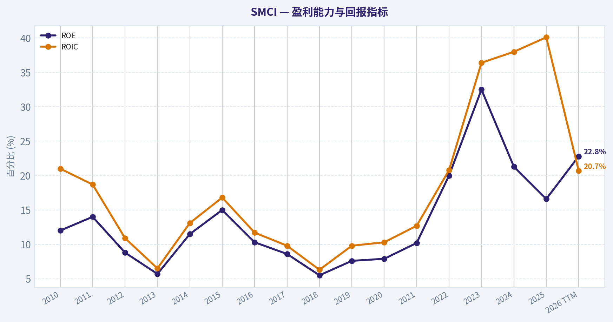
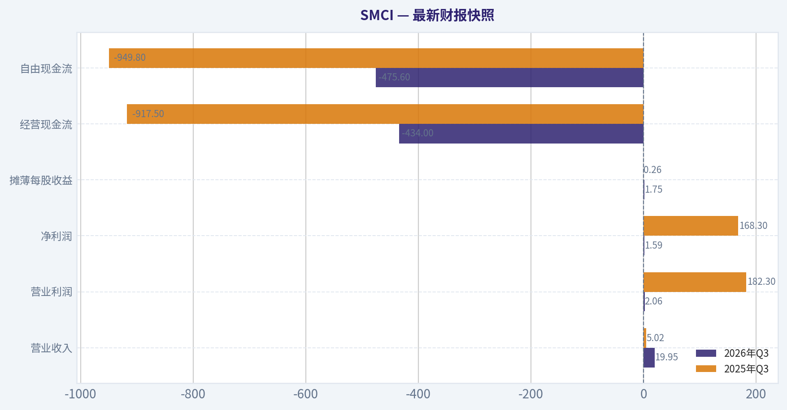
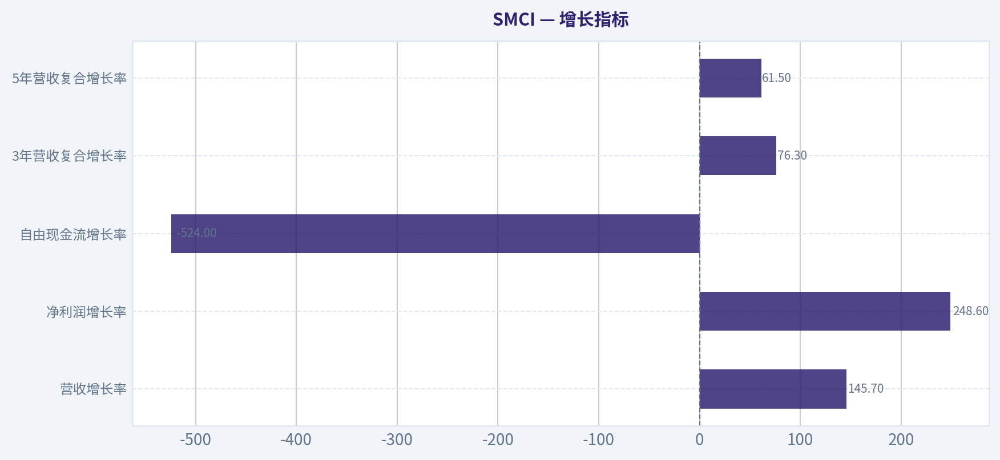
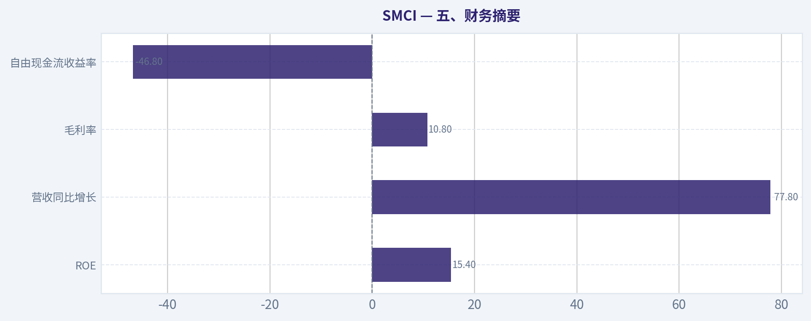
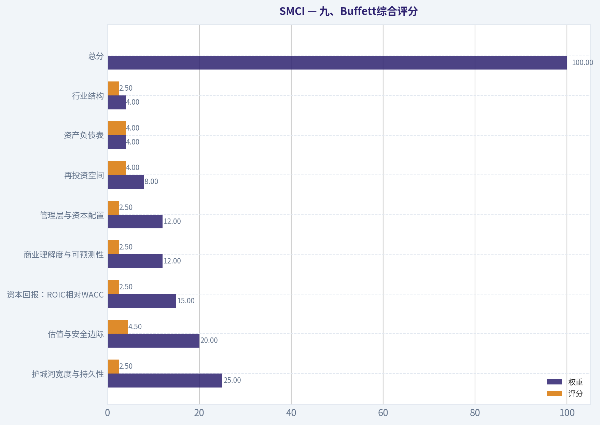
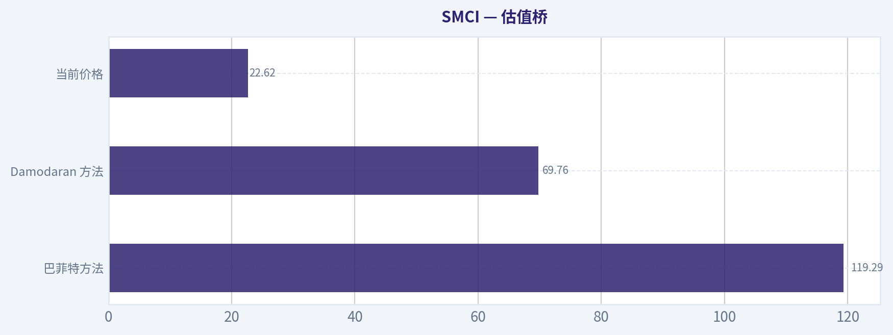
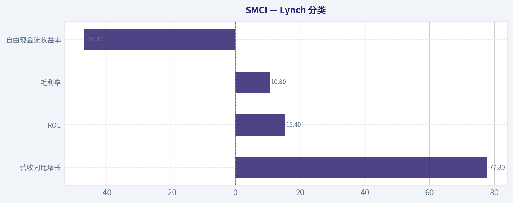
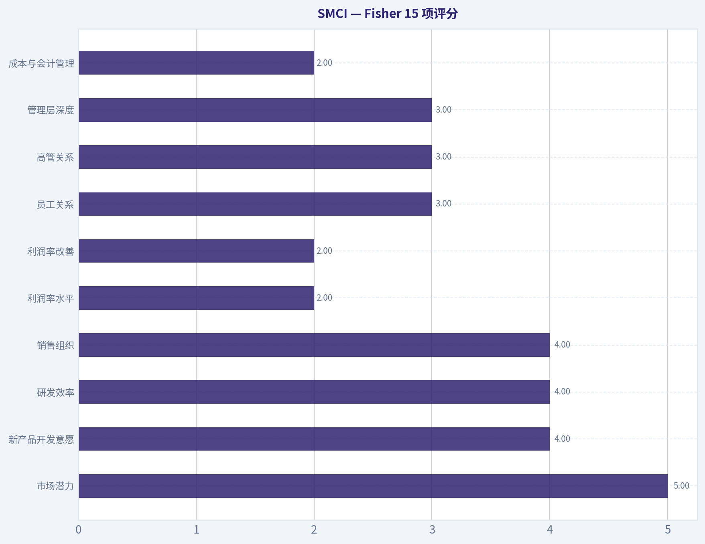

# SMCI 深度价值情报

**调研日期:** 2026-11-24

## 关键免责声明

*本报告由 Deep Value Intelligence（一个基于 AI 的多智能体投资分析框架）自动生成。 仅供教育和研究用途 - 非财务建议，非财务顾问。*

---

## 目录

1. 情报摘要
2. 分析师团队报告
   - 基本面分析
   - 价值分析 (巴菲特)
   - 成长性分析 (林奇/德鲁肯米勒/费雪)
   - 市场分析
   - 期权市场分析
3. 研究团队评论
4. 投资团队评论
5. Deep Values 团队洞察

---

## 情报摘要

### 核心观点与前提条件

**核心论点:** **结论维持 中性，但调整为"偏积极、等待现金验证"。**

**主要风险:**
- **结论维持 中性，但调整为"偏积极、等待现金验证"。**
- **最终立场：中性**
- 原始计划将 SMCI 定义为等待现金流正常化验证的周期性成长硬件企业，并以 **中性** 为结论。综合三方辩论后，这一框架仍然成立，但需作两项调整：

**置信度:** 中

---

## 分析师团队报告

### 基本面分析

#### 最新财报快照

*以下数据基于最近一期已披露财报（2026年Q3），并尽量与上一年同期对比。*

| 指标 | 2026年Q3 | 2025年Q3 | 同比变化 |
| --- | ---: | ---: | ---: |
| 营业收入 | $19.95B | $5.02B | +297.5% |
| 营业利润 | $2.06B | $182.3M | +1032.7% |
| 净利润 | $1.59B | $168.3M | +847.3% |
| 摊薄每股收益 | $1.75 | $0.26 | +573.1% |
| 经营现金流 | $-434.0M | $-917.5M | +52.7% |
| 自由现金流 | $-475.6M | $-949.8M | +49.9% |

关键结论：这张快照先把最新一期财报放在桌面上，再去看长周期分析。这样读者能更清楚地区分"公司长期质量"和"这次财报发生了什么"。

#### SMCI 16年财务指标

*以下数值均由原始数据确定性计算得出，并非 AI 估算。*

*发行人类型：operating company（Technology / Computer Hardware）。*

#### 16年财务指标
*年度行来自已披露财务报表，最后一行 TTM 由最近四个季度滚动计算得出。*

| 指标 | 2010 | 2011 | 2012 | 2013 | 2014 | 2015 | 2016 | 2017 | 2018 | 2019 | 2020 | 2021 | 2022 | 2023 | 2024 | 2025 | 2026 TTM |
| --- | --- | --- | --- | --- | --- | --- | --- | --- | --- | --- | --- | --- | --- | --- | --- | --- | --- |
| 市场价格 | $1 | $2 | $2 | $1 | $3 | $3 | $2 | $2 | $2 | $2 | $3 | $4 | $4 | $25 | $82 | $49 | $23 |
| 总市值 | $549.9M | $682.2M | $700.3M | $467.2M | $1.18B | $1.48B | $1.29B | $1.27B | $1.23B | $1.00B | $1.50B | $1.88B | $2.16B | $13.95B | $49.34B | $30.80B | $16.95B |
| 市盈率 | 20.77 | 17.30 | 23.67 | 22.17 | 21.78 | 15.99 | 17.88 | 19.11 | 26.57 | 13.92 | 17.74 | 16.83 | 7.61 | 21.86 | 42.67 | 29.17 | 4.82 |
| 市净率 | 2.45 | 2.37 | 2.07 | 1.25 | 2.51 | 2.39 | 1.85 | 1.65 | 1.46 | 1.06 | 1.41 | 1.72 | 1.52 | 7.07 | 9.11 | 4.89 | 1.05 |
| ROE | 12.0% | 14.0% | 8.8% | 5.7% | 11.5% | 15.0% | 10.3% | 8.6% | 5.5% | 7.6% | 7.9% | 10.2% | 20.0% | 32.5% | 21.3% | 16.6% | 22.8% |
| ROIC | 21.0% | 18.7% | 10.9% | 6.5% | 13.1% | 16.8% | 11.7% | 9.8% | 6.3% | 9.8% | 10.3% | 12.7% | 20.8% | 36.4% | 38.0% | 40.1% | 20.7% |
| 每股收益 | $0.07 | $0.09 | $0.07 | $0.05 | $0.12 | $0.18 | $0.14 | $0.13 | $0.09 | $0.14 | $0.16 | $0.21 | $0.53 | $1.14 | $1.92 | $1.68 | $4.69 |
| 营收 | $721.4M | $942.6M | $1.01B | $1.16B | $1.47B | $1.95B | $2.23B | $2.48B | $3.36B | $3.50B | $3.34B | $3.56B | $5.20B | $7.12B | $14.99B | $21.97B | $53.99B |
| 毛利润 | $115.0M | $151.1M | $165.4M | $160.1M | $225.5M | $306.6M | $330.5M | $350.0M | $430.0M | $495.5M | $526.2M | $534.5M | $800.0M | $1.28B | $2.06B | $2.43B | $6.30B |
| 毛利率 | 15.9% | 16.0% | 16.3% | 13.8% | 15.4% | 15.7% | 14.9% | 14.1% | 12.8% | 14.2% | 15.8% | 15.0% | 15.4% | 18.0% | 13.8% | 11.1% | 11.7% |
| 营业利润率 | 5.6% | 6.2% | 4.5% | 2.3% | 5.4% | 6.8% | 4.8% | 3.7% | 2.6% | 2.6% | 2.5% | 3.3% | 6.5% | 10.6% | 8.1% | 5.5% | 8.6% |
| 净利润 | $26.9M | $40.2M | $29.9M | $21.3M | $54.2M | $92.6M | $72.1M | $66.9M | $46.2M | $71.9M | $84.3M | $111.9M | $285.2M | $640.0M | $1.15B | $1.05B | $3.66B |
| 净利率 | 3.7% | 4.3% | 2.9% | 1.8% | 3.7% | 4.7% | 3.2% | 2.7% | 1.4% | 2.1% | 2.5% | 3.1% | 5.5% | 9.0% | 7.7% | 4.8% | 6.8% |
| 营收增长 | N/A | 30.7% | 7.6% | 14.7% | 26.2% | 33.2% | 13.8% | 11.7% | 35.2% | 4.2% | -4.6% | 6.5% | 46.1% | 37.1% | 110.4% | 46.6% | 145.7% |
| 净利润增长 | N/A | 49.4% | -25.8% | -28.7% | 154.5% | 70.9% | -22.1% | -7.3% | -30.9% | 55.8% | 17.2% | 32.7% | 154.9% | 124.4% | 80.1% | -9.0% | 248.6% |
| 自由现金流增长 | N/A | -68.3% | 8.7% | -202.2% | -496.5% | 138.7% | -191.0% | -269.9% | -147.4% | 299.3% | -131.4% | -187.0% | -848.4% | -229.0% | -516.4% | -158.7% | -524.0% |
| 总账面价值 | $224.7M | $287.3M | $338.4M | $373.5M | $469.1M | $618.9M | $696.5M | $773.7M | $843.5M | $941.0M | $1.07B | $1.10B | $1.43B | $1.97B | $5.42B | $6.30B | $16.07B |
| 总资产 | N/A | $464.6M | $589.1M | $632.3M | $796.3M | $1.09B | $1.19B | $1.52B | $1.77B | $1.68B | $1.92B | $2.24B | $3.21B | $3.67B | $9.83B | $14.02B | $35.73B |
| 总债务 | N/A | $27.6M | $32.8M | $35.2M | $46.3M | $94.4M | $93.6M | $161.4M | $116.2M | $23.6M | $29.4M | $98.2M | $596.8M | $290.3M | $476.4M | $112.5M | $8.69B |
| 债务股权比 | N/A | 0.10 | 0.10 | 0.09 | 0.10 | 0.15 | 0.13 | 0.21 | 0.14 | 0.03 | 0.03 | 0.09 | 0.42 | 0.15 | 0.09 | 0.02 | 0.54 |
| 现金及等价物 | $72.6M | $69.9M | $80.8M | $93.0M | $95.5M | $92.9M | $178.8M | $110.6M | $115.4M | $248.2M | $210.5M | $232.3M | $267.4M | $440.5M | $1.67B | $5.17B | $6.90B |
| 股东权益 | $224.7M | $287.3M | $338.4M | $373.5M | $469.1M | $618.9M | $696.5M | $773.7M | $843.5M | $941.0M | $1.07B | $1.10B | $1.43B | $1.97B | $5.42B | $6.30B | $16.07B |
| 经营现金流 | $-2.2M | $8.5M | $16.5M | $13.6M | $6.5M | $-46.1M | $108.0M | $-96.2M | $84.3M | $262.6M | $-30.3M | $123.0M | $-440.8M | $663.6M | $-2.49B | $1.66B | $-6.33B |
| 投资现金流 | $-11.8M | $-24.8M | $-19.7M | $-5.1M | $-40.2M | $-36.2M | $-35.1M | $-29.4M | $-25.9M | $-24.8M | $-43.6M | $-58.0M | $-46.3M | $-39.5M | $-194.2M | $-183.2M | $-214.6M |
| 自由现金流 | $-24.4M | $-7.7M | $-8.4M | $8.6M | $-34.0M | $-81.2M | $73.9M | $-125.6M | $59.5M | $237.7M | $-74.7M | $64.9M | $-486.0M | $626.8M | $-2.61B | $1.53B | $-6.50B |
| 自由现金流利润率 | -3.4% | -0.8% | -0.8% | 0.7% | -2.3% | -4.2% | 3.3% | -5.1% | 1.8% | 6.8% | -2.2% | 1.8% | -9.4% | 8.8% | -17.4% | 7.0% | -12.0% |
| 每股分红 | $0.00 | $0.00 | $0.00 | $0.00 | $0.00 | $0.00 | $0.00 | $0.00 | $0.00 | $0.00 | $0.00 | $0.00 | $0.00 | $0.00 | $0.00 | $0.00 | $0.00 |

#### 盈利能力指标
- 净资产收益率 (ROE): 15.4%
- 投入资本回报率 (ROIC): 20.3%
- 总资产收益率 (ROA): 7.4%
- 毛利率: 10.8%
- 营业利润率: 7.1%
- 净利率: 5.7%

#### 流动性指标
- 流动比率: 3.87
- 速动比率: 1.91

#### 杠杆指标
- 债务股权比: 0.28
- 利息覆盖倍数: 14.34
- 净负债: $-3.47B

#### 增长指标（同比）
- 营收增长: 77.8%
- 净利润增长: 112.7%
- 自由现金流增长: -555.0%
- 营收复合增长率（3年）: 76.3%
- 营收复合增长率（5年）: 61.5%

#### 估值指标
- 市盈率 (TTM): 4.77
- 预期市盈率: 3.26
- 市净率: 1.26
- 市销率: 0.28
- PEG 比率: 0.05
- 企业价值/EBITDA: 4.70
- 自由现金流收益率: -46.8%
- 盈利收益率: 21.0%

#### 所有者收益（巴菲特方法，代码计算）
- 净利润: $1.05B
- + 剔除的非现金、非经常性项目（可转债/衍生品/SAFE 公允价值变动、减值）: $232.1M
- + 折旧与摊销: $90.3M
- - 资本开支: $-162.0M
- + 营运资本（现金流量表口径；负数=占用现金）: $-9.65B
- = **所有者收益: $1.38B**

#### 内在价值（DeepValues 应用 - SEC 申报数据管道）
- **内在价值（DeepValues 应用，头条）: $119.29** - Owner Earnings (Buffett), 方法 buffett-1986-v2, 截至 2026-11-24 (FY2026)
  区间（保守-乐观）: $83.50 - $119.29
  相对价格的安全边际: 81.0% (价格 $22.62)
  应用使用的输入 (ttm_2027Q1): after-tax operating income $4.0B (operating income $4.6B, tax 14.7%) + D&A $0.1B - capex charge $0.3B (three-year average capex/revenue x trailing revenue; reported capex $0.2B) - working capital $0.0B = owner earnings $3.7B.
  Growth 10.0% fading to 2.5% terminal (min(owner-earnings CAGR, 5-year revenue CAGR), clamped [0, 10%]); discount rate 8.3% (30Y Treasury 5.29% + 3 pts (as of 2026-11-23)); net cash $2.9B (cash $6.9B + marketable securities $0.0B - debt $4.0B); 749M shares.
- Owner Earnings (Buffett): $83.50 / $119.29 / $119.29 (保守 / 基准 / 乐观) ← headline
- Free cash flow DCF: N/A - Trailing-twelve-month free cash flow is not positive: -$6.9B in the four quarters to 2027 Q1 (operating cash flow less stock-based compensation and capital spending), so there is no cash flow to project - Cash Flow method not applicable
- Damodaran two-stage FCFF: $23.62 / $69.76 / $173.36 (保守 / 基准 / 乐观)
  这就是内在价值：引用它作为内在价值，并据此衡量安全边际。其他地方的 DVI 情景数字仅为辅助交叉检查，不是估值。

#### DVI 情景模型（辅助交叉检查 - 不是内在价值）
DVI 基于 Yahoo 数据的情景，仅作敏感性检查。请勿将其作为内在价值引用；内在价值是上方的 DeepValues 应用估值。
- 当前价格: $23
- DVI 情景值（按商业模式路由）: $70
  商业模式: operating company - weighted blend [Damodaran FCFF + reverse-DCF fair + owner-earnings DCF] (operating_company)
  模型区间（各 DCF 最小-最大）: $56 - $86
  相对价格的安全边际（头条）: 67.8%
  路由说明: General operating company: balanced blend of Damodaran FCFF and the owner-earnings DCF with a reverse-DCF sanity check.
- 巴菲特方法（所有者收益）:
  保守: $14
  平均: $86
  乐观: $232
- 现金流方法（FCF）:
  保守: $71
  平均: $71
  乐观: $189
- Damodaran FCFF（WACC + 利润率 + 再投资）:
  保守: $19
  平均: $56
  乐观: $113
  蒙特卡洛区间（P10-P90）：$28 - $70（中位数 $45）
  P(内在价值 > 当前价格)：96.6%
- 反向 DCF：当前价格隐含约 -4.3%/年 的所有者收益增长（10年）；过去 3 年为 84.0%，5 年为 127.3%。

#### Piotroski F分数: 1/9
- 净利润为正: 通过
- 经营现金流为正: 未通过
- 资产回报率改善: 未通过
- 现金流大于净利润: 未通过
- 债务下降: 未通过
- 流动比率改善: 未通过
- 未稀释股本: 未通过
- 毛利率改善: 未通过
- 资产周转率改善: 未通过

ANALYST STANCE: **中性**

#### 结论摘要

SMCI 的估值表面上极低：当前股价约 **23美元**，PE 约 **4.77倍**，盈利收益率约 **21%**，显著低于历史平均PE约 **20.94倍**。但低估值同时反映了明显的经营质量问题：TTM自由现金流为 **-65亿美元**，经营现金流为 **-63.3亿美元**，Piotroski F分数仅 **1/9**，且债务从上一年度的约1.1亿美元跃升至 **86.9亿美元**。

DeepValues 的Buffett Owner Earnings模型给出的内在价值为 **119.29美元**，保守区间下限为 **83.50美元**；不过该估值依赖于营运资本占用恢复正常、现金流重新转正以及高增长持续。Damodaran FCFF交叉估值仅为 **23.62至173.36美元**，基准值 **69.76美元**，显示模型分歧极大。因此，SMCI 更接近"高增长、高波动、现金流验证不足的低估值候选"，而不是已经被财务数据充分验证的典型复利企业。

#### 市场指标与估值

| 指标 | 当前值 | 历史平均 | 当前相对历史 |
|---|---:|---:|---|
| 市场价格 | 23美元 | 约16.3美元 | 高于长期均值，但较2024-2025年高点显著回落 |
| 总市值 | 约149.1亿美元 | 约86.3亿美元 | 高于长期均值 |
| PE | 4.77倍 | 20.94倍 | 显著低于历史平均 |
| PB | 约1.05倍（数据摘要口径约1.26倍） | 2.80倍 | 明显低于历史平均 |
| PS | 0.28倍 | - | 对硬件制造商而言偏低 |
| EV/EBITDA | 4.70倍 | - | 处于低估值区间 |
| 盈利收益率 | 21.0% | - | 很高，但依赖盈利可持续性 |

**关键结论：** PE和PB均远低于历史均值，市场已经对利润回落、现金流恶化和资本结构变化计入了较大折价。SMCI属于硬件型经营公司，PB并非完全没有参考价值，但不能把1倍左右PB自动解释为便宜，因为库存、应收账款、供应链融资和高峰期盈利都会影响账面价值质量；当前估值判断仍应以正常化现金流为核心。

#### 盈利能力

| 指标 | 当前值 | 历史平均或长期基准 | 当前表现 |
|---|---:|---:|---|
| ROE | 22.8% | 约13.0% | 高于历史平均 |
| ROIC | 20.7% | 约17.1% | 高于历史平均，但低于2023-2025年高点 |
| EPS | 4.69美元 | 约0.59美元 | 显著高于历史均值 |
| 营收 | 539.9亿美元 | 约46.9亿美元 | 远高于历史均值 |
| 毛利润 | 63.0亿美元 | - | 随规模快速扩大 |
| 毛利率 | 11.7% | 约14.9% | 低于历史平均 |
| 营业利润率 | 8.6% | 约5.0% | 高于历史平均 |
| 净利润 | 36.6亿美元 | 约2.40亿美元 | 显著高于历史均值 |
| 净利率 | 6.8% | 约4.0% | 高于历史平均 |

**关键结论：** SMCI的规模和盈利能力已经远超十年前水平，ROE和ROIC仍然显示出较强资本回报。但毛利率已经从2023年的18.0%、2024年的13.8%下降至约11.7%，说明竞争、产品组合、供应链成本和大客户议价能力正在压缩利润缓冲。营业利润率仍高于长期均值，却不足以单独证明当前净利润水平能够长期维持。

#### 增长指标

| 指标 | 当前值 | 历史平均 | 趋势与解释 |
|---|---:|---:|---|
| 营收增长率 | 145.7% | 约28.0%（剔除首年） | 极端高于历史，属于AI服务器周期性爆发 |
| 净利润增长率 | 248.6% | 约41.1%（剔除首年） | 极高，但波动明显 |
| 自由现金流增长率 | -524.0% | 不适合计算 | 受现金流由正转负和营运资本占用扭曲 |
| 3年营收复合增长率 | 76.3% | - | 显示AI基础设施需求强劲 |
| 5年营收复合增长率 | 61.5% | - | 长期增长显著，但基数效应明显 |

**关键结论：** 营收增长是SMCI估值逻辑中最强的部分，主要受AI加速计算、液冷系统和整机集成需求推动。但净利润增长远快于营收增长，意味着当前利润可能同时受规模效应、产品周期和供应紧张影响。增长率若回归正常，PE看起来很低的现象可能会迅速减弱。

#### 资产负债表与财务强度

| 指标 | 当前值 | 历史平均或对比值 | 解读 |
|---|---:|---:|---|
| 总账面价值 | 160.7亿美元 | 约23.0亿美元 | 因规模扩张和资本积累大幅增加 |
| 总资产 | 357.3亿美元 | - | 高于上一年度140.2亿美元 |
| 总债务 | 86.9亿美元 | 约1.49亿美元 | 短期内大幅上升 |
| 债务权益比 | 0.54倍 | 约0.12倍 | 显著恶化 |
| 现金及等价物 | 69.0亿美元 | 约9.6亿美元 | 现金绝对额很高 |
| 股东权益 | 160.7亿美元 | 约23.0亿美元 | 资本基础明显扩大 |
| 流动比率 | 3.87倍 | - | 流动性表面充足 |
| 速动比率 | 1.91倍 | - | 扣除部分存货后仍有缓冲 |
| 净负债 | -34.7亿美元 | - | 摘要口径显示现金仍高于债务 |

**关键结论：** 现金69亿美元和较高流动比率构成重要安全垫，但债务跃升至86.9亿美元是必须重点解释的异常变化。摘要中的净负债为负，DeepValues模型则使用约29亿美元净现金，说明不同数据口径可能涉及短期借款、可转债、供应链融资或时间点差异；在估值中不能只看"净现金"，还需确认债务的期限、利率和偿还安排。

#### 现金流与股东回报

| 指标 | 当前值 | 历史平均或趋势 | 解读 |
|---|---:|---:|---|
| 自由现金流 | -65.0亿美元 | 约-5,520万美元 | 极端恶化 |
| 经营现金流 | -63.3亿美元 | 多年正负交替 | 营运资本占用是核心问题 |
| 资本开支 | 约1.62亿美元 | 相对营业规模不高 | 现金流恶化并非主要来自重资产资本开支 |
| FCF利润率 | -12.0% | 历史波动较大 | 与净利率6.8%严重背离 |
| 每股分红 | 0美元 | 过去始终为0美元 | 盈利未通过现金分红回馈股东 |

**关键结论：** 这是SMCI投资逻辑中最重要的负面信号。公司报告盈利36.6亿美元，却产生约65亿美元负自由现金流，主要反映营运资本大量占用；在服务器业务中，库存和应收账款扩张可能伴随订单增长，但必须通过后续现金回收验证。Owner Earnings的正常化计算不能机械地使用当前会计净利润。

#### 当前与历史平均比较

| 指标 | 当前值 | 历史平均 | 偏离幅度 | 研究含义 |
|---|---:|---:|---:|---|
| PE | 4.77倍 | 20.94倍 | 约低77% | 市场预期盈利正常化或风险显著上升 |
| PB | 1.05倍 | 2.80倍 | 约低63% | 估值折价明显，但需核实资产质量 |
| ROE | 22.8% | 13.0% | 高约9.8个百分点 | 当前盈利回报强于长期水平 |
| ROIC | 20.7% | 17.1% | 高约3.6个百分点 | 资本效率仍较好，但低于近期峰值 |
| 毛利率 | 11.7% | 14.9% | 低约3.2个百分点 | 竞争和产品组合压力 |
| 营业利润率 | 8.6% | 5.0% | 高约3.6个百分点 | 规模效应仍然存在 |
| 净利率 | 6.8% | 4.0% | 高约2.8个百分点 | 盈利能力改善，但可能处于周期高位 |
| 营收 | 539.9亿美元 | 46.9亿美元 | 约11.5倍 | 公司已进入全新规模阶段 |
| 净利润 | 36.6亿美元 | 2.40亿美元 | 约15.3倍 | 增长极强，但可持续性待验证 |
| 总债务 | 86.9亿美元 | 1.49亿美元 | 约58倍 | 资本结构变化显著 |
| 自由现金流 | -65.0亿美元 | -0.55亿美元 | 大幅恶化 | 估值最大的不确定性 |
| 每股分红 | 0美元 | 0美元 | 无变化 | 公司采取留存资金再投资模式 |

**关键结论：** 当前盈利、收入和资本回报均处于历史高位附近，但现金流和债务也出现历史级别恶化。这个组合通常意味着公司正在快速扩张、供应链融资增加，或者盈利增长尚未转化为现金；估值折价是否合理，取决于现金转换能否在未来几个报告期内恢复。

#### 收入来源分布

确定性数据集只提供合并营收，没有披露最新年度的产品线或地区金额。因此，下表不把无法核实的产品比例伪装成精确数据，仅列出公开业务结构与可确认金额。

| 收入来源 | 金额（百万/十亿美元） | 占比 |
|---|---:|---:|
| 服务器及存储系统 | 未在确定性数据集中单独披露 | 未披露 |
| 模块、子系统、配件及软件支持 | 未在确定性数据集中单独披露 | 未披露 |
| 合并营业收入 | 53.99亿美元 | 100% |

**关键结论：** SMCI的收入核心是AI服务器、通用服务器、存储系统及相关模块化解决方案，业务集中度高于综合型软件公司。收入规模高速增长是优势，但也意味着客户、GPU供应、整机配置和AI资本开支周期的集中风险较高；由于缺少精确分部金额，无法仅凭本数据集判断各产品线的利润贡献。

#### Buffett式Owner Earnings DCF

DeepValues应用的头条内在价值为 **119.29美元/股**，采用Buffett Owner Earnings方法。其核心输入为：

- 税后营业利润：约40亿美元；
- 折旧摊销：约1亿美元；
- 资本开支扣除：约3亿美元；
- 营运资本调整：约0美元；
- Owner Earnings：约37亿美元；
- 股份数：约7.49亿股；
- 净现金：约29亿美元；
- 折现率：8.3%；
- 终值增长率：2.5%；
- 增长率从10%逐步下降至2.5%。

基础每股Owner Earnings约为：

\[
37亿美元 \div 7.49亿股 \approx 4.94美元
\]

三情景结果如下：

| 情景 | 主要假设 | 每股估值 | 相对23美元价格的含义 |
|---|---|---:|---|
| 保守 | 增长逐步降至低个位数；营运资本恢复不完全；折现率约8.3% | 83.50美元 | 模型价值仍明显高于当前价格 |
| 基准 | 初期约10%增长，随后逐步衰减至2.5%；现金流正常化 | 119.29美元 | 隐含较大估值折价 |
| 乐观 | AI基础设施需求延续，前期增长较高并逐步衰减 | 119.29美元 | 应用模型对上行情景有封顶效果 |

**关键结论：** Owner Earnings模型显示当前价格对应很高的安全边际，但关键争议在于"正常化Owner Earnings"是否应使用约37亿美元。确定性数据集中的另一种代码计算Owner Earnings只有约13.8亿美元，并包含约96.5亿美元营运资本占用；两种口径差异极大，说明当前估值对现金转换假设高度敏感。

#### 手工DCF交叉检查

使用当前正常化Owner Earnings约37亿美元进行十年显式预测：

\[
V_0=\sum_{t=1}^{10}\frac{OE_t}{(1+r)^t}
+\frac{OE_{10}(1+g_T)}{(r-g_T)}\times\frac{1}{(1+r)^{10}}
+\text{每股净现金}
\]

其中：

- \(r=8.3\%\)；
- \(g_T=2.5\%\)；
- 每股初始Owner Earnings约4.94美元；
- 每股净现金约3.87美元；
- 高增长阶段必须逐年衰减，不假设10%永久持续。

在不把当前高增长永久外推的情况下，手工模型大致会落在 **约80至160美元/股** 的宽区间内。该区间不能替代DeepValues头条估值，因为结果对营运资本释放、应收账款回收、库存周转和利润率假设极其敏感。

Damodaran FCFF模型提供了更宽的交叉检查：

| FCFF情景 | 每股估值 |
|---|---:|
| 保守 | 23.62美元 |
| 基准 | 69.76美元 |
| 乐观 | 173.36美元 |

**关键结论：** 当前23美元价格接近FCFF保守值，却明显低于Owner Earnings基准值。不同模型之间的巨大差异不是计算误差，而是对营运资本、利润率、再投资效率和增长持续时间的不同判断；因此，119.29美元更适合被视为条件性内在价值，而非无条件的确定价值。

#### 经济护城河与业务质量

SMCI的潜在护城河主要来自以下方面：

1. **快速定制和系统集成能力**：能够把GPU、CPU、存储、网络、液冷和机架系统快速组合成数据中心方案。
2. **与核心芯片生态的协同**：公司受益于高端加速计算生态，但这种优势部分来自供应商合作，而不是完全独立的专利垄断。
3. **液冷与高密度计算能力**：随着功耗上升，液冷系统可能提高客户转换成本。
4. **规模和供应链执行能力**：营收从十年前约7.2亿美元增长至当前约540亿美元，说明公司具备较强的商业执行能力。

不过，护城河仍不如软件平台或网络效应企业稳固。SMCI面对大型服务器厂商、ODM厂商和客户自研系统的竞争，毛利率仅约11.7%，显示产品差异化并不完全能够转化为高定价权。

#### 管理层与资本配置

- ROE从长期约13.0%均值升至当前22.8%，资本回报显著提升。
- ROIC长期均值约17.1%，当前20.7%，仍高于历史水平。
- 公司不支付股息，资金主要留在业务扩张和营运资本中。
- 当前负自由现金流说明增长投入的现金回报尚未充分体现。
- Piotroski F分数为1/9，未通过经营现金流、现金流超过净利润、债务下降、流动比率改善、毛利率改善等多个项目。
- Steve Cohen的最新13F数据显示其持股较前期减少约12.1%，但13F是滞后披露，不能作为经营基本面的决定性证据。

总体看，管理层展现了极强的规模扩张能力，但资本配置效率必须通过现金流恢复来进一步验证。

#### 关键风险、机会与验证指标

| 类型 | 具体内容 | 对估值的影响 |
|---|---|---|
| 机会 | AI服务器和液冷基础设施需求继续增长 | 支持较高收入增长和利润规模 |
| 机会 | 当前PE、PS、EV/EBITDA均处于低位 | 为增长延续提供估值缓冲 |
| 机会 | 现金余额较高、流动比率较强 | 降低短期偿债压力 |
| 风险 | 自由现金流为-65亿美元 | 可能使会计盈利无法转化为股东价值 |
| 风险 | 债务大幅上升 | 提高融资和再融资风险 |
| 风险 | 毛利率低于历史均值 | 竞争加剧时利润可能进一步压缩 |
| 风险 | 客户和GPU供应链集中 | 业务周期和供应限制可能放大波动 |
| 风险 | Piotroski F分数1/9 | 当前财务趋势质量较弱 |
| 风险 | 不同Owner Earnings口径差异巨大 | 内在价值对模型假设高度敏感 |
| 验证重点 | 应收账款、库存和应付账款变化 | 判断营运资本占用能否逆转 |
| 验证重点 | 经营现金流是否连续转正 | 判断利润质量 |
| 验证重点 | 毛利率能否稳定在当前水平以上 | 判断竞争优势是否可持续 |
| 验证重点 | 债务是否下降 | 判断扩张是否依赖高杠杆 |

**关键结论：** 最值得观察的不是收入能否继续高速增长，而是收入增长能否转化为经营现金流。若现金流恢复、债务下降且毛利率稳定，当前低PE可能具有较强的估值弹性；若收入继续增长但现金流持续为负，低PE可能只是对财务质量风险的补偿。

#### 最终研究判断

**中性**

支持偏正面的因素包括：

- 当前PE约4.77倍，远低于历史均值；
- ROE、ROIC和营业利润率高于长期平均；
- AI服务器和液冷基础设施仍有长期增长空间；
- DeepValues Owner Earnings模型给出119.29美元内在价值，显著高于当前价格。

限制判断的因素包括：

- FCF为负65亿美元，和净利润36.6亿美元严重背离；
- 债务从约1.1亿美元升至86.9亿美元；
- 毛利率低于历史平均；
- Piotroski F分数仅1/9；
- Owner Earnings不同口径从13.8亿美元到37亿美元，估值结果高度依赖正常化假设；
- 业务护城河更多来自执行速度与供应链协同，而非高转换成本或强网络效应。

综合而言，SMCI呈现"估值便宜但现金流验证不足"的特征。证据支持当前价格包含了较多悲观预期，但尚不足以把119.29美元视为稳健、低争议的内在价值；估值可信度取决于营运资本回收、经营现金流转正、债务回落和毛利率稳定这几个可验证条件。

#### 关键要点汇总

| 研究维度 | 核心判断 |
|---|---|
| 估值 | PE和PB显著低于历史平均，表面估值便宜 |
| 盈利 | ROE、ROIC和净利润大幅高于长期均值 |
| 增长 | 营收增长极强，但存在AI周期和高基数风险 |
| 现金流 | 当前最大弱点，FCF为-65亿美元 |
| 资产负债表 | 现金充足，但债务快速上升 |
| 护城河 | 集成、供应链和液冷能力构成一定优势，但定价权有限 |
| Owner Earnings估值 | DeepValues头条内在价值119.29美元，保守值83.50美元 |
| FCFF交叉检查 | 23.62至173.36美元，模型分歧很大 |
| 主要验证项 | 营运资本、经营现金流、毛利率和债务变化 |
| 最终 stance | **中性** |

**关键结论：** SMCI的低估值具有吸引力，但现金流和资本结构问题使其仍属于高不确定性企业。当前证据更支持持续验证基本面改善与估值折价之间的关系，而不是把单一DCF结果视为确定结论。

#### 基本面关键图表

本图追踪 **SMCI** 过去十年的盈利能力与回报指标（ROE、ROIC、利润率），突出呈现资本效率的变化趋势。

---

### 价值分析 (巴菲特)

> *基于沃伦·巴菲特的价值投资哲学：能力圈、经济护城河、管理层质量与安全边际。*

#### 内在价值快照

价格是你付的钱，内在价值是企业未来可能为股东创造的现金价值。我们给出一个区间，而不是假装只有一个神奇数字。

- 当前价格: $22.62
- 估值区间（两种 DCF 方法、保守到乐观）: $83.50 至 $119.29

##### 所有者收益（巴菲特方法）
- 净利润: $1,048,854,000.00
- 折旧与摊销: $90,267,000.00
- 资本支出: $-161,999,000.00
- 营运资金变化: $-9,648,269,000.00
- 所有者收益: $1,376,222,000.00

##### 内在价值
###### 所有者收益法
使用所有者收益，更严格，通常更保守。
- 保守: $83.50
- 平均: $119.29
- 乐观: $119.29
- 折现率: 8.3%

ANALYST STANCE: **中性**

#### 一、结论摘要

Super Micro Computer（SMCI）是一家受益于人工智能服务器需求的高增长硬件企业，收入增长极强，但毛利率低、现金流大幅为负，竞争优势尚未达到稳定宽护城河的标准。

按 DeepValues 应用提供的 Buffett Owner Earnings 估值，内在价值为 **119.29 美元/股**，当前股价约 **23美元**，对应约 **80.7%安全边际**。不过，该估值高度依赖未来盈利持续增长以及"正常化"资本开支和营运资本假设，而公司最近四个季度自由现金流为 **负69亿美元**，因此估值结果与现金流现实之间存在显著张力。

#### 二、因素评分

| 因素 | 评分 | 核心判断 |
|---|---:|---|
| 因素一：能力圈与商业简单性 | 2.5/5 | 商业模式容易理解，但服务器硬件竞争激烈，技术迭代、客户集中度和供应链变化使十年预测难度较高 |
| 因素二：护城河 | 2.5/5 | 具备快速定制、系统整合和人工智能基础设施需求优势，但毛利率仅10.8%，尚未证明拥有强定价权 |
| 因素三：管理层与资本配置 | 2.5/5 | 高增长和扩张执行力较强，但负自由现金流、资本需求及盈利质量仍需验证 |
| 因素四：行业结构 | 2.5/5 | 人工智能服务器需求旺盛，但戴尔、惠普、广达及其他整机厂商形成持续竞争，行业并非稳定寡头 |
| Gate 5：质量与偿债能力硬底线 | 未触发 | 目前净现金约29亿美元，未显示出利息覆盖不足或明确的偿债危机；但现金流恶化是重要警示 |

**关键结论：** SMCI的主要问题不是缺乏增长，而是增长尚未充分转化为自由现金流和稳定利润率。硬底线没有触发，因此不能仅凭负现金流直接判定为财务困境企业，但质量评分明显受到拖累。

#### 三、护城河分析

| 护城河来源 | 证据 | 评价 |
|---|---|---|
| 无形资产与品牌 | 在人工智能服务器整合、液冷和快速交付方面具备行业知名度 | 有一定品牌和工程能力，但品牌溢价证据不足 |
| 转换成本 | 客户部署规模、系统兼容性和供应链协同可能形成一定粘性 | 服务器硬件通常仍可由多个供应商替代，转换成本有限 |
| 成本优势 | 规模采购、设计整合及供应链效率可能降低单位成本 | 毛利率仅10.8%，尚未体现明显结构性成本优势 |
| 网络效应 | 不属于典型双边平台或社交网络 | 基本不存在直接网络效应 |
| 技术优势 | 能快速适配人工智能加速卡、服务器架构和液冷方案 | 技术迭代带来机会，也带来产品淘汰和客户议价风险 |

公司营收同比增长 **77.8%**，说明其处在强劲需求周期中；但高增长并不自动等于护城河。若竞争者可以通过供应链、渠道或类似设计快速复制产品，超额回报可能随周期和供需变化而收窄。

#### 四、管理层与资本配置

管理层展现出较强的业务扩张能力，能够抓住人工智能服务器需求增长，并推动收入快速放大。但从股东视角观察，资本配置仍有三项重要疑点：

1. **利润转化为现金的能力不足。** 最近四个季度自由现金流为负69亿美元，与较高会计盈利形成明显反差。
2. **增长需要较多营运资金。** 服务器订单增长可能伴随存货、应收账款和供应链预付款增加，导致收入增长先于现金回收。
3. **资本回报的稳定性不足。** ROE为15.4%，达到尚可水平，但距离长期稳定的高回报复利企业仍有差距。

公开信息中，Point72截至2026年9月30日持有约678万股，较上一季度减少12.1%。这属于外部机构的季度持仓变化，不等同于管理层判断，但反映出市场参与者对公司风险回报比存在分歧。

#### 五、财务摘要

| 指标 | 最新数据 |
|---|---:|
| 股价 | 23美元 |
| 总市值 | 149.1亿美元 |
| PE | 4.77倍 |
| ROE | 15.4% |
| 营收同比增长 | 77.8% |
| 毛利率 | 10.8% |
| 自由现金流收益率 | -46.8% |
| 最近四季度自由现金流 | -69亿美元 |
| 现金及现金等价物 | 69亿美元 |
| 债务 | 40亿美元 |
| 净现金 | 29亿美元 |
| 流动比率 | 3.87倍 |
| 应用估值使用的股本 | 7.49亿股 |

**关键结论：** 资产负债表目前相对稳健，净现金和较高流动比率提供了缓冲。真正的财务弱点在于自由现金流，而不是短期偿债能力；4.77倍PE看似便宜，但低估值可能部分反映了市场对盈利持续性和现金转换能力的担忧。

#### 六、Owner Earnings计算

DeepValues应用采用的正常化计算如下：

| 项目 | 金额 |
|---|---:|
| 税后经营利润 | 40亿美元 |
| 加：折旧与摊销 | 1亿美元 |
| 减：正常化资本开支 | 3亿美元 |
| 减：营运资本增加 | 0亿美元 |
| 正常化Owner Earnings | 37亿美元 |
| 每股正常化Owner Earnings | 约4.94美元 |

**关键结论：** 正常化Owner Earnings约37亿美元，远高于最近四季度负69亿美元的自由现金流。差异主要来自应用采用税后经营利润、三年平均资本开支以及归零的营运资本变动，而不是完全采用近期实际现金流。因此，这一估值更接近"正常化盈利能力"估计，不能视为近期现金创造能力的直接证明。

#### 七、三情景DCF交叉估值

以下为基于37亿美元Owner Earnings的独立交叉检查，不能替代DeepValues应用给出的头条内在价值。

| 情景 | 核心假设 | 估算价值/股 |
|---|---|---:|
| 情景A：零增长 | 10%折现率，Owner Earnings除以折现率 | 49.4美元 |
| 情景B：GDP增长 | 永续增长3%，10%折现率 | 72.8美元 |
| 情景C：历史增长 | 前十年增长10%，之后永续增长2.5%，10%折现率 | 约116.8美元 |
| DeepValues应用内在价值 | 增长由10%逐步降至2.5%，折现率8.3%，加净现金 | 119.29美元 |

**关键结论：** 即使采用零增长和3%增长情景，正常化Owner Earnings仍高于当前股价；但接近119美元的估值需要较强增长持续性和较低折现率。情景结果显示，市场价格隐含的不是"公司没有价值"，而是市场对现金流质量和盈利持续性的折价。

#### 八、内在价值与安全边际

DeepValues应用的核心输入为：

| 输入 | 数值 |
|---|---:|
| 头条内在价值 | 119.29美元/股 |
| 保守区间下限 | 83.50美元/股 |
| 当前股价 | 23美元 |
| 相对头条内在价值安全边际 | 约80.7% |
| Owner Earnings增长假设 | 10%逐步降至2.5% |
| 折现率 | 8.3% |
| 净现金 | 29亿美元 |

**关键结论：** 按应用估值，当前价格相对119.29美元存在极高安全边际，即使以83.50美元的保守值衡量，折价仍然明显。但由于近期自由现金流为负69亿美元，估值安全边际很大程度上依赖正常化现金流假设；若实际Owner Earnings长期显著低于37亿美元，头条估值将面临下修压力。

#### 九、Buffett综合评分

| 评估标准 | 权重 | 评分 | 加权得分 |
|---|---:|---:|---:|
| 护城河宽度与持久性 | 25% | 2.5 | 0.63 |
| 估值与安全边际 | 20% | 4.5 | 0.90 |
| 资本回报：ROIC相对WACC | 15% | 2.5 | 0.38 |
| 商业理解度与可预测性 | 12% | 2.5 | 0.30 |
| 管理层与资本配置 | 12% | 2.5 | 0.30 |
| 再投资空间 | 8% | 4.0 | 0.32 |
| 资产负债表 | 4% | 4.0 | 0.16 |
| 行业结构 | 4% | 2.5 | 0.10 |
| **总分** | **100%** |  | **3.09/5** |

**关键结论：** 估值和再投资空间是SMCI的主要优势，护城河、现金流质量及行业结构是主要扣分项。3.09分落入"中性观察"区间，说明低估值尚不足以完全抵消盈利质量和行业竞争的不确定性。

#### 十、投资立场与 conviction

**ANALYST STANCE: 中性**

**Conviction：中等。**

证据对SMCI的估值含义呈现明显分裂：

- 正面：人工智能基础设施需求强劲，营收增长77.8%，净现金约29亿美元，按正常化Owner Earnings计算的估值远高于股价。
- 负面：毛利率仅10.8%，自由现金流为负69亿美元，正常化Owner Earnings与实际现金流之间存在巨大差距，服务器行业竞争和技术迭代也限制了护城河确定性。

因此，研究结论支持"价格包含较大悲观预期"，但尚不足以把SMCI归类为高确定性的宽护城河复利企业。核心验证指标是未来几个报告期能否将会计利润稳定转化为自由现金流，并在人工智能服务器需求放缓后维持合理毛利率。
#### 估值桥

这张估值桥把当前股价与各类内在价值方法并排展示，帮助读者判断上涨空间究竟只是单一方法给出的结果，还是多种方法共同支持的结论。

| 项目 | 每股内在价值 |
| --- | ---: |
| 巴菲特方法 | $119.29 |
| Damodaran 方法 | $69.76 |
| 当前价格 | $22.62 |

#### 关键结论

如果只有一种方法显著高于其他方法，说明上行空间更依赖特定建模假设。若多种方法的估值接近，则说明估值逻辑更加稳健。

#### 估值图表

本对比图（来自「最新财报快照」）将 **SMCI** 的当前数据与历史基准并排呈现，直观反映公司相对自身历史均值的估值水平。

本对比图（来自「增长指标」）将 **SMCI** 的当前数据与历史基准并排呈现，直观反映公司相对自身历史均值的估值水平。

本对比图（来自「五、财务摘要」）将 **SMCI** 的当前数据与历史基准并排呈现，直观反映公司相对自身历史均值的估值水平。

本对比图（来自「九、Buffett综合评分」）将 **SMCI** 的当前数据与历史基准并排呈现，直观反映公司相对自身历史均值的估值水平。

本对比图（来自「估值桥」）将 **SMCI** 的当前数据与历史基准并排呈现，直观反映公司相对自身历史均值的估值水平。

本对比图（来自「Lynch 分类」）将 **SMCI** 的当前数据与历史基准并排呈现，直观反映公司相对自身历史均值的估值水平。

本对比图（来自「Fisher 15 项评分」）将 **SMCI** 的当前数据与历史基准并排呈现，直观反映公司相对自身历史均值的估值水平。

---

### 成长性分析 (林奇/德鲁肯米勒/费雪)

> *基于彼得·林奇的GARP成长投资法、斯坦利·德鲁肯米勒的宏观拐点分析法，以及菲利普·费雪的深度调研法。*

ANALYST STANCE: **中性**

#### 结论摘要

SMCI 属于典型的**快速成长股，但同时具有强周期性、低毛利和现金流恶化特征**。营收同比增长 77.8%，估值仅约 4.8 倍 PE，表面上极其便宜；然而过去四个季度自由现金流为 -69 亿美元，说明利润尚未可靠地转化为现金。

综合来看，市场可能低估了 AI 服务器需求的长期空间，也可能正在提前反映盈利质量、客户集中度、供应链、审计与竞争压力。当前证据更支持"高增长、高不确定性、需要验证现金流拐点"的判断，而不是单纯的低估值判断。

#### 1. Lynch 分类

| 项目 | 评价 |
|---|---:|
| Lynch 分类 | 快速成长股，同时带有周期股特征 |
| 营收同比增长 | 77.8% |
| PE | 4.77 倍 |
| ROE | 15.4% |
| 毛利率 | 10.8% |
| 自由现金流收益率 | -46.8% |
| 当前市值 | 149.1 亿美元 |

**关键结论：** SMCI 的营收增速远超快速成长股标准，但低毛利和负自由现金流使其不能简单视为高质量复利型成长企业。它更接近"AI 基础设施高增长平台加硬件周期股"的混合形态。

#### 2. 故事：用三句话解释 SMCI

1. SMCI 为数据中心提供服务器、机架系统和液冷基础设施，受益于 AI 训练与推理需求扩张。
2. 公司擅长快速整合处理器、加速卡、存储和网络组件，缩短客户部署时间。
3. 若液冷、整机柜和 AI 集群成为主流，公司的收入规模仍可能扩张；但竞争、价格压力和现金周转决定了收入能否转化为股东价值。

#### 3. TAM 与"十倍测试"

| 维度 | 判断 |
|---|---|
| 核心市场 | AI 服务器、数据中心基础设施、液冷和整机柜系统 |
| 市场方向 | 受 AI 资本开支推动，仍处于扩张阶段 |
| TAM 增长 | 可能高于传统服务器市场，但具体增速缺少统一口径 |
| 当前收入 | 研究包未提供绝对营收数字 |
| 十倍收入测试 | 无法精确计算 |
| 10 倍后市场份额 | 取决于未来收入基数及 AI 服务器市场实际规模 |
| 主要限制 | 英伟达生态依赖、戴尔与惠普竞争、供应链和客户集中度 |

**关键结论：** AI 数据中心是具有长期扩张潜力的市场，理论上可以支持较长增长周期。由于缺少最新绝对收入和可核实的市场规模，无法严格证明十倍收入后仍低于 20% 市占率；因此，TAM 结论积极但不能视为已验证。

#### 4. 营收增长趋势

| 指标 | 当前信息 | 解释 |
|---|---:|---|
| 营收同比增长 | 77.8% | 极强增长 |
| 增长方向 | 暂未提供连续季度序列 | 无法确认加速或减速 |
| 增长质量 | 需要拆分客户、产品、价格和数量 | 硬件收入可能具有周期性 |
| 现金流配合度 | 自由现金流 -69 亿美元 | 增长伴随大量营运资金占用 |
| 毛利率 | 10.8% | 抗价格竞争能力有限 |

**关键结论：** 单一同比增速显示需求强劲，但不足以判断是否正在加速。真正重要的验证信号是：收入增长能否持续、毛利率能否稳定、应收账款与库存能否改善，以及经营现金流能否转正。

#### 5. 单位经济与经营效率

| 指标 | 数据 | 评价 |
|---|---:|---|
| LTV/CAC | 未披露 | 不适用于传统硬件业务，或缺少公开数据 |
| NRR | 未披露 | 不适用于非订阅型主营业务 |
| 规则 40 | 不适用 | 公司并非典型 SaaS |
| 毛利率 | 10.8% | 偏低 |
| ROE | 15.4% | 尚可，但受周期和营运资本影响 |
| 流动比率 | 3.87 | 短期偿债缓冲较强 |
| 自由现金流 | -69 亿美元 | 重大质量风险 |

**关键结论：** SMCI 不应使用 SaaS 的 NRR 或 LTV/CAC 作为核心判断工具。对它而言，最重要的"单位经济"是每美元收入带来的毛利、库存周转、应收账款回收和自由现金流；目前现金转换明显弱于利润表现。

#### 6. Inflection Point 评估

| 潜在拐点 | 当前判断 | 信号强度 |
|---|---|---:|
| 产品周期：AI 服务器与液冷 | 需求方向明确 | 高 |
| TAM 扩张：AI 数据中心资本开支 | 具备结构性顺风 | 高 |
| 市占率变化 | 缺少连续份额数据 | 中 |
| 毛利率拐点 | 当前仅 10.8%，尚未确认 | 低 |
| 现金流拐点 | 仍为大额负值 | 低 |
| 竞争格局 | 大型服务器厂商持续参与 | 中 |
| 盈利预期差 | 低 PE 已反映部分悲观预期 | 中 |

**关键结论：** 目前最明确的拐点是 AI 服务器需求和市场空间，而不是利润率或现金流。若未来出现"收入继续高增长、毛利率稳定、库存下降、自由现金流转正"的组合，投资逻辑将明显强化；在此之前，拐点仍属于待验证状态。

#### 7. 宏观环境

| 宏观因素 | 对 SMCI 的影响 |
|---|---|
| AI 资本开支 | 明显正面 |
| 数据中心建设 | 正面 |
| 高利率 | 对成长股估值和客户资本开支构成压力 |
| 半导体供应链 | 可能造成交付波动 |
| 地缘政治与出口限制 | 可能影响产品流向和客户结构 |
| 服务器价格竞争 | 对低毛利企业不利 |
| 市场风险偏好 | 高波动环境下估值容易压缩 |

**关键结论：** AI 基础设施是主要宏观顺风，但 SMCI 同时暴露于资本开支周期、供应链和地缘政治风险。高利率环境下，负自由现金流会放大市场对融资和营运资金的敏感度。

#### 8. Fisher 15 项评分

| Fisher 项目 | 分数（1-5） | 简要判断 |
|---|---:|---|
| 市场潜力 | 5 | AI 数据中心空间较大 |
| 新产品开发意愿 | 4 | 液冷和整机柜具备扩展性 |
| 研发效率 | 4 | 快速整合复杂组件 |
| 销售组织 | 4 | 能进入大型数据中心客户 |
| 利润率水平 | 2 | 毛利率偏低 |
| 利润率改善 | 2 | 尚未确认改善 |
| 员工关系 | 3 | 公开信息有限 |
| 高管关系 | 3 | 公开信息有限 |
| 管理层深度 | 3 | 需更多验证 |
| 成本与会计管理 | 2 | 现金流和营运资金令人关注 |
| 独特优势 | 4 | 集成速度、液冷和系统交付能力 |
| 长期利润展望 | 4 | 取决于硬件向系统平台升级 |
| 股权稀释 | 3 | 需持续监测 |
| 对困难的坦诚度 | 2 | 公开信息不足，且市场存在审计与治理疑虑 |
| 管理层诚信 | 3 | 无法仅凭当前数据给出高分 |
| **合计** | **48/75** | **平均水平，尚未达到优秀成长企业标准** |

**关键结论：** Fisher 评分的最大扣分来自利润率、现金流、会计质量透明度和治理信息不足，而不是市场空间。公司的产品与市场潜力较强，但"优秀企业"所需的稳定经营质量尚未得到充分证明。

#### 9. 估值分析

| 方法 | 结果 | 解释 |
|---|---:|---|
| PE | 4.77 倍 | 相对 77.8% 营收增速非常低 |
| 简化 PEG | 约 0.06 | 使用营收增速代替盈利增速，参考意义有限 |
| 市值 | 149.1 亿美元 | 估值规模不高，但现金流风险较大 |
| Owner Earnings 保守情景 | 83.50 美元 | 研究包模型结果 |
| Owner Earnings 基准情景 | 119.29 美元 | 研究包模型结果 |
| Damodaran FCFF 保守情景 | 23.62 美元 | 对现金流质量更敏感 |
| Damodaran FCFF 基准情景 | 69.76 美元 | 依赖未来现金流恢复 |
| TTM 自由现金流 | -69 亿美元 | 传统自由现金流 DCF 不适用 |

**关键结论：** PE 和 Owner Earnings 模型显示出显著估值折价，但 FCFF 模型的结果分散很大，说明估值高度依赖现金流恢复假设。约 0.06 的简化 PEG 不够可靠，因为 77.8% 是营收增速，而非经过现金流验证的盈利增速。

#### 10. 估值敏感性

| 变量变化 | 对估值含义 |
|---|---|
| 收入增速维持高位 | 支持较高估值区间 |
| 收入增速快速回落 | 低 PE 可能属于盈利周期高点 |
| 毛利率提升 | 对利润和现金流有较强杠杆 |
| 毛利率继续下降 | 低估值可能合理甚至不够低 |
| 库存与应收账款下降 | 提升现金流可信度 |
| 自由现金流持续为负 | 大幅削弱 Owner Earnings 模型 |
| AI 资本开支放缓 | 估值和收入预期双重承压 |
| 竞争者价格压力加剧 | 限制利润率扩张 |

**关键结论：** SMCI 的估值对毛利率和营运资金的敏感度高于对收入增速的敏感度。只要收入增长伴随现金流恶化，低 PE 可能只是对盈利可持续性的折价，而不是单纯市场错误定价。

#### 11. Growth Investor Scorecard

| 评分项目 | 权重 | 得分（1-5） | 加权分 |
|---|---:|---:|---:|
| Lynch 故事 | 10% | 4.0 | 0.40 |
| TAM 与增长空间 | 20% | 4.5 | 0.90 |
| 营收增长 | 20% | 4.5 | 0.90 |
| 单位经济 | 15% | 2.0 | 0.30 |
| 竞争地位 | 10% | 3.5 | 0.35 |
| 管理层质量 | 10% | 2.5 | 0.25 |
| 宏观环境 | 5% | 3.5 | 0.18 |
| 盈利路径 | 5% | 2.5 | 0.13 |
| 估值 | 5% | 4.0 | 0.20 |
| **总分** | **100%** | - | **3.61/5** |

**关键结论：** 3.61 分落在"中性偏积极"的观察区间。增长、TAM 和估值得分较高，但现金流、毛利率和管理质量显著拉低总分；这是一项"增长潜力强、经营验证不足"的研究对象。

#### 12. 关键风险与催化剂

| 类型 | 事项 | 重要性 |
|---|---|---:|
| 催化剂 | AI 服务器订单持续超预期 | 高 |
| 催化剂 | 液冷和整机柜产品占比提升 | 高 |
| 催化剂 | 毛利率稳定或回升 | 高 |
| 催化剂 | 库存、应收账款下降 | 高 |
| 催化剂 | 自由现金流转正 | 极高 |
| 风险 | AI 资本开支周期反转 | 高 |
| 风险 | 戴尔、惠普等竞争加剧 | 高 |
| 风险 | 毛利率持续承压 | 高 |
| 风险 | 大额负现金流持续 | 极高 |
| 风险 | 客户集中与英伟达生态依赖 | 高 |
| 风险 | 出口限制、审计和治理疑虑 | 高 |
| 风险 | 股权稀释或融资需求上升 | 中高 |

**关键结论：** 最有价值的催化剂不是单纯的收入增长，而是现金流和毛利率同步改善。最大的风险是 AI 需求仍然强劲，但公司因库存、应收账款和价格竞争无法把增长转化为现金。

#### 最终判断

SMCI 的核心矛盾是：**收入增长像高成长企业，现金流质量却像高风险周期企业。** 当前价格约 23 美元，明显低于研究包中部分内在价值模型结果，但不同模型从 23.62 美元到 119.29 美元的巨大差异，表明估值结论高度依赖现金流恢复假设。

因此，现有证据支持 **中性**：AI 基础设施长期空间和当前低估值值得关注，但只有在现金流、毛利率、库存周转和治理透明度出现持续改善后，十倍成长逻辑才会从"可能性"提升为"可验证性"。

---

### 市场分析

ANALYST STANCE: **中性**

#### 数据范围与方法

本报告仅分析纳斯达克上市的 Super Micro Computer, Inc.（SMCI）。数据来自 Yahoo Finance，覆盖 2025 年 11 月 24 日至 2026 年 11 月 23 日；由于 2026 年 11 月 24 日未返回新的日线记录，最新有效收盘价为 2026 年 11 月 23 日的 24.53 美元。

本次选择 8 项互补指标：10 EMA、50 SMA、200 SMA、MACD、RSI、布林上轨、布林下轨和 ATR。它们分别覆盖短中长期趋势、动量、超买超卖、价格波动区间与波动率，未重复纳入同类指标。

#### 价格与趋势结构

| 项目 | 最新数值或区间 | 观察 |
|---|---:|---|
| 最新收盘价 | 24.53 美元 | 较 2025-11-24 的 33.32 美元下降约 26.4% |
| 近一个月变化 | 较 2026-10-23 的 32.94 美元下降约 25.5% | 中短期跌势仍然明显 |
| 10 EMA | 24.88 美元 | 收盘价略低于短期均线，短线反弹尚未形成稳定上穿 |
| 50 SMA | 34.49 美元 | 价格低于均线约 28.9%，中期趋势偏弱 |
| 200 SMA | 32.27 美元 | 价格低于均线约 24.0%，长期价格结构仍受压 |
| 50 SMA 与 200 SMA | 34.49 对 32.27 美元 | 50 SMA 仍高于 200 SMA，但两者均线方向近期转弱 |

关键结论：SMCI 的价格同时低于 10 EMA、50 SMA 和 200 SMA，说明短期反弹尚未改变中长期趋势。虽然 50 SMA 仍高于 200 SMA，长期均线结构尚未完全转为空头排列，但价格距离两条中长期均线较远，当前市场定价仍反映出较强的风险折价。

#### 动量与反弹质量

| 指标 | 近期数值 | 走势含义 |
|---|---:|---|
| RSI | 34.50 | 较 11 月 20 日的 28.04 回升，但仍低于中性水平 50 |
| MACD | -3.22 | 位于零轴下方，且较 10 月底的约 -1.55 明显恶化 |
| 11 月 20 日至 11 月 23 日价格 | 21.65 升至 24.53 美元 | 反弹约 13.3%，但尚未收复 10 EMA |
| 11 月 12 日成交量 | 约 1.15 亿股 | 下跌阶段出现显著放量，显示抛压与重新定价过程较强 |
| 11 月 23 日成交量 | 约 6256 万股 | 反弹伴随放量，但仍不足以证明趋势已经反转 |

关键结论：RSI 从极弱区域回升，说明短线卖压有所缓和，但 RSI 仍处于偏弱区间，并未展现出持续强势动能。MACD 仍深处负值区域，且较一个月前更差，因此最近的价格反弹更接近超跌后的修复，尚未得到中期动量指标的充分确认。

#### 布林带与波动率

| 指标 | 最新数值 | 观察 |
|---|---:|---|
| 布林上轨 | 35.71 美元 | 价格距离上轨较远，未处于上方压力测试阶段 |
| 布林下轨 | 20.03 美元 | 收盘价高于下轨约 22.5%，尚未重新触及极端下沿 |
| 布林带宽度 | 约 15.68 美元 | 价格区间较宽，波动状态仍然显著 |
| ATR | 2.57 美元 | 约相当于最新收盘价的 10.5%，单日波动风险较高 |
| 价格与布林中轨 | 中轨约为 27.87 美元 | 收盘价低于中轨，价格仍处于布林区间的偏弱侧 |

关键结论：价格已经脱离 11 月 20 日接近布林下轨的极弱位置，但仍低于布林中轨，尚未进入趋势修复确认区域。ATR 相对股价的比例超过 10%，说明即使出现反弹，价格路径也可能伴随较大的日内波动，当前技术信号的可靠性受到高波动环境限制。

#### 综合判断与估值含义

SMCI 在过去一年经历了多次幅度很大的方向切换：2026 年 3 月从约 30.79 美元快速跌至 20.53 美元，随后在 6 月一度升至约 50.17 美元，之后又回落至 11 月的 21.65 美元低点。这种走势表明市场对公司增长持续性、盈利兑现程度、客户资本开支周期以及人工智能服务器需求预期的定价变化非常敏感。

当前技术面有两个相互制衡的部分：

一方面，RSI 已经从 28 附近回升，价格也从 21.65 美元反弹至 24.53 美元，说明极端抛售压力阶段性减弱。价格尚未跌破布林下轨，短线并非处于最极端的技术超卖位置。

另一方面，价格仍显著低于 50 SMA 和 200 SMA，10 EMA 也位于价格上方；MACD 处于负值并且较前期恶化；布林带宽度和 ATR 都显示波动率偏高。由此可见，技术指标支持"短线修复正在发生"的判断，但不足以支持"中长期下行趋势已经结束"的判断。

在没有同步纳入收入增长、毛利率、自由现金流、客户集中度、存货变化及盈利预期的情况下，单凭技术指标无法证明当前股价已经充分反映基本面风险，也无法证明市场已经低估公司价值。综合证据更适合定义为中性观察状态：短线存在反弹修复迹象，但估值能否获得重新抬升，仍取决于价格能否重新站上关键均线，以及基本面是否能支撑此前较高的成长预期。

#### 关键指标汇总

| 维度 | 指标 | 最新读数 | 信号方向 | 研究含义 |
|---|---|---:|---|---|
| 短期趋势 | 10 EMA | 24.88 美元 | 偏弱 | 收盘价略低于短期均线，反弹尚未稳定 |
| 中期趋势 | 50 SMA | 34.49 美元 | 明显偏弱 | 价格大幅低于中期均线 |
| 长期趋势 | 200 SMA | 32.27 美元 | 偏弱 | 长期价格结构仍低于基准水平 |
| 动量 | MACD | -3.22 | 偏弱 | 负值扩大，空头动量尚未消退 |
| 超买超卖 | RSI | 34.50 | 弱势修复 | 从超卖附近回升，但仍低于中性区 |
| 波动区间 | 布林上轨 / 下轨 | 35.71 / 20.03 美元 | 高波动 | 价格位于区间偏弱侧，波动范围较宽 |
| 风险波动 | ATR | 2.57 美元 | 偏高 | ATR 约为股价的 10.5%，价格变化幅度较大 |
| 综合结论 | - | - | 中性 | 短线出现修复，但尚未确认中长期趋势反转 |

关键结论：SMCI 的核心问题不是单一指标极端，而是短线修复与中长期弱势同时存在。RSI 的回升改善了短线技术状态，但均线、MACD 和价格位置仍显示趋势压力，当前证据不足以支持更积极的估值重估判断。

---

### 期权市场分析

> *解读期权流向--认沽/认购比、隐含波动率偏斜与异常活跃合约--以判断机构定位与事件驱动风险。*

ANALYST STANCE: **看多**

#### SMCI 期权市场概览

截至2026年11月24日，SMCI近期期权数据显示，成交量明显偏向看涨期权，但所有近期期限的未平仓量均为零。这使得成交量可以反映短线交易倾向，却无法可靠判断资金是新建方向性交易，还是日内交易、平仓或数据记录异常。

| 到期日 | 看涨成交量 | 看跌成交量 | 看涨未平仓量 | 看跌未平仓量 | 看涨ATM IV | 看跌ATM IV |
|---|---:|---:|---:|---:|---:|---:|
| 2026-11-27 | 42,893 | 33,557 | 0 | 0 | 3.8% | 5.6% |
| 2026-12-04 | 66,247 | 5,088 | 0 | 0 | 1.9% | 2.8% |
| 2026-12-11 | 3,482 | 837 | 0 | 0 | 1.9% | 2.0% |
| **合计** | **112,622** | **39,482** | **0** | **0** | - | - |

关键结论：近期期权成交量的看涨/看跌比约为2.85，明显高于中性状态对应的约1.43，短线交易方向偏向看涨。可是未平仓量全部为零，数据完整性存在明显疑点，因此该看涨信号的可信度需要下调。

#### 看跌/看涨比率分析

| 指标 | 数值 | 相对中性基线的含义 |
|---|---:|---|
| 看跌/看涨未平仓量比 | 不适用 | 未平仓量为零，无法计算 |
| 看跌/看涨成交量比 | 0.35 | 显著低于约0.70的历史中性基线 |
| 看涨/看跌成交量比 | 2.85 | 看涨交易量约为看跌交易量的2.85倍 |
| 最大单一期限偏向 | 2026-12-04 | 看涨成交量约为看跌成交量的13倍 |

关键结论：成交量比率显示市场短线情绪明显偏向看涨，尤其集中在2026年12月4日到期合约。由于缺乏有效未平仓量，无法确认这些成交是否代表持续性资金流入，不能将其等同于机构建立了明确的中期看涨敞口。

#### 隐含波动率与波动率偏斜

| 到期日 | 看涨ATM IV | 看跌ATM IV | 看跌相对看涨的差值 | 解读 |
|---|---:|---:|---:|---|
| 2026-11-27 | 3.8% | 5.6% | +1.8个百分点 | 下行保护溢价较高 |
| 2026-12-04 | 1.9% | 2.8% | +0.9个百分点 | 轻微看跌偏斜 |
| 2026-12-11 | 1.9% | 2.0% | +0.1个百分点 | 偏斜基本中性 |

关键结论：看跌ATM IV在所有列示期限均高于看涨ATM IV，说明下行保护仍有一定溢价，最明显的是11月27日到期合约。不过整体IV水平异常低，且数据未提供具体虚值看跌与虚值看涨IV，因此无法完整确认传统意义上的OTM偏斜。工具数据也未标明临近财报、产品发布或其他催化剂。

#### 异常期权活动

工具定义的异常活动标准为"成交量超过未平仓量5倍"。本次没有识别出符合该标准的具体合约。

| 项目 | 结果 |
|---|---|
| 异常合约数量 | 0 |
| 成交量显著高于未平仓量的合约 | 未发现 |
| 可确认的新建方向性交易 | 无法确认 |
| 可判断的ITM、ATM或OTM具体合约 | 数据未提供执行价，无法判断 |
| 可判断的机构级大单或散户投机 | 无法可靠区分 |

关键结论：没有足够证据证明存在单一执行价上的机构级异常押注。看涨成交量的优势主要来自期限汇总，而不是可追踪到具体执行价的异常合约，因此"看涨"更多是短线成交结构信号，而非确定性的聪明资金信号。

#### 未平仓量集中度与伽马墙

| 项目 | 数据结果 | 市场含义 |
|---|---|---|
| 最高看涨未平仓量执行价 | 无法确定 | 所有近期期限显示为0 |
| 最高看跌未平仓量执行价 | 无法确定 | 所有近期期限显示为0 |
| 最大痛点 | 无法计算 | 缺乏有效未平仓量 |
| 主要伽马墙 | 无法确认 | 没有执行价与未平仓量分布 |
| 价格钉住或磁吸效应 | 无法评估 | 需要真实OI结构 |

关键结论：当前数据无法识别SMCI的关键支撑、阻力或伽马墙。由于未平仓量全部为零，不能据此判断某些执行价会对临近到期价格形成钉住或放大波动的作用。

#### 综合判断

| 维度 | 判断 | 可信度 |
|---|---|---|
| 成交量方向 | 看涨明显占优 | 中等偏低 |
| 未平仓量结构 | 无法判断 | 很低 |
| IV水平 | 显示值极低，可能存在数据异常 | 低 |
| IV偏斜 | 看跌IV略高于看涨IV | 低至中等 |
| 异常活动 | 未发现可确认的异常合约 | 中等 |
| 流动性与数据质量 | 需要谨慎，OI为零与高成交量不一致 | 低 |
| 综合信号 | **BULLISH（看涨）** | **低至中等** |

关键结论：综合信号为看涨，主要驱动因素是近期期权成交量明显偏向看涨，特别是12月4日到期合约。与此同时，看跌IV溢价、零未平仓量以及异常偏低的IV读数构成重要限制，当前证据更支持"短线交易情绪偏多"，而不是高置信度的机构中期定向判断。该期权数据对SMCI估值的支持力度有限，不能单独证明市场对公司基本面重新定价。

#### Markdown摘要表

| 项目 | 结论 |
|---|---|
| 看跌/看涨比率 | 未平仓量比不适用；成交量比为0.35，明显偏向看涨 |
| IV水平 | 近端IV约1.9%至5.6%，读数异常偏低，数据可信度有限 |
| 偏斜方向 | 看跌IV高于看涨IV，呈轻微下行保护偏斜 |
| 异常活动 | 未发现成交量超过未平仓量5倍的具体合约 |
| 未平仓量集中度 | 无法分析；所有近期期限OI均为0 |
| 总体信号 | **BULLISH（看涨）**，但可信度偏低至中等 |

关键结论：SMCI期权成交量传递出明确的短线偏多信号，但期权链的未平仓量为零，削弱了该信号的可验证性。最终判断为低至中等可信度的看涨，而不是由完整OI、伽马或机构异常交易共同确认的强看涨信号。

---

## 研究团队评论

> *研究经理将多空辩论综合为中性评论。此为风险评审前的初步观点，并非最终立场。*

核心结论

SMCI 的争议不在于 AI 基础设施是否增长，而在于公司能否把高速增长转化为可持续、可分配的自由现金流。其快速系统集成、整机柜交付和液冷工程能力具有真实商业价值，但目前更像狭窄的执行型优势，而不是已经验证的宽护城河。与此同时，约4.77倍 PE 看似极低，却与最近四个季度约负69亿美元自由现金流、10.8%的低毛利率形成尖锐反差。

因此，现有证据不足以把 SMCI 定义为"优质企业遭遇暂时误价"，也不足以认定其已经陷入财务困境或存在明确高估。它更接近一个等待现金流正常化验证的周期性成长硬件企业。由于没有 DeepValues 内在价值，且价格、期间与现金流口径尚未统一，当前无法证明存在符合其业务质量所需的安全边际。

最合理的结论是 中性。

多空双方最有力的论据

牛方最强的地方不是低 PE，而是 SMCI 确实处于 AI 数据中心扩张的重要环节。公司能够快速整合 GPU、CPU、存储、网络、电源、机柜和液冷系统，为客户缩短部署周期。随着单柜功耗和计算密度上升，液冷及整机柜交付可能提高单项目价值，也可能增强客户验证、维护和部署过程中的黏性。

约20.3%的 ROIC 也值得重视。如果这一回报能够跨周期保持，并且新增营运资本最终转化为现金，当前估值可能隐含了过于悲观的盈利持续性假设。市场低迷、股价低于主要均线本身不否定长期价值；同样，短期期权成交偏多也不能证明长期价值，但至少反映部分市场参与者认为悲观预期可能过度。

熊方最强的论据则更直接：会计利润尚未通过现金流验证。负69亿美元自由现金流不是一个可以被低 PE 自动抵消的次要问题。服务器增长需要提前采购昂贵组件、扩大存货并给予客户账期，但只有存货顺利交付、应收账款及时回收、营运资本占收入比例下降，才能证明这些资金是高回报再投资，而非商业模式的持续性资金消耗。

10.8%的毛利率进一步放大了风险。如此有限的利润缓冲意味着采购成本、客户折扣、库存减值、保修费用或交付延迟出现小幅不利变化，都可能显著影响净利润和现金流。SMCI 的核心组件与软件生态主要掌握在 Nvidia、AMD、Intel 等上游厂商手中，大型云客户也具备较强议价能力。公司可能同时受到上游供应商和下游大客户的挤压。

液冷同样具有两面性。它能提高项目复杂度和合同金额，却也增加安装、验收、维护和系统责任。液冷收入增长不等于毛利率或现金回报改善。真正能够证明其护城河加深的指标，不是液冷收入占比本身，而是液冷项目能否带来更高毛利、更快回款和更稳定的复购。

价值投资视角下的判断依据

Buffett 式分析首先要求判断企业质量，然后才是价格。SMCI 目前具备较强产品执行力和有吸引力的行业跑道，但还缺少三个关键特征。

第一，护城河尚未充分验证。SMCI 的速度、模块化设计和工程经验是真实优势，却可能被 Dell、HPE、Lenovo 及 ODM 厂商通过资本投入和供应链合作逐步复制。客户切换成本存在，但大型数据中心客户通常会推动多供应商认证，以防止被单一厂商锁定。因此，目前更适合把护城河定义为"狭窄且有待加深"，而非宽护城河。

第二，盈利可预测性不足。约20.3%的 ROIC 可能说明公司创造了经济利润，也可能包含 AI 硬件供需紧张和资产周转率处于高位的周期因素。单一期间的 ROIC 不能直接外推十年。若竞争导致毛利率下降，或者营运资本持续随收入同比扩张，正常化 ROIC 可能明显低于当前水平。

第三，估值缺少统一的现金流锚。资料中的股价分别为22.62美元和24.53美元，可能源于不同日期；约4.77倍 PE 也必须与同一日期的股价、稀释股本和正常化盈利核对。更重要的是，负69亿美元自由现金流规模异常突出，需要拆分经营现金流、资本开支及营运资本变动，确认是否包含特定期间的大额备货或口径差异。在这些数据未统一前，表面盈利收益率不能被视为可靠的股东现金收益率。

按照质量调整后的安全边际原则，SMCI 还不能享受宽护城河复利企业只需约10%至15%折价的标准。对于护城河较窄、现金转换波动较大的硬件企业，通常需要更充分的内在价值折价作为补偿。由于本轮没有提供 DeepValues 内在价值，也没有基于正常化自由现金流的反向 DCF，现有资料无法证明这一折价已经存在。

市场可能低估了什么

市场可能过度关注近期现金消耗，而低估了订单交付后营运资本释放的可能性。如果库存主要对应已有客户订单，应收账款信用质量良好，且供应链预付款能够随系统交付收回，那么当前自由现金流可能比稳态水平差得多。AI 推理需求、机柜功率密度上升和液冷渗透率提高，也可能使增长持续时间超过传统服务器周期。

市场还可能低估 SMCI 的部署速度价值。客户在算力紧缺时期，提前数周或数月上线集群可能带来可观经济收益，因此系统集成速度不只是技术特点，也可能构成客户愿意支付的价值。

市场可能正确反映了什么

低 PE 也可能合理反映盈利质量、治理和周期风险。行业增长并不保证系统集成商获得长期定价权。核心经济利润可能更多流向芯片、网络和软件生态供应商，而服务器厂商承担库存、交付与客户信用风险。

市场也可能认为当前利润接近周期高位，而自由现金流揭示了真实资本需求。如果新增收入长期要求近似比例的存货和应收账款投入，SMCI 的增长价值就应明显低于资产轻、现金转换稳定的技术平台。

管理层评价

管理层在产品推出速度、供应链协调和 AI 系统交付方面体现了较强执行能力，但经营执行力不等于卓越资本配置能力。更高标准的验证包括：是否严格控制客户信用，是否让库存增长与可核验订单相匹配，是否愿意放弃低回报收入，以及能否在增长放缓后释放营运资本。

现阶段，对管理层最公平的评价是"产品执行得到证明，现金纪律与长期资本配置仍待证明"。如果未来几个季度收入继续增长，却没有相应的现金流改善，那么经营规模扩大反而会削弱管理质量的判断。

从类似案例吸取的教训

高速增长硬件公司的常见误判，是把收入增长等同于内在价值增长，把备货视为天然的高回报投资，并用低 PE 掩盖利润与现金的背离。另一类错误是把产品领先或交付速度直接定义为永久护城河。

对 SMCI 应采用更严格的证据链：订单增长必须转化为收入，收入必须转化为应收账款回收，库存必须转化为交付，最终净利润必须转化为自由现金流。任何一环长期中断，都可能使低 PE 成为价值陷阱。反过来，也不能因为单个高速扩张期自由现金流为负，就直接断言业务失去价值；营运资本在订单兑现后能否释放才是决定性证据。

未来1至4个季度的监测计划

首先，观察经营现金流和自由现金流。单季度转正可能来自暂时减少采购，因此更重要的是连续几个季度的改善，以及自由现金流相对净利润的转换率。若现金流改善主要来自应付账款拉长，而非存货下降和客户回款，则质量仍然有限。

其次，跟踪存货与应收账款相对收入的变化。需要关注库存周转天数、应收账款周转天数、坏账准备、库存减值和采购承诺。存货及应收账款增速低于收入增速，会支持营运资本压力属于暂时性；反之则支持结构性资金占用的判断。

第三，监测毛利率及产品组合。液冷和整机柜收入增长只有在毛利率、服务收入或现金回报同步改善时，才说明公司正在从硬件集成商向更高价值系统供应商升级。收入增长而毛利率继续下降，将表明大型客户和竞争者掌握更多经济利益。

第四，检验 ROIC 的持续性。应使用包含真实营运资本投入的平均投入资本，并观察滚动多个季度的税后经营利润，而非依赖单一年度数据。若自由现金流恢复且 ROIC 仍明显高于资本成本，牛方论据会显著增强。

第五，观察客户与供应链集中度。需要评估大客户占比、订单取消或延迟情况，以及对关键 GPU 和网络组件供应商的依赖。客户集中度升高、付款周期延长或供应承诺扩大，都会增加盈利波动。

第六，关注治理和披露质量。应核对收入确认、关联交易、审计意见、内部控制、稀释股本以及管理层对营运资本变化的解释。披露透明度和口径稳定性是判断管理层可信度的重要组成部分。

第七，统一估值数据。股价、稀释股本、净债务、正常化净利润和自由现金流必须使用同一报告期。随后以正常化自由现金流进行反向 DCF，判断当前价格隐含的是温和恢复，还是同时要求高增长、稳定毛利率和快速现金流转正。只有前一种情形更可能构成真正的估值错配。

综合而言，牛方证明了 SMCI 拥有真实增长机会和较强工程执行力；熊方则更有力地指出，这些优势尚未转化为可验证的股东现金回报。当前低 PE 是研究起点，不是内在价值结论。在现金转换、毛利率和跨周期 ROIC 获得连续验证前，证据仅支持中性观察，而不支持把它归类为已经证明的 Buffett 式优质复利企业。

中性

---

## 投资团队评论

> *投资经理将研究观点转化为投资论点，等待风险评审。此仍非最终立场。*

### 核心判断

SMCI 的投资争议并不在于 AI 数据中心需求是否存在，而在于公司能否把收入增长转化为稳定、可分配的自由现金流。当前资料同时呈现出三种信号：

1. **业务端具备真实增长机会**：AI 服务器、整机柜交付和液冷系统仍处于扩张阶段。
2. **盈利质量存在明显疑点**：毛利率仅约 10.8%，且自由现金流与会计利润严重背离。
3. **估值看似便宜，但数据尚未形成可靠锚点**：约 4.77 倍 PE 很低，却不能替代正常化自由现金流估值。

因此，SMCI 更像是一个处于高景气行业中的低毛利、高营运资本占用型系统集成商，而不是已经证明具备宽护城河的复利企业。

### 新闻与市场情绪透露了什么

市场对 SMCI 的悲观，可能包含两部分：一部分是对短期现金消耗、竞争和治理风险的合理定价；另一部分则可能过度外推了当前营运资本压力。

如果库存主要对应已确认订单，应收账款客户质量较高，且设备交付后能够迅速回款，那么自由现金流可能在未来几个季度明显改善。此时，市场只看到"现金流为负"，却没有充分计入订单兑现后的资金释放，悲观情绪可能存在一定程度的过度反应。

但反向的风险同样重要。若库存增长反映的是需求预期而非已锁定订单，或者应收账款增长快于收入，负自由现金流就不是暂时性投资，而可能是商业模式持续消耗资金的表现。对于毛利率只有约 10.8% 的企业，任何库存减值、客户折扣、交付延期或保修成本上升，都会迅速侵蚀利润。

因此，新闻中的"AI 需求强劲"只能证明行业机会，不能证明 SMCI 能够获得足够的经济利润。

### 低 PE 的反向检验

约 4.77 倍 PE 对应很高的会计盈利收益率，但这里存在三个关键问题：

- 盈利是否接近周期高点；
- 净利润是否能够转化为经营现金流；
- 未来维持当前利润所需的营运资本是否会继续增加。

如果自由现金流确实为负 69 亿美元，这一数字与公司规模和盈利数据之间存在明显的数量级疑点，必须核对是否混用了不同期间、不同币种、累计口径或数据源错误。若该数字准确，则 PE 几乎失去估值解释力；若实际现金流缺口远小于该数值，则当前估值判断可能过度悲观。

在数据统一之前，不能把低 PE 等同于低估。对这类企业，更有意义的是正常化自由现金流、库存周转、应收账款回收和滚动 ROIC，而不是单一年度的净利润倍数。

### 护城河与竞争结构

SMCI 的优势主要体现在：

- 快速整合 GPU、CPU、网络、存储、电源与机柜系统；
- 能够缩短客户部署时间；
- 在液冷和高功率密度集群方面积累工程经验；
- 能够灵活响应快速变化的 AI 硬件配置。

这些优势具有商业价值，但目前更接近"执行速度和工程能力"，还没有充分证明为宽护城河。Dell、HPE、Lenovo 以及 ODM 厂商均可通过供应链合作、研发投入和客户认证进行竞争。大型云客户也通常会保留多供应商体系，从而限制单一服务器供应商的议价能力。

液冷业务尤其需要谨慎解读。液冷可以提升系统复杂度和项目金额，但复杂度同时会增加安装、验收、维护和责任风险。只有当液冷项目能够带来更高毛利、更快回款和更高复购率时，才说明它正在扩大护城河；单纯的收入占比提升并不足够。

### 管理层与资本配置

管理层在产品迭代、供应链协调和 AI 系统交付方面展现出较强执行力，这解释了公司为何能够快速扩大收入规模。

然而，产品执行力不等于资本配置能力。更关键的验证包括：

- 库存是否与可核验订单相匹配；
- 客户账期是否得到严格控制；
- 是否存在为了追求收入而接受低回报订单；
- 在需求放缓时，营运资本能否顺利释放；
- 对收入确认、库存风险和客户集中度的披露是否透明稳定。

如果收入持续增长但应收账款、库存和采购承诺同步扩大，规模增长可能反而增加企业风险。相反，如果未来现金流改善主要来自真实回款、库存下降和毛利率稳定，而不是延长供应商付款周期，则管理层的资本纪律将得到更有力的证明。

### 技术与期权情绪的含义

股价低于 10 日 EMA、50 日 SMA 和 200 日 SMA，说明市场短期和中期情绪偏弱。但技术趋势主要反映交易行为，不能直接判断十年期企业价值。

期权成交量偏向看涨，表面上说明部分交易者认为悲观情绪可能过度。不过，所有期限的未平仓量均为零，使这一信号的解释力显著下降。它更可能反映短线交易、平仓、数据缺失或记录异常，而不是可靠的机构长期资金流向。

选择性逆向思考的重点并不是看到低价或看涨期权就得出乐观结论，而是判断市场是否把暂时性营运资本压力误认为永久性盈利恶化。当前证据还不足以完成这一判断。

### 未来最重要的验证指标

比股价趋势更重要的是以下几项经营数据：

1. **连续多个季度的自由现金流与净利润转换率**；
2. **库存和应收账款相对收入的增速**；
3. **毛利率是否因整机柜和液冷占比提高而改善**；
4. **滚动 ROIC 是否在包含营运资本后仍显著高于资本成本**；
5. **客户集中度、账期变化和订单取消情况**；
6. **供应商预付款、采购承诺和库存减值风险**；
7. **收入确认、内部控制、审计意见和稀释股本变化**。

真正有意义的改善应当同时表现为现金流转强、营运资本效率提高和毛利率保持稳定，而不是只表现为收入继续增长。

### 综合估值含义

当前估值隐含了较低的盈利持续性预期，但尚未明确显示市场只要求温和的现金流修复，还是同时要求高收入增长、稳定毛利率和快速自由现金流转正。反向 DCF 必须基于统一的股价、稀释股本、净债务、正常化盈利和自由现金流数据，当前资料尚不足以给出可信的内在价值折价。

如果现金流在未来几个季度恢复，且 ROIC 能跨周期维持，当前估值可能低估了 AI 基础设施、液冷和快速部署能力的长期价值。若现金流继续恶化、毛利率下降、库存和应收账款持续膨胀，那么低 PE 可能只是对盈利质量和资本需求的合理折价。

**ANALYST STANCE: 中性**

现有证据支持关注 SMCI 的行业位置和潜在现金流修复，但尚不足以证明其已经具备宽护城河、稳定现金转换和跨周期复利能力。估值是否真正便宜，取决于自由现金流能否持续改善、营运资本是否释放，以及毛利率和 ROIC 能否在竞争加剧后保持；在这些证据出现前，市场的风险折价仍具有合理性。

---

## Deep Values 团队洞察

> *风险管理团队进行辩论，由风险裁判给出最终不含操作建议的裁定。本章节决定最终的「看多 / 中性 / 看空」立场。*

#### 最终立场评分卡

这张评分卡把最终研究结论转成加权决策框架。它不替代文字判断，但能让读者更快看清楚这次结论的核心驱动因素。

| 维度 | 评分 | 权重 | 说明 |
| --- | ---: | ---: | --- |
| 业务质量 | 2.50 | 30% | 高回报率、盈利能力与 Piotroski 评分共同支撑业务韧性。 |
| 估值支撑 | 3.67 | 30% | 综合当前股价相对内在价值锚点以及常用估值比率。 |
| 财务强度 | 5.00 | 20% | 资产负债表韧性主要取决于杠杆与流动性是否处于安全区间。 |
| 成长持续性 | 3.67 | 20% | 近期营收、利润与自由现金流增长共同反映增长是否可持续。 |
| 总分 / 最终立场 | 3.58 | 100% | 中性 |

#### 关键结论

加权总分为 **3.58 / 5.0**，最终立场为 **中性**。它更适合作为快速校准工具，而不是机械买卖信号。

#### 风险摘要

分数越高代表风险压力越大。观察阈值是一个简单的护栏：一旦高于该阈值，该维度对估值判断的影响更大，需要更大的安全边际。

| 维度 | 当前分数 | 观察阈值 | 说明 |
| --- | ---: | ---: | --- |
| 业务质量 | 3.50 | 3.00 | 高回报率、盈利能力与 Piotroski 评分共同支撑业务韧性。 |
| 估值支撑 | 2.33 | 3.00 | 综合当前股价相对内在价值锚点以及常用估值比率。 |
| 财务强度 | 1.00 | 3.00 | 资产负债表韧性主要取决于杠杆与流动性是否处于安全区间。 |
| 成长持续性 | 2.33 | 3.00 | 近期营收、利润与自由现金流增长共同反映增长是否可持续。 |

#### 关键结论

这张图帮助读者区分风险究竟来自哪里：估值、业务质量、资产负债表，还是增长持续性。尤其当最终结论处在「观望」与「回避」边缘时，这种拆解非常有帮助。
