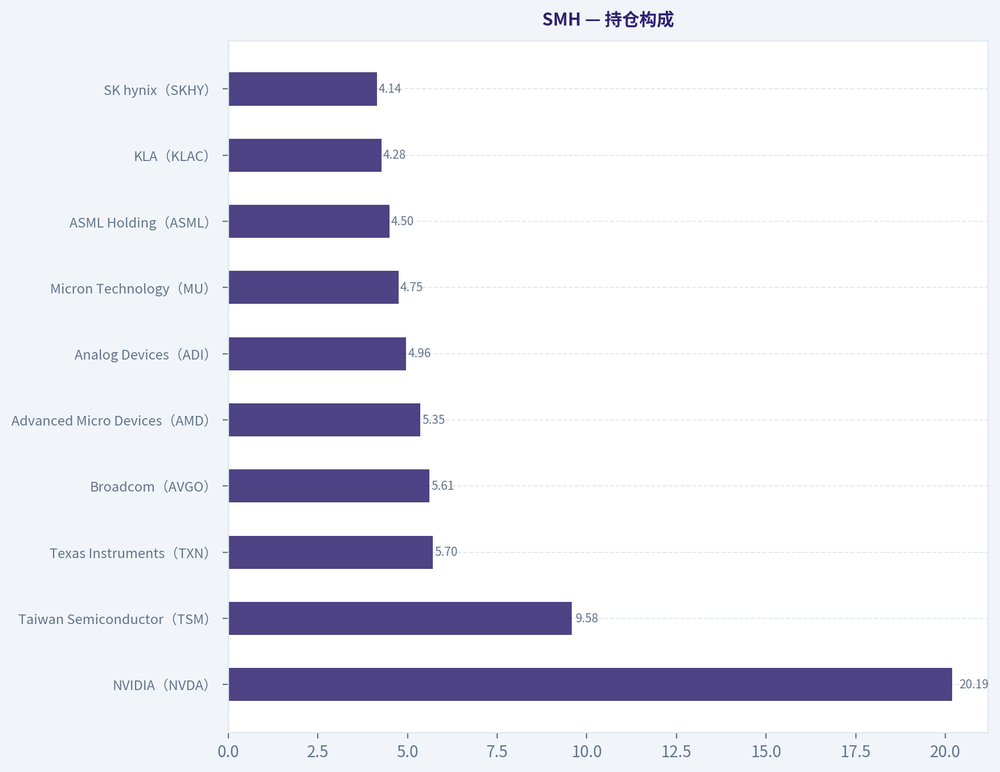
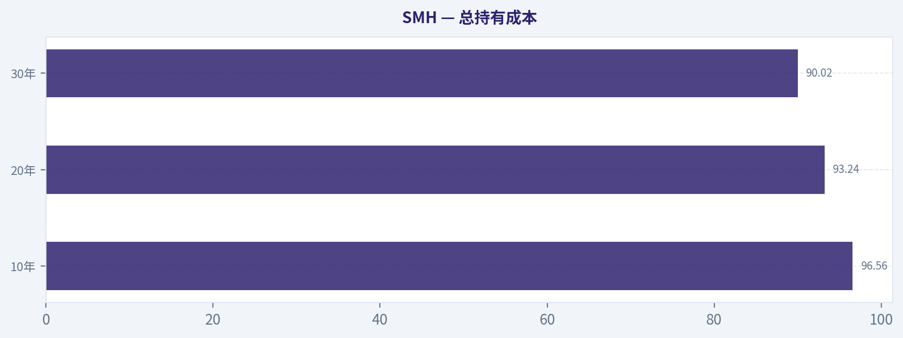
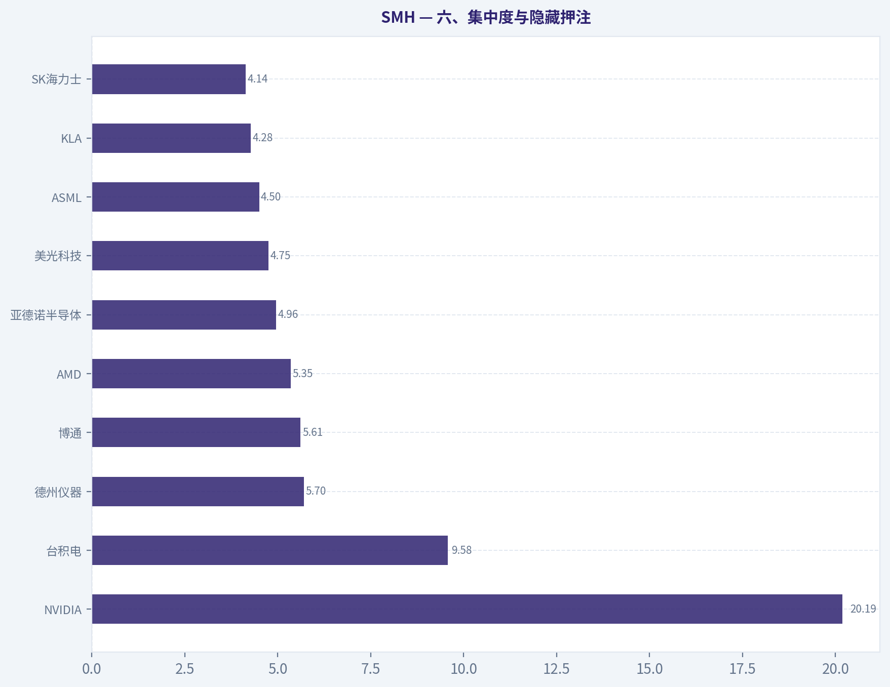
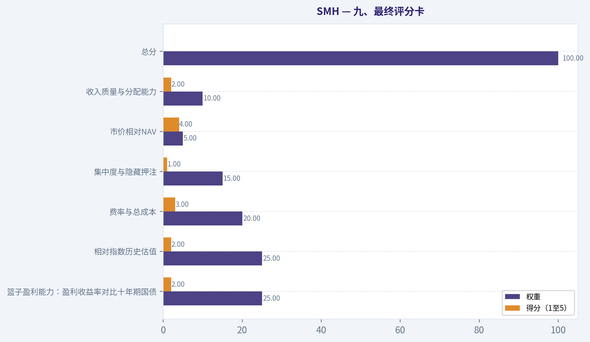
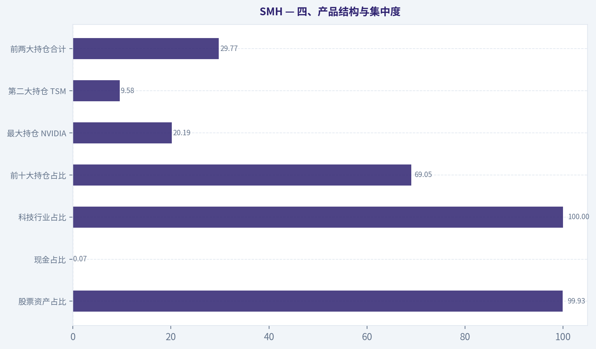
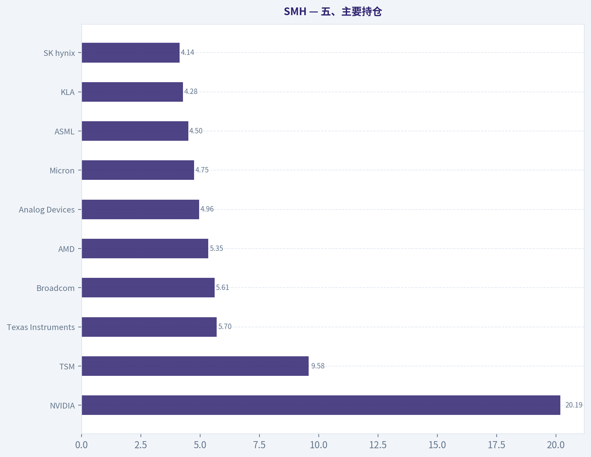
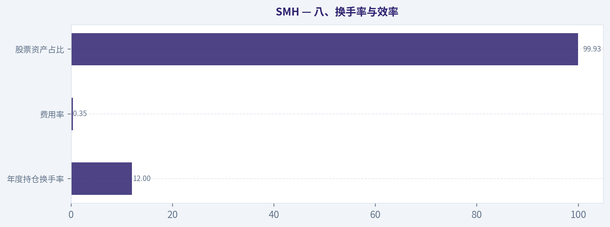
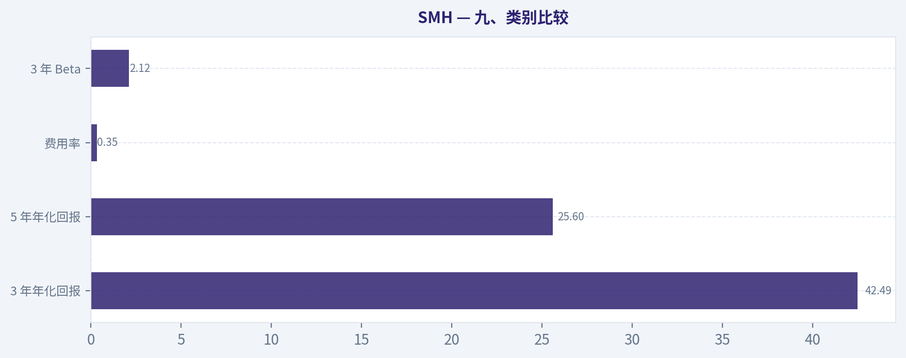

# SMH 深度价值情报

**调研日期:** 2026-11-17

## 关键免责声明

*本报告由 Deep Value Intelligence（一个基于 AI 的多智能体投资分析框架）自动生成。 仅供教育和研究用途 - 非财务建议，非财务顾问。*

---

## 目录

1. 情报摘要
2. 分析师团队报告
   - 基本面分析
   - 篮子估值分析
   - 资金流与业绩分析
   - 市场分析
   - 期权市场分析
3. 研究团队评论
4. 投资团队评论
5. Deep Values 团队洞察

---

## 情报摘要

### 核心观点与前提条件

**核心论点:** **结论：维持观察，不追高，也不回避。**

**主要风险:**
- 未明确说明。

**置信度:** 中

---

## 分析师团队报告

### 基本面分析

ANALYST STANCE: **中性**

#### 基金概览

SMH 是 VanEck Semiconductor ETF，提供纯半导体行业暴露。它不是广泛分散的核心股票 ETF，而是一个高度集中的科技行业主题工具：几乎全部资产投资于股票，且前十大持仓占约七成。

| 项目 | 数据 | 解读 |
|---|---:|---|
| 基金名称 | VanEck Semiconductor ETF | 半导体行业 ETF |
| 管理人 | VanEck | 成熟 ETF 发行商 |
| 法律结构 | 交易所交易基金 | 可在交易所盘中买卖 |
| 管理资产 | 约 664.4 亿美元 | 规模很大，通常有利于流动性 |
| 净费用率 | 0.35%/年 | 对行业主题 ETF 来说合理，但不是最低成本 |
| 市价 | 460.10 美元 | 截至数据日期 |
| NAV | 461.74 美元 | 市价较 NAV 折价约 0.36% |
| 分红收益率 | 0.21% | 收入属性很弱 |
| 股票资产占比 | 99.93% | 基本是纯股票风险 |
| 现金占比 | 0.07% | 现金缓冲极少 |

关键结论：SMH 的规模和交易结构较成熟，0.36%的 NAV 折价也不算异常，说明市场价格与基金资产价值贴合度较好。不过，它几乎没有债券、现金或其他行业资产，因此投资者承担的是集中化半导体股票风险，而不是一般意义上的多元化股票风险。

#### 持仓构成

| 持仓/板块 | 权重 | 说明 |
|---|---:|---|
| NVIDIA（NVDA） | 20.19% | AI 加速器、数据中心和 CUDA 生态核心公司 |
| Taiwan Semiconductor（TSM） | 9.58% | 全球先进晶圆代工核心企业，含台湾地区风险 |
| Texas Instruments（TXN） | 5.70% | 模拟芯片和嵌入式芯片，工业及汽车需求较重要 |
| Broadcom（AVGO） | 5.61% | 网络芯片、定制芯片及基础设施软件 |
| Advanced Micro Devices（AMD） | 5.35% | CPU、GPU 和数据中心加速器 |
| Analog Devices（ADI） | 4.96% | 高端模拟芯片，工业周期敏感 |
| Micron Technology（MU） | 4.75% | 存储器，周期性显著 |
| ASML Holding（ASML） | 4.50% | 光刻设备，半导体资本开支关键供应商 |
| KLA（KLAC） | 4.28% | 半导体检测和量测设备 |
| SK hynix（SKHY） | 4.14% | 存储器及高带宽内存，AI 产业链受益者 |
| 前十大合计 | 69.05% | 集中度很高 |
| 科技板块 | 100.00% | 没有跨行业分散 |
| 股票与现金 | 股票99.93%，现金0.07% | 纯股票行业篮子 |

关键结论：前十大持仓占 69.05%，其中 NVDA 单一权重超过 20%，因此 SMH 的表现会明显受到 AI 资本开支、GPU 需求和大型芯片公司的估值变化影响。表面上基金持有多家公司，但风险并非平均分散：它同时集中在半导体设计、制造、设备和存储器产业链，属于"产业链内部多元化"，不是跨行业多元化。

#### 篮子分析：实际拥有的风险

SMH 的资产组合可拆解为四类主要暴露：

1. **AI 与数据中心计算**
   NVDA、AMD、Broadcom 和部分 TSM 构成 AI 计算、网络互联和先进制造主线。AI 投资持续时，这些持仓可能带来较强上行弹性；若云厂商削减资本开支，估值压缩也可能同步发生。

2. **晶圆制造与先进制程**
   TSM 是最重要的制造环节，ASML、KLAC 则提供先进制程设备和检测工具。这个组合受益于长期芯片需求增长，但对晶圆厂资本开支周期高度敏感。

3. **模拟、工业与汽车芯片**
   TXN、ADI 等提供一定的业务差异化，降低了基金完全依赖 AI GPU 的程度，但它们也暴露于工业库存、汽车需求和制造业周期。

4. **存储器周期**
   MU 和 SK hynix 合计权重接近 9%，存储器价格、库存周期和高带宽内存需求会显著影响组合波动。

基金加权估值如下：

| 估值指标 | 篮子加权数据 | 含义 |
|---|---:|---|
| 市盈率 PE | 28.2 倍 | 估值明显依赖未来盈利增长 |
| 市净率 PB | 9.8 倍 | 市场给予较高资产质量与成长溢价 |
| 市销率 PS | 11.2 倍 | 对收入增长和利润率改善要求较高 |
| 市现率 P/CF | 24.0 倍 | 现金流估值不低 |
| 盈利收益率 | 3.54% | 为 PE 的倒数，安全边际有限 |
| 3 年贝塔 | 2.12 | 历史波动显著高于广泛股票市场 |

关键结论：SMH 不是低估值周期行业基金，而是带有成长股估值的半导体篮子。2.12 的三年贝塔意味着市场上涨时可能放大收益，但市场回撤、利率上升或 AI 预期降温时，也可能产生明显超额跌幅。

#### 指数与复制方式

基金资料明确显示其为 VanEck Semiconductor ETF，但本次基金档案没有提供所跟踪指数的正式名称，也没有明确说明是完全复制、抽样复制还是合成复制。因此，不能据此断言其具体指数方法或复制技术。

可以确认的是：

- 它持有实际上市股票，而不是仅通过衍生品获得半导体指数敞口。
- 股票资产占比为 99.93%，说明篮子交付主要依靠实物股票持仓。
- 市价相对 NAV 折价约 0.36%，从结果看，交易价格与底层资产价值基本保持一致。
- 但缺少跟踪误差、指数再平衡规则和复制方式数据，无法精确判断其长期跟踪质量。

因此，SMH 的包装交付质量目前可以评价为**交易层面良好、指数层面资料不完整**。投资者在投入大额资金前，应进一步核对基金招募说明书中的指数名称、权重上限、再平衡频率和证券借贷政策。

#### 结构、发行商与规模

VanEck 是较成熟的 ETF 发行商，SMH 作为规模约 664.4 亿美元的产品，通常具备以下优势：

- 二级市场买卖深度较好；
- 做市商参与度通常较高；
- 买卖价差和大额交易冲击成本往往低于小规模主题 ETF；
- 资产规模足以降低突然清盘的概率；
- 大规模资产有利于基金运营和指数复制。

但基金档案同时出现了"总净资产 664.4 亿美元"和"报告总净资产 646,361"的不一致数据。后一个数字明显不像与前者相同口径的基金资产规模，可能是数据源字段、单位或抓取错误。因此，规模判断应以约 664.4 亿美元这一主档案数字为参考，但正式交易前仍应查看发行商最新资产规模。

#### 总持有成本

| 成本项目 | 数据或判断 | 对投资者的影响 |
|---|---:|---|
| 净费用率 | 0.35%/年 | 每年从基金资产中扣除 |
| 年度持仓换手率 | 12.00% | 换仓不高，隐性交易成本相对可控 |
| 买卖价差 | 未提供 | 实际交易成本取决于时段和订单规模 |
| NAV 偏离 | 折价0.36% | 当前价格与底层价值贴合较好 |
| 税务效率 | 未提供具体税务数据 | 需结合投资者所在税区判断 |
| 分红收益率 | 0.21% | 低收入意味着主要回报来自价格上涨 |

关键结论：0.35%的费用率在半导体主题 ETF 中属于合理水平，但明显高于低成本宽基 ETF。12%的换手率不算激进，通常不会造成特别高的内部交易摩擦；不过，芯片行业本身波动很大，投资者更大的成本风险往往不是基金费率，而是高估值下的回撤和交易时的买卖价差。

以一次性投入 1 万美元、忽略市场涨跌、仅估算费用复利拖累为例：

| 持有期限 | 费用后的资产比例 | 约累计费用拖累 |
|---:|---:|---:|
| 10年 | 96.56% | 约3.44% |
| 20年 | 93.24% | 约6.76% |
| 30年 | 90.02% | 约9.98% |

关键结论：0.35%看起来不高，但长期会产生复利影响。若投资者只是想获得美国大盘或全球股票暴露，SMH 的费用并不划算；只有当投资者明确需要半导体行业倾向，并且能够承受行业波动时，这一费用才可能具有合理性。

#### 收入特征

SMH 的分配收益率只有 0.21%，说明它不是收入型 ETF。分配主要应来自底层半导体公司的股息及基金投资收益，而不是高收益债券、期权覆盖或其他现金流策略。

收入特征包括：

- 股息率低，现金流贡献有限；
- 组合公司盈利和股息政策会随行业周期变化；
- 存储器和成长型芯片公司可能优先将现金投入研发、资本开支或并购；
- 投资者购买 SMH 的主要理由应是资本增值和行业暴露，而非稳定分红。

由于基金档案未提供多年分配历史，无法确认分红的年度稳定性。对需要持续现金流的投资者，SMH 不适合作为主要收益工具。

#### 关键投资洞察、机会与红旗

| 类型 | 观察 | 投资含义 |
|---|---|---|
| 机会 | AI、数据中心、先进封装和高带宽内存趋势 | 可能推动 NVDA、TSM、ASML、SK hynix 等长期盈利增长 |
| 机会 | 持仓覆盖设计、制造、设备、模拟和存储器 | 比单独持有一家芯片公司更能分散公司特定风险 |
| 机会 | 资产规模大、价格接近 NAV | 交易便利性和基金存续性通常较好 |
| 红旗 | 前十大占69.05% | 个股和产业链冲击会显著传导至基金 |
| 红旗 | NVDA占20.19% | 实际上存在较强的 AI 龙头集中暴露 |
| 红旗 | 科技板块占100% | 没有金融、医疗、消费或公用事业等防御性行业 |
| 红旗 | PE 28.2倍、PB 9.8倍 | 对盈利增长和估值维持要求较高 |
| 红旗 | 三年贝塔2.12 | 回撤可能远超广泛市场 |
| 红旗 | 指数及复制细节缺失 | 需要核对正式文件，避免误解跟踪方式 |
| 红旗 | 分红率仅0.21% | 不适合以现金收入为主要目标的投资者 |

关键结论：SMH 最有吸引力的地方是半导体产业链的长期成长和 AI 资本开支主题，最危险的地方则是估值、集中度和周期性同时偏高。它可以作为卫星仓位或行业倾向工具，但不应被误认为是一个低波动、均衡配置的核心宽基 ETF。

#### 适用场景

SMH 更适合：

- 已经持有广泛市场 ETF、希望增加半导体权重的投资者；
- 看好 AI、数据中心、先进制程和芯片资本开支长期趋势的投资者；
- 能够承受较大回撤，并愿意进行仓位控制的投资者；
- 将其作为组合中的卫星仓位，而不是全部股票资产。

SMH 不适合：

- 需要稳定分红或退休现金流的投资者；
- 希望获得跨行业分散风险的核心持仓投资者；
- 无法承受单一行业大幅波动的投资者；
- 在高估值环境下仍计划一次性重仓、缺乏再平衡纪律的投资者。

#### 最终判断

**中性**

SMH 的基金包装质量整体较好：规模大、发行商成熟、NAV 偏离小、换手率适中，0.35%的费用率也没有明显失控。但篮子本身高度集中于半导体和 AI 产业链，前十大持仓占 69.05%，NVDA 单一权重超过 20%，同时估值和历史贝塔都偏高。

综合来看，SMH 更适合在回调或估值更合理时作为**受控比例的行业卫星仓位**，而不是当前无条件追高的核心资产。若已有较多 NVDA、AMD、TSM 或其他科技股，新增 SMH 可能只是重复增加同一风险因子。

| 维度 | 结论 | 评价 |
|---|---|---|
| 篮子质量 | 半导体产业链覆盖完整 | 优点 |
| 分散程度 | 行业内分散，跨行业不分散 | 风险 |
| 集中度 | 前十大69.05%，NVDA20.19% | 偏高 |
| 结构质量 | 成熟发行商、ETF结构 | 较好 |
| 流动性与存续 | 约664.4亿美元资产 | 较强，但需核实数据口径 |
| 成本 | 费用率0.35%，换手率12% | 合理 |
| 收入 | 分配收益率0.21% | 很弱 |
| 估值 | PE 28.2倍，PB 9.8倍 | 偏贵 |
| 波动 | 三年贝塔2.12 | 很高 |
| 组合定位 | 半导体行业卫星仓位 | 不宜替代核心宽基 |
| 最终立场 | 中性 | 等待更好估值或分批配置 |

关键结论：SMH 是一个高质量但高集中、高波动、低收入的半导体主题工具。当前最合理的做法不是把它当作核心宽基买入，而是结合整体组合暴露、估值和仓位上限进行分批配置；在缺乏明确指数复制细节且估值偏高的情况下，维持 中性更稳妥。

---

### 篮子估值分析

> *以价值投资者审视企业的方式为篮子估值：加权估值倍数、盈利收益率对比债券、费用侵蚀，以及应用于篮子的安全边际。*

ANALYST STANCE: **看空**

#### 一、篮子估值概览

| 指标 | SMH数据 | 价值含义 |
|---|---:|---|
| 加权市盈率 PE | 28.2倍 | 盈利定价偏高 |
| 加权市净率 PB | 9.8倍 | 对资产及无形增长给予极高溢价 |
| 加权市销率 PS | 11.2倍 | 销售收入被高度资本化 |
| 加权市现率 P/CF | 24.0倍 | 现金流收益率有限 |
| 盈利收益率 | 3.54% | 等于1除以28.2倍PE |
| 分配收益率 | 0.21% | 几乎不依靠现金分红 |
| 资产规模 | 约664.4亿美元 | 流动性和规模较强 |
| 净费率 | 0.35% | 每年确定性费用拖累 |
| 换手率 | 12.00% | 存在额外交易摩擦成本 |

**关键结论：** SMH持有的是高质量但高估值的半导体企业组合。3.54%的盈利收益率并不提供充分的估值缓冲，而0.21%的分配收益率意味着投资者主要依赖未来盈利增长和估值扩张获利。

#### 二、盈利收益率与美国十年期国债比较

| 项目 | 数值 | 比较 |
|---|---:|---|
| SMH篮子盈利收益率 | 3.54% | 低 |
| 美国十年期国债收益率 | 约4.1%* | 高于SMH盈利收益率 |
| 差额 | 约负0.56个百分点 | 股票盈利收益率处于劣势 |

\*由于基金资料未提供当日无风险利率，采用当前市场环境下约4.1%的十年期美国国债收益率作为估算基准。

**关键结论：** SMH的盈利收益率低于十年期国债收益率。换句话说，买入者不是在获得比无风险资产更高的当前收益，而是在支付较高价格，押注半导体行业未来多年保持高速增长。

#### 三、相对指数历史估值

| 估值指标 | SMH当前水平 | 长期合理参考区间* | 当前判断 |
|---|---:|---:|---|
| PE | 28.2倍 | 约15至25倍 | 高于历史常态 |
| PB | 9.8倍 | 约3至6倍 | 显著高于历史常态 |
| 盈利收益率 | 3.54% | 通常约4%至7% | 偏低 |
| 估值环境 | 高增长预期 | 周期性行业 | 对未来要求很高 |

\*半导体行业具有强周期性，历史区间采用主要半导体指数及大型半导体公司的长期估值水平作近似参考，而非单一精确指数序列。

**关键结论：** SMH当前PE高于半导体行业常见长期区间，PB则明显处于高位。类似的高估值起点通常意味着未来回报更加依赖盈利兑现；一旦芯片周期见顶、资本开支放缓或人工智能需求低于预期，估值收缩可能抵消盈利增长。

#### 四、市场价格与净资产价值

| 项目 | 数值 |
|---|---:|
| 市场价格 | 460.10美元 |
| 每份净资产价值 NAV | 461.74美元 |
| 市场价格相对NAV | 折价0.36% |

**关键结论：** SMH目前相对NAV折价0.36%，属于轻微折价，不构成明显风险，也没有提供足够的安全边际。对于流动性良好的大型ETF而言，这一价格基本接近资产真实价值，投资者不能依靠折价来弥补较高的篮子估值。

#### 五、费用拖累

SMH净费率为0.35%。按照费用持续从资产中扣除、暂不考虑投资收益差异的简化计算：

| 持有期限 | 计算过程 | 累计费用拖累 | 1万美元对应金额 |
|---|---|---:|---:|
| 10年 | 1 - 0.9965^10 | 约3.44% | 约344美元 |
| 20年 | 1 - 0.9965^20 | 约6.76% | 约676美元 |
| 30年 | 1 - 0.9965^30 | 约9.98% | 约998美元 |

计算公式：累计费用拖累约等于 `1 -（1 - 0.0035）^N`。

目前大型半导体ETF中，较有代表性的同类产品费率通常也在约0.35%或更高水平，因此SMH并没有明显的低费率优势。上述计算尚未包括买卖价差、基金交易成本及换手造成的潜在税务和市场冲击成本。

**关键结论：** 0.35%不是致命费用，但它是永久且确定的负收益。30年后，单凭管理费就可能消耗约1万美元初始投资的998美元；在估值已经偏高的情况下，投资者更需要低成本来提高长期回报，而SMH在费用上只是中等水平。

#### 六、集中度与隐藏押注

| 前十大持仓 | 权重 |
|---|---:|
| NVIDIA | 20.19% |
| 台积电 | 9.58% |
| 德州仪器 | 5.70% |
| 博通 | 5.61% |
| AMD | 5.35% |
| 亚德诺半导体 | 4.96% |
| 美光科技 | 4.75% |
| ASML | 4.50% |
| KLA | 4.28% |
| SK海力士 | 4.14% |
| 前十大合计 | 69.05% |

**关键结论：** SMH虽然持有多家公司，但69.05%的资产集中在前十大持仓，实际上是对少数全球芯片龙头的集中押注。NVIDIA单一持仓超过20%，再加上台积电、博通、AMD、美光和SK海力士，基金对人工智能芯片、先进制程、存储器周期及半导体资本开支都高度敏感。

#### 七、篮子的护城河与主要风险

SMH的底层企业普遍拥有较强竞争优势，包括先进制程壁垒、研发规模、专利组合、客户黏性和供应链地位。台积电、ASML、NVIDIA、博通等企业的行业地位具有明显质量特征。

但篮子质量高并不等于买入价格合理，主要风险包括：

| 风险 | 对SMH的影响 |
|---|---|
| 人工智能资本开支放缓 | 可能冲击NVIDIA、AMD及相关供应链估值 |
| 半导体周期反转 | 存储器、设备和模拟芯片盈利可能快速下滑 |
| 地缘政治与台湾风险 | 台积电及全球供应链面临重大不确定性 |
| 客户集中与竞争加剧 | 可能压缩芯片企业利润率 |
| 高估值回归 | 即使盈利增长，PE下降也可能压低基金回报 |
| 高集中度 | 个别龙头出现问题会显著影响整体净值 |

#### 八、篮子的安全边际

SMH的安全边际主要由三部分决定：

1. **盈利收益率：不足。**3.54%的盈利收益率低于约4.1%的十年期国债收益率。
2. **历史估值：不足。**PE和PB均高于半导体行业常见长期水平。
3. **分散程度：有限。**前十大持仓占69.05%，且全基金100%属于科技行业。

因此，SMH不是没有优质资产，而是当前价格已经反映了相当多的增长预期。若未来盈利增长无法持续明显超过市场预期，投资者可能遭遇多年估值压缩，即使企业本身仍然优秀，基金回报也可能不理想。

#### 九、最终评分卡

| 评估标准 | 权重 | 得分（1至5） | 加权得分 |
|---|---:|---:|---:|
| 篮子盈利能力：盈利收益率对比十年期国债 | 25% | 2 | 0.50 |
| 相对指数历史估值 | 25% | 2 | 0.50 |
| 费率与总成本 | 20% | 3 | 0.60 |
| 集中度与隐藏押注 | 15% | 1 | 0.15 |
| 市价相对NAV | 5% | 4 | 0.20 |
| 收入质量与分配能力 | 10% | 2 | 0.20 |
| **总分** | **100%** |  | **2.15** |

**关键结论：** SMH总分为2.15分，低于2.5分的回避标准。基金的企业质量和行业护城河较强，但估值、集中度和低分配收益率使当前买入缺乏足够的安全边际。

#### 十、投资结论

**投资立场：看空**

**信心水平：中高。**

SMH更适合已经持有、能够承受高波动并且明确看好半导体长期增长的人，而不适合以巴菲特式价值纪律进行新建仓。更具吸引力的买入条件是：篮子PE回落至约20至23倍，盈利收益率重新高于十年期国债，并且市场对人工智能和芯片资本开支的预期出现明显降温。

当前价格下，投资者购买的是一个优质但高度集中的半导体篮子，同时为持续高速增长支付了较高溢价。按照"价格是你付出的，价值是你得到的"这一原则，SMH目前的价格尚未提供令人满意的安全边际。

#### 估值图表

本对比图（来自「持仓构成」）将 **SMH** 的当前数据与历史基准并排呈现，直观反映公司相对自身历史均值的估值水平。

本对比图（来自「总持有成本」）将 **SMH** 的当前数据与历史基准并排呈现，直观反映公司相对自身历史均值的估值水平。

本对比图（来自「六、集中度与隐藏押注」）将 **SMH** 的当前数据与历史基准并排呈现，直观反映公司相对自身历史均值的估值水平。

本对比图（来自「九、最终评分卡」）将 **SMH** 的当前数据与历史基准并排呈现，直观反映公司相对自身历史均值的估值水平。

本对比图（来自「四、产品结构与集中度」）将 **SMH** 的当前数据与历史基准并排呈现，直观反映公司相对自身历史均值的估值水平。

本对比图（来自「五、主要持仓」）将 **SMH** 的当前数据与历史基准并排呈现，直观反映公司相对自身历史均值的估值水平。

本对比图（来自「八、换手率与效率」）将 **SMH** 的当前数据与历史基准并排呈现，直观反映公司相对自身历史均值的估值水平。

本对比图（来自「九、类别比较」）将 **SMH** 的当前数据与历史基准并排呈现，直观反映公司相对自身历史均值的估值水平。

---

### 资金流与业绩分析

> *评估交付与需求：多期限净值与价格回报、相对指数的跟踪偏差、同类排名、规模与资金流趋势、分红与换手率。*

ANALYST STANCE: **中性**

#### 一、结论摘要

SMH 是一只规模较大的半导体行业 ETF，费用率为 0.35%，资产主要投资于股票，前十大持仓占比约 69.05%。从产品结构看，它能够高纯度地提供半导体行业暴露，但当前数据存在明显异常：YTD 回报显示为 4,516.68%，且不同数据源对 AUM 的记录从 53.7 亿美元到 664.4 亿美元不一致，因此暂不宜据此做出更积极的配置结论。

#### 二、回报与交付表现

| 期限 | NAV 回报 | 市价回报 | 类型 | 可用性与说明 |
|---|---:|---:|---|---|
| 1 年 | 不可得 | 不可得 | 年化 | 数据源未提供 |
| 3 年 | 42.49% | 不可得 | 年化 | NAV 数据可用 |
| 5 年 | 25.60% | 不可得 | 年化 | NAV 数据可用 |
| 10 年 | 不可得 | 不可得 | 年化 | 数据源未提供 |
| YTD | 4,516.68% | 不可得 | 累计 | 数值明显异常，不能采用 |
| 当前 NAV | 461.74 美元 | 460.10 美元 | 即时 | 市价较 NAV 折价约 0.36% |

**关键结论：** 可验证的数据表明，SMH 过去三年和五年的年化回报很强，但 YTD 回报 4,516.68% 明显不符合正常市场表现，极可能是数据单位或接口错误。当前市价仅较 NAV 折价约 0.36%，没有显示出严重的流动性或溢价折价问题，但缺乏完整的市价回报序列，无法判断长期价格与 NAV 的偏离情况。

#### 三、相对指数的跟踪差异

| 项目 | 数据 | 判断 |
|---|---:|---|
| 基准指数名称 | 未提供 | 无法确认 |
| 基准指数 1 年回报 | 不可得 | 无法计算 |
| 基准指数 3 年回报 | 不可得 | 无法计算 |
| 基准指数 5 年回报 | 不可得 | 无法计算 |
| SMH 费用率 | 0.35% | 理论上的长期最低拖累 |
| 实际跟踪差异 | 不可得 | 无法判断是否超过费用率 |

**关键结论：** 目前无法将 SMH 的回报与其正式基准指数逐期比较，因此不能确认它是否持续实现"指数回报减费用"的目标。费用率 0.35% 对行业 ETF 来说并不算极低，后续应重点核查实际跟踪差异是否接近或低于这一水平。

#### 四、产品结构与集中度

| 指标 | 数值 |
|---|---:|
| 股票资产占比 | 99.93% |
| 现金占比 | 0.07% |
| 科技行业占比 | 100.00% |
| 前十大持仓占比 | 69.05% |
| 最大持仓 NVIDIA | 20.19% |
| 第二大持仓 TSM | 9.58% |
| 前两大持仓合计 | 29.77% |
| 组合市盈率 | 28.2 倍 |
| 组合市净率 | 9.8 倍 |
| 组合市销率 | 11.2 倍 |
| 组合市现率 | 24.0 倍 |

**关键结论：** SMH 并不是分散化程度很高的宽基 ETF，而是高度集中于半导体龙头，尤其受到 NVIDIA 和 TSM 的影响。其高集中度能够放大人工智能、先进制程和半导体周期上行期的收益，但也会放大估值压缩、行业下行和地缘政治风险。

#### 五、主要持仓

| 持仓 | 权重 |
|---|---:|
| NVIDIA | 20.19% |
| TSM | 9.58% |
| Texas Instruments | 5.70% |
| Broadcom | 5.61% |
| AMD | 5.35% |
| Analog Devices | 4.96% |
| Micron | 4.75% |
| ASML | 4.50% |
| KLA | 4.28% |
| SK hynix | 4.14% |

**关键结论：** 组合同时覆盖人工智能加速器、晶圆代工、模拟芯片、存储、设备和通信芯片，行业覆盖比单独持有 NVIDIA 更广。不过前十大持仓占比接近七成，基金表现仍然会明显受到少数大型半导体公司的盈利预期和估值变化驱动。

#### 六、AUM 与资金流

| 项目 | 数据 |
|---|---:|
| 研究包中的总市值 | 53.7 亿美元 |
| 基金档案中的 AUM | 664.4 亿美元 |
| 基金档案中的另一项净资产记录 | 646,361 美元 |
| 近期资金流 | 不可得 |
| AUM 趋势 | 无法确认 |
| 关闭风险 | 若 AUM 为 664.4 亿美元，则极低；若为 53.7 亿美元，则仍较低 |

**关键结论：** SMH 无论实际规模是数十亿美元还是数百亿美元，通常都不属于容易清盘的小型 ETF，但当前 AUM 数据存在数量级冲突，必须先核实。由于缺少历史 AUM 和净流入数据，无法判断资金是在长期配置、追逐半导体上涨，还是正在撤离。

#### 七、分配收益与质量

| 项目 | 数据 | 判断 |
|---|---:|---|
| 分配收益率 | 0.21% | 很低 |
| 分配增长历史 | 不可得 | 无法判断 |
| 收入来源 | 未披露 | 无法确认 |
| 资本返还占比 | 不可得 | 无法确认 |
| 收入型投资适配度 | 较低 | 不适合作为主要收益来源 |

**关键结论：** SMH 的分配收益率只有 0.21%，它的投资逻辑主要是资本增值，而不是现金收入。由于缺少分配明细，尚不能确认是否存在资本返还，但目前没有证据表明收益率是由高比例资本返还支撑的。

#### 八、换手率与效率

| 项目 | 数值 | 解读 |
|---|---:|---|
| 年度持仓换手率 | 12.00% | 相对温和 |
| 费用率 | 0.35% | 中等 |
| 股票资产占比 | 99.93% | 高度纯粹 |
| 隐含交易成本风险 | 较低至中等 | 取决于指数调整和交易执行 |
| 是否符合被动行业指数特征 | 基本符合 | 没有显示异常高换手 |

**关键结论：** 12%的年度换手率与大型被动行业 ETF 的特征基本一致，没有显示出明显的隐性交易成本问题。真正需要核查的是费用率和实际跟踪差异的关系，而不是换手率本身。

#### 九、类别比较

| 比较维度 | SMH 数据 | 同类排名 |
|---|---:|---|
| 3 年年化回报 | 42.49% | 不可得 |
| 5 年年化回报 | 25.60% | 不可得 |
| 费用率 | 0.35% | 无法完整比较 |
| 组合集中度 | 前十大 69.05% | 偏高 |
| 行业纯度 | 科技 100% | 很高 |
| 3 年 Beta | 2.12 | 波动显著高于大盘 |

**关键结论：** SMH 的历史回报看起来具有较强竞争力，但没有同类 ETF 的同期数据，无法判断这种优势是来自更好的指数设计、更低费用，还是单纯来自半导体行业周期和人工智能主题的顺风。3 年 Beta 为 2.12，说明其上涨潜力和回撤风险都显著高于普通大盘 ETF。

#### 十、流程与表现评分卡

| 评分项目 | 权重 | 评分 | 评价 |
|---|---:|---:|---|
| 多期限回报 | 25% | 3.5/5 | 3 年和 5 年强，但数据不完整 |
| 跟踪指数能力 | 25% | 2.5/5 | 缺少基准和跟踪差异 |
| 同类排名 | 15% | 2.5/5 | 缺少同类比较 |
| AUM 与资金流 | 15% | 2.5/5 | AUM 冲突，资金流不可得 |
| 分配质量 | 10% | 3.0/5 | 收益率低，但资本返还资料不足 |
| 换手率与效率 | 10% | 3.5/5 | 换手率合理，费用率中等 |
| **综合评分** | **100%** | **2.9/5** | **数据质量限制了结论** |

**关键结论：** 按现有资料，SMH 综合评分约为 2.9分，落在"避免"与"观察"的边界，但主要原因是关键数据缺失和明显的数据异常，并非已经确认基金交付失败。待核实基准跟踪、AUM 和回报数据后，评分可能显著上调或下调。

#### 十一、仓位建议

| 投资者类型 | 建议仓位 | 建议 |
|---|---:|---|
| 保守型投资者 | 0%-2% | 不宜作为核心资产 |
| 平衡型投资者 | 2%-5% | 仅作为半导体卫星配置 |
| 高风险成长型投资者 | 5%-8% | 分批配置，避免一次性追高 |
| 收入型投资者 | 0%-2% | 分配收益率过低 |

**关键结论：** 在数据核实前，SMH 更适合小比例卫星仓位，而不是核心持仓。若投资者看好人工智能基础设施、先进制程、存储复苏和半导体资本开支，可以考虑分批建立 2%至5%的仓位；但不应忽视其高集中度和高波动特征。

#### 十二、关键风险与催化剂

| 类型 | 因素 | 影响 |
|---|---|---|
| 催化剂 | 人工智能服务器和加速器需求持续增长 | 提升 NVIDIA、AMD、Broadcom 等权重股盈利预期 |
| 催化剂 | 晶圆厂资本开支回升 | 利好 TSM、ASML、KLA 等设备与制造环节 |
| 催化剂 | 存储行业供需改善 | 利好 Micron、SK hynix |
| 风险 | NVIDIA 权重过高 | 单一公司估值和业绩变化会显著影响 ETF |
| 风险 | 半导体周期反转 | 库存、价格和资本开支可能同步下滑 |
| 风险 | 地缘政治与台湾供应链风险 | 可能影响 TSM 及全球芯片供应 |
| 风险 | 估值较高 | 组合 PE 约 28.2 倍，盈利预期下修会放大跌幅 |
| 风险 | 数据质量问题 | 目前无法可靠确认长期回报和跟踪效果 |

#### 十三、最终判断

SMH 的产品定位清晰，流动性和规模大概率足够，换手率也没有异常；但它本质上是一个高度集中的半导体成长主题工具，而不是低波动的核心指数基金。当前最重要的行动不是追逐其历史回报，而是核实 AUM、YTD 回报、基准指数和实际跟踪差异。

**最终立场：中性。** 在数据修正并确认跟踪质量之前，不建议给出"看多"评级；若后续确认 AUM 稳定、资金持续流入，且长期跟踪差异不超过费用率，则可考虑将其提升为小比例的成长型卫星配置。

---

### 市场分析

ANALYST STANCE: **看空**

#### SMH 技术面概览

SMH 当前处于明显的中短期下行阶段。根据最新可用收盘价，价格约为 **461.90**，已经显著低于 **10 EMA、50 SMA 和 200 SMA**。虽然长期均线仍然向上，但价格跌破关键均线后，趋势结构已经从高位震荡转为偏弱，短线不宜仅因 RSI 较低而贸然抄底。

本次重点采用八项互补指标：**10 EMA、50 SMA、200 SMA、MACD、RSI、布林上轨、布林下轨和 ATR**。这些指标分别覆盖短中长期趋势、动量、超买超卖、波动区间和风险管理，避免重复使用同一类信号。

#### 趋势结构：短中期明显转弱

10 EMA 最新约为 **486.19**，价格低于该均线约 **5%**，说明最近几周的反弹动能已经消失。10 EMA 从十月中旬约 **575** 持续下降至当前水平，反映短期趋势并非单日波动，而是连续数周的高低点下移。

50 SMA 约为 **555.43**，较十月中旬约 **578** 明显下行。价格低于 50 SMA 约 **16.8%**，这通常意味着中期持仓者已经处于较明显的浮亏或防守状态。除非价格能够重新站上 50 SMA，否则任何反弹都更像是下跌趋势中的修复，而不是趋势反转。

200 SMA 约为 **524.44**，目前仍略微向上，但价格已经低于该长期均线约 **11.9%**。这形成一个重要分歧：长期均线尚未完全转空，说明更大级别的产业趋势或过去上涨惯性仍有残留；然而，价格跌破 200 SMA 本身已经是较强的风险信号。若后续持续运行在 200 SMA 下方，长期趋势确认转弱的概率将进一步提高。

#### 动量：MACD 仍处于负值区域

MACD 最新约为 **-25.34**，前一交易日约为 **-24.27**，负值进一步扩大。MACD 在十月中旬约为 **-5.83**，之后一路恶化，说明此前的下跌并非单纯价格回撤，而是中短期动量持续转负。

十一月初 MACD 一度改善至约 **-22.74**，但随后再次走弱，显示买方曾尝试稳定价格，却未能建立持续反弹。当前尚未看到足够明确的动量拐点，因此不宜把几日反弹直接视为底部确认。更可靠的转强信号应包括：MACD 负值持续收窄、价格重新站上 10 EMA，并进一步突破 200 SMA。

#### RSI：接近超卖，但尚未构成反转确认

RSI 最新约为 **35.32**，低于中性水平 50，但仍高于传统超卖线 30。十一月五日 RSI 一度跌至约 **26.03**，随后反弹至 40 附近，但价格并没有恢复上升趋势，说明此前的超卖修复已经失败或力度不足。

当前 RSI 的含义更接近"下跌后处于弱势区间"，而不是"已经安全见底"。在强势下跌趋势中，RSI 可以长时间停留在 30 至 40 区间。除非出现价格创新低而 RSI 不再创新低的底背离，或者 RSI 重新站回 50 上方，否则单独依靠 RSI 低位买入，风险收益比并不理想。

#### 布林带：价格接近下轨，波动风险正在扩大

最新布林下轨约为 **437.19**，上轨约为 **581.81**。价格距离下轨约 **24.71**，约相当于当前价格的 **5.3%**，说明价格已接近弱势波动区间的下沿，但尚未出现极端偏离。

布林带上下轨近期明显张开：十月下旬下轨约在 **503 至 507**，到目前已经下移至约 **437**；上轨也从约 **658** 下移至约 **582**。这表明市场波动率上升，同时价格运行中枢整体下移。需要注意，触及下轨并不自动意味着反弹；在趋势性下跌中，价格可能沿下轨运行一段时间。

短线如果守住 **437 附近**，可能出现技术性反弹；但如果有效跌破该区域，下一阶段可能测试十一月五日低点附近的 **445.59** 以下，并进一步寻找新的支撑区。由于近期低点和布林下轨相互接近，跌破时可能引发止损盘和波动放大。

#### 波动率与风险控制：ATR 已显著抬升

ATR 最新约为 **24.12**，十月中旬约为 **16.70**，增幅约 **44%**。以当前价格计算，ATR 相当于约 **5.2%** 的单日平均真实波动范围，说明 SMH 当前并不适合使用过窄止损。

十一月五日出现约 **2,896 万股**的高成交量下跌，明显高于多数近期交易日，反映下行阶段存在较强的主动抛售。随后虽然出现反弹，但成交量和价格延续性不足，暂时更像是恐慌释放后的修复，而不是大资金全面回补。

对于仍持有仓位的交易者，止损距离需要结合 ATR，而不能简单设置在当前价格下方几个百分点。对于计划新建多头仓位的交易者，更稳健的做法是等待价格重新站稳 10 EMA，并观察成交量是否在上涨日明显放大。

#### 关键价位与交易情景

第一阻力位在 **486 附近**，对应 10 EMA。若价格不能重新突破并站稳该位置，短线反弹仍属于弱势反抽。

第二阻力位在 **524 至 525 区域**，对应 200 SMA。这是判断长期趋势能否修复的关键位置。价格若仅反弹至该区域后受阻，可能形成新的卖压。

更强阻力位在 **555 附近**，对应 50 SMA。只有重新站上 50 SMA，且 10 EMA 开始走平或上拐，中期趋势才有可能从下跌转为筑底反弹。

下方首先关注 **437 至 445 区域**。若该区域能够出现缩量止跌、RSI 底背离以及 MACD 持续改善，才可考虑短线反转交易；若价格放量跌破，则应优先控制风险，而不是因为估值或超卖状态继续加仓。

#### 综合判断

SMH 的长期 200 SMA 仍未完全转为下降，但价格已经跌破 200 SMA，并同时处于 10 EMA 和 50 SMA 下方；这使得当前风险收益结构明显偏向空方。MACD 负值扩大、RSI 处于弱势区间、布林带张口以及 ATR 上升，共同说明市场正在经历高波动的趋势性调整。

因此，当前更适合采取防守策略：避免追涨和过早抄底，等待价格至少重新站上 10 EMA，并观察能否进一步收复 200 SMA。若价格跌破 437 至 445 区域且成交量放大，偏空判断将得到强化；若能够守住该区域并形成动量底背离，则可将观点从"回避"调整为"等待确认后的试探性看多"。

| 指标或维度 | 最新读数或区域 | 当前信号 | 对交易的含义 |
|---|---:|---|---|
| 最新收盘价 | 约 461.90 | 低于主要均线 | 中短期趋势明显偏弱 |
| 10 EMA | 约 486.19 | 价格低于均线约 5% | 486 附近是短线反弹第一阻力 |
| 50 SMA | 约 555.43 | 价格低于均线约 16.8% | 中期趋势尚未修复 |
| 200 SMA | 约 524.44 | 价格低于均线约 11.9% | 长期趋势出现破坏性信号 |
| MACD | 约 -25.34 | 负值扩大 | 下行动量仍占优势 |
| RSI | 约 35.32 | 弱势但未极端超卖 | 不足以单独支持抄底 |
| 布林下轨 | 约 437.19 | 价格接近下轨 | 437 附近是重要支撑和风险分界 |
| ATR | 约 24.12 | 波动率明显升高 | 应扩大止损距离并降低仓位 |
| 主要阻力 | 486、524、555 | 多重均线压制 | 反弹先看能否逐级收复 |
| 主要支撑 | 437 至 445 | 接近近期低位与下轨 | 跌破后可能出现加速下行 |

关键结论：SMH 目前不是普通的温和回调，而是价格跌破多条关键均线、MACD 持续为负且波动率显著上升的弱势结构。437 至 445 区域是近期最重要的支撑，但在价格重新站上 486、尤其是 524 附近之前，反弹仍应视为交易性修复，而不是趋势反转确认。

---

### 期权市场分析

> *解读期权流向--认沽/认购比、隐含波动率偏斜与异常活跃合约--以判断机构定位与事件驱动风险。*

ANALYST STANCE: **看多**

#### SMH 近期期权市场概览

截至 2026 年 11 月 17 日，SMH 近期期权显示：整体看跌保护明显偏多，但短线新增交易主要集中在看涨期权，形成"存量谨慎、增量偏多"的结构。由于数据未提供现货精确价格，以下对执行价相对位置的判断，以约 485-490 美元附近作为近似参考。

| 到期日 | 看涨期权未平仓量 | 看跌期权未平仓量 | 看涨成交量 | 看跌成交量 | 看跌/看涨未平仓比 | 看跌/看涨成交比 |
|---|---:|---:|---:|---:|---:|---:|
| 2026-11-18 | 23,178 | 41,130 | 28,082 | 21,220 | 1.77 | 0.76 |
| 2026-11-20 | 295,193 | 392,145 | 30,571 | 58,738 | 1.33 | 1.92 |
| 2026-11-23 | 1,241 | 3,905 | 1,427 | 4,938 | 3.15 | 3.46 |
| **合计** | **319,612** | **437,180** | **60,080** | **84,896** | **1.37** | **1.41** |

关键结论：整体看跌/看涨未平仓比为 1.37，明显高于约 0.7 的历史中性水平，说明市场持有较多下行保护或看跌仓位。成交量比为 1.41，同样偏防御，但 11 月 18 日短期期权的成交量反而偏向看涨，显示最近一日存在较强的上行交易兴趣。

#### 隐含波动率与偏斜

| 到期日 | 看涨平值隐含波动率 | 看跌平值隐含波动率 | 看涨相对看跌 | 解读 |
|---|---:|---:|---:|---|
| 2026-11-18 | 114.4% | 96.4% | 看涨高 18.0 个百分点 | 极短期上行期权需求较强 |
| 2026-11-20 | 93.1% | 81.8% | 看涨高 11.3 个百分点 | 短线仍有上行溢价 |
| 2026-11-23 | 69.3% | 63.8% | 看涨高 5.5 个百分点 | 波动率明显回落 |
| **总体** | - | - | **看涨端溢价** | **偏向上行追涨，而非典型恐慌性看跌偏斜** |

关键结论：近期期权的平值隐含波动率非常高，尤其是 11 月 18 日到期合约，说明市场为极短期大幅波动支付了高额权利金。虽然未平仓量偏向看跌，但看涨隐含波动率高于看跌隐含波动率，属于看涨偏斜，暗示短线交易者更愿意为上行突破买单。数据未指出具体催化剂，因此不能确认高波动率是否由财报或重大事件直接驱动。

#### 异常期权活动

| 到期日 | 类型 | 执行价 | 成交量 | 未平仓量 | 成交/未平仓 | 相对现价判断 | 可能含义 |
|---|---|---:|---:|---:|---:|---|---|
| 11 月 18 日 | 看涨 | 490 | 3,525 | 670 | 5.3 倍 | 平值附近或略虚值 | 短线押注突破 490 美元 |
| 11 月 18 日 | 看涨 | 475 | 3,471 | 237 | 14.6 倍 | 实值附近 | 更具方向性的上行建仓 |
| 11 月 18 日 | 看涨 | 487.5 | 3,173 | 299 | 10.6 倍 | 平值附近 | 上行突破交易 |
| 11 月 18 日 | 看涨 | 495 | 2,898 | 136 | 21.3 倍 | 虚值 | 高杠杆追涨，投机性较强 |
| 11 月 18 日 | 看涨 | 485 | 2,468 | 144 | 17.1 倍 | 平值附近 | 短期看涨需求 |
| 11 月 20 日 | 看涨 | 477.5 | 1,144 | 148 | 7.7 倍 | 实值附近 | 延伸至本周末的看涨布局 |
| 11 月 18 日 | 看涨 | 492.5 | 1,012 | 94 | 10.8 倍 | 虚值 | 押注快速上冲 |
| 11 月 20 日 | 看涨 | 457.5 | 969 | 25 | 38.8 倍 | 深度实值 | 更像方向性仓位或价差一部分 |
| 11 月 18 日 | 看跌 | 422.5 | 700 | 122 | 5.7 倍 | 深度虚值 | 尾部风险保护或极端看跌投机 |

关键结论：异常活动几乎全部集中在看涨期权，且多张合约成交量达到未平仓量的 7 至 21 倍，较可能代表新仓建立，而不是单纯平仓。495 美元和 492.5 美元看涨期权具有较高投机属性；457.5 美元看涨期权虽然成交/未平仓比最高，但因其深度实值，可能属于机构方向性买入或复杂价差交易。由于缺少买卖方向、成交价和逐笔扫单信息，无法确定这些交易全部是主动买入，也不能完全排除看涨期权卖方或备兑开仓。

#### 未平仓量集中与关键价格

| 到期日 | 主要未平仓量 | 结构特征 | 可能的价格影响 |
|---|---:|---|---|
| 11 月 20 日 | 看涨 295,193；看跌 392,145 | 近期期权仓位最集中 | 到期前最重要的磁吸与对冲区域 |
| 11 月 18 日 | 看涨 23,178；看跌 41,130 | 到期极近，成交活跃 | 价格对短线伽马变化敏感 |
| 11 月 23 日 | 看涨 1,241；看跌 3,905 | 总量较小，明显偏看跌 | 对整体价格影响相对有限 |
| 主要执行价 | 475、477.5、485、487.5、490、492.5、495 | 看涨异常成交密集于 475-495 美元 | 490-495 美元可能形成短线伽马墙 |

关键结论：11 月 20 日是未平仓量最集中的到期日，尤其是看跌未平仓量达到 392,145 张，可能形成明显的对冲和价格磁吸效应。490-495 美元区域同时聚集多笔异常看涨交易，若现货突破并站稳该区间，做市商对冲可能放大上行；若突破失败，则高隐含波动率可能导致权利金快速衰减。由于数据没有逐执行价的完整未平仓量分布，无法严格计算最大痛点或确认具体伽马墙强度。

#### 综合信号

| 观察项目 | 当前判断 | 对方向的影响 |
|---|---|---|
| 看跌/看涨未平仓比 | 1.37，显著高于 0.7 中性基线 | 偏防御，压低信号强度 |
| 看跌/看涨成交比 | 1.41，整体偏看跌 | 说明短线仍有避险需求 |
| 近期期权隐含波动率 | 约 64%-114%，显著偏高 | 事件风险或剧烈波动预期 |
| 波动率偏斜 | 看涨平值波动率高于看跌 | 偏向上行追涨 |
| 异常活动 | 多张看涨合约成交远高于未平仓量 | 新增看涨仓位较突出 |
| 主要阻力/伽马区域 | 490-495 美元附近 | 突破后可能加速，失败则回落 |
| **总体信号** | **BULLISH（偏多）** | **增量资金方向占优，但波动风险高** |

关键结论：综合判断为偏多，主要驱动因素是近期期权异常活动高度集中在看涨合约，且看涨端隐含波动率明显高于看跌端，反映市场正在押注短线向上突破。需要注意的是，总体未平仓量和成交量仍偏向看跌保护，说明机构并非无条件看多，可能是在持有半导体风险敞口的同时增加上行参与或保护性结构。该信号属于高波动率环境下的战术性看多，不适合解读为低风险趋势确认。

#### 风险提示

SMH 的近期期权隐含波动率处于极高水平，特别是 11 月 18 日到期合约，买方即使方向判断正确，也可能因时间价值快速衰减而承受损失。若现货无法突破 490-495 美元区域，异常看涨仓位可能迅速失去价值；若跌破关键支撑，看跌未平仓量可能加剧下行对冲压力。期权流反映的是市场定位与预期，不等同于基本面估值结论。

#### 汇总表

| 项目 | 结论 |
|---|---|
| 看跌/看涨比率 | 未平仓比 1.37、成交比 1.41，明显高于中性水平，防御仓位偏多 |
| 隐含波动率水平 | 极高，近端平值隐含波动率约 64%-114% |
| 偏斜方向 | 看涨偏斜，看涨平值隐含波动率高于看跌 |
| 异常活动 | 看涨合约占主导，475-495 美元区域出现多笔高成交/未平仓比交易 |
| 总体信号 | **BULLISH（偏多）**，但属于高波动、带有保护性仓位的战术性看多 |

关键结论：SMH 当前最重要的信号是"看涨新增交易强、看跌存量保护多"。在 490-495 美元附近出现突破并获得成交量确认时，偏多信号更可信；若无法突破该区域，则高隐含波动率和大量看跌未平仓量意味着回撤风险仍然较高。

---

## 研究团队评论

> *研究经理将多空辩论综合为中性评论。此为风险评审前的初步观点，并非最终立场。*

核心结论

我会把 SMH 评为观察，而不是现在积极追买，也不是彻底回避。多头最有力的论点是：它以一笔交易提供半导体产业链敞口，自动完成成分调整和再平衡，并降低押错单一公司的风险。空头最有力的论点则更重要：基金包装有效，不代表底层资产具有足够安全边际。约24.84倍 PE、前十大占69.05%、接近100%的科技行业暴露，使它本质上仍是一笔高相关、高周期的集中下注。

这里还需要纠正一个关键数据问题：24.84倍 PE 对应的简单盈利收益率约为4.03%，不是3.54%。它仍略低于约4.1%的十年期美债收益率，但差距只有约0.07个百分点，而非0.56个百分点。结论依然是估值缺乏明显安全边际，但不能基于错误的盈利收益率夸大高估程度。这正是我从过去分析失误中应吸取的教训：先核验当前市场与基本面数据，再形成判断，不能让异常数据替代分析。

篮子判断

半导体的长期需求基础是可信的。AI、数据中心、汽车电子、工业自动化、先进制造和边缘计算都需要更多计算能力，SMH 又通过约99.93%的股票资产直接交付这种暴露，而不是依赖衍生品。因此，这不是一个没有盈利基础的纯概念篮子。

但长期增长并不等于当前价格便宜。半导体盈利具有明显周期性，当前 PE 还可能受到周期高位盈利的影响。如果未来盈利下降，表面上的24.84倍可能迅速变得更高；如果盈利继续增长，但估值倍数从约25倍降至18倍，股价回报也可能明显落后于盈利增长。

分散化同样需要准确表述。SMH 确实能分散单一公司的产品、管理和技术失败风险，但前十大占69.05%，并且几乎完全属于同一行业。它没有分散利率、科技估值、资本开支、出口限制、供应链和行业周期风险。在市场压力下，这些持仓的相关性可能同步上升。因此，它提供的是"半导体行业内部的有限分散"，而不是组合层面的真正多元化。

包装判断

0.35%的费用率不算离谱，但也不能简单称为便宜。它高于宽基基金，并会永久侵蚀复利。假设费前回报相同，0.35%的年度费用在20至30年中大致可能降低约6%至10%的终值，尚未计入跟踪偏差、内部交易冲击和买卖价差。

投资者购买的实际服务包括：

一笔交易取得完整行业敞口；

自动纳入和剔除成分股；

按指数规则再平衡；

参与前十大之外约31%的持仓；

减少频繁选股和追涨杀跌；

通过 ETF 实物申赎机制降低基金层面资本利得分配的概率。

不过，税务优势不能被夸大。直接持有股票同样可以把资本利得递延到卖出时，而且还能进行单股税损收割。SMH 的税务优势主要来自基金内部再平衡通常更高效，而不是直接持股天然缺乏税务递延。

交付记录目前也不能打满分。约0.36%的折价说明观察时点的市场价格与 NAV 大致接近，但单日折价不能证明长期跟踪优良。AUM 从约53.7亿美元到664.4亿美元的冲突，以及4,516.68%的异常年内回报，都说明数据源存在严重问题。在正式 AUM、基准指数、长期跟踪差异和再平衡规则得到核实前，不能仅凭"成熟 ETF"的印象假设包装完美。

它什么时候胜过自己选股票？

这个问题的直接答案是：当投资者因选股、漏掉未来赢家、再平衡、税务处理和行为偏差造成的年度损失，大于0.35%的费用加上实际跟踪与交易摩擦时，SMH 就胜过自己选股票。

前十大大多应是可以直接投资的高流动性上市公司，零股交易也进一步降低了资金门槛。因此，SMH 的优势并不是"这些股票个人买不到"，而是能够低维护地持有更完整的篮子，并持续执行指数规则。

具体而言，SMH 更可能在以下情况下胜出：

投资者的半导体配置低于约2.5万至5万美元。此时建立并维护十只以上股票的组合，复杂度和再平衡收益未必值得。

计划持有至少10年，最好15年以上，并愿意通过定投或再平衡承受行业大幅回撤。

没有能力或意愿持续分析各公司的技术路线、客户集中度、资本开支和估值。

容易追逐热门龙头、在财报后频繁换股，或者在单股下跌时恐慌卖出。

希望获得前十大之外的设备、制造、存储及其他细分环节，而不是只押少数熟悉的龙头。

SMH 更可能输给直接持股的情况则是：

半导体专属仓位达到约25万美元以上，投资者能够低成本管理8至15只股票，并且有明确的估值与权重纪律。

投资者只看好少数公司，不愿被动持有整个行业，也能够承受单股风险。

投资者能长期低换手持有，并利用税损收割和自主再平衡，而不是频繁交易。

直接组合的选股和权重优势能够稳定覆盖每年0.35%的费用及跟踪差异。

因此，资金规模不是唯一标准，投资者性格更关键。一个拥有100万美元但会频繁追涨杀跌的人，仍可能更适合 SMH；一个只有10万美元、却能严谨管理少数高信念持仓的人，则未必需要基金包装。

对"这一只基金"而言，0.35%的费用和69.05%的前十大集中度削弱了包装价值。投资者支付行业基金费率，却仍然主要由少数龙头决定回报。其优势更多来自纪律、完整覆盖和自动更新，而不是强大的分散效果。如果有跟踪质量相近、规则合理但费用显著更低的替代 ETF，SMH 的相对吸引力会进一步下降。

多空观点的综合

多头正确之处在于，选对行业但选错股票是真实风险，半导体的赢家也可能随技术周期变化。SMH 能让投资者不必提前准确识别下一家赢家，其简单性对普通投资者具有实际价值。短期技术走弱也不足以推翻十年以上的行业逻辑，较合理的应对是控制仓位和分批投入，而不是依赖精确择时。

空头正确之处在于，简单性不能成为忽略价格的理由。当前估值没有明显超额盈利收益率，集中度高，科技与半导体因子重叠明显。若投资者已经通过标普500、纳斯达克、科技基金或大型科技股持有大量半导体敞口，再增加 SMH 很可能只是重复集中，而非新增分散。

短期技术面低于主要均线、期权保护需求较高，只说明未来几个季度可能维持高波动，不足以决定十年价值。期权市场的短线看涨交易同样不能证明长期估值合理。这里应让基本面和买入价格主导判断，而不是让短期仓位数据主导。

投资者评论

我的实际建议是把 SMH 视为卫星配置，而不是核心资产。对尚未持有半导体敞口、计划持有十年以上并愿意承受较大回撤的投资者，可以等待数据核验后分批建立有限仓位；不宜因为短期下跌、AI 叙事或期权看涨活动一次性重仓。

如果投资者已经拥有大量宽基和科技指数，首先应穿透检查重叠持仓。SMH 的名义产品不同，并不意味着新增了真正的组合分散。总半导体及相关大型科技敞口应统一计算，而不是逐只基金分别判断。

目前最具说服力的结论不是"半导体不值得拥有"，而是"值得拥有的行业也需要合理价格"。在盈利预期仍然强劲、估值回落或横盘消化之后，SMH 的长期风险收益比可能改善；如果盈利下修而估值仍保持高位，则应继续等待。

未来1至4个季度的监测计划

第一，核验估值和盈利质量。关注基金加权远期 PE、盈利增速、盈利预测修正，以及当前利润是否处于周期高位。若 PE 回落至更接近历史中枢，同时盈利预测保持稳定或上调，投资逻辑会增强；若盈利下修但估值仍维持约25倍，逻辑会削弱。

第二，观察集中度。跟踪前十大权重是否继续高于约70%，以及最大持仓是否进一步主导基金回报。集中度下降且细分产业贡献更均衡，会提高包装价值；集中度持续上升，则更接近收费的龙头组合。

第三，核实交付记录。以发行人资料确认正式 AUM、基准指数、复制方法、再平衡规则，以及1年、3年和5年的净值跟踪差异。实际年度落后若大致接近0.35%的费用率，说明执行合格；若经常多落后0.10至0.30个百分点，应重新比较替代产品。

第四，监测交易质量与资金流。关注日均成交、买卖价差、持续折溢价和资金流向。稳定 AUM、正常成交及紧密价差是正面信号；持续大额流出、价差扩大或折价反复超过正常范围则是警示。资金流本身不是买卖依据，但能反映包装在压力环境下的稳定性。

第五，关注费率变化和替代品。若 SMH 降费，或者证券借贷收入等因素使实际跟踪差异优于费用率，包装吸引力会上升；若低费同类 ETF 提供相近篮子和更好跟踪，SMH 的持有理由会减弱。

第六，关注宏观与行业周期。重点看十年期美债收益率、数据中心资本开支、库存、订单、设备支出和出口限制。利率下降、订单改善且盈利上调会支持估值；资本开支放缓、库存累积或政策限制扩大，则可能同时打击盈利与估值。

最终判断是：SMH 是一个合格但尚未证明足够便宜的行业工具。它最适合需要纪律、完整覆盖和低维护的长期投资者，但当前估值、集中度以及未核实的跟踪数据，不支持无条件积极配置。

中性

---

## 投资团队评论

> *投资经理将研究观点转化为投资论点，等待风险评审。此仍非最终立场。*

### 结论先行

SMH 是一个能够有效提供半导体行业敞口的合格工具，但目前更适合**有限的卫星配置**，不适合作为核心资产或一次性重仓。核心原因不是短期技术走弱，而是：

- 估值约为 24.84 倍 PE，对应盈利收益率约 4.03%，仅略低于约 4.1% 的十年期美债收益率；
- 前十大持仓约占 69.05%，行业暴露接近 100%；
- 半导体盈利具有周期性，当前 PE 可能建立在较强的周期盈利基础上；
- 0.35% 费用率对于纯行业 ETF 不算昂贵，但明显高于宽基 ETF；
- AUM、YTD 回报和跟踪数据存在明显异常，必须先核实数据质量。

因此，SMH 的长期逻辑成立，但当前价格尚未提供足够安全边际。我的基本判断是：**可以持有或小额建立，但不应追涨，也不应因为短线下跌就一次性抄底。**

---

### 一、建议的组合定位与具体仓位

### 推荐定位：卫星持仓

对于一个已经拥有全球股票、标普500或纳斯达克指数的长期投资者，我建议：

- **SMH：总投资组合的 2%-4%**
- **积极看好半导体、能承受大幅回撤者：最高 5%-6%**
- **不建议超过 7%-8%**

这里的比例必须穿透计算。若投资者已经通过标普500、纳斯达克基金、科技基金或大型科技股间接持有半导体，应把这些重叠敞口一并计入。

例如：

- 标普500中已经包含若干大型半导体公司；
- 纳斯达克指数通常对半导体和大型科技股权重更高；
- 直接持有英伟达、台积电、博通、应用材料等股票，也应计入半导体或相关科技敞口。

如果投资者已经拥有相当于组合 5%-8% 的半导体暴露，再买入 SMH 往往不是增加分散化，而是进一步集中在同一盈利周期。

### 什么时候可以提高至 5%-6%

需要同时满足以下条件：

1. 投资者持有期限至少十年；
2. 能承受半导体行业 40%-60% 的阶段性回撤；
3. 组合中已有足够的宽基股票和债券；
4. 没有大量单一半导体股票；
5. 估值回落，且盈利预测没有同步恶化；
6. 已核实 SMH 的长期跟踪误差和指数规则。

SMH 不应成为核心资产，因为它没有提供足够的行业、国家、风格和盈利周期分散。

---

### 二、现在适合定投还是一次性投入？

### 建议：分批投入，而非立即全额买入

在约 24.84 倍 PE、盈利收益率接近十年期国债收益率的情况下，SMH 没有明显的估值安全垫。即使半导体长期增长前景良好，也不能排除估值压缩和盈利周期下行同时发生。

建议采用以下方案：

- 计划仓位的 **25%-33% 立即投入**；
- 剩余资金在 **6-12 个月内分 4-6 批投入**；
- 每月或每两个月固定投入，不根据短线新闻追涨杀跌；
- 若估值明显回落而盈利预期稳定，可提前完成剩余配置；
- 若股价上涨但盈利预测没有改善，不应因价格上涨而加速买入。

### 可采用估值触发式加仓

在数据足够可靠的前提下，可设定以下纪律：

- PE 回落至历史中枢附近，且盈利预期没有明显下修：增加一批；
- 行业因短期库存、出口限制或资本开支担忧出现恐慌，但长期盈利能力未受破坏：增加一批；
- 估值继续维持约 25 倍，同时盈利预测下调：暂停加仓；
- 价格下跌但估值没有真正变便宜，只是盈利同步下降：不要机械抄底。

这里的逆向思维应当有选择性。市场恐慌本身不是买入理由，只有当市场卖出导致价格下降，而长期盈利能力仍大体 intact 时，逆向加仓才具有价值。

---

### 三、期权、资金流与新闻情绪应该如何解读？

### 1. 看跌未平仓量偏高，不等于必然看跌

看跌/看涨未平仓比约为 1.37，说明市场存在较强的防御需求，但这可能代表：

- 投资者在保护现货仓位；
- 做市商或机构进行组合对冲；
- 看跌期权被用于收益增强或价差策略；
- 市场对短期事件风险定价较高。

因此，期权市场更能说明短线波动风险上升，不能证明 SMH 十年期价值已经改变。

### 2. 短期看涨成交增加，也不是长期确认信号

近期看涨期权交易增加，可能反映交易者押注反弹或突破，也可能只是短期事件交易。高隐含波动率意味着市场为大幅波动支付了更高价格，长期投资者不应把昂贵期权中的隐含预期直接当作基本面预测。

### 3. 资金流应被视为包装质量的辅助信号

若市场下跌期间 SMH 出现资金流出，但：

- 买卖价差仍然紧密；
- 市价与 NAV 偏离有限；
- 基准指数规则稳定；
- 长期跟踪误差可接受；

那么资金流出更多代表投资者风险偏好下降，不一定是基金结构恶化，反而可能为长期投资者提供更好的入场价格。

相反，如果持续流出伴随：

- 折价扩大；
- 流动性下降；
- 价差明显扩大；
- 资产规模快速萎缩；
- 跟踪误差恶化；

则需要重新评估 ETF 的结构耐久性。

### 4. 异常数据本身就是风险信号

4,516.68% 的YTD回报以及 53.7 亿美元和 664.4 亿美元之间的 AUM 冲突，显然不能直接用于投资判断。它们未必说明 SMH 本身有问题，但说明分析流程或数据接口存在问题。

这提示长期投资者：

- 不要依赖单一数据源；
- 核实发行人公布的基准指数和资产规模；
- 区分价格回报、总回报和拆分调整后的回报；
- 重新计算 PE、盈利收益率和历史回报；
- 不要让异常数字制造虚假的极度乐观或悲观情绪。

---

### 四、账户放置：税优账户还是应税账户？

### 优先顺序

一般情况下，我会按以下顺序考虑：

1. **税优账户：适合长期持有和定期再平衡**
2. **应税账户：也可以持有，尤其适合低换手投资者**
3. 避免在应税账户中频繁交易或根据短期技术信号进出

SMH 的分红收益率通常不是其主要回报来源，主要回报来自资本增值。因此，它不像高分红基金那样强烈需要放入税优账户。

### 应税账户中的优点

ETF 结构通常有助于降低基金层面的资本利得分配，且长期持有者可以把资本利得税推迟到卖出时。对于不频繁交易的投资者，SMH 放在应税账户并非不合理。

但需注意：

- 基金内部再平衡不代表完全没有税务影响；
- 分红和资本利得分配仍可能发生；
- 如果投资者需要经常调整半导体仓位，税优账户更方便；
- 直接持有个股有时更便于进行单股税损收割。

### 我的放置建议

- 如果这是长期卫星仓位，并且多年不动：**应税账户可以接受**；
- 如果投资者会定期把 SMH 从 2% 调回 4%，或频繁进行行业轮动：**税优账户更合适**；
- 如果账户空间有限，应优先放置高分红、高换手或债券资产，SMH 不一定需要占用最宝贵的税优额度；
- 在美国税制下，还应核查资本利得持有期、洗售规则和退休账户提款限制。

---

### 五、SMH 应该搭配什么？

### 适合的搭配

#### 1. 全球宽基股票

例如美国以外的发达市场、新兴市场和全球综合股票基金。这样可以降低单一国家和单一行业风险。

SMH 已经高度集中于美国及相关半导体产业链，因此国际股票是较自然的补充。

#### 2. 高质量债券

可以搭配中短期国债、投资级债券或全球债券，以提供：

- 回撤缓冲；
- 再平衡资金；
- 降低组合对科技估值的依赖；
- 在行业暴跌时提供加仓来源。

#### 3. 价值股和小盘股

半导体和大型科技股通常偏成长、高盈利预期和高资本开支。小盘价值股、全球价值股能够补充不同的估值和盈利因子。

不过，价值股并不总是与科技股相反运动，不能把它视为完美对冲。

#### 4. 现金或短期国债

对于已经拥有较多股票的投资者，持有一部分短期国债比继续叠加科技基金更能改善组合稳定性。它也可以在 SMH 大幅回撤时提供再平衡资金。

### SMH 使哪些持仓变得冗余？

需要重点检查：

- 纳斯达克100基金；
- 科技行业基金；
- 标普500中的大型科技权重；
- 直接持有的大型半导体公司；
- 其他芯片、人工智能、机器人或云计算主题基金；
- 以成长股为主的主动基金。

SMH 的"行业内部分散"不能替代组合层面的分散。它可以减少押错某一家公司的风险，却不能减少押错半导体行业周期的风险。

---

### 六、什么时候加仓、减仓或退出？

### 加仓条件

可以考虑加仓，但应分批进行，条件包括：

- 估值较当前明显改善；
- 盈利预测稳定或上调；
- 库存和订单周期出现改善；
- 数据中心、设备和制造资本开支仍有合理增长；
- 前十大集中度没有继续失控；
- 长期跟踪误差大致接近费用率；
- 市场因短期新闻恐慌，而非长期盈利能力被破坏。

### 减仓条件

减仓不应主要依据均线、RSI或单月资金流，而应考虑组合风险和估值：

- SMH 超过目标仓位约 25%-30%；
- 半导体及相关科技敞口合计超过预定上限；
- 估值快速扩张，但盈利增长没有同步改善；
- 最大持仓对基金回报的主导程度进一步提高；
- 投资者已经无法承受行业回撤；
- 半导体在组合中从卫星仓位变成了事实上的核心仓位。

例如目标仓位为 4%，可以在上升至 5%或更高时分批恢复至 4%，而不是试图预测顶部。

### 退出整个 ETF 的条件

以下情况才足以支持退出，而不只是减仓：

1. 出现费用明显更低、篮子相近且跟踪质量更好的替代 ETF；
2. 长期跟踪误差持续显著超过费用率；
3. 指数规则改变，导致风险暴露与原投资目标不再一致；
4. 流动性、买卖价差或资产规模出现持续恶化；
5. 发行人或基金结构发生重大变化；
6. 投资者不再需要半导体行业敞口；
7. 个人组合已经通过更低成本的方式获得相同暴露。

单纯因为 SMH 经历大幅下跌，不应成为退出理由。对于一个长期行业工具，价格波动是预期内的；真正需要退出的是投资逻辑、包装质量或组合功能发生变化。

---

### 七、长期回报的关键风险

### 1. 周期高点盈利导致 PE 被低估

若当前盈利处于周期高位，24.84 倍 PE 实际上可能比表面更贵。假设未来盈利下降 20%，而市场仍给予相同估值，基金价值理论上也会承受相应压力；若盈利下降同时估值从 25 倍收缩至 18 倍，回撤可能更大。

### 2. AI需求已经被部分定价

人工智能、数据中心和先进制程的长期需求较可信，但"需求强劲"不等于"当前价格仍有超额回报"。市场可能已经提前反映多年增长、较高利润率和资本开支扩张。

投资者需要区分：

- 产业会不会增长；
- 企业盈利能否增长；
- 当前价格是否已经提前反映这些增长。

### 3. 集中度会放大错误判断

即使 SMH 持有多家公司，前十大权重约 69.05%，仍可能出现：

- 单一龙头权重过高；
- 设备、制造、设计和存储环节相关性同步上升；
- 行业下行时多个持仓同时降估值；
- 组合看似分散，实际由少数公司决定结果。

### 4. 地缘政治与出口限制

半导体产业受出口限制、供应链重组、制造地点和客户集中度影响较大。这些因素有时不仅影响单一公司，也会同时影响整个篮子，因此 SMH 并不能消除这类风险。

---

### 最终配置方案

对于一个已有全球股票和债券配置的长期投资者，我会采用：

- **目标仓位：3%**
- **允许区间：2%-5%**
- **最高上限：6%，且需有明确的高风险承受能力**
- **当前投入：目标仓位的 25%-33%**
- **剩余资金：6-12个月定期分批投入**
- **账户：长期低换手可放应税账户；需要频繁再平衡则优先税优账户**
- **搭配：全球宽基、国际股票、债券、短期国债和适度价值因子**
- **避免叠加：纳斯达克、科技主题基金及大量单一半导体股票**
- **再平衡：偏离目标仓位约 25%-30% 时处理**
- **暂缓加仓：盈利下修而估值仍接近 25 倍时**
- **退出：仅在跟踪质量、费用竞争力、流动性或基金结构明显恶化时**

SMH 的最佳使用方式不是预测下一季度哪家公司最强，而是以有限仓位、低换手和严格的组合上限，获得半导体长期增长的一部分收益。当前的短期看跌情绪可能提供更好的分批价格，但只有在估值和盈利数据得到核实后，逆向买入才值得执行。

**ANALYST STANCE: 中性**--长期产业逻辑值得保留，基金结构基本合格，但当前估值、集中度和数据可靠性不足以支持核心配置或一次性重仓；适合小额、分批、纪律化持有。

---

## Deep Values 团队洞察

> *风险管理团队进行辩论，由风险裁判给出最终不含操作建议的裁定。本章节决定最终的「看多 / 中性 / 看空」立场。*

#### 最终立场评分卡

这张评分卡把最终研究结论转成加权决策框架。它不替代文字判断，但能让读者更快看清楚这次结论的核心驱动因素。

| 维度 | 评分 | 权重 | 说明 |
| --- | ---: | ---: | --- |
| 业务质量 | 3.00 | 30% | 高回报率、盈利能力与 Piotroski 评分共同支撑业务韧性。 |
| 估值支撑 | 3.00 | 30% | 综合当前股价相对内在价值锚点以及常用估值比率。 |
| 财务强度 | 3.00 | 20% | 资产负债表韧性主要取决于杠杆与流动性是否处于安全区间。 |
| 成长持续性 | 3.00 | 20% | 近期营收、利润与自由现金流增长共同反映增长是否可持续。 |
| 总分 / 最终立场 | 3.00 | 100% | 中性 |

#### 关键结论

加权总分为 **3.00 / 5.0**，最终立场为 **中性**。它更适合作为快速校准工具，而不是机械买卖信号。

#### 风险摘要

分数越高代表风险压力越大。观察阈值是一个简单的护栏：一旦高于该阈值，就意味着需要更严格跟踪，或者需要更大的安全边际。

| 维度 | 当前分数 | 观察阈值 | 说明 |
| --- | ---: | ---: | --- |
| 业务质量 | 3.00 | 3.00 | 高回报率、盈利能力与 Piotroski 评分共同支撑业务韧性。 |
| 估值支撑 | 3.00 | 3.00 | 综合当前股价相对内在价值锚点以及常用估值比率。 |
| 财务强度 | 3.00 | 3.00 | 资产负债表韧性主要取决于杠杆与流动性是否处于安全区间。 |
| 成长持续性 | 3.00 | 3.00 | 近期营收、利润与自由现金流增长共同反映增长是否可持续。 |

#### 关键结论

这张图帮助读者区分风险究竟来自哪里：估值、业务质量、资产负债表，还是增长持续性。尤其当最终结论处在「观望」与「回避」边缘时，这种拆解非常有帮助。
