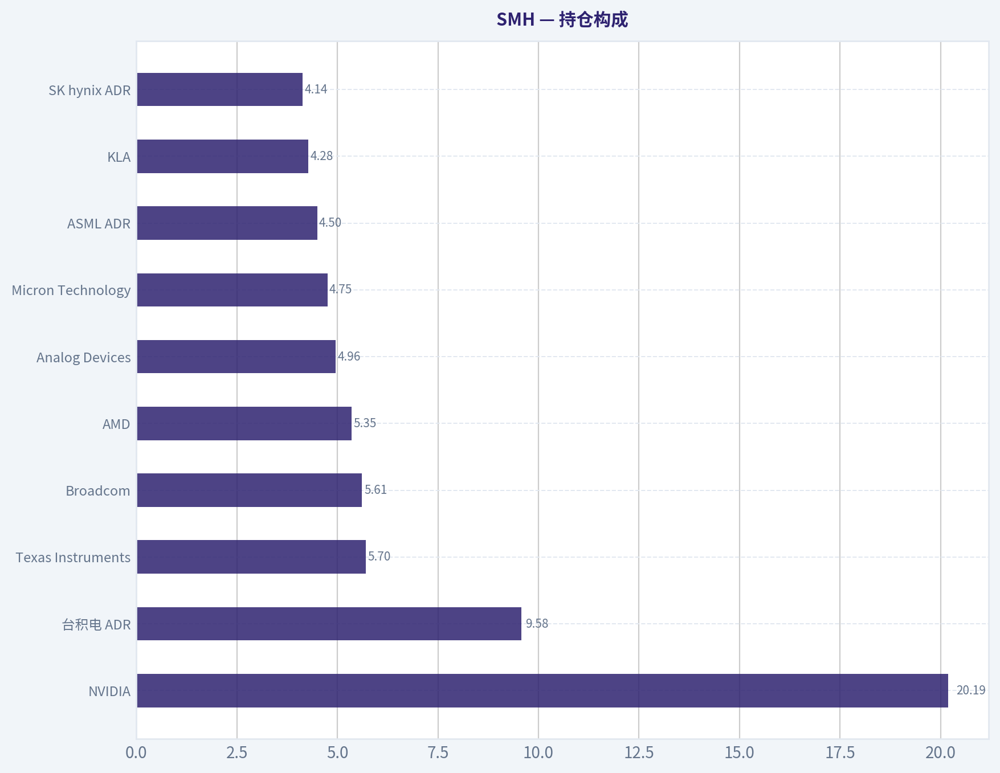
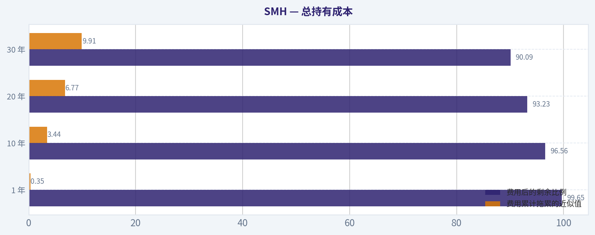
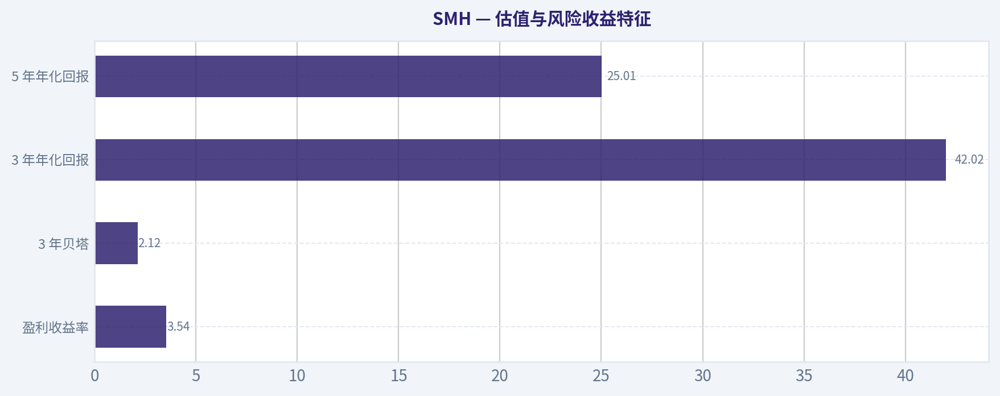
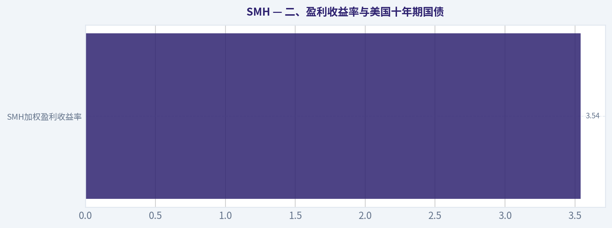
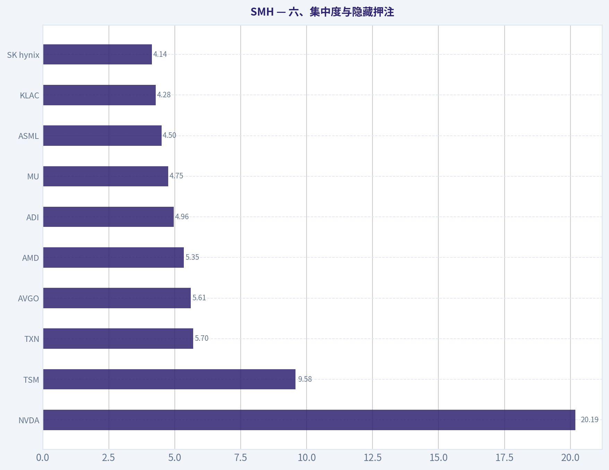
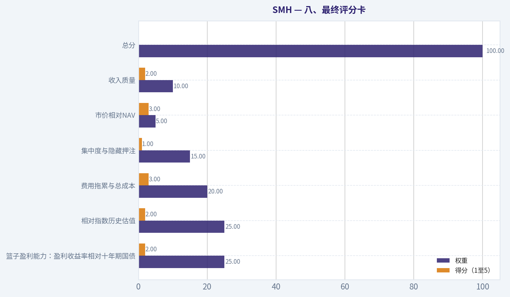
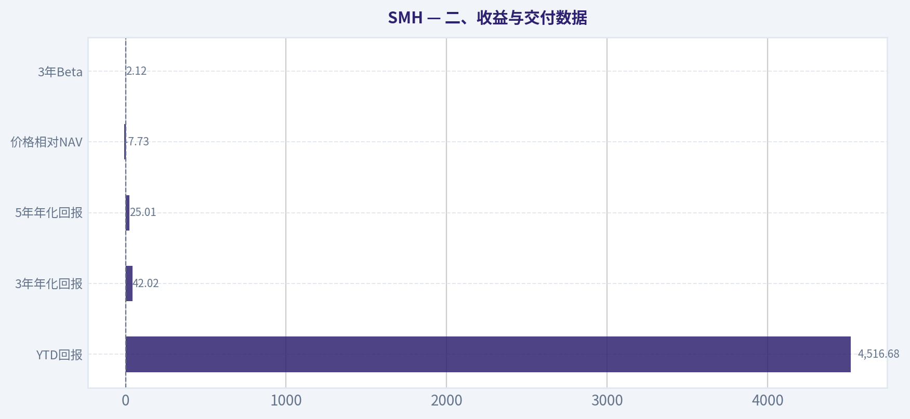
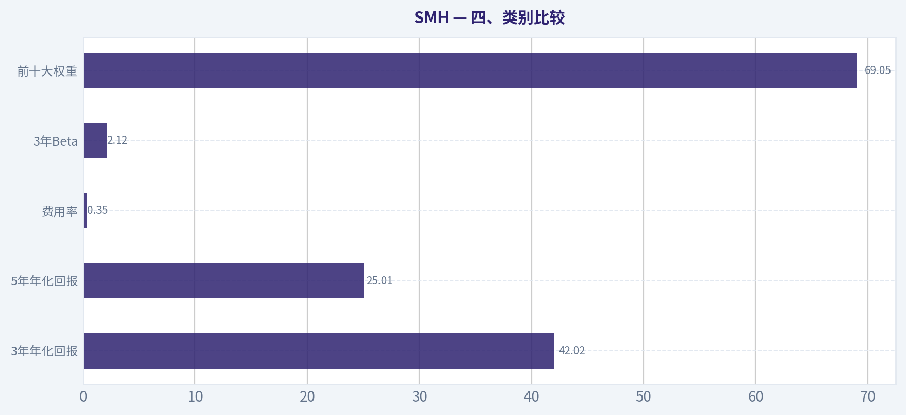

# SMH 深度价值情报

**调研日期:** 2026-11-20

## 关键免责声明

*本报告由 Deep Value Intelligence（一个基于 AI 的多智能体投资分析框架）自动生成。 仅供教育和研究用途 - 非财务建议，非财务顾问。*

---

## 目录

1. 情报摘要
2. 分析师团队报告
   - 基本面分析
   - 篮子估值分析
   - 资金流与业绩分析
   - 市场分析
   - 期权市场分析
3. 研究团队评论
4. 投资团队评论
5. Deep Values 团队洞察

---

## 情报摘要

### 核心观点与前提条件

**核心论点:** **结论：中性。**

**主要风险:**
- **结论：中性。**
- Risky Analyst正确指出，不能机械地将3.54%的盈利收益率与约4.10%的十年期美债收益率比较。债券现金流相对固定，而半导体企业可以通过再投资、技术升级和自由现金流增长消化当前估值。
- 因此，WATCH不是否定产业逻辑，而是承认篮子质量与购买价格是两个不同问题。

**置信度:** 中

---

## 分析师团队报告

### 基本面分析

ANALYST STANCE: **中性**

#### 基金定位与核心判断

SMH 是 VanEck Semiconductor ETF，上市于 Nasdaq，提供的是**半导体行业股票篮子**，而不是广泛分散的科技市场敞口。其实际风险主要来自三点：

1. **持仓高度集中**：前十大持仓占 69.05%，NVIDIA 单一权重达 20.19%。
2. **行业单一**：科技板块权重为 100%，几乎不存在跨行业缓冲。
3. **估值与周期敏感度较高**：篮子市盈率 28.2 倍，市净率 9.8 倍，3 年贝塔为 2.12，价格波动显著高于宽基市场。

因此，SMH 的真实角色是**半导体行业高弹性主题工具**，而不是低波动核心宽基 ETF。当前资料支持对其长期成长性保持关注，但不足以支持在当前估值和数据质量存在疑点的情况下给出更积极判断。

#### 篮子构成：投资者实际拥有的资产

SMH 的资产类别几乎全部是股票：股票占 99.93%，现金仅占 0.07%。这意味着基金基本没有债券、现金或防御性资产，收益和风险都直接由半导体股票决定。

前十大持仓合计 69.05%，其中 NVIDIA 一家就占 20.19%。前两大持仓 NVIDIA 与台积电合计接近 30%，前五大持仓约 46.43%。这种集中度使基金名义上包含多家公司，但实际表现会明显受少数人工智能、先进制程和高端芯片公司驱动。

#### 持仓构成

| 持仓/板块 | 权重 | 说明 |
|---|---:|---|
| NVIDIA | 20.19% | 最大单一权重，人工智能加速器与数据中心敞口显著 |
| 台积电 ADR | 9.58% | 晶圆代工核心资产，承担先进制程与台湾地区风险 |
| Texas Instruments | 5.70% | 模拟芯片与工业、汽车周期敞口 |
| Broadcom | 5.61% | 网络芯片、定制芯片及基础设施软件敞口 |
| AMD | 5.35% | 数据中心、CPU 与人工智能加速器竞争敞口 |
| Analog Devices | 4.96% | 模拟芯片，工业与汽车需求敏感 |
| Micron Technology | 4.75% | 存储器周期与高带宽内存敞口 |
| ASML ADR | 4.50% | 光刻设备，半导体资本开支与出口限制敏感 |
| KLA | 4.28% | 半导体检测设备，受晶圆厂资本开支驱动 |
| SK hynix ADR | 4.14% | 存储器与高带宽内存敞口 |
| 科技板块合计 | 100.00% | 行业集中，没有金融、医疗、消费等跨行业缓冲 |
| 股票资产 | 99.93% | 几乎完全承担股票市场和半导体行业风险 |
| 现金 | 0.07% | 流动性储备极低，对组合波动缓冲有限 |

关键结论：SMH 的"多只股票"并不等于充分分散。篮子同时集中于人工智能、先进制程、数据中心、存储器和半导体设备，行业内部虽然覆盖了不同环节，但仍属于单一产业链风险。

#### 集中度与隐藏行业倾向

前十大权重为 69.05%，意味着其余持仓合计只有约 30.95%。这种结构会带来以下影响：

- **人工智能倾向明显**：NVIDIA、Broadcom、AMD、台积电、Micron 和 SK hynix 共同形成数据中心及人工智能基础设施敞口。
- **资本开支倾向明显**：台积电、ASML、KLA 受晶圆厂投资周期影响，若资本开支放缓，相关公司可能同步承压。
- **周期性较强**：模拟芯片、存储器和设备股分别受工业需求、存储器价格及晶圆厂投资影响。
- **地缘政治风险集中**：台积电、ASML、SK hynix 等非美国资产增加了台湾、韩国、欧洲及出口管制相关风险。
- **单一公司风险不可忽视**：NVIDIA 20.19% 的权重足以显著影响基金短期表现。

多公司覆盖确实降低了单一股票完全失速的风险，但没有消除半导体行业的共同因子风险。因此，SMH 的多元化更接近**产业链内部多样化**，而不是跨行业真正分散。

#### 指数与复制方式

基金资料明确显示名称为 VanEck Semiconductor ETF，但本次 `get_fund_profile` 输出**没有提供所跟踪指数名称，也没有明确说明全复制、抽样复制或合成复制方式**。

因此：

- 指数名称：当前 canonical 数据中不可用。
- 复制方式：当前 canonical 数据中不可用。
- 是否存在衍生品或证券借贷影响：当前资料未说明。
- 组合交付准确度：无法仅凭本次数据验证跟踪误差。

从持仓表现看，基金至少持有一篮子真实股票，而不是纯现金结算产品；但不能在缺少官方指数和跟踪误差数据的情况下断言其属于严格的完全复制结构。评估实际交付质量时，应重点关注长期净值相对指数的跟踪误差、再平衡规则、证券借贷收入及跨市场交易成本。

#### 结构、发行人和规模

| 项目 | 数据 | 解释 |
|---|---:|---|
| 法律结构 | ETF | 可在交易所盘中交易，价格可能偏离 NAV |
| 发行人 | VanEck | 具备长期 ETF 管理经验的基金家族 |
| 报告费用率 | 0.35% | 每年从基金资产中扣除 |
| AUM | 664.4 亿美元 | 若数据准确，属于超大规模 ETF |
| 资产净值/份额 | 447.43 美元 | 基金资料所示 NAV |
| 市场价格 | 412.86 美元 | 基金资料所示交易价格 |
| 价格相对 NAV | -7.73% | 显示较大折价，但与超大规模、高流动性 ETF 的常见状态不完全一致 |
| 共享资料市值 | 约 48.2 亿美元 | 与 664.4 亿美元 AUM 存在重大不一致 |

关键结论：VanEck 的发行人背景和理论上的 664.4 亿美元 AUM 对流动性、买卖价差和基金存续能力应当是正面因素。但 AUM、净资产、市场价格和 NAV 之间存在明显数据冲突，尤其是 7.73% 的 NAV 折价不符合大型流动 ETF 的通常表现，因此不能把这些规模与折溢价数据视为完全可靠。

AUM 数据还出现了"总净资产 646,361"的异常字段，与 664.4 亿美元严重不一致。这更像是数据抓取或单位错误，而非经济意义上的真实基金规模。结构性判断可以认为 SMH 具有成熟 ETF 的外观，但规模与折溢价仍需要发行人官方页面或最新基金报告交叉验证。

#### 总持有成本

SMH 的净费用率为 0.35%，对于主题型、行业型半导体 ETF 而言属于**中等水平**，低于许多主动管理基金和窄主题产品，但高于大型宽基 ETF。

若假设基金资产价值不变、只计算费用侵蚀：

| 持有期限 | 费用后的剩余比例 | 费用累计拖累的近似值 |
|---|---:|---:|
| 1 年 | 99.65% | 0.35% |
| 10 年 | 96.56% | 3.44% |
| 20 年 | 93.23% | 6.77% |
| 30 年 | 90.09% | 9.91% |

关键结论：0.35% 年费看似不高，但在长期复利下会持续减少净资产，30 年静态累计影响约为 9.91%，尚未计入交易价差、税务和跟踪误差。对于 SMH，费用不是最大风险，真正更重要的是半导体行业波动、集中度和估值变化。

此外，年度持仓换手率为 12.00%，并不算极端。它意味着基金并非频繁交易型产品，隐藏交易成本和资本利得分配压力相对可控，但半导体股票及跨境 ADR 的交易成本、再平衡成本和预扣税仍可能使实际总成本高于 0.35%。

综合总持有成本应包括：

- 0.35% 管理费用；
- 买卖价差和盘中交易成本；
- 指数再平衡与换手产生的隐性成本；
- 跨境持仓的税务和托管成本；
- 市场价格偏离 NAV 时产生的额外交易摩擦；
- 跟踪误差。

#### 收入特征

| 项目 | 数据 | 解释 |
|---|---:|---|
| 分配收益率 | 0.21% | 现金收入水平很低 |
| 收入来源 | 股票股息 | 主要来自基金持有的半导体公司分红 |
| 收入稳定性 | 周期性较强 | 半导体公司分红可能随盈利和资本开支周期变化 |
| 收入属性 | 非核心回报来源 | 总回报主要依赖股价和盈利增长，而非现金分配 |

关键结论：SMH 不是收益型 ETF，0.21% 的分配收益率仅能提供很有限的现金流。其经济回报主要来自半导体企业盈利增长和估值变化，而不是稳定股息，因此不适合用高分红或现金流稳定性框架评价。

#### 估值与风险收益特征

| 指标 | 数值 | 含义 |
|---|---:|---|
| 加权市盈率 | 28.2 倍 | 市场已为成长性支付较高估值 |
| 加权市净率 | 9.8 倍 | 资产轻、知识产权和盈利能力溢价明显 |
| 加权市销率 | 11.2 倍 | 对未来收入增长预期较高 |
| 加权市现率 | 24.0 倍 | 现金流估值并不低 |
| 盈利收益率 | 3.54% | 为市盈率倒数，提供的当前盈利回报有限 |
| 3 年贝塔 | 2.12 | 历史波动显著高于广泛股票市场 |
| 3 年年化回报 | 42.02% | 历史表现强劲，但不能直接外推 |
| 5 年年化回报 | 25.01% | 长期表现同样较高，但包含特定行业景气阶段 |

关键结论：SMH 的估值反映了较高的增长预期，28.2 倍市盈率和 11.2 倍市销率意味着未来盈利兑现非常重要。高贝塔与高集中度叠加后，基金可能在行业景气上行时显著跑赢市场，也可能在估值压缩或资本开支转弱时出现更大幅度回撤。

本次资料中的 YTD 回报为 4516.68%，明显缺乏经济合理性，极可能属于数据单位、拆分调整或抓取错误。该异常数据不应作为投资判断依据。共享资料中的当前价格约 413 美元，与基金资料中的 412.86 美元基本一致，但市值约 48.2 亿美元与基金资料 AUM 664.4 亿美元不一致，也需要进一步核验。

#### 关键投资洞察、红旗与机会

| 类别 | 观察 | 研究含义 |
|---|---|---|
| 机会 | 覆盖芯片设计、代工、设备、存储器和模拟芯片 | 能够一次性获得半导体产业链多个环节的敞口 |
| 机会 | NVIDIA、台积电、ASML、Broadcom 等龙头占比较高 | 龙头盈利增长可能显著推动基金表现 |
| 机会 | 换手率 12% | 隐性交易成本通常低于高频主题基金 |
| 红旗 | 前十大占 69.05% | 名义上多元，实际表现由少数股票主导 |
| 红旗 | 科技板块占 100% | 缺少跨行业防御和周期对冲 |
| 红旗 | 3 年贝塔 2.12 | 市场回撤期间潜在波动放大 |
| 红旗 | 估值偏高 | 盈利增速放缓可能带来估值压缩 |
| 红旗 | AUM、净资产与折溢价数据冲突 | 当前数据质量不足以精确判断流动性和 NAV 交易效率 |
| 红旗 | 指数和复制方式缺失 | 无法完整验证基金的跟踪机制和跟踪误差 |
| 收入限制 | 分配收益率仅 0.21% | 现金流贡献很小，回报依赖资本增值 |

#### 适用角色与估值含义

从组合功能看，SMH 更接近：

- 半导体行业主题敞口；
- 人工智能基础设施和高端计算的高弹性表达；
- 产业链内部的多公司分散工具；
- 对全球芯片资本开支和技术升级趋势的敏感指标。

它并不等同于：

- 全球股票宽基；
- 低波动核心资产；
- 高股息收入工具；
- 跨行业防御型基金。

在当前资料下，最重要的估值含义是：SMH 的市场定价已经包含相当程度的成长预期，而其盈利收益率只有 3.54%。若人工智能相关收入、数据中心资本开支和存储器周期继续强劲，较高估值可能获得盈利增长支持；若增长预期下修，集中度和高贝塔会放大估值回落。

#### 最终投资立场

**中性**

支持中性判断的理由：

1. 半导体产业链质量较高，篮子覆盖设计、代工、设备、存储器和模拟芯片。
2. VanEck ETF 结构成熟，理论规模若以 664.4 亿美元为准，则流动性和存续能力较强。
3. 但前十大持仓占 69.05%，科技板块占 100%，并非真正跨行业分散。
4. 28.2 倍市盈率、11.2 倍市销率和 2.12 的贝塔显示估值与波动都偏高。
5. AUM、净资产、NAV 折价及历史回报数据存在明显冲突，降低了当前数据对精确判断的可信度。
6. 本次资料缺少跟踪指数、复制方式和跟踪误差，无法完整评价包装层面的交付质量。

总体而言，SMH 的产业主题逻辑较强，但当前证据更支持"高质量、高波动、高集中度的半导体主题工具"这一描述，而不是低风险或充分分散的核心 ETF。

#### 报告摘要

| 维度 | 核心结论 | 主要证据 |
|---|---|---|
| 实际篮子 | 半导体股票为主，几乎没有现金缓冲 | 股票 99.93%，现金 0.07% |
| 集中度 | 高度集中于少数龙头 | 前十大 69.05%，NVIDIA 20.19% |
| 行业结构 | 单一科技行业，产业链内部多元 | 科技板块 100% |
| 估值 | 成长预期已较充分反映 | PE 28.2 倍，PS 11.2 倍 |
| 波动 | 高于广泛股票市场 | 3 年贝塔 2.12 |
| 费用 | 中等，长期会形成持续拖累 | 费用率 0.35% |
| 换手 | 不高，隐藏交易成本相对可控 | 年度换手率 12% |
| 收入 | 现金分配很低 | 分配收益率 0.21% |
| 包装层 | ETF 结构成熟，但关键数据不完整 | VanEck；指数和复制方式未提供 |
| 数据质量 | 存在重要冲突 | AUM、净资产、NAV 折价、YTD 回报不一致 |
| 最终立场 | 高质量主题篮子，但估值、集中度和数据问题限制判断 | 中性 |

关键结论：SMH 的核心优势是集中持有半导体产业链龙头，核心风险则是集中度高、行业单一、估值不低和波动较大。当前资料不足以支持更强烈的方向性判断，尤其需要先核验官方 AUM、NAV、折溢价、指数名称和跟踪误差数据。

---

### 篮子估值分析

> *以价值投资者审视企业的方式为篮子估值：加权估值倍数、盈利收益率对比债券、费用侵蚀，以及应用于篮子的安全边际。*

ANALYST STANCE: **看空**

#### 一、篮子估值概览

| 指标 | SMH 加权数据 | 含义 |
|---|---:|---|
| 市盈率 PE | 28.2倍 | 估值较高 |
| 市净率 PB | 9.8倍 | 对资本回报和成长预期要求极高 |
| 市销率 PS | 11.2倍 | 销售基础上的估值溢价明显 |
| 市现率 P/CF | 24.0倍 | 现金流估值不便宜 |
| 加权盈利收益率 | 3.54% | 等于 1 ÷ 28.2 |

**关键结论：**SMH持有的是高质量但高估值的半导体企业组合。28.2倍PE对应的盈利收益率只有3.54%，这意味着估值合理性高度依赖未来盈利继续快速增长，而不是当前盈利本身提供充足回报。

#### 二、盈利收益率与美国十年期国债

截至2026年11月20日，本文采用美国十年期国债收益率约 **4.10%** 作为比较基准。

| 项目 | 数值 |
|---|---:|
| SMH加权盈利收益率 | 3.54% |
| 美国十年期国债收益率 | 约4.10% |
| SMH相对差额 | 约低0.56个百分点 |

**关键结论：**SMH的盈利收益率低于无信用风险的十年期美国国债收益率。换句话说，当前估值没有提供足够的静态盈利回报，投资者支付的是对人工智能、数据中心和芯片周期未来增长的预付款。

分配收益率仅为 **0.21%**。以盈利收益率3.54%估算，现金分配比例约为：

```text
0.21% ÷ 3.54% ~ 5.9%
```

这意味着约 **94.1%的隐含盈利被留在组合企业内部再投资**，收入属性较弱，价值主要取决于留存利润能否转化为更高的未来盈利和现金流。

#### 三、指数估值与自身历史

SMH追踪的是半导体行业篮子，而不是广泛市场指数。基于半导体行业长期常见估值区间的近似假设：

| 估值维度 | 当前SMH | 长期常见区间的近似判断 | 当前状态 |
|---|---:|---:|---|
| PE | 28.2倍 | 约15至25倍 | 高于长期常态 |
| PB | 9.8倍 | 约2至6倍；取决于无形资产和周期位置 | 显著高于长期常态 |
| 盈利收益率 | 3.54% | 长期较合理水平通常高于4% | 偏低 |

**关键结论：**按上述近似历史区间，SMH当前PE处于长期正常范围上方，PB则更为激进。历史上，半导体行业在高估值、强周期和高盈利预期同时出现时，后续回报更容易受到盈利增速放缓、库存调整和估值压缩的双重影响。由于半导体盈利具有周期性，当前PE还可能低估周期见顶时的实际估值风险。

#### 四、市场价格与NAV

| 项目 | 数值 |
|---|---:|
| 市场价格 | 约413美元 |
| 每股NAV | 447.43美元 |
| 市场价格相对NAV | 折价7.72% |
| 资产类别 | 99.93%股票 |
| 现金 | 0.07% |

**关键结论：**按报告数据，SMH市场价格较NAV折价7.72%，这对买入价格本身是正面因素，因为市场价格低于组合资产净值。不过，SMH是流动性较高的ETF，如此大的持续折价并不常见，因此该折价需要被视为异常定价信号，而不是自动等同于安全边际。即使折价真实存在，底层股票本身仍可能继续下跌。

#### 五、费用拖累

SMH净费用率为 **0.35%**。按照开发者要求的简化公式：

```text
费用拖累 ~ 1 - (1 - 费用率)^N
```

以10,000美元本金计算，且不考虑市场涨跌、税费和交易成本：

| 持有年限 | SMH费用拖累计算 | 累计比例拖累 | 10,000美元对应金额 |
|---|---|---:|---:|
| 10年 | 1 - 0.9965^10 | 约3.44% | 约344美元 |
| 20年 | 1 - 0.9965^20 | 约6.77% | 约677美元 |
| 30年 | 1 - 0.9965^30 | 约9.98% | 约998美元 |

同类低费率替代品可用iShares半导体ETF，费用率约 **0.20%** 作参照：

| 持有年限 | 0.20%费用率累计拖累 | 10,000美元对应金额 | SMH相对多出的拖累 |
|---|---:|---:|---:|
| 10年 | 约1.98% | 约198美元 | 约146美元 |
| 20年 | 约3.93% | 约393美元 | 约284美元 |
| 30年 | 约5.83% | 约583美元 | 约415美元 |

**关键结论：**0.35%的费用率并非极端昂贵，但明显高于约0.20%的同类低费率方案。SMH在30年期间相对低费率替代品可能多消耗约415美元，且上述计算尚未包括买卖价差、税费以及12%的年度持仓周转所产生的隐性交易成本。

#### 六、集中度与隐藏押注

| 持仓 | 权重 |
|---|---:|
| NVDA | 20.19% |
| TSM | 9.58% |
| TXN | 5.70% |
| AVGO | 5.61% |
| AMD | 5.35% |
| ADI | 4.96% |
| MU | 4.75% |
| ASML | 4.50% |
| KLAC | 4.28% |
| SK hynix | 4.14% |
| 前十大持仓合计 | 69.05% |

**关键结论：**SMH并不是均匀分散的半导体组合，前十大持仓占69.05%，其中NVDA单一权重超过20%。组合实际上集中押注人工智能资本开支、先进制程、HBM存储、晶圆代工和数据中心需求；行业虽然分散于多个公司，但宏观驱动因素高度相关，不能视为传统意义上的低集中度ETF。

#### 七、篮子的安全边际

SMH的安全边际主要受到三项因素制约：

1. **盈利收益率不足：**3.54%低于约4.10%的十年期国债收益率。
2. **估值高于历史常态：**PE高于近似长期区间上沿，PB更为激进。
3. **集中度较高：**NVDA占20.19%，前十大合计69.05%，行业相关性显著。

有利因素是，市场价格按报告值低于NAV 7.72%，且篮子覆盖了半导体设计、制造、设备和存储等多个环节。但折价无法消除行业周期风险，也无法抵消高估值对未来增长的依赖。

#### 八、最终评分卡

| 评价标准 | 权重 | 得分（1至5） | 加权得分 |
|---|---:|---:|---:|
| 篮子盈利能力：盈利收益率相对十年期国债 | 25% | 2.0 | 0.50 |
| 相对指数历史估值 | 25% | 2.0 | 0.50 |
| 费用拖累与总成本 | 20% | 3.0 | 0.60 |
| 集中度与隐藏押注 | 15% | 1.0 | 0.15 |
| 市价相对NAV | 5% | 3.0 | 0.15 |
| 收入质量 | 10% | 2.0 | 0.20 |
| **总分** | **100%** |  | **2.10 / 5.00** |

**关键结论：**SMH拥有强劲的行业地位和长期结构性增长主题，但当前估值、低分配收益率和高集中度显著削弱了安全边际。NAV折价是唯一明显的价格层面缓冲因素，却不足以弥补盈利收益率低于国债及组合对少数大型芯片公司的高度依赖。

#### 九、综合判断

**ANALYST STANCE: 看空**

**信心水平：中高。**

证据显示，SMH更像是一个高集中度、高周期性、对人工智能资本开支高度敏感的行业篮子，而不是以低估值和稳定现金分配为核心的价值型篮子。除非未来盈利增长足以持续消化28.2倍PE和9.8倍PB，否则当前价格对应的长期风险回报并不具备充分的安全边际。

#### 估值图表

本对比图（来自「持仓构成」）将 **SMH** 的当前数据与历史基准并排呈现，直观反映公司相对自身历史均值的估值水平。



本对比图（来自「总持有成本」）将 **SMH** 的当前数据与历史基准并排呈现，直观反映公司相对自身历史均值的估值水平。



本对比图（来自「估值与风险收益特征」）将 **SMH** 的当前数据与历史基准并排呈现，直观反映公司相对自身历史均值的估值水平。



本对比图（来自「二、盈利收益率与美国十年期国债」）将 **SMH** 的当前数据与历史基准并排呈现，直观反映公司相对自身历史均值的估值水平。



本对比图（来自「六、集中度与隐藏押注」）将 **SMH** 的当前数据与历史基准并排呈现，直观反映公司相对自身历史均值的估值水平。



本对比图（来自「八、最终评分卡」）将 **SMH** 的当前数据与历史基准并排呈现，直观反映公司相对自身历史均值的估值水平。



本对比图（来自「二、收益与交付数据」）将 **SMH** 的当前数据与历史基准并排呈现，直观反映公司相对自身历史均值的估值水平。



本对比图（来自「四、类别比较」）将 **SMH** 的当前数据与历史基准并排呈现，直观反映公司相对自身历史均值的估值水平。



---

### 资金流与业绩分析

> *评估交付与需求：多期限净值与价格回报、相对指数的跟踪偏差、同类排名、规模与资金流趋势、分红与换手率。*

分析立场：**中性**

#### 一、结论摘要

SMH 是 VanEck Semiconductor ETF，当前价格约 **413美元**。基金画像显示其半导体集中度极高，前十大成分股占约 **69.05%**，其中 NVDA 权重约 **20.19%**。长期回报数据具有吸引力，但工具返回的 YTD 回报为 **4,516.68%**，明显不具备可信度；同时 AUM、NAV 与价格数据存在重大冲突，因此当前更适合归类为"数据待核实、估值敏感度较高"的观察对象。

#### 二、收益与交付数据

| 指标 | 数据 | 可信度与解释 |
|---|---:|---|
| 当前价格 | 412.86美元，约等于413美元 | 与共享研究包一致 |
| YTD回报 | 4,516.68% | 明显异常，不能用于判断真实表现 |
| 3年年化回报 | 42.02% | 可作为初步参考，但需进一步核验 |
| 5年年化回报 | 25.01% | 可作为初步参考，但需进一步核验 |
| 1年回报 | 未提供 | 数据缺失 |
| 10年回报 | 未提供 | 数据缺失 |
| NAV | 447.43美元 | 与市场价格差异异常 |
| 价格相对NAV | -7.73% | 对ETF而言显著异常，需核实估值时点或数据源 |
| 3年Beta | 2.12 | 说明波动显著高于大盘 |

**关键结论：** 可用数据支持 SMH 过去3年和5年表现强劲，但异常的 YTD 数字使整体回报记录无法直接采信。市场价格低于NAV约7.7%也不符合通常的高流动性ETF特征，可能来自异步报价、拆分调整或数据错误。

#### 三、基准指数与跟踪差异

SMH 通常跟踪 **MVIS US Listed Semiconductor 25 Index**。本次数据未提供该指数在1年、3年、5年或10年维度的同期回报，因此无法计算：

> 跟踪差异 ~ 指数回报 - 基金回报

| 跟踪项目 | 结果 |
|---|---|
| 费用率 | 0.35% |
| 指数同期回报 | 未提供 |
| NAV回报 | 未提供 |
| 市价回报 | 仅有异常YTD数据 |
| 可验证跟踪差异 | 无法计算 |
| 是否存在持续超额滞后 | 无法确认 |

**关键结论：** 目前不能判断 SMH 是否持续超出0.35%的费用拖累，也不能确认是否存在采样误差、交易成本或现金拖累。由于NAV和市价数据本身存在异常，跟踪质量暂时只能评为"待核实"，而不是"已确认良好"。

#### 四、类别比较

| 比较项目 | SMH数据 | 同类比较 |
|---|---:|---|
| 分类 | 科技类ETF | 半导体主题，通常波动高于综合科技ETF |
| 3年年化回报 | 42.02% | 同类排名未提供 |
| 5年年化回报 | 25.01% | 同类排名未提供 |
| 费用率 | 0.35% | 对半导体主题ETF而言处于中等水平 |
| 3年Beta | 2.12 | 风险通常高于大盘科技指数 |
| 前十大权重 | 69.05% | 集中度较高 |

**关键结论：** SMH 的收益表现可能受AI、数据中心和先进制程周期推动，不能简单视为费用或结构带来的长期优势。缺乏同类ETF的同期回报，暂时无法判断其超额表现究竟来自更优指数设计，还是仅仅来自半导体行业的周期性上涨。

#### 五、规模与资金流

| 项目 | 数据 | 判断 |
|---|---:|---|
| 工具返回AUM | 66.44B美元 | 与其他数据冲突 |
| 共享研究包总市值字段 | 4.82B美元 | 可能是旧数据或字段误标 |
| 报告总净资产字段 | 646,361美元 | 与AUM严重不一致 |
| 资金流明细 | 未提供 | 无法判断资金持续流入或流出 |
| 规模风险 | 表面上较低 | 需先核实真实AUM |

**关键结论：** 如果66.44B美元的AUM属实，SMH规模很大，清算和流动性风险通常较低；但该数字与4.82B美元及646,361美元两个字段严重矛盾。没有连续月度资金流数据，也无法判断资金属于长期配置资金，还是追逐半导体强势表现的短期资金。

#### 六、分配收益与质量

| 项目 | 数据 |
|---|---:|
| 分配收益率 | 0.21% |
| 分配增长历史 | 未提供 |
| 分配来源拆分 | 未提供 |
| 返还资本比例 | 未提供 |
| 收入属性 | 低收益，主要依赖成分股分红 |

**关键结论：** 0.21%的分配收益率说明 SMH 不是以现金收入为核心的ETF，收益主要来自净值增长而非分红。由于没有分配来源拆分，无法确认是否存在返还资本，但当前收益率很低，返还资本对整体收益的影响预计不是主要因素。

#### 七、换手率与运营效率

| 项目 | 数据 | 解读 |
|---|---:|---|
| 年度持仓换手率 | 12.00% | 较低 |
| 费用率 | 0.35% | 中等 |
| 股票资产比例 | 99.93% | 现金拖累很小 |
| 现金比例 | 0.07% | 接近全额投资 |
| 指数策略匹配度 | 基本合理 | 半导体主题指数通常需要定期再平衡 |

**关键结论：** 12%的换手率并不高，与定期再平衡的主题指数基本匹配。0.07%的现金比例意味着现金拖累有限，但0.35%的费用率仍会构成长期、稳定的回报摩擦。

#### 八、估值敏感度

当前工具给出的组合估值为 **28.2倍PE**，对应约 **3.54%的盈利收益率**。以下为静态估值敏感度，不是价格预测：

| 假设PE | 相对28.2倍PE的估值变化 | 含义 |
|---:|---:|---|
| 20倍 | -29.1% | 盈利增长放缓或利率上升时，估值压缩风险较大 |
| 25倍 | -11.3% | 温和压缩 |
| 28.2倍 | 基准 | 当前组合估值 |
| 32倍 | +13.5% | 需要较强盈利增长或风险偏好支持 |
| 40倍 | +41.8% | 需要更高增长确定性与流动性溢价 |

**关键结论：** 28.2倍PE并非极端泡沫水平，但对于高波动、强周期的半导体篮子而言，估值仍高度依赖盈利兑现。前十大成分股集中度接近70%，意味着个别大型芯片公司的盈利预期变化可能对整个ETF估值产生明显影响。

#### 九、综合评分

| 评分维度 | 权重 | 暂定得分 | 依据 |
|---|---:|---:|---|
| 多周期回报 | 25% | 3.0/5 | 3年、5年数据强，但YTD异常且1年、10年缺失 |
| 跟踪准确性 | 25% | 2.5/5 | 指数同期数据缺失，NAV与市价异常 |
| 类别表现 | 15% | 2.5/5 | 缺少同类排名 |
| AUM与资金流 | 15% | 2.5/5 | AUM字段冲突，流量数据缺失 |
| 分配质量 | 10% | 3.0/5 | 收益率低但无明显资本返还证据 |
| 换手与效率 | 10% | 4.0/5 | 换手率低，现金比例低 |
| **加权总分** | **100%** | **2.8/5** | **数据可靠性拖累整体评价** |

**关键结论：** 暂定总分约2.8分，主要不是因为已确认的基金运营失败，而是因为关键数据存在严重不一致。按照既定评分框架，SMH目前处于需要核实跟踪数据、AUM和NAV后再重新评级的区间。

#### 十、主要风险与催化因素

| 类型 | 因素 | 对SMH的潜在影响 |
|---|---|---|
| 风险 | 前十大权重69.05% | 个别龙头公司业绩失误会放大ETF波动 |
| 风险 | NVDA权重20.19% | AI资本开支、GPU需求或估值变化影响显著 |
| 风险 | 半导体周期性 | 库存、价格和资本开支周期可能造成盈利波动 |
| 风险 | 地缘政治 | 亚洲先进制造和供应链暴露较高 |
| 风险 | 数据异常 | NAV、AUM和回报字段可能导致错误判断 |
| 催化因素 | AI算力需求延续 | 有利于GPU、存储、网络芯片和先进制造环节 |
| 催化因素 | 半导体盈利上修 | 可能改善组合盈利收益率 |
| 催化因素 | 指数再平衡 | 可能降低单一成分股长期集中度 |

**最终判断：** SMH的长期增长叙事较强，且3年、5年回报数据突出；但基金交付分析最关键的NAV、AUM、指数跟踪和资金流数据目前并不一致。证据尚不足以支持在413美元附近给予更高估值溢价，后续重点应是核实真实AUM、历史NAV回报、基准指数回报及连续资金流数据。

---

### 市场分析

ANALYST STANCE: **中性**

#### 分析范围与数据说明

本报告仅分析 **SMH：VanEck Semiconductor ETF，纳斯达克上市**。数据覆盖 2025年11月20日至2026年11月19日；2026年11月20日未获得新的有效收盘价，因此最新有效收盘价为 **447.48美元**。

本次选取八项互补指标：50日均线、200日均线、10日均线、MACD、MACD柱状图、RSI、ATR和VWMA。它们分别覆盖中期趋势、长期趋势、短线价格惯性、动量拐点、超买超卖、波动风险及成交量加权价格，重复性相对较低。

#### 价格结构与趋势背景

| 项目 | 数值或观察 | 含义 |
|---|---:|---|
| 最新有效收盘价 | 447.48美元 | 处于近期弱势区间 |
| 一年起点收盘价 | 324.09美元 | 一年累计仍有明显涨幅 |
| 一年期间高点 | 668.91美元，2026年6月22日 | 年内出现强劲趋势扩张 |
| 高点至最新价回撤 | 约33.1% | 中期调整幅度较深 |
| 最新价相对50日SMA | 低约18.8% | 中期趋势明显转弱 |
| 最新价相对200日SMA | 低约14.8% | 长期价格基准也已被跌破 |
| 2026年10月初至11月19日 | 约617.81美元降至447.48美元 | 近两个月出现加速下行 |

关键结论：SMH虽然较一年前仍处于较高水平，但从6月高点回撤约三分之一，近期价格结构已经从高位震荡转为明显的下降阶段。长期涨幅尚未完全抹去，但短中期价格已经显著低于主要均线，市场对此前高估值和高增长预期的定价正在重新调整。

#### 均线与趋势状态

| 指标 | 最新有效值 | 与收盘价关系 | 趋势解读 |
|---|---:|---|---|
| 10日EMA | 475.19美元 | 价格低约5.8% | 短线下行压力仍在 |
| 50日SMA | 550.88美元 | 价格低约18.8% | 中期趋势偏弱 |
| 200日SMA | 525.08美元 | 价格低约14.8% | 长期趋势确认度下降 |
| 50日SMA与200日SMA | 550.88美元对525.08美元 | 50日均线仍高于200日均线 | 尚未形成典型死亡交叉，但差距正在收窄 |
| 10日EMA斜率 | 近期由约617美元降至475美元 | 快速向下 | 下跌动能集中在最近数周 |

关键结论：均线排列传递出"长期上升结构尚未完全反转、但中短期已经显著恶化"的信号。10日EMA低于50日SMA和200日SMA，且三者之间的距离扩大，说明近期反弹尚未改变下降趋势；50日SMA仍高于200日SMA，只能说明长期滞后指标尚未完成确认，不能抵消现阶段的价格弱势。

#### 动量指标：MACD与RSI

| 指标 | 最新有效值 | 近期变化 | 信号含义 |
|---|---:|---|---|
| MACD | -27.07 | 由10月中旬约1.07降至负值深处 | 快慢均线差额明显偏空 |
| MACD柱状图 | -2.81 | 11月13日约-0.84后重新走弱 | 空头动量重新增强 |
| RSI | 33.03 | 11月5日曾降至26.03，随后短暂修复 | 接近超卖区，但尚未形成强势反转确认 |
| RSI近期高点 | 44.17，2026年11月11日 | 反弹未能回到50以上 | 买方动能不足 |
| MACD状态 | MACD仍为负，柱状图亦为负 | 未出现有效正向扭转 | 趋势动量仍偏弱 |

关键结论：RSI从极端低位略有回升，说明最急促的抛压曾出现短暂缓和，但33附近仍接近弱势区间，且没有回到50以上。MACD及其柱状图同时处于负值，尤其柱状图在11月中旬重新恶化，说明近期反弹更像下跌过程中的修复，而不是已经确认的趋势反转。

#### 波动率与成交量加权价格

| 指标 | 最新有效值 | 相对价格或近期变化 | 解读 |
|---|---:|---|---|
| ATR | 24.24美元 | 约为收盘价的5.4% | 单日正常波动幅度较大 |
| ATR变化 | 9月底约16美元升至24美元以上 | 波动率明显抬升 | 市场定价分歧扩大 |
| VWMA | 480.73美元 | 价格低约6.9% | 成交量加权成本基准位于价格上方 |
| VWMA变化 | 10月初约582美元，降至480.73美元 | 快速下移 | 量价趋势同步转弱 |
| 11月5日成交量 | 约2896万份 | 明显高于多数近期交易日 | 下跌伴随放量，抛压较集中 |
| 11月19日成交量 | 约1047万份 | 高于部分普通交易日 | 价格跌至447.48美元，卖方仍占主导 |

关键结论：ATR从约16美元升至24美元以上，表明近期价格波动已经从普通调整升级为高波动阶段。VWMA高于最新收盘价，意味着近期较大成交量对应的价格区域仍在上方；同时，11月5日的大成交量伴随显著下跌，降低了"低成交量回撤"的解释力度，显示市场重新定价具有较强的交易参与度。

#### 价格路径的细化观察

SMH在2025年11月的324美元附近启动后，至2026年6月升至668.91美元，期间形成持续的高点和高位扩张结构。6月中旬以后，价格虽曾在620至660美元区域反复，但7月开始出现连续低点下移，7月底一度跌至504.22美元。8月至9月的反弹最高仅约609美元，未能重新接近前高，随后10月和11月出现更明显的下降通道。

从10月初约618美元开始，价格先后跌破10日EMA、50日SMA，并在11月进一步跌破200日SMA。11月5日单日收盘跌至447.73美元，成交量接近2896万份，之后虽反弹至11月11日的506.96美元，但反弹没有站稳10日EMA或VWMA，随后价格重新回落至447.48美元。这种"急跌-反弹-再度走弱"的路径，显示上方抛压仍然存在。

同时，RSI在11月5日达到26.03，说明市场已经出现短线超卖；但随后反弹至44.17仍未突破中性线，且价格再次跌至447美元附近。由此可见，超卖状态带来了短期修复空间，却没有改变中期趋势结构。技术面目前缺乏足够证据证明价格已经建立稳定底部。

#### 综合判断与估值含义

| 维度 | 当前证据 | 综合判断 |
|---|---|---|
| 长期趋势 | 价格低于200日SMA，但200日SMA仍向上 | 长期趋势由强转弱，尚未完全确认长期反转 |
| 中期趋势 | 价格明显低于50日SMA，50日SMA持续下移 | 中期偏空 |
| 短期趋势 | 价格低于10日EMA，EMA快速下行 | 短期卖压仍强 |
| 动量 | MACD和柱状图均为负 | 空头动量占优 |
| 超卖程度 | RSI约33，接近但未稳定进入极端超卖 | 存在技术性修复可能，但反转证据不足 |
| 波动率 | ATR约24.24美元，显著高于9月底 | 定价不确定性明显上升 |
| 成交量确认 | 大跌日出现高成交量，VWMA高于价格 | 下行趋势获得量价支持 |
| 估值映射 | 价格较高点回撤约33%，但仍高于一年前水平 | 市场正在压缩此前的高增长溢价，技术证据暂不支持较高估值溢价快速恢复 |

关键结论：综合信号偏向"弱势中的高波动修复阶段"，而不是已经确认的趋势反转阶段。RSI接近超卖提供了反弹可能，但均线、MACD、VWMA和成交量结构均未显示买方重新取得主导，因此现有技术证据不足以支持较高估值溢价已经得到充分修复；后续定价仍高度依赖半导体行业增长预期能否重新获得市场确认。

---

### 期权市场分析

> *解读期权流向--认沽/认购比、隐含波动率偏斜与异常活跃合约--以判断机构定位与事件驱动风险。*

ANALYST STANCE: **看空**

#### SMH 期权市场概览

截至 2026 年 11 月 20 日，SMH 近端期权显示出明显的看跌或防御性倾向。不过，数据存在若干质量限制：部分当日到期期权的 IV 显示为 0%，且工具未提供 SMH 当前现货价格，因此无法准确判断各执行价相对现价属于价内、平值还是价外。

#### 认沽／认购比率

| 到期日 | 认购未平仓量 | 认沽未平仓量 | 认沽／认购 OI | 认购成交量 | 认沽成交量 |
|---|---:|---:|---:|---:|---:|
| 2026-11-20 | 320,540 | 364,311 | 1.14 | 7,809 | 39,366 |
| 2026-11-23 | 5,686 | 9,426 | 1.66 | 974 | 7,280 |
| 2026-11-25 | 3,193 | 3,440 | 1.08 | 803 | 3,594 |
| **合计** | **329,419** | **377,177** | **1.14** | - | - |

| 指标 | 数值 | 相对约 0.7 中性基线的含义 |
|---|---:|---|
| 近端认沽／认购 OI | 1.14 | 明显偏高，认沽保护或看跌押注占优 |
| 近端认沽／认购成交量 | 5.24 | 极端偏高，短线认沽交易显著活跃 |

**关键结论：** SMH 的近端认沽／认购 OI 为 1.14，高于约 0.7 的历史中性水平；成交量比率达到 5.24，显示短线认沽需求远强于认购需求。该结构更接近防御性对冲或看跌交易，而非单纯的中性配置。

#### 隐含波动率与偏斜

| 到期日 | 认购 ATM IV | 认沽 ATM IV | IV 解读 |
|---|---:|---:|---|
| 2026-11-20 | 294.5% | 28.6% | 数值极度不对称，可能受临近到期、流动性或数据异常影响 |
| 2026-11-23 | 87.7% | 50.6% | 认购 ATM IV 高于认沽 ATM IV |
| 2026-11-25 | N/A | 61.3% | 缺少认购数据，无法完整比较 |

| 观察项目 | 结论 |
|---|---|
| 近端 ATM IV | 整体处于异常高位，尤其是 11 月 20 日认购 IV |
| OTM 认沽与 OTM 认购 IV | 数据没有提供完整的 OTM IV 曲线，无法可靠计算传统认沽偏斜 |
| 波动率风险 | 临近到期且数据异常，短线价格波动与报价误差风险都较高 |
| 已知催化剂 | 未提供具体财报、产品发布或宏观事件信息，不能确认 IV 是否由特定催化剂推动 |

**关键结论：** IV 数据整体不稳定，11 月 20 日认购 ATM IV 达 294.5%，与认沽 28.6% 的差距不符合常规连续期权曲线，较可能包含临近到期或报价质量因素。尽管认沽交易量明显占优，但不能仅凭这些 IV 数值认定市场存在正常意义上的"认沽偏斜"。

#### 异常期权活动

以下合约满足成交量超过未平仓量 5 倍且成交量超过 500 张的筛选条件。由于缺少现货价格，价内、平值或价外分类无法确认。

| 到期日 | 类型 | 执行价 | 成交量 | 未平仓量 | 成交量／OI | IV | 初步含义 |
|---|---|---:|---:|---:|---:|---:|---|
| 11 月 20 日 | 认沽 | 600 美元 | 9,382 | 771 | 12.2 倍 | 0.0% | 大规模新成交，偏防御或看跌 |
| 11 月 20 日 | 认沽 | 560 美元 | 3,290 | 76 | 43.3 倍 | 0.0% | 新增交易特征强，方向性较明显 |
| 11 月 20 日 | 认沽 | 605 美元 | 2,981 | 408 | 7.3 倍 | 0.0% | 近端认沽需求集中 |
| 11 月 23 日 | 认沽 | 330 美元 | 2,508 | 7 | 358.3 倍 | 97.4% | 极高成交／OI，可能是事件性或投机性交易 |
| 11 月 20 日 | 认沽 | 555 美元 | 1,777 | 126 | 14.1 倍 | 0.0% | 新鲜认沽交易，偏看跌 |
| 11 月 23 日 | 认沽 | 310 美元 | 1,348 | 3 | 449.3 倍 | 115.0% | 极低 OI 下的异常放量，投机属性较强 |
| 11 月 20 日 | 认购 | 425 美元 | 1,179 | 31 | 38.0 倍 | 65.5% | 新增认购交易，方向可能偏上行，但规模次于认沽 |
| 11 月 20 日 | 认购 | 440 美元 | 1,120 | 113 | 9.9 倍 | 64.8% | 有方向性的认购活动 |
| 11 月 23 日 | 认沽 | 315 美元 | 824 | 7 | 117.7 倍 | 115.0% | 极高成交／OI，短线投机或尾部保护 |
| 11 月 20 日 | 认沽 | 585 美元 | 580 | 83 | 7.0 倍 | 0.0% | 认沽需求延伸至更多执行价 |
| 11 月 25 日 | 认沽 | 410 美元 | 570 | 10 | 57.0 倍 | 63.8% | 新鲜认沽交易，期限略长 |
| 11 月 20 日 | 认购 | 435 美元 | 512 | 68 | 7.5 倍 | 61.0% | 少量新增认购交易 |

**关键结论：** 异常活动中认沽合约占绝大多数，且 600、560、605、555 和 585 美元等执行价附近出现较大成交量，构成主要的短线防御信号。11 月 23 日 310 至 330 美元认沽的成交量／OI 极高，但原始 OI 极低，更像事件性或投机性流量，不能单独视为机构高确信度押注；机构与散户身份也无法仅凭汇总数据确认。

#### 未平仓量集中与潜在价格吸引力

| 到期日 | 认购 OI | 认沽 OI | 总 OI | 观察 |
|---|---:|---:|---:|---|
| 2026-11-20 | 320,540 | 364,311 | 684,851 | 绝大多数近端 OI 集中于当日到期 |
| 2026-11-23 | 5,686 | 9,426 | 15,112 | 认沽明显多于认购 |
| 2026-11-25 | 3,193 | 3,440 | 6,633 | 规模较小，认沽略占优势 |

| 潜在结构 | 评估 |
|---|---|
| 主要 OI 集中期限 | 2026 年 11 月 20 日 |
| 主要执行价墙 | 工具仅给出异常活动合约，未提供完整逐执行价 OI 排名 |
| 认沽墙 | 600、560、605 美元附近存在较活跃的认沽交易，但不能等同于最大 OI 墙 |
| 认购墙 | 425、440、435 美元附近出现异常认购成交，但未提供足够 OI 证明其为强 gamma 墙 |
| Gamma 影响 | 当日到期 OI 极大，理论上可能增加价格钉住或临近到期的快速 gamma 调整，但方向无法由汇总数据确定 |

**关键结论：** SMH 的未平仓量高度集中在 11 月 20 日到期，短线价格可能受到到期结算、做市商对冲和执行价附近钉住效应影响。由于缺少完整逐执行价 OI、gamma 和现货价格，无法可靠确定最大痛点或明确的上行、下行 gamma 墙。

#### 综合情绪判断

| 维度 | 判断 | 证据 |
|---|---|---|
| 认沽／认购 OI | 偏看空 | 比率 1.14，高于约 0.7 中性基线 |
| 认沽／认购成交量 | 强烈偏看空或防御 | 比率 5.24，认沽成交量显著占优 |
| IV 水平 | 异常偏高且不稳定 | 多个近端期限 IV 较高，部分数据为 0% 或缺失 |
| 偏斜方向 | 无法完整确认 | 缺少完整 OTM 认沽与认购 IV 曲线 |
| 异常活动 | 认沽主导 | 多个认沽合约成交量远超 OI |
| 流动性与数据质量 | 需谨慎 | 当日到期占比过高，IV 存在明显异常值 |
| **总体信号** | **BEARISH（看空）** | 认沽成交、OI 和异常活动共同偏向下行防御 |

**关键结论：** 综合信号为 **BEARISH（看空）**，核心驱动是认沽／认购成交量比率达到 5.24、认沽 OI 高于认购 OI，以及多个近端认沽合约出现远超 OI 的放量。结论可信度为中等偏低，因为当日到期数据占比过高、IV 报价存在异常，且无法确认成交究竟来自主动买入、卖出开仓还是价差交易；这反映的是期权市场对短期下行风险的定价倾向，不是对企业内在价值的判断。

#### 汇总表

| 项目 | 结论 |
|---|---|
| Put／Call Ratio | OI 为 1.14，成交量为 5.24，显著偏向认沽 |
| IV 水平 | 近端 IV 整体偏高，且存在 0% 与缺失值等数据异常 |
| Skew 方向 | 无法从现有数据可靠确认传统 OTM 偏斜 |
| 异常活动 | 认沽占主导；600、560、605 美元等执行价附近出现明显放量 |
| Overall Signal | **BEARISH（看空）**，但受临近到期和数据质量影响，信号置信度中等偏低 |

**关键结论：** SMH 期权市场当前最清晰的信号是短期认沽需求和防御性交易集中出现。整体证据不支持短线期权市场处于中性或强烈乐观状态，但数据异常意味着该信号更适合解读为风险定价偏向，而非精确的方向预测。

---

## 研究团队评论

> *研究经理将多空辩论综合为中性评论。此为风险评审前的初步观点，并非最终立场。*

核心结论

这轮辩论中，最有说服力的多头论点是：SMH以0.35%的年费，把约25家半导体企业、产业链再平衡、较高税务效率和行为纪律整合成一个决策。最有说服力的空头论点则是：包装虽然合理，篮子却不便宜，也没有真正实现跨行业分散。

SMH本质上是高质量但高预期的半导体篮子。约28.2倍PE、9.8倍PB、3.54%的盈利收益率，意味着未来回报高度依赖盈利持续增长；与此同时，前十大占69.05%、NVIDIA占20.19%、科技权重接近100%、3年Beta约2.12，说明其风险主要来自共同的AI资本开支、半导体周期和成长估值因子，而不是25个相互独立的盈利来源。

因此，当前证据支持"产业长期价值真实，但估值安全边际不足"的判断。SMH的ETF结构值得认可，却不足以抵消篮子的高估值、集中度以及交付数据尚未核实的问题。

多空双方最强论点

多头最强之处不在于"半导体一定上涨"，而在于SMH覆盖了计算、代工、网络、存储和设备等多个环节。NVIDIA、Broadcom、AMD、台积电、Micron及SK hynix虽共同受益于AI基础设施，但各自盈利模式并不完全相同。与单独判断某一家企业相比，SMH能降低产品失误、客户流失、管理层执行和技术路线变化等公司特有风险。

0.35%的费用也不是离谱定价。基金提供指数调整、再平衡、公司行动处理、跨市场交易和税务记录简化。ETF的实物申赎机制通常有助于减少内部调仓形成的资本利得分配。对于容易追逐热门股票、频繁改变选择或无法持续执行规则的投资者，这种行为约束可能比35个基点更有价值。

空头最强之处则是"好行业不等于好价格"。3.54%的盈利收益率低于约4.10%的十年期美国国债收益率，说明市场已提前计入大量增长。即使采用另一组约22.31倍PE的数据，估值也没有明显安全边际。半导体又是典型的资本开支和库存周期行业，盈利增长放缓与估值倍数下降可能同时发生。

所谓分散化也只能算部分真实。SMH确实降低单一公司风险，但并未显著降低AI支出放缓、客户自研芯片、出口限制、台海风险、存储周期和科技估值压缩等共同风险。前十大接近七成、NVIDIA超过两成，使其更像相关性很高的龙头组合，而不是广泛分散的市场篮子。

短期技术指标和期权数据只应处于次要地位。近期下降趋势与偏高的认沽活动反映风险偏好转弱，但隐含波动率、现价和到期数据存在明显异常，不能据此形成十年以上结论。

什么时候SMH会胜过自行挑选股票？

明确答案是：当投资者需要完整的半导体产业链敞口，却缺乏持续研究、再平衡和税务管理能力时，SMH更可能胜过自行挑选；当投资者能够低成本复制核心公司、严格执行规则并接受更高单股风险时，ETF的优势会缩小。

其一，核心企业大多可以直接投资。NVIDIA、Broadcom、AMD、Micron等交易便利，台积电也有ADR。只复制前五至十家公司在技术上并不困难，但这不是复制SMH：它会遗漏设备、模拟芯片、较小成分股及未来被指数纳入的新赢家，也会改变权重和风险结构。部分海外证券、公司行动和指数调整进一步增加完整复制的复杂度。

其二，资金规模会影响比较结果。若半导体专项资金仅为几千至几万美元，要按规则覆盖约25家公司并维持权重，ETF的一笔交易和自动再平衡更具效率。若规模达到数十万甚至更高，且只关注五至十家核心公司，0.35%的年度费用会变得更加显眼；零佣金和碎股交易也已削弱ETF过去的部分便利优势。这些金额只是判断复杂度的参考，不是硬性分界线。

其三，时间越长，双方优势都会被放大。十年以上，SMH的纪律、税务递延和自动更新更有价值，但0.35%的费用也会持续复利侵蚀结果。按8%毛回报的简化假设，30年费用影响可能接近无费用终值的9%。因此，长期本身不会自动使ETF胜出；关键是它能否避免超过这部分费用的选股、择时、再平衡和税务错误。

其四，投资者性格可能比账户规模更重要。容易追逐近期赢家、在回撤时改变规则，或没有意愿跟踪25家公司的人，更可能从单一决策结构中受益。能够耐心研究、控制集中度、管理税务批次，并长期遵循书面规则的人，自行复制核心篮子的成本优势更明显。

就SMH本身而言，0.35%的费率强化了包装的可接受性，但20.19%的单一权重和69.05%的前十大集中度削弱了包装的必要性。投资者支付的是再平衡、纪律和尾部成分股更新服务，而不是充分的风险分散。

详细理由

篮子层面，AI训练向推理扩散、云计算、先进制程、高带宽存储和汽车电子化，确实可能支持多年盈利增长。半导体也是现代经济不可替代的基础设施，龙头企业拥有研发规模、生态系统和制造壁垒。

问题在于当前估值要求这些优势持续兑现。市场不仅在为现有盈利付费，也在为未来增长、较高利润率和竞争壁垒预付较大溢价。若行业盈利增长最终正常化，即使企业收入继续增长，估值回归也可能压低长期回报。

包装层面，SMH的名义费率合理，但交付记录尚不能根据现有数据确认。YTD回报4,516.68%、市价相对NAV约7.7%的折价，以及413美元与447.48美元的价格冲突，明显可能来自拆股调整、异步报价或数据源错误。AUM、长期跟踪差异、成交价差和折溢价必须以VanEck官方资料及交易所数据核验。没有可靠交付数据，就不能把"流动性好、跟踪稳定"直接当作既定事实。

这次判断也吸取了几个常见教训：不能把AI增长故事等同于估值结论；不能用成分股数量代替相关性分析；不能只看0.35%的表面费率而忽略复利影响；也不能从异常NAV或期权数据中挑选符合立场的数字。篮子、包装和数据质量应分别评价。

未来1至4个季度的监测重点

第一，观察篮子估值与盈利预期。重点包括整体前瞻PE、盈利收益率、自由现金流收益率，以及NVIDIA、Broadcom、AMD、台积电和存储企业的盈利修正。若盈利上调速度持续高于价格变化，估值压力会下降；若盈利预期下调而PE仍维持高位，论点会明显弱化。

第二，观察AI资本开支的广度。云服务商资本开支、推理需求、定制芯片订单、HBM供需、晶圆厂利用率和半导体库存天数，比单纯关注AI新闻更有信息量。需求从少数客户扩展至更广泛企业应用，会强化长期逻辑；客户集中和资本开支减速则相反。

第三，观察集中度。NVIDIA权重、前十大权重以及各成分股回报贡献需要持续核查。若回报来源变得更广泛，SMH的真实分散价值会上升；若收益进一步依赖一至两家公司，直接复制核心龙头与ETF之间的差异将继续缩小。

第四，核实包装交付。应对照官方数据检查AUM、日均成交额、中位买卖价差、NAV折溢价、资本利得分配和相对指数的1年及3年跟踪差异。实际跟踪差异若长期接近0.35%费用率，包装质量可以得到验证；若明显更高，则总成本需要重新评估。

第五，观察资金流，但不把流量当作基本面。持续流入同时伴随估值扩张，可能意味着拥挤程度上升；流量稳定、价差收窄和AUM保持耐久，则有利于基金交付能力。短期流出本身不能证明长期产业逻辑失效。

第六，关注费率变化。若费率下降，SMH相对自行复制的竞争力会增强；若费用不变但跟踪偏差扩大，长期包装价值会减弱。

最终判断

SMH解决了"如何简单、系统地获得半导体产业链敞口"，却没有解决"当前价格是否提供足够回报补偿"。其篮子具有长期盈利潜力，但估值、集中度和共同因子风险都偏高；其0.35%的包装成本可以接受，但交付数据仍需核实。现有证据不足以支持积极评价当前估值，也不足以否定其作为长期行业工具的结构价值。

中性

---

## 投资团队评论

> *投资经理将研究观点转化为投资论点，等待风险评审。此仍非最终立场。*

### 综合判断：产业逻辑成立，但估值与集中度缺乏安全边际

SMH并不是普通意义上的科技宽基，而是一个高度集中、强周期、强人工智能资本开支敏感的半导体篮子。它覆盖设计、代工、存储、设备与网络芯片，确实比单押一家企业更能分散公司特有风险；但前十大约占69.05%，NVIDIA约占20.19%，科技板块接近100%，因此共同风险仍然非常集中。

其核心风险不是半导体是否具有长期价值，而是市场已经为多少未来增长支付了价格。

### 估值：盈利增长必须持续兑现

约28.2倍PE、9.8倍PB和3.54%的盈利收益率，意味着投资回报较大程度依赖未来盈利继续快速增长，而非当前现金流本身提供充分回报。盈利收益率低于约4.10%的十年期美国国债收益率，不能单独证明SMH缺乏价值，因为股票拥有长期增长潜力；但它确实说明当前估值的安全边际有限。

同时，22.31倍PE与28.2倍PE之间的差异需要先厘清口径，包括滚动盈利、前瞻盈利、调整后盈利以及成分股权重变化。半导体处于盈利周期高点时，静态PE可能看起来偏低；若盈利正常化，实际估值压力可能高于表面数字。PB达到9.8倍对资本密集型制造环节尤其敏感，而对无晶圆设计公司则参考意义相对较弱，但整体仍反映出较高增长预期。

### 选择性逆向观察：市场情绪可能提供信息，但不能替代估值

近期回撤、资金流转弱和近端认沽交易偏多，说明市场正在削减此前对人工智能基础设施的乐观定价。这些现象并不自动等于产业逻辑破坏，反而可能揭示两个事实：

1. 市场对AI资本开支持续扩张已经相当拥挤，任何增长放缓都会引起估值重新评估。
2. 期权防御需求可能主要代表风险对冲，而非对未来十年盈利能力的独立判断。

因此，若市场因短期情绪显著压低价格，真正值得关注的不是情绪本身，而是盈利预测是否同步恶化、自由现金流是否仍然增长、资本开支是否从少数大型客户扩散至更广泛需求。若价格下行而盈利能力保持，估值压力可能缓解；若价格下行同时盈利预期下修，则不能简单视为逆向机会。

资金流同样需要分解。流出可能只是高波动资产的风险收缩，也可能反映机构重新评估AI支出的持续性。持续流入伴随估值扩张，则更多说明交易拥挤，而非长期回报提高。五至十年维度上，资金流本身的重要性低于篮子企业最终能够产生的自由现金流。

### 包装价值：0.35%费用合理，但没有创造跨行业分散

0.35%的费用并不属于明显失控的水平。指数调整、公司行动、海外成分股处理、权重再平衡以及ETF的税务便利，构成了这笔费用的合理来源。对于难以持续跟踪约25家企业、容易因短期情绪改变规则的投资者，自动化结构具有行为价值。

但SMH的包装价值需要与其集中度一起判断。投资者支付费用获得的是产业链覆盖和再平衡便利，而不是低相关性资产组合。NVIDIA、Broadcom、AMD、台积电、Micron和SK hynix虽然商业模式不同，却共同暴露于AI资本开支、先进制程、存储周期、出口限制和科技估值变化。

若投资者已经通过纳斯达克指数、信息科技基金、AI主题基金或大型科技股获得相当敞口，SMH可能更多是重复强化相同因子，而非增加真正独立的收益来源。

### 数据质量是当前最需要修复的变量

413美元与447.48美元的价格冲突、YTD回报4,516.68%、市价相对NAV约7.7%的异常折价，以及AUM数据不一致，都不能直接用于长期判断。更可能的原因包括拆分调整、异步报价、不同时间点数据混用或数据源错误。

在这些问题解决前，不能把SMH的跟踪质量、折溢价控制和实际交付能力视为已经确认。需要核对：

- VanEck官方NAV与交易所收盘价；
- 拆分调整后的历史回报；
- 一年、三年及更长期跟踪差异；
- 日均成交额与中位买卖价差；
- 资本利得分配及实际分配收益率；
- 费率是否仍为0.35%。

若长期跟踪差异大致接近费率，包装质量较为可信；若明显超过费率，ETF便利性的经济价值就会被削弱。

### 组合关系：互补的是非科技风险，重复的是成长与AI因子

SMH与高质量债券、现金流稳定的价值型股票、非美国市场以及小盘股的相关性未必完全一致，这些资产在组合层面可以提供不同的经济驱动因素。它与广泛美国大盘指数并非完全重复，但美国大盘指数本身已经包含NVIDIA、Broadcom等主要成分股，因此边际新增敞口可能远高于表面印象。

与纳斯达克指数、科技行业基金、AI主题基金、半导体个股重叠尤其明显。SMH更适合被理解为"半导体因子强化工具"，而不是完整的核心市场代表。其3年Beta约2.12也说明，即使企业基本面没有根本恶化，宏观利率、风险偏好和成长股估值变化仍可能造成较大波动。

### 估值与结构的长期监测标准

未来判断重点应放在盈利和交付，而非单季度价格走势：

- 前瞻PE、盈利收益率和自由现金流收益率是否回到更有吸引力的区间；
- NVIDIA、Broadcom、AMD、台积电及存储企业的盈利修正是否持续为正；
- 云服务商资本开支、推理需求、HBM供需、晶圆厂利用率和库存天数是否改善；
- 回报来源是否从少数龙头扩散至更多成分股；
- NVIDIA及前十大权重是否进一步提高；
- 实际跟踪差异是否长期高于费用率；
- 费率、流动性、NAV准确性和基金规模是否出现结构性恶化。

若估值上升速度继续快于盈利增长，市场对未来增长的预支程度会扩大。若盈利增长持续超过价格变化，估值压力才可能逐步缓解。若集中度上升、盈利预期下降且跟踪差异扩大，则篮子与包装的双重吸引力都会减弱。

### 结论

SMH的长期产业方向具备真实基础，半导体在计算、通信、存储、制造和人工智能基础设施中的战略地位也较为稳固。但当前证据更支持"高质量产业篮子、较高预期定价、有限安全边际"的描述，而不是低估值资产。

逆向角度下，市场回撤和防御性期权活动揭示了拥挤度与估值脆弱性，却没有证明长期产业逻辑已经失效。真正重要的分界线是：盈利增长能否持续覆盖当前估值，以及基金实际跟踪和数据交付能否经得起核验。

**ANALYST STANCE: 中性** -- 产业长期价值可信，但当前估值、集中度和数据质量尚不足以支持更积极的估值结论。

---

## Deep Values 团队洞察

> *风险管理团队进行辩论，由风险裁判给出最终不含操作建议的裁定。本章节决定最终的「看多 / 中性 / 看空」立场。*

#### 最终立场评分卡

这张评分卡把最终研究结论转成加权决策框架。它不替代文字判断，但能让读者更快看清楚这次结论的核心驱动因素。

| 维度 | 评分 | 权重 | 说明 |
| --- | ---: | ---: | --- |
| 业务质量 | 3.00 | 30% | 高回报率、盈利能力与 Piotroski 评分共同支撑业务韧性。 |
| 估值支撑 | 3.00 | 30% | 综合当前股价相对内在价值锚点以及常用估值比率。 |
| 财务强度 | 3.00 | 20% | 资产负债表韧性主要取决于杠杆与流动性是否处于安全区间。 |
| 成长持续性 | 3.00 | 20% | 近期营收、利润与自由现金流增长共同反映增长是否可持续。 |
| 总分 / 最终立场 | 3.00 | 100% | 中性 |

#### 关键结论

加权总分为 **3.00 / 5.0**，最终立场为 **中性**。它更适合作为快速校准工具，而不是机械买卖信号。

#### 风险摘要

分数越高代表风险压力越大。观察阈值是一个简单的护栏：一旦高于该阈值，该维度对估值判断的影响更大，需要更大的安全边际。

| 维度 | 当前分数 | 观察阈值 | 说明 |
| --- | ---: | ---: | --- |
| 业务质量 | 3.00 | 3.00 | 高回报率、盈利能力与 Piotroski 评分共同支撑业务韧性。 |
| 估值支撑 | 3.00 | 3.00 | 综合当前股价相对内在价值锚点以及常用估值比率。 |
| 财务强度 | 3.00 | 3.00 | 资产负债表韧性主要取决于杠杆与流动性是否处于安全区间。 |
| 成长持续性 | 3.00 | 3.00 | 近期营收、利润与自由现金流增长共同反映增长是否可持续。 |

#### 关键结论

这张图帮助读者区分风险究竟来自哪里：估值、业务质量、资产负债表，还是增长持续性。尤其当最终结论处在「观望」与「回避」边缘时，这种拆解非常有帮助。
