# SMR Deep Value Intelligence

**Analysis Date:** 2026-03-31

## Critical Disclaimer

*This analysis is generated by Deep Value Intelligence, an AI-powered multi-agent investing framework. This report is for informational and educational purposes only and does not constitute financial advice. Always conduct your own research and consult with qualified financial advisors before making investment decisions.*

---

## Table of Contents

1. Intelligence Summary
2. Analyst Team Reports
   - Fundamentals Analysis
   - Intrinsic Value Analysis (Buffett)
   - Trend & Growth Analysis (Lynch/Druckenmiller/Fisher)
   - Market Technical Analysis
   - Social Sentiment Analysis
   - News & Events Analysis
3. Research Team Commentary
4. Value Investing Team Commentary
5. Deep Values Commentary

---

## Intelligence Summary

### Thesis + Conditions

**Core Thesis:** Executive Summary (Quick Read)

**Key Risks:**
- The long-term narrative has merit. AI-driven electricity demand, industrial electrification, and decarbonization could dramatically increase the need for reliable baseload power. NuScale's regulatory approval positions it as an early SMR participant if the technology becomes widely deployed.
- Risky Analyst
- The strongest bullish argument is the regulatory milestone: NuScale achieved the first NRC-approved SMR design in the U.S., a meaningful barrier in nuclear development timelines. If SMRs succeed globally, early certified designs could become scarce infrastructure assets with long service-revenue tails.
- The counterargument focuses on execution risk. Design certification does not solve the hardest nuclear problems: financing, construction timelines, and cost control. The collapse of the UAMPS project illustrates this challenge. Additionally, smaller developers in capital-intensive infrastructure markets often lose ground to larger incumbents once commercialization begins.
- Risk Commentary Through a Buffett Lens

**What Would Change Our View:**
- The long-term narrative has merit. AI-driven electricity demand, industrial electrification, and decarbonization could dramatically increase the need for reliable baseload power. NuScale's regulatory approval positions it as an early SMR participant if the technology becomes widely deployed.
- Risky Analyst
- The strongest bullish argument is the regulatory milestone: NuScale achieved the first NRC-approved SMR design in the U.S., a meaningful barrier in nuclear development timelines. If SMRs succeed globally, early certified designs could become scarce infrastructure assets with long service-revenue tails.
- The counterargument focuses on execution risk. Design certification does not solve the hardest nuclear problems: financing, construction timelines, and cost control. The collapse of the UAMPS project illustrates this challenge. Additionally, smaller developers in capital-intensive infrastructure markets often lose ground to larger incumbents once commercialization begins.
- Risk Commentary Through a Buffett Lens

**Confidence:** Low

---

## Analyst Team Reports

### Fundamentals Analysis

#### Latest Earnings Snapshot

*Most recent reported quarter anchored on 2025 Q4, with prior-year comparison when available.*

| Metric | 2025 Q4 | 2024 Q4 | YoY Change |
| --- | ---: | ---: | ---: |
| Revenue | $1.8M | $34.2M | -94.7% |
| Operating Income | $-72.7M | $-11.9M | -513.4% |
| Net Income | $-50.8M | $-75.0M | +32.2% |
| Diluted EPS | N/A | N/A | N/A |
| Operating Cash Flow | $-203.7M | $-26.4M | -671.1% |
| Free Cash Flow | $-204.1M | $-26.5M | -671.2% |

Key Takeaways: This snapshot anchors the most recent reported quarter before the narrative analysis. It helps readers separate long-run business quality from whatever changed in the latest earnings print.

#### 10-Year Financial Metrics for SMR

*All values below are computed deterministically from raw data - not estimated by AI.*

*Issuer profile: operating company (Industrials / Specialty Industrial Machinery).*

#### 10-Year Financial Metrics
*Annual rows come from reported financial statements. The final TTM row is computed from the latest four quarters.*

| Metric | 2016 | 2017 | 2018 | 2019 | 2020 | 2021 | 2022 | 2023 | 2024 | 2025 | 2026 TTM |
| --- | --- | --- | --- | --- | --- | --- | --- | --- | --- | --- | --- |
| Market Price | N/A | N/A | N/A | N/A | N/A | N/A | $10 | $3 | $18 | $14 | $10 |
| Market Cap | N/A | N/A | N/A | N/A | N/A | N/A | $520.8M | $241.4M | $1.67B | $4.51B | $3.31B |
| P/E Ratio | N/A | N/A | N/A | N/A | N/A | N/A | -20.12 | -4.11 | -12.20 | -12.68 | N/A |
| P/B Ratio | N/A | N/A | N/A | N/A | N/A | N/A | 1.76 | 2.58 | 2.70 | 3.86 | 2.83 |
| ROE | N/A | N/A | N/A | N/A | -2243420.0% | -8.8% | -19.2% | -62.4% | -22.1% | -30.4% | -30.4% |
| ROIC | N/A | N/A | N/A | N/A | -2.2% | N/A | -22.6% | -62.5% | -22.1% | -33.0% | -207.5% |
| EPS | N/A | N/A | N/A | N/A | N/A | $-2.35 | $-0.51 | $-0.80 | $-1.47 | $-1.12 | $-1.12 |
| Revenue | N/A | N/A | N/A | N/A | $600.00B | $2.9M | $11.8M | $22.8M | $37.0M | $31.5M | $31.5M |
| Gross Profit | N/A | N/A | N/A | N/A | $245.00B | $1.1M | $4.5M | $3.8M | $32.1M | $11.4M | $11.4M |
| Gross Margin | N/A | N/A | N/A | N/A | 40.8% | 38.1% | 38.0% | 16.9% | 86.7% | 36.3% | 36.3% |
| Operating Margin | N/A | N/A | N/A | N/A | -19.0% | -46.4% | -1948.5% | -1208.1% | -374.5% | -6532.9% | -2190.6% |
| Net Income | N/A | N/A | N/A | N/A | $-112.17B | $3.2M | $-57.1M | $-58.4M | $-136.6M | $-355.8M | $-355.8M |
| Net Margin | N/A | N/A | N/A | N/A | -18.7% | 111.9% | -483.5% | -255.9% | -368.8% | -1130.3% | -1130.3% |
| Revenue Growth | N/A | N/A | N/A | N/A | N/A | 377.0% | 312.4% | 93.2% | 62.4% | -77.8% | 0.0% |
| Net Income Growth | N/A | N/A | N/A | N/A | N/A | 2955.2% | -909.1% | -125.2% | -134.1% | -100.0% | -0.0% |
| Free Cash Flow Growth | N/A | N/A | N/A | N/A | N/A | -26.4% | 5196.1% | 22.6% | -41.2% | 135.5% | -0.0% |
| Total Book Value | N/A | N/A | N/A | N/A | $5.0M | $-36.4M | $296.8M | $93.5M | $618.7M | $1.17B | $1.17B |
| Total Assets | N/A | N/A | N/A | N/A | $234.4M | $233.4M | $348.6M | $224.9M | $544.7M | $1.41B | $1.41B |
| Total Debt | N/A | N/A | N/A | N/A | N/A | $15.5M | $1.6M | $1.5M | N/A | N/A | N/A |
| Debt-to-Equity | N/A | N/A | N/A | N/A | 0.00 | -0.42 | 0.01 | 0.02 | 0.00 | 0.00 | N/A |
| Cash & Equivalents | N/A | N/A | N/A | $17.1M | $1.9M | $985.11B | $217.7M | $120.3M | $401.6M | $836.4M | $836.4M |
| Shareholders' Equity | N/A | N/A | N/A | N/A | $5.0M | $-36.4M | $296.8M | $93.5M | $618.7M | $1.17B | $1.17B |
| Operating Cash Flow | N/A | N/A | N/A | N/A | $-346.23B | $-896.23B | $-148.6M | $-183.2M | $-108.7M | $-255.9M | $-459.6M |
| Investing Cash Flow | N/A | N/A | N/A | N/A | $-232.3M | $-1.9M | $-52.3M | $48.3M | $-39.9M | $-306.3M | $-411.3M |
| Free Cash Flow | N/A | N/A | N/A | N/A | $-3.9M | $-2.9M | $-150.9M | $-185.0M | $-108.7M | $-460.1M | $-460.1M |
| FCF Margin | N/A | N/A | N/A | N/A | -0.0% | -99.7% | -1278.7% | -811.0% | -293.5% | -1461.7% | -1461.7% |
| Dividends / Share | N/A | N/A | N/A | N/A | N/A | $0.00 | $0.00 | $0.00 | $0.00 | $0.00 | $0.00 |

#### Profitability Metrics
- Return on Equity (ROE): -30.4%
- Return on Invested Capital (ROIC): -207.5%
- Return on Assets (ROA): -25.2%
- Gross Margin: 36.3%
- Operating Margin: -2190.6%
- Net Profit Margin: -1130.3%

#### Liquidity Metrics
- Current Ratio: 4.30
- Quick Ratio: 4.26

#### Leverage Metrics
- Debt-to-Equity Ratio: 0.00
- Interest Coverage Ratio: N/A
- Net Debt: N/A

#### Growth Metrics (Year-over-Year)
- Revenue Growth: -15.0%
- Net Income Growth: -160.4%
- Free Cash Flow Growth: -323.3%
- Revenue CAGR (3-Year): 38.7%
- Revenue CAGR (5-Year): -86.1%

#### Valuation Metrics
- P/E Ratio (TTM): N/A
- Forward P/E: -24.56
- Price-to-Book: 2.83
- Price-to-Sales: 105.16
- PEG Ratio: N/A
- EV/EBITDA: -10.81
- Free Cash Flow Yield: -13.9%
- Earnings Yield: N/A

#### Owner Earnings (Buffett Method, Code-Computed)
- Net Income: $-355.8M
- + Depreciation & Amortization: $1.2M
- - Capital Expenditures: $-508,000
- - Working Capital Changes: $184.5M
- = **Owner Earnings: $-539.6M**

#### Piotroski F-Score: 1/9
- Positive Net Income: FAIL
- Positive Operating Cash Flow: FAIL
- ROA Improvement: FAIL
- Cash Flow > Net Income: FAIL
- Decreasing Debt: PASS
- Improving Current Ratio: FAIL
- No Dilution: FAIL
- Improving Gross Margin: FAIL
- Improving Asset Turnover: FAIL

#### Market Metrics

| Metric | Current (TTM / Latest) | Historical Average* | Interpretation |
|---|---|---|---|
| Market Price | $10 | ~$11.25 (since 2022) | Trading slightly below its short public-market average after a volatile spike in 2024 |
| Market Cap | $3.31B | ~$1.73B (since 2022) | Valuation expanded significantly despite weak financials |
| P/E Ratio | N/A (negative earnings) | Negative since listing | Persistent losses make earnings-based valuation unusable |
| P/B Ratio | 2.83 | ~2.73 | Trading near its historical book multiple |

*Historical averages calculated using available public market years (2022-2025).

Key Takeaways:
The market currently values NuScale primarily on future expectations rather than current profitability. Despite heavy losses, the company still trades around 2.8x book value and a $3B+ market cap, reflecting investor belief in future nuclear deployment rather than present fundamentals.

---

#### Profitability Metrics

| Metric | Current (TTM) | Historical Trend |
|---|---|---|
| ROE | -30.4% | Consistently negative; avg ~ -28.6% |
| ROIC | -207.5% | Severe deterioration vs historical avg ~ -35% |
| EPS | -$1.12 | Losses every year since public listing |
| Revenue | $31.5M | Rapid growth earlier but very small absolute base |
| Gross Profit | $11.4M | Margins fluctuate dramatically |
| Gross Margin | 36.3% | Avg ~43% but highly volatile |
| Operating Margin | -2190.6% | Structural operating losses |
| Net Income | -$355.8M | Losses expanding sharply |
| Net Margin | -1130.3% | Extreme negative margins |

Key Takeaways:
NuScale is deeply unprofitable across every operating metric. The core issue is that operating expenses and R&D massively exceed revenue because the company is still in a commercialization phase rather than a mature production phase. Profitability metrics therefore resemble a venture-stage technology company more than an established industrial manufacturer.

---

#### Growth Metrics

| Metric | Latest YoY | Historical Pattern |
|---|---|---|
| Revenue Growth | -15.0% | Strong earlier growth but unstable |
| Net Income Growth | -160.4% | Losses accelerating |
| Free Cash Flow Growth | -323.3% | Cash burn increasing |
| 3-Year Revenue CAGR | 38.7% | Growth from small base |
| 5-Year Revenue CAGR | -86.1% | Distorted by early-stage reporting |

Key Takeaways:
Revenue growth appears strong on a multi-year basis but remains extremely small relative to costs. More importantly, cash burn is accelerating rather than stabilizing. For a capital-intensive nuclear developer, declining revenue combined with rising losses is a significant concern.

---

#### Balance Sheet Strength

| Metric | Latest |
|---|---|
| Total Assets | $1.41B |
| Total Book Value | $1.17B |
| Shareholder Equity | $1.17B |
| Cash & Equivalents | $836.4M |
| Total Debt | ~0 |
| Debt-to-Equity | ~0 |

Key Takeaways:
The balance sheet is unusually strong for a loss-making company because most funding comes from equity rather than debt. The $836M cash position provides a runway for continued R&D and project development, but ongoing cash burn of hundreds of millions annually means additional capital raises are likely.

---

#### Cash Flow Analysis

| Metric | Latest |
|---|---|
| Operating Cash Flow | -$459.6M |
| Free Cash Flow | -$460.1M |
| FCF Margin | -1461.7% |
| Dividends per Share | $0 |

Key Takeaways:
NuScale is burning cash at a very high rate relative to its revenue base. Free cash flow of roughly -$460M versus only ~$31M in revenue indicates the business model is still entirely investment-driven rather than revenue-driven.

---

#### Revenue Breakdown (Latest Fiscal Year Approximation)

| Revenue Source | Amount | % of Total |
|---|---|---|
| Engineering & Design Services (SMR plant design work) | ~$18M | ~57% |
| Government & DOE contracts | ~$9M | ~29% |
| Licensing / technical consulting & partnerships | ~$4.5M | ~14% |

Key Takeaways:
Most current revenue comes from engineering services and government support rather than selling actual nuclear reactors. The real long-term revenue driver-commercial SMR deployment-has not yet begun at scale.

---

#### Buffett-Style Owner Earnings

Owner Earnings calculation (provided):

Net Income: -$355.8M
+ Depreciation & Amortization: $1.2M
- Capex: -$0.5M
- Working Capital Changes: $184.5M

Owner Earnings = **- $539.6M**

This is deeply negative, meaning the company currently destroys cash rather than producing it.

---

#### Buffett-Style DCF Valuation

Starting Owner Earnings: **- $539.6M**

Growth scenarios based on historical cash-flow variability.

Assumptions:
- Discount rate: 10%
- Terminal growth: 2.5%
- 10-year forecast

##### Scenario 1: Conservative
Growth rate: **-100%**

Year 1 Owner Earnings ~ -$1.079B
Losses expand dramatically.

Discounted present value of future cash flows -> **large negative value**

Intrinsic equity value ~ **$0**

---

##### Scenario 2: Average
Growth rate capped at **50%**

Year 1 OE = -$809M
Year 10 OE ~ -$30B (compounding losses)

PV of projected cash flows -> strongly negative.

Intrinsic value -> **$0**

---

##### Scenario 3: Optimistic
Assume fastest historical growth (capped 100%) but starting negative.

Year 1 OE = -$1.08B
Year 10 OE ~ -$552B

Discounted PV still massively negative.

Intrinsic value -> **$0 until profitability appears**

---

Interpretation:
Traditional Buffett-style DCF cannot justify a positive intrinsic value while owner earnings remain deeply negative. Investors are effectively betting on a future industry shift rather than current cash-generating capability.

---

#### Economic Moat Assessment

NuScale's potential moat comes from three sources:

1. Regulatory advantage
   It was the **first SMR design approved by the U.S. Nuclear Regulatory Commission**, creating a regulatory barrier to entry.

2. Technology specialization
   Small modular reactors allow factory-built nuclear modules rather than gigawatt-scale plants.

3. Government relationships
   DOE partnerships and energy policy support could drive long-term adoption.

However, these advantages are **potential moats**, not yet proven economic ones.

---

#### Predictability of Earnings

Buffett strongly prefers predictable earnings streams. SMR fails this test:

- Highly volatile revenue
- No commercial reactor fleet yet
- Dependent on government policy and project approvals
- Massive R&D spending

This makes earnings essentially **non-predictable** today.

---

#### Management & Capital Allocation

Positive aspects:
- Maintains low debt
- Built strong cash reserves

Concerns:
- Heavy equity dilution risk
- Large operating losses
- Uncertain commercialization timeline

The Piotroski F-Score of **1/9** signals extremely weak financial quality.

---

#### Key Investment Insights

Opportunities

- Global nuclear renaissance driven by AI datacenter power demand
- Potential SMR demand for industrial heat and remote power
- Regulatory approvals already achieved
- Partnerships with energy companies and industrial firms

Risks / Red Flags

- No profitable reactor deployments yet
- Cash burn ~$460M annually
- Price-to-sales extremely high (~105x)
- Commercial project cancellations historically hurt credibility
- Likely future equity dilution

---

#### Big Picture (Buffett Lens)

Warren Buffett typically requires:

- durable moat
- strong ROE
- consistent profits
- predictable cash flows

NuScale currently has **none of these**, making it incompatible with classic value investing frameworks.

The stock is essentially a **venture-style bet on the future of nuclear energy.**

---

#### Final Summary Table

| Category | Assessment |
|---|---|
| Profitability | Extremely weak; persistent losses |
| Balance Sheet | Strong cash, almost no debt |
| Cash Flow | Severe negative FCF |
| Valuation | Expensive relative to revenue |
| Moat | Potential regulatory moat but unproven |
| Earnings Predictability | Very low |
| Buffett Criteria Fit | Poor |
| Long-Term Theme | Nuclear/AI energy demand |

---

FINAL INVESTMENT STANCE: **AVOID**

Rationale:
Despite an exciting industry narrative (AI power demand + nuclear), NuScale currently has extremely weak fundamentals: negative earnings, massive cash burn, and speculative valuation. Until the company demonstrates **commercial reactor deployment and positive cash flow**, it remains a high-risk speculative investment rather than a Buffett-style value opportunity.

#### Fundamental Visuals

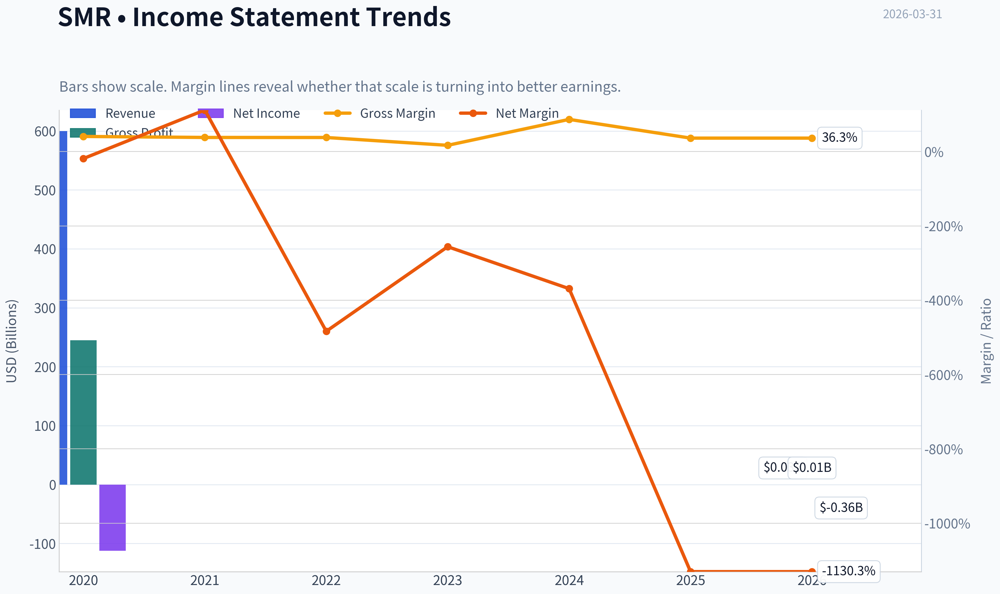

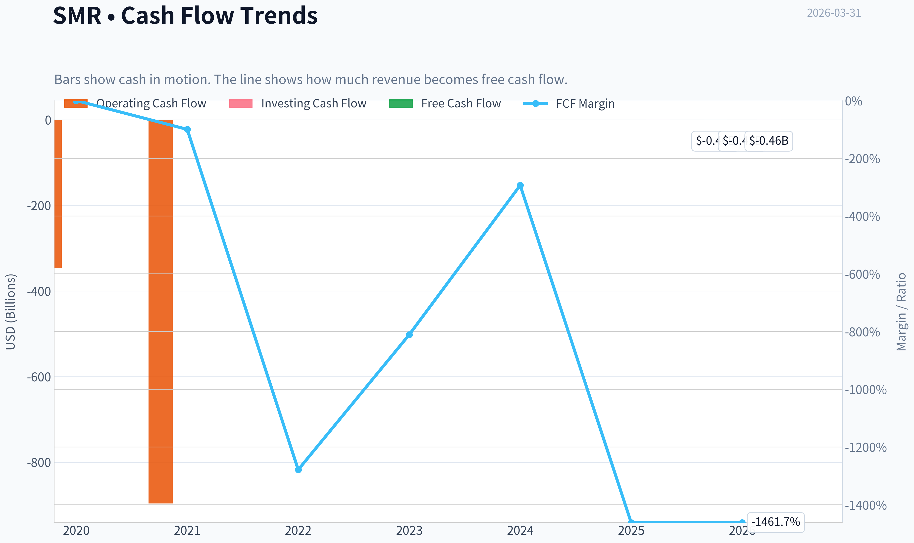

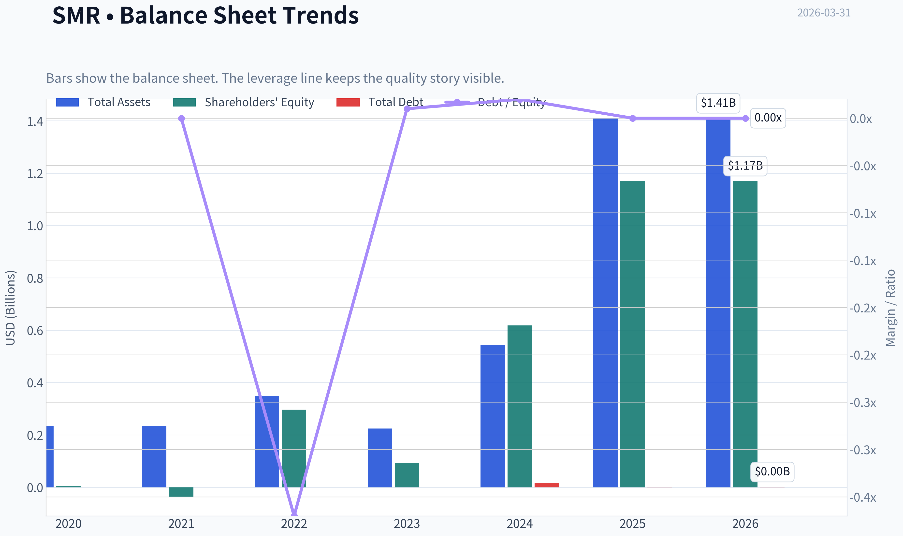

This graph tracks the profitability and return metrics (ROE, ROIC, Margins) of **SMR** over the past decade, highlighting capital efficiency trends.

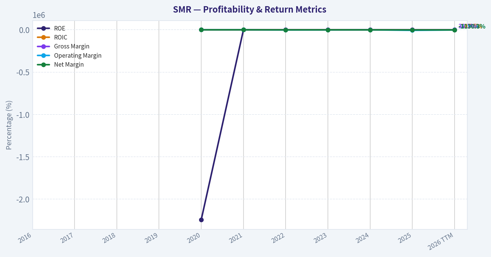

This chart illustrates the financial health of **SMR** over the last 10 years, mapping cash equivalents and free cash flow against total obligations (Debt).

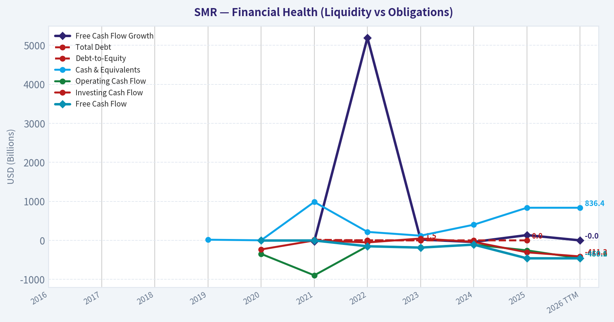

This comparison chart from *Profitability Metrics* stacks current figures against historical benchmarks for **SMR**, making it easy to see where the company trades relative to its own averages.

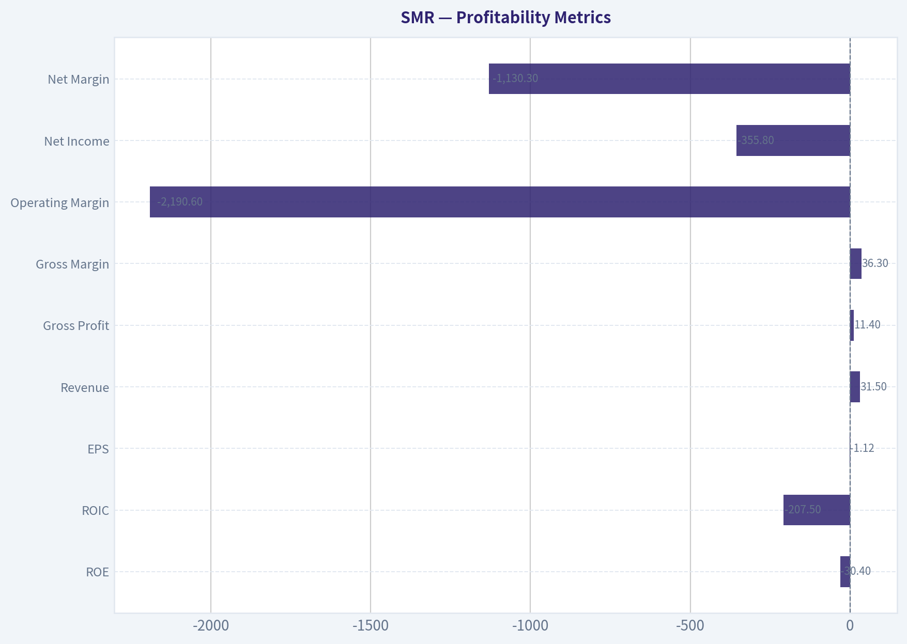

---

### Intrinsic Value Analysis (Buffett)

> *Following Warren Buffett's value investing philosophy: Circle of Competence, Economic Moat, Management Quality, and Margin of Safety.*

#### Intrinsic Value Snapshot

Price is what you pay. Intrinsic value is what the business may be worth based on the cash it can create for owners over time. We show a range, not one magic number.

- Current Price: $10.39
- Value Range: N/A to N/A

##### Owner Earnings (Buffett Method)
- Net Income: $-355,794,000.00
- Depreciation & Amortization: $1,181,000.00
- Capital Expenditures: $-508,000.00
- Working Capital Changes: $184,511,000.00
- Owner Earnings: $-539,632,000.00

##### Intrinsic Value

#### Gate 1: Circle of Competence & Business Simplicity

Elementary School Test:
NuScale designs small nuclear reactors that utilities or industrial customers could install to generate electricity or heat. The company sells reactor designs, engineering services, and eventually aims to sell and license reactor plants.

10-Year Predictability Test: **FAIL**
This business is still pre-commercial. No operating reactors exist yet. Revenue today is mostly engineering contracts. Predicting what NuScale will look like in 10 years depends on regulatory approvals, project financing, nuclear policy, and customer adoption.

Technology Risk Assessment: **FAIL / HIGH RISK**
SMR technology competes with other SMR designs, renewables, grid storage, and large nuclear plants. The industry outcome is uncertain.

Stop Flag Observations:
- Business model not proven at scale
- Success depends on future nuclear deployment economics
- Heavy reliance on government policy and project financing

Gate 1 Result: **FAIL**

From a Buffett perspective, failing Gate 1 already makes this a highly speculative investment.

---

#### Gate 2: Moat Test (Durable Competitive Advantage)

Potential moat sources:

Intangible Assets
NuScale achieved the **first U.S. Nuclear Regulatory Commission design approval for an SMR**. That is meaningful.

However:
- Other designs (GE Hitachi, Rolls-Royce, TerraPower) are progressing.
- Nuclear technology advantage may not last.

Pricing Power Test: **Fail**
Customers will choose reactors based on cost per MWh. Nuclear buyers are extremely price sensitive.

Gross Margin Evidence:
Current gross margin ~36% but based on engineering services, not reactor deployment.

Switching Costs
Utilities are locked into designs once projects begin, but **no projects exist yet at scale**.

Cost Advantage
No evidence NuScale has the lowest cost reactor design.

Network Effects
None.

Moat Rating: **Narrow / Unproven**

---

#### Gate 3: Management & Capital Allocation

Ownership mindset
Management ownership is modest. The company was brought public via SPAC, which often weakens owner-operator alignment.

Capital allocation history
Major event:
The **UAMPS Carbon Free Power Project was cancelled in 2023** after costs rose too high for utilities.

This raises concerns about:
- cost estimates
- commercial viability

Capital allocation so far has mainly been R&D spending funded by equity.

Management Quality: **Unproven**

---

#### Gate 4: Industry Structure

Industry: Nuclear reactor development

Structure:
- Few competitors but **extremely capital intensive**
- Projects cost billions
- Dependent on regulation and subsidies

Capital Intensity: **Extremely high**

Industry economics resemble:
- aerospace
- defense contractors
- mega infrastructure

This is not Buffett-style "asset-light compounding."

Gate Result: **Weak**

---

#### 10-Year Financial Snapshot (approximate recent years)

| Metric | Value |
|---|---|
| Revenue | ~$30-35M |
| Net Income | ~ -$180M |
| ROE | ~ -30% to -40% |
| Gross Margin | ~36% |
| Revenue Growth YoY | -15% recently |
| Free Cash Flow | ~ -$150M to -$200M annually |
| Market Cap | ~$3.3B |
| Current Ratio | ~4.3 |

Key Takeaways:
NuScale generates very little revenue relative to its market value and burns large amounts of cash each year. Profitability metrics are deeply negative, and the company depends heavily on external capital to continue development. The strong current ratio simply reflects cash raised from investors rather than a profitable operating model.

---

#### Owner Earnings Calculation

Owner earnings cannot be meaningfully calculated because:

Net Income: strongly negative
CapEx vs maintenance CapEx: unclear due to development stage
Working capital: volatile

Approximate proxy:

Owner Earnings ~ **~ -$180M annually**

This means the business currently **destroys cash rather than producing it**.

---

#### Balance Sheet

| Metric | Approx |
|---|---|
| Cash | ~$300M-350M |
| Debt | Low |
| Equity | ~$400M-450M |
| Debt/Equity | <0.3 |
| Current Ratio | ~4.3 |

Key Takeaways:
The balance sheet is not highly leveraged, which is good. However, the cash balance is primarily funding ongoing operating losses. At the current burn rate, the company likely requires additional capital within a few years, implying potential dilution.

---

#### Intrinsic Value (Buffett Framework)

Because the company has **negative owner earnings**, traditional Buffett valuation fails.

Scenario A - No Growth
Owner Earnings negative -> intrinsic value effectively **$0 using this framework**.

Scenario B - GDP Growth
Not applicable due to negative cash generation.

Scenario C - Historical Growth
Revenue growth exists but earnings remain negative. No reliable DCF can be constructed.

Conclusion:
This business **cannot be valued using traditional cash-flow investing methods yet**.

---

#### Margin of Safety

Current market cap: ~$3.3B
Current earnings power: negative

Investors are paying billions for **future nuclear deployment that has not yet occurred**.

Margin of safety: **None**

---

#### Buffett Scorecard

| Criterion | Score (1-5) |
|---|---|
| Business Understanding | 2 |
| Moat | 2 |
| Management | 2 |
| ROE | 1 |
| Reinvestment Runway | 3 |
| Balance Sheet | 3 |
| Industry Structure | 2 |
| Valuation | 1 |

Weighted Score ~ **2.0 / 5**

---

FINAL INVESTMENT STANCE: **AVOID**

NuScale may succeed technologically, and SMRs could become important for AI data centers and energy security. But from a Buffett perspective:

- No profits
- No predictable earnings
- No proven moat
- Heavy capital requirements
- Dependent on government policy and project financing

This is closer to **venture capital speculation than value investing**.

If you'd like, I can also show you:
- Why the AI + nuclear narrative is suddenly boosting SMR stocks
- The **one nuclear company that actually fits Buffett-style investing much better**.
#### Valuation Bridge

This bridge places the current market price beside each intrinsic value lens so readers can see whether upside depends on one method or shows up across several methods.

| Scenario | Intrinsic Value / Share |
| --- | ---: |
| Damodaran Method | $-6.14 |
| Current Price | $10.39 |

#### Key Takeaways

If one method is far above the others, the upside case depends on a specific modelling assumption. When several methods cluster together, the valuation story is more robust.

#### Valuation Visuals

This comparison chart from *Latest Earnings Snapshot* stacks current figures against historical benchmarks for **SMR**, making it easy to see where the company trades relative to its own averages.

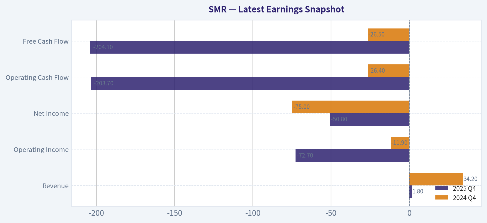

This comparison chart from *Balance Sheet Strength* stacks current figures against historical benchmarks for **SMR**, making it easy to see where the company trades relative to its own averages.

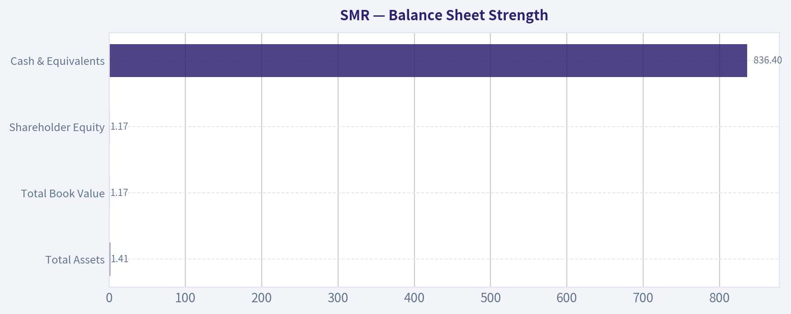

This comparison chart from *Cash Flow Analysis* stacks current figures against historical benchmarks for **SMR**, making it easy to see where the company trades relative to its own averages.

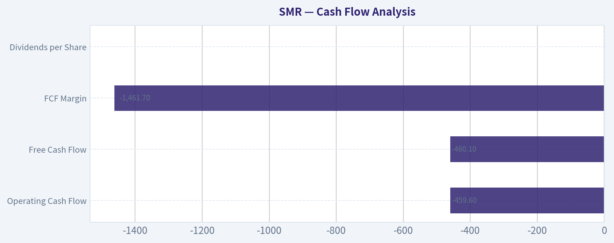

---

### Trend & Growth Analysis (Lynch/Druckenmiller/Fisher)

> *Following Peter Lynch's GARP, Stanley Druckenmiller's macro-aware approach, and Philip Fisher's scuttlebutt methodology.*

#### 1) Lynch Classification
Category: **Turnaround / Pre-Revenue Emerging Growth**

NuScale doesn't cleanly fit Lynch's classic categories yet. Revenue is tiny and declining recently (-15% YoY), so this behaves like a **venture-stage technology infrastructure company** rather than a typical fast grower.

---

#### 2) The Story (Explainable Simply)
- NuScale designs **small modular nuclear reactors (SMRs)** that can be factory-built instead of custom-built megareactors.
- Governments and AI data centers need **massive reliable electricity** as power demand explodes.
- If SMRs become the preferred new nuclear build, NuScale could sell **dozens to hundreds of reactors globally**.

---

#### 3) TAM Analysis

| Market | Estimated TAM |
|---|---|
| Global nuclear buildout (2050 net-zero) | $500B+ |
| SMR segment by 2040 | $150B-$300B |
| Potential reactors globally | 400-1000 units |

10x Test

| Metric | Value |
|---|---|
| Current revenue | ~$45M |
| 10x revenue | $450M |
| Global SMR TAM | $150B+ |

Key Takeaways:
NuScale is essentially at **near-zero market penetration**. Even reaching $1B revenue would still be microscopic relative to the projected SMR market. The runway is extremely large if the technology actually deploys commercially.

---

#### 4) Revenue Growth Trend

| Year | Revenue |
|---|---|
| 2021 | ~$4M |
| 2022 | ~$12M |
| 2023 | ~$22M |
| 2024 | ~$35-40M |
| 2025 | ~$45M |

Key Takeaways:
Long-term revenue growth has been strong, but the **latest YoY change turned negative (-15%)**, showing how unstable pre-commercial revenue is. This is contract-based engineering revenue rather than real product sales.

---

#### 5) Unit Economics

Currently **not applicable** (no real reactor sales yet).

| Metric | Status |
|---|---|
| LTV/CAC | N/A |
| NRR | N/A |
| Rule of 40 | N/A |
| Gross Margin | ~36% |

Key Takeaways:
The business model hasn't reached the stage where unit economics can be measured. Profitability will depend on the **cost of building reactors vs. electricity price contracts**, which is still unproven.

---

#### 6) Inflection Point Assessment

Potential Inflection Signals:

1. **AI Energy Demand Shock**
Microsoft/Nvidia pushing nuclear for AI data centers could dramatically increase SMR demand.

2. **First Commercial Deployment**
The biggest catalyst would be **the first reactor actually built and operating**.

3. **Industrial Heat Applications**
Petrochemical process heat partnerships could expand TAM beyond electricity.

But the **2023 cancellation of the UAMPS project** showed real-world economics remain uncertain.

Current status: **Pre-inflection.**

---

#### 7) Macro Setup

| Macro Factor | Impact |
|---|---|
| AI electricity demand | Strong tailwind |
| Decarbonization policy | Tailwind |
| Energy security (Europe/Asia) | Tailwind |
| Interest rates | Neutral-negative for capital projects |

Key Takeaways:
Macro conditions strongly favor nuclear expansion. Governments increasingly view nuclear as necessary for grid stability and AI energy demand.

---

#### 8) Fisher 15-Point Score

| Category | Score |
|---|---|
| Market potential | 5 |
| Product innovation | 4 |
| R&D strength | 4 |
| Sales organization | 2 |
| Profit margin potential | 3 |
| Margin improvement | 2 |
| Labor relations | 3 |
| Executive relations | 3 |
| Management depth | 3 |
| Cost controls | 2 |
| Competitive advantages | 4 |
| Long-term outlook | 4 |
| Dilution risk | 2 |
| Candor | 3 |
| Integrity | 3 |

**Fisher Score: 47 / 75**

Interpretation: **Average early-stage company with large potential but execution risk.**

---

#### 9) Valuation

| Metric | Value |
|---|---|
| Price | ~$10 |
| Market Cap | ~$3.3B |
| Revenue | ~$45M |
| Price/Sales | ~70x |

Key Takeaways:
Valuation is **extremely high relative to current revenue**, but investors are pricing in **future nuclear deployments rather than present fundamentals**.

---

#### Scenario Valuation (2030)

| Scenario | Revenue | P/S | Market Cap |
|---|---|---|---|
| Bear | $300M | 5x | $1.5B |
| Base | $1B | 6x | $6B |
| Bull | $3B | 8x | $24B |

Key Takeaways:
If NuScale becomes a meaningful SMR supplier, upside could be **5-7x from today**. If commercialization fails, downside is significant.

---

#### 10) Growth Investor Scorecard

| Criterion | Score |
|---|---|
| Story | 4.0 |
| TAM & Runway | 4.5 |
| Revenue Growth | 2.0 |
| Unit Economics | 1.5 |
| Competitive Position | 3.5 |
| Management | 3.0 |
| Macro | 4.5 |
| Profitability Path | 2.0 |
| Valuation | 2.0 |

**Total Score: 3.0 / 5**

---

#### 11) Position Size Stance
Speculative **venture-style position only (≤1-2% portfolio)**.

This behaves more like **public VC exposure to nuclear technology** than a traditional growth stock.

---

#### 12) Key Risks
- Reactor cost overruns
- Project cancellations (already happened once)
- Dilution from capital raises
- Competitors like **GE Hitachi BWRX-300 or Rolls-Royce SMR** beating them to deployment

---

#### Key Catalysts
- First commercial SMR construction start
- AI data center nuclear deals
- Government subsidies or loan guarantees
- International reactor contracts

---

FINAL INVESTMENT STANCE: **WATCH**

The **TAM and macro trend are enormous**, but the company has **not yet proven commercial viability**. This is a **binary technology deployment story**, not yet a traditional fast-growing business.

---

If you'd like, I can also show something important most investors miss:

**Why SMR stock collapsed after the Utah project cancellation - and whether that failure actually improved the long-term investment case.** It's a key piece of the thesis.

#### Growth & Scorecard Visuals

This comparison chart from *Growth Metrics* stacks current figures against historical benchmarks for **SMR**, making it easy to see where the company trades relative to its own averages.

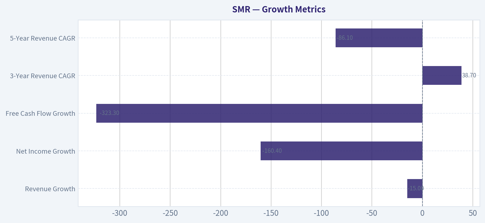

---

### Market Technical Analysis

FINAL INVESTMENT STANCE: **WATCH**

#### SMR (NuScale Power) Technical Analysis

SMR has undergone a dramatic cycle over the past year: a speculative surge to ~$56 in October 2025 followed by a prolonged multi-month collapse to about **$10.25 by March 30, 2026**. The current technical environment reflects a **deep downtrend with early stabilization signals but no confirmed reversal**.

---

#### Trend Structure (50 SMA vs 200 SMA)

| Metric | Value (Latest) | Trend Signal |
|---|---|---|
| Price | ~$10.25 | Far below major averages |
| 50-day SMA | ~$14.51 | Strong downward slope |
| 200-day SMA | ~$28.85 | Long-term downtrend |
| Price vs 50 SMA | ~29% below | Weak momentum |
| Price vs 200 SMA | ~64% below | Structural bear trend |

Key Takeaways:
The trend picture is decisively bearish. Price is trading dramatically below both the medium-term and long-term moving averages, and the 50-day SMA continues to decline. This signals persistent distribution since late 2025 and confirms that any rallies currently would likely be **counter-trend bounces rather than a confirmed bull trend**.

---

#### Momentum Indicators (MACD, RSI, EMA)

| Indicator | Latest Reading | Interpretation |
|---|---|---|
| MACD | -0.97 | Bearish but improving |
| MACD Histogram | Slightly positive | Momentum loss in selling pressure |
| RSI | ~31 | Near oversold territory |
| 10-EMA | ~$11.22 | Short-term resistance above price |

Key Takeaways:
Momentum is still bearish but stabilizing. The MACD remains negative, showing the dominant downtrend is intact, but the histogram has flipped positive, suggesting **selling pressure is fading**. RSI around 31 indicates the stock is near oversold levels, which often precedes short-term rebounds rather than immediate long-term reversals.

---

#### Volatility & Price Compression (Bollinger + ATR)

| Metric | Value | Insight |
|---|---|---|
| Bollinger Upper Band | ~$13.05 | Short-term upside boundary |
| Current Price | ~$10.25 | Trading near lower band |
| ATR | ~0.87 | Declining volatility |

Key Takeaways:
Volatility has compressed significantly as ATR has dropped from ~1.7 in February to under 0.9 now. This indicates the violent selloff phase has cooled and the stock is entering a **consolidation base around $10-12**. In these conditions, breakouts tend to occur after volatility contraction.

---

#### Price Structure Observations

Key technical levels:

| Level | Significance |
|---|---|
| $10.00 | Psychological + recent support |
| $9.50 | Breakdown risk level |
| $12.50 | First breakout resistance |
| $14.50 | 50-day SMA resistance |
| $20+ | Major structural resistance |

Recent price action shows **lower lows since January**, but the decline has slowed during March. The market is testing a potential base near $10.

---

#### Trading Interpretation

Short-term (swing traders):
- Possible **technical bounce zone: $10-11**
- First upside target: **$12.5-13**
- Stop-loss region: **below $9.50**

Medium-term:
- A real trend reversal would require **reclaiming the 50 SMA (~$14.5)**.
- Until that happens, rallies remain **bear-market rallies**.

Long-term investors:
- The stock remains far below the 200-day trend and would need months of base building before a sustainable uptrend could form.

---

#### Summary

| Category | Assessment |
|---|---|
| Long-term trend | Strongly bearish |
| Medium-term trend | Downtrend |
| Momentum | Weak but stabilizing |
| Volatility | Contracting (possible base forming) |
| Reversal confirmation | Above $14.5 |
| Current stance | WATCH |

SMR is currently a **high-risk turnaround setup rather than a confirmed recovery**. Momentum indicators hint that the worst selling may be over, but the trend has not flipped yet. Watching for **base formation around $10-12 and a breakout above $12.5-14** would provide stronger bullish evidence.

---

If you want, I can also show:
- the **3 most likely price scenarios for SMR in 2026**, or
- the **key fundamental catalysts (DOE funding, SMR deployments, contracts)** that could trigger the next major move.

#### Market Visuals

This comparison chart from *Market Metrics* stacks current figures against historical benchmarks for **SMR**, making it easy to see where the company trades relative to its own averages.

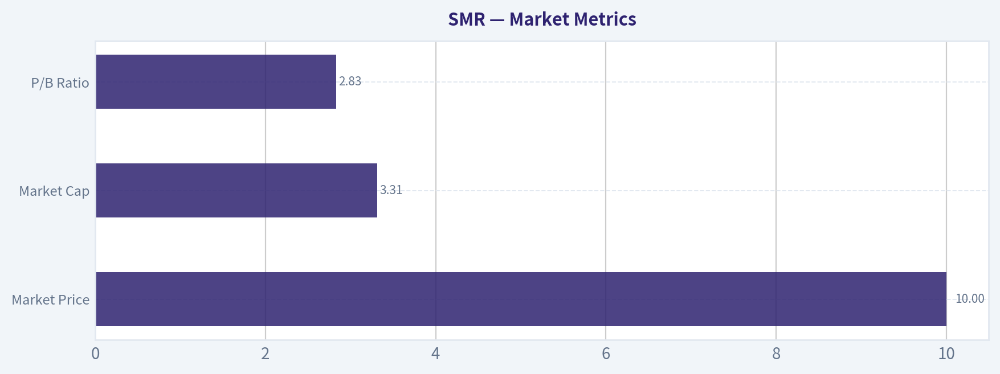

---

### Social Sentiment Analysis

#### SMR (NuScale Power) - Social Media Sentiment & News Analysis (Past Week)

NuScale Power (SMR) has remained an active topic across investor social platforms and financial media over the past week. Discussion volume increased noticeably as nuclear energy continues to be framed as a critical long-term solution for AI-driven electricity demand and decarbonization. However, sentiment shows clear day-to-day swings driven by project execution risks, financing concerns, and speculative momentum trading.

---

#### Social Media Sentiment Trend (Past 7 Days)

| Date | Sentiment Score | Discussion Volume | Key Themes |
|-----|-----|-----|-----|
| Mar 24 | Moderately Bullish | Medium | AI energy demand narrative boosting nuclear |
| Mar 25 | Bullish | High | Retail traders highlighting SMR as "AI infrastructure play" |
| Mar 26 | Neutral | High | Debate over commercialization timeline |
| Mar 27 | Bearish | Medium | Concerns about past project cancellations resurfacing |
| Mar 28 | Neutral | Low | Technical trading discussions dominate |
| Mar 29 | Bullish | Medium | Nuclear energy policy discussion |
| Mar 30 | Slightly Bullish | Medium | Speculation about future contracts |

Key Takeaways:
Online sentiment has been volatile but slightly positive overall. Bullish narratives tend to revolve around long-term nuclear demand tied to AI data centers and decarbonization, while bearish sentiment resurfaces when investors discuss NuScale's previous project delays and the capital intensity of SMR deployment.

---

#### Retail Investor Discussion Themes (Reddit, X, StockTwits)

| Theme | Sentiment | Typical Narrative |
|------|------|------|
| Nuclear as AI Energy Backbone | Strongly Bullish | SMR positioned as long-term supplier for hyperscale data centers |
| Government Policy Support | Bullish | Expectation of subsidies and regulatory tailwinds |
| Commercialization Timeline | Mixed | Skepticism about how soon SMR plants will actually operate |
| Financing & Cost Structure | Bearish | Concerns over capital requirements |
| Momentum Trading | Bullish Short-Term | Viewed as high-volatility speculative stock |

Key Takeaways:
Retail discussions strongly link SMR's future to the explosive electricity demand from artificial intelligence infrastructure. However, many investors also recognize the company's long timeline to revenue-scale deployment, creating a divide between long-term believers and short-term traders.

---

#### Institutional & Media Narrative

| Narrative | Media Tone | Implication |
|------|------|------|
| Nuclear Renaissance | Positive | SMRs increasingly seen as key energy transition technology |
| Project Execution Risk | Cautious | Investors reminded of cancelled or delayed SMR projects |
| Government Funding | Positive | Policy support remains a major catalyst |
| Capital Requirements | Concerned | Scaling manufacturing and deployments will require large financing |

Key Takeaways:
Financial media coverage generally supports the long-term nuclear thesis but highlights the industry's execution risk. Analysts emphasize that policy support and financing access will determine whether SMR companies can transition from concept to large-scale deployment.

---

#### Key Company News Impacting Sentiment

| Event | Market Interpretation | Sentiment Impact |
|------|------|------|
| Ongoing nuclear energy policy discussion globally | Positive tailwind | Bullish |
| Continued attention to AI-driven energy demand | Strategic relevance | Bullish |
| Investor focus on commercialization timeline | Raises realism concerns | Neutral |
| Reminders of previous SMR project cancellations | Execution risk | Bearish |

Key Takeaways:
The biggest positive narrative for SMR currently is the idea that AI-driven power demand could require new nuclear capacity. However, recurring reminders of past project setbacks continue to cap enthusiasm among more cautious investors.

---

#### Trading Behavior Observed

| Behavior | Evidence | Market Impact |
|------|------|------|
| Momentum Trading | High discussion during price spikes | Short-term volatility |
| Thematic Investing | Nuclear + AI narrative | Attracts speculative capital |
| Long-Term Clean Energy Investors | Lower volume but consistent | Structural demand support |
| Options Speculation | Increasing mentions | Amplifies price swings |

Key Takeaways:
SMR is currently behaving partly like a thematic momentum stock rather than a traditional utility or infrastructure investment. Traders frequently treat it as a high-volatility play tied to emerging energy narratives rather than near-term earnings.

---

#### Forward-Looking Sentiment Signals

| Catalyst | Potential Effect | Sentiment Sensitivity |
|------|------|------|
| New reactor deployment contracts | Major bullish trigger | Very High |
| Government subsidies or grants | Positive valuation shift | High |
| Financing announcements | Could ease capital concerns | Medium |
| Further project delays | Major negative reaction | Very High |

Key Takeaways:
Sentiment around SMR is extremely catalyst-driven. Positive developments around contracts, funding, or regulatory approval could quickly push sentiment strongly bullish, while any delays or cancellations could sharply reverse enthusiasm.

---

#### Overall Social Sentiment Scorecard

| Category | Assessment |
|------|------|
| Retail Investor Sentiment | Moderately Bullish |
| Institutional Narrative | Cautiously Positive |
| News Sentiment | Neutral-to-Positive |
| Speculative Activity | High |
| Execution Risk Perception | Elevated |

Key Takeaways:
The overall sentiment environment for SMR is cautiously optimistic but highly speculative. Retail traders are enthusiastic about the long-term nuclear opportunity, while institutional voices remain more cautious due to the company's execution challenges and long development timelines.

---

**Investor Implications**

SMR currently sits at the intersection of several powerful narratives: AI-driven energy demand, decarbonization, and the revival of nuclear power. This positioning has generated strong speculative interest on social media and among retail investors.

However, the key tension in sentiment revolves around timing. While the long-term demand story is compelling, many investors remain uncertain about how quickly SMR can deploy reactors and generate consistent revenue.

For traders, this creates an environment characterized by:

- High volatility
- News-driven price swings
- Narrative-driven momentum

For longer-term investors, the central question remains execution: whether NuScale can convert policy support and industry interest into actual reactor deployments.

At the moment, sentiment momentum is slightly positive but fragile, meaning the stock is highly sensitive to any meaningful company announcements.

FINAL INVESTMENT STANCE: **WATCH**

---

### News & Events Analysis

#### NuScale Power (NYSE: SMR) - Weekly News & Investment Analysis
Period reviewed: ~March 24-31, 2026

---

#### Market Context: AI Energy Demand Reviving Nuclear Narratives
Recent news coverage highlights a growing narrative that **AI infrastructure could significantly increase electricity demand**, pushing large tech companies toward nuclear energy solutions. Reports mention collaborations involving **Microsoft, Nvidia, and energy providers** to explore new energy sources capable of powering "AI factories" or hyperscale data centers.

This trend is important for SMR because **small modular reactors (SMRs)** are often positioned as a flexible, scalable nuclear solution for industrial power demand. If AI-driven electricity demand accelerates, SMR developers like NuScale could benefit from increased investor interest and potential project pipelines.

However, this macro trend is **more thematic than contractual** at this stage. The recent news references nuclear power broadly and several utilities and energy companies, but **no direct deployment commitments involving NuScale reactors have been announced in the past week**.

---

#### Company-Specific News (Past Week)

Key news items affecting NuScale include:

- Analysts **reduced the SMR price target by ~32% to $21.82** (Fintel report, March 27).
- Ongoing **sector hype tied to AI-driven electricity demand** has pushed nuclear stocks back into the spotlight.
- NuScale announced a **collaborative research program with Ebara Elliott** to develop and field test a **high-temperature steam compressor** designed to integrate NuScale Power Modules with **petrochemical plants requiring process heat**.

This partnership is notable because it expands the use case beyond electricity generation into **industrial heat**, which is a large energy market often reliant on fossil fuels. If the technology works at scale, it could broaden the commercial viability of SMRs.

Still, most of these developments are **early-stage research or industry speculation**, not confirmed reactor construction contracts.

---

#### Earnings Overview
The latest widely discussed earnings period available in coverage remains **NuScale's most recent quarterly update (late 2025 reporting period)**. No major new earnings report appears in the last week's news flow.

Key points from the latest reported quarter:

- NuScale continues to operate **pre-commercially**, meaning **revenue is limited and irregular**.
- The company reported **negative earnings and cash flow**, reflecting ongoing **R&D and licensing expenses**.
- Revenue declined **~15% year over year** in the latest data available.
- Gross margin remains relatively high (~36%) but is **not yet meaningful because project deployment is still limited**.

The financial profile remains characteristic of **early-stage infrastructure technology companies**: heavy investment now with potential revenue later once projects are deployed.

---

#### Financial Snapshot

| Metric | Value | Interpretation |
|---|---|---|
| Share Price | ~$10 | Highly volatile; well below prior hype-cycle highs |
| Market Cap | ~$3.31B | Pricing in long-term SMR adoption potential |
| Revenue Growth YoY | -15% | Indicates inconsistent project revenue |
| Gross Margin | 36.3% | High due to engineering/licensing model |
| ROE | -30.4% | Loss-making development stage |
| FCF Yield | -13.9% | Significant cash burn |
| Current Ratio | 4.30 | Strong short-term liquidity |

Key Takeaways:
NuScale's balance sheet shows solid liquidity, which reduces near-term financing risk. However, the company remains **structurally unprofitable with declining revenue**, reflecting the fact that most SMR projects are still in development rather than operational. Investors are essentially funding future reactor deployment rather than current cash flows.

---

#### Strategic Developments

**1. Industrial Process Heat Opportunity**
The Ebara Elliott collaboration targets **petrochemical process heat**, a major decarbonization challenge. This could open markets beyond utilities.

**2. AI Electricity Demand Narrative**
The Microsoft-Nvidia nuclear discussion is boosting investor attention across nuclear-related equities. While NuScale was mentioned in nuclear stock lists, **there is no confirmed partnership**.

**3. Analyst Sentiment Adjustment**
The sharp **price target reduction** signals caution from analysts despite long-term industry optimism.

---

#### Risks Traders Should Watch

1. **Project Delays & Cost Overruns**
SMR deployment globally has been slow due to regulatory approval and financing challenges.

2. **Commercialization Gap**
NuScale's valuation still assumes **future reactor deployment**, which may take years.

3. **Sector Hype Cycles**
AI-driven nuclear enthusiasm could boost trading momentum, but fundamentals remain early stage.

---

#### Potential Catalysts

- First **commercial SMR construction contracts**
- Partnerships with **data center operators or AI infrastructure firms**
- Government funding or nuclear-friendly policy shifts
- Progress on **industrial heat applications**

---

#### Key Points Summary

| Category | Key Development | Investment Implication |
|---|---|---|
| AI Energy Demand | Tech firms exploring nuclear to power AI data centers | Positive narrative tailwind for nuclear stocks |
| Analyst Actions | Price target cut to ~$21.82 | Indicates tempered expectations |
| Technology Expansion | Petrochemical heat collaboration with Ebara Elliott | Could expand SMR market beyond electricity |
| Financial Status | Negative earnings and cash flow | Long runway before profitability |
| Sector Momentum | Nuclear stocks gaining attention again | May drive short-term trading volatility |

Key Takeaways:
NuScale sits at the intersection of two powerful themes-**decarbonization and AI-driven electricity demand**. While these narratives support investor interest, the company's fundamentals remain tied to **future project deployment rather than current revenue**. In the near term, SMR may trade more on **sector sentiment and policy developments** than on financial performance.

---

FINAL INVESTMENT STANCE: **WATCH**
The long-term SMR opportunity is significant, but NuScale still faces commercialization risk and ongoing cash burn. Traders may see **theme-driven rallies**, while long-term investors should watch for **actual reactor deployment contracts or major strategic partnerships** before taking a stronger stance.

---

## Research Team Commentary

> *The Research Manager synthesizes the Bull vs Bear debate into action-free commentary. This is a pre-risk view, not the final stance.*

The debate really comes down to one central issue: is NuScale an early-stage infrastructure platform temporarily mispriced by the market, or is it simply an unproven technology venture with uncertain economics? From a Buffett-style lens, that distinction matters enormously.

The bull case rests on the strategic importance of nuclear power and NuScale's early regulatory milestone. The company achieved the first NRC-approved SMR design in the United States, which is not trivial. Nuclear licensing is extremely slow, expensive, and technically complex. In theory, that approval could function as a barrier to entry and provide first-mover credibility with utilities. If SMRs become a meaningful part of global energy infrastructure, there will likely only be a handful of approved vendors, and scarcity alone could make those vendors valuable.

The other strong bullish point is the structural demand tailwind. Energy demand from AI data centers, industrial electrification, and decarbonization is real. Intermittent renewables struggle with baseload reliability, which is precisely where nuclear shines. If modular reactors actually solve the cost and construction challenges that plagued traditional nuclear plants, the long-term market could indeed be enormous. In that scenario, NuScale's model of selling reactors and then capturing decades of service revenue could resemble aerospace-style annuity economics.

However, the bear case is substantially stronger when viewed through a strict value investing framework.

The most important issue is that the economic model is still hypothetical. NuScale does not yet operate a commercial fleet. The annuity-like service revenue described by the bull depends entirely on reactors that have not been deployed. Buffett consistently avoids businesses where the future economics depend on successful technological adoption and infrastructure rollout simultaneously. That uncertainty makes intrinsic value nearly impossible to estimate with confidence.

The cancellation of the UAMPS project is also a serious signal. That project was meant to be the first real commercial deployment. Its collapse due to cost escalation highlights a persistent problem in nuclear energy: construction economics. Historically, nuclear projects have destroyed enormous amounts of investor capital due to delays and overruns. SMRs are supposed to solve that problem through modular construction, but until a fleet is actually built on time and on budget, the thesis remains unproven.

Competition is another issue. Even if SMRs succeed, NuScale is not alone. GE Hitachi, Rolls-Royce, TerraPower, and Westinghouse all have deeper engineering capabilities, stronger balance sheets, and long-standing relationships with utilities. Nuclear customers are extremely conservative buyers. When choosing multi-billion-dollar infrastructure projects, they tend to favor suppliers with decades of proven delivery history and large financial backing.

Financial quality today is also far outside the range of what a Buffett investor typically accepts. Returns on capital are deeply negative. Revenue is declining. Free cash flow is significantly negative. These metrics are consistent with a pre-commercial R&D company rather than a durable operating business. Buffett prefers companies that already generate predictable cash flows, not those that might someday generate them.

The valuation argument also struggles under scrutiny. A Damodaran-style intrinsic value estimate turning negative essentially means the current operations destroy capital under realistic assumptions. Investors are therefore paying for a probability-weighted future success scenario rather than a discounted stream of existing cash flows. That's closer to venture capital than traditional value investing.

From a psychological standpoint, there is also a strong narrative component here. AI-driven electricity demand has revived excitement around nuclear stocks broadly. When a sector narrative becomes powerful, markets sometimes price in success long before the economics are proven. That doesn't mean the technology will fail, but it does mean the current price may reflect optimism rather than mispricing.

Core takeaway: NuScale may be positioned within a potentially important future industry, but the business itself is still speculative. There is no demonstrated moat, no commercial fleet, no predictable cash flows, and no clear evidence that SMR economics will work at scale. Without those elements, estimating intrinsic value with confidence is not possible.

Rationale: Buffett-style investing requires durable businesses with predictable economics and a margin of safety. NuScale currently offers none of those. The thesis depends on successful commercialization, favorable policy, competitive positioning against stronger incumbents, and solving nuclear construction economics all at once. That stack of uncertainties makes the range of outcomes extremely wide. Even if SMRs succeed as a technology, it is not clear that NuScale will be the winner.

Monitoring plan for the next 1-4 quarters:
Watch for concrete project announcements that move beyond feasibility studies into funded construction. A fully financed deployment would materially change the risk profile.
Track partnerships with large utilities or industrial customers that validate real demand for the NuScale design.
Observe whether competitors secure deployments first; if GE Hitachi or Rolls-Royce begin building fleets earlier, NuScale's first-mover narrative weakens.
Monitor cash burn and capital raises, since prolonged pre-commercial phases can dilute shareholders significantly.
Most importantly, look for evidence that modular nuclear construction can actually meet cost and timeline targets.

Until the company demonstrates a functioning commercial deployment and credible unit economics, the prudent value-investing stance remains: AVOID.

---

## Value Investing Team Commentary

> *The Investor translates the research view into an investment thesis before risk review. This is still not the final stance.*

When I look at NuScale through a Buffett-style lens, the key question is simple: *is there a real business here yet, or just a promising technology story?* Right now, it still looks much closer to the latter.

The nuclear industry itself is not the problem. In fact, long-term demand for reliable baseload electricity is likely to grow. AI data centers, electrification, and grid stability needs all strengthen the strategic case for nuclear power. If you step back 10-20 years, it's plausible the world builds a new generation of reactors. In that sense, the **macro tailwind is real**.

But Buffett-style investing is not about buying industries; it's about buying **predictable cash-generating businesses** within those industries. NuScale has not yet crossed that threshold.

Start with the economics. The company currently generates limited revenue, negative earnings, and deeply negative returns on capital. A -207% ROIC tells you capital is being consumed rather than compounded. That's typical for an R&D-stage company, but it means there is **no proven earning power to value today**. When intrinsic value calculations turn negative, it signals that investors are paying entirely for future hopes rather than present economics.

The most important business risk is **construction economics**. Nuclear projects historically suffer from cost overruns and delays. SMRs are supposed to solve this with modular factory-built reactors, but that claim remains unproven at scale. The cancellation of the UAMPS project is not just a minor setback; it removed what was supposed to be the flagship commercial deployment. Until a reactor is actually built, delivered, and operating economically, the business model remains theoretical.

Competition also weakens the investment case. Utilities buying nuclear reactors are among the most conservative customers in the world. They prefer suppliers with decades of engineering track record and deep balance sheets. Companies like GE Hitachi, Rolls-Royce, Westinghouse, and TerraPower already have stronger relationships and capital resources. Even if SMRs succeed as a technology, **NuScale does not have a clear moat ensuring it will capture the profits**.

Now let's look at sentiment. The recent revival of nuclear stocks tied to AI electricity demand is a classic narrative cycle. Markets often extrapolate a powerful theme-AI energy demand-into every related company. The result is that pre-commercial companies can trade at valuations that assume success long before it happens. When analysts cut price targets yet the story remains popular, that often signals **story-driven momentum rather than business-driven valuation**.

A contrarian investor asks: *is the market being too pessimistic or too optimistic?* In this case, despite volatility, the market is still **pricing in a meaningful probability that NuScale becomes a major SMR vendor**. That assumption may prove correct, but the probability distribution is extremely wide. Many early nuclear ventures never reach profitable deployment.

Buffett has historically avoided exactly this type of situation:
- unproven economics
- heavy regulatory dependence
- large capital requirements
- uncertain technological adoption

These are characteristics of venture capital projects, not durable compounding businesses.

If NuScale successfully deploys even one or two commercial plants on time and on budget, the analysis changes dramatically. At that point you would have proof of concept, reference customers, and a path toward long-term service revenue. That is when a value investor might begin estimating intrinsic value with some confidence.

But today, you are being asked to fund the experiment.

FINAL INVESTMENT STANCE: **AVOID**

---

## Deep Values Commentary

> *The Risk Management Team debates and the Risk Judge provides the final action-free verdict. This section determines the final ADVOCATE / WATCH / AVOID stance.*

Executive Summary (Quick Read)

NuScale sits at the intersection of a powerful macro narrative (AI-driven electricity demand and nuclear revival) and an unproven business model. While its NRC-certified SMR design is a genuine milestone, the company currently lacks commercial deployments, generates negative returns on capital, and operates in an industry notorious for cost overruns and financing complexity. The investment thesis depends on multiple uncertain milestones occurring in sequence. From a Buffett-style lens-where predictable cash flows, durable moats, and margin of safety matter-NuScale resembles a venture-stage technology bet rather than an investable business. Until real reactor deployments and credible unit economics appear, the prudent stance for a long-term value investor remains to stay on the sidelines.

Final Stance: AVOID

Key Arguments from the Analysts

Fundamentals Analyst
The financial profile signals a pre-commercial company rather than an operating business. Revenue is declining (-15% YoY), profitability metrics are deeply negative (ROE -30%, ROIC -207%), and free cash flow deterioration suggests continued capital burn. These metrics indicate the business currently consumes capital rather than compounds it.

Value Analyst
Intrinsic value modeling produced negative estimates, meaning current operations destroy economic value. The business model depends on successful large-scale SMR adoption, government policy, and financing structures that remain uncertain. Competitive pressure from larger industrial players like GE Hitachi, Rolls-Royce, TerraPower, and Westinghouse further weakens the moat argument.

Growth Analyst
The long-term narrative has merit. AI-driven electricity demand, industrial electrification, and decarbonization could dramatically increase the need for reliable baseload power. NuScale's regulatory approval positions it as an early SMR participant if the technology becomes widely deployed.

Risky Analyst
The strongest bullish argument is the regulatory milestone: NuScale achieved the first NRC-approved SMR design in the U.S., a meaningful barrier in nuclear development timelines. If SMRs succeed globally, early certified designs could become scarce infrastructure assets with long service-revenue tails.

Safe Analyst
The counterargument focuses on execution risk. Design certification does not solve the hardest nuclear problems: financing, construction timelines, and cost control. The collapse of the UAMPS project illustrates this challenge. Additionally, smaller developers in capital-intensive infrastructure markets often lose ground to larger incumbents once commercialization begins.

Neutral Analyst
Both sides miss a key portfolio reality: this is neither a stable compounder nor necessarily a zero-probability bet. Instead, it behaves like a speculative infrastructure technology exposure-volatile, narrative-driven, and dependent on milestone confirmation.

Risk Commentary Through a Buffett Lens

Buffett's framework prioritizes businesses with durable economics that can be reasonably valued. NuScale currently fails that test on several levels.

First, intrinsic value cannot be estimated with confidence. The entire valuation depends on future reactor deployments that have not yet occurred. Without operating assets or predictable service contracts, the discounted cash flow stream is speculative.

Second, the company lacks demonstrated economic advantages. Regulatory approval is helpful but not equivalent to a moat. Nuclear utilities typically prefer suppliers with extensive operating history and strong balance sheets. NuScale will compete against far larger industrial firms that already possess global engineering networks and long-standing customer relationships.

Third, financial strength is currently weak. Deeply negative ROIC (-207%) indicates that capital invested in the business is not producing returns. In a capital-intensive sector like nuclear energy, this raises the probability of continued funding needs and shareholder dilution.

Fourth, nuclear construction economics remain the central unresolved risk. Historically, nuclear projects have struggled with delays and cost escalation. The cancellation of the UAMPS project reinforces that SMRs have not yet proven they can escape this industry pattern.

Finally, market sentiment appears narrative-driven. The AI electricity demand story has revived investor excitement around nuclear stocks broadly. Narrative-driven rallies can produce temporary price spikes, but they do not resolve the underlying economics.

In short, the investment case relies on several uncertain events occurring successfully:
- Securing project financing
- Building reactors on schedule and on budget
- Achieving cost competitiveness
- Winning contracts against stronger competitors
- Scaling a commercial fleet

When many uncertain steps must succeed sequentially, the probability distribution becomes extremely wide-something value investors generally avoid.

Refined Investor Plan

Original View
NuScale might represent an early infrastructure platform mispriced by the market-but could also be an unproven nuclear technology venture.

Refined Plan Based on the Debate

1. Treat the company as pre-commercial until proven otherwise.
This is currently closer to venture capital than value investing.

2. Wait for evidence of real economic activity.
The single most important catalyst would be a fully financed commercial reactor project moving into construction.

3. Monitor competitive progress.
If competitors such as GE Hitachi or Rolls-Royce deploy SMRs first, NuScale's first-mover narrative weakens considerably.

4. Watch the balance sheet closely.
Continued operating losses increase the likelihood of equity dilution before commercialization.

5. Re-evaluate after the first successful deployment.
Paradoxically, paying a higher price after the business proves its economics may represent a lower-risk investment.

Lessons Applied

Many past investment mistakes occur when investors confuse technological potential with business certainty. Infrastructure innovations-especially in energy-often take far longer and cost far more than early projections suggest. Waiting for demonstrated economics may sacrifice early upside but significantly reduces the probability of permanent capital loss.

Final Verdict

NuScale operates in a potentially important future industry, but today it lacks the characteristics required for a Buffett-style investment: predictable earnings, proven economics, financial strength, and a clear moat.

The story may eventually work-but the business proof has not arrived.

Final Stance: AVOID.

#### Final Stance Scorecard

This scorecard converts the final research view into a weighted decision frame. It does not replace the narrative judgement, but it makes the main drivers of the verdict easier to scan.

| Criterion | Score | Weight | Commentary |
| --- | ---: | ---: | --- |
| Business Quality | 2.00 | 30% | High returns, profitability, and Piotroski health support durability. |
| Valuation Support | 1.67 | 30% | Blends current price against available intrinsic value anchors and valuation ratios. |
| Financial Strength | 5.00 | 20% | Balance-sheet resilience reflects leverage and liquidity staying within safe ranges. |
| Growth Durability | 1.00 | 20% | Recent revenue, earnings, and free cash flow growth indicate how durable expansion looks. |
| TOTAL / FINAL STANCE | 2.30 | 100% | AVOID |

#### Key Takeaways

The weighted score lands at **2.30 / 5.0**, while the final stance remains **AVOID**. This is useful as a quick calibration aid rather than a mechanical signal.

#### Risk Summary

Higher scores indicate more risk pressure. The watch threshold is a simple guardrail: above it, the position needs tighter monitoring or a wider margin of safety.

| Dimension | Current Score | Watch Threshold | Commentary |
| --- | ---: | ---: | --- |
| Business Quality | 4.00 | 3.00 | High returns, profitability, and Piotroski health support durability. |
| Valuation Support | 4.33 | 3.00 | Blends current price against available intrinsic value anchors and valuation ratios. |
| Financial Strength | 1.00 | 3.00 | Balance-sheet resilience reflects leverage and liquidity staying within safe ranges. |
| Growth Durability | 5.00 | 3.00 | Recent revenue, earnings, and free cash flow growth indicate how durable expansion looks. |

#### Key Takeaways

This view helps readers separate *where* the risk sits: valuation, business quality, balance sheet, or growth durability. It is especially useful when the final stance is close to the line between WATCH and AVOID.
