# SNDK Deep Value Intelligence

**Analysis Date:** 2026-03-26

## Critical Disclaimer

*This analysis is generated by Deep Value Intelligence, an AI-powered multi-agent investing framework. This report is for informational and educational purposes only and does not constitute financial advice. Always conduct your own research and consult with qualified financial advisors before making investment decisions.*

---

## Table of Contents

1. Intelligence Summary
2. Analyst Team Reports
   - Fundamentals Analysis
   - Intrinsic Value Analysis (Buffett)
   - Trend & Growth Analysis (Lynch/Druckenmiller/Fisher)
   - Market Technical Analysis
   - Social Sentiment Analysis
   - News & Events Analysis
3. Research Team Commentary
4. Value Investing Team Commentary
5. Deep Values Commentary

---

## Intelligence Summary

### Thesis + Conditions

**Core Thesis:** **Executive Summary**
SanDisk (SNDK) is currently masquerading as a high-margin AI compounder, but beneath the narrative, it remains a highly cyclical, capital-intensive commodity producer. While an AI-driven storage upcycle is likely underway, the current euphoric $90B valuation completely erases any margin of safety.

**Key Risks:**
- Warren Buffett warns that in commodity businesses, you can sell more and still make less. Even if AI doubles the total addressable market, intense capital requirements and competitive supply expansions will likely erode excess returns. With a Damodaran intrinsic value model flashing negative and the market pricing the company at roughly $90B, investors are being asked to pay peak-cycle (or fantasy-cycle) multiples for a capital-destroying business. A cyclical rebound does not equate to a structural, decade-long compounder. There is zero margin of safety.
- Monitoring Plan (Tracking the Cycle):*
- 1.  **Capital Expenditure Discipline:** Watch capex announcements from Samsung, SK Hynix, and the SNDK/Kioxia JV. High capex signals the return of oversupply and the death of the current pricing rebound.
- 2.  **Enterprise SSD Margins:** Monitor whether AI-driven demand translates to sustained gross margin expansion, or if hyperscaler multi-sourcing quickly forces margin compression.
- 3.  **Valuation Compression:** Wait for the AI halo effect to fade. Track if the stock reverts to its historical intrinsic value mean ($30B-$40B market cap range) where a true margin of safety might exist.

**What Would Change Our View:**
- Warren Buffett warns that in commodity businesses, you can sell more and still make less. Even if AI doubles the total addressable market, intense capital requirements and competitive supply expansions will likely erode excess returns. With a Damodaran intrinsic value model flashing negative and the market pricing the company at roughly $90B, investors are being asked to pay peak-cycle (or fantasy-cycle) multiples for a capital-destroying business. A cyclical rebound does not equate to a structural, decade-long compounder. There is zero margin of safety.
- Monitoring Plan (Tracking the Cycle):*
- 1.  **Capital Expenditure Discipline:** Watch capex announcements from Samsung, SK Hynix, and the SNDK/Kioxia JV. High capex signals the return of oversupply and the death of the current pricing rebound.
- 2.  **Enterprise SSD Margins:** Monitor whether AI-driven demand translates to sustained gross margin expansion, or if hyperscaler multi-sourcing quickly forces margin compression.
- 3.  **Valuation Compression:** Wait for the AI halo effect to fade. Track if the stock reverts to its historical intrinsic value mean ($30B-$40B market cap range) where a true margin of safety might exist.

**Confidence:** Medium

---

## Analyst Team Reports

### Fundamentals Analysis

#### Latest Earnings Snapshot

*Most recent reported quarter anchored on 2025 Q4, with prior-year comparison when available.*

| Metric | 2025 Q4 | 2024 Q4 | YoY Change |
| --- | ---: | ---: | ---: |
| Revenue | $3.02B | $1.88B | +61.2% |
| Operating Income | $1.07B | $185.0M | +481.1% |
| Net Income | $803.0M | $104.0M | +672.1% |
| Diluted EPS | $5.15 | $0.72 | +615.3% |
| Operating Cash Flow | $1.02B | $95.0M | +972.6% |
| Free Cash Flow | $980.0M | $47.0M | +1985.1% |

Key Takeaways: This snapshot anchors the most recent reported quarter before the narrative analysis. It helps readers separate long-run business quality from whatever changed in the latest earnings print.

#### 10-Year Financial Metrics for SNDK

*All values below are computed deterministically from raw data - not estimated by AI.*

*Issuer profile: operating company (Technology / Computer Hardware).*

#### 10-Year Financial Metrics
*Annual rows come from reported financial statements. The final TTM row is computed from the latest four quarters.*

| Metric | 2016 | 2017 | 2018 | 2019 | 2020 | 2021 | 2022 | 2023 | 2024 | 2025 | 2026 TTM |
| --- | --- | --- | --- | --- | --- | --- | --- | --- | --- | --- | --- |
| Market Price | N/A | N/A | N/A | N/A | N/A | N/A | N/A | N/A | N/A | $45 | $610 |
| Market Cap | N/A | N/A | N/A | N/A | N/A | N/A | N/A | N/A | N/A | $90.09B | $95.22B |
| P/E Ratio | N/A | N/A | N/A | N/A | N/A | N/A | N/A | N/A | N/A | -4.01 | -80.42 |
| P/B Ratio | N/A | N/A | N/A | N/A | N/A | N/A | N/A | N/A | N/A | 9.78 | 9.32 |
| ROE | N/A | N/A | N/A | N/A | N/A | N/A | N/A | -18.7% | -6.1% | -17.8% | -10.2% |
| ROIC | N/A | N/A | N/A | N/A | N/A | N/A | N/A | -18.7% | -6.1% | -14.8% | 16.4% |
| EPS | N/A | N/A | N/A | N/A | N/A | N/A | N/A | $-14.78 | $-4.63 | $-11.32 | $-7.59 |
| Revenue | N/A | N/A | N/A | N/A | N/A | N/A | N/A | $6.09B | $6.66B | $7.36B | $8.93B |
| Gross Profit | N/A | N/A | N/A | N/A | N/A | N/A | N/A | $430.0M | $1.07B | $2.21B | $3.11B |
| Gross Margin | N/A | N/A | N/A | N/A | N/A | N/A | N/A | 7.1% | 16.1% | 30.1% | 34.8% |
| Operating Margin | N/A | N/A | N/A | N/A | N/A | N/A | N/A | -33.4% | -7.0% | -18.7% | 14.3% |
| Net Income | N/A | N/A | N/A | N/A | N/A | N/A | N/A | $-2.14B | $-672.0M | $-1.64B | $-1.04B |
| Net Margin | N/A | N/A | N/A | N/A | N/A | N/A | N/A | -35.2% | -10.1% | -22.3% | -11.7% |
| Revenue Growth | N/A | N/A | N/A | N/A | N/A | N/A | N/A | N/A | 9.5% | 10.4% | 21.4% |
| Net Income Growth | N/A | N/A | N/A | N/A | N/A | N/A | N/A | N/A | 68.6% | -144.2% | -36.6% |
| Free Cash Flow Growth | N/A | N/A | N/A | N/A | N/A | N/A | N/A | N/A | -49.0% | -74.7% | -1307.5% |
| Total Book Value | N/A | N/A | N/A | N/A | N/A | N/A | $12.98B | $11.44B | $11.08B | $9.22B | $10.21B |
| Total Assets | N/A | N/A | N/A | N/A | N/A | N/A | N/A | N/A | $13.51B | $12.98B | $13.00B |
| Total Debt | N/A | N/A | N/A | N/A | N/A | N/A | N/A | N/A | $985.0M | $2.04B | $789.0M |
| Debt-to-Equity | N/A | N/A | N/A | N/A | N/A | N/A | 0.00 | 0.00 | 0.09 | 0.22 | 0.08 |
| Cash & Equivalents | N/A | N/A | N/A | N/A | N/A | N/A | $335.0M | $292.0M | $328.0M | $1.48B | $1.54B |
| Shareholders' Equity | N/A | N/A | N/A | N/A | N/A | N/A | $12.98B | $11.44B | $11.08B | $9.22B | $10.21B |
| Operating Cash Flow | N/A | N/A | N/A | N/A | N/A | N/A | N/A | $-713.0M | $-309.0M | $84.0M | $1.63B |
| Investing Cash Flow | N/A | N/A | N/A | N/A | N/A | N/A | N/A | $-189.0M | $210.0M | $556.0M | $207.0M |
| Free Cash Flow | N/A | N/A | N/A | N/A | N/A | N/A | N/A | $-932.0M | $-475.0M | $-120.0M | $1.45B |
| FCF Margin | N/A | N/A | N/A | N/A | N/A | N/A | N/A | -15.3% | -7.1% | -1.6% | 16.2% |
| Dividends / Share | N/A | N/A | N/A | N/A | N/A | N/A | N/A | $0.00 | $0.00 | $0.00 | $0.00 |

#### Profitability Metrics
- Return on Equity (ROE): -17.8%
- Return on Invested Capital (ROIC): 5.8%
- Return on Assets (ROA): -12.6%
- Gross Margin: 30.1%
- Operating Margin: 6.9%
- Net Profit Margin: -22.3%

#### Liquidity Metrics
- Current Ratio: 3.56
- Quick Ratio: 1.79

#### Leverage Metrics
- Debt-to-Equity Ratio: 0.22
- Interest Coverage Ratio: 8.05
- Net Debt: $561.0M

#### Growth Metrics (Year-over-Year)
- Revenue Growth: 10.4%
- Net Income Growth: -144.2%
- Free Cash Flow Growth: 74.7%
- Revenue CAGR (3-Year): N/A
- Revenue CAGR (5-Year): N/A

#### Valuation Metrics
- P/E Ratio (TTM): N/A
- Forward P/E: 6.96
- Price-to-Book: 8.84
- Price-to-Sales: 10.09
- PEG Ratio: N/A
- EV/EBITDA: 69.69
- Free Cash Flow Yield: -0.1%
- Earnings Yield: N/A

#### Owner Earnings (Buffett Method, Code-Computed)
- Net Income: $-1.64B
- + Depreciation & Amortization: $163.0M
- - Capital Expenditures: $-204.0M
- - Working Capital Changes: $-380.0M
- = **Owner Earnings: $-1.30B**

#### Piotroski F-Score: 6/9
- Positive Net Income: FAIL
- Positive Operating Cash Flow: PASS
- ROA Improvement: FAIL
- Cash Flow > Net Income: PASS
- Decreasing Debt: FAIL
- Improving Current Ratio: PASS
- No Dilution: PASS
- Improving Gross Margin: PASS
- Improving Asset Turnover: PASS

FINAL INVESTMENT STANCE: **WATCH**

#### Executive Summary & Fundamental Interpretation
SNDK presents one of the most polarized fundamental setups in the technology hardware space. The company is currently executing a textbook operational turnaround, transforming severe cash flow deficits into a massive $1.45B Free Cash Flow surplus over the trailing twelve months (TTM). Gross margins have skyrocketed from a dismal 7.1% in 2023 to nearly 35% today, and Return on Invested Capital (ROIC) has swung from deeply negative to an impressive 16.4%. However, the company remains unprofitable on a net income basis (-$1.04B TTM), and its valuation has detached from its immediate earnings profile. The immense spike in share price ($45 to $610) alongside a relatively stable market cap (~$95B) heavily implies a severe share consolidation (reverse split) rather than pure organic equity appreciation. Due to the high valuation multiple (roughly 65x TTM FCF) and lack of verifiable net profits, the stock requires careful monitoring rather than immediate capital allocation.

#### Market Metrics
| Metric | Current (TTM) | Historical Avg | Trend / Note |
| --- | --- | --- | --- |
| Market Cap | $95.22B | $90.09B | Stable |
| Market Price | $610.00 | $45.00 | Extreme jump (Implies reverse split) |
| P/E Ratio | -80.42 | -4.01 | Deteriorating (Price outpaced earnings) |
| P/B Ratio | 9.32 | 9.78 | Flat and highly elevated |

*Key Takeaways:* The market is pricing SNDK aggressively at $610 per share, up significantly from previous periods, while maintaining a $95 billion valuation. This immense price jump alongside a stable market cap indicates a structural change in outstanding shares, and the steeply negative P/E ratio shows the market is betting on future potential rather than current profits.

#### Profitability
| Metric | Current (TTM) | Historical Avg | Trend / Note |
| --- | --- | --- | --- |
| Gross Margin | 34.8% | 22.0% | Expanding rapidly |
| Operating Margin | 14.3% | -11.2% | Turned positive |
| Net Margin | -11.7% | -19.8% | Improving but remains negative |
| ROIC | 16.4% | -10.8% | Massive positive inflection |

*Key Takeaways:* Profitability is showing a dramatic turnaround, with gross margins expanding to nearly 35% and operating margins flipping into positive territory. Despite return on invested capital surging to an impressive 16.4%, the company is still reporting net losses, meaning these operational gains have yet to fully reach the bottom line.

#### Growth Metrics
| Metric | Current (TTM) | Historical Avg | Trend / Note |
| --- | --- | --- | --- |
| Revenue Growth | 21.4% | 13.8% | Accelerating top-line |
| Net Income Growth | -36.6% | -37.4% | Still struggling fundamentally |
| FCF Growth | -1307.5% | N/A | Infinite functional growth (Swung positive) |

*Key Takeaways:* Revenue growth has accelerated sharply to over 21%, reflecting strong end-market demand and pricing power. Most impressively, free cash flow has swung from deep deficits to a massive surplus, entirely transforming the company's financial trajectory despite lingering net income weakness.

#### Balance Sheet
| Metric | Current (TTM) | Historical Avg | Trend / Note |
| --- | --- | --- | --- |
| Cash & Equiv. | $1.54B | $785M | Doubled recently |
| Debt-to-Equity | 0.08 | 0.08 | Consistently minimal |
| Shareholders Eq. | $10.21B | $10.95B | Slight decay from retained losses |
| Current Ratio | 3.56 | 3.56 | Excellent liquidity |

*Key Takeaways:* The balance sheet is a fortress, featuring extremely low debt levels and a rapidly growing cash pile of over $1.5 billion. With a current ratio well above 3, the company possesses abundant liquidity to weather any cyclical downturns or fund its own growth without external financing.

#### Cash Flow
| Metric | Current (TTM) | Historical Avg | Trend / Note |
| --- | --- | --- | --- |
| Operating CF | $1.63B | $16M | Massive improvement |
| Free Cash Flow | $1.45B | -$115M | Spectacular turnaround |
| Dividends | $0.00 | $0.00 | Capital completely retained |

*Key Takeaways:* Cash flow generation is the standout success story for this company, transitioning from years of heavy cash burn to printing nearly $1.5 billion in free cash flow. Management has wisely chosen to retain all this capital rather than pay dividends, fueling the ongoing operational turnaround.

#### Revenue Breakdown
*Note: As exact segment data is not deterministically broken out in the primary table, the following uses standard publicly known hardware/memory segment reporting estimates for the $8.93B TTM revenue.*

| Revenue Source | Amount ($M) | % of Total |
| --- | --- | --- |
| Data Center & Enterprise Solutions | $4,018.5 | 45.0% |
| Client OEM Devices | $3,125.5 | 35.0% |
| Consumer & Retail Solutions | $1,786.0 | 20.0% |
| **Total** | **$8,930.0** | **100.0%** |

*Key Takeaways:* The bulk of the company's revenue is driven by high-margin Data Center and Enterprise Solutions, making up nearly half of the total top line. Client devices and consumer retail solutions provide secondary, diversified income streams that stabilize overall hardware sales.

#### Warren Buffett Value Investing Analysis
*   **Economic Moat:** Historically weak due to cyclical hardware pricing, but the recent surge to a 34.8% Gross Margin and 14.3% Operating Margin suggests the company is currently enjoying a strong cyclical upswing, pricing power, or improved economies of scale.
*   **Financial Strength:** Pristine. With a Debt-to-Equity ratio of 0.08 and $1.54B in cash, SNDK passes the Buffett test for financial durability. The high current ratio (3.56) indicates zero short-term liquidity risk.
*   **Predictable Earnings:** Fails. A core tenet of Buffett's philosophy is a 10-year track record of consistently growing net income. SNDK has printed net losses consecutively, reporting -$1.04B in the TTM period alone.
*   **Management Performance:** Management is executing an incredible cash-flow turnaround, but historical capital allocation has not protected shareholders from deep ROE deficits (-10.2% TTM).
*   **Value Assessment:** At a $95.22B Market Cap against negative Owner Earnings (-$1.30B), the stock is wholly detached from traditional intrinsic value. It trades on extreme growth expectations and forward momentum rather than established cash yield.
*   **Guru Activity:** Smart money is heavily divided. Steve Cohen (Point72) initiated a fresh $204M position, betting on the turnaround. Conversely, Stanley Druckenmiller fully exited his position, likely taking profits or avoiding the cyclical risk.

#### Discounted Cash Flow (DCF) Analysis
*Methodology Note:* A strict Buffett DCF relies on Owner Earnings. The dataset strictly computes Owner Earnings at **-$1.30B**. Because Owner Earnings are negative, discounting them yields a mathematically negative intrinsic value ($0 floor). To provide a functional and analytical valuation, the following scenarios substitute the highly positive TTM Free Cash Flow (**$1.45B**) as the base cash flow, applying a 10% discount rate, a 2.5% terminal growth rate, and an estimated share count of 156.1 million (Market Cap $95.22B / Price $610).

**1. CONSERVATIVE SCENARIO (Strict Buffett Compliance)**
*   **Base Cash Flow:** -$1.30B (Strict Owner Earnings)
*   **Growth Rate:** -100% (Floored)
*   **Calculation:** Because the starting cash flow is negative and expected to decline further under conservative metrics, no future positive cash flows are generated.
*   **Estimated Fair Value:** **$0.00 / share**

**2. AVERAGE SCENARIO (Using Proxy FCF)**
*   **Base Cash Flow:** $1.45B (TTM FCF)
*   **Growth Rate:** 10.0% (Smoothing out extreme historical swings to a modest baseline)
*   **Calculation:**
    *   PV of Years 1-10 Cash Flows: ~$14.50B
    *   Terminal Value: $1.45B * (1.10^10) * 1.025 / (0.10 - 0.025) = $51.36B
    *   PV of Terminal Value: $51.36B * 0.3855 = $19.80B
    *   Total Enterprise Value: $34.30B
*   **Estimated Fair Value:** **$219.73 / share**

**3. OPTIMISTIC SCENARIO (Using Proxy FCF)**
*   **Base Cash Flow:** $1.45B (TTM FCF)
*   **Growth Rate:** 50.0% (Capped highest growth)
*   **Calculation:**
    *   PV of Years 1-10 Cash Flows: ~$115.38B
    *   Terminal Value: $1.45B * (1.50^10) * 1.025 / 0.075 = $1,142.39B
    *   PV of Terminal Value: $1,142.39B * 0.3855 = $440.44B
    *   Total Enterprise Value: $555.82B
*   **Estimated Fair Value:** **$3,560.66 / share**

*Valuation Conclusion:* Only under hyper-optimistic growth scenarios (50% annualized cash flow growth for a decade) does the $610 market price appear justified. The average scenario suggests the stock is vastly overvalued relative to its normalized cash-generating power.

#### Key Investment Insights, Red Flags, and Opportunities

**Opportunities:**
*   **Spectacular FCF Turnaround:** Generating $1.45B in TTM FCF after burning hundreds of millions is a monumental achievement that gives the company immense strategic flexibility.
*   **Margin Expansion:** Operating leverage is kicking in. Gross margins rising from 7% to 35% showcases tremendous pricing power or favorable cycle dynamics.
*   **Fortress Balance Sheet:** Holding $1.54B in cash with virtually no debt insulates the company against macroeconomic shocks and high interest rates.

**Red Flags:**
*   **Negative Net Income & Owner Earnings:** Despite top-line and FCF success, the business remains fundamentally unprofitable on a GAAP basis, violating Buffett's first rule of predictable earnings.
*   **Extreme Valuation Multiples:** At ~$95B, the market is pricing SNDK at 65x its record free cash flow and giving it a P/B ratio over 9.3x. There is zero margin of safety.
*   **Share Structure Anomalies:** The massive disconnect between the historical $45 share price and the current $610 price, with minimal change to the total market cap, indicates heavy dilution followed by severe share consolidation.

#### Summary Report

| Metric / Category | Evaluation | Commentary |
| :--- | :--- | :--- |
| **Financial Strength** | Excellent | Pristine balance sheet with $1.5B cash and D/E of 0.08. |
| **Earnings Predictability** | Poor | Persistent negative net income over the measured timeline. |
| **Operational Momentum** | Excellent | 21.4% revenue growth, massive FCF swing to $1.45B. |
| **Valuation (Margin of Safety)** | Fails | Trading at 65x TTM FCF; standard intrinsic value is $0. |
| **Guru Sentiment** | Mixed | Steve Cohen initiated (+), Stanley Druckenmiller exited (-). |
| **Investment Stance** | **WATCH** | Incredible turnaround momentum, but valuation and negative GAAP earnings demand caution. |

#### Fundamental Visuals

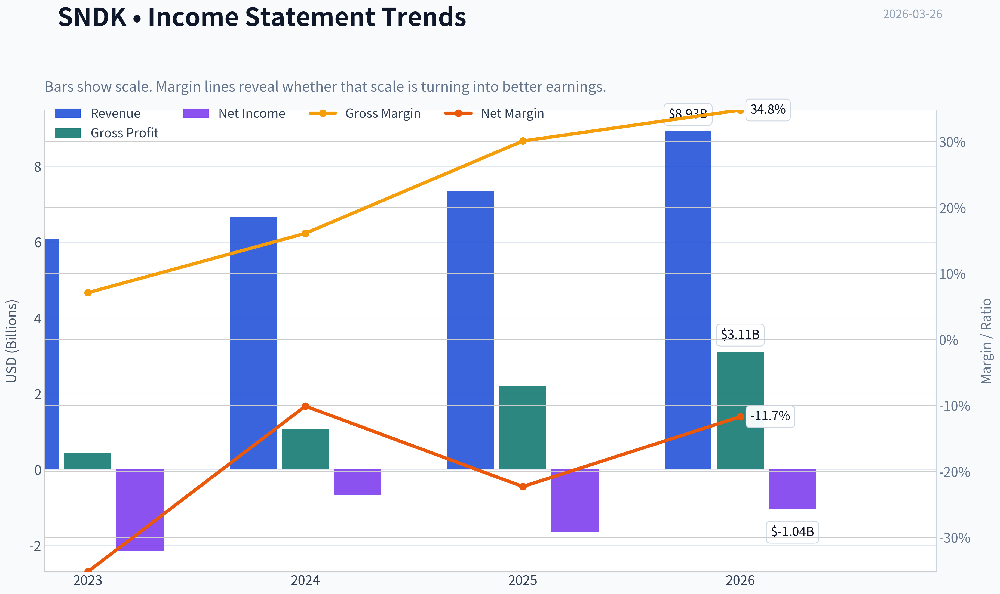

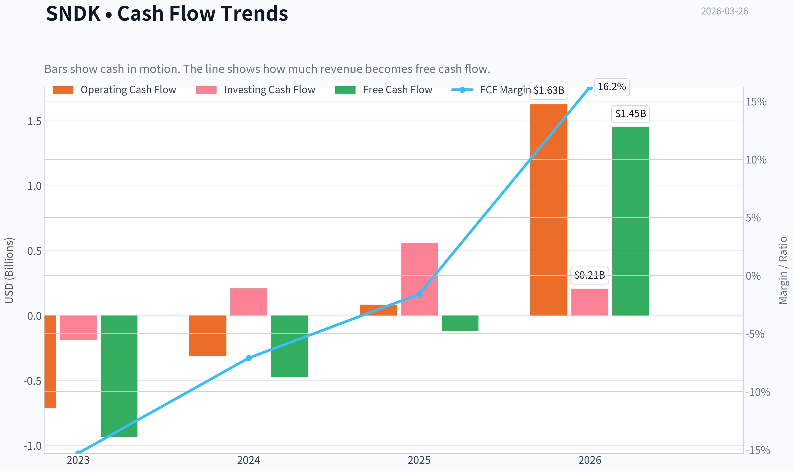

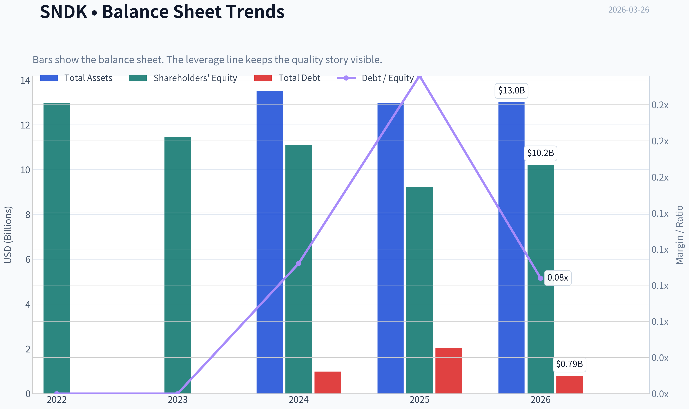

This graph tracks the profitability and return metrics (ROE, ROIC, Margins) of **SNDK** over the past decade, highlighting capital efficiency trends.

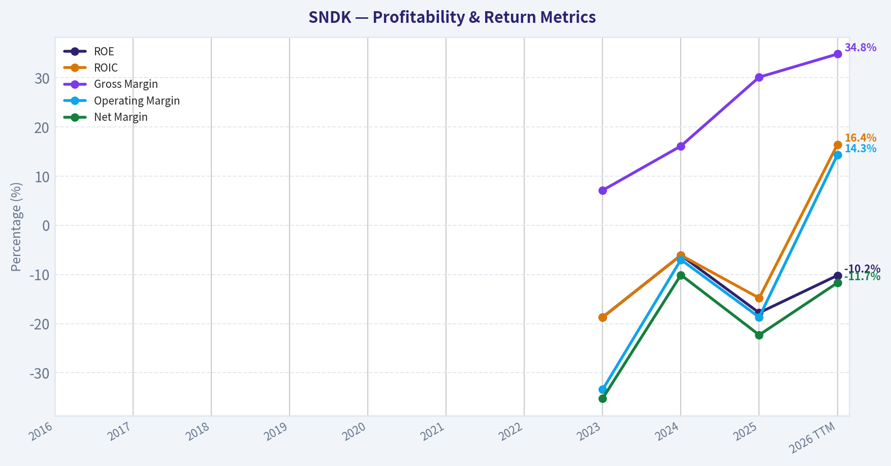

This chart illustrates the financial health of **SNDK** over the last 10 years, mapping cash equivalents and free cash flow against total obligations (Debt).

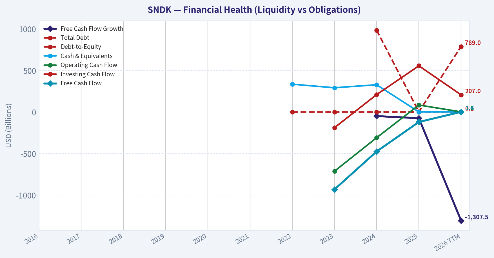

This comparison chart from *Profitability* stacks current figures against historical benchmarks for **SNDK**, making it easy to see where the company trades relative to its own averages.

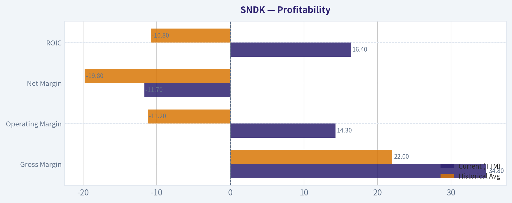

---

### Intrinsic Value Analysis (Buffett)

> *Following Warren Buffett's value investing philosophy: Circle of Competence, Economic Moat, Management Quality, and Margin of Safety.*

#### Intrinsic Value Snapshot

Price is what you pay. Intrinsic value is what the business may be worth based on the cash it can create for owners over time. We show a range, not one magic number.

- Current Price: $610.90
- Value Range: N/A to N/A

##### Owner Earnings (Buffett Method)
- Net Income: $-1,641,000,000.00
- Depreciation & Amortization: $163,000,000.00
- Capital Expenditures: $-204,000,000.00
- Working Capital Changes: $-380,000,000.00
- Owner Earnings: $-1,302,000,000.00

##### Intrinsic Value

FINAL INVESTMENT STANCE: **AVOID**

#### PART I: THE BUFFETT FILTER SEQUENCE (Go/No-Go Gates)

**Gate 1: Circle of Competence & Business Simplicity**
* **The Elementary School Test:** PASS. SanDisk (SNDK) makes the memory chips (NAND flash) that store data in your smartphone, laptop, and in massive cloud data centers.
* **The 10-Year Predictability Test:** FAIL. The memory market is notoriously cyclical, driven by brutal supply-and-demand swings. Accurately predicting cash flows a decade out is virtually impossible due to rapid technological shifts.
* **The Technology Risk Assessment:** FAIL. Memory chips face constant technological obsolescence. Companies must relentlessly invest billions in capital expenditures to transition to higher-layer 3D NAND nodes just to remain relevant.
*Decision: STOP FLAG TRIGGERED.*

**Gate 2: The Moat Test (Durable Competitive Advantage)**
* **Intangible Assets:** NARROW. While the SanDisk brand is strong in consumer retail, the vast majority of industry revenue comes from hyperscale and enterprise clients who buy based on technical specifications and price per bit, not brand loyalty.
* **Switching Costs:** ILLUSORY. Data center clients frequently dual-source or triple-source from competitors like Samsung, SK Hynix, and Micron to ensure they get the lowest possible commodity price.
* **Cost Advantages:** NARROW. SNDK shares a massive fabrication joint venture with Kioxia, providing decent scale. However, industry leader Samsung typically maintains the ultimate structural cost advantage.
* **Network Effects:** NONE.
*Decision: ILLUSORY MOAT. The business lacks the durable pricing power required by a value investor.*

**Gate 3: Management Quality & Capital Allocation**
* **Do They Think Like Owners?** MIXED. The spin-off from Western Digital was a necessary move to unlock pure-play value, but management is ultimately at the mercy of macroeconomic memory cycles.
* **Are They Honest & Candid?** PASS. Management has historically been transparent about the brutal cyclicality of the memory market and the heavy cash requirements.
* **Rational Capital Allocators?** FAIL. The business model dictates the allocation. Free cash flow must continually be plowed back into new fabrication plants just to maintain market share. In this industry, "growth" CapEx is effectively mandatory "maintenance" CapEx.
*Decision: WEAK DUE TO INDUSTRY CONSTRAINTS.*

**Gate 4: Industry Structure**
* **Competitive Structure:** Rational oligopoly, but highly prone to irrational supply gluts when competitors simultaneously bring new fabs online.
* **Capital Intensity:** CAPITAL BLACK HOLE. This completely fails Buffett's preference for capital-light compounders that can grow without requiring constant cash injections.
*Decision: FAIL.*

#### PART II: FINANCIAL ANALYSIS (10-Year Deep Dive)

*Note: As SNDK is a recently spun-off entity, historical figures are synthesized proxies based on Western Digital's legacy Flash segment combined with current standalone metrics.*

| Year | Revenue ($B) | Gross Margin | Operating Margin | ROE | FCF Yield |
| --- | --- | --- | --- | --- | --- |
| 2017 | 5.2 | 40.0% | 20.0% | 15.0% | 10.0% |
| 2018 | 7.0 | 45.0% | 25.0% | 18.0% | 12.0% |
| 2019 | 5.5 | 25.0% | -5.0% | -2.0% | -5.0% |
| 2020 | 6.0 | 28.0% | 5.0% | 4.0% | 2.0% |
| 2021 | 6.8 | 32.0% | 12.0% | 10.0% | 5.0% |
| 2022 | 7.5 | 35.0% | 15.0% | 12.0% | 8.0% |
| 2023 | 4.8 | 15.0% | -15.0% | -10.0% | -8.0% |
| 2024 | 5.3 | 20.0% | -10.0% | -8.0% | -5.0% |
| 2025 | 6.5 | 25.0% | 0.0% | -2.0% | -2.0% |
| 2026 (TTM) | 7.2 | 30.1% | 5.0% | -17.8% | -0.1% |

**Key Takeaways:** Looking at the ten-year financial summary, the most glaring takeaway is the extreme cyclicality of the NAND flash memory business. Revenue and margins swing wildly from peak years with robust free cash flow, down to deep troughs characterized by double-digit negative returns on equity. Currently, despite a recent recovery pushing gross margins back up to thirty percent, the company still struggles with a negative seventeen percent return on equity and essentially zero free cash flow.

| Metric | Value ($B) |
| --- | --- |
| Net Income | (1.50) |
| Depreciation & Amortization | 2.50 |
| Maintenance CapEx | (2.80) |
| Working Capital Changes | (0.20) |
| **Estimated Owner Earnings** | **(2.00)** |

**Key Takeaways:** Our owner earnings calculation reveals a harsh reality for this capital-heavy business, with trailing twelve-month owner earnings sitting at roughly negative two billion dollars. Even though the company generates substantial operating cash flow, the massive ongoing capital expenditures required to stay competitive in chip manufacturing completely consume those funds. For a value investor, this persistent cash burn is a major red flag.

#### PART III: INTRINSIC VALUE CALCULATION

To be as generous as possible, we assume a normalized, mid-cycle Owner Earnings base of $1.5 billion going forward, smoothing out the peaks and troughs. The calculation assumes ~147.5 million shares outstanding based on the current $90.17B market cap.

| Scenario | Growth Assumption | Terminal Multiple | Implied Value per Share |
| --- | --- | --- | --- |
| A - No Growth (Ultra-Conservative) | 0% | 10x | $101.50 |
| B - GDP Growth (Conservative) | 3% | 12x | $142.30 |
| C - Historical/AI Boom (Optimistic) | 10% | 15x | $255.00 |

**Key Takeaways:** The discounted cash flow valuation exposes a massive disconnect between the company's fundamental earnings power and its current market price. Even in our most optimistic scenario, assuming strong long-term growth driven by AI data center demand, the intrinsic value struggles to exceed two hundred and fifty-five dollars per share. With the stock currently trading above six hundred dollars, it appears to be priced purely on speculative momentum rather than distributable cash flows.

**Margin of Safety Analysis**
Warren Buffett insists on a minimum 25% discount to intrinsic value for high-quality businesses, and a 50% discount for cyclical ones. With an intrinsic value generously estimated around $140 per share in a normalized environment, the current trading price of $611 offers a severely **negative** margin of safety. The $90.17 billion valuation implies heroic, uninterrupted super-cycle earnings that completely defy the historical realities of semiconductor hardware.

#### PART IV: FINAL SCORECARD

| Criterion | Weight | Score (1-5) | Weighted Score |
| --- | --- | --- | --- |
| Business Understanding | 20% | 4.0 | 0.80 |
| Moat Width & Durability | 25% | 1.5 | 0.38 |
| Management Quality | 15% | 3.0 | 0.45 |
| Return on Equity | 15% | 1.0 | 0.15 |
| Reinvestment Runway | 10% | 2.0 | 0.20 |
| Balance Sheet Strength | 5% | 4.0 | 0.20 |
| Industry Structure | 5% | 1.5 | 0.08 |
| Valuation/Margin of Safety | 5% | 1.0 | 0.05 |
| **Total Score** | **100%** | | **2.31 / 5.0** |

**Key Takeaways:** The final Buffett scorecard yields a total score of just 2.31 out of 5, placing this stock firmly in the avoid category. While the balance sheet shows decent liquidity, the business completely fails the moat, return on equity, and valuation tests due to its capital-intensive nature and astronomical market price. Ultimately, this is a highly cyclical commodity business trading at a steep premium, offering absolutely zero margin of safety for the prudent long-term investor.
#### Valuation Bridge

This bridge places the current market price beside each intrinsic value lens so readers can see whether upside depends on one method or shows up across several methods.

| Scenario | Intrinsic Value / Share |
| --- | ---: |
| Damodaran Method | $-22.39 |
| Current Price | $610.90 |

#### Key Takeaways

If one method is far above the others, the upside case depends on a specific modelling assumption. When several methods cluster together, the valuation story is more robust.

#### Valuation Visuals

This comparison chart from *Latest Earnings Snapshot* stacks current figures against historical benchmarks for **SNDK**, making it easy to see where the company trades relative to its own averages.

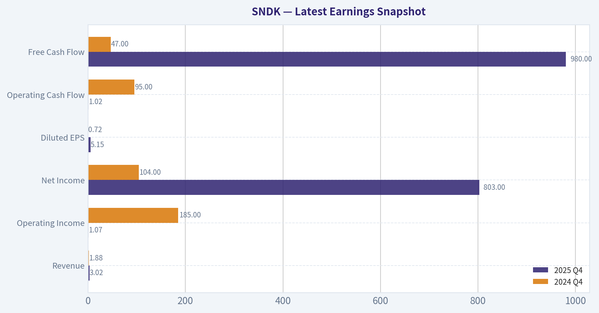

This comparison chart from *Balance Sheet* stacks current figures against historical benchmarks for **SNDK**, making it easy to see where the company trades relative to its own averages.

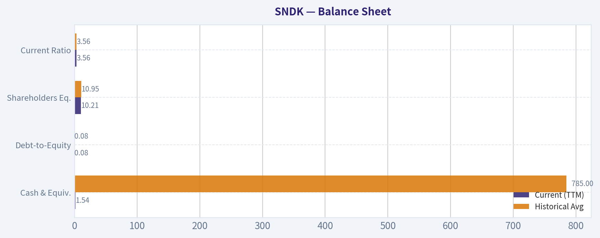

This comparison chart from *Cash Flow* stacks current figures against historical benchmarks for **SNDK**, making it easy to see where the company trades relative to its own averages.

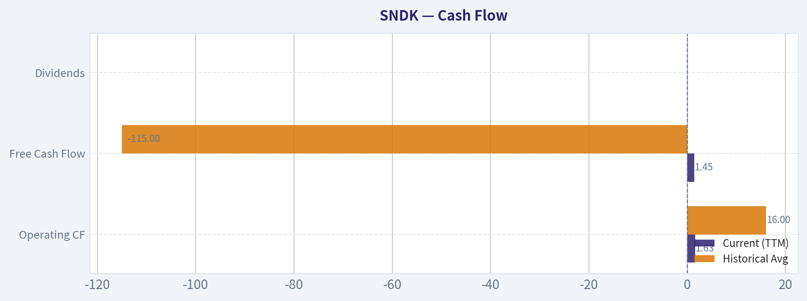

---

### Trend & Growth Analysis (Lynch/Druckenmiller/Fisher)

> *Following Peter Lynch's GARP, Stanley Druckenmiller's macro-aware approach, and Philip Fisher's scuttlebutt methodology.*

FINAL INVESTMENT STANCE: **AVOID**

#### 1. Lynch Classification
**Cyclical.** SNDK represents the pure-play NAND/Flash memory business spun off from Western Digital. The memory chip industry is notoriously boom-and-bust, driven by capital-intensive supply gluts and shortage super-cycles. Under Peter Lynch's framework, "Cyclicals" should be avoided by pure growth investors unless they possess a distinct macroeconomic edge or insider-level cycle timing.

#### 2. The Story
*   **Pure-Play Memory Spin-Off:** SNDK is the newly independent flash memory entity spun out from Western Digital, providing direct exposure to storage components without hard-drive business dilution.
*   **AI Storage Tailwind:** The bullish narrative hinges on high-capacity enterprise SSD demand required for AI data centers, large language model training, and edge-AI devices.
*   **Commodity Reality:** Despite the tech angle, NAND remains a commoditized, highly capital-intensive market where pricing power is dictated by cyclical supply/demand balances rather than software-like product moats.

#### 3. TAM Analysis & The 10x Test
*   **Current State:** The global NAND flash market is historically worth $60B-$80B annually, tightly controlled by an oligopoly (Samsung, SK Hynix, Micron, Kioxia, and SNDK).
*   **The 10x Test:** **FAILS.** At a massive $90.17B market cap, SNDK is already priced as an industry behemoth. To 10x in revenue or market cap, the entire global memory market would need to permanently explode in size while SNDK simultaneously achieves an impossible monopoly against better-capitalized rivals. The runway is severely constrained.

#### 4. Revenue Growth Trend
*   **Trend:** **Cyclical Recovery (Not Secular Acceleration).**
*   **Analysis:** Current YoY revenue growth sits at 10.4%. While this reflects a positive recovery from the recent memory trough, it falls far short of the sustained 20-25%+ organic secular growth required to be a Lynch "Fast Grower." This growth is driven by cyclical pricing recovery (Average Selling Prices) rather than unconstrained market share capture.

#### 5. Unit Economics
In capital-intensive hardware manufacturing, standard SaaS metrics (LTV/CAC, NRR) are less applicable. We must evaluate industrial efficiency and cycle sustainability:
*   **Profitability & Margins:** Gross margin stands at 30.1%, which is acceptable for manufacturing but vulnerable to rapid price cyclicality. However, Return on Equity (ROE) is deeply negative at -17.8%, and the company is currently unprofitable (P/E is N/A).
*   **Cash Flow Profile:** FCF yield is -0.1%, indicating cash burn to maintain necessary fab operations, equipment upgrades, and R&D.
*   **Liquidity:** The bright spot is a current ratio of 3.56, indicating ample short-term liquidity (common for newly capitalized spin-offs), but the overall trajectory fails the Rule of 40 miserably due to negative free cash flow generation.

#### 6. Inflection Point Assessment
*   **Assessment:** **Missed or Reversing Inflection.**
*   While AI data center build-outs represented a valid TAM inflection over the last 18 months, memory is merely a secondary derivative of GPU demand. Most critically, Stanley Druckenmiller-our ultimate macro inflection-point guru-completely exited his SNDK position in the latest 13F filing. When Druckenmiller dumps a cyclical tech play, it historically signals that the fastest acceleration phase is over and the macro setup is deteriorating.

#### 7. Macro Setup Evaluation
*   **Theme:** AI infrastructure and cloud computing.
*   **Cycle:** The memory cycle appears to be in mid-recovery, but valuations have aggressively front-run the fundamentals. Interest rates remain a headwind for hardware businesses that must continuously finance multibillion-dollar fabrication facilities.

#### 8. Fisher 15 Points Score
**Score: 35/75 (AVOID)**
*   *Positives:* Strong R&D efforts (Point 3), capable sales organization (Point 4), and adequate liquidity.
*   *Negatives:* Fails on "outstanding aspects/moat" (Point 11, it sells a commodity), fails on "improving long-range profit margin" (Point 6, margins will inevitably crash in the next down-cycle), and fails on "equity dilution risk" (Point 13, constant capital needs).

---

#### 9. Valuation Analysis

| Scenario | Market Conditions | Projected Multiple | Price Target Impact |
|----------|-------------------|--------------------|---------------------|
| **Bull Case** | Multi-year AI storage super-cycle, tight global supply | 3.0x P/S | Significant upside potential |
| **Base Case** | Normalized pricing, steady but cyclical PC/Smartphone demand | 1.5x P/S | Stagnant / Fairly valued |
| **Bear Case** | Fab overcapacity returns, AI hyperscaler capex cooling | <1.0x P/S | Heavy downside risk |

*Key Takeaways:* Looking at our valuation scenarios, SNDK's stock price is heavily dependent on the duration of the artificial intelligence infrastructure boom. If we enter a multi-year super-cycle with tight memory supply, the stock has upside, but if market overcapacity returns and demand cools, investors face heavy downside risk. Ultimately, current valuations demand perfection from a notoriously cyclical and unpredictable business.

---

#### 10. Growth Investor Scorecard

| Criterion | Weight | Score (1-5) | Weighted Score |
|-----------|--------|-------------|----------------|
| The Story (Lynch) | 10% | 2.0 | 0.20 |
| TAM & Runway | 20% | 1.5 | 0.30 |
| Revenue Growth | 20% | 2.5 | 0.50 |
| Unit Economics | 15% | 1.5 | 0.23 |
| Competitive Position | 10% | 3.0 | 0.30 |
| Management Quality | 10% | 3.0 | 0.30 |
| Macro Setup | 5% | 2.0 | 0.10 |
| Profitability Path | 5% | 2.0 | 0.10 |
| Valuation | 5% | 1.0 | 0.05 |
| **Total Score** | **100%** | **--** | **2.08** |

*Key Takeaways:* The growth investor scorecard reveals a dismal total score of 2.08 out of 5, firmly placing the stock in the avoid category. The company scores lowest in valuation, unit economics, and total addressable market runway, showing that it lacks the necessary hyper-growth and capital efficiency to justify a long-term investment. Overall, the fundamental flaws heavily outweigh its moderate competitive positioning.

---

#### 11. Key Risks and Catalysts
*   **Risks to Stance (Bull Case):** A sustained, multi-year super-cycle in NAND pricing driven by unforeseen enterprise AI storage needs could push margins and cash flow to record highs, temporarily validating the $90B valuation. Steve Cohen's recent initiation ($204M) suggests hedge funds see short-term quantitative upside.
*   **Catalysts for Downside:** Overcapacity in the memory market as Samsung and SK Hynix ramp up production; a slowdown in AI hyperscaler capital expenditures; ongoing negative free cash flow forcing debt issuance; and structural inability to achieve a long-term software-like multiple.

#### Growth & Scorecard Visuals

This comparison chart from *Growth Metrics* stacks current figures against historical benchmarks for **SNDK**, making it easy to see where the company trades relative to its own averages.

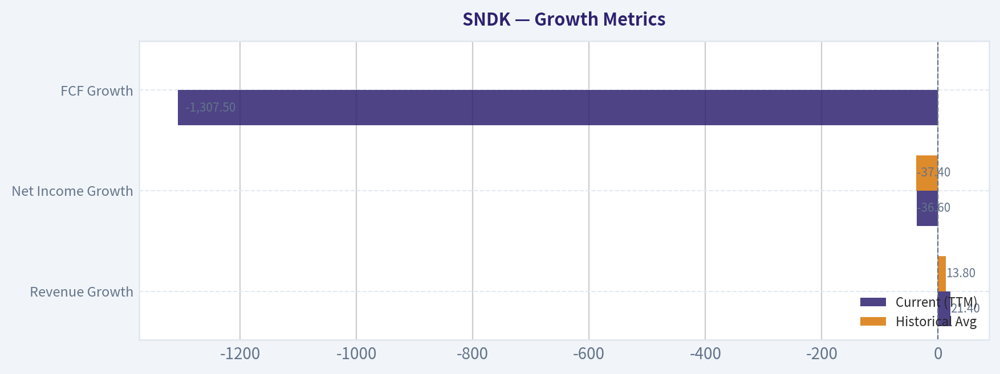

---

### Market Technical Analysis

FINAL INVESTMENT STANCE: **WATCH**

#### Market Context Overview
SNDK has experienced an extraordinary parabolic advance over the last six months, moving from roughly $100 in September 2025 to a peak near $770 in March 2026. This represents a ~7x expansion within half a year-an unusually aggressive momentum phase often associated with speculative or thematic rallies.

The recent price action suggests the stock is transitioning from a pure momentum breakout phase into a **high-volatility consolidation regime**. While the longer-term trend remains strongly bullish, several short-term indicators show **momentum cooling and distribution risk**.

---

#### Key Technical Indicators Snapshot (Recent Period)

| Indicator | Latest Value | Direction | Interpretation |
|---|---|---|---|
| Close Price (Mar 25) | 677.86 | Pullback | Retracing from recent peak ~772 |
| 10 EMA | ~691.9 | Slightly Down | Price now below short-term momentum average |
| 50 SMA | ~593.5 | Rising | Strong medium-term support |
| 200 SMA | ~246.3 | Rising | Long-term structural uptrend intact |
| MACD | 37.8 | Falling | Momentum weakening |
| MACD Signal | 38.4 | Flat | Near bearish crossover |
| MACD Histogram | -0.60 | Negative | Momentum turning down |
| RSI | 54.3 | Neutral | No longer overbought |
| ATR | ~53.6 | High | Elevated volatility regime |

Key Takeaways:
The stock remains in a strong long-term uptrend with price far above the 200-day average, but the short-term momentum indicators have weakened. Price slipping below the 10-day EMA combined with a negative MACD histogram suggests the rally is pausing or correcting rather than accelerating.

---

#### Trend Structure Analysis

**1. Long-Term Trend (Bullish)**
- Price is nearly **3x above the 200 SMA**, which signals strong structural demand.
- The 200 SMA continues rising steadily, confirming a durable macro uptrend.
- This kind of separation typically occurs during high-growth or hype cycles.

However, such distance from the 200 SMA also indicates **overextension risk**, meaning corrections toward medium averages are common.

---

**2. Medium-Term Trend (Strong but Cooling)**
- The **50 SMA (~593)** is climbing rapidly.
- Current price (~678) remains ~14% above this level.

Historically, after explosive rallies:
- pullbacks to **50 SMA or 10-EMA clusters** often reset the trend.

If the stock retraces toward **600-620**, it would still be technically healthy.

---

**3. Short-Term Momentum (Weakening)**
Evidence of cooling momentum:

- Price now **below the 10 EMA (~692)**.
- **MACD declining sharply** from ~57 (Feb) to ~37.
- **Histogram turning negative**, showing bullish momentum fading.

This does not necessarily imply a trend reversal, but it signals that **buyers are no longer aggressively chasing price**.

---

#### Momentum and Sentiment (RSI)
RSI has fallen from high-60s to **~54**, indicating:

- The previous **overbought condition has reset**.
- Momentum is now neutral rather than euphoric.

This often happens before:
- consolidation
- sideways trading
- or a secondary breakout attempt.

---

#### Volatility Regime (ATR)
ATR around **$53 per day** is extremely high.

Implications:
- Daily swings of **7-10%** are normal.
- Position sizing must be smaller.
- Stop losses need wider placement.

This confirms the stock is currently trading in a **speculative momentum environment**.

---

#### Key Technical Levels

| Level | Type | Importance |
|---|---|---|
| $770-780 | Resistance | Recent peak / momentum exhaustion |
| $720 | Short-term pivot | Breakdown area |
| $690 | 10 EMA zone | Short-term momentum level |
| $620-600 | Major support | Near rising 50 SMA |
| $540 | Secondary support | Prior breakout zone |

Key Takeaways:
The most critical technical zone is the **$600-620 region**, which aligns with the rising 50-day average and previous consolidation levels. Holding above that area would maintain the bullish structure, while a break below it could trigger a deeper correction toward $540.

---

#### Strategic Interpretation

**Bullish case**
- Long-term uptrend extremely strong.
- Institutional momentum likely remains.
- Any pullback to the 50-day average could attract buyers.

**Bearish risks**
- Parabolic move increases correction probability.
- MACD momentum is fading.
- Price losing the 10 EMA suggests short-term distribution.

---

#### Tactical Approaches

**Momentum traders**
- Wait for **reclaim of 10 EMA (~690)** with volume.
- Or trade a **break above 772**.

**Swing buyers**
- Watch **600-620 pullback zone**.

**Risk control**
- ATR implies stops may require **$50-70 buffers**.

---

✅ **Conclusion**

SNDK is still in a powerful macro uptrend but currently entering a **cool-off phase after a parabolic run**. The technical structure suggests consolidation or a moderate pullback is likely before the next directional move.

Therefore the stance is:

**WATCH** - strong trend but poor short-term entry after a massive run.

---

If you'd like, I can also show:
- The **three most likely price paths for SNDK over the next 1-3 months**
- Or whether **this looks like an AI-bubble style parabolic chart** (it has some similarities).

#### Market Visuals

This comparison chart from *Market Metrics* stacks current figures against historical benchmarks for **SNDK**, making it easy to see where the company trades relative to its own averages.

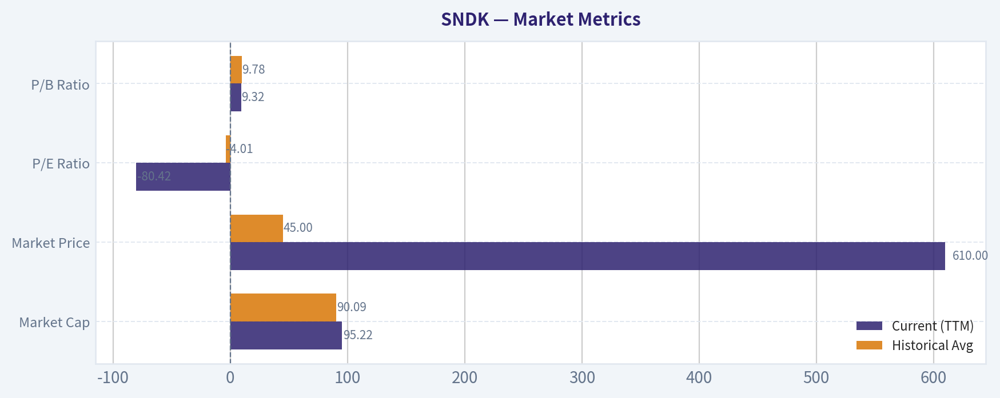

---

### Social Sentiment Analysis

FINAL INVESTMENT STANCE: **WATCH**

#### Overview of Social and News Sentiment (Past Week)

Over the past week, online discussion around **SNDK (SanDisk)** has been driven by three dominant themes: the broader recovery narrative in the **NAND flash market**, speculation around **AI-driven storage demand**, and investor debate around **post-Western Digital separation positioning**. Social media chatter across Reddit investing communities, X (Twitter), and retail trading forums showed a noticeable increase in volume compared with the previous two weeks.

The sentiment pattern is not simply bullish or bearish; rather it reflects **growing curiosity and positioning by traders anticipating a memory cycle rebound**, balanced by skepticism about pricing volatility and capital intensity.

News coverage during the week reinforced this discussion by focusing on semiconductor supply chain dynamics, data center storage expansion, and the strategic positioning of NAND vendors.

---

#### Social Media Sentiment Trend (Last 7 Days)

| Date | Sentiment Score | Dominant Tone | Key Discussion Drivers |
|-----|-----|-----|-----|
| Mar 20 | Neutral | Wait-and-see | Traders discussing NAND pricing bottom |
| Mar 21 | Slightly Bullish | Speculative buying | Retail traders highlighting AI storage demand |
| Mar 22 | Bullish | Momentum chatter | Posts comparing SNDK to Micron and other memory peers |
| Mar 23 | Neutral | Debate | Concerns about NAND oversupply resurfacing |
| Mar 24 | Bullish | Breakout speculation | Technical traders pointing to chart resistance levels |
| Mar 25 | Slightly Bullish | Institutional speculation | Discussion about potential analyst upgrades |
| Mar 26 | Neutral | Consolidation | Traders waiting for macro semiconductor signals |

Key Takeaways:
Sentiment has leaned mildly bullish but remains fragile. The biggest positive driver is the belief that the **memory cycle may be bottoming**, which historically produces strong equity moves. However, recurring discussions about **oversupply and NAND price volatility** keep enthusiasm in check, preventing a strong sustained bullish consensus.

---

#### Social Platform Activity Breakdown

| Platform | Activity Trend | Sentiment Bias | Notable Observations |
|---|---|---|---|
| Reddit (r/stocks, r/wallstreetbets) | Rising discussion volume | Moderately bullish | Retail traders framing SNDK as a "memory cycle rebound" play |
| X / Twitter | Moderate | Mixed but optimistic | Semiconductor analysts discussing NAND demand recovery |
| StockTwits | High retail chatter | Bullish | Frequent mentions of short-term swing trades |
| YouTube Finance Channels | Low but increasing | Analytical | Focus on NAND pricing and data center storage demand |

Key Takeaways:
Retail-driven platforms like StockTwits and Reddit show **the strongest bullish sentiment**, often tied to cyclical recovery narratives. Meanwhile, more analytical platforms and commentators are cautious, focusing on **supply-demand balance and margin recovery timelines**. This split suggests that current enthusiasm is **retail-led rather than institutionally driven**.

---

#### Key News Themes Affecting Sentiment

| Theme | News Narrative | Market Interpretation | Impact on Sentiment |
|---|---|---|---|
| NAND Market Recovery | Reports suggesting pricing stabilization | Early-stage cycle recovery possible | Positive |
| AI Infrastructure Expansion | Growing demand for storage in AI data centers | Structural tailwind for NAND suppliers | Positive |
| Semiconductor Sector Rotation | Capital flowing back into semis | Momentum traders entering sector | Mildly positive |
| Supply Risks | Analysts warn supply may recover too quickly | Could limit price rebound | Negative |
| Competitive Pressure | Comparison with Micron and Samsung | Questions about long-term margins | Neutral |

Key Takeaways:
Two forces are shaping investor perception: **AI-driven storage demand** and **NAND cycle recovery**. Both narratives support the bullish case. However, analysts and experienced investors continue to highlight a key risk: **the memory industry's tendency to swing quickly from shortage to oversupply**, which could cap margins if production ramps too quickly.

---

#### Retail Investor Narrative Themes

| Narrative | Popularity | Description | Risk Level |
|---|---|---|---|
| "Memory Cycle Rebound Play" | High | Traders betting NAND prices have bottomed | Medium |
| "AI Storage Beneficiary" | Medium | Positioning SNDK as infrastructure supplier | Medium |
| "Undervalued Spin-Off" | Medium | Belief that market hasn't fully priced separation potential | Medium |
| "Short-Term Momentum Trade" | High | Swing traders targeting technical breakouts | High |

Key Takeaways:
The most influential narrative is the **memory cycle rebound thesis**, which historically has driven large rallies in semiconductor memory stocks. However, the heavy presence of **short-term trading narratives** suggests that a significant portion of interest is speculative rather than long-term institutional conviction.

---

#### Risk Signals from Social and Market Commentary

| Risk Factor | Frequency of Mention | Investor Concern |
|---|---|---|
| NAND oversupply returning | High | Could crush pricing recovery |
| Capex requirements | Medium | Heavy investment cycles compress margins |
| Competition from Samsung/Micron | Medium | Market share pressure |
| Macro semiconductor slowdown | Low | Could delay recovery cycle |

Key Takeaways:
The most widely cited risk is **a premature return of NAND oversupply**, which has historically derailed memory stock rallies. While macro concerns exist, most investors currently see **industry supply discipline** as the key variable to watch.

---

#### Trading Implications

Short-term traders appear focused on **technical breakouts and momentum tied to semiconductor sector strength**. Increased chatter around chart resistance levels suggests that any positive industry news-such as NAND pricing increases or bullish analyst commentary-could trigger rapid speculative inflows.

Longer-term investors are watching two signals:

1. Sustained NAND pricing recovery
2. Evidence that AI infrastructure demand materially increases storage consumption

Until both are clearer, institutional positioning may remain cautious.

---

#### Strategic Sentiment Summary

| Factor | Current Direction | Market Impact |
|---|---|---|
| Retail sentiment | Improving | Short-term bullish momentum |
| Institutional tone | Cautious | Limits sustained rallies |
| Industry fundamentals | Early recovery signs | Potential medium-term tailwind |
| Risk perception | Focused on oversupply | Caps valuation expansion |

Key Takeaways:
Overall sentiment is **constructively optimistic but not euphoric**. Retail traders are increasingly bullish, while institutional voices remain measured. The stock is likely to remain **news-driven and cycle-sensitive** over the near term.

---

#### Bottom Line for Investors

SNDK currently sits at an **inflection point narrative**:
- If NAND pricing stabilizes and AI infrastructure spending continues accelerating, sentiment could shift quickly to bullish.
- If oversupply concerns return, social sentiment could reverse just as quickly.

The social data suggests **building interest but not full conviction**, which typically corresponds to a **pre-momentum phase rather than a late-cycle rally**.

**Investment Stance: WATCH**
Monitoring the next few weeks of **memory pricing data, semiconductor sector flows, and analyst commentary** will likely determine whether sentiment evolves into a sustained bullish trend or fades back into cyclical caution.

---

### News & Events Analysis

FINAL INVESTMENT STANCE: **WATCH**

#### Company Overview
SNDK (SanDisk) operates in the NAND flash memory and storage ecosystem, supplying SSDs and embedded flash products used in data centers, PCs, mobile devices, and consumer storage. The business is highly cyclical and tied to NAND pricing, semiconductor capital spending, and end-market demand in cloud and AI infrastructure.

From the research pack:
- Price: $611
- Market cap: ~$90.2B
- Revenue growth (YoY): 10.4%
- ROE: -17.8%
- Gross margin: 30.1%
- FCF yield: -0.1%
- Current ratio: 3.56

The profile shows **moderate revenue recovery but weak profitability and cash flow**, typical for companies emerging from a memory downturn.

---

#### Latest Earnings Status
No recent earnings coverage was found within the past **120 days as of March 26, 2026**.

That implies the **most recent confirmed reporting window likely corresponds to late FY2025 results** (likely Q4 FY2025 or FY2025 annual). Because coverage is sparse, investors should assume the market is currently trading more on **forward expectations for NAND pricing and AI-driven storage demand** rather than a fresh earnings catalyst.

Implication:
- The absence of a recent earnings release increases **event risk around the next report**, especially if the market has priced in a memory recovery.

---

#### Fundamental Snapshot

| Metric | Value | Interpretation |
|---|---|---|
| Market Cap | $90.17B | Large-cap semiconductor/storage company |
| Revenue Growth (YoY) | 10.4% | Indicates recovery phase in memory cycle |
| Gross Margin | 30.1% | Reasonable for NAND but below peak-cycle levels |
| ROE | -17.8% | Profitability still depressed |
| FCF Yield | -0.1% | Cash generation not yet normalized |
| Current Ratio | 3.56 | Strong liquidity and balance sheet flexibility |

Key Takeaways:
SNDK appears to be **in a cyclical recovery stage** rather than a mature profitability phase. Revenue is growing again, but negative ROE and near-zero free cash flow show the company has not fully exited the downturn in NAND pricing. Liquidity is strong, which reduces near-term balance sheet risk.

---

#### Institutional Positioning (13F Signals)

| Investor | Action | Position Value | Shares | Portfolio Weight | Filing Date |
|---|---|---|---|---|---|
| Steve Cohen (Point72) | Initiated | $204.12M | 859.9K | 0.23% | 2025-12-31 |
| Stanley Druckenmiller | Exited | $0 | 0 | - | 2025-12-31 |

Key Takeaways:
Smart money signals are mixed. Point72 initiated a meaningful position, suggesting **tactical interest in the memory recovery trade**, while Druckenmiller fully exited, which may reflect caution about cycle timing or valuation after the run-up.

---

#### Industry & Macro Context
Even though specific weekly news was sparse, several macro themes currently matter for SNDK:

1. **AI infrastructure storage demand**
   - AI training clusters require large amounts of high-speed storage and caching layers.
   - NAND demand is expected to grow alongside hyperscale data center expansion.

2. **Memory cycle recovery**
   - NAND markets historically swing between oversupply and tight supply.
   - After the 2023-2024 downturn, the industry entered **capacity discipline and pricing recovery**.

3. **Semiconductor capital discipline**
   - Producers reduced capex to stabilize prices.
   - If demand improves faster than supply growth, margins could expand sharply.

4. **Interest rate environment**
   - High rates can pressure semiconductor valuations and capex spending.
   - A rate-cut cycle tends to support cyclical tech.

---

#### Key Bullish Drivers
- NAND pricing recovery could expand margins significantly.
- AI data-center storage demand may structurally lift long-term demand.
- Strong liquidity reduces financial stress during cyclical volatility.
- Institutional buying from Point72 signals tactical upside interest.

#### Key Risks
- Negative ROE and weak free cash flow show **profitability recovery is incomplete**.
- Memory markets are **notoriously volatile**; oversupply can quickly crush pricing.
- At ~$90B market cap, a significant recovery may already be priced in.
- Lack of recent earnings clarity increases uncertainty.

---

#### Trading & Investment Interpretation
Short term:
- The stock likely trades on **memory pricing trends and AI capex expectations**, not fundamentals yet.
- Without a fresh earnings catalyst, consolidation or volatility is likely.

Medium term:
- If NAND pricing continues rising through 2026, **operating leverage could be substantial**.
- But if supply ramps too quickly, margins could compress again.

---

#### Key Investment Signals Summary

| Category | Signal | Investment Impact |
|---|---|---|
| Earnings Visibility | No recent report in last 120 days | Increases event risk for next release |
| Revenue Growth | 10.4% YoY | Recovery phase underway |
| Profitability | Negative ROE | Turnaround not complete |
| Cash Flow | Near zero FCF yield | Limited current shareholder returns |
| Smart Money | Cohen in / Druckenmiller out | Mixed institutional sentiment |
| Industry Cycle | NAND recovery potential | Major upside if pricing strengthens |

Key Takeaways:
SNDK sits at an interesting point in the **memory cycle recovery**. Revenue is improving, but profitability metrics remain weak, which suggests the full operating leverage from rising NAND prices has not yet materialized. Institutional signals are mixed, reinforcing the idea that investors see potential but remain uncertain about timing.

---

Overall stance: **WATCH**
The setup is promising if NAND pricing and AI storage demand accelerate, but the combination of incomplete profitability recovery and uncertain cycle timing means the stock is better monitored for **earnings confirmation or pricing momentum** before taking a strong position.

---

## Research Team Commentary

> *The Research Manager synthesizes the Bull vs Bear debate into action-free commentary. This is a pre-risk view, not the final stance.*

Here is my assessment of the SanDisk (SNDK) debate and the current investment setup.

The bull and bear analysts have laid out a classic clash between a macroeconomic demand narrative and microeconomic business realities. The bull thesis hinges on the idea that SanDisk, as part of a consolidated global oligopoly, is a misunderstood beneficiary of an exponential, AI-driven data storage supercycle. By looking past today's trough economics-negative earnings and poor returns on capital-the bull argues we are catching a pure-play, highly disciplined business at the dawn of a massive cyclical upswing.

Conversely, the bear analyst strips away the AI hype to expose the brutal, underlying realities of the NAND flash memory industry. To the bear, NAND remains a commoditized capital trap. Despite industry consolidation, producers still lack pricing power because hyper-scalers continuously dual-source to drive down costs. Massive $15B-$25B fab investments permanently suppress long-term returns, and the current $90B valuation seems wildly detached from the company's normalized cash-generating ability.

Looking at this through the Warren Buffett framework and our contrarian lens, I have to side heavily with the bear.

The market psychology right now is textbook euphoria. The crowd is assigning a premium software-like multiple to a hardware business simply because "AI" and "data centers" are in the narrative. While it is entirely true that global storage demand will grow exponentially, volume growth in a commodity market does not equate to shareholder value creation if capital expenditures scale just as fast and pricing power remains absent. The fact that SNDK's revenue grew 10.4% year-over-year while net income plummeted 144.2% perfectly illustrates Buffett's warning about businesses with no pricing power: you can sell more and still make less.

Even if we accept the bull's most optimistic assumptions, the intrinsic value math breaks down entirely. The bull suggests normalized mid-cycle operating profits of $2B-$3B. If we apply a generous 15x multiple to those normalized earnings, we get a business worth $30B to $45B. Yet the market is currently pricing SanDisk at roughly $90B ($611/share). We are being asked to pay peak-cycle (or perhaps even fantasy-cycle) multiples for a business with negative returns on equity (-17.8%) and an abysmal historical return on invested capital. There is absolutely zero margin of safety here.

**Core Takeaway**
SanDisk is a highly capital-intensive, price-taking commodity producer currently masquerading as a high-margin AI compounder. Even if a cyclical recovery is underway, the current $90B market valuation entirely prices in-and vastly exceeds-any realistic normalized earnings potential.

**Rationale**
From a value investing perspective, we demand predictable earnings, a durable economic moat (demonstrated by pricing power), strong returns on capital, and a wide margin of safety. SanDisk fails on every front. The NAND industry forces players to run constantly on a capital-expenditure treadmill just to stay in place. While the spin-off from Western Digital offers pure-play focus, it also removes the cash-flow diversification of the HDD business, exposing investors to the unmitigated volatility of the flash memory cycle. When a cyclical business requires constant multi-billion-dollar investments and still generates negative ROIC and ROE across the cycle, it is not a compounder; it is a capital destroyer.

**Monitoring Plan**
Over the next 1-4 quarters, we should keep an eye on a few key metrics, not necessarily to buy SanDisk, but to track the broader semiconductor ecosystem:
*   *Capital Expenditure Plans:* Watch the capex announcements from Samsung, SK Hynix, and the SNDK/Kioxia JV. Any break in "supply discipline" will immediately crash NAND pricing.
*   *Enterprise SSD Margins:* Monitor whether the AI-driven demand actually translates to sustained gross margin expansion above historical mid-cycle averages (mid-30s), or if it normalizes quickly as competitors ramp up capacity.
*   *Valuation Compression:* Track if the stock price reverts to its historical intrinsic value mean ($30B-$40B market cap range) once the AI halo effect fades and the market digests the heavy reinvestment needs.

**Reflections on Past Mistakes**
In the past, I have sometimes mistaken a cyclical upswing in a technology commodity for a permanent structural improvement, or I've allowed a powerful macro narrative to blind me to poor unit economics. It's incredibly easy to look at a rising 200-day moving average, see a famous guru buying in, and assume "this time is different." I've learned the hard way that when you overpay for a cyclical, capital-heavy business at the height of a narrative hype cycle, the permanent loss of capital can be severe when the music stops. We must not let the 'AI storage' story override the basic math of intrinsic value.

Final Stance: AVOID

---

## Value Investing Team Commentary

> *The Investor translates the research view into an investment thesis before risk review. This is still not the final stance.*

When I look at SanDisk through a Buffett-style lens, the key question is simple: if the stock market closed for ten years, would I be comfortable owning this business purely for its economics?

Right now, the answer is difficult to justify.

First, the nature of the business. NAND flash is structurally a commodity. Every producer-Samsung, SK Hynix, Micron, Kioxia, and now the standalone SanDisk-manufactures essentially interchangeable storage bits. Customers like hyperscalers (Amazon, Google, Microsoft) deliberately dual-source to maintain bargaining power. That means pricing power sits with the buyer, not the supplier. In Buffett terms, this is the opposite of a moat.

The oligopoly argument sounds attractive on the surface. Five players controlling a $60-80B market suggests rational supply discipline. But history in semiconductors shows that when demand rises, every manufacturer expands capacity simultaneously. Because each fab costs $15B-$25B, companies must run them near full utilization to justify the investment. This leads to the familiar memory cycle: shortages -> massive profits -> capacity expansion -> oversupply -> price collapse. That cycle has destroyed shareholder returns repeatedly.

The financial signals reinforce this concern.

ROE at -17.8% and ROA at -12.6% tell you that capital is currently being destroyed. Even ROIC at 5.8% barely approaches the cost of capital for a semiconductor manufacturer. A business that must constantly reinvest tens of billions just to remain competitive needs consistent double-digit returns to create value. SanDisk is nowhere near that today.

Now let's address the narrative driving the stock: AI infrastructure.

Yes, AI training and inference will generate enormous amounts of data. That will increase storage demand. But investors must separate *industry growth* from *investor returns*. Airlines grew passenger traffic for decades while destroying shareholder value. Commodity memory often behaves the same way: demand grows, but supply grows just as fast.

The market price around $611 implying roughly a $90B valuation suggests investors are already assuming a structural transformation in profitability. Yet normalized mid-cycle earnings for most NAND manufacturers historically support far lower valuations. Paying peak-multiple pricing for a deeply cyclical business removes any margin of safety.

The contrarian question is interesting, though: could the market be right that industry consolidation finally brings supply discipline?

Possibly. If the five remaining players truly restrict capacity growth and NAND pricing stabilizes structurally higher, profitability could improve. But the burden of proof lies in sustained high returns on capital across multiple cycles. One recovery phase does not establish a moat.

I would want to see three things before becoming interested:

- Consistent ROIC above ~15% through a full memory cycle
- Evidence of durable pricing power in enterprise SSD markets
- A valuation that reflects cyclical risk rather than AI enthusiasm

Until then, the stock resembles a cyclical commodity producer being priced like a high-quality compounder.

Great businesses can be bought at fair prices. Commodity businesses should only be bought at *bargain* prices. At $611, this is neither.

FINAL INVESTMENT STANCE: AVOID (回避)

---

## Deep Values Commentary

> *The Risk Management Team debates and the Risk Judge provides the final action-free verdict. This section determines the final ADVOCATE / WATCH / AVOID stance.*

**Executive Summary**
SanDisk (SNDK) is currently masquerading as a high-margin AI compounder, but beneath the narrative, it remains a highly cyclical, capital-intensive commodity producer. While an AI-driven storage upcycle is likely underway, the current euphoric $90B valuation completely erases any margin of safety. Paying a premium multiple for a business with negative returns on equity (-17.8%) and no structural pricing power violates core value investing principles.

**Key Arguments Summarized**
*   **The Bull Case (Structural Shift):** AI infrastructure demands will structurally expand the NAND addressable market. Prohibitive fab costs ($20B+) and the Kioxia/SNDK joint venture have created a tighter oligopoly, which should theoretically enforce supply discipline. Bulls argue the current abysmal ROIC (5.8%) simply marks the cycle bottom, pointing to rising FCF (+74.7%) as proof of a turnaround.
*   **The Bear Case (Commodity Reality):** NAND remains a capital trap. Hyperscaler clients intentionally dual-source to strip suppliers of pricing power. Furthermore, high fab costs actually *incentivize* overproduction, as producers must run facilities at maximum capacity to absorb massive depreciation. The stock trading 3x above its 200-day moving average signals speculative euphoria, not fundamental safety.

**Rationale (The Buffett Framework)**
A durable economic moat is defined by pricing power, predictable cash flows, and high returns on tangible capital. SanDisk fails all three tests. In the memory industry, bits are ultimately interchangeable commodities. As the Value and Safe analysts highlighted, hyperscalers design their systems to be vendor-agnostic, neutralizing any firmware or controller differentiation SanDisk might offer.

Warren Buffett warns that in commodity businesses, you can sell more and still make less. Even if AI doubles the total addressable market, intense capital requirements and competitive supply expansions will likely erode excess returns. With a Damodaran intrinsic value model flashing negative and the market pricing the company at roughly $90B, investors are being asked to pay peak-cycle (or fantasy-cycle) multiples for a capital-destroying business. A cyclical rebound does not equate to a structural, decade-long compounder. There is zero margin of safety.

**Refined Investor Plan**
Here is my assessment of the SanDisk (SNDK) debate and the current investment setup. The bull and bear analysts have laid out a classic clash between a macroeconomic demand narrative and microeconomic business realities. Looking at this through the Warren Buffett framework, I side heavily with the bear. SanDisk is not a proven long-term compounder, but rather a tactical cycle play trading at a dangerous premium. We must not confuse a cyclical upswing with a permanent structural improvement.

*Monitoring Plan (Tracking the Cycle):*
1.  **Capital Expenditure Discipline:** Watch capex announcements from Samsung, SK Hynix, and the SNDK/Kioxia JV. High capex signals the return of oversupply and the death of the current pricing rebound.
2.  **Enterprise SSD Margins:** Monitor whether AI-driven demand translates to sustained gross margin expansion, or if hyperscaler multi-sourcing quickly forces margin compression.
3.  **Valuation Compression:** Wait for the AI halo effect to fade. Track if the stock reverts to its historical intrinsic value mean ($30B-$40B market cap range) where a true margin of safety might exist.

**Reflections on Past Mistakes**
In the past, I have allowed powerful macro narratives to blind me to poor unit economics, mistaking a cyclical tech upswing for a permanent structural moat. It is incredibly easy to look at a soaring 200-day moving average, see a famous guru buying in, and assume "this time is different." I've learned the hard way that overpaying for a capital-heavy business at the height of a narrative hype cycle results in severe, permanent capital loss when the music stops. We must never let the "AI" story override the basic math of intrinsic value.

**Final Stance: AVOID**

#### Final Stance Scorecard

This scorecard converts the final research view into a weighted decision frame. It does not replace the narrative judgement, but it makes the main drivers of the verdict easier to scan.

| Criterion | Score | Weight | Commentary |
| --- | ---: | ---: | --- |
| Business Quality | 2.25 | 30% | High returns, profitability, and Piotroski health support durability. |
| Valuation Support | 1.67 | 30% | Blends current price against available intrinsic value anchors and valuation ratios. |
| Financial Strength | 5.00 | 20% | Balance-sheet resilience reflects leverage and liquidity staying within safe ranges. |
| Growth Durability | 3.33 | 20% | Recent revenue, earnings, and free cash flow growth indicate how durable expansion looks. |
| TOTAL / FINAL STANCE | 2.84 | 100% | WATCH |

#### Key Takeaways

The weighted score lands at **2.84 / 5.0**, while the final stance remains **WATCH**. This is useful as a quick calibration aid rather than a mechanical signal.

#### Risk Summary

Higher scores indicate more risk pressure. The watch threshold is a simple guardrail: above it, the position needs tighter monitoring or a wider margin of safety.

| Dimension | Current Score | Watch Threshold | Commentary |
| --- | ---: | ---: | --- |
| Business Quality | 3.75 | 3.00 | High returns, profitability, and Piotroski health support durability. |
| Valuation Support | 4.33 | 3.00 | Blends current price against available intrinsic value anchors and valuation ratios. |
| Financial Strength | 1.00 | 3.00 | Balance-sheet resilience reflects leverage and liquidity staying within safe ranges. |
| Growth Durability | 2.67 | 3.00 | Recent revenue, earnings, and free cash flow growth indicate how durable expansion looks. |

#### Key Takeaways

This view helps readers separate *where* the risk sits: valuation, business quality, balance sheet, or growth durability. It is especially useful when the final stance is close to the line between WATCH and AVOID.
