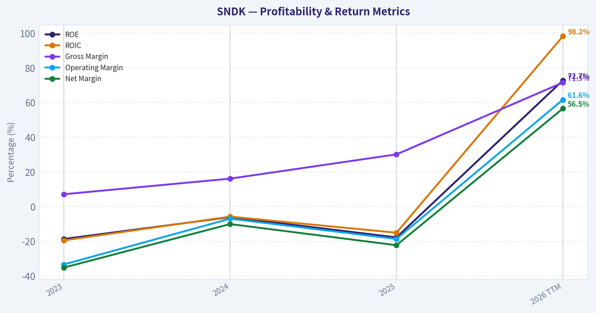
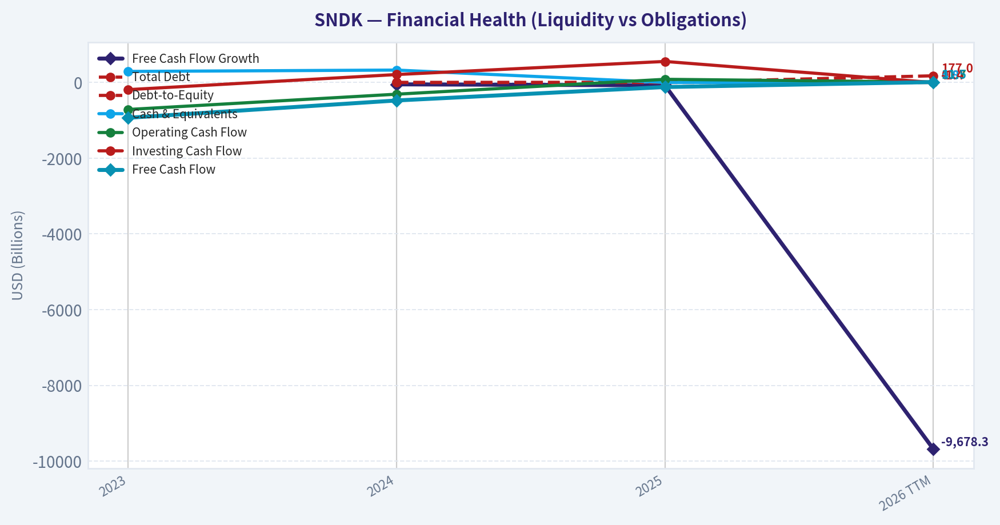
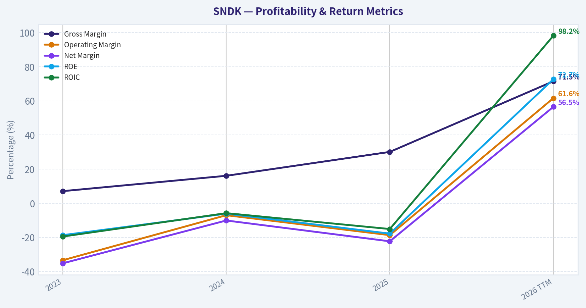
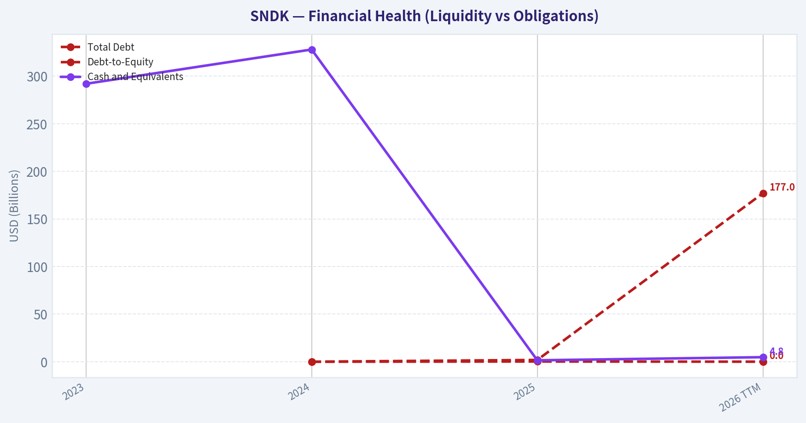
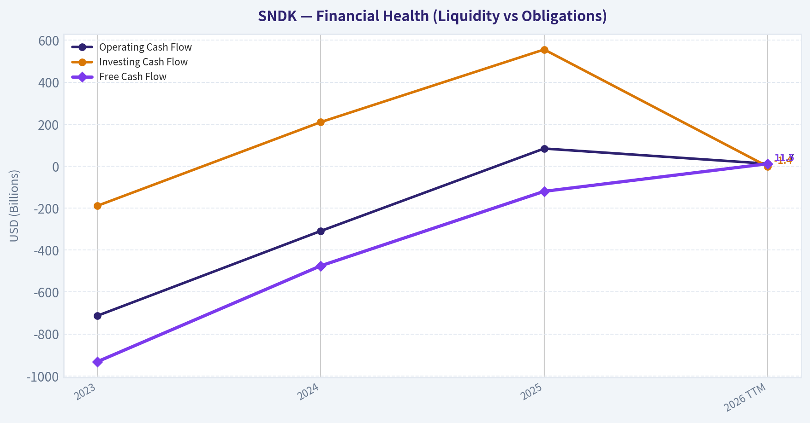
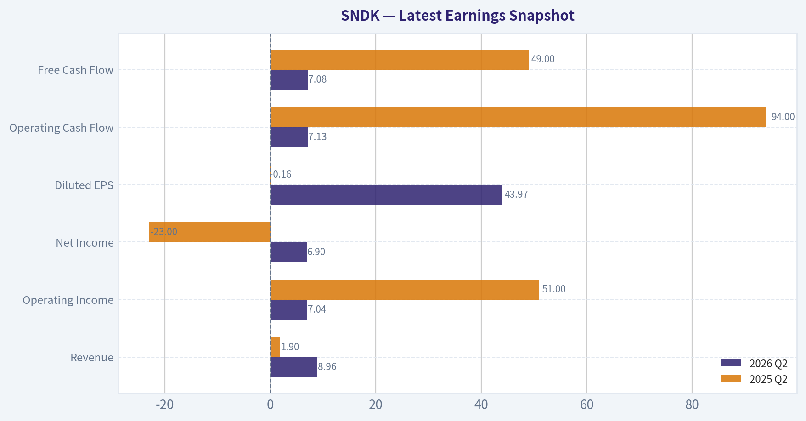
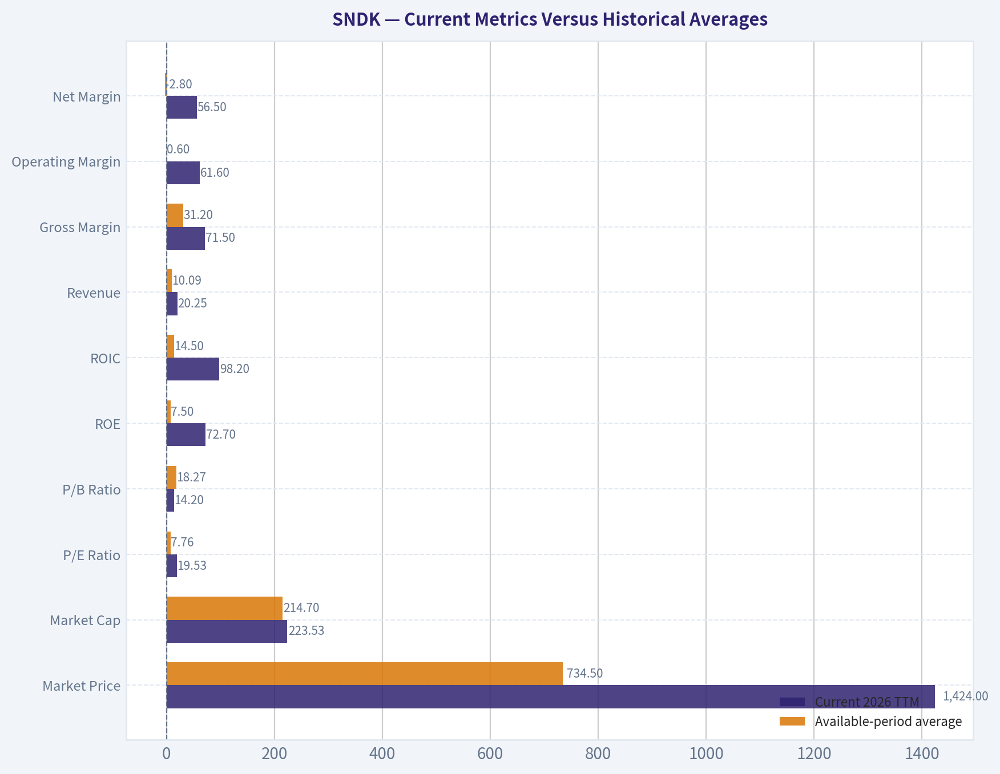
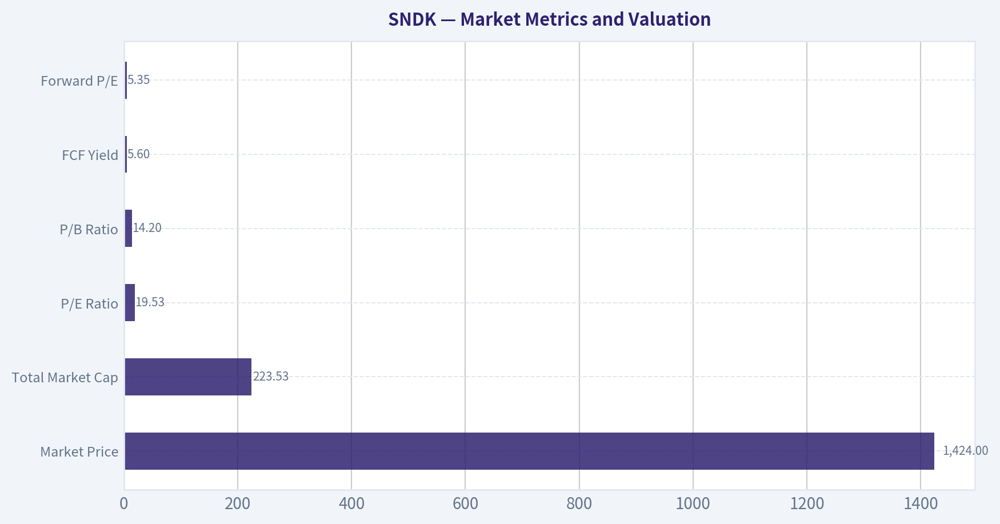

# SNDK Deep Value Intelligence

**Analysis Date:** 2026-10-13

## Critical Disclaimer

*This analysis is generated by Deep Value Intelligence, an AI-powered multi-agent investing framework. Education & research only - not financial advice, not a financial advisor.*

---

## Table of Contents

1. Intelligence Summary
2. Analyst Team Reports
   - Fundamentals Analysis
   - Intrinsic Value Analysis (Buffett)
   - Trend & Growth Analysis (Lynch/Druckenmiller/Fisher)
   - Market Technical Analysis
   - Options Market Analysis
3. Research Team Commentary
4. Value Investing Team Commentary
5. Deep Values Commentary

---

## Intelligence Summary

### Thesis + Conditions

**Core Thesis:** # Executive Briefing

**Key Risks:**
- The correct response is neither to assume immediate mean reversion nor to buy on unverified headline metrics. Maintain zero exposure until filings confirm the price/EPS units, margins, cash flow, capital expenditure, debt, and post-separation comparability. If verified cash generation supports the earnings, a small staged position could become appropriate.
- # Risk Commentary
- The original plan was to keep SanDisk at **WATCH**, distinguish a possible structural storage upcycle from ordinary cyclical strength, and require verification of earnings quality before committing capital. That remains the sound approach, with one refinement:

**Confidence:** Low

---

## Analyst Team Reports

### Fundamentals Analysis

#### Latest Earnings Snapshot

*Most recent reported quarter anchored on 2026 Q2, with prior-year comparison when available.*

| Metric | 2026 Q2 | 2025 Q2 | YoY Change |
| --- | ---: | ---: | ---: |
| Revenue | $8.96B | $1.90B | +371.6% |
| Operating Income | $7.04B | $51.0M | +13698.0% |
| Net Income | $6.90B | $-23.0M | +30113.0% |
| Diluted EPS | $43.97 | $-0.16 | +27581.2% |
| Operating Cash Flow | $7.13B | $94.0M | +7480.9% |
| Free Cash Flow | $7.08B | $49.0M | +14355.1% |

Key Takeaways: This snapshot anchors the most recent reported quarter before the narrative analysis. It helps readers separate long-run business quality from whatever changed in the latest earnings print.

#### 3-Year Financial Metrics for SNDK

*All values below are computed deterministically from raw data - not estimated by AI.*

*Issuer profile: operating company (Technology / Computer Hardware).*

#### 3-Year Financial Metrics
*Annual rows come from reported financial statements. The final TTM row is computed from the latest four quarters.*

| Metric | 2023 | 2024 | 2025 | 2026 TTM |
| --- | --- | --- | --- | --- |
| Market Price | N/A | N/A | $45 | $1,424 |
| Market Cap | N/A | N/A | $205.86B | $223.53B |
| P/E Ratio | N/A | N/A | -4.01 | 19.53 |
| P/B Ratio | N/A | N/A | 22.34 | 14.20 |
| ROE | -18.7% | -6.1% | -17.8% | 72.7% |
| ROIC | -19.5% | -5.8% | -15.1% | 98.2% |
| EPS | $-14.78 | $-4.63 | $-11.32 | $72.90 |
| Revenue | $6.09B | $6.66B | $7.36B | $20.25B |
| Gross Profit | $430.0M | $1.07B | $2.21B | $14.47B |
| Gross Margin | 7.1% | 16.1% | 30.1% | 71.5% |
| Operating Margin | -33.4% | -7.0% | -18.7% | 61.6% |
| Net Income | $-2.14B | $-672.0M | $-1.64B | $11.43B |
| Net Margin | -35.2% | -10.1% | -22.3% | 56.5% |
| Revenue Growth | N/A | 9.5% | 10.4% | 175.3% |
| Net Income Growth | N/A | -68.6% | 144.2% | -796.7% |
| Free Cash Flow Growth | N/A | -49.0% | -74.7% | -9678.3% |
| Total Book Value | $11.44B | $11.08B | $9.22B | $15.74B |
| Total Assets | N/A | $13.51B | $12.98B | $22.51B |
| Total Debt | N/A | $0 | $1.85B | $177.0M |
| Debt-to-Equity | N/A | 0.00 | 0.20 | 0.01 |
| Cash & Equivalents | $292.0M | $328.0M | $1.48B | $4.76B |
| Shareholders' Equity | $11.44B | $11.08B | $9.22B | $15.74B |
| Operating Cash Flow | $-713.0M | $-309.0M | $84.0M | $11.67B |
| Investing Cash Flow | $-189.0M | $210.0M | $556.0M | $-1.39B |
| Free Cash Flow | $-932.0M | $-475.0M | $-120.0M | $11.49B |
| FCF Margin | -15.3% | -7.1% | -1.6% | 56.8% |
| Dividends / Share | $0.00 | $0.00 | $0.00 | $0.00 |

#### Profitability Metrics
- Return on Equity (ROE): 72.7%
- Return on Invested Capital (ROIC): 99.2%
- Return on Assets (ROA): 50.8%
- Gross Margin: 71.5%
- Operating Margin: 61.2%
- Net Profit Margin: 56.5%

#### Liquidity Metrics
- Current Ratio: 2.29
- Quick Ratio: 1.70

#### Leverage Metrics
- Debt-to-Equity Ratio: N/A
- Interest Coverage Ratio: 169.71
- Net Debt: N/A

#### Growth Metrics (Year-over-Year)
- Revenue Growth: 175.3%
- Net Income Growth: 796.7%
- Free Cash Flow Growth: 9678.3%
- Revenue CAGR (3-Year): 49.3%
- Revenue CAGR (5-Year): N/A

#### Valuation Metrics
- P/E Ratio (TTM): 19.31
- Forward P/E: 5.35
- Price-to-Book: 13.49
- Price-to-Sales: 10.16
- PEG Ratio: 0.02
- EV/EBITDA: 16.90
- Free Cash Flow Yield: 5.6%
- Earnings Yield: 5.2%

#### Owner Earnings (Buffett Method, Code-Computed)
- Net Income: $-1.64B
- + Depreciation & Amortization: $149.0M
- - Capital Expenditures: $-177.0M
- - Working Capital Changes: $212.0M
- = **Owner Earnings: $-1.26B**

#### Intrinsic Value (Code-Computed)
- Current Price: $1,424
- Damodaran FCFF (WACC + margins + reinvestment):
  Conservative: $-699
  Average: $-526
  Optimistic: $-387
  Monte Carlo band (P10-P90): $-748 - $-384 (median $-534)
  P(intrinsic value > price): 0.0%
- Reverse-DCF: price implies ~12.3%/yr owner-earnings growth for 10y; trailing 3y was N/A, 5y N/A.

#### Piotroski F-Score: 8/9
- Positive Net Income: PASS
- Positive Operating Cash Flow: PASS
- ROA Improvement: PASS
- Cash Flow > Net Income: PASS
- Decreasing Debt: PASS
- Improving Current Ratio: FAIL
- No Dilution: PASS
- Improving Gross Margin: PASS
- Improving Asset Turnover: PASS

ANALYST STANCE: **AVOID**

#### Executive Summary

SNDK's latest TTM results show an extraordinary rebound: revenue reached **$20.25 billion**, net income was **$11.43 billion**, free cash flow was **$11.49 billion**, operating margin was **61.6%**, and ROE was **72.7%**. However, these figures represent a dramatic departure from the prior three years, when the company reported losses, negative free cash flow, and negative returns on capital.

The central investment issue is not whether SNDK is currently profitable. It is whether the latest profitability is durable enough to justify a **$1,424 share price and approximately $223.5 billion market capitalization**. The deterministic valuation model estimates intrinsic value between **negative $699 and negative $387 per share**, while the reverse DCF indicates that the current price implies approximately **12.3% annual owner-earnings growth for ten years**. That is an exceptionally demanding assumption for a cyclical memory-chip manufacturer.

The balance sheet is strong, leverage is low, and the Piotroski score of **8 out of 9** is encouraging. Nevertheless, Buffett-style investing requires durable and predictable economics, and SNDK's three-year record does not yet demonstrate that quality.

#### Current Metrics Versus Historical Averages

The dataset contains three annual observations and one TTM observation. Therefore, the "historical average" below is an average of the available dataset rows, not a separate ten-year average. Metrics with limited or negative observations should not be treated as statistically stable.

| Metric | Current 2026 TTM | Available-period average | Current versus average | Interpretation |
|---|---:|---:|---:|---|
| Market Price | $1,424 | $734.50* | Far above | The price has risen dramatically from the 2025 level of $45 |
| Market Cap | $223.53B | $214.70B* | Slightly above | Market value is near the recent average despite major operating improvement |
| P/E Ratio | 19.53 | 7.76* | Above | The average is distorted by negative 2025 earnings |
| P/B Ratio | 14.20 | 18.27* | Below | Still a high book multiple; not a conventional value valuation |
| ROE | 72.7% | 7.5% | Far above | Current returns are exceptional but unproven across a full cycle |
| ROIC | 98.2% | 14.5% | Far above | Indicates a very strong current earnings period, not established durability |
| Revenue | $20.25B | $10.09B | 101% above | TTM revenue is nearly double the available-period average |
| Gross Margin | 71.5% | 31.2% | Far above | The latest margin appears structurally different from prior years |
| Operating Margin | 61.6% | 0.6% | Far above | Prior years were loss-making or barely profitable |
| Net Margin | 56.5% | -2.8% | Far above | Current profitability is highly abnormal relative to history |
| Free Cash Flow | $11.49B | $2.49B | Far above | Prior FCF was negative in all three annual periods |
| Cash and Equivalents | $4.76B | $1.72B | 177% above | Strong liquidity improvement |
| Total Debt | $177M | $676M* | Below | Leverage has fallen substantially |
| Debt-to-Equity | 0.01 | 0.07* | Below | Balance-sheet leverage is currently minimal |
| Dividends per Share | $0.00 | $0.00 | Unchanged | No shareholder cash distribution |

\*Average uses only rows where the metric is available.

**Key Takeaways:** SNDK's current results are dramatically better than its recent history, but that is precisely why normalization risk is so important. Revenue, margins, ROE, ROIC, and free cash flow are all far above prior observations, while the share price has also increased sharply. The balance sheet is a genuine strength, but the operating record is not yet long or consistent enough to support a Buffett-style conclusion of durable earnings power.

#### Market Metrics and Valuation

| Market metric | Current value | Historical context | Assessment |
|---|---:|---|---|
| Market Price | $1,424 | $45 in 2025; unavailable in 2023-2024 | Extraordinary repricing |
| Total Market Cap | $223.53B | $205.86B in 2025 | Very large valuation for a cyclical hardware company |
| P/E Ratio | 19.53 | -4.01 in 2025 | Current earnings support a positive P/E, but the prior negative P/E shows substantial cyclicality |
| P/B Ratio | 14.20 | 22.34 in 2025 | Lower than 2025 but still expensive relative to book value |
| FCF Yield | 5.6% | Not available across the historical table | Provides only modest cash-flow support at the current price |
| Forward P/E | 5.35 | Model-based external metric | Highly dependent on continued exceptional earnings |

The P/B ratio is not meaningless for SNDK because the issuer is classified as an operating computer-hardware company rather than an asset-light software or platform business. However, a **14.2 times book-value multiple is not a conventional bargain**, particularly when the book value itself may fluctuate with semiconductor-cycle profitability and capital spending. The more important valuation question is whether current free cash flow can persist.

The valuation model is substantially less favorable than the headline P/E. The model-based Damodaran FCFF estimates are:

- Conservative: **negative $699 per share**
- Average: **negative $526 per share**
- Optimistic: **negative $387 per share**
- Monte Carlo range: **negative $748 to negative $384**
- Probability intrinsic value exceeds current price: **0.0%**

These negative values should be interpreted as a warning about the model's treatment of cyclicality, reinvestment, margins, and normalized cash flows. They do not literally mean the operating business has no liquidation value. They do mean that the current market price is difficult to justify using conservative normalized economics.

#### Profitability and Earnings Quality

| Profitability metric | 2023 | 2024 | 2025 | 2026 TTM |
|---|---:|---:|---:|---:|
| Revenue | $6.09B | $6.66B | $7.36B | $20.25B |
| Gross Profit | $430M | $1.07B | $2.21B | $14.47B |
| Gross Margin | 7.1% | 16.1% | 30.1% | 71.5% |
| Operating Margin | -33.4% | -7.0% | -18.7% | 61.6% |
| Net Income | -$2.14B | -$672M | -$1.64B | $11.43B |
| Net Margin | -35.2% | -10.1% | -22.3% | 56.5% |
| EPS | -$14.78 | -$4.63 | -$11.32 | $72.90 |
| ROE | -18.7% | -6.1% | -17.8% | 72.7% |
| ROIC | -19.5% | -5.8% | -15.1% | 98.2% |

**Key Takeaways:** The company moved from three consecutive years of negative net income and negative returns on capital to exceptionally high TTM profitability. The scale of the change is too large to assume that the TTM margins represent a normal steady state. A Buffett-style investor should demand evidence across a complete semiconductor cycle before capitalizing a 61.6% operating margin or 72.7% ROE.

The profitability data also contains an internal quality concern: the deterministic pack reports TTM ROIC as **98.2%** in the main table and **99.2%** in the profitability summary. This difference does not change the conclusion, but it reinforces the need to normalize the latest results rather than accept a single point estimate.

#### Growth Metrics

| Growth metric | Current reported growth | Historical pattern | Interpretation |
|---|---:|---|---|
| Revenue Growth | 175.3% | 9.5% in 2024; 10.4% in 2025 | Current acceleration is extreme and likely reflects a cycle, mix change, or reporting-base effect |
| Net Income Growth | 796.7% in the growth summary; -796.7% in the detailed table | Losses in prior periods make percentage growth unstable | Not economically meaningful when moving from losses to profits |
| Free Cash Flow Growth | 9,678.3% in the growth summary; -9,678.3% in the detailed table | FCF improved from -$932M to -$475M to -$120M, then $11.49B TTM | The percentage is mathematically large but not a reliable forecasting rate |
| Revenue CAGR, three-year | 49.3% | Based on the available historical period | Strong reported expansion, but heavily influenced by the latest TTM figure |

**Key Takeaways:** Revenue growth is impressive, but net-income and free-cash-flow growth percentages are not useful forecasting tools because the company moved from losses and negative cash flow into large profits. The proper question is how much of the $11.49 billion TTM FCF remains after memory prices, industry supply, customer demand, and capital expenditures normalize.

#### Balance Sheet and Financial Strength

| Balance-sheet metric | 2023 | 2024 | 2025 | 2026 TTM |
|---|---:|---:|---:|---:|
| Total Book Value | $11.44B | $11.08B | $9.22B | $15.74B |
| Total Assets | N/A | $13.51B | $12.98B | $22.51B |
| Total Debt | N/A | $0 | $1.85B | $177M |
| Debt-to-Equity | N/A | 0.00 | 0.20 | 0.01 |
| Cash and Equivalents | $292M | $328M | $1.48B | $4.76B |
| Shareholders' Equity | $11.44B | $11.08B | $9.22B | $15.74B |
| Current Ratio | N/A | N/A | N/A | 2.29 |
| Quick Ratio | N/A | N/A | N/A | 1.70 |

**Key Takeaways:** SNDK's balance sheet is a major positive. Cash increased to $4.76 billion, debt fell to $177 million, and debt-to-equity declined to 0.01. A current ratio of 2.29 and quick ratio of 1.70 indicate substantial short-term liquidity, although the current-ratio trend received the only failure in the Piotroski score.

Financial strength reduces bankruptcy risk and gives management flexibility during a downturn. It does not, by itself, make the stock attractively priced. Semiconductor companies can maintain strong balance sheets while still experiencing large swings in revenue, margins, and cash generation.

#### Cash Flow and Capital Allocation

| Cash-flow metric | 2023 | 2024 | 2025 | 2026 TTM |
|---|---:|---:|---:|---:|
| Operating Cash Flow | -$713M | -$309M | $84M | $11.67B |
| Investing Cash Flow | -$189M | $210M | $556M | -$1.39B |
| Free Cash Flow | -$932M | -$475M | -$120M | $11.49B |
| FCF Margin | -15.3% | -7.1% | -1.6% | 56.8% |
| Dividends per Share | $0.00 | $0.00 | $0.00 | $0.00 |

**Key Takeaways:** Free cash flow improved steadily from deeply negative levels through 2025 and then surged to $11.49 billion TTM. The latest 56.8% FCF margin is extraordinarily high for a capital-intensive hardware producer and should be stress-tested heavily. SNDK pays no dividend, so investors depend entirely on retained cash being reinvested productively, used for buybacks, or eventually returned to shareholders.

The code-computed Owner Earnings line uses the 2025 annual figures and produces:

- Net income: **negative $1.64 billion**
- Plus depreciation and amortization: **$149 million**
- Less capital expenditures: **$177 million**
- Less working-capital changes: **$212 million**
- Owner Earnings: **negative $1.26 billion**

This conflicts materially with the positive **$11.49 billion TTM FCF**. The correct conclusion is not to select whichever number produces the more attractive valuation. Rather, the two figures demonstrate that the latest TTM period is not yet comparable with the prior annual history, and normalized owner earnings remain uncertain.

#### Buffett-Style Business Quality Assessment

**Economic moat:** SNDK benefits from manufacturing scale, process know-how, intellectual property, customer relationships, and the importance of reliable storage components. These advantages can create meaningful barriers to entry. However, memory products are generally subject to intense competition, rapid technological change, pricing pressure, and periodic oversupply. The moat is therefore more likely to be scale- and technology-based than a wide, permanent consumer or software moat.

**Predictable earnings:** This is the weakest part of the Buffett case. The company reported net losses in 2023, 2024, and 2025, followed by a very large TTM profit. That pattern is not consistent with highly predictable earnings. The latest period may represent a powerful upcycle rather than a stable earnings base.

**Financial strength:** Strong. Cash is substantially higher, debt is minimal, interest coverage is reported at 169.71 times, and liquidity is ample. The company appears capable of surviving a downturn better than a highly levered competitor.

**Management and capital allocation:** The company retained cash rather than paying dividends, which may be sensible if high-return reinvestment opportunities exist. However, there is not yet sufficient evidence in the provided data to conclude that management can consistently allocate capital at the current 98%-99% ROIC. The lack of dividends is not automatically negative, but it increases the importance of future reinvestment returns and shareholder distributions.

**Quality of business:** The latest operating metrics resemble a high-quality business, but the multi-year record resembles a cyclical business undergoing a major earnings rebound. Buffett would generally prefer evidence that superior margins and returns persist through weak industry conditions, not just during peak conditions.

#### Discounted Cash Flow Analysis

Because the canonical Owner Earnings figure is negative for 2025 while TTM FCF is strongly positive, the following hand DCF uses **$11.49 billion of TTM FCF as a temporary owner-earnings proxy**. This is a sanity check only and should not override the pack's model-based intrinsic-value estimate.

The implied share count is estimated from market capitalization and price:

\[
\text{Shares outstanding} \approx \frac{\$223.53B}{\$1,424} \approx 157.0M
\]

Assumptions:

- Initial owner-earnings proxy: **$11.49B**
- Discount rate: **10%**
- Terminal growth rate: **2.5%**
- Explicit forecast period: **10 years**
- Growth fades toward the terminal rate rather than continuing indefinitely at the initial rate

| Scenario | Initial growth assumption | Approximate terminal-year FCF | Present value of forecast cash flows | Present value of terminal value | Implied equity value | Implied value per share |
|---|---:|---:|---:|---:|---:|---:|
| Conservative | 3% | $15.36B | $81.5B | $81.0B | $162.5B | Approximately $1,035 |
| Average | 10% | $29.75B | $104.5B | $156.8B | $261.3B | Approximately $1,665 |
| Optimistic | 15% initially, fading toward terminal growth | Approximately $46.4B | $162.8B | $244.5B | $407.3B | Approximately $2,594 |

**Key Takeaways:** This hand DCF produces a wide range because it begins with an unusually high TTM FCF figure. Under the conservative scenario, the stock is materially overvalued; under the average and optimistic scenarios, it appears potentially undervalued. That apparent optimism should not be accepted at face value because the starting cash flow may be cyclical and inconsistent with the negative 2025 Owner Earnings calculation.

The stronger valuation warning comes from the model-based pack, which produces negative intrinsic values under all three FCFF cases. The reverse DCF requires roughly **12.3% annual owner-earnings growth for ten years**, despite the absence of a stable positive owner-earnings history. Consequently, the hand DCF should be interpreted as an upside sensitivity analysis, not as a reliable fair-value estimate.

A reasonable practical fair-value range is therefore:

- **Normalized-cycle valuation:** difficult to support above approximately $1,000 per share
- **Successful multi-year earnings durability case:** approximately $1,600-$2,600 per share
- **Model-based conservative valuation:** below zero because normalized cash flows and reinvestment assumptions do not support the current market price

The range is unusually wide because the business has not yet demonstrated stable normalized earnings.

#### Revenue Breakdown

The deterministic dataset provides total revenue but does not provide current revenue by product line, geography, or operating segment. The table below therefore distinguishes reported information from unavailable detail rather than inventing segment amounts.

| Revenue Source | Amount ($M or $B) | % of Total |
|---|---:|---:|
| Total reported revenue, 2026 TTM | $20.25B | 100% |
| Flash memory products - client and consumer storage | Not disclosed in dataset | N/A |
| Flash memory products - enterprise and data-center storage | Not disclosed in dataset | N/A |
| Flash memory products - mobile and embedded applications | Not disclosed in dataset | N/A |
| Geographic revenue split | Not disclosed in dataset | N/A |

**Key Takeaways:** The available data confirms $20.25 billion of total TTM revenue but does not provide a reliable current segment split. SNDK's economically relevant exposure is to flash-memory demand across client, consumer, enterprise, data-center, mobile, and embedded applications, but the profitability and cyclicality of each category cannot be quantified from the supplied dataset.

#### Key Investment Insights, Risks, and Opportunities

| Category | Assessment |
|---|---|
| Major opportunity | TTM revenue, operating margin, net income, and FCF have all improved dramatically |
| Balance-sheet opportunity | $4.76B cash and only $177M debt provide significant resilience |
| Operational opportunity | A sustained shift toward higher-value enterprise or data-center storage could improve margins |
| Valuation opportunity | A 5.35 forward P/E would be attractive if forecast earnings prove durable |
| Primary red flag | Three prior annual periods showed losses and negative free cash flow |
| Cyclicality risk | Memory pricing and supply-demand conditions can reverse rapidly |
| Margin risk | A 71.5% gross margin and 61.6% operating margin may represent peak economics |
| Valuation risk | Current price requires approximately 12.3% owner-earnings growth for ten years |
| Data-quality risk | TTM FCF and the 2025 Owner Earnings calculation are radically inconsistent |
| Capital-allocation risk | No dividends; shareholder returns depend on future reinvestment or buybacks |
| Competitive risk | Chinese and global competitors may pressure pricing and market share |
| Timing risk | Guru filings show both Steve Cohen and Stanley Druckenmiller trimmed positions |

**Key Takeaways:** The opportunity is a financially strong company experiencing a potentially transformative earnings cycle. The principal risk is paying a very high price before proving that the earnings improvement is durable. The negative model-based intrinsic value, large historical losses, and reported guru trimming activity make the risk-reward unattractive for a conservative value investor.

#### Final Investment Stance

**AVOID at the current price.**

SNDK has several attractive characteristics: strong liquidity, minimal debt, positive current cash flow, high current returns on capital, and an 8/9 Piotroski score. If the current earnings level were durable for many years, the stock could potentially justify its valuation.

However, the available record does not establish that durability. The company moved from negative earnings and negative FCF to extraordinary TTM profitability in a single major step. The current valuation also requires sustained double-digit owner-earnings growth, while the model-based intrinsic-value analysis indicates that the stock price is unsupported under normalized assumptions.

A more favorable stance would require:

1. Several years of positive free cash flow across a weaker memory environment.
2. Evidence that gross margins can remain well above historical levels.
3. Reconciliation of the large difference between TTM FCF and calculated Owner Earnings.
4. A materially lower purchase price or a much clearer margin of safety.
5. Demonstrated capital allocation discipline, including productive reinvestment or shareholder distributions.

The company is worth monitoring, but at $1,424 the investment thesis depends too heavily on peak or near-peak economics.

#### Report Summary

| Key Point | Conclusion |
|---|---|
| Business type | Cyclical computer-hardware and flash-memory company |
| Current earnings | Extremely strong TTM results |
| Historical earnings quality | Poorly predictable; losses in 2023-2025 |
| Balance sheet | Strong, liquid, and lightly levered |
| Current valuation | Expensive relative to normalized historical economics |
| DCF conclusion | Wide range; model-based FCFF valuation is materially negative |
| Reverse DCF | Requires approximately 12.3% annual owner-earnings growth for ten years |
| Economic moat | Moderate, based on scale, technology, and customer relationships |
| Buffett quality test | Fails the predictability and demonstrated durability tests |
| Main opportunity | Earnings may remain elevated through a favorable storage cycle |
| Main risk | Current profitability may normalize sharply downward |
| Final stance | **AVOID** |

**Key Takeaways:** SNDK combines excellent current financial statistics with weak demonstrated earnings consistency. The balance sheet supports survival and future opportunity, but the current share price leaves little room for a cyclical downturn or margin normalization. For a Buffett-style investor, waiting for a lower price or several years of verified cash-flow durability is preferable to buying today.

#### Fundamental Visuals

This graph tracks the profitability and return metrics (ROE, ROIC, Margins) of **SNDK** over the past decade, highlighting capital efficiency trends.

This chart illustrates the financial health of **SNDK** over the last 10 years, mapping cash equivalents and free cash flow against total obligations (Debt).

This graph tracks the profitability and return metrics (ROE, ROIC, Margins) of **SNDK** over the past decade, highlighting capital efficiency trends.

This chart illustrates the financial health of **SNDK** over the last 10 years, mapping cash equivalents and free cash flow against total obligations (Debt).

This chart illustrates the financial health of **SNDK** over the last 10 years, mapping cash equivalents and free cash flow against total obligations (Debt).

---

### Intrinsic Value Analysis (Buffett)

> *Following Warren Buffett's value investing philosophy: Circle of Competence, Economic Moat, Management Quality, and Margin of Safety.*

#### Intrinsic Value Snapshot

Price is what you pay. Intrinsic value is what the business may be worth based on the cash it can create for owners over time. We show a range, not one magic number.

- Current Price: $1,421.92
- Value Range (conservative to optimistic across both DCF methods): N/A to N/A

##### Owner Earnings (Buffett Method)
- Net Income: $-1,641,000,000.00
- Depreciation & Amortization: $149,000,000.00
- Capital Expenditures: $-177,000,000.00
- Working Capital Changes: $212,000,000.00
- Owner Earnings: $-1,261,000,000.00

##### Intrinsic Value

ANALYST STANCE: **WATCH**

#### Executive Conclusion

SanDisk is a strategically important memory company benefiting from explosive AI-related demand, but the investment case depends heavily on sustaining unusually strong growth in a notoriously cyclical and increasingly competitive industry. At $1,422 per share and a $205.4 billion market capitalization, the stock price implies approximately 12.3% annual growth for the next decade.

That is a demanding expectation for a business exposed to NAND pricing, inventory cycles, capital intensity, technological change, and Chinese competition. SanDisk may be an excellent operating business at this point in the cycle, but the current price does not provide a sufficiently clear margin of safety. The appropriate action is to watch rather than chase.

#### 1. Factor Scorecard

| Factor | Score | Assessment |
|---|---:|---|
| Circle of competence and simplicity | 3/5 | The basic model is understandable: manufacture and sell NAND flash storage. However, profitability depends heavily on memory prices, industry supply, product mix, and technology transitions. |
| Moat | 3/5 | Scale, intellectual property, manufacturing expertise, customer relationships, and brand provide a meaningful but cyclical advantage. The moat is not as durable as that of a software platform. |
| Management and capital allocation | 3/5 | The business requires disciplined capital spending and careful management of memory cycles. Available evidence does not establish a superior long-term capital-allocation record. |
| Industry structure | 2/5 | NAND is an oligopoly, but it remains intensely cyclical, capital-intensive, and vulnerable to oversupply and Chinese technological progress. |

**Key Takeaways:** SanDisk has real technical and scale advantages, but it operates in a difficult industry where superior economics can deteriorate rapidly when supply exceeds demand. The business is understandable, yet its long-term earnings are less predictable than those of a high-quality consumer or software compounder.

#### 2. Moat Analysis

**Scale and manufacturing know-how.** NAND production requires enormous capital investment, specialized process technology, and substantial manufacturing expertise. Scale can lower unit costs and improve access to large customers.

**Intellectual property and product qualification.** Storage products are embedded in smartphones, PCs, data centers, and enterprise systems. Qualification cycles and reliability requirements create some switching friction, particularly with enterprise customers.

**Brand and distribution.** The SanDisk brand is well established in consumer storage and removable media. Brand recognition helps, but storage components are often purchased based on price, capacity, performance, and reliability rather than emotional loyalty.

**Industry network effects are limited.** Unlike a platform business, SanDisk does not become structurally more valuable simply because more customers use its products. Its moat is primarily based on scale, technology, manufacturing execution, and customer relationships.

**Moat rating: Narrow to moderate, 3/5.** The moat is real, but it is not immune to industry oversupply, product commoditization, or new competitors. Recent market pressure from Chinese memory advances is an important warning sign.

#### 3. Management Quality and Capital Allocation

The key management challenge is not merely growing revenue; it is converting favorable demand into durable per-share value across the full memory cycle.

Important considerations include:

- Capital expenditures must be timed carefully because excessive industry investment can create oversupply.
- Acquisitions and technology investments must earn attractive returns despite rapid product transitions.
- Buybacks are only value-creating when conducted during depressed industry conditions, not near cyclical peaks.
- The available guru data shows that Steve Cohen and Stanley Druckenmiller both reduced their positions during the latest reported quarter. This is not evidence of poor management, but it does suggest that sophisticated investors were reducing exposure after a substantial price increase.

**Management assessment: 3/5.** SanDisk needs excellent cycle management to justify its valuation. There is not enough evidence to award the highest rating.

#### 4. Financial Summary

| Metric | Latest available figure |
|---|---:|
| Share price | $1,422 |
| Market capitalization | $205.38 billion |
| P/E ratio | 19.3x |
| Revenue growth, year over year | 175.3% |
| Gross margin | 71.5% |
| ROE | 72.7% |
| FCF yield | 5.6% |
| Implied free cash flow | Approximately $11.5 billion |
| Current ratio | 2.29x |
| Reverse-DCF implied growth | Approximately 12.3% annually for 10 years |

**Key Takeaways:** Reported profitability and growth are exceptionally strong, with a 71.5% gross margin and 175.3% year-over-year revenue growth. However, these figures likely reflect a powerful recovery and AI-driven demand environment rather than normalized mid-cycle economics. The 5.6% FCF yield implies approximately $11.5 billion of current free cash flow, which is substantial but not obviously cheap relative to the valuation.

#### 5. Owner Earnings Calculation

A precise Buffett-style owner-earnings figure requires normalized net income, depreciation and amortization, maintenance capital expenditure, and working-capital investment. The most useful available cash-flow proxy is current free cash flow:

| Owner-earnings component | Approximate amount |
|---|---:|
| Free cash flow proxy | $11.5 billion |
| Shares implied by market capitalization and price | 144.4 million |
| FCF per share proxy | Approximately $79.7 |
| FCF yield | 5.6% |

**Key Takeaways:** Using free cash flow as a conservative owner-earnings proxy produces approximately $79.7 per share. The central analytical issue is normalization: current cash generation may be above through-cycle levels if NAND pricing and AI demand are temporarily strong.

#### 6. Three-Scenario DCF Valuation

Using approximately $11.5 billion of current owner-earnings proxy and a 10% discount rate:

| Scenario | Assumption | Estimated equity value | Estimated value per share |
|---|---|---:|---:|
| A. No growth | Owner earnings remain flat forever | $115 billion | Approximately $796 |
| B. GDP growth | 3% perpetual growth | $165 billion | Approximately $1,143 |
| C. Strong growth | 10% annual growth for 10 years, followed by 3% terminal growth | Approximately $235 billion | Approximately $1,630 |

**Key Takeaways:** The conservative no-growth and GDP-growth cases produce values well below the current price. The stock appears supported only by a strong-growth scenario, which requires approximately 10% annual growth for a decade from a highly cyclical starting point. That is possible, but not sufficiently conservative for a Buffett-style purchase.

The supplied headline intrinsic-value model reports negative value of $525.64 per share, with a calculated margin of safety of 370.5%. That output is economically implausible for a profitable company and should not be used as a decision anchor. The more useful conclusion is the spread between the transparent cash-flow scenarios: SanDisk is attractive only if high growth persists.

#### 7. Margin of Safety Analysis

At $1,422 per share:

- Versus the no-growth value of approximately $796, the stock trades at a substantial premium.
- Versus the 3% growth value of approximately $1,143, the stock is approximately 24% above estimated intrinsic value.
- Versus the aggressive 10% growth value of approximately $1,630, the stock has only approximately 13% upside.

A wide-moat, highly predictable compounder might justify a 10% to 15% margin of safety. SanDisk does not yet meet that quality standard because earnings are exposed to memory pricing and industry supply cycles. A cyclical semiconductor company should generally require a larger discount, not merely a price close to an optimistic DCF.

#### 8. Final Buffett Scorecard

| Criterion | Weight | Score | Weighted contribution |
|---|---:|---:|---:|
| Moat width and durability | 25% | 3.0 | 0.75 |
| Valuation and margin of safety | 20% | 2.5 | 0.50 |
| Capital returns versus WACC | 15% | 3.5 | 0.53 |
| Business understanding and predictability | 12% | 3.0 | 0.36 |
| Management quality and capital allocation | 12% | 3.0 | 0.36 |
| Reinvestment runway | 8% | 4.0 | 0.32 |
| Balance-sheet strength | 4% | 3.5 | 0.14 |
| Industry structure | 4% | 2.0 | 0.08 |
| **Total** | **100%** |  | **3.04/5.00** |

**Key Takeaways:** SanDisk scores well on growth opportunity and reinvestment runway, but valuation, cyclicality, and industry structure prevent it from qualifying as a high-conviction Buffett purchase. The total score falls in the WATCH range rather than the ADVOCATE range.

#### 9. Gate 5: Quality and Solvency

**Gate 5 hard floor: Not tripped.**

There is no evidence here of simultaneous deteriorating earnings and severe solvency distress. The current ratio is approximately 2.29x, and the company is generating substantial free cash flow. The principal risk is valuation and cyclicality, not an immediate financial-distress scenario.

#### Investment Stance

**WATCH - Moderate conviction.**

SanDisk is a credible semiconductor franchise with strong current economics, major exposure to AI-related storage demand, and meaningful technical and manufacturing capabilities. However, the stock price appears to discount a long period of exceptional growth while the business remains exposed to NAND cycles, aggressive capital spending, technological disruption, and Chinese competition.

A more attractive entry point would be closer to the conservative DCF range, or during a cyclical downturn when the market is discounting weaker conditions. At the current price, the risk-reward profile is not sufficiently favorable to advocate buying.
#### Valuation Bridge

This bridge places the current market price beside each intrinsic value lens so readers can see whether upside depends on one method or shows up across several methods.

| Scenario | Intrinsic Value / Share |
| --- | ---: |
| Damodaran Method | $-525.64 |
| Current Price | $1,421.92 |

#### Key Takeaways

If one method is far above the others, the upside case depends on a specific modelling assumption. When several methods cluster together, the valuation story is more robust.

#### Valuation Visuals

This comparison chart from *Latest Earnings Snapshot* stacks current figures against historical benchmarks for **SNDK**, making it easy to see where the company trades relative to its own averages.

This comparison chart from *Current Metrics Versus Historical Averages* stacks current figures against historical benchmarks for **SNDK**, making it easy to see where the company trades relative to its own averages.

---

### Trend & Growth Analysis (Lynch/Druckenmiller/Fisher)

> *Following Peter Lynch's GARP, Stanley Druckenmiller's macro-aware approach, and Philip Fisher's scuttlebutt methodology.*

ANALYST STANCE: **AVOID**

#### Executive View

SNDK is a **memory-chip cyclical**, not a conventional secular fast grower. Reported TTM revenue growth of 175% and a 71.5% gross margin indicate a dramatic upcycle or major reporting/perimeter change, but the figures are unusually discontinuous relative to prior years. At approximately $1,422 per share and a $205 billion market capitalization, the stock appears to discount exceptionally strong and durable memory economics despite intense cyclicality and emerging Chinese competition.

The principal issue is not whether SNDK is performing well today. It is whether current margins and earnings can persist through the next memory downcycle. The available valuation data are internally inconsistent, so this is not an attractive risk-adjusted ten-bagger setup at the current price.

#### 1. Lynch Classification

| Classification | Assessment |
|---|---|
| Category | Cyclical |
| Recent revenue growth | 175.3% TTM |
| Historical 2023-2025 growth | Approximately 9-10% annually |
| Earnings profile | Losses through 2025, sharply profitable in 2026 TTM |
| Growth-investing fit | Poor at current valuation |
| Primary driver | Memory pricing, AI infrastructure demand, supply discipline |

**Key Takeaways:** SNDK does not present as a consistently compounding fast grower. Its earnings have shifted from substantial losses to unusually high profitability in one TTM period, which is characteristic of a memory-cycle recovery and requires normalization before purchase.

#### 2. The Story in Three Bullets

- SanDisk supplies memory products benefiting from AI infrastructure, data-center storage, enterprise demand, and broader digital content growth.
- The current earnings inflection is substantial: TTM revenue rose 175.3%, while gross margin expanded to 71.5%.
- The risk is that memory pricing is cyclical and competitors-including Chinese producers-could erode pricing, margins, and market share before today's earnings are sustainable.

#### 3. TAM and 10x Test

| Item | Estimate / Assessment |
|---|---:|
| Current market capitalization | $205.4B |
| Current TTM revenue | $20.25B |
| 10x revenue | $202.5B |
| Implied market share at 10x revenue | Cannot be reliably calculated from available TAM data |
| Industry TAM outlook | Structurally growing, but highly cyclical |
| Runway quality | Large market, limited visibility on durable share and margins |

**Key Takeaways:** The memory market is large enough to support substantial sales, but a 10x revenue outcome would imply roughly $202.5 billion of annual revenue, an extraordinary scale relative to the company's current size. The key constraint is not merely TAM; it is whether SNDK can retain economics when industry supply increases.

#### 4. Revenue and Profitability Trend

| Metric | 2023 | 2024 | 2025 | 2026 TTM |
|---|---:|---:|---:|---:|
| Revenue | $6.09B | $6.66B | $7.36B | $20.25B |
| Revenue growth | N/A | 9.5% | 10.4% | 175.3% |
| Gross margin | 7.1% | 16.1% | 30.1% | 71.5% |
| Operating margin | -33.4% | -7.0% | -18.7% | 61.6% |
| Free-cash-flow margin | -15.3% | -7.1% | -1.6% | 56.8% |

**Key Takeaways:** The latest period shows an extraordinary acceleration in revenue and margins, but the step-change is too large to treat as a normal compounding trajectory without segment, accounting, and quarterly validation. The historical record shows losses and weak cash generation, so the most important question is how much of the TTM result is cyclical peak performance.

#### 5. Unit Economics and Financial Quality

| Measure | Result | Assessment |
|---|---:|---|
| LTV/CAC | Not disclosed / not meaningful | N/A for semiconductor manufacturing |
| NRR | Not disclosed / not applicable | N/A |
| Rule of 40 | 232.1% using TTM growth plus FCF margin | Exceptional but likely cycle-inflated |
| Current ratio | 2.29 | Healthy liquidity |
| Cash and equivalents | $4.76B | Strong balance-sheet support |
| Total debt | $177M | Low leverage |
| FCF yield | 5.6% | Reasonable, but dependent on current-cycle cash flow |

**Key Takeaways:** SNDK has strong reported liquidity and low debt, reducing balance-sheet risk. However, the Rule of 40 result is not a durable SaaS-style indicator here; it is dominated by a sharp cyclical rebound and should not be extrapolated.

#### 6. Inflection Point Assessment

| Inflection Area | Evidence | Rating |
|---|---|---|
| Product cycle | AI and data-center storage demand | Positive |
| Revenue acceleration | 10% growth historically to 175% TTM | Very positive, but needs validation |
| Margin inflection | Gross margin from 30.1% to 71.5% | Very positive, potentially peak-cycle |
| TAM expansion | AI storage and data generation | Positive |
| Competitive position | China memory advances reported | Negative |
| Durability | Limited history at current economics | Unproven |

**Key Takeaways:** SNDK clearly has an earnings inflection, but not necessarily a durable structural inflection. The strongest evidence supports a powerful memory-cycle recovery; the evidence is weaker that SNDK has developed a long-term moat capable of protecting 60%-plus operating margins.

#### 7. Macro Setup

The macro backdrop is mixed:

- **Positive:** AI investment, data-center construction, increasing storage requirements, and digital-content growth.
- **Negative:** Semiconductor cyclicality, inventory swings, memory oversupply risk, export restrictions, geopolitics, and Chinese competitive advances.
- **Rates:** Lower interest rates would support high-growth technology valuations, but SNDK's main risk is earnings cyclicality rather than discount rates.
- **Druckenmiller read:** The trade may work while memory pricing and AI capital expenditure remain strong, but the current valuation leaves little room for a normal downturn.

Guru behavior is a caution signal rather than a thesis driver: both Stanley Druckenmiller and Steve Cohen reportedly trimmed SNDK positions in the latest disclosed quarter. These filings lag real-time activity, but they do not support aggressive new buying.

#### 8. Fisher 15-Point Assessment

| Fisher Criterion Group | Score |
|---|---:|
| Market potential and long-range opportunity | 4/5 |
| R&D and product development | 3/5 |
| Sales organization and customer reach | 3/5 |
| Profit margins and margin improvement | 4/5 |
| Management depth and operating quality | 3/5 |
| Competitive advantages | 3/5 |
| Long-range earnings outlook | 2/5 |
| Accounting, candor, and data confidence | 2/5 |
| Dilution and balance sheet | 4/5 |
| **Estimated total** | **48/75** |

**Key Takeaways:** SNDK benefits from a large market, strong current profitability, and a healthy balance sheet. It scores poorly on long-range visibility because memory economics are cyclical and the available data show an unusually abrupt change in revenue and margins.

#### 9. Valuation Analysis

| Valuation Measure | Result | Interpretation |
|---|---:|---|
| Current price | $1,422 | Very elevated absolute price |
| Market capitalization | $205.38B | Large valuation already assigned |
| TTM P/E | 19.3x | Appears moderate only if peak earnings persist |
| Forward P/E | 5.35x | Highly dependent on forecast earnings |
| Price-to-sales | 10.2x | High for a cyclical hardware company |
| PEG | Approximately 0.02 | Misleading because growth is cycle-distorted |
| FCF yield | 5.6% | Not compelling for a cyclical peak |
| Reported intrinsic value | Negative | Model output is unreliable and internally inconsistent |

**Key Takeaways:** The headline P/E and PEG appear attractive only because they use unusually elevated current or forecast earnings. A 10.2x price-to-sales ratio is demanding for a memory manufacturer, and the negative intrinsic-value output indicates that the underlying valuation inputs are not robust enough to support a purchase decision.

The supplied data also contain material inconsistencies: the reported TTM net income and free cash flow are positive, while the owner-earnings section references a negative net income figure. Therefore, the valuation should be treated as a warning about data quality, not as a precise fair-value estimate.

#### 10. Growth Investor Scorecard

| Criterion | Weight | Score / 5 |
|---|---:|---:|
| Lynch story | 10% | 3.0 |
| TAM and runway | 20% | 3.5 |
| Revenue growth | 20% | 4.0 |
| Unit economics / financial quality | 15% | 3.5 |
| Competitive position | 10% | 2.5 |
| Management quality | 10% | 3.0 |
| Macro setup | 5% | 3.0 |
| Profitability path | 5% | 4.0 |
| Valuation | 5% | 1.5 |
| **Weighted score** | **100%** | **3.1 / 5.0** |

**Key Takeaways:** SNDK scores well on current growth and profitability, but valuation, cyclicality, competition, and earnings durability reduce the overall rating. A score near 3.1 supports monitoring rather than initiating a concentrated position.

#### 11. Position Size Stance

**Recommended position: 0% for a new position.**

For an investor who already owns SNDK, a **small tracking position of up to 1%-2%** could be justified while validating quarterly revenue, gross margin, inventory, and free cash flow. A concentrated position is not warranted until the company demonstrates that margins remain strong through more than one or two quarters and that Chinese competition has not altered the supply-demand outlook.

#### 12. Key Catalysts and Risks

| Catalysts | Risks |
|---|---|
| Sustained AI and data-center storage demand | Memory oversupply and pricing collapse |
| Several quarters of revenue above 30% growth | Chinese competitors gaining technological parity |
| Gross margins remaining above 50% | Current margins prove to be peak-cycle |
| Strong free cash flow through the cycle | Customer concentration and inventory corrections |
| New high-value enterprise or AI storage products | Geopolitical and export-control disruptions |
| Positive guidance revisions | Valuation compression from earnings normalization |

**Key Takeaways:** The most important catalyst is proof that current earnings are structural rather than cyclical. The dominant risk is not bankruptcy-SNDK has liquidity and low debt-but paying a premium valuation just before memory pricing and margins normalize.

#### Bottom Line

SNDK has a genuine operational inflection and exposure to powerful AI-storage demand. However, it is best understood as a **highly cyclical semiconductor recovery at an aggressive valuation**, not as a proven ten-bagger compounder. I would wait for a materially better entry price or several quarters of independently confirmed, durable margins before reconsidering the stance.

---

### Market Technical Analysis

ANALYST STANCE: **WATCH**

#### SNDK technical analysis - as of October 12, 2026

The latest available trading data shows SNDK closing at **1,487.33**, after a sharp decline from its recent September 22 high near **1,909.48**. The stock has fallen approximately **22% from that high**, and about **17% from the October 1 close of 1,787.69**. This is a material loss of momentum, although the longer-term trend remains structurally elevated.

The data source identifies October 13 as a non-trading day, so October 12 is treated as the latest valid observation. Several indicator reports contain missing values for the most recent dates; therefore, the conclusions below distinguish between current, historical, and unavailable readings.

#### Trend structure

SNDK remains above its long-term trend benchmark. The **200-day SMA was 1,060.33 on September 17** and was rising steadily, confirming that the broader trend had been strongly bullish through the latest period for which the indicator was populated. However, the most recent price is below the available **50-day SMA of 1,587.95** and below the **10-day EMA of 1,640.56**.

This creates an important split in the trend picture:

- **Long-term trend:** Still constructive based on the rising 200-day average and the large distance between the stock and that benchmark.
- **Medium-term trend:** Damaged, with price below the 50-day SMA.
- **Short-term trend:** Bearish, with price below the 10-day EMA and recent lower highs and lower closes.

The 50-day SMA itself has been declining from approximately **1,730 in late July** to **1,588 on October 12**, showing that the intermediate trend has already rolled over. The 10-day EMA is also above the market, indicating that short-term sellers still control the immediate direction.

#### Momentum and MACD

The MACD data shows a substantial momentum deterioration. The MACD histogram was strongly positive during much of late August and September, reaching readings above **20** during the September rally. It then weakened, turned negative around October 2, and reached **-24.66 on October 9**.

That sequence indicates more than a one-day pullback. It suggests that the September advance lost internal momentum and transitioned into a downside impulse. The negative histogram also means the MACD line was below its signal line at the latest populated reading.

The MACD line itself rose from negative territory in mid-August to approximately **56.12 on September 10**, then fell to approximately **23.62 on September 16**. More recent MACD-line values are missing from the report, so a current crossover cannot be confirmed. Nevertheless, the negative histogram and price position below both short- and medium-term averages point to continued downside pressure unless SNDK can reclaim the 50-day SMA.

#### Relative strength and exhaustion risk

The latest populated RSI reading was **48.84 on September 14**, after declining from the low 60s earlier in September. This was neutral rather than oversold, and no current RSI value is available for October 12.

Consequently, the recent decline cannot be confidently classified as an RSI-based oversold reversal setup. The fall has been severe, but the available RSI evidence does not establish that sellers have reached capitulation. Traders should avoid assuming that a large percentage decline automatically creates a durable bottom.

A convincing reversal would ideally involve:

1. RSI recovering from a depressed level,
2. a positive MACD-histogram turn,
3. a close back above the 10-day EMA, and
4. subsequent recovery of the 50-day SMA.

#### Volatility and risk management

ATR was approximately **96.70 on October 12**, equal to roughly **6.5% of the closing price**. This is exceptionally large in absolute terms and confirms that SNDK remains a high-volatility instrument.

The ATR has declined from approximately **170 in mid-August** and **130 in early September**, so volatility has moderated from its extreme peak. However, the current ATR still implies that normal daily movement can be very large. A conventional tight stop could easily be triggered by ordinary noise.

For position sizing, ATR argues for smaller exposure rather than simply placing a stop very close to the entry. Using an ATR-based risk framework would be more appropriate than relying on a fixed percentage stop. Because the stock has recently experienced large gaps and wide intraday ranges, overnight gap risk remains significant.

#### Volume and VWMA confirmation

The latest VWMA was approximately **1,701.88**, well above the October 12 close. Price being nearly **12.6% below the VWMA** indicates that recent volume-weighted trading activity remains concentrated at substantially higher prices.

The VWMA rose steadily from roughly **1,287 in mid-August** to above **1,750 in early October**, reflecting strong accumulation during the prior advance. Its subsequent decline is not yet as pronounced as the price decline, which suggests that the volume-weighted trend has not fully reversed. Still, the current price being below VWMA is a negative confirmation: recent trading volume has not yet supported a recovery.

A recovery through the 1,700-1,750 area would be technically meaningful because it would require SNDK to overcome both the volume-weighted reference and the declining short-term averages. Until then, rallies may face overhead supply from holders who bought during the September and early-October advance.

#### Key support and resistance zones

The immediate downside reference is the recent October 12 low near **1,464.43**. A decisive break below that level would confirm that the current pullback is extending and could expose the stock to further volatility.

The first meaningful recovery hurdle is the **10-day EMA near 1,640.56**. Above that lies the **50-day SMA near 1,587.95**, although because the stock is currently below both levels, the order of practical importance is the 50-day average first as a lower reclaim level and the 10-day EMA as a nearer-term momentum test. Since these averages are moving, their exact values will change.

The **VWMA near 1,701.88** is a more demanding resistance zone. Reclaiming it would improve the technical picture, particularly if accompanied by expanding volume and a positive MACD-histogram reversal. Until then, the prevailing setup is a high-volatility correction within a still-powerful but increasingly damaged longer-term uptrend.

#### Trading interpretation

The most defensible current interpretation is **cautious observation rather than aggressive dip-buying**. The long-term trend remains supported by the rising 200-day SMA, but the stock is below its 10-day EMA, below its 50-day SMA, below its VWMA, and accompanied by a negative MACD histogram.

Aggressive traders may look for a stabilization pattern around the 1,460 area, but a long entry would be speculative unless price establishes a higher low and reclaims the short-term averages. Momentum traders should be careful with bearish positions as well, because the long-term trend remains elevated and ATR-based volatility creates a meaningful risk of sharp countertrend rallies.

A more favorable bullish signal would require a close above the 10-day EMA, followed by a recovery through the 50-day SMA and VWMA. Conversely, sustained trading below the recent 1,464 low would favor a continuation-of-correction thesis.

#### Selected indicators

| Indicator | Latest meaningful reading | Interpretation | Trading relevance |
|---|---:|---|---|
| Close price | 1,487.33 on Oct. 12 | Below short- and medium-term averages | Immediate trend remains weak |
| 10-day EMA | 1,640.56 | Price is substantially below the short-term average | Short-term momentum is bearish |
| 50-day SMA | 1,587.95 | Average has declined from roughly 1,730 in late July | Medium-term trend has rolled over |
| 200-day SMA | 1,060.33 on Sept. 17; latest value unavailable | Still rising in the latest populated data | Long-term trend remains structurally bullish |
| MACD histogram | -24.66 on Oct. 9 | Negative after strong positive readings in August and September | Downside momentum is established |
| RSI | 48.84 on Sept. 14; latest value unavailable | Previously neutral, not demonstrably oversold | Do not assume the decline has exhausted sellers |
| ATR | 96.70 on Oct. 12 | Approximately 6.5% of the share price | Position sizing and stops require wide volatility allowances |
| VWMA | 1,701.88 on Oct. 12 | Price is well below the volume-weighted average | Recent volume remains concentrated above current price |

Key Takeaways: SNDK's long-term trend remains positive, but its short- and medium-term structure is bearish after a roughly 22% fall from the September high. Negative MACD momentum, price below the 50-day SMA and VWMA, and an ATR near 6.5% of price argue for caution rather than automatic dip-buying. A stronger bullish setup would require stabilization above the recent low and a reclaim of the 1,590-1,700 resistance region.

#### Market Visuals

This comparison chart from *Market Metrics and Valuation* stacks current figures against historical benchmarks for **SNDK**, making it easy to see where the company trades relative to its own averages.

---

### Options Market Analysis

> *Reading options flow - put/call ratios, IV skew, and unusual activity - to gauge institutional positioning and event-driven risk.*

#### SNDK Options Flow Report

**Data date:** October 13, 2026
**Expirations analyzed:** October 16, October 23, and October 30, 2026

#### Put/Call Ratio Analysis

| Expiration | Days to Expiry | Call OI | Put OI | Put/Call OI | Call Volume | Put Volume | Put/Call Volume |
|---|---:|---:|---:|---:|---:|---:|---:|
| Oct. 16 | 3 | 68,224 | 69,117 | 1.01 | 53,667 | 38,089 | 0.71 |
| Oct. 23 | 10 | 18,713 | 15,953 | 0.85 | 12,767 | 6,793 | 0.53 |
| Oct. 30 | 17 | 11,553 | 12,486 | 1.08 | 5,414 | 3,839 | 0.71 |
| **Total** | - | **98,490** | **97,556** | **0.99** | **71,848** | **48,721** | **0.68** |

**Key Takeaways:** SNDK's aggregate put/call open-interest ratio is 0.99, materially above the approximately 0.70 neutral reference and indicating a relatively balanced-to-protective positioning base. However, the 0.68 volume ratio shows substantially more call activity than put activity in the near-term expirations. This combination suggests existing hedges or legacy put positions, alongside more bullish current trading flow.

#### Implied Volatility Assessment

| Expiration | Call ATM IV | Put ATM IV | Difference | Interpretation |
|---|---:|---:|---:|---|
| Oct. 16 | 3.1% | 1.9% | Calls +1.2 pts | Upside demand or unusual quote structure |
| Oct. 23 | 1.5% | 1.7% | Puts +0.2 pts | Essentially balanced, slight put skew |
| Oct. 30 | 1.4% | 0.9% | Calls +0.5 pts | Mild call-side premium |
| **Overall** | - | - | - | **Low reported IV, inconsistent skew** |

The reported IV levels are unusually low for individual equity options, particularly the zero-percent IV shown on one unusual put contract. This may reflect stale, wide, or incomplete option quotes rather than genuinely negligible expected movement. The supplied data does not include separate 25-delta out-of-the-money call and put IV, so a precise OTM skew calculation is not available.

No earnings, product launch, or other catalyst was provided in the data. Therefore, elevated event-related IV cannot be confirmed.

**Key Takeaways:** Reported near-term IV is very low, but the figures should be treated cautiously because the zero-percent put IV and very low overall readings suggest possible data-quality or liquidity effects. There is no consistent downside put skew; near-term call IV is actually higher in two of the three expirations. That leans modestly bullish, although conviction from IV alone is low.

#### Unusual Options Activity

| Expiration | DTE | Type | Strike | Volume | OI | Volume/OI | IV | Positioning Implication |
|---|---:|---|---:|---:|---:|---:|---:|---|
| Oct. 16 | 3 | Call | $1,480 | 2,714 | 377 | 7.2x | 6.3% | Fresh short-dated upside speculation or call spread leg |
| Oct. 16 | 3 | Call | $1,485 | 1,373 | 272 | 5.0x | 6.3% | Additional near-term upside demand |
| Oct. 16 | 3 | Put | $1,485 | 961 | 106 | 9.1x | 0.0% | Fresh hedge or downside speculation; IV unreliable |
| Oct. 23 | 10 | Call | $1,520 | 539 | 60 | 9.0x | 6.3% | Further-out upside speculation, potentially higher-conviction |

The current underlying price was not included in the supplied output, so the $1,480, $1,485, and $1,520 strikes cannot be definitively classified as in-the-money, at-the-money, or out-of-the-money. The $1,520 call is farther above the nearby $1,480-$1,485 activity zone and therefore appears to represent a more aggressive upside target, subject to confirmation from the live share price.

Volume substantially exceeds open interest in all listed contracts, which is consistent with fresh opening activity, although volume/OI alone cannot determine whether trades were bought or sold. The concentrated call activity is more suggestive of directional speculation than passive covered-call writing, but institutional versus retail origin cannot be established from this aggregate dataset.

**Key Takeaways:** The clearest unusual-flow signal is bullish: three of the four flagged contracts are calls, including substantial short-dated activity and a farther-out $1,520 call. The unusual $1,485 put provides some protection or bearish counter-positioning, but its reported zero IV reduces confidence in that signal. Overall, the flow favors upside speculation while still allowing for hedged or spread-based strategies.

#### Open-Interest Concentration and Gamma Levels

| Area | Open Interest | Observation |
|---|---:|---|
| Oct. 16 expiration | 137,341 contracts combined | Dominant near-term expiry and likely source of the greatest pinning or gamma effects |
| Oct. 23 expiration | 34,666 contracts combined | Secondary concentration with a more bullish call/put OI balance |
| Oct. 30 expiration | 24,039 contracts combined | Smaller but slightly put-heavy positioning |
| $1,480 call, Oct. 16 | 377 | Fresh activity, but not a large absolute OI wall |
| $1,485 call, Oct. 16 | 272 | Fresh activity, but not a large absolute OI wall |
| $1,485 put, Oct. 16 | 106 | Unusual volume but limited established OI |
| $1,520 call, Oct. 23 | 60 | High volume/OI ratio, but too little OI to constitute a major gamma wall |

The October 16 expiration contains approximately 70% of the combined open interest across the three reported expirations. That concentration can increase short-term pinning and gamma sensitivity, but the available data does not provide complete strike-by-strike OI or dealer gamma estimates. Consequently, specific max-pain and gamma-wall levels cannot be calculated reliably.

**Key Takeaways:** Expiry concentration is heavily front-loaded into October 16, so SNDK may experience amplified short-term reactions or pinning around heavily traded strikes. The flagged strikes themselves do not have enough absolute open interest to qualify as dominant gamma walls. The largest market-structure risk is therefore expiration-related volatility rather than a clearly identifiable single-strike wall.

#### Overall Options Sentiment

**Signal: BULLISH, with moderate-to-low confidence**

The primary bullish driver is the near-term put/call volume ratio of 0.68, combined with unusually high call volume at the $1,480, $1,485, and $1,520 strikes. The October 23 call activity is particularly notable because it targets a higher strike with a 9.0-times volume-to-open-interest ratio, consistent with fresh upside positioning.

The main caveat is the aggregate put/call OI ratio of 0.99, which is well above the approximately 0.70 neutral baseline. That indicates a sizable existing put-protection or bearish-positioning base. In addition, the option chain is concentrated in the three-day October 16 expiry, and the unusually low or inconsistent IV readings reduce data quality and confidence. This is a bullish flow signal, not a valuation judgment, and it should be confirmed with price action and liquidity conditions.

#### Summary

| Category | Assessment |
|---|---|
| Put/Call Ratio | **OI ratio 0.99: elevated versus 0.70 neutral; volume ratio 0.68: call-dominant** |
| IV Level | **Reported IV is very low, but likely unreliable or distorted by quote quality** |
| Skew Direction | **No consistent put skew; mild call skew overall** |
| Unusual Activity | **Call-heavy, fresh-looking activity at $1,480, $1,485, and $1,520; one defensive/bearish put trade** |
| Overall Signal | **BULLISH, moderate-to-low confidence** |

**Key Takeaways:** SNDK options flow is directionally bullish because current volume favors calls and the unusual-activity list is dominated by upside contracts. Elevated put open interest signals that traders still maintain meaningful downside protection, so the bullish read is not unequivocal. The signal is best characterized as bullish speculation layered on top of a heavily hedged near-term positioning base.

---

## Research Team Commentary

> *The Research Manager synthesizes the Bull vs Bear debate into action-free commentary. This is a pre-risk view, not the final stance.*

Core takeaway: SanDisk may be participating in a structurally stronger storage cycle, but the evidence does not yet justify treating today's extraordinary earnings as durable franchise economics. At $1,422, the shares could be reasonably valued if current EPS is sustainable, yet materially overvalued if earnings normalize. That unusually wide valuation range argues for WATCH rather than either buying aggressively or issuing another overly rigid AVOID call.

The strongest bull argument is that SanDisk is not simply selling undifferentiated consumer flash. Scale, manufacturing expertise, controller and firmware capabilities, enterprise qualification, supply reliability, and brand trust create meaningful barriers. AI also increases demand for persistent storage through training data, checkpoints, vector databases, inference records, and other data-intensive workloads. The 175% trailing revenue increase and sharp margin expansion could therefore represent more than a routine recovery, particularly if enterprise and data-center products are becoming a larger part of the mix.

At 19.3 times reported earnings, the stock is not obviously priced for perfection. Using reported EPS of approximately $73.80, the valuation appears to imply roughly mid-single-digit long-term growth under reasonable cash-conversion and return assumptions. SanDisk could exceed that hurdle if storage demand remains strong, industry capacity stays disciplined, and its product mix continues moving toward enterprise applications. The rising 200-day average also indicates that the long-term market trend remains constructive despite recent weakness.

The strongest bear argument is that the apparent valuation depends almost entirely on whether $73.80 represents normalized earnings. Revenue growth of 175%, a 71.5% gross margin, 99.2% ROIC, 72.7% ROE, and 50.8% ROA are extraordinary for a NAND-related manufacturer. They demand reconciliation before being capitalized as permanent economics. Inventory effects, post-separation accounting, prior asset write-downs, favorable pricing, mix, taxes, or other nonrecurring factors could materially inflate the reported figures.

If normalized EPS is $50, the stock is trading at roughly 28 times earnings rather than 19 times. At $40, it is nearly 36 times. The reverse DCF then changes from requiring plausible mid-single-digit growth to requiring a much more demanding combination of growth, cash conversion, and terminal value. The bull's estimated $1,605 intrinsic value also assumes 10% annual earnings growth from an already exceptional base, 75% cash conversion, and an 18-times terminal multiple. That is a possible scenario, but not a conservative one. Reducing the terminal multiple to 15 times largely eliminates the claimed upside even before assuming an earnings downturn.

The moat is also meaningful but not yet wide enough to justify using only a 10-15% margin of safety. Manufacturing scale and customer qualification deter new entrants, but other established producers possess similar capabilities. Large customers can dual-source, density improvements continually reduce cost per bit, and incremental Chinese supply can damage market pricing without matching SanDisk's best enterprise products. AI-driven storage volume growth therefore does not automatically produce equivalent revenue or owner-earnings growth.

Capital allocation is another unresolved issue. NAND manufacturers can report exceptional returns during a favorable pricing period and then destroy value by expanding capacity near the top of the cycle. Management should prioritize balance-sheet resilience and technology leadership while avoiding speculative acquisitions, uneconomic market-share expansion, and buybacks based on peak earnings. The supplied material lacks enough information on leverage, liquidity, free cash flow, maintenance capital expenditure, and incremental investment returns to award management a premium valuation.

Recent price action reinforces patience rather than outright pessimism. The rising 200-day average preserves a constructive long-term backdrop, but trading below the 50-day average and 10-day EMA shows weakening medium- and short-term momentum. This is not strong enough technical evidence for a tactical bullish call, but neither is it the confirmed breakdown that would justify an emphatic AVOID. Options activity is mildly constructive because calls exceed puts in the cited near-term flow, but the anomalous implied-volatility readings make that evidence unreliable.

The lesson from the earlier Micron mistake is not to assume that every semiconductor earnings surge must immediately mean-revert. AI demand, constrained supply, better industry concentration, and product differentiation can create a structurally higher earnings regime inside a cyclical industry. But the opposite mistake would be to assume that SanDisk deserves Micron-like treatment without comparable evidence of scarcity economics. NAND storage benefits from AI, but it does not occupy the same bottleneck as HBM. The Micron lesson supports keeping an open mind, not abandoning normalized valuation.

The lesson from Xero is also relevant: long-term valuation concerns should not automatically be converted into a short-term bearish prediction. SanDisk could rally substantially if estimates continue rising or if it reclaims its short-term moving averages. Therefore, WATCH should be understood as a long-term underwriting decision, not a short recommendation.

Over the next one to four quarters, the first item to monitor is the quality of earnings. Reported EPS should be reconciled with operating cash flow and free cash flow after realistic maintenance and technology-transition capital expenditures. Consistent free-cash-flow conversion near the bull's assumed 70-80% would materially strengthen the case.

Second, watch gross margin sequentially rather than focusing only on the current 71.5% figure. Stable margins as revenue growth normalizes would support a structural improvement. Rapid compression, especially alongside rising inventory or falling selling prices, would indicate cyclical peak economics.

Third, track enterprise and data-center revenue, product mix, qualification wins, and market share. Growth driven by higher-value enterprise SSDs is more defensible than growth driven primarily by broad NAND pricing. Evidence that AI workloads are creating durable flash demand rather than temporary inventory accumulation would support an upgrade.

Fourth, monitor industry capital spending, wafer starts, bit-supply growth, and Chinese capacity. Rational investment and continued supply discipline would strengthen the thesis. Capacity additions materially exceeding end demand would weaken it.

Fifth, evaluate management's capital allocation. Technology investments should be tied to customer demand and attractive incremental returns. Large acquisitions, aggressive capacity expansion, or substantial buybacks while profitability is unusually high would be warning signs.

Finally, verify the data itself. The supplied price, profitability metrics, and post-separation comparability should be checked against audited filings. A 71.5% gross margin and 99.2% ROIC are sufficiently unusual that they should not anchor valuation until their accounting basis and repeatability are understood.

I would upgrade to ADVOCATE if SanDisk demonstrates strong free-cash-flow conversion, resilient margins through more normal pricing, sustained enterprise mix gains, disciplined supply growth, and a valuation that still implies only attainable growth. I would downgrade to AVOID if inventories rise, margins contract sharply, industry capacity accelerates, cash conversion falls well below reported earnings, or management deploys capital aggressively near the apparent cycle peak.

For now, the franchise deserves serious attention, but the price does not provide enough protection against uncertainty in normalized earnings. The appropriate response is to monitor the potential regime change rather than either extrapolate it or dismiss it.

Final stance: WATCH.

---

## Value Investing Team Commentary

> *The Investor translates the research view into an investment thesis before risk review. This is still not the final stance.*

### Investment Commentary

SanDisk is benefiting from a powerful storage upcycle, but the central investment question is not whether current results are excellent. It is whether those results represent a durable increase in earning power or an unusually favorable point in the NAND cycle. The supplied figures are too extraordinary to answer that question confidently without reconciliation to audited filings and cash flow.

### Business quality and moat

SanDisk is more than an undifferentiated consumer-memory vendor. Its manufacturing expertise, controller and firmware capabilities, customer qualifications, product reliability, and enterprise relationships create legitimate barriers to entry. AI infrastructure should also increase persistent-storage demand through training datasets, checkpoints, vector databases, inference records, and expanding data retention.

Nevertheless, this is not yet a wide-moat franchise with highly predictable economics. Competitors possess comparable manufacturing capabilities, large customers can dual-source, and continuing reductions in cost per bit place persistent pressure on industry pricing. Chinese capacity does not need to match SanDisk's highest-end products to disrupt prices in less differentiated segments.

The moat is therefore meaningful but moderate. That calls for a larger margin of safety than would be required for an asset-light platform with recurring revenue and stable margins.

### The reported economics require verification

The reported results are exceptional:

- Revenue growth: **175.3%**
- Gross margin: **71.5%**
- ROE: **72.7%**
- ROIC: **99.2%**
- ROA: **50.8%**
- Reported EPS: approximately **$73.80**

For a NAND-related manufacturer, these are not figures that should be casually extrapolated. They could reflect some combination of favorable pricing, product mix, inventory accounting, post-separation presentation, asset write-downs, tax effects, or other nonrecurring benefits.

The first task is consequently data verification. The quoted price of **$1,422**, the post-separation share data, and the profitability calculations should all be checked against audited filings and the correct share-price units. Internal consistency-the price divided by EPS produces the cited P/E-does not establish economic accuracy.

Reported earnings should then be reconciled with:

1. Operating cash flow
2. Free cash flow after realistic maintenance capital expenditure
3. Working-capital and inventory movements
4. Stock-based compensation and separation costs
5. Taxes and other nonrecurring items
6. Capital required for manufacturing transitions and technology leadership

A 99% reported ROIC is not useful for valuation until the invested-capital denominator and repeatability of the return are understood.

### Valuation hinges on normalized earnings

At approximately **19.3 times reported EPS**, the shares do not look obviously excessive. But that apparent reasonableness rests almost entirely on treating current earnings as sustainable.

The sensitivity is substantial:

| Normalized EPS | Implied P/E at $1,422 |
|---:|---:|
| $73.80 | 19.3x |
| $50 | 28.4x |
| $40 | 35.6x |

This is why a reverse-DCF approach is more informative than the headline multiple. If current EPS and healthy cash conversion persist, the market may be requiring only attainable long-term growth. If normalized EPS is closer to $40-$50, the price instead embeds sustained growth, strong conversion of accounting profit into cash, and a favorable terminal valuation despite cyclicality.

The proposed $1,605 bull-case value is possible, but assumptions of 10% earnings growth from an exceptional base, 75% cash conversion, and an 18-times terminal multiple are not conservative. A 15-times terminal multiple or one material cyclical downturn could remove most or all of the estimated upside.

Given SanDisk's cyclicality and moderate rather than dominant moat, I would normally seek at least a **30% margin of safety against normalized value**. The current evidence does not establish such a discount. Nor is the roughly 13% upside to the cited bull-case value sufficient compensation for the breadth of the normalized-earnings range.

### Selective contrarian interpretation

The conventional bearish argument is that current profitability must quickly mean-revert because NAND has historically been cyclical. That conclusion may be too rigid. AI-driven data creation, greater enterprise storage intensity, industry consolidation, and more disciplined supply could create a higher earnings regime. The earlier Micron lesson is relevant: historical cyclicality alone should not override evidence of structural demand and upward earnings revisions.

But the bullish crowd may be making the opposite mistake-treating all AI-related memory demand as equally scarce and valuable. NAND does not necessarily possess the same bottleneck economics as HBM. Rapidly growing storage volumes do not guarantee comparable revenue growth when cost per bit declines and additional supply enters the market.

Thus, the intelligent contrarian position is neither to dismiss the earnings surge nor capitalize it indefinitely. It is to demand evidence that improved profitability survives more normal pricing conditions.

Recent sentiment also does not indicate a classic fear-driven bargain. The rising 200-day average and call-heavy near-term options activity suggest investors remain receptive to the bullish thesis. Meanwhile, trading below the 50-day average and 10-day EMA shows weakening momentum, but not capitulation. That combination points to uncertainty rather than broad panic. The unreliable implied-volatility data further reduces the informational value of the options signals.

In other words, recent weakness may become an opportunity, but the available evidence does not show that sentiment has created a large valuation dislocation.

### Capital allocation is pivotal

Memory manufacturers often appear most profitable immediately before excessive investment damages future returns. Management should resist using peak-period earnings to justify:

- Aggressive capacity expansion
- Market-share growth at uneconomic returns
- Expensive acquisitions
- Large repurchases based on temporarily elevated earnings

The best use of current cash generation would be maintaining balance-sheet resilience, funding customer-backed technology transitions, and repurchasing shares only when they trade materially below normalized intrinsic value. Management has not yet earned a valuation premium without clearer evidence regarding leverage, liquidity, capital spending, and incremental returns.

### What would change the conclusion?

I would become more constructive if SanDisk demonstrated:

- Free-cash-flow conversion consistently near 70-80% of normalized earnings
- Resilient gross margins after pricing and revenue growth moderate
- Enterprise and data-center mix gains rather than reliance on broad NAND pricing
- Stable inventory and disciplined wafer-start and bit-supply growth
- Customer qualifications and market-share gains in higher-value enterprise products
- Conservative capital allocation
- A verified price offering a sufficient discount to normalized intrinsic value

Conversely, rising inventories, falling selling prices, sharp margin compression, weak cash conversion, aggressive capacity additions, or peak-cycle buybacks would support an AVOID conclusion.

The recent technical weakness is not a reason to short or reject the company. A recovery above short- and medium-term averages could produce a meaningful rally if estimates continue rising. But price momentum cannot resolve whether current earnings are normalized, and options flow is not a substitute for underwriting owner earnings.

SanDisk may be undergoing a genuine structural improvement, and prematurely assuming an ordinary cyclical reversal could repeat the mistake made with other AI-linked memory businesses. Still, the present price offers limited protection if the extraordinary profitability proves temporary. The proper course is to keep the company under active review while waiting for audited cash-flow evidence and at least another few quarters of margin, inventory, and supply-cycle data.

### ANALYST STANCE: **WATCH**

SanDisk is a credible beneficiary of AI and enterprise-storage growth, but its moderate moat, cyclical industry, uncertain normalized earnings, and unverified extraordinary profitability prevent a purchase at the supplied price. Retain it on a focused watchlist and upgrade only if durable cash generation and supply discipline are demonstrated-or if a material price decline creates an adequate margin of safety against normalized earnings.

---

## Deep Values Commentary

> *The Risk Management Team debates and the Risk Judge provides the final action-free verdict. This section determines the final ADVOCATE / WATCH / AVOID stance.*

#### Final Stance Scorecard

This scorecard converts the final research view into a weighted decision frame. It does not replace the narrative judgement, but it makes the main drivers of the verdict easier to scan.

| Criterion | Score | Weight | Commentary |
| --- | ---: | ---: | --- |
| Business Quality | 4.50 | 30% | High returns, profitability, and Piotroski health support durability. |
| Valuation Support | 2.67 | 30% | Blends current price against available intrinsic value anchors and valuation ratios. |
| Financial Strength | 4.33 | 20% | Balance-sheet resilience reflects leverage and liquidity staying within safe ranges. |
| Growth Durability | 5.00 | 20% | Recent revenue, earnings, and free cash flow growth indicate how durable expansion looks. |
| TOTAL / FINAL STANCE | 4.02 | 100% | WATCH |

#### Key Takeaways

The weighted score lands at **4.02 / 5.0**, while the final stance remains **WATCH**. This is useful as a quick calibration aid rather than a mechanical signal.

#### Risk Summary

Higher scores indicate more risk pressure. The watch threshold is a simple guardrail: above it, the position needs tighter monitoring or a wider margin of safety.

| Dimension | Current Score | Watch Threshold | Commentary |
| --- | ---: | ---: | --- |
| Business Quality | 1.50 | 3.00 | High returns, profitability, and Piotroski health support durability. |
| Valuation Support | 3.33 | 3.00 | Blends current price against available intrinsic value anchors and valuation ratios. |
| Financial Strength | 1.67 | 3.00 | Balance-sheet resilience reflects leverage and liquidity staying within safe ranges. |
| Growth Durability | 1.00 | 3.00 | Recent revenue, earnings, and free cash flow growth indicate how durable expansion looks. |

#### Key Takeaways

This view helps readers separate *where* the risk sits: valuation, business quality, balance sheet, or growth durability. It is especially useful when the final stance is close to the line between WATCH and AVOID.
