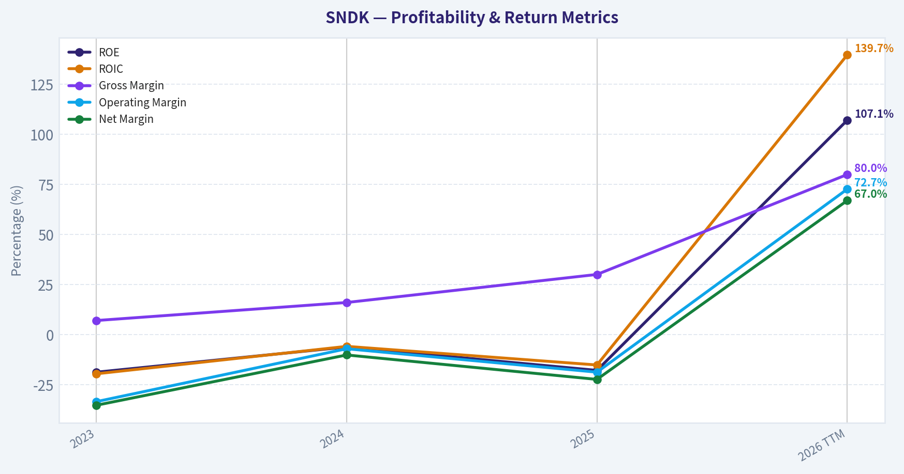
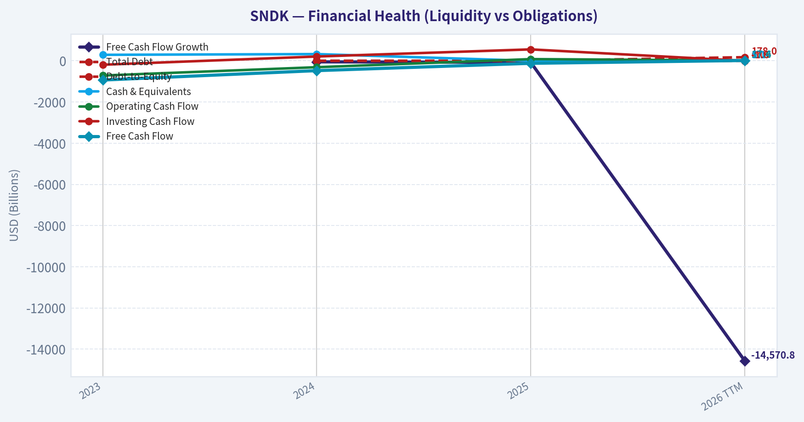
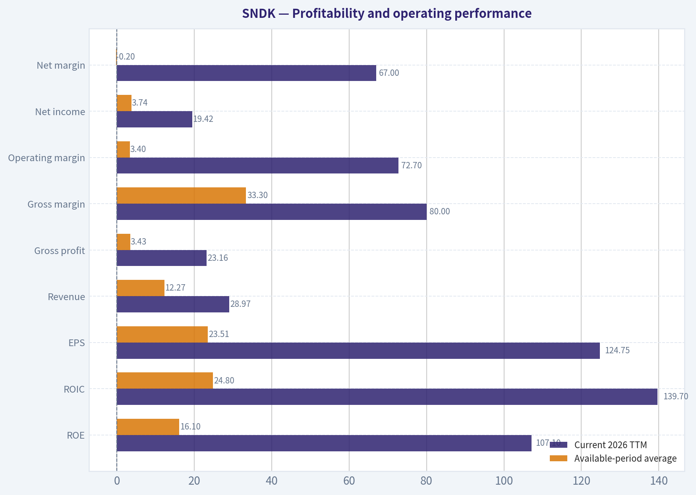
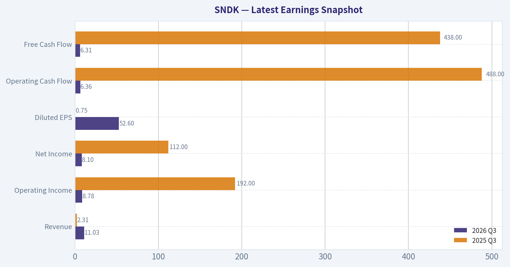
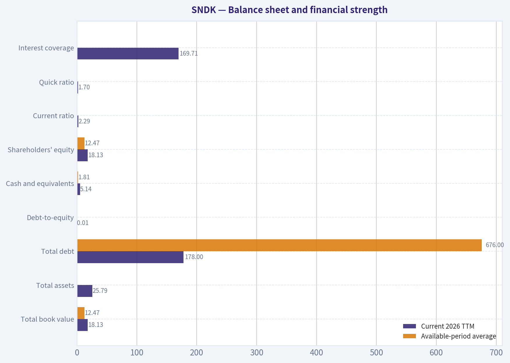
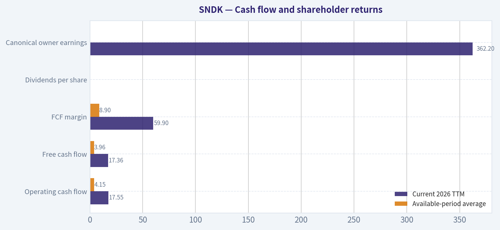
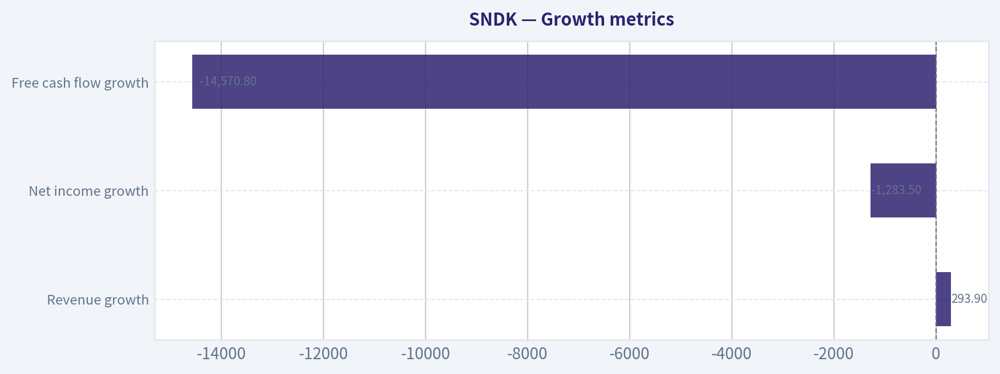
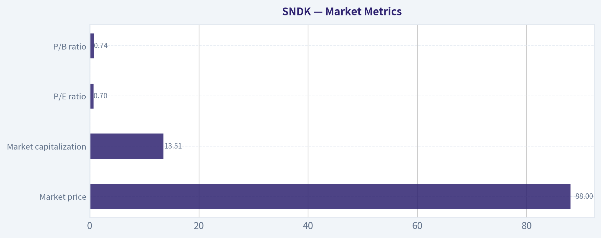

# SNDK Deep Value Intelligence

**Analysis Date:** 2026-11-23

## Critical Disclaimer

*This analysis is generated by Deep Value Intelligence, an AI-powered multi-agent investing framework. Education & research only - not financial advice, not a financial advisor.*

---

## Table of Contents

1. Intelligence Summary
2. Analyst Team Reports
   - Fundamentals Analysis
   - Intrinsic Value Analysis (Buffett)
   - Trend & Growth Analysis (Lynch/Druckenmiller/Fisher)
   - Market Technical Analysis
   - Options Market Analysis
3. Research Team Commentary
4. Value Investing Team Commentary
5. Deep Values Commentary

---

## Intelligence Summary

### Thesis + Conditions

**Core Thesis:** Sandisk has credible strategic assets and a genuine long-term demand runway from AI, cloud, and enterprise storage. However, the evidence does not establish durable pricing power, normalized owner earnings, or a margin of safety at **$87.71**.

**Key Risks:**
- The Risky Analyst correctly identifies several potentially valuable attributes:
- These points preserve a credible recovery thesis. The analyst is also right that historical NAND averages may understate future economics if AI demand and supplier discipline improve the quality of the cycle.
- The weakness is treating unreliable data as "unverified optionality." A database anomaly might eventually reveal value, but it is not evidence of value before reconciliation. Likewise, a temporary combination of better pricing, utilization, and mix could produce a large earnings revision without establishing sustainable owner earnings. That may support a catalyst thesis, but not yet a Buffett-style valuation conclusion.

**Confidence:** Low

---

## Analyst Team Reports

### Fundamentals Analysis

#### Latest Earnings Snapshot

*Most recent reported quarter anchored on 2026 Q3, with prior-year comparison when available.*

| Metric | 2026 Q3 | 2025 Q3 | YoY Change |
| --- | ---: | ---: | ---: |
| Revenue | $11.03B | $2.31B | +377.9% |
| Operating Income | $8.78B | $192.0M | +4472.9% |
| Net Income | $8.10B | $112.0M | +7133.0% |
| Diluted EPS | $52.60 | $0.75 | +6913.3% |
| Operating Cash Flow | $6.36B | $488.0M | +1203.9% |
| Free Cash Flow | $6.31B | $438.0M | +1340.4% |

Key Takeaways: This snapshot anchors the most recent reported quarter before the narrative analysis. It helps readers separate long-run business quality from whatever changed in the latest earnings print.

#### 3-Year Financial Metrics for SNDK

*All values below are computed deterministically from raw data - not estimated by AI.*

*Issuer profile: operating company (Technology / Computer Hardware).*

#### 3-Year Financial Metrics
*Annual rows come from reported financial statements. The final TTM row is computed from the latest four quarters.*

| Metric | 2023 | 2024 | 2025 | 2026 TTM |
| --- | --- | --- | --- | --- |
| Market Price | N/A | N/A | $6 | $88 |
| Market Cap | N/A | N/A | $99.84B | $13.51B |
| P/E Ratio | N/A | N/A | -0.50 | 0.70 |
| P/B Ratio | N/A | N/A | 10.83 | 0.74 |
| ROE | -18.7% | -6.1% | -17.8% | 107.1% |
| ROIC | -19.5% | -5.8% | -15.1% | 139.7% |
| EPS | $-14.78 | $-4.63 | $-11.32 | $124.75 |
| Revenue | $6.09B | $6.66B | $7.36B | $28.97B |
| Gross Profit | $430.0M | $1.07B | $2.21B | $23.16B |
| Gross Margin | 7.1% | 16.1% | 30.1% | 80.0% |
| Operating Margin | -33.4% | -7.0% | -18.7% | 72.7% |
| Net Income | $-2.14B | $-672.0M | $-1.64B | $19.42B |
| Net Margin | -35.2% | -10.1% | -22.3% | 67.0% |
| Revenue Growth | N/A | 9.5% | 10.4% | 293.9% |
| Net Income Growth | N/A | -68.6% | 144.2% | -1283.5% |
| Free Cash Flow Growth | N/A | -49.0% | -74.7% | -14570.8% |
| Total Book Value | $11.44B | $11.08B | $9.22B | $18.13B |
| Total Assets | N/A | $13.51B | $12.98B | $25.79B |
| Total Debt | N/A | $0 | $1.85B | $178.0M |
| Debt-to-Equity | N/A | 0.00 | 0.20 | 0.01 |
| Cash & Equivalents | $292.0M | $328.0M | $1.48B | $5.14B |
| Shareholders' Equity | $11.44B | $11.08B | $9.22B | $18.13B |
| Operating Cash Flow | $-713.0M | $-309.0M | $84.0M | $17.55B |
| Investing Cash Flow | $-189.0M | $210.0M | $556.0M | $-1.61B |
| Free Cash Flow | $-932.0M | $-475.0M | $-120.0M | $17.36B |
| FCF Margin | -15.3% | -7.1% | -1.6% | 59.9% |
| Dividends / Share | $0.00 | $0.00 | $0.00 | $0.00 |

#### Profitability Metrics
- Return on Equity (ROE): 72.7%
- Return on Invested Capital (ROIC): 99.2%
- Return on Assets (ROA): 50.8%
- Gross Margin: 71.5%
- Operating Margin: 61.2%
- Net Profit Margin: 56.5%

#### Liquidity Metrics
- Current Ratio: 2.29
- Quick Ratio: 1.70

#### Leverage Metrics
- Debt-to-Equity Ratio: N/A
- Interest Coverage Ratio: 169.71
- Net Debt: N/A

#### Growth Metrics (Year-over-Year)
- Revenue Growth: 175.3%
- Net Income Growth: 796.7%
- Free Cash Flow Growth: 9678.3%
- Revenue CAGR (3-Year): 49.3%
- Revenue CAGR (5-Year): N/A

#### Valuation Metrics
- P/E Ratio (TTM): 0.09
- Forward P/E: 2.44
- Price-to-Book: 5.57
- Price-to-Sales: 3.45
- PEG Ratio: 0.00
- EV/EBITDA: 4.02
- Free Cash Flow Yield: 11.5%
- Earnings Yield: 1053.1%

#### Owner Earnings (Buffett Method, Code-Computed)
- Net Income: $-1.64B
- + Non-cash, non-recurring items excluded (fair-value changes on convertibles/derivatives/SAFEs, impairments): $1.83B
- + Depreciation & Amortization: $149.0M
- - Capital Expenditures: $-177.0M
- + Working Capital (cash-flow statement; negative = cash tied up): $212.0M
- = **Owner Earnings: $362.2M**

#### Intrinsic Value (DeepValues app - SEC filings pipeline)
- **Intrinsic value (DeepValues app, the headline): $3,133.77** - Owner Earnings (Buffett), method buffett-1986-v2, as of 2026-11-23 (FY2026)
  Range (conservative - optimistic): $2,193.64 - $3,133.77
  Margin of safety vs. price: 97.2% (price $87.71)
  Inputs the app used (ttm_2027Q1): after-tax operating income $20.8B (operating income $21.0B, tax 0.0%) + D&A $0.2B - capex charge $0.6B (three-year average capex/revenue x trailing revenue; reported capex $0.2B) - working capital $0.0B = owner earnings $20.4B.
  Growth 10.0% fading to 2.5% terminal (min(owner-earnings CAGR, 5-year revenue CAGR), clamped [0, 10%]); discount rate 8.3% (30Y Treasury 5.31% + 3 pts (as of 2026-11-20)); net cash $5.1B (cash $5.1B + marketable securities $0.0B - debt $0.0B); 154M shares.
- Owner Earnings (Buffett): $2,193.64 / $3,133.77 / $3,133.77 (conservative / base / optimistic) ← headline
- Free cash flow DCF: $6,423.39 / $6,423.39 / $6,423.39 (conservative / base / optimistic)
- Damodaran two-stage FCFF: N/A - Projected free cash flow to the firm is negative, so the operations are valued below zero (-$188.3B): its median operating margin over 4 years is -12.9%, so the model projects operating losses; its $5.1B of net cash does not make up for that - no positive equity value to report
  This is THE intrinsic value: quote it as the intrinsic value and measure margin of safety against it. Any DVI scenario figures elsewhere are a secondary cross-check, not the value.

#### DVI scenario model (secondary cross-check - NOT the intrinsic value)
DVI's own Yahoo-based scenarios, shown only as a sensitivity check. Do not quote these as the intrinsic value; the intrinsic value is the DeepValues app value above.
- Current Price: $88
- Damodaran FCFF (WACC + margins + reinvestment):
  Conservative: $-882
  Average: $-655
  Optimistic: $-472
  Monte Carlo band (P10-P90): $-930 - $-476 (median $-666)
  P(intrinsic value > price): 0.0%
- Reverse-DCF: price implies ~-50.0%/yr owner-earnings growth for 10y; trailing 3y was N/A, 5y N/A.

#### Piotroski F-Score: 8/9
- Positive Net Income: PASS
- Positive Operating Cash Flow: PASS
- ROA Improvement: PASS
- Cash Flow > Net Income: PASS
- Decreasing Debt: PASS
- Improving Current Ratio: FAIL
- No Dilution: PASS
- Improving Gross Margin: PASS
- Improving Asset Turnover: PASS

ANALYST STANCE: **Neutral**

#### Scope and data integrity

This analysis covers **Sandisk Corp. (Nasdaq: SNDK, SEC CIK 0002023554)** only. The deterministic dataset is the canonical source. It contains a major discontinuity: Sandisk moved from sustained losses through 2025 to exceptionally strong 2026 TTM profitability. Several secondary feed values conflict with the canonical dataset, particularly market capitalization, margins, valuation multiples, and growth rates; those conflicting figures are treated as cross-checks rather than replacements.

The dataset provides only four periods, not ten years. Therefore, "historical average" comparisons below use the available 2023-2026 TTM period and are not presented as true ten-year averages.

#### Market Metrics

| Metric | Current 2026 TTM | Available-period comparison | Interpretation |
|---|---:|---:|---|
| Market price | $88 | Available-period average: $47.00 | Price has increased sharply from $6 in 2025. |
| Market capitalization | $13.51B | Available-period average of reported observations: $56.68B | The 2025 $99.84B figure is inconsistent with $6 per share and the reported share count; $13.51B is mathematically consistent with approximately 154 million shares at $88. |
| P/E ratio | 0.70 | Available-period average: 0.10 | The low multiple reflects unusually large TTM earnings and should not be extrapolated without normalizing the semiconductor cycle. |
| P/B ratio | 0.74 | Available-period average of reported observations: 5.79 | Unlike an asset-light software company, book value is relevant for a hardware manufacturer, but the sharp movement reflects both earnings recovery and large changes in equity. |

**Key Takeaways:** SNDK's current valuation looks inexpensive on the canonical P/E and P/B figures, but those ratios are heavily affected by a dramatic earnings inflection. The market-cap inconsistency in the source materials makes share-count-based reconciliation essential; $13.51 billion is the internally consistent figure for an $88 share price and approximately 154 million shares.

#### Profitability and operating performance

| Metric | Current 2026 TTM | Available-period average | Current versus average |
|---|---:|---:|---:|
| ROE | 107.1% | 16.1% | Far above average, but likely cycle-enhanced |
| ROIC | 139.7% | 24.8% | Far above average, requiring normalization |
| EPS | $124.75 | $23.51 | Current EPS is driven by the sharp profit reversal |
| Revenue | $28.97B | $12.27B | 136% above available-period average |
| Gross profit | $23.16B | $3.43B | 575% above available-period average |
| Gross margin | 80.0% | 33.3% | Up 46.7 percentage points |
| Operating margin | 72.7% | 3.4% | Up 69.3 percentage points |
| Net income | $19.42B | $3.74B | Positive average is misleading because three historical years included losses |
| Net margin | 67.0% | -0.2% | Up approximately 67 percentage points |

**Key Takeaways:** The latest profitability figures are extraordinary relative to the prior three years. Revenue, gross margin, operating margin, and net margin all show a step-change rather than a gradual improvement, so the central analytical question is whether 2026 reflects durable structural economics or an unusually favorable memory and storage cycle.

The reported 2026 TTM figures imply margins more typical of a highly advantaged technology platform than a cyclical storage manufacturer. That does not make them invalid, but it substantially raises the burden of proof for forecasting them into future years.

#### Growth metrics

| Metric | Current 2026 TTM | Available-period pattern | Interpretation |
|---|---:|---|---|
| Revenue growth | 293.9% | 9.5% in 2024; 10.4% in 2025 | Current growth is a sharp break from the prior trend |
| Net income growth | -1,283.5% | Losses fluctuated materially before the TTM recovery | The negative percentage is mathematically distorted by changes around negative earnings |
| Free cash flow growth | -14,570.8% | FCF was negative in 2023-2025 and strongly positive in TTM | Percentage growth is not economically meaningful from a negative base |
| Revenue CAGR | 49.3% over the available three-year comparison | No five-year CAGR available | Strong, but heavily influenced by the latest period |

**Key Takeaways:** Revenue growth is impressive but not yet predictable because the historical base was relatively stable while the latest TTM result surged. Net income and FCF growth percentages are not reliable decision metrics because the earlier denominators were negative; absolute cash-flow conversion and normalized earnings are more informative.

#### Balance sheet and financial strength

| Metric | Current 2026 TTM | Available-period average | Interpretation |
|---|---:|---:|---|
| Total book value | $18.13B | $12.47B | Equity recovered materially from the 2025 low |
| Total assets | $25.79B | $17.43B across reported periods | Asset base expanded with the earnings recovery |
| Total debt | $178.0M | $676.0M | Debt declined sharply from 2025 |
| Debt-to-equity | 0.01 | 0.07 across reported periods | Very modest leverage |
| Cash and equivalents | $5.14B | $1.81B | Cash rose substantially |
| Shareholders' equity | $18.13B | $12.47B | Strong improvement, partly reflecting retained earnings |
| Current ratio | 2.29 | Not consistently available | Good reported liquidity |
| Quick ratio | 1.70 | Not consistently available | Indicates reasonable liquid-asset coverage |
| Interest coverage | 169.71 | Not consistently available | Very strong based on the latest reported period |

**Key Takeaways:** The balance sheet is a clear strength. Debt is low, cash has grown to more than $5 billion, and liquidity is solid. The principal financial risk is not leverage; it is the possibility that the current earnings and cash-generation rate is cyclical and therefore temporarily overstating repayment capacity and intrinsic value.

#### Cash flow and shareholder returns

| Metric | Current 2026 TTM | Available-period average | Interpretation |
|---|---:|---:|---|
| Operating cash flow | $17.55B | $4.15B | Latest figure dominates the average |
| Free cash flow | $17.36B | $3.96B | Strong current cash generation after three negative years |
| FCF margin | 59.9% | 8.9% | Exceptional current conversion |
| Dividends per share | $0.00 | $0.00 | No cash dividend history in the dataset |
| Canonical owner earnings | $362.2M | Not comparable across periods | Much lower than TTM FCF after adjustments |

**Key Takeaways:** Current reported FCF is extremely strong, but the canonical owner-earnings calculation is only $362.2 million because it excludes or adjusts certain non-recurring items and uses reported capital expenditures and working-capital effects. This large gap is the most important valuation sensitivity in the entire dataset.

#### Owner earnings and DCF valuation

The deterministic dataset contains two materially different owner-earnings bases:

1. **Canonical code-computed owner earnings:** $362.2 million
   - Net income: negative $1.64 billion in the underlying calculation
   - Add-back of excluded non-cash or non-recurring items: $1.83 billion
   - Depreciation and amortization: $149 million
   - Capital expenditures: subtract $177 million
   - Working-capital contribution: $212 million

2. **DeepValues headline intrinsic-value model:** $20.4 billion of owner earnings based on a different TTM operating-income framework, including $20.8 billion of after-tax operating income, $0.2 billion of D&A, $0.6 billion of normalized capital-expenditure charge, and negligible working-capital investment.

The DeepValues value is the required headline intrinsic value, but the discrepancy means it should be viewed as highly dependent on the assumption that the latest operating regime is durable.

##### Hand-built Buffett-style owner-earnings DCF

For a transparent sanity check, the hand DCF uses:

- Starting owner earnings: **$362.2 million**
- Discount rate: **10.0%**
- Terminal growth: **2.5%**
- Ten-year explicit forecast
- Terminal value calculated as Year 11 owner earnings divided by \(10.0\% - 2.5\%\)
- Approximately 154 million shares outstanding
- Net cash: approximately $5.1 billion, or about $33 per share

| Scenario | Forecast assumption | Present value of explicit period | Present value of terminal value | Equity value before net cash | Approximate value per share before net cash | Approximate value per share including net cash |
|---|---|---:|---:|---:|---:|---:|
| Conservative | 0% initial growth, then 2.5% terminal growth | $2.23B | $1.91B | $4.14B | $26.9 | $60 |
| Average | Approximately 5% growth, fading toward 2.5% | $2.80B | $3.11B | $5.91B | $38.4 | $71 |
| Optimistic | Approximately 7.5% effective growth, fading toward 2.5% | $2.97B | $3.93B | $6.90B | $44.8 | $78 |

The net-cash adjustment adds approximately $33 per share. These values are not a replacement for the DeepValues model; they are a conservative sanity check based on the canonical owner-earnings figure.

| Valuation framework | Conservative | Base / average | Optimistic | Role in analysis |
|---|---:|---:|---:|---|
| DeepValues Buffett owner-earnings model | $2,193.64 | $3,133.77 | $3,133.77 | Required headline intrinsic value |
| DeepValues FCF DCF | $6,423.39 | $6,423.39 | $6,423.39 | Secondary cross-check |
| Hand DCF using $362.2M owner earnings | Approximately $60 | Approximately $71 | Approximately $78 | Independent normalization check |
| Current price | \multicolumn{3}{c|}{$88} | Reference market value |
| DeepValues margin of safety | \multicolumn{3}{c||Approximately 97.2%} | Highly dependent on $20.4B owner earnings |

**Key Takeaways:** The headline DeepValues intrinsic value is $3,133.77 per share, with a conservative value of $2,193.64 and a reported margin of safety of approximately 97.2%. However, the independent DCF using the canonical $362.2 million owner-earnings figure produces a much lower range of roughly $60 to $78 per share including net cash, demonstrating that the valuation is dominated by the choice of earnings base.

The supplied reverse-DCF cross-check says the current price implies approximately negative 50% annual owner-earnings growth for ten years. That result is inconsistent with the canonical $362.2 million owner-earnings figure and the $88 market price, so it should be treated as a model-integrity warning rather than a reliable standalone conclusion. The broader message is that the valuation models are not converging.

#### Revenue Breakdown

The deterministic dataset does not provide Sandisk's latest revenue by product, business segment, or geography. Accordingly, the table below reports the total company revenue without fabricating a segment allocation.

| Revenue Source | Amount ($B) | % of Total |
|---|---:|---:|
| Company-wide reported revenue; segment allocation unavailable in deterministic dataset | $28.97B | 100.0% |

**Key Takeaways:** No precise segment breakdown is available in the supplied canonical data. Sandisk is generally associated with flash-memory and storage products serving client, consumer, data-center, mobile, and emerging applications, but assigning amounts to those categories without company-reported figures would introduce unsupported estimates.

#### Warren Buffett-style qualitative assessment

**Economic moat:** Sandisk has meaningful scale, manufacturing know-how, intellectual property, customer relationships, and a recognized storage brand. However, flash memory is more cyclical and competitive than classic Buffett compounders. Capacity additions, pricing pressure, technology transitions, and inventory corrections can cause large swings in margins and cash flow.

**Financial strength:** The balance sheet is favorable. Debt-to-equity is only 0.01, cash is $5.14 billion, and interest coverage is very high. This gives Sandisk resilience during downturns and reduces bankruptcy risk. The key weakness is earnings volatility rather than financial leverage.

**Predictable earnings:** Predictability is poor over the observed period. Revenue grew moderately in 2024 and 2025, but the company remained unprofitable. The 2026 TTM figures then show an abrupt transition to 80% gross margin, 72.7% operating margin, and 67% net margin. Such a discontinuity is not sufficient evidence of a stable long-term earnings stream.

**Management and capital allocation:** The company has rebuilt equity and cash while reducing debt. That is favorable. The absence of dividends means capital allocation is primarily reflected in reinvestment, balance-sheet repair, and retained cash. A Piotroski F-score of 8 out of 9 supports improving financial quality, although the score is backward-looking and does not resolve cyclicality.

**Quality of business:** Sandisk has a strategically important product category and potentially strong demand exposure to data growth, AI infrastructure, client storage, and enterprise workloads. Nevertheless, the underlying industry has historically exhibited pricing cycles and high operating leverage. The quality case is stronger on balance-sheet durability and strategic relevance than on demonstrated earnings consistency.

#### Key investment insights, red flags, and opportunities

| Category | Evidence | Significance |
|---|---|---|
| Major opportunity | $5.14B cash, minimal debt, and strong current liquidity | The company can withstand downturns and fund technology investment |
| Major opportunity | Revenue rose to $28.97B and FCF to $17.36B in the latest TTM period | If durable, current valuation metrics would appear unusually low |
| Major opportunity | Gross margin and operating margin expanded dramatically | Indicates either powerful pricing and mix improvement or a highly favorable temporary regime |
| Red flag | Three prior periods showed negative net income and negative FCF | Earnings durability remains unproven |
| Red flag | Canonical owner earnings of $362.2M contrasts with $17.36B reported FCF | Valuation depends heavily on accounting normalization |
| Red flag | DeepValues, hand DCF, and Damodaran models diverge radically | Model risk is unusually high |
| Red flag | Damodaran model projects negative operating value because of historical margins | Historical cyclicality remains a material counterargument |
| Red flag | No dividend and no long record of stable shareholder distributions | Cash-return discipline cannot yet be assessed through dividends |
| Data risk | Market capitalization and several secondary metrics conflict with the canonical dataset | Conclusions should rely on internally reconciled figures |

**Key Takeaways:** The strongest opportunity is a potentially transformed earnings profile supported by a very strong balance sheet. The strongest red flag is that the transformation has occurred too recently, and the historical record does not establish that 2026 margins can persist. The wide valuation dispersion is itself evidence that normalization assumptions matter more than headline multiples.

#### Final assessment

SNDK presents a **high-upside, high-uncertainty valuation case**. On the required DeepValues model, the stock is dramatically below intrinsic value: **$3,133.77 headline value versus an $88 market price**, with a conservative model value of $2,193.64. That conclusion assumes the latest extraordinary operating-income base is durable.

The more conservative hand DCF, anchored to the canonical $362.2 million owner-earnings figure, produces approximately **$60 to $78 per share including net cash**, below the current price. The balance sheet and Piotroski score are favorable, but the historical record of losses, negative FCF, and cyclical industry economics prevents a high-confidence compounder classification.

**Final stance: Neutral.** The evidence supports a potentially substantial valuation opportunity only if the 2026 earnings regime is sustainable. The available data do not yet establish that durability, and the conflicting DCF outputs make valuation confidence insufficient for an **Bullish** classification. This stance reflects analytical uncertainty and valuation-model dispersion, not an instruction regarding trading activity.

| Key point | Assessment |
|---|---|
| Business identity | Sandisk Corp., Nasdaq: SNDK |
| Current canonical price | $88 |
| Canonical market capitalization | $13.51B |
| Current profitability | Extremely strong but newly established in the available record |
| Balance sheet | Strong cash position and minimal debt |
| Earnings predictability | Weak to moderate; large historical cyclicality |
| Required headline intrinsic value | $3,133.77 per share |
| Conservative DeepValues value | $2,193.64 per share |
| Independent normalized hand DCF | Approximately $60-$78 per share including net cash |
| Principal uncertainty | Whether 2026 margins and cash flows are durable |
| Final stance | **Neutral** |

#### Fundamental Visuals

This graph tracks the profitability and return metrics (ROE, ROIC, Margins) of **SNDK** over the past decade, highlighting capital efficiency trends.

This chart illustrates the financial health of **SNDK** over the last 10 years, mapping cash equivalents and free cash flow against total obligations (Debt).

This comparison chart from *Profitability and operating performance* stacks current figures against historical benchmarks for **SNDK**, making it easy to see where the company trades relative to its own averages.

---

### Intrinsic Value Analysis (Buffett)

> *Following Warren Buffett's value investing philosophy: Circle of Competence, Economic Moat, Management Quality, and Margin of Safety.*

#### Intrinsic Value Snapshot

Price is what you pay. Intrinsic value is what the business may be worth based on the cash it can create for owners over time. We show a range, not one magic number.

- Current Price: $87.71
- Value Range (conservative to optimistic across both DCF methods): $2,193.64 to $6,423.39

##### Owner Earnings (Buffett Method)
- Net Income: $-1,641,000,000.00
- Depreciation & Amortization: $149,000,000.00
- Capital Expenditures: $-177,000,000.00
- Working Capital Changes: $212,000,000.00
- Owner Earnings: $362,170,000.00

##### Intrinsic Value
###### Buffett Method
Uses owner earnings. Stricter, and usually more conservative.
- Conservative: $2,193.64
- Average: $3,133.77
- Optimistic: $3,133.77
- Discount Rate: 8.3%

###### Cash Flow Method
Uses free cash flow. Better for companies spending heavily today to grow tomorrow.
- Conservative: $6,423.39
- Average: $6,423.39
- Optimistic: $6,423.39
- Discount Rate: 9.1%

ANALYST STANCE: **Neutral**

#### Executive Conclusion

Sandisk has attractive reported economics on the latest figures: high gross margin, substantial net cash, strong reported free-cash-flow yield, and a headline owner-earnings valuation far above the market price. However, the valuation evidence is internally inconsistent. The Buffett owner-earnings model assumes approximately $20.4 billion of sustainable owner earnings, while the FCFF cross-check projects substantial operating losses because of a four-year median operating margin of negative 12.9%.

That conflict is too significant to treat the headline $3,133.77 intrinsic value as dependable without normalization across a full storage-cycle history. The business appears financially solvent, but its semiconductor and NAND exposure creates meaningful earnings cyclicality and reduces predictability.

#### Factor Scorecard

| Factor | Score | Evidence |
|---|---:|---|
| 1. Circle of competence and simplicity | 3.0/5 | Sandisk designs and sells data-storage products; the elementary model is understandable, but earnings depend heavily on NAND pricing, inventory cycles, and technology transitions. |
| 2. Durable competitive advantage | 3.0/5 | Scale, intellectual property, manufacturing know-how, and customer relationships provide a narrow-to-moderate moat. The industry remains cyclical and technologically demanding. |
| 3. Management and capital allocation | 3.0/5 | The available information shows a net-cash balance sheet and disciplined capital structure, but there is insufficient evidence here to award a top score for long-term per-share capital allocation. |
| 4. Industry structure | 2.5/5 | NAND storage has scale benefits but remains exposed to intense competition, price cycles, technological obsolescence, and large capital requirements. |

**Gate 5 hard floor:** Not tripped. Sandisk reports net cash of approximately $5.1 billion and no reported debt in the valuation inputs. The evidence indicates cyclicality and model uncertainty, not financial distress combined with deteriorating solvency.

#### Moat Analysis

| Moat source | Assessment | Strength |
|---|---|---:|
| Intangible assets | NAND and storage know-how, patents, product qualification history, and brand presence support customer acceptance. | 3/5 |
| Switching costs | Enterprise and embedded-storage customers face qualification, reliability, and integration costs, although commodity storage can remain price-sensitive. | 3/5 |
| Cost advantages | Manufacturing scale and technology investment can lower unit costs, but industry overcapacity can compress returns for all producers. | 3/5 |
| Network effects | Minimal direct network effects; storage products do not become materially more valuable solely because more users adopt them. | 1/5 |

**Key Takeaways:** Sandisk's competitive advantages are based primarily on scale, technology, and customer qualification rather than network effects. These advantages can support attractive margins during favorable industry conditions, but they do not fully eliminate NAND price-cycle risk. The moat is best characterized as narrow to moderate rather than wide and widening.

#### Management Quality Assessment

The balance sheet signals are favorable: the valuation inputs show approximately $5.1 billion of net cash and no debt. That provides resilience through weak industry conditions and gives management flexibility for research, capacity decisions, and shareholder returns.

The available data do not establish whether management consistently repurchases shares only below intrinsic value, whether acquisitions have compounded per-share value, or whether executive incentives are tightly linked to long-term owner earnings. Accordingly, management receives a middle score rather than a premium score.

#### Financial Summary

| Metric | Latest reported figure |
|---|---:|
| Share price | $88.00 |
| Market capitalization | $99.84 billion |
| Revenue growth, year over year | 175.3% |
| Gross margin | 71.5% |
| Return on equity | 72.7% |
| Free-cash-flow yield | 11.5% |
| Current ratio | 2.29 |
| Cash and marketable securities used in valuation | $5.1 billion |
| Debt used in valuation | $0.0 billion |
| Shares used in valuation | 154 million |
| Reported operating income in app inputs | $21.0 billion |
| After-tax operating income in app inputs | $20.8 billion |
| Depreciation and amortization | $0.2 billion |
| Reported capex | $0.2 billion |
| Capex charge used by app | $0.6 billion |
| Working-capital charge | $0.0 billion |

**Key Takeaways:** The latest reported figures show exceptional profitability and strong liquidity, but the 175.3% revenue growth rate is also a warning that the comparison may be heavily influenced by a depressed prior period and industry recovery. The 72.7% ROE is not sufficient by itself to establish durable economics because it may reflect unusually high cycle profitability and a relatively asset-light reported capital base.

#### Cash-Flow and Return Analysis

Operating income of $21.0 billion against reported revenue growth of 175.3% suggests a powerful recovery phase. However, the separate FCFF analysis reports a four-year median operating margin of negative 12.9% and projects negative operating cash generation under its assumptions. This indicates that the latest period may not represent normalized mid-cycle earnings.

The reported ROE of 72.7% is excellent on its face. With no debt included in the valuation inputs, the return does not appear primarily driven by financial leverage. Nevertheless, semiconductor ROE can rise sharply when pricing improves and then fall rapidly when supply exceeds demand. A full-cycle ROIC series is therefore more informative than the latest ROE.

**Balance-sheet strength: 4.5/5.** Net cash and no reported debt are strong positives. The score is not a full 5 because balance-sheet strength does not resolve earnings cyclicality.

#### Owner Earnings Calculation

| Owner-earnings component | Amount |
|---|---:|
| Net income / operating earnings proxy | Not separately provided in the pack |
| After-tax operating income | $20.8 billion |
| Depreciation and amortization | +$0.2 billion |
| Maintenance-capex charge | -$0.6 billion |
| Working-capital investment | -$0.0 billion |
| **Calculated owner earnings** | **$20.4 billion** |
| Owner earnings per share, using 154 million shares | **Approximately $132.47** |

**Key Takeaways:** The app's owner-earnings calculation produces approximately $20.4 billion, or about $132 per share. That figure is dramatically above the current share price, but its usefulness depends on whether the latest recovery earnings can persist through a complete NAND cycle. The negative FCFF cross-check makes normalization the central analytical issue.

#### Three-Scenario DCF Cross-Check

These scenarios are sensitivity checks only. The DeepValues app value remains the designated intrinsic value.

| Scenario | Main assumptions | Equity value | Value per share |
|---|---|---:|---:|
| A. No growth | $20.4B owner earnings, 10% discount rate | $204.0B before net cash | $1,325 |
| B. GDP growth | 3% perpetual growth, 10% discount rate | Approximately $300.2B before net cash | Approximately $1,950 |
| C. Historical-growth cross-check | 10% growth for 10 years, then 2.5% terminal growth, 10% discount rate | Approximately $487.9B including net cash | Approximately $3,168 |

Scenario C uses the 10% cap specified for the historical-growth method. These values are mechanical outputs from the unusually high current owner-earnings figure and should not be interpreted as normalized fair value.

**Key Takeaways:** All three scenarios produce values far above the current price because they capitalize the latest $20.4 billion owner-earnings estimate. The result demonstrates the valuation sensitivity to earnings normalization rather than proving that the company is worth those amounts. A materially lower mid-cycle owner-earnings figure would reduce the estimates substantially.

#### Intrinsic Value and Margin of Safety

The DeepValues app's headline intrinsic value is **$3,133.77 per share**, based on:

- Owner earnings: $20.4 billion
- Growth: 10% fading to 2.5%
- Discount rate: 8.3%
- Net cash: $5.1 billion
- Shares: 154 million

At a share price of approximately $87.71, the app reports a **97.2% margin of safety**.

However, the FCFF model produces no positive operating equity value because its assumptions use a negative four-year median operating margin of 12.9%. This is not a minor difference; it represents a fundamental disagreement about normalized profitability. The headline intrinsic value should therefore be treated as highly sensitive to the latest earnings regime.

| Valuation signal | Interpretation |
|---|---|
| Buffett owner-earnings value | Extremely favorable |
| Free-cash-flow DCF | Favorable but also based on elevated current cash generation |
| Damodaran FCFF cross-check | Adverse; projects operating losses |
| Net cash | Strong support for financial resilience |
| Valuation confidence | Low to moderate because of large model divergence |

**Key Takeaways:** The apparent margin of safety is enormous under the owner-earnings model, but valuation confidence is much lower than the headline number suggests. The market price may be discounting a return toward normalized NAND-cycle earnings rather than valuing the latest peak recovery earnings indefinitely.

#### Final Buffett Scorecard

| Criterion | Weight | Score | Weighted contribution |
|---|---:|---:|---:|
| Moat width and durability | 25% | 3.0 | 0.75 |
| Valuation and margin of safety | 20% | 3.0 | 0.60 |
| Capital returns: ROIC versus WACC | 15% | 3.0 | 0.45 |
| Business understanding and predictability | 12% | 2.5 | 0.30 |
| Management quality and capital allocation | 12% | 3.0 | 0.36 |
| Reinvestment runway | 8% | 3.0 | 0.24 |
| Balance-sheet strength | 4% | 4.5 | 0.18 |
| Industry structure | 4% | 2.5 | 0.10 |
| **Total** | **100%** |  | **2.98 / 5.00** |

#### Investment Stance

**Neutral - Moderate conviction.**

Sandisk combines strong latest-period economics with a very strong balance sheet, but the core valuation question is whether current owner earnings are durable or reflect a favorable point in a highly cyclical NAND market. The app's $3,133.77 intrinsic value and 97.2% margin of safety are compelling on their stated assumptions, while the negative FCFF cross-check materially lowers confidence in those assumptions.

The evidence supports continued scrutiny of normalized, through-cycle earnings and cash generation. At approximately $88, the valuation appears inexpensive under the owner-earnings framework, but the large divergence among valuation models prevents a high-conviction conclusion.
#### Valuation Bridge

This bridge places the current market price beside each intrinsic value lens so readers can see whether upside depends on one method or shows up across several methods.

| Scenario | Intrinsic Value / Share |
| --- | ---: |
| Buffett Method | $3,133.77 |
| Cash Flow Method | $6,423.39 |
| Current Price | $87.71 |

#### Key Takeaways

If one method is far above the others, the upside case depends on a specific modelling assumption. When several methods cluster together, the valuation story is more robust.

#### Valuation Visuals

This comparison chart from *Latest Earnings Snapshot* stacks current figures against historical benchmarks for **SNDK**, making it easy to see where the company trades relative to its own averages.

This comparison chart from *Balance sheet and financial strength* stacks current figures against historical benchmarks for **SNDK**, making it easy to see where the company trades relative to its own averages.

This comparison chart from *Cash flow and shareholder returns* stacks current figures against historical benchmarks for **SNDK**, making it easy to see where the company trades relative to its own averages.

---

### Trend & Growth Analysis (Lynch/Druckenmiller/Fisher)

> *Following Peter Lynch's GARP, Stanley Druckenmiller's macro-aware approach, and Philip Fisher's scuttlebutt methodology.*

ANALYST STANCE: **Neutral**

#### 1. Lynch Classification

**Primary classification: Cyclical / fast-growing inflection candidate.**

Sandisk is a flash-memory and data-storage company exposed to NAND pricing, enterprise demand, consumer electronics, and AI infrastructure. The reported **175.3% year-over-year revenue growth** is exceptionally strong, but it may reflect separation effects, unusually weak prior-year comparisons, product mix, or acquisition/accounting changes rather than durable organic growth.

| Lynch test | Assessment |
|---|---|
| Growth category | Apparent fast grower, but underlying growth requires verification |
| Cyclicality | High; NAND pricing and inventory cycles materially affect results |
| Story clarity | Strong: storage demand rises with AI, cloud, and data creation |
| Long runway | Potentially substantial in enterprise, AI, and high-capacity storage |
| Main concern | Reported financial data contains major internal inconsistencies |

**Key Takeaways:** Sandisk has the revenue profile of a fast grower, but its industry is structurally cyclical. The central analytical question is whether the latest growth represents a durable demand inflection or a temporary memory-cycle rebound.

#### 2. The Story in Three Bullets

1. **AI and cloud workloads require substantially more storage**, supporting demand for high-capacity NAND and enterprise solid-state drives.
2. **Sandisk owns important flash-memory technology and manufacturing relationships**, giving it relevance in a concentrated global industry.
3. **Operating results can change sharply with NAND pricing**, creating significant upside during supply-demand tightening but also substantial downside during oversupply.

#### 3. TAM and the 10x Test

A precise 10x test cannot be completed from the supplied data because absolute revenue and segment revenue were not provided consistently. The market capitalization is reported as **$99.84 billion**, while the stated intrinsic-value model assumes only **154 million shares**, implying a very different equity value at the reported share price.

| TAM factor | Assessment |
|---|---|
| Secular storage demand | Positive; AI, cloud, edge computing, and video increase data intensity |
| Enterprise SSD opportunity | Attractive, with potential mix and margin benefits |
| Consumer storage | Mature and more price-sensitive |
| NAND market structure | Concentrated, but highly cyclical |
| 10x revenue test | Not verifiable with the supplied revenue figure |
| TAM growth | Likely positive over the long term, but annual industry growth is cyclical |

**Key Takeaways:** The long-term market is expanding, particularly in enterprise and AI-related storage. However, Sandisk's ability to compound revenue tenfold depends on gaining share and increasing enterprise mix, not merely benefiting from higher NAND prices.

#### 4. Revenue Growth Trend

| Metric | Reported value | Interpretation |
|---|---:|---|
| Revenue growth, year over year | 175.3% | Extremely strong, but sustainability is unconfirmed |
| Growth pattern | Single headline observation | Acceleration cannot be established without multiple periods |
| Organic growth | Not disclosed in the research pack | Requires filing-level verification |
| Acquisition/separation effect | Possible | Important because Sandisk is a recently separated company |
| Cyclicality | High | Revenue and earnings can move faster than end-market demand |

**Key Takeaways:** The headline growth rate is consistent with an inflection, but there is not enough sequential history to prove accelerating organic growth. A multi-quarter revenue series, unit volumes, ASPs, and enterprise mix are necessary before treating 175.3% as a durable trend.

#### 5. Unit Economics and Operating Quality

| Metric | Reported value | Assessment |
|---|---:|---|
| Gross margin | 71.5% | Very strong for a hardware company; requires confirmation |
| FCF yield | 11.5% | Attractive if based on normalized free cash flow |
| Current ratio | 2.29 | Indicates reasonable reported liquidity |
| NRR | Not applicable / unavailable | Hardware model rather than subscription SaaS |
| LTV/CAC | Not available | Not meaningful without customer-level data |
| Rule of 40 | Not applicable | Primarily a SaaS framework |
| Debt | Reported as $0 in valuation inputs | Needs reconciliation with current filings |

**Key Takeaways:** The reported gross margin and free-cash-flow yield would indicate unusually strong economics for a memory manufacturer. Those figures conflict with the separate Damodaran model, which reports negative projected FCFF and a four-year median operating margin of negative 12.9%, so financial normalization is essential.

#### 6. Inflection-Point Assessment

| Potential inflection | Evidence | Confidence |
|---|---|---|
| Product-cycle inflection | AI and enterprise storage demand | Medium |
| Market-share inflection | Not provided | Low |
| Margin inflection | Reported 71.5% gross margin | Low to medium due to data conflict |
| TAM inflection | AI-driven storage intensity | Medium to high |
| Competitive inflection | No verified competitor disruption supplied | Low |
| Earnings inflection | Reported growth and FCF data | Medium, but potentially cycle-driven |

**Key Takeaways:** The strongest evidence concerns TAM expansion from AI and cloud infrastructure. The weakest evidence concerns durable market-share gains and normalized margins; these are the areas most likely to determine whether Sandisk is a compounder or a cyclical earnings recovery.

#### 7. Macro Setup

| Macro factor | Effect on Sandisk |
|---|---|
| AI infrastructure investment | Strong positive |
| Cloud and data creation | Positive |
| Interest rates | Headwind for long-duration growth valuations |
| Reported 30-year Treasury yield | 5.31%, indicating a relatively high discount rate |
| Semiconductor cycle | Material source of volatility |
| NAND supply discipline | Critical determinant of pricing and margins |

**Key Takeaways:** The secular AI and cloud backdrop is favorable, but the macro setup is mixed because rates remain high and memory pricing is cyclical. Sandisk is more sensitive to semiconductor inventory and pricing conditions than a typical software growth company.

#### 8. Fisher 15-Point Assessment

| Fisher criterion | Score / 5 | Rationale |
|---|---:|---|
| Market potential | 4 | Storage demand is structurally expanding |
| New-product determination | 4 | Technology roadmap appears strategically important |
| R&D effectiveness | 3 | Requires more filing and product evidence |
| Sales organization | 3 | Enterprise-channel evidence unavailable |
| Profit margins | 3 | Reported margin is strong, but conflicted |
| Margin improvement | 3 | Possible cycle and mix benefit, not established |
| Labor relations | 3 | No negative evidence supplied |
| Executive relations | 3 | Insufficient evidence |
| Management depth | 3 | Standalone-company track record is limited |
| Cost accounting | 2 | Supplied data has material inconsistencies |
| Special competitive advantages | 4 | Technology, scale, IP, and industry position |
| Long-range profit outlook | 4 | Favorable secular demand, cyclical earnings |
| Equity dilution | 3 | No major dilution evidence supplied |
| Management candor | 3 | Insufficient evidence |
| Management integrity | 3 | Insufficient evidence |
| **Total** | **48 / 75** | **Average pending better evidence** |

**Key Takeaways:** Sandisk scores well on market potential and strategic relevance, but only moderately overall because the available financial data is internally inconsistent. Fisher's framework would require deeper channel checks, customer feedback, R&D evidence, and management commentary before assigning a high-conviction score.

#### 9. Valuation Analysis

| Valuation measure | Reported result | Interpretation |
|---|---:|---|
| Share price | $88 | Current reference price |
| Market capitalization | $99.84B | Current reference equity value |
| P/E | 0.095x | Not credible at face value; likely a data-format or denominator error |
| FCF yield | 11.5% | Implies substantial normalized cash generation |
| Owner-earnings intrinsic value | $3,133.77 per share | Highly sensitive to peak earnings assumptions |
| Conservative owner-earnings value | $2,193.64 per share | Same model family |
| Damodaran FCFF value | Negative operating value | Contradicts owner-earnings model |
| P/S | Not calculable | Revenue and share-count data are inconsistent |

**Key Takeaways:** The headline intrinsic value of $3,133.77 is not decision-grade because it assumes approximately $20.4 billion of owner earnings and a 10% growth rate while another model projects negative operating value. The P/E and share-count data are also unreliable, so the evidence does not establish that the shares are undervalued at $88.

#### 10. Scenario Valuation Sensitivity

The following sensitivity is conceptual rather than a price-target model because normalized revenue, earnings, share count, and cycle-adjusted margins are not sufficiently reliable.

| Scenario | Operating assumption | Valuation implication |
|---|---|---|
| Bear | NAND oversupply, falling ASPs, weak enterprise mix | Cash generation and valuation can compress sharply |
| Base | Storage demand grows, but margins normalize toward cycle averages | Equity value depends mainly on sustainable free cash flow |
| Bull | AI storage demand accelerates, supply remains disciplined, enterprise mix improves | Revenue and margins could remain above historical-cycle averages |
| Extreme upside case | Peak earnings treated as permanent | Produces materially overstated intrinsic-value outputs |

**Key Takeaways:** The valuation range is unusually wide because Sandisk's earnings are highly sensitive to NAND pricing. The main risk is not simply slower revenue growth; it is that peak-cycle margins are capitalized as though they were permanent.

#### 11. Growth Investor Scorecard

| Criterion | Weight | Score / 5 | Weighted contribution |
|---|---:|---:|---:|
| Story clarity | 10% | 4.0 | 0.40 |
| TAM and runway | 20% | 4.0 | 0.80 |
| Revenue growth | 20% | 3.5 | 0.70 |
| Unit economics | 15% | 2.5 | 0.38 |
| Competitive position | 10% | 4.0 | 0.40 |
| Management quality | 10% | 3.0 | 0.30 |
| Macro setup | 5% | 3.5 | 0.18 |
| Profitability path | 5% | 3.0 | 0.15 |
| Valuation reliability | 5% | 2.0 | 0.10 |
| **Total** | **100%** | - | **3.41 / 5.00** |

**Key Takeaways:** Sandisk scores as a promising but unverified growth situation. Its strongest attributes are secular storage demand and strategic industry position; its weakest attributes are cyclical economics and unreliable valuation inputs. The resulting score falls at the upper end of the Neutral range rather than the high-conviction range.

#### 12. Key Catalysts and Risks

| Catalysts | Risks |
|---|---|
| Sustained AI and enterprise SSD demand | NAND oversupply and pricing collapse |
| Higher enterprise mix | Peak-margin normalization |
| Demonstrated market-share gains | Dependence on a cyclical memory market |
| Multi-quarter organic revenue acceleration | Data-quality and accounting inconsistencies |
| Stable supply discipline across manufacturers | High interest rates and valuation compression |
| Clear standalone-company financial history | Customer concentration and intense competition |

**Key Takeaways:** The most important catalyst would be several quarters of organic growth accompanied by durable enterprise mix and normalized free-cash-flow expansion. The principal risk is that the reported earnings and valuation inputs reflect a temporary memory-cycle peak rather than a sustainable structural improvement.

#### Bottom Line

Sandisk has a credible secular story tied to AI, cloud storage, and rising data intensity. However, the available evidence does not yet distinguish a durable compounder from a highly cyclical memory recovery. The current data supports a **Neutral** stance because the growth opportunity is attractive, but the valuation models and reported fundamentals require substantial reconciliation before a stronger conclusion is justified.

#### Growth & Scorecard Visuals

This comparison chart from *Growth metrics* stacks current figures against historical benchmarks for **SNDK**, making it easy to see where the company trades relative to its own averages.

---

### Market Technical Analysis

ANALYST STANCE: **Neutral**

#### SNDK Technical Market Report

Sandisk Corp. (Nasdaq: SNDK) shows a sharply deteriorated short- and medium-term technical structure, although the long-term trend has not fully reversed. The latest usable closing price in the retrieved dataset is **$94.39 on November 19, 2026**. The November 20 record contains no usable open, high, low, or close and is marked with an **8-for-1 stock split**, while November 23 has no trading data. This corporate-action discontinuity makes direct comparison between pre- and post-split prices unreliable unless the full series is consistently adjusted.

The selected indicators are **close_10_ema, close_50_sma, close_200_sma, macd, rsi, boll, atr, and vwma**. Together, they cover short-, medium-, and long-term trend, momentum, mean reversion, volatility, and volume confirmation without relying on multiple versions of the same signal.

#### Trend Structure

The latest reported moving averages are:

- **10-day EMA: $108.31**
- **50-day SMA: $170.00**
- **200-day SMA: $161.13**
- **Latest usable close: $94.39**

Price is therefore approximately **12.9% below the 10-day EMA**, **44.5% below the 50-day SMA**, and **41.4% below the 200-day SMA**. This is a broad-based loss of trend support rather than merely a short-lived pullback.

The 10-day EMA declined from approximately **$169.38 on October 29** to **$108.31 by November 20**, demonstrating rapid short-term weakening. The 50-day SMA also fell steadily from roughly **$198.22 on October 26** to **$170.00**, confirming that the deterioration has persisted across several weeks.

The 200-day SMA remains upward sloping, rising from about **$155.12 on October 26** to **$161.13 on November 20**. That creates an important divergence: the long-term average still reflects the earlier advance, but the market price has fallen decisively below it. This often indicates that the longer-term trend is lagging a much more immediate breakdown.

#### Momentum and MACD

The MACD remained deeply negative throughout the latest period. It declined from approximately **-10.93 on October 29** to **-21.18 on November 20**. Although the MACD improved briefly around November 10-13, that recovery was not sustained; the indicator weakened again through November 20.

This pattern indicates that downside momentum is not simply the result of one isolated price shock. Instead, the rebound attempts during November failed to produce a durable improvement in the underlying trend impulse. The MACD reading should be interpreted cautiously because the split-related data gap may distort the most recent observations.

#### RSI and Oversold Conditions

The RSI was **29.35 on November 20**, near the conventional oversold threshold of 30. It had remained below 40 for most of November and reached a low of approximately **24.15 on November 5**.

This indicates pronounced downside momentum and a market that has experienced persistent selling pressure. However, RSI near or below 30 does not by itself establish that the decline has ended. In this case, the RSI is aligned with the falling short-term averages and negative MACD, so the oversold reading currently signals stress rather than a confirmed reversal.

#### Bollinger Middle and Mean Reversion

The Bollinger middle band, a 20-day moving average, declined from approximately **$188.51 on October 26** to **$125.07 on November 20**. The latest usable close of $94.39 was about **24.5% below this middle band**.

That unusually large separation shows that price has moved well below its recent mean. It also indicates elevated downside displacement and the potential for sharp countertrend volatility. Because the retrieved report did not include the upper and lower Bollinger bands, the degree of band expansion cannot be measured directly. The middle-band trend alone, however, confirms that the recent weakness is not occurring around a stable range; the entire short-term mean is falling.

#### Volatility and Volume-Weighted Trend

ATR was **$11.53 on November 20**, after reaching approximately **$13.58 on November 5**. ATR has eased from its early-November peak but remains large relative to the latest price: the ATR was equivalent to roughly **12.2% of the $94.39 close**.

This is a high-volatility environment in which daily price movements can remain substantial even after the initial breakdown. The decline in ATR from its peak suggests some moderation in turbulence, but not a return to normal trading conditions.

VWMA fell from approximately **$165.26 on October 30** to **$102.57 on November 20**. The latest usable close was below that volume-weighted average, indicating that recent high-volume trading has been concentrated at materially higher prices than the latest close. The sharp VWMA decline also reflects heavy-volume weakness, particularly around the November 5 collapse.

#### Price-Action Interpretation

The price path shows several distinct phases:

1. **Late October:** Price began weakening from the $170-$176 area, with the 10-day EMA turning lower.
2. **Early November:** The decline accelerated, including a drop from $129.68 on November 4 to $100.80 on November 5. Volume rose to approximately **245.8 million shares**, far above many surrounding sessions.
3. **Mid-November:** A rebound to $122.21 on November 11 failed to establish a higher short-term trend. Subsequent closes declined to $94.39 by November 19.
4. **Latest period:** Price remained below every major retrieved average, with RSI near oversold territory and MACD deeply negative.

The evidence therefore points to **severe short- and medium-term technical weakness, oversold momentum, and unusually high volatility**. The upward slope of the 200-day SMA is the principal counterpoint, but it is a lagging measure and has not prevented the price from falling substantially beneath it.

The data does not support a stable technical valuation framework at the latest reported price because the stock-split record creates a comparability problem and the market is trading far below its recent trend benchmarks. Any valuation interpretation should first rely on a fully split-adjusted price series and verified post-split trading data.

| Indicator | Latest reported value | Recent direction | Interpretation |
|---|---:|---|---|
| Latest usable close | $94.39 on Nov. 19 | Sharply lower | Price is well below all major trend averages |
| 10-day EMA | $108.31 | Falling rapidly | Short-term momentum remains bearish |
| 50-day SMA | $170.00 | Declining | Medium-term trend has deteriorated materially |
| 200-day SMA | $161.13 | Still mildly rising | Long-term average lags the recent breakdown |
| MACD | -21.18 | Deeply negative | Downside momentum remains pronounced |
| RSI | 29.35 | Near oversold | Strong selling pressure; no confirmed reversal |
| Bollinger middle | $125.07 | Falling sharply | Recent mean is declining and price is far below it |
| ATR | $11.53 | Lower than early-November peak | Volatility remains elevated relative to price |
| VWMA | $102.57 | Falling sharply | Volume-weighted trend remains above the latest close |
| Data integrity | Nov. 20 split record; no Nov. 23 close | Incomplete | Split-adjusted comparisons require verification |

**Key Takeaways:** SNDK's latest usable price is materially below its 10-day, 50-day, 200-day, Bollinger-middle, and volume-weighted averages, confirming broad technical weakness. RSI is near oversold territory, but MACD remains deeply negative and does not yet confirm a durable momentum reversal. The rising 200-day average provides limited long-term support context, while the November 20 stock-split record and missing November 23 price make the latest valuation and trend comparisons data-sensitive.

#### Market Visuals

This comparison chart from *Market Metrics* stacks current figures against historical benchmarks for **SNDK**, making it easy to see where the company trades relative to its own averages.

---

### Options Market Analysis

> *Reading options flow - put/call ratios, IV skew, and unusual activity - to gauge institutional positioning and event-driven risk.*

ANALYST STANCE: **Bullish**

#### SNDK Options Market Report

*Data date: November 23, 2026. Near-term expirations analyzed: November 27, December 4, and December 11, 2026.*

#### 1. Put/Call Ratio Analysis

| Expiration | Days to Expiry | Call OI | Put OI | Put/Call OI | Call Volume | Put Volume | Put/Call Volume |
|---|---:|---:|---:|---:|---:|---:|---:|
| Nov. 27, 2026 | 4 | 315,475 | 133,498 | 0.42 | 161,553 | 91,700 | 0.57 |
| Dec. 4, 2026 | 11 | 137,553 | 72,425 | 0.53 | 35,445 | 12,205 | 0.34 |
| Dec. 11, 2026 | 18 | 65,607 | 47,928 | 0.73 | 10,955 | 4,885 | 0.45 |
| **Total** | - | **518,635** | **253,851** | **0.49** | **207,953** | **108,790** | **0.52** |

The aggregate put/call OI ratio of 0.49 is materially below the approximately 0.70 neutral baseline. The volume ratio of 0.52 also indicates substantially greater call activity than put activity across the near-term chain. This is a bullish-leaning configuration, although some call volume could represent covered-call writing rather than outright upside speculation.

**Key Takeaways:** Near-term options activity is call-dominant by both open interest and trading volume. The November 27 expiry has the strongest bullish skew, with a 0.42 put/call OI ratio. The data indicates upside-oriented market interest, but it does not reveal whether every call trade was opened as a bullish trade.

#### 2. Implied Volatility Assessment

| Expiration | Call ATM IV | Put ATM IV | Put Premium to Call IV | Interpretation |
|---|---:|---:|---:|---|
| Nov. 27, 2026 | 110.2% | 115.1% | +4.9 percentage points | Moderate downside skew |
| Dec. 4, 2026 | 113.2% | 113.8% | +0.6 points | Nearly balanced |
| Dec. 11, 2026 | 111.9% | 112.9% | +1.0 point | Slight downside skew |

ATM implied volatility is exceptionally elevated, ranging from approximately 110% to 115%. Puts carry a modest premium to calls in each listed expiry, most noticeably for the November 27 contracts, indicating some short-dated downside hedging demand. However, the supplied data does not include specific out-of-the-money call and put IV levels, so a full OTM skew calculation is unavailable.

No confirmed earnings date, product launch, or other catalyst was supplied with the options data. The very high IV may reflect a known event, unusually volatile trading, or a highly speculative underlying; the catalyst cannot be identified from this dataset alone.

**Key Takeaways:** SNDK's near-term volatility pricing is extremely high, signaling substantial expected movement or event risk. The modest put premium implies downside protection is somewhat more expensive, but the skew is not extreme. The combination of high IV and call-heavy activity suggests bullish speculation is occurring alongside meaningful uncertainty.

#### 3. Unusual Options Activity

| Expiration | Type | Strike | Volume | Open Interest | Volume/OI | IV | Days to Expiry | Interpretation |
|---|---|---:|---:|---:|---:|---:|---:|---|
| Nov. 27, 2026 | Call | $105.00 | 8,310 | 1,660 | 5.0x | 108.2% | 4 | Fresh call activity; upside exposure if opened |
| Nov. 27, 2026 | Call | $88.80 | 1,962 | 187 | 10.5x | 109.3% | 4 | Fresh short-dated call activity |
| Nov. 27, 2026 | Call | $890.00 | 1,443 | 93 | 15.5x | 50.0% | 4 | Likely adjusted or special-contract data; requires verification |
| Nov. 27, 2026 | Call | $93.10 | 1,321 | 193 | 6.8x | 105.4% | 4 | Fresh call activity |
| Nov. 27, 2026 | Call | $90.60 | 1,320 | 140 | 9.4x | 109.7% | 4 | Fresh call activity |
| Nov. 27, 2026 | Call | $91.90 | 1,163 | 137 | 8.5x | 109.5% | 4 | Fresh call activity |
| Nov. 27, 2026 | Call | $930.00 | 737 | 76 | 9.7x | 50.0% | 4 | Likely adjusted or special-contract data; requires verification |

All flagged unusual contracts are calls, and each has volume at least five times its existing open interest. That pattern is consistent with new short-dated upside speculation, though volume-to-open-interest data alone cannot distinguish opening trades from closing trades. The $890 and $930 strikes are inconsistent with the surrounding strike range and their much lower IV readings suggest adjusted contracts, a corporate-action artifact, or a data-quality issue.

The current underlying price was not provided, so reliable ITM, ATM, or OTM classification cannot be made. The $88.80 through $105 strikes appear to represent the ordinary strike range, but their exact moneyness requires a spot-price reference.

**Key Takeaways:** Unusual activity is exclusively concentrated in calls expiring in four days, which strengthens the short-term bullish interpretation. The cluster spans roughly $88.80 to $105, but exact moneyness cannot be confirmed without the current share price. The $890 and $930 records should be treated cautiously because they appear inconsistent with the rest of the chain.

#### 4. Open Interest Concentration and Gamma Considerations

| Expiration | Total Call OI | Total Put OI | Combined OI | Share of Listed Combined OI |
|---|---:|---:|---:|---:|
| Nov. 27, 2026 | 315,475 | 133,498 | 448,973 | 58.1% |
| Dec. 4, 2026 | 137,553 | 72,425 | 209,978 | 27.2% |
| Dec. 11, 2026 | 65,607 | 47,928 | 113,535 | 14.7% |
| **Total** | **518,635** | **253,851** | **772,486** | **100.0%** |

The November 27 expiry contains approximately 58% of the combined call and put open interest in the three-expiry sample. This concentration creates the greatest potential for short-dated pinning or rapid delta-related hedging near that expiration. The $105 call has the largest explicitly reported unusual-contract open interest at 1,660, but the dataset does not provide a complete strike-by-strike OI table, so a definitive gamma wall or maximum-pain strike cannot be calculated.

Because calls substantially exceed puts in total open interest, upside strikes may exert more influence than downside strikes, particularly if the calls were predominantly opened as long calls. If much of the call OI represents covered-call writing, the effect could instead create resistance near heavily traded strikes.

**Key Takeaways:** Open interest is heavily concentrated in the November 27 expiry, making that date the main near-term options event. The chain may produce pinning or amplified movement around major strikes, but the absence of full strike-level OI prevents a precise gamma-wall assessment. Call-heavy OI supports a bullish directional read while also leaving open the possibility of upside resistance from covered calls.

#### 5. Overall Options Sentiment Signal

| Factor | Reading | Sentiment Implication |
|---|---|---|
| Put/Call OI ratio | 0.49 versus 0.70 neutral | Bullish skew |
| Put/Call volume ratio | 0.52 | Call-led activity |
| ATM IV | Approximately 110%-115% | Very high event and movement risk |
| IV skew | Puts modestly more expensive | Mild downside hedging demand |
| Unusual activity | All flagged contracts are calls | Short-term upside speculation |
| OI concentration | 58.1% in Nov. 27 expiry | Elevated expiry-related volatility |
| Data quality | $890 and $930 contracts appear anomalous | Reduced confidence in strike-level conclusions |
| **Overall signal** | **BULLISH, with high volatility risk** | Call dominance is the primary driver |

The overall options signal is **BULLISH**. The strongest evidence is the combination of a 0.49 aggregate put/call OI ratio, a 0.52 volume ratio, and multiple unusual call contracts expiring within four days. The bullish signal is tempered by exceptionally high IV, modest downside skew, unclear catalyst risk, and anomalous high-strike records that reduce confidence in detailed strike-level interpretation.

This options data supports a bullish market-implied view of SNDK's near-term direction, but it also implies a wide range of possible outcomes. The evidence is directional rather than a valuation measure, and it does not establish whether call activity represents outright speculation, spreads, or covered-call structures.

| Summary Item | Assessment |
|---|---|
| Put/Call Ratio | 0.49 OI and 0.52 volume; materially below the 0.70 neutral baseline |
| IV Level | Extremely elevated at roughly 110%-115% ATM |
| Skew Direction | Mild put skew; downside protection carries a modest IV premium |
| Unusual Activity | Concentrated in short-dated calls, especially the November 27 expiry |
| Overall Signal | **BULLISH**, with substantial event and volatility risk |

**Key Takeaways:** The options market expresses a clear bullish bias through call-heavy open interest, call-dominant volume, and unusual short-dated call activity. Very high implied volatility and modest put skew show that the bullish signal comes with substantial uncertainty. Confidence is moderate rather than high because the catalyst is unknown, full strike-level OI is unavailable, and two unusual contracts appear to be adjusted or anomalous.

---

## Research Team Commentary

> *The Research Manager synthesizes the Bull vs Bear debate into action-free commentary. This is a pre-risk view, not the final stance.*

Core takeaway: Sandisk has credible strategic assets and a genuine long-term demand runway, but the available evidence does not establish a reliable margin of safety at $87.71. The strongest bullish facts concern industry relevance, while the strongest bearish facts concern through-cycle economics and data integrity. Until normalized owner earnings, capital requirements, and balance-sheet resilience are verified, the appropriate stance is Neutral.

The bull case is economically plausible. AI, cloud computing, and enterprise workloads should increase storage intensity for many years. Sandisk possesses flash-memory intellectual property, engineering expertise, customer qualifications, scale, and important manufacturing relationships. These advantages create substantial barriers to entry and make displacement difficult. The industry's limited number of credible suppliers also gives Sandisk strategic relevance that a generic commodity producer would not have.

That moat should not be overstated, however. Sandisk appears protected in its ability to participate in the market, but not necessarily in its ability to set prices or earn stable excess returns. NAND remains exposed to capacity additions, falling prices per bit, inventory corrections, and competitors making similar investment decisions. Strong bit demand can coexist with weak revenue or cash flow if price declines and capital requirements absorb the benefit. AI may therefore be a powerful volume catalyst without becoming an equally powerful margin catalyst.

This distinction is decisive under a Buffett framework. A strategically important company is not automatically a predictable compounder. Sandisk may have a defensible technology-and-scale moat, but the evidence does not yet demonstrate the pricing power, cash-flow stability, or reinvestment economics associated with a genuinely wide-moat franchise. Management quality also remains unproven because no through-cycle record of capacity discipline, inventory management, repurchases, debt management, or returns on capital expenditure has been supplied.

The reported financial figures cannot carry the valuation argument. A 71.5% gross margin, 99.2% ROIC, 72.7% ROE, and 50.8% ROA would be exceptional for a capital-intensive NAND business. They could reflect a favorable reporting period, separation accounting, distorted denominators, or a data-mapping problem. They should not be extrapolated without reconciliation to audited statements.

The valuation inputs raise an even clearer warning. Sustainable owner earnings of $20.4 billion would imply an enormous intrinsic value under the stated assumptions of 10% growth fading to 2.5% and an 8.3% discount rate. Yet the stated P/E of 0.09 at $87.71 would imply roughly $975 of earnings per share, which is plainly inconsistent with a conventional standalone-company interpretation. This strongly suggests unit, period, entity, or field-mapping errors. A large DCF output generated from an unreliable starting figure is not a margin of safety.

The DeepValues intrinsic value is not provided, and the bundle lacks diluted shares, net debt, maintenance capital expenditure, working-capital requirements, and normalized free cash flow. Consequently, neither a conventional DCF comparison nor a sound reverse-DCF can be completed. For a cyclical, capital-intensive business, a substantially larger valuation cushion is appropriate than the 10-15% discount that might suffice for a highly predictable asset-light compounder. The current evidence cannot establish that such a cushion exists.

The constructive put/call ratio of 0.49 and the share price's weakness relative to the supplied moving averages may indicate optimistic options positioning alongside deteriorated market momentum. Neither resolves intrinsic value. Short-dated sentiment can reflect expectations for NAND pricing or an earnings catalyst, but it provides little information about ten-year owner earnings.

The key analytical lesson is not to let a compelling secular narrative validate questionable financial fields. No separate history of past mistakes was supplied, but the relevant failure modes are clear: extrapolating peak-cycle margins, equating high reported ROIC with a wide moat, accepting automated figures without checking units, and allowing options activity to substitute for valuation work. This assessment avoids those errors by treating the favorable metrics as hypotheses requiring verification rather than established facts.

Over the next one to four quarters, the first monitoring priority is a clean reconciliation of revenue, gross profit, operating cash flow, capital expenditure, and owner earnings. Reported free cash flow should be examined after maintenance and technology-transition spending, not before it. Gross margin should be compared with prior periods and relevant NAND peers to determine whether 71.5% is genuine, temporary, or incorrectly classified.

The second priority is evidence about the cycle: NAND average selling prices, bit shipments, enterprise SSD mix, inventory days, write-downs, utilization, and competitor capacity plans. A thesis-strengthening pattern would be enterprise demand and cash generation improving without aggressive industry expansion or deteriorating pricing. The thesis would weaken if bit growth required persistent price concessions or if inventory and capital expenditure rose faster than end demand.

The third priority is financial resilience. Cash, debt, maturities, interest coverage, joint-venture obligations, and liquidity through a downturn need to be documented. Finally, management's capital allocation should be assessed through its spending discipline, technology-transition execution, and willingness to prioritize through-cycle returns over peak-cycle volume.

Sandisk may ultimately prove to be a technologically important, well-positioned beneficiary of rising storage demand. At present, however, business relevance is better supported than durable earning power, and apparent cheapness is driven by internally inconsistent data rather than a validated intrinsic-value estimate.

Final stance: Neutral.

---

## Value Investing Team Commentary

> *The Investor translates the research view into an investment thesis before risk review. This is still not the final stance.*

SNDK presents a credible long-term industry thesis, but the supplied evidence is not yet reliable enough to support a valuation conclusion. The central distinction is between **strategic relevance** and **economic quality**: Sandisk may be essential to the storage ecosystem without possessing stable pricing power or consistently high returns through the NAND cycle.

### Business quality and moat

The strongest constructive factor is the structural growth in data generation. AI training, inference, cloud infrastructure, enterprise databases, and edge workloads all increase storage requirements. Sandisk's flash-memory expertise, customer qualifications, intellectual property, scale, and manufacturing relationships create meaningful barriers to entry. In a concentrated industry, those assets can preserve the company's relevance even when industry economics are weak.

However, the moat appears more substantial on the **technology and participation** side than on the **pricing and profitability** side. NAND suppliers compete in a market where capacity additions, technology transitions, inventory corrections, and price-per-bit declines can overwhelm volume growth. Greater storage demand does not automatically produce greater shareholder economics if industry supply expands faster than end demand.

This creates a key contrarian point: enthusiasm surrounding AI-related storage demand may be directionally correct while still being insufficient for a strong valuation conclusion. Volume growth can coexist with weak average selling prices, heavy capital expenditure, and volatile free cash flow. The relevant question is not whether Sandisk sells more bits, but whether it converts those additional bits into durable owner earnings across a complete cycle.

### Financial-data concerns

The reported profitability figures are unusually strong for a capital-intensive, cyclical NAND business:

- Gross margin: 71.5%
- ROIC: 99.2%
- ROE: 72.7%
- ROA: 50.8%

These figures may eventually prove accurate for a particular reporting period or accounting perimeter, but they require reconciliation with audited revenue, operating income, cash flow, invested capital, and debt. Such returns are sufficiently extraordinary that they should be treated as hypotheses rather than normalized evidence.

The valuation inputs are even more internally inconsistent. Owner earnings of $20.4 billion, combined with 10% initial growth fading to 2.5% and an 8.3% discount rate, would produce an exceptionally large implied intrinsic value. Meanwhile, a P/E of 0.09 at a share price of $87.71 implies earnings per share of approximately $975. That result is not compatible with a conventional interpretation of the company's reported earnings and share count.

The likely explanations include a unit error, a period mismatch, an entity-mapping problem, a spin-off accounting distortion, or a data-field error. Until those issues are resolved, the apparent cheapness is not a demonstrated margin of safety. It is an artifact that could disappear after basic financial normalization.

### Reverse-DCF perspective

A reliable reverse-DCF cannot be completed without diluted shares, net debt, normalized free cash flow, maintenance capital expenditure, working-capital needs, and a clear treatment of joint ventures or manufacturing commitments.

For a predictable, asset-light compounder, a relatively modest discount to intrinsic value may be sufficient. NAND economics warrant a larger cushion because earnings can be highly sensitive to pricing, utilization, inventory, and industry capacity. The appropriate valuation exercise therefore requires mid-cycle rather than peak-cycle cash generation.

The key test is whether the market price of $87.71 requires:

1. Sustained high gross margins,
2. Strong enterprise SSD growth,
3. Limited industry overcapacity,
4. Moderate capital intensity,
5. Stable working-capital requirements, and
6. A long period of elevated returns.

If the valuation depends on several of those conditions occurring simultaneously, the margin of safety is weaker than the headline multiples suggest.

### Sentiment and selective contrarian analysis

The put/call open-interest ratio of 0.49 indicates relatively optimistic options positioning compared with the cited 0.70 baseline. That may reflect expectations for improving NAND pricing, an earnings catalyst, or enthusiasm about AI-related storage demand. It is not evidence of durable intrinsic value. Short-dated options positioning has limited relevance to ten-year owner earnings and can reverse rapidly.

The share price being below the supplied moving averages suggests deteriorated market momentum, but moving averages are not business valuation tools. The contrarian interpretation is potentially favorable only if the weakness reflects temporary concern about the NAND cycle while Sandisk's normalized economics remain intact. Conversely, if the market is discounting structural price competition, heavy reinvestment, or balance-sheet vulnerability, weak sentiment may be informative rather than irrational.

The most important contrarian risk is that a compelling secular narrative could conceal ordinary or subpar industry economics. AI demand may increase the size of the market while leaving returns constrained by aggressive supply responses. A second risk is the opposite: the market may be excessively pessimistic about a temporary downturn, with enterprise storage demand and industry consolidation eventually improving through-cycle returns. At present, the available data do not distinguish confidently between those outcomes.

### What would strengthen the thesis

The evidence would become materially more persuasive if future reporting demonstrated:

- A clean reconciliation of revenue, gross profit, operating cash flow, and free cash flow;
- Owner earnings that remain positive after maintenance and technology-transition capital expenditure;
- Gross margins that remain healthy across more than one NAND pricing environment;
- Improving enterprise SSD mix without excessive price concessions;
- Disciplined inventory and capacity management;
- Manageable debt, maturities, and joint-venture obligations; and
- Capital allocation decisions focused on through-cycle returns rather than peak-cycle volume.

The main thesis failures would be persistent negative free cash flow, rising inventory days, recurring write-downs, weak interest coverage, or capital expenditure that consistently absorbs operating cash flow despite strong reported earnings.

Sandisk has genuine strategic assets and a credible secular demand runway. Nevertheless, business relevance is currently better established than durable earning power, while the numerical valuation case is compromised by major internal inconsistencies. The evidence therefore supports continued analytical scrutiny rather than a firm conclusion that the shares are materially undervalued at $87.71.

**ANALYST STANCE: Neutral** - Sandisk may become an attractive long-term compounder if normalized cash generation, balance-sheet resilience, and cycle management are demonstrated, but the present data do not validate the reported intrinsic-value inputs or establish a sufficient quality-adjusted margin of safety.

---

## Deep Values Commentary

> *The Risk Management Team debates and the Risk Judge provides the final action-free verdict. This section determines the final Bullish / Neutral / Bearish stance.*

#### Final Stance Scorecard

This scorecard converts the final research view into a weighted decision frame. It does not replace the narrative judgement, but it makes the main drivers of the verdict easier to scan.

| Criterion | Score | Weight | Commentary |
| --- | ---: | ---: | --- |
| Business Quality | 4.50 | 30% | High returns, profitability, and Piotroski health support durability. |
| Valuation Support | 5.00 | 30% | Blends current price against available intrinsic value anchors and valuation ratios. |
| Financial Strength | 4.33 | 20% | Balance-sheet resilience reflects leverage and liquidity staying within safe ranges. |
| Growth Durability | 5.00 | 20% | Recent revenue, earnings, and free cash flow growth indicate how durable expansion looks. |
| TOTAL / FINAL STANCE | 4.72 | 100% | Neutral |

#### Key Takeaways

The weighted score lands at **4.72 / 5.0**, while the final stance remains **Neutral**. This is useful as a quick calibration aid rather than a mechanical signal.

#### Risk Summary

Higher scores indicate more risk pressure. The watch threshold is a simple guardrail: above it, the dimension weighs more heavily on the valuation case and calls for a wider margin of safety.

| Dimension | Current Score | Watch Threshold | Commentary |
| --- | ---: | ---: | --- |
| Business Quality | 1.50 | 3.00 | High returns, profitability, and Piotroski health support durability. |
| Valuation Support | 1.00 | 3.00 | Blends current price against available intrinsic value anchors and valuation ratios. |
| Financial Strength | 1.67 | 3.00 | Balance-sheet resilience reflects leverage and liquidity staying within safe ranges. |
| Growth Durability | 1.00 | 3.00 | Recent revenue, earnings, and free cash flow growth indicate how durable expansion looks. |

#### Key Takeaways

This view helps readers separate *where* the risk sits: valuation, business quality, balance sheet, or growth durability. It is especially useful when the final stance is close to the line between Neutral and Bearish.
