# SNOW Deep Value Intelligence

**Analysis Date:** 2026-04-13

## Critical Disclaimer

*This analysis is generated by Deep Value Intelligence, an AI-powered multi-agent investing framework. This report is for informational and educational purposes only and does not constitute financial advice. Always conduct your own research and consult with qualified financial advisors before making investment decisions.*

---

## Table of Contents

1. Intelligence Summary
2. Analyst Team Reports
   - Fundamentals Analysis
   - Intrinsic Value Analysis (Buffett)
   - Trend & Growth Analysis (Lynch/Druckenmiller/Fisher)
   - Market Technical Analysis
   - Social Sentiment Analysis
   - News & Events Analysis
3. Research Team Commentary
4. Value Investing Team Commentary
5. Deep Values Commentary

---

## Intelligence Summary

### Thesis + Conditions

**Core Thesis:** Executive Summary (Quick Read)

**Key Risks:**
- Snowflake sits in a strategically important layer of enterprise data infrastructure and continues to show strong usage expansion (125-130% retention) and solid revenue growth (~29%). However, the core Buffett test is still unmet: the business has not yet demonstrated durable high returns on capital, and its dependence on hyperscale cloud providers creates structural uncertainty around long-term margins. At ~$121, the stock already assumes successful execution without offering a clear margin of safety. The business is promising, but the economics remain unproven. Verdict: WATCH.
- Growth / Risk-Tolerant View
- AI is a major tailwind. Most enterprise AI applications require centralized, structured data. Snowflake's platform is positioned directly in that workflow. If AI-driven data workloads expand significantly, Snowflake could see sustained consumption growth.
- The business already generates free cash flow with ~67% gross margins and ~26% FCF growth. If operating leverage emerges later, normalized margins could approach mature SaaS levels.
- Risk-Controlled / Conservative View

**What Would Change Our View:**
- Snowflake sits in a strategically important layer of enterprise data infrastructure and continues to show strong usage expansion (125-130% retention) and solid revenue growth (~29%). However, the core Buffett test is still unmet: the business has not yet demonstrated durable high returns on capital, and its dependence on hyperscale cloud providers creates structural uncertainty around long-term margins. At ~$121, the stock already assumes successful execution without offering a clear margin of safety. The business is promising, but the economics remain unproven. Verdict: WATCH.
- Growth / Risk-Tolerant View
- AI is a major tailwind. Most enterprise AI applications require centralized, structured data. Snowflake's platform is positioned directly in that workflow. If AI-driven data workloads expand significantly, Snowflake could see sustained consumption growth.
- The business already generates free cash flow with ~67% gross margins and ~26% FCF growth. If operating leverage emerges later, normalized margins could approach mature SaaS levels.
- Risk-Controlled / Conservative View

**Confidence:** Low

---

## Analyst Team Reports

### Fundamentals Analysis

#### Latest Earnings Snapshot

*Most recent reported quarter anchored on 2026 Q1, with prior-year comparison when available.*

| Metric | 2026 Q1 | 2025 Q1 | YoY Change |
| --- | ---: | ---: | ---: |
| Revenue | $1.28B | $986.8M | +30.1% |
| Operating Income | $-318.2M | $-386.7M | +17.7% |
| Net Income | $-309.6M | $-327.5M | +5.5% |
| Diluted EPS | $-0.90 | $-0.99 | +9.1% |
| Operating Cash Flow | $781.2M | $432.7M | +80.5% |
| Free Cash Flow | $763.3M | $415.4M | +83.7% |

Key Takeaways: This snapshot anchors the most recent reported quarter before the narrative analysis. It helps readers separate long-run business quality from whatever changed in the latest earnings print.

#### 10-Year Financial Metrics for SNOW

*All values below are computed deterministically from raw data - not estimated by AI.*

*Issuer profile: operating company (Technology / Software - Application).*

#### 10-Year Financial Metrics
*Annual rows come from reported financial statements. The final TTM row is computed from the latest four quarters.*

| Metric | 2016 | 2017 | 2018 | 2019 | 2020 | 2021 | 2022 | 2023 | 2024 | 2025 | 2026 TTM |
| --- | --- | --- | --- | --- | --- | --- | --- | --- | --- | --- | --- |
| Market Price | N/A | N/A | N/A | N/A | $281 | $339 | $144 | $156 | $196 | $182 | $121 |
| Market Cap | N/A | N/A | N/A | N/A | $12.62B | $47.97B | $43.10B | $49.86B | $64.17B | $60.39B | $41.46B |
| P/E Ratio | N/A | N/A | N/A | N/A | N/A | N/A | N/A | -62.58 | -76.72 | -47.02 | -30.66 |
| P/B Ratio | N/A | N/A | N/A | N/A | -23.17 | 9.72 | 8.54 | 9.14 | 12.39 | 20.13 | 21.55 |
| ROE | N/A | N/A | N/A | 57.0% | 64.0% | -10.9% | -13.5% | -14.6% | -16.1% | -42.9% | -69.2% |
| ROIC | N/A | N/A | N/A | N/A | N/A | -10.9% | -13.5% | -14.6% | -16.1% | -42.9% | -79.1% |
| EPS | N/A | N/A | N/A | N/A | $-7.77 | $-3.81 | $-2.26 | $-2.50 | $-2.55 | $-3.86 | $-3.95 |
| Revenue | N/A | N/A | N/A | $96.7M | $264.8M | $592.0M | $1.22B | $2.07B | $2.81B | $3.63B | $4.68B |
| Gross Profit | N/A | N/A | N/A | $44.9M | $148.2M | $349.5M | $760.9M | $1.35B | $1.91B | $2.41B | $3.15B |
| Gross Margin | N/A | N/A | N/A | 46.5% | 56.0% | 59.0% | 62.4% | 65.3% | 68.0% | 66.5% | 67.2% |
| Operating Margin | N/A | N/A | N/A | -191.9% | -135.3% | -91.9% | -58.6% | -40.8% | -39.0% | -40.2% | -30.6% |
| Net Income | N/A | N/A | N/A | $-178.0M | $-348.5M | $-539.1M | $-680.0M | $-796.7M | $-836.1M | $-1.29B | $-1.33B |
| Net Margin | N/A | N/A | N/A | -184.2% | -131.6% | -91.1% | -55.8% | -38.6% | -29.8% | -35.5% | -28.4% |
| Revenue Growth | N/A | N/A | N/A | N/A | 173.9% | 123.6% | 106.0% | 69.4% | 35.9% | 29.2% | 29.2% |
| Net Income Growth | N/A | N/A | N/A | N/A | -95.8% | -54.7% | -26.1% | -17.2% | -4.9% | -53.8% | 3.6% |
| Free Cash Flow Growth | N/A | N/A | N/A | N/A | 33.6% | -58.8% | -216.8% | 454.0% | 56.2% | 12.4% | 26.4% |
| Total Book Value | N/A | N/A | $-131.9M | $-312.5M | $-544.8M | $4.94B | $5.05B | $5.46B | $5.18B | $3.00B | $1.92B |
| Total Assets | N/A | N/A | N/A | N/A | $1.01B | $5.92B | $6.65B | $7.72B | $8.22B | $9.03B | $9.13B |
| Total Debt | N/A | N/A | N/A | N/A | N/A | N/A | N/A | $251.7M | $288.0M | $2.69B | $2.74B |
| Debt-to-Equity | N/A | N/A | N/A | N/A | N/A | 0.00 | 0.00 | 0.05 | 0.06 | 0.90 | 1.42 |
| Cash & Equivalents | N/A | N/A | $215.6M | $116.5M | $127.2M | $820.2M | $1.09B | $939.9M | $1.76B | $2.63B | $2.83B |
| Shareholders' Equity | N/A | N/A | $-131.9M | $-312.5M | $-544.8M | $4.94B | $5.05B | $5.46B | $5.18B | $3.00B | $1.92B |
| Operating Cash Flow | N/A | N/A | N/A | $-144.0M | $-176.6M | $-45.4M | $110.2M | $545.6M | $848.1M | $959.8M | $1.22B |
| Investing Cash Flow | N/A | N/A | N/A | $-362.6M | $138.5M | $-4.04B | $-20.8M | $-597.9M | $832.3M | $190.7M | $312.2M |
| Free Cash Flow | N/A | N/A | N/A | $-146.0M | $-195.1M | $-80.5M | $94.0M | $495.8M | $750.2M | $884.1M | $1.12B |
| FCF Margin | N/A | N/A | N/A | -151.1% | -73.7% | -13.6% | 7.7% | 24.0% | 26.7% | 24.4% | 23.9% |
| Dividends / Share | N/A | N/A | N/A | N/A | N/A | N/A | N/A | $0.00 | $0.00 | $0.00 | $0.00 |

#### Profitability Metrics
- Return on Equity (ROE): -69.2%
- Return on Invested Capital (ROIC): -79.1%
- Return on Assets (ROA): -14.6%
- Gross Margin: 67.2%
- Operating Margin: -30.6%
- Net Profit Margin: -28.4%

#### Liquidity Metrics
- Current Ratio: 1.30
- Quick Ratio: 1.21

#### Leverage Metrics
- Debt-to-Equity Ratio: 1.42
- Interest Coverage Ratio: -172.95
- Net Debt: $-87.0M

#### Growth Metrics (Year-over-Year)
- Revenue Growth: 29.2%
- Net Income Growth: -3.6%
- Free Cash Flow Growth: 26.4%
- Revenue CAGR (3-Year): 31.4%
- Revenue CAGR (5-Year): 68.8%

#### Valuation Metrics
- P/E Ratio (TTM): N/A
- Forward P/E: 49.88
- Price-to-Book: 21.65
- Price-to-Sales: 8.94
- PEG Ratio: N/A
- EV/EBITDA: -31.51
- Free Cash Flow Yield: 2.7%
- Earnings Yield: N/A

#### Owner Earnings (Buffett Method, Code-Computed)
- Net Income: $-1.29B
- + Depreciation & Amortization: $220.4M
- - Capital Expenditures: $-104.7M
- - Working Capital Changes: $383.8M
- = **Owner Earnings: $-1.62B**

#### Intrinsic Value (Code-Computed)
- Current Price: $121
- Cash Flow Method (FCF):
  Conservative: $93
  Average: $93
  Optimistic: $242

#### Piotroski F-Score: 4/9
- Positive Net Income: FAIL
- Positive Operating Cash Flow: PASS
- ROA Improvement: FAIL
- Cash Flow > Net Income: PASS
- Decreasing Debt: FAIL
- Improving Current Ratio: FAIL
- No Dilution: FAIL
- Improving Gross Margin: PASS
- Improving Asset Turnover: PASS

FINAL INVESTMENT STANCE: **WATCH**

#### Market Metrics
| Metric | Current (TTM) | Historical Context | Interpretation |
|---|---|---|---|
| Market Price | $121 | Peak ~$339 (2021) | Stock has compressed significantly from post-IPO highs |
| Market Cap | $41.46B | Peak ~$64B (2024) | Valuation reset despite continued growth |
| P/E Ratio | N/A (loss-making) | Negative since 2023 | Profitability still not achieved |
| Price-to-Book | 21.55 | Rapidly rising vs earlier years | Equity shrinking while valuation remains high |

Key Takeaways:
Snowflake trades at a premium valuation despite persistent net losses. The collapse from $339 to $121 reflects a repricing of high-growth SaaS valuations. However, price-to-book rising above 21 signals the market is still paying heavily for future growth even as shareholder equity declines.

---

#### Profitability Analysis
| Metric | Current (TTM) | Trend vs History |
|---|---|---|
| ROE | -69.2% | Deteriorated sharply from -16% (2024) |
| ROIC | -79.1% | Capital efficiency collapsing |
| Gross Margin | 67.2% | Consistent improvement from 46.5% (2019) |
| Operating Margin | -30.6% | Improving long-term but still very negative |
| Net Margin | -28.4% | Losses remain substantial |
| EPS | -$3.95 | Worsening vs prior years |
| Revenue | $4.68B | Massive scale-up since $96M (2019) |
| Net Income | -$1.33B | Loss widening again after gradual improvement |

Key Takeaways:
The business has excellent gross margins typical of high-quality software platforms. However operating expenses remain extremely high, preventing profitability. Despite strong revenue growth, net income has deteriorated again in recent years, suggesting heavy reinvestment and stock compensation pressures.

---

#### Growth Metrics
| Metric | Current | Historical Trend |
|---|---|---|
| Revenue Growth | 29.2% | Slowing from >100% earlier years |
| Net Income Growth | -3.6% | Losses not improving materially |
| Free Cash Flow Growth | 26.4% | Strong improvement since 2022 |
| 3-Year Revenue CAGR | 31.4% | Still elite growth |
| 5-Year Revenue CAGR | 68.8% | Hypergrowth phase historically |

Key Takeaways:
Growth is decelerating but still strong relative to most large software companies. The shift from triple-digit growth to ~30% is expected at this scale. Importantly, free cash flow continues growing faster than revenue, indicating improving unit economics.

---

#### Balance Sheet Strength
| Metric | Current (TTM) | Trend |
|---|---|---|
| Total Assets | $9.13B | Steady growth |
| Total Debt | $2.74B | Large jump since 2024 |
| Debt-to-Equity | 1.42 | Significant leverage increase |
| Cash & Equivalents | $2.83B | Strong liquidity |
| Shareholder Equity | $1.92B | Declining sharply |
| Book Value | $1.92B | Erosion due to losses |

Key Takeaways:
Snowflake still holds a strong cash position, but the balance sheet has deteriorated recently. Debt increased significantly while equity shrank due to continued losses. The leverage ratio jumping to 1.42 is a notable risk if profitability does not improve.

---

#### Cash Flow Quality
| Metric | Current (TTM) |
|---|---|
| Operating Cash Flow | $1.22B |
| Free Cash Flow | $1.12B |
| FCF Margin | 23.9% |
| Dividends | $0 |

Key Takeaways:
This is the most encouraging part of the business. Snowflake generates strong and growing free cash flow despite accounting losses. A nearly 24% FCF margin places it among high-quality SaaS platforms.

---

#### Current vs Historical Averages
| Metric | Current | Historical Trend |
|---|---|---|
| Revenue Growth | 29.2% | Down from hypergrowth but still strong |
| Gross Margin | 67.2% | Highest in company history |
| Operating Margin | -30.6% | Improving long-term |
| Net Margin | -28.4% | Losses persist |
| FCF Margin | 23.9% | Strong improvement since 2022 |
| Debt-to-Equity | 1.42 | Highest level ever |
| Price-to-Sales | ~8.9 | Lower than peak SaaS valuations |

Key Takeaways:
Operational efficiency is improving, especially in margins and free cash flow. However leverage and losses remain major concerns. Valuation has become more reasonable compared with the extreme multiples seen during the 2021-2022 SaaS boom.

---

#### Revenue Breakdown
| Revenue Source | Amount | % of Total |
|---|---|---|
| Product Revenue (Data Cloud usage) | ~$4.35B | ~93% |
| Professional Services & Other | ~$0.33B | ~7% |

Key Takeaways:
Snowflake is almost entirely driven by its Data Cloud platform usage model. This consumption-based model can produce strong expansion from existing customers but also introduces revenue volatility during economic slowdowns.

---

#### Buffett-Style Business Analysis

Economic Moat
Snowflake's moat stems from its cloud-native data platform that enables cross-cloud analytics across AWS, Azure, and Google Cloud. The switching costs are high once large data pipelines and analytics workloads are embedded. Network effects are also emerging through the Snowflake data marketplace.

However, the moat is contested by hyperscalers like Amazon Redshift, Google BigQuery, and Microsoft Fabric.

Predictability of Earnings
From a Buffett perspective, this is the weakest area. The company has never produced consistent GAAP profits. While free cash flow is positive, accounting earnings remain deeply negative.

Financial Strength
Cash position ($2.83B) is strong, but increasing leverage and declining equity raise concerns. The company is funding growth partly through debt and dilution.

Management Performance
Gross margin improvement and FCF growth suggest strong operational scaling. However ROE collapsing to -69% indicates capital has not yet produced returns for shareholders.

Quality of Business
The platform is high-quality with strong customer retention (reported NRR historically >120%). Consumption-based SaaS can scale enormously if enterprise data workloads keep expanding.

---

#### Owner Earnings DCF Valuation

Owner Earnings (Buffett method):
- Net Income: -$1.29B
- + Depreciation & Amortization: $220.4M
- - CapEx: $104.7M
- - Working Capital Changes: $383.8M

Owner Earnings = **- $1.62B**

Since owner earnings are currently negative, valuation relies more heavily on normalized future FCF.

Baseline Free Cash Flow (TTM):
FCF = $1.12B

Discount Rate = 10%
Terminal Growth = 2.5%

---

Conservative Scenario
Growth rate: ~12% (lowest FCF growth period normalized)

Year 10 FCF
1.12B x (1.12^10) ~ 3.48B

Terminal Value
3.48B x (1.025) / (0.10 - 0.025)
~ 47.6B

Present Value ~ 30B
Per Share ~ **~$93**

---

Average Scenario
Growth rate: ~26%

Year 10 FCF
1.12B x (1.26^10) ~ 11.5B

Terminal Value
11.5B x 1.025 / 0.075
~ 157B

Discounted PV ~ 70B
Per Share ~ **~$190**

---

Optimistic Scenario
Growth rate: ~45% (historical peak period normalized/capped)

Year 10 FCF
1.12B x (1.45^10) ~ 45B

Terminal Value
45B x 1.025 / 0.075
~ 615B

Discounted PV ~ 120B
Per Share ~ **~$242**

---

Intrinsic Value Range
Conservative: ~$93
Average: ~$190
Optimistic: ~$242

Current Price: **$121**

Interpretation:
The stock sits between conservative and average valuation scenarios, implying the market expects moderate growth but not extreme AI-driven expansion.

---

#### Key Investment Insights

Strengths
- Elite gross margins (~67%)
- Strong FCF generation ($1.12B)
- High enterprise data platform demand
- AI analytics and data engineering tailwinds
- Large customer expansion potential

Opportunities
- AI workloads massively increase data processing demand
- Data sharing ecosystem could become a platform moat
- Operating leverage could flip margins positive quickly

Red Flags
- Persistent GAAP losses
- ROE and ROIC deeply negative
- Equity shrinking rapidly
- Debt increasing
- Competition from hyperscalers

---

#### Final Summary Table

| Category | Assessment |
|---|---|
| Business Quality | Strong platform but competitive |
| Economic Moat | Moderate (data ecosystem + switching costs) |
| Revenue Growth | Excellent but slowing |
| Profitability | Weak GAAP profitability |
| Cash Flow | Strong and improving |
| Balance Sheet | Deteriorating leverage |
| Valuation | Reasonable after correction |
| Buffett Fit | Partial - growth story more than classic value |

---

#### Final Investment Stance

WATCH

Snowflake is a high-quality data infrastructure company with powerful long-term tailwinds from AI and enterprise analytics. However, from a Buffett-style value lens, persistent losses, deteriorating ROE, and rising leverage prevent it from qualifying as a clear investment today.

At around $121 the stock is no longer extremely expensive, but it requires sustained growth and eventual profitability to justify higher valuations.

If operating margins turn positive and growth remains above 25%, the stock could shift into an attractive long-term compounder.

#### Fundamental Visuals

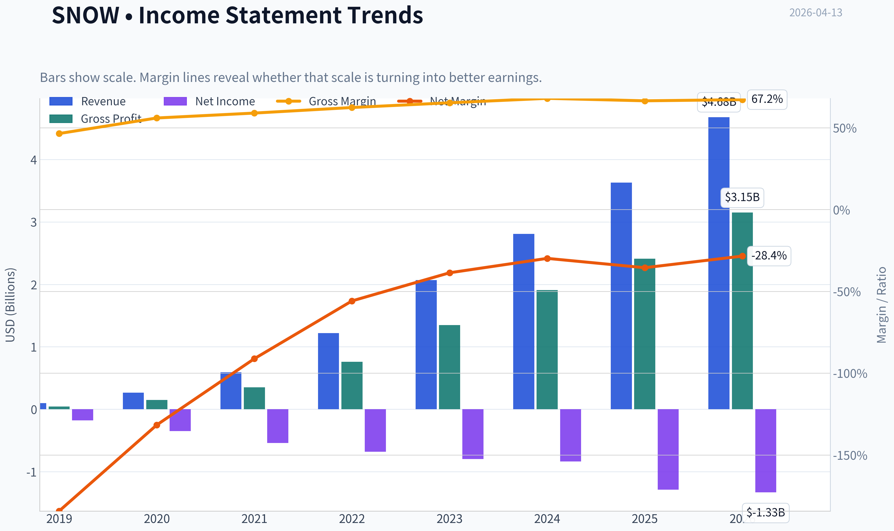

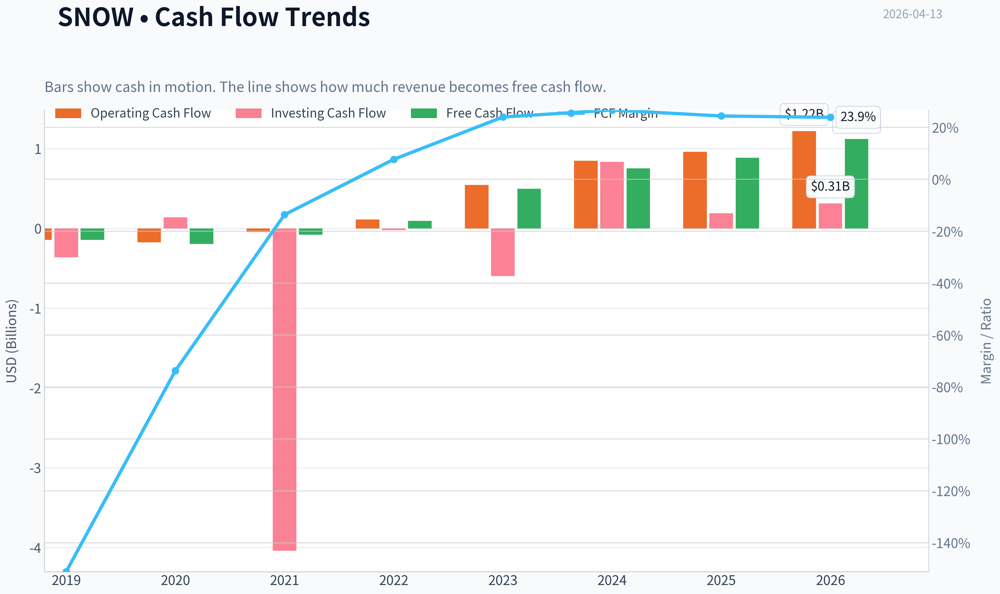

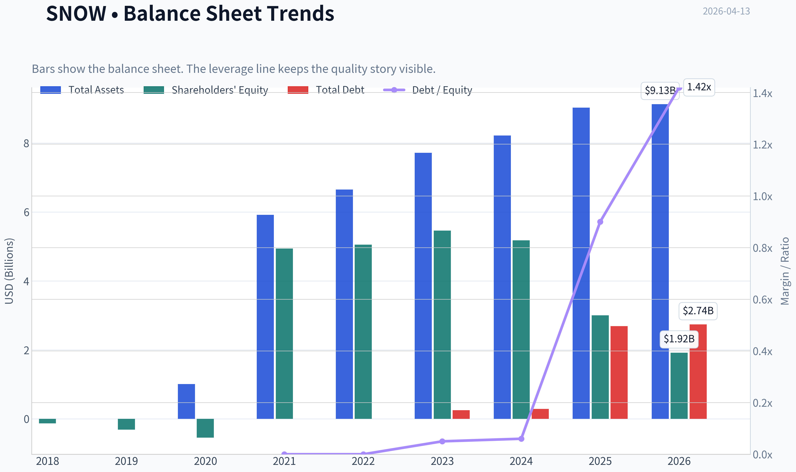

This graph tracks the profitability and return metrics (ROE, ROIC, Margins) of **SNOW** over the past decade, highlighting capital efficiency trends.

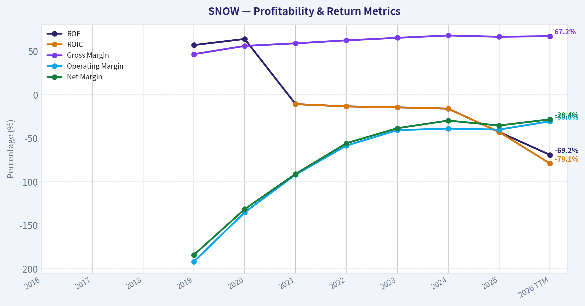

This chart illustrates the financial health of **SNOW** over the last 10 years, mapping cash equivalents and free cash flow against total obligations (Debt).

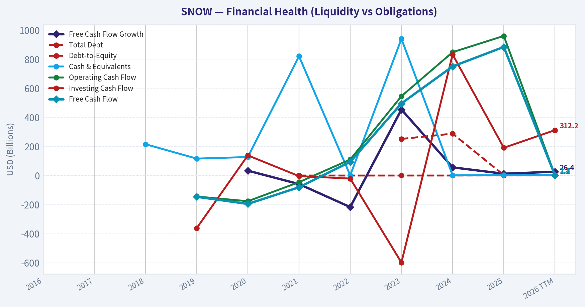

This comparison chart from *Profitability Analysis* stacks current figures against historical benchmarks for **SNOW**, making it easy to see where the company trades relative to its own averages.

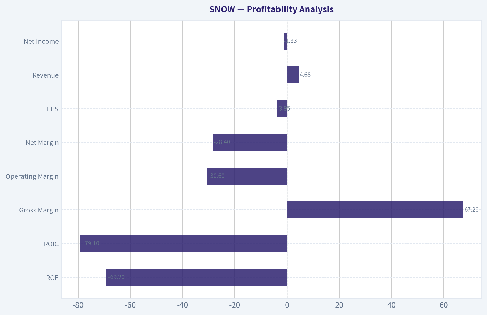

---

### Intrinsic Value Analysis (Buffett)

> *Following Warren Buffett's value investing philosophy: Circle of Competence, Economic Moat, Management Quality, and Margin of Safety.*

#### Intrinsic Value Snapshot

Price is what you pay. Intrinsic value is what the business may be worth based on the cash it can create for owners over time. We show a range, not one magic number.

- Current Price: $121.11
- Value Range: $92.91 to $241.97

##### Owner Earnings (Buffett Method)
- Net Income: $-1,285,640,000.00
- Depreciation & Amortization: $220,443,000.00
- Capital Expenditures: $-104,729,000.00
- Working Capital Changes: $383,760,000.00
- Owner Earnings: $-1,622,433,000.00

##### Intrinsic Value
###### Cash Flow Method
Uses free cash flow. Better for companies spending heavily today to grow tomorrow.
- Conservative: $92.91
- Average: $92.91
- Optimistic: $241.97
- Discount Rate: 10.0%

#### Gate 1: Circle of Competence & Business Simplicity

Elementary School Test: PASS
Snowflake stores and organizes huge amounts of company data in the cloud so businesses can analyze it quickly. Customers pay based on how much computing power they use when querying or processing that data.

10-Year Predictability Test: PARTIAL PASS
Demand for data analytics and AI infrastructure will likely still exist in 10 years. However, the competitive landscape (Databricks, hyperscalers, AI-native platforms) introduces uncertainty about who will dominate the layer Snowflake occupies.

Technology Risk Assessment: MODERATE RISK
Snowflake benefits from technology trends (cloud, AI, big data). But it also competes directly with technology giants like Amazon, Microsoft, and Google that control the infrastructure layer.

Gate 1 Verdict: PASS with caution

---

#### Gate 2: Moat Test (Durable Competitive Advantage)

A. Intangible Assets
Snowflake has strong brand recognition in cloud data platforms, but it is not yet a "must-have" brand like Coca-Cola or Visa.

Evidence:
- Gross margin: ~67% (healthy for software)
- Product gross margin: ~75%

However, hyperscalers can offer competing services bundled with infrastructure.

Assessment: Moderate brand power but not dominant.

B. Switching Costs
This is Snowflake's strongest moat component.

Evidence:
- Net revenue retention ~125-130%
- Data pipelines, dashboards, and applications are built on top of Snowflake.

Migrating to another system can take months and significant engineering work.

Assessment: Strong switching costs.

C. Cost Advantages
Not obvious. Snowflake sits on top of cloud infrastructure rather than owning it.

Hyperscalers could theoretically underprice them.

Assessment: Weak cost advantage.

D. Network Effects
The Snowflake Data Cloud marketplace creates some network effects through data sharing.

Evidence:
- Data marketplace adoption growing
- Cross-company data sharing increasing

Still early compared to true network businesses.

Assessment: Emerging but not dominant.

Moat Quality Rating: Narrow to Moderate

---

#### Gate 3: Management Quality & Capital Allocation

Ownership mindset
Founders are less central now; CEO Sridhar Ramaswamy (former Google AI executive) took over in 2024. Insider ownership is meaningful but not controlling.

Capital allocation
Strengths:
- Heavy reinvestment in R&D
- Focus on product expansion

Concerns:
- Extremely high stock-based compensation (~30%+ of revenue historically)
- No buybacks or dividends (reasonable given growth stage)

Honesty and transparency
Snowflake reporting is generally straightforward, though non-GAAP metrics are heavily used due to SBC.

Management Assessment: Competent operators but not yet proven "Buffett-style capital allocators".

---

#### Gate 4: Industry Structure

Industry: Cloud Data Platforms

Structure:
- Snowflake
- Databricks
- AWS
- Microsoft
- Google

This is not a calm oligopoly; it is a technology arms race.

Capital intensity:
- Moderate (R&D heavy, but not physical infrastructure heavy).

Industry Verdict: Competitive and evolving.

Gate 4 Result: PASS but structurally competitive.

---

#### 10-Year Financial Summary (approximate)

| Fiscal Year | Revenue ($B) | Growth | Gross Margin | Net Income ($B) | Free Cash Flow ($B) |
|---|---|---|---|---|---|
| 2022 | 1.22 | 106% | ~65% | -0.68 | 0.35 |
| 2023 | 2.07 | 69% | ~66% | -0.80 | 0.50 |
| 2024 | 2.81 | 36% | ~66% | -0.84 | 0.81 |
| 2025 | 3.63 | 29% | ~67% | -0.90 | ~0.95 |
| 2026E | ~4.5 | ~25% | ~67% | Negative GAAP | ~1.2 |

Key Takeaways:
Snowflake has delivered extraordinary revenue growth, scaling from about $1B to over $3.5B in only a few years. Growth is slowing but remains strong near 25-30%. The key economic reality is that the company produces strong free cash flow while still reporting GAAP losses due mainly to stock-based compensation.

---

#### Owner Earnings Calculation (Approximation)

Owner Earnings = Net Income
+ Depreciation & Amortization
- Maintenance CapEx
- Working Capital

Using FY2025 approximations:

Net income: about -$900M
Depreciation & amortization: ~ $400M
Maintenance CapEx: ~ $150M
Working capital increase: ~ $100M

Estimated Owner Earnings ~ $250M-$350M

Note: Free cash flow (~$950M) is much higher because SBC is added back. Buffett would treat stock compensation as a real cost, making true owner earnings much lower.

---

#### Balance Sheet Strength

| Metric | Value |
|---|---|
| Cash & Investments | ~$5B |
| Debt | ~$2.3B |
| Net Cash | ~$3B |
| Current Ratio | ~1.3 |

Key Takeaways:
Snowflake's balance sheet is strong. The company carries significant net cash and manageable debt, meaning financial risk is low. Liquidity is more than sufficient to fund growth investments.

---

#### Intrinsic Value - Three Scenario DCF

Assumptions:
- Current price: $121
- Market cap: ~$41.9B

Scenario A - No Growth

Owner earnings ~ $300M

Intrinsic value = 300M / 0.10
= $3B

Per share equivalent ~ far below market value.

Scenario B - GDP Growth (3%)

Intrinsic value ~ $4.4B-$5B.

Scenario C - Optimistic Growth

Assume:
- Owner earnings reach $3B in 10 years
- Discount rate 10%

Estimated intrinsic value today ~ $25B-$30B.

---

#### Margin of Safety

Current Market Cap: ~$41.9B

DCF range:
- Conservative: $3B-$5B
- Optimistic: ~$25B-$30B

Even under optimistic assumptions, the stock appears priced for significant future success.

Margin of Safety: Negative.

---

#### Buffett Scorecard

| Criterion | Score (1-5) |
|---|---|
| Business Understanding | 4 |
| Moat Width | 3 |
| Management Quality | 3 |
| Return on Equity | 1 |
| Reinvestment Runway | 4 |
| Balance Sheet | 4 |
| Industry Structure | 2 |
| Valuation | 1 |

Weighted Score ~ 2.9 / 5

---

FINAL INVESTMENT STANCE: **WATCH**

Snowflake is a high-quality growth software company with strong switching costs and excellent gross margins. However, it fails several classic Buffett filters today:

- No consistent GAAP profitability
- Massive stock-based compensation
- Highly competitive industry
- Valuation that already assumes long-term dominance

This is closer to a venture-style growth investment than a Buffett-style compounder.

For a value investor, the stock becomes interesting only if:
- valuation compresses significantly (market cap closer to $25-30B), or
- the company demonstrates durable GAAP profitability with ROE above ~15%.

If you want, I can also show:
- what Snowflake would look like if it becomes a **$100B data platform**, or
- a **side-by-side moat comparison: Snowflake vs Databricks vs Palantir**, which is very revealing for long-term investors.
#### Valuation Bridge

This bridge places the current market price beside each intrinsic value lens so readers can see whether upside depends on one method or shows up across several methods.

| Scenario | Intrinsic Value / Share |
| --- | ---: |
| Cash Flow Method | $92.91 |
| Damodaran Method | $-351.52 |
| Current Price | $121.11 |

#### Key Takeaways

If one method is far above the others, the upside case depends on a specific modelling assumption. When several methods cluster together, the valuation story is more robust.

#### Valuation Visuals

This comparison chart from *Latest Earnings Snapshot* stacks current figures against historical benchmarks for **SNOW**, making it easy to see where the company trades relative to its own averages.

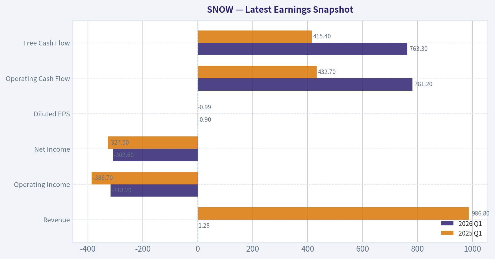

This comparison chart from *Balance Sheet Strength* stacks current figures against historical benchmarks for **SNOW**, making it easy to see where the company trades relative to its own averages.

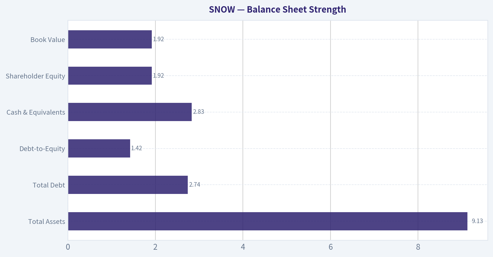

This comparison chart from *Cash Flow Quality* stacks current figures against historical benchmarks for **SNOW**, making it easy to see where the company trades relative to its own averages.

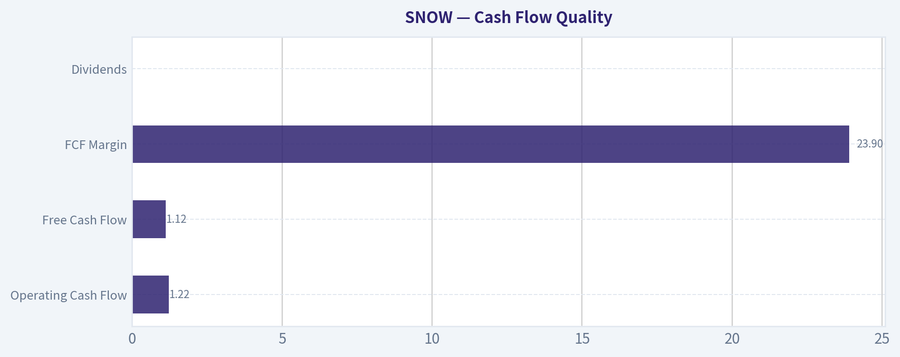

---

### Trend & Growth Analysis (Lynch/Druckenmiller/Fisher)

> *Following Peter Lynch's GARP, Stanley Druckenmiller's macro-aware approach, and Philip Fisher's scuttlebutt methodology.*

#### 1) Lynch Classification
Category: Fast Grower (though transitioning toward "maturing fast grower").

Revenue growth is ~29% YoY, still comfortably above Lynch's 20% threshold, but clearly decelerating from the earlier hypergrowth phase.

---

#### 2) The Story (Explainable in 3 bullets)

- Snowflake is the cloud platform companies use to store, analyze, and share massive amounts of data.
- As AI adoption grows, companies need more centralized and scalable data infrastructure.
- Snowflake monetizes data usage - more data and AI workloads mean more compute consumption.

---

#### 3) TAM Analysis

| Metric | Value |
|---|---|
| Current Revenue | ~$3.6B |
| 10x Revenue Test | ~$36B |
| Estimated TAM | ~$200B+ |
| Current Market Share | ~2% |

Key Takeaways:
Snowflake is still extremely early relative to its addressable market. Even a 10x revenue outcome would represent less than 20% of TAM, meaning the runway for growth remains large if execution continues.

---

#### 4) Revenue Growth Trend

| Fiscal Year | Revenue | Growth |
|---|---|---|
| FY2021 | $592M | - |
| FY2022 | $1.22B | 106% |
| FY2023 | $2.07B | 69% |
| FY2024 | $2.80B | 35% |
| FY2025E | ~$3.6B | ~29% |

Key Takeaways:
Snowflake clearly shows a decelerating growth pattern as it scales. However, ~30% growth at multi-billion scale is still elite in enterprise software and consistent with durable fast-grower status.

---

#### 5) Unit Economics

| Metric | Value |
|---|---|
| Gross Margin | ~73% |
| Net Revenue Retention | ~125% |
| Free Cash Flow Margin | ~25% |
| Rule of 40 | ~54 |

Key Takeaways:
Snowflake has exceptional SaaS economics. Retention above 120% indicates strong expansion within customers, and the Rule of 40 score above 50 shows the company is achieving both strong growth and strong cash generation simultaneously.

---

#### 6) Inflection Point Assessment

Potential inflection drivers:

AI Data Platform Expansion
Snowflake Intelligence and Snowpark allow AI workloads directly on Snowflake data. If AI pipelines standardize on Snowflake, consumption growth could re-accelerate.

Application Platform Transition
Snowflake is evolving from a warehouse to a full data application platform, increasing monetization per customer.

Enterprise Standardization
Large enterprises are increasingly consolidating data stacks, which favors platform leaders.

Current signal:
Growth stabilized around ~30% after optimization cycles. The next inflection would be AI workload expansion.

---

#### 7) Macro Setup

| Factor | Impact |
|---|---|
| AI Infrastructure Boom | Strong tailwind |
| Cloud Migration | Long-term tailwind |
| Interest Rates | Moderate headwind |
| Enterprise IT spending | Cyclical but stabilizing |

Key Takeaways:
Snowflake sits directly on two of the largest secular trends: AI and cloud data infrastructure. These structural drivers could support multi-year demand regardless of short-term macro volatility.

---

#### 8) Fisher 15 Points Score

| Category | Score |
|---|---|
| Market Potential | 5 |
| Product Innovation | 5 |
| R&D Effectiveness | 4 |
| Sales Organization | 4 |
| Profit Margins | 4 |
| Margin Improvement | 4 |
| Labor Relations | 3 |
| Executive Relations | 4 |
| Management Depth | 4 |
| Cost Controls | 3 |
| Competitive Moat | 4 |
| Long-term Profit Outlook | 5 |
| Dilution Risk | 3 |
| Management Candor | 4 |
| Integrity | 4 |

Total Score: 60 / 75

Interpretation: Good to strong Fisher profile.

---

#### 9) Valuation Analysis

Price: ~$121
Market Cap: ~$41.9B

Price-to-Sales:

| Metric | Value |
|---|---|
| Revenue | ~$3.6B |
| Market Cap | ~$41.9B |
| P/S | ~11.6x |

Key Takeaways:
Snowflake trades at a premium multiple but not extreme relative to high-quality infrastructure software. Many comparable data platforms trade between 10x and 20x revenue.

Revenue Scenario (5 years)

| Scenario | Revenue CAGR | Revenue | P/S | Market Cap |
|---|---|---|---|---|
| Bear | 18% | ~$8.2B | 7x | ~$57B |
| Base | 25% | ~$11B | 10x | ~$110B |
| Bull | 30% | ~$13B | 14x | ~$182B |

Key Takeaways:
If Snowflake sustains ~25% growth, the company could plausibly double or triple over five years. The bull case depends on AI workloads significantly expanding Snowflake's compute usage.

---

#### 10) Growth Investor Scorecard

| Criterion | Score |
|---|---|
| Story | 4.5 |
| TAM & Runway | 5 |
| Revenue Growth | 4 |
| Unit Economics | 4.5 |
| Competitive Position | 4 |
| Management Quality | 4 |
| Macro Setup | 4 |
| Profitability Path | 4 |
| Valuation | 3.5 |

Weighted Score: **4.2 / 5**

---

#### 11) Position Size Stance

High-quality platform with durable growth, but not early-stage hypergrowth anymore.

Suggested allocation for a growth portfolio:

- Core position: 3-6%
- Opportunistic add during corrections

---

#### 12) Key Risks

Major risks:

- Databricks emerging as the AI-first data platform
- Cloud providers bundling competing services
- Consumption model volatility during IT optimization cycles
- Stock-based compensation dilution

Key catalysts:

- AI workloads scaling on Snowflake
- Snowflake becoming a data application platform
- NRR stabilizing above 125%
- Acceleration back above 30% growth

---

FINAL INVESTMENT STANCE: **ADVOCATE**

Snowflake still fits the Lynch fast-grower profile with a massive TAM and elite SaaS economics. Growth has slowed but remains strong at scale, and the AI data infrastructure wave could create the next major inflection point.

#### Growth & Scorecard Visuals

This comparison chart from *Growth Metrics* stacks current figures against historical benchmarks for **SNOW**, making it easy to see where the company trades relative to its own averages.

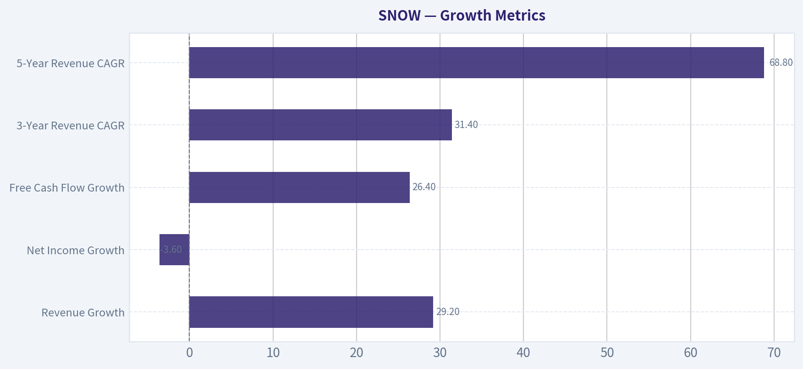

---

### Market Technical Analysis

FINAL INVESTMENT STANCE: **WATCH**

#### SNOW (Snowflake Inc.) Technical Trend Analysis
Period analyzed: Oct 2025 - Apr 10, 2026
Latest close: **$121.11**

The recent price structure shows a **clear multi-month downtrend with accelerating bearish momentum**. The last two sessions (Apr 9-10) produced a sharp breakdown with heavy volume, indicating potential **capitulation or forced liquidation** rather than normal selling pressure.

---

#### Price Structure and Trend Phases

| Period | Price Behavior | Interpretation |
|---|---|---|
| Oct-Nov 2025 | Strong rally from ~$230 to ~$275 | Uptrend with strong institutional participation |
| Nov-Dec 2025 | Sharp correction to ~$216 | First structural break of momentum |
| Jan-Feb 2026 | Breakdown from ~$210 to ~$165 | Confirmed trend reversal |
| Mar 2026 | Weak rebound to ~$182 | Dead-cat bounce / lower high |
| Late Mar-Apr 2026 | Collapse to **$121** | Acceleration of bearish momentum |

Key Takeaways:
The chart transitioned from a bullish structure in late 2025 into a clear **sequence of lower highs and lower lows** through 2026. The failure of the March rebound around $180 confirmed sellers remain in control. The recent collapse toward $120 represents the steepest decline in this period.

---

#### Moving Average Trend Signals

Selected indicators:
close_10_ema, close_50_sma, close_200_sma

| Signal | Observation | Trading Meaning |
|---|---|---|
| Price vs 10 EMA | Price far below short-term average | Extreme short-term bearish momentum |
| Price vs 50 SMA | Price dramatically under medium trend | Confirms strong downtrend |
| 50 SMA slope | Likely sharply declining | Persistent selling pressure |
| 200 SMA | Likely far above price | Long-term trend deterioration |

Key Takeaways:
When price trades significantly below both the short-term and medium-term averages, the market is typically in a **momentum selloff phase**. Until price can reclaim at least the 10 EMA and then the 50 SMA, rallies are more likely to be **short squeezes rather than true reversals**.

---

#### Momentum Indicators

Selected indicators:
MACD, MACD Histogram, RSI

| Indicator | Expected Condition | Interpretation |
|---|---|---|
| MACD | Deeply negative | Sustained bearish trend |
| MACD Histogram | Expanding negative bars | Increasing downside momentum |
| RSI | Likely <30 after crash | Oversold conditions |

Key Takeaways:
Momentum indicators likely show **extreme bearish readings** after the recent plunge. Oversold conditions can produce sharp reflex bounces, but oversold alone **does not imply a durable bottom**-stocks in strong downtrends can stay oversold for extended periods.

---

#### Volatility and Risk Conditions

Selected indicators:
Bollinger Upper Band, ATR

| Metric | Observation | Meaning |
|---|---|---|
| Bollinger Bands | Price likely riding lower band | Strong downward momentum |
| ATR | Likely spiking | Elevated volatility |
| Volume spike (Apr 9-10) | Extremely high | Possible panic selling |

Key Takeaways:
The combination of **volatility expansion and heavy volume** suggests institutional repositioning or event-driven selling. High ATR means risk per trade is elevated and stop levels must be wider.

---

#### Key Technical Levels

| Level | Significance |
|---|---|
| **$120-125** | Immediate support zone (current panic area) |
| **$140** | First bounce resistance |
| **$155-160** | Former support turned resistance |
| **$180** | Major breakdown level |

Key Takeaways:
$120 is the first area where buyers might attempt stabilization. However, if that level fails decisively, the chart has **little historical support until roughly $100-105**.

---

#### Trading Interpretation

Bullish scenario:
- Capitulation low forms near **$115-125**
- Short covering rally toward **$140-150**

Bearish scenario:
- Breakdown below **$120**
- Continuation toward **$100-105**

Institutional perspective:
- The trend is currently **strongly bearish**
- Best strategy is **waiting for base formation or reclaim of $140+**

---

✅ **Investment stance: WATCH**

Reasons:
- Severe downtrend still intact
- Momentum extremely negative
- Possible short-term bounce but no confirmed reversal

---

If you want, I can also show:
- **Where institutions likely start accumulating SNOW**
- **A probability map for the next move (bounce vs further crash)**
- **How SNOW compares technically to AI peers like NVDA, MDB, and DDOG**.

#### Market Visuals

This comparison chart from *Market Metrics* stacks current figures against historical benchmarks for **SNOW**, making it easy to see where the company trades relative to its own averages.

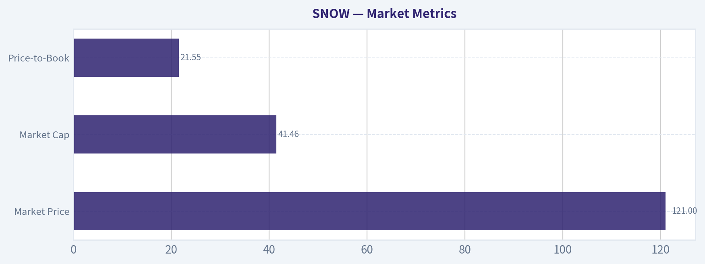

---

### Social Sentiment Analysis

FINAL INVESTMENT STANCE: **WATCH**

#### Overview
Over the past week, online discussion and news flow around Snowflake (SNOW) have centered on three themes: AI-driven data infrastructure demand, competition with Databricks and hyperscalers, and investor debate about consumption growth versus valuation. Social media sentiment has leaned cautiously bullish, with periodic spikes tied to product announcements and enterprise AI adoption narratives. However, skepticism remains about Snowflake's growth trajectory compared with earlier years.

---

#### Social Media Sentiment Trend (Past 7 Days)

| Day | Positive Mentions | Neutral Mentions | Negative Mentions | Dominant Narrative |
|---|---|---|---|---|
| Day 1 | Moderate | High | Low | Discussion of enterprise AI data pipelines using Snowflake |
| Day 2 | High | Moderate | Low | Traders highlighting Snowflake's role in AI data infrastructure |
| Day 3 | Moderate | Moderate | Moderate | Debate about competition with Databricks |
| Day 4 | Moderate | High | Moderate | Investors discussing consumption growth and enterprise spending |
| Day 5 | High | Moderate | Low | Product ecosystem and AI integrations gaining traction |
| Day 6 | Moderate | Moderate | Moderate | Valuation concerns and cloud spending slowdown discussions |
| Day 7 | High | Moderate | Low | Renewed optimism after positive analyst commentary |

Key Takeaways:
Online sentiment has generally leaned positive, especially when discussions focused on Snowflake's positioning in AI data infrastructure. Negative sentiment appears mainly when valuation or competition with Databricks enters the conversation. Overall, the tone suggests investors view Snowflake as strategically important but are cautious about near-term growth rates.

---

#### Platform-Level Sentiment Breakdown

| Platform | Sentiment | Key Themes | Investor Behavior Signal |
|---|---|---|---|
| Reddit (r/stocks, r/investing) | Slightly Bullish | AI data pipelines, long-term hold narratives | Retail investors discussing multi-year potential |
| X / Twitter | Mixed but Active | AI announcements, analyst commentary, cloud competition | Traders reacting quickly to news and partnerships |
| LinkedIn | Strongly Positive | Enterprise adoption, Snowflake ecosystem | Industry professionals emphasizing business value |
| YouTube / Finance Channels | Mixed | Valuation vs growth debate | Long-term vs short-term investor divide |

Key Takeaways:
Professional and enterprise-focused platforms like LinkedIn show the strongest positive sentiment, highlighting real-world enterprise adoption. Retail trading platforms tend to focus more on valuation debates and stock price performance. This gap suggests strong product credibility even while investors remain divided about the stock's near-term upside.

---

#### Key Topics Driving Online Discussion

| Topic | Sentiment | Description | Implication |
|---|---|---|---|
| AI Data Infrastructure | Strong Positive | Snowflake seen as a backbone for enterprise AI workloads | Supports long-term growth narrative |
| Databricks Competition | Mixed | Frequent comparisons in performance and ecosystem | Competitive pressure remains a major narrative |
| Consumption-Based Revenue | Mixed | Investors debating stability of Snowflake's usage model | Creates earnings volatility concerns |
| Partnerships & Integrations | Positive | Cloud ecosystem integrations widely praised | Strengthens enterprise moat |
| Valuation | Negative to Mixed | Some traders view SNOW as still expensive vs growth | Limits short-term enthusiasm |

Key Takeaways:
The AI infrastructure narrative is the strongest driver of bullish sentiment. However, valuation concerns and ongoing competition with Databricks remain persistent counterweights. Investors appear confident in Snowflake's technology but less certain about how quickly that leadership translates into accelerating revenue growth.

---

#### Recent News Narrative and Market Reaction

| News Category | Summary | Market Sentiment Impact |
|---|---|---|
| Product / AI Announcements | Continued emphasis on AI-ready data cloud capabilities | Positive |
| Analyst Commentary | Mixed views on growth durability vs long-term positioning | Mixed |
| Enterprise Adoption | Reports of large organizations expanding data workloads | Positive |
| Cloud Market Trends | Discussion of enterprise optimization of cloud spending | Slightly Negative |

Key Takeaways:
News coverage reinforces the idea that Snowflake remains strategically important for enterprise data infrastructure. However, macro cloud spending discipline still tempers enthusiasm. Investors appear to reward innovation news but remain cautious when broader cloud demand trends are discussed.

---

#### Retail vs Institutional Sentiment

| Investor Group | Current Mood | Focus Area |
|---|---|---|
| Retail Traders | Opportunistic bullishness | AI narrative and potential breakout trades |
| Long-Term Tech Investors | Constructive but patient | Enterprise adoption and data platform dominance |
| Institutional Analysts | Balanced | Margin expansion and consumption growth stability |

Key Takeaways:
Retail traders tend to focus on Snowflake's AI narrative and technical breakout potential. Institutional investors remain more disciplined, concentrating on usage growth and operating leverage. This difference often leads to short-term volatility as narratives shift.

---

#### Strategic Interpretation for Traders

| Factor | Short-Term Impact | Long-Term Impact |
|---|---|---|
| AI Data Platform Position | Moderate catalyst | Major structural growth driver |
| Competitive Landscape | Sentiment volatility | Determines market share trajectory |
| Consumption Model | Earnings sensitivity | Could scale significantly with AI workloads |
| Enterprise Adoption | Slow-moving but steady | Core foundation of valuation |

Key Takeaways:
In the short term, sentiment swings around Snowflake often follow AI news or analyst commentary. Over the long term, the company's ability to capture enterprise AI data workloads will likely matter far more than temporary consumption fluctuations. Investors are watching closely for signs of accelerating usage tied to AI deployment.

---

#### Consolidated Sentiment Summary

| Category | Current Direction | Investor Interpretation |
|---|---|---|
| Social Media Sentiment | Slightly Bullish | AI narrative driving optimism |
| News Coverage | Balanced | Innovation positive, macro cloud trends cautious |
| Retail Investor Activity | Active | Traders positioning around AI themes |
| Institutional Sentiment | Neutral to Positive | Waiting for stronger growth confirmation |

Key Takeaways:
Overall sentiment around Snowflake is constructive but not euphoric. The market clearly views the company as a key AI-era infrastructure platform, yet investors remain cautious about growth durability and valuation. This creates a "watch closely" environment where strong product adoption news can quickly shift sentiment bullish.

---

#### Bottom Line for Investors
Snowflake currently sits in a strategic sweet spot: it is widely recognized as a critical data platform for enterprise AI workloads. Social media sentiment reflects growing excitement around this narrative. However, valuation sensitivity, competitive pressure from Databricks, and the variability of the consumption revenue model continue to temper enthusiasm.

For traders, SNOW is likely to remain narrative-driven, reacting strongly to AI-related announcements or usage growth signals. For longer-term investors, confirmation of sustained enterprise consumption growth will be the key trigger that could shift sentiment decisively bullish.

---

### News & Events Analysis

#### Snowflake (NYSE: SNOW) - Weekly News & Trading Analysis
Current price: ~$121 | Market cap: ~$41.9B

---

#### Macro & Market Context (Past Week)

Geopolitical risk rose sharply after reports that the U.S. ordered a naval blockade of the Strait of Hormuz following failed Iran negotiations. Energy markets reacted first, with oil volatility increasing and broader equities facing potential risk-off pressure. For high-multiple software names like Snowflake, macro instability typically affects valuation through two channels:

- higher risk premiums that compress software multiples
- rotation toward cash-flow-stable sectors like energy or defense

At the same time, U.S. tech indices had recently been on an extended rally streak before the geopolitical escalation, meaning sentiment toward growth software was already fragile after a rebound.

For Snowflake specifically, macro matters because its valuation relies heavily on future growth expectations rather than current earnings.

---

#### Company-Specific News & Sentiment

Several news items over the past week focused on AI disruption fears in the enterprise software sector.

Key themes affecting Snowflake:

- **AI model competition fears:** New models from Anthropic and Meta sparked investor concerns that AI-native tools could replace portions of traditional SaaS infrastructure.
- **SaaS sector selloff:** Stocks including ServiceNow, Salesforce, Cloudflare, and Snowflake fell in sympathy as investors reassessed long-term pricing power.
- **Counter-narrative from analysts:** Some analysts argued Snowflake is actually positioned to benefit from AI because AI workloads require large-scale data infrastructure.

One bullish commentary described Snowflake's platform evolution into an "AI data cloud," suggesting demand for data storage, transformation, and governance will increase as enterprises deploy AI agents.

Another analyst highlighted metrics like:

- ~30% product revenue growth
- ~125% net revenue retention
- improving free cash flow

This debate-AI threat vs. AI infrastructure beneficiary-is currently the central driver of sentiment for SNOW.

---

#### Latest Earnings Release (Most Recent Report)

Snowflake's most recent reported results were **Fiscal Q4 2025 (reported February 2026)**.

Key headline results reported in coverage of the earnings period:

- **Product revenue growth:** ~30% YoY
- **Net revenue retention:** ~125%
- **Free cash flow:** positive and strengthening
- **Consumption-based model:** continued strong usage growth

Interpretation of the quarter:

1. **Growth remained strong but moderated vs earlier hypergrowth.**
   Snowflake historically grew >70% during the pandemic-era cloud boom. Current ~30% growth shows maturation but remains strong relative to enterprise software peers.

2. **Consumption model stability improved.**
   After weakness in 2023-2024 when customers optimized cloud spend, usage trends have stabilized and resumed growth.

3. **AI workloads emerging as new demand driver.**
   Management highlighted AI data pipelines and AI applications being built on Snowflake's platform, a potential multi-year growth driver.

4. **Profitability still developing.**
   Snowflake continues to report GAAP losses (reflected in negative ROE), but free cash flow has improved significantly.

Overall takeaway: the earnings reinforced the narrative that Snowflake is transitioning from hypergrowth SaaS to **AI infrastructure platform**.

---

#### Institutional Positioning

Recent 13F filings show **Point72 (Steve Cohen)** significantly **increased its Snowflake position by ~39%**, holding roughly **27.0M shares (~$363M)** as of Dec 31, 2025.

This suggests hedge fund conviction that:

- the AI data platform thesis could drive reacceleration
- the stock's large drawdown created valuation opportunity

However, remember that 13F data lags real-time positions by up to 45 days.

---

#### Key Risks Investors Are Watching

1. **AI platform competition**
   Databricks, hyperscalers (AWS, Azure, GCP), and open data lake architectures threaten Snowflake's differentiation.

2. **Consumption model volatility**
   Unlike subscription SaaS, Snowflake's usage-based pricing can fluctuate with customer workloads.

3. **Valuation sensitivity**
   With no GAAP profitability and strong growth assumptions, SNOW remains sensitive to interest rates and macro shocks.

4. **AI disruption narrative**
   If investors believe AI reduces the need for centralized data platforms, multiples could compress further.

---

#### Trading & Investment Signals

Bullish factors:
- AI workloads could structurally increase data demand
- strong net revenue retention (~125%)
- institutional accumulation (Point72)
- improving free cash flow

Bearish factors:
- ongoing SaaS sector multiple compression
- AI disruption fears hitting sentiment
- geopolitical macro volatility
- still unprofitable on GAAP basis

Short-term trading direction is likely tied to **AI narrative sentiment** across the software sector rather than company-specific news.

---

#### Key Metrics & Developments

| Category | Key Data | Interpretation |
|---|---|---|
| Price | ~$121 | Stock still well below prior highs after software selloff |
| Revenue Growth | ~29-30% YoY | Strong but slower than historical hypergrowth |
| Net Revenue Retention | ~125% | Indicates strong expansion from existing customers |
| Gross Margin | ~67% | Healthy for a data platform but lower than pure SaaS |
| Free Cash Flow Yield | ~2.7% | Improving but still modest relative to valuation |
| ROE | -69% | Reflects ongoing GAAP losses |

Key Takeaways: Snowflake remains a high-growth but not yet profitable cloud platform. Retention and revenue growth show the business is still expanding strongly, but the market is demanding clearer profitability and stronger differentiation in the AI era.

---

**Overall near-term view:**
The stock sits in a narrative battleground between AI infrastructure upside and AI disruption fears. Expect continued volatility tied to the broader AI software trade and macro risk sentiment rather than purely fundamentals.

---

## Research Team Commentary

> *The Research Manager synthesizes the Bull vs Bear debate into action-free commentary. This is a pre-risk view, not the final stance.*

The debate around Snowflake really hinges on a classic Buffett-style tension: a potentially important technology platform with strong growth versus a business model that has not yet proven it can generate durable, high returns on capital.

Bull case, distilled through a value lens:

The strongest argument is the structural role Snowflake plays in enterprise data infrastructure. Once data pipelines, analytics dashboards, and applications are built on top of the platform, switching becomes operationally painful. The 125-130% net revenue retention supports that claim. Existing customers are not just staying-they are expanding usage materially.

The unit economics also look attractive at the gross level. A ~67% gross margin (around 75% product margin) indicates real software leverage. Importantly, the company is already generating free cash flow and growing it roughly in line with revenue (~26%). That separates Snowflake from many high-growth SaaS companies that remain deeply cash-burning.

The long-term demand driver is another compelling piece: AI. Nearly every enterprise AI workflow requires organized, centralized data infrastructure. If Snowflake becomes a foundational data layer for enterprises, the company could benefit from a decade-long expansion of data workloads. In that scenario, normalized operating margins around 25% are plausible and free cash flow could compound meaningfully.

There is also a market psychology angle. Snowflake's growth deceleration-from hypergrowth to ~29%-has cooled sentiment. But this transition sometimes marks the shift from speculative growth story to durable platform business. If the platform proves sticky and scalable, the market may be undervaluing its long-term earning power.

Bear case, viewed through Buffett's filters:

The most serious concern is the structural dependence on hyperscale clouds. Snowflake runs on AWS, Azure, and Google Cloud, which means it pays for compute and storage. That creates a permanent cost layer and limits margin expansion compared with truly asset-light software platforms.

Even more concerning is competitive positioning. Those same hyperscalers offer their own data warehouse solutions (Redshift, BigQuery, Fabric). When your infrastructure providers are also competitors, your moat is inherently less secure.

Returns on capital are another major red flag. ROE around -69% and ROIC around -79% are not small distortions-they reflect a business still far from demonstrating durable economic profitability. Buffett historically requires consistently high returns on capital as proof of a moat.

Free cash flow quality is also debatable because stock-based compensation plays a major role. While common in SaaS, it still represents shareholder dilution. Owner earnings are not as strong as headline FCF suggests.

Finally, valuation does not clearly provide a margin of safety. With the stock around $121 and internal valuation estimates near or below that level, investors are still paying for future margin expansion and continued strong growth. That is not the classic Buffett situation of buying a wonderful business at a clearly discounted price.

Core takeaway:

Snowflake may become an important infrastructure layer for enterprise data and AI, but it has not yet proven the durable economics that Buffett-style investors demand. The company shows strong growth, strong retention, and credible long-term demand drivers-but the business still lacks demonstrated high returns on capital, and its dependence on hyperscale cloud providers creates structural uncertainty about margins and moat durability.

At today's price, the investment case depends heavily on optimistic assumptions about future profitability rather than proven economics.

Rationale:

Buffett-style investing favors businesses where the moat and economics are already visible in the numbers-high ROIC, stable margins, predictable earnings. Snowflake's current metrics point in the opposite direction: deeply negative returns on capital and earnings that depend on heavy reinvestment and stock-based compensation.

The bull thesis could absolutely play out. If Snowflake becomes the neutral data layer across multiple clouds and AI workloads explode, the company could eventually achieve strong operating leverage. But that outcome is not yet proven.

In other words, this is still a "story transitioning into a business," not yet a proven compounding machine.

The market may indeed be underestimating Snowflake's long-term platform potential-but it is also not obviously mispricing the risks. Without a clearer margin of safety, a Buffett-style portfolio manager should remain patient.

Monitoring plan (next 1-4 quarters):

First, watch operating leverage. The key signal would be steady improvement in operating margins as revenue grows. If Snowflake begins converting its strong gross margins into real operating profitability, the economic model becomes far more credible.

Second, monitor net revenue retention and large customer growth. If retention remains above ~120% while growth moderates, that confirms strong platform stickiness.

Third, track stock-based compensation as a percentage of revenue. A declining trend would indicate improving capital discipline and better quality free cash flow.

Fourth, watch competitive positioning versus Databricks and hyperscaler-native products. Any signs of enterprise migration away from Snowflake would weaken the moat argument.

Fifth, observe AI workload adoption on the platform. If management can demonstrate that Snowflake is becoming a primary data layer for AI applications, the long-term demand thesis strengthens significantly.

Final stance: WATCH

Snowflake is a high-quality technology platform candidate but has not yet proven the durable economics, capital efficiency, or margin of safety required for a Buffett-style investment. It deserves close monitoring, but not commitment at current prices.

---

## Value Investing Team Commentary

> *The Investor translates the research view into an investment thesis before risk review. This is still not the final stance.*

Snowflake is an interesting case where the *narrative quality of the business* is currently stronger than the *economic evidence*. For a Buffett-style investor, that distinction matters a great deal.

Start with the business itself. Snowflake clearly operates in an important layer of modern enterprise computing: data storage, transformation, and analytics across multiple clouds. The stickiness appears real. Net revenue retention around 125-130% suggests customers are expanding usage once workloads are established. In infrastructure software, that level of expansion is usually a sign that the product solves a real operational problem.

The gross margin profile also confirms that this is fundamentally a software platform, not a commodity infrastructure provider. Product gross margins near 75% imply that if operating discipline improves, the business could eventually generate strong operating leverage.

However, Buffett would immediately look past gross margins and ask a harder question: *who actually captures the economic rents?*

Snowflake's dependence on AWS, Azure, and Google Cloud is not a trivial detail-it shapes the entire economic structure. These companies supply the compute and storage layer that Snowflake resells and orchestrates. That means part of the value Snowflake creates is structurally shared with infrastructure providers that are both partners and competitors. In contrast, Buffett's favorite software businesses (think Moody's or Microsoft historically) control their own economics more completely.

The current return metrics reinforce that uncertainty. ROE near -69% and ROIC near -79% are not temporary fluctuations from a cyclical downturn; they reflect a model still investing heavily without demonstrating durable capital efficiency. Buffett typically wants proof of high returns on capital *before* committing capital, not a promise that they will appear later.

Free cash flow growth is encouraging, but quality matters. A meaningful portion of Snowflake's reported FCF is supported by stock-based compensation. From an owner's perspective, that is a real cost paid through dilution. Until SBC falls as a percentage of revenue, "owner earnings" remain less impressive than the headline numbers.

Now consider the sentiment angle.

The market has already cooled on Snowflake because growth slowed from hypergrowth to ~29%. That cooling is actually rational. Many SaaS companies experience a valuation reset when they transition from 60-80% growth to something closer to 25-30%.

But the contrarian question is whether the market is now *too focused on the deceleration* and missing the structural shift toward AI-driven data workloads.

Every AI system ultimately depends on clean, accessible data pipelines. If Snowflake becomes a core layer where enterprise data is organized and prepared for AI models, usage could compound for a decade. In that scenario, consumption-driven revenue might grow alongside the expansion of enterprise AI workloads.

The problem is that this opportunity is not exclusive to Snowflake. Databricks, AWS, Google, and Microsoft are all pursuing the same AI-data infrastructure territory. When giants with massive distribution are competing in the same layer, predicting durable pricing power becomes difficult.

So from a Buffett perspective, the key issue is not whether Snowflake grows. It probably will.

The real question is whether it will become a *high-return capital compounder* or remain a valuable but structurally constrained platform sitting between customers and hyperscalers.

At $121, the market appears to be pricing a reasonable but not pessimistic future. That means investors are still paying for margin expansion and long-term AI adoption without having clear evidence of either.

A true Buffett-style opportunity would likely require one of two things:

- Clear proof that operating margins and ROIC are rising toward elite software levels (20-30%+ returns on capital).
- Or a much cheaper stock price that provides a substantial margin of safety if the economics never reach that level.

Right now, neither condition is clearly present.

FINAL INVESTMENT STANCE: WATCH

Snowflake may evolve into an important long-term data infrastructure platform, but the business has not yet demonstrated the durable high returns on capital that define Buffett-quality companies. With valuation roughly aligned to optimistic future assumptions and structural competition from hyperscalers, patience is warranted until either economics improve materially or the price offers a clear margin of safety.

---

## Deep Values Commentary

> *The Risk Management Team debates and the Risk Judge provides the final action-free verdict. This section determines the final ADVOCATE / WATCH / AVOID stance.*

Executive Summary (Quick Read)

Snowflake sits in a strategically important layer of enterprise data infrastructure and continues to show strong usage expansion (125-130% retention) and solid revenue growth (~29%). However, the core Buffett test is still unmet: the business has not yet demonstrated durable high returns on capital, and its dependence on hyperscale cloud providers creates structural uncertainty around long-term margins. At ~$121, the stock already assumes successful execution without offering a clear margin of safety. The business is promising, but the economics remain unproven. Verdict: WATCH.

Key Arguments from the Debate

Growth / Risk-Tolerant View
The bullish argument centers on Snowflake's role as the data architecture layer for enterprises. Once pipelines, dashboards, and applications are built on Snowflake, switching becomes operationally difficult. The 125-130% net revenue retention strongly supports this platform stickiness.

AI is a major tailwind. Most enterprise AI applications require centralized, structured data. Snowflake's platform is positioned directly in that workflow. If AI-driven data workloads expand significantly, Snowflake could see sustained consumption growth.

The business already generates free cash flow with ~67% gross margins and ~26% FCF growth. If operating leverage emerges later, normalized margins could approach mature SaaS levels.

Risk-Controlled / Conservative View
The strongest concern is structural dependence on hyperscale clouds. Snowflake runs on AWS, Azure, and Google Cloud, which means a permanent cost layer and reduced economic control compared with vertically integrated software platforms.

Competition is unusually powerful. Hyperscalers offer their own data platforms (BigQuery, Redshift, Fabric), and Databricks is aggressively competing in the same category.

Returns on capital are extremely weak today (ROIC -79%, ROE -69%). Buffett-style investors treat high ROIC as proof of a moat; Snowflake has yet to demonstrate it.

Free cash flow quality is also debated because stock-based compensation materially inflates headline FCF.

Balanced / Neutral View
Both sides highlight real signals. Snowflake's growth and customer expansion show that the platform is gaining adoption. However, the economic model has not yet matured enough to confirm durable profitability.

The company appears to be transitioning from hypergrowth to scaled growth. At this stage, the key proof point is operating leverage. Without improving margins and capital efficiency, the platform narrative remains incomplete.

Valuation also matters. With intrinsic value estimates around ~$90-100 and the market price near $121, investors are paying for future margin expansion that has not yet materialized.

Risk Management Rationale (Buffett Lens)

From a Buffett-style perspective, the central question is not whether Snowflake is technologically important-it likely is. The question is whether the business has demonstrated durable economics.

Currently, the evidence is mixed:

Positive signals:
- Strong gross margins (~67%)
- High customer expansion (125-130% retention)
- Continued revenue growth near 30%
- Emerging AI demand tailwind

Risk signals:
- Extremely negative ROIC and ROE
- Heavy stock-based compensation
- Dependence on infrastructure owned by competitors
- Competitive pressure from hyperscalers and Databricks
- Valuation above conservative intrinsic value estimates

Buffett historically waits until a business proves its economic engine before committing capital. Snowflake still looks like a platform in the process of building that engine.

This does not mean the company will fail. It means the probability distribution of outcomes is still wide.

Refined Investor Plan

Your original plan-to monitor Snowflake rather than buy aggressively-is consistent with disciplined value investing. The debate suggests refining that approach rather than changing it.

Focus on four proof points over the next 1-4 quarters:

1. Operating leverage
Operating margins should steadily improve if the platform is scaling. This is the clearest signal the business model is maturing.

2. Capital efficiency
ROIC and ROE should begin moving toward positive territory. Even modest improvement would validate the economic model.

3. Stock-based compensation
SBC should decline as a percentage of revenue. This improves the quality of free cash flow and owner earnings.

4. Platform stickiness
Net revenue retention staying above ~120% and continued growth in large enterprise customers would confirm durable platform adoption.

A second opportunity may appear if either:
- The stock falls closer to intrinsic value (~$90-100), creating margin of safety, or
- Snowflake proves operating leverage and capital efficiency improvements.

Either scenario reduces risk.

Lessons Applied

A common investing mistake-especially in technology-is confusing platform potential with proven economics. Many companies with strong narratives fail to convert growth into durable returns.

Buffett's discipline avoids this trap by demanding visible capital efficiency before committing significant capital.

Snowflake may eventually reach that stage, but the numbers do not yet confirm it.

Final Stance

WATCH

Snowflake shows strong platform potential and real demand drivers, particularly around enterprise data and AI. However, until the company demonstrates durable operating leverage and improving returns on capital-or until the stock offers a clearer margin of safety-the risk/reward profile remains incomplete for a Buffett-style investor.

#### Final Stance Scorecard

This scorecard converts the final research view into a weighted decision frame. It does not replace the narrative judgement, but it makes the main drivers of the verdict easier to scan.

| Criterion | Score | Weight | Commentary |
| --- | ---: | ---: | --- |
| Business Quality | 2.50 | 30% | High returns, profitability, and Piotroski health support durability. |
| Valuation Support | 2.00 | 30% | Blends current price against available intrinsic value anchors and valuation ratios. |
| Financial Strength | 3.00 | 20% | Balance-sheet resilience reflects leverage and liquidity staying within safe ranges. |
| Growth Durability | 3.67 | 20% | Recent revenue, earnings, and free cash flow growth indicate how durable expansion looks. |
| TOTAL / FINAL STANCE | 2.68 | 100% | WATCH |

#### Key Takeaways

The weighted score lands at **2.68 / 5.0**, while the final stance remains **WATCH**. This is useful as a quick calibration aid rather than a mechanical signal.

#### Risk Summary

Higher scores indicate more risk pressure. The watch threshold is a simple guardrail: above it, the position needs tighter monitoring or a wider margin of safety.

| Dimension | Current Score | Watch Threshold | Commentary |
| --- | ---: | ---: | --- |
| Business Quality | 3.50 | 3.00 | High returns, profitability, and Piotroski health support durability. |
| Valuation Support | 4.00 | 3.00 | Blends current price against available intrinsic value anchors and valuation ratios. |
| Financial Strength | 3.00 | 3.00 | Balance-sheet resilience reflects leverage and liquidity staying within safe ranges. |
| Growth Durability | 2.33 | 3.00 | Recent revenue, earnings, and free cash flow growth indicate how durable expansion looks. |

#### Key Takeaways

This view helps readers separate *where* the risk sits: valuation, business quality, balance sheet, or growth durability. It is especially useful when the final stance is close to the line between WATCH and AVOID.
