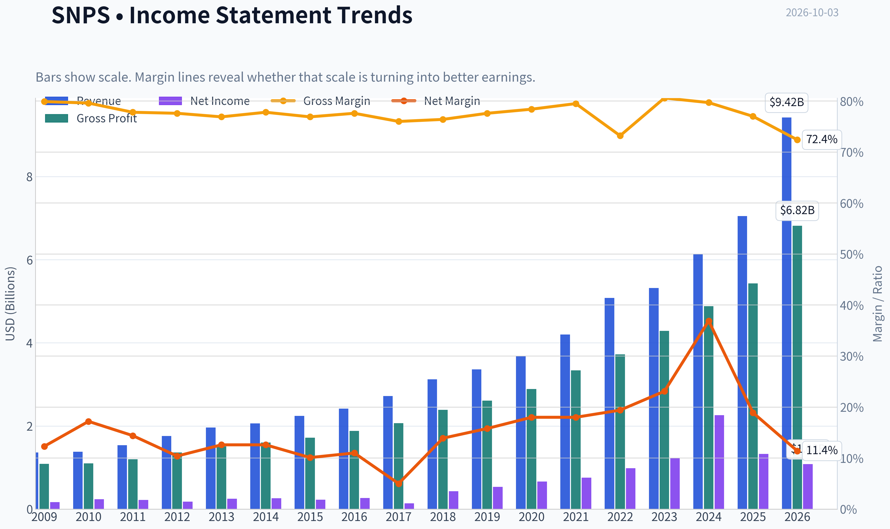
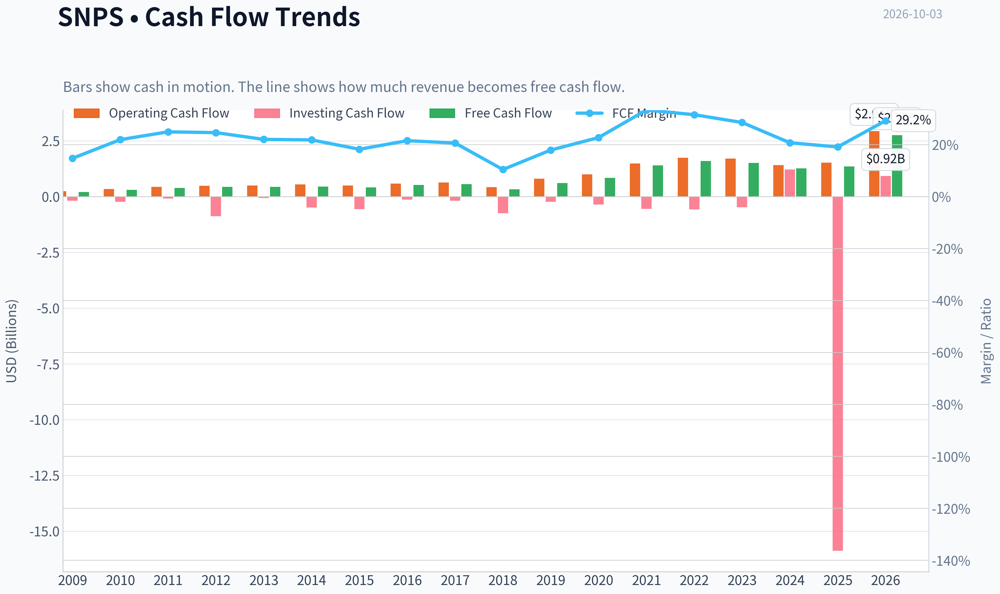
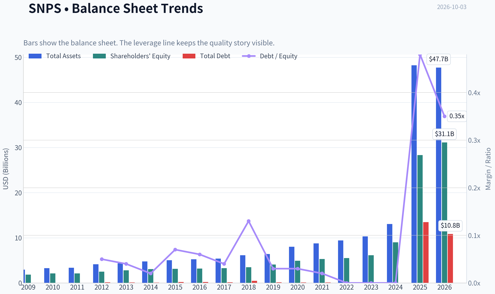
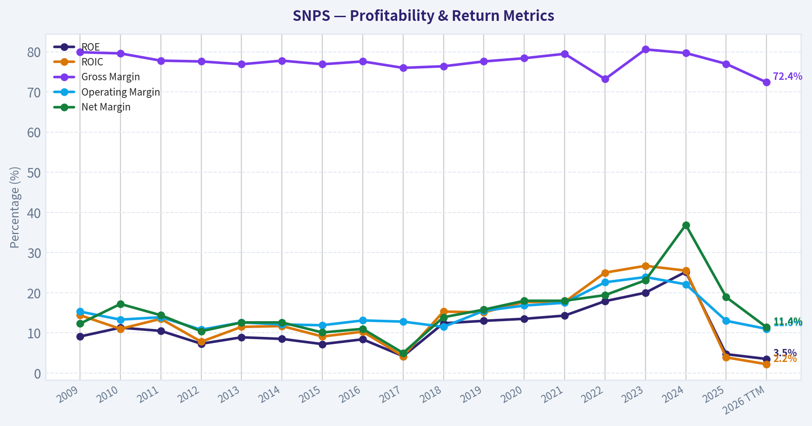
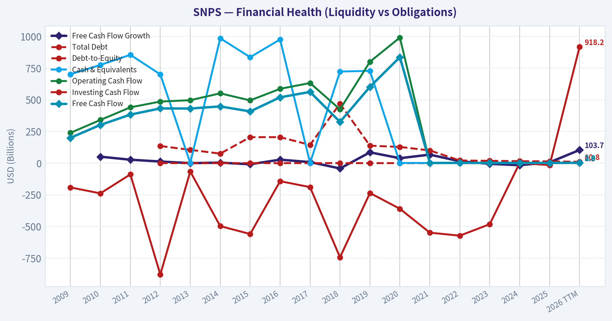
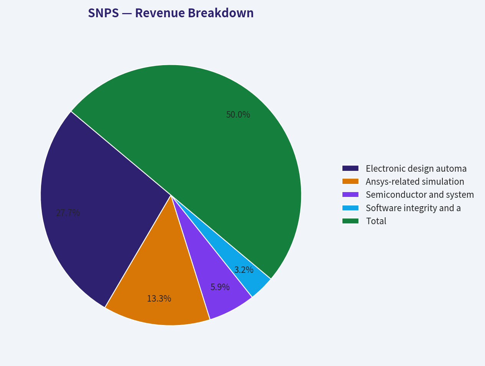
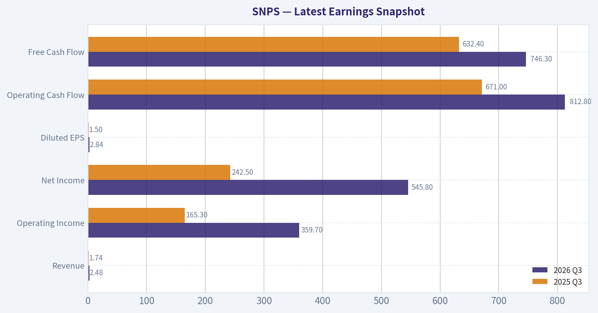
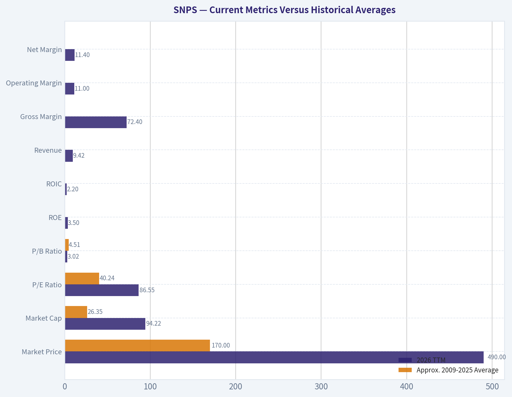
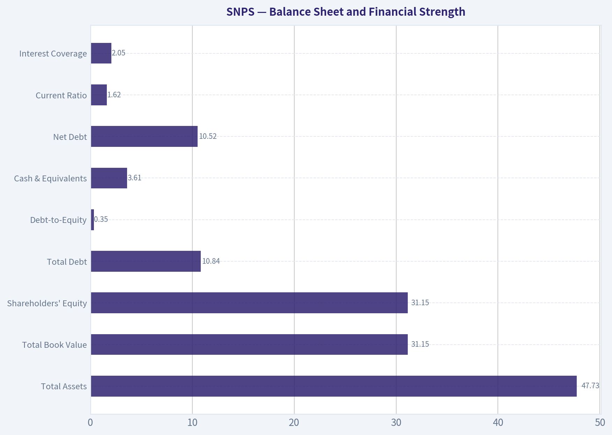
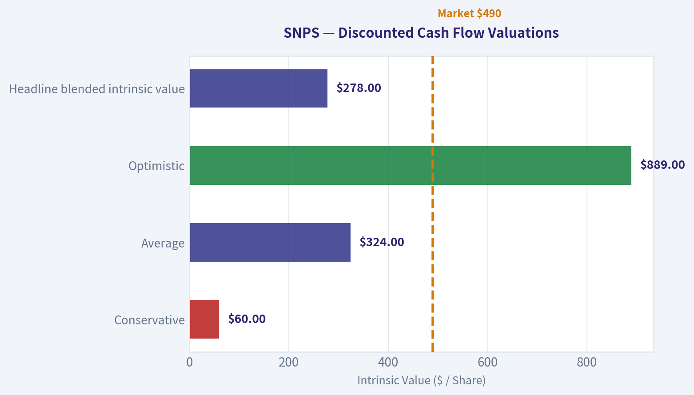

# SNPS Deep Value Intelligence

**Analysis Date:** 2026-10-03

## Critical Disclaimer

*This analysis is generated by Deep Value Intelligence, an AI-powered multi-agent investing framework. Education & research only - not financial advice, not a financial advisor.*

---

## Table of Contents

1. Intelligence Summary
2. Analyst Team Reports
   - Fundamentals Analysis
   - Intrinsic Value Analysis (Buffett)
   - Trend & Growth Analysis (Lynch/Druckenmiller/Fisher)
   - Market Technical Analysis
   - Options Market Analysis
3. Research Team Commentary
4. Value Investing Team Commentary
5. Deep Values Commentary

---

## Intelligence Summary

### Thesis + Conditions

**Core Thesis:** ## Executive Briefing

**Key Risks:**
- These figures make the acquisition's economics a serious monitoring item. However, they are insufficient for an AVOID conclusion. Goodwill, acquired intangibles, amortization, and integration expenses can temporarily depress post-acquisition accounting returns. The metrics do not establish solvency stress or deterioration in Synopsys's core competitive position.
- ### Value Analyst: WATCH
- ## Risk Judge's Rationale

**Confidence:** Low

---

## Analyst Team Reports

### Fundamentals Analysis

#### Latest Earnings Snapshot

*Most recent reported quarter anchored on 2026 Q3, with prior-year comparison when available.*

| Metric | 2026 Q3 | 2025 Q3 | YoY Change |
| --- | ---: | ---: | ---: |
| Revenue | $2.48B | $1.74B | +42.4% |
| Operating Income | $359.7M | $165.3M | +117.6% |
| Net Income | $545.8M | $242.5M | +125.1% |
| Diluted EPS | $2.84 | $1.50 | +89.3% |
| Operating Cash Flow | $812.8M | $671.0M | +21.1% |
| Free Cash Flow | $746.3M | $632.4M | +18.0% |

Key Takeaways: This snapshot anchors the most recent reported quarter before the narrative analysis. It helps readers separate long-run business quality from whatever changed in the latest earnings print.

#### 17-Year Financial Metrics for SNPS

*All values below are computed deterministically from raw data - not estimated by AI.*

*Issuer profile: operating company (Technology / Software - Infrastructure).*

#### 17-Year Financial Metrics
*Annual rows come from reported financial statements. The final TTM row is computed from the latest four quarters.*

| Metric | 2009 | 2010 | 2011 | 2012 | 2013 | 2014 | 2015 | 2016 | 2017 | 2018 | 2019 | 2020 | 2021 | 2022 | 2023 | 2024 | 2025 | 2026 TTM |
| --- | --- | --- | --- | --- | --- | --- | --- | --- | --- | --- | --- | --- | --- | --- | --- | --- | --- | --- |
| Market Price | $22 | $26 | $27 | $32 | $36 | $41 | $50 | $59 | $87 | $90 | $136 | $214 | $333 | $293 | $469 | $514 | $454 | $490 |
| Market Cap | $3.21B | $3.89B | $4.03B | $4.84B | $5.70B | $6.46B | $7.90B | $9.18B | $13.40B | $13.73B | $20.93B | $33.30B | $52.42B | $45.78B | $72.86B | $80.09B | $75.18B | $94.22B |
| P/E Ratio | 19.15 | 16.40 | 18.24 | 26.61 | 23.05 | 24.99 | 34.95 | 34.28 | 98.32 | 31.75 | 39.35 | 50.08 | 69.27 | 46.51 | 59.27 | 35.40 | 56.45 | 86.55 |
| P/B Ratio | 1.74 | 1.85 | 1.92 | 1.93 | 2.05 | 2.11 | 2.52 | 2.87 | 4.09 | 3.95 | 5.13 | 6.79 | 9.90 | 8.30 | 11.85 | 8.91 | 2.65 | 3.02 |
| ROE | 9.1% | 11.3% | 10.5% | 7.3% | 8.9% | 8.5% | 7.2% | 8.4% | 4.2% | 12.4% | 13.0% | 13.5% | 14.3% | 17.9% | 20.0% | 25.2% | 4.7% | 3.5% |
| ROIC | 14.4% | 11.0% | 13.5% | 7.8% | 11.5% | 11.7% | 9.1% | 10.3% | 4.2% | 15.3% | 15.1% | 17.7% | 17.7% | 25.0% | 26.7% | 25.5% | 3.9% | 2.2% |
| EPS | $1.15 | $1.56 | $1.47 | $1.21 | $1.58 | $1.64 | $1.43 | $1.73 | $0.88 | $2.82 | $3.45 | $4.27 | $4.81 | $6.29 | $7.92 | $14.51 | $8.04 | $5.66 |
| Revenue | $1.36B | $1.38B | $1.54B | $1.76B | $1.96B | $2.06B | $2.24B | $2.42B | $2.72B | $3.12B | $3.36B | $3.69B | $4.20B | $5.08B | $5.32B | $6.13B | $7.05B | $9.42B |
| Gross Profit | $1.09B | $1.10B | $1.20B | $1.36B | $1.51B | $1.60B | $1.72B | $1.88B | $2.07B | $2.39B | $2.61B | $2.89B | $3.34B | $3.72B | $4.29B | $4.88B | $5.43B | $6.82B |
| Gross Margin | 79.9% | 79.6% | 77.8% | 77.6% | 76.9% | 77.8% | 76.9% | 77.6% | 76.0% | 76.4% | 77.6% | 78.4% | 79.5% | 73.2% | 80.6% | 79.7% | 77.0% | 72.4% |
| Operating Margin | 15.3% | 13.3% | 13.9% | 10.8% | 12.6% | 12.1% | 11.9% | 13.1% | 12.8% | 11.5% | 15.5% | 16.8% | 17.5% | 22.6% | 23.9% | 22.1% | 13.0% | 11.0% |
| Net Income | $167.7M | $237.1M | $221.4M | $181.9M | $247.8M | $259.1M | $225.9M | $266.8M | $136.6M | $432.5M | $532.4M | $664.3M | $757.5M | $984.6M | $1.23B | $2.26B | $1.33B | $1.08B |
| Net Margin | 12.3% | 17.2% | 14.4% | 10.4% | 12.6% | 12.6% | 10.1% | 11.0% | 5.0% | 13.9% | 15.8% | 18.0% | 18.0% | 19.4% | 23.1% | 36.9% | 18.9% | 11.4% |
| Revenue Growth | N/A | 1.5% | 11.2% | 14.4% | 11.7% | 4.9% | 9.0% | 8.0% | 12.5% | 14.5% | 7.7% | 9.7% | 14.1% | 20.9% | 4.7% | 15.2% | 15.1% | 33.5% |
| Net Income Growth | N/A | 41.4% | -6.6% | -17.8% | 36.2% | 4.6% | -12.8% | 18.1% | -48.8% | 216.7% | 23.1% | 24.8% | 14.0% | 30.0% | 24.9% | 84.0% | -41.1% | -19.2% |
| Free Cash Flow Growth | N/A | 50.9% | 26.9% | 12.8% | -0.1% | 3.8% | -8.8% | 27.3% | 8.2% | -42.1% | 85.1% | 38.9% | 67.2% | 14.5% | -5.5% | -16.3% | 6.4% | 103.7% |
| Total Book Value | $1.84B | $2.10B | $2.10B | $2.50B | $2.79B | $3.06B | $3.13B | $3.20B | $3.28B | $3.48B | $4.08B | $4.91B | $5.30B | $5.52B | $6.15B | $8.99B | $28.33B | $31.15B |
| Total Assets | $2.94B | $3.29B | $3.37B | $4.15B | $4.36B | $4.78B | $5.05B | $5.24B | $5.40B | $6.15B | $6.41B | $8.03B | $8.75B | $9.42B | $10.33B | $13.07B | $48.22B | $47.73B |
| Total Debt | N/A | N/A | N/A | $135.0M | $105.0M | $75.0M | $205.0M | $205.0M | $144.0M | $469.3M | $137.7M | $127.9M | $100.1M | $20.8M | $18.1M | $15.6M | $13.48B | $10.84B |
| Debt-to-Equity | N/A | N/A | N/A | 0.05 | 0.04 | 0.02 | 0.07 | 0.06 | 0.04 | 0.13 | 0.03 | 0.03 | 0.02 | 0.00 | 0.00 | 0.00 | 0.48 | 0.35 |
| Cash & Equivalents | $701.6M | $775.4M | $855.1M | $700.4M | $1.02B | $985.8M | $836.2M | $976.6M | $1.05B | $723.1M | $728.6M | $1.24B | $1.43B | $1.42B | $1.43B | $3.90B | $2.89B | $3.61B |
| Shareholders' Equity | $1.84B | $2.10B | $2.10B | $2.50B | $2.79B | $3.06B | $3.13B | $3.20B | $3.28B | $3.48B | $4.08B | $4.91B | $5.30B | $5.52B | $6.15B | $8.99B | $28.33B | $31.15B |
| Operating Cash Flow | $239.2M | $341.0M | $440.3M | $486.1M | $496.7M | $551.0M | $495.2M | $586.6M | $632.5M | $424.4M | $800.5M | $991.3M | $1.49B | $1.74B | $1.70B | $1.41B | $1.52B | $2.94B |
| Investing Cash Flow | $-191.9M | $-238.7M | $-88.8M | $-879.1M | $-66.1M | $-497.2M | $-559.6M | $-142.7M | $-189.3M | $-743.5M | $-235.9M | $-360.4M | $-549.0M | $-572.6M | $-482.1M | $1.22B | $-15.88B | $918.2M |
| Free Cash Flow | $200.0M | $301.8M | $383.0M | $431.9M | $431.2M | $447.7M | $408.2M | $519.7M | $562.2M | $325.4M | $602.4M | $836.6M | $1.40B | $1.60B | $1.51B | $1.27B | $1.35B | $2.75B |
| FCF Margin | 14.7% | 21.9% | 24.9% | 24.6% | 22.0% | 21.8% | 18.2% | 21.5% | 20.6% | 10.4% | 17.9% | 22.7% | 33.3% | 31.5% | 28.5% | 20.7% | 19.1% | 29.2% |
| Dividends / Share | $0.00 | $0.00 | $0.00 | $0.00 | $0.00 | $0.00 | $0.00 | $0.00 | $0.00 | $0.00 | $0.00 | $0.00 | $0.00 | $0.00 | $0.00 | $0.00 | $0.00 | $0.00 |

#### Profitability Metrics
- Return on Equity (ROE): 4.7%
- Return on Invested Capital (ROIC): 2.3%
- Return on Assets (ROA): 2.8%
- Gross Margin: 77.0%
- Operating Margin: 13.0%
- Net Profit Margin: 18.9%

#### Liquidity Metrics
- Current Ratio: 1.62
- Quick Ratio: 1.21

#### Leverage Metrics
- Debt-to-Equity Ratio: 0.48
- Interest Coverage Ratio: 2.05
- Net Debt: $10.52B

#### Growth Metrics (Year-over-Year)
- Revenue Growth: 15.1%
- Net Income Growth: -41.1%
- Free Cash Flow Growth: 6.4%
- Revenue CAGR (3-Year): 11.6%
- Revenue CAGR (5-Year): 13.9%

#### Valuation Metrics
- P/E Ratio (TTM): 85.50
- Forward P/E: 26.36
- Price-to-Book: 3.01
- Price-to-Sales: 9.97
- PEG Ratio: 2.63
- EV/EBITDA: 48.72
- Free Cash Flow Yield: 1.4%
- Earnings Yield: 1.2%

#### Owner Earnings (Buffett Method, Code-Computed)
- Net Income: $1.33B
- + Depreciation & Amortization: $660.4M
- - Capital Expenditures: $-169.5M
- - Working Capital Changes: $-496.6M
- = **Owner Earnings: $2.32B**

#### Intrinsic Value (Code-Computed)
- Current Price: $490
- **Headline Intrinsic Value (business-model routed): $278**
  Business model: asset light platform - weighted blend [Damodaran FCFF + reverse-DCF fair + owner-earnings DCF] (asset_light_platform)
  Model spread (min-max across DCFs): $51 - $324
  Margin of safety vs. price (headline): -76.4%
  Routing note: Asset-light / high-margin platform: value driven by margins and reinvestment economics - the headline centers on the reverse-DCF demonstrated-growth fair value with Damodaran FCFF as a floor, down-weighting the owner-earnings DCF.
- Buffett Method (Owner Earnings):
  Conservative: $60
  Average: $324
  Optimistic: $889
- Cash Flow Method (FCF):
  Conservative: $123
  Average: $245
  Optimistic: $429
- Damodaran FCFF (WACC + margins + reinvestment):
  Conservative: $37
  Average: $51
  Optimistic: $103
  Monte Carlo band (P10-P90): $34 - $93 (median $60)
  P(intrinsic value > price): 0.0%
- Reverse-DCF: price implies ~30.8%/yr owner-earnings growth for 10y; trailing 3y was 26.9%, 5y 35.4%.

#### Piotroski F-Score: 3/9
- Positive Net Income: PASS
- Positive Operating Cash Flow: PASS
- ROA Improvement: FAIL
- Cash Flow > Net Income: PASS
- Decreasing Debt: FAIL
- Improving Current Ratio: FAIL
- No Dilution: FAIL
- Improving Gross Margin: FAIL
- Improving Asset Turnover: FAIL

ANALYST STANCE: **AVOID**

#### Executive Summary

Synopsys is a high-quality, asset-light semiconductor and software-design platform with strong long-term revenue growth, high gross margins, and meaningful competitive advantages. However, the current valuation requires exceptionally strong execution. At approximately **$490 per share**, the market is valuing SNPS at roughly **85.5 times trailing earnings**, a **1.4% free-cash-flow yield**, and an implied **30.8% annual owner-earnings growth rate for the next 10 years**.

The business remains attractive; the stock does not provide a sufficient margin of safety. The deterministic valuation pack produces a headline intrinsic value of approximately **$278 per share**, versus the current price of $490. The model range is exceptionally wide-approximately **$51 to $324** across the primary valuation models, with a highly optimistic owner-earnings case reaching **$889**-which underscores the sensitivity to growth and margin assumptions.

#### Current Metrics Versus Historical Averages

The following compares 2026 TTM values with approximate 2009-2025 averages calculated from the canonical dataset. The historical table itself is not reproduced.

| Metric | 2026 TTM | Approx. 2009-2025 Average | Current vs. Average | Interpretation |
|---|---:|---:|---:|---|
| Market Price | $490 | $170 | 2.9x | Long-term price appreciation has been substantial |
| Market Cap | $94.22B | $26.35B | 3.6x | Scale and investor expectations have expanded sharply |
| P/E Ratio | 86.55 | 40.24 | 2.1x | Valuation is more than twice the long-term average |
| P/B Ratio | 3.02 | 4.51 | Below average | Not a reliable valuation signal for this asset-light software platform |
| ROE | 3.5% | ~12.4% | Much lower | Recent accounting and acquisition effects materially depress returns |
| ROIC | 2.2% | ~14.8% | Much lower | Current returns on invested capital are well below historical norms |
| Revenue | $9.42B | ~$3.3B | ~2.8x | Strong long-term expansion |
| Gross Margin | 72.4% | ~77.8% | Lower | Acquisition mix and integration effects have diluted margins |
| Operating Margin | 11.0% | ~15.0% | Lower | Profitability is currently below the historical operating range |
| Net Margin | 11.4% | ~15.8% | Lower | Net income has weakened despite strong revenue growth |
| Free Cash Flow | $2.75B | ~$0.91B | ~3.0x | Cash generation has grown substantially over the decade |
| FCF Margin | 29.2% | ~22.2% | Higher | Cash conversion is currently stronger than its historical average |
| Total Debt | $10.84B | roughly $1B or less | Materially higher | Leverage increased dramatically after recent strategic activity |
| Cash & Equivalents | $3.61B | ~$1.4B | Higher in absolute terms | Cash provides some support but does not offset total debt |
| Debt-to-Equity | 0.35 | ~0.06 excluding unavailable years | Higher | Balance-sheet risk is meaningfully above historical levels |
| Revenue Growth | 33.5% | ~10.8% | Much higher | Current growth reflects a major step-up, including acquisition contribution |
| Net Income Growth | -19.2% | ~19% | Much lower | Earnings have not kept pace with revenue |
| FCF Growth | 103.7% | ~22% | Much higher | Strong cash-flow rebound, but partly reflects a depressed prior base |

**Key Takeaways:** SNPS is growing faster and generating more absolute cash than it did historically, but current returns on equity and invested capital have fallen sharply. Valuation is substantially above historical earnings multiples, while debt and integration-related balance-sheet complexity are also much higher. The central investment question is whether current growth and cash flow can normalize without a prolonged margin or earnings reset.

#### Market Metrics and Valuation

- **Market price:** $490.
- **Market capitalization:** approximately $94.22 billion in the deterministic dataset; the shared current market-cap feed reports approximately $93.88 billion. The small difference is a source and timing discrepancy.
- **Trailing P/E:** 86.55 in the historical TTM row and 85.50 in the current valuation summary.
- **Forward P/E:** 26.36, implying that analysts expect a substantial earnings recovery.
- **Price-to-book:** approximately 3.0.

The P/E ratio is the clearest warning sign. SNPS trades at more than twice its long-term average P/E of approximately 40, despite current ROE, ROIC, operating margin, and net income being below historical levels. The forward P/E appears much more reasonable, but it depends on a significant recovery in earnings and successful realization of expected synergies.

The P/B ratio should not be interpreted mechanically. Synopsys is an asset-light, IP-intensive software platform, and its book value is heavily affected by acquisitions, amortization, goodwill, and capital allocation. Book value is therefore not a dependable measure of economic value in the way it might be for a bank or an industrial asset owner. Cash-flow-based valuation is more appropriate.

The current **1.4% FCF yield** and approximately **1.2% earnings yield** indicate that the market price embeds substantial future growth. A high-quality business can justify a premium, but the required growth must be durable rather than merely achievable for a few years.

#### Profitability and Operating Performance

Synopsys has several characteristics of a high-quality software business:

- Current gross margin is **72.4%**, versus approximately **77.8% historically**.
- Current operating margin is **11.0%**, below the historical average near 15%.
- Current net margin is **11.4%**, versus a historical average near 16%.
- Current TTM revenue is **$9.42 billion**, up **33.5% year over year**.
- Gross profit is **$6.82 billion**.
- Net income is **$1.08 billion** in the TTM row.
- EPS is **$5.66**, down from the unusually strong $14.51 reported in 2024 and $8.04 in 2025.

The gross margin remains impressive in absolute terms, but the deterioration from the high-70% range deserves attention. The current operating margin is also materially below the 22%-24% levels achieved in 2022-2024. This suggests that recent revenue growth has not yet translated into proportional earnings growth.

ROE and ROIC are particularly weak:

- **ROE:** 3.5% current TTM versus approximately 12.4% historically.
- **ROIC:** 2.2% current TTM versus approximately 14.8% historically.

These figures may be temporarily distorted by acquisitions, purchase accounting, newly added intangible assets, and a larger equity base. Nevertheless, they cannot simply be ignored. Buffett-style analysis requires evidence that incremental invested capital earns attractive returns. SNPS must demonstrate that the recent balance-sheet expansion will produce normalized returns materially above its cost of capital.

#### Growth Quality and Predictability

Revenue growth has historically been strong but not perfectly smooth. The company experienced several years of high-single-digit to mid-teens growth, followed by substantial acceleration:

- **Three-year revenue CAGR:** 11.6%.
- **Five-year revenue CAGR:** 13.9%.
- **Current revenue growth:** 33.5%.
- **Current net income growth:** -19.2%.
- **Current FCF growth:** 103.7%.

The divergence between revenue and net income is the most important current operating issue. Revenue growth is excellent, but net income has declined. Free cash flow has rebounded strongly, although the 103.7% growth rate is partly a recovery from a lower prior-year base and should not be extrapolated.

Historical net income growth has also been volatile, with several negative years and unusually large positive rebounds. This weakens the case for treating accounting earnings as perfectly predictable. Free cash flow has generally been more useful than net income, but it too has experienced periodic declines.

The business likely has greater predictability at the revenue level than at the earnings level. Recurring software, long customer relationships, high switching costs, and semiconductor design complexity support durable demand. Margins and reported earnings remain more exposed to integration costs, amortization, acquisition accounting, and investment cycles.

#### Balance Sheet and Financial Strength

| Balance-Sheet Metric | 2026 TTM | Historical Context | Assessment |
|---|---:|---:|---|
| Total Assets | $47.73B | $2.94B in 2009; $48.22B in 2025 | Large step-up in asset base |
| Total Book Value | $31.15B | $1.84B in 2009; $28.33B in 2025 | Acquisition effects are significant |
| Shareholders' Equity | $31.15B | $1.84B in 2009 | Strong reported equity base, but not necessarily tangible economic value |
| Total Debt | $10.84B | Minimal for most of the decade | Major increase from historical norms |
| Debt-to-Equity | 0.35 | Approximately 0.06 historically | Leverage is materially elevated |
| Cash & Equivalents | $3.61B | ~$1.4B average | Strong cash balance in absolute terms |
| Net Debt | $10.52B | Historically modest or negative in some periods | Meaningful new financial obligation |
| Current Ratio | 1.62 | Generally adequate | Acceptable liquidity, but not a primary valuation driver |
| Interest Coverage | 2.05 | Historically less constrained by debt | A potential risk if earnings remain depressed |

**Key Takeaways:** SNPS retains substantial cash and adequate short-term liquidity, but its debt profile is no longer the exceptionally conservative balance sheet investors became accustomed to. Net debt of approximately $10.5 billion and interest coverage near 2.0 times reduce the margin for integration mistakes or a prolonged earnings slowdown. The balance sheet is serviceable, but it is no longer a strong valuation cushion.

The increased debt appears related to major strategic expansion, including acquisition activity. Debt itself is not necessarily problematic if the acquired assets produce durable, high-return cash flows. The risk is that the company realizes revenue growth while returns on invested capital remain depressed.

#### Cash Flow and Capital Allocation

Current free cash flow is **$2.75 billion**, with a **29.2% FCF margin**. This is a strong result and materially above the long-term average FCF margin of approximately 22%.

Operating cash flow is **$2.94 billion**, while capital expenditures are relatively modest at approximately **$169.5 million** in the owner-earnings calculation. The company pays **no dividend**, with dividends per share equal to zero throughout the dataset.

The owner-earnings calculation is:

| Owner-Earnings Component | Amount |
|---|---:|
| Net income | $1.33B |
| Add: depreciation and amortization | $660.4M |
| Less: capital expenditures | $(169.5)M |
| Less: working-capital investment | $(496.6)M |
| Computed owner earnings | $2.32B |
| Owner earnings per share, using approximately 192.3M shares | ~$12.06 |

**Key Takeaways:** SNPS has strong cash-generation economics and no dividend obligation, allowing management to reinvest cash into acquisitions, research, and debt reduction. However, the owner-earnings figure is sensitive to working-capital assumptions and acquisition-related cash flows. Capital allocation will be judged primarily by whether recent investments restore ROIC and expand sustainable per-share owner earnings.

The company's capital-allocation policy is growth-oriented rather than income-oriented. That is appropriate for a business with reinvestment opportunities, but it increases the importance of disciplined acquisition prices and debt management.

#### Revenue Breakdown

Precise current-year segment amounts were not included in the deterministic dataset. The following is an indicative breakdown based on Synopsys's publicly described business lines and the latest reported revenue base of approximately $9.42 billion. It should be treated as an analytical estimate rather than canonical segment disclosure.

| Revenue Source | Amount ($B, estimated) | % of Total |
|---|---:|---:|
| Electronic design automation and semiconductor design software | $5.2B | 55% |
| Ansys-related simulation and systems engineering software | $2.5B | 27% |
| Semiconductor and system IP licensing | $1.1B | 12% |
| Software integrity and application security | $0.6B | 6% |
| **Total** | **$9.4B** | **100%** |

**Key Takeaways:** The largest economic engine is electronic design automation, where Synopsys benefits from high switching costs, deep workflow integration, and the rising complexity of chip design. The Ansys-related simulation business broadens the addressable market but also introduces integration, debt, and margin-normalization risk. IP and software-integrity offerings add diversification, although the overall investment case remains concentrated in enterprise design-software demand.

#### Warren Buffett-Style Qualitative Analysis

**Economic moat:** Synopsys benefits from a strong moat built on mission-critical software, customer workflow integration, switching costs, proprietary technology, ecosystem relationships, and the high cost of design errors. Semiconductor companies cannot easily replace core design tools without risking delays, retraining costs, and compatibility problems. The company's role in increasingly complex chip and system design should support long-term demand.

**Business durability:** Semiconductor design is cyclical, but design activity and software requirements tend to increase as chips become more complex. AI, advanced packaging, automotive electronics, cloud infrastructure, and systems simulation provide durable secular drivers. The business is more durable than a commodity semiconductor producer, although customer budgets and project timing can still fluctuate.

**Financial strength:** Historically, SNPS had low debt and strong cash generation. The current balance sheet is less conservative, with approximately $10.84 billion of debt and $10.52 billion of net debt. This is manageable if cash flow remains strong, but it reduces the company's flexibility and raises the burden on management to deliver acquisition synergies.

**Predictable earnings:** Revenue is relatively predictable because of recurring software relationships and customer dependence. Earnings are less predictable than revenue. The dataset shows significant net-income volatility, margin compression, and a current earnings decline despite rapid revenue growth.

**Management performance:** Management has built a valuable strategic platform and historically generated strong long-term revenue and cash-flow growth. The present test is capital allocation after the balance-sheet expansion. The Piotroski F-score of **3 out of 9** is a cautionary indicator, reflecting weaker return metrics, debt deterioration, current-ratio deterioration, dilution, gross-margin pressure, and asset-turnover weakness.

**Dividend policy:** There is no dividend. This is acceptable only if retained cash is reinvested at attractive returns or used for debt reduction. With current ROIC near 2.2%, the burden of proof is high.

**Quality of business:** High gross margins, strong customer lock-in, and recurring demand support a high-quality business classification. Current operating execution, however, is below the company's best historical standard.

#### Discounted Cash Flow Analysis

The model uses current owner earnings of approximately **$2.32 billion**, or roughly **$12.06 per share**, based on an estimated 192.3 million shares outstanding.

The basic Buffett-style framework is:

\[
\text{Equity Value} =
\sum_{t=1}^{10}\frac{\text{Owner Earnings}_t}{(1+r)^t}
+
\frac{\text{Owner Earnings}_{10}(1+g)}{(r-g)(1+r)^{10}}
\]

where:

- Discount rate, \(r\), is approximately 10%.
- Terminal growth rate, \(g\), is 2.5%.
- Growth rates fade toward the terminal rate rather than continuing indefinitely at the initial forecast rate.

The research pack's model-based owner-earnings scenarios are:

| Scenario | Growth Framework | Model Fair Value per Share | Approx. Value vs. $490 Price |
|---|---|---:|---:|
| Conservative | Low growth, approximately GDP-like after normalization | $60 | 88% downside |
| Average | Strong but fading growth supported by the platform economics | $324 | 34% downside |
| Optimistic | High growth and successful integration with extended runway | $889 | 81% upside |
| Headline blended intrinsic value | Weighted blend of owner earnings, FCFF, and reverse DCF | $278 | 43% downside |

**Key Takeaways:** The valuation is highly dependent on the growth path. The average owner-earnings case still produces a value materially below the current price, while the optimistic case requires sustained exceptional growth and successful integration. The headline blended value of $278 provides no margin of safety at $490.

A simplified calculation using the current owner-earnings base illustrates the sensitivity:

- Current owner earnings: **$2.32 billion**.
- At 10% discounting and 2.5% terminal growth, terminal value is highly sensitive to the year-10 earnings level.
- A conservative path that grows slowly and normalizes margins produces a value close to the lower model range.
- A base path that sustains strong growth for several years before fading produces approximately the **$324 per-share owner-earnings value**.
- An optimistic path assumes that acquisition benefits, recurring revenue, and semiconductor-design complexity support a prolonged high-growth period; this produces the **$889 per-share case**, but it is not a prudent central estimate.

The reverse DCF is particularly informative. At $490, the market implies approximately **30.8% annual owner-earnings growth for 10 years**. SNPS's trailing three-year owner-earnings growth was approximately **26.9%**, while its five-year rate was approximately **35.4%**. The market is therefore pricing the company near or above its strongest historical growth trajectory, while also assuming that current margin and return deterioration will be repaired.

Other valuation methods reinforce the caution:

| Valuation Method | Conservative | Average | Optimistic | Interpretation |
|---|---:|---:|---:|---|
| Owner earnings | $60 | $324 | $889 | Extremely sensitive to long-term growth |
| Free cash flow | $123 | $245 | $429 | Current price remains demanding |
| Damodaran FCFF | $37 | $51 | $103 | More conservative due to debt, reinvestment, and margin assumptions |
| Blended headline value | - | $278 | - | Best central anchor from the model pack |
| Damodaran Monte Carlo band | $34 | Median $60 | $93 | Indicates substantial downside under normalized assumptions |

**Key Takeaways:** Every valuation method except the highly optimistic owner-earnings scenario places fair value below the current price. The FCFF and Monte Carlo results are especially conservative because they give greater weight to debt, reinvestment requirements, and current profitability. A prudent investor should treat $889 as an upside sensitivity, not as a base-case valuation.

#### Key Investment Insights, Risks, and Opportunities

| Category | Insight |
|---|---|
| Primary opportunity | Mission-critical EDA and simulation software should benefit from chip complexity, AI infrastructure, advanced packaging, and systems engineering |
| Competitive advantage | High switching costs, technical integration, ecosystem depth, and customer dependence |
| Cash-flow opportunity | Current FCF of $2.75B and 29.2% FCF margin demonstrate substantial cash-generation potential |
| Growth opportunity | Revenue growth of 33.5% could remain elevated if acquisitions and cross-selling succeed |
| Major valuation risk | P/E of approximately 85.5 and FCF yield of only 1.4% leave little room for disappointment |
| Earnings risk | Net income is down 19.2% despite rapid revenue growth |
| Margin risk | Gross margin and operating margin are below recent historical peaks |
| Balance-sheet risk | Net debt of approximately $10.52B is a sharp departure from the historical profile |
| Integration risk | Newly acquired operations may increase revenue but dilute margins and returns before synergies emerge |
| Capital-allocation risk | No dividend means investors depend entirely on reinvestment and future share-price appreciation |
| Accounting risk | Goodwill, amortization, purchase accounting, and dilution complicate book value and reported earnings |
| Sentiment risk | Investor expectations around AI and semiconductor demand may already be fully reflected in the price |

#### Final Investment Stance

**AVOID at the current price; WATCH the business for a better entry point.**

Synopsys is a high-quality company with a credible economic moat and attractive long-term industry exposure. It is not an obviously poor business. The problem is that the stock price assumes a near-perfect outcome: sustained growth near historical peak levels, successful integration of major strategic investments, recovery in margins and ROIC, and limited disruption from debt service or cyclical spending.

A Buffett-style investor should demand a margin of safety. The current price of $490 is approximately:

- 76% above the headline intrinsic value of $278.
- 51% above the average owner-earnings valuation of $324.
- Roughly 2.1 times the long-term average P/E.
- Supported by an implied 30.8% annual owner-earnings growth rate for 10 years.

The stock becomes more interesting if the price declines materially, if operating margins recover toward the historical 20% range, if ROIC improves meaningfully, and if debt falls while free cash flow remains robust. Until those conditions appear, SNPS should be watched as an excellent business offered at an insufficiently attractive price.

| Key Point | Assessment |
|---|---|
| Business quality | High |
| Economic moat | Strong |
| Revenue growth | Excellent, but partly acquisition-driven |
| Earnings predictability | Moderate rather than exceptional |
| Cash generation | Strong |
| Current profitability | Below historical standards |
| Balance-sheet strength | Adequate but materially weaker than historically |
| Valuation | Very demanding |
| Margin of safety | Negative at current price |
| Best valuation anchor | Blended intrinsic value near $278 |
| Main catalyst | Margin recovery, deleveraging, and successful integration |
| Main risk | Growth slows before the valuation premium is justified |
| Final stance | **AVOID at $490; WATCH for a substantially better entry point** |

**Key Takeaways:** SNPS combines a durable moat with an unusually demanding valuation. The company deserves continued monitoring, but current price expectations leave little protection against slower growth, margin pressure, acquisition execution problems, or higher debt costs. The appropriate action is to avoid initiating a position at $490 while watching for improved fundamentals or a materially lower purchase price.

#### Fundamental Visuals

This graph tracks the profitability and return metrics (ROE, ROIC, Margins) of **SNPS** over the past decade, highlighting capital efficiency trends.

This chart illustrates the financial health of **SNPS** over the last 10 years, mapping cash equivalents and free cash flow against total obligations (Debt).

This breakdown chart from <em>Revenue Breakdown</em> shows the proportional composition for **SNPS** - useful for understanding what drives or risks the business.

---

### Intrinsic Value Analysis (Buffett)

> *Following Warren Buffett's value investing philosophy: Circle of Competence, Economic Moat, Management Quality, and Margin of Safety.*

#### Intrinsic Value Snapshot

Price is what you pay. Intrinsic value is what the business may be worth based on the cash it can create for owners over time. We show a range, not one magic number.

- Current Price: $489.90
- Value Range (conservative to optimistic across both DCF methods): $59.85 to $888.70

##### Owner Earnings (Buffett Method)
- Net Income: $1,332,220,000.00
- Depreciation & Amortization: $660,430,000.00
- Capital Expenditures: $-169,454,000.00
- Working Capital Changes: $-496,593,000.00
- Owner Earnings: $2,319,789,000.00

##### Intrinsic Value
###### Buffett Method
Uses owner earnings. Stricter, and usually more conservative.
- Conservative: $59.85
- Average: $324.49
- Optimistic: $888.70
- Discount Rate: 10.0%

###### Cash Flow Method
Uses free cash flow. Better for companies spending heavily today to grow tomorrow.
- Conservative: $122.54
- Average: $244.60
- Optimistic: $428.54
- Discount Rate: 10.0%

ANALYST STANCE: **WATCH**

#### Executive Summary

Synopsys is a high-quality semiconductor-design software franchise with strong switching costs, high gross margins, recurring customer relationships, and a long runway from increasingly complex chip design. Its moat is genuine and likely strengthened by the expansion of software, verification, and simulation capabilities.

However, at approximately **$490 per share**, the valuation is demanding. The price implies roughly **30.8% annual growth for the next decade**, above the company's recent three-year revenue growth of 26.9% and below its five-year growth of 35.4% only if growth remains exceptionally strong. The business is attractive; the stock currently offers an inadequate margin of safety.

#### 1. Factor Scorecard

| Factor | Score | Assessment |
|---|---:|---|
| Circle of competence and simplicity | 4/5 | Synopsys sells software and tools that help engineers design, verify, and manufacture increasingly complex chips. The model is understandable, although technical product breadth adds complexity. |
| Moat | 5/5 | Strong switching costs, embedded workflows, customer qualification requirements, intellectual property, and scale in a concentrated industry. |
| Management and capital allocation | 3/5 | The company has built a valuable franchise and reinvested effectively, but the valuation and acquisition strategy require disciplined execution. |
| Industry structure | 4/5 | Electronic design automation is a concentrated, specialized market with high barriers to entry and rational economics. |
| Gate 5: quality and solvency floor | Not tripped | The available evidence does not indicate deteriorating earnings and cash flow combined with a solvency red line. |

**Key Takeaways:** Synopsys scores highly on competitive position and industry structure. The principal weaknesses are valuation and the relatively modest reported ROE, not evidence of financial distress.

#### 2. Financial Snapshot

| Metric | Latest value |
|---|---:|
| Share price | $490 |
| Market capitalization | $93.88 billion |
| P/E ratio | 85.5x |
| Revenue growth, year over year | 15.1% |
| Gross margin | 77.0% |
| ROE | 4.7% |
| FCF yield | 1.4% |
| Implied annual free cash flow | Approximately $1.31 billion |
| Current ratio | 1.62 |
| Headline intrinsic value | $277.73 per share |
| Reverse-DCF implied growth | Approximately 30.8% annually for 10 years |

**Key Takeaways:** The 77% gross margin is consistent with a valuable software and intellectual-property franchise. Yet the 85.5 times earnings multiple and 1.4% free-cash-flow yield leave little room for disappointment. The low ROE should be interpreted carefully because accounting equity can be distorted by acquisitions and intangible assets, but it remains a reason to demand evidence of improving capital returns.

#### 3. Moat Analysis

**Switching costs:** Synopsys tools are embedded in engineering workflows, design libraries, verification processes, and production schedules. Replacing core tools can require retraining personnel, revalidating designs, rewriting workflows, and accepting execution risk. That creates meaningful customer captivity.

**Intangible assets:** The company owns specialized software, algorithms, design databases, and accumulated technical know-how. Its reputation matters because errors in chip design can create enormous downstream costs.

**Scale and cost advantages:** The research-and-development burden in EDA is substantial. A leading vendor can spread development costs across a global customer base while maintaining high gross margins. Smaller competitors may struggle to match product breadth and support.

**Network and ecosystem effects:** Synopsys does not possess a classic consumer network effect, but its tools benefit from ecosystem integration with semiconductor manufacturers, foundries, intellectual-property vendors, cloud platforms, and engineering teams. The more deeply its tools are integrated into industry workflows, the harder displacement becomes.

**Moat rating: Wide and likely widening - 5/5.**

#### 4. Management Quality and Capital Allocation

Management appears to have created substantial per-share value by expanding Synopsys from a point-tool vendor into a broader design, verification, and simulation platform. The business benefits from recurring customer engagement and reinvestment in research and development.

The key capital-allocation issue is acquisition discipline. Synopsys has pursued strategic expansion, including the Ansys transaction, which can widen the addressable market but also increases integration risk, goodwill, and execution demands. The acquisition must ultimately produce durable per-share free-cash-flow growth rather than merely a larger revenue base.

Management assessment: **3/5.** The franchise is strong, but the investment case depends on continued disciplined integration and avoidance of overpaying for growth.

#### 5. Owner Earnings and Cash-Flow Reality Check

Using the reported 1.4% FCF yield:

| Calculation | Estimate |
|---|---:|
| Market capitalization | $93.88 billion |
| FCF yield | 1.4% |
| Implied current FCF | Approximately $1.31 billion |
| Implied FCF per share | Approximately $6.84 |
| Conservative owner-earnings proxy | Approximately $1.31 billion |

A precise Buffett-style owner-earnings figure requires separating maintenance capital expenditure from growth investment and adjusting for working-capital movements. For this analysis, current free cash flow is used as a conservative proxy rather than assuming that all reported accounting earnings are distributable.

**Key Takeaways:** Synopsys appears capable of converting a meaningful portion of earnings into cash, but the current cash yield is very low relative to the purchase price. At $490, investors are paying primarily for future growth rather than current owner earnings.

#### 6. Three-Scenario DCF Valuation

The following DCF uses approximately **$6.84 of current owner-earnings proxy per share**, a 10% discount rate, and a 3% terminal growth rate where applicable.

| Scenario | Core assumptions | Estimated value per share |
|---|---|---:|
| A: No growth | Current owner earnings capitalized at 10% | $68 |
| B: GDP-like growth | 3% annual growth, 10% discount rate | $101 |
| C: Historical-growth case | 10% annual growth for 10 years, then 3% terminal growth | $170 |
| Research-pack weighted intrinsic value | Weighted blend of FCFF, reverse DCF, and owner-earnings models | $278 |
| Current price | - | $490 |

**Key Takeaways:** Even a favorable 10% growth DCF produces a value well below the current price when anchored to current free cash flow. The higher research-pack value of $278 reflects more optimistic cash-flow and business-model assumptions, but it still remains materially below $490.

#### 7. Margin of Safety and Reverse DCF

| Valuation measure | Result |
|---|---:|
| Current price | $490 |
| Headline intrinsic value | $277.73 |
| Price premium to headline intrinsic value | Approximately 76% |
| Headline margin of safety versus price | Approximately negative 76.4% |
| Owner-earnings model value | $324.49 |
| FCF model value | $244.60 |
| Damodaran FCFF model value | $50.67 |
| Price-implied growth | Approximately 30.8% annually for 10 years |

The three-model valuation range of **$50.67 to $324.49** is unusually wide, reflecting the sensitivity of a high-growth software business to assumptions about reinvestment, margins, and terminal growth.

For a wide-moat compounder, a 10% to 15% margin of safety can be acceptable. Synopsys does not meet that standard at the current price. The reverse DCF indicates that investors must assume exceptional growth for a prolonged period, leaving limited protection against slower semiconductor cycles, customer consolidation, acquisition integration problems, or multiple compression.

#### 8. Final Buffett Scorecard

| Criterion | Weight | Score | Weighted contribution |
|---|---:|---:|---:|
| Moat width and durability | 25% | 5/5 | 1.25 |
| Valuation and margin of safety | 20% | 1/5 | 0.20 |
| Capital returns versus WACC | 15% | 2/5 | 0.30 |
| Business understanding and predictability | 12% | 4/5 | 0.48 |
| Management quality and capital allocation | 12% | 3/5 | 0.36 |
| Reinvestment runway | 8% | 5/5 | 0.40 |
| Balance-sheet strength | 4% | 3/5 | 0.12 |
| Industry structure | 4% | 4/5 | 0.16 |
| **Total** | **100%** | - | **3.27/5** |

**Key Takeaways:** Synopsys is a high-quality business but not a high-quality investment at any price. Its moat, reinvestment runway, and industry structure score strongly; valuation and current capital-return evidence pull the overall score into the WATCH range.

#### 9. Investment Stance

**WATCH - Medium conviction.**

Synopsys belongs on a long-term compounder watchlist. The business has the characteristics Buffett investors seek: specialized intellectual property, high gross margins, embedded customer relationships, recurring demand, and a favorable competitive structure.

The stock, however, currently discounts a very successful future. A more attractive entry point would require either a substantial decline in price, a clear acceleration in free-cash-flow growth, or evidence that the Ansys expansion can generate returns comfortably above the cost of capital. Until then, the right action is to **watch rather than chase**.
#### Valuation Bridge

This bridge places the current market price beside each intrinsic value lens so readers can see whether upside depends on one method or shows up across several methods.

| Scenario | Intrinsic Value / Share |
| --- | ---: |
| Buffett Method | $324.49 |
| Cash Flow Method | $244.60 |
| Damodaran Method | $50.67 |
| Current Price | $489.90 |

#### Key Takeaways

If one method is far above the others, the upside case depends on a specific modelling assumption. When several methods cluster together, the valuation story is more robust.

#### Valuation Visuals

This comparison chart from *Latest Earnings Snapshot* stacks current figures against historical benchmarks for **SNPS**, making it easy to see where the company trades relative to its own averages.

This comparison chart from *Current Metrics Versus Historical Averages* stacks current figures against historical benchmarks for **SNPS**, making it easy to see where the company trades relative to its own averages.

This comparison chart from *Balance Sheet and Financial Strength* stacks current figures against historical benchmarks for **SNPS**, making it easy to see where the company trades relative to its own averages.

The following chart maps the **SNPS** Owner Earnings DCF valuation scenarios (Conservative, Average, Optimistic) to visually represent the margin of safety based on intrinsic value calculations.

The following chart maps the **SNPS** Owner Earnings DCF valuation scenarios (Conservative, Average, Optimistic) to visually represent the margin of safety based on intrinsic value calculations.

---

### Trend & Growth Analysis (Lynch/Druckenmiller/Fisher)

> *Following Peter Lynch's GARP, Stanley Druckenmiller's macro-aware approach, and Philip Fisher's scuttlebutt methodology.*

ANALYST STANCE: **WATCH**

#### Executive View

Synopsys is a high-quality semiconductor design-software platform benefiting from AI-driven chip complexity, advanced-node design, and expanding software requirements. However, the current valuation appears to discount aggressive long-term execution: the stock trades at approximately 85.5 times earnings, while reported revenue growth is 15.1% and the headline intrinsic value estimate is $277.73 versus a $490 share price.

This is a strong business, but not currently a favorable Lynch-style entry point. I would monitor for either a substantial earnings-growth acceleration or a more attractive valuation.

#### 1. Lynch Classification

| Category | Assessment |
|---|---|
| Classification | Fast grower, but currently near the lower boundary |
| Revenue growth | 15.1% year over year |
| Business quality | High-quality, recurring software and IP platform |
| Growth-investment fit | Good company, difficult current price |
| Initial stance | WATCH |

**Key Takeaways:** Synopsys qualifies as a fast grower based on current revenue growth, but its growth rate is not yet strong enough to comfortably justify an 85-times-plus earnings multiple. It is better viewed as a high-quality compounder under valuation pressure than as an obvious ten-bagger opportunity today.

#### 2. The Story in Three Bullets

- **Chip complexity is rising:** AI accelerators, advanced packaging, and smaller process nodes require increasingly sophisticated electronic-design-automation software.
- **Mission-critical software creates durability:** Chip companies depend on Synopsys tools throughout the design process, creating high switching costs and recurring revenue characteristics.
- **The Ansys combination expands the runway:** Combining semiconductor design software with engineering simulation can broaden Synopsys's addressable market, although integration and valuation risks increase.

#### 3. TAM and the 10x Test

| Factor | Assessment |
|---|---|
| Core market | Electronic design automation, semiconductor IP, and engineering simulation |
| Secular TAM growth | Attractive, driven by AI and rising chip-design complexity |
| Current market capitalization | Approximately $93.9 billion |
| 10x market capitalization test | $939 billion |
| Can revenue plausibly grow 10x while remaining below 20% share? | Possible across combined EDA, IP, and simulation markets, but highly ambitious |
| TAM quality | Expanding and strategically important |
| Main constraint | Mature EDA market, large existing scale, and integration execution |

**Key Takeaways:** Synopsys operates in markets with strong secular growth rather than a shrinking or saturated end market. A tenfold outcome is theoretically possible if simulation, semiconductor IP, and AI-related design workloads compound for many years, but the company's current scale makes a ten-bagger materially harder than it was earlier in its history.

#### 4. Revenue Growth Trend

| Metric | Result | Interpretation |
|---|---:|---|
| Latest revenue growth | 15.1% year over year | Fast-grower threshold, but modest |
| Prior three-year growth rate | Approximately 26.9% annualized | Strong historical compounding |
| Prior five-year growth rate | Approximately 35.4% annualized | Very strong longer-term record |
| Current pattern | Decelerated from historical levels | Requires monitoring |
| Investor Day/news signal | Raised outlook and strategic AI partnerships reported | Potential reacceleration catalyst |

**Key Takeaways:** The long-term growth record is excellent, but the current 15.1% rate represents a meaningful deceleration from the prior three- and five-year compound rates. Recent Investor Day developments could mark a new product and TAM inflection, but that thesis needs confirmation in reported revenue, bookings, and earnings.

#### 5. Unit Economics and Operating Quality

| Metric | Available evidence | Assessment |
|---|---|---|
| Gross margin | 77.0% | Excellent software economics |
| FCF yield | 1.4% | Low, indicating demanding valuation |
| Current ratio | 1.62 | Adequate liquidity |
| LTV/CAC | Not provided | Requires company-specific disclosure |
| Net revenue retention | Not provided | Important missing metric |
| Rule of 40 | Cannot calculate reliably | FCF margin not supplied |
| ROE | 4.7% | Depressed by scale, acquisitions, and accounting effects |

**Key Takeaways:** The 77% gross margin supports a durable, asset-light business model. However, the available data does not establish customer retention or acquisition economics, and the low free-cash-flow yield indicates that investors are paying heavily for future growth rather than current cash generation.

#### 6. Inflection-Point Assessment

| Potential inflection | Evidence | Confidence |
|---|---|---|
| Product cycle | AI-chip design and increasing design complexity | High |
| TAM expansion | Ansys adds engineering simulation exposure | Medium |
| Competitive position | Mission-critical design tools and IP | High |
| Revenue acceleration | Investor Day optimism and raised outlook | Medium |
| Margin inflection | Potential platform and cross-selling synergies | Medium |
| Competitive disruption | No clear competitor failure identified | Low |

**Key Takeaways:** The most important possible inflection is TAM expansion from combining EDA with engineering simulation, alongside increased AI-related design demand. The thesis is attractive, but the inflection is not fully proven until growth accelerates above the current 15% level and acquisition synergies appear in cash earnings.

#### 7. Macro Setup

| Macro factor | Effect on SNPS |
|---|---|
| AI investment | Strong tailwind |
| Semiconductor complexity | Strong secular tailwind |
| Enterprise technology budgets | Generally supportive, but cyclical |
| Interest rates | High rates pressure long-duration valuations |
| Semiconductor cycle | Can create timing volatility |
| Overall macro setup | Positive for business; less favorable for valuation |

**Key Takeaways:** Synopsys has powerful secular tailwinds from AI and semiconductor complexity. The principal macro risk is not demand destruction but valuation compression if interest rates remain high or if growth falls short of expectations.

#### 8. Fisher 15-Point Assessment

| Fisher criterion | Score / 5 | Comment |
|---|---:|---|
| Sufficient market potential | 5 | Expanding EDA, IP, and simulation opportunities |
| New-product determination | 4 | Broad product ecosystem and AI focus |
| R&D effectiveness | 5 | Mission-critical technical platform |
| Sales organization | 4 | Deep enterprise relationships |
| Profit margins | 5 | 77% gross margin |
| Margin improvement | 3 | Acquisition and integration effects uncertain |
| Labor relations | 3 | Limited data |
| Executive relations | 3 | Limited data |
| Management depth | 4 | Scaled global technology company |
| Cost analysis/accounting | 3 | Limited evidence available |
| Outstanding competitive aspects | 5 | Switching costs, workflow embedding, IP |
| Long-range profit outlook | 5 | Strong secular runway |
| Dilution risk | 3 | Acquisition-related capital structure must be monitored |
| Management candor | 3 | Insufficient evidence in available data |
| Management integrity | 4 | No major issue identified |
| **Total** | **59 / 75** | **Good** |

**Key Takeaways:** Synopsys scores well on market opportunity, R&D, margins, and competitive advantages. The score is held below the outstanding range because the available information does not adequately verify management candor, retention economics, integration performance, or dilution trends.

#### 9. Valuation Analysis

| Valuation measure | Result | Interpretation |
|---|---:|---|
| Share price | $490 | Current market price |
| Market capitalization | $93.88 billion | Large-cap valuation |
| P/E | 85.5x | Very expensive on current earnings |
| FCF yield | 1.4% | Implies approximately 71x FCF |
| Estimated P/S | Approximately 15x, using roughly $6.1 billion revenue | Premium software valuation |
| Headline intrinsic value | $277.73 | Approximately 43% below current price |
| Reverse-DCF implied growth | Approximately 30.8% annually for 10 years | Highly demanding assumption |
| Historical three-year growth | 26.9% annualized | Below reverse-DCF requirement |
| Historical five-year growth | 35.4% annualized | Supports premium, but may not persist |

**Key Takeaways:** Valuation is the central weakness. The stock price appears to require roughly 30% annual growth for a decade, which is above the latest 15.1% reported growth rate and even above the prior three-year compound rate. The intrinsic-value estimate and low FCF yield both suggest limited margin of safety.

**Scenario framing:** A reasonable bear case would involve growth settling near 10% to 15% with multiple compression, producing substantial downside. A base case requires sustained high-teens or low-20s growth plus successful Ansys integration. A bull case requires renewed growth near 25% to 30%, meaningful cross-selling, and continued investor willingness to pay a premium multiple.

#### 10. Growth Investor Scorecard

| Criterion | Weight | Score / 5 | Weighted contribution |
|---|---:|---:|---:|
| Lynch story | 10% | 4.5 | 0.45 |
| TAM and runway | 20% | 4.5 | 0.90 |
| Revenue growth | 20% | 3.5 | 0.70 |
| Unit economics | 15% | 3.5 | 0.53 |
| Competitive position | 10% | 4.5 | 0.45 |
| Management quality | 10% | 3.5 | 0.35 |
| Macro setup | 5% | 4.0 | 0.20 |
| Profitability path | 5% | 4.0 | 0.20 |
| Valuation | 5% | 1.5 | 0.08 |
| **Total** | **100%** |  | **3.86 / 5.00** |

**Key Takeaways:** The operating business scores as a good growth compounder, with strengths in TAM, competitive position, and profitability potential. Valuation prevents a high-conviction Advocate rating despite the overall score falling in the "good setup" range.

#### 11. Position Size Stance

| Investor situation | Suggested stance |
|---|---|
| New position | Wait for better valuation or confirmed acceleration |
| Existing holder | Hold if the position is appropriately sized and thesis remains intact |
| High-conviction growth portfolio | Watch position only, approximately 0% to 2% |
| Core portfolio allocation | Not attractive at current valuation |
| Add trigger | Meaningful earnings-growth acceleration or price correction |

**Key Takeaways:** I would not initiate a full position at $490 because the valuation leaves little room for execution mistakes. Existing holders can reasonably continue holding, but should monitor position size and avoid allowing a high-multiple stock to become an outsized portfolio exposure.

#### 12. Key Risks and Catalysts

| Catalysts | Risks |
|---|---|
| AI-driven increase in chip-design workloads | Multiple compression |
| Successful Ansys integration | Revenue growth remains near 15% or decelerates |
| Cross-selling between EDA and simulation | Acquisition execution and integration costs |
| Higher software and IP content per chip | Semiconductor spending downturn |
| Stronger-than-expected earnings outlook | Competitor innovation or customer insourcing |
| Falling interest rates | Reverse-DCF assumptions prove unrealistic |

**Key Takeaways:** The key catalyst is measurable reacceleration from the AI and Ansys opportunities. The key risk is that the stock already discounts an exceptional outcome, so even good-not extraordinary-execution could produce disappointing returns.

#### Final Judgment

Synopsys is a **high-quality, strategically important fast grower with an attractive long-term story but an unattractive current entry price**. The business passes the Fisher and TAM tests more convincingly than it passes the Lynch valuation test. I would move from **WATCH** toward **ADVOCATE** only if revenue and earnings growth reaccelerate materially, free-cash-flow conversion improves, and the valuation falls toward a level offering a reasonable margin of safety.

---

### Market Technical Analysis

ANALYST STANCE: **WATCH**

#### SNPS Technical Market Report

**Data through October 2, 2026.** October 3 is a weekend, so October 2 is the latest trading session. SNPS closed at **$489.90**, following a sharp two-day advance from **$434.94 on September 30**. The move has materially improved the short- and medium-term technical picture, but the stock is now extended enough that chasing the rally carries elevated pullback risk.

#### Trend Structure

SNPS is trading well above all three selected moving averages:

- **10-day EMA:** $439.54
- **50-day SMA:** $407.61
- **200-day SMA:** $444.90
- **Latest close:** $489.90

The short-term trend is strongly bullish. The close is approximately **11.4% above the 10-day EMA**, **20.2% above the 50-day SMA**, and **10.1% above the 200-day SMA**. This alignment indicates strong price acceleration and confirms that the late-September rebound was not merely a minor bounce from the September 15 low of $367.70.

However, the moving-average structure also reveals an important nuance. Although price has reclaimed the 200-day SMA, the **50-day SMA remains below the 200-day SMA**, at roughly $407.61 versus $444.90. That means the longer-term trend is improving but has not yet fully transitioned into a classic, broadly confirmed bullish configuration. The 200-day SMA itself is nearly flat to slightly declining, so the stock is in a recovery phase rather than an unequivocally established long-term uptrend.

#### Momentum and Breakout Confirmation

The MACD has shifted decisively in favor of the bulls. It rose from **-8.56 on September 18** to **14.61 on October 2**, crossing from negative to positive territory and accelerating sharply during the latest rally. This suggests that upside momentum is broadening rather than simply reflecting one isolated strong session.

The September 30 through October 2 advance was also accompanied by stronger volume:

- September 30: approximately **4.49 million shares**
- October 1: approximately **6.66 million shares**
- October 2: approximately **3.33 million shares**

The October 1 surge was particularly notable because SNPS gained from $434.94 to $490.54 while trading at the highest volume in the recent sample. That combination of price expansion and volume expansion supports the legitimacy of the breakout. Still, volume eased on October 2 while price stalled near $490, which may indicate initial profit-taking or hesitation below the psychologically important $500 level.

#### RSI: Strong Momentum, but Overbought

The RSI reached **74.10 on October 2**, after rising from **34.56 on September 15**. This is a powerful momentum recovery, but it also places SNPS above the conventional 70 overbought threshold.

An RSI above 70 does not automatically signal an imminent reversal. In a genuine breakout, RSI can remain elevated while prices continue rising. Nevertheless, the current reading means the risk-reward profile is less attractive for a fresh, unplanned entry. A pause, consolidation, or retracement toward the short-term moving averages would reduce the likelihood of buying into a temporary exhaustion phase.

The most constructive scenario would be for RSI to retreat modestly toward the 60-65 region while price holds above the breakout area. That would represent momentum digestion rather than a breakdown.

#### Bollinger Bands and Volatility

SNPS closed about **$14.91 above the Bollinger upper band**, which stood near **$474.99** on October 2. Price moving above the upper band is consistent with a forceful upside breakout, but it also signals that the move is statistically stretched relative to its recent trading range.

The Bollinger bands have widened substantially. The lower band fell to approximately **$344.03**, while the upper band expanded to nearly **$474.99**. This widening reflects a sharp increase in realized price dispersion, not a stable low-volatility trend. The band structure therefore supports the interpretation of a high-energy breakout, but it also warns that daily price swings may remain unusually large.

A sustained close above the upper band could confirm continuation, especially if accompanied by strong volume. Conversely, a quick return below roughly $475 would suggest that the breakout is being rejected and could trigger a deeper retracement.

#### Risk and Trade Management

ATR increased to approximately **$19.05**, compared with roughly $14-$16 during much of the preceding period. At the current price, this represents daily volatility of about **3.9%**, which is substantial.

For position management, a stop placed only a few dollars below the entry would likely be vulnerable to normal SNPS volatility. Traders should consider ATR-based sizing and stops rather than using a fixed percentage without regard to the current range environment. A one-ATR move from the latest close would imply a broad short-term range around **$471 to $509**, although actual price behavior can exceed ATR after a gap or news-driven move.

Important technical levels are:

- **Near-term resistance:** $500, followed by approximately $510-$525
- **First breakout support:** $475-$480
- **Short-term trend support:** approximately $440, near the 10-day EMA
- **Major moving-average support:** approximately $445, near the 200-day SMA
- **Secondary medium-term support:** approximately $408, near the 50-day SMA

The $475-$480 zone is especially important. It corresponds closely to the Bollinger upper band and the approximate area of the October 1 breakout. Holding that zone on a pullback would preserve the bullish breakout structure. A decisive close back below it, particularly on heavy volume, would weaken the immediate continuation case.

#### Overall Interpretation

SNPS has shifted from a weak, declining structure in mid-September to a powerful short-term bullish breakout. Price is above the 10-day EMA, 50-day SMA, and 200-day SMA; MACD is strongly positive; and the breakout was supported by unusually high volume. These are meaningful bullish signals.

The principal concern is **extension rather than lack of momentum**. RSI is above 70, price is above the upper Bollinger Band, ATR is elevated, and the stock is approaching the $500 psychological barrier after a gain of more than 33% from the September low. The longer-term trend also remains only partially repaired because the 50-day SMA is still below the 200-day SMA.

Accordingly, the preferred posture is to **watch for confirmation rather than chase**. A sustained close above $500 with continued volume could open the way toward the $510-$525 area. Alternatively, a controlled pullback that holds $475-$480, or even a deeper retracement toward $445 while momentum remains constructive, could offer a better risk-adjusted entry. A close below $445 would substantially weaken the current recovery structure.

#### Selected Indicators

The selected set uses eight complementary indicators: **close_10_ema, close_50_sma, close_200_sma, macd, rsi, boll_ub, boll_lb, and atr**. The moving averages establish trend across multiple time horizons; MACD measures directional momentum; RSI identifies momentum intensity and overextension; the Bollinger bands assess breakout behavior and statistical stretch; and ATR quantifies risk and position-sizing requirements. The lower Bollinger Band is included because the bands' full width provides useful information about the current volatility regime, not merely overbought conditions.

| Indicator | Latest reading | Technical interpretation | Trading relevance |
|---|---:|---|---|
| Close | $489.90 | Strong advance; near the $500 psychological barrier | Positive trend, but vulnerable to profit-taking |
| 10-day EMA | $439.54 | Price is well above short-term trend support | Bullish momentum; large distance implies extension |
| 50-day SMA | $407.61 | Rising recovery base, but still below 200-day SMA | Medium-term improvement without full long-term confirmation |
| 200-day SMA | $444.90 | Price has reclaimed the long-term benchmark | Important support and trend-repair level |
| MACD | 14.61 | Strongly positive and accelerating | Confirms improving directional momentum |
| RSI | 74.10 | Above conventional overbought threshold | Momentum is strong, but new entries face pullback risk |
| Bollinger upper band | $474.99 | Price is above the upper band | Breakout signal combined with short-term statistical stretch |
| Bollinger lower band | $344.03 | Wide distance from upper band | Confirms a high-volatility regime |
| ATR | $19.05 | Elevated daily trading range | Use wider, volatility-adjusted stops and smaller position sizes |
| Key levels | $500 resistance; $475-$480 first support; $445 major support | Breakout continuation versus failed-breakout zones | Monitor closes and volume around these levels |

**Key Takeaways:** SNPS has a strong short-term bullish setup, supported by positive MACD, high volume, and price above its major moving averages. However, RSI above 70, a close above the Bollinger upper band, and elevated ATR show that the stock is extended and volatile. The most important confirmation zone is $475 to $480 on a pullback, while a decisive move above $500 would support continued upside toward the $510 to $525 region.

---

### Options Market Analysis

> *Reading options flow - put/call ratios, IV skew, and unusual activity - to gauge institutional positioning and event-driven risk.*

ANALYST STANCE: **WATCH**

#### SNPS Options Market Overview

Options data is as of October 3, 2026, covering the near-term expirations through October 23. The overall positioning is modestly constructive, but the concentration of put open interest in the October 23 expiry creates a meaningful downside-hedging signal.

| Expiration | Days to Expiry | Call OI | Put OI | Call Volume | Put Volume | Put/Call OI |
|---|---:|---:|---:|---:|---:|---:|
| October 9, 2026 | 6 | 1,426 | 899 | 251 | 243 | 0.63 |
| October 16, 2026 | 13 | 10,779 | 4,926 | 3,181 | 816 | 0.46 |
| October 23, 2026 | 20 | 439 | 5,213 | 334 | 142 | 11.87 |
| **Total** | - | **12,644** | **11,038** | **3,766** | **1,201** | **0.87** |

**Key Takeaways:** Aggregate put/call open interest is 0.87, slightly above the historical neutral baseline of approximately 0.7 and therefore somewhat more defensive than neutral. However, the 0.32 put/call volume ratio shows substantially heavier call trading than put trading, led by the October 16 expiration. The unusually high October 23 put OI ratio appears concentrated in that single expiry rather than representing broad-based near-term put demand.

#### Put/Call Ratio Analysis

| Measure | SNPS Reading | Interpretation |
|---|---:|---|
| Overall put/call OI ratio | 0.87 | Mildly defensive versus the ~0.70 neutral baseline |
| Overall put/call volume ratio | 0.32 | Strong call-volume bias; bullish speculation or covered-call activity |
| October 9 OI ratio | 0.63 | Slightly call-heavy |
| October 16 OI ratio | 0.46 | Strongest call-side positioning |
| October 23 OI ratio | 11.87 | Very heavy put OI concentration |

**Key Takeaways:** The flow data is more bullish than the open-interest data. Heavy call volume, particularly in the October 16 expiry, suggests active upside positioning or call-related trading, while the elevated aggregate OI ratio indicates that existing protection remains significant. The signal is therefore bullish-leaning, but not unequivocally bullish.

#### Implied Volatility Assessment

| Expiration | Call ATM IV | Put ATM IV | Call-Put IV Difference |
|---|---:|---:|---:|
| October 9 | 55.9% | 50.5% | +5.4 percentage points |
| October 16 | 49.8% | 50.6% | -0.8 percentage points |
| October 23 | 52.4% | N/A | Not available |

**Key Takeaways:** Near-term ATM IV is elevated in absolute terms, ranging from roughly 50% to 56%, indicating that the market expects meaningful price movement. The October 9 call IV premium could reflect short-dated upside demand or limited call liquidity, while the October 16 readings are nearly balanced. OTM put-versus-call skew was not provided, so a definitive downside or upside skew assessment is not possible.

There is no event calendar in the supplied data, so the elevated IV cannot be confidently attributed to earnings, a product launch, or another specific catalyst. Traders should verify SNPS's upcoming earnings and corporate-event schedule before treating the IV as event-driven.

#### Unusual Options Activity

No contracts met the supplied unusual-activity threshold of volume greater than five times open interest.

| Finding | Implication |
|---|---|
| No volume/OI outliers | No clear evidence of fresh, aggressive directional bets |
| No contract-level unusual activity | Smart-money positioning cannot be isolated from the available data |
| Call-heavy aggregate volume | Constructive flow, but not confirmed as institutional buying |

**Key Takeaways:** There are no identifiable volume-to-open-interest anomalies that would indicate fresh block trades, speculative call buying, or urgent put hedging. The call-heavy volume ratio is directionally positive, but without contract-level details or trade direction, it should not be assumed to represent outright institutional call purchases.

#### Open Interest Concentration and Gamma Considerations

| Concentration Area | Observation | Potential Market Effect |
|---|---|---|
| October 16 calls | 10,779 contracts, the largest reported OI bucket | Potential upside-related gamma concentration and possible pinning |
| October 23 puts | 5,213 contracts, versus only 439 calls | Significant downside-hedging or strike-specific positioning |
| October 9 expiry | Relatively small total OI | Lower likely pinning influence than later expiries |

**Key Takeaways:** The October 16 call concentration is the dominant reported open-interest feature and may dampen or amplify price movement depending on where the largest strikes sit relative to spot. The October 23 put concentration could create a downside gamma wall or act as a gravitational level near expiration. Exact strikes and SNPS's current price were not supplied, so ITM, ATM, and OTM classification and precise max-pain analysis are unavailable.

#### Overall Options Sentiment

**Overall signal: NEUTRAL with a bullish tilt.**

The primary bullish driver is the 0.32 put/call volume ratio, combined with substantial call OI in the October 16 expiry. Against that, the aggregate 0.87 put/call OI ratio is above the historical neutral level, and the October 23 expiry contains a very large concentration of put OI. With no unusual individual contracts, no supplied OTM skew data, and no strike-level information, confidence in the directional signal is moderate to low.

This is not an illiquid chain overall, since the October 16 expiry has meaningful open interest and volume, but the extreme October 23 imbalance and missing strike-level data reduce interpretability. The options market currently suggests upside interest in the very near term, while maintaining meaningful downside protection further out.

#### Summary

| Category | Assessment |
|---|---|
| Put/Call Ratio | Overall OI ratio of 0.87 is mildly defensive, but volume ratio of 0.32 is strongly call-heavy |
| IV Level | Elevated near-term IV, approximately 50% to 56% ATM |
| Skew Direction | Indeterminate; OTM put and call IV data was not provided |
| Unusual Activity | None detected using the volume greater than five times OI threshold |
| Overall Signal | **NEUTRAL with a bullish tilt**; call-heavy flow is offset by elevated put OI and October 23 downside concentration |

**Key Takeaways:** SNPS options flow favors calls in the near term, but the open-interest structure is more cautious than the trading volume suggests. The best directional read is neutral with a bullish tilt, rather than outright bullish, because the major put concentration and lack of contract-level trade data limit conviction.

---

## Research Team Commentary

> *The Research Manager synthesizes the Bull vs Bear debate into action-free commentary. This is a pre-risk view, not the final stance.*

Core takeaway

Synopsys is a wonderful business, but the debate does not establish that it is a wonderful investment at $490. Its moat is unusually durable: semiconductor design software is mission-critical, switching costs are high, the EDA market is oligopolistic, and rising complexity in AI chips, chiplets, advanced packaging, verification, and system simulation should support demand for many years. The Ansys acquisition could deepen that moat by connecting chip design with multiphysics and system-level simulation.

The price, however, appears to require close to exceptional execution. Based on reported EPS of roughly $5.73, the shares need approximately 19%-21% annual EPS growth for a decade if the stock still commands a 30-35 times terminal multiple. That combination is plausible, but it is not conservative. The bull's estimated $570 intrinsic value depends on 21% growth and a 35 times terminal multiple, so the claimed 14% margin of safety is built on an optimistic scenario rather than a defensible base case.

My stance is WATCH. I would admire the franchise without initiating a normal-sized long-term position at $490. I would not call it an outright AVOID because acquisition accounting may materially understate normalized owner earnings, and the supplied data do not include enough free-cash-flow, debt, dilution, or amortization detail to establish clear overvaluation with confidence.

Rationale

The strongest bull argument is business quality. Synopsys occupies a critical bottleneck in semiconductor development. Customers cannot casually replace its tools without retraining engineers, rebuilding workflows, requalifying libraries, and increasing the risk of costly design delays. Its 77% gross margin reinforces the evidence of valuable intellectual property, pricing power, and attractive underlying software economics.

The secular runway is also credible. AI accelerators, custom silicon, chiplets, advanced packaging, and shrinking process nodes increase-not reduce-the need for design, verification, IP, and simulation tools. Ansys adds a strategically logical adjacency in thermal, electromagnetic, structural, and system-level simulation. If the two platforms are integrated effectively, Synopsys could capture more customer spending while making its workflows even harder to displace.

The strongest bear argument is that these advantages are already heavily capitalized in the share price. Even excellent companies rarely compound per-share earnings above 20% for ten years while retaining a 35 times terminal multiple. At more moderate but still excellent assumptions-approximately 15%-17% growth and a 25-30 times terminal multiple-the debate's valuation work points to values substantially below $490. Good operating performance could therefore still produce mediocre shareholder returns through multiple compression.

The reported 2.3% ROIC and 4.7% ROE should not be interpreted as proof that the core EDA franchise is low quality. Goodwill, acquired intangibles, amortization, and integration expenses can sharply depress accounting returns after a major acquisition. But they also cannot simply be dismissed. Management deployed real shareholder capital to purchase Ansys, and the acquisition must eventually earn more than the cost of that capital. Strategic fit does not excuse an excessive purchase price.

The biggest analytical gap is normalized owner earnings. The bull uses reported EPS as the valuation starting point while simultaneously arguing that reported earnings are distorted. The bear then treats the resulting 85.5 times P/E as decisive despite lacking a complete bridge to free cash flow. Neither side can fully close the valuation question without normalized free cash flow, stock-based compensation, net debt, interest expense, diluted shares, and recurring versus temporary integration costs. That uncertainty supports WATCH rather than a confident purchase or categorical rejection.

The market evidence should be separated from the long-term valuation judgment. At $490, the stock is above all the supplied moving averages, indicating positive trend and institutional support, although it may also be tactically extended. The options put/call open-interest ratio of 0.87 is only modestly defensive and is not a meaningful ten-year fundamental signal. The shares can continue rising even if the long-term expected return is unattractive.

That distinction incorporates the key lesson from the prior Broadcom calls. Rich valuation is not a near-term bearish catalyst, especially for a scarce technology leader benefiting from a powerful secular theme. But the correction to that past mistake should not be to ignore valuation altogether. Momentum can justify patience and prevent an ill-timed bearish call; it does not create a margin of safety. Here, I would not short the stock or assume an imminent decline, but I also would not let fear of missing out substitute for evidence that normalized owner earnings justify $490.

Monitoring plan

Over the next one to four quarters, the most important item is a clear reconciliation from GAAP earnings to normalized owner earnings and free cash flow. I want to see free-cash-flow growth per diluted share after stock-based compensation, cash integration costs, higher interest expense, and any acquisition-related dilution. Strong cash conversion could demonstrate that the reported P/E materially overstates the true economic valuation.

Second, watch Ansys integration evidence rather than management's strategic narrative alone. Relevant indicators include realized cost synergies, identifiable cross-selling, customer retention, combined bookings, remaining performance obligations, and whether revenue synergies arrive without aggressive discounting or bundling. Stable organic growth in both legacy businesses would strengthen the case; slowing growth obscured by acquisition accounting would weaken it.

Third, monitor capital efficiency. Both reported and acquisition-adjusted ROIC should begin moving decisively upward from 2.3%. Management should provide credible evidence that incremental returns from Ansys will exceed the cost of capital. Persistently low returns several quarters into integration would suggest that Synopsys paid too much, even if revenue continues growing.

Fourth, evaluate the balance sheet and per-share economics. Net leverage, interest coverage, debt repayment, share issuance, stock-based compensation, and repurchases all matter. Revenue or EPS growth achieved through excessive leverage, dilution, or aggressive adjustments would not satisfy a Buffett-style owner-earnings test.

Fifth, track the durability of the core moat through EDA growth, verification demand, semiconductor IP growth, advanced-packaging adoption, major foundry certifications, and competitive share against Cadence and Siemens. The thesis strengthens if Synopsys grows wallet share and pricing while retaining customers. It weakens if customers increasingly adopt multi-vendor strategies, cross-selling disappoints, or R&D spending rises merely to preserve existing share.

Finally, valuation should be reassessed using normalized free cash flow rather than the reported P/E alone. I would become more constructive if hard cash-flow evidence lowered the implied decade-long growth requirement into the mid-teens, or if a meaningful pullback created a quality-scaled discount to conservatively estimated intrinsic value. Conversely, if normalized figures still require roughly 20% annual per-share growth and a premium terminal multiple, I would downgrade to AVOID regardless of positive price momentum.

Final stance: WATCH

---

## Value Investing Team Commentary

> *The Investor translates the research view into an investment thesis before risk review. This is still not the final stance.*

### Investment Commentary

Synopsys is the kind of business a long-term owner should want to understand: it sells mission-critical software at a bottleneck in semiconductor development, operates in an oligopolistic market, and benefits as chip design becomes more difficult. The central issue is not franchise quality. It is whether the current price leaves enough room for ordinary execution, particularly after the Ansys acquisition.

### Business quality and moat

Synopsys has several durable competitive advantages:

- **High switching costs:** Changing electronic-design-automation tools can require retraining engineers, rebuilding workflows, revalidating intellectual property, and accepting greater risk of expensive design delays.
- **Deep ecosystem integration:** Relationships with chip designers, foundries, IP providers, and manufacturing processes make the platform difficult to displace.
- **Mission-critical products:** EDA software represents a relatively small part of the total cost of developing a chip, but tool failure or inferior verification can jeopardize an entire project. This supports pricing power.
- **Oligopolistic industry structure:** Synopsys, Cadence, and Siemens collectively face fewer competitive pressures than companies in fragmented software markets.
- **Structural demand growth:** AI accelerators, custom silicon, chiplets, advanced packaging, and shrinking process nodes all increase design and verification requirements.

The 77% gross margin is consistent with a valuable intellectual-property franchise. Synopsys is not merely benefiting from a temporary semiconductor cycle; rising engineering complexity should support demand over a much longer period.

Ansys adds a logical adjacency. Connecting semiconductor design with thermal, electromagnetic, structural, and system-level simulation could deepen customer integration and expand Synopsys's addressable market. If cross-selling works without compromising pricing or product neutrality, the combined platform may become more valuable than either business independently.

### The acquisition is both the opportunity and the test

It is tempting to dismiss the reported 2.3% ROIC and 4.7% ROE as accounting noise caused by goodwill, acquired intangibles, amortization, and integration costs. That explanation may be partly correct, but it is not sufficient.

Management committed real shareholder capital to Ansys. Goodwill may be an accounting asset, but the cash and shares used to fund an acquisition have genuine economic value. A Buffett-style assessment must therefore ask whether the combined company will eventually earn an adequate return on the full purchase price-not merely whether adjusted operating margins improve.

The acquisition should be judged through:

1. Organic growth in the legacy businesses
2. Customer retention and combined bookings
3. Cross-selling that does not depend on heavy discounting
4. Free cash flow after interest, integration costs, and stock-based compensation
5. Per-share results after acquisition-related dilution
6. Improvement in acquisition-adjusted ROIC over several years

Strategic logic does not guarantee attractive shareholder returns. A wonderful asset can still be acquired at an excessive price.

### Valuation and reverse-DCF implications

At approximately $490, the reported P/E of 85.5 is too high to evaluate casually. Reported EPS may understate normalized earning power because of acquisition accounting, but the burden of proof belongs to the investment thesis. Investors need a transparent bridge from GAAP earnings to recurring owner earnings.

The supplied valuation work indicates that the share price may require approximately **19%-21% annual EPS growth for a decade**, followed by a still-premium terminal multiple of roughly **30-35 times earnings**. That is possible for Synopsys, but it is not a conservative base case.

The proposed $570 intrinsic value offers a nominal 14% discount at $490, which would ordinarily be sufficient for an exceptional business under a quality-scaled margin-of-safety framework. The problem is that this value relies on approximately 21% growth and a 35-times terminal multiple. The apparent margin of safety is therefore created by optimistic assumptions rather than by price.

A more defensible valuation should use:

- Normalized free cash flow after stock-based compensation
- Diluted shares, including acquisition-related issuance
- Net debt and higher interest costs
- Recurring capitalized software-development expenditures, if material
- Cash integration and restructuring costs
- A terminal multiple that allows for slower mature growth

If normalized owner earnings are materially higher than reported EPS, today's valuation may prove less extreme than the headline P/E suggests. But if a reasonable owner-earnings calculation still requires approximately 20% annual per-share growth for ten years, the price offers little protection against integration setbacks, slower semiconductor spending, or multiple compression.

Even excellent operating performance could produce mediocre investment returns if the valuation falls from 85 times reported earnings toward a more normal premium-software multiple.

### Selective contrarian view

There are two competing opportunities to think independently.

### What bearish investors may be missing

The headline P/E and low accounting returns may overstate the degree of overvaluation. Acquisition amortization can suppress GAAP earnings without consuming current cash, while the underlying EDA franchise remains highly profitable and recurring. If free cash flow conversion is strong, debt falls quickly, and Ansys produces genuine cross-selling, normalized value could rise rapidly enough to justify a higher price than traditional screens suggest.

The market may also underestimate how much AI increases design complexity. More compute does not commoditize Synopsys's tools; it can increase the need for verification, IP, advanced packaging, and system simulation. This is a "picks and shovels" position in semiconductor innovation rather than a bet on one chip architecture.

### What bullish investors may be missing

The more dangerous consensus assumption is that every acquisition-related expense can be ignored and that semiconductor complexity automatically guarantees 20%-plus per-share growth. Revenue synergies can take years to materialize, integration can distract management, and leverage or dilution can weaken per-share economics even while the combined company reports impressive revenue growth.

Positive momentum also creates a risk of narrative-driven valuation. At $490, the shares are above all supplied moving averages, demonstrating institutional support and reducing the wisdom of making a short-term bearish call. But a rising price does not improve future owner earnings. The modestly defensive options positioning is similarly unimportant to a ten-year valuation.

The contrarian action is therefore neither to short an elite franchise because its headline P/E looks excessive nor to chase it because AI enthusiasm and price momentum remain strong. It is to demand cash-flow evidence while remaining prepared to act if either earnings rise into the valuation or temporary market fear creates a better entry.

### What would justify buying

I would become constructive under either of two conditions:

1. **Earnings catch up with the price:** Normalized free cash flow per diluted share demonstrates that the reverse-DCF growth requirement is closer to the mid-teens than 20%, with improving ROIC and manageable leverage; or
2. **Price falls below conservative value:** A pullback creates approximately a 10%-15% discount to intrinsic value calculated with moderate growth, a reasonable terminal multiple, and fully diluted owner earnings.

A starter position could become reasonable before every integration question is resolved if cash conversion, organic growth, and debt reduction are clearly favorable. Waiting for perfect certainty can mean missing an exceptional compounder. But the current evidence does not yet establish that $490 is a fair price under conservative assumptions.

### Principal risks

- Ansys integration or cross-selling disappoints
- The acquisition fails to earn above the cost of capital
- Debt and interest expense restrain per-share cash-flow growth
- Stock-based compensation or acquisition dilution weakens ownership economics
- Cadence or Siemens takes share or applies pricing pressure
- Semiconductor customers moderate R&D spending
- A premium valuation compresses despite continued business growth
- Adjusted earnings exclude costs that are economically recurring

### Bottom line

Synopsys appears to be a wonderful, durable business with a widening opportunity set. Its moat, recurring workflows, high switching costs, and exposure to increasing chip complexity justify a premium valuation. They do not justify any valuation.

At $490, the investment case depends too heavily on exceptional decade-long growth and a persistently elevated terminal multiple. The incomplete bridge from reported earnings to normalized owner earnings prevents a confident AVOID judgment, while the quality of the franchise and positive price trend argue against treating high valuation as an imminent bearish catalyst. The appropriate course is to monitor cash flow, per-share economics, leverage, integration results, and ROIC rather than chase momentum or rely on headline accounting ratios.

ANALYST STANCE: **WATCH** - Synopsys is an exceptional franchise, but $490 does not yet provide a demonstrable margin of safety under conservative owner-earnings assumptions. Keep it on a high-priority watchlist and be prepared to buy if normalized cash flow materially lowers the implied growth requirement or if the price retreats to a defensible discount to intrinsic value.

---

## Deep Values Commentary

> *The Risk Management Team debates and the Risk Judge provides the final action-free verdict. This section determines the final ADVOCATE / WATCH / AVOID stance.*

#### Final Stance Scorecard

This scorecard converts the final research view into a weighted decision frame. It does not replace the narrative judgement, but it makes the main drivers of the verdict easier to scan.

| Criterion | Score | Weight | Commentary |
| --- | ---: | ---: | --- |
| Business Quality | 3.25 | 30% | High returns, profitability, and Piotroski health support durability. |
| Valuation Support | 1.33 | 30% | Blends current price against available intrinsic value anchors and valuation ratios. |
| Financial Strength | 4.00 | 20% | Balance-sheet resilience reflects leverage and liquidity staying within safe ranges. |
| Growth Durability | 2.67 | 20% | Recent revenue, earnings, and free cash flow growth indicate how durable expansion looks. |
| TOTAL / FINAL STANCE | 2.71 | 100% | WATCH |

#### Key Takeaways

The weighted score lands at **2.71 / 5.0**, while the final stance remains **WATCH**. This is useful as a quick calibration aid rather than a mechanical signal.

#### Risk Summary

Higher scores indicate more risk pressure. The watch threshold is a simple guardrail: above it, the position needs tighter monitoring or a wider margin of safety.

| Dimension | Current Score | Watch Threshold | Commentary |
| --- | ---: | ---: | --- |
| Business Quality | 2.75 | 3.00 | High returns, profitability, and Piotroski health support durability. |
| Valuation Support | 4.67 | 3.00 | Blends current price against available intrinsic value anchors and valuation ratios. |
| Financial Strength | 2.00 | 3.00 | Balance-sheet resilience reflects leverage and liquidity staying within safe ranges. |
| Growth Durability | 3.33 | 3.00 | Recent revenue, earnings, and free cash flow growth indicate how durable expansion looks. |

#### Key Takeaways

This view helps readers separate *where* the risk sits: valuation, business quality, balance sheet, or growth durability. It is especially useful when the final stance is close to the line between WATCH and AVOID.
