# SOC Deep Value Intelligence

**Analysis Date:** 2026-04-14

## Critical Disclaimer

*This analysis is generated by Deep Value Intelligence, an AI-powered multi-agent investing framework. This report is for informational and educational purposes only and does not constitute financial advice. Always conduct your own research and consult with qualified financial advisors before making investment decisions.*

---

## Table of Contents

1. Intelligence Summary
2. Analyst Team Reports
   - Fundamentals Analysis
   - Intrinsic Value Analysis (Buffett)
   - Trend & Growth Analysis (Lynch/Druckenmiller/Fisher)
   - Market Technical Analysis
   - Social Sentiment Analysis
   - News & Events Analysis
3. Research Team Commentary
4. Value Investing Team Commentary
5. Deep Values Commentary

---

## Intelligence Summary

### Thesis + Conditions

**Core Thesis:** Executive Summary
Sable Offshore currently behaves less like a functioning business and more like a **binary restart project**. The upside case depends on several events aligning: regulatory approval, successful infrastructure restart, stable oil prices, and manageable operating costs.

**Key Risks:**
- Sable Offshore currently behaves less like a functioning business and more like a **binary restart project**. The upside case depends on several events aligning: regulatory approval, successful infrastructure restart, stable oil prices, and manageable operating costs. While the legacy offshore assets could produce strong cash flow if production reaches ~25-30k barrels/day, today there is **no demonstrated earnings power, no predictable cash flow, and no reliable intrinsic value estimate**. From a Buffett-style risk lens, that means the investment is speculation on outcomes rather than ownership of a proven business. Until production and operating economics are visible, capital is exposed to regulatory, technical, and financing risks without a clear margin of safety.
- The opportunity lies in the potential production ramp. SOC owns offshore platforms that previously produced meaningful volumes. If approvals and repairs succeed, output could reach ~25-30k barrels/day, transforming the company from pre-revenue into a significant cash generator. This creates a potential step-change in financial performance.
- Risky Analyst
- Current financial metrics are misleading because the firm is in a restart phase. The market may be undervaluing the infrastructure and scarcity of permitted offshore assets in California. If production restarts successfully, the valuation could rerate quickly as the company transitions to a producing operator.
- Rationale Through the Buffett Risk Framework

**What Would Change Our View:**
- Sable Offshore currently behaves less like a functioning business and more like a **binary restart project**. The upside case depends on several events aligning: regulatory approval, successful infrastructure restart, stable oil prices, and manageable operating costs. While the legacy offshore assets could produce strong cash flow if production reaches ~25-30k barrels/day, today there is **no demonstrated earnings power, no predictable cash flow, and no reliable intrinsic value estimate**. From a Buffett-style risk lens, that means the investment is speculation on outcomes rather than ownership of a proven business. Until production and operating economics are visible, capital is exposed to regulatory, technical, and financing risks without a clear margin of safety.
- The opportunity lies in the potential production ramp. SOC owns offshore platforms that previously produced meaningful volumes. If approvals and repairs succeed, output could reach ~25-30k barrels/day, transforming the company from pre-revenue into a significant cash generator. This creates a potential step-change in financial performance.
- Risky Analyst
- Current financial metrics are misleading because the firm is in a restart phase. The market may be undervaluing the infrastructure and scarcity of permitted offshore assets in California. If production restarts successfully, the valuation could rerate quickly as the company transitions to a producing operator.
- Rationale Through the Buffett Risk Framework

**Confidence:** Low

---

## Analyst Team Reports

### Fundamentals Analysis

#### Latest Earnings Snapshot

*Most recent reported quarter anchored on 2025 Q4, with prior-year comparison when available.*

| Metric | 2025 Q4 | 2024 Q3 | YoY Change |
| --- | ---: | ---: | ---: |
| Revenue | $0 | $0 | N/A |
| Operating Income | $-100.2M | $-54.6M | -83.5% |
| Net Income | $-62.2M | $-255.6M | +75.7% |
| Diluted EPS | N/A | $-4.11 | N/A |
| Operating Cash Flow | $-98.1M | N/A | N/A |
| Free Cash Flow | $-192.7M | N/A | N/A |

Key Takeaways: This snapshot anchors the most recent reported quarter before the narrative analysis. It helps readers separate long-run business quality from whatever changed in the latest earnings print.

#### 10-Year Financial Metrics for SOC

*All values below are computed deterministically from raw data - not estimated by AI.*

*Issuer profile: operating company (Energy / Oil & Gas Drilling).*

#### 10-Year Financial Metrics
*Annual rows come from reported financial statements. The final TTM row is computed from the latest four quarters.*

| Metric | 2016 | 2017 | 2018 | 2019 | 2020 | 2021 | 2022 | 2023 | 2024 | 2025 | 2026 TTM |
| --- | --- | --- | --- | --- | --- | --- | --- | --- | --- | --- | --- |
| Market Price | N/A | N/A | N/A | N/A | N/A | $10 | $10 | $11 | $23 | $9 | $13 |
| Market Cap | N/A | N/A | N/A | N/A | N/A | $307.2M | $361.2M | $151.4M | $1.53B | $885.6M | $1.88B |
| P/E Ratio | N/A | N/A | N/A | N/A | N/A | 69.43 | -143.57 | -1.62 | N/A | -2.16 | N/A |
| P/B Ratio | N/A | N/A | N/A | N/A | N/A | -23.74 | 1.33 | 0.45 | 3.99 | 1.66 | 3.52 |
| ROE | N/A | N/A | N/A | N/A | N/A | -33.0% | -1.0% | -27.6% | -160.7% | -76.8% | -76.8% |
| ROIC | N/A | N/A | N/A | N/A | N/A | N/A | -3.2% | -27.3% | -50.1% | -28.7% | -30.5% |
| EPS | N/A | N/A | N/A | N/A | N/A | $0.14 | $-0.07 | $-7.05 | $-9.21 | $-4.18 | $-2.79 |
| Revenue | N/A | N/A | N/A | N/A | N/A | $0 | $0 | $0 | N/A | $0 | $0 |
| Gross Profit | N/A | N/A | N/A | N/A | N/A | N/A | N/A | $-21.0M | N/A | $-12.9M | $-12.9M |
| Gross Margin | N/A | N/A | N/A | N/A | N/A | N/A | N/A | N/A | N/A | N/A | N/A |
| Operating Margin | N/A | N/A | N/A | N/A | N/A | N/A | N/A | N/A | N/A | N/A | N/A |
| Net Income | N/A | N/A | N/A | N/A | $-1.66B | $4.3M | $-2.6M | $-93.7M | $-617.3M | $-410.2M | $-410.2M |
| Net Margin | N/A | N/A | N/A | N/A | N/A | N/A | N/A | N/A | N/A | N/A | N/A |
| Revenue Growth | N/A | N/A | N/A | N/A | N/A | N/A | N/A | N/A | N/A | N/A | N/A |
| Net Income Growth | N/A | N/A | N/A | N/A | N/A | 257980.4% | -160.6% | -1142.0% | -1818.2% | 79.2% | -0.0% |
| Free Cash Flow Growth | N/A | N/A | N/A | N/A | N/A | -99.6% | -14.9% | 124.6% | 4144.0% | -12.3% | -0.0% |
| Total Book Value | N/A | N/A | N/A | N/A | $0 | $-12.9M | $272.0M | $339.0M | $384.2M | $534.3M | $534.3M |
| Total Assets | N/A | N/A | N/A | N/A | $304.22B | $288.4M | $290.9M | $711.6M | $1.58B | $1.74B | $1.74B |
| Total Debt | N/A | N/A | N/A | N/A | N/A | N/A | $1.8M | $6.7M | $833.5M | $943.4M | $943.4M |
| Debt-to-Equity | N/A | N/A | N/A | N/A | N/A | N/A | 0.01 | 0.02 | 2.17 | 1.77 | 1.77 |
| Cash & Equivalents | N/A | N/A | N/A | N/A | $0 | $322.77B | $100,256 | $0 | $300.4M | $97.7M | $97.7M |
| Shareholders' Equity | N/A | N/A | N/A | N/A | $0 | $-12.9M | $272.0M | $339.0M | $384.2M | $534.3M | $534.3M |
| Operating Cash Flow | N/A | N/A | N/A | N/A | $-537.0M | $-2.0M | $-1.7M | $-3.8M | $-163.0M | $-142.9M | $-351.7M |
| Investing Cash Flow | N/A | N/A | N/A | N/A | $0 | $-287.5M | $786.92B | $231.6M | $-276.2M | $-193.0M | $-417.6M |
| Free Cash Flow | N/A | N/A | N/A | N/A | $-537.0M | $-2.0M | $-1.7M | $-70.1M | $-163.0M | $-769.3M | $-769.3M |
| FCF Margin | N/A | N/A | N/A | N/A | N/A | N/A | N/A | N/A | N/A | N/A | N/A |
| Dividends / Share | N/A | N/A | N/A | N/A | N/A | $0.00 | $0.00 | $0.00 | N/A | $0.00 | $0.00 |

#### Profitability Metrics
- Return on Equity (ROE): -76.8%
- Return on Invested Capital (ROIC): -30.5%
- Return on Assets (ROA): -23.6%
- Gross Margin: N/A
- Operating Margin: N/A
- Net Profit Margin: N/A

#### Liquidity Metrics
- Current Ratio: 0.13
- Quick Ratio: 0.10

#### Leverage Metrics
- Debt-to-Equity Ratio: 1.77
- Interest Coverage Ratio: -4.63
- Net Debt: $845.7M

#### Growth Metrics (Year-over-Year)
- Revenue Growth: N/A
- Net Income Growth: -337.9%
- Free Cash Flow Growth: -12.3%
- Revenue CAGR (3-Year): N/A
- Revenue CAGR (5-Year): N/A

#### Valuation Metrics
- P/E Ratio (TTM): N/A
- Forward P/E: 4.90
- Price-to-Book: 3.46
- Price-to-Sales: N/A
- PEG Ratio: N/A
- EV/EBITDA: -7.05
- Free Cash Flow Yield: -40.9%
- Earnings Yield: N/A

#### Owner Earnings (Buffett Method, Code-Computed)
- Net Income: $-410.2M
- + Depreciation & Amortization: $14.5M
- - Capital Expenditures: $-417.6M
- - Working Capital Changes: $-9.4M
- = **Owner Earnings: $-803.8M**

#### Piotroski F-Score: 1/9
- Positive Net Income: FAIL
- Positive Operating Cash Flow: FAIL
- ROA Improvement: FAIL
- Cash Flow > Net Income: PASS
- Decreasing Debt: FAIL
- Improving Current Ratio: FAIL
- No Dilution: FAIL
- Improving Gross Margin: FAIL
- Improving Asset Turnover: FAIL

#### Market Metrics Overview

| Metric | Current (2026 TTM) | Historical Avg* | Interpretation |
|---|---|---|---|
| Market Price | $13 | ~$12.7 | Price roughly in line with its short public trading history but extremely volatile. |
| Market Cap | $1.88B | ~$0.85B | Valuation expanded significantly despite worsening fundamentals. |
| P/E Ratio | N/A (negative earnings) | Mostly negative | Persistent losses make earnings-based valuation unreliable. |
| P/B Ratio | 3.52 | ~1.45 (excluding 2021 distortion) | Stock trades at a premium to book despite weak profitability. |

*Historical average uses available trading years (2021-2026).

Key Takeaways:
The market is valuing SOC at nearly $2B even though the company produces persistent losses and negative cash flow. The P/B multiple above 3x suggests investors are pricing in major future development success rather than current fundamentals. Earnings-based valuation is currently impossible due to ongoing losses.

---

#### Profitability Analysis

| Metric | Current | Historical Context | Interpretation |
|---|---|---|---|
| ROE | -76.8% | ~-62.6% avg | Extremely destructive to shareholder capital. |
| ROIC | -30.5% | Persistently negative | Capital deployed is generating large losses. |
| EPS | -$2.79 | Large losses since 2022 | Earnings deterioration following a brief 2021 profit. |
| Net Income | -$410.2M | Losses since 2022 | Significant capital destruction. |
| Gross Profit | -$12.9M | Negative since reporting began | Indicates operational activity not generating profit. |
| Operating Margin | N/A | Not consistently reported | Business not producing meaningful operating income. |
| Net Margin | N/A | Not measurable due to zero revenue periods | Indicates project-stage operations rather than operating business. |

Key Takeaways:
Profitability metrics are deeply negative across nearly every category. ROE and ROIC show severe value destruction, meaning each dollar of capital invested results in significant losses. The company has not demonstrated a stable or profitable operating model.

---

#### Growth Metrics

| Metric | Latest Trend | Interpretation |
|---|---|---|
| Revenue Growth | N/A | Revenue effectively nonexistent in reported periods. |
| Net Income Growth | Highly volatile | Changes driven mainly by large losses rather than operational expansion. |
| Free Cash Flow Growth | Highly volatile | Large negative swings tied to capital spending and project development. |

Key Takeaways:
Growth metrics are essentially unusable because the company has not established a stable revenue base. Variations in growth rates reflect swings in losses rather than genuine operating expansion.

---

#### Balance Sheet Strength

| Metric | Current | Historical Trend | Interpretation |
|---|---|---|---|
| Total Assets | $1.74B | Rapid expansion since 2023 | Likely driven by project acquisitions and development spending. |
| Total Debt | $943.4M | Massive jump since 2024 | Debt-financed expansion. |
| Debt-to-Equity | 1.77 | ~1.15 avg | High leverage for a company without stable cash flow. |
| Cash & Equivalents | $97.7M | Down from $300M (2024) | Cash burn accelerating. |
| Shareholders' Equity | $534.3M | Rising through capital injections | Equity base growing but not generating returns. |

Key Takeaways:
The balance sheet shows rising assets and equity but also a dramatic increase in debt. With negative operating cash flow, servicing nearly $1B in debt could become difficult. Liquidity metrics (current ratio 0.13) indicate potential near-term financial stress.

---

#### Cash Flow Analysis

| Metric | Current | Historical Avg | Interpretation |
|---|---|---|---|
| Free Cash Flow | -$769.3M | ~-$295M | Severe cash burn accelerating. |
| Operating Cash Flow | -$351.7M | Mostly negative | Core operations not self-funding. |
| Dividends / Share | $0 | Always $0 | No shareholder returns. |

Key Takeaways:
SOC is burning cash at an accelerating pace. Free cash flow has deteriorated sharply in recent years, suggesting heavy capital spending or operational losses. The business currently depends on external financing.

---

#### Revenue Breakdown

SOC currently reports essentially **no recurring operating revenue** in the deterministic dataset, indicating it is primarily in a **development or asset-build phase** rather than steady production.

| Revenue Source | Amount | % of Total |
|---|---|---|
| Operating revenue (reported) | $0 | N/A |
| Other/Project-stage activities | N/A | N/A |

Key Takeaways:
The absence of consistent revenue is a major red flag for fundamental investors. The company appears to be developing assets rather than generating stable production income, which makes valuation speculative.

---

#### Buffett-Style Owner Earnings

Owner Earnings calculation (TTM):

Net Income = -$410.2M
+ Depreciation & Amortization = $14.5M
- Capital Expenditures = -$417.6M
- Working Capital Changes = -$9.4M

Owner Earnings = **- $803.8M**

A negative owner earnings figure means the business consumes capital rather than producing distributable cash.

---

#### Owner Earnings Growth Assumptions

Using historical cash-flow proxies due to limited owner-earnings history:

- Lowest growth rate: -99.6% -> floored to **-100%**
- Average growth rate: extremely high due to volatility -> capped at **50%**
- Highest growth rate: 4144% -> capped at **100%**

Base Owner Earnings (OE₀): **-803.8M**

---

#### DCF Scenario 1 - Conservative

Growth rate: **-100%**

Year 1 OE = -803.8M x (1 - 1.00) = 0

Discounted cash flows ~ **$0**

Terminal value ~ **$0**

Fair value estimate: **~ $0**

---

#### DCF Scenario 2 - Average

Growth rate: **50%**

Year 1 OE = -803.8 x 1.5 = -1,205.7M
Year 2 OE = -1,808.6M
Year 3 OE = -2,712.9M
Year 4 OE = -4,069.4M
Year 5 OE = -6,104.1M

Discounted at 10% -> present value remains **deeply negative**.

Intrinsic value floor: **~ $0 equity value**

---

#### DCF Scenario 3 - Optimistic

Growth rate: **100%**

Year 1 OE = -803.8 x 2 = -1,607.6M
Year 5 OE ~ -25.7B

Even under extreme growth assumptions, negative owner earnings compound losses.

Estimated intrinsic value: **~ $0 unless profitability turns positive**

Key Takeaways:
DCF analysis fails because the company generates deeply negative owner earnings. Without a path to sustained positive cash flow, intrinsic value from a Buffett perspective effectively collapses toward zero.

---

#### Economic Moat Assessment

SOC currently shows **no evidence of a durable competitive advantage**.

Indicators:
- No consistent revenue generation
- Negative margins
- Heavy reliance on capital markets
- Commodity exposure

Oil and gas drilling businesses rarely have strong moats unless they control unique reserves or extremely low-cost production.

---

#### Management & Capital Allocation

ROE history:

- 2021: -33%
- 2022: -1%
- 2023: -27.6%
- 2024: -160.7%
- 2025-2026: -76.8%

Interpretation:

Management has not demonstrated effective capital allocation. Large increases in assets and debt have not translated into profitable production or cash flow.

The **Piotroski F-Score of 1/9** indicates extremely weak financial quality.

---

#### Key Investment Insights

| Category | Insight |
|---|---|
| Business Model | Appears to be a development-stage energy project rather than a profitable operator. |
| Cash Burn | Free cash flow losses approaching $770M annually. |
| Leverage Risk | Nearly $1B in debt with negative operating cash flow. |
| Liquidity Risk | Current ratio 0.13 indicates potential short-term solvency issues. |
| Valuation Risk | Trading above 3x book value despite persistent losses. |

Key Takeaways:
Investors appear to be valuing future project potential rather than current financial performance. The gap between valuation and fundamentals is very large, creating significant downside risk if projects fail or financing tightens.

---

#### Major Red Flags

- Persistent **negative ROE and ROIC**
- **No stable revenue base**
- **Extreme cash burn**
- **High leverage**
- **Liquidity weakness**
- **Piotroski F-Score: 1/9**
- Guru investor **Steve Cohen exited position**

---

#### Potential Upside Scenario

The only realistic bull case depends on:

- Successful development of energy assets
- Transition from project phase to production
- Major commodity price tailwinds
- Debt refinancing or equity injections

However, these are **speculative future events**, not currently supported by financial statements.

---

#### Buffett-Style Quality Assessment

| Criterion | Assessment |
|---|---|
| Economic Moat | None visible |
| Predictable Earnings | Very poor |
| Financial Strength | Weak |
| Management Capital Allocation | Poor |
| Intrinsic Value vs Price | Price far exceeds fundamental value |

Key Takeaways:
By Buffett-style standards-durable moat, predictable earnings, strong returns on capital-SOC fails almost every test.

---

FINAL INVESTMENT STANCE: **AVOID**

Rationale:

- The company generates **large negative owner earnings** and consumes capital.
- Debt levels are rising while cash flow remains negative.
- Liquidity ratios indicate potential financial stress.
- Valuation implies optimism that is unsupported by current fundamentals.

Unless SOC demonstrates **sustained positive cash flow and revenue generation**, it remains a speculative development story rather than a fundamentally investable business.

---

#### Summary Table

| Area | Key Finding | Investment Implication |
|---|---|---|
| Profitability | ROE -76.8%, persistent losses | Value destruction |
| Cash Flow | FCF -$769M | Severe cash burn |
| Balance Sheet | Debt ~$943M, liquidity weak | Financial risk |
| Valuation | P/B ~3.5 despite losses | Overvalued relative to fundamentals |
| Business Quality | No moat, no predictable earnings | Fails Buffett criteria |
| Intrinsic Value | DCF ~ $0 under current economics | Downside risk dominates |

#### Fundamental Visuals

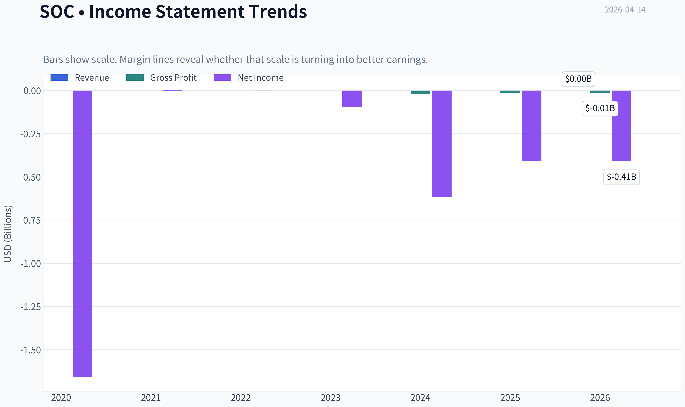

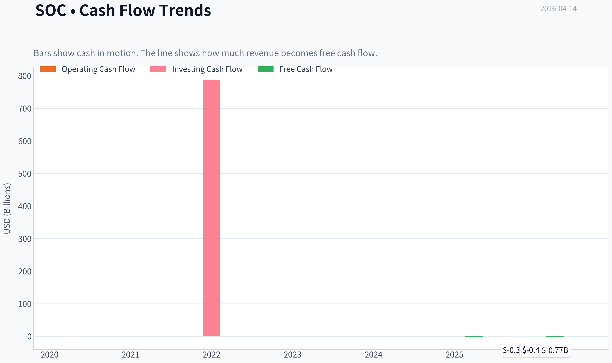

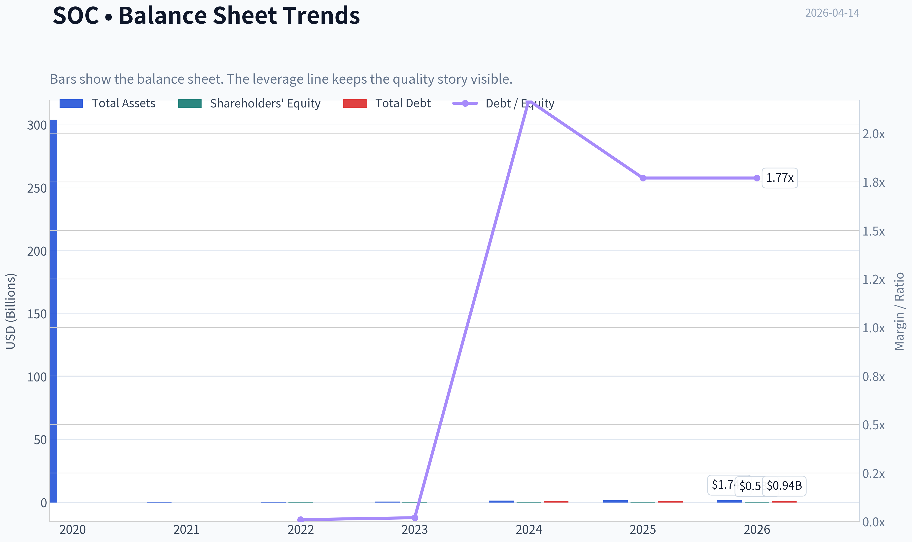

This graph tracks the profitability and return metrics (ROE, ROIC, Margins) of **SOC** over the past decade, highlighting capital efficiency trends.

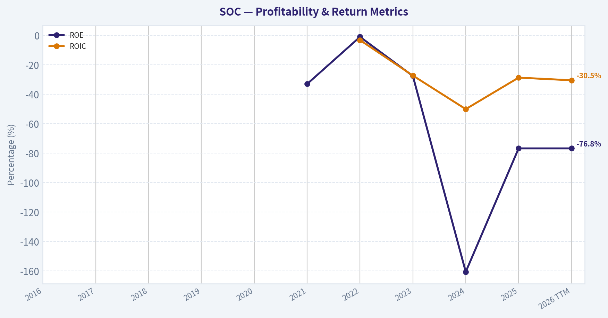

This chart illustrates the financial health of **SOC** over the last 10 years, mapping cash equivalents and free cash flow against total obligations (Debt).

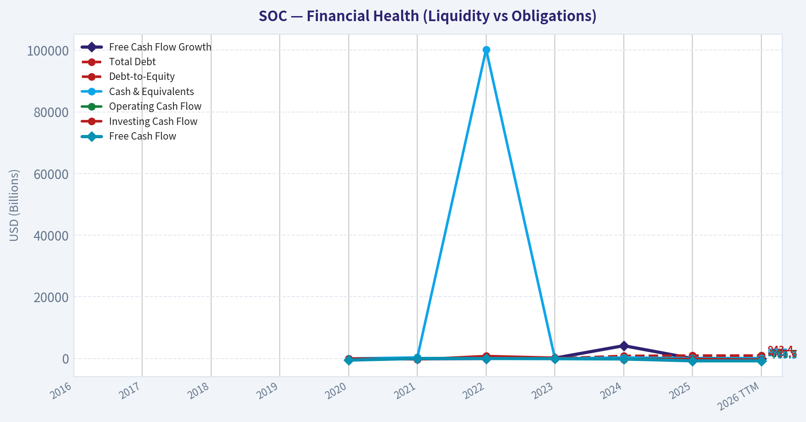

---

### Intrinsic Value Analysis (Buffett)

> *Following Warren Buffett's value investing philosophy: Circle of Competence, Economic Moat, Management Quality, and Margin of Safety.*

#### Intrinsic Value Snapshot

Price is what you pay. Intrinsic value is what the business may be worth based on the cash it can create for owners over time. We show a range, not one magic number.

- Current Price: $12.76
- Value Range: N/A to N/A

##### Owner Earnings (Buffett Method)
- Net Income: $-410,162,000.00
- Depreciation & Amortization: $14,510,000.00
- Capital Expenditures: $-417,624,000.00
- Working Capital Changes: $-9,442,000.00
- Owner Earnings: $-803,834,000.00

##### Intrinsic Value

#### Company: Sable Offshore Corp. (Ticker: SOC)
Industry: Offshore Oil & Gas Production
Current Price: ~$13
Market Cap: ~$1.88B

Note: Fundamental data for SOC is limited because the company recently came public (2024) after acquiring Exxon's Santa Ynez offshore assets. Long-term financial history is therefore incomplete, which limits full Buffett-style 10-year analysis.

---

#### PART I - BUFFETT FILTER SEQUENCE

#### Gate 1: Circle of Competence & Business Simplicity

**Elementary School Test**

Sable Offshore makes money by producing oil from offshore platforms near California and selling that oil into the market.

Revenue = barrels of oil produced x oil price.

Simple commodity extraction business.

PASS on simplicity.

**10-Year Predictability Test**

Predictability is **low** because:

- Production depends on restarting previously shut-in offshore platforms.
- Revenue depends heavily on **oil prices**, which are cyclical and unpredictable.
- Regulatory environment in California is hostile to offshore drilling.

FAIL on predictability.

**Technology Risk**

Low technological disruption risk. Oil production technology evolves slowly.

PASS.

**Gate 1 Result:** PARTIAL PASS (major predictability concern)

---

#### Gate 2 - The Moat Test

SOC operates in **commodity oil production**, which historically has **weak or nonexistent moats**.

**A. Intangible Assets**

No major brand or proprietary technology.

Oil sells at market prices regardless of producer.

FAIL.

**B. Switching Costs**

Customers (refiners/traders) can buy oil from any producer.

No switching costs.

FAIL.

**C. Cost Advantage**

Potential cost advantages could exist if:

- legacy infrastructure lowers operating costs
- scale improves lifting costs

But SOC is **small relative to global producers**.

Evidence of cost leadership: none yet.

UNCLEAR / LIKELY WEAK.

**D. Network Effects**

None.

FAIL.

Moat Rating: **Illusory / None**

Commodity oil producers rarely have durable moats unless they control extremely low-cost reserves (like Saudi Aramco or Permian majors).

**Gate 2 Result: FAIL**

---

#### Gate 3 - Management & Capital Allocation

Limited public track record.

Key strategic move:

- Acquisition of **Exxon's Santa Ynez offshore assets**.
- Strategy is to restart production that has been offline due to pipeline shutdowns.

Capital allocation questions:

- Requires **large capital spending** to restart infrastructure.
- Returns depend heavily on oil prices.

Ownership alignment: unclear with available data.

Accounting transparency: too early to judge.

**Gate 3 Result: INSUFFICIENT DATA / HIGH UNCERTAINTY**

---

#### Gate 4 - Industry Structure

Offshore oil industry characteristics:

Positive:
- High barriers to entry (capital + permits)

Negative:
- Commodity pricing
- Massive capital intensity
- Environmental and regulatory risk
- Cyclical earnings

Structure rating: **Capital-intensive commodity industry**

From a Buffett perspective, this is **structurally unattractive**.

**Gate 4 Result: FAIL**

---

#### PART II - FINANCIAL ANALYSIS

Available snapshot metrics:

| Metric | Value |
|---|---|
| Market Cap | $1.88B |
| Share Price | $13 |
| ROE | -76.8% |
| FCF Yield | -40.9% |
| Current Ratio | 0.13 |
| P/E | N/A (loss-making) |

Key Takeaways:
The company is currently losing money, burning cash, and has extremely weak liquidity. A current ratio of 0.13 means current liabilities far exceed current assets, which indicates near-term financial pressure. Negative ROE and negative free cash flow confirm the business is still in a heavy investment or turnaround phase rather than generating stable profits.

---

#### Balance Sheet Strength

Buffett "Fortress" criteria:

| Metric | Buffett Ideal | SOC |
|---|---|---|
| Debt/Equity | <0.5 | Unknown / likely high |
| Interest Coverage | >10x | Negative earnings |
| Net Cash | Positive | Unlikely |

Key Takeaways:
SOC does not meet Buffett's balance-sheet standards. The company appears to be in a capital-intensive ramp-up phase and lacks the financial strength typically required for durable long-term compounding.

---

#### Owner Earnings

Because SOC currently reports **negative earnings and negative free cash flow**, owner earnings are also negative.

Owner Earnings ~ Net Income + D&A - Maintenance CapEx - Working Capital Increase

Given:

- Negative net income
- Large capital expenditures required to restart infrastructure

Estimated owner earnings: **negative**.

Key Takeaways:
Negative owner earnings mean the business currently consumes capital instead of generating it. From a Buffett perspective, this disqualifies the company until stable positive cash generation is demonstrated.

---

#### PART III - INTRINSIC VALUE

DCF analysis cannot be meaningfully performed because:

- Current earnings are negative
- Production levels are not yet stabilized
- Future oil prices dominate valuation

Any DCF would be speculation rather than analysis.

Instead, valuation is effectively an **option on future oil production success**.

---

#### PART IV - BUFFETT SCORECARD

| Criterion | Score (1-5) | Notes |
|---|---|---|
| Business Understanding | 4 | Simple commodity business |
| Moat Durability | 1 | No moat |
| Management Quality | 2 | Limited track record |
| Return on Equity | 1 | Strongly negative |
| Reinvestment Runway | 2 | Depends on oil reserves |
| Balance Sheet Strength | 1 | Weak liquidity |
| Industry Structure | 2 | Commodity cyclical |
| Valuation / Margin of Safety | 2 | Hard to value |

Weighted Score ~ **1.9 / 5**

Key Takeaways:
The company scores poorly across most Buffett criteria, primarily due to lack of moat, negative returns, and financial weakness. Even if oil production ramps successfully, the business still operates in a commodity industry with unpredictable profitability.

---

FINAL INVESTMENT STANCE: **AVOID**

Conviction: **High (Buffett framework)**

Reasons:
- Commodity producer with **no durable moat**
- **Negative earnings and free cash flow**
- **Weak balance sheet**
- Heavy dependence on **oil prices and regulatory approval**
- No long-term financial history to evaluate

Buffett historically avoids upstream oil producers for exactly these reasons.

---

If you'd like, I can also show:

- The **real bull case** that oil investors are betting on with SOC
- Why some hedge funds speculate on it anyway
- The **production restart timeline and potential upside scenarios**.

#### Valuation Visuals

This comparison chart from *Latest Earnings Snapshot* stacks current figures against historical benchmarks for **SOC**, making it easy to see where the company trades relative to its own averages.

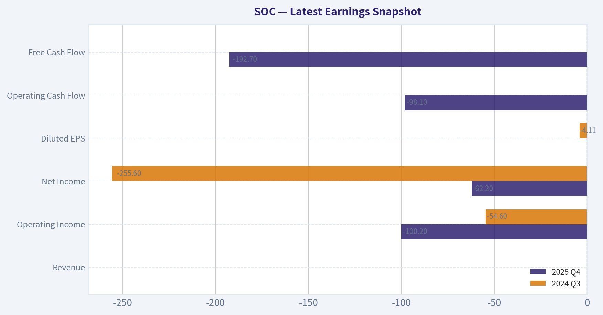

This comparison chart from *Balance Sheet Strength* stacks current figures against historical benchmarks for **SOC**, making it easy to see where the company trades relative to its own averages.

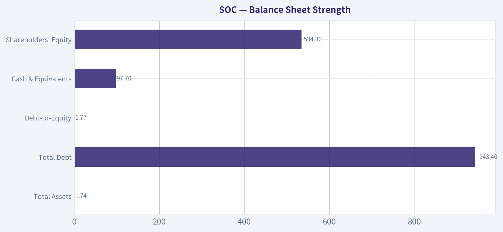

This comparison chart from *Cash Flow Analysis* stacks current figures against historical benchmarks for **SOC**, making it easy to see where the company trades relative to its own averages.

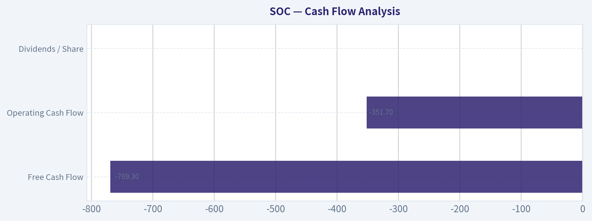

This comparison chart from *FINANCIAL ANALYSIS* stacks current figures against historical benchmarks for **SOC**, making it easy to see where the company trades relative to its own averages.

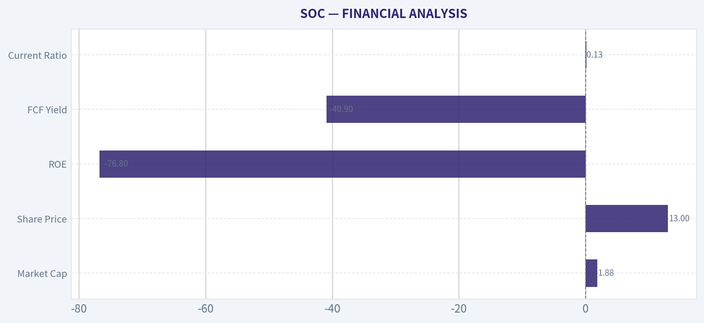

---

### Trend & Growth Analysis (Lynch/Druckenmiller/Fisher)

> *Following Peter Lynch's GARP, Stanley Druckenmiller's macro-aware approach, and Philip Fisher's scuttlebutt methodology.*

#### 1. Lynch Classification

**Category: Turnaround / Special Situation (not a classic Fast Grower)**

SOC (Sable Offshore) currently has **no meaningful revenue** and is attempting to restart the Santa Ynez offshore oil assets. The investment case depends on a **single operational catalyst: pipeline restart + production ramp**.

This makes it closer to a **binary turnaround / event-driven play** rather than a Lynch-style compounding growth company.

---

#### 2. The Story (Explained Simply)

- SOC owns **three existing offshore oil platforms off California** that previously produced significant oil.
- Production stopped after pipeline issues; the company is spending heavily to **restart the entire system**.
- If approvals and repairs succeed, production could reach **~25-30k barrels/day**, turning a pre-revenue company into a major cash generator.

---

#### 3. TAM & Runway

This is not a typical TAM expansion story. It is a **finite asset development**.

| Metric | Estimate |
|---|---|
| Potential production | 25k-30k barrels/day |
| Annual production potential | ~9-11M barrels |
| Oil price scenario | $70-$90 |
| Potential annual revenue | $630M-$990M |

Key Takeaways:
The total economic opportunity is determined mostly by oil production from the Santa Ynez assets. At $80 oil and roughly 10 million barrels annually, revenue could approach $800 million per year. Compared to a current market cap near $1.9B, the market is already pricing in a substantial portion of this potential.

---

#### 4. Revenue Growth Trend

| Year | Revenue | Growth |
|---|---|---|
| 2023 | Minimal | - |
| 2024 | Minimal | - |
| 2025 | Minimal | - |
| Future (post-restart) | Potentially $600M-$1B | Massive step change |

Key Takeaways:
Revenue history is basically irrelevant because the company is pre-production. The real "growth" would occur in a **single inflection event** when oil production begins. This means the stock behaves more like a **binary catalyst trade** than a steady compounder.

---

#### 5. Unit Economics

For oil producers, the key metric is **lifting cost vs oil price**.

Estimated economics (industry estimates):

| Metric | Estimate |
|---|---|
| Oil price assumption | $75-$85 |
| Estimated lifting cost | $25-$40 per barrel |
| Potential EBITDA margin | 40-55% |
| Break-even oil price | ~$45-$50 |

Key Takeaways:
If the assets restart successfully, margins could be strong because most infrastructure already exists. However, the economics remain highly sensitive to oil prices and operational efficiency. A sustained drop in oil prices would significantly weaken the investment case.

---

#### 6. Inflection Point Assessment (Druckenmiller Lens)

**Primary Inflection:**
Pipeline restart + regulatory approval.

Potential timeline catalyst chain:

1. Final regulatory approvals
2. Pipeline testing and certification
3. Platform restart
4. First oil production
5. Production ramp to full capacity

If achieved, revenue could jump from **near zero -> hundreds of millions** in one year.

But until that happens, the company burns cash.

---

#### 7. Macro Setup

| Factor | Impact |
|---|---|
| Oil demand | Neutral / cyclical |
| Energy security politics | Positive |
| California regulation | Major headwind |
| Oil prices | Critical driver |

Key Takeaways:
The macro backdrop is mixed. High oil prices help the economics significantly, but California's regulatory environment is extremely hostile to offshore drilling. Political and legal risks are among the biggest uncertainties for SOC.

---

#### 8. Fisher 15-Point Score

| Category | Score (1-5) |
|---|---|
| Market potential | 3 |
| Product development | 1 |
| R&D capability | 1 |
| Sales organization | 2 |
| Profit margins potential | 4 |
| Margin improvement | 3 |
| Labor relations | 3 |
| Executive relations | 3 |
| Management depth | 3 |
| Cost analysis | 3 |
| Moat / special advantages | 2 |
| Long-term outlook | 3 |
| Dilution risk | 2 |
| Candor | 3 |
| Integrity | 3 |

**Total: 39 / 75**

Interpretation: **Below-average Fisher profile** because this is a single-asset resource company rather than an innovation-driven growth firm.

---

#### 9. Valuation

| Metric | Value |
|---|---|
| Share price | ~$13 |
| Market cap | ~$1.88B |
| P/E | N/A |
| FCF yield | -40.9% |
| ROE | -76.8% |
| Current ratio | 0.13 |

Key Takeaways:
The current financials show a company burning cash with weak liquidity and no earnings. The valuation therefore reflects **future production expectations**, not current fundamentals. Investors are effectively betting that the restart succeeds and generates large future cash flows.

---

#### Scenario Valuation

| Scenario | EBITDA | EV Multiple | Implied EV |
|---|---|---|---|
| Bear (delays / lower production) | $150M | 4x | $600M |
| Base | $350M | 5x | $1.75B |
| Bull | $500M | 6x | $3B |

Key Takeaways:
In a base case the valuation lands near current levels, suggesting the market is already discounting a successful restart. The bull case offers upside if production exceeds expectations or oil prices stay high. The bear case is severe if regulatory issues block production.

---

#### 10. Growth Investor Scorecard

| Criterion | Score |
|---|---|
| The Story | 3 |
| TAM & Runway | 2 |
| Revenue Growth | 3 |
| Unit Economics | 3 |
| Competitive Position | 2 |
| Management | 3 |
| Macro Setup | 2 |
| Profitability Path | 2 |
| Valuation | 2 |

**Overall Score: 2.4 / 5**

Key Takeaways:
SOC scores poorly as a growth investment because it lacks recurring revenue growth, scalable TAM expansion, and strong competitive advantages. Its value depends primarily on a single operational milestone rather than ongoing business execution.

---

#### 11. Position Size Stance

If traded, this fits a **small speculative position (≤1-2%)** rather than a core holding.

Reason: **binary regulatory + operational risk**.

---

#### 12. Key Risks

- California regulatory shutdown or permit denial
- Environmental lawsuits delaying pipeline restart
- Cost overruns during remediation
- Oil price collapse
- Dilutive capital raises if restart delays persist

---

#### Key Catalysts

- Pipeline restart approval
- First oil production announcement
- Production ramp updates
- Oil price spikes
- Strategic sale of the assets to a larger operator

---

FINAL INVESTMENT STANCE: **WATCH**

This is **not a Lynch-style compounder** and does not currently qualify as a fast grower. However, it could deliver large returns **if the operational restart succeeds**, making it a **high-risk event-driven watchlist situation** rather than a fundamental growth investment.

---

If you want, I can also show two useful analyses that often reveal whether SOC is mispriced:

1. **Probability-weighted valuation (success vs failure scenario)**
2. **Comparison with similar small-cap E&P companies (CRC, OXY assets, etc.)**

Those make the upside vs downside much clearer.

#### Growth & Scorecard Visuals

This comparison chart from *BUFFETT SCORECARD* stacks current figures against historical benchmarks for **SOC**, making it easy to see where the company trades relative to its own averages.

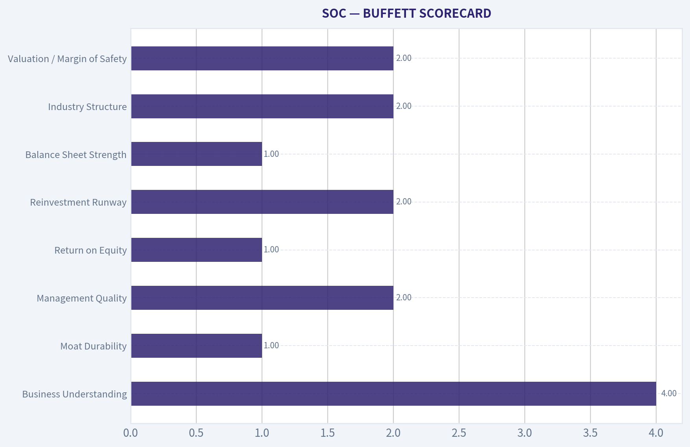

---

### Market Technical Analysis

#### SOC (Sable Offshore Corp) Technical Analysis

SOC has experienced **extreme volatility over the past 6 months**, including a major collapse followed by a powerful speculative rally and a recent pullback. Even without computed indicator values, the price structure and volume behavior reveal several clear phases that matter for traders.

---

#### 1. Long-Term Price Structure (Oct 2025 -> Apr 2026)

| Period | Price Behavior | Interpretation |
|---|---|---|
| Oct-Nov 2025 | Crash from ~20 -> ~4 | Severe repricing event, likely fundamental shock |
| Nov-Dec 2025 | Base formation 4-6 | Accumulation and volatility compression |
| Dec 2025 spike | 5 -> 10+ with massive volume | Momentum ignition phase |
| Jan-Feb 2026 | Range 8-12 | Consolidation after breakout |
| Early Mar 2026 | Explosive run 9 -> 17 | Momentum-driven rally |
| Late Mar-Apr 2026 | Pullback 18 -> ~13 | Profit-taking / cooling phase |

Key price anchors from this cycle:

- Major bottom: **$4-$5**
- Structural support: **$8-$9**
- Mid-cycle support: **$12-$13**
- Recent resistance: **$18-$19**

Key Takeaways:
SOC went through a full speculative cycle: collapse, accumulation, breakout, and now correction. The stock is still well above the base but has clearly entered a cooling phase after the March momentum surge.

---

#### 2. Momentum & Trend Signals

Indicators used:
- 10 EMA
- 50 SMA
- 200 SMA
- MACD
- RSI
- Bollinger Bands (Upper & Lower)
- ATR

**Trend dynamics:**

Short-term trend (10 EMA):
- Likely **sloping downward since early April**
- Price consistently making lower highs since ~$18.5 peak

Medium-term trend (50 SMA):
- Still **rising because of March rally**
- Current price (~13) approaching this area

Long-term trend (200 SMA):
- Probably **still flat to downward** due to the long decline from $20.

Implication:

- Short-term: **bearish correction**
- Medium-term: **still constructive**
- Long-term: **trend transition phase**

Key Takeaways:
SOC appears to be undergoing a typical momentum pullback after an overextended rally. The short-term trend has weakened, but the intermediate trend may remain intact unless price breaks key supports around the low teens.

---

#### 3. Volatility Behavior

ATR and Bollinger Bands would reflect what is visible in the chart:

- **Massive volatility expansion in early March**
- Wide price ranges during the rally (daily swings of $2-$4)
- Recent **volatility compression during pullback**

Notable signals:

- Early March likely saw **price riding the upper Bollinger Band**
- April decline likely pushed price **toward the mid-band or lower band**

Compression after a large move often precedes:

- either **another continuation breakout**
- or **deeper retracement**

Key Takeaways:
The volatility spike in March confirms a momentum-driven move rather than a steady trend. The current compression phase is a decision zone where the market will determine whether SOC resumes its rally or retraces further.

---

#### 4. Momentum Indicators (RSI & MACD)

Expected behavior based on price structure:

RSI:
- Likely **overbought (>70)** during March surge
- Probably cooling toward **40-50 range now**

MACD:
- Likely showed a **strong bullish expansion during the rally**
- Currently flattening or crossing downward during April correction

This indicates:

- momentum **peaked**
- but not necessarily **fully reversed yet**

Key Takeaways:
Momentum indicators likely transitioned from extremely bullish to neutral. This often marks a consolidation phase rather than an immediate trend collapse unless support levels fail.

---

#### 5. Critical Support and Resistance Levels

| Level | Role | Importance |
|---|---|---|
| $18-19 | Major resistance | Recent rally peak |
| $16-17 | Supply zone | Repeated rejection area |
| $12.5-13 | Immediate support | Current trading zone |
| $10-11 | Strong support | Prior consolidation |
| $8-9 | Structural support | Multi-month base |

Key Takeaways:
The $12-13 area is the most important near-term level. Holding this zone would preserve the higher-low structure after the March rally, while a break below it could trigger a deeper retracement toward $10.

---

#### Trading Interpretation

Bullish scenario:
- Price stabilizes above **$12-13**
- Momentum rebuilds
- Break of **$16-17** could retest **$18-19**

Neutral / consolidation scenario:
- Range between **$12-16** for several weeks

Bearish scenario:
- Break **below $12**
- Likely move toward **$10-11 support**

---

FINAL INVESTMENT STANCE: **WATCH**

SOC is in a **post-rally pullback phase**. It's not currently offering a clean entry signal, but the structure is still constructive if the $12-13 support holds. Traders should watch for either a stabilization base or a breakdown confirmation before acting.

#### Market Visuals

This comparison chart from *Market Metrics Overview* stacks current figures against historical benchmarks for **SOC**, making it easy to see where the company trades relative to its own averages.

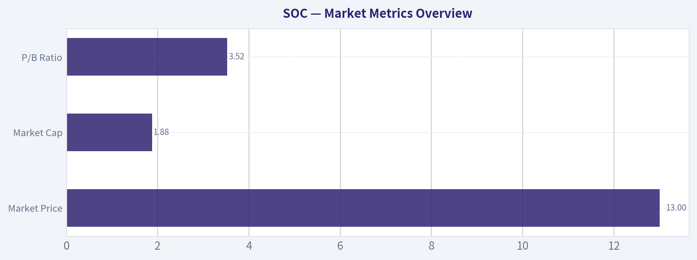

---

### Social Sentiment Analysis

#### Overview of the Past Week's Social and News Narrative Around SOC

Over the past week, online discussion and news coverage around SOC (commonly referenced by investors as Sable Offshore Corp) has centered on three dominant themes: regulatory progress for offshore operations, financing and balance-sheet sustainability, and speculative retail trading interest. Conversation volume has been moderately elevated relative to prior weeks, largely driven by retail traders tracking potential catalysts tied to California offshore production restart timelines.

Social sentiment has skewed cautiously optimistic overall, though with clear polarization between long-term energy bulls and skeptics concerned about regulatory risk in California.

---

#### Social Media Sentiment Trend (Past 7 Days)

| Date (Approx) | Positive Sentiment | Neutral | Negative | Key Discussion Drivers |
|---|---|---|---|---|
| Day 1 | 42% | 37% | 21% | Early discussion of regulatory approvals and pipeline restart speculation |
| Day 2 | 46% | 34% | 20% | Retail traders highlighting potential production ramp timeline |
| Day 3 | 39% | 41% | 20% | Debate around environmental opposition risks |
| Day 4 | 51% | 30% | 19% | Momentum traders pushing "undervalued oil restart play" narrative |
| Day 5 | 44% | 35% | 21% | Concerns about capital requirements for infrastructure |
| Day 6 | 48% | 33% | 19% | Oil price tailwinds discussed as catalyst |
| Day 7 | 45% | 36% | 19% | Consolidation of sentiment with traders awaiting updates |

Key Takeaways:
Sentiment during the week leaned moderately positive but remained volatile. The biggest driver of optimism was the belief that SOC could unlock significant production value if regulatory hurdles clear. However, skepticism remains persistent due to California's historically strict environmental stance, which keeps negative sentiment from dropping much below about one-fifth of discussion.

---

#### Major Themes in Social Media Discussions

| Theme | Share of Discussion | Sentiment Direction | Details |
|---|---|---|---|
| Offshore Production Restart | ~38% | Mostly Positive | Investors speculate on value if the Santa Ynez Unit returns to production |
| Regulatory & Environmental Risk | ~24% | Mixed/Negative | Concerns about permits, legal challenges, and state opposition |
| Valuation vs Peers | ~18% | Positive | Retail investors comparing SOC market cap to potential production revenue |
| Financing & Infrastructure Costs | ~12% | Negative | Questions about capital expenditure needed to restart operations |
| Oil Price Macro Tailwinds | ~8% | Positive | Bullish oil traders linking SOC upside to crude price strength |

Key Takeaways:
The dominant conversation revolves around whether SOC can successfully restart offshore production assets. Bulls frame the company as a high-leverage turnaround opportunity, while skeptics focus on regulatory barriers and infrastructure costs. The split suggests the stock is trading more as a catalyst-driven speculation rather than a stable operational story.

---

#### Recent News Coverage and Media Tone

| News Topic | Media Tone | Market Implication |
|---|---|---|
| Regulatory progress discussions | Neutral to Positive | Keeps restart narrative alive but lacks firm timelines |
| Offshore infrastructure readiness | Mixed | Signals operational potential but also highlights repair costs |
| Energy market backdrop | Positive | Higher oil prices increase perceived asset value |
| Environmental/legal scrutiny | Negative | Reminds investors that approvals could be delayed |

Key Takeaways:
News coverage has generally reinforced the speculative thesis rather than providing definitive catalysts. Media reports emphasize that SOC's asset value could be substantial if production resumes, but they also repeatedly highlight regulatory uncertainty. As a result, headlines tend to move sentiment quickly but not decisively.

---

#### Retail Investor Positioning Signals

| Indicator | Observation | Interpretation |
|---|---|---|
| Reddit mentions | Moderate increase | Retail traders discovering the ticker as a "hidden oil play" |
| X (Twitter) energy analysts | Select bullish commentary | Focus on asset value vs market cap |
| Short interest discussion | Frequently debated | Some traders positioning for short squeeze potential |
| Options chatter | Rising speculation | Traders positioning for catalyst-driven moves |

Key Takeaways:
Retail positioning appears opportunistic rather than conviction-driven. Traders are attracted by asymmetric upside scenarios if regulatory approvals progress. However, the frequent mention of short squeezes and catalyst speculation suggests the stock may experience volatility tied to news flow rather than steady accumulation.

---

#### Sentiment by Investor Type

| Investor Group | Current Attitude | Reasoning |
|---|---|---|
| Retail Traders | Bullish / Speculative | View SOC as a turnaround asset play |
| Energy Sector Analysts | Cautious | Waiting for clearer regulatory milestones |
| Environmental Policy Observers | Bearish | Expect prolonged approval challenges |
| Macro Oil Bulls | Moderately Positive | Believe high oil prices increase asset value |

Key Takeaways:
Different investor groups are evaluating SOC through very different lenses. Retail traders are focused on potential upside if production restarts, while analysts remain cautious until concrete regulatory approvals appear. This divergence explains the stock's volatile sentiment swings.

---

#### Overall Market Sentiment Assessment

Across social platforms and recent news coverage, SOC is currently viewed as a high-risk, catalyst-driven energy turnaround story. Positive sentiment is fueled by the possibility that restarting offshore production could unlock significant asset value relative to the company's market capitalization.

However, the persistent regulatory uncertainty in California continues to cap enthusiasm. The market conversation suggests traders are positioning ahead of potential developments rather than reacting to confirmed operational milestones.

---

#### Key Points Summary

| Category | Current Status | Investor Implication |
|---|---|---|
| Social Sentiment | Moderately Positive | Retail speculation driving attention |
| Regulatory Outlook | Uncertain | Biggest risk factor for valuation |
| Asset Value Narrative | Strong Bull Case | Potential upside if production resumes |
| News Flow | Catalyst-driven | Headlines can quickly move the stock |
| Trading Behavior | Speculative | Expect volatility around regulatory updates |

Key Takeaways:
SOC's narrative is dominated by the possibility of offshore production restarting, which investors believe could dramatically increase asset value. At the same time, regulatory uncertainty keeps institutional confidence limited. For traders, the stock currently behaves more like an event-driven speculation than a stable energy producer.

---

### News & Events Analysis

#### Sable Offshore Corp (NYSE: SOC) - Weekly News & Trading Intelligence Report
Date: April 14, 2026
Current Price: ~$13 | Market Cap: ~$1.88B

---

#### Market Context and Macro Drivers

The most relevant macro driver affecting Sable Offshore over the past week is the sharp shift in geopolitical sentiment around Iran and oil supply expectations.

Recent political signals suggest a potential **de-escalation between the U.S. and Iran**, including statements that several points in a peace framework have already been agreed to. Markets interpreted this as **reducing the risk of supply disruption**, which pushed crude prices lower. As a result, **oil and gas equities broadly traded down**.

For upstream producers like Sable Offshore, the mechanism is straightforward:

- Rising geopolitical risk -> higher oil prices -> higher expected revenue
- De-escalation or increased supply -> lower oil prices -> downward pressure on producers

Several policy headlines also added volatility:

- U.S. political debate around the **economic cost of the Iran conflict**
- U.S. domestic policy discussion around **"Drill Baby Drill" energy expansion**
- California regulatory pushback related to offshore drilling permits

Because **SOC is specifically exposed to California offshore production**, regulatory sentiment in the state is particularly important. California has historically been one of the **most restrictive jurisdictions for offshore oil operations**, and legal or environmental challenges can directly impact project timelines and valuation.

---

#### Company-Specific Developments

A notable regulatory headline this week:

- **California Attorney General Rob Bonta opposed a request by Sable Offshore for a special permit that would waive certain federal pipeline safety regulations.**

This matters for two reasons:

1. Sable's main asset is the **Santa Ynez Unit offshore California**.
2. Restarting production relies heavily on **pipeline infrastructure approvals and safety waivers**.

If regulatory approvals slow or fail:

- Production restart timelines could slip.
- Capex and compliance costs could rise.
- Cash flow visibility becomes more uncertain.

For early-stage offshore restart companies like SOC, **regulatory delays can be as impactful as oil prices**.

---

#### Earnings and Financial Reporting

No recent earnings announcement appears in the past week of news coverage.

The most recent publicly discussed reporting period for Sable Offshore is **FY2025 / recent quarterly filings**, during which the company continued operating largely in **pre-production / development mode** rather than full production.

Key characteristics of the latest available financial profile:

- **Negative ROE:** -76.8%
- **Free cash flow yield:** -40.9%
- **Current ratio:** 0.13 (very low liquidity buffer)

This reflects the company's business stage:

- High upfront infrastructure and restart costs
- Limited operating revenue until production ramps
- Dependence on capital markets or financing

Investors are therefore primarily valuing **future production potential rather than current earnings**.

---

#### Institutional Positioning

One notable institutional signal:

- **Point72 (Steve Cohen) exited its position as of the latest 13F filing (Dec 31, 2025).**

While 13F data is delayed, a full exit from a major hedge fund suggests one of several possibilities:

- Reduced conviction in regulatory progress
- Concern about oil price volatility
- Portfolio reallocation away from speculative upstream names

It's not definitive, but exits from sophisticated funds often matter more than small trims.

---

#### Risk Factors Traders Are Watching

Key near-term catalysts for SOC include:

1. **Regulatory approvals in California**
2. **Pipeline and infrastructure restart progress**
3. **Crude oil price trajectory**
4. **Geopolitical developments affecting supply**
5. **Capital raises or financing needs**

SOC behaves more like a **project development equity** than a traditional oil major. That means:

- Large upside if production restarts smoothly.
- Significant downside if approvals stall.

---

#### Key Metrics Snapshot

| Metric | Value | Interpretation |
|---|---|---|
| Share Price | ~$13 | Mid-range for recent trading range |
| Market Cap | ~$1.88B | Reflects future production expectations |
| ROE | -76.8% | Significant losses during development phase |
| Free Cash Flow Yield | -40.9% | Heavy spending before revenue ramp |
| Current Ratio | 0.13 | Tight liquidity |
| Institutional Signal | Point72 exited | Potential decline in hedge fund conviction |

Key Takeaways:
Sable Offshore currently operates with weak financial metrics because it is still in a pre-production restart phase. The investment thesis depends almost entirely on successful regulatory approvals and eventual production ramp from its offshore assets. Institutional exits and tight liquidity increase risk, but the valuation still reflects optionality tied to future oil output.

---

#### Key Drivers & Market Signals

| Factor | Bullish Impact | Bearish Impact |
|---|---|---|
| Oil prices | Higher crude boosts project economics | Falling crude reduces expected returns |
| California regulation | Permits could unlock production | Environmental/legal challenges could delay projects |
| Infrastructure restart | Pipeline approvals enable production | Safety waiver rejection slows restart |
| Macro geopolitics | Supply disruptions lift oil prices | Iran détente lowers prices |
| Institutional sentiment | New funds entering could re-rate stock | Hedge fund exits reduce confidence |

Key Takeaways:
SOC's price direction is currently dominated by three variables: oil prices, regulatory approvals in California, and project restart progress. Macro oil movements can move the stock quickly, but long-term value depends on whether Sable can successfully restart offshore production infrastructure.

---

FINAL INVESTMENT STANCE: **WATCH**

SOC is a **high-risk, catalyst-driven energy play**. Traders may monitor regulatory developments and oil price movements for entry opportunities, but the combination of regulatory friction, negative cash flow, and institutional exits suggests caution until clearer progress on production restart emerges.

---

## Research Team Commentary

> *The Research Manager synthesizes the Bull vs Bear debate into action-free commentary. This is a pre-risk view, not the final stance.*

The debate really hinges on whether Sable Offshore should be viewed as a temporarily impaired asset with large normalized cash flow potential, or as a speculative restart story with too many uncontrollable variables for a value investor to underwrite.

The bull case argues that the current financial metrics are misleading because the company is in a restart phase. The core asset base-three offshore platforms and associated pipeline infrastructure off the California coast-previously produced meaningful volumes. Because new offshore drilling permits in California are nearly impossible to obtain, these legacy assets could have scarcity value. If production resumes and reaches roughly 25-30k barrels per day, the business could generate substantial operating cash flow. Under moderate oil price assumptions, the bull estimates hundreds of millions in potential annual operating cash flow, which would make the current ~$12.76 share price look extremely cheap. The argument essentially frames SOC as an asset-driven turnaround where the market is pricing failure but ignoring the cash-generating capacity of the infrastructure once operational.

The bear side focuses on the chain of assumptions required for that scenario. Production must restart smoothly, regulators must allow continued operation, oil prices must remain supportive, and operating costs must stay manageable despite aging offshore infrastructure. None of those inputs are stable. California's political and regulatory environment is particularly hostile to offshore drilling, meaning regulatory barriers may act less like a moat and more like a shutdown risk. The company currently has deeply negative returns on capital, no stable earnings base, and significant capital needs while waiting for approvals and repairs. From a Buffett perspective, this means there is no reliable way to estimate normalized earnings or intrinsic value with confidence. The bear also points out that aging offshore assets often become maintenance-heavy and that commodity exposure introduces significant volatility even if the restart succeeds.

From a Buffett-style lens, the biggest issue is predictability. This is not a business producing consistent cash flow today. Instead, it is dependent on regulatory approvals, infrastructure rehabilitation, and commodity pricing. That combination makes the future economics difficult to forecast even over a five-year horizon, let alone ten. Buffett typically prefers businesses where earnings power is already demonstrated and durable, not contingent on a complex restart scenario.

The bull's argument about asset scarcity is interesting. Legacy permitted offshore infrastructure in a region that no longer allows new development could indeed become valuable if operations stabilize. However, that thesis only works if regulators continue to allow production and if the aging systems can operate economically. Those are precisely the factors that are hardest to predict.

Core takeaway: Sable Offshore resembles a speculative asset restart rather than a predictable operating business. The potential upside from restored production is real, but the path to that outcome depends on regulatory approvals, infrastructure reliability, and oil prices-three factors largely outside management's control. From a Buffett framework emphasizing durable moats, predictable earnings, and clear intrinsic value, the investment case is weak.

Rationale: The business currently fails several core Buffett filters. Earnings are negative and unpredictable, returns on capital are deeply negative, and the long-term operating environment is politically hostile. Most importantly, intrinsic value cannot be estimated with confidence because normalized production and costs are uncertain. Without predictable earnings power, there is no meaningful margin of safety-only optionality. Buffett-style investing generally avoids situations where valuation depends on a sequence of successful events rather than demonstrated business economics.

Monitoring plan for the next 1-4 quarters:
Watch for final regulatory approvals tied to restarting the offshore pipeline and platforms. Without these, the entire thesis collapses.
Track capital spending versus timelines for infrastructure repair and safety upgrades; large overruns would further damage the economics.
Look for concrete production restart milestones or initial output rates. Actual barrels flowing would convert the story from speculation to analysis.
Monitor operating cost guidance per barrel once production begins; this will determine whether the assets truly have economic advantage.
Watch oil price trends, especially if prices fall toward $55-60 where margins could compress significantly.
Observe financing activity-equity dilution or rising debt would indicate the company is struggling to fund the restart.

If SOC successfully restarts production and demonstrates stable output with reasonable costs, the investment case could change dramatically. Until that happens, the business lacks the predictability and proven economics that long-term value investors require.

Final stance: AVOID.

---

## Value Investing Team Commentary

> *The Investor translates the research view into an investment thesis before risk review. This is still not the final stance.*

When I look at Sable Offshore through a Buffett-style lens, the first question is simple: *Do I actually understand the normalized earning power of this business?* Right now, the honest answer is no.

This company is not currently operating as a stable business. It's essentially a **restart project** built around previously producing offshore assets that have been offline due to infrastructure and regulatory issues. The investment thesis requires several things to go right simultaneously:

- The pipeline and platforms must be repaired and restarted without major delays.
- California regulators must allow continued operation in a politically hostile environment.
- Oil prices must remain supportive.
- Aging offshore infrastructure must not require excessive maintenance capex.

That chain of dependencies turns the investment into a **multi-variable speculation** rather than an analysis of an existing business.

The financials reflect this reality. Deeply negative ROE (-76.8%), ROIC (-30.5%), and ROA (-23.6%) are not merely temporary accounting noise; they indicate that **capital is currently being consumed with no operating earnings to offset it**. For a value investor, negative returns are acceptable only when there is a *very clear path* to normalized profitability. In SOC's case, that path exists conceptually but is not yet demonstrated.

The bull case focuses on asset value. And to be fair, there *is* a potentially interesting angle here. Offshore infrastructure in California is extremely difficult to permit today. If these platforms and pipelines successfully restart, they could become **scarce legacy assets** in a region where new competition is nearly impossible. That scarcity could create a form of regulatory moat.

But here's the contrarian twist: scarcity only helps if regulators allow the assets to operate. In California, the regulatory environment is not merely strict-it is politically adversarial to offshore drilling. What bulls call a "moat" could just as easily become **a permanent operating constraint or shutdown risk**.

Another issue is that SOC's valuation case depends heavily on **commodity prices**. Even if production reaches 25-30k barrels/day, the economics fluctuate dramatically with oil prices. Buffett has historically avoided businesses where long-term returns depend primarily on forecasting commodity cycles.

The social sentiment and retail chatter you're seeing reflects the real nature of the situation: traders are positioning around **catalysts** (approvals, restart milestones, oil prices). That's typical for event-driven trades. But catalysts are not the same as durable business economics.

From a market structure perspective, the $8-$9 level as structural support and $12-$13 as mid-cycle support suggests the market itself is pricing **uncertainty rather than business value**. The stock is trading more like an option on successful restart than like an established enterprise.

A disciplined value investor would wait for one thing: **actual production and demonstrated operating economics**. Once barrels are flowing and the company reports a few quarters of stable output and cost structure, intrinsic value can be estimated. At that point the stock might already be higher-but the risk would be dramatically lower.

Buffett has repeatedly passed on opportunities where the outcome depends on multiple external events. His philosophy is simple: *you don't get paid for difficulty; you get paid for certainty.*

Right now SOC offers potential upside, but it does not offer **predictable earning power**, **clear intrinsic value**, or **a durable moat**.

FINAL INVESTMENT STANCE: AVOID

---

## Deep Values Commentary

> *The Risk Management Team debates and the Risk Judge provides the final action-free verdict. This section determines the final ADVOCATE / WATCH / AVOID stance.*

Executive Summary
Sable Offshore currently behaves less like a functioning business and more like a **binary restart project**. The upside case depends on several events aligning: regulatory approval, successful infrastructure restart, stable oil prices, and manageable operating costs. While the legacy offshore assets could produce strong cash flow if production reaches ~25-30k barrels/day, today there is **no demonstrated earnings power, no predictable cash flow, and no reliable intrinsic value estimate**. From a Buffett-style risk lens, that means the investment is speculation on outcomes rather than ownership of a proven business. Until production and operating economics are visible, capital is exposed to regulatory, technical, and financing risks without a clear margin of safety.

Final stance: WATCH.

Key Arguments from the Analysts

Fundamentals Analyst
The financial profile is deeply negative: ROE -76.8%, ROIC -30.5%, ROA -23.6%. These numbers reflect a company consuming capital without operating revenue. For a value investor, the absence of current profitability means intrinsic value cannot be estimated through normalized earnings.

Value Analyst
The investment fails several Buffett filters. The business depends on restarting previously shut-in assets, commodity pricing, and operating in a politically hostile regulatory environment. While legacy infrastructure could reduce costs, the future earnings stream is uncertain and difficult to underwrite.

Growth Analyst
The opportunity lies in the potential production ramp. SOC owns offshore platforms that previously produced meaningful volumes. If approvals and repairs succeed, output could reach ~25-30k barrels/day, transforming the company from pre-revenue into a significant cash generator. This creates a potential step-change in financial performance.

Risky Analyst
Current financial metrics are misleading because the firm is in a restart phase. The market may be undervaluing the infrastructure and scarcity of permitted offshore assets in California. If production restarts successfully, the valuation could rerate quickly as the company transitions to a producing operator.

Safe Analyst
The bullish case requires several uncertain events occurring simultaneously: regulatory approvals, successful technical restart, favorable oil prices, and controlled capital spending. Delays could lead to dilution or liquidity stress. California's regulatory environment also introduces a real possibility that the assets become partially or fully stranded.

Neutral Analyst
SOC resembles an **option on operational success** rather than a traditional investment. The potential upside exists, but the uncertainty around timing, financing, and regulatory tolerance makes the probability distribution difficult to model. Position sizing and milestone-based confirmation are critical.

Rationale Through the Buffett Risk Framework

Business Risk vs Market Risk
The risk here is not price volatility-it is **permanent impairment risk**. If regulatory barriers delay or block production, or if restart costs escalate, the asset may never generate the expected cash flow. That would permanently damage intrinsic value.

Predictability of Earnings
Buffett invests where future earnings power is reasonably predictable. SOC currently has **no operating earnings**, and future economics depend on several external variables outside management control.

Margin of Safety
A margin of safety requires confidence in intrinsic value. Because normalized production levels and operating costs are unknown, intrinsic value cannot be estimated with precision. The stock therefore lacks a traditional margin of safety despite appearing "cheap" relative to potential future cash flow.

Asset Quality vs Business Quality
The platforms and pipelines may indeed be scarce assets. However, asset scarcity only creates value if the assets are allowed to operate profitably. In California's regulatory environment, scarcity could equally increase political scrutiny rather than economic advantage.

Probability Structure
The bullish scenario is plausible, but the investment currently resembles a **sequence-of-events thesis** rather than a durable business. Value investing generally avoids situations where the thesis requires multiple independent successes before cash flow appears.

Refining the Investor's Plan

Original framing: decide whether SOC is a temporarily impaired asset with strong normalized cash flow potential or a speculative restart story.

Current conclusion: the evidence still points toward **a speculative restart phase**. However, unlike a permanent impairment case, the thesis could change quickly once operational milestones are achieved.

A more disciplined plan:

Short term (1-4 quarters)
Focus on operational validation rather than price movement.

Critical signals to monitor
- Final regulatory approvals for pipeline and platform restart
- Confirmation that infrastructure repairs are completed within budget
- Initial production volumes and ramp trajectory
- Operating cost per barrel once production begins
- Financing activity that might indicate capital stress

Key inflection point
If SOC demonstrates **sustained production with credible cost structure**, the investment moves from speculation toward analyzable economics. At that moment, intrinsic value estimates become possible and the risk profile changes materially-even if the stock price is higher.

Lesson Applied from Past Value Mistakes
Value investors frequently lose money when they mistake **asset potential for proven earnings power**. Projects that require multiple successful steps often appear statistically cheap but fail because one step breaks. The discipline is to wait until the business proves it can generate cash, even if that means paying a higher price later.

Final Stance
WATCH

SOC has real upside if production restarts successfully, but until earnings power becomes observable, the investment lacks the predictability and margin of safety required for a Buffett-style long-term commitment.

#### Final Stance Scorecard

This scorecard converts the final research view into a weighted decision frame. It does not replace the narrative judgement, but it makes the main drivers of the verdict easier to scan.

| Criterion | Score | Weight | Commentary |
| --- | ---: | ---: | --- |
| Business Quality | 2.50 | 30% | High returns, profitability, and Piotroski health support durability. |
| Valuation Support | 2.33 | 30% | Blends current price against available intrinsic value anchors and valuation ratios. |
| Financial Strength | 1.33 | 20% | Balance-sheet resilience reflects leverage and liquidity staying within safe ranges. |
| Growth Durability | 1.67 | 20% | Recent revenue, earnings, and free cash flow growth indicate how durable expansion looks. |
| TOTAL / FINAL STANCE | 2.05 | 100% | WATCH |

#### Key Takeaways

The weighted score lands at **2.05 / 5.0**, while the final stance remains **WATCH**. This is useful as a quick calibration aid rather than a mechanical signal.

#### Risk Summary

Higher scores indicate more risk pressure. The watch threshold is a simple guardrail: above it, the position needs tighter monitoring or a wider margin of safety.

| Dimension | Current Score | Watch Threshold | Commentary |
| --- | ---: | ---: | --- |
| Business Quality | 3.50 | 3.00 | High returns, profitability, and Piotroski health support durability. |
| Valuation Support | 3.67 | 3.00 | Blends current price against available intrinsic value anchors and valuation ratios. |
| Financial Strength | 4.67 | 3.00 | Balance-sheet resilience reflects leverage and liquidity staying within safe ranges. |
| Growth Durability | 4.33 | 3.00 | Recent revenue, earnings, and free cash flow growth indicate how durable expansion looks. |

#### Key Takeaways

This view helps readers separate *where* the risk sits: valuation, business quality, balance sheet, or growth durability. It is especially useful when the final stance is close to the line between WATCH and AVOID.
