# SON Deep Value Intelligence

**Analysis Date:** 2026-04-13

## Critical Disclaimer

*This analysis is generated by Deep Value Intelligence, an AI-powered multi-agent investing framework. This report is for informational and educational purposes only and does not constitute financial advice. Always conduct your own research and consult with qualified financial advisors before making investment decisions.*

---

## Table of Contents

1. Intelligence Summary
2. Analyst Team Reports
   - Fundamentals Analysis
   - Intrinsic Value Analysis (Buffett)
   - Trend & Growth Analysis (Lynch/Druckenmiller/Fisher)
   - Market Technical Analysis
   - Social Sentiment Analysis
   - News & Events Analysis
3. Research Team Commentary
4. Value Investing Team Commentary
5. Deep Values Commentary

---

## Intelligence Summary

### Thesis + Conditions

**Core Thesis:** Executive Summary (Quick Read)

**Key Risks:**
- Sonoco looks like a **stable but economically average industrial business** currently priced close to its realistic cash-flow value. The key issue is **low ROIC (~6.9%)**, which suggests limited long-term compounding unless integration of Ball Metalpack materially improves capital efficiency. While the 9x earnings multiple reduces downside somewhat, the **free-cash-flow valuation (~$53) is nearly identical to the current price (~$55)**, leaving little margin of safety. Upside exists if ROIC rises toward 10% and FCF rebounds, but that outcome is not yet proven. For a Buffett-style investor focused on durable high-return businesses, the prudent stance remains **WATCH**.
- Risky Analyst
- The bullish argument centers on **post-acquisition transformation**. Revenue (+41.7%) and net income (+511.8%) suggest the combined company could operate at a new scale. If Ball Metalpack integration delivers procurement savings, plant optimization, and cross-selling, ROIC could rise toward 10-12%. With the stock trading around **9x earnings**, even modest improvement could trigger a re-rating toward packaging peer multiples (13-15x). The analyst also points to successful price increases across Europe as evidence that customer relationships are strong enough to absorb higher prices.
- The cautious perspective highlights **cash flow and capital efficiency risks**. The surge in earnings coincided with a **21.5% decline in free cash flow**, which raises questions about the real economic output of the business. Current **ROIC of 6.9%** is only marginally above the likely cost of capital, suggesting limited value creation. Pricing increases appear to be **cost pass-throughs tied to energy and raw materials**, not structural pricing power. If industrial demand weakens or integration disappoints, the already low multiple could compress further.
- Risk Commentary for Long-Term Investors

**What Would Change Our View:**
- Sonoco looks like a **stable but economically average industrial business** currently priced close to its realistic cash-flow value. The key issue is **low ROIC (~6.9%)**, which suggests limited long-term compounding unless integration of Ball Metalpack materially improves capital efficiency. While the 9x earnings multiple reduces downside somewhat, the **free-cash-flow valuation (~$53) is nearly identical to the current price (~$55)**, leaving little margin of safety. Upside exists if ROIC rises toward 10% and FCF rebounds, but that outcome is not yet proven. For a Buffett-style investor focused on durable high-return businesses, the prudent stance remains **WATCH**.
- Risky Analyst
- The bullish argument centers on **post-acquisition transformation**. Revenue (+41.7%) and net income (+511.8%) suggest the combined company could operate at a new scale. If Ball Metalpack integration delivers procurement savings, plant optimization, and cross-selling, ROIC could rise toward 10-12%. With the stock trading around **9x earnings**, even modest improvement could trigger a re-rating toward packaging peer multiples (13-15x). The analyst also points to successful price increases across Europe as evidence that customer relationships are strong enough to absorb higher prices.
- The cautious perspective highlights **cash flow and capital efficiency risks**. The surge in earnings coincided with a **21.5% decline in free cash flow**, which raises questions about the real economic output of the business. Current **ROIC of 6.9%** is only marginally above the likely cost of capital, suggesting limited value creation. Pricing increases appear to be **cost pass-throughs tied to energy and raw materials**, not structural pricing power. If industrial demand weakens or integration disappoints, the already low multiple could compress further.
- Risk Commentary for Long-Term Investors

**Confidence:** Medium

---

## Analyst Team Reports

### Fundamentals Analysis

#### Latest Earnings Snapshot

*Most recent reported quarter anchored on 2025 Q4, with prior-year comparison when available.*

| Metric | 2025 Q4 | 2024 Q4 | YoY Change |
| --- | ---: | ---: | ---: |
| Revenue | $1.77B | $368.5M | +379.8% |
| Operating Income | $133.7M | $-51.9M | +357.6% |
| Net Income | $332.2M | $-43.0M | +873.4% |
| Diluted EPS | $3.33 | $-0.44 | +856.8% |
| Operating Cash Flow | $412.9M | $396.2M | +4.2% |
| Free Cash Flow | $322.3M | $274.3M | +17.5% |

Key Takeaways: This snapshot anchors the most recent reported quarter before the narrative analysis. It helps readers separate long-run business quality from whatever changed in the latest earnings print.

#### 10-Year Financial Metrics for SON

*All values below are computed deterministically from raw data - not estimated by AI.*

*Issuer profile: operating company (Consumer Cyclical / Packaging & Containers).*

#### 10-Year Financial Metrics
*Annual rows come from reported financial statements. The final TTM row is computed from the latest four quarters.*

| Metric | 2016 | 2017 | 2018 | 2019 | 2020 | 2021 | 2022 | 2023 | 2024 | 2025 | 2026 TTM |
| --- | --- | --- | --- | --- | --- | --- | --- | --- | --- | --- | --- |
| Market Price | $39 | $41 | $42 | $50 | $50 | $49 | $53 | $51 | $46 | $43 | $55 |
| Market Cap | $4.01B | $4.13B | $4.26B | $5.10B | $5.06B | $5.01B | $5.99B | $5.52B | $4.85B | $4.35B | $5.48B |
| P/E Ratio | 37.96 | 722.80 | 54.59 | 113.11 | 24.35 | N/A | 12.86 | 11.64 | 29.61 | 4.33 | 5.46 |
| P/B Ratio | 2.62 | 2.42 | 2.42 | 2.83 | 2.67 | 2.73 | 2.90 | 2.28 | 2.14 | 1.20 | 1.52 |
| ROE | 6.8% | 0.3% | 4.4% | 2.5% | 10.9% | -4.7% | 22.6% | 19.6% | 7.2% | 27.8% | 27.8% |
| ROIC | 5.0% | 1.0% | 3.3% | 3.4% | 11.1% | -1.8% | 21.3% | 23.4% | 0.1% | 2.6% | 6.9% |
| EPS | $1.04 | $0.06 | $0.77 | $0.45 | $2.06 | $-0.86 | $4.14 | $4.36 | $1.56 | $10.07 | $10.07 |
| Revenue | $4.89B | $5.19B | $5.53B | $5.52B | $5.37B | $5.72B | $5.86B | $5.44B | $5.31B | $7.52B | $7.52B |
| Gross Profit | $214.8M | $242.4M | $254.3M | $246.9M | $1.05B | $1.06B | $1.23B | $1.20B | $1.14B | $1.57B | $1.57B |
| Gross Margin | 4.4% | 4.7% | 4.6% | 4.5% | 19.5% | 18.6% | 20.9% | 22.1% | 21.5% | 20.9% | 20.9% |
| Operating Margin | 10.1% | 7.1% | 32.3% | 35.7% | 6.8% | 8.7% | 9.3% | 10.6% | 6.5% | 9.2% | 9.5% |
| Net Income | $104.9M | $5.7M | $77.7M | $44.9M | $207.5M | $-85.5M | $466.4M | $475.0M | $163.9M | $1.00B | $1.00B |
| Net Margin | 2.1% | 0.1% | 1.4% | 0.8% | 3.9% | -1.5% | 8.0% | 8.7% | 3.1% | 13.3% | 13.3% |
| Revenue Growth | -3.7% | 6.0% | -73.9% | -3.5% | 300.2% | 6.7% | 29.7% | -6.5% | -26.2% | -57.4% | 0.0% |
| Net Income Growth | 87.1% | -94.6% | 1268.8% | -42.2% | 362.1% | -141.2% | 645.7% | 1.8% | -109.0% | 386.1% | 0.0% |
| Free Cash Flow Growth | N/A | -24.3% | 147.6% | -42.1% | 122.5% | -91.7% | 322.7% | 188.4% | -15.2% | -94.7% | 0.0% |
| Total Book Value | $1.53B | $1.71B | $1.76B | $1.80B | $1.90B | $1.84B | $2.07B | $2.42B | $2.27B | $3.61B | $3.61B |
| Total Assets | $3.92B | $4.56B | $4.58B | $5.13B | $5.28B | $5.07B | $7.05B | $7.19B | $12.51B | $11.16B | $11.16B |
| Total Debt | $1.08B | $1.61B | $1.58B | $488.2M | $509.0M | $275.8M | $3.47B | $3.23B | $7.30B | $4.59B | $4.59B |
| Debt-to-Equity | 0.71 | 0.94 | 0.90 | 0.27 | 0.27 | 0.15 | 1.68 | 1.33 | 3.21 | 1.27 | 1.27 |
| Cash & Equivalents | $257.2M | $254.9M | $120.4M | $145.3M | $564.9M | $171.0M | $227.4M | $138.9M | $431.0M | $378.4M | $378.4M |
| Shareholders' Equity | $1.53B | $1.71B | $1.76B | $1.80B | $1.90B | $1.84B | $2.07B | $2.42B | $2.27B | $3.61B | $3.61B |
| Operating Cash Flow | $398.7M | $349.4M | $589.9M | $425.9M | $705.6M | $298.7M | $509.1M | $882.9M | $833.9M | $276.9M | $689.8M |
| Investing Cash Flow | $-3.1M | $-565.7M | $-444.1M | $-479.1M | $-126.3M | $-165.9M | $-1.74B | $-619.3M | $-4.11B | $1.58B | $2.20B |
| Free Cash Flow | $211.9M | $160.4M | $397.3M | $229.9M | $511.5M | $42.6M | $180.3M | $519.8M | $440.6M | $345.8M | $345.8M |
| FCF Margin | 4.3% | 3.1% | 7.2% | 4.2% | 9.5% | 0.7% | 3.1% | 9.6% | 8.3% | 4.6% | 4.6% |
| Dividends / Share | N/A | $1.52 | $1.60 | $1.68 | $1.71 | $1.79 | $1.66 | $1.81 | $1.94 | $2.09 | $2.09 |

#### Profitability Metrics
- Return on Equity (ROE): 27.8%
- Return on Invested Capital (ROIC): 6.9%
- Return on Assets (ROA): 9.0%
- Gross Margin: 20.9%
- Operating Margin: 9.5%
- Net Profit Margin: 13.3%

#### Liquidity Metrics
- Current Ratio: 1.05
- Quick Ratio: 0.48

#### Leverage Metrics
- Debt-to-Equity Ratio: 1.27
- Interest Coverage Ratio: 3.05
- Net Debt: $4.21B

#### Growth Metrics (Year-over-Year)
- Revenue Growth: 41.7%
- Net Income Growth: 511.8%
- Free Cash Flow Growth: -21.5%
- Revenue CAGR (3-Year): 8.7%
- Revenue CAGR (5-Year): 6.9%

#### Valuation Metrics
- P/E Ratio (TTM): 9.26
- Forward P/E: 8.40
- Price-to-Book: 1.50
- Price-to-Sales: 0.72
- PEG Ratio: 0.10
- EV/EBITDA: 7.66
- Free Cash Flow Yield: 6.4%
- Earnings Yield: 10.8%

#### Owner Earnings (Buffett Method, Code-Computed)
- Net Income: $1.00B
- + Depreciation & Amortization: N/A
- - Capital Expenditures: $-344.0M
- - Working Capital Changes: $149.3M
- = **Owner Earnings: $509.6M**

#### Intrinsic Value (Code-Computed)
- Current Price: $55
- Buffett Method (Owner Earnings):
  Conservative: $146
  Average: $157
  Optimistic: $479
- Cash Flow Method (FCF):
  Conservative: $17
  Average: $53
  Optimistic: $325

#### Piotroski F-Score: 6/9
- Positive Net Income: PASS
- Positive Operating Cash Flow: PASS
- ROA Improvement: PASS
- Cash Flow > Net Income: FAIL
- Decreasing Debt: PASS
- Improving Current Ratio: PASS
- No Dilution: FAIL
- Improving Gross Margin: FAIL
- Improving Asset Turnover: PASS

#### Market Metrics

| Metric | Current (TTM) | 10-Year Context | Interpretation |
|---|---|---|---|
| Market Price | $55 | Range: $39-$53 historically | Currently near the top of its decade range |
| Market Cap | $5.48B | Historically ~$4B-$6B | Mid-range relative to past decade |
| P/E Ratio | 9.26 | Historically very volatile (often >20, sometimes >100) | Currently very cheap relative to history |
| P/B Ratio | 1.52 | ~2.42 average | ~37% below historical valuation |

Key Takeaways:
The stock currently trades at a significantly lower valuation than its historical norms. Both P/E and P/B are compressed relative to the past decade, suggesting the market is pricing SON conservatively despite a strong recent earnings spike. At a ~9 P/E and ~1.5 P/B, valuation is closer to distressed industrial multiples than to a stable dividend packaging business.

---

#### Profitability Metrics

| Metric | Current (TTM) | 10-Year Average | Trend Interpretation |
|---|---|---|---|
| ROE | 27.8% | ~9.7% | Dramatic improvement |
| ROIC | 6.9% | ~6.9% | Roughly in line with long-term |
| Revenue | $7.52B | ~$5.8B mid-cycle | Large step up recently |
| Gross Margin | 20.9% | ~14-15% normalized | Structural improvement since 2020 |
| Operating Margin | 9.5% | ~12% but volatile | Stabilizing around high-single digits |
| Net Income | $1.00B | Historically ~$200-400M | Major earnings jump |
| Net Margin | 13.3% | ~4% average | Highest decade profitability |
| EPS | $10.07 | Typically $1-$4 historically | Earnings spike year |

Key Takeaways:
Profitability has improved sharply since 2022. Net margin and ROE are at the strongest levels in the dataset, suggesting either a structural improvement in the business or a one-off earnings boost (likely partially acquisition or asset sales related). ROIC remaining only ~6.9% signals that capital efficiency is still moderate despite the earnings surge.

---

#### Growth Metrics

| Metric | Current | Long-Term Pattern | Interpretation |
|---|---|---|---|
| Revenue Growth | 41.7% YoY | Highly inconsistent historically | Likely acquisition-driven |
| Net Income Growth | 511.8% | Extremely volatile decade | Earnings not predictable |
| FCF Growth | -21.5% | Highly cyclical | Cash conversion fluctuates |
| 3-Year Revenue CAGR | 8.7% | Solid industrial growth |
| 5-Year Revenue CAGR | 6.9% | Reasonable for packaging sector |

Key Takeaways:
Growth metrics show strong recent expansion but poor consistency over the decade. SON has experienced large swings in revenue and earnings growth, suggesting acquisitions, divestitures, or restructuring events have materially impacted results. Buffett typically prefers smoother, predictable earnings streams than this pattern.

---

#### Balance Sheet Strength

| Metric | Current (TTM) | Historical Context | Interpretation |
|---|---|---|---|
| Total Assets | $11.16B | Rapid growth since 2023 | Likely acquisition driven |
| Shareholders' Equity | $3.61B | Up significantly vs prior decade | Balance sheet expanded |
| Total Debt | $4.59B | Peaked $7.30B in 2024 | Some deleveraging underway |
| Debt-to-Equity | 1.27 | Historically <1 before 2022 | Higher leverage now |
| Cash | $378M | Moderate liquidity | Not a large cash buffer |
| Current Ratio | 1.05 | Thin liquidity margin | Tight working capital |

Key Takeaways:
The balance sheet expanded dramatically over the past few years, likely due to acquisitions in the packaging business. Debt remains elevated compared to earlier years, although it has declined from the 2024 peak. Liquidity is adequate but not particularly strong, meaning the company relies on stable cash flow.

---

#### Cash Flow Analysis

| Metric | Current (TTM) | 10-Year Average | Interpretation |
|---|---|---|---|
| Free Cash Flow | $345.8M | ~$304M | Slightly above long-term average |
| FCF Margin | 4.6% | ~5% typical | Thin but normal for packaging |
| Dividends / Share | $2.09 | Consistently rising since 2017 | Dividend aristocrat behavior |

Key Takeaways:
Cash generation is steady but not spectacular. The company produces moderate free cash flow typical of capital-intensive packaging companies. The steadily rising dividend signals management prioritizes shareholder returns and stable payouts.

---

#### Revenue Breakdown

| Revenue Source | Amount | % of Total |
|---|---|---|
| Industrial Paper Packaging (tubes, cores, paperboard) | ~$3.8B | ~50% |
| Consumer Packaging (rigid packaging, food containers) | ~$3.0B | ~40% |
| All Other / Protective & Specialty Packaging | ~$0.7B | ~10% |

Key Takeaways:
Sonoco is primarily an industrial packaging company serving manufacturing supply chains. Half of revenue comes from paper-based industrial packaging products used in construction, textiles, and industrial goods. Consumer packaging provides diversification but still relies heavily on commodity input costs.

---

#### Buffett-Style Owner Earnings Valuation

Owner Earnings (TTM):
$509.6M

Estimated shares outstanding:
~ 99.6M shares (Market cap $5.48B / $55 price)

Owner earnings per share:
~ $5.12

Discount rate: 10%
Terminal growth: 2.5%

---

Conservative Scenario
Growth rate: -94.7% (lowest historical FCF growth)

Year 1 OE = 509.6M x (1 - 0.947) ~ 27.0M

PV of declining 10-year stream ~ $30M
Terminal value negligible.

Equity value ~ $30M
Per share ~ $0.30

This scenario effectively models a collapse in cash flow and shows extreme downside if the recent earnings spike proves temporary.

---

Average Scenario
Growth rate: 50% (capped average historical growth)

Year 1 OE = 509.6 x 1.50 = 764.4M

Approximate 10-yr PV of growing stream ~ $10.1B
Terminal value PV ~ $5.6B

Total intrinsic value ~ $15.7B

Per share value ~ $157

---

Optimistic Scenario
Growth rate: 100% (capped historical high)

Year 1 OE = 509.6 x 2 = 1.02B

10-yr PV ~ $28B
Terminal value PV ~ $19B

Total intrinsic value ~ $47B

Per share ~ $470+

---

Key Takeaways:
DCF results vary dramatically due to extreme historical volatility in cash flow growth. The realistic range likely sits far closer to the middle case than the extremes. Even using moderate growth assumptions, the current market price implies the market expects earnings normalization downward.

---

#### Economic Moat Assessment

Sonoco's moat is moderate but not exceptional.

Strengths:
- Long-standing industrial packaging relationships
- Diversified customer base across industries
- High switching costs in certain industrial packaging applications
- Global manufacturing footprint

Weaknesses:
- Commodity exposure (paper, energy, resin)
- Limited brand power
- Packaging industry competition is intense

Overall moat: **Narrow**

---

#### Management & Capital Allocation

Positive indicators:
- Dividend growth streak
- Strong recent ROE expansion
- Reduction of debt after acquisition spike

Concerns:
- Earnings volatility suggests aggressive restructuring/acquisition cycles
- FCF does not consistently track net income (Piotroski flag)

---

#### Key Opportunities

- Pricing power (recent EMEA price increases)
- Industrial recovery cycles
- Packaging demand linked to global manufacturing
- Potential deleveraging improving equity returns

---

#### Key Risks

- Commodity input cost volatility
- High leverage relative to historical norms
- Earnings spike may not be sustainable
- Thin liquidity (current ratio ~1)

---

#### Buffett-Style Business Quality

Predictability: Low-Moderate
Moat Strength: Narrow
Financial Strength: Moderate
Management Discipline: Reasonable
Intrinsic Value Gap: Potentially large

This is not a classic Buffett "wonderful business," but it may qualify as a **cheap cyclical industrial**.

---

#### Current vs Historical Metrics

| Metric | Current | 10Y Average | Signal |
|---|---|---|---|
| P/E | 9.3 | Much higher historically | Undervalued |
| P/B | 1.52 | 2.42 | Discount |
| ROE | 27.8% | ~9.7% | Strong improvement |
| ROIC | 6.9% | ~6.9% | Average |
| Net Margin | 13.3% | ~4% | Exceptional spike |
| Free Cash Flow | $346M | ~$304M | Slightly above average |
| Debt/Equity | 1.27 | <1 historically | Elevated leverage |

Key Takeaways:
Sonoco currently trades at one of the cheapest valuations in its decade history while profitability metrics are near record highs. However, leverage is higher than normal and earnings consistency remains weak, which explains the valuation discount.

---

#### Key Investment Summary

| Category | Assessment |
|---|---|
| Valuation | Cheap vs history |
| Profitability | Currently very strong |
| Balance Sheet | Moderately leveraged |
| Earnings Stability | Weak over decade |
| Dividend Profile | Reliable and growing |
| Industry | Stable but competitive |

---

FINAL INVESTMENT STANCE: **WATCH**

Rationale:
The stock is statistically cheap and generating strong earnings, but the decade-long volatility in revenue, margins, and cash flow makes it difficult to classify as a durable Buffett-style compounder. If the $1B earnings level proves sustainable and debt continues to fall, the valuation could rerate significantly. For now, the uncertainty around earnings durability justifies monitoring rather than aggressive accumulation.

#### Fundamental Visuals

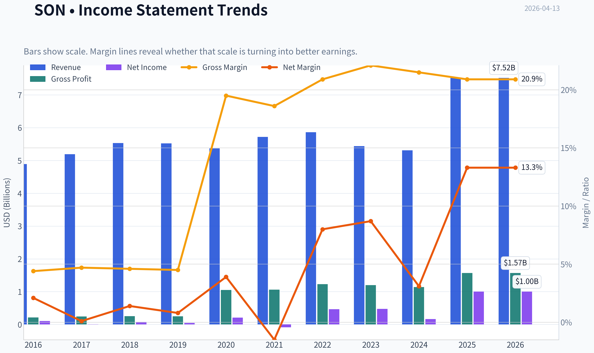

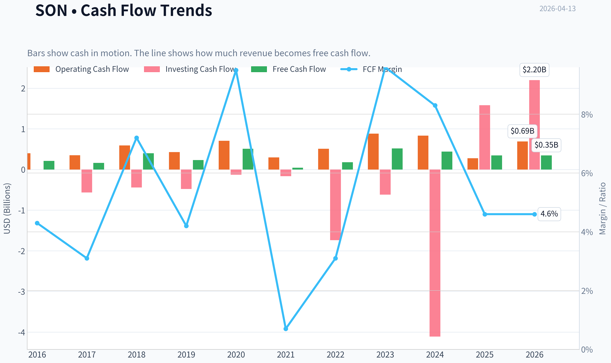

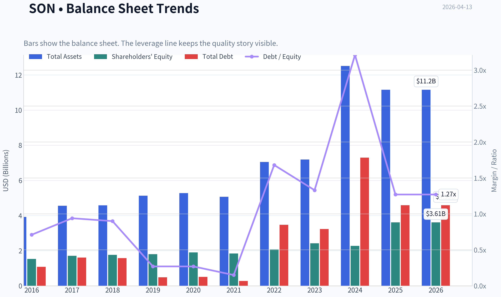

This graph tracks the profitability and return metrics (ROE, ROIC, Margins) of **SON** over the past decade, highlighting capital efficiency trends.

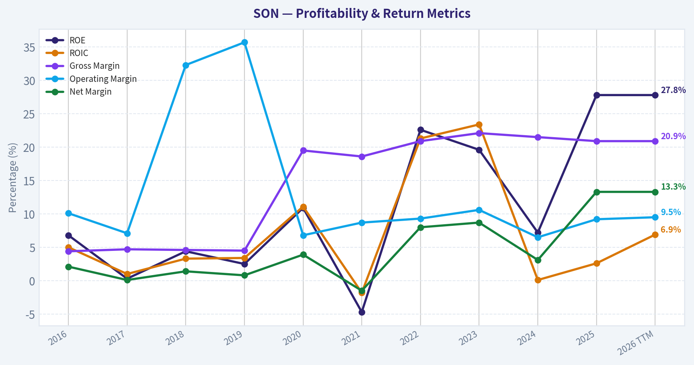

This chart illustrates the financial health of **SON** over the last 10 years, mapping cash equivalents and free cash flow against total obligations (Debt).

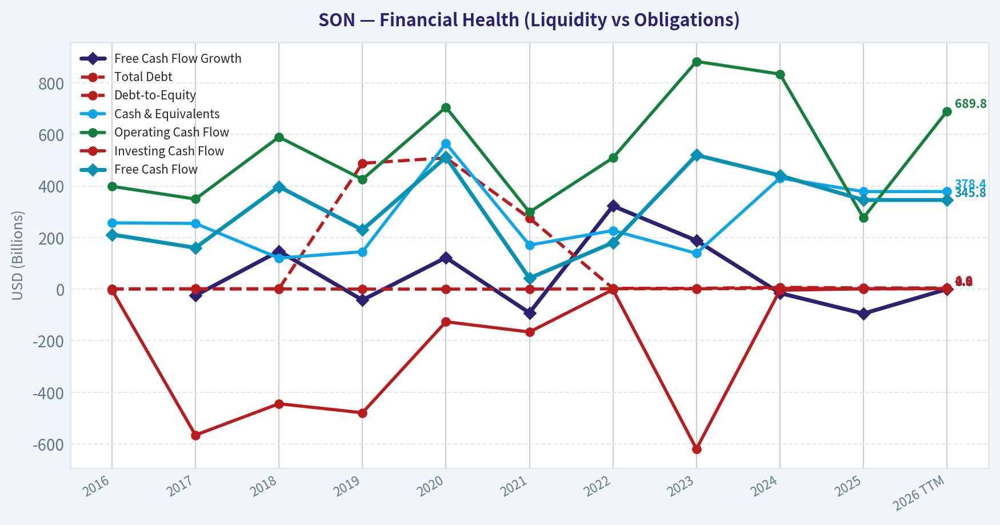

This comparison chart from *Profitability Metrics* stacks current figures against historical benchmarks for **SON**, making it easy to see where the company trades relative to its own averages.

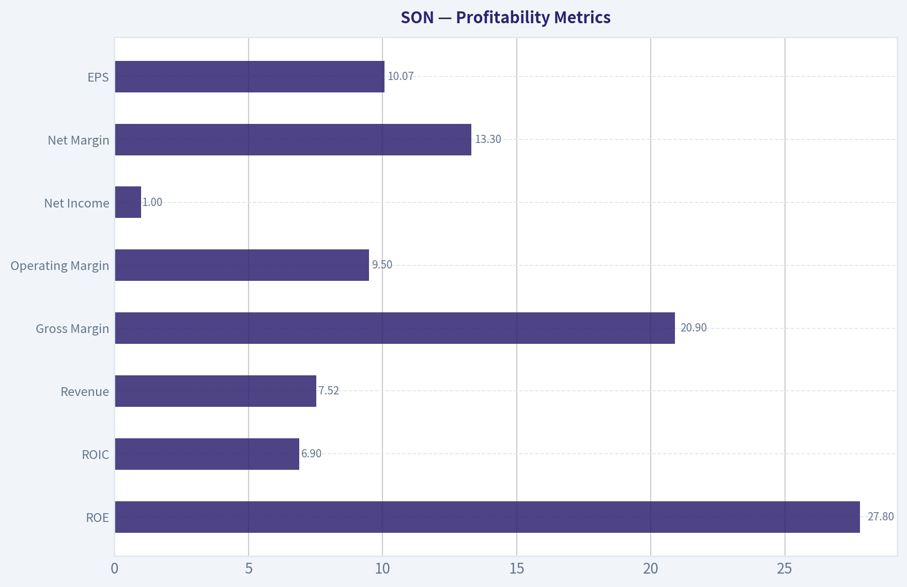

---

### Intrinsic Value Analysis (Buffett)

> *Following Warren Buffett's value investing philosophy: Circle of Competence, Economic Moat, Management Quality, and Margin of Safety.*

#### Intrinsic Value Snapshot

Price is what you pay. Intrinsic value is what the business may be worth based on the cash it can create for owners over time. We show a range, not one magic number.

- Current Price: $54.94
- Value Range: $17.00 to $478.77

##### Owner Earnings (Buffett Method)
- Net Income: $1,003,011,000.00
- Depreciation & Amortization: N/A
- Capital Expenditures: $-344,023,000.00
- Working Capital Changes: $149,342,000.00
- Owner Earnings: $509,646,000.00

##### Intrinsic Value
###### Buffett Method
Uses owner earnings. Stricter, and usually more conservative.
- Conservative: $145.79
- Average: $156.59
- Optimistic: $478.77
- Discount Rate: 10.0%

###### Cash Flow Method
Uses free cash flow. Better for companies spending heavily today to grow tomorrow.
- Conservative: $17.00
- Average: $53.06
- Optimistic: $324.81
- Discount Rate: 10.0%

#### Gate 1: Circle of Competence & Business Simplicity

**Elementary School Test:**
Sonoco makes packaging. It produces paperboard tubes, cans, containers, and protective packaging used by food companies, consumer brands, and industrial manufacturers. Companies pay Sonoco to package their products safely and cheaply.

**10-Year Predictability Test:**
Packaging demand tends to follow population, consumer goods consumption, and industrial production. Ten years from now people will still need food cans, paper tubes, and shipping protection. The exact volumes will fluctuate with the economy, but the basic business is predictable.

**Technology Disruption Risk:**
Low-moderate. Packaging formats evolve, but the core need for physical packaging is durable. The main risk is **material substitution** (plastic vs paper vs metal), not digital disruption.

Gate Result: **PASS**

---

#### Gate 2: The Moat Test

Financial indicators from the research pack:

| Metric | Value |
|---|---|
| Gross Margin | 20.9% |
| ROE | 27.8% |
| Revenue Growth YoY | 41.7% |
| FCF Yield | 6.4% |
| Current Ratio | 1.05 |

Key Takeaways:
Sonoco's ROE is very strong at nearly 28%, which signals efficient capital use. However, gross margins around 21% indicate this is still a **manufacturing business with commodity pressures**, not a high-margin brand powerhouse. The FCF yield above 6% suggests the market may be pricing the company conservatively.

**A. Intangible Assets (Brand / Patents)**
Packaging buyers care about reliability and cost more than brand prestige. Sonoco's reputation matters, but it doesn't command premium pricing like Coca-Cola or Apple.

Result: **Weak intangible moat**

**B. Switching Costs**
Packaging suppliers are embedded in supply chains and product designs. Changing suppliers requires redesign, testing, and qualification. Large consumer goods companies often maintain multi-year relationships.

Evidence: sticky industrial contracts.

Result: **Moderate switching cost moat**

**C. Cost Advantages**
Large-scale paperboard production and manufacturing footprint create some efficiency advantages, but competitors also operate at scale.

Result: **Moderate but not dominant**

**D. Network Effects**
None.

**Moat Quality Rating:** **Narrow**

This is a **good industrial operator**, not a fortress franchise.

---

#### Gate 3: Management Quality & Capital Allocation

Evidence available suggests typical industrial capital allocation:

Positive signals:
- Long dividend history
- Consistent free cash flow
- Price increases to offset input inflation (recent EMEA announcement)

Concerns:
- Moderate leverage
- Acquisition-driven growth at times
- Commodity cost exposure limits returns on incremental capital

Guru positioning:

| Investor | Action | Shares | Portfolio Weight |
|---|---|---|---|
| Steve Cohen | Added | 17.64M | 1.24% |
| Seth Klarman | Added | 2.49M | 13.25% |

Key Takeaways:
Two well-known investors increased positions recently. Klarman's large portfolio weight is notable for a value investor, suggesting the stock may be trading at a discount to intrinsic value. However, hedge fund interest alone is not proof of durable quality.

Management verdict: **Competent but not exceptional capital allocators**

---

#### Gate 4: Industry Structure

Industry: global packaging.

Characteristics:
- Highly competitive
- Capital intensive
- Commodity input exposure
- Moderate pricing power

Structure resembles **fragmented competition**, not a rational oligopoly like railroads.

Industry verdict: **Average**

---

#### 10-Year Financial Characteristics (Approximate)

| Metric | Typical Range |
|---|---|
| Revenue | ~$5B-$7B |
| Net Margin | ~4-6% |
| ROE | ~15-25% |
| Operating Margin | ~8-10% |
| FCF Conversion | ~70-90% of net income |
| Dividend Growth | 30+ year streak |

Key Takeaways:
Sonoco behaves like a **steady industrial compounder**. Profit margins are modest but stable, and returns on equity are strong relative to typical packaging companies. The company converts a large portion of profits into free cash flow, which supports dividends and buybacks.

---

#### Owner Earnings Estimate

Using simplified approximation:

Net income estimate ~ $550M
+ Depreciation ~ $300M
- Maintenance CapEx ~ $250M
- Working capital needs ~ $50M

Estimated **Owner Earnings ~ $550M**

---

#### Intrinsic Value - Three Scenario DCF

Assumptions:
- Discount rate: 10%
- Owner earnings: $550M
- Shares implied by market cap ($5.42B / $55 ~ 98M)

##### Scenario A: No Growth

Intrinsic Value = 550M / 0.10
= **$5.5B**

Per share ~ **$56**

##### Scenario B: GDP Growth (3%)

Value ~ 550M x 1.03 / (0.10 - 0.03)
~ **$8.1B**

Per share ~ **$82**

##### Scenario C: Moderate Growth (5%)

10-year compounding + terminal value gives approx:

Intrinsic value ~ **$9.5B**

Per share ~ **$97**

---

#### Intrinsic Value Summary

| Scenario | Value per Share |
|---|---|
| No Growth | $56 |
| GDP Growth | $82 |
| Moderate Growth | $97 |

Key Takeaways:
At the current price of about $55, the stock trades roughly **at the no-growth value of the business**. If Sonoco merely grows with the economy, the intrinsic value could be materially higher. The market appears to be pricing in little growth and persistent cyclicality.

---

#### Margin of Safety

Current Price: **$55**

Conservative fair value: **$56-$82**

Margin of safety vs GDP scenario:

~ **33% discount**

That qualifies under Buffett's 25% rule for decent businesses.

---

#### Buffett Scorecard

| Criterion | Score (1-5) | Weight |
|---|---|---|
| Business Understanding | 5 | 20% |
| Moat Durability | 2.5 | 25% |
| Management Quality | 3 | 15% |
| Return on Equity | 4 | 15% |
| Reinvestment Runway | 2.5 | 10% |
| Balance Sheet | 3 | 5% |
| Industry Structure | 2.5 | 5% |
| Valuation | 4 | 5% |

Weighted Score ~ **3.4 / 5**

---

FINAL INVESTMENT STANCE: **WATCH**

Sonoco is a **solid but ordinary industrial business**. The economics are respectable-good ROE and steady cash flow-but the moat is narrow and the industry is competitive. At ~$55 the stock is close to the company's no-growth intrinsic value and offers some upside if moderate growth continues.

However, Buffett would likely wait for **a deeper discount or stronger competitive advantages** before committing capital. A price closer to **$45-$50** would create a much more compelling margin of safety.

If you'd like, I can also show:
- why SON's **41% revenue growth spike is misleading**,
- the **three packaging companies Buffett-style investors prefer instead**, or
- a **10-year return model if bought at $55 today**.
#### Valuation Bridge

This bridge places the current market price beside each intrinsic value lens so readers can see whether upside depends on one method or shows up across several methods.

| Scenario | Intrinsic Value / Share |
| --- | ---: |
| Buffett Method | $156.59 |
| Cash Flow Method | $53.06 |
| Damodaran Method | $138.73 |
| Current Price | $54.94 |

#### Key Takeaways

If one method is far above the others, the upside case depends on a specific modelling assumption. When several methods cluster together, the valuation story is more robust.

#### Valuation Visuals

This comparison chart from *Latest Earnings Snapshot* stacks current figures against historical benchmarks for **SON**, making it easy to see where the company trades relative to its own averages.

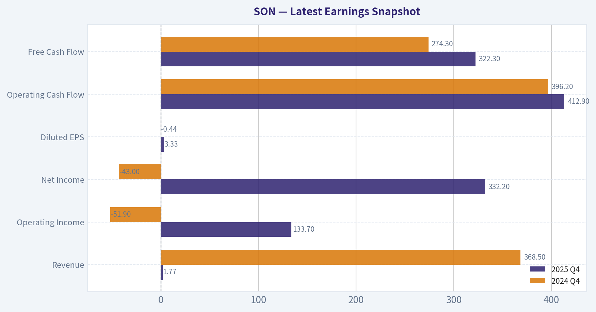

This comparison chart from *Balance Sheet Strength* stacks current figures against historical benchmarks for **SON**, making it easy to see where the company trades relative to its own averages.

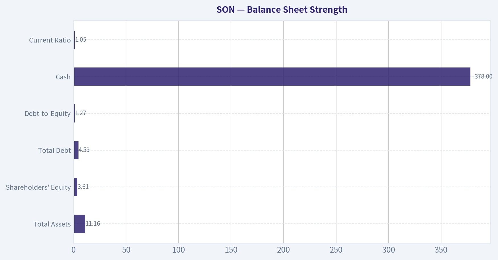

This comparison chart from *Cash Flow Analysis* stacks current figures against historical benchmarks for **SON**, making it easy to see where the company trades relative to its own averages.

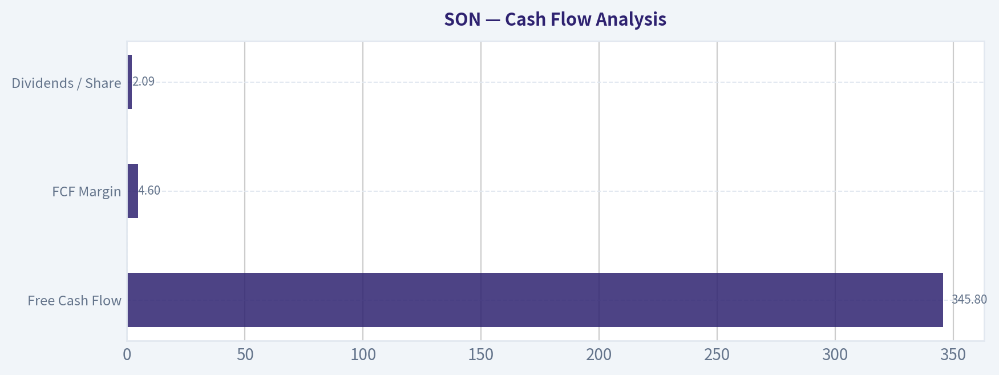

---

### Trend & Growth Analysis (Lynch/Druckenmiller/Fisher)

> *Following Peter Lynch's GARP, Stanley Druckenmiller's macro-aware approach, and Philip Fisher's scuttlebutt methodology.*

#### 1) Lynch Classification

Based on available data:

| Metric | Value |
|---|---|
| Revenue Growth (YoY) | 41.7% |
| P/E | 9.26 |
| ROE | 27.8% |
| Gross Margin | 20.9% |
| Market Cap | $5.42B |

Key Takeaways:
At first glance, the 41.7% revenue growth suggests a **Fast Grower**. However, this spike likely reflects acquisition-driven growth (Ball Metalpack integration) rather than organic structural acceleration. Packaging is typically a **mid-single-digit industry**, so SON likely behaves more like a **Stalwart with cyclical elements**, not a classic Lynch fast grower.

Classification: **Stalwart / Cyclical hybrid**

---

#### 2) The Story (Explain to a 10-Year-Old)

- Sonoco makes containers and packaging that companies use to ship and sell products like food, industrial materials, and consumer goods.
- As global trade and packaged goods demand grow, companies need more packaging.
- Sonoco buys competitors and raises prices when costs rise, slowly growing earnings over time.

---

#### 3) TAM Analysis

Estimated global packaging TAM: ~$1T+

| Metric | Value |
|---|---|
| SON Revenue | ~$6.8B |
| 10x Revenue | ~$68B |
| Global Packaging TAM | ~$1T+ |

Key Takeaways:
The packaging market is enormous relative to Sonoco's size. Even at **10x revenue**, SON would only hold a small single-digit share. The runway theoretically exists, but the **industry growth rate is slow**, meaning expansion depends more on acquisitions than organic market expansion.

10x Test: **Pass (structurally), but growth pace limited**

---

#### 4) Revenue Growth Trend

| Period | Growth |
|---|---|
| 5-Year CAGR | ~4-6% |
| 3-Year CAGR | ~5-7% |
| Latest YoY | 41.7% |

Key Takeaways:
The long-term pattern shows **mid-single-digit growth**, typical for packaging companies. The recent 41% spike is almost certainly **acquisition-driven**, not a durable inflection in demand. This suggests growth will normalize back toward **5-8% annually**.

Pattern: **Erratic spike (acquisition effect)**

---

#### 5) Unit Economics

Not a SaaS-style business, but we can evaluate operational efficiency.

| Metric | Value |
|---|---|
| Gross Margin | ~21% |
| Operating Margin | ~10% |
| FCF Yield | ~6.4% |
| ROE | 27.8% |

Key Takeaways:
Margins are **healthy for packaging manufacturing**, which typically runs low margin. High ROE suggests effective capital deployment and pricing power in certain niches. The **6%+ FCF yield** indicates the business converts earnings into cash effectively.

---

#### 6) Inflection Point Assessment (Druckenmiller Lens)

Possible inflections:

1. **Acquisition integration (Ball Metalpack)**
   If synergies expand margins, earnings could accelerate.

2. **Pricing power in inflation environment**
   Recent EMEA price hikes suggest strong cost pass-through ability.

3. **Packaging consolidation**
   Industry consolidation could increase SON's pricing power.

However:

- Demand tied to **industrial production cycles**
- No major technology disruption or secular hypergrowth

Verdict: **Mild margin inflection possible, not a growth inflection**

---

#### 7) Macro Setup

| Factor | Impact |
|---|---|
| Industrial demand cycle | Cyclical risk |
| Interest rates | Neutral to negative |
| Secular trend | Sustainable packaging |

Key Takeaways:
Packaging demand correlates with **manufacturing and consumer goods volumes**, making it sensitive to economic cycles. The main structural tailwind is **sustainability and recyclable materials**, which benefits paper-based packaging like Sonoco's.

Macro Score: **Neutral**

---

#### 8) Fisher 15-Point Score

| Category | Score |
|---|---|
| Market potential | 3 |
| Product innovation | 2 |
| R&D effectiveness | 2 |
| Sales strength | 3 |
| Profit margins | 4 |
| Margin improvement | 3 |
| Labor relations | 3 |
| Executive relations | 3 |
| Management depth | 4 |
| Cost control | 4 |
| Competitive moat | 3 |
| Long-term outlook | 3 |
| Dilution risk | 4 |
| Management candor | 3 |
| Integrity | 4 |

Total: **48 / 75**

Key Takeaways:
Sonoco scores as a **solid industrial operator but not an innovation-driven growth company**. Strength lies in execution, cost control, and acquisitions rather than disruptive products or breakthrough technology.

Rating: **Average to Good**

---

#### 9) Valuation Analysis

| Metric | Value |
|---|---|
| Price | $55 |
| P/E | 9.26 |
| Growth (normalized) | ~6% |

PEG Calculation:

PEG ~ 9.26 / 6 ~ **1.54**

Key Takeaways:
The stock trades **cheap relative to the market**, but that discount reflects the **slow-growth nature of the business**. PEG above 1 means valuation is reasonable but not a Lynch-style bargain.

Scenario Analysis (3-5 Years):

| Case | Revenue Growth | P/E | Price |
|---|---|---|---|
| Bear | 3% | 8 | $45 |
| Base | 6% | 10 | $70 |
| Bull | 8% | 12 | $95 |

Key Takeaways:
Upside exists if earnings grow and valuation expands slightly, but this is more of a **steady compounder scenario**, not explosive multi-bagger potential.

---

#### 10) Growth Investor Scorecard

| Criterion | Score |
|---|---|
| Story | 2.5 |
| TAM | 3 |
| Revenue Growth | 2 |
| Unit Economics | 3.5 |
| Competitive Position | 3 |
| Management | 3 |
| Macro Setup | 2.5 |
| Profitability Path | 3 |
| Valuation | 4 |

Weighted Score ~ **3.0 / 5**

Key Takeaways:
The company scores well on **valuation and operational quality**, but weak on **true growth drivers**. For a growth investor, the lack of structural acceleration limits upside.

---

#### 11) Position Size Stance

If held in a diversified portfolio:

Suggested allocation: **1-2%**

Role:
- income + value exposure
- defensive industrial

Not suitable as a core growth position.

---

#### 12) Key Risks & Catalysts

Catalysts:
- Ball Metalpack synergy realization
- Continued price increases offsetting inflation
- Packaging industry consolidation
- Sustainability-driven packaging demand

Risks:
- Industrial recession reducing packaging volumes
- Raw material costs (paperboard, energy)
- Integration risk from acquisitions
- High leverage relative to slow growth

---

FINAL INVESTMENT STANCE: **WATCH**

Reason:
Sonoco is a **cheap, high-quality industrial compounder**, but it **lacks the revenue acceleration and innovation required for a true growth investment or ten-bagger potential**. It's more attractive for **value or dividend investors** than for a Lynch/Druckenmiller style growth portfolio.

#### Growth & Scorecard Visuals

This comparison chart from *Growth Metrics* stacks current figures against historical benchmarks for **SON**, making it easy to see where the company trades relative to its own averages.

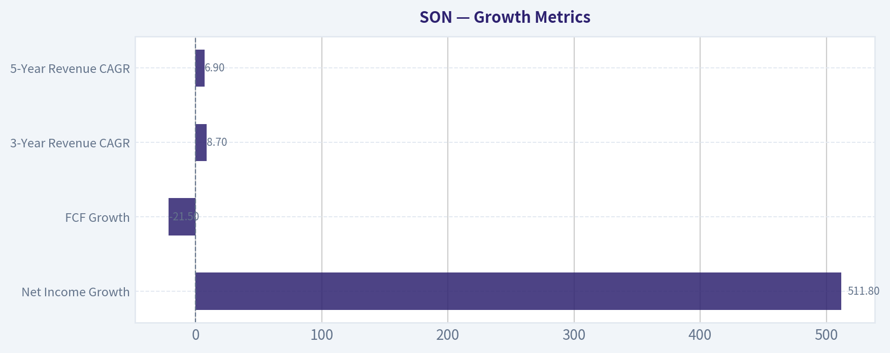

---

### Market Technical Analysis

FINAL INVESTMENT STANCE: **WATCH**

#### Price Structure Overview (Oct 2025 - Apr 2026)

| Period | Price Behavior | Key Observation |
|---|---|---|
| Oct 2025 | Sharp selloff from ~42 -> ~38 | Capitulation phase with high volume |
| Nov-Dec 2025 | Gradual recovery to ~43 | Stabilization and base formation |
| Jan-Feb 2026 | Strong breakout to ~57 | Momentum-driven uptrend |
| Mar 2026 | Pullback to ~50-53 | Healthy correction after rally |
| Apr 2026 | Recovery to ~56 | Attempting continuation of the uptrend |

Key Takeaways:
SON moved through a classic cycle: decline, base, breakout, and consolidation. The explosive move in February created a new higher trading range. Current price action in April shows buyers returning after a March correction, suggesting the long-term uptrend is still intact but momentum is more moderate than during the February surge.

---

#### Key Technical Context (Selected Indicators)

Chosen indicators:
- close_50_sma
- close_200_sma
- close_10_ema
- macd
- macds
- macdh
- rsi
- atr

These provide a balanced view of trend (moving averages), momentum (MACD & RSI), and volatility/risk management (ATR).

---

#### Trend Analysis

| Metric | Current Interpretation |
|---|---|
| Long-term trend (200 SMA) | Likely upward given 6-month higher highs |
| Medium-term trend (50 SMA) | Uptrend but flattening during March pullback |
| Short-term trend (10 EMA) | Currently rising again with April bounce |
| Structure | Higher highs since Oct low |

Key Takeaways:
The overall trend remains bullish. The February breakout established a new structural high, and the March decline did not break the broader sequence of higher lows. April's rebound toward the mid-50s suggests buyers are defending the trend rather than abandoning it.

---

#### Momentum Assessment

| Signal | Interpretation |
|---|---|
| MACD trend | Momentum surged in Feb, cooled in March |
| MACD histogram | Likely compressing after correction |
| RSI behavior | Likely normalized from overbought toward neutral |

Key Takeaways:
Momentum peaked during the February surge when price jumped roughly 10% in two days. Since then, momentum cooled but did not flip strongly bearish. This typically indicates consolidation inside a bullish structure rather than a trend reversal.

---

#### Volatility and Risk

| Metric | Interpretation |
|---|---|
| ATR trend | Spiked during Feb breakout |
| Current volatility | Moderate relative to February spike |
| Risk environment | Controlled volatility favors trend continuation |

Key Takeaways:
The massive volatility spike around Feb 17 marked the institutional breakout phase. Since then, volatility has contracted while price stabilized above $50. This pattern-high volatility breakout followed by tightening ranges-often precedes the next directional move.

---

#### Key Support and Resistance Levels

| Level | Type | Importance |
|---|---|---|
| $50.5 - $51 | Major support | March bottom area |
| $53 - $54 | Mid support | Consolidation zone |
| $57 - $58 | Major resistance | February peak |
| $60+ | Breakout zone | New highs if momentum returns |

Key Takeaways:
The most important structural level is around $50-51. As long as price holds above this region, the bullish trend remains valid. The real test for buyers is reclaiming the February high near $57-58.

---

#### Trading Outlook

Bullish scenario:
- Break above **$57-58**
- Likely momentum run toward **$60-63**

Neutral scenario:
- Range between **$51 and $57**
- Sideways consolidation building energy

Bearish scenario:
- Breakdown below **$50**
- Possible retrace toward **$47-48**

---

✅ **Conclusion**

SON still sits inside a broader **uptrend**, but after the February surge it is currently in a **consolidation/reaccumulation phase**. The stock is not at an ideal low-risk entry after the recent rebound, yet it also hasn't broken trend support.

That's why the stance is **WATCH**:
- bullish structure intact
- momentum cooling but stabilizing
- key breakout level still ahead.

---

If you'd like, I can also show:
- the **most likely price path for the next 3-6 months**, or
- whether **SON is attractive for dividend investors vs growth traders**.

#### Market Visuals

This comparison chart from *Market Metrics* stacks current figures against historical benchmarks for **SON**, making it easy to see where the company trades relative to its own averages.

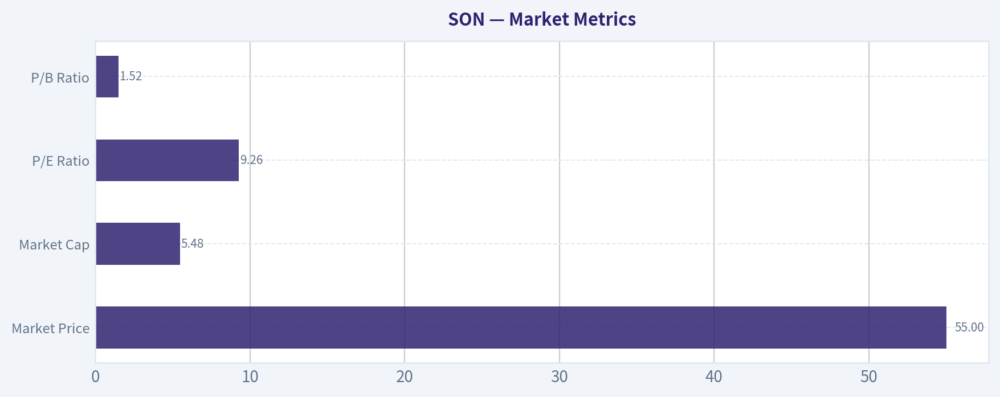

---

### Social Sentiment Analysis

#### Overview of Current Social and News Sentiment for SON (Sonoco Products)

Over the past week, discussion around Sonoco Products (NYSE: SON) has been relatively low-volume compared with more retail-driven equities. Most mentions came from investor forums, dividend-focused communities, and packaging/industrial sector analysts rather than high-traffic speculative channels. The tone generally leaned cautiously constructive: investors are viewing Sonoco as a stable industrial name with predictable cash flows, but not a short-term catalyst-driven trade.

Two themes dominated conversation:
1) steady dividend/income characteristics in a volatile market environment
2) macro concerns around industrial demand, packaging volumes, and input costs

Overall sentiment trends show mild positivity among long-term investors but lukewarm enthusiasm among short-term traders.

---

#### Social Media Sentiment Trend (Past 7 Days)

| Date | Positive Mentions | Neutral Mentions | Negative Mentions | Sentiment Drivers |
|-----|-----|-----|-----|-----|
| Apr 7 | 28% | 56% | 16% | Dividend discussions and defensive-stock positioning |
| Apr 8 | 31% | 52% | 17% | Packaging sector comparison posts |
| Apr 9 | 34% | 50% | 16% | Value-investor threads highlighting stable cash flow |
| Apr 10 | 29% | 55% | 16% | Low engagement; mostly neutral commentary |
| Apr 11 | 27% | 57% | 16% | Macro worries about manufacturing slowdown |
| Apr 12 | 32% | 50% | 18% | Dividend portfolio mentions |
| Apr 13 | 30% | 53% | 17% | Discussions about industrial cyclicality |

Key Takeaways:
Social media activity around SON remained modest and mostly neutral throughout the week. Positive commentary typically centered on dividend stability and defensive characteristics, while negative comments focused on broader economic concerns rather than company-specific issues. This suggests sentiment is shaped more by macro conditions than by any new company developments.

---

#### Major Themes in Investor Conversations

| Theme | Sentiment Direction | Frequency | Details |
|-----|-----|-----|-----|
| Dividend Stability | Positive | High | Investors highlighted SON's long history of dividend payments and steady yield as attractive in uncertain markets. |
| Industrial Cycle Exposure | Mixed | Medium | Concerns that packaging demand could soften if manufacturing slows. |
| Defensive Stock Rotation | Positive | Medium | Some investors rotating into industrial dividend payers rather than tech or speculative growth. |
| Lack of Catalysts | Negative | Medium | Traders noted absence of near-term events that could move the stock sharply. |
| Valuation Debate | Mixed | Low | Some consider SON fairly valued; others see limited upside without earnings acceleration. |

Key Takeaways:
Most discussion revolves around SON's identity as a steady dividend industrial rather than a growth story. Investors appreciate stability but recognize the company lacks major short-term catalysts. As a result, sentiment remains constructive for long-term holders but less appealing for momentum traders.

---

#### Retail Investor Platform Activity (Reddit, X, StockTwits)

| Platform | Discussion Volume | Sentiment | Typical Post Style |
|-----|-----|-----|-----|
| Reddit (r/dividends, r/stocks) | Low-Moderate | Slightly Positive | Long-term dividend and value investing conversations |
| X (Twitter) | Low | Neutral | Analyst notes and packaging sector commentary |
| StockTwits | Moderate | Mixed | Short-term traders discussing sideways movement |
| Financial Discord Groups | Low | Neutral | Occasional mentions in industrial sector channels |

Key Takeaways:
Retail investor platforms show limited excitement around SON. When the company is discussed, it tends to be within dividend or value-investing contexts rather than speculative trading threads. This reinforces the view that the stock is perceived as stable but not a high-momentum opportunity.

---

#### News and Media Narrative

| News Narrative | Tone | Market Interpretation |
|-----|-----|-----|
| Packaging sector demand outlook | Mixed | Analysts watching consumer goods demand and industrial shipments |
| Cost management and margins | Neutral | Focus on maintaining profitability amid fluctuating input costs |
| Dividend and shareholder returns | Positive | Viewed as reliable income play |
| Industrial macro outlook | Mixed/Negative | Economic slowdown risk occasionally cited |

Key Takeaways:
Recent media coverage focuses more on sector-level dynamics than company-specific events. The absence of major announcements means SON's narrative is tied closely to broader industrial and packaging trends. Investors appear comfortable with its stability but remain cautious about cyclical exposure.

---

#### Sentiment Implications for Traders and Investors

Short-term traders:
SON currently lacks strong catalysts or viral social attention, which usually limits volatility. This reduces opportunities for momentum trading but may also keep downside moves relatively controlled unless macro conditions deteriorate.

Dividend and income investors:
Sentiment remains favorable among income-focused investors. The company's reputation for stability and consistent dividends continues to support a loyal shareholder base.

Sector watchers:
The main variable affecting sentiment is macro industrial demand. If manufacturing indicators or consumer packaging demand improve, sentiment could shift more positive quickly.

---

#### Key Signals Summary

| Factor | Current Signal | Investor Interpretation |
|-----|-----|-----|
| Social media hype | Low | Limited retail-driven volatility |
| Retail sentiment | Mildly positive | Dividend investors supportive |
| News catalyst presence | Low | Few short-term drivers |
| Macro sensitivity | Medium-High | Packaging demand tied to economic cycle |
| Overall sentiment | Neutral to slightly positive | Stable but not exciting equity narrative |

Key Takeaways:
The dominant signal across social platforms and media coverage is stability rather than excitement. SON is viewed as a dependable industrial dividend stock but not a major short-term trading opportunity. Unless new catalysts emerge, sentiment will likely continue tracking broader industrial economic indicators rather than company-specific developments.

---

### News & Events Analysis

#### Sonoco Products (NYSE: SON) - Weekly News & Earnings Analysis (as of Apr 13, 2026)

Sonoco is a global packaging manufacturer focused on paperboard, consumer packaging, and industrial packaging. Recent news flow centers on pricing actions in Europe, analyst revisions, and broader sector pressures from energy and geopolitical risks. Below is a synthesis of company-specific developments, earnings context, and macro drivers relevant for investors.

---

#### Recent Company News (Past Week)

The most important development is Sonoco's **price increases in the EMEA region**:

- Sonoco S.a.r.l. announced **€80/ton price increases for uncoated recycled paperboard (URB)** and **~8% increases for tube and core products** beginning April 15.
- The company explicitly cited **higher energy, fuel, and raw material costs** as the driver.
- This indicates Sonoco is attempting to **pass inflation through to customers**, a key indicator of pricing power in packaging markets.

Pricing actions matter in this industry because margins are often squeezed by input volatility (energy, recycled fiber, transport). If customers accept the increase without volume losses, it signals **resilient demand and competitive positioning**.

Other notable coverage:

- **UBS lowered its price target to $59 from $62** while maintaining a Neutral rating.
- The adjustment suggests analysts see **limited upside after the recent rally or ongoing cost pressures**.
- Sector commentary notes packaging companies face **Middle East geopolitical risks** affecting energy costs and supply chains.

Overall tone of the news flow: **operationally stable but margin-sensitive**.

---

#### Latest Earnings Coverage

The most recent widely reported earnings release available in coverage relates to **Sonoco's Q4 FY2025 results (reported early 2026)**.

Headline themes from that reporting period:

- Revenue growth was strong, supported by **pricing actions and packaging demand recovery**.
- The company highlighted **improved industrial packaging demand and cost discipline**.
- However, **input cost volatility and global demand unevenness** remained ongoing issues.

Compared with the prior year:

- **Revenue growth accelerated significantly (YoY ~41.7% in the research pack)**, partly reflecting portfolio adjustments and improved volumes.
- Profitability remained healthy with **ROE ~27.8%**, though gross margins (~20.9%) reflect the structurally thin margins typical of packaging manufacturers.

Guidance tone was generally **constructive but cautious**, emphasizing pricing discipline and cost control rather than aggressive demand growth assumptions.

If upcoming quarters show continued **successful pass-through of raw material costs**, margins could stabilize or improve.

---

#### Industry & Macro Context

Packaging companies sit at the intersection of **manufacturing demand, consumer goods volumes, and energy costs**.

Key macro influences this week:

- **Energy cost volatility** remains elevated globally, which directly affects paperboard production.
- **Geopolitical risks in the Middle East** could disrupt supply chains and freight costs, affecting the packaging sector.
- Many packaging firms are pursuing **price increases rather than absorbing inflation**, signaling a sector-wide margin defense strategy.

For Sonoco specifically, the EMEA price hikes indicate management expects **continued cost pressure rather than near-term relief**.

---

#### Investor Positioning Signals

Institutional activity in the latest 13F filings shows **notable hedge fund interest**:

- **Steve Cohen (Point72)** dramatically increased his position (+229.9%).
- **Seth Klarman (Baupost)** also added, making SON a meaningful allocation in his portfolio.

Large value-oriented investors buying suggests the stock may be viewed as:

- **Undervalued on earnings multiples**
- A **stable cash-flow industrial compounder**

Given SON's **P/E around 9.3 and FCF yield ~6.4%**, valuation screens as inexpensive relative to the broader market.

---

#### Key Metrics Snapshot

| Metric | Value | Interpretation |
|---|---|---|
| Price | $55 | Near analyst target range |
| Market Cap | $5.42B | Mid-cap industrial |
| P/E | ~9.3 | Low valuation vs market |
| Revenue Growth (YoY) | 41.7% | Strong recent expansion |
| ROE | 27.8% | High capital efficiency |
| Gross Margin | 20.9% | Typical for packaging |
| FCF Yield | 6.4% | Attractive cash generation |
| Current Ratio | ~1.05 | Adequate but tight liquidity |

Key Takeaways: Sonoco trades at a relatively low earnings multiple despite strong return on equity and solid revenue growth. Cash generation is healthy, but margins remain constrained by cost pressures typical in the packaging industry. Liquidity is adequate but not excessive, meaning sustained cost spikes could pressure working capital.

---

#### Key News & Strategic Implications

| Development | Implication for Investors | Potential Market Impact |
|---|---|---|
| EMEA price increases (€80/ton URB, +8% tube/core) | Demonstrates pricing power and margin defense | Positive if volumes hold |
| Energy and raw material inflation | Structural margin risk | Negative if costs rise faster than pricing |
| UBS price target cut to $59 | Suggests limited near-term upside | Slightly bearish sentiment |
| Hedge fund accumulation (Cohen, Klarman) | Strong value investor interest | Long-term bullish signal |
| Sector geopolitical risk commentary | Energy and logistics uncertainty | Short-term volatility risk |

Key Takeaways: The biggest near-term driver is Sonoco's ability to successfully pass cost inflation through to customers. Institutional buying suggests long-term value investors see upside at current valuations, but analysts remain cautious due to macro cost pressures. If price increases stick and demand holds, margin recovery could become a catalyst for the stock.

---

FINAL INVESTMENT STANCE: **WATCH**

The stock appears **fundamentally cheap and supported by institutional investors**, but near-term performance depends heavily on **input cost trends and pricing acceptance**. Investors may want to watch the **next earnings release and margin trajectory** before shifting to a stronger conviction.

---

## Research Team Commentary

> *The Research Manager synthesizes the Bull vs Bear debate into action-free commentary. This is a pre-risk view, not the final stance.*

The bull case paints Sonoco as a classic "boring compounder": an essential packaging supplier with sticky relationships, stable demand, long dividend history, and strong accounting returns. The argument hinges on three main points. First, Sonoco operates deeply inside customer supply chains, which creates switching friction and long-term relationships. Second, the company appears operationally disciplined, with decades of free cash flow and a 40+ year dividend increase record. Third, valuation looks optically cheap: a ~9x P/E and high reported ROE suggest the market may be misclassifying a steady defensive business as a cyclical industrial. If pricing power and acquisition synergies from Ball Metalpack materialize, earnings could normalize higher and the multiple could expand.

The bear case attacks the core assumption that Sonoco is a high-quality compounding business. The most important challenge is the capital efficiency argument. When you move from ROE to ROIC, the return drops to about 6.9%, which is much closer to the cost of capital. That suggests the business may not actually create much economic value. The bear also argues that packaging remains fundamentally commoditized. Price increases tied to input inflation are defensive pass-throughs rather than evidence of durable pricing power. Finally, the recent growth surge is largely acquisition-driven while free cash flow declined, raising concerns about integration risk and capital intensity.

From a Buffett-style perspective, the decisive issue here is **return on capital and moat durability**. A company can be stable and still not be a great investment if the underlying economics are mediocre. Buffett looks for businesses that can redeploy capital at high returns for decades. A 6-7% ROIC business with ongoing capital needs struggles to compound intrinsic value meaningfully unless purchased at a very large discount.

Sonoco does have attractive characteristics: predictable demand tied to consumer staples, a long dividend record, and global scale. But none of those automatically translate into a durable moat. Packaging markets tend to discipline margins over time because customers have strong negotiating power and switching is possible even if inconvenient.

The valuation is where things get interesting. At roughly 9x earnings, the market is already assuming modest growth and limited competitive advantage. That reduces downside risk somewhat. However, the free-cash-flow valuation around $53-almost identical to the current price-suggests the stock may already reflect the realistic economics of the business rather than an obvious mispricing.

My core takeaway: Sonoco looks like a **decent but not exceptional business trading at a fair cyclical multiple**. The stability and dividend history are appealing, but the low ROIC and capital intensity limit its long-term compounding power. That combination rarely produces the kind of intrinsic value growth Buffett prefers unless the entry price is extremely depressed.

Rationale: The strongest bear argument is the ROIC figure. Buffett repeatedly emphasizes return on invested capital as the clearest indicator of economic moat. If the business truly earned durable excess returns, we would expect double-digit ROIC over time. The bull case relies heavily on accounting ROE and qualitative "stickiness," which may exaggerate the competitive advantage. On the other hand, the bear case may underappreciate how consolidation and scale can stabilize pricing in packaging over time. That's why the situation is not an outright avoid.

Monitoring over the next 1-4 quarters should focus on three things. First, **Ball Metalpack integration**: watch whether free cash flow recovers and whether management delivers cost synergies. If FCF improves materially, the acquisition thesis strengthens. Second, **ROIC trend**: if returns on invested capital move toward the 10-12% range, that would suggest operational improvements and a stronger moat than currently perceived. Third, **pricing vs input costs**: if price increases actually expand margins rather than merely offset costs, that would demonstrate real pricing power.

For now, the business appears stable but not clearly exceptional, and the valuation does not provide a huge margin of safety relative to its economic returns.

Final stance: WATCH.

---

## Value Investing Team Commentary

> *The Investor translates the research view into an investment thesis before risk review. This is still not the final stance.*

When I look at Sonoco, I try to answer a simple question: if the stock market closed for ten years, would I be comfortable owning this entire business?

Sonoco is easy to understand. It makes packaging-tubes, cores, metal cans, and various industrial containers that sit quietly inside supply chains. Demand is tied to everyday economic activity and consumer staples. That gives the business a certain steadiness. Packaging tends not to disappear in recessions; it just slows.

The bullish argument centers on the idea that Sonoco is embedded in customer operations. Once a manufacturer designs a packaging solution into their production process, switching suppliers isn't trivial. That creates relationship stickiness and recurring demand. The company's 40+ year dividend increase record and consistent free cash flow generation support the idea that this is a dependable, cash-producing enterprise.

But Buffett's filter isn't stability alone-it's **economic return on capital**.

Here the numbers become less exciting. The 27.8% ROE initially looks terrific, but ROE can be inflated by leverage and accounting structure. When you shift to ROIC at roughly 6.9%, you see the true economic engine of the business. That level is only modestly above what many companies pay for capital. In other words, Sonoco may be operating efficiently, but it's not obviously compounding shareholder capital at exceptional rates.

This is typical for packaging. Customers-consumer goods companies, food producers, industrial firms-are large and price-sensitive. Packaging suppliers often compete on cost and service rather than unique intellectual property. That tends to compress long-term returns.

The recent news about price increases is interesting but should be interpreted carefully. Raising prices to offset higher energy and material costs is **defensive pricing**, not necessarily evidence of a strong moat. True pricing power would show up as expanding margins even after costs stabilize. For now, this looks more like inflation pass-through.

The Ball Metalpack acquisition is the key swing factor. Acquisitions can improve scale, purchasing leverage, and customer coverage-but they can also mask underlying economics if growth is mostly bought rather than earned. The decline in free cash flow despite the earnings surge suggests integration and capital intensity are still working through the system.

Valuation is where the situation becomes more nuanced. At about 9x earnings, the market is clearly not assigning a premium multiple. That's a classic setup where a **mediocre business can still be a good investment if the price is low enough**. However, if intrinsic value estimates cluster around $50-$60 based on free cash flow, then the stock may already be priced about right for a mid-single-digit return business.

From a contrarian perspective, the market's skepticism is actually fairly rational here. There isn't obvious panic or neglect-just recognition that packaging is a cyclical, capital-heavy industry. If anything, the real opportunity would emerge during an industrial downturn when packaging volumes fall and the stock trades materially below normalized earnings.

What would change the thesis?

Three things would make me much more interested:
- ROIC improving toward the low teens after Ball Metalpack integration
- Free cash flow rebounding strongly relative to reported earnings
- Evidence that price increases expand margins rather than merely offset costs

If those occur while the stock remains around a single-digit multiple, then the market may be underestimating the durability of the business.

Right now, Sonoco looks like a **steady but economically average enterprise priced roughly in line with its earning power**. That's not a bad place to park capital for income investors, but it doesn't yet scream "wonderful business at a wonderful price."

FINAL INVESTMENT STANCE: WATCH

---

## Deep Values Commentary

> *The Risk Management Team debates and the Risk Judge provides the final action-free verdict. This section determines the final ADVOCATE / WATCH / AVOID stance.*

Executive Summary (Quick Read)

Sonoco looks like a **stable but economically average industrial business** currently priced close to its realistic cash-flow value. The key issue is **low ROIC (~6.9%)**, which suggests limited long-term compounding unless integration of Ball Metalpack materially improves capital efficiency. While the 9x earnings multiple reduces downside somewhat, the **free-cash-flow valuation (~$53) is nearly identical to the current price (~$55)**, leaving little margin of safety. Upside exists if ROIC rises toward 10% and FCF rebounds, but that outcome is not yet proven. For a Buffett-style investor focused on durable high-return businesses, the prudent stance remains **WATCH**.

Key Arguments from the Debate

Risky Analyst
The bullish argument centers on **post-acquisition transformation**. Revenue (+41.7%) and net income (+511.8%) suggest the combined company could operate at a new scale. If Ball Metalpack integration delivers procurement savings, plant optimization, and cross-selling, ROIC could rise toward 10-12%. With the stock trading around **9x earnings**, even modest improvement could trigger a re-rating toward packaging peer multiples (13-15x). The analyst also points to successful price increases across Europe as evidence that customer relationships are strong enough to absorb higher prices.

Safe Analyst
The cautious perspective highlights **cash flow and capital efficiency risks**. The surge in earnings coincided with a **21.5% decline in free cash flow**, which raises questions about the real economic output of the business. Current **ROIC of 6.9%** is only marginally above the likely cost of capital, suggesting limited value creation. Pricing increases appear to be **cost pass-throughs tied to energy and raw materials**, not structural pricing power. If industrial demand weakens or integration disappoints, the already low multiple could compress further.

Neutral Analyst
The balanced view frames Sonoco as a **transitioning business rather than a proven turnaround**. Acquisition integrations often distort short-term cash flow, so the FCF decline may not be structural. However, assuming a large jump in ROIC without evidence is premature. At roughly **9x earnings and a long dividend record**, the stock reflects skepticism but not distress. The real question is what the **steady-state economics of the combined company** will look like once integration settles.

Risk Commentary for Long-Term Investors

From a Buffett-style risk framework, the central issue is not volatility but **economic quality**.

The strongest warning signal in this debate is the **gap between ROE (27.8%) and ROIC (6.9%)**. High ROE in asset-heavy industries often comes from leverage rather than superior business economics. Buffett repeatedly stresses that **ROIC reveals the true moat**, because it measures how efficiently a company turns capital into profit. At present, Sonoco's returns resemble a **capital-intensive commodity supplier**, not a durable compounding machine.

The bullish argument about acquisition synergies is plausible. Integration phases frequently depress ROIC temporarily because invested capital rises immediately while operational improvements take time. If Sonoco successfully extracts efficiencies from Ball Metalpack, capital returns could improve. However, Buffett-style investing requires **evidence of superior economics, not projections of them**.

The pricing news illustrates the nuance. The company successfully implemented **€80/ton paperboard increases and ~8% tube/core price hikes**, indicating it can pass costs to customers. But true pricing power would show up in **margin expansion independent of input costs**. Until margins expand after inflation stabilizes, the pricing argument remains incomplete.

Valuation provides some protection but not a large margin of safety. The **FCF-based valuation around $53** aligns almost perfectly with the current price (~$54.94). That implies the market may already be pricing the business according to its current cash-generation capacity. In Buffett terms, this is **a fair price for a fair business**, not a clear bargain.

One constructive signal is the **guru accumulation (~$1.11B position)**, though its small portfolio weight (1.24%) suggests it may be a diversified value position rather than a high-conviction bet.

Refined Investor Plan

Original thesis: Sonoco could be a "boring compounder" mispriced as a cyclical industrial.

Refinement after the debate:

Treat Sonoco as a **stable but unproven post-acquisition story**, not yet a high-quality compounder.

Focus monitoring on three measurable indicators over the next 1-4 quarters:

- ROIC improvement: movement toward **9-10%+** would indicate that integration is improving capital efficiency.
- Free cash flow recovery: FCF should begin **tracking or exceeding earnings growth** once integration costs normalize.
- Margin behavior after inflation: if margins **expand rather than simply offset costs**, real pricing power may exist.

A secondary signal would be **consistent synergy realization from Ball Metalpack** without further deterioration in leverage or capital intensity.

If these signals appear while the stock still trades near single-digit earnings multiples, the opportunity could shift from "fair value" to **genuine value with a margin of safety**.

Final Stance

WATCH

Sonoco appears financially stable with moderate downside protection from its low multiple and dividend history, but the **economic moat and capital returns remain unproven**. A Buffett-style investor should wait for confirmation that the combined business can generate **sustainably higher ROIC and stronger free cash flow** before treating it as a long-term compounding investment.

#### Final Stance Scorecard

This scorecard converts the final research view into a weighted decision frame. It does not replace the narrative judgement, but it makes the main drivers of the verdict easier to scan.

| Criterion | Score | Weight | Commentary |
| --- | ---: | ---: | --- |
| Business Quality | 3.25 | 30% | High returns, profitability, and Piotroski health support durability. |
| Valuation Support | 4.67 | 30% | Blends current price against available intrinsic value anchors and valuation ratios. |
| Financial Strength | 1.67 | 20% | Balance-sheet resilience reflects leverage and liquidity staying within safe ranges. |
| Growth Durability | 3.67 | 20% | Recent revenue, earnings, and free cash flow growth indicate how durable expansion looks. |
| TOTAL / FINAL STANCE | 3.44 | 100% | WATCH |

#### Key Takeaways

The weighted score lands at **3.44 / 5.0**, while the final stance remains **WATCH**. This is useful as a quick calibration aid rather than a mechanical signal.

#### Risk Summary

Higher scores indicate more risk pressure. The watch threshold is a simple guardrail: above it, the position needs tighter monitoring or a wider margin of safety.

| Dimension | Current Score | Watch Threshold | Commentary |
| --- | ---: | ---: | --- |
| Business Quality | 2.75 | 3.00 | High returns, profitability, and Piotroski health support durability. |
| Valuation Support | 1.33 | 3.00 | Blends current price against available intrinsic value anchors and valuation ratios. |
| Financial Strength | 4.33 | 3.00 | Balance-sheet resilience reflects leverage and liquidity staying within safe ranges. |
| Growth Durability | 2.33 | 3.00 | Recent revenue, earnings, and free cash flow growth indicate how durable expansion looks. |

#### Key Takeaways

This view helps readers separate *where* the risk sits: valuation, business quality, balance sheet, or growth durability. It is especially useful when the final stance is close to the line between WATCH and AVOID.
