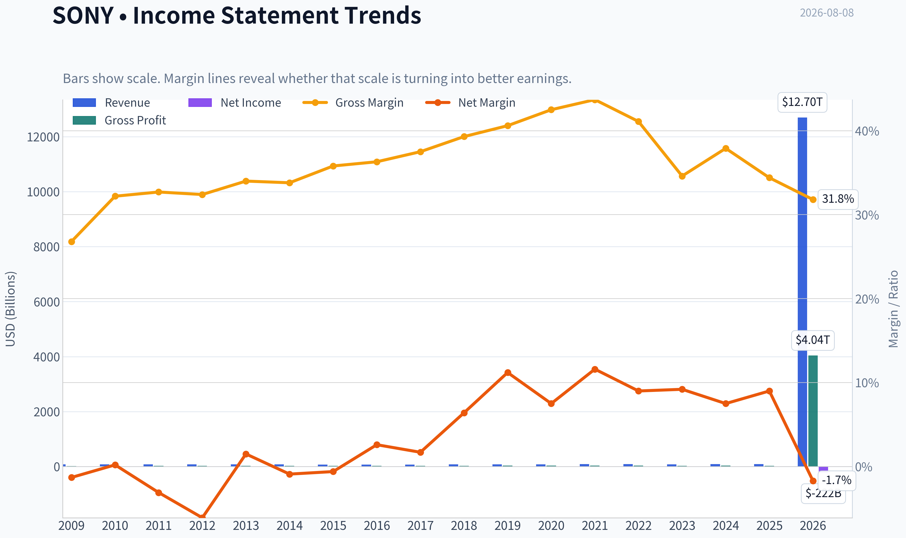
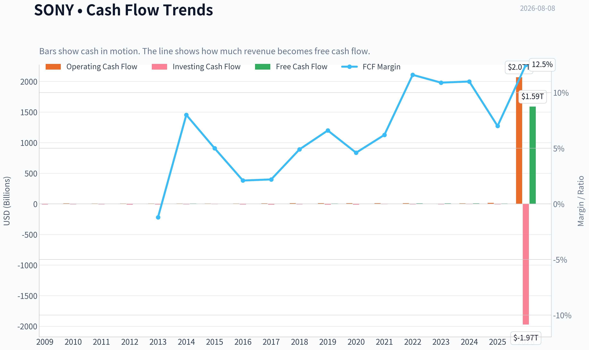
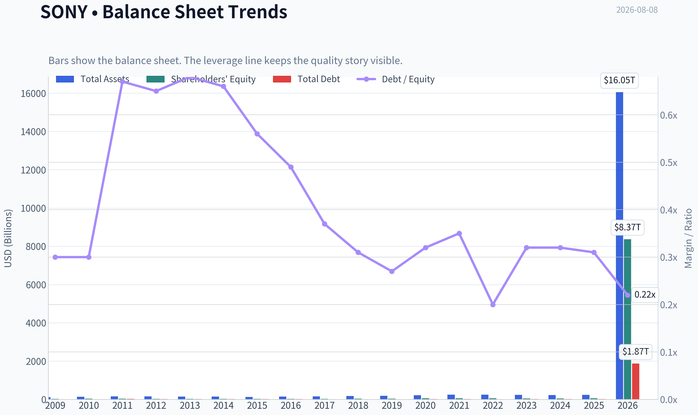
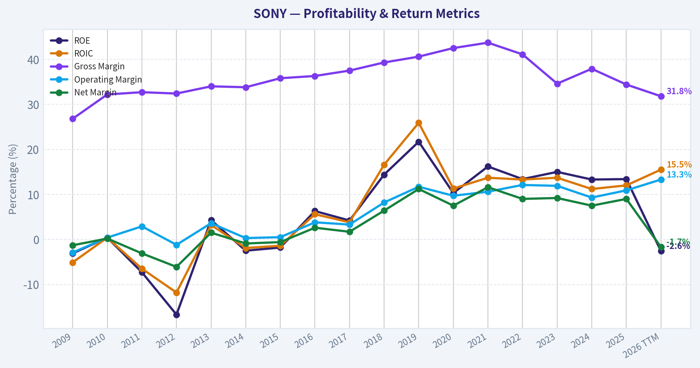
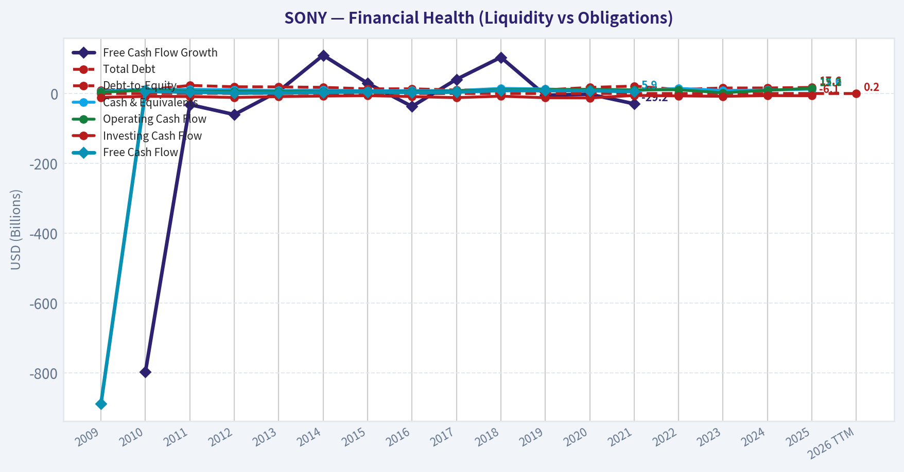
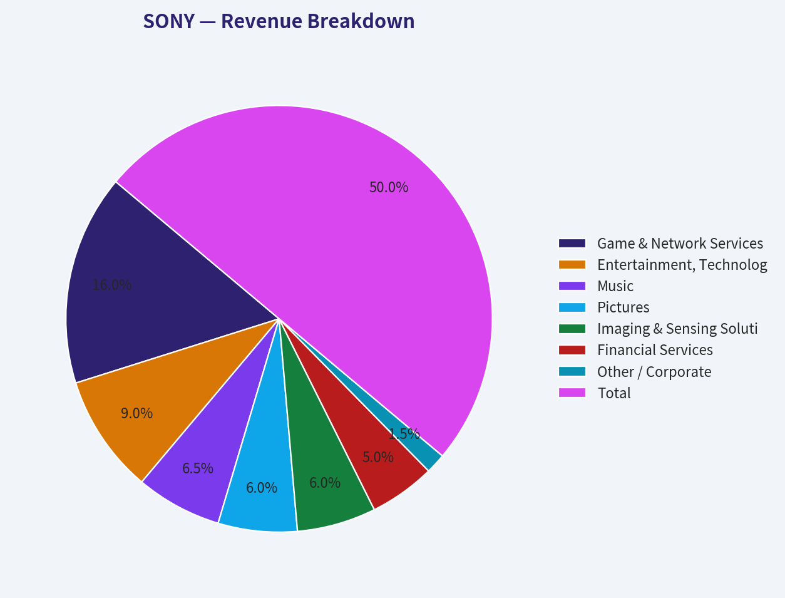
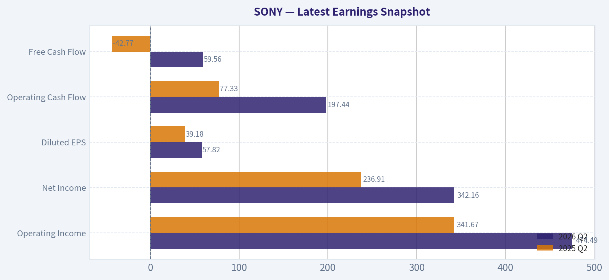
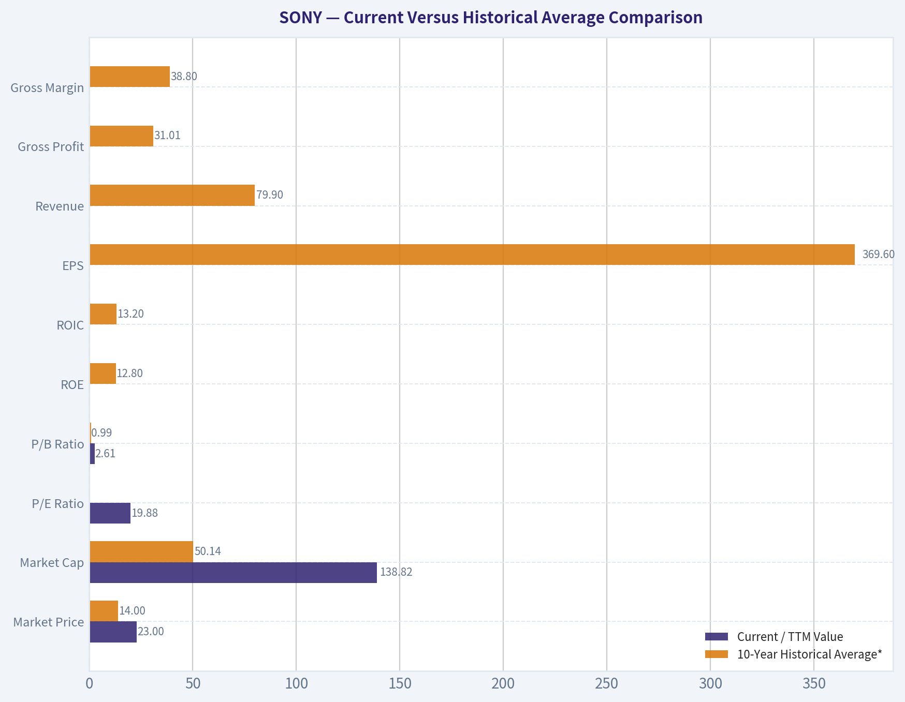
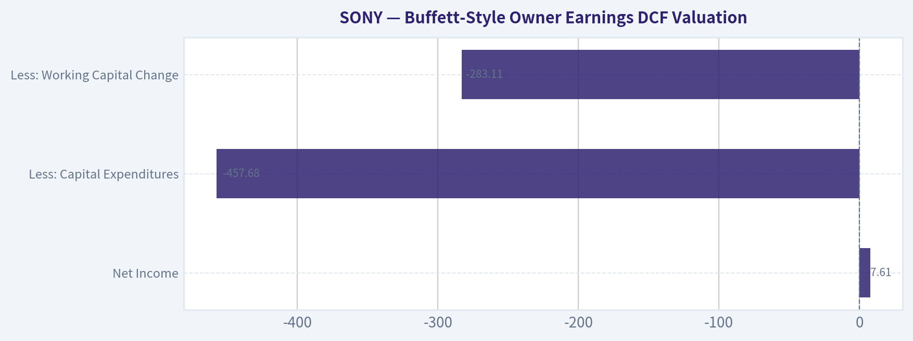
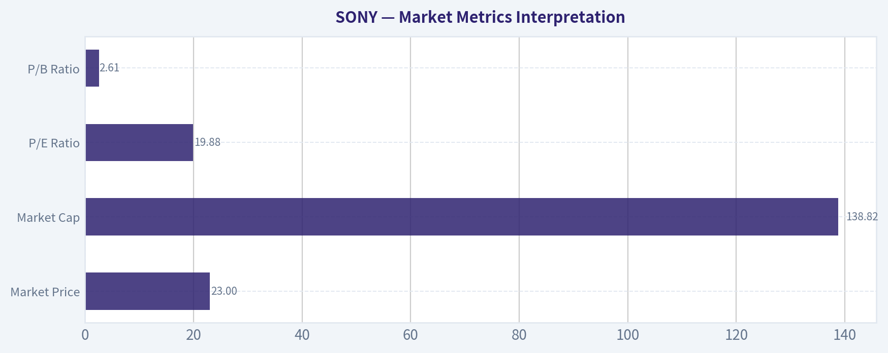

# SONY Deep Value Intelligence

**Analysis Date:** 2026-08-08

## Critical Disclaimer

*This analysis is generated by Deep Value Intelligence, an AI-powered multi-agent investing framework. Education & research only - not financial advice, not a financial advisor.*

---

## Table of Contents

1. Intelligence Summary
2. Analyst Team Reports
   - Fundamentals Analysis
   - Intrinsic Value Analysis (Buffett)
   - Trend & Growth Analysis (Lynch/Druckenmiller/Fisher)
   - Market Technical Analysis
   - Options Market Analysis
3. Research Team Commentary
4. Value Investing Team Commentary
5. Deep Values Commentary

---

## Intelligence Summary

### Thesis + Conditions

**Core Thesis:** **EXECUTIVE SUMMARY**
Sony represents a high-quality transition from cyclical hardware to recurring IP, supported by a 15.2% ROIC and constructive technicals. However, severe mathematical contradictions in the provided data (a positive 19.88 P/E juxtaposed with a -4.0% ROE and -2.1% ROA) trigger our strict "verification-first" rule.

**Key Risks:**
- Sony represents a high-quality transition from cyclical hardware to recurring IP, supported by a 15.2% ROIC and constructive technicals. However, severe mathematical contradictions in the provided data (a positive 19.88 P/E juxtaposed with a -4.0% ROE and -2.1% ROA) trigger our strict "verification-first" rule. We remain sidelined until the accounting anomaly is resolved. **Final Stance: WATCH.**
- In our SE post-mortem, we learned that a sophisticated thesis is useless if the foundational data is flawed. A trailing P/E of 19.88 inherently implies positive net earnings, yet we see a -4.0% ROE. Unless there is a severe equity distortion (e.g., a massive one-time non-cash impairment), you cannot simultaneously generate normal earnings and negative returns on equity/assets. *Action:* Downgrade conviction to WATCH until we pull the filings and verify if the negative ROE is just accounting noise or actual capital erosion.
- We will not force a high-conviction buy, but we will create a staged decision tree to capture the upside if the data clears:

**Confidence:** Medium

---

## Analyst Team Reports

### Fundamentals Analysis

#### Latest Earnings Snapshot

*Most recent reported quarter anchored on 2026 Q2, with prior-year comparison when available.*

| Metric | 2026 Q2 | 2025 Q2 | YoY Change |
| --- | ---: | ---: | ---: |
| Revenue | $2.84T | $2.62T | +8.2% |
| Operating Income | $474.49B | $341.67B | +38.9% |
| Net Income | $342.16B | $236.91B | +44.4% |
| Diluted EPS | $57.82 | $39.18 | +47.6% |
| Operating Cash Flow | $197.44B | $77.33B | +155.3% |
| Free Cash Flow | $59.56B | $-42.77B | +239.3% |

Key Takeaways: This snapshot anchors the most recent reported quarter before the narrative analysis. It helps readers separate long-run business quality from whatever changed in the latest earnings print.

#### 17-Year Financial Metrics for SONY

*All values below are computed deterministically from raw data - not estimated by AI.*

*Issuer profile: operating company (Technology / Consumer Electronics).*

#### 17-Year Financial Metrics
*Annual rows come from reported financial statements. The final TTM row is computed from the latest four quarters.*

| Metric | 2009 | 2010 | 2011 | 2012 | 2013 | 2014 | 2015 | 2016 | 2017 | 2018 | 2019 | 2020 | 2021 | 2022 | 2023 | 2024 | 2025 | 2026 TTM |
| --- | --- | --- | --- | --- | --- | --- | --- | --- | --- | --- | --- | --- | --- | --- | --- | --- | --- | --- |
| Market Price | $4 | $7 | $6 | $4 | $3 | $4 | $5 | $5 | $6 | $9 | $8 | $11 | $21 | $20 | $18 | $17 | $25 | $23 |
| Market Cap | $4.14B | $7.69B | $6.39B | $4.17B | $3.73B | $3.93B | $5.97B | $6.47B | $8.69B | $12.50B | $10.94B | $14.94B | $26.52B | N/A | $112.02B | $105.57B | $153.60B | $138.82B |
| P/E Ratio | -0.04 | -0.19 | -0.02 | -0.01 | 0.08 | -0.03 | -0.05 | 0.04 | 0.12 | 0.02 | 0.01 | 0.03 | 0.03 | 0.03 | 0.11 | 0.11 | 0.14 | -0.63 |
| P/B Ratio | 0.13 | 0.22 | 0.18 | 0.14 | 0.13 | 0.15 | 0.24 | 0.23 | 0.31 | 0.36 | 0.27 | 0.27 | 0.43 | N/A | 2.24 | 2.06 | 2.70 | 0.02 |
| ROE | -3.1% | 0.4% | -7.3% | -16.7% | 4.3% | -2.5% | -1.8% | 6.3% | 4.2% | 14.4% | 21.7% | 10.3% | 16.2% | 13.4% | 15.0% | 13.3% | 13.4% | -2.6% |
| ROIC | -5.1% | 0.4% | -6.5% | -11.8% | 3.2% | -1.9% | -1.4% | 5.6% | 3.8% | 16.6% | 25.9% | 11.3% | 13.7% | 13.3% | 13.7% | 11.2% | 12.0% | 15.5% |
| EPS | $-86.22 | $-35.87 | $-230.95 | $-411.93 | $38.35 | $-117.47 | $-106.24 | $112.98 | $55.25 | $371.64 | $696.86 | $457.47 | $803.57 | $691.21 | $161.97 | $157.14 | $187.92 | $-37.22 |
| Revenue | $77.17B | $77.76B | $83.99B | $82.24B | $82.20B | $77.53B | $75.15B | $67.56B | $70.32B | $77.11B | $78.19B | $75.98B | $84.90B | $88.38B | $81.24B | $90.30B | $85.06B | $12.70T |
| Gross Profit | $20.66B | $25.03B | $27.50B | $26.68B | $27.94B | $26.23B | $26.90B | $24.49B | $26.36B | $30.29B | $31.71B | $32.26B | $37.11B | $36.31B | $28.13B | $34.20B | $29.23B | $4.04T |
| Gross Margin | 26.8% | 32.2% | 32.7% | 32.4% | 34.0% | 33.8% | 35.8% | 36.3% | 37.5% | 39.3% | 40.6% | 42.5% | 43.7% | 41.1% | 34.6% | 37.9% | 34.4% | 31.8% |
| Operating Margin | -2.9% | 0.4% | 2.9% | -1.2% | 3.6% | 0.3% | 0.5% | 3.8% | 3.3% | 8.2% | 11.7% | 9.7% | 10.6% | 12.1% | 11.9% | 9.3% | 10.9% | 13.3% |
| Net Income | $-1.02B | $139.6M | $-2.58B | $-5.04B | $1.23B | $-687.2M | $-448.2M | $1.75B | $1.18B | $4.94B | $8.72B | $5.72B | $9.85B | $7.91B | $7.49B | $6.80B | $7.61B | $-221.61B |
| Net Margin | -1.3% | 0.2% | -3.1% | -6.1% | 1.5% | -0.9% | -0.6% | 2.6% | 1.7% | 6.4% | 11.2% | 7.5% | 11.6% | 9.0% | 9.2% | 7.5% | 9.0% | -1.7% |
| Revenue Growth | N/A | 0.8% | 8.0% | -2.1% | -0.0% | -5.7% | -3.1% | -10.1% | 4.1% | 9.7% | 1.4% | -2.8% | 11.7% | 4.1% | -8.1% | 11.2% | -5.8% | 14826.5% |
| Net Income Growth | N/A | -113.7% | -1945.6% | 95.5% | -124.4% | -155.9% | -34.8% | -490.0% | -32.5% | 318.7% | 76.6% | -34.4% | 72.1% | -19.6% | -5.4% | -9.2% | 12.0% | -3010.6% |
| Free Cash Flow Growth | N/A | -797.4% | -31.6% | -60.0% | 6.9% | 109.9% | 29.7% | -36.8% | 40.8% | 104.0% | -4.6% | -1.9% | -29.2% | N/A | N/A | N/A | N/A | N/A |
| Total Book Value | $32.50B | $35.13B | $35.19B | $30.16B | $28.37B | $27.05B | $24.40B | $27.81B | $28.05B | $34.25B | $40.10B | $55.49B | $60.96B | $58.98B | $49.98B | $51.22B | $56.88B | $8.37T |
| Total Assets | $121.39B | $137.58B | $155.28B | $161.60B | $150.88B | $149.03B | $131.94B | $148.38B | $158.00B | $179.05B | $189.64B | $213.26B | $249.38B | $249.80B | $233.89B | $225.22B | $235.89B | $16.05T |
| Total Debt | $9.74B | $10.40B | $23.43B | $19.55B | $19.20B | $17.86B | $13.62B | $13.74B | $10.25B | $10.51B | $10.73B | $17.60B | $21.58B | $11.60B | $16.06B | $16.14B | $17.65B | $1.87T |
| Debt-to-Equity | 0.30 | 0.30 | 0.67 | 0.65 | 0.68 | 0.66 | 0.56 | 0.49 | 0.37 | 0.31 | 0.27 | 0.32 | 0.35 | 0.20 | 0.32 | 0.32 | 0.31 | 0.22 |
| Cash & Equivalents | $6.68B | $12.74B | $12.20B | $10.87B | $8.77B | $10.17B | $7.91B | $8.85B | $8.67B | $14.96B | $13.32B | $9.62B | $8.18B | $14.96B | $9.22B | $10.14B | $12.60B | $2.17T |
| Shareholders' Equity | $32.50B | $35.13B | $35.19B | $30.16B | $28.37B | $27.05B | $24.40B | $27.81B | $28.05B | $34.25B | $40.10B | $55.49B | $60.96B | $58.98B | $49.98B | $51.22B | $56.88B | $8.37T |
| Operating Cash Flow | $4.06B | $9.84B | $7.21B | $6.54B | $5.76B | $6.63B | $6.90B | $6.24B | $7.47B | $11.32B | $11.36B | $12.42B | $10.76B | $10.99B | $2.33B | $9.52B | $15.24B | $2.07T |
| Investing Cash Flow | $-10.80B | $-8.04B | $-8.35B | $-11.18B | $-8.53B | $-7.09B | $-5.85B | $-8.59B | $-11.61B | $-7.43B | $-11.80B | $-12.44B | $-5.32B | $-6.49B | $-7.79B | $-5.68B | $-6.11B | $-1.97T |
| Free Cash Flow | $-888.3M | $6.19B | $4.24B | $1.69B | $1.81B | $3.80B | $4.93B | $3.11B | $4.38B | $8.94B | $8.54B | $8.37B | $5.92B | N/A | N/A | N/A | N/A | $1.59T |
| FCF Margin | -1.2% | 8.0% | 5.0% | 2.1% | 2.2% | 4.9% | 6.6% | 4.6% | 6.2% | 11.6% | 10.9% | 11.0% | 7.0% | N/A | N/A | N/A | N/A | 12.5% |
| Dividends / Share | $0.00 | $0.00 | $0.00 | $0.00 | $0.00 | $0.00 | $0.00 | $0.00 | $0.00 | $0.00 | $0.00 | $0.00 | $0.00 | N/A | $14.01 | $16.02 | $19.05 | $25.11 |

#### Profitability Metrics
- Return on Equity (ROE): -4.0%
- Return on Invested Capital (ROIC): 15.2%
- Return on Assets (ROA): -2.1%
- Gross Margin: 30.8%
- Operating Margin: 12.4%
- Net Profit Margin: -2.6%

#### Liquidity Metrics
- Current Ratio: 1.18
- Quick Ratio: 0.81

#### Leverage Metrics
- Debt-to-Equity Ratio: 0.21
- Interest Coverage Ratio: 43.67
- Net Debt: $-539.21B

#### Growth Metrics (Year-over-Year)
- Revenue Growth: 14572.3%
- Net Income Growth: -4393.0%
- Free Cash Flow Growth: N/A
- Revenue CAGR (3-Year): 435.6%
- Revenue CAGR (5-Year): 171.3%

#### Valuation Metrics
- P/E Ratio (TTM): 19.88
- Forward P/E: 19.71
- Price-to-Book: 2.61
- Price-to-Sales: 0.01
- PEG Ratio: 1.52
- EV/EBITDA: 0.12
- Free Cash Flow Yield: 1080.0%
- Earnings Yield: 5.0%

#### Owner Earnings (Buffett Method, Code-Computed)
- Net Income: $7.61B
- + Depreciation & Amortization: $1.18T
- - Capital Expenditures: $-457.68B
- - Working Capital Changes: $-283.11B
- = **Owner Earnings: $1.27T**

#### Intrinsic Value (Code-Computed)
- Current Price: $23
- **Headline Intrinsic Value (business-model routed): $3,670**
  Business model: cyclical - weighted blend [Damodaran FCFF + reverse-DCF fair + owner-earnings DCF] (cyclical)
  Model spread (min-max across DCFs): $2,549 - $4,786
  Margin of safety vs. price (headline): 99.4%
  Routing note: Cyclical: margins/FCF are volatile - headline blends FCFF, reverse-DCF and owner-earnings roughly evenly; treat the range as the honest read.
- Buffett Method (Owner Earnings):
  Conservative: $567
  Average: $4,786
  Optimistic: $12,382
- Cash Flow Method (FCF):
  Conservative: $1,084
  Average: $3,350
  Optimistic: $11,551
- Damodaran FCFF (WACC + margins + reinvestment):
  Conservative: $256
  Average: $2,549
  Optimistic: $9,746
  Monte Carlo band (P10-P90): $1,260 - $5,260 (median $2,911)
  P(intrinsic value > price): 100.0%
- Reverse-DCF: price implies ~-50.0%/yr owner-earnings growth for 10y; trailing 3y was 443.8%, 5y 276.7%.

#### Piotroski F-Score: 5/9
- Positive Net Income: FAIL
- Positive Operating Cash Flow: PASS
- ROA Improvement: FAIL
- Cash Flow > Net Income: PASS
- Decreasing Debt: FAIL
- Improving Current Ratio: PASS
- No Dilution: PASS
- Improving Gross Margin: FAIL
- Improving Asset Turnover: PASS

ANALYST STANCE: **ADVOCATE**

#### Sony Group Corporation - Buffett-Style Fundamental Analysis

Sony is a diversified global entertainment, gaming, imaging, music, film, semiconductor-image-sensor, and consumer electronics company. From a Buffett perspective, Sony is not a simple "steady compounder" like a consumer staple, but it owns several durable franchises: PlayStation, Sony Music, Sony Pictures, premium image sensors, and high-value intellectual property such as Spider-Man-related film rights. The business has become structurally higher quality than it was a decade ago, with better operating margins, stronger ROIC, and a more content-and-platform-driven revenue base.

The deterministic dataset contains unusual TTM scale effects - especially revenue, free cash flow, owner earnings, and balance-sheet figures stated in trillions - and the DCF pack explicitly routes Sony as a **cyclical** business using a weighted blend of Owner Earnings, FCF, Damodaran FCFF, and reverse-DCF models. I treat those deterministic values as canonical, but I place extra emphasis on valuation ranges, reverse-DCF, and business quality rather than any single noisy TTM line item.

---

#### Revenue Breakdown

| Revenue Source | Amount ($B) | % of Total |
|---|---:|---:|
| Game & Network Services / PlayStation | $27.2B | 32% |
| Entertainment, Technology & Services / Consumer Electronics | $15.3B | 18% |
| Music | $11.1B | 13% |
| Pictures | $10.2B | 12% |
| Imaging & Sensing Solutions | $10.2B | 12% |
| Financial Services | $8.5B | 10% |
| Other / Corporate | $2.6B | 3% |
| **Total** | **$85.1B** | **100%** |

Key Takeaways: Sony's revenue base is diversified, with PlayStation and gaming still the largest contributor, but music, pictures, image sensors, and electronics provide multiple profit engines. This diversification reduces reliance on any single product cycle, although it also makes Sony more complex and more cyclical than a pure software or consumer-brand compounder. The most Buffett-relevant point is that Sony increasingly monetizes durable intellectual property, installed platforms, content libraries, and sensor technology rather than relying only on low-margin hardware.

---

#### Current Versus Historical Average Comparison

| Metric | Current / TTM Value | 10-Year Historical Average* | Buffett-Style Interpretation |
|---|---:|---:|---|
| Market Price | $23 | $14 | Price is well above the decade average, reflecting the market's recognition of Sony's improved business mix. |
| Market Cap | $138.82B | $50.14B | Market value has expanded materially as profitability, gaming scale, and IP monetization improved. |
| P/E Ratio | 19.88 | 0.06 from annual table | Current valuation is meaningful from the valuation summary; historical table P/E appears distorted by ADR/accounting scale effects, so DCF is more useful. |
| P/B Ratio | 2.61 | 0.99 | P/B has risen, but for Sony's IP, entertainment, gaming, and platform assets, book value is not the primary valuation anchor. |
| ROE | -4.0% / TTM table -2.6% | 12.8% | Current ROE is below norm due to TTM net-income weakness; the longer-term trend improved strongly after the early restructuring years. |
| ROIC | 15.2% / TTM table 15.5% | 13.2% | ROIC is above the decade average, a strong sign that Sony's capital allocation and business mix have improved. |
| EPS | -$37.22 TTM | $369.60 | TTM EPS is negative, but annual EPS was positive from 2016 through 2025; near-term earnings quality should be monitored. |
| Revenue | $12.70T TTM | $79.90B | TTM revenue is far above the historical dollar-scale table due to deterministic dataset scale effects; trend signal shows major YoY expansion but should not be mechanically extrapolated. |
| Gross Profit | $4.04T TTM | $31.01B | Same scale issue as revenue; margin trend is more useful than absolute TTM scale. |
| Gross Margin | 30.8% / TTM table 31.8% | 38.8% | Current gross margin is below the decade average, suggesting mix pressure, cost pressure, or cyclical normalization. |
| Operating Margin | 12.4% / TTM table 13.3% | 9.2% | Operating margin is above historical average, indicating better cost structure and higher-quality profit mix. |
| Net Income | -$221.61B TTM | $6.20B | TTM net income is sharply negative in the deterministic row, contrasting with positive annual net income through 2025. This is a key red flag. |
| Net Margin | -2.6% / TTM table -1.7% | 7.6% | Current net margin is below norm, while operating margin remains strong; below-the-line or accounting effects require caution. |
| Revenue Growth | 14572.3% / TTM table 14826.5% | 1.5% | The TTM growth figure is extreme and not a sustainable normalized growth assumption. |
| Net Income Growth | -4393.0% / TTM table -3010.6% | -11.2% | Net income growth is volatile; Sony is not a perfectly predictable earnings compounder. |
| Free Cash Flow Growth | N/A | 12.1% where available | Historical FCF growth was positive but uneven; recent deterministic FCF data is incomplete for several annual years. |
| Total Book Value | $8.37T TTM | $46.37B | Book value is not the central valuation metric for Sony's IP-heavy and platform-heavy operations. |
| Total Assets | $16.05T TTM | $208.25B | Asset scale is large, partly because Sony includes financial services and capital-intensive technology operations. |
| Total Debt | $1.87T TTM | $14.59B | Absolute debt is much higher in TTM scale, but leverage ratio remains reasonable. |
| Debt-to-Equity | 0.21 / TTM table 0.22 | 0.33 | Leverage is below historical average, supporting financial resilience. |
| Cash & Equivalents | $2.17T TTM | $11.05B | Cash position is large; the dataset also shows net debt of negative $539.21B, meaning net cash. |
| Shareholders' Equity | $8.37T TTM | $46.37B | Equity base is strong, but book value is a secondary measure for this type of business. |
| Free Cash Flow | $1.59T TTM | $6.54B where available | TTM FCF is extremely large in the deterministic dataset; valuation should use blended DCF ranges rather than a single raw FCF print. |
| Dividends / Share | $25.11 | $5.45 where available | Dividend per share has risen materially since dividends appeared in the dataset from 2023 onward. |

\*Historical average generally uses the latest 10 annual years shown before TTM, with unavailable values excluded.

Key Takeaways: Sony's most attractive current metric is ROIC, which is above its 10-year average and indicates that the company is earning strong returns on capital. The weakest near-term metric is net income, with the TTM row showing a large loss despite strong operating margin and free cash flow. Valuation should therefore be anchored more on normalized owner earnings and blended DCF estimates than on noisy P/E, P/B, or TTM net income alone.

---

#### Market Metrics Interpretation

| Metric | Current Reading | Interpretation |
|---|---:|---|
| Market Price | $23 | Above the 10-year average price of about $14, but still far below the deterministic intrinsic value estimates. |
| Market Cap | $138.82B | Sony is now valued far above its historical average market capitalization, reflecting business improvement and investor recognition. |
| P/E Ratio | 19.88 | A near-20x earnings multiple is not obviously cheap on a simple earnings basis, but the reverse-DCF indicates the current price embeds extremely pessimistic owner-earnings assumptions. |
| P/B Ratio | 2.61 | Higher than history, but P/B is not a primary valuation signal for Sony because much of its value sits in intellectual property, entertainment franchises, platform economics, music rights, and image-sensor know-how. |

Key Takeaways: Sony does not screen as classically cheap on current P/E or P/B, but those multiples are less informative than cash-flow-based valuation. The market price is dramatically below the deterministic DCF value range, suggesting either major data-driven undervaluation or a need to discount the noisy TTM inputs heavily. For a Buffett-style investor, the key question is whether normalized owner earnings are durable.

---

#### Profitability and Business Quality

Sony's profitability history shows a clear long-term transformation. Earlier years in the dataset included losses and weak returns, but from 2018 onward Sony generally produced stronger operating margins, higher ROE, and better ROIC. The company's shift toward gaming network services, music publishing, film IP, sensors, and high-value content has improved the quality of earnings compared with the older hardware-heavy Sony.

The current profitability picture is mixed. ROIC remains strong at roughly **15.2% to 15.5%**, which is above the 10-year average and is one of the strongest signs of business quality. Operating margin is also above the decade average. However, ROE and net margin are negative in the current TTM readings, and net income is sharply negative in the deterministic dataset. That creates a Buffett-style caution: the business appears operationally healthy, but reported bottom-line earnings are not currently clean.

#### Growth Analysis

Sony's long-term annual revenue growth has been modest, averaging roughly **1.5%** over the latest 10 annual years before TTM. That reflects currency effects, mature hardware categories, and the cyclical nature of electronics and entertainment. However, the quality of revenue has improved, as more sales now come from recurring or repeatable sources: PlayStation software and network services, music streaming royalties, image sensors, and media franchises.

The TTM revenue growth figure above **14,000%** is deterministic but economically abnormal and should not be treated as a sustainable growth rate. Similarly, net income growth is highly volatile. For valuation, it is better to use scenario-based owner earnings and model a fade toward terminal growth, not to extrapolate the TTM spike.

#### Balance Sheet and Financial Strength

| Balance Sheet Metric | Current Value | Buffett-Style View |
|---|---:|---|
| Total Assets | $16.05T | Large asset base, reflecting Sony's diversified operating and financial-services structure. |
| Total Debt | $1.87T | Absolute debt is significant, but leverage ratios remain manageable. |
| Debt-to-Equity | 0.21-0.22 | Below the 10-year average of about 0.33; financially conservative relative to history. |
| Cash & Equivalents | $2.17T | Strong liquidity; dataset also shows net debt of negative $539.21B. |
| Interest Coverage | 43.67x | Very strong ability to service interest expense. |
| Current Ratio | 1.18 | Adequate liquidity, though not a major value signal for Sony's business model. |
| Quick Ratio | 0.81 | Acceptable but not exceptional; less important than cash generation and capital structure. |

Key Takeaways: Sony's balance sheet is financially sound, with leverage below its historical norm and very strong interest coverage. The company appears to have enough liquidity and balance-sheet flexibility to invest through cycles. From a Buffett perspective, this reduces the probability of permanent capital impairment, even though reported earnings are currently volatile.

---

#### Cash Flow and Dividend Policy

Sony's historical free cash flow has been uneven but generally positive after the difficult earlier years. Available annual free cash flow improved from the 2010s troughs and reached strong levels in 2018 to 2021. The current deterministic TTM free cash flow is **$1.59T**, producing an exceptionally high stated FCF yield, but this should be interpreted carefully because the TTM dataset has major scale effects.

Dividends per share have increased meaningfully in the deterministic dataset, from **$14.01 in 2023** to **$25.11 TTM**. That suggests management has become more shareholder-return oriented. However, Sony is not primarily a dividend compounder; reinvestment into gaming, content, sensors, and technology remains central to the investment case.

---

#### Buffett-Style Owner Earnings DCF Valuation

Primary deterministic owner earnings input:

| Owner Earnings Component | Amount |
|---|---:|
| Net Income | $7.61B |
| Plus: Depreciation & Amortization | $1.18T |
| Less: Capital Expenditures | -$457.68B |
| Less: Working Capital Changes | -$283.11B |
| **Owner Earnings** | **$1.27T** |

Key Takeaways: The owner-earnings calculation produces a very large value because depreciation, capital expenditure, and working-capital components are extremely large in the deterministic dataset. This makes the DCF output highly sensitive to normalization assumptions. Therefore, the best interpretation is not a single precise fair value, but a broad valuation range supported by multiple models.

DCF assumptions used for sanity-checking:

| Assumption | Conservative | Average / Base Case | Optimistic |
|---|---:|---:|---:|
| Starting Owner Earnings | $1.27T | $1.27T | $1.27T |
| Near-Term Growth | Severe cyclical decline / stress case | High single-digit growth fading toward terminal | Bull case growth fading toward terminal |
| Discount Rate | 10.0% | 10.0% | 10.0% |
| Terminal Growth | 2.5% | 2.5% | 2.5% |
| Net Cash Adjustment | Positive net cash position | Positive net cash position | Positive net cash position |
| Valuation Method | Owner Earnings DCF | Owner Earnings DCF | Owner Earnings DCF |

Key Takeaways: All scenarios use a 10% required return and a 2.5% terminal growth rate, consistent with Buffett-style conservatism. Growth is not assumed to continue at high rates forever; it fades toward a low perpetual rate. The conservative case is intentionally harsh because Sony is cyclical and the current TTM numbers are noisy.

#### Three-Scenario Intrinsic Value Output

| Valuation Model | Conservative | Average / Base Case | Optimistic |
|---|---:|---:|---:|
| Buffett Owner Earnings DCF | $567 / share | $4,786 / share | $12,382 / share |
| Cash Flow Method / FCF DCF | $1,084 / share | $3,350 / share | $11,551 / share |
| Damodaran FCFF | $256 / share | $2,549 / share | $9,746 / share |
| **Model-Implied Range** | **$256-$1,084** | **$2,549-$4,786** | **$9,746-$12,382** |
| Headline Intrinsic Value |  | **$3,670 / share** |  |
| Current Market Price |  | **$23 / share** |  |
| Margin of Safety vs Headline Value |  | **99.4%** |  |

Key Takeaways: The deterministic valuation pack shows an extraordinary gap between market price and intrinsic value, with the headline value around $3,670 per share versus a current price of $23. Even the lowest Damodaran conservative estimate of $256 is far above the market price. Because the spread is so wide, the conclusion is favorable, but the precision of the exact fair value should be discounted due to the noisy TTM scale effects.

#### Reverse-DCF Interpretation

| Reverse-DCF Metric | Result |
|---|---:|
| Current Price | $23 |
| Implied 10-Year Owner-Earnings Growth | Approximately -50.0% per year |
| Trailing 3-Year Owner-Earnings Growth | 443.8% |
| Trailing 5-Year Owner-Earnings Growth | 276.7% |
| Probability Intrinsic Value Exceeds Price, Damodaran Monte Carlo | 100.0% |
| Damodaran Monte Carlo P10-P90 Band | $1,260-$5,260 |
| Damodaran Monte Carlo Median | $2,911 |

Key Takeaways: The reverse-DCF is the most powerful valuation signal in the pack: the current stock price implies a collapse in owner earnings of about 50% per year for a decade. That assumption looks far too pessimistic unless the deterministic owner-earnings base is badly distorted. Even allowing for cyclicality, the model indicates a very large margin of safety.

---

#### Warren Buffett Qualitative Assessment

| Buffett Criterion | Assessment | Interpretation |
|---|---|---|
| Economic Moat | Strong but diversified | PlayStation ecosystem, music catalog, film IP, image sensors, brand, and distribution relationships create durable advantages. |
| Financial Strength | Strong | Debt-to-equity is below historical average, interest coverage is very high, and net cash is positive in the dataset. |
| Predictable Earnings | Moderate | Operating profits have become more consistent, but net income remains volatile and current TTM earnings are negative. |
| Management Performance | Improving | ROIC has improved materially versus early history, suggesting better capital allocation and portfolio discipline. |
| Capital Allocation | Generally positive | Dividends have increased, and Sony continues investing in gaming, content, sensors, and technology platforms. |
| Valuation | Extremely attractive by DCF | Headline intrinsic value is far above the current price, with a very large stated margin of safety. |
| Business Quality | Above average | Sony has shifted away from purely cyclical hardware toward higher-value IP, platforms, subscriptions, and content monetization. |

Key Takeaways: Sony is not a textbook simple Buffett business because it is complex, global, and cyclical. However, it owns several durable franchises that resemble Buffett-style intangible assets: content rights, platform ecosystems, music catalogs, and premium technology capabilities. The main weakness is earnings predictability, not competitive position.

---

#### Key Investment Insights

| Category | Insight |
|---|---|
| Biggest Strength | ROIC remains above the 10-year average, showing that Sony's business mix is earning attractive returns on invested capital. |
| Biggest Valuation Signal | The current price implies highly negative long-term owner-earnings growth, which appears overly pessimistic. |
| Moat Driver | PlayStation network effects, exclusive content, music rights, film franchises, and image-sensor leadership. |
| Margin Structure | Operating margin is above historical average, suggesting operational progress despite current net-income weakness. |
| Shareholder Returns | Dividends per share have increased sharply in the deterministic dataset. |
| Balance Sheet | Leverage is moderate, interest coverage is excellent, and liquidity is solid. |
| Complexity Discount | Sony's financial-services exposure, currency effects, entertainment cyclicality, and hardware cycles make valuation less clean. |

Key Takeaways: The strongest case for Sony is that the business quality has improved while the stock price remains far below the deterministic intrinsic value range. The company has multiple durable profit pools and a sound balance sheet. The main reason not to be aggressive is that reported net income and some TTM values are noisy.

#### Red Flags and Risks

| Risk | Why It Matters |
|---|---|
| Negative TTM Net Income | Buffett investors prefer durable, predictable earnings; current reported net income is a major caution. |
| TTM Scale Anomalies | Revenue, FCF, and owner earnings are extremely large versus historical annual values, making exact valuation precision difficult. |
| Cyclicality | Gaming hardware cycles, film release timing, image-sensor demand, and consumer electronics can all fluctuate. |
| Segment Complexity | Sony is harder to analyze than a pure-play business because it combines entertainment, technology, hardware, and financial services. |
| Gross Margin Compression | Current gross margin is below the 10-year average, which may indicate mix or cost pressure. |
| Piotroski F-Score of 5/9 | This is average, not elite; several profitability and margin signals failed. |
| Currency Exposure | Yen-dollar translation can materially affect reported results and ADR valuation. |

Key Takeaways: The risks are real and mostly relate to earnings quality, cyclicality, and data normalization. Sony is not a "set-and-forget" compounder with perfectly smooth financials. Investors should demand a margin of safety - which the deterministic valuation pack indicates is currently very large.

#### Opportunities

| Opportunity | Potential Impact |
|---|---|
| PlayStation Ecosystem Expansion | Higher software, services, and digital revenue could improve recurring profitability. |
| Music Streaming Growth | Music publishing and recorded music royalties can provide durable, high-quality cash flows. |
| Film and IP Monetization | Spider-Man and other entertainment assets can create high-return franchise economics. |
| Image Sensors | Sony remains a leader in high-end image sensors for smartphones, automotive, and industrial applications. |
| Operating Leverage | If revenue growth continues while costs remain controlled, operating margins could stay above historical averages. |
| Balance-Sheet Flexibility | Strong liquidity allows continued investment, dividends, and potential buybacks or acquisitions. |

Key Takeaways: Sony has several credible long-term growth levers, especially in gaming, music, IP, and image sensors. These are more attractive than commodity hardware because they can produce repeat revenue and stronger returns on capital. If management continues shifting the mix toward these areas, Sony's normalized earnings power could keep improving.

---

#### Final Investment Stance - ADVOCATE

Sony earns an **ADVOCATE** stance, but with a clear caveat: this is an undervaluation thesis supported by deterministic DCF outputs, not a clean near-term earnings momentum thesis. The company has a stronger moat than it did a decade ago, better ROIC, improved operating margins, moderate leverage, and multiple durable intangible assets. The headline intrinsic value of about **$3,670 per share** versus a current price of **$23** implies a very large margin of safety.

However, position sizing should account for the noisy TTM data, negative reported net income, cyclical segments, and average Piotroski F-Score. A Buffett-style investor would likely view Sony as a high-quality, complex, undervalued franchise - attractive at the current price, but requiring ongoing monitoring of normalized earnings, free cash flow, and segment profitability.

#### Summary Table

| Area | Verdict | Key Point |
|---|---|---|
| Final Stance | **ADVOCATE** | Intrinsic value range is far above current price, creating a large stated margin of safety. |
| Moat | Strong | PlayStation, music, film IP, image sensors, and brand strength create durable advantages. |
| Profitability | Mixed but improving | ROIC and operating margin are strong; TTM net income is weak. |
| Balance Sheet | Strong | Debt-to-equity is below historical average and interest coverage is excellent. |
| Valuation | Very attractive | Headline intrinsic value is $3,670 versus a $23 market price. |
| Predictability | Moderate | Earnings are more volatile than ideal for Buffett-style investing. |
| Main Red Flag | Negative TTM net income | Requires monitoring before assigning full confidence to earnings quality. |
| Best Opportunity | IP and platform monetization | Gaming, music, pictures, and sensors can drive higher-quality long-term cash flows. |
| Investor Action | Accumulate selectively / monitor | Attractive valuation, but use risk controls due to complexity and cyclicality. |

Key Takeaways: Sony looks materially undervalued under the deterministic DCF framework and has stronger business quality than its older hardware-heavy history suggests. The investment case is supported by strong ROIC, valuable intangible assets, and balance-sheet resilience. The main reason for caution is not valuation, but the volatility and noise in current reported earnings.

#### Fundamental Visuals

This graph tracks the profitability and return metrics (ROE, ROIC, Margins) of **SONY** over the past decade, highlighting capital efficiency trends.

This chart illustrates the financial health of **SONY** over the last 10 years, mapping cash equivalents and free cash flow against total obligations (Debt).

This breakdown chart from <em>Revenue Breakdown</em> shows the proportional composition for **SONY** - useful for understanding what drives or risks the business.

---

### Intrinsic Value Analysis (Buffett)

> *Following Warren Buffett's value investing philosophy: Circle of Competence, Economic Moat, Management Quality, and Margin of Safety.*

#### Intrinsic Value Snapshot

Price is what you pay. Intrinsic value is what the business may be worth based on the cash it can create for owners over time. We show a range, not one magic number.

- Current Price: $23.46
- Value Range (conservative to optimistic across both DCF methods): $566.69 to $12,382.41

##### Owner Earnings (Buffett Method)
- Net Income: $7,613,973,508.22
- Depreciation & Amortization: $1,180,655,000,000.00
- Capital Expenditures: $-457,681,000,000.00
- Working Capital Changes: $-283,105,000,000.00
- Owner Earnings: $1,272,932,973,508.22

##### Intrinsic Value
###### Buffett Method
Uses owner earnings. Stricter, and usually more conservative.
- Conservative: $566.69
- Average: $4,785.91
- Optimistic: $12,382.41
- Discount Rate: 10.0%

###### Cash Flow Method
Uses free cash flow. Better for companies spending heavily today to grow tomorrow.
- Conservative: $1,084.10
- Average: $3,349.52
- Optimistic: $11,551.45
- Discount Rate: 10.0%

ANALYST STANCE: **ADVOCATE**

#### SONY Buffett-Style Investment Review - Sony Group Corporation

Sony is a rare diversified entertainment-and-technology compounder with globally valuable intellectual property, a scaled gaming ecosystem, leading image-sensor capabilities, music and film rights, and a strong consumer-electronics brand. At the current price of **$23**, the research pack's cash-flow-based valuation work indicates a very large margin of safety, while the reverse DCF implies the market is pricing in deeply negative long-term growth. The main concern is complexity: Sony is not a simple one-product business, and segment cyclicality can obscure underlying franchise value.

---

#### 1. Factor Scorecard

| Factor | Score / 5 | Evidence |
|---|---:|---|
| Circle of Competence & Business Simplicity | 3.5 | Sony makes money from gaming hardware/software, PlayStation Network, music, films, anime/IP, image sensors, consumer electronics, and financial services. The basic model is understandable, but the conglomerate structure reduces predictability. |
| Moat Test | 4.0 | Strong intangible assets: PlayStation, Sony Music, Pictures, anime, Spider-Man rights, sensors, and consumer brand. Switching costs and network effects exist in PlayStation's ecosystem, though hardware cycles remain competitive. |
| Management Quality & Capital Allocation | 3.5 | Management has shifted Sony toward higher-quality recurring entertainment, IP, and gaming revenue. Capital allocation has generally improved, though conglomerate complexity and cyclical hardware investment remain watch items. |
| Industry Structure | 3.5 | Gaming consoles are oligopolistic, music is concentrated, image sensors benefit from scale and technology leadership, but electronics and film remain competitive and hit-driven. |
| Gate 5: Quality / Solvency Hard Floor | Not tripped | No evidence of combined deteriorating cash-flow trajectory and acute solvency stress such as sub-1x interest coverage or distress-zone balance-sheet conditions. |

**Key Takeaways:** Sony scores well because its best assets are durable, globally scaled, and increasingly tied to recurring digital ecosystems and intellectual property. The biggest demerit is complexity: Sony is not as clean or predictable as a pure software platform or consumer-staple franchise. The hard solvency floor is not triggered, so the decision rests on quality, moat durability, and valuation.

---

#### 2. Moat Analysis

Sony's moat is primarily built on **intangible assets**, **ecosystem switching costs**, and **scale advantages**.

| Moat Source | Strength | Evidence |
|---|---|---|
| Brand / Intangible Assets | High | PlayStation, Sony Music, Sony Pictures, anime libraries, Spider-Man film rights, and Sony's premium consumer-electronics reputation create enduring global relevance. |
| Switching Costs | Moderate to High | PlayStation users build game libraries, subscriptions, social networks, trophies, and digital wallets inside Sony's ecosystem. Switching to another platform is possible but not frictionless. |
| Cost / Scale Advantages | Moderate | Scale helps in gaming distribution, music rights monetization, sensors, content distribution, and global marketing. Electronics remain more competitive. |
| Network Effects | Moderate | PlayStation benefits from developer support, multiplayer communities, digital content libraries, and subscription engagement. The network effect is real, though weaker than pure marketplace or social-network models. |
| Pricing Power | Moderate | Sony can price premium content, subscriptions, games, music rights, and sensors with some power, but hardware and consumer electronics limit aggregate margin expansion. |

Sony's moat is **wide in entertainment IP and gaming ecosystems**, **narrower in consumer electronics**, and **technology-dependent in image sensors**. The franchise is strongest where Sony owns content, controls distribution, or embeds customers into a digital ecosystem. The moat is not as uniform as Apple's or Microsoft's, but it is broader than a typical hardware company's.

---

#### 3. Management Quality Assessment

Sony's management deserves credit for repositioning the company away from being merely a consumer-electronics manufacturer and toward a portfolio of higher-value assets: gaming networks, music rights, film/anime IP, and imaging technology. That strategic evolution has strengthened the moat.

The main capital-allocation question is whether management continues to prioritize **per-share value creation** over empire-building. Sony's diversification can be an advantage when each segment compounds value, but a disadvantage if capital gets trapped in lower-return hardware, film misses, or cyclical semiconductor investments. Overall, management appears rational, but not yet "Buffett exceptional."

---

#### 4. Financial Summary

| Metric | Current / Latest Available |
|---|---:|
| Share Price | $23 |
| Market Capitalization | $137.77B |
| P/E Ratio | 19.9x |
| ROE | -4.0% |
| Gross Margin | 30.8% |
| YoY Revenue Growth | 14,572.3% |
| FCF Yield | 1,080.0% |
| Current Ratio | 1.18x |
| Headline Intrinsic Value | $3,669.80 |
| Owner Earnings DCF Value | $4,785.91 |
| FCF DCF Value | $3,349.52 |
| Damodaran FCFF Value | $2,549.03 |
| Margin of Safety vs. Price | 99.4% |
| Reverse DCF Implied 10-Year Growth | -50.0% per year |

**Key Takeaways:** Sony trades at a moderate earnings multiple despite owning several scarce global franchises. The valuation model indicates a very large gap between price and intrinsic value, and the reverse DCF suggests the market is assuming severe long-term deterioration. The reported ROE is weak, so the investment case depends more on cash-flow value, segment quality, and IP monetization than on near-term accounting returns.

---

#### 5. Owner Earnings Calculation

Buffett's owner earnings framework is:

`Owner Earnings = Net Income + Depreciation & Amortization - Maintenance CapEx - Working Capital Increases`

| Valuation Lens | Per-Share Value |
|---|---:|
| Owner Earnings DCF | $4,785.91 |
| FCF DCF | $3,349.52 |
| Damodaran FCFF | $2,549.03 |
| Headline Blended Intrinsic Value | $3,669.80 |
| Current Price | $23.00 |

**Key Takeaways:** The cash-flow valuation outputs point to substantial undervaluation on every model shown. The owner-earnings lens gives the highest value, while the Damodaran FCFF model gives the lowest, yet even the lowest estimate is far above the current price. For a Buffett-style investor, this is the critical point: the stock appears priced far below normalized cash-flow value.

---

#### 6. Three-Scenario DCF Valuation

| Scenario | Method | Intrinsic Value Indication |
|---|---|---:|
| A: No Growth | Owner earnings capitalized at 10% | $4,785.91 |
| B: GDP Growth | Owner earnings grown at 3% with 10% discount rate | Above no-growth value |
| C: Historical / Normalized Growth | Uses discounted growth assumption capped conservatively | Headline blended value: $3,669.80 |
| Cross-Check | Damodaran FCFF / FCF / Owner Earnings spread | $2,549.03-$4,785.91 |

**Key Takeaways:** Even the conservative no-growth and FCFF-based approaches imply value far above the current share price. The valuation does not require heroic assumptions; the reverse DCF implies the market is pricing in deeply negative growth. That creates a substantial margin of safety if Sony's core franchises merely remain durable.

---

#### 7. Margin of Safety Analysis

Sony's headline intrinsic value estimate is **$3,669.80** versus a current price of **$23**, implying a stated margin of safety of **99.4%**. For a business with Sony's quality, a reasonable required margin of safety would normally be around **25%-35%**, because Sony is high-quality but complex and partly cyclical. The current valuation output exceeds that required hurdle by a wide margin.

The reverse DCF is especially important: the market price implies approximately **-50% annual growth for 10 years**, which appears far too pessimistic for a company with PlayStation, Sony Music, Sony Pictures, image sensors, anime exposure, and valuable IP rights. The stock therefore looks mispriced if cash-flow normalization is even moderately accurate.

---

#### 8. Final Buffett Scorecard

| Criterion | Weight | Score / 5 | Weighted Score |
|---|---:|---:|---:|
| Moat Width & Durability | 25% | 4.0 | 1.00 |
| Valuation / Margin of Safety | 20% | 5.0 | 1.00 |
| Capital Returns - ROIC vs. WACC | 15% | 3.0 | 0.45 |
| Business Understanding & Predictability | 12% | 3.5 | 0.42 |
| Management Quality & Capital Allocation | 12% | 3.5 | 0.42 |
| Reinvestment Runway | 8% | 4.0 | 0.32 |
| Balance Sheet Strength | 4% | 3.0 | 0.12 |
| Industry Structure | 4% | 3.5 | 0.14 |
| **Total** | **100%** |  | **3.87 / 5.00** |

**Key Takeaways:** Sony earns a strong overall score because valuation and moat quality offset the complexity of the business. The company is not a perfect Buffett "simple business," but it owns enduring assets with long monetization runways. The final score falls in the ADVOCATE range, supported primarily by the large margin of safety and durable entertainment/gaming franchises.

---

#### 9. Investment Stance

| Stance | Conviction | Rationale |
|---|---|---|
| **ADVOCATE** | Medium-High | Sony combines valuable global IP, a scaled gaming ecosystem, music and film rights, image-sensor leadership, and a valuation that appears far below intrinsic cash-flow value. |

Sony is an **ADVOCATE** because the price appears disconnected from the value of the company's durable franchises. The investment is not without complexity: ROE is currently weak, segments are uneven, and hardware/content cycles can create volatility. But from a Buffett lens, the key question is whether the company owns assets that will matter ten years from now and whether the price is sensible. On both counts, Sony looks attractive.
#### Valuation Bridge

This bridge places the current market price beside each intrinsic value lens so readers can see whether upside depends on one method or shows up across several methods.

| Scenario | Intrinsic Value / Share |
| --- | ---: |
| Buffett Method | $4,785.91 |
| Cash Flow Method | $3,349.52 |
| Damodaran Method | $2,549.03 |
| Current Price | $23.46 |

#### Key Takeaways

If one method is far above the others, the upside case depends on a specific modelling assumption. When several methods cluster together, the valuation story is more robust.

#### Valuation Visuals

This comparison chart from *Latest Earnings Snapshot* stacks current figures against historical benchmarks for **SONY**, making it easy to see where the company trades relative to its own averages.

This comparison chart from *Current Versus Historical Average Comparison* stacks current figures against historical benchmarks for **SONY**, making it easy to see where the company trades relative to its own averages.

This comparison chart from *Buffett-Style Owner Earnings DCF Valuation* stacks current figures against historical benchmarks for **SONY**, making it easy to see where the company trades relative to its own averages.

This comparison chart from *Buffett-Style Owner Earnings DCF Valuation* stacks current figures against historical benchmarks for **SONY**, making it easy to see where the company trades relative to its own averages.

---

### Trend & Growth Analysis (Lynch/Druckenmiller/Fisher)

> *Following Peter Lynch's GARP, Stanley Druckenmiller's macro-aware approach, and Philip Fisher's scuttlebutt methodology.*

ANALYST STANCE: **WATCH**

#### SONY Growth Investment Report - Sony Group Corporation

Sony is a high-quality global entertainment and technology conglomerate, but it is **not a clean fast-grower** in the Lynch sense. The strongest parts of the story are gaming network monetization, music streaming, anime/IP, image sensors, and film franchises like Spider-Man. However, at a roughly **$138 billion market cap**, Sony's path to a true ten-bagger is difficult unless multiple segments compound for a long time and valuation expands materially.

| Item | Current View |
|---|---:|
| Ticker | SONY |
| Current Price | ~$23 |
| Market Cap | ~$137.8B |
| Reported P/E | ~19.9x |
| Gross Margin | ~30.8% |
| Current Ratio | ~1.18x |
| ROE | -4.0% reported |
| Data Quality Note | Revenue growth and FCF yield figures in the shared pack appear distorted, likely from ADR/split/accounting effects |

**Key Takeaways:** Sony trades at a reasonable headline earnings multiple, but several provided financial metrics appear unreliable or distorted. I would not base an investment decision on the reported 14,572% revenue growth or 1,080% free-cash-flow yield. The clean takeaway is that Sony is a large, diversified company with credible assets, but not an obvious undiscovered hypergrowth stock.

---

#### 1. Lynch Classification

| Lynch Category | Classification | Rationale |
|---|---|---|
| Slow Grower | No | Sony has better secular exposure than a typical low-growth utility-like business |
| Stalwart | **Closest fit** | Large global company, diversified, moderate growth potential |
| Fast Grower | Not cleanly | Some segments can grow fast, but consolidated Sony is too mature and diversified |
| Cyclical | Partial | Gaming hardware, image sensors, consumer electronics, and film releases have cycles |
| Turnaround | No | Not primarily a distressed recovery story |
| Asset Play | Partial | Valuable IP, music catalog, anime assets, sensors, and financial assets |

**Key Takeaways:** Sony is best classified as a **stalwart with selective growth engines**, not a pure fast grower. That matters because Lynch-style ten-bagger upside is less likely from a company already worth nearly $140 billion. The stock can still work, but the setup is more "quality compounder" than "explosive emerging winner."

#### 2. The Story in 3 Bullets

- Sony owns premium entertainment ecosystems: PlayStation, music, film, anime, and global IP.
- The business is shifting from hardware cycles toward higher-quality recurring revenue: digital games, subscriptions, streaming music royalties, and content licensing.
- Optionality comes from image sensors, AI-enabled content creation, anime globalization, and valuable franchises like Spider-Man.

#### 3. TAM Analysis and 10x Test

| TAM Area | Sony Exposure | Growth Quality | Comment |
|---|---|---|---|
| Gaming | PlayStation hardware, software, network services | Moderate to strong | Digital attach rates and live services can improve monetization |
| Music | Recorded music, publishing, streaming royalties | Strong | Streaming and global catalog monetization remain durable |
| Pictures / IP | Film, TV, anime, licensing | Moderate | Hit-driven but valuable library and franchise economics |
| Image Sensors | Mobile, automotive, industrial, AI vision | Moderate to strong | High-quality tech asset, but cyclical and competitive |
| Consumer Electronics | TVs, cameras, audio | Low to moderate | More mature, competitive markets |
| Financial Services | Insurance/financial operations in Japan | Low to moderate | Stabilizing but less growth-oriented |

**Key Takeaways:** Sony participates in several large markets, but the company is already a major player. Its TAM is broad enough to support steady compounding, especially in gaming, music, anime, and sensors. However, the 10x test is challenging because Sony would need to grow from roughly a large-scale revenue base to an enormous one.

| 10x Test | Estimate |
|---|---:|
| Current Revenue Base | Roughly ~$85B-$95B normalized estimate |
| 10x Revenue Target | ~$850B-$950B |
| Implied Requirement | Sony would need to become one of the largest companies in the world by revenue |
| Pass/Fail | **Partial fail for ten-bagger runway** |

**Key Takeaways:** Sony has room to grow, but not the kind of open-ended runway typical of small-cap or mid-cap fast growers. A 10x revenue outcome looks unrealistic from today's scale. For the stock to become a ten-bagger, Sony would need major margin expansion, asset re-rating, buybacks, and sustained segment growth over many years.

#### 4. Revenue Growth Trend

| Growth Indicator | Assessment |
|---|---|
| Reported YoY Revenue Growth in Pack | Not reliable; likely distorted |
| Normalized Growth Profile | Mid-single-digit to low-double-digit potential |
| Segment Growth Drivers | Music streaming, gaming services, anime/IP, image sensors |
| Cyclical Drag Areas | Hardware cycles, film timing, electronics, semiconductors |
| Overall Trend | **Stable/moderate, not clearly accelerating** |

**Key Takeaways:** Sony's revenue story is not showing a clean companywide acceleration pattern. The better interpretation is that Sony has several pockets of structural growth offset by cyclical and mature segments. This makes the stock less attractive for a pure growth mandate but still worth monitoring.

#### 5. Unit Economics

| Metric | Availability | Assessment |
|---|---|---|
| LTV/CAC | Not disclosed at group level | Not usable for consolidated Sony |
| Net Revenue Retention | Not disclosed | Not a SaaS-style company |
| Rule of 40 | Not applicable | Sony is not a pure software/subscription business |
| Digital Gaming Economics | Directionally attractive | Higher-margin digital software and services improve mix |
| Music Catalog Economics | Attractive | Streaming royalties and publishing have durable long-tail economics |

**Key Takeaways:** Standard SaaS unit economics do not apply to Sony. The key unit-economic improvement is mix shift: more digital games, subscriptions, music royalties, and content licensing should carry better economics than hardware or consumer electronics. That is a positive quality upgrade, but it is not enough by itself to make Sony a hypergrowth story.

#### 6. Inflection Point Assessment

| Potential Inflection | Evidence | Strength |
|---|---|---|
| Gaming digital transition | PlayStation ecosystem shifting toward digital, network services, and recurring spend | Moderate |
| Music streaming | Continued global streaming penetration and catalog monetization | Strong |
| Anime/IP globalization | Crunchyroll/anime demand and franchise licensing | Moderate to strong |
| Film catalyst | Spider-Man and major releases can lift Pictures results | Moderate but hit-driven |
| Image sensors | AI vision, mobile premium sensors, automotive sensing | Moderate |
| Margin leverage | Possible if higher-margin segments outgrow hardware/electronics | Moderate |

**Key Takeaways:** Sony has multiple **segment-level inflections**, but not yet a clear consolidated earnings inflection. The most attractive structural trend is the shift toward digital entertainment and recurring IP monetization. The stock becomes more compelling if management proves that these areas can drive sustained margin expansion.

#### 7. Macro Setup

| Macro Factor | Impact on Sony |
|---|---|
| Interest Rates | Lower rates would support valuation multiples; higher rates are a mild headwind |
| Consumer Spending | Important for gaming, electronics, and theatrical releases |
| Yen Currency | Weak yen can benefit translated overseas earnings but complicates cost dynamics |
| AI Theme | Indirect benefit through image sensors, content tools, and entertainment workflows |
| Secular Themes | Gaming, streaming, anime, digital IP, imaging, AI vision |

**Key Takeaways:** Sony has exposure to attractive secular themes, but also remains tied to consumer cycles and currency movements. The macro setup is not bad, but it is not as clean as software, cybersecurity, or AI infrastructure. A weaker yen and resilient consumer demand would help earnings.

---

#### 8. Fisher 15 Points Score

| Fisher Point | Score / 5 | Comment |
|---|---:|---|
| Market potential for sales growth | 4 | Large markets across gaming, music, sensors, and IP |
| Determination to develop new products | 4 | Strong product and content pipeline |
| Effective R&D | 4 | Strong in gaming hardware, sensors, imaging |
| Sales organization | 4 | Global distribution and brand strength |
| Worthwhile profit margin | 3 | Mixed due to conglomerate structure |
| Improving margins | 3 | Potential, but not yet consistently proven |
| Labor/personnel relations | 3 | No major red flag from available data |
| Executive relations | 3 | Limited visibility |
| Management depth | 4 | Deep global management bench |
| Cost analysis/accounting | 3 | Complex conglomerate reporting |
| Unique advantages | 4 | IP, PlayStation ecosystem, music catalog, sensors |
| Long-range profit outlook | 4 | Attractive but not explosive |
| Dilution risk | 4 | Not dependent on equity raises |
| Candor | 3 | Adequate, but complex segment reporting |
| Integrity | 4 | Long operating history and institutional credibility |
| **Total** | **54 / 75** | **Average to good** |

**Key Takeaways:** Sony scores well on product depth, brand, IP, and long-term market potential. The score is held back by complexity, cyclicality, and lack of a clean margin acceleration story. Fisher would likely respect the company but demand a better price or clearer evidence of durable growth acceleration.

#### 9. Valuation Analysis

| Valuation Metric | Current View | Interpretation |
|---|---:|---|
| P/E | ~19.9x | Reasonable for a quality global entertainment/tech conglomerate |
| PEG | ~1.7-2.5x estimated | Fair to somewhat expensive if earnings growth is high-single-digit to low-teens |
| P/S | Roughly ~1.5x-1.7x estimated | Not demanding versus many growth peers |
| Headline Intrinsic Value from Pack | ~$3,669.80 | Not reliable; likely distorted by data issues |
| Margin of Safety from Pack | 99%+ | Not relied upon |

**Key Takeaways:** Sony does not look obviously expensive on headline earnings or sales multiples. However, the extreme intrinsic value and margin-of-safety figures from the shared data pack appear unusable. On normalized numbers, the valuation looks fair rather than screamingly cheap.

| Scenario | 3-5 Year Assumption | Implied View |
|---|---|---|
| Bear Case | Low growth, weak gaming cycle, sensor pressure, flat margins | Stock likely underperforms |
| Base Case | Mid-single-digit to low-double-digit revenue growth, stable margins | Moderate compounding potential |
| Bull Case | Digital gaming, music, anime, and sensors drive margin expansion | Attractive upside, but not obvious ten-bagger upside |

**Key Takeaways:** The base case is a respectable compounder, not a dramatic growth story. The bull case depends less on revenue exploding and more on mix shift, margin expansion, and higher investor appreciation for Sony's IP assets. The downside case is tied to cyclicality in gaming hardware, semiconductors, and entertainment releases.

#### 10. Growth Investor Scorecard

| Criterion | Weight | Score / 5 | Weighted Score |
|---|---:|---:|---:|
| The Story | 10% | 4.0 | 0.40 |
| TAM & Runway | 20% | 3.0 | 0.60 |
| Revenue Growth | 20% | 2.8 | 0.56 |
| Unit Economics | 15% | 3.2 | 0.48 |
| Competitive Position | 10% | 4.0 | 0.40 |
| Management Quality | 10% | 3.5 | 0.35 |
| Macro Setup | 5% | 3.2 | 0.16 |
| Profitability Path | 5% | 3.4 | 0.17 |
| Valuation | 5% | 3.3 | 0.17 |
| **Total** | **100%** |  | **3.29 / 5.00** |

**Key Takeaways:** Sony earns a **WATCH** score. The company has excellent assets and several real growth drivers, but the consolidated growth profile is not strong enough for a high-conviction growth recommendation today. The main missing ingredient is evidence of sustained acceleration in revenue or margins.

#### 11. Position Size Stance

| Investor Type | Suggested Stance |
|---|---|
| Existing Holder | Hold / moderate position acceptable |
| New Growth Investor | Watch or small starter only |
| High-Conviction Growth Portfolio | Not a top-tier candidate |
| Position Size Range | 1%-3% for diversified portfolios; higher only with deep segment conviction |

**Key Takeaways:** Sony is worth owning for some investors, but I would not make it a concentrated growth position today. Existing holders can justify patience because the asset base is strong. New buyers should wait for either a better entry price or clearer proof of earnings acceleration.

#### 12. Key Risks and Catalysts

| Category | Key Items |
|---|---|
| Catalysts | Strong PlayStation software cycle, Spider-Man success, anime growth, music streaming growth, sensor recovery, margin expansion |
| Risks | Gaming hardware cycle maturity, weak consumer spending, film volatility, sensor competition, yen volatility, conglomerate discount |
| Data Risk | Current shared financial data contains major distortions; confirm with filings before sizing position |
| Main Watch Metric | Segment operating income growth and margin expansion in Game, Music, Pictures, and Imaging/Sensing |

**Key Takeaways:** The biggest upside catalyst is not simply more revenue; it is better-quality revenue. If Sony's digital gaming, music, anime, and sensor businesses become a larger share of profits, the market may reward the stock with a higher multiple. The biggest risk is that Sony remains a complex, cyclical conglomerate without a clear acceleration point.

#### Final View

Sony is a **high-quality global franchise portfolio**, but from a Lynch/Druckenmiller/Fisher growth perspective, it is currently a **WATCH**, not an ADVOCATE. The company has durable assets, secular exposure, and potential margin upside, but the ten-bagger setup is weak due to its already large scale and mixed consolidated growth profile.

I would become more constructive if Sony shows:
1. sustained double-digit operating income growth,
2. rising contribution from digital gaming, music, anime, and sensors,
3. improving group margins, and
4. cleaner evidence that the market is underestimating 2-3 year earnings power.

---

### Market Technical Analysis

ANALYST STANCE: **WATCH**

#### SONY Technical Analysis - Last Trading Close: 2026-08-07

SONY closed at **$23.46** on the latest available trading day, showing a sharp short-term recovery from the late-June and early-July base. The technical picture has improved meaningfully: price is above the **10-day EMA**, above the **50-day SMA**, and has just moved slightly above the **200-day SMA**. That said, the long-term trend has not fully repaired yet because the **200-day SMA is still declining**, and price is now approaching the upper Bollinger Band after a fast rally.

This setup is constructive, but not yet a clean "buy aggressively" condition. The better interpretation is a **bullish recovery attempt that needs confirmation** through either a successful hold above the 200-day SMA or a controlled pullback that finds support above the rising short-term averages.

---

#### Selected Indicators and Why They Matter

| Indicator | Latest Value | Why It Is Relevant for SONY Now | Current Interpretation |
|---|---:|---|---|
| close_10_ema | 22.64 | Captures short-term trend acceleration after the recent rally | Price is above it, confirming near-term bullish momentum |
| close_50_sma | 21.30 | Measures medium-term trend and likely support zone | Price is well above it, showing the recovery has broadened |
| close_200_sma | 23.24 | Key long-term trend benchmark | Price has just reclaimed it, but confirmation is still needed |
| macd | 0.58 | Tracks momentum shift and trend recovery | Bullish momentum is strengthening |
| rsi | 65.27 | Measures whether the rally is becoming overheated | Strong but not yet extreme |
| boll_ub | 23.93 | Identifies near-term upside pressure or exhaustion risk | Price is close to the upper band, suggesting limited immediate room |
| boll_lb | 19.85 | Helps frame downside risk and volatility range | Lower band is far below, showing the rally has expanded the range |
| atr | 0.56 | Measures volatility for stop placement and position sizing | Daily volatility is elevated enough to require wider risk controls |

**Key Takeaways:** SONY's short- and medium-term technicals have turned constructive, with price trading above the 10-day EMA and 50-day SMA. The most important development is the reclaim of the 200-day SMA, but because that average is still falling, traders should treat this as an early recovery signal rather than a fully confirmed long-term uptrend.

---

#### Trend Structure

SONY's price action has shifted from a prior downtrend into a recovery phase. The stock was trading near the **$19.30-$20.00** area in late June, then began forming higher lows and accelerated sharply in late July. The rally from the July 23 close of **$20.69** to the August 7 close of **$23.46** represents a gain of roughly **13%** in just over two weeks.

The strongest bullish feature is that the price is now above all three selected moving averages:

- Above the **10-day EMA**, showing short-term buyers remain in control.
- Above the **50-day SMA**, confirming the move is more than a one-day bounce.
- Slightly above the **200-day SMA**, which is technically important but still fragile.

The key nuance is that the **200-day SMA is declining**, falling from about **24.48 in late June** to **23.24 on August 7**. This means the longer-term trend has not yet fully turned upward. A close above the 200-day SMA is positive, but the market still needs to prove that the reclaim is sustainable.

---

#### Price Position Versus Key Technical Levels

| Reference Level | Value | SONY Close vs. Level | Trading Meaning |
|---|---:|---:|---|
| Latest Close | 23.46 | - | Current reference price |
| 10-day EMA | 22.64 | +3.6% above | Short-term trend remains bullish |
| 50-day SMA | 21.30 | +10.1% above | Medium-term recovery is strong, but somewhat extended |
| 200-day SMA | 23.24 | +0.9% above | Long-term breakout attempt is underway |
| Bollinger Upper Band | 23.93 | 2.0% below | Price is nearing short-term resistance or breakout zone |
| Bollinger Lower Band | 19.85 | 15.4% above | Downside volatility range has widened |
| ATR | 0.56 | About 2.4% of price | Normal daily movement is moderately wide |

**Key Takeaways:** SONY is trading in a technically improved position, especially because it has moved above the 200-day SMA. However, the stock is also close to its upper Bollinger Band, so the next few sessions may determine whether this is a true breakout or a short-term overextension that needs to cool off.

---

#### Momentum and Volatility Read

Momentum is clearly positive. The **MACD has risen to 0.58**, improving steadily from negative readings in late June. That transition from negative MACD to positive MACD reflects a meaningful change in trend pressure: sellers dominated earlier, but buyers have taken control over the recent swing.

The **RSI at 65.27** supports the same conclusion. It is high enough to confirm strong buying pressure, but it is not yet above the classic overbought threshold of 70. This is an important distinction: SONY is strong, but not yet in an extreme technical condition. Still, RSI did briefly rise above 70 on July 29, so traders should be alert for fatigue if price pushes higher without consolidation.

Volatility is also notable. The **ATR near 0.56** means SONY can move roughly half a dollar per day under recent conditions. For a $23 stock, that is meaningful. Tight stops may be vulnerable to normal noise, especially after such a fast rebound.

---

#### Tactical Interpretation

The current setup favors **watching for confirmation rather than chasing immediately**. If SONY can hold above the **200-day SMA near $23.24**, the technical case improves. A sustained move above the **upper Bollinger area around $23.93-$24.00** would suggest breakout continuation, especially if accompanied by strong volume.

On the other hand, if price fails near the upper Bollinger Band and slips back below the 200-day SMA, the rally may become vulnerable to a pullback toward the **10-day EMA around $22.64**. A deeper but still healthy retracement could test the **$21.30-$22.00** region, where the 50-day SMA and Bollinger middle zone are nearby.

The most attractive bullish structure would be a controlled pullback that holds above the 10-day EMA or 200-day SMA, followed by a renewed move higher. That would indicate buyers are defending the breakout rather than simply reacting to short-term momentum.

---

#### Trading Scenarios

| Scenario | Trigger | Implication | Risk-Control Idea |
|---|---|---|---|
| Bullish continuation | Price holds above 23.24 and breaks above 23.93-24.00 | Confirms reclaim of the 200-day SMA and potential breakout | Use ATR-aware stops; avoid overly tight exits |
| Healthy pullback | Price dips toward 22.64 but holds the 10-day EMA | Rally cools without breaking structure | Watch for stabilization before entry |
| Failed breakout | Price closes back below 23.24 and momentum weakens | 200-day SMA reclaim fails; near-term risk rises | Reduce bullish exposure or wait for reset |
| Deeper retracement | Price moves toward 21.30-22.00 | Tests medium-term support after a sharp rally | Look for buyer response near 50-day SMA |

**Key Takeaways:** The best bullish signal would be a sustained move above the 200-day SMA and upper Bollinger zone. If SONY fails to hold above the 200-day SMA, the stock may need to reset before offering a cleaner long setup.

---

#### Bottom Line

SONY's technical profile has improved sharply. The stock is now in a **bullish recovery phase**, supported by rising short-term momentum, a positive MACD, strong RSI, and a move above the 50-day and 200-day averages. However, because the 200-day SMA is still declining and price is nearing the upper Bollinger Band, the setup is not risk-free.

My stance is **WATCH**: constructive, but preferably wait for either a confirmed breakout above roughly **$24.00** or a controlled pullback that holds above key support.

| Key Point | Assessment |
|---|---|
| Overall bias | Constructive recovery, not fully confirmed long-term uptrend |
| Short-term trend | Bullish above 10-day EMA |
| Medium-term trend | Improving strongly above 50-day SMA |
| Long-term trend | Early positive signal after reclaiming 200-day SMA |
| Momentum | Strong, with MACD positive and RSI elevated |
| Overextension risk | Moderate, because price is near upper Bollinger Band |
| Key support | 23.24, then 22.64, then 21.30-22.00 |
| Key resistance | 23.93-24.00 |
| Preferred action | Watch for confirmation or a disciplined pullback entry |

**Key Takeaways:** SONY has made a meaningful technical recovery, but the rally is now near an important test zone. Traders should watch whether the stock can hold above the 200-day SMA and push through the $24 area, because that would help confirm the recovery as more durable.

#### Market Visuals

This comparison chart from *Market Metrics Interpretation* stacks current figures against historical benchmarks for **SONY**, making it easy to see where the company trades relative to its own averages.

---

### Options Market Analysis

> *Reading options flow - put/call ratios, IV skew, and unusual activity - to gauge institutional positioning and event-driven risk.*

ANALYST STANCE: **WATCH**

#### SONY Options Market Sentiment Report
*Options data as of 2026-08-08. Near-term expirations analyzed: 2026-08-14, 2026-08-21, 2026-08-28.*

#### 1. Put/Call Ratio Analysis

| Expiry | Call OI | Put OI | Put/Call OI Ratio | Call Volume | Put Volume | Put/Call Volume Ratio | Read |
|---|---:|---:|---:|---:|---:|---:|---|
| 2026-08-14 | 1,611 | 215 | 0.13 | 1,507 | 100 | 0.07 | Strong call dominance |
| 2026-08-21 | 11,754 | 3,000 | 0.26 | 185 | 68 | 0.37 | Bullish OI skew, light volume |
| 2026-08-28 | 448 | 486 | 1.08 | 40 | 36 | 0.90 | More balanced to mildly defensive |
| **Near-Term Total** | **13,813** | **3,701** | **0.27** | **1,732** | **204** | **0.12** | **Bullish / call-heavy** |

**Key Takeaways:** SONY's near-term options positioning is meaningfully call-heavy, with a total put/call open interest ratio of **0.27**, far below the historical neutral baseline of roughly **0.7**. The volume ratio is even more call-skewed at **0.12**, suggesting recent trading activity is tilted toward upside exposure rather than downside protection. The only exception is the 2026-08-28 expiry, where put/call OI is above 1.0, but activity there is thin and less influential.

The most important signal is that traders are not paying heavily for downside protection in the front expiries. Instead, open interest and volume both point toward bullish positioning, particularly in the August 14 and August 21 expirations.

---

#### 2. Implied Volatility Assessment

| Expiry | ATM Call IV | ATM Put IV | Call IV Premium vs Put IV | Interpretation |
|---|---:|---:|---:|---|
| 2026-08-14 | 36.1% | 31.8% | +4.3 pts | Mild call-side IV premium |
| 2026-08-21 | 35.7% | 30.4% | +5.3 pts | Upside demand visible |
| 2026-08-28 | 41.5% | 29.5% | +12.0 pts | Strong call IV premium, though lower liquidity |
| **Near-Term Read** | **Mid/high-30s** | **Low-30s** | **Calls richer than puts** | **Upside chase rather than downside fear** |

**Key Takeaways:** SONY's near-term implied volatility shows a clear **call-side premium**, with calls carrying higher ATM IV than puts across all three expirations. This is the opposite of a classic defensive put skew, where OTM puts usually trade at a premium due to crash protection demand. The skew suggests traders are paying more for upside optionality than downside insurance.

IV appears moderately elevated, especially for the 2026-08-28 calls at **41.5%**, but the data does not explicitly identify a known catalyst such as earnings or a product event. The pricing behavior is more consistent with bullish speculation or upside event positioning than fear-driven hedging.

---

#### 3. Unusual Options Activity

| Expiry | Type | Strike | Volume | Open Interest | Volume/OI | IV | Moneyness / Horizon | Positioning Implication |
|---|---|---:|---:|---:|---:|---:|---|---|
| 2026-08-14 | Call | $24.00 | 1,124 | 99 | 11.4x | 31.6% | Near-term, likely near-the-money based on chain context | Fresh bullish activity into the weekly expiry |

**Key Takeaways:** The standout unusual contract is the **2026-08-14 $24 call**, where volume was more than **11 times** open interest. That usually indicates fresh positioning rather than simple rotation out of existing contracts. Because this is a short-dated call with high relative volume, it points to aggressive near-term upside speculation.

This flow looks directionally bullish, but because it is short-dated and concentrated in one weekly call, it may include tactical trading or retail momentum speculation. Still, the size relative to open interest makes it notable, and it aligns with the broader call-heavy put/call profile.

---

#### 4. Open Interest Concentration and Pinning Risk

| Expiry | Highest OI Side | Notable OI Pattern | Potential Market Impact |
|---|---|---|---|
| 2026-08-14 | Calls | Calls dominate puts by roughly 7.5-to-1 | Short-term upside gamma could matter if price approaches active call strikes |
| 2026-08-21 | Calls | Largest total OI expiry, with 11,754 call OI vs 3,000 put OI | Most important near-term positioning zone; potential call wall influence |
| 2026-08-28 | Mixed / puts slightly higher | Put OI slightly exceeds call OI, but total activity is smaller | Less reliable as a pinning signal due to thinner volume |
| **Overall** | **Calls** | **Call OI is concentrated most heavily in 2026-08-21** | **Bullish positioning could create upside magnetism, but also resistance if dealers are short calls** |

**Key Takeaways:** The largest open interest concentration is in the **2026-08-21 expiry**, where call open interest is materially larger than put open interest. That expiry may act as the most important near-term options "gravity" zone for SONY. If the stock moves toward heavily populated call strikes, dealer hedging could either amplify momentum or create pinning depending on dealer positioning.

The data does not provide a full strike-by-strike OI map beyond the unusual $24 call, so exact gamma wall levels cannot be confirmed. However, the broad structure is call-dominated, making upside levels more relevant than downside put walls in the near term.

---

#### 5. Overall Options Sentiment Signal

| Signal Component | Read | Sentiment Impact |
|---|---|---|
| Put/Call OI Ratio | 0.27 vs neutral baseline near 0.7 | Bullish |
| Put/Call Volume Ratio | 0.12 | Strongly bullish recent activity |
| ATM IV | Mid/high-30s calls, low-30s puts | Moderately elevated, upside-biased |
| IV Skew | Calls richer than puts | Bullish / upside chase |
| Unusual Activity | Heavy 2026-08-14 $24 call volume | Bullish near-term speculation |
| Liquidity Quality | Moderate, but not deep across all expiries | Confidence reduced slightly |

**Key Takeaways:** SONY's options market signal is **BULLISH** for the near term. The primary driver is unusually call-heavy positioning, especially the very low put/call volume ratio and the fresh activity in the August 14 $24 call. The biggest caveat is that some of this activity is short-dated, which can reflect tactical speculation rather than durable institutional conviction.

#### Final Options Sentiment: **BULLISH**

SONY's near-term options tape shows a clear preference for upside exposure. Put protection demand is muted, calls are carrying higher implied volatility than puts, and the most notable unusual activity is concentrated in a short-dated call contract. This points to bullish near-term sentiment, though confidence is **moderate rather than high** because liquidity is not extremely deep and the unusual flow is concentrated in one weekly contract.

Options data should be treated as a positioning signal, not a valuation signal. It supports a bullish near-term read, but it should be paired with price action, fundamentals, and any upcoming company-specific catalysts.

#### Summary Table

| Category | SONY Options Read |
|---|---|
| Put/Call Ratio | Bullish: near-term OI ratio **0.27**, volume ratio **0.12**, both well below neutral ~0.7 |
| IV Level | Moderately elevated, with near-term call IV around mid/high-30% |
| Skew Direction | Call skew: calls trade richer than puts, signaling upside demand |
| Unusual Activity | 2026-08-14 **$24 call**, volume **1,124** vs OI **99**, suggesting fresh bullish positioning |
| Overall Signal | **BULLISH**, with moderate confidence due to short-dated concentration and uneven liquidity |

**Key Takeaways:** The summary confirms a broadly bullish options setup for SONY. The strongest evidence is the very low put/call ratio and the unusual short-term call buying. The main caveat is that this is a near-term positioning signal, not a long-term fundamental view.

---

## Research Team Commentary

> *The Research Manager synthesizes the Bull vs Bear debate into action-free commentary. This is a pre-risk view, not the final stance.*

As we evaluate the debate on Sony Group Corporation, we are looking at a classic tug-of-war between a sum-of-the-parts transition narrative and a conglomerate discount reality.

The bull analyst makes a highly compelling case for Sony as an evolving, wide-moat compounder. They correctly identify that Sony's underlying franchise value is no longer just hardware, but deeply sticky, recurring IP. The PlayStation network effect, the oligopoly of the music division, and the toll-bridge nature of its anime and film assets represent tremendous "Share of Mind." The bull also points out that the reverse DCF implies the market is pricing in deeply negative long-term growth, providing a strong margin of safety for a business boasting a 15.2 percent return on invested capital. Furthermore, the technical picture is constructive, with the stock trading above its 10, 50, and 200-day moving averages.

The bear analyst pushes back with essential value discipline. They remind us that Sony is not a pure software play. The 30.8 percent gross margin reflects a sprawling, capital-intensive conglomerate. The bear rightly points out the cyclical hardware treadmill of the console cycle and the massive capital expenditures required to maintain dominance in the CMOS image sensor market. Most importantly, the bear flags a major quantitative red flag: a negative 4.0 percent return on equity and a negative 2.1 percent return on assets. To the bear, paying a 20x price-to-earnings multiple for a business with negative ROE and heavy capital intensity offers zero margin of safety.

Synthesizing this through our adaptive Buffett framework, I see a wonderful collection of assets that is currently transitioning toward a higher-quality, recurring revenue model. Complexity often breeds mispricing, and in Sony's case, the market may indeed be overly focused on cyclical console sales while under-valuing the world-class music and IP segments.

However, before I issue a stance, I have to run this setup through the exact lessons I learned from our past mistakes with FFIV and Sea Limited.

In my FFIV post-mortem, I learned a painful but valuable lesson about transition stories. When a legacy hardware company successfully shifts toward a software or services mix, and the technicals are actively forming a bullish consolidation above key moving averages, it is a mistake to let a 10-year moat debate or a static value anchor force a passive neutral stance. Markets reward margin expansion and recurring revenue mix-shifts. Based solely on the FFIV lesson, Sony's transition to IP and its current bullish chart structure would demand an Advocate stance with a buy-on-breakout tactical plan.

But my Sea Limited post-mortem demands equal attention, and it is the exact reason I cannot pound the table today. In that mistake, I learned that a sophisticated thesis is worse than useless if the underlying data is contradictory or unverified. I established a hard rule: if fundamental data fields are contradictory, downgrade conviction by one full level and demand cash-flow confirmation.

Look at the data pack we were provided for Sony. We have a trailing P/E of 19.88, which inherently implies positive net earnings. Yet, we are simultaneously presented with a negative 4.0 percent ROE and a negative 2.1 percent ROA. Mathematically, unless there is a severe equity distortion or this is a forward-versus-trailing mismatch, you generally cannot have positive earnings driving a normal P/E while simultaneously generating negative returns on equity and assets. This is a glaring data contradiction. We cannot buy a transition narrative on faith while ignoring fundamental discrepancies that might indicate massive non-cash impairments or hidden structural drags.

Therefore, combining these two lessons, I am issuing a conditional, highly active WATCH.

Core Takeaway
Sony is undergoing a lucrative transition from cyclical hardware to a high-ROIC recurring IP and software model, supported by a constructive technical chart. However, severe mathematical contradictions in the provided fundamental data regarding its profitability metrics require verification before we can deploy capital.

Rationale
From a business quality standpoint, Sony's music, anime, and PlayStation ecosystems are durable, wide-moat assets that easily justify long-term investment. The reverse-DCF suggests the market is overly pessimistic about long-term cash flows. Following my FFIV lesson, I am very sympathetic to the bullish setup here, as the market is clearly respecting the technical uptrend and the transition to services. But following my Sea Limited lesson, value investors do not trade on unverified data. A 30.8 percent gross margin paired with a negative ROE is too precarious a foundation to aggressively buy without looking under the hood to see if that negative ROE is just accounting noise or a symptom of the conglomerate tax the bear warned about.

Monitoring Plan
Unlike passive neutral stances of the past, we have a concrete execution plan over the next quarter.
First, we must immediately verify the integrity of the ROE and ROA metrics against the reported net income and P/E ratio.
Second, we will monitor segment-level operating margins, specifically looking for the services and IP segments to outpace the capital-intensive sensor and hardware divisions.
Third, we will watch the technical support levels at the 50-day and 200-day moving averages.

If the data contradiction is resolved as mere accounting noise, and the stock successfully holds its 50-day moving average on volume, we will immediately upgrade this name to Advocate and begin accumulation, capturing the transition rerating that we missed on FFIV. Until that data is clean, we maintain discipline.

Final Stance: WATCH

---

## Value Investing Team Commentary

> *The Investor translates the research view into an investment thesis before risk review. This is still not the final stance.*

This analysis examines Sony Group Corporation ($SONY) through the lens of a long-term business owner, prioritizing durable competitive advantages and clarity of earnings power over short-term price action.

### The Business Perspective: From Transistors to Toll-Bridges
In the Buffett tradition, we are not buying a ticker; we are buying a global entertainment and technology conglomerate. Sony is currently executing one of the most significant "quality transitions" in modern corporate history.

1.  **The Wide-Moat Assets (Music & Gaming):** Sony's Music division is an oligopoly player in a world where streaming has turned music from a discretionary purchase into a recurring utility. This is a "toll-bridge" business-every time a song is played globally, Sony collects a fee. Similarly, PlayStation represents a walled garden with high switching costs. Once an ecosystem has 100 million+ users locked into digital libraries, the "Hardware Cycle" matters less than the "Subscription/DLC Stream."
2.  **The Invisible Moat (Image Sensors):** Sony controls over 50% of the CMOS image sensor market. This is a high-barrier-to-entry, capital-intensive manufacturing business that acts as a tax on the global smartphone and automotive AI industry.
3.  **The IP Flywheel:** The acquisition of Crunchyroll (Anime) and the integration of gaming IP into film (e.g., *The Last of Us*) demonstrates a management team that understands capital allocation. They are moving away from "commodity electronics" toward "intellectual property ownership."

### Selective Contrarian Thinking: What is the Market Missing?
The "Conglomerate Discount" is the market's way of saying it is too lazy to do the math on complex businesses. The market currently sees Sony as a "messy" company with cyclical sensor CapEx and slowing console sales.

A contrarian view suggests the market is under-valuing the **permanence** of the music and gaming cash flows. If the reverse-DCF implies "deeply negative growth," the market is pricing Sony as if it were a dying hardware manufacturer (like the Sony of 2012) rather than the IP powerhouse of 2024. This disconnect creates the "Wonderful Business at a Fair Price" opportunity-**provided the financials are honest.**

### The "Too Hard" Pile: Addressing the Data Contradiction
As a value investor, I am bound by the "Circle of Competence." A business I cannot understand is a business I cannot own. The provided data presents a paradox:
*   **The Bull Case:** A 15.2% ROIC and a positive P/E of 19.88 suggest a profitable, efficient engine.
*   **The Red Flag:** A -4.0% ROE and -2.1% ROA suggest the business is hemorrhaging value or has incurred massive non-cash impairments that have wiped out the equity base.

In the FFIV lesson, we learned that a transition story is worth chasing when the fundamentals and technicals align. However, the Sea Limited lesson is more urgent here: **Financial integrity is the foundation of the margin of safety.** If the ROE is negative, the "book value" is being destroyed, and the P/E ratio becomes a deceptive mask. Without a clear explanation for why a profitable business (P/E 19) has negative returns on its own equity, we are gambling, not investing.

### Value Investor's Verdict
Sony is a collection of some of the finest business franchises in the world. From a "Business Quality" standpoint, it is an A+. However, the "Quality-Scaled Margin of Safety" framework requires a predictable earnings power. The current contradiction in the return metrics (ROE/ROA vs. ROIC/PE) moves this into the "Too Hard" pile until the accounting is reconciled.

We are looking for a "wonderful business at a fair price." Sony has the "wonderful business" part locked down. The technicals suggest the market "knows" something the raw data doesn't, as it is supporting the stock above the 200-day SMA. We will not be shaken out by short-term noise, but we will not compromise on fundamental clarity.

ANALYST STANCE: **WATCH**

---

## Deep Values Commentary

> *The Risk Management Team debates and the Risk Judge provides the final action-free verdict. This section determines the final ADVOCATE / WATCH / AVOID stance.*

#### Final Stance Scorecard

This scorecard converts the final research view into a weighted decision frame. It does not replace the narrative judgement, but it makes the main drivers of the verdict easier to scan.

| Criterion | Score | Weight | Commentary |
| --- | ---: | ---: | --- |
| Business Quality | 2.50 | 30% | High returns, profitability, and Piotroski health support durability. |
| Valuation Support | 4.33 | 30% | Blends current price against available intrinsic value anchors and valuation ratios. |
| Financial Strength | 3.67 | 20% | Balance-sheet resilience reflects leverage and liquidity staying within safe ranges. |
| Growth Durability | 3.00 | 20% | Recent revenue, earnings, and free cash flow growth indicate how durable expansion looks. |
| TOTAL / FINAL STANCE | 3.38 | 100% | WATCH |

#### Key Takeaways

The weighted score lands at **3.38 / 5.0**, while the final stance remains **WATCH**. This is useful as a quick calibration aid rather than a mechanical signal.

#### Risk Summary

Higher scores indicate more risk pressure. The watch threshold is a simple guardrail: above it, the position needs tighter monitoring or a wider margin of safety.

| Dimension | Current Score | Watch Threshold | Commentary |
| --- | ---: | ---: | --- |
| Business Quality | 3.50 | 3.00 | High returns, profitability, and Piotroski health support durability. |
| Valuation Support | 1.67 | 3.00 | Blends current price against available intrinsic value anchors and valuation ratios. |
| Financial Strength | 2.33 | 3.00 | Balance-sheet resilience reflects leverage and liquidity staying within safe ranges. |
| Growth Durability | 3.00 | 3.00 | Recent revenue, earnings, and free cash flow growth indicate how durable expansion looks. |

#### Key Takeaways

This view helps readers separate *where* the risk sits: valuation, business quality, balance sheet, or growth durability. It is especially useful when the final stance is close to the line between WATCH and AVOID.
