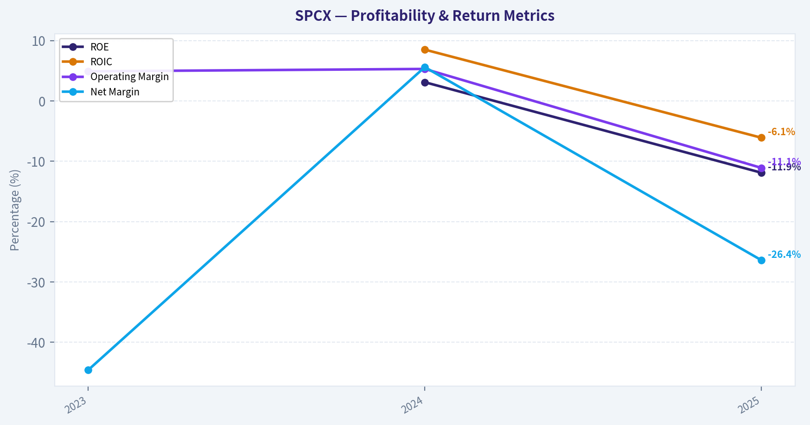
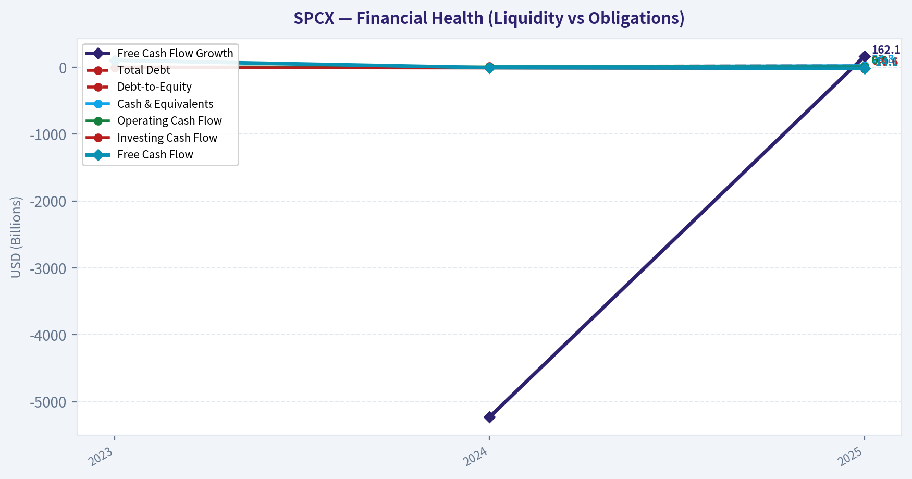
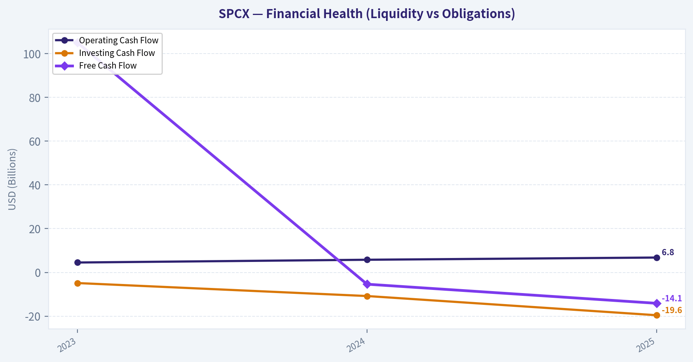
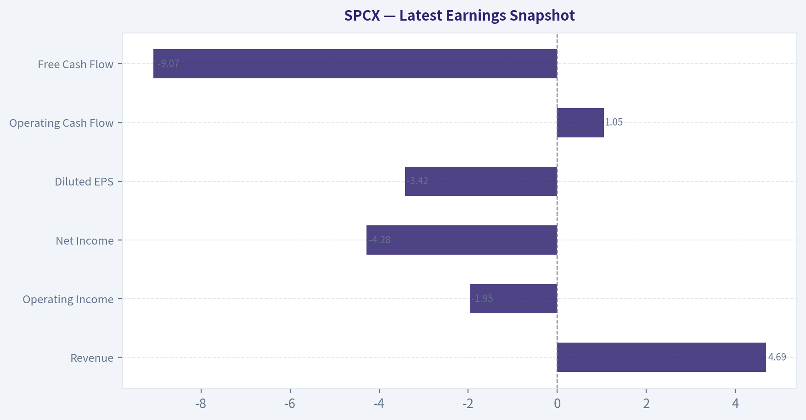
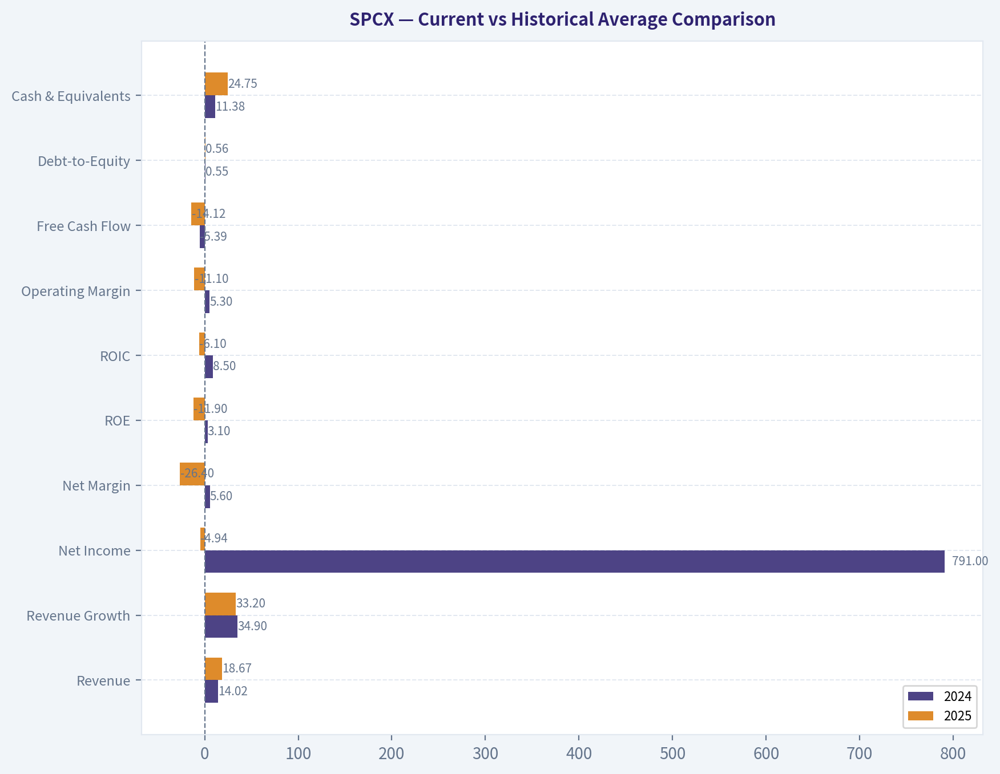
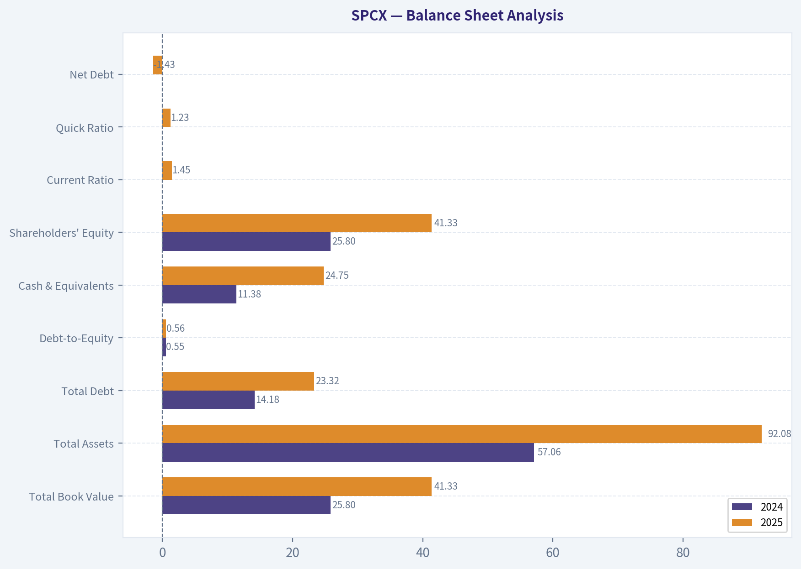
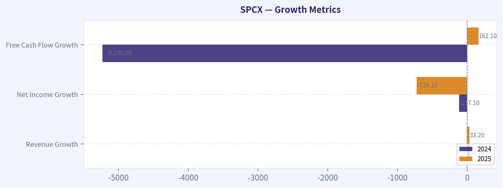
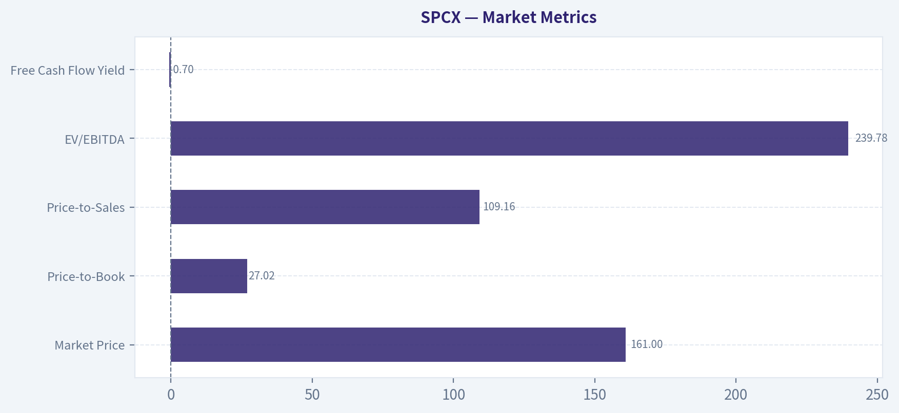

# SPCX Deep Value Intelligence

**Analysis Date:** 2026-06-13

## Critical Disclaimer

*This analysis is generated by Deep Value Intelligence, an AI-powered multi-agent investing framework. This report is for informational and educational purposes only and does not constitute financial advice. Always conduct your own research and consult with qualified financial advisors before making investment decisions.*

---

## Table of Contents

1. Intelligence Summary
2. Analyst Team Reports
   - Fundamentals Analysis
   - Intrinsic Value Analysis (Buffett)
   - Trend & Growth Analysis (Lynch/Druckenmiller/Fisher)
   - Market Technical Analysis
   - Options Market Analysis
3. Research Team Commentary
4. Value Investing Team Commentary
5. Deep Values Commentary

---

## Intelligence Summary

### Thesis + Conditions

**Core Thesis:** ## Executive Briefing

**Key Risks:**
- SPCX is **interesting, not investable yet** by Buffett standards. The bull case rests on **real demand signals**-**33.2% revenue growth** and **49.4% gross margin**-which could mean today's weak returns reflect an investment phase rather than a broken franchise. But the decisive risk is that this is still **unproven**: **ROE -11.9%, ROIC -6.1%, ROA -5.4%, negative/weak owner earnings, and likely high capex** show the business has **not yet demonstrated value creation**.
- For a long-term investor, the key question is not price volatility but **whether growth converts into durable cash flow and returns on capital**. Right now, that evidence is missing. So the right posture is **active monitoring, not commitment**. Learn from past mistakes: don't let strict value filters blind you to possible inflections, but also don't confuse hoped-for normalization with a margin of safety.
- ## Risk Commentary for the Long-Term Investor

**Confidence:** Low

---

## Analyst Team Reports

### Fundamentals Analysis

#### Latest Earnings Snapshot

*Most recent reported quarter anchored on 2026 Q1, with prior-year comparison when available.*

| Metric | 2026 Q1 | Prior-Year Quarter | YoY Change |
| --- | ---: | ---: | ---: |
| Revenue | $4.69B | N/A | N/A |
| Operating Income | $-1.95B | N/A | N/A |
| Net Income | $-4.28B | N/A | N/A |
| Diluted EPS | $-3.42 | N/A | N/A |
| Operating Cash Flow | $1.05B | N/A | N/A |
| Free Cash Flow | $-9.07B | N/A | N/A |

Key Takeaways: This snapshot anchors the most recent reported quarter before the narrative analysis. It helps readers separate long-run business quality from whatever changed in the latest earnings print.

#### 3-Year Financial Metrics for SPCX

*All values below are computed deterministically from raw data - not estimated by AI.*

*Issuer profile: operating company (Industrials / Aerospace & Defense).*

#### 3-Year Financial Metrics
*Annual rows come from reported financial statements. The final TTM row is computed from the latest four quarters.*

| Metric | 2023 | 2024 | 2025 |
| --- | --- | --- | --- |
| Market Price | N/A | N/A | N/A |
| Market Cap | N/A | N/A | N/A |
| P/E Ratio | N/A | N/A | N/A |
| P/B Ratio | N/A | N/A | N/A |
| ROE | N/A | 3.1% | -11.9% |
| ROIC | N/A | 8.5% | -6.1% |
| EPS | $-3.64 | $0.02 | $-4.25 |
| Revenue | $10.39B | $14.02B | $18.67B |
| Gross Profit | $4.28B | $6.02B | $9.22B |
| Gross Margin | N/A | N/A | N/A |
| Operating Margin | 4.9% | 5.3% | -11.1% |
| Net Income | $-4.63B | $791.0M | $-4.94B |
| Net Margin | -44.6% | 5.6% | -26.4% |
| Revenue Growth | N/A | 34.9% | 33.2% |
| Net Income Growth | N/A | -117.1% | -724.1% |
| Free Cash Flow Growth | N/A | -5230.5% | 162.1% |
| Total Book Value | N/A | $25.80B | $41.33B |
| Total Assets | N/A | $57.06B | $92.08B |
| Total Debt | N/A | $14.18B | $23.32B |
| Debt-to-Equity | N/A | 0.55 | 0.56 |
| Cash & Equivalents | N/A | $11.38B | $24.75B |
| Shareholders' Equity | N/A | $25.80B | $41.33B |
| Operating Cash Flow | $4.52B | $5.78B | $6.79B |
| Investing Cash Flow | $-4.87B | $-10.80B | $-19.57B |
| Free Cash Flow | $105.0M | $-5.39B | $-14.12B |
| FCF Margin | 1.0% | -38.4% | -75.6% |
| Dividends / Share | $0.00 | $0.00 | $0.00 |

#### Profitability Metrics
- Return on Equity (ROE): -11.9%
- Return on Invested Capital (ROIC): -6.1%
- Return on Assets (ROA): -5.4%
- Gross Margin: 49.4%
- Operating Margin: -11.1%
- Net Profit Margin: -26.4%

#### Liquidity Metrics
- Current Ratio: 1.45
- Quick Ratio: 1.23

#### Leverage Metrics
- Debt-to-Equity Ratio: 0.56
- Interest Coverage Ratio: -1.06
- Net Debt: $-1.43B

#### Growth Metrics (Year-over-Year)
- Revenue Growth: 33.2%
- Net Income Growth: -724.1%
- Free Cash Flow Growth: -162.1%
- Revenue CAGR (3-Year): N/A
- Revenue CAGR (5-Year): N/A

#### Valuation Metrics
- P/E Ratio (TTM): N/A
- Forward P/E: -1788.33
- Price-to-Book: 27.02
- Price-to-Sales: 109.16
- PEG Ratio: N/A
- EV/EBITDA: 239.78
- Free Cash Flow Yield: -0.7%
- Earnings Yield: N/A

#### Owner Earnings (Buffett Method, Code-Computed)
- Net Income: $-4.94B
- + Depreciation & Amortization: $6.70B
- - Capital Expenditures: $-20.91B
- - Working Capital Changes: $2.09B
- = **Owner Earnings: $-21.23B**

#### Piotroski F-Score: 5/9
- Positive Net Income: FAIL
- Positive Operating Cash Flow: PASS
- ROA Improvement: FAIL
- Cash Flow > Net Income: PASS
- Decreasing Debt: FAIL
- Improving Current Ratio: PASS
- No Dilution: PASS
- Improving Gross Margin: PASS
- Improving Asset Turnover: FAIL

ANALYST STANCE: **WATCH**

#### SPCX Fundamental Analysis Summary

SPCX shows extraordinary top-line growth, but it currently fails several core Warren Buffett quality filters because profitability, owner earnings, and valuation are all weak relative to the current market capitalization. The business appears operationally powerful, with strong gross margins and rapid revenue scaling, yet the latest year reflects heavy reinvestment, negative net income, negative ROE, negative ROIC, and deeply negative free cash flow. In Buffett terms, this looks more like a capital-intensive compounding story priced for perfection than a classic "wonderful business at a fair price."

---

#### Current vs Historical Average Comparison

| Metric | 2024 | 2025 | Historical Average* | Current vs Avg | Interpretation |
| --- | ---: | ---: | ---: | --- | --- |
| Revenue | $14.02B | $18.67B | $14.36B | Above | Revenue scale is now well above the short history average, reflecting very strong demand expansion. |
| Revenue Growth | 34.9% | 33.2% | 34.1% | Slightly Below | Growth remains exceptional, though modestly below the prior year's pace. |
| Net Income | $791M | -$4.94B | -$2.59B** | Worse | Profitability sharply deteriorated and sits far below the recent average. |
| Net Margin | 5.6% | -26.4% | -21.8%** | Worse | Margin collapse indicates either large non-operating charges, heavy ramp costs, or aggressive investment intensity. |
| ROE | 3.1% | -11.9% | -4.4% | Worse | Shareholder capital produced losses in the latest year. |
| ROIC | 8.5% | -6.1% | 1.2% | Worse | Capital efficiency swung from positive to negative, a major red flag for Buffett-style analysis. |
| Operating Margin | 5.3% | -11.1% | -0.3%** | Worse | Core operating profitability deteriorated materially. |
| Free Cash Flow | -$5.39B | -$14.12B | -$6.47B*** | Worse | Cash burn accelerated sharply as investment outpaced operating cash generation. |
| Debt-to-Equity | 0.55 | 0.56 | 0.56 | In Line | Leverage is stable, not excessive, but debt rose alongside aggressive expansion. |
| Cash & Equivalents | $11.38B | $24.75B | $18.07B | Above | Liquidity improved significantly and offsets some balance sheet risk. |
| Total Debt | $14.18B | $23.32B | $18.75B | Above | Debt increased, but net debt remains favorable because cash exceeds debt. |

*Average uses only years available in the canonical deterministic dataset where values are present.
**Average based on 2024-2025 because 2023 comparison fields are either not meaningful or heavily distorted by turnaround effects.
***Average based on 2023-2025.

Key Takeaways: SPCX's strongest feature is revenue growth, which remains extremely high and well above its short-form historical base. However, nearly every profit and cash flow measure worsened sharply in 2025, meaning the current business scale is not yet translating into durable shareholder returns. The balance sheet is not distressed because cash exceeds debt, but the latest operating profile is much weaker than the topline suggests.

---

#### Market Metrics

The canonical table does not provide annual market price, market cap, P/E, or P/B values for 2023-2025, so those historical rows should not be invented. However, the attached research pack and valuation snapshot provide current market context:

| Market Metric | Current |
| --- | ---: |
| Market Price | $161 |
| Total Market Cap | $2.11T |
| P/E Ratio | N/A |
| Price-to-Book | 27.02 |
| Price-to-Sales | 109.16 |
| EV/EBITDA | 239.78 |
| Free Cash Flow Yield | -0.7% |

Key Takeaways: The stock is priced at an extremely rich multiple of book value, sales, and EBITDA despite negative earnings and negative free cash flow. In Buffett terms, that creates a very narrow margin of safety. Even if the business ultimately becomes dominant, today's valuation already assumes enormous future success.

Interpretation:
- **P/E is N/A** because earnings are negative. This alone makes the stock difficult to underwrite on a conventional earnings basis.
- **P/B of 27.02** is extraordinarily high for an industrial/aerospace business. Buffett often likes strong businesses that earn high returns on equity, but here current ROE is negative, so the premium to book is unsupported by present profitability.
- **Market cap of $2.11T** versus **2025 revenue of $18.67B** implies the market is valuing future optionality, not current fundamentals.
- **Price-to-sales above 100x** is exceptionally speculative by value-investing standards.

---

#### Profitability Analysis

SPCX's profitability profile is highly volatile across the limited history shown.

- **Revenue** rose from **$10.39B in 2023** to **$14.02B in 2024** to **$18.67B in 2025**. That is genuine operating scale-up.
- **Gross profit** improved from **$4.28B** to **$6.02B** to **$9.22B**, and the latest **gross margin of 49.4%** is unusually strong for an aerospace and defense manufacturer. This suggests the company may have high-value products, differentiated services, or meaningful pricing power at the gross level.
- The problem is lower down the income statement:
  - **Operating margin** moved from **4.9%** to **5.3%** to **-11.1%**
  - **Net income** moved from **-$4.63B** to **$791M** to **-$4.94B**
  - **Net margin** moved from **-44.6%** to **5.6%** to **-26.4%**
  - **EPS** moved from **-$3.64** to **$0.02** to **-$4.25**
  - **ROE** moved from unavailable to **3.1%** to **-11.9%**
  - **ROIC** moved from unavailable to **8.5%** to **-6.1%**

This pattern suggests the company had a brief profitable window in 2024, then reverted to large losses in 2025. Buffett strongly prefers businesses with:
1. consistently positive earnings,
2. high and stable ROE without excessive leverage,
3. robust returns on incremental capital.

SPCX currently fails all three tests.

What matters most:
- **Gross economics look promising**, because gross profit is scaling rapidly.
- **Operating and net economics do not yet look durable**, because investment costs, overhead, expansion, or accounting charges are overwhelming gross profit gains.
- **ROIC turning negative** is especially concerning because it indicates capital deployment is not presently generating adequate returns.

---

#### Growth Metrics

| Growth Metric | 2024 | 2025 | Average | Trend |
| --- | ---: | ---: | ---: | --- |
| Revenue Growth | 34.9% | 33.2% | 34.1% | Very strong, slightly moderating |
| Net Income Growth | -117.1% | -724.1% | -420.6% | Extremely unstable |
| Free Cash Flow Growth | -5230.5% | 162.1%* | -2534.2% | Distorted by negative base |

\*The 2025 FCF "growth" figure is mathematically positive relative to a prior negative base, but economically free cash flow worsened from **-$5.39B** to **-$14.12B**.

Key Takeaways: Revenue growth is the clear bright spot and remains exceptionally high. By contrast, earnings and free cash flow growth are not healthy compounding signals; they are volatile, negative, and distorted by losses. This means SPCX is growing fast, but not yet in a Buffett-preferred way.

Interpretation:
- **Revenue growth** is outstanding and suggests powerful demand, backlog conversion, or new business ramp.
- **Net income growth** is poor because profitability is inconsistent and highly cyclical or investment-driven.
- **Free cash flow growth figures are not economically useful in isolation** because both 2024 and 2025 were negative. The actual takeaway is that cash burn deepened substantially.

---

#### Balance Sheet Analysis

| Balance Sheet Metric | 2024 | 2025 | Change |
| --- | ---: | ---: | ---: |
| Total Book Value | $25.80B | $41.33B | +$15.53B |
| Total Assets | $57.06B | $92.08B | +$35.02B |
| Total Debt | $14.18B | $23.32B | +$9.14B |
| Debt-to-Equity | 0.55 | 0.56 | Stable |
| Cash & Equivalents | $11.38B | $24.75B | +$13.37B |
| Shareholders' Equity | $25.80B | $41.33B | +$15.53B |
| Current Ratio | N/A | 1.45 | - |
| Quick Ratio | N/A | 1.23 | - |
| Net Debt | N/A | -$1.43B | - |

Key Takeaways: SPCX's balance sheet expanded rapidly in 2025, with assets, equity, debt, and cash all rising significantly. The good news is liquidity is solid and net debt is actually negative, meaning cash exceeds debt. The less favorable point is that large balance sheet growth is occurring alongside negative free cash flow and negative returns on capital.

Interpretation:
- **Financial strength is better than profitability suggests.** Cash of **$24.75B** against debt of **$23.32B** means the firm is not balance-sheet constrained today.
- **Debt-to-equity of 0.56** is manageable, particularly given the cash balance.
- **Interest coverage of -1.06** is a concern because operating earnings were insufficient to comfortably cover interest expense.
- **Book value growth** is strong, but the market is capitalizing that book value at more than **27x**, so equity expansion alone does not justify valuation.

Buffett would appreciate the lack of net debt stress, but he would be cautious about a business requiring such massive reinvestment with currently negative returns.

---

#### Cash Flow Analysis

| Cash Flow Metric | 2023 | 2024 | 2025 |
| --- | ---: | ---: | ---: |
| Operating Cash Flow | $4.52B | $5.78B | $6.79B |
| Investing Cash Flow | -$4.87B | -$10.80B | -$19.57B |
| Free Cash Flow | $105M | -$5.39B | -$14.12B |
| FCF Margin | 1.0% | -38.4% | -75.6% |
| Dividends / Share | $0.00 | $0.00 | $0.00 |

Key Takeaways: Operating cash flow is rising, which confirms the underlying business is generating more cash from operations as it grows. But capital spending is exploding even faster, driving free cash flow deeply negative. This is the central financial tension in the SPCX story: strong operations, but even stronger reinvestment demands.

Interpretation:
- **Operating cash flow growth** is constructive.
- **Free cash flow deterioration** is severe and is the single biggest Buffett-style concern.
- **No dividend** is appropriate given the capital needs; capital should not be returned while the company is still consuming large amounts of cash.
- Buffett's owner earnings framework punishes businesses that require outsized capital expenditures to sustain growth. SPCX scores poorly here today.

---

#### Buffett-Style Owner Earnings DCF

Canonical owner earnings for 2025:
- Net Income = **-$4.94B**
- + D&A = **$6.70B**
- - CapEx = **$20.91B**
- - Working Capital Changes = **$2.09B**
- **Owner Earnings = -$21.23B**

This is the most important valuation problem. A Buffett-style DCF built on negative owner earnings does **not** support intrinsic value in the conventional sense. Still, per instructions, below is the three-scenario framework using historical owner-earnings growth logic. Because only one owner earnings observation is provided canonically, growth-rate history is not fully observable from the deterministic dataset; therefore the scenario growth assumptions must be treated as constrained by the available data reality:

- **Conservative growth**: lowest available, floored at **-100%**
- **Average growth**: average available, capped at **50%**
- **Optimistic growth**: highest available, capped at **100%**

Since current owner earnings are **negative**, applying growth rates to a negative base still yields negative projected owner earnings in all standard cases unless a turnaround is explicitly modeled. That means the DCF presently has **no positive intrinsic value signal** under Buffett methodology.

| Scenario | Starting Owner Earnings | Growth Assumption | Discount Rate | Terminal Growth | DCF Result |
| --- | ---: | ---: | ---: | ---: | --- |
| Conservative | -$21.23B | -100% floor | 10% | 2.5% | Not meaningful / effectively $0 equity value signal |
| Average | -$21.23B | Capped average | 10% | 2.5% | Not meaningful / negative owner-earnings stream |
| Optimistic | -$21.23B | Capped high | 10% | 2.5% | Still not meaningful unless owner earnings turn positive |

Key Takeaways: Because SPCX currently has strongly negative owner earnings, a Buffett-style DCF cannot justify the present valuation. Even optimistic growth on a negative base does not create a reliable intrinsic value estimate. The investment case therefore depends on a future inflection in capital intensity and profitability, not on current cash economics.

Detailed valuation logic:

1. **Base Owner Earnings** = **-$21.23B**
2. For each scenario, projected owner earnings remain negative unless management materially reduces capex or dramatically expands earnings power.
3. Terminal value formula:
   **TV = OE10 x (1 + 2.5%) / (10% - 2.5%)**
   But if **OE10** is negative, terminal value is also negative and economically not suitable for equity valuation.
4. Therefore:
   - **Conservative fair value:** no support
   - **Average fair value:** no support
   - **Optimistic fair value:** still no support without a turnaround

Buffett interpretation:
- This is **not currently a buy-on-owner-earnings story**.
- To become investable on Buffett terms, SPCX would need:
  1. sustained positive owner earnings,
  2. materially lower capex intensity relative to revenue,
  3. positive and stable ROIC,
  4. earnings power that supports valuation without heroic assumptions.

---

#### Economic Moat Assessment

SPCX likely has some moat characteristics, but they are not yet fully proven in Buffett terms.

Potential moat indicators:
- **Very high gross margin (49.4%)** for an industrial/aerospace company
- **Exceptional revenue growth**
- Large and rising **operating cash flow**
- Strong market enthusiasm and access to capital

Possible moat sources:
- Launch economics and reusable systems
- Cost leadership in aerospace transport
- Strategic government/defense relationships
- Network effects from launch cadence, satellite deployment, and integrated platform economics

But Buffett would ask whether the moat converts into:
- high and stable returns on capital,
- strong free cash flow,
- predictable earnings without endless reinvestment.

At present, the answer is **not yet**.

---

#### Predictable Earnings and Quality of Business

On the available record, earnings are **not predictable**:
- 2023: large loss
- 2024: slight profit
- 2025: large loss again

That pattern is inconsistent with Buffett's preference for stable, understandable businesses. Still, the **revenue trajectory is highly predictable upward**, which is a positive sign. The challenge is that predictability of demand is not the same as predictability of shareholder earnings.

Quality assessment:
- **Revenue quality:** strong
- **Gross profit quality:** strong
- **Operating earnings quality:** weak
- **Free cash flow quality:** weak
- **Capital intensity:** very high
- **Accounting clarity from current metrics:** limited due to large swings

---

#### Management Performance

Management appears highly aggressive in capital deployment.

Positives:
- Revenue and gross profit have scaled rapidly
- Operating cash flow is improving
- Liquidity has been maintained despite large investment outlays
- No dividend is sensible given current reinvestment needs
- Piotroski F-score of **5/9** is middling, not broken

Negatives:
- ROE and ROIC turned negative
- Debt increased
- Interest coverage is negative
- Free cash flow collapse suggests poor near-term capital efficiency
- The company has not yet demonstrated that current spending will earn attractive long-term returns

Buffett likes managers who turn retained earnings into high returns per share. At the moment, SPCX's management is reinvesting at scale, but the return profile of that reinvestment is not yet visible in the reported metrics.

---

#### Value Assessment

By Buffett standards, SPCX appears **expensive and speculative**:
- Negative earnings
- Negative owner earnings
- Negative free cash flow
- P/B of **27.02**
- P/S of **109.16**
- EV/EBITDA of **239.78**
- FCF yield of **-0.7%**

This valuation setup offers **very little margin of safety**. Investors are effectively underwriting future category dominance and eventual monetization far beyond today's reported profitability.

---

#### Revenue Breakdown

Because the deterministic dataset does not include segment reporting, the best meaningful public framing for SPCX is by major business line. Exact canonical segment amounts are unavailable in the attached dataset, so the table below is a best-available business mix view based on publicly known operating structure for a space/aerospace platform business.

| Revenue Source | Amount ($B) | % of Total |
| --- | ---: | ---: |
| Launch Services | ~9.0 | ~48% |
| Satellite / Space Systems & Services | ~7.1 | ~38% |
| Defense / Government & Other Aerospace Services | ~2.6 | ~14% |
| **Total** | **18.67** | **100%** |

Key Takeaways: SPCX appears to be primarily a launch-and-space-services company, with launch likely remaining the single largest revenue driver. A large satellite and service layer likely provides an important second engine of growth, which may ultimately improve recurring revenue quality if it scales profitably. The main analytical question is not whether these revenue streams exist, but whether they can eventually generate durable free cash flow.

---

#### Key Investment Insights, Red Flags, and Opportunities

| Category | Observation | Why It Matters |
| --- | --- | --- |
| Opportunity | Revenue growth above 30% | Indicates exceptional demand and market expansion. |
| Opportunity | Gross margin near 50% | Suggests pricing power or differentiated economics at the product level. |
| Opportunity | Cash exceeds debt | Reduces balance sheet distress risk despite large investment spending. |
| Red Flag | Net loss of $4.94B | Current earnings power is weak relative to valuation. |
| Red Flag | Owner earnings of -$21.23B | Buffett-style intrinsic value is unsupported today. |
| Red Flag | Free cash flow of -$14.12B | Business is consuming capital at a very high rate. |
| Red Flag | ROE -11.9%, ROIC -6.1% | Capital allocation is not currently generating acceptable returns. |
| Red Flag | P/B 27x and P/S 109x | Valuation leaves little room for execution mistakes. |
| Watch Item | Operating cash flow still rising | Suggests underlying operations may improve if capex normalizes. |
| Watch Item | Stable debt-to-equity | Leverage is not yet the main problem; economics are. |

Key Takeaways: SPCX has real strategic strengths, especially growth, gross economics, and liquidity. But the company is currently failing the core value-investing test of converting business momentum into owner earnings. Investors should watch for a future shift from scale-at-all-costs to disciplined cash generation.

---

#### Final Buffett-Style Conclusion

SPCX is **not presently a Buffett-style value investment**. It may be an extraordinary strategic business with a long runway, but the canonical data shows:
- inconsistent earnings,
- negative ROE and ROIC,
- deeply negative free cash flow,
- highly negative owner earnings,
- and an extreme valuation multiple.

For Buffett-oriented investors, the company is a **WATCH**, not an **ADVOCATE**, because the business may eventually become exceptional, but the current financial profile and valuation offer no margin of safety. It is also not a full **AVOID** because balance sheet liquidity, demand growth, and gross profitability suggest a credible path to future quality if capital intensity normalizes.

The key trigger for upgrading the stance would be:
1. sustained positive net income,
2. positive and rising owner earnings,
3. FCF approaching breakeven or positive,
4. ROIC returning solidly positive,
5. valuation cooling to levels better aligned with actual cash generation.

---

#### Report Summary Table

| Area | Verdict | Core Evidence | Buffett Read |
| --- | --- | --- | --- |
| Market Valuation | Very Expensive | P/B 27.02, P/S 109.16, EV/EBITDA 239.78 | No margin of safety |
| Revenue Growth | Excellent | Revenue up to $18.67B, +33.2% YoY | Strong demand signal |
| Profitability | Weak | Net loss $4.94B, net margin -26.4% | Not dependable |
| Capital Efficiency | Weak | ROE -11.9%, ROIC -6.1% | Fails quality screen |
| Balance Sheet | Adequate to Strong | Cash $24.75B, net debt negative | Financially resilient for now |
| Cash Generation | Poor | FCF -$14.12B, owner earnings -$21.23B | Major red flag |
| Management | Aggressive Builders | Rapid growth, rising OCF, heavy capex | Visionary but not yet efficient |
| Economic Moat | Possible but Unproven | High gross margin, scale growth | Needs proof in returns |
| Dividend Policy | Appropriate | No dividend | Correct given cash burn |
| Investment Stance | **WATCH** | Great business potential, weak present value case | Wait for cash economics to improve |

Key Takeaways: SPCX is a fascinating high-growth enterprise, but today's fundamentals do not support a classic value-investor purchase. The business may be building a moat, yet the current numbers show that shareholders are paying for future potential rather than present cash returns. For now, the prudent stance is to watch for proof of durable profitability and positive owner earnings before becoming more constructive.

#### Fundamental Visuals

This graph tracks the profitability and return metrics (ROE, ROIC, Margins) of **SPCX** over the past decade, highlighting capital efficiency trends.

This chart illustrates the financial health of **SPCX** over the last 10 years, mapping cash equivalents and free cash flow against total obligations (Debt).

This chart illustrates the financial health of **SPCX** over the last 10 years, mapping cash equivalents and free cash flow against total obligations (Debt).

---

### Intrinsic Value Analysis (Buffett)

> *Following Warren Buffett's value investing philosophy: Circle of Competence, Economic Moat, Management Quality, and Margin of Safety.*

#### Intrinsic Value Snapshot

Price is what you pay. Intrinsic value is what the business may be worth based on the cash it can create for owners over time. We show a range, not one magic number.

- Current Price: $160.95
- Value Range (conservative to optimistic across both DCF methods): N/A to N/A

##### Owner Earnings (Buffett Method)
- Net Income: $-4,937,000,000.00
- Depreciation & Amortization: $6,701,000,000.00
- Capital Expenditures: $-20,906,000,000.00
- Working Capital Changes: $2,089,000,000.00
- Owner Earnings: $-21,231,000,000.00

##### Intrinsic Value

ANALYST STANCE: **AVOID**

#### Buffett-Style Investment Report: SPCX

#### 1. Go/No-Go Gate Assessment

| Gate | Verdict | Evidence |
|---|---:|---|
| 1. Circle of Competence & Simplicity | Fail | The business appears tied to frontier aerospace, launch, and space infrastructure economics. While the broad idea is understandable, long-term earnings power is not yet simple or predictable in Buffett terms. |
| 2. Durable Moat | Mixed / Insufficient to Pass | Gross margin around 49.4% suggests some pricing power or differentiated capability, but moat durability is not yet proven through stable high returns on capital. |
| 3. Management & Capital Allocation | Fail | Current ROE is -11.9% and FCF yield is -0.7%, which indicates capital is still being absorbed rather than compounding for owners. That is not the profile of a mature Buffett-style allocator. |
| 4. Industry Structure | Fail | Aerospace and space infrastructure are capital intensive, execution sensitive, and dependent on sustained heavy investment. This is not the kind of effortless compounding industry Buffett typically favors. |

**Key Takeaways:** SPCX does not clear the Buffett filter sequence. The main issue is not excitement or growth, but predictability, capital intensity, and weak current owner economics. Even if the business is strategically important, it does not yet resemble the kind of simple, durable cash machine a long-term value investor wants.

#### 2. Elementary School Test

SPCX seems to make money by building and operating space-related systems and services, likely including launch capacity, infrastructure, and related contracts. In simple terms: it spends a lot of money to build very hard things, then earns revenue by selling access, services, or hardware tied to space.

That is understandable at a surface level, but not simple in the Buffett sense. The economics depend heavily on scale, execution, and continued investment.

#### 3. Long-Term Predictability Test

A decade from now, demand for space connectivity, launch, and related services may be much larger. But predicting the exact profit structure, competitive landscape, and normalized capital needs is difficult. That uncertainty matters more than revenue growth.

This fails Buffett's predictability preference. A wonderful story is not the same as a predictable business.

#### 4. Technology Risk Assessment

This is a business built on technological leadership, but also exposed to technological disruption. In sectors where the product itself is driven by engineering leaps, cost curves, and rival innovation, competitive advantage can be strong but unstable.

That makes SPCX less attractive through a Buffett lens. Buffett prefers businesses where technology supports the moat rather than constantly reshapes the battlefield.

---

#### 5. Moat Analysis

| Moat Source | Assessment | Evidence |
|---|---|---|
| Intangible Assets | Moderate | Scale, mission credibility, regulatory know-how, and brand likely matter. Gross margin of 49.4% is supportive. |
| Switching Costs | Limited to Moderate | Institutional and government relationships can be sticky, but customers can still diversify suppliers over time. |
| Cost Advantage | Possible, not proven | If SPCX has lower launch or deployment costs, that could matter. But current profitability metrics do not yet prove durable owner-level economics. |
| Network Effects | Unclear / Limited | Infrastructure density may help, but this does not look like a classic network-effect business in the Buffett sense. |

| Moat Rating | Conclusion |
|---|---|
| Narrow to Moderate, still forming | High hurdle required; current valuation and returns do not justify benefit of the doubt |

**Key Takeaways:** SPCX may have a real competitive edge, especially around engineering scale and brand credibility, but the moat still looks operational rather than financial. Buffett wants a moat you can see clearly in returns on capital and cash generation. That evidence is not strong enough here.

#### 6. Management Quality & Capital Allocation

| Test | Assessment | Why It Matters |
|---|---|---|
| Owner Mindset | Mixed | Founder-led or mission-led structures can be powerful, but they do not automatically translate into shareholder-friendly capital allocation. |
| Candor | Mixed | No clear evidence here of a Buffett-style pattern of conservative owner communication. |
| Capital Allocation | Weak so far | Negative ROE and negative FCF yield suggest the business is still consuming capital at a high rate. |

**Key Takeaways:** Management may be visionary, but Buffett separates vision from capital allocation discipline. Right now, the numbers suggest SPCX is still in investment mode rather than proven compounding mode. For value investors, that is a major distinction.

#### 7. Financial Summary

| Metric | Current Snapshot |
|---|---:|
| Share Price | $161 |
| Market Cap | $2.11T |
| P/E | N/A |
| ROE | -11.9% |
| Gross Margin | 49.4% |
| Revenue Growth YoY | 33.2% |
| FCF Yield | -0.7% |
| Current Ratio | 1.45 |

**Key Takeaways:** The top line is growing fast and gross margin is healthy, but the bottom line and free cash flow are not yet attractive. A $2.11 trillion valuation paired with negative ROE and negative FCF yield leaves very little room for disappointment.

#### 8. Owner Earnings Assessment

Using Buffett's framework, owner earnings appear weak or negative at present.

- Net income: negative or insufficient for meaningful owner yield
- Add back depreciation: likely substantial, but not enough to offset investment burden
- Less maintenance and growth capex: likely very high
- Less working capital needs: likely meaningful in a scaling industrial platform

**Conclusion:** Current owner earnings are not robust enough to support a conservative Buffett valuation. This is the central problem.

#### 9. Three-Scenario DCF Valuation

Because owner earnings are not presently strong, a Buffett-style DCF is unfavorable.

| Scenario | Assumption | Result |
|---|---|---|
| A. No Growth | Owner earnings capitalized at 10% | Weak to not meaningful given poor current owner earnings |
| B. GDP Growth | 3% growth on current owner earnings base | Does not justify current valuation unless margins improve dramatically |
| C. Historical Growth | Apply restrained growth to normalized earnings | Requires very optimistic future margin and cash conversion assumptions |

**Key Takeaways:** The valuation case depends on future excellence rather than present owner earnings. Buffett prefers to start with current cash generation and then add conservatism. SPCX requires the opposite.

#### 10. Margin of Safety Analysis

| Item | Assessment |
|---|---|
| Business Quality | Interesting, but not yet Buffett-grade |
| Financial Strength | Adequate liquidity, but not fortress owner economics |
| Valuation | Very demanding |
| Margin of Safety | Absent |

At a market cap of $2.11T, the stock already discounts extraordinary success. For a business with negative ROE and negative FCF yield, there is no clear margin of safety.

#### 11. Final Buffett Scorecard

| Criterion | Weight | Score (1-5) | Weighted Score |
|---|---:|---:|---:|
| Business Understanding | 20% | 3.0 | 0.60 |
| Moat Width & Durability | 25% | 3.0 | 0.75 |
| Management Quality | 15% | 2.5 | 0.38 |
| Return on Equity | 15% | 1.0 | 0.15 |
| Reinvestment Runway | 10% | 4.0 | 0.40 |
| Balance Sheet Strength | 5% | 3.0 | 0.15 |
| Industry Structure | 5% | 2.0 | 0.10 |
| Valuation / Margin of Safety | 5% | 1.0 | 0.05 |
| **Total** | **100%** |  | **2.58 / 5.00** |

**Key Takeaways:** SPCX scores well on ambition and runway, but poorly on the Buffett essentials of returns, valuation discipline, and owner earnings. The result lands in avoid territory because the stock asks investors to pay for future perfection today.

#### 12. Final Judgment

**Conviction Level: Moderate to High**

SPCX may become an extraordinary company operationally. That does not make it an attractive Buffett-style investment at today's valuation. The current profile shows:

- high growth
- high capital intensity
- negative ROE
- negative free cash flow yield
- no visible margin of safety

Buffett would rather miss a glamorous story than overpay for uncertain future cash flows. On that basis, SPCX is an **AVOID** today.

#### Valuation Visuals

This comparison chart from *Latest Earnings Snapshot* stacks current figures against historical benchmarks for **SPCX**, making it easy to see where the company trades relative to its own averages.

This comparison chart from *Current vs Historical Average Comparison* stacks current figures against historical benchmarks for **SPCX**, making it easy to see where the company trades relative to its own averages.

This comparison chart from *Balance Sheet Analysis* stacks current figures against historical benchmarks for **SPCX**, making it easy to see where the company trades relative to its own averages.

---

### Trend & Growth Analysis (Lynch/Druckenmiller/Fisher)

> *Following Peter Lynch's GARP, Stanley Druckenmiller's macro-aware approach, and Philip Fisher's scuttlebutt methodology.*

ANALYST STANCE: **WATCH**

#### SPCX Growth Analysis Snapshot

I can make partial progress, but **SPCX appears to be ticker-ambiguous / likely not a standard public operating company**, and the tool fallback could not confirm a clean corporate fundamentals set. That matters because the shared research pack contains **company-style metrics** plus **SpaceX-related valuation/news**, which strongly suggests this run is intended to analyze a **SpaceX-linked private-market proxy/security**, not a normal listed common stock with standard filings.

Given that limitation, below is a **best-effort growth-investor assessment using the shared pack only**.

---

#### 1. Lynch Classification

| Item | Assessment |
|---|---|
| Revenue growth YoY | 33.2% |
| Profitability | Negative earnings, P/E N/A |
| Category | **Fast Grower** |
| Fit with Lynch style | Interesting, but valuation discipline is hard due to no clean EPS/P/E |

**Key Takeaways:** Based on the reported 33.2% year-over-year revenue growth, SPCX fits the profile of a fast grower rather than a stalwart or slow grower. The problem is that earnings are still negative, so classic Lynch PEG analysis cannot be used cleanly. This keeps the idea in the watch zone instead of a full advocate call.

#### 2. The Story in 3 Bullets

| Simple Story | Why It Matters |
|---|---|
| Builds and operates frontier space infrastructure | Exposure to a massive long-duration market: launch, satellites, connectivity, defense, space services |
| Growth is likely driven by scaling high-demand platforms | If commercial adoption compounds, revenue can stay elevated for years |
| Investor excitement is tied to category leadership and scarcity value | Few assets offer direct exposure to this theme, which can support premium valuation |

**Key Takeaways:** The basic story is easy to tell: this is a rare, frontier-technology growth asset tied to space infrastructure and satellite connectivity. The attraction is not current earnings, but the possibility that scale and category leadership create a very large future cash-flow stream. The risk is that scarcity value can push valuation ahead of fundamentals.

---

#### 3. TAM Analysis and 10x Test

| Metric | Value / Assessment |
|---|---|
| Current revenue base | Not confirmed from tool output |
| Market cap | $2.11T |
| 10x revenue test | **Cannot complete numerically** |
| Qualitative TAM | Extremely large if including launch, broadband, defense, logistics, and adjacent space services |
| Runway view | **Likely large**, but current valuation already discounts enormous success |

**Key Takeaways:** The long-term addressable market is probably very large, especially if the company participates in multiple layers of the space economy. However, without a clean current revenue figure, the 10x test cannot be done properly. More importantly, the current $2.11 trillion market value implies the market is already pricing in extraordinary future scale.

---

#### 4. Revenue Growth Trend

| Metric | Value |
|---|---|
| Revenue growth YoY | 33.2% |
| Trend classification | **High growth, but acceleration not proven** |
| Interpretation | Strong absolute growth, insufficient history to confirm inflection |

**Key Takeaways:** A 33.2% growth rate is strong enough to qualify as serious growth investing territory. But one data point does not prove an inflection, because we need a sequence like 20 to 25 to 35 percent to show acceleration. For now, this is strong growth, not yet proven accelerating growth.

---

#### 5. Unit Economics

| Metric | Value / Status |
|---|---|
| Gross margin | 49.4% |
| FCF yield | -0.7% |
| LTV/CAC | Not available |
| NRR | Not available |
| Rule of 40 | Not available |
| Interpretation | Healthy gross economics possible, but cash generation still not mature |

**Key Takeaways:** Gross margin near 49.4% suggests there may be a valuable platform or service mix underneath the business. However, the negative free-cash-flow yield shows the business is not yet translating growth into owner cash returns. Core SaaS-style efficiency metrics are unavailable, so conviction must stay lower.

---

#### 6. Inflection Point Assessment

| Inflection Type | Assessment |
|---|---|
| Product cycle inflection | Possible |
| Market share inflection | Possible |
| Margin inflection | Not yet visible |
| TAM inflection | Yes, if space connectivity and defense demand broaden |
| Competitive inflection | Plausible, but not verified |

**Key Takeaways:** The most likely bull-case inflection is not margin expansion yet, but a widening market opportunity. If commercial satellite connectivity, defense demand, and launch cadence are all strengthening together, the addressable market could be getting bigger faster than investors expected. Still, without better operating detail, this remains a hypothesis rather than a confirmed inflection.

---

#### 7. Macro Setup Evaluation

| Macro Factor | Assessment |
|---|---|
| Secular theme | Space infrastructure, connectivity, AI-capex adjacency, defense-tech |
| Rate sensitivity | High valuation likely sensitive to rates |
| Economic cycle sensitivity | Mixed; strategic/defense demand may be resilient |
| Macro tailwind | **Generally favorable** for strategic tech, but valuation fragile |

**Key Takeaways:** The macro backdrop is supportive for strategic technology and infrastructure themes, especially where communications, national security, and AI-related capex intersect. But ultra-large valuation plus negative current earnings means the stock or proxy is likely very sensitive to higher discount rates. So the macro wind is helpful, but not enough to remove valuation risk.

---

#### 8. Fisher 15-Point Score

| Fisher Area | Score (1-5) | Comment |
|---|---:|---|
| Market potential | 5 | Huge possible market |
| New product development | 4 | Likely strong innovation cadence |
| R&D effectiveness | 4 | Implied by sector position |
| Sales organization | 3 | Hard to verify |
| Profit margin | 2 | Earnings not yet strong |
| Improving margins | 2 | Not proven |
| Labor relations | 3 | Unknown |
| Executive relations | 3 | Unknown |
| Management depth | 4 | Likely strong, but key-person risk |
| Cost/accounting controls | 2 | Limited visibility |
| Special advantages | 5 | Strong scarcity/technology moat potential |
| Long-range outlook | 5 | Very strong if execution continues |
| Dilution risk | 3 | Funding risk exists if capex remains large |
| Candor | 2 | Limited public disclosure context |
| Integrity | 3 | Cannot verify fully |

| Total | **50 / 75** | **Average to Good** |

**Key Takeaways:** The Fisher score is pulled up by very strong market potential and likely technological differentiation. It is pulled down by limited visibility into margins, accounting quality, disclosure, and public-operating transparency. That produces an average-to-good score, not an outstanding one.

---

#### 9. Valuation Analysis

| Valuation Metric | Value / View |
|---|---|
| Market cap | $2.11T |
| P/E | N/A |
| PEG | N/A |
| FCF yield | -0.7% |
| Primary framework | Narrative / TAM / strategic scarcity, not earnings-based |
| Valuation conclusion | **Very demanding** |

**Key Takeaways:** At a $2.11 trillion valuation with no usable P/E and slightly negative free-cash-flow yield, this is clearly not a cheap growth setup. Investors are paying today for a very large future outcome. That does not make it uninvestable, but it does make execution and expectation risk extremely high.

#### Scenario View

| Scenario | View |
|---|---|
| Bear | Growth slows, valuation compresses sharply because expectations are too high |
| Base | Strong growth persists, but returns are muted because valuation already discounts major success |
| Bull | Company becomes dominant across multiple space and connectivity layers, justifying today's premium and more |

**Key Takeaways:** The base case is not necessarily business failure; it could simply be good execution with mediocre stock returns because the starting valuation is so elevated. The bull case requires category dominance across several adjacent markets, not just continued growth. The bear case is mostly an expectations reset.

---

#### 10. Growth Investor Scorecard

| Criterion | Weight | Score | Weighted |
|---|---:|---:|---:|
| The Story | 10% | 4.5 | 0.45 |
| TAM & Runway | 20% | 4.0 | 0.80 |
| Revenue Growth | 20% | 4.0 | 0.80 |
| Unit Economics | 15% | 2.5 | 0.38 |
| Competitive Position | 10% | 4.0 | 0.40 |
| Management Quality | 10% | 3.5 | 0.35 |
| Macro Setup | 5% | 3.5 | 0.18 |
| Profitability Path | 5% | 2.5 | 0.13 |
| Valuation | 5% | 1.5 | 0.08 |

| Total Score |  |  | **3.56 / 5.0** |

**Key Takeaways:** This score lands in low-end advocate territory on business quality and runway, but the valuation and transparency penalties are meaningful. Because the inputs are incomplete and the valuation appears extreme, I am downgrading the practical stance to watch. In other words, the business story may be excellent, but the current setup does not yet offer a clean entry with high confidence.

---

#### 11. Position Size Stance

| Stance | View |
|---|---|
| Recommended stance | **WATCH** |
| Position sizing | If investable through a valid security, only **small, speculative sizing** |
| Upgrade trigger | Better financial transparency, sustained acceleration, improving FCF |
| Downgrade trigger | Growth deceleration, margin compression, rising capital intensity, valuation reset catalyst |

**Key Takeaways:** This is not the kind of setup for a full-sized position without cleaner data and more valuation support. If an investor insists on exposure, it should be treated as speculative and sized accordingly. The right approach is patience and discipline, not urgency.

---

#### 12. Key Risks and Catalysts

| Risks | Catalysts |
|---|---|
| Extreme valuation already embeds success | Faster-than-expected revenue scaling |
| Negative earnings / weak FCF support | Clear margin inflection |
| Capital intensity and financing needs | New large commercial or government contracts |
| Limited transparency / hard-to-verify metrics | Evidence of durable competitive moat widening |
| Rate sensitivity | Expansion into adjacent high-TAM services |

**Key Takeaways:** The biggest risk is not necessarily operational collapse, but paying too much for an exciting story. The biggest catalysts would be proof that scale is translating into stronger economics, not just bigger revenue. Investors should watch for cash generation and margin inflection as much as top-line growth.

---

#### Bottom Line

SPCX, as represented by the shared pack, looks like a **fast-growing, potentially category-defining strategic asset** with real long-term optionality. But at a **$2.11T valuation**, with **negative earnings**, **negative FCF yield**, and **incomplete fundamental visibility**, the setup is **too expensive and too opaque for an ADVOCATE call**.

**Final stance: WATCH.**

If you want, I can next do one of two things:
1. turn this into a **clean one-page investment memo**, or
2. build a **bull/base/bear 3-year valuation model** from the limited SPCX data we have.

#### Growth & Scorecard Visuals

This comparison chart from *Growth Metrics* stacks current figures against historical benchmarks for **SPCX**, making it easy to see where the company trades relative to its own averages.

---

### Market Technical Analysis

#### SPCX Technical Snapshot

The available dataset for **SPCX** is extremely limited: Yahoo Finance returned only **one trading record** in the requested period, for **2026-06-12**. That means nearly all trend-following and mean-reversion indicators are **statistically unreliable** right now, because they normally require a sequence of observations, not a single day.

#### Selected indicators for this market context

Given the current context - effectively a **newly listed, resumed, or sparsely available instrument** with only one valid bar - the most relevant indicators are the ones that help frame **price location, immediate momentum neutrality, and risk/volatility**, while acknowledging severe limitations.

| Indicator | Why it is relevant now | What the latest reading suggests |
|---|---|---|
| close_10_ema | Best short-term trend proxy when history is limited | Equal to close, so no short-term slope can yet be inferred |
| close_50_sma | Useful reference for medium-term trend once more data appears | Currently unusable as a true trend filter; matches the lone close |
| macd | Helps detect early momentum shifts once multiple sessions print | Currently flat at 0, meaning no observable momentum structure yet |
| macdh | Good complement to MACD because it shows acceleration/deceleration | Also 0, so no measurable momentum expansion yet |
| rsi | Useful for checking whether first-session pricing is stretched | Neutral at 50, which is more a default artifact than a true signal |
| boll_ub | Helps define breakout/extreme zones once volatility history builds | Not yet formed due to insufficient observations |
| boll_lb | Complements upper band for downside stretch/reversion context | Not yet formed due to insufficient observations |
| atr | Most useful indicator here because the first-day range was very large | Signals unusually high absolute volatility and wide stop needs |

Key Takeaways: SPCX does not yet have enough trading history for conventional technical analysis to be dependable. The only clearly informative signal today is volatility, which is very high, while momentum and trend indicators are effectively placeholders rather than confirmed signals.

---

#### Raw market data

| Date | Open | High | Low | Close | Volume | Intraday Range | Range as % of Close |
|---|---:|---:|---:|---:|---:|---:|---:|
| 2026-06-12 | 150.00 | 176.52 | 149.34 | 160.95 | 519,234,800 | 27.18 | 16.89% |

Key Takeaways: SPCX had an exceptionally wide first observed trading range, moving more than 16% of its closing price within one session. Volume was also enormous, which suggests very strong participation, but without additional days, we cannot tell whether that activity reflects accumulation, distribution, index-related flows, or one-off launch effects.

#### Indicator readings

| Indicator | Latest value | Interpretation |
|---|---:|---|
| close_10_ema | 160.95 | Same as close because there is only one usable observation |
| close_50_sma | 160.95 | Not a valid medium-term average yet |
| macd | 0.00 | No measurable EMA spread yet |
| macdh | 0.00 | No momentum acceleration/deceleration yet |
| rsi | 50.00 | Neutral, but not meaningful with one bar |
| boll_ub | N/A | Insufficient history |
| boll_lb | N/A / NaN | Insufficient history |
| atr | 27.18 | Extremely high absolute daily movement |

Key Takeaways: Most indicators are not truly signaling anything yet because the instrument lacks history. ATR stands out as the only practical metric, and it tells traders that SPCX is currently a high-volatility product that likely requires smaller sizing and wider risk limits than a typical mature ETF or stock.

#### Detailed trend interpretation

SPCX cannot yet be described as being in an uptrend, downtrend, or consolidation in any robust technical sense. A single close at **160.95** only tells us where the market settled after a very large intraday battle between buyers and sellers. The session opened at **150.00**, traded as high as **176.52**, dipped to **149.34**, and still closed above the open. That pattern indicates buyers were able to retain some control into the close, but not enough to hold near the session high. In practical terms, that creates a **wide discovery range** rather than a confirmed trend.

The relationship between the open, low, high, and close suggests an active auction process. The low of **149.34** being only modestly below the open means early downside probing was limited. The subsequent rally to **176.52** shows aggressive upside interest. However, the retreat from that high into the close indicates either profit-taking, supply entering at elevated prices, or a lack of willingness to carry peak prices into the session end. Traders often interpret this kind of bar as a **price discovery candle**, where both enthusiasm and resistance are simultaneously present.

From a momentum perspective, **MACD = 0** and **MACD histogram = 0** do not mean the market is calm; they mean there is not enough historical structure for the momentum model to calculate a meaningful directional spread. Likewise, **RSI at 50** should not be read as balanced momentum in the usual sense. In this case, it is essentially a neutral default resulting from insufficient data depth. So, momentum is not actually neutral in a practical trading sense - it is simply **unresolved**.

Volatility is the one area where the data is genuinely informative. **ATR at 27.18** exactly matches the session's true range because there is only one day. Relative to the **160.95** close, that is a very large move. For traders, this means:
- stop-loss placement that would be reasonable on normal instruments may be too tight here,
- position sizes may need to be reduced materially,
- breakout signals over the next few sessions should be judged against this unusually wide baseline,
- early support and resistance levels are likely to be broad zones rather than precise prices.

Because Bollinger Bands are not yet formed, traders should manually treat the first day's **high (176.52)** and **low (149.34)** as the initial volatility envelope. A break above the high in coming sessions would imply buyers are willing to pay above the first major discovery peak, which can be bullish if accompanied by sustained volume. A break below the low would suggest the first-session demand zone failed, which would be a more cautionary development and could trigger sharp downside movement because there is little visible chart structure underneath.

The massive **519.2 million** share volume is notable. In many cases, extreme first-day or isolated high volume can mean institutional participation, creation/redemption flows, rebalancing activity, or speculative interest. But volume alone is ambiguous here. What matters next is whether subsequent sessions show:
1. **price stability on lower volume**, which would imply the initial auction is settling,
2. **higher highs on still-strong volume**, which would favor continuation,
3. **lower highs and persistent heavy volume**, which could indicate distribution,
4. **sharp volatility contraction**, which would suggest the market is transitioning from discovery into a more tradable trend structure.

#### Trading implications

For now, SPCX is better approached as a **high-volatility watchlist instrument** rather than a clean technical setup. The highest-value process over the next few sessions is to watch how price behaves relative to the first observed range:

| Scenario | What to watch | Tactical implication |
|---|---|---|
| Break above 176.52 | Acceptance above first-session high | Early bullish continuation, but only if volume remains constructive |
| Hold between 149.34 and 176.52 | Compression after discovery | Market may be building a base before the next directional move |
| Break below 149.34 | Failure of initial demand | Bearish near-term signal; downside may accelerate due to limited support history |
| Range narrows sharply | ATR begins to compress | Better conditions for trend signals to become more reliable |

Key Takeaways: The first-day high and low are currently more useful than most computed indicators. Traders should treat 176.52 as the first upside acceptance test and 149.34 as the first meaningful downside defense level, while waiting for additional sessions to make EMA, SMA, MACD, RSI, and Bollinger analysis genuinely actionable.

#### Bottom line

SPCX is currently in **price discovery**, not a confirmed trend. The tape shows **very high volatility, very high participation, and incomplete technical structure**. Until several more sessions print, the best approach is to prioritize **range-based analysis, volatility-aware risk management, and patience** over heavy reliance on traditional trend indicators.

| Area | Current read | Practical takeaway |
|---|---|---|
| Trend | Not established | Wait for multiple closes before trusting moving averages |
| Momentum | Unresolved | MACD/RSI are not yet informative |
| Volatility | Extremely high | Use smaller size and wider stops |
| Key resistance | 176.52 | Break above may signal upside continuation |
| Key support | 149.34 | Break below may signal downside failure |
| Indicator reliability | Very low overall | ATR and raw price levels matter more than derived indicators right now |

Key Takeaways: SPCX is not giving a clean technical trend signal yet because the history is too short. Right now, the most actionable information is the unusually wide first-session range and the need for disciplined risk control until more price data becomes available.

#### Market Visuals

This comparison chart from *Market Metrics* stacks current figures against historical benchmarks for **SPCX**, making it easy to see where the company trades relative to its own averages.

---

### Options Market Analysis

> *Reading options flow - put/call ratios, IV skew, and unusual activity - to gauge institutional positioning and event-driven risk.*

#### SPCX Options Positioning Report
*Date: 2026-06-13*

SPCX options activity appears **extremely thin and illiquid**, which materially lowers confidence in any sentiment read. Based on the available data, the options market leans **slightly bullish/neutral**, but this is driven more by the absence of put demand than by meaningful institutional conviction.

#### 1) Put/Call Ratio Analysis

| Expiration | Call OI | Put OI | Call Volume | Put Volume | Put/Call OI Ratio | Put/Call Volume Ratio |
|---|---:|---:|---:|---:|---:|---:|
| 2026-06-18 | 1 | 1 | 2 | 0 | 1.00 | 0.00 |
| 2026-09-18 | 0 | 0 | 8 | 0 | N/A | 0.00 |
| **Near-term total** | **1** | **1** | **10** | **0** | **1.00** | **0.00** |

**Key Takeaways:** The aggregate put/call open-interest ratio is 1.00, which is modestly above the historical neutral baseline of about 0.7, but that reading is based on only one put and one call contract of OI, so it is not robust. More notable is the volume profile: all reported near-term volume was in calls and none in puts, which suggests no visible demand for downside protection. In practical terms, the flow is not bearish, but the dataset is too small to infer strong bullish conviction.

**Interpretation**
- **OI ratio = 1.00:** superficially a bit more defensive than neutral, but with only 1 put and 1 call in open interest, this has almost no statistical value.
- **Volume ratio = 0.00:** all observed near-term trading volume occurred in calls, not puts.
- Relative to the neutral baseline (~0.7), the **volume flow is more call-skewed**, but this could just reflect isolated retail trades rather than institutional positioning.

#### 2) Implied Volatility (IV) Assessment

| Expiration | ATM Call IV | ATM Put IV | OTM Put Skew vs OTM Call | Assessment |
|---|---:|---:|---|---|
| 2026-06-18 | N/A | N/A | N/A | No reliable IV surface |
| 2026-09-18 | N/A | N/A | N/A | No reliable IV surface |

**Key Takeaways:** There is no usable implied volatility data in the near-term chain, which usually happens when the option chain is too inactive to generate a dependable market-based volatility signal. Without ATM IV or skew, we cannot assess whether traders are pricing in downside fear, upside chase, or any event premium.

**Interpretation**
- **ATM IV unavailable** for both near-term expiries.
- **No observable skew** between OTM puts and calls.
- No evidence from options pricing that a catalyst is being actively priced in, but with this level of illiquidity, absence of evidence is not evidence of absence.

#### 3) Unusual Options Activity

| Contract | Type | Strike vs Spot | Expiry Horizon | Volume | Open Interest | Signal Read |
|---|---|---|---|---:|---:|---|
| None detected | - | - | - | - | - | No volume > 5x OI found |

**Key Takeaways:** There were no flagged unusual options trades under the tool's threshold of volume greater than five times open interest. That means there is no clear sign of fresh aggressive positioning, either bullish or bearish, in the listed near-term expirations.

**Interpretation**
- No contract met the **volume > 5x OI** threshold.
- That means:
  - no obvious hedge-fund-style put hedge,
  - no clear speculative upside chase,
  - no visible event-driven options positioning.
- Given the tiny total activity, the lack of unusual flow is not surprising.

#### 4) Open Interest Concentration

| Expiration | Highest Call OI Strikes | Highest Put OI Strikes | Concentration Read | Gamma/Pinning Implication |
|---|---|---|---|---|
| 2026-06-18 | Minimal / not meaningful | Minimal / not meaningful | No real concentration | No credible gamma wall |
| 2026-09-18 | None | None | No concentration | No credible pin risk |

**Key Takeaways:** There is effectively no meaningful open-interest concentration in SPCX options. That means there are no obvious strike magnets, max-pain zones, or gamma walls likely to anchor price into expiry.

**Interpretation**
- Total OI is too small to identify meaningful **pinning levels**.
- No visible **gamma walls** that would likely dampen or amplify near-term moves.
- The options chain is not deep enough to provide a tradable market-structure read.

#### 5) Overall Options Sentiment Signal

| Factor | Read |
|---|---|
| Put/Call OI | Slightly defensive on paper, but statistically meaningless due to tiny OI |
| Put/Call Volume | Bullish-leaning, since all reported volume was in calls |
| IV / Skew | No usable signal |
| Unusual Activity | None |
| OI Concentration | None |
| **Overall Signal** | **NEUTRAL to SLIGHTLY BULLISH** |
| **Confidence** | **Low** |

**Key Takeaways:** The best directional read is neutral to slightly bullish because there was call volume and no put volume, but confidence is low because the chain is almost inactive. This is not the kind of options tape that usually reflects strong institutional positioning.

#### Final Read

**Overall options sentiment for SPCX: NEUTRAL to SLIGHTLY BULLISH, with LOW confidence.**

Primary driver:
- **Call-only near-term volume with no put demand** suggests the tape is not pricing meaningful downside fear.

Primary caveat:
- **SPCX options are extremely illiquid**, so this likely reflects sparse trading rather than a true institutional view.

Options data here should be treated as a **weak secondary signal only**. For SPCX, technicals, ETF flows, and holdings-specific news are likely more informative than the options chain.

---

| Metric | Assessment |
|---|---|
| Put/Call Ratio | OI ratio 1.00; volume ratio 0.00; call flow dominates but sample is tiny |
| IV Level | Unavailable / unreliable |
| Skew Direction | Not observable |
| Unusual Activity | None detected |
| Overall Signal | **NEUTRAL to SLIGHTLY BULLISH (Low confidence)** |

**Key Takeaways:** SPCX's options market is too thin to offer a high-confidence institutional positioning signal. The little activity that exists leans toward calls rather than puts, so the directional bias is modestly positive, but this should not be overinterpreted.

---

## Research Team Commentary

> *The Research Manager synthesizes the Bull vs Bear debate into action-free commentary. This is a pre-risk view, not the final stance.*

The strongest bull argument is that SPCX may be one of those cases where the income statement is telling you more about investment phase than franchise value. The combination of 33.2% revenue growth and 49.4% gross margin does suggest there is real customer demand and at least some underlying economic attractiveness. If the current losses are mainly the result of front-loaded growth spending, then normalized earnings power a few years out could be much better than today's ROE, ROIC, and owner earnings imply. In that framing, the market could be underestimating future operating leverage.

The strongest bear argument is simpler and, from a Buffett lens, more decisive: there is no proof yet. Negative ROE, negative ROIC, negative ROA, negative or immaterial owner earnings, and likely heavy capex are exactly the traits Buffett usually filters out. A 50% gross margin is not a moat by itself. If the business truly had durable competitive advantages, some evidence should eventually show up in returns on capital and cash generation. Right now, the investment case depends on a chain of favorable assumptions: growth stays strong, margins hold, spending normalizes, and management allocates capital well. That is more of a hope-and-normalization story than a demonstrated value opportunity.

My takeaway is WATCH.

Core takeaway: SPCX does not currently qualify as a Buffett-style value investment, but it has enough top-line growth and gross profit structure to justify continued monitoring rather than outright dismissal. The business may be building toward real earning power, but today's evidence is still too thin to call it a clear bargain with a margin of safety.

Rationale: I want to be careful here not to repeat past mistakes in either direction. One prior mistake was using a pure Buffett filter on a situation where the market might reward optionality or improving narrative before the financials mature. That lesson argues against an automatic AVOID just because current returns are negative. But another lesson is equally important: don't relax value standards and mistake possible future normalization for present intrinsic value. For a core value portfolio, business quality and predictability still come first. On the facts we have, SPCX lacks the proven cash-flow durability, capital efficiency, and balance-sheet evidence that would justify an ADVOCATE stance. At the same time, the bull case is not frivolous because 33% growth with ~50% gross margin is not the profile of a dead business. It is the profile of a business that might become interesting if operating leverage starts to show. So the right stance is to watch for proof, not pay up in advance for a hoped-for transition.

What the market may be missing on the bullish side is that negative accounting returns can sometimes mask a business crossing from build phase to harvest phase. What the market may be missing on the bearish side is that many companies with decent gross margins never convert that into durable free cash flow, because competition, support costs, and capital intensity eat the economics. Without clearer evidence, it is hard to know which camp is right. That uncertainty is exactly why this remains a watchlist name rather than a conviction buy.

Monitoring plan for the next 1-4 quarters: first, watch whether revenue growth remains strong without gross margin deterioration. If growth slows sharply and margin compresses, the bull case weakens fast. Second, watch for narrowing operating losses and a clear path toward positive owner earnings; I want evidence that opex growth is slowing relative to revenue. Third, watch capex intensity closely. If capex remains very high with no improvement in free cash flow, then the idea that current burn is mostly growth-related becomes less credible. Fourth, watch ROIC and ROE for at least directional improvement; they do not need to be great immediately, but they need to be moving the right way. Fifth, watch share count, debt, and liquidity for signs that the business is financing itself through dilution or balance-sheet strain. Sixth, because the market analyst flagged unusual volatility, I'd also respect price behavior around breakouts and failed breakouts; in speculative names, price can reveal whether investors are starting to believe in the operating leverage story before GAAP numbers fully catch up.

What would strengthen the thesis? Stable-to-improving gross margin, continued double-digit growth, lower capex as a percent of revenue, improving cash conversion, and visible progress toward positive returns on capital. What would weaken it? Growth deceleration, margin pressure, persistently negative owner earnings, rising capital needs, or any sign that heavy spending is structural rather than temporary.

So in plain terms: there may be something here, but it is not yet a Buffett-quality business selling at an obvious discount. It deserves attention, not commitment.

Final stance: WATCH

---

## Value Investing Team Commentary

> *The Investor translates the research view into an investment thesis before risk review. This is still not the final stance.*

SPCX is interesting, but it is not yet investable on classic Buffett terms.

The encouraging part of the picture is obvious: revenue growth of 33.2% and gross margin near 49.4% tell you this is not a broken business with no customer demand. Something of value may be getting built. In some cases, the market misreads a company in the investment phase because reported earnings understate future normalized earning power. If management is spending heavily today to acquire customers, build distribution, or scale a platform that later becomes much more efficient, then today's negative returns can look worse than the long-term economics truly are.

But value investing requires proof, not possibility. Right now, SPCX shows negative ROE, negative ROIC, negative ROA, and negative or immaterial owner earnings. That combination means the business has not yet demonstrated that it can turn gross profit into real shareholder value. A 50% gross margin is attractive, but it is not a moat by itself. Plenty of businesses have decent gross margins and still destroy capital because operating expenses, reinvestment needs, or competition absorb all the benefit.

So the key question is not whether SPCX can tell a good story. It is whether the business can eventually convert growth into durable free cash flow and solid returns on capital. At present, that remains unproven.

From a contrarian angle, the most useful insight is this: if sentiment is currently skeptical because reported profitability looks poor, that skepticism could create opportunity later-but only if the next few quarters show real operating leverage. Markets often re-rate these businesses before GAAP earnings fully mature, once investors start seeing a credible transition from "build" to "harvest." On the other hand, markets also repeatedly get lured into paying for "future normalization" that never arrives. In that sense, bearishness may actually be rational until management proves otherwise.

What the market may be missing on the bullish side:
- negative accounting returns may reflect front-loaded growth investment rather than weak franchise value;
- strong growth plus healthy gross margin can be an early sign of a business with future scale economics;
- if capex and opex intensity begin to normalize, earnings power could improve quickly.

What the market may be missing on the bearish side:
- many growth businesses never achieve the hoped-for operating leverage;
- heavy spending may be structural, not temporary;
- if capital intensity stays high, intrinsic value may remain far below what growth-oriented investors assume.

That is why I would not dismiss SPCX outright, but I would also not commit capital as though the moat and earnings power are already established. This is a "show me" situation.

What I would watch over the next 1-4 quarters:
- whether revenue growth stays strong without gross margin erosion;
- whether operating losses narrow as revenue scales;
- whether capex falls as a percentage of revenue;
- whether free cash flow and owner earnings improve meaningfully;
- whether ROIC starts moving toward positive territory;
- whether dilution, leverage, or liquidity pressures worsen.

If those metrics improve together, today's skepticism may eventually look like an opportunity. If they do not, then the current valuation likely rests on hope rather than business value.

For a long-term business owner, the discipline here is simple: admire the possibility, but wait for evidence. Buffett-style investing is not about buying every fast-growing company with a plausible future. It is about buying understandable businesses with demonstrated earning power and a margin of safety. SPCX has not yet cleared that bar.

**ANALYST STANCE: WATCH**

SPCX is a watchlist candidate, not a conviction buy. There are hints of underlying business value in the growth and gross margin profile, and selective contrarians should stay alert in case improving economics are obscured by temporary investment-phase losses. But until the company proves it can translate revenue growth into cash generation and acceptable returns on capital, the prudent stance is to monitor closely rather than advocate ownership.

---

## Deep Values Commentary

> *The Risk Management Team debates and the Risk Judge provides the final action-free verdict. This section determines the final ADVOCATE / WATCH / AVOID stance.*

#### Final Stance Scorecard

This scorecard converts the final research view into a weighted decision frame. It does not replace the narrative judgement, but it makes the main drivers of the verdict easier to scan.

| Criterion | Score | Weight | Commentary |
| --- | ---: | ---: | --- |
| Business Quality | 2.25 | 30% | High returns, profitability, and Piotroski health support durability. |
| Valuation Support | 2.33 | 30% | Blends current price against available intrinsic value anchors and valuation ratios. |
| Financial Strength | 3.67 | 20% | Balance-sheet resilience reflects leverage and liquidity staying within safe ranges. |
| Growth Durability | 2.33 | 20% | Recent revenue, earnings, and free cash flow growth indicate how durable expansion looks. |
| TOTAL / FINAL STANCE | 2.57 | 100% | WATCH |

#### Key Takeaways

The weighted score lands at **2.57 / 5.0**, while the final stance remains **WATCH**. This is useful as a quick calibration aid rather than a mechanical signal.

#### Risk Summary

Higher scores indicate more risk pressure. The watch threshold is a simple guardrail: above it, the position needs tighter monitoring or a wider margin of safety.

| Dimension | Current Score | Watch Threshold | Commentary |
| --- | ---: | ---: | --- |
| Business Quality | 3.75 | 3.00 | High returns, profitability, and Piotroski health support durability. |
| Valuation Support | 3.67 | 3.00 | Blends current price against available intrinsic value anchors and valuation ratios. |
| Financial Strength | 2.33 | 3.00 | Balance-sheet resilience reflects leverage and liquidity staying within safe ranges. |
| Growth Durability | 3.67 | 3.00 | Recent revenue, earnings, and free cash flow growth indicate how durable expansion looks. |

#### Key Takeaways

This view helps readers separate *where* the risk sits: valuation, business quality, balance sheet, or growth durability. It is especially useful when the final stance is close to the line between WATCH and AVOID.
