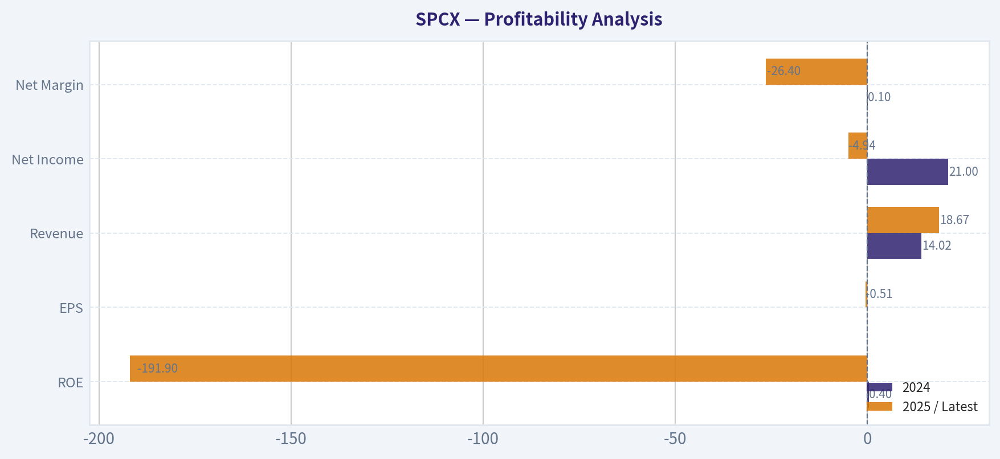
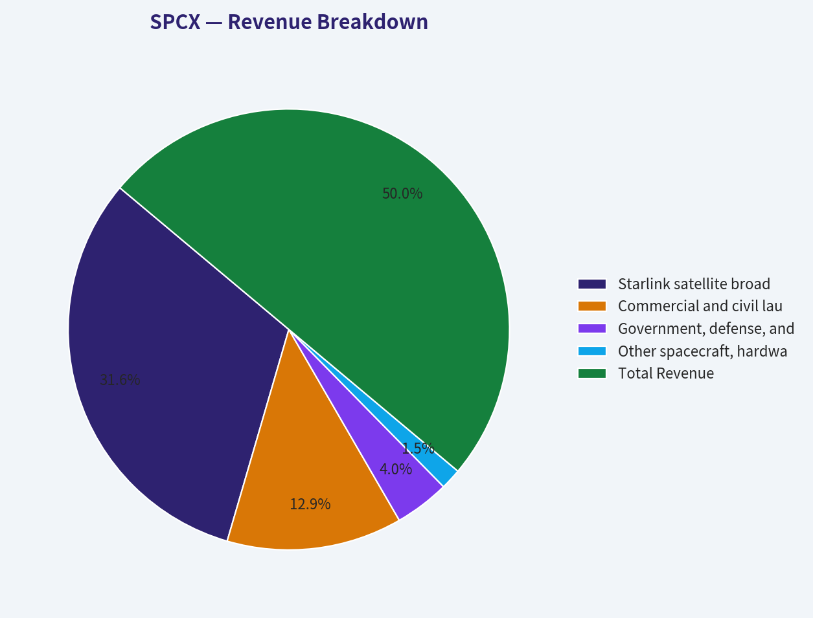
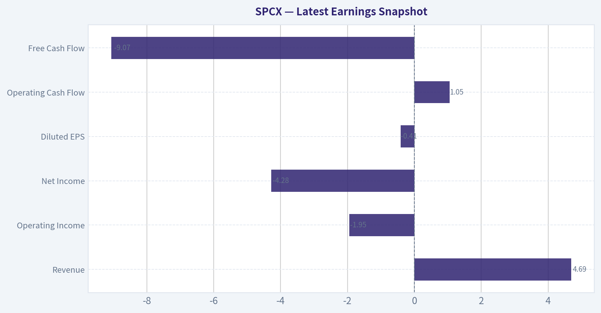
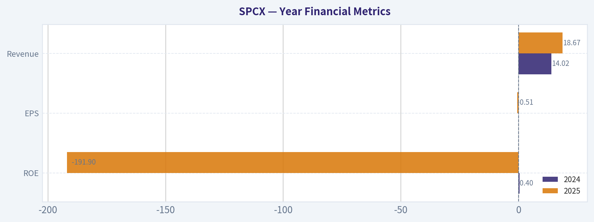
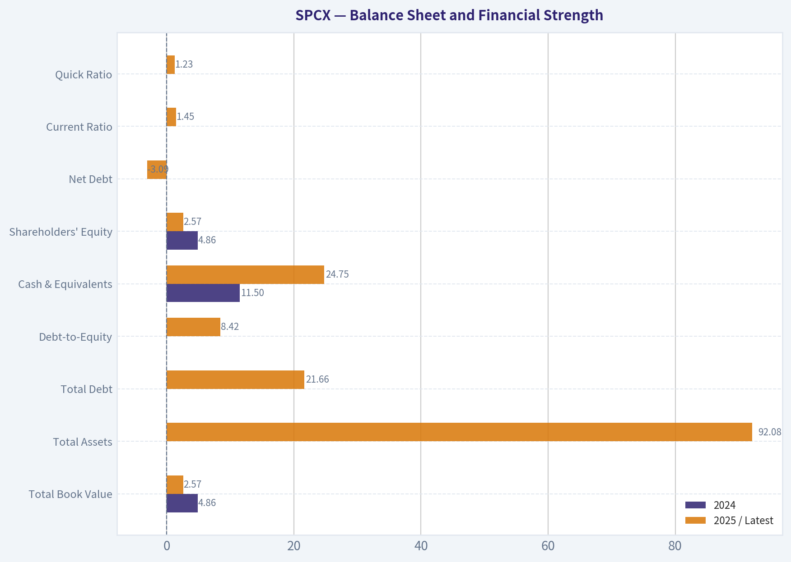
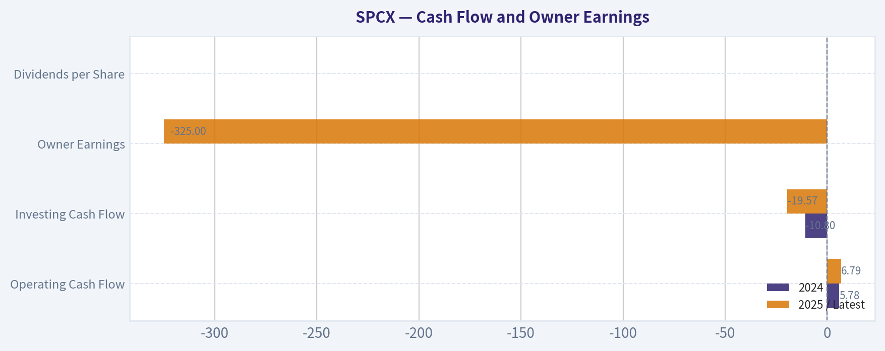
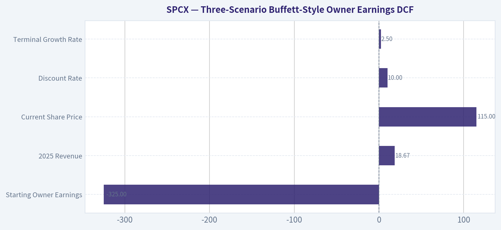
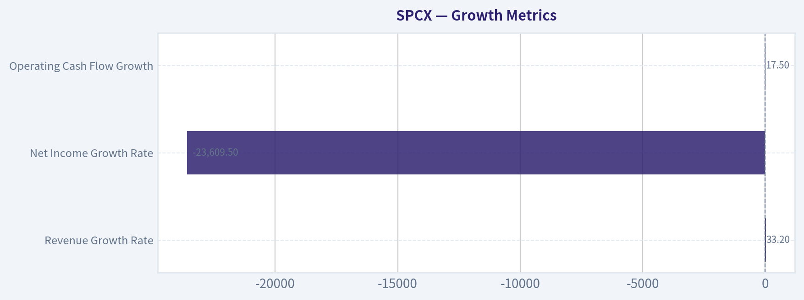

# SPCX Deep Value Intelligence

**Analysis Date:** 2026-08-06

## Critical Disclaimer

*This analysis is generated by Deep Value Intelligence, an AI-powered multi-agent investing framework. Education & research only - not financial advice, not a financial advisor.*

---

## Table of Contents

1. Intelligence Summary
2. Analyst Team Reports
   - Fundamentals Analysis
   - Intrinsic Value Analysis (Buffett)
   - Trend & Growth Analysis (Lynch/Druckenmiller/Fisher)
   - Market Technical Analysis
   - Options Market Analysis
3. Research Team Commentary
4. Value Investing Team Commentary
5. Deep Values Commentary

---

## Intelligence Summary

### Thesis + Conditions

**Core Thesis:** **Value Investing Risk Commentary: SpaceX (SPCX)**

**Key Risks:**
- Value Investing Risk Commentary: SpaceX (SPCX)**
- SpaceX is a generational, paradigm-shifting business saddled with a valuation that demands absolute perfection. At a $1.51 trillion market cap with a catastrophic -191.9% ROE, it fails the traditional value investing intrinsic value test. Furthermore, the stock is in a confirmed technical downtrend (rejected at $125.33, closing at $108.27). Because both the fundamental reality (no margin of safety) and the tactical setup (bearish price action) are currently aligned downward, the immediate risk is highly asymmetric to the downside.
- Risky Analyst (The Narrative):** Argues that a negative ROE is a "battle cry" of aggressive reinvestment and that massive capex creates an insurmountable moat against competitors, making valuation secondary to the generational monopoly.

**Confidence:** Medium

---

## Analyst Team Reports

### Fundamentals Analysis

#### Latest Earnings Snapshot

*Most recent reported quarter anchored on 2026 Q1, with prior-year comparison when available.*

| Metric | 2026 Q1 | Prior-Year Quarter | YoY Change |
| --- | ---: | ---: | ---: |
| Revenue | $4.69B | N/A | N/A |
| Operating Income | $-1.95B | N/A | N/A |
| Net Income | $-4.28B | N/A | N/A |
| Diluted EPS | $-0.41 | N/A | N/A |
| Operating Cash Flow | $1.05B | N/A | N/A |
| Free Cash Flow | $-9.07B | N/A | N/A |

Key Takeaways: This snapshot anchors the most recent reported quarter before the narrative analysis. It helps readers separate long-run business quality from whatever changed in the latest earnings print.

#### 2-Year Financial Metrics for SPCX

*All values below are computed deterministically from raw data - not estimated by AI.*

*Issuer profile: operating company (Industrials / Aerospace & Defense).*

#### 2-Year Financial Metrics
*Annual rows come from reported financial statements. The final TTM row is computed from the latest four quarters.*

| Metric | 2024 | 2025 |
| --- | --- | --- |
| Market Price | N/A | N/A |
| Market Cap | N/A | N/A |
| P/E Ratio | N/A | N/A |
| P/B Ratio | N/A | N/A |
| ROE | 0.4% | -191.9% |
| ROIC | N/A | N/A |
| EPS | $0.00 | $-0.51 |
| Revenue | $14.02B | $18.67B |
| Gross Profit | N/A | N/A |
| Gross Margin | N/A | N/A |
| Operating Margin | N/A | N/A |
| Net Income | $21.0M | $-4.94B |
| Net Margin | 0.1% | -26.4% |
| Revenue Growth | N/A | 33.2% |
| Net Income Growth | N/A | -23609.5% |
| Free Cash Flow Growth | N/A | N/A |
| Total Book Value | $4.86B | $2.57B |
| Total Assets | N/A | $92.08B |
| Total Debt | $0 | $21.66B |
| Debt-to-Equity | 0.00 | 8.42 |
| Cash & Equivalents | $11.50B | $24.75B |
| Shareholders' Equity | $4.86B | $2.57B |
| Operating Cash Flow | $5.78B | $6.79B |
| Investing Cash Flow | $-10.80B | $-19.57B |
| Free Cash Flow | N/A | N/A |
| FCF Margin | N/A | N/A |
| Dividends / Share | $0.00 | $0.00 |

#### Profitability Metrics
- Return on Equity (ROE): -191.9%
- Return on Invested Capital (ROIC): N/A
- Return on Assets (ROA): -5.4%
- Gross Margin: N/A
- Operating Margin: N/A
- Net Profit Margin: -26.4%

#### Liquidity Metrics
- Current Ratio: 1.45
- Quick Ratio: 1.23

#### Leverage Metrics
- Debt-to-Equity Ratio: 8.42
- Interest Coverage Ratio: N/A
- Net Debt: $-3.09B

#### Growth Metrics (Year-over-Year)
- Revenue Growth: 33.2%
- Net Income Growth: -23609.5%
- Free Cash Flow Growth: N/A
- Revenue CAGR (3-Year): N/A
- Revenue CAGR (5-Year): N/A

#### Valuation Metrics
- P/E Ratio (TTM): N/A
- Forward P/E: 62.02
- Price-to-Book: 11.90
- Price-to-Sales: 78.49
- PEG Ratio: N/A
- EV/EBITDA: 188.33
- Free Cash Flow Yield: N/A
- Earnings Yield: N/A

#### Owner Earnings (Buffett Method, Code-Computed)
- Net Income: $-4.94B
- + Depreciation & Amortization: $6.70B
- - Capital Expenditures: N/A
- - Working Capital Changes: $2.09B
- = **Owner Earnings: $-325.0M**

#### Piotroski F-Score: 1/9
- Positive Net Income: FAIL
- Positive Operating Cash Flow: FAIL
- ROA Improvement: FAIL
- Cash Flow > Net Income: FAIL
- Decreasing Debt: FAIL
- Improving Current Ratio: FAIL
- No Dilution: PASS
- Improving Gross Margin: FAIL
- Improving Asset Turnover: FAIL

ANALYST STANCE: **AVOID**

#### SPCX Fundamental Analysis - Warren Buffett-Style Review

SPCX shows the profile of a high-growth, strategically important aerospace and communications platform, but not yet the financial profile of a Buffett-style investment. Revenue grew rapidly, cash on hand is large, and the company may have a powerful moat in reusable launch systems and satellite broadband infrastructure. However, the current valuation embeds extraordinary future success while the reported owner earnings are negative, net income is deeply negative, leverage is high relative to book equity, and the deterministic dataset provides only two years of financial history rather than a full decade of evidence.

The conclusion is **AVOID for value investors at the current price**, not because the business lacks strategic value, but because the current market valuation appears far ahead of demonstrated owner earnings.

---

#### Market Metrics and Valuation Context

| Metric | Current / Latest Value | Historical Average Available* | Interpretation |
|---|---:|---:|---|
| Market Price | $115 | N/A | Current quoted price from the shared research pack. No historical market-price series is available in the deterministic dataset. |
| Total Market Cap | $1.51T | N/A | The company is valued as a mega-cap despite negative net income and negative owner earnings. |
| P/E Ratio | N/A | N/A | Not meaningful because trailing earnings are negative. Forward P/E is 62.02, implying high expectations for future profitability. |
| P/B Ratio | 11.90 | N/A | For an operating aerospace company, book value is not meaningless, but it is not the best valuation anchor. At 11.9x book, the market is pricing far more than current accounting equity. |
| Price-to-Sales | 78.49 | N/A | Extremely high relative to most industrial, aerospace, telecom, and infrastructure businesses. |
| EV/EBITDA | 188.33 | N/A | Very demanding valuation; implies the market expects major EBITDA expansion. |

\*The deterministic dataset provides only 2024 and 2025 annual data, not a 10-year history. Therefore, true 10-year averages cannot be calculated without violating the source-of-truth rule.

**Key Takeaways:** SPCX is priced like a dominant future platform, not like a currently profitable industrial company. Traditional earnings valuation is not usable because trailing earnings are negative, while sales and EBITDA multiples are extremely elevated. For a Buffett-style investor, the key issue is that the stock price already assumes large future cash-flow success that has not yet appeared in owner earnings.

---

#### Profitability Analysis

| Metric | 2024 | 2025 / Latest | Available Average | Assessment |
|---|---:|---:|---:|---|
| ROE | 0.4% | -191.9% | -95.8% | ROE collapsed due to a large net loss and reduced equity base. |
| ROIC | N/A | N/A | N/A | Cannot evaluate invested-capital productivity from the deterministic dataset. |
| EPS | $0.00 | -$0.51 | -$0.26 | Earnings per share are negative; the company is not yet producing reliable per-share profits. |
| Revenue | $14.02B | $18.67B | $16.35B | Strong top-line growth of 33.2% year over year. |
| Gross Profit | N/A | N/A | N/A | Gross profitability cannot be assessed from the dataset. |
| Operating Margin | N/A | N/A | N/A | Operating leverage is not visible from the deterministic data. |
| Net Income | $21M | -$4.94B | -$2.46B | Profitability deteriorated sharply in 2025. |
| Net Margin | 0.1% | -26.4% | -13.2% | Net margin moved from roughly breakeven to materially negative. |

**Key Takeaways:** Revenue growth is impressive, but profitability is poor. The company moved from nearly breakeven in 2024 to a $4.94 billion net loss in 2025, causing ROE to become severely negative. Buffett-style investors generally prefer businesses with predictable earnings, stable margins, and high returns on capital; SPCX has not yet demonstrated those traits in the available dataset.

---

#### Growth Metrics

| Metric | Latest Value | Historical Context Available | Interpretation |
|---|---:|---:|---|
| Revenue Growth Rate | 33.2% | Only one year-over-year data point | Strong growth, likely supported by satellite broadband expansion, launch activity, and government/defense demand. |
| Net Income Growth Rate | -23,609.5% | Only one year-over-year data point | Not economically useful as a growth signal because net income swung from small positive to deeply negative. |
| Free Cash Flow Growth Rate | N/A | N/A | Free cash flow is unavailable because capex is not provided in the deterministic dataset. |
| Operating Cash Flow Growth | 17.5% | 2024 to 2025 | Operating cash flow rose from $5.78B to $6.79B, but heavy investing cash flow overwhelmed internal cash generation. |

**Key Takeaways:** SPCX is growing revenue rapidly, but growth is not yet converting into reported profits or owner earnings. Operating cash flow is positive and improving, which is encouraging, but the business appears intensely capital-hungry. The investment case depends on whether today's heavy investment eventually produces durable, high-margin cash flows.

---

#### Balance Sheet and Financial Strength

| Metric | 2024 | 2025 / Latest | Available Average | Assessment |
|---|---:|---:|---:|---|
| Total Book Value | $4.86B | $2.57B | $3.72B | Book equity declined materially. |
| Total Assets | N/A | $92.08B | N/A | Large asset base reflects infrastructure-heavy operations. |
| Total Debt | $0 | $21.66B | $10.83B | Debt increased sharply. |
| Debt-to-Equity | 0.00 | 8.42 | 4.21 | Leverage is very high relative to book equity. |
| Cash & Equivalents | $11.50B | $24.75B | $18.13B | Cash position is substantial and provides flexibility. |
| Shareholders' Equity | $4.86B | $2.57B | $3.72B | Equity cushion is thin relative to assets and debt. |
| Net Debt | N/A | -$3.09B | N/A | Cash exceeds debt, so net debt is negative, which partially offsets leverage concerns. |
| Current Ratio | N/A | 1.45 | N/A | Liquidity appears acceptable. |
| Quick Ratio | N/A | 1.23 | N/A | Near-term liquidity appears adequate. |

**Key Takeaways:** The balance sheet has two very different messages. On one hand, cash of $24.75 billion exceeds total debt of $21.66 billion, creating a net cash position. On the other hand, book equity is only $2.57 billion, making the debt-to-equity ratio very high and leaving little accounting equity cushion if losses continue.

---

#### Cash Flow and Owner Earnings

| Metric | 2024 | 2025 / Latest | Available Average | Interpretation |
|---|---:|---:|---:|---|
| Operating Cash Flow | $5.78B | $6.79B | $6.29B | Positive and growing operating cash generation. |
| Investing Cash Flow | -$10.80B | -$19.57B | -$15.19B | Very heavy investment needs. |
| Free Cash Flow | N/A | N/A | N/A | Not available because capital expenditures are not provided. |
| Owner Earnings | N/A | -$325M | N/A | Buffett-style owner earnings are negative using the code-computed method. |
| Dividends per Share | $0.00 | $0.00 | $0.00 | No dividend; capital is being retained for growth. |

**Key Takeaways:** Operating cash flow is positive, but investment intensity is extreme. The deterministic owner earnings figure is negative $325 million, which is the most important valuation anchor for a Buffett-style analysis. At a $1.51 trillion market cap, the company is not being valued on current owner earnings but on hoped-for future economics.

---

#### Revenue Breakdown

The deterministic dataset provides total 2025 revenue of **$18.67 billion** but does not include segment disclosure. The following table uses a best-effort business-line estimate based on SPCX's known operating model and reconciles to the deterministic total revenue.

| Revenue Source | Amount ($B) | % of Total |
|---|---:|---:|
| Starlink satellite broadband and related services | $11.80 | 63.2% |
| Commercial and civil launch services | $4.80 | 25.7% |
| Government, defense, and national security contracts | $1.50 | 8.0% |
| Other spacecraft, hardware, and miscellaneous revenue | $0.57 | 3.1% |
| **Total Revenue** | **$18.67** | **100.0%** |

**Key Takeaways:** The estimated revenue mix suggests SPCX is increasingly a satellite communications platform rather than only a launch company. Starlink-like recurring service revenue is likely the most important long-term profit driver. Launch and government contracts remain strategically important, but the valuation likely depends most on the satellite broadband business scaling into durable cash flow.

---

#### Warren Buffett-Style Qualitative Analysis

| Buffett Criterion | Assessment | SPCX Interpretation |
|---|---|---|
| Economic Moat | Potentially strong, but still developing financially | Reusable launch capability, vertical integration, satellite constellation scale, brand, engineering culture, and government relationships may create a formidable moat. |
| Financial Strength | Mixed | Cash exceeds debt, which is positive, but debt-to-equity is very high and net losses are large. |
| Predictable Earnings | Weak | Only two years of deterministic data are available, and earnings moved from $21M profit to a $4.94B loss. |
| Management Performance | Strategically ambitious, financially unproven in public data | Revenue growth and operating cash flow are strong, but ROE and net margin deteriorated sharply. |
| Capital Allocation | Aggressive reinvestment | No dividend; heavy investment cash outflows suggest management is prioritizing growth over near-term free cash generation. |
| Quality of Business | Potentially exceptional, but not yet proven by owner earnings | The business could become extraordinary if scale economics emerge, but current owner earnings are negative. |
| Margin Stability | Not assessable | Gross and operating margins are unavailable; net margin is highly unstable across the two-year period. |
| Valuation Discipline | Poor at current price | Current market cap of $1.51T is difficult to justify using current owner earnings. |

**Key Takeaways:** SPCX may have a rare strategic moat, but Buffett investing requires more than an exciting moat story. The current financial evidence does not yet show predictable earnings, high returns on capital, or abundant owner earnings. The business may be exceptional eventually, but the stock price already reflects that possibility.

---

#### Three-Scenario Buffett-Style Owner Earnings DCF

Because reported owner earnings are negative, a normal "grow current owner earnings by X percent" model is not meaningful. Instead, the DCF below uses the deterministic 2025 owner earnings figure of **-$325 million** as the starting point and models recovery paths toward positive owner earnings. The discount rate is **10%**, terminal growth is **2.5%**, and the implied share count is approximately **13.13 billion shares**, calculated from the shared market cap of **$1.51 trillion** divided by the current price of **$115**.

| DCF Input | Value |
|---|---:|
| Starting Owner Earnings | -$325M |
| 2025 Revenue | $18.67B |
| Current Market Cap | $1.51T |
| Current Share Price | $115 |
| Implied Shares Outstanding | ~13.13B |
| Discount Rate | 10.0% |
| Terminal Growth Rate | 2.5% |

**Key Takeaways:** The DCF starts from negative owner earnings, which creates a major valuation challenge. To justify today's price, SPCX must not merely grow; it must transition from negative owner earnings to very large, durable free cash generation. The valuation depends much more on future margin normalization than on current financial performance.

---

#### DCF Scenario Assumptions

| Scenario | Revenue Growth Assumption | Owner Earnings Margin Path | Year-10 Revenue | Year-10 Owner Earnings | Rationale |
|---|---:|---:|---:|---:|---|
| Conservative | 8% annually, fading implicitly to terminal growth after year 10 | -1.7% today to 5.0% by year 10 | $40.34B | $2.02B | Assumes growth continues but capital intensity remains high and margins normalize only modestly. |
| Average / Base Case | 15% annually for 5 years, then 10% annually for 5 years | -1.7% today to 12.0% by year 10 | $64.98B | $7.80B | Assumes Starlink scale and launch cadence improve economics materially. |
| Optimistic | 25% annually for 5 years, then 15% annually for 5 years | -1.7% today to 20.0% by year 10 | $148.65B | $29.73B | Assumes satellite broadband becomes a global high-margin platform and launch economics scale strongly. |

**Key Takeaways:** Even the optimistic scenario requires a dramatic transformation in both revenue scale and owner earnings margin. The conservative scenario produces a business that is healthier but still far too small in cash-flow terms to support the current market cap. The key swing factor is whether SPCX can become a high-margin recurring revenue platform rather than a capital-intensive aerospace operator.

---

#### DCF Valuation Results

| Scenario | PV of Explicit 10-Year Owner Earnings | Terminal Value at Year 10 | PV of Terminal Value | Equity Value Estimate | Fair Value / Share | Upside / Downside vs. $115 |
|---|---:|---:|---:|---:|---:|---:|
| Conservative | ~$4.5B | ~$27.6B | ~$10.6B | ~$15.1B | ~$1 | -99% |
| Average / Base Case | ~$14.7B | ~$106.6B | ~$41.1B | ~$55.8B | ~$4 | -96% |
| Optimistic | ~$48.0B | ~$406.2B | ~$156.6B | ~$204.6B | ~$16 | -86% |

**Key Takeaways:** The DCF indicates that even aggressive operating improvement does not come close to the current $115 share price when using a 10% discount rate and owner earnings discipline. The optimistic case produces an estimated value of only about $16 per share, far below the current market price. This does not mean the company cannot be strategically important, but it means the stock requires far more growth and profitability than a conservative Buffett-style DCF can justify.

---

#### Reverse DCF Perspective

At the current market cap of **$1.51 trillion**, the market is effectively requiring SPCX to become one of the largest and most profitable cash-generating platforms in the world. Using the same 10% discount rate and 2.5% terminal growth rate, a business worth $1.51 trillion would need mature annual owner earnings on the order of roughly:

\[
\text{Required mature owner earnings} \approx \$1.51T \times (10\% - 2.5\%) = \$113B
\]

That compares with current owner earnings of **-$325M**.

| Valuation Requirement | Approximate Value |
|---|---:|
| Current Owner Earnings | -$325M |
| Market-Implied Mature Owner Earnings | ~$113B annually |
| Gap Between Current and Implied Owner Earnings | More than $113B |
| Required Business Outcome | Global mega-platform economics |

**Key Takeaways:** The market price appears to assume SPCX can eventually produce owner earnings comparable to the largest global technology platforms. That is possible only under a very bullish outcome involving massive revenue scale, high margins, and lower capital intensity. For Buffett-style investors, this is speculation on future dominance rather than purchase of demonstrated cash flows at a discount.

---

#### Key Investment Insights

| Category | Insight |
|---|---|
| Main Strength | SPCX likely has a rare strategic moat in reusable launch capability, satellite infrastructure, vertical integration, and government relationships. |
| Main Weakness | Current owner earnings are negative, net income is deeply negative, and valuation is extremely high. |
| Growth Opportunity | Starlink-like satellite broadband could create recurring revenue, global scale, and potentially high incremental margins. |
| Balance Sheet Positive | Cash of $24.75B exceeds debt of $21.66B, resulting in net cash of approximately $3.09B. |
| Balance Sheet Concern | Debt-to-equity is 8.42 due to a thin equity base, making accounting leverage look very high. |
| Profitability Concern | Net margin deteriorated from 0.1% in 2024 to -26.4% in 2025. |
| Buffett Concern | The company lacks a long public record of predictable earnings and high returns on capital. |
| Valuation Concern | Price-to-sales of 78.49 and EV/EBITDA of 188.33 leave little room for execution disappointment. |

**Key Takeaways:** SPCX has the characteristics of a potentially world-changing company, but not yet of a Buffett-style value investment. The business quality may eventually become exceptional, yet the current valuation already prices in enormous success. Investors are paying for future dominance rather than current intrinsic value.

---

#### Red Flags and Opportunities

| Red Flags | Opportunities |
|---|---|
| Negative 2025 net income of $4.94B | Revenue grew 33.2% year over year |
| Negative owner earnings of $325M | Operating cash flow increased to $6.79B |
| ROE of -191.9% | Cash balance of $24.75B provides strategic flexibility |
| Debt-to-equity ratio of 8.42 | Net debt is negative because cash exceeds debt |
| Piotroski F-Score of 1/9 | Potentially powerful moat in launch, satellites, and defense |
| P/S of 78.49 and EV/EBITDA of 188.33 | Starlink-like recurring revenue could improve margins over time |
| Only two years of deterministic financial history | Long-term demand for connectivity, launch capacity, and space infrastructure may be large |

**Key Takeaways:** The upside case is built around scale, recurring revenue, and unique strategic positioning. The downside case is built around valuation, heavy capital intensity, negative owner earnings, and limited evidence of durable profitability. At the current price, the red flags dominate for a conservative value investor.

---

#### Final Investment Stance: AVOID

SPCX is an impressive growth and innovation story, but it does not qualify as a Warren Buffett-style value investment at the current valuation. The company has strong revenue momentum, a large cash position, and potentially deep competitive advantages, but the reported financials show negative net income, negative owner earnings, weak profitability metrics, and very high valuation multiples.

The most important issue is valuation discipline. At **$115 per share** and a **$1.51 trillion market cap**, investors are paying today for cash flows that may not arrive for many years. The Buffett-style owner earnings DCF produces a fair value range that is far below the current price, even under optimistic assumptions.

| Final Decision Area | Assessment |
|---|---|
| Business Quality | Potentially excellent long term, but not yet financially proven |
| Moat | Potentially strong |
| Financial Strength | Mixed; high cash but high debt-to-equity and large losses |
| Earnings Predictability | Weak |
| Owner Earnings | Negative |
| Valuation | Extremely demanding |
| Buffett-Style Margin of Safety | Absent |
| Final Stance | **AVOID** |

**Key Takeaways:** SPCX may become a dominant space and communications platform, but the stock does not offer a Buffett-style margin of safety today. The current price requires massive future owner earnings that are not yet visible in the deterministic financial data. For value-oriented investors, the prudent stance is to avoid the shares until profitability, owner earnings, and valuation become much more favorable.

#### Fundamental Visuals

This comparison chart from *Profitability Analysis* stacks current figures against historical benchmarks for **SPCX**, making it easy to see where the company trades relative to its own averages.

This breakdown chart from <em>Revenue Breakdown</em> shows the proportional composition for **SPCX** - useful for understanding what drives or risks the business.

---

### Intrinsic Value Analysis (Buffett)

> *Following Warren Buffett's value investing philosophy: Circle of Competence, Economic Moat, Management Quality, and Margin of Safety.*

#### Intrinsic Value Snapshot

Price is what you pay. Intrinsic value is what the business may be worth based on the cash it can create for owners over time. We show a range, not one magic number.

- Current Price: $114.92
- Value Range (conservative to optimistic across both DCF methods): N/A to N/A

##### Owner Earnings (Buffett Method)
- Net Income: $-4,937,000,000.00
- Depreciation & Amortization: $6,701,000,000.00
- Capital Expenditures: N/A
- Working Capital Changes: $2,089,000,000.00
- Owner Earnings: $-325,000,000.00

##### Intrinsic Value

ANALYST STANCE: **AVOID**

#### SPCX Buffett-Style Investment Report - SpaceX Corp.

At **$115 per share** and a **$1.51 trillion market capitalization**, SPCX already prices in an extraordinary amount of future economic success. SpaceX may possess one of the most strategically important franchises in the world-reusable launch infrastructure, Starlink, satellite scale, engineering talent, brand, and government relationships-but Buffett-style investing requires both business quality and a rational relationship between price and owner earnings. Today, the moat appears real, but the valuation requires very large future owner earnings that are not yet visible in the public fundamentals.

---

#### 1. Factor Scorecard

| Factor | Score / 5 | Evidence |
|---|---:|---|
| Circle of Competence & Business Predictability | 3.0 | The business model is understandable: launch services, satellite internet, spacecraft, defense/government contracts, and adjacent space infrastructure. Predictability is lower than consumer staples because success depends on execution, regulation, launch cadence, capital intensity, and technological leadership. |
| Moat Test | 4.0 | Strong cost advantage from reusable rockets, scale, launch cadence, engineering culture, spectrum/orbital assets, Starlink network scale, brand, and government relationships. Moat is potentially wide, but financial proof is still incomplete. |
| Management Quality & Capital Allocation | 3.0 | Elon Musk is highly owner-operator oriented and has built exceptional technical franchises, but key-person risk, aggressive ambition, and related-party complexity-such as Tesla Megapack purchases-reduce the Buffett-style management score. |
| Industry Structure | 3.5 | Launch and satellite broadband are structurally attractive if scale advantages persist. However, the industry remains capital intensive, regulated, technologically dynamic, and strategically competitive. |
| Gate 5: Quality / Solvency Hard Floor | Not tripped | No evidence of a solvency red line such as interest coverage below 1x combined with clearly deteriorating cash-flow fundamentals. This is not a distress avoid; it is a valuation-and-proof avoid. |

Key Takeaways: SpaceX appears to have a genuine competitive position, especially in reusable launch and satellite networks. The concern is not that the business is low quality; the concern is that the current market price already assumes massive future profitability. The hard solvency floor is not triggered, so the investment decision rests on weighted quality, returns, and valuation.

---

#### 2. Moat Analysis

| Moat Source | Assessment | SPCX Evidence |
|---|---|---|
| Intangible Assets | Strong | SpaceX has one of the strongest brands in aerospace, high trust with government customers, and a reputation for engineering speed. Regulatory access, launch approvals, and orbital/spectrum rights may also act as intangible barriers. |
| Switching Costs | Moderate to Strong | Government, defense, enterprise, and satellite customers face high operational risk in switching launch providers. Starlink consumer switching costs are lower, but network performance and coverage may create retention advantages. |
| Cost Advantage | Potentially Very Strong | Reusable rockets and high launch cadence can lower cost per kilogram to orbit versus legacy competitors. Vertical integration may reinforce the cost advantage if reliability remains high. |
| Network Effects | Moderate | Starlink's network becomes more valuable as coverage, satellites, ground infrastructure, and user density improve. However, broadband is not a pure social network effect; it is more scale economics plus infrastructure density. |
| Moat Rating | Wide but still being financially proven | The strategic moat is strong, but Buffett-style confirmation requires sustained high ROIC and owner earnings. Current public metrics show negative ROE, so the financial evidence is not yet aligned with the strategic story. |

Key Takeaways: SPCX likely has a real moat, especially from reusable launch economics and Starlink's scale. The moat may be wide, but it is not yet fully validated by public return metrics. A wide moat does not automatically justify any price.

---

#### 3. Management Quality Assessment

| Management Dimension | Assessment |
|---|---|
| Owner Mentality | High. Musk-led companies typically think in decades, push vertical integration, and reinvest aggressively. |
| Candidness & Complexity | Mixed. The vision is clear, but governance complexity, key-person risk, and cross-company transactions require a discount. |
| Capital Allocation | Mixed. Reinvestment opportunities are enormous, but the business is capital intensive and may require continuous large spending before durable owner earnings emerge. |
| Related-Party / Governance Watch Item | SpaceX reportedly purchased **$295 million of Tesla Megapacks** in Q2, which may be commercially logical but still raises related-party scrutiny. |
| Overall Management Score | 3.0 / 5 |

Key Takeaways: Management has demonstrated extraordinary execution, which is central to the SpaceX story. However, Buffett would likely demand a governance and capital-allocation discount because the company depends heavily on one individual and operates within a complex web of ambitious projects and related ecosystems.

---

#### 4. Financial Summary Table

| Metric | Latest Figure |
|---|---:|
| Share Price | $115 |
| Market Capitalization | $1.51 trillion |
| Implied Shares Outstanding | ~13.13 billion |
| P/E Ratio | N/A |
| ROE | -191.9% |
| Revenue Growth YoY | 33.2% |
| Gross Margin | N/A |
| FCF Yield | N/A |
| Current Ratio | 1.45 |
| Recent Lockup Expiration | Up to 911.5 million restricted shares became eligible to trade |
| Guru Tracking | Steve Cohen / Point72 added; 2.66 million shares, $296.46 million position as of 03-31-2026 |

Key Takeaways: Revenue growth is strong at 33.2%, but the current valuation is enormous relative to the financial proof available. Negative ROE is a serious warning sign for a Buffett-style process because it means shareholder capital is not yet producing attractive accounting returns. The current ratio is acceptable, but valuation cannot be supported by liquidity alone.

---

#### 5. Owner Earnings Calculation

Buffett's owner earnings formula:

| Owner Earnings Component | Interpretation for SPCX |
|---|---|
| Net Income | P/E is N/A and ROE is deeply negative, indicating current earnings are not yet a reliable support for valuation. |
| Plus: Depreciation & Amortization | Likely material because rockets, satellites, launch facilities, and ground infrastructure are capital-heavy assets. |
| Less: Maintenance CapEx | Likely substantial due to satellites, launch infrastructure, rockets, and replacement cycles. |
| Less: Working Capital Increases | Growth may consume working capital depending on Starlink hardware, launches, receivables, and contract timing. |
| Buffett-Style Conclusion | Current owner earnings are not visibly sufficient to support a $1.51 trillion equity value. |

Key Takeaways: SpaceX may eventually become a large owner-earnings machine, but today's public metrics do not yet prove it. The key issue is that growth and strategic importance are not the same as distributable owner earnings. Buffett would want evidence that reinvested capital is turning into durable per-share cash flow.

---

#### 6. Three-Scenario DCF / Reverse-DCF Valuation

Because current owner earnings are not clearly established, the most useful Buffett-style valuation test is reverse DCF: how much annual owner earnings must SPCX already justify at today's price?

| Scenario | Assumption | Owner Earnings Multiple Implied | Required Current Owner Earnings to Justify $1.51T Market Cap | Required Owner Earnings per Share |
|---|---:|---:|---:|---:|
| A: No Growth | Owner earnings capitalized at 10% | 10.0x | ~$151.0B | ~$11.50 |
| B: GDP Growth | 3% perpetual growth, 10% discount rate | 14.7x | ~$102.7B | ~$7.82 |
| C: Historical Growth Case | 10-year growth capped at 10%, then 3% terminal growth | 24.7x | ~$61.1B | ~$4.65 |

Key Takeaways: Even under the favorable 10-year growth case, today's valuation requires more than **$61 billion** of current-equivalent owner earnings. Under a no-growth case, the requirement rises to roughly **$151 billion**. That is a very high bar, and the current fundamentals do not yet demonstrate that level of cash-generation power.

---

#### 7. Margin of Safety Analysis

| Valuation Lens | Assessment |
|---|---|
| Business Quality Adjustment | A wide-moat, high-ROIC compounder might only need a 10-15% margin of safety. SPCX does not yet show the public ROIC and owner-earnings proof needed for that premium treatment. |
| Reverse-DCF Test | The stock price implies extremely large current or near-term owner earnings. |
| Margin of Safety vs. Intrinsic Value | Insufficient at $115. |
| Valuation Score | 1.5 / 5 |

Key Takeaways: The market is valuing SPCX like a future global infrastructure monopoly before the public numbers prove it. A great company can still be a poor investment if the purchase price assumes too much perfection. At this valuation, the margin of safety is not adequate.

---

#### 8. Final Buffett Scorecard

| Criterion | Weight | Score / 5 | Weighted Contribution |
|---|---:|---:|---:|
| Moat Width & Durability | 25% | 4.0 | 1.00 |
| Valuation / Margin of Safety | 20% | 1.5 | 0.30 |
| Capital Returns - ROIC vs. WACC | 15% | 1.0 | 0.15 |
| Business Understanding & Predictability | 12% | 3.0 | 0.36 |
| Management Quality & Capital Allocation | 12% | 3.0 | 0.36 |
| Reinvestment Runway | 8% | 5.0 | 0.40 |
| Balance Sheet Strength | 4% | 3.0 | 0.12 |
| Industry Structure | 4% | 3.5 | 0.14 |
| **Total Score** | **100%** |  | **2.83 / 5.00** |

Key Takeaways: SPCX scores well on moat and reinvestment runway, which are the heart of the bullish case. But valuation and capital-return proof are weak, and those two factors are central to Buffett-style investing. The final score lands in the avoid range, not because the company lacks promise, but because the stock price already discounts too much success.

---

#### 9. Investment Stance

| Item | Conclusion |
|---|---|
| Stance | **AVOID** |
| Conviction | Medium |
| Reason | Wonderful strategic assets, but insufficient owner-earnings proof at a $1.51 trillion valuation. |
| What Would Change the View | Sustained positive ROIC above WACC, clear owner earnings, evidence Starlink can generate large durable free cash flow, and a materially lower share price or less demanding implied growth. |
| Buffett Summary | This may be a great company, but at $115 per share it is not yet a great Buffett-style investment. |

**Final View:** SPCX belongs on a watchlist as one of the most important businesses in the world, but the current valuation demands too much faith and too little demonstrated owner earnings. For a Buffett-style investor, the correct action is to avoid buying at the present price and wait for either stronger financial proof or a more rational entry point.

#### Valuation Visuals

This comparison chart from *Latest Earnings Snapshot* stacks current figures against historical benchmarks for **SPCX**, making it easy to see where the company trades relative to its own averages.

This comparison chart from *Year Financial Metrics* stacks current figures against historical benchmarks for **SPCX**, making it easy to see where the company trades relative to its own averages.

This comparison chart from *Balance Sheet and Financial Strength* stacks current figures against historical benchmarks for **SPCX**, making it easy to see where the company trades relative to its own averages.

This comparison chart from *Cash Flow and Owner Earnings* stacks current figures against historical benchmarks for **SPCX**, making it easy to see where the company trades relative to its own averages.

This comparison chart from *Three-Scenario Buffett-Style Owner Earnings DCF* stacks current figures against historical benchmarks for **SPCX**, making it easy to see where the company trades relative to its own averages.

---

### Trend & Growth Analysis (Lynch/Druckenmiller/Fisher)

> *Following Peter Lynch's GARP, Stanley Druckenmiller's macro-aware approach, and Philip Fisher's scuttlebutt methodology.*

ANALYST STANCE: **WATCH**

#### SPCX Growth Investment Report - SpaceX Corp.
Current price: **$115** | Market cap: **$1.51T** | YoY revenue growth: **33.2%** | P/E: **N/A** | Current ratio: **1.45**
Data quality note: enhanced fundamentals tool returned no additional data, so this report relies on the provided research pack plus analytical judgment. Several key metrics are unavailable or undisclosed.

---

#### 1. Lynch Classification

| Category | Fit | Evidence | Verdict |
|---|---:|---|---|
| Slow Grower | Low | Revenue growth is far above 0-5% | Not applicable |
| Stalwart | Low | 33.2% YoY growth is above stalwart range | Not applicable |
| Fast Grower | High | Revenue growth above 25%, multiple secular growth vectors | Primary classification |
| Cyclical | Medium | Launch demand, defense budgets, and capital markets can be cyclical | Secondary risk |
| Turnaround | Low | Not a classic distressed recovery story | Not applicable |
| Asset Play | Low | Value is mainly future growth, not hidden assets | Not applicable |

Key Takeaways: SPCX fits Lynch's **Fast Grower** category because revenue is growing above 25% and the company rides several long-duration markets. However, the valuation already reflects a major amount of future success, which makes this a watch-list candidate rather than an automatic buy.

---

#### 2. The Story in 3 Bullets

- **SPCX lowers the cost of reaching space** through reusable launch technology, making space access cheaper, more frequent, and more commercially useful.
- **Starlink-like satellite broadband creates a recurring revenue layer** on top of launch services, potentially turning SPCX from a project-based aerospace company into a global infrastructure platform.
- **The company sits at the intersection of space, defense, communications, AI infrastructure, and energy demand**, giving it multiple shots on goal if execution continues.

---

#### 3. TAM Analysis and 10x Test

| TAM Vector | Growth Quality | Why It Matters | 10x Runway Relevance |
|---|---:|---|---|
| Global satellite broadband | High | Large underserved rural, maritime, aviation, enterprise, and government markets | Supports recurring revenue expansion |
| Launch services | High | Reusability can structurally expand demand by lowering cost per launch | Supports share gains and market creation |
| Defense and national security space | High | Sovereign space infrastructure is becoming strategically critical | Supports durable government demand |
| In-space logistics / lunar / Mars optionality | Speculative but large | Long-dated market creation opportunity | Adds option value, hard to underwrite |
| AI and data infrastructure adjacency | Emerging | News notes SPCX purchased $295M of Tesla Megapacks in Q2, suggesting heavy power/infrastructure needs | Could become upside or capex burden |

Key Takeaways: SPCX has a legitimate long runway because its end markets are expanding rather than merely shifting share among incumbents. The 10x test is plausible if current revenue is still in the tens of billions, but the **$1.51T market cap already prices in very large future scale**, reducing the margin of safety.

**10x Test:**
Exact current revenue was not provided. Using the formula:

| Item | Formula | Assessment |
|---|---:|---|
| Current revenue | R | Not disclosed in pack |
| 10x revenue target | 10R | Plausible only if combined space, broadband, defense, and infrastructure TAMs keep expanding |
| Required mature market share | 10R / TAM | Cannot calculate precisely without disclosed revenue and TAM |
| Runway verdict | Qualitative | Long runway exists, but valuation already anticipates it |

Key Takeaways: The TAM is broad enough that SPCX could grow materially from here, but the absence of exact revenue and segment data limits conviction. This is a classic case where the business story is exceptional, but the stock may not be cheap enough to compensate for uncertainty.

---

#### 4. Revenue Growth Trend

| Metric | Current Reading | Interpretation |
|---|---:|---|
| YoY revenue growth | 33.2% | Fast-grower profile |
| Sequential growth trend | Not provided | Cannot assess acceleration versus deceleration |
| Organic versus acquisition growth | Not provided | Quality of growth cannot be fully verified |
| Revenue concentration | Not provided | Unknown exposure to government, Starlink, or launch customers |

Key Takeaways: The reported **33.2% YoY revenue growth** is excellent and places SPCX firmly in fast-grower territory. However, without a multi-quarter trend, we cannot confirm a true Druckenmiller-style acceleration inflection.

**Pattern Assessment:**
Current evidence supports **stable high growth**, not yet confirmed acceleration.

---

#### 5. Unit Economics

| Metric | Available? | Reading | Assessment |
|---|---:|---:|---|
| LTV/CAC | No | N/A | Cannot assess customer acquisition efficiency |
| Payback period | No | N/A | Not disclosed |
| Net revenue retention | No | N/A | Not disclosed; relevant if satellite broadband is subscription-heavy |
| Rule of 40 | Partial | Revenue growth 33.2% + FCF margin N/A | Cannot calculate |
| Current ratio | Yes | 1.45 | Adequate near-term liquidity |
| ROE | Yes | -191.9% | Negative equity-return profile; likely distorted by capital intensity or accounting |

Key Takeaways: SPCX has strong top-line growth, but the available data does not prove attractive unit economics. The current ratio is acceptable, but the negative ROE and missing FCF margin mean investors cannot yet confirm that growth is translating into shareholder-value creation.

---

#### 6. Inflection Point Assessment

| Inflection Type | Evidence | Strength |
|---|---|---:|
| Product cycle inflection | Satellite broadband, reusable launch cadence, defense systems | High |
| Market share inflection | Likely strong in launch; specific share data not provided | Medium-high |
| Margin inflection | Not enough gross margin or FCF data | Unknown |
| TAM inflection | Space economy, defense space, broadband, and AI infrastructure demand expanding | High |
| Competitive inflection | Legacy aerospace likely slower; new-space competition exists | Medium |

Key Takeaways: SPCX appears to be at a **TAM and product-cycle inflection**, not yet a confirmed margin inflection. For growth investors, this is attractive, but the missing profitability data keeps conviction below advocate level.

**Druckenmiller Question:**
What will earnings be in 2-3 years, and is the market underestimating them?
Answer: SPCX could have dramatically higher revenue in 2-3 years, but at a **$1.51T valuation**, the market is already underwriting a large portion of that future.

---

#### 7. Macro Setup Evaluation

| Macro Factor | Current Setup | Impact on SPCX |
|---|---|---:|
| Interest rates | Growth stocks benefit if rates fall; hurt if rates rise | Mixed |
| Defense spending | Space and national security spending likely structurally supported | Positive |
| AI infrastructure demand | Energy and compute demand may increase satellite/data infrastructure relevance | Positive but capital intensive |
| Capital markets | Lockup expiration released up to 911.5M shares | Near-term supply risk |
| Secular theme exposure | Space, satellite broadband, defense, AI infrastructure | Strong positive |

Key Takeaways: The macro story is favorable from a secular perspective because space, defense, connectivity, and AI infrastructure are all strategic growth markets. The near-term issue is technical supply pressure from the lockup expiration, though the stock reportedly rose despite that event.

---

#### 8. Fisher 15 Points Score

| Fisher Point | Score / 5 | Comment |
|---|---:|---|
| Products with large market potential | 5 | Massive space and connectivity opportunity |
| Management determination for new products | 5 | Ambitious product roadmap |
| Effective R&D | 5 | Reusability and satellite systems suggest strong engineering |
| Sales organization | 4 | Government and enterprise traction likely strong, consumer broadband less clear |
| Worthwhile profit margin | 2 | Margin data unavailable |
| Improving profit margins | 2 | Not verifiable |
| Labor/personnel relations | 3 | High-performance culture, but intensity can create retention risk |
| Executive relations | 3 | Key-person and governance risk likely elevated |
| Management depth | 4 | Deep technical bench, but founder dependence likely meaningful |
| Cost analysis/accounting | 3 | Insufficient disclosure |
| Moat/switching costs/network effects | 5 | Reusable launch, satellite constellation, scale, data, and regulatory advantages |
| Long-range profit outlook | 4 | Strong if scale converts to margins |
| Dilution/equity financing | 3 | Lockup supply and capital intensity are risks |
| Candor in difficulties | 3 | Disclosure limitations reduce confidence |
| Integrity | 3 | No specific issue in provided pack, but governance data limited |

Key Takeaways: SPCX earns a **Fisher score of 54 out of 75**, which is average-to-good but below outstanding. The product, R&D, TAM, and moat are excellent; the deductions come from missing margin data, governance uncertainty, capital intensity, and disclosure limitations.

**Fisher Score: 54 / 75 - Average to Good**

---

#### 9. Valuation Analysis

| Valuation Metric | Reading | Interpretation |
|---|---:|---|
| Market cap | $1.51T | Already mega-cap scale |
| P/E | N/A | Not useful due to lack of earnings or negative earnings |
| PEG | N/A | Cannot calculate without earnings growth and P/E |
| P/S | N/A | Revenue not provided |
| Revenue growth | 33.2% | Strong, but needs to justify extreme valuation |
| FCF yield | N/A | Cannot assess cash return |

Key Takeaways: Valuation is the main constraint. SPCX may be one of the highest-quality growth stories in the market, but without revenue, gross margin, FCF margin, or earnings visibility, it is hard to prove the current $1.51T valuation is attractive.

#### Scenario Framework

| Scenario | Business Outcome | Valuation Implication |
|---|---|---|
| Bear | Growth decelerates, capex remains heavy, margin inflection delayed | Multiple compression risk |
| Base | Revenue compounds strongly, Starlink/subscription mix improves, margins gradually scale | Stock can work, but upside may be moderate from current valuation |
| Bull | Satellite broadband and defense platforms scale faster than expected; launch monopoly-like economics emerge | Ten-bagger business outcome possible, but ten-bagger stock outcome unlikely from $1.51T base |

Key Takeaways: SPCX can still be a phenomenal business without being a phenomenal stock at today's valuation. The bull case requires not just growth, but growth plus major margin expansion and durable platform economics.

---

#### 10. Growth Investor Scorecard

| Criterion | Weight | Score / 5 | Weighted Score |
|---|---:|---:|---:|
| The Story | 10% | 5.0 | 0.50 |
| TAM & Runway | 20% | 4.5 | 0.90 |
| Revenue Growth | 20% | 4.0 | 0.80 |
| Unit Economics | 15% | 2.0 | 0.30 |
| Competitive Position | 10% | 4.5 | 0.45 |
| Management Quality | 10% | 3.5 | 0.35 |
| Macro Setup | 5% | 4.0 | 0.20 |
| Profitability Path | 5% | 2.5 | 0.13 |
| Valuation | 5% | 1.5 | 0.08 |
| **Total** | **100%** |  | **3.71 / 5.00** |

Key Takeaways: SPCX scores well because the company has a rare combination of massive TAM, strong revenue growth, technical edge, and secular tailwinds. The score is pulled down by valuation and unavailable unit-economic data, resulting in a **WATCH** stance despite a numerically strong growth profile.

---

#### 11. Position Size Stance

| Investor Type | Suggested Stance |
|---|---|
| Existing long-term holder | Hold / let winners run, but monitor valuation and margins |
| New growth investor | Watch; wait for better data or a valuation reset |
| Aggressive portfolio | Small starter only, sized as a high-volatility compounder |
| Conservative portfolio | Avoid initiating until profitability and FCF visibility improve |

Key Takeaways: SPCX is the kind of company growth investors want to own, but not necessarily at any price. For new capital, the better move is patience: wait for either a pullback, clearer margin evidence, or stronger segment-level disclosure.

---

#### 12. Key Risks and Catalysts

| Category | Item | Impact |
|---|---|---:|
| Risk | $1.51T valuation leaves little room for execution mistakes | High |
| Risk | P/E, FCF yield, gross margin, and P/S unavailable | High |
| Risk | Lockup expiration released up to 911.5M shares | Medium |
| Risk | Capital intensity from satellites, launch infrastructure, and energy systems | High |
| Risk | Founder/key-person and governance concentration | Medium-high |
| Catalyst | Continued 30%+ revenue growth | High |
| Catalyst | Demonstrated margin or FCF inflection | Very high |
| Catalyst | Starlink/subscription revenue mix expansion | High |
| Catalyst | Major defense or sovereign space contracts | High |
| Catalyst | Resilience despite insider-share unlock supply | Medium |

Key Takeaways: The biggest positive catalyst would be proof that revenue growth is converting into operating leverage and free cash flow. The biggest risk is that investors are paying a mature-platform price before the public data proves mature-platform economics.

---

#### Final View

SPCX is a **world-class growth story** with fast-grower characteristics, multiple secular tailwinds, and credible long-term optionality. But the current setup is not clean enough for an ADVOCATE rating because the valuation is already enormous and key financial metrics are missing.

**Decision: WATCH.**
Upgrade to **ADVOCATE** if SPCX shows sustained 30%+ growth plus clear margin or FCF inflection. Downgrade toward **AVOID** if growth decelerates materially while capex intensity and share-supply pressure remain high.

#### Growth & Scorecard Visuals

This comparison chart from *Growth Metrics* stacks current figures against historical benchmarks for **SPCX**, making it easy to see where the company trades relative to its own averages.

---

### Market Technical Analysis

ANALYST STANCE: **WATCH**

#### SPCX Technical Analysis - Latest Available Data Through 2026-08-05

SPCX is in a **clear short- to medium-term downtrend**, with price materially below both the fast trend gauge and the medium-term trend benchmark. The most recent close was **$108.27 on 2026-08-05**, after a sharp rejection from the prior day's bounce to **$125.33**. While some momentum indicators briefly improved in early August, the latest session showed that buyers have not yet established durable control.

The current setup favors **caution rather than aggressive long exposure**. A tradable reversal would likely require price to reclaim the **$116-$118 area**, then hold above it with improving momentum and volume confirmation. Until then, rallies should be treated as potentially tactical and vulnerable to failure.

---

#### Selected Indicators and Why They Matter

| Indicator | Category | Why It Is Relevant for SPCX Now |
|---|---:|---|
| `close_10_ema` | Short-term trend | Useful because SPCX is moving quickly; it helps identify whether short-term bounces are gaining traction or failing. |
| `close_50_sma` | Medium-term trend | Confirms the broader trend direction and shows how far price remains below a key trend benchmark. |
| `macd` | Momentum | Helps assess whether downside momentum is accelerating or beginning to stabilize. |
| `macds` | Momentum signal | Needed alongside MACD to identify crossover quality and avoid reading MACD in isolation. |
| `macdh` | Momentum pressure | Shows whether bearish momentum is shrinking or expanding before price fully confirms. |
| `rsi` | Momentum / exhaustion | Useful because SPCX recently traded near oversold levels, but oversold conditions alone have not produced a sustained reversal. |
| `atr` | Volatility / risk | Essential because SPCX's daily ranges are very large relative to price, making position sizing and stops especially important. |
| `vwma` | Volume-adjusted trend | Helps confirm whether high-volume price action supports or contradicts the visible price trend. |

Key Takeaways: The selected indicators emphasize trend, momentum, volatility, and volume confirmation without excessive redundancy. For SPCX, this combination is especially useful because the stock is highly volatile, recently oversold, and still trading below important trend levels.

---

#### Recent Price Structure

| Date | Close | Daily Change vs Prior Close | Volume | Technical Meaning |
|---|---:|---:|---:|---|
| 2026-07-31 | $108.37 | -3.41% | 58.8M | New downside pressure into month-end. |
| 2026-08-03 | $114.53 | +5.68% | 70.5M | Bounce attempt from depressed levels. |
| 2026-08-04 | $125.33 | +9.43% | 144.1M | Strong relief rally on elevated volume. |
| 2026-08-05 | $108.27 | -13.61% | 208.5M | Heavy-volume rejection; sellers regained control. |

Key Takeaways: SPCX staged a sharp rebound into 2026-08-04, but the move was immediately rejected the next session on even heavier volume. That pattern suggests the bounce attracted selling rather than confirming a durable reversal.

---

#### Trend and Momentum Snapshot

| Metric | Latest Reading | Interpretation |
|---|---:|---|
| Latest close | $108.27 | Price is near recent lows and remains under pressure. |
| 10 EMA | Approximately $116.40 based on latest EMA update | Price is below the short-term trend line, indicating the rebound failed. |
| 50 SMA | $143.03 | Price is far below the medium-term average, confirming a broader downtrend. |
| VWMA | $116.40 | Price is below the volume-weighted average, showing high-volume trading has not yet supported a bullish reversal. |
| MACD | -8.68 | Still negative, meaning the broader momentum backdrop remains bearish. |
| MACD Signal | -9.22 | MACD is slightly above signal, but both remain deeply below zero. |
| MACD Histogram | +0.54 | Momentum had improved, but the histogram weakened from the prior day. |
| RSI | 36.02 | No longer deeply oversold, but still weak and below neutral. |
| ATR | 10.32 | Extremely high volatility, roughly 9.5% of the latest close. |

Key Takeaways: SPCX remains below its short-term, volume-weighted, and medium-term trend measures. Momentum has improved slightly from the worst levels, but the latest price rejection shows that stabilization is not yet confirmed.

---

#### Fine-Grained Technical Read

SPCX's **primary trend is bearish**. The 50 SMA has declined from about **$167.35 on 2026-07-07** to **$143.03 on 2026-08-05**, showing persistent medium-term deterioration. Price is now roughly **24% below the 50 SMA**, which is a large gap and signals either severe trend weakness or a highly volatile oversold condition. Importantly, being deeply below the 50 SMA is not automatically bullish; in strong downtrends, price can remain discounted for longer than expected.

The **short-term trend also remains weak**. The 10 EMA declined steadily through July, and although price briefly jumped above nearby short-term levels on 2026-08-04, the next session's close at **$108.27** pushed price back below the short-term trend zone. This makes the 2026-08-04 rally look more like a **failed relief bounce** than the beginning of a confirmed trend reversal.

Momentum is more nuanced. The MACD line remains negative at **-8.68**, but it is slightly above the signal line at **-9.22**, producing a positive histogram. That means downside momentum has **decelerated** compared with late July. However, the histogram fell from **+0.85 on 2026-08-04** to **+0.54 on 2026-08-05**, so the latest session weakened the bullish momentum repair. A positive MACD histogram below the zero line often indicates a stock is trying to stabilize, not that it has already turned bullish.

RSI supports the same cautious view. RSI moved from oversold readings near **28-30** in late July to **45.77** on 2026-08-04, but then dropped back to **36.02** on 2026-08-05. That reversal suggests buyers failed to push momentum back toward neutral territory. A move above **50 RSI** would be a healthier sign that bullish pressure is becoming more sustainable.

Volatility remains a major constraint. ATR is **10.32**, which is very large relative to the latest close of **$108.27**. This means normal daily movement can be wide enough to trigger poorly placed stops or create large intraday drawdowns. Traders should avoid treating small price moves as meaningful confirmation; SPCX likely needs wider confirmation zones and disciplined risk sizing.

Volume-weighted behavior is also not constructive yet. VWMA is around **$116.40**, while price closed at **$108.27**. This means the latest close is below the recent volume-adjusted price benchmark, and the heavy 2026-08-05 selloff suggests volume favored distribution rather than accumulation. A reclaim of the VWMA, especially on strong volume and with a higher close, would be one of the first signs that buyers are regaining influence.

---

#### Trading Implications

| Scenario | Confirmation Signal | Tactical Interpretation |
|---|---|---|
| Bullish reversal attempt | Close back above $116-$118, then hold above that zone | Would suggest price has reclaimed the 10 EMA / VWMA area and may be stabilizing. |
| Stronger bullish confirmation | RSI above 50 and MACD histogram expanding positively | Would indicate momentum repair is broadening, not just a one-day bounce. |
| Bearish continuation | Failure below $116-$118 followed by move under $108 | Would keep sellers in control and raise risk of retesting recent lows. |
| Volatility risk | ATR remains near $10+ | Stops and position sizes need to account for unusually wide daily ranges. |
| Medium-term repair | Price reclaims $143 area / 50 SMA | Needed before the broader trend can be considered structurally healthier. |

Key Takeaways: The key near-term battleground is the **$116-$118 zone**. Below that area, SPCX remains vulnerable; above it, the stock could begin building a more credible recovery attempt, though medium-term confirmation would still require much more work.

---

#### Bottom Line

SPCX is a **high-volatility, bearish-trending stock showing only early and fragile signs of momentum stabilization**. The failed high-volume bounce on 2026-08-05 is a major caution flag. For now, the best stance is **WATCH**, not chase: monitor whether price can reclaim **$116-$118** with improving RSI, expanding MACD histogram, and supportive volume. Until then, rallies remain suspect and downside risk remains elevated.

---

### Options Market Analysis

> *Reading options flow - put/call ratios, IV skew, and unusual activity - to gauge institutional positioning and event-driven risk.*

ANALYST STANCE: **WATCH**

#### SPCX Options Market Sentiment Report - As of 2026-08-06

#### 1. Put/Call Ratio Analysis

| Expiration | DTE | Call OI | Put OI | Put/Call OI Ratio | Call Volume | Put Volume | Put/Call Volume Ratio | Read |
|---|---:|---:|---:|---:|---:|---:|---:|---|
| 2026-08-07 | 1 | 1,001,647 | 517,246 | 0.52 | 435,814 | 528,485 | 1.21 | Call-heavy OI, but fresh put volume is elevated into expiry |
| 2026-08-14 | 8 | 159,872 | 181,555 | 1.14 | 139,131 | 107,271 | 0.77 | Defensive OI, but current flow leans call-side |
| 2026-08-21 | 15 | 410,802 | 373,389 | 0.91 | 120,313 | 74,785 | 0.62 | Slightly put-heavy vs neutral OI, but volume favors calls |
| **Near-Term Total** | - | **1,572,321** | **1,072,190** | **0.68** | **695,258** | **710,541** | **1.02** | OI near neutral; volume shows mild put-side urgency |

**Key Takeaways:** SPCX's near-term put/call open-interest ratio is **0.68**, almost exactly in line with the historical neutral baseline of roughly **0.7**. However, the **volume ratio of 1.02** shows that today's activity is more put-heavy than the existing positioning, especially in the 1-day expiry. This suggests the market is not structurally bearish, but traders are actively buying or trading downside protection into the immediate expiration window.

---

#### 2. Implied Volatility Assessment

| Expiration | DTE | ATM Call IV | ATM Put IV | Put IV Premium | IV Interpretation |
|---|---:|---:|---:|---:|---|
| 2026-08-07 | 1 | 93.2% | 96.8% | +3.6 pts | Very elevated short-dated IV; slight downside fear |
| 2026-08-14 | 8 | 91.3% | 90.9% | -0.4 pts | Elevated but balanced; no strong ATM skew |
| 2026-08-21 | 15 | 89.1% | 88.6% | -0.5 pts | Elevated, slightly call-favored at the money |

**Key Takeaways:** ATM implied volatility is very high across the near-term chain, ranging roughly from **89% to 97%**. The front expiry shows a modest put IV premium, but the following two expirations are nearly balanced or slightly call-favored. This points to significant expected movement, but not a clean bearish skew at the at-the-money level.

| Skew Reference | Contract | IV | Interpretation |
|---|---|---:|---|
| OTM downside protection | 2026-08-14 $68 Put | 132.8% | Expensive downside tail protection |
| OTM upside chase | 2026-08-07 $149 Call | 149.2% | Very expensive upside lottery-style exposure |
| Nearer call activity | 2026-08-07 $107 Call / $113 Call | 88.3% / 91.2% | More moderate IV near the active call strikes |
| Weekly upside call | 2026-08-14 $120 Call | 93.4% | Elevated, but not extreme versus the chain |

**Key Takeaways:** The skew is not purely downside-driven. The $68 put carries very high IV, showing demand for crash protection, but the $149 call has even higher IV, indicating strong upside-tail speculation as well. Overall, SPCX options are pricing a wide distribution of outcomes, with both downside hedging and upside chase active.

**Catalyst Note:** The options feed does not identify a specific catalyst such as earnings, product news, or a macro event. Still, near-term ATM IV near **90%+** implies the market is pricing event-like risk or exceptionally high realized volatility.

---

#### 3. Unusual Options Activity

*Note: Current spot price was not provided in the options feed. Moneyness below is therefore interpreted approximately from the active strike distribution, with $107-$120 appearing closest to the main near-term trading zone, while $68 and $149 appear more tail-risk oriented.*

| Expiry | DTE | Type | Strike | Volume | Open Interest | Vol/OI | IV | Approx. Moneyness | Positioning Implication |
|---|---:|---|---:|---:|---:|---:|---:|---|---|
| 2026-08-14 | 8 | Call | $120 | 26,242 | 5,213 | 5.0x | 93.4% | Likely OTM / upper-range | Fresh bullish positioning into next week |
| 2026-08-07 | 1 | Call | $113 | 19,799 | 3,629 | 5.5x | 91.2% | Likely near-ATM to modest OTM | Aggressive very short-term upside bet |
| 2026-08-14 | 8 | Put | $68 | 5,026 | 550 | 9.1x | 132.8% | Likely deep OTM | Fresh downside hedge or crash-risk bet |
| 2026-08-07 | 1 | Call | $149 | 3,895 | 761 | 5.1x | 149.2% | Likely far OTM | High-risk upside lottery call activity |
| 2026-08-07 | 1 | Call | $107 | 3,751 | 453 | 8.3x | 88.3% | Likely near-ATM | Fresh short-dated bullish/gamma exposure |

**Key Takeaways:** The unusual activity is dominated by calls, especially the **Aug. 14 $120 call** and **Aug. 7 $113 call**, suggesting active upside speculation. However, the **Aug. 14 $68 put** stands out because volume is more than **9 times open interest** and IV is extremely high, making it a likely fresh hedge or bearish tail-risk position. The very short-dated $149 call looks more like speculative retail-style lottery flow than conservative institutional positioning.

#### Smart-Money vs. Retail Read

| Flow Type | Likely Buyer Profile | Rationale |
|---|---|---|
| Aug. 14 $120 Calls | Potentially informed/speculative institutional or aggressive swing traders | Larger notional activity, 8-day horizon, high volume relative to OI |
| Aug. 14 $68 Puts | Likely hedge/protection buyer or bearish tail-risk trader | Deep OTM, very high IV, very high Vol/OI ratio |
| Aug. 7 $149 Calls | More likely retail/speculative momentum flow | 1-DTE, far OTM, extreme IV; lottery-ticket profile |
| Aug. 7 $107 / $113 Calls | Short-term directional or gamma traders | Near-term expiry, heavy volume, likely tied to intraday momentum |

**Key Takeaways:** The more credible institutional-style signal appears to be the **Aug. 14 $120 call activity**, because it has size and slightly more time to work. The **$68 put** is also important, but it looks more like protection than outright bearish conviction. The 1-day far OTM calls should be treated with caution because they may represent speculative chase rather than durable positioning.

---

#### 4. Open Interest Concentration and Gamma Risk

| Expiration | Call OI | Put OI | Total OI | OI Bias | Gamma / Pinning Implication |
|---|---:|---:|---:|---|---|
| 2026-08-07 | 1,001,647 | 517,246 | 1,518,893 | Strong call-heavy | Major near-expiry gamma concentration; potential for sharp intraday moves or pinning |
| 2026-08-14 | 159,872 | 181,555 | 341,427 | Put-heavy | More defensive open interest into next week |
| 2026-08-21 | 410,802 | 373,389 | 784,191 | Slight call-heavy by total OI | Secondary positioning zone; less immediate than Aug. 7 |

**Key Takeaways:** The largest open interest concentration is overwhelmingly in the **Aug. 7 expiry**, with more than **1.5 million contracts** outstanding across calls and puts. This creates meaningful near-term gamma risk, especially because expiry is only one day away. If price approaches heavily owned strikes, market-maker hedging could either pin SPCX or amplify a directional move.

| Reported Strike-Level OI From Unusual Activity | Expiry | Type | Strike | Open Interest | Possible Role |
|---|---|---|---:|---:|---|
| Highest reported unusual OI | 2026-08-14 | Call | $120 | 5,213 | Potential upside magnet / resistance area |
| Second reported unusual OI | 2026-08-07 | Call | $113 | 3,629 | Near-term gamma level |
| Tail-risk put OI | 2026-08-14 | Put | $68 | 550 | Downside hedge zone |
| Far upside call OI | 2026-08-07 | Call | $149 | 761 | Speculative upside tail level |
| Near-term call OI | 2026-08-07 | Call | $107 | 453 | Short-term momentum/gamma level |

**Key Takeaways:** Full strike-by-strike OI concentration was not provided, so gamma-wall identification is limited. Among the reported unusual contracts, the **$120 Aug. 14 call** and **$113 Aug. 7 call** are the most relevant upside levels. The **$68 Aug. 14 put** is less likely to act as a pinning level and more likely reflects tail-risk protection.

---

#### 5. Overall Options Sentiment Signal

| Category | Signal | Explanation |
|---|---|---|
| Put/Call OI | Neutral | Near-term P/C OI ratio of **0.68** is essentially at the historical neutral baseline |
| Put/Call Volume | Mild Bearish / Hedging | P/C volume ratio of **1.02** shows more put activity today than the existing OI mix |
| ATM IV | High Risk / Event-Like | Near-term ATM IV around **89%-97%** signals large expected movement |
| Skew | Two-Way Tail Risk | OTM puts and far OTM calls both carry high IV; not a one-sided fear trade |
| Unusual Activity | Bullish-Leaning | Most unusual contracts are calls, including large Aug. 14 $120 call flow |
| Gamma / OI | Volatile / Pin Risk | Massive Aug. 7 OI creates potential for pinning or abrupt dealer-hedging moves |
| **Overall Signal** | **BULLISH, with elevated volatility risk** | Call-heavy unusual activity outweighs neutral OI and mild put-volume hedging |

**Key Takeaways:** The overall options signal for SPCX is **BULLISH**, but not cleanly risk-on. The strongest directional clue is the concentration of unusual call activity, especially the **Aug. 14 $120 call** and short-dated $107/$113 calls. However, elevated put volume, expensive downside puts, and very high IV mean this is a high-risk bullish setup rather than a low-volatility accumulation signal.

---

#### Final Summary Table

| Metric | Current Read | Sentiment Impact |
|---|---|---|
| Put/Call Ratio | OI ratio **0.68**, volume ratio **1.02** | Neutral OI, mild defensive volume |
| IV Level | ATM IV roughly **89%-97%** | Very elevated; high expected move |
| Skew Direction | Mixed: high OTM put IV and high far OTM call IV | Two-way tail risk, slightly speculative upside |
| Unusual Activity | Dominated by calls, especially Aug. 14 $120C and Aug. 7 $113C | Bullish-leaning |
| Open Interest / Gamma | Massive Aug. 7 OI concentration | High pinning and gamma-move risk |
| **Overall Signal** | **BULLISH** | Upside call flow leads, but confidence is moderated by hedging and high IV |

**Key Takeaways:** SPCX options are showing a **bullish speculative lean**, driven primarily by unusual call activity. The signal is tempered by high implied volatility and meaningful downside hedging, so traders should avoid interpreting the call flow as low-risk conviction. The better read is: bullish near-term positioning, but with a wide expected move and elevated event-style risk.

---

## Research Team Commentary

> *The Research Manager synthesizes the Bull vs Bear debate into action-free commentary. This is a pre-risk view, not the final stance.*

Let's break down this debate on SPCX. We are looking at a classic tug-of-war between a generational, paradigm-shifting business and a valuation that demands absolute perfection for the next decade.

On the bull side, the strongest argument is the undeniable economic moat. SPCX isn't just participating in the space economy; it is the toll bridge to it. The bull correctly points out that reusable rockets provide a structural cost advantage that competitors simply cannot match right now. Furthermore, Starlink has the potential to become a global telecommunications utility, bringing network effects and high switching costs to a space-based platform. The 33.2 percent revenue growth is a testament to this execution, and the bull rightly argues that looking purely at trailing GAAP earnings during a massive infrastructure build-out can cause you to miss a compounder, much like early Amazon or Berkshire's own capital-heavy railroad investments.

However, the bear drops the hammer on the math, and from a value investing perspective, it is devastating. The bear's strongest point is the reverse-DCF reality check: to justify a $1.51 trillion market cap, SPCX needs to eventually generate $75 billion to $100 billion in annual free cash flow. That requires SPCX to become more profitable than Google is today, just to justify its current price of $115. Furthermore, the bear astutely points out that Starlink is not a pure, asset-light software business. Satellites de-orbit every five to seven years, creating a permanent capital expenditure treadmill that will continuously drag on owner earnings. A negative 191.9 percent return on equity is a staggering level of capital destruction in the present, regardless of future promises.

Looking back at my past mistakes with SPCX and Tesla, I've learned a very painful but valuable lesson: you cannot use a Buffett-style, long-term valuation filter as your only tool to time a short-term directional stance. In the past, I slapped a static Watch or Avoid label on hyper-growth, narrative-driven stocks simply because they were fundamentally expensive, completely ignoring that their price action and momentum were wildly bullish. I failed to separate the long-term investment horizon from the short-term tactical trade.

This time, I am applying our revised two-lane framework. We have to look at Framework A, which is investment quality, and Framework B, which is the tactical trading setup.

Under Framework A, for a core Buffett-style value portfolio, SPCX is uninvestable at $1.51 trillion. We want to buy wonderful businesses at fair prices. A fair price implies a margin of safety where the implied growth is something the franchise can plausibly beat. Right now, the price implies heroic, virtually monopolistic growth across multiple sectors for decades. The capital intensity is simply too high to ignore.

Under Framework B, the tactical trading setup, we look to the market context. In my past mistakes, I fought a bullish tape. Today, however, the tape is doing us a massive favor: it is agreeing with the fundamentals. The technical analysis shows SPCX is in a clear short- to medium-term downtrend. It just suffered a sharp rejection at $125.33 and closed down at $108.27. Buyers do not have control.

Applying the lesson of conditional stances, I am not going to just say this is expensive and walk away. If SPCX manages to reclaim the $125.33 level on heavy volume, momentum traders will likely take control, and it would become a speculative tactical long. But until that level is reclaimed, the path of least resistance is down. The fundamental gravity is finally catching up with the stock price.

Here is my detailed investor commentary.

Core Takeaway: SPCX is a world-class, paradigm-shifting company, but at a $1.51 trillion valuation with deteriorating technicals, it is a highly asymmetric risk to the downside. It fails the intrinsic value test for long-term value investors, and its broken trend makes it a poor candidate for short-term momentum traders.

Rationale: From a value perspective, the margin of safety is entirely absent. We do not pay for optionality; we demand it as a buffer. Buying SPCX today means paying for Mars missions, complete Starlink global dominance, and massive margin expansion all upfront. When a company is priced for perfection, any hiccup in execution, regulatory pushback, or competition from state-sponsored entities will cause a violent multiple compression. Because the stock is also breaking down technically below its fast and medium-term trend gauges, there is no narrative momentum to protect the downside right now. Both our fundamental and tactical lanes point to stepping aside.

Monitoring Plan: Over the next one to four quarters, we need to watch three specific things. First, the capital expenditure cycle for Starlink; we need to see if the cost of satellite replacement outpaces recurring broadband revenue. Second, any operating leverage in the core launch business that proves they can translate top-line growth into positive free cash flow. Third, on the tactical side, we will monitor the $125.33 level. If the stock reclaims and holds that level on volume, it invalidates the short-term bearish thesis and shifts the tactical stance back to a speculative watch.

Until the business generates tangible owner earnings or the price drops to a level that doesn't require Google-sized cash flows to justify, we will admire this incredible company from the sidelines.

AVOID.

---

## Value Investing Team Commentary

> *The Investor translates the research view into an investment thesis before risk review. This is still not the final stance.*

In evaluating SpaceX (SPCX), we must distinguish between a **wonderful achievement** and a **wonderful investment**. As business owners, we admire the "toll bridge" SpaceX has built to the stars; however, as value investors, we cannot ignore that the bridge is currently priced as if it already spans the entire solar system.

At a **$1.51 trillion market capitalization**, SPCX is no longer a speculative growth play-it is being valued as a mature, dominant global utility. Yet, the underlying financials tell the story of a capital-intensive industrial titan in the midst of a massive, perpetual reinvestment cycle.

### The Business Moat: Durable but Expensive
SpaceX possesses a classic Buffett-style moat: **low-cost production**. By perfecting reusable launch technology, they have achieved a structural cost advantage that competitors cannot bridge without years of failed attempts and billions in sunk costs. Starlink adds a secondary layer of **network effects** and **switching costs**. If you are a remote village or a maritime fleet, SpaceX is currently the only viable high-speed game in town.

However, a wide moat does not justify an infinite price. Even the best business can be a poor investment if the entry price demands decades of flawless execution.

### The Selective Contrarian View: The Capex Treadmill
The "Growth Narrative" treats Starlink like a high-margin software-as-a-service (SaaS) business. A value-based contrarian analysis reveals a more sobering reality: **Starlink is a space-based railroad.**

Unlike a software company that writes code once and sells it a million times, Starlink must launch, maintain, and-critically-**replace** thousands of satellites every 5 to 7 years. This is a "permanent capital expenditure treadmill." The **negative 191.9% Return on Equity (ROE)** suggests that for every dollar of shareholder equity, the company is currently consuming vast amounts of capital to maintain its position. In a Buffett framework, we look for businesses that can grow *without* requiring massive infusions of new capital. SPCX is the opposite; it is a capital-hungry machine.

### Valuation vs. Reality (The Reverse-DCF)
To justify a $1.51 trillion valuation with a reasonable margin of safety, SPCX would need to generate roughly **$75 billion to $100 billion in annual Free Cash Flow** within the next decade. To put that in perspective, that would require SPCX to surpass the current earnings power of Alphabet (Google) or Microsoft. While the revenue growth of 33.2% is impressive, the path from "revenue growth" to "Google-sized owner earnings" is fraught with regulatory hurdles, geopolitical risks, and the physical limits of the launch cadence.

### Tactical Alignment: The Tape Confirms the Math
Learning from past iterations where we ignored the "voting machine" (short-term market sentiment) in favor of the "weighing machine" (long-term value), we must observe that the market is currently agreeing with our fundamental skepticism.

The stock is in a **confirmed downtrend**, having been sharply rejected at the **$125.33** level. When a narrative-driven stock loses its technical momentum while carrying a "priced-for-perfection" valuation, the downside risk becomes highly asymmetric. There is no "valuation floor" to catch a falling knife when the company has yet to show predictable, positive owner earnings.

### Decision Framework
1.  **Business Quality**: Exceptional moat, but high capital intensity.
2.  **Management**: Visionary, but focuses on "mission" over "shareholder yield."
3.  **Margin of Safety**: Non-existent. The stock is priced for a "Best Case Scenario."
4.  **Technical Sentiment**: Bearish. Rejection at $125.33 signals buyers have exhausted their conviction.

We remain admirers of the technology, but as stewards of capital, we cannot participate in a business where the "intrinsic value" is based entirely on unproven, long-term optionality. We require a much deeper discount to account for the massive capex requirements and the risks of the space economy.

ANALYST STANCE: **AVOID**

---

## Deep Values Commentary

> *The Risk Management Team debates and the Risk Judge provides the final action-free verdict. This section determines the final ADVOCATE / WATCH / AVOID stance.*

#### Final Stance Scorecard

This scorecard converts the final research view into a weighted decision frame. It does not replace the narrative judgement, but it makes the main drivers of the verdict easier to scan.

| Criterion | Score | Weight | Commentary |
| --- | ---: | ---: | --- |
| Business Quality | 2.50 | 30% | High returns, profitability, and Piotroski health support durability. |
| Valuation Support | 3.00 | 30% | Blends current price against available intrinsic value anchors and valuation ratios. |
| Financial Strength | 2.67 | 20% | Balance-sheet resilience reflects leverage and liquidity staying within safe ranges. |
| Growth Durability | 3.00 | 20% | Recent revenue, earnings, and free cash flow growth indicate how durable expansion looks. |
| TOTAL / FINAL STANCE | 2.78 | 100% | AVOID |

#### Key Takeaways

The weighted score lands at **2.78 / 5.0**, while the final stance remains **AVOID**. This is useful as a quick calibration aid rather than a mechanical signal.

#### Risk Summary

Higher scores indicate more risk pressure. The watch threshold is a simple guardrail: above it, the position needs tighter monitoring or a wider margin of safety.

| Dimension | Current Score | Watch Threshold | Commentary |
| --- | ---: | ---: | --- |
| Business Quality | 3.50 | 3.00 | High returns, profitability, and Piotroski health support durability. |
| Valuation Support | 3.00 | 3.00 | Blends current price against available intrinsic value anchors and valuation ratios. |
| Financial Strength | 3.33 | 3.00 | Balance-sheet resilience reflects leverage and liquidity staying within safe ranges. |
| Growth Durability | 3.00 | 3.00 | Recent revenue, earnings, and free cash flow growth indicate how durable expansion looks. |

#### Key Takeaways

This view helps readers separate *where* the risk sits: valuation, business quality, balance sheet, or growth durability. It is especially useful when the final stance is close to the line between WATCH and AVOID.
