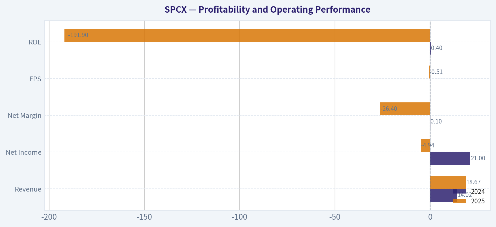
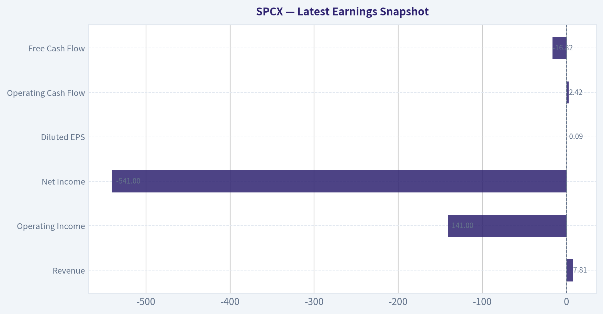
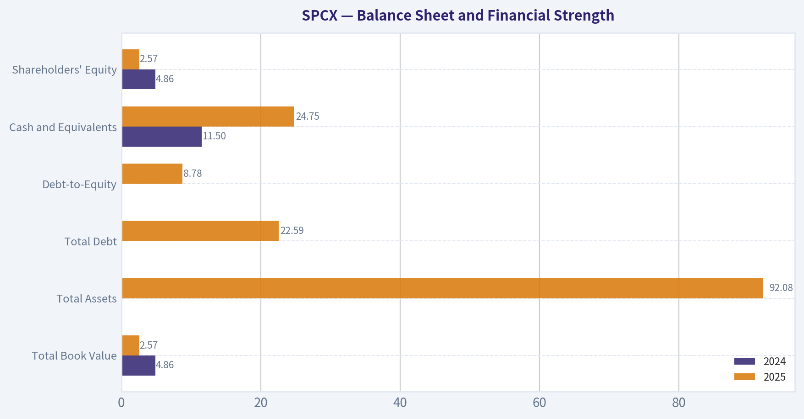
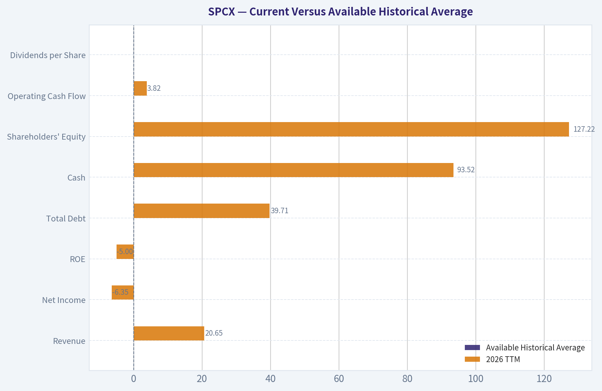
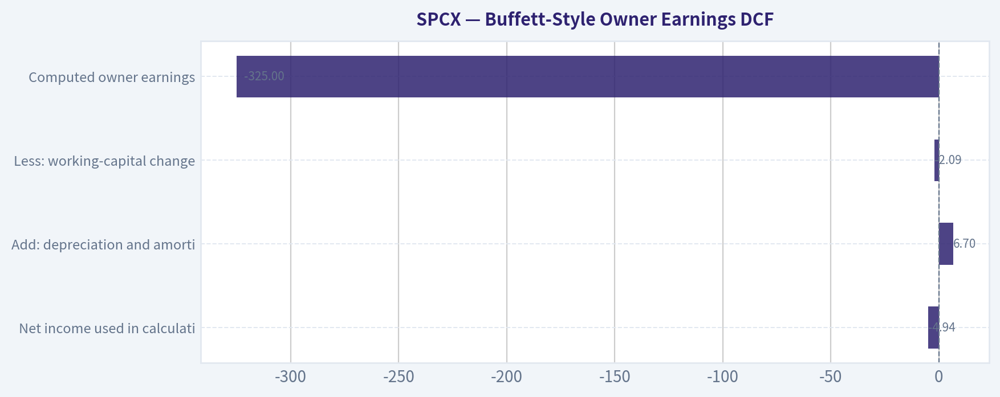
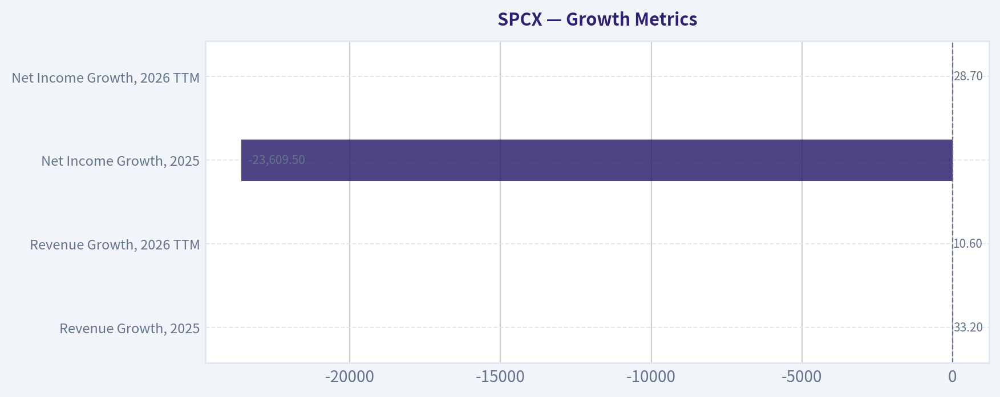
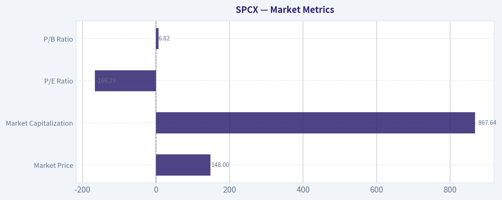

# SPCX Deep Value Intelligence

**Analysis Date:** 2026-10-19

## Critical Disclaimer

*This analysis is generated by Deep Value Intelligence, an AI-powered multi-agent investing framework. Education & research only - not financial advice, not a financial advisor.*

---

## Table of Contents

1. Intelligence Summary
2. Analyst Team Reports
   - Fundamentals Analysis
   - Intrinsic Value Analysis (Buffett)
   - Trend & Growth Analysis (Lynch/Druckenmiller/Fisher)
   - Market Technical Analysis
   - Options Market Analysis
3. Research Team Commentary
4. Value Investing Team Commentary
5. Deep Values Commentary

---

## Intelligence Summary

### Thesis + Conditions

**Core Thesis:** ## Executive Briefing

**Key Risks:**
- This is not a prediction that the price must fall. SPCX could rally from support or on contracts and narrative catalysts. It is an investment-quality judgment: **neither the investor's legal economic claim nor a margin of safety can currently be measured.**
- The Risky Analyst correctly emphasizes the potential quality of the integrated franchise:
- Revenue growth alone is insufficient. In a satellite network, rapid growth can coexist with weak owner economics if customer terminals are subsidized, capacity requires continual investment, satellites need frequent replacement, or financing repeatedly dilutes shareholders.

**Confidence:** Low

---

## Analyst Team Reports

### Fundamentals Analysis

#### Latest Earnings Snapshot

*Most recent reported quarter anchored on 2026 Q2, with prior-year comparison when available.*

| Metric | 2026 Q2 | Prior-Year Quarter | YoY Change |
| --- | ---: | ---: | ---: |
| Revenue | $7.81B | N/A | N/A |
| Operating Income | $-141.0M | N/A | N/A |
| Net Income | $-541.0M | N/A | N/A |
| Diluted EPS | $-0.09 | N/A | N/A |
| Operating Cash Flow | $2.42B | N/A | N/A |
| Free Cash Flow | $-16.82B | N/A | N/A |

Key Takeaways: This snapshot anchors the most recent reported quarter before the narrative analysis. It helps readers separate long-run business quality from whatever changed in the latest earnings print.

#### 2-Year Financial Metrics for SPCX

*All values below are computed deterministically from raw data - not estimated by AI.*

*Issuer profile: operating company (Industrials / Aerospace & Defense).*

#### 2-Year Financial Metrics
*Annual rows come from reported financial statements. The final TTM row is computed from the latest four quarters.*

| Metric | 2024 | 2025 | 2026 TTM |
| --- | --- | --- | --- |
| Market Price | N/A | N/A | $148 |
| Market Cap | N/A | N/A | $867.64B |
| P/E Ratio | N/A | N/A | -166.29 |
| P/B Ratio | N/A | N/A | 6.82 |
| ROE | 0.4% | -191.9% | -5.0% |
| ROIC | N/A | N/A | -3.9% |
| EPS | $0.00 | $-0.51 | $-0.89 |
| Revenue | $14.02B | $18.67B | $20.65B |
| Gross Profit | N/A | N/A | $10.52B |
| Gross Margin | N/A | N/A | 50.9% |
| Operating Margin | N/A | N/A | -13.6% |
| Net Income | $21.0M | $-4.94B | $-6.35B |
| Net Margin | 0.1% | -26.4% | -30.8% |
| Revenue Growth | N/A | 33.2% | 10.6% |
| Net Income Growth | N/A | -23609.5% | 28.7% |
| Free Cash Flow Growth | N/A | N/A | N/A |
| Total Book Value | $4.86B | $2.57B | $127.22B |
| Total Assets | N/A | $92.08B | $192.77B |
| Total Debt | $0 | $22.59B | $39.71B |
| Debt-to-Equity | 0.00 | 8.78 | 0.31 |
| Cash & Equivalents | $11.50B | $24.75B | $93.52B |
| Shareholders' Equity | $4.86B | $2.57B | $127.22B |
| Operating Cash Flow | $5.78B | $6.79B | $3.82B |
| Investing Cash Flow | $-10.80B | $-19.57B | $-40.52B |
| Free Cash Flow | N/A | N/A | $-32.52B |
| FCF Margin | N/A | N/A | -157.5% |
| Dividends / Share | $0.00 | $0.00 | $0.00 |

#### Profitability Metrics
- Return on Equity (ROE): -191.9%
- Return on Invested Capital (ROIC): N/A
- Return on Assets (ROA): -5.4%
- Gross Margin: N/A
- Operating Margin: N/A
- Net Profit Margin: -26.4%

#### Liquidity Metrics
- Current Ratio: 1.45
- Quick Ratio: 1.23

#### Leverage Metrics
- Debt-to-Equity Ratio: 8.78
- Interest Coverage Ratio: N/A
- Net Debt: $-2.16B

#### Growth Metrics (Year-over-Year)
- Revenue Growth: 33.2%
- Net Income Growth: -23609.5%
- Free Cash Flow Growth: N/A
- Revenue CAGR (3-Year): N/A
- Revenue CAGR (5-Year): N/A

#### Valuation Metrics
- P/E Ratio (TTM): N/A
- Forward P/E: 72.34
- Price-to-Book: 15.32
- Price-to-Sales: 84.59
- PEG Ratio: N/A
- EV/EBITDA: 651.26
- Free Cash Flow Yield: N/A
- Earnings Yield: N/A

#### Owner Earnings (Buffett Method, Code-Computed)
- Net Income: $-4.94B
- + Depreciation & Amortization: $6.70B
- - Capital Expenditures: N/A
- - Working Capital Changes: $2.09B
- = **Owner Earnings: $-325.0M**

#### Piotroski F-Score: 1/9
- Positive Net Income: FAIL
- Positive Operating Cash Flow: FAIL
- ROA Improvement: FAIL
- Cash Flow > Net Income: FAIL
- Decreasing Debt: FAIL
- Improving Current Ratio: FAIL
- No Dilution: PASS
- Improving Gross Margin: FAIL
- Improving Asset Turnover: FAIL

ANALYST STANCE: **AVOID**

#### Executive Summary

SPCX displays strong top-line growth and a potentially differentiated aerospace and communications platform, but the deterministic financial data does not yet support a Buffett-style investment. The company is loss-making, has negative ROE and ROIC, consumes substantial capital, and produces negative free cash flow.

The current valuation is especially difficult to justify using earnings or cash flow. The company trades at a negative P/E because earnings are negative, while the owner-earnings DCF produces negative intrinsic values under reasonable growth assumptions. Therefore, the investment case depends on a successful future turnaround rather than demonstrated current economics.

#### Market Metrics

| Metric | 2026 TTM / Current | Historical or Reference Comparison | Interpretation |
|---|---:|---:|---|
| Market Price | $148 | Not available for 2024-2025 | Current quoted price |
| Market Capitalization | $867.64B | Not available for 2024-2025 | Extremely large equity valuation relative to current earnings and cash flow |
| P/E Ratio | -166.29 | Not meaningful while earnings are negative | A negative P/E cannot establish cheapness |
| P/B Ratio | 6.82 | Supplemental dataset cited 15.32; canonical current table is 6.82 | High relative to book value, but book value changed dramatically and is not a reliable standalone valuation anchor |

**Key Takeaways:** SPCX's valuation cannot be supported by conventional earnings because the company is losing money. The canonical market capitalization of $867.64 billion is very large compared with $20.65 billion of revenue and negative $32.52 billion of free cash flow. P/B is elevated, but the sharp change in reported equity makes book value an unstable valuation reference.

#### Profitability and Operating Performance

| Metric | 2024 | 2025 | 2026 TTM | Trend |
|---|---:|---:|---:|---|
| Revenue | $14.02B | $18.67B | $20.65B | Strong increase, but growth decelerated |
| Gross Profit | N/A | N/A | $10.52B | Current gross margin reported at 50.9% |
| Gross Margin | N/A | N/A | 50.9% | Appears economically attractive, but limited history is available |
| Operating Margin | N/A | N/A | -13.6% | Gross profit is not covering operating costs |
| Net Income | $21M | -$4.94B | -$6.35B | Severe deterioration from near break-even profitability |
| Net Margin | 0.1% | -26.4% | -30.8% | Materially negative |
| EPS | $0.00 | -$0.51 | -$0.89 | Earnings per share deteriorated |
| ROE | 0.4% | -191.9% | -5.0% | Negative shareholder returns |
| ROIC | N/A | N/A | -3.9% | Capital is currently earning below its cost |
| ROA | N/A | N/A | -5.4% | Assets are not yet producing positive returns |

**Key Takeaways:** Revenue rose 47% from 2024 to the current TTM period, but profitability moved sharply in the opposite direction. The 50.9% gross margin suggests potentially attractive unit economics, yet negative operating and net margins show that scale, infrastructure spending, research costs, or other operating expenses remain too high. Negative ROE and ROIC are substantial Buffett-style warning signs because the business is not currently compounding shareholder capital.

#### Growth Metrics

| Metric | Current / Latest Available | Interpretation |
|---|---:|---|
| Revenue Growth, 2025 | 33.2% | Strong historical expansion |
| Revenue Growth, 2026 TTM | 10.6% | Growth remains positive but has slowed materially |
| Net Income Growth, 2025 | -23,609.5% | Distorted by the change from a small profit to a large loss |
| Net Income Growth, 2026 TTM | 28.7% | Reported improvement is not economically reassuring because losses remain larger in absolute terms |
| Free Cash Flow Growth | N/A | Not available because comparable historical FCF data is missing |
| Revenue CAGR | N/A | No reliable 5-year or 10-year CAGR was supplied |

**Key Takeaways:** Revenue growth is positive but decelerating from 33.2% to 10.6%. Net income growth percentages are heavily distorted by the transition from a small profit to very large losses, so absolute earnings and cash flow are more useful indicators. The absence of a reliable long-term FCF history prevents confirmation of a durable compounding pattern.

#### Balance Sheet and Financial Strength

| Metric | 2024 | 2025 | 2026 TTM | Interpretation |
|---|---:|---:|---:|---|
| Total Book Value | $4.86B | $2.57B | $127.22B | Large discontinuity likely reflects recapitalization, issuance, or accounting changes |
| Total Assets | N/A | $92.08B | $192.77B | Asset base expanded substantially |
| Total Debt | $0 | $22.59B | $39.71B | Debt increased materially |
| Debt-to-Equity | 0.00 | 8.78 | 0.31 | Current ratio is improved because equity expanded, not because debt declined |
| Cash and Equivalents | $11.50B | $24.75B | $93.52B | Very strong reported liquidity |
| Shareholders' Equity | $4.86B | $2.57B | $127.22B | Major increase, but quality and source of the increase require verification |
| Current Ratio | N/A | N/A | 1.45 | Adequate short-term coverage |
| Quick Ratio | N/A | N/A | 1.23 | Reasonable liquid-asset coverage |
| Net Debt | N/A | N/A | -$2.16B | Reported net cash position |

**Key Takeaways:** SPCX has a large cash balance and currently appears to have net cash, which reduces immediate solvency risk. However, debt rose to $39.71 billion and the company is consuming cash rapidly. The extraordinary increase in equity from $2.57 billion to $127.22 billion should be investigated carefully because it may reflect new capital, restructuring, or other non-operating changes rather than internally accumulated profits.

#### Cash Flow and Capital Allocation

| Metric | 2024 | 2025 | 2026 TTM | Interpretation |
|---|---:|---:|---:|---|
| Operating Cash Flow | $5.78B | $6.79B | $3.82B | Positive, but declining in the latest period |
| Investing Cash Flow | -$10.80B | -$19.57B | -$40.52B | Very heavy investment spending |
| Free Cash Flow | N/A | N/A | -$32.52B | Severe cash consumption |
| FCF Margin | N/A | N/A | -157.5% | Capital spending exceeds revenue by a wide margin |
| Dividends per Share | $0.00 | $0.00 | $0.00 | No shareholder distributions |
| Owner Earnings | N/A | -$325M code-computed | N/A | Negative under the supplied Buffett-method calculation |

**Key Takeaways:** Positive operating cash flow is overwhelmed by investment spending. Current free cash flow of negative $32.52 billion is the central financial concern because Buffett-style valuation ultimately depends on distributable cash generation. The absence of dividends is appropriate for a capital-intensive growth company, but retained cash must eventually produce attractive returns; that has not yet been demonstrated.

#### Current Versus Available Historical Average

A true 10-year average is not available in the deterministic dataset. The comparison below uses the available 2024-2025 annual data where possible and the latest TTM figure. It should not be interpreted as a substitute for a full decade of history.

| Metric | Available Historical Average | 2026 TTM | Difference | Significance |
|---|---:|---:|---:|---|
| Revenue | $16.35B, 2024-2025 average | $20.65B | +26.3% | Strong expansion |
| Net Income | -$2.46B, 2024-2025 average | -$6.35B | $3.89B worse | Profitability deterioration |
| ROE | -95.8%, 2024-2025 average | -5.0% | Improved versus 2025, below 2024 | Improvement is mainly relative to an unusually poor 2025 |
| Total Debt | $31.15B, 2025 and TTM average | $39.71B | +27.5% | Leverage increased |
| Cash | $18.13B, 2024-2025 average | $93.52B | +$75.39B | Large liquidity improvement |
| Shareholders' Equity | $3.72B, 2024-2025 average | $127.22B | +$123.50B | Major capital-structure discontinuity |
| Operating Cash Flow | $6.29B, 2024-2025 average | $3.82B | -39.3% | Cash generation weakened |
| Dividends per Share | $0.00 | $0.00 | No change | Full retention of capital |

**Key Takeaways:** SPCX is larger and better funded than it was in 2024-2025, but the quality of that expansion is mixed. Revenue and cash increased substantially, while net income and operating cash flow deteriorated. Current ROE looks less negative than in 2025, but it remains negative and therefore does not yet demonstrate attractive capital allocation.

#### Economic Moat and Business Quality

SPCX could possess a meaningful economic moat if its launch infrastructure, reusable hardware, satellite network, engineering capabilities, regulatory approvals, and scale advantages are difficult for competitors to replicate. Aerospace launch systems have significant barriers to entry, including specialized engineering, reliability requirements, manufacturing scale, capital intensity, and government or commercial customer relationships.

Potential moat sources include:

- **Scale economics:** Higher launch cadence can spread fixed engineering and infrastructure costs over more missions.
- **Technological know-how:** Reusable launch systems and satellite-network operations can create accumulated learning advantages.
- **Network effects:** A large communications network may become more valuable as coverage, customers, and infrastructure expand.
- **Switching costs and reliability:** Commercial and government customers may favor a proven provider where launch failure is extremely costly.
- **Capital access:** A large cash position can fund long-duration projects that smaller competitors cannot afford.

However, a moat is not automatically equivalent to shareholder value. The current figures show that SPCX has not yet converted its apparent competitive advantages into positive ROIC, positive net income, or positive FCF. A high gross margin is encouraging, but a negative operating margin suggests that the company's total cost structure remains too heavy.

#### Management and Capital Allocation

Management appears willing to reinvest aggressively, which may be rational for a company pursuing large aerospace and communications markets. The problem is that the current spending level is not yet validated by returns. Investing cash flow reached negative $40.52 billion in the latest TTM period, while operating cash flow fell to $3.82 billion.

The Piotroski F-score of 1 out of 9 is a significant warning signal. It indicates failures across profitability, cash flow quality, leverage, liquidity trend, margin trend, and asset efficiency. The only listed pass was no dilution under the supplied calculation.

The sharp increase in shareholders' equity and cash requires special attention. If these increases reflect new financing or equity issuance, existing shareholders may face dilution even if the company's operating prospects improve.

#### Buffett-Style Owner Earnings DCF

The supplied owner-earnings calculation is:

| DCF Component | Amount |
|---|---:|
| Net income used in calculation | -$4.94B |
| Add: depreciation and amortization | +$6.70B |
| Less: working-capital changes | -$2.09B |
| Capital expenditures | Not available in the owner-earnings calculation |
| Computed owner earnings | -$325M |

**Key Takeaways:** The supplied owner-earnings figure is negative $325 million, while reported TTM free cash flow is much more negative at $32.52 billion. Since owner earnings are negative, a conventional Buffett DCF cannot produce a positive intrinsic value without assuming a future turnaround that is not yet demonstrated by the financial record.

For illustration, a five-year DCF was calculated using the negative $325 million owner-earnings base, a 10% discount rate, and a 2.5% terminal growth rate. These are mechanical scenarios, not forecasts of guaranteed results.

| Scenario | Growth Assumption | Present Value of Years 1-5 | Present Value of Terminal Value | Implied Equity Value | Per-Share Value Using Approx. 5.86B Shares |
|---|---:|---:|---:|---:|---:|
| Conservative | 3% annual growth | -$1.23B | -$3.70B | -$4.93B | -$0.84 |
| Average | 10% annual growth | -$1.63B | -$4.76B | -$6.38B | -$1.09 |
| Optimistic | 20% annual growth | -$2.13B | -$8.05B | -$10.18B | -$1.74 |

Calculation framework:

- Year 1 owner earnings = base owner earnings x `(1 + growth rate)`
- Years 1-5 are discounted at 10%.
- Terminal value = Year 6 owner earnings ÷ `(10% - 2.5%)`.
- Terminal value is discounted back five years.
- Approximate shares outstanding = $867.64 billion ÷ $148, or approximately 5.86 billion shares.

**Key Takeaways:** Even aggressive growth applied to a negative owner-earnings base produces a negative DCF value because higher growth increases the magnitude of future losses. Economic fair value should therefore be treated as approximately $0 to unquantifiable until SPCX demonstrates sustained positive owner earnings. The current $148 share price reflects substantial expectations for a future turnaround and cannot be justified by the supplied cash-flow data.

A more constructive turnaround valuation would require evidence of:

1. Positive and growing operating cash flow.
2. A sharply reduced investment burden.
3. Positive owner earnings after maintenance capital expenditures.
4. ROIC consistently above the company's cost of capital.
5. Stable or improving operating margins.
6. Clear visibility into the return on the $40.52 billion TTM investment outflow.

#### Revenue Breakdown

Precise segment revenue data is not included in the deterministic dataset. The table below therefore separates the known total revenue from the major publicly understood business categories without assigning unsupported dollar amounts.

| Revenue Source | Amount ($B) | % of Total |
|---|---:|---:|
| Reported total revenue, 2026 TTM | $20.65B | 100.0% |
| Launch services | Not separately disclosed | Not available |
| Satellite communications or broadband services | Not separately disclosed | Not available |
| Government and defense-related contracts | Not separately disclosed | Not available |
| Other services and activities | Not separately disclosed | Not available |
| Unallocated total | $20.65B | 100.0% |

**Key Takeaways:** The dataset confirms $20.65 billion of TTM revenue but does not provide a defensible product or segment allocation. The principal analytical issue is therefore not the exact mix, but whether higher-margin recurring communications revenue can grow faster than capital-intensive launch and infrastructure spending.

#### Key Investment Insights

| Category | Assessment | Investor Implication |
|---|---|---|
| Growth | Revenue growth remains positive but slowed to 10.6% | Growth is real, but deceleration matters at a very high valuation |
| Gross economics | 50.9% reported gross margin | Potentially attractive underlying unit economics |
| Operating economics | -13.6% operating margin | Scale has not yet produced operating leverage |
| Earnings quality | -$6.35B net income | No current earnings support for valuation |
| Cash generation | -$32.52B FCF | Major funding requirement and valuation risk |
| Balance sheet | $93.52B cash, net cash position | Provides a liquidity cushion |
| Leverage | $39.71B debt | Manageable relative to reported equity, but rising |
| Capital allocation | $40.52B investing cash outflow | Very aggressive reinvestment |
| Valuation | Negative P/E and negative DCF | Price depends on future success rather than current value |
| Governance and dilution risk | Equity and cash changed dramatically | Capital structure needs detailed verification |

**Key Takeaways:** The strongest opportunity is the possibility that SPCX converts technological scale into recurring, high-margin cash flow. The largest risk is that capital intensity, operating losses, and continued financing needs persist longer than expected, causing dilution or a lower valuation before the business reaches maturity.

#### Red Flags

- Negative $32.52 billion TTM free cash flow.
- Negative $6.35 billion TTM net income.
- Negative 5.0% ROE and negative 3.9% ROIC.
- Negative 13.6% operating margin despite a 50.9% gross margin.
- Piotroski F-score of only 1 out of 9.
- Total debt increased to $39.71 billion.
- Operating cash flow declined to $3.82 billion.
- Capital spending and investment outflows greatly exceed operating cash generation.
- Large, unexplained discontinuity in shareholders' equity and cash.
- Negative owner earnings make conventional intrinsic-value analysis impossible.
- No dividend and no demonstrated ability to return capital to shareholders.

#### Opportunities

- Large cash resources provide time to pursue long-term projects.
- Aerospace and satellite communications may have substantial long-run market growth.
- Reusable infrastructure and high launch cadence could produce scale advantages.
- Recurring communications revenue could improve predictability and margins.
- Successful commercialization could eventually produce strong operating leverage.
- A future transition from investment mode to harvest mode could materially improve FCF.

#### Final Assessment

SPCX may be an important strategic company with considerable technological and market potential, but Buffett-style investing requires evidence of durable economics rather than only technological promise. The current dataset shows strong revenue growth, substantial cash, and potentially attractive gross economics, but it also shows negative earnings, negative ROE, negative ROIC, severe FCF consumption, and no positive DCF support.

At $148 per share, investors are paying for a highly successful future outcome. Until owner earnings become sustainably positive and the return on massive investment spending becomes measurable, the margin of safety is inadequate.

**Final stance: AVOID.** Reconsideration would require several periods of positive free cash flow, improving operating margins, positive ROIC, transparent segment reporting, and evidence that capital spending is producing cash returns rather than merely expanding the asset base.

| Final Point | Conclusion |
|---|---|
| Business quality | Potentially exceptional technology and market position, but current economics are unproven |
| Financial strength | Strong cash balance, offset by heavy investment needs and rising debt |
| Earnings predictability | Poor; earnings changed from near break-even to large losses |
| Cash-flow quality | Weak; TTM FCF is deeply negative |
| Valuation | Not supported by current earnings, owner earnings, or DCF |
| Main opportunity | Successful transition from investment phase to recurring cash generation |
| Main risk | Persistent losses, capital intensity, dilution, and valuation compression |
| Buffett decision | Insufficient margin of safety |
| Final stance | **AVOID** |

#### Fundamental Visuals

This comparison chart from *Profitability and Operating Performance* stacks current figures against historical benchmarks for **SPCX**, making it easy to see where the company trades relative to its own averages.

---

### Intrinsic Value Analysis (Buffett)

> *Following Warren Buffett's value investing philosophy: Circle of Competence, Economic Moat, Management Quality, and Margin of Safety.*

#### Intrinsic Value Snapshot

Price is what you pay. Intrinsic value is what the business may be worth based on the cash it can create for owners over time. We show a range, not one magic number.

- Current Price: $147.96
- Value Range (conservative to optimistic across both DCF methods): N/A to N/A

##### Owner Earnings (Buffett Method)
- Net Income: $-4,937,000,000.00
- Depreciation & Amortization: $6,701,000,000.00
- Capital Expenditures: N/A
- Working Capital Changes: $2,089,000,000.00
- Owner Earnings: $-325,000,000.00

##### Intrinsic Value

ANALYST STANCE: **AVOID**

#### Executive Conclusion

SPCX appears to combine an exceptional strategic asset base-orbital launch capability, Starlink connectivity, and substantial technological know-how-with an investment case that is currently too opaque and richly valued to underwrite using Buffett-style owner earnings.

At a $148 share price and approximately $1.95 trillion market capitalization, investors are paying for extraordinary future growth. Revenue growth of 33.2% is encouraging, but the available indicators show negative ROE of 191.9%, no meaningful P/E or FCF yield, and insufficient evidence of current cash earnings. The company may become a wonderful business, but the present price does not provide a demonstrable margin of safety.

#### Factor Scorecard

| Factor | Score | Assessment |
|---|---:|---|
| 1. Circle of competence and simplicity | 2.5/5 | The broad model is understandable-launch services and satellite connectivity-but valuation depends on multiple businesses, execution, regulation, and long-term technological outcomes. |
| 2. Durable competitive advantage | 4.0/5 | Strong potential moat from launch scale, engineering expertise, Starlink network density, installed infrastructure, and high barriers to entry. |
| 3. Management and capital allocation | 2.5/5 | Elon Musk has demonstrated exceptional ambition and operating ability, but governance, disclosure, related-party considerations, and capital-allocation transparency reduce confidence. |
| 4. Industry structure | 3.5/5 | Launch services and satellite communications have high barriers to entry, but require heavy investment and face regulatory, technological, and geopolitical risks. |
| **Gate 5: Quality and solvency floor** | **Not tripped** | Available data does not establish both deteriorating cash earnings and a solvency red line. However, the absence of strong cash-flow evidence remains a major investment concern. |

#### Moat Analysis

| Potential moat | Evidence | Durability assessment |
|---|---|---|
| Cost advantage | Reusable launch technology and high launch cadence may lower cost per mission. | Potentially wide, provided reliability and utilization remain strong. |
| Network effects | Starlink becomes more useful as coverage, users, satellites, and ground infrastructure expand. | Strong potential network effect, though capital requirements remain substantial. |
| Switching costs | Enterprise, government, aviation, maritime, and remote-connectivity customers may build workflows around the network. | Moderate to strong, especially for specialized customers. |
| Intangible assets | Proprietary engineering, launch records, software, satellite design, and accumulated operating knowledge. | Strong, but dependent on continued execution. |
| Regulatory and infrastructure barriers | Launch licenses, spectrum access, orbital coordination, manufacturing scale, and ground infrastructure deter entrants. | Significant and difficult to replicate. |

The moat is probably the company's strongest investment attribute. However, a moat does not automatically justify any price. The critical question is whether future owner earnings can compound rapidly enough to support a $1.95 trillion valuation.

#### Management Quality and Capital Allocation

Musk has shown an unusual ability to pursue technically difficult projects, attract talent, and reinvest aggressively for long-term scale. That supports a high score for vision and reinvestment ambition.

The weaknesses are equally important:

- Decision-making is highly concentrated around one individual.
- The business spans several complex, capital-intensive initiatives.
- Public investors need unusually strong disclosure to evaluate segment economics and capital allocation.
- A growth-at-all-costs strategy can create value, but it can also consume enormous capital before returns become visible.
- The reported negative ROE and lack of a usable P/E or FCF yield make it difficult to determine whether retained capital is currently earning attractive returns.

Overall, management is capable but not sufficiently transparent or financially demonstrable for a high-confidence Buffett underwriting.

#### Financial Summary

| Metric | Latest available figure |
|---|---:|
| Share price | $148 |
| Market capitalization | $1.95 trillion |
| Implied shares outstanding | Approximately 13.2 billion |
| Revenue growth, year over year | 33.2% |
| ROE | -191.9% |
| P/E | N/A |
| Gross margin | N/A |
| FCF yield | N/A |
| Current ratio | 1.45 |

**Key Takeaways:** Revenue growth is strong, but the negative ROE indicates that current accounting returns on equity are not attractive. The unavailable P/E, gross margin, and FCF yield prevent a conventional earnings-based valuation, while the $1.95 trillion market capitalization creates a very high burden of proof.

#### Owner Earnings Calculation

The Buffett owner-earnings formula is:

| Component | Amount |
|---|---:|
| Net income | Not available |
| Depreciation and amortization | Not available |
| Less: maintenance capital expenditure | Not available |
| Less: working-capital investment | Not available |
| **Owner earnings** | **Not calculable from the available figures** |

The absence of a reliable owner-earnings figure is material. For a capital-intensive space and communications company, reported free cash flow may also require careful separation of maintenance capital expenditure from expansionary investment. Until recurring owner earnings can be established, intrinsic value cannot be calculated with reasonable precision.

**Key Takeaways:** The available information does not show a reliable stream of owner earnings. That makes the investment thesis dependent on future scale, rather than on demonstrated present cash-generation power.

#### Three-Scenario DCF Valuation

Let current owner earnings be represented by **E**.

| Scenario | Assumption | Implied value formula |
|---|---|---:|
| A. No growth | 10% discount rate, no growth | **10.0 x E** |
| B. GDP growth | 3% perpetual growth, 10% discount rate | **14.7 x E** |
| C. Historical-growth scenario | 50%-75% of sustainable historical growth, capped at 10% | Requires a verified owner-earnings base and forecast |

Because current owner earnings are not available, the scenarios cannot produce defensible per-share values. For example, if owner earnings were $10 billion, the no-growth value would be approximately $100 billion and the 3% growth value approximately $147 billion-far below the current market capitalization. The company would need owner earnings many times higher than that example, plus continued growth, to justify today's price.

**Key Takeaways:** The valuation is highly sensitive to the unknown owner-earnings base. At a $1.95 trillion market capitalization, the market is clearly discounting very substantial future cash generation rather than merely valuing current earnings.

#### Margin of Safety Analysis

| Valuation consideration | Assessment |
|---|---|
| Price versus demonstrated owner earnings | Unfavorable; owner earnings are not established. |
| Price versus current accounting returns | Unfavorable; ROE is deeply negative. |
| Price-implied growth | Extremely demanding. |
| Quality-scaled margin-of-safety requirement | Not met on available evidence. |
| Reverse-DCF interpretation | The market appears to require exceptional long-term execution, scale, and profitability. |

A wide moat can justify paying a premium, but even a wonderful business should be purchased at a price that leaves room for error. At $1.95 trillion, the valuation appears to leave little room for slower Starlink adoption, higher capital spending, launch failures, regulatory restrictions, competitive responses, or governance-related discounts.

#### Final Buffett Scorecard

| Criterion | Weight | Score | Weighted contribution |
|---|---:|---:|---:|
| Moat width and durability | 25% | 4.0 | 1.00 |
| Valuation and margin of safety | 20% | 1.0 | 0.20 |
| Capital returns: ROIC versus WACC | 15% | 1.5 | 0.23 |
| Business understanding and predictability | 12% | 2.5 | 0.30 |
| Management quality and capital allocation | 12% | 2.5 | 0.30 |
| Reinvestment runway | 8% | 5.0 | 0.40 |
| Balance-sheet strength | 4% | 2.5 | 0.10 |
| Industry structure | 4% | 3.5 | 0.14 |
| **Total** | **100%** |  | **2.67 / 5.00** |

**Key Takeaways:** SPCX scores highly on moat potential and reinvestment runway, but valuation, current returns, and financial transparency are substantial weaknesses. The resulting score of 2.67 falls below the threshold for a compelling Buffett-style investment.

#### Investment Stance

**AVOID - Medium conviction.**

This is not an outright judgment that the company lacks extraordinary potential. It is a judgment that the current price requires too much future success while the available evidence does not yet demonstrate sufficient owner earnings, capital returns, or margin of safety.

SPCX becomes more investable if it can demonstrate:

1. Recurring positive free cash flow;
2. Clearly disclosed segment economics;
3. Sustained high returns on incremental invested capital;
4. Reduced dependence on continual external capital or aggressive reinvestment;
5. A valuation supported by normalized owner earnings rather than distant growth expectations.

Until those conditions are visible, the prudent Buffett-style decision is to avoid paying today for a highly optimistic decade of execution.

#### Valuation Visuals

This comparison chart from *Latest Earnings Snapshot* stacks current figures against historical benchmarks for **SPCX**, making it easy to see where the company trades relative to its own averages.

This comparison chart from *Year Financial Metrics* stacks current figures against historical benchmarks for **SPCX**, making it easy to see where the company trades relative to its own averages.

This comparison chart from *Balance Sheet and Financial Strength* stacks current figures against historical benchmarks for **SPCX**, making it easy to see where the company trades relative to its own averages.

This comparison chart from *Current Versus Available Historical Average* stacks current figures against historical benchmarks for **SPCX**, making it easy to see where the company trades relative to its own averages.

This comparison chart from *Buffett-Style Owner Earnings DCF* stacks current figures against historical benchmarks for **SPCX**, making it easy to see where the company trades relative to its own averages.

---

### Trend & Growth Analysis (Lynch/Druckenmiller/Fisher)

> *Following Peter Lynch's GARP, Stanley Druckenmiller's macro-aware approach, and Philip Fisher's scuttlebutt methodology.*

ANALYST STANCE: **WATCH**

#### 1. Lynch Classification

**Fast Grower, but with unusually high valuation and disclosure risk.**

SPCX is reportedly growing revenue by **33.2% year over year**, placing it above Lynch's fast-grower threshold. However, the available data are incomplete: earnings, gross margin, free cash flow, customer concentration, and detailed segment revenue are not available. This prevents a high-conviction growth rating.

| Metric | Available data | Interpretation |
|---|---:|---|
| Current price | $148 | Market price supplied in research pack |
| Market capitalization | $1.95 trillion | Extremely large valuation base |
| Revenue growth | 33.2% YoY | Fast-growth profile |
| P/E | N/A | Profitability cannot be assessed |
| ROE | -191.9% | Highly negative; likely reflects losses and/or capital structure |
| Current ratio | 1.45 | Adequate short-term liquidity, subject to data quality |

**Key Takeaways:** SPCX has fast revenue growth, but its $1.95 trillion valuation means the company must eventually produce enormous profits to justify the price. Negative ROE and unavailable earnings data make this unsuitable for a traditional PEG-based purchase decision.

#### 2. The Story in Three Bullets

- **Launch infrastructure:** SpaceX operates in a strategically important market where launch reliability, scale, and cost efficiency can create significant competitive advantages.
- **Starlink connectivity:** Satellite broadband expands the addressable market beyond launch services and could provide recurring revenue with global reach.
- **Optionality:** Government contracts, defense applications, direct-to-device connectivity, space systems, and future commercial space activity could expand the long-term TAM.

The story is understandable: **lower the cost of reaching orbit, build a global satellite network, and monetize space infrastructure.** The key question is whether the market has already priced in most of that future.

#### 3. TAM and the 10x Test

A complete 10x test requires current revenue, segment revenue, and credible TAM estimates. Those figures were not supplied. At a $1.95 trillion market capitalization, however, a 10x equity-value outcome would imply approximately **$19.5 trillion** in market value, which is an extremely demanding hurdle.

| TAM component | Assessment |
|---|---|
| Commercial and government launch | Large and strategically important, but not unlimited |
| Satellite broadband | Potentially very large and still expanding |
| Defense and space systems | Expanding with geopolitical and national-security spending |
| Direct-to-device connectivity | Emerging market with meaningful optionality |
| Ability to grow revenue 10x | Possible only if broadband and new space businesses scale dramatically |
| Ability to grow equity value 10x from current level | Very difficult at a $1.95 trillion starting valuation |

**Key Takeaways:** The operational TAM may be large enough to support substantial future growth, particularly through Starlink and defense applications. The investment TAM is more restrictive: at the current valuation, SPCX needs both sustained high growth and very large eventual margins.

#### 4. Revenue Growth Trend

Only one year-over-year growth figure is available.

| Period | Revenue growth | Trend interpretation |
|---|---:|---|
| Latest reported period | 33.2% YoY | Fast growth |
| Prior comparable periods | Not available | Acceleration cannot be confirmed |
| Segment growth | Not available | Starlink versus launch mix cannot be assessed |

**Key Takeaways:** The latest 33.2% growth rate is attractive, but there is no sufficient time series to determine whether growth is accelerating, stable, or decelerating. This is an important missing piece because a $1.95 trillion company needs sustained acceleration or exceptional margins.

#### 5. Unit Economics and Profitability

| Metric | Result | Assessment |
|---|---:|---|
| LTV/CAC | Not disclosed | Cannot assess customer economics |
| Net revenue retention | Not disclosed | Cannot assess Starlink expansion or churn |
| Free-cash-flow margin | Not available | Cannot calculate Rule of 40 |
| Gross margin | Not available | Cannot evaluate business quality |
| P/E | N/A | Earnings profitability not established |
| Current ratio | 1.45 | Reasonable liquidity indicator, but not a substitute for cash-flow data |

**Key Takeaways:** The core unit economics are not available. For a capital-intensive company, free cash flow, satellite economics, launch margins, subscriber acquisition costs, and payback periods are essential before treating the business as a high-quality compounder.

#### 6. Inflection-Point Assessment

**Potential positive inflections:**

1. Starlink subscriber growth and revenue scaling.
2. Lower launch costs and higher launch cadence.
3. Successful commercialization of direct-to-device services.
4. Expansion of defense and government contracts.
5. Improved operating leverage as fixed infrastructure supports more revenue.

**Current evidence:** The 33.2% revenue growth rate indicates strong momentum, but there is insufficient information to confirm a new acceleration phase.

**Assessment: Developing, not proven.**

#### 7. Macro Setup

The company benefits from several durable themes:

- Space and satellite infrastructure.
- Defense and national-security spending.
- Global broadband penetration.
- AI and cloud infrastructure requiring communications capacity.
- Strategic government support for domestic launch capability.

The principal macro risk is financing and valuation sensitivity. Higher interest rates can pressure long-duration growth valuations, while a weaker capital market could make large infrastructure investments more difficult. SpaceX's strategic importance may reduce this risk, but it does not eliminate it.

#### 8. Fisher's 15-Point Score

Because detailed financial statements and management disclosures are unavailable, the score is conservative.

| Fisher criterion | Score / 5 | Comment |
|---|---:|---|
| Market potential | 5 | Very large strategic markets |
| New-product determination | 5 | Broad innovation pipeline |
| R&D effectiveness | 4 | Strong apparent engineering execution |
| Sales organization | 4 | Government and commercial traction |
| Profit margins | 2 | Not disclosed; likely capital intensive |
| Margin improvement | 3 | Possible, but unverified |
| Labor relations | 3 | Limited public evidence |
| Executive relations | 3 | Limited public evidence |
| Management depth | 4 | Strong technical leadership, disclosure limited |
| Cost analysis/accounting | 2 | Insufficient public detail |
| Competitive advantages | 5 | Scale, launch cadence, infrastructure, and data |
| Long-range profit outlook | 4 | Attractive strategic opportunity |
| Dilution risk | 3 | Private-company financing and future capital needs matter |
| Management candor | 2 | Limited disclosure relative to public-company standards |
| Management integrity | 3 | Cannot fully assess from supplied data |

**Fisher score: 52/75 - Average, with high strategic quality but inadequate financial transparency.**

**Key Takeaways:** SPCX scores highly on market potential, innovation, and competitive position. It scores poorly on margins, accounting visibility, and management transparency because the available information is incomplete.

#### 9. Valuation Analysis

A traditional PEG ratio cannot be calculated because P/E and earnings growth are unavailable.

| Valuation method | Result | Interpretation |
|---|---:|---|
| PEG | N/A | No usable earnings data |
| Price-to-sales | N/A | Revenue amount unavailable |
| Market capitalization | $1.95 trillion | Very demanding absolute valuation |
| Bear-case framework | Lower growth and lower multiple | Significant downside if Starlink or launch growth slows |
| Base-case framework | Sustained 20%-30% growth with improving margins | Requires continued execution for many years |
| Bull-case framework | Multi-engine growth plus high infrastructure margins | Necessary to support very large upside from current valuation |

The market capitalization itself is the warning signal. Even if revenue grows at 25% annually for five years, revenue would increase by approximately **3.1 times**, not 10 times. To justify a materially higher valuation, SPCX would likely need sustained high growth, strong recurring revenue, and substantial operating leverage.

A guru-tracking data point also deserves attention: Steve Cohen's reported position was reduced by **34.4%** between the March and June 2026 filings. This is not a definitive sell signal because 13F data are delayed and provide no rationale, but it is a modest negative sentiment indicator.

#### 10. Growth Investor Scorecard

| Criterion | Weight | Score / 5 | Weighted contribution |
|---|---:|---:|---:|
| Lynch story | 10% | 4.5 | 0.45 |
| TAM and runway | 20% | 4.5 | 0.90 |
| Revenue growth | 20% | 4.0 | 0.80 |
| Unit economics | 15% | 2.0 | 0.30 |
| Competitive position | 10% | 4.5 | 0.45 |
| Management quality | 10% | 3.0 | 0.30 |
| Macro setup | 5% | 4.0 | 0.20 |
| Profitability path | 5% | 2.5 | 0.13 |
| Valuation | 5% | 1.5 | 0.08 |
| **Total** | **100%** |  | **3.61 / 5.00** |

**Key Takeaways:** SPCX's growth story and competitive position are compelling, but valuation, profitability uncertainty, and disclosure limitations materially reduce the score. The resulting 3.61 score supports a **WATCH** stance rather than an aggressive purchase recommendation.

#### 11. Position Size Stance

**Suggested stance: Watch position only, or no position until financial disclosure improves.**

For a diversified growth portfolio, a speculative position would generally be limited to approximately **0.5%-1.5%**, depending on liquidity, access to reliable financial statements, and investor risk tolerance. A larger position would require evidence of:

- Sustained revenue growth above 25%.
- Strong Starlink subscriber economics.
- Positive and improving free cash flow.
- Measurable operating leverage.
- A valuation that is not dependent on flawless execution.

#### 12. Key Risks and Catalysts

| Catalysts | Risks |
|---|---|
| Starlink subscriber and revenue acceleration | Valuation already discounts exceptional success |
| Successful launch-cost reduction | Launch failures or regulatory setbacks |
| Defense and government contract growth | Capital intensity and funding needs |
| Direct-to-device commercialization | Satellite congestion and spectrum constraints |
| Margin and free-cash-flow inflection | Lack of audited, detailed public disclosure |
| New launch vehicle or space-platform success | Founder/key-person and governance risk |
| Public listing or improved reporting | Competitive response from governments and private rivals |

**Final assessment:** SPCX is one of the most compelling strategic growth stories in the space economy, but it is not yet a clean Lynch-style investment because the valuation is enormous and the financial evidence is incomplete. The business may ultimately become a major infrastructure compounder, but at the supplied price and market capitalization, the burden of proof is high. **Watch for accelerating revenue, Starlink unit economics, positive free cash flow, and valuation discipline before upgrading to Advocate.**

#### Growth & Scorecard Visuals

This comparison chart from *Growth Metrics* stacks current figures against historical benchmarks for **SPCX**, making it easy to see where the company trades relative to its own averages.

---

### Market Technical Analysis

ANALYST STANCE: **WATCH**

#### SPCX technical analysis

The latest available price in the retrieved data is **$146.03 on October 16, 2026**; there is no regular-session closing price shown for October 19. SPCX is in a **short-term corrective phase within a still-fragile medium- and long-term uptrend**. The stock remains marginally above its 200-day average, but momentum has weakened materially after the sharp advance into early October.

#### Trend structure

SPCX closed at $146.03, below both its **10-day EMA of $154.83** and its **50-day SMA of $148.15**. This places the stock approximately **5.7% below its short-term average** and **1.4% below its medium-term average**, confirming that near-term price action has turned bearish.

The 50-day SMA is nevertheless rising, having advanced from approximately $134.76 on September 21 to $148.15 on October 16. This indicates that the broader medium-term trend had been improving before the recent pullback. The 200-day SMA is also rising gradually and stands at **$145.62**, leaving the latest close only about **$0.41, or 0.3%, above it**. That is an important technical dividing line: holding above $145-146 would preserve the longer-term bullish structure, while a decisive breakdown could turn the current correction into a more consequential trend reversal.

Price momentum has deteriorated quickly. After reaching $171.92 on October 6, SPCX declined to $146.03 by October 16, a retreat of roughly **15%**. The sequence of lower closes from October 12 through October 16 shows persistent selling pressure rather than a single isolated down day.

#### Momentum and MACD

The MACD remains technically positive at **1.03**, meaning the faster exponential averages are still above the slower ones. However, the MACD has fallen sharply from **5.83 on October 7** to 1.03, showing that the prior upside momentum has largely unwound.

The MACD histogram is more concerning. It declined from **+1.80 on October 7** to **-2.15 on October 19**, with negative readings beginning on October 14. This indicates that the MACD line is now below its signal line and that bearish momentum is accelerating. A positive MACD reading by itself should not be treated as a bullish entry signal here; the falling MACD and negative histogram are more relevant for current positioning.

#### RSI and volatility

The RSI is **45.2**, down from **69.4 on October 6**. This confirms a substantial loss of momentum, but it does not yet indicate oversold conditions. RSI is below the neutral 50 level but comfortably above 30, so SPCX has room to decline further before reaching a statistically more stretched downside condition. Conversely, a recovery above 50 would be an early indication that selling pressure is easing.

ATR is approximately **$6.95 per share**, representing about **4.8% of the latest closing price**. This is a large daily volatility allowance. Traders should therefore avoid using tight stops that could be triggered by normal price movement. A practical risk framework would use ATR-based sizing and recognize that a move of roughly $7 in either direction is not unusual for this issue.

#### Volume-weighted positioning

The VWMA is **$158.11**, substantially above the latest close. Because VWMA incorporates trading volume, this gap suggests that recent high-volume activity has occurred at considerably higher prices than the current market. The stock's decline below VWMA indicates that holders who participated in the recent high-volume advance may now be under pressure, potentially creating overhead supply around the **$154-158 area**.

The elevated volume on several recent sessions, including October 15, adds significance to the decline. A recovery through the 10-day EMA and then the VWMA on expanding volume would provide a stronger bullish confirmation than a low-volume rebound alone.

#### Trading interpretation

The evidence is mixed across time horizons, but not evenly balanced:

- **Short term:** Bearish. Price is below the 10-day EMA and 50-day SMA, MACD momentum is falling, the histogram is negative, and RSI is below 50.
- **Medium term:** Fragile. The rising 50-day SMA supports the prior uptrend, but price has fallen below it and must reclaim it to restore constructive momentum.
- **Long term:** Technically intact but vulnerable. Price is only slightly above the 200-day SMA, making the $145-146 region a key support test.
- **Risk profile:** High. ATR near $7 and the recent 15% decline from the October high imply substantial volatility and elevated whipsaw risk.

A bullish setup would require stabilization near the 200-day SMA, followed by a reclaim of approximately **$148-149**, the current 50-day average area. Stronger confirmation would come from a move above **$154-158**, where the 10-day EMA and VWMA create a meaningful resistance band. Conversely, a decisive close below approximately **$145** would weaken the long-term technical structure and could expose the stock to further downside.

The preferred approach is to **watch rather than chase**. New long positions have an unfavorable risk-reward profile while price remains below the 10-day EMA, 50-day SMA, and VWMA. Existing holders may consider the 200-day SMA as a key risk-management reference, while short-term traders should account for the stock's unusually large daily ranges.

#### Selected indicators

The selected set contains eight complementary indicators: **10-day EMA, 50-day SMA, 200-day SMA, MACD, MACD Histogram, RSI, ATR, and VWMA**. The moving averages establish trend across three time horizons; MACD and its histogram measure momentum and momentum acceleration; RSI assesses whether the decline is becoming stretched; ATR quantifies risk and expected movement; and VWMA incorporates volume into trend confirmation. Bollinger Bands were not prioritized because ATR and VWMA provide more directly useful volatility and participation information for this sharply moving stock.

| Indicator | Latest reading | Interpretation for SPCX |
|---|---:|---|
| Latest available close | $146.03 | October 16 close; no October 19 close was provided |
| 10-day EMA | $154.83 | Price is well below short-term trend support; near-term bias bearish |
| 50-day SMA | $148.15 | Price is slightly below medium-term support, though the average is still rising |
| 200-day SMA | $145.62 | Major long-term reference; price is only marginally above it |
| MACD | 1.03 | Still positive, but sharply lower than early October |
| MACD Histogram | -2.15 | Bearish momentum and negative MACD crossover conditions |
| RSI | 45.19 | Below neutral, but not yet oversold |
| ATR | $6.95 | Very high volatility; position sizing and stop placement are critical |
| VWMA | $158.11 | Significant overhead resistance and evidence of high-volume supply above price |
| Key levels | $145-146 / $148-149 / $154-158 | Support at the 200-day SMA; recovery thresholds at the 50-day SMA, EMA, and VWMA |

**Key Takeaways:** SPCX has lost short-term momentum and is trading below its 10-day EMA, 50-day SMA, and volume-weighted average. The stock is testing the rising 200-day SMA near $145-146, which is the key level separating a contained correction from a more serious breakdown. Because volatility is high and RSI is not yet oversold, the most prudent stance is to watch for stabilization and a reclaim of $148-149 before considering a bullish signal.

#### Market Visuals

This comparison chart from *Market Metrics* stacks current figures against historical benchmarks for **SPCX**, making it easy to see where the company trades relative to its own averages.

---

### Options Market Analysis

> *Reading options flow - put/call ratios, IV skew, and unusual activity - to gauge institutional positioning and event-driven risk.*

#### SPCX Options Market Report

**As of October 19, 2026.** The available near-term options data shows substantial reported trading volume but zero open interest across all listed expirations. That combination is unusual and may reflect newly listed contracts, same-day data, or a reporting limitation. Accordingly, confidence in the positioning analysis is reduced.

#### 1. Put/Call Ratio Analysis

| Expiration | Call Volume | Put Volume | Volume P/C Ratio | Call OI | Put OI | OI P/C Ratio |
|---|---:|---:|---:|---:|---:|---:|
| Oct. 21, 2026 | 71,127 | 47,035 | 0.66 | 0 | 0 | N/A |
| Oct. 23, 2026 | 116,541 | 77,427 | 0.66 | 0 | 0 | N/A |
| Oct. 26, 2026 | 8,808 | 4,091 | 0.46 | 0 | 0 | N/A |
| **Near-term total** | **196,476** | **128,553** | **0.65** | **0** | **0** | **N/A** |

**Key Takeaways:** The aggregate volume put/call ratio is 0.65, modestly below the approximately 0.70 neutral baseline and therefore slightly supportive of bullish call-side speculation. However, open interest is zero everywhere, so there is no reliable evidence of established positions or durable institutional accumulation. The ratio should be treated as a low-confidence intraday flow signal rather than a confirmed trend.

#### 2. Implied Volatility Assessment

| Expiration | Call ATM IV | Put ATM IV | Put Premium to Call IV | Interpretation |
|---|---:|---:|---:|---|
| Oct. 21, 2026 | 2.9% | 5.5% | +2.6 percentage points | Downside skew |
| Oct. 23, 2026 | 2.0% | 4.0% | +2.0 percentage points | Downside skew |
| Oct. 26, 2026 | 1.4% | 2.7% | +1.3 percentage points | Downside skew |

**Key Takeaways:** Put implied volatility is consistently higher than call implied volatility, indicating a downside-protection bias or demand for puts. Absolute IV levels are extremely low, which suggests limited expected movement, although the values may also be affected by thin liquidity or incomplete market data. No earnings, product launch, or other catalyst was provided, so catalyst-related IV elevation cannot be confirmed.

#### 3. Unusual Options Activity

| Finding | Result |
|---|---|
| Contracts with volume greater than five times open interest | None identified |
| Fresh directional contracts | Cannot be confirmed |
| Current underlying price and strike comparison | Not provided |
| Smart-money versus retail classification | Not possible from the supplied data |

**Key Takeaways:** The data provider identified no individual contracts meeting its unusual-activity threshold. Because open interest is reported as zero, volume-to-open-interest analysis is not reliable and individual fresh positions cannot be distinguished from closing trades or data artifacts. There is no defensible evidence of a specific institutional call or put bet.

#### 4. Open Interest Concentration and Gamma Levels

| Metric | Result |
|---|---|
| Highest call-OI strike | None reported |
| Highest put-OI strike | None reported |
| Expiration with greatest OI concentration | None; all reported OI is zero |
| Gamma walls or pinning levels | Cannot be identified |
| Max-pain analysis | Not available |

**Key Takeaways:** There are no reported open-interest concentrations to establish support, resistance, max-pain, or gamma-wall levels. As a result, options-related price pinning cannot be assessed. The absence of OI is the primary limitation in this report.

#### 5. Overall Options Sentiment

**Signal: NEUTRAL, with a slight bullish volume bias.**

The 0.65 volume put/call ratio is modestly more call-heavy than the historical neutral level and could indicate mild bullish speculation. However, the persistent put IV premium signals demand for downside protection, while zero open interest prevents confirmation of either established bullish positions or institutional conviction. Extremely low IV and the lack of identifiable unusual contracts further argue against assigning a strong directional signal.

The ticker's options activity should be considered **thin or unreliable for positioning analysis**, despite the reported volume, because the zero-OI readings are internally inconsistent with the volume levels. Confidence in the signal is therefore low.

#### Summary

| Category | Assessment |
|---|---|
| Put/Call Ratio | Volume ratio 0.65, mildly bullish versus the 0.70 neutral baseline; OI ratio unavailable |
| IV Level | Very low reported near-term IV, approximately 1.4%-5.5%; possible data-quality or liquidity caveat |
| Skew Direction | Put skew; put IV exceeds call IV across all near-term expirations |
| Unusual Activity | No contracts exceeded five times open interest; no confirmed smart-money trade |
| Overall Signal | **NEUTRAL**, with a slight bullish volume bias and low confidence |

**Key Takeaways:** SPCX options flow leans slightly bullish on volume, but the evidence is weak because all reported open interest is zero. Put skew shows some demand for downside protection, while no gamma levels or unusual institutional trades can be identified. The appropriate read is neutral rather than strongly directional.

---

## Research Team Commentary

> *The Research Manager synthesizes the Bull vs Bear debate into action-free commentary. This is a pre-risk view, not the final stance.*

Core takeaway: SPCX may represent exposure to an exceptional operating franchise, but it is not currently an underwritable Buffett-style security. The launch-and-Starlink flywheel could constitute a formidable moat, and 33.2% revenue growth supports the long-term opportunity. However, at $148, there is insufficient information about ownership rights, diluted share count, free cash flow, segment economics, maintenance capital expenditure, debt, or dilution to establish intrinsic value or any margin of safety. My stance is therefore AVOID-not because the underlying enterprise is necessarily poor or because the stock must decline soon, but because investors cannot yet determine what they own or what it is worth.

The strongest bull argument is the quality of the potential moat. Reusable launch capabilities, high launch cadence, accumulated engineering data, regulatory experience, and customer trust are exceptionally difficult to reproduce. Starlink could add a global recurring-revenue network whose deployment economics benefit from SpaceX's internal launch advantage. Each business reinforces the other: cheaper launches improve constellation economics, while Starlink supplies launch demand and recurring revenue. Government, defense, maritime, aviation, and direct-to-device markets provide additional runway without needing to be central to the valuation.

The 33.2% revenue growth is meaningful. If Starlink's incremental margins are attractive and launch reuse lowers unit costs, fixed-cost absorption could eventually produce substantial operating leverage. Negative current returns do not automatically disprove that outcome. The reported negative 191.9% ROE may also be distorted by a small or negative equity denominator, so it should not be interpreted mechanically.

The bear nevertheless wins this round because the missing evidence concerns the essential economics, not minor details. ROA is negative 5.4%, ROIC is unavailable, and neither gross margin nor free cash flow has been supplied. In a capital-intensive satellite network, top-line growth can coexist with poor owner economics if satellites require continual replacement, terminals are subsidized, and each incremental customer requires substantial network investment. Some constellation spending is economically maintenance capital expenditure, even if management describes it as expansion.

Vertical integration also complicates the analysis. Internal Starlink launches increase cadence, but they do not necessarily prove external economic profit. Without transparent segment accounting, investors cannot determine whether launch and Starlink reinforce one another economically or whether one segment is subsidizing the other. A moat becomes valuable to shareholders only when it produces cash returns above the cost of capital.

The reverse-DCF discussion does not solve this problem. The illustrative figures suggest that $148 might be supported by roughly $2-$4.10 of normalized free cash flow per share followed by 15%-25% growth. But current free cash flow per share is unknown, as are diluted shares, interim cash burn, net debt, fees, and dilution. If positive normalized cash flow is several years away, the hurdle rises materially. Comparing 33.2% revenue growth with a lower assumed FCF growth rate is not enough, because revenue and distributable owner earnings are not interchangeable.

Governance and security structure are equally important. Concentrated founder control has clearly enabled speed and ambitious engineering, but it also creates key-person, succession, related-party, and capital-allocation risks. Launch, Starlink, Starship, defense, and other programs all compete for cash and management attention. Optionality is not free when it consumes capital generated by the core businesses. Most importantly, investors must verify whether SPCX provides direct ownership, indirect vehicle exposure, or some other claim carrying fees, dilution, liquidity restrictions, or limited governance rights.

This conclusion incorporates the lesson from the prior TSLA and SPCX calls: a long-term valuation objection should not be treated as a reliable 30-day price forecast. SPCX could rebound on narrative strength, technical support, contract announcements, or improved sentiment. The current chart is weak, with price below the 10-day EMA and 50-day SMA, declining MACD momentum, and RSI below 50. Still, the $145-$146 area is a pivotal support zone, and a reclaim of the 50-day average could produce a tactical rally. The options data, showing volume but zero open interest, are too unreliable to add conviction. None of this changes the fundamental underwriting gap.

Over the next one to four quarters, I would first watch for audited disclosure establishing exactly what SPCX owns, its fully diluted share count, vehicle fees, governance rights, and any structural discount or leakage. Without that, the security remains outside the circle of competence.

Second, I would require segment-level revenue, gross margins, contribution margins, and cash flow for launch and Starlink. Launch economics should separate third-party revenue from internal transfers. Starlink disclosure should include subscribers, churn, average revenue per user, customer-acquisition costs, terminal subsidies, capacity utilization, and replacement spending.

Third, I would monitor consolidated free cash flow and distinguish maintenance capex from expansion capex. The thesis strengthens if revenue continues growing above 25%, operating cash flow improves, and capex intensity declines without impairing network quality. It weakens if growth remains rapid but cash burn, dilution, or replacement requirements rise just as quickly.

Fourth, I would look for evidence that incremental ROIC is moving above the cost of capital, along with clear cash, debt, maturity, and liquidity information. Continued negative asset returns with opaque financing would reinforce the bear case.

Finally, I would separate tactical signals from investment qualification. Holding $145-$146 and reclaiming the 50-day SMA would improve the near-term tape, but would not establish intrinsic value. A technical breakdown could increase near-term downside risk, but it would not independently prove that the franchise lacks a moat.

The underlying business may ultimately qualify as a wonderful enterprise. The present security does not yet qualify as a wonderful business at a fair price because neither the ownership claim nor fair value can be verified. Paying first and hoping disclosure later validates the purchase is venture speculation, not disciplined value investing.

AVOID

---

## Value Investing Team Commentary

> *The Investor translates the research view into an investment thesis before risk review. This is still not the final stance.*

### Investment Commentary

SPCX presents an important distinction between an **exceptional underlying enterprise** and an **investable security**. SpaceX's launch capabilities and Starlink network may form one of the strongest emerging industrial and communications franchises, but the information supplied is insufficient to establish what SPCX shareholders legally and economically own-or what that claim is worth. That underwriting gap outweighs the attraction of the operating story.

### The long-term bull case is credible

The launch-and-Starlink combination could create a durable, reinforcing moat:

- Reusable rockets, launch cadence, engineering experience, regulatory approvals, and reliability are difficult and expensive to replicate.
- Internal launch capability lowers the cost and accelerates the deployment of Starlink.
- Starlink creates recurring launch demand while potentially generating subscription-like revenue.
- Scale may improve satellite procurement, launch utilization, network density, and fixed-cost absorption.
- Government, defense, aviation, maritime, and direct-to-device services provide substantial optionality.

Revenue growth of 33.2% is consistent with a business addressing a large market. If Starlink has attractive incremental margins and terminal subsidies decline, the company could eventually produce considerable operating leverage. Current negative returns therefore do not, by themselves, invalidate the long-term thesis.

The reported negative 191.9% ROE is particularly difficult to interpret without the underlying balance sheet. It may reflect genuine losses, but it could also be exaggerated by a small or negative book-equity denominator. ROA of negative 5.4% is more informative and suggests that the asset base is not yet producing positive accounting returns, although even that metric does not distinguish investments in immature capacity from structurally poor economics.

### The missing information is fundamental, not cosmetic

The central problem is that investors cannot calculate owner earnings or incremental returns on capital. Critical omissions include:

- Fully diluted share count
- SPCX's precise ownership claim and security structure
- Net debt and other senior claims
- Consolidated and segment-level free cash flow
- Gross and contribution margins
- Maintenance versus expansion capital expenditure
- Fees, dilution, and structural leakage
- Launch and Starlink segment economics
- Related-party arrangements and internal transfer pricing

A capital-intensive satellite network can report rapid revenue growth while destroying shareholder value. Satellites must be replenished, terminals may be subsidized, network capacity requires continual investment, and launch infrastructure consumes significant capital. Some spending classified as growth investment may economically be maintenance expenditure necessary simply to preserve current service levels.

Vertical integration is potentially a major advantage, but it can also conceal weak economics. Internal Starlink launches improve reported cadence, yet they do not prove that the launch operation earns attractive returns from third-party customers. Conversely, attractive Starlink growth does not prove that the network generates cash after accounting for satellite replacement, launch costs, terminal subsidies, and spectrum-related expenses. Transparent segment reporting is necessary to establish whether the two businesses reinforce each other economically rather than merely operationally.

### Valuation cannot be established

At $148, the security cannot be classified as cheap, fairly valued, or expensive with confidence. A conventional DCF requires a credible starting level of free cash flow, diluted shares, reinvestment needs, and balance-sheet claims. None is available.

The illustrative reverse-DCF range of approximately $2-$4.10 in normalized free cash flow per share followed by 15%-25% growth is not an adequate valuation anchor because normalized free cash flow per share itself has not been demonstrated. If meaningful positive cash generation is several years away, dilution and discounting materially increase the required future cash flow.

Revenue growth of 33.2% does not resolve this issue. Revenue is valuable only to the extent that it eventually produces distributable cash after all economically necessary reinvestment. The market may be correctly anticipating powerful future economics, but that cannot yet be verified from the disclosed evidence.

This is not a case where a wide-moat company merely lacks a deep discount. A wonderful business can be purchased at a fair price with only a moderate margin of safety-but the investor must still be able to estimate fair value. Here, neither fair value nor the precise ownership claim is sufficiently clear.

### Governance compounds the uncertainty

Concentrated founder control has likely been essential to SpaceX's speed, risk tolerance, and engineering achievements. It is therefore both an asset and a risk.

The same structure creates:

- Key-person and succession exposure
- Limited minority-shareholder influence
- Potential related-party transactions
- Competition for capital among launch, Starlink, Starship, defense, and other initiatives
- Risk that cash from attractive operations funds projects with uncertain returns

Optionality should not automatically receive a positive valuation. New programs are valuable only when their probability-weighted future cash flows exceed the capital they consume. Ambitious projects can enlarge the addressable market while reducing near-term owner earnings and increasing financing risk.

Before investing, shareholders should know whether SPCX represents direct equity ownership, an indirect holding vehicle, or another type of economic interest. Vehicle-level fees, discounts, liquidity restrictions, dilution, and governance limitations could cause SPCX to perform differently from the underlying enterprise.

### Selective Contrarian View

The current bearish sentiment may be too pessimistic about the **business franchise**. Negative returns and heavy capital spending are not unusual while a global infrastructure network is being built. If Starlink's incremental margins improve and replacement costs prove manageable, current accounting weakness could conceal substantial future earning power. The market may also underestimate the strategic value of owning both the transportation layer and the communications network.

However, being contrarian does not mean purchasing an opaque claim simply because sentiment and technical momentum are weak. The more important contrarian observation is that enthusiasm for the SpaceX narrative may encourage investors to overlook security-level details. A great company name does not guarantee that every vehicle offering exposure to it is attractively structured or priced.

The chart adds no durable investment edge. Price below the 10-day EMA and 50-day SMA, weakening MACD, and RSI below 50 indicate short-term pressure. The $145-$146 area is an important technical support zone near the 200-day average. Holding that level and reclaiming the 50-day average could produce a tactical rebound, particularly after a sentiment-driven selloff. Conversely, a sustained break below the 200-day average could intensify selling.

Neither outcome changes the long-term underwriting problem. Technical support is not a margin of safety, and a technical breakout does not establish intrinsic value. The options data-substantial volume but zero reported open interest-may reflect newly listed contracts or reporting limitations and should not be treated as reliable evidence of informed positioning.

### Evidence That Could Change the Decision

The security should be reconsidered if disclosure establishes:

1. The exact ownership structure, fully diluted share count, fees, governance rights, and senior claims.
2. Audited launch and Starlink revenue, margins, capital requirements, and cash flows.
3. Starlink subscriber growth, churn, average revenue per user, terminal subsidies, capacity utilization, and customer-acquisition economics.
4. Third-party launch profitability separated from internal Starlink transfers.
5. Positive and improving consolidated free cash flow after realistic satellite-replacement and maintenance spending.
6. Incremental ROIC moving sustainably above the cost of capital.
7. A balance sheet capable of funding planned investment without destructive dilution.
8. A market price below a defensible DCF value, with an appropriate quality-scaled margin of safety.

Until then, buying SPCX would depend primarily on confidence in the narrative and management rather than a verifiable claim on future owner earnings.

**ANALYST STANCE: AVOID** - SpaceX may be an extraordinary operating franchise, but SPCX is not presently underwritable as a long-term value investment. The missing ownership, cash-flow, capital-intensity, dilution, and segment-economics information prevents a defensible intrinsic-value estimate. This is not a short-term bearish forecast; the security could rally on contracts, technical support, or narrative enthusiasm. It is a decision not to commit permanent capital until investors can establish what they own, what it earns, and what it is worth.

---

## Deep Values Commentary

> *The Risk Management Team debates and the Risk Judge provides the final action-free verdict. This section determines the final ADVOCATE / WATCH / AVOID stance.*

#### Final Stance Scorecard

This scorecard converts the final research view into a weighted decision frame. It does not replace the narrative judgement, but it makes the main drivers of the verdict easier to scan.

| Criterion | Score | Weight | Commentary |
| --- | ---: | ---: | --- |
| Business Quality | 2.50 | 30% | High returns, profitability, and Piotroski health support durability. |
| Valuation Support | 3.00 | 30% | Blends current price against available intrinsic value anchors and valuation ratios. |
| Financial Strength | 2.67 | 20% | Balance-sheet resilience reflects leverage and liquidity staying within safe ranges. |
| Growth Durability | 3.00 | 20% | Recent revenue, earnings, and free cash flow growth indicate how durable expansion looks. |
| TOTAL / FINAL STANCE | 2.78 | 100% | AVOID |

#### Key Takeaways

The weighted score lands at **2.78 / 5.0**, while the final stance remains **AVOID**. This is useful as a quick calibration aid rather than a mechanical signal.

#### Risk Summary

Higher scores indicate more risk pressure. The watch threshold is a simple guardrail: above it, the position needs tighter monitoring or a wider margin of safety.

| Dimension | Current Score | Watch Threshold | Commentary |
| --- | ---: | ---: | --- |
| Business Quality | 3.50 | 3.00 | High returns, profitability, and Piotroski health support durability. |
| Valuation Support | 3.00 | 3.00 | Blends current price against available intrinsic value anchors and valuation ratios. |
| Financial Strength | 3.33 | 3.00 | Balance-sheet resilience reflects leverage and liquidity staying within safe ranges. |
| Growth Durability | 3.00 | 3.00 | Recent revenue, earnings, and free cash flow growth indicate how durable expansion looks. |

#### Key Takeaways

This view helps readers separate *where* the risk sits: valuation, business quality, balance sheet, or growth durability. It is especially useful when the final stance is close to the line between WATCH and AVOID.
