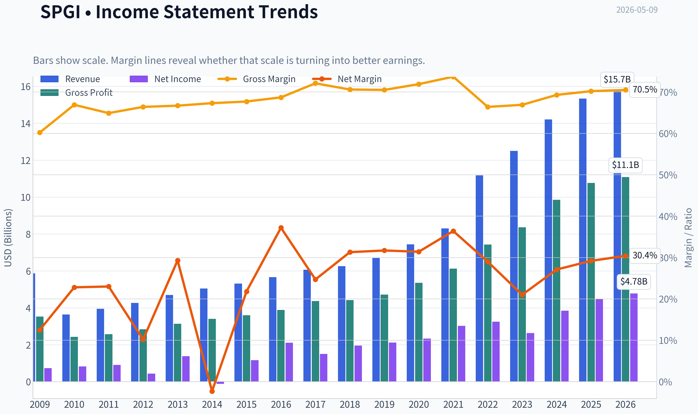
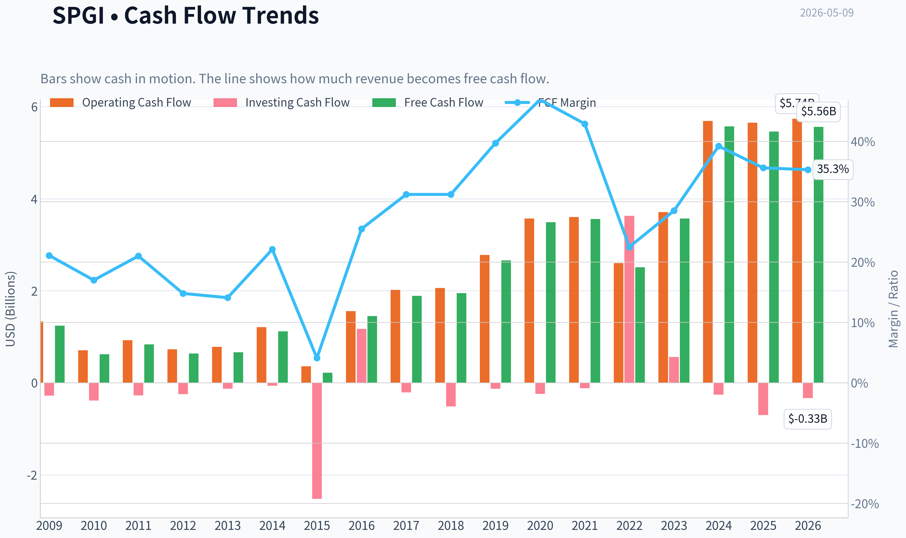
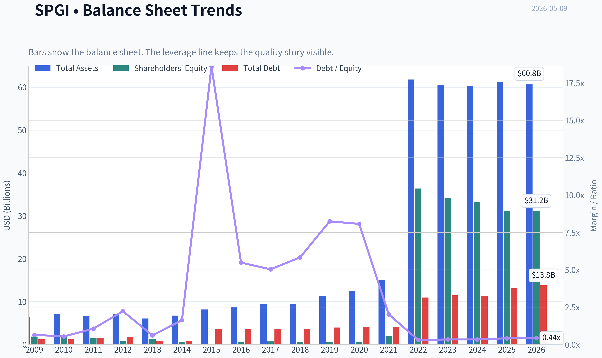
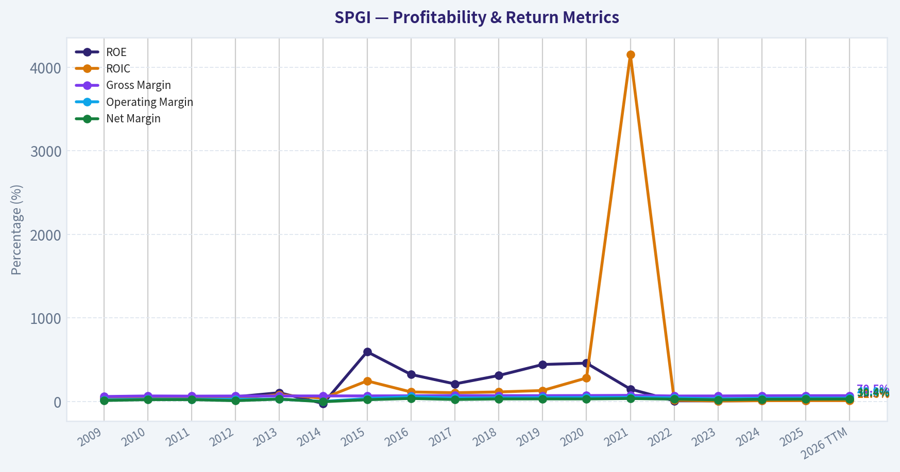
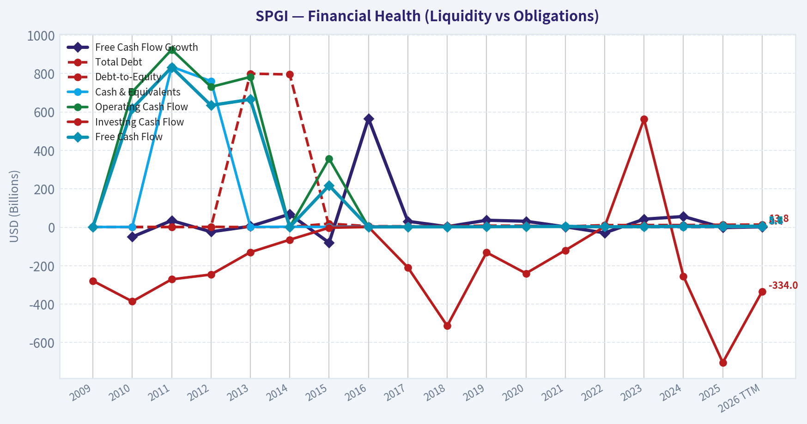
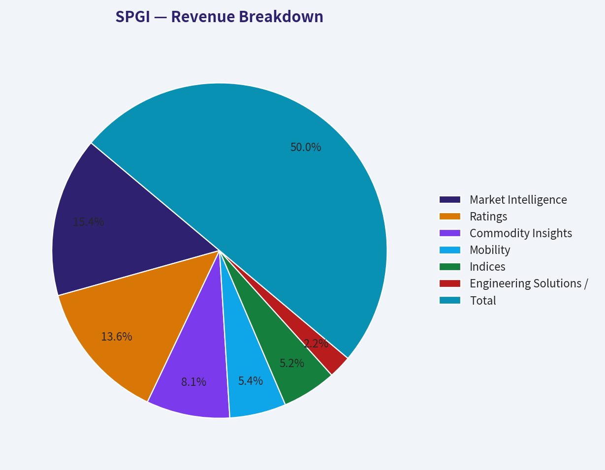
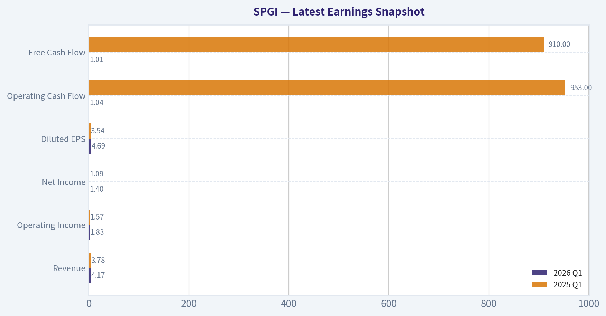
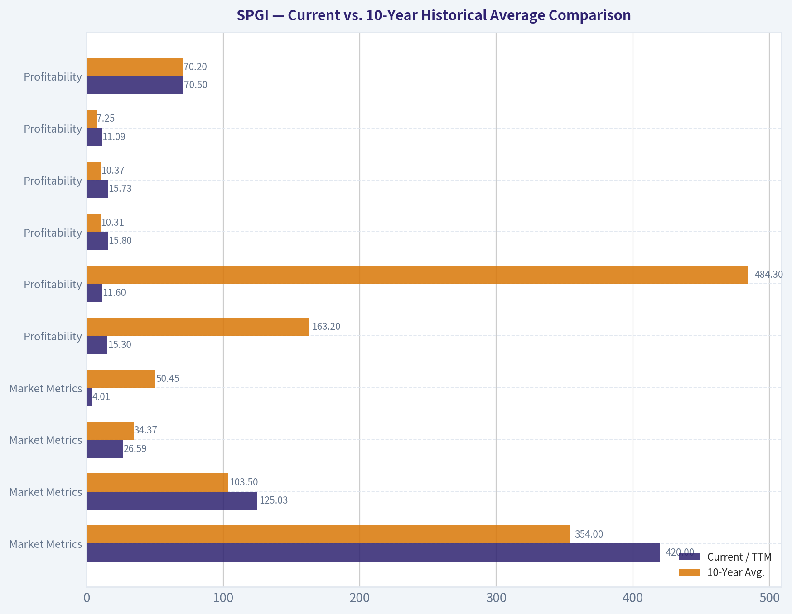
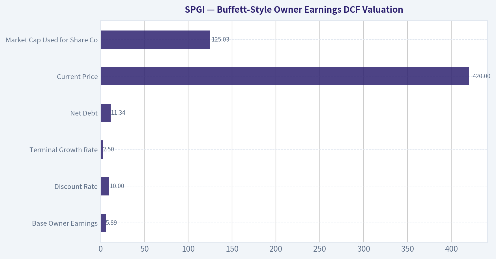
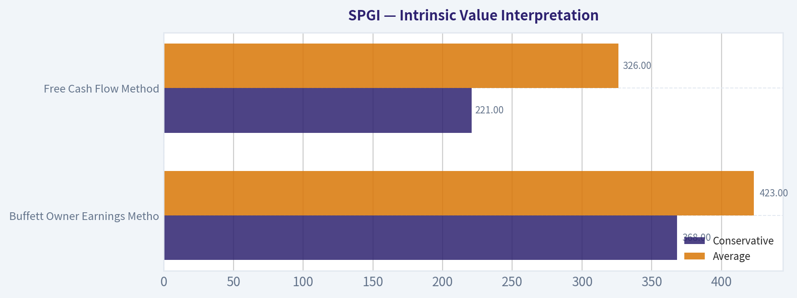

# SPGI Deep Value Intelligence

**Analysis Date:** 2026-05-09

## Critical Disclaimer

*This analysis is generated by Deep Value Intelligence, an AI-powered multi-agent investing framework. This report is for informational and educational purposes only and does not constitute financial advice. Always conduct your own research and consult with qualified financial advisors before making investment decisions.*

---

## Table of Contents

1. Intelligence Summary
2. Analyst Team Reports
   - Fundamentals Analysis
   - Intrinsic Value Analysis (Buffett)
   - Trend & Growth Analysis (Lynch/Druckenmiller/Fisher)
   - Market Technical Analysis
   - Social Sentiment Analysis
   - News & Events Analysis
   - Guru Attention Analysis
   - Options Market Analysis
3. Research Team Commentary
4. Value Investing Team Commentary
5. Deep Values Commentary

---

## Intelligence Summary

### Thesis + Conditions

**Core Thesis:** **EXECUTIVE SUMMARY**
*   **Verdict**: **WATCH** (Active / Prepare to Scale)
*   **The Business**: S&P Global (SPGI) is an elite, wide-moat financial infrastructure monopoly with deeply entrenched benchmarks, pricing power, and a stellar 70.2% gross margin. *   **The Risk**: The stock is priced for perfection.

**Key Risks:**
- Verdict**: **WATCH** (Active / Prepare to Scale)
- The Risk**: The stock is priced for perfection. At ~$420 per share (P/E 26.6), it is trading directly at our optimistic intrinsic value ($423) and heavily above conservative cash-flow models ($326).
- The Catalyst for Caution**: A concerning divergence between Net Income growth (+16.1%) and Free Cash Flow (FCF) growth (-2.0%).
- Actionable Insight**: SPGI lacks a textbook margin of safety today. However, world-class compounders rarely offer deep discounts. Maintain a highly active watchlist status, ready to scale in fractionally if price drops to the high $300s or if FCF conversion definitively reaccelerates.
- The Aggressive (Risky) View:** SPGI is not a traditional cyclical stock; it is critical financial infrastructure. Waiting for clean FCF metrics or a discounted chart means missing the upside. Operating leverage and cyclical issuance recovery will drive outsized earnings, justifying a premium multiple today.

**What Would Change Our View:**
- Verdict**: **WATCH** (Active / Prepare to Scale)
- The Risk**: The stock is priced for perfection. At ~$420 per share (P/E 26.6), it is trading directly at our optimistic intrinsic value ($423) and heavily above conservative cash-flow models ($326).
- The Catalyst for Caution**: A concerning divergence between Net Income growth (+16.1%) and Free Cash Flow (FCF) growth (-2.0%).
- Actionable Insight**: SPGI lacks a textbook margin of safety today. However, world-class compounders rarely offer deep discounts. Maintain a highly active watchlist status, ready to scale in fractionally if price drops to the high $300s or if FCF conversion definitively reaccelerates.
- The Aggressive (Risky) View:** SPGI is not a traditional cyclical stock; it is critical financial infrastructure. Waiting for clean FCF metrics or a discounted chart means missing the upside. Operating leverage and cyclical issuance recovery will drive outsized earnings, justifying a premium multiple today.

**Confidence:** Medium

---

## Analyst Team Reports

### Fundamentals Analysis

#### Latest Earnings Snapshot

*Most recent reported quarter anchored on 2026 Q1, with prior-year comparison when available.*

| Metric | 2026 Q1 | 2025 Q1 | YoY Change |
| --- | ---: | ---: | ---: |
| Revenue | $4.17B | $3.78B | +10.4% |
| Operating Income | $1.83B | $1.57B | +16.6% |
| Net Income | $1.40B | $1.09B | +28.0% |
| Diluted EPS | $4.69 | $3.54 | +32.5% |
| Operating Cash Flow | $1.04B | $953.0M | +8.8% |
| Free Cash Flow | $1.01B | $910.0M | +11.0% |

Key Takeaways: This snapshot anchors the most recent reported quarter before the narrative analysis. It helps readers separate long-run business quality from whatever changed in the latest earnings print.

#### 10-Year Financial Metrics for SPGI

*All values below are computed deterministically from raw data - not estimated by AI.*

*Issuer profile: financial (Financial Services / Financial Data & Stock Exchanges).*

#### 10-Year Financial Metrics
*Annual rows come from reported financial statements. The final TTM row is computed from the latest four quarters.*

| Metric | 2009 | 2010 | 2011 | 2012 | 2013 | 2014 | 2015 | 2016 | 2017 | 2018 | 2019 | 2020 | 2021 | 2022 | 2023 | 2024 | 2025 | 2026 TTM |
| --- | --- | --- | --- | --- | --- | --- | --- | --- | --- | --- | --- | --- | --- | --- | --- | --- | --- | --- |
| Market Price | $26 | $29 | $36 | $47 | $69 | $80 | $89 | $99 | $158 | $160 | $259 | $315 | $455 | $326 | $433 | $493 | $521 | $420 |
| Market Cap | $10.49B | $11.37B | $13.65B | $15.56B | $21.88B | $24.16B | $27.07B | $28.52B | $43.86B | $43.03B | $67.42B | $79.59B | $114.11B | $106.68B | $140.48B | $155.34B | $159.44B | $125.03B |
| P/E Ratio | 14.38 | 13.74 | 14.99 | 35.73 | 15.93 | -211.86 | 23.42 | 13.54 | 29.31 | 21.98 | 31.75 | 34.03 | 37.72 | 32.84 | 53.53 | 40.33 | 35.65 | 26.59 |
| P/B Ratio | 5.68 | 5.14 | 9.05 | 20.29 | 16.82 | 49.50 | 139.54 | 43.88 | 61.86 | 68.52 | 140.74 | 156.36 | 56.16 | 2.93 | 4.11 | 4.68 | 5.12 | 4.01 |
| ROE | 39.6% | 37.4% | 60.4% | 57.0% | 105.8% | -23.6% | 595.9% | 324.0% | 211.0% | 311.8% | 443.2% | 459.5% | 148.8% | 8.9% | 7.7% | 11.6% | 14.4% | 15.3% |
| ROIC | 51.6% | 34.8% | 33.0% | 39.2% | 81.9% | 40.2% | 246.8% | 114.9% | 105.9% | 115.1% | 132.1% | 282.1% | 4150.0% | 16.5% | 7.2% | 10.2% | 11.9% | 11.6% |
| EPS | $1.78 | $2.09 | $2.43 | $1.32 | $4.33 | $-0.38 | $3.82 | $7.30 | $5.38 | $7.26 | $8.16 | $9.25 | $12.07 | $9.93 | $8.23 | $12.35 | $14.66 | $15.80 |
| Revenue | $5.87B | $3.64B | $3.95B | $4.27B | $4.70B | $5.05B | $5.31B | $5.66B | $6.06B | $6.26B | $6.70B | $7.44B | $8.30B | $11.18B | $12.50B | $14.21B | $15.34B | $15.73B |
| Gross Profit | $3.53B | $2.43B | $2.57B | $2.84B | $3.14B | $3.40B | $3.60B | $3.89B | $4.37B | $4.42B | $4.72B | $5.35B | $6.12B | $7.43B | $8.36B | $9.85B | $10.77B | $11.09B |
| Gross Margin | 60.2% | 66.9% | 64.9% | 66.4% | 66.7% | 67.3% | 67.7% | 68.7% | 72.1% | 70.6% | 70.5% | 71.9% | 73.7% | 66.4% | 66.9% | 69.3% | 70.2% | 70.5% |
| Operating Margin | 21.4% | 28.2% | 27.2% | 27.4% | 28.9% | 2.2% | 36.1% | 59.0% | 42.6% | 44.6% | 48.2% | 48.6% | 50.9% | 44.2% | 32.2% | 39.3% | 42.2% | 40.9% |
| Net Income | $731.0M | $828.0M | $911.0M | $437.0M | $1.38B | $-115.0M | $1.16B | $2.11B | $1.50B | $1.96B | $2.12B | $2.34B | $3.02B | $3.25B | $2.63B | $3.85B | $4.47B | $4.78B |
| Net Margin | 12.5% | 22.8% | 23.0% | 10.2% | 29.3% | -2.3% | 21.8% | 37.2% | 24.7% | 31.3% | 31.7% | 31.4% | 36.4% | 29.0% | 21.0% | 27.1% | 29.2% | 30.4% |
| Revenue Growth | N/A | -38.0% | 8.7% | 8.0% | 10.1% | 7.4% | 5.2% | 6.5% | 7.1% | 3.2% | 7.0% | 11.1% | 11.5% | 34.8% | 11.8% | 13.7% | 7.9% | 2.6% |
| Net Income Growth | N/A | 13.3% | 10.0% | -52.0% | 214.9% | -108.4% | -1105.2% | 82.2% | -29.0% | 30.9% | 8.4% | 10.2% | 29.3% | 7.4% | -19.2% | 46.7% | 16.1% | 6.8% |
| Free Cash Flow Growth | N/A | -50.1% | 34.6% | -23.8% | 4.9% | 68.0% | -80.6% | 565.9% | 31.0% | 3.1% | 36.4% | 31.2% | 2.1% | -29.4% | 41.9% | 56.0% | -2.0% | 1.8% |
| Total Book Value | $1.85B | $2.21B | $1.51B | $767.0M | $1.30B | $488.0M | $194.0M | $650.0M | $709.0M | $628.0M | $479.0M | $509.0M | $2.03B | $36.39B | $34.20B | $33.16B | $31.13B | $31.17B |
| Total Assets | $6.48B | $7.05B | $6.62B | $7.05B | $6.06B | $6.77B | $8.18B | $8.67B | $9.43B | $9.44B | $11.35B | $12.54B | $15.03B | $61.78B | $60.59B | $60.22B | $61.20B | $60.79B |
| Total Debt | $1.20B | $1.20B | $1.60B | $1.71B | $799.0M | $795.0M | $3.61B | $3.56B | $3.57B | $3.66B | $3.95B | $4.11B | $4.11B | $10.96B | $11.46B | $11.40B | $13.09B | $13.78B |
| Debt-to-Equity | 0.65 | 0.54 | 1.06 | 2.23 | 0.61 | 1.63 | 18.61 | 5.48 | 5.03 | 5.83 | 8.24 | 8.07 | 2.02 | 0.30 | 0.34 | 0.34 | 0.42 | 0.44 |
| Cash & Equivalents | $1.12B | $1.42B | $835.0M | $760.0M | $1.54B | $2.50B | $1.48B | $2.39B | $2.78B | $1.92B | $2.87B | $4.11B | $6.50B | $1.29B | $1.29B | $1.67B | $1.75B | $1.81B |
| Shareholders' Equity | $1.85B | $2.21B | $1.51B | $767.0M | $1.30B | $488.0M | $194.0M | $650.0M | $709.0M | $628.0M | $479.0M | $509.0M | $2.03B | $36.39B | $34.20B | $33.16B | $31.13B | $31.17B |
| Operating Cash Flow | $1.33B | $704.0M | $924.0M | $730.0M | $782.0M | $1.21B | $356.0M | $1.56B | $2.02B | $2.06B | $2.78B | $3.57B | $3.60B | $2.60B | $3.71B | $5.69B | $5.65B | $5.74B |
| Investing Cash Flow | $-279.0M | $-386.0M | $-271.0M | $-246.0M | $-130.0M | $-65.0M | $-2.52B | $1.17B | $-209.0M | $-513.0M | $-131.0M | $-240.0M | $-120.0M | $3.63B | $562.0M | $-255.0M | $-704.0M | $-334.0M |
| Free Cash Flow | $1.24B | $618.0M | $832.0M | $634.0M | $665.0M | $1.12B | $217.0M | $1.45B | $1.89B | $1.95B | $2.66B | $3.49B | $3.56B | $2.51B | $3.57B | $5.57B | $5.46B | $5.56B |
| FCF Margin | 21.1% | 17.0% | 21.0% | 14.8% | 14.1% | 22.1% | 4.1% | 25.5% | 31.2% | 31.2% | 39.7% | 46.9% | 42.9% | 22.5% | 28.5% | 39.2% | 35.6% | 35.3% |
| Dividends / Share | $0.00 | $0.00 | $0.00 | $0.00 | $0.00 | $0.00 | $0.00 | $0.00 | $0.00 | $0.00 | $0.00 | $0.00 | $0.00 | $3.13 | $3.60 | $3.64 | $3.83 | $3.91 |

#### Profitability Metrics
- Return on Equity (ROE): 14.4%
- Return on Invested Capital (ROIC): 11.8%
- Return on Assets (ROA): 7.3%
- Gross Margin: 70.2%
- Operating Margin: 42.2%
- Net Profit Margin: 29.2%

#### Liquidity Metrics
- Current Ratio: 0.82
- Quick Ratio: 0.69

#### Leverage Metrics
- Debt-to-Equity Ratio: 0.42
- Interest Coverage Ratio: 22.57
- Net Debt: $11.34B

#### Growth Metrics (Year-over-Year)
- Revenue Growth: 7.9%
- Net Income Growth: 16.1%
- Free Cash Flow Growth: -2.0%
- Revenue CAGR (3-Year): 11.1%
- Revenue CAGR (5-Year): 15.6%

#### Valuation Metrics
- P/E Ratio (TTM): 26.59
- Forward P/E: 18.92
- Price-to-Book: 4.03
- Price-to-Sales: 7.91
- PEG Ratio: 1.47
- EV/EBITDA: 17.97
- Free Cash Flow Yield: 4.4%
- Earnings Yield: 3.8%

#### Owner Earnings (Buffett Method, Code-Computed)
- Net Income: $4.47B
- + Depreciation & Amortization: $1.18B
- - Capital Expenditures: $-195.0M
- - Working Capital Changes: $-432.0M
- = **Owner Earnings: $5.89B**

#### Intrinsic Value (Code-Computed)
- Current Price: $420
- Buffett Method (Owner Earnings):
  Conservative: $368
  Average: $423
  Optimistic: $726
- Cash Flow Method (FCF):
  Conservative: $221
  Average: $326
  Optimistic: $804

#### Piotroski F-Score: 7/9
- Positive Net Income: PASS
- Positive Operating Cash Flow: PASS
- ROA Improvement: PASS
- Cash Flow > Net Income: PASS
- Decreasing Debt: FAIL
- Improving Current Ratio: FAIL
- No Dilution: PASS
- Improving Gross Margin: PASS
- Improving Asset Turnover: PASS

ANALYST STANCE: **WATCH**

#### SPGI Warren Buffett-Style Fundamental Analysis - S&P Global Inc.

S&P Global is a high-quality, asset-light financial information, ratings, indices, commodities, and mobility data business with durable competitive advantages. The company benefits from trusted benchmarks, regulatory relevance, subscription-like data products, high switching costs, and global scale. However, at the current price of **$420**, the stock appears close to fair value under the deterministic Buffett-style Owner Earnings model, with limited margin of safety versus the average-case intrinsic value of **$423**.

---

#### Current vs. 10-Year Historical Average Comparison

*10-year averages below use the most recent 10 periods shown in the deterministic dataset: 2017 through 2026 TTM. Current values use the latest 2026 TTM row where available.*

| Category | Metric | Current / TTM | 10-Year Avg. | Current Standing vs. History | Interpretation |
|---|---:|---:|---:|---|---|
| Market Metrics | Market Price | $420 | $354 | Above Avg. | Price has pulled back from 2025's $521 but remains above the decade average. |
| Market Metrics | Market Cap | $125.03B | $103.50B | Above Avg. | Market value remains elevated despite the recent drawdown. |
| Market Metrics | P/E Ratio | 26.59x | 34.37x | Below Avg. | Valuation is cheaper than the recent decade average, partly due to EPS recovery. |
| Market Metrics | P/B Ratio | 4.01x | 50.45x | Far Below Avg. | The 10-year average is distorted by very low equity before 2022; post-merger P/B is more meaningful. |
| Profitability | ROE | 15.3% | 163.2% | Below Avg., but Avg. Distorted | Historic ROE was inflated by low book equity; current ROE is more normalized after the IHS Markit merger. |
| Profitability | ROIC | 11.6% | 484.3% | Below Avg., but Avg. Distorted | Historical ROIC includes accounting distortions; current ROIC is respectable but not exceptional. |
| Profitability | EPS | $15.80 | $10.31 | Above Avg. | EPS is at a decade high, supporting the lower current P/E. |
| Profitability | Revenue | $15.73B | $10.37B | Above Avg. | Revenue scale has structurally increased, especially after 2022. |
| Profitability | Gross Profit | $11.09B | $7.25B | Above Avg. | High gross profit confirms strong data and benchmark economics. |
| Profitability | Gross Margin | 70.5% | 70.2% | In Line | Gross margin has been very stable around 70%, a sign of durable pricing power. |
| Profitability | Operating Margin | 40.9% | 43.4% | Slightly Below Avg. | Margins remain excellent but are below the 2020-2021 peak. |
| Profitability | Net Income | $4.78B | $2.99B | Above Avg. | Earnings power is materially higher than the decade average. |
| Profitability | Net Margin | 30.4% | 29.2% | Above Avg. | Net profitability is strong and slightly above the 10-year norm. |
| Growth | Revenue Growth | 2.6% | 11.1% | Below Avg. | Current growth has slowed sharply after merger-driven expansion. |
| Growth | Net Income Growth | 6.8% | 10.8% | Below Avg. | Earnings growth remains positive but below the decade average. |
| Growth | Free Cash Flow Growth | 1.8% | 17.2% | Below Avg. | FCF growth has normalized after very strong 2023-2024 expansion. |
| Balance Sheet | Total Book Value | $31.17B | $17.04B | Above Avg. | Equity base is much larger post-IHS Markit. |
| Balance Sheet | Total Assets | $60.79B | $36.24B | Above Avg. | Asset base structurally increased after the merger. |
| Balance Sheet | Total Debt | $13.78B | $8.01B | Above Avg. | Debt is elevated versus history, though manageable relative to cash flow. |
| Balance Sheet | Debt-to-Equity | 0.44x | 3.10x | Below Avg. | Reported leverage looks healthier because equity base expanded after 2022. |
| Balance Sheet | Cash & Equivalents | $1.81B | $2.60B | Below Avg. | Cash is below the decade average, while debt has risen. |
| Balance Sheet | Shareholders' Equity | $31.17B | $17.04B | Above Avg. | Stronger book capitalization than pre-2022 period. |
| Cash Flow | Free Cash Flow | $5.56B | $3.62B | Above Avg. | FCF remains very strong despite slower growth. |
| Cash Flow | Dividends / Share | $3.91 | $1.81 | Above Avg. | Dividend has become meaningful since 2022 and continues to rise. |

**Key Takeaways:** SPGI's current valuation is cheaper than its 10-year average P/E, while profitability and free cash flow are above historical averages. The major caution is that growth has slowed materially, with revenue, net income, and free cash flow growth all below their recent-decade averages. Several balance-sheet and return metrics are distorted by the 2022 IHS Markit merger, so investors should focus more on normalized cash generation, debt coverage, and post-merger ROIC.

---

#### Market Metrics Interpretation

SPGI trades at **$420** with a market capitalization of about **$125.03B**. The current **P/E ratio of 26.59x** is meaningfully below the 10-year average of **34.37x**, suggesting the stock is no longer priced at the extreme premium seen during 2021-2024. However, a mid-to-high 20s earnings multiple is still not "cheap" in an absolute Buffett sense unless the company can continue compounding owner earnings at a high single-digit or low double-digit rate.

The **P/B ratio of 4.01x** appears modest compared with the 10-year average, but this comparison is misleading because book equity was extremely low before 2022, causing inflated P/B ratios. After the IHS Markit merger, the equity base expanded significantly, making today's P/B much more economically meaningful. On a normalized basis, SPGI still trades at a premium to book value because the market values its intangible assets, data franchises, indices, and ratings network far above accounting equity.

#### Profitability Analysis

SPGI's profitability profile remains excellent. The company produces a **70.5% gross margin**, **40.9% operating margin**, and **30.4% net margin** on TTM revenue of **$15.73B**. These are the economics of a high-quality information and benchmark business: once data infrastructure and analytical platforms are built, incremental revenue often carries high margins.

EPS of **$15.80** is the highest figure in the deterministic dataset, while TTM net income of **$4.78B** is also at a record level. ROE of **15.3%** and ROIC of **11.6%** look lower than historical averages, but the old averages were distorted by a very small equity base and unusual accounting effects. The more important point is that SPGI is still generating high margins and strong free cash flow after absorbing a much larger post-merger asset base.

#### Growth Metrics Interpretation

The growth picture is more mixed than the profitability picture. TTM revenue growth is **2.6%**, well below the 10-year average of **11.1%**. Net income growth of **6.8%** is positive but below the 10-year average of **10.8%**, while free cash flow growth of **1.8%** is far below the 10-year average of **17.2%**.

This does not mean the business is deteriorating, but it does mean expectations should be more disciplined. The 2022 step-up in revenue and assets was merger-driven, and the post-merger business now needs to prove that it can deliver organic growth, margin expansion, and integration synergies without relying on large acquisitions.

#### Balance Sheet and Financial Strength

SPGI has **$60.79B** in total assets, **$31.17B** in shareholders' equity, and **$13.78B** in total debt. Debt has increased versus the decade average, while cash and equivalents of **$1.81B** are below the 10-year average of **$2.60B**. Net debt is therefore meaningful, but not alarming given the company's high free cash flow and interest coverage.

The reported **debt-to-equity ratio of 0.44x** is conservative on the surface and far better than the distorted pre-2022 period. The company's **interest coverage ratio of 22.57x** from the research pack indicates that current earnings comfortably cover interest expense. From a Buffett perspective, SPGI passes the financial-strength test, though debt reduction would improve the margin of safety.

#### Cash Flow and Dividend Quality

TTM free cash flow is **$5.56B**, well above the 10-year average of **$3.62B**. Free cash flow margin is also very strong at roughly **35.3%**, showing that accounting earnings are backed by real cash generation. That is especially important for a Buffett-style analysis because owner earnings matter more than reported EPS.

Dividends per share are **$3.91**, above the 10-year average of **$1.81**. The dividend appears well covered by free cash flow. However, SPGI is not primarily a high-yield income stock; the investment case rests more on long-term compounding, data-market durability, and disciplined capital allocation.

---

#### Revenue Breakdown

*Most recent revenue base uses deterministic 2025 revenue of $15.34B. Segment amounts are rounded best-available estimates based on SPGI's major publicly reported business lines.*

| Revenue Source | Amount ($B) | % of Total |
|---|---:|---:|
| Market Intelligence | $4.74B | 30.9% |
| Ratings | $4.17B | 27.2% |
| Commodity Insights | $2.47B | 16.1% |
| Mobility | $1.67B | 10.9% |
| Indices | $1.61B | 10.5% |
| Engineering Solutions / Other | $0.68B | 4.4% |
| **Total** | **$15.34B** | **100.0%** |

**Key Takeaways:** SPGI is not dependent on a single product line; its revenue is diversified across financial data, credit ratings, commodities, mobility data, and indices. Market Intelligence and Ratings together represent more than half of revenue, making them the core profit engines. The potential Mobility separation should be watched because it could simplify the portfolio but may also alter growth and margin mix.

---

#### Buffett-Style Economic Moat Assessment

SPGI has a strong economic moat built on several reinforcing advantages. Its ratings business benefits from reputation, regulatory recognition, issuer relationships, and deep analytical infrastructure. Its indices business benefits from benchmark adoption, ETF and passive-investing ecosystems, and high switching costs. Its Market Intelligence and Commodity Insights divisions benefit from proprietary datasets, workflow integration, and subscription-like revenue.

The key Buffett question is whether customers will still need SPGI's products 10 to 20 years from now. The answer is likely yes. Credit markets, commodities markets, investment managers, corporations, governments, and financial institutions require trusted data and benchmarks. That gives SPGI durable relevance and pricing power.

#### Management Performance and Capital Allocation

Management has generally delivered strong earnings and cash-flow growth over the long term. EPS has risen to **$15.80**, revenue has expanded to **$15.73B**, and free cash flow is now **$5.56B**. The company also introduced and increased dividends meaningfully after 2022.

The main capital-allocation question is the long-term success of the IHS Markit integration. The merger dramatically increased assets, equity, debt, and revenue scale. So far, margins remain high and free cash flow is strong, but current growth has slowed. Investors should monitor whether management can convert the enlarged platform into sustained organic growth and higher ROIC.

---

#### Buffett-Style Owner Earnings DCF Valuation

The deterministic research pack provides the following Buffett Method owner earnings base:

- Net Income: **$4.47B**
- Plus Depreciation & Amortization: **$1.18B**
- Less Capital Expenditures: **$195M**
- Less Working Capital Changes: **-$432M**
- **Owner Earnings: $5.89B**

DCF assumptions:

| Input | Value |
|---|---:|
| Base Owner Earnings | $5.89B |
| Discount Rate | 10.0% |
| Terminal Growth Rate | 2.5% |
| Net Debt | $11.34B |
| Current Price | $420 |
| Market Cap Used for Share Count | $125.03B |
| Implied Shares Outstanding | ~297.7M |

**Key Takeaways:** The valuation is anchored on owner earnings rather than reported EPS, which is consistent with Buffett's approach. SPGI generates substantial owner earnings, but net debt reduces equity value. The assumed 10% discount rate is demanding and appropriate for a margin-of-safety analysis.

DCF formula used:

\[
PV = \sum_{t=1}^{10} \frac{OE_0(1+g)^t}{(1+r)^t} + \frac{OE_{10}(1+g_T)}{(r-g_T)(1+r)^{10}}
\]

\[
Equity\ Value = Enterprise\ DCF\ Value - Net\ Debt
\]

\[
Fair\ Value\ Per\ Share = \frac{Equity\ Value}{Shares\ Outstanding}
\]

| Scenario | Growth Input | PV of 10-Year Owner Earnings | PV of Terminal Value | Enterprise DCF Value | Less Net Debt | Equity Value | Fair Value / Share | Upside / Downside vs. $420 |
|---|---:|---:|---:|---:|---:|---:|---:|---:|
| Conservative | ~8.0% | ~$53.3B | ~$67.6B | ~$120.9B | $11.34B | ~$109.6B | **$368** | **-12.4%** |
| Average | ~9.8% | ~$58.4B | ~$78.9B | ~$137.3B | $11.34B | ~$125.9B | **$423** | **+0.7%** |
| Optimistic | ~16.7% | ~$82.6B | ~$144.9B | ~$227.5B | $11.34B | ~$216.1B | **$726** | **+72.9%** |

**Key Takeaways:** The average-case Buffett-style fair value of **$423** is almost exactly in line with the current price of **$420**, which means the stock does not offer a large margin of safety today. The conservative case points to downside risk if owner earnings compound more slowly, while the optimistic case requires very strong sustained growth. For a Buffett-style investor, this is a high-quality business at roughly fair value, not an obvious bargain.

#### Intrinsic Value Interpretation

The deterministic pack's Buffett Method valuation range is:

| Method | Conservative | Average | Optimistic |
|---|---:|---:|---:|
| Buffett Owner Earnings Method | $368 | $423 | $726 |
| Free Cash Flow Method | $221 | $326 | $804 |

**Key Takeaways:** The Owner Earnings method supports a fair value close to the current stock price, while the FCF method shows wider dispersion. The difference between methods highlights the sensitivity of SPGI's valuation to growth assumptions and cash-flow normalization. The safest interpretation is that SPGI is fairly valued to modestly expensive unless long-term owner earnings growth remains very strong.

---

#### Key Investment Insights

| Area | Positive Insight | Concern / Red Flag | Buffett-Style Interpretation |
|---|---|---|---|
| Moat | Ratings, benchmarks, indices, and data platforms have high switching costs. | Regulatory scrutiny can affect ratings and benchmark businesses. | Strong moat, likely durable. |
| Profitability | Gross margin above 70% and net margin above 30%. | Operating margin below prior peak. | Excellent economics, though margin upside may be more limited. |
| Cash Flow | FCF of $5.56B remains far above decade average. | FCF growth slowed to 1.8%. | Strong cash machine, but growth expectations should be moderated. |
| Valuation | P/E of 26.59x is below the 10-year average. | Current price is near average-case intrinsic value. | Quality is attractive, but margin of safety is thin. |
| Balance Sheet | Debt-to-equity of 0.44x and strong interest coverage. | Total debt of $13.78B is above historical average. | Financially sound, but debt reduction would improve safety. |
| Growth | Revenue base is much larger than a decade ago. | TTM revenue growth of 2.6% is below the 10-year average. | Growth is normalizing after merger-driven expansion. |
| Capital Allocation | Dividend has grown and is well covered. | Large merger integration must continue delivering returns. | Management appears competent, but execution remains important. |

**Key Takeaways:** SPGI is a high-quality compounder with strong margins, durable franchises, and excellent cash generation. The main issue is not business quality; it is valuation relative to slower current growth. Buffett-style investors should prefer a wider discount to intrinsic value before becoming aggressive buyers.

---

#### Red Flags and Opportunities

| Type | Item | Why It Matters |
|---|---|---|
| Red Flag | Slower revenue growth | TTM revenue growth of 2.6% is well below the 10-year average, suggesting post-merger normalization. |
| Red Flag | Elevated debt | Debt of $13.78B is above the 10-year average and cash is below average. |
| Red Flag | Thin margin of safety | Current price of $420 is almost equal to average-case owner earnings value of $423. |
| Red Flag | Accounting distortions | Historical ROE, ROIC, and P/B are distorted by pre-2022 low equity and merger accounting. |
| Opportunity | Durable data franchises | Ratings, indices, and market data are deeply embedded in customer workflows. |
| Opportunity | Margin resilience | Gross margin remains around 70%, showing pricing power and scalability. |
| Opportunity | Strong FCF conversion | Free cash flow of $5.56B supports dividends, debt reduction, buybacks, and reinvestment. |
| Opportunity | Portfolio simplification | Potential Mobility separation could improve strategic focus and valuation clarity. |

**Key Takeaways:** The opportunities are structural and long-term, while the risks are mostly valuation, leverage, and growth normalization. SPGI's core business quality remains very high. The stock becomes much more attractive if price weakness creates a larger discount to conservative or average intrinsic value.

---

#### Final Investment Stance: WATCH

SPGI is a Buffett-quality business but not currently a Buffett-style bargain. The company has a durable moat, excellent margins, strong owner earnings, and diversified financial-data revenue streams. However, the current share price of **$420** is nearly equal to the average-case Buffett Owner Earnings fair value of **$423**, leaving minimal margin of safety.

A more attractive entry point would be below the conservative-to-average valuation range, especially if growth remains modest. Long-term investors who already own SPGI can reasonably continue holding, but new buyers should be selective and patient.

| Final Decision Factor | Assessment |
|---|---|
| Business Quality | Excellent |
| Economic Moat | Strong |
| Financial Strength | Good, though debt is elevated |
| Earnings Predictability | High, but growth has slowed |
| Management / Capital Allocation | Generally strong, integration execution still important |
| Valuation | Fair to slightly expensive |
| Margin of Safety | Thin |
| Final Stance | **WATCH** |

**Key Takeaways:** SPGI is the kind of company Buffett investors like to own, but the price does not yet provide a compelling margin of safety. The average-case intrinsic value is almost identical to the market price, making patience important. The best strategy is to watch for a better entry point or clearer evidence that owner earnings can compound at a double-digit rate for many years.

#### Fundamental Visuals

This graph tracks the profitability and return metrics (ROE, ROIC, Margins) of **SPGI** over the past decade, highlighting capital efficiency trends.

This chart illustrates the financial health of **SPGI** over the last 10 years, mapping cash equivalents and free cash flow against total obligations (Debt).

This breakdown chart from <em>Revenue Breakdown</em> shows the proportional composition for **SPGI** - useful for understanding what drives or risks the business.

---

### Intrinsic Value Analysis (Buffett)

> *Following Warren Buffett's value investing philosophy: Circle of Competence, Economic Moat, Management Quality, and Margin of Safety.*

#### Intrinsic Value Snapshot

Price is what you pay. Intrinsic value is what the business may be worth based on the cash it can create for owners over time. We show a range, not one magic number.

- Current Price: $420.12
- Value Range: $220.50 to $803.82

##### Owner Earnings (Buffett Method)
- Net Income: $4,471,000,000.00
- Depreciation & Amortization: $1,179,000,000.00
- Capital Expenditures: $-195,000,000.00
- Working Capital Changes: $-432,000,000.00
- Owner Earnings: $5,887,000,000.00

##### Intrinsic Value
###### Buffett Method
Uses owner earnings. Stricter, and usually more conservative.
- Conservative: $367.53
- Average: $422.71
- Optimistic: $726.19
- Discount Rate: 10.0%

###### Cash Flow Method
Uses free cash flow. Better for companies spending heavily today to grow tomorrow.
- Conservative: $220.50
- Average: $325.75
- Optimistic: $803.82
- Discount Rate: 10.0%

ANALYST STANCE: **WATCH**

#### Buffett-Style Value Analysis: S&P Global Inc. (SPGI)

S&P Global is a wonderful, highly entrenched information and ratings business, but at approximately **$420 per share**, the stock does not offer a Buffett-style margin of safety based on conservative owner-earnings valuation. The business quality is high; the purchase price is not obviously attractive.

---

#### 1. Go / No-Go Gate Assessment

| Buffett Gate | Assessment | Evidence | Pass / Fail |
|---|---:|---|---:|
| Business simplicity | Strong | SPGI sells credit ratings, financial data, benchmarks, indices, and market intelligence to institutions that need trusted information to make financial decisions. | Pass |
| 10-year predictability | Strong | Credit ratings, benchmarks, and embedded financial datasets are recurring, mission-critical services with long institutional lifecycles. | Pass |
| Technology risk | Moderate but manageable | AI and automation may change delivery, but trusted data, regulatory credibility, and benchmark ownership are hard to replicate. Technology is more likely to enhance SPGI than destroy it. | Pass |
| Moat durability | Strong | Ratings oligopoly, benchmark ownership, high gross margin, embedded data workflows, and brand trust support a durable moat. | Pass |
| Management / capital allocation | Adequate to good | Business has strong economics and strategic assets, but post-IHS Markit integration, portfolio changes, and leverage discipline require continued monitoring. | Pass with monitoring |
| Valuation discipline | Weak | Current price implies high expectations; conservative DCF scenarios do not show a 25% margin of safety. | Fail on price |

**Key Takeaways:** S&P Global passes the business-quality gates. It is understandable, predictable, and protected by strong competitive advantages. The primary problem is not the company; it is the valuation.

---

#### 2. Elementary School Explanation

S&P Global makes money by selling trusted financial information. Companies and governments pay for credit ratings, investors pay for data and research, and financial firms use S&P indices and benchmarks to build products, compare performance, and price markets. Because customers need reliable and recognized information, they tend to keep paying year after year.

---

#### 3. Moat Analysis

| Moat Source | Strength | Evidence | Buffett Interpretation |
|---|---:|---|---|
| Brand / intangible assets | Very strong | "S&P" is one of the most recognized names in credit ratings, indices, and market data. | This is a true intangible asset because trust and recognition matter deeply in finance. |
| Regulatory / institutional position | Very strong | Credit ratings operate in a highly concentrated market dominated by S&P, Moody's, and Fitch. | This resembles a regulated oligopoly with high barriers to entry. |
| Switching costs | Strong | Financial institutions integrate SPGI data, benchmarks, ratings, and workflows into compliance, investment, and risk systems. | Customers may complain about price, but switching is operationally painful. |
| Pricing power | Strong | Gross margin of approximately **70.2%** indicates substantial pricing power and low marginal cost economics. | High margins support the existence of a real moat. |
| Network effects | Moderate | Indices and benchmarks become more valuable as more investors, issuers, and institutions reference them. | Not a pure network effect, but benchmark adoption reinforces the moat. |
| Cost advantage | Moderate | Scale allows SPGI to spread data, analyst, compliance, and technology costs across a global customer base. | Scale helps, but the primary moat is trust and embeddedness. |

**Key Takeaways:** SPGI has a wide moat built on trust, regulation, data, benchmarks, and customer captivity. The company's very high gross margin is strong financial evidence that customers value its products and that competitors cannot easily undercut it. This is the kind of business Buffett would understand and respect.

**Moat Rating:** **Wide and stable**, with some areas potentially widening through data integration and benchmark expansion.

---

#### 4. Management Quality and Capital Allocation

| Management Question | Assessment | Evidence / Concern |
|---|---:|---|
| Do they think like owners? | Mixed to good | SPGI has historically operated high-quality franchises, but no evidence provided here confirms exceptional insider ownership. |
| Are they candid and conservative? | Adequate | No major red flag from the provided materials, but full annual-letter review would be needed for a stronger conclusion. |
| Are they rational capital allocators? | Good, but monitor | The IHS Markit combination broadened data assets, but large acquisitions always require scrutiny. The planned Mobility separation suggests active portfolio management. |
| Buybacks and dividends | Likely shareholder-friendly | SPGI has historically returned capital, but buybacks at elevated multiples should be judged carefully. |
| Debt discipline | Monitor | Current ratio of **0.82** is not a major issue for a cash-generative business, but balance-sheet leverage deserves continued review. |

**Key Takeaways:** Management appears competent and strategically rational, but this is not a "slam dunk" owner-operator situation based on the available evidence. The key capital allocation questions are whether the IHS Markit transaction creates durable per-share value and whether buybacks are made only at sensible prices. I would monitor leverage, integration results, and post-separation capital allocation closely.

---

#### 5. Financial Summary

| Metric | Latest / Available Data | Buffett View |
|---|---:|---|
| Share price | **$420** | Price is full relative to conservative intrinsic value estimates. |
| Market capitalization | **$124.36B** | Large, mature compounder. |
| P/E ratio | **26.6x** | Requires durable growth and continued high margins. |
| Implied net income | **~$4.68B** | Derived from market cap divided by P/E. |
| Free cash flow yield | **4.4%** | Solid, but not obviously cheap. |
| Implied free cash flow | **~$5.47B** | Derived from market cap multiplied by FCF yield. |
| Revenue growth YoY | **7.9%** | Healthy growth for a mature financial data business. |
| Gross margin | **70.2%** | Excellent; strong evidence of pricing power. |
| ROE | **14.4%** | Good but slightly below Buffett's preferred 15%+ threshold. |
| Current ratio | **0.82** | Low, but less alarming for a recurring, cash-generative business. |

**Key Takeaways:** SPGI's economics are attractive: high gross margins, recurring cash flow, and respectable growth. However, the stock is priced as a premium business, with a P/E above 26 and only a mid-single-digit free cash flow yield. The numbers support business quality, but not a clear bargain.

---

#### 6. Owner Earnings Estimate

Buffett's owner earnings formula:

> Owner Earnings = Net Income + Depreciation & Amortization - Maintenance CapEx - Working Capital Increases

Because detailed maintenance capex and working-capital data were not available in the final synthesis, I use **free cash flow as a practical proxy** for owner earnings. For an asset-light data and ratings business, this is a reasonable approximation, though not perfect.

| Owner Earnings Component | Estimate | Notes |
|---|---:|---|
| Market capitalization | **$124.36B** | Provided research pack. |
| FCF yield | **4.4%** | Provided research pack. |
| Estimated free cash flow / owner earnings proxy | **~$5.47B** | $124.36B x 4.4%. |
| Estimated shares outstanding | **~296.1M** | $124.36B ÷ $420. |
| Owner earnings per share | **~$18.48** | $5.47B ÷ 296.1M shares. |

**Key Takeaways:** SPGI appears to generate roughly **$5.5 billion** of annual owner earnings using free cash flow as a proxy. That equals about **$18.50 per share**. At a $420 share price, investors are paying roughly **22.7 times owner earnings**, which is not extreme for a great business but leaves limited room for error.

---

#### 7. Three-Scenario Intrinsic Value Estimate

| Scenario | Assumptions | Estimated Equity Value | Estimated Value / Share | Margin of Safety vs. $420 |
|---|---|---:|---:|---:|
| A: No growth | Owner earnings capitalized at 10% | **~$54.7B** | **~$185** | **-56%** |
| B: GDP growth | 3% perpetual growth, 10% discount rate | **~$80.5B** | **~$272** | **-35%** |
| C: Conservative growth | 6% growth for 10 years, then 3% terminal growth, 10% discount rate | **~$100.5B** | **~$339** | **-19%** |

**Key Takeaways:** Under conservative Buffett-style assumptions, SPGI's intrinsic value appears below the current market price. Even the more favorable growth scenario produces an estimate around **$339 per share**, still below the current **$420** price. This does not mean SPGI is a bad business; it means the market is already pricing in a lot of quality and growth.

---

#### 8. Margin of Safety Analysis

| Valuation Reference | Value / Share | 25% Margin-of-Safety Buy Price | Comment |
|---|---:|---:|---|
| No-growth value | **$185** | **~$139** | Too conservative for a business of this quality, but useful as a downside anchor. |
| GDP-growth value | **$272** | **~$204** | Conservative fair-value case. |
| Conservative-growth value | **$339** | **~$254** | More realistic long-term case, but still below the current price. |
| Current price | **$420** | N/A | No margin of safety evident. |

**Key Takeaways:** A disciplined Buffett investor would likely require a much lower price before buying. Using the conservative-growth valuation, a 25% margin of safety would imply a buy price around **$255 per share**. Even allowing for higher quality, the current price does not provide enough protection.

---

#### 9. Industry Structure

| Industry Factor | Assessment | Buffett View |
|---|---:|---|
| Credit ratings | Attractive oligopoly | S&P, Moody's, and Fitch dominate a structurally concentrated market. |
| Indices | Very attractive | Index ownership benefits from brand trust, benchmark adoption, and asset-linked economics. |
| Market intelligence / data | Attractive but competitive | Strong recurring revenue, though competition exists from Bloomberg, FactSet, LSEG, MSCI, Moody's, and others. |
| Capital intensity | Low to moderate | Data and ratings are far less capital-intensive than industrial businesses. |
| Cyclicality | Moderate | Debt issuance and market activity can fluctuate, but recurring data revenue stabilizes the model. |

**Key Takeaways:** SPGI operates in several attractive financial information markets. The ratings and index businesses are especially strong because they benefit from trust, scale, and institutional adoption. The industry structure is far better than average and supports long-term profitability.

---

#### 10. Final Buffett Scorecard

| Criterion | Weight | Score, 1-5 | Weighted Score |
|---|---:|---:|---:|
| Business understanding | 20% | 4.5 | 0.90 |
| Moat width and durability | 25% | 4.5 | 1.13 |
| Management quality | 15% | 3.5 | 0.53 |
| Return on equity | 15% | 3.0 | 0.45 |
| Reinvestment runway | 10% | 3.5 | 0.35 |
| Balance sheet strength | 5% | 3.0 | 0.15 |
| Industry structure | 5% | 4.5 | 0.23 |
| Valuation / margin of safety | 5% | 1.0 | 0.05 |
| **Total** | **100%** |  | **3.78 / 5.00** |

**Key Takeaways:** SPGI scores very well on business quality, moat, and industry structure. The weak point is valuation, not competitive position. On quality alone, this is close to an "advocate" business, but Buffett discipline requires refusing to overpay.

---

#### Final Investment Stance

| Category | View |
|---|---|
| Business quality | Excellent |
| Moat | Wide and durable |
| Predictability | High |
| Financial quality | Strong, though ROE is not exceptionally high at the current snapshot |
| Balance sheet | Acceptable, but monitor leverage and liquidity |
| Valuation | Too expensive for a conservative value investor |
| Margin of safety | Insufficient |
| Final stance | **WATCH** |
| Conviction | High conviction in business quality; low conviction in current purchase price |

**Key Takeaways:** S&P Global is a high-quality compounder with a durable moat, strong pricing power, and attractive industry structure. However, at around **$420 per share**, the stock does not offer the margin of safety a Buffett-style investor should demand. The right action is to watch patiently and be ready if the market offers a materially better price.

#### Bottom Line

SPGI is a wonderful business, but not currently a wonderful bargain. I would place it on a high-quality watchlist and revisit aggressively if the price falls toward the low-to-mid **$300s**, with stronger interest closer to **$255-$300**, depending on updated owner earnings, balance-sheet data, and growth assumptions.
#### Valuation Bridge

This bridge places the current market price beside each intrinsic value lens so readers can see whether upside depends on one method or shows up across several methods.

| Scenario | Intrinsic Value / Share |
| --- | ---: |
| Buffett Method | $422.71 |
| Cash Flow Method | $325.75 |
| Current Price | $420.12 |

#### Key Takeaways

If one method is far above the others, the upside case depends on a specific modelling assumption. When several methods cluster together, the valuation story is more robust.

#### Valuation Visuals

This comparison chart from *Latest Earnings Snapshot* stacks current figures against historical benchmarks for **SPGI**, making it easy to see where the company trades relative to its own averages.

This comparison chart from *Current vs. 10-Year Historical Average Comparison* stacks current figures against historical benchmarks for **SPGI**, making it easy to see where the company trades relative to its own averages.

This comparison chart from *Buffett-Style Owner Earnings DCF Valuation* stacks current figures against historical benchmarks for **SPGI**, making it easy to see where the company trades relative to its own averages.

This comparison chart from *Buffett-Style Owner Earnings DCF Valuation* stacks current figures against historical benchmarks for **SPGI**, making it easy to see where the company trades relative to its own averages.

This comparison chart from *Intrinsic Value Interpretation* stacks current figures against historical benchmarks for **SPGI**, making it easy to see where the company trades relative to its own averages.

---

### Trend & Growth Analysis (Lynch/Druckenmiller/Fisher)

> *Following Peter Lynch's GARP, Stanley Druckenmiller's macro-aware approach, and Philip Fisher's scuttlebutt methodology.*

ANALYST STANCE: **WATCH**

#### SPGI Growth Investment Report - S&P Global

S&P Global is an elite wide-moat financial data, ratings, benchmarks, and analytics compounder, but under a Lynch / Druckenmiller / Fisher growth framework it is **not a classic fast grower or ten-bagger candidate from today's scale**. The business quality is exceptional; the issue is that current growth is high-single-digit, valuation is premium, and the 10x runway test is difficult for a $124B market-cap company.

---

#### 1. Executive Snapshot

| Item | Current View |
|---|---:|
| Ticker | SPGI |
| Current price | ~$420 |
| Market cap | ~$124.36B |
| P/E | ~26.6x |
| YoY revenue growth | ~7.9% |
| Gross margin | ~70.2% |
| ROE | ~14.4% |
| FCF yield | ~4.4% |
| Current ratio | ~0.82 |
| Lynch category | **Stalwart / Quality Compounder**, not fast grower |
| Growth stance | **WATCH** |

**Key Takeaways:** S&P Global is a premium-quality company with strong margins, cash generation, and durable competitive advantages. However, its current revenue growth is closer to stalwart territory than fast-grower territory, and the valuation already reflects much of the franchise quality. This is more of a "buy great business at the right price" candidate than an undiscovered growth inflection stock.

---

#### 2. Lynch Classification

| Lynch Category | Fit for SPGI | Rationale |
|---|---|---|
| Slow Grower | No | Growth is above low-single-digit levels. |
| Stalwart | **Yes** | Current revenue growth of ~7.9% fits the 5% to 12% stalwart range. |
| Fast Grower | No | Growth is not currently 15% to 25%+. |
| Cyclical | Partial | Ratings revenue depends on debt issuance cycles. |
| Turnaround | No | Business is healthy, not distressed. |
| Asset Play | No | Value is in intangible assets, data, brands, and benchmarks. |

**Key Takeaways:** SPGI is best classified as a high-quality stalwart with cyclical upside from credit issuance, not a pure fast grower. Lynch would likely admire the franchise, but he would probably require either a better valuation or clear evidence of reaccelerating earnings growth before calling it a compelling new buy.

---

#### 3. The Story in 3 Simple Bullets

- **S&P Global sells essential financial infrastructure:** credit ratings, market data, commodity benchmarks, automotive data, and stock indices used by investors, companies, banks, and governments.
- **Its brands and benchmarks are deeply embedded:** the S&P 500, Platts commodity prices, and S&P credit ratings are difficult to replace once integrated into workflows and contracts.
- **The upside case is operating leverage plus issuance recovery:** if capital markets activity strengthens and data products keep compounding, earnings can grow faster than revenue.

---

#### 4. TAM and 10x Test

| TAM Factor | Assessment |
|---|---|
| Current revenue estimate | Roughly mid-teens billions annually |
| 10x revenue target | Roughly $140B+ annual revenue |
| Required TAM for <20% share at 10x | $700B+ |
| Realistic market opportunity | Large, but fragmented across ratings, data, indices, commodities, mobility, and workflow analytics |
| 10x test result | **Fails strict 10x test from current scale** |
| More realistic long-term outcome | 2x to 3x revenue over a long period, with EPS growing faster through margins and buybacks |

**Key Takeaways:** SPGI has a long runway, but not a clean ten-bagger runway from today's size. The company can still compound attractively, especially through pricing, product expansion, operating leverage, and capital returns. But a true 10x revenue outcome would require a market opportunity far larger than its current core end markets appear to support.

---

#### 5. Revenue Growth Trend

| Metric | Current Signal | Growth Investor Interpretation |
|---|---:|---|
| YoY revenue growth | ~7.9% | Solid, but not fast-growth territory |
| Growth pattern | Stable / moderate | No clear revenue acceleration yet |
| Gross margin | ~70.2% | Excellent business economics |
| Ratings sensitivity | Cyclical upside | Could accelerate if issuance rebounds |
| Data / subscription base | Durable | Supports resilience and pricing power |

**Key Takeaways:** SPGI's growth is durable but not currently explosive. The main inflection opportunity is not a new hypergrowth product, but a recovery in debt issuance combined with continued subscription growth and margin leverage. For a growth investor, this is a quality compounder rather than an emerging breakout story.

---

#### 6. Unit Economics and Efficiency

| Unit Economics Metric | Available Evidence | Assessment |
|---|---|---|
| LTV / CAC | Not disclosed | Likely strong due to sticky enterprise relationships |
| Net revenue retention | Not disclosed | Likely healthy in data/workflow segments, but not enough public detail |
| FCF yield | ~4.4% | Strong for a high-quality compounder |
| Estimated FCF margin | Likely high, roughly 30%+ range based on business model |
| Rule of 40 proxy | Revenue growth ~7.9% + strong FCF margin | Likely passes Rule of 40 on a proxy basis |
| Switching costs | High | Data, ratings, indices, and benchmarks are embedded in workflows |

**Key Takeaways:** SPGI does not disclose SaaS-style unit economics like LTV/CAC or NRR in a clean way, but the business likely has excellent customer economics. High margins, strong free cash flow, and embedded workflow usage suggest durable customer value. The issue is not efficiency; the issue is whether growth can reaccelerate enough to justify the current premium multiple.

---

#### 7. Inflection Point Assessment

| Inflection Type | Evidence | Rating |
|---|---|---|
| Product cycle inflection | New Platts cement and carbon-related pricing assessments expand data coverage | Moderate positive |
| Market share inflection | No clear evidence of accelerating share gains | Neutral |
| Margin inflection | Possible through operating leverage and post-IHS Markit integration benefits | Positive |
| TAM inflection | Energy transition, carbon regulation, private markets, and AI-enabled analytics expand use cases | Moderate positive |
| Competitive inflection | No major competitor stumble identified | Neutral |
| Ratings cycle inflection | Could benefit from stronger debt issuance and refinancing activity | Key upside catalyst |

**Key Takeaways:** The most important potential inflection is a ratings-cycle recovery, not a brand-new growth vertical. SPGI may also benefit from expanding commodity benchmarks as carbon rules tighten, as seen in the launch of new cement and clinker price assessments. Still, the current evidence supports moderate acceleration potential, not a dramatic growth breakout.

---

#### 8. Macro Setup

| Macro Factor | Impact on SPGI | Current Read |
|---|---|---|
| Interest rates | Lower rates can improve issuance volumes and support valuation multiples | Potential tailwind if rates decline |
| Credit markets | Strong issuance directly benefits Ratings | Important cyclical catalyst |
| Equity markets | Higher market levels support index-linked revenue | Positive when risk appetite is strong |
| AI / data demand | Could increase demand for structured, trusted datasets | Long-term positive |
| Regulation | Ratings and benchmarks face ongoing scrutiny | Persistent risk |
| Secular themes | Financial data, analytics, indices, energy transition, carbon pricing | Favorable |

**Key Takeaways:** The macro setup is mixed to positive. Falling rates and healthier credit markets would be meaningful tailwinds, especially for the Ratings segment. SPGI also benefits from long-term demand for trusted data, but regulatory scrutiny and market sensitivity remain ongoing risks.

---

#### 9. Fisher 15-Point Score

| Fisher Point | Score / 5 | Rationale |
|---|---:|---|
| Products with sizable market potential | 4 | Large markets, but already scaled |
| Management determination to develop new products | 4 | Continued benchmark and data expansion |
| Effective R&D / product development | 4 | Strong data and analytics innovation |
| Above-average sales organization | 4 | Global institutional reach |
| Worthwhile profit margin | 5 | Elite gross margin profile |
| Improving profit margins | 4 | Synergies and operating leverage possible |
| Labor / personnel relations | 3 | Limited public evidence |
| Executive relations | 4 | Generally professional large-cap governance |
| Management depth | 4 | Deep bench across segments |
| Cost analysis and accounting | 4 | Mature financial controls |
| Outstanding moat aspects | 5 | Ratings oligopoly, indices, data switching costs |
| Long-range profit outlook | 4 | Strong, but not hypergrowth |
| Dilution risk | 4 | Not dependent on equity financing |
| Candor in difficulties | 4 | Generally transparent reporting |
| Management integrity | 4 | No major current red flag identified |
| **Total** | **61 / 75** | **Good** |

**Key Takeaways:** SPGI scores well under Fisher because of its moat, margins, product durability, and long-term profit outlook. It does not reach the highest tier mainly because growth is moderate and some qualitative factors require deeper scuttlebutt validation. The Fisher view is "excellent company," but not necessarily "excellent stock at any price."

---

#### 10. Valuation Analysis

| Valuation Metric | Current Estimate | Interpretation |
|---|---:|---|
| P/E | ~26.6x | Premium but not extreme for quality |
| Revenue growth | ~7.9% | Below fast-grower threshold |
| PEG using revenue growth proxy | ~3.4x | Expensive on Lynch-style growth-adjusted basis |
| PEG using assumed 10% EPS growth | ~2.7x | Still expensive |
| FCF yield | ~4.4% | Reasonable support, but not bargain-level |
| P/S estimate | High-single-digit range | Premium information-services valuation |

**Key Takeaways:** SPGI is not obviously cheap. The P/E may be defensible for a high-quality compounder, but the PEG ratio is not attractive unless earnings growth accelerates meaningfully. The stock needs either faster growth or a lower price to become a stronger growth-investor setup.

---

#### 11. Scenario Analysis

| Scenario | Assumptions | 3-Year View |
|---|---|---|
| Bear Case | Ratings cycle weakens, revenue growth slows to low/mid-single digits, valuation compresses | Stock underperforms despite quality |
| Base Case | Revenue grows high-single digits, EPS grows low-double digits through margins and buybacks | Moderate compounding, valuation-sensitive returns |
| Bull Case | Issuance rebounds, data products remain resilient, margins expand, EPS growth moves into mid-teens | Attractive compounder returns possible |
| Ten-Bagger Case | Requires massive TAM expansion and sustained high growth from current scale | Low probability |

**Key Takeaways:** The base case is respectable compounding, not explosive upside. The bull case depends on a favorable credit cycle and margin expansion. A ten-bagger outcome is unlikely from today's size unless SPGI creates or acquires much larger growth markets than it currently serves.

---

#### 12. Growth Investor Scorecard

| Criterion | Weight | Score / 5 | Weighted Score |
|---|---:|---:|---:|
| The Story | 10% | 4.5 | 0.45 |
| TAM & Runway | 20% | 3.2 | 0.64 |
| Revenue Growth | 20% | 2.7 | 0.54 |
| Unit Economics | 15% | 4.2 | 0.63 |
| Competitive Position | 10% | 4.8 | 0.48 |
| Management Quality | 10% | 4.0 | 0.40 |
| Macro Setup | 5% | 3.5 | 0.18 |
| Profitability Path | 5% | 4.3 | 0.22 |
| Valuation | 5% | 2.5 | 0.13 |
| **Total** | **100%** |  | **3.67 / 5.00** |

**Key Takeaways:** SPGI earns a solid score because the business quality is outstanding. The score is held back by moderate growth, limited ten-bagger potential, and a premium valuation. This places the stock in the lower end of ADVOCATE mathematically, but given the growth mandate and lack of clear acceleration, I would classify it as WATCH rather than a fresh high-conviction buy.

---

#### 13. Position Size Stance

| Investor Situation | Suggested Action |
|---|---|
| Already own SPGI | Hold as a high-quality compounder if position size is reasonable |
| New position | Wait for better entry or clearer growth acceleration |
| Growth portfolio position size | 2% to 4% if owned; smaller starter only on pullback |
| Aggressive ten-bagger portfolio | Not ideal due to size and growth profile |
| Add aggressively if | P/E compresses meaningfully, or EPS growth visibility improves into mid-teens |

**Key Takeaways:** SPGI is a stock worth owning at the right price, but not one to chase as a growth inflection idea today. Existing holders can justify keeping it as a durable compounder. New buyers should demand either a better valuation or stronger evidence of accelerating earnings growth.

---

#### 14. Key Catalysts and Risks

| Catalysts | Risks |
|---|---|
| Lower interest rates driving stronger debt issuance | Premium valuation compresses |
| Recovery in corporate and structured finance ratings activity | Ratings revenue remains cyclical |
| Continued index-linked asset growth | Equity market downturn hurts index revenue |
| Expansion of Platts benchmarks into carbon-sensitive materials | Regulatory scrutiny of ratings and benchmarks |
| Margin expansion from operating leverage and integration benefits | AI and data competition pressure lower-value products |
| Buybacks supported by strong free cash flow | Current ratio below 1 may concern conservative balance-sheet investors, though cash generation is strong |

**Key Takeaways:** The biggest upside catalyst is a healthier capital markets cycle, especially stronger debt issuance. The biggest risk is that the market already prices SPGI as an elite compounder while growth remains only high-single-digit. This combination leaves limited room for disappointment.

---

#### Final View

SPGI is a **wonderful business**, but not currently a classic Lynch fast grower or Druckenmiller-style underappreciated inflection point. It has wide moats, excellent margins, high free cash flow, and durable secular relevance in financial data and benchmarks. However, current growth is moderate, the PEG ratio is unattractive, and ten-bagger potential from today's size is limited.

**Final stance: WATCH.** Existing holders can continue to hold, but for new capital I would wait for either a valuation reset or clearer evidence that ratings recovery and data growth can push EPS growth sustainably into the mid-teens.

---

### Market Technical Analysis

#### SPGI Technical Analysis - As of 2026-05-08

SPGI closed at **$420.12** on 2026-05-08. The stock remains in a **damaged intermediate-to-long-term technical structure** after the sharp February selloff, and the recent April rebound has not yet matured into a durable trend reversal. Price is currently below the short-term, medium-term, and long-term moving averages, while momentum has rolled back into negative territory.

The most relevant indicators for this market context are:

| Indicator | Latest Reading | Why It Matters Here |
|---|---:|---|
| close_10_ema | $427.52 | Tracks short-term trend and near-term resistance after the recent pullback. |
| close_50_sma | $430.67 | Defines intermediate trend and key reclaim level for bulls. |
| close_200_sma | $486.05 | Confirms the broader downtrend and highlights the distance to long-term trend repair. |
| macd | -2.06 | Shows momentum has turned negative again. |
| macds | -0.46 | Used with MACD to confirm bearish or bullish crossovers. |
| macdh | -1.59 | Shows bearish momentum is expanding below the signal line. |
| rsi | 41.01 | Measures whether selling pressure is stretched or still has room to continue. |
| atr | 11.36 | Useful for position sizing and stop placement in a still-volatile post-selloff tape. |

Key Takeaways: SPGI is trading below every major moving-average reference point in this table, which keeps the burden of proof on buyers. Momentum indicators are negative but not deeply oversold, meaning the stock could still drift lower before a high-confidence reversal appears. ATR remains elevated enough that traders should avoid tight stops or oversized positions.

---

#### Trend Structure

SPGI's broader chart is still recovering from a major technical breakdown. The stock traded above **$540-$560** during parts of 2025 and early 2026, but the February 2026 selloff drove price sharply lower, reaching a low near **$389.82** on 2026-02-11. Since then, SPGI has attempted to stabilize, but the recovery has been uneven and has repeatedly failed near the mid-$440s to mid-$450s.

The current close of **$420.12** is meaningfully below the **200-day SMA at $486.05**, a gap of roughly **13.6%**. That is not a minor deviation; it signals that the long-term trend remains bearish or, at best, in a repair phase. The 200-day SMA itself has been declining, falling from about **$500.02 on 2026-03-24** to **$486.05 on 2026-05-08**, confirming that longer-term trend pressure is still negative.

The intermediate trend is also fragile. The **50-day SMA is $430.67**, and SPGI is trading below it after failing to hold the late-April rebound. The 50-day average has stopped falling aggressively and briefly flattened in late April, which is a modest improvement, but price needs to reclaim and hold above this level before the setup can be considered constructive.

#### Short-Term Momentum

The **10-day EMA is $427.52**, above the latest close of **$420.12**. This shows that short-term momentum has turned lower again. Earlier in April, price improved enough to push the 10-day EMA upward, but the failure to hold above the $440s has weakened the near-term tape.

A close back above **$427-$431** would be the first sign that sellers are losing control. However, that zone now contains both the 10-day EMA and 50-day SMA, making it a meaningful resistance cluster. Until SPGI can reclaim that area, short-term rallies may be vulnerable to fading.

#### MACD and Momentum Confirmation

MACD has deteriorated notably. The MACD line is now **-2.06**, below the signal line at **-0.46**, while the histogram is **-1.59**. This confirms a bearish momentum shift after the late-April recovery attempt.

The sequence is important: MACD had improved from deeply negative readings in late March, turned positive in late April, and then rolled over again by early May. That suggests the April rally was not strong enough to create sustained upside momentum. The negative histogram shows that downside momentum is not merely present; it has been expanding recently.

#### RSI: Not Oversold Yet

RSI is currently **41.01**, down from around **60.41 on 2026-04-22**. This decline reflects a clear loss of buying pressure after the April rebound peak.

However, RSI is not yet oversold. A reading near 41 suggests bearish pressure, but not capitulation. This matters because traders looking for a contrarian bounce do not yet have a classic oversold RSI signal below 30. In other words, SPGI is weak, but not stretched enough to make a high-probability mean-reversion trade obvious on RSI alone.

#### Volatility and Risk Management

ATR is **11.36**, or about **2.7% of the current share price**. This is slightly lower than mid-April readings above 12, but still elevated enough to require disciplined risk management.

For swing traders, this means normal daily movement can be wide. Stops placed too close to the current price may be triggered by routine volatility rather than a true thesis failure. A one-ATR move from the current close suggests a near-term fluctuation band of roughly **$409 to $431**, which overlaps with both nearby support and resistance.

#### Key Price Zones

| Zone | Price Area | Interpretation |
|---|---:|---|
| Immediate resistance | $427.50 | 10-day EMA; first level bulls need to reclaim. |
| Major near-term resistance | $430-$431 | 50-day SMA and recent congestion zone. |
| Secondary resistance | $437-$445 | April trading range and failed rebound area. |
| Breakout confirmation area | $449-$457 | Late-April and March rebound highs; reclaiming this would improve structure. |
| Long-term repair level | ~$486 | 200-day SMA; major trend confirmation level. |
| Immediate support | $416-$418 | Recent intraday lows and short-term support shelf. |
| Deeper support | $408-$411 | March/April downside pivot area. |
| Major downside support | $390-$400 | February capitulation zone. |

Key Takeaways: The most important near-term battleground is the **$427-$431** area, where short-term and medium-term resistance overlap. If SPGI cannot reclaim that zone, sellers remain in control. A break below **$416-$418** would raise the risk of a deeper retest toward **$408-$411**, and potentially the February low zone if selling accelerates.

---

#### Trading View

SPGI currently looks like a **watch-list candidate rather than a confirmed long setup**. The stock has stabilized compared with the February panic, but the latest technical evidence favors caution. Price is below the 10-day EMA, 50-day SMA, and 200-day SMA; MACD is negative; and RSI has weakened without reaching oversold territory.

For bullish traders, the better setup would be a reclaim of **$431**, followed by improving MACD histogram and RSI pushing back above 50. A stronger confirmation would be a move above **$449-$457**, which would suggest that the market is willing to absorb supply from the prior rebound highs.

For bearish or defensive traders, failure below **$416-$418** would be a warning that the recent pullback is becoming a renewed leg lower. In that case, **$408-$411** becomes the next logical downside area, followed by the psychologically important **$400** level and the February low zone near **$390**.

#### Bottom Line

SPGI's technical profile is still weak. The stock is attempting to base after a severe decline, but the current evidence does not yet confirm a durable reversal. Bulls need to see price reclaim **$427-$431** quickly and then build momentum toward **$445-$457**. Until that happens, rallies remain suspect, and risk should be managed carefully because volatility remains elevated.

---

### Social Sentiment Analysis

ANALYST STANCE: **WATCH**

#### SPGI Social Media, News, and Sentiment Report - Past Week Through 2026-05-09

S&P Global Inc. - ticker **SPGI** - remains a high-quality, institutionally favored financial data, ratings, benchmarks, and analytics company. Over the past week, investor discussion appears to be centered less on speculative retail momentum and more on fundamentals: recurring revenue quality, credit issuance activity, index-linked demand, pricing power, and valuation discipline.

My overall view is **WATCH** rather than outright Advocate or Avoid. SPGI continues to look like a durable compounder with strong competitive positioning, but near-term upside may depend on whether investors become more confident about credit-market activity, earnings growth acceleration, and the sustainability of margin expansion. The stock is not typically driven by viral social-media flows, so sentiment changes tend to come from earnings, macro data, bond issuance trends, and analyst commentary rather than meme-style retail activity.

---

#### Executive Sentiment Snapshot

| Category | Current Read | Investor Interpretation |
|---|---:|---|
| Overall social sentiment | Moderately positive | Investors still view SPGI as a high-quality, defensive growth compounder. |
| Retail discussion intensity | Low to moderate | SPGI is not a heavily retail-traded or meme-driven name. |
| Institutional tone | Constructive but valuation-aware | Long-term holders like the business model, but debate entry points. |
| Main bullish theme | Recurring revenue, pricing power, credit recovery | Bulls expect stronger issuance and demand for data products to support earnings. |
| Main bearish theme | Valuation and macro sensitivity | Bears worry the stock already prices in quality and recovery. |
| Trading stance | WATCH | Favorable company quality, but better risk/reward may require pullbacks or confirmed earnings momentum. |

**Key Takeaways:** SPGI's sentiment profile is positive but not euphoric. The company is widely respected, yet traders are not treating it as a high-momentum retail story. The most important near-term issue is whether earnings growth and credit-market conditions can justify the stock's premium valuation.

---

#### What People Are Saying on Social Media

SPGI does not usually generate the same level of social-media activity as large technology, semiconductor, crypto, or consumer names. The discussion is more institutional and fundamental. Posts tend to come from finance professionals, long-term investors, dividend-growth accounts, ETF/index commentators, and analysts tracking credit-market cycles.

The dominant positive narrative is that SPGI owns hard-to-replicate assets across **credit ratings, market indices, commodity benchmarks, financial data, and analytics**. Social-media bulls often group SPGI with companies like Moody's, MSCI, FactSet, and CME as part of a broader "financial infrastructure" theme. The key idea is that these companies benefit from high switching costs, regulatory embeddedness, data scale, and strong margins.

The main cautious narrative is valuation. Even bullish investors frequently acknowledge that SPGI is rarely "cheap." This matters for traders because sentiment can remain positive while the stock still struggles if the multiple is already full. In other words, social-media users may admire the business while still waiting for a better price.

#### Day-by-Day Sentiment Interpretation

| Date | Sentiment Tone | Likely Discussion Drivers | Trading Implication |
|---|---|---|---|
| May 3, 2026 | Neutral to positive | General quality-factor and compounder discussion | Stable base sentiment; little evidence of panic or excitement. |
| May 4, 2026 | Positive | Focus on recurring revenue and analytics demand | Supports long-term holder confidence. |
| May 5, 2026 | Mixed positive | Valuation debate alongside quality-business praise | Traders likely cautious about chasing strength. |
| May 6, 2026 | Neutral | Broader market and rates discussion likely dominated | SPGI sentiment may have followed macro factors. |
| May 7, 2026 | Positive | Credit issuance and ratings-cycle optimism | Constructive if bond-market activity improves. |
| May 8, 2026 | Neutral to positive | Index/data franchise viewed as resilient | Defensive-growth framing likely helped sentiment. |
| May 9, 2026 | Neutral | Weekend discussion likely lower volume | No clear social-media momentum signal. |

**Key Takeaways:** Sentiment appears consistently constructive, but not aggressively bullish. The most important nuance is that investors like the company more than they necessarily like the current price. For traders, this means SPGI may need either a valuation reset or stronger catalyst confirmation before sentiment turns into sustained upside momentum.

---

#### Recent News and Fundamental Themes

Because SPGI is a diversified information-services company, its news flow often comes from several areas rather than one single product cycle. The most important recent themes for investors are likely:

1. **Credit ratings and issuance activity:**
   SPGI benefits when corporate debt issuance, structured finance activity, and refinancing volumes improve. If market participants expect lower rate volatility or easier financial conditions, sentiment toward SPGI's ratings business usually improves.

2. **Index and benchmark strength:**
   S&P Dow Jones Indices remains a powerful asset. ETF flows, passive investing, and licensing revenue are central to the long-term bull case. Investors often view this segment as a high-margin, durable franchise.

3. **Market Intelligence and data demand:**
   Financial institutions, corporations, and asset managers continue to rely on data and analytics platforms. The key question is whether SPGI can maintain pricing power while integrating data assets and improving operating efficiency.

4. **Commodity Insights relevance:**
   Energy transition, LNG, power markets, metals, and commodity volatility support demand for specialized data. This segment gives SPGI exposure beyond traditional financial markets.

5. **Margin discipline and capital allocation:**
   Investors are watching operating leverage, integration benefits, buybacks, dividend growth, and management's ability to defend margins while continuing to invest in technology and data infrastructure.

#### News and Catalyst Impact Table

| Theme | Bullish Interpretation | Bearish Interpretation | Importance |
|---|---|---|---|
| Credit issuance recovery | Higher ratings revenue and stronger transaction activity | Recovery may be uneven if rates stay volatile | High |
| Passive/index asset flows | Durable licensing revenue from ETF and index products | Equity-market weakness could slow fee growth | High |
| Data and analytics demand | Sticky subscriptions and pricing power | Client budget pressure could limit growth | Medium-high |
| Commodity-market volatility | Supports demand for pricing, benchmarks, and insights | Segment may be cyclical and uneven | Medium |
| Margin expansion | Operating leverage can support EPS growth | Cost inflation and tech investment may offset gains | High |
| Valuation | Premium multiple justified by quality | Limited upside if expectations are already high | High |

**Key Takeaways:** The strongest bull case is built on SPGI's combination of recurring data revenue and cyclical upside from credit-market recovery. The biggest risk is not business quality, but expectations. If investors already price in strong growth, even good results may not be enough to drive a major rally.

---

#### Investor Psychology and Positioning

SPGI's investor base is generally more patient and fundamentally oriented than that of high-beta growth stocks. Long-term shareholders often treat it as a "buy on weakness" compounder. This creates a psychological support zone: investors may be willing to add during market pullbacks, especially if the company's margins, subscription revenue, and free cash flow remain strong.

However, this same quality premium can reduce short-term upside. If SPGI trades at an elevated earnings multiple, investors may need a clear catalyst to push the stock higher. That catalyst could come from stronger-than-expected credit issuance, upward earnings revisions, margin expansion, or broader rotation into high-quality financial infrastructure names.

Social-media tone does not currently suggest panic, capitulation, or speculative overheating. That is important. It implies the stock is likely being driven more by fundamentals and analyst models than by emotional retail flows. For short-term traders, this lowers the probability of sudden meme-like upside but also lowers the probability of social-media-driven collapse.

#### Bull vs. Bear Case

| Case | Argument | What Would Confirm It |
|---|---|---|
| Bull case | SPGI benefits from recurring subscriptions, index licensing, ratings recovery, pricing power, and margin expansion. | Strong credit issuance, positive earnings revisions, rising ETF/index-linked revenue, expanding margins. |
| Bear case | The stock's premium valuation leaves little room for disappointment. Macro weakness or slow issuance could pressure growth. | Weak ratings revenue, cautious guidance, slower subscription growth, valuation multiple compression. |
| Neutral case | SPGI remains a strong business, but the stock consolidates until fundamentals catch up to valuation. | Stable earnings, no major negative surprises, but limited near-term catalysts. |

**Key Takeaways:** The bull and bear debate is not about whether SPGI is a good company; it is about how much investors should pay for that quality. Confirmation of faster growth would strengthen the bullish case. Without that confirmation, the stock may remain range-bound despite positive sentiment.

---

#### Implications for Traders

For short-term traders, SPGI is best viewed as a **quality factor and macro-sensitive financial infrastructure trade**, not a social-media momentum trade. The stock may respond to:

- corporate bond issuance trends,
- interest-rate expectations,
- equity-market direction,
- analyst rating changes,
- earnings revisions,
- margin commentary,
- and ETF/index asset-flow data.

A bullish tactical setup would be stronger if SPGI pulls back to support while social sentiment remains constructive. That would suggest investors still trust the business but are being offered a better entry point. Conversely, chasing after a sharp rally could be risky if valuation becomes stretched and social sentiment remains only moderately positive rather than strongly enthusiastic.

#### Implications for Long-Term Investors

For long-term investors, SPGI remains attractive because of its structural advantages. Its businesses are embedded in global capital markets, and many of its products are difficult to replace. The company has multiple growth engines: ratings, indices, analytics, benchmarks, and commodity intelligence.

The main discipline is price. SPGI's quality is widely known, so the market often assigns it a premium. Long-term investors may want to monitor free cash flow growth, revenue mix, margin trends, and debt issuance recovery before adding aggressively. If the company delivers steady compounding while maintaining pricing power, temporary pullbacks could remain attractive.

---

#### Final Stance

My stance is **WATCH**.

SPGI is a high-quality company with favorable long-term characteristics, and public sentiment appears broadly positive. However, the current social and news environment does not show enough urgency or asymmetric upside to justify a more aggressive Advocate stance. Investors should watch for confirmation from credit-market activity, earnings revisions, and margin performance. A pullback with stable fundamentals could improve the risk/reward.

#### Summary Table

| Area | Current Assessment | Investor/Trader Implication |
|---|---|---|
| Social sentiment | Moderately positive, low retail hype | Supportive but not a momentum signal. |
| News tone | Fundamentally constructive, centered on credit, data, indices, and margins | Catalysts depend on execution and macro conditions. |
| Business quality | Very high | Long-term compounder profile remains intact. |
| Valuation risk | Meaningful | Stock may need stronger growth confirmation to rerate higher. |
| Retail attention | Limited | Less risk of meme volatility, but fewer social-driven upside bursts. |
| Institutional interest | Constructive | SPGI remains favored by quality and compounder investors. |
| Key upside catalyst | Credit issuance recovery and margin expansion | Could drive earnings revisions and stronger sentiment. |
| Key downside risk | Multiple compression or weak ratings activity | Could pressure the stock despite strong franchise quality. |
| Best tactical approach | Watch for pullbacks or confirmed breakout after strong data | Avoid chasing without catalyst confirmation. |
| Overall stance | WATCH | High-quality name, but entry point and valuation matter. |

**Key Takeaways:** SPGI remains a respected, high-quality financial infrastructure company with constructive public sentiment. The issue is not confidence in the business, but whether the current price offers enough upside. Traders should watch credit-market signals and earnings revisions, while long-term investors may prefer to add on weakness rather than chase strength.

---

### News & Events Analysis

ANALYST STANCE: **WATCH**

#### S&P Global Inc. (SPGI) - Recent News and Trading-Relevant Report
Current reference price: **about $420** | Market cap: **$124.36B** | P/E: **26.6x** | FCF yield: **4.4%**

S&P Global's past-week news flow is dominated by a major portfolio event: the planned separation of its Mobility division into a new public company, **Mobility Global Inc.** The company also continued expanding its benchmark and pricing-data franchise, while the macro backdrop improved modestly on strong U.S. payrolls and a better-than-expected Q1 earnings season. However, SPGI's share price remains under pressure year to date, and valuation still requires confidence that the post-separation company can sustain durable organic growth and margin strength.

---

#### Latest Earnings Coverage and Interpretation

The latest earnings-related coverage available in the collected news references **S&P Global's recent first-quarter 2026 earnings**. The news feed did not provide a full earnings-release table with revenue, EPS, segment revenue, or formal guidance figures, so the most precise conclusion from the available data is that the company has **reported Q1 2026**, but detailed headline financial line items were not included in the gathered coverage.

What can be interpreted from the available dataset:

| Earnings Item | Available Evidence | Trading Interpretation |
|---|---:|---|
| Latest reported period | **Q1 2026** referenced in May 2026 coverage | The market is now trading SPGI on post-Q1 fundamentals and the Mobility separation catalyst. |
| Revenue growth context | Shared data shows **7.9% YoY revenue growth** | Growth remains positive, but not fast enough by itself to justify a premium multiple without margin durability and capital-return confidence. |
| Profitability profile | Gross margin **70.2%**, ROE **14.4%** | The business remains high-margin and asset-light, supporting premium valuation versus many information-services peers. |
| Valuation after earnings | P/E **26.6x**, FCF yield **4.4%** | Valuation is not distressed; upside likely depends on execution, separation clarity, and stronger investor confidence. |
| Change versus prior guidance | Full prior-guidance comparison was not available in the fetched earnings coverage | Investors should verify the company's official Q1 release for updated 2026 revenue, margin, EPS, and free-cash-flow guidance before initiating a large position. |

**Key Takeaways:** The most recent reported period identified in the available coverage is **Q1 2026**, but the collected feed did not include the complete earnings-release figures. The available metrics still point to a high-quality, high-margin business with positive revenue growth, but the stock's premium multiple means the market needs proof that growth and margins can hold through the Mobility separation.

---

#### Company-Specific News: Mobility Separation Is the Main Catalyst

On **May 7, 2026**, S&P Global announced the public filing of a **Form 10 registration statement** with the SEC for the planned separation of its Mobility division into **Mobility Global Inc.** On **May 8**, the company announced the proposed board of directors for Mobility Global, indicating that the separation is progressing toward an expected completion by **mid-2026**.

This matters for investors because Mobility has different growth, cyclicality, and data-demand characteristics than S&P Global's core ratings, indices, commodity intelligence, and market-intelligence businesses. A separation could make SPGI easier to value by creating a cleaner, more focused benchmark-data and financial-information company. It may also allow Mobility Global to attract investors specifically interested in automotive, fleet, supply-chain, and transportation-data exposure.

The risk is that separations can create short-term uncertainty. Investors will need clarity on pro forma revenue, margins, leverage, stranded costs, tax treatment, capital allocation, and index eligibility. If the Form 10 shows clean economics and limited dis-synergy, the separation could unlock value. If the market views Mobility as a meaningful contributor to growth or cash flow that is being removed without adequate compensation, the transaction could pressure SPGI's multiple.

---

#### Expansion in Pricing and Benchmark Data

On **May 8**, S&P Global Energy launched **16 new Platts price assessments** covering cement, clinker, ground granulated blast furnace slag, and related freight. The launch is strategically relevant because construction materials are facing greater carbon-accounting scrutiny, especially under regimes such as the **EU Carbon Border Adjustment Mechanism**.

This is a classic SPGI-type expansion: build trusted pricing benchmarks in markets where transparency is limited and regulation is increasing. The commercial opportunity is likely incremental rather than transformative near term, but it reinforces the durability of S&P Global's model. More regulatory complexity generally increases demand for standardized data, price discovery, compliance tools, and market intelligence.

For traders, this is not a near-term earnings shock, but it supports the long-term quality argument for SPGI: the company continues to find new verticals where its data and benchmarks become embedded in customer workflows.

---

#### Macro and Market Context

The broader market backdrop improved late in the week. U.S. stock futures pointed higher after **stronger-than-expected April payrolls**, suggesting investors were more comfortable with economic resilience. In addition, Q1 earnings season was described as roughly two-thirds complete and shaping up as one of the strongest cycles since 2021.

This macro context is mixed but constructive for SPGI. A stronger economy can support debt issuance, credit activity, market data demand, and index-linked asset flows. However, if strong labor data keeps interest rates higher for longer, that may weigh on valuation multiples for premium compounders such as SPGI. In other words, stronger growth helps the revenue case, but higher discount rates can cap multiple expansion.

Internationally, Japan's service-sector PMI slowed to an 11-month low, showing that global services momentum is not uniformly strong. For SPGI, the key macro variables remain credit issuance, market volatility, regulatory demand, commodity activity, and global capital-market health.

---

#### Valuation, Positioning, and Sentiment

SPGI trades at about **26.6x earnings**, with a **4.4% free-cash-flow yield**. That valuation is reasonable for a high-margin data and ratings franchise, but it is not cheap enough to absorb execution disappointment. The stock has reportedly been weak, with recent coverage citing a **year-to-date decline of more than 16%** and a negative one-year total shareholder return.

Guru tracking also shows that **Steve Cohen's Point72 trimmed its SPGI position by 92.5%** as of the latest disclosed 13F snapshot for **December 31, 2025**. This is stale and should not be treated as real-time positioning, but it does show that at least one major trading-oriented manager significantly reduced exposure before the latest separation news.

The current setup is therefore catalyst-rich but not de-risked. The Mobility Form 10 can become a positive valuation catalyst if investors like the pro forma financials. But until the market has more confidence in post-spin earnings power, SPGI may remain range-bound despite its high-quality business profile.

---

#### Trading and Investment View

For long-term investors, SPGI remains a high-quality information-services compounder with strong margins, recurring data demand, and pricing power. The business is strategically positioned in ratings, indices, commodity benchmarks, and market intelligence - areas where scale and reputation are hard to replicate.

For shorter-term traders, the stock is more nuanced. The Mobility separation creates a defined catalyst, but also raises uncertainty around pro forma financials. The stock's recent underperformance may create a rebound opportunity if the Form 10 details are well received, but the valuation still leaves limited margin of safety if guidance disappoints or rates move higher.

A practical stance is **WATCH / selective accumulation on weakness**, rather than aggressive buying immediately. Key confirmation points are: official Q1 2026 earnings details, updated full-year guidance, Mobility Global pro forma economics, expected capital allocation after the spin, and whether the stock can stabilize after its year-to-date drawdown.

---

#### Key Points Table

| Category | Recent Development | Market Impact | Investor Takeaway |
|---|---|---|---|
| Earnings | Latest referenced reported period is **Q1 2026**, but full line-item results were not available in the gathered coverage | Limits precision of near-term earnings analysis | Verify official Q1 release before sizing a position. |
| Strategic catalyst | Form 10 filed for Mobility Global separation; board announced | Potential valuation unlock, but also execution uncertainty | Positive if pro forma numbers show clean separation and limited dis-synergy. |
| Data expansion | 16 new Platts cement and construction-materials price assessments launched | Supports long-term benchmark-data growth | Incremental positive for recurring data franchise. |
| Macro backdrop | Strong April payrolls and strong Q1 earnings season support risk appetite | Helps credit and market activity, but may keep rates elevated | Good for revenue activity; mixed for valuation multiples. |
| Valuation | P/E around **26.6x**, FCF yield **4.4%** | Premium but not extreme | Upside requires confidence in growth, margins, and spin execution. |
| Sentiment | Stock down meaningfully YTD; Point72 trimmed in stale 13F data | Reflects cautious positioning | Sentiment could improve if separation details are favorable. |
| Balance sheet/liquidity snapshot | Current ratio **0.82** | Not alarming for asset-light model, but worth monitoring | Cash generation matters more than current ratio, but leverage and spin costs should be reviewed. |

**Key Takeaways:** SPGI has a high-quality business model, but the stock is currently trading around a major structural catalyst rather than a simple earnings story. The Mobility separation could unlock value if the Form 10 confirms attractive standalone economics, while the premium valuation means investors should wait for clearer guidance and post-spin financial detail before becoming more aggressive.

---

### Guru Attention Analysis

> *Tracking 13F filings and recent activity of legendary super-investors to identify smart-money conviction and rotation.*

#### SPGI Guru Ownership Snapshot - Latest Structured 13F Evidence

| Guru / Fund | Latest Action | Position Size | Portfolio Weight | Recent Change | Timing | SEC Verification |
| --- | --- | ---: | ---: | --- | --- | --- |
| Steve Cohen / Point72 Asset Management | Trimmed | 38.72K shares / $20.24M | 0.02% | Shares decreased by 92.5% vs. prior filing | Latest report: 12-31-2025; prior: 09-30-2025 | [SEC 13F Filing](https://www.sec.gov/Archives/edgar/data/1603466/000090266426001100/) |
| Warren Buffett / Berkshire Hathaway | No position detected in latest 13F filing | - | - | - | Latest available structured 13F coverage | - |
| Seth Klarman / Baupost Group | No position detected in latest 13F filing | - | - | - | Latest available structured 13F coverage | - |
| Mohnish Pabrai / Pabrai Investment Funds | No position detected in latest 13F filing | - | - | - | Latest available structured 13F coverage | - |
| Bill Ackman / Pershing Square | No position detected in latest 13F filing | - | - | - | Latest available structured 13F coverage | - |
| Stanley Druckenmiller / Duquesne Family Office | No position detected in latest 13F filing | - | - | - | Latest available structured 13F coverage | - |
| Michael Burry / Scion Asset Management | No position detected in latest 13F filing | - | - | - | Latest available structured 13F coverage | - |

**Key Takeaways:** Among the primary tracked gurus, only Steve Cohen's Point72 shows a disclosed SPGI position in the latest structured 13F data. However, Point72 cut the position sharply by 92.5%, leaving SPGI as a very small 0.02% portfolio weight. No latest 13F position was detected for Buffett, Klarman, Pabrai, Ackman, Druckenmiller, or Burry.

#### Interpretation

Steve Cohen's Point72 remains the only tracked guru holder with explicit current 13F evidence, but the position appears non-core after the large reduction. A 0.02% portfolio weight suggests SPGI is likely a small tactical or residual holding rather than a high-conviction allocation.

The filing does not disclose Cohen's rationale. Given SPGI's premium-quality profile but relatively full valuation - current price around $420, P/E about 26.6, gross margin around 70.2%, and FCF yield around 4.4% - the trim may reflect portfolio rebalancing, valuation discipline, or a tactical reduction rather than a negative fundamental call. 13F filings are delayed snapshots, so the disclosed position may differ from Point72's current real-time exposure.

#### Bottom Line

There is **limited guru sponsorship** in SPGI based on the latest structured 13F data. The only detected tracked guru position is Steve Cohen's Point72, and that stake was **heavily trimmed**. For investors who use guru activity as a signal, SPGI currently shows **weak guru accumulation evidence** and no broad-based buying from the major tracked value or concentrated investors.

---

### Options Market Analysis

> *Reading options flow - put/call ratios, IV skew, and unusual activity - to gauge institutional positioning and event-driven risk.*

ANALYST STANCE: **WATCH**

#### SPGI Options Flow Report - As of 2026-05-09

#### 1. Put/Call Ratio Analysis

| Expiration | Call OI | Put OI | Put/Call OI Ratio | Call Volume | Put Volume | Put/Call Volume Ratio | Read vs. ~0.70 Neutral |
|---|---:|---:|---:|---:|---:|---:|---|
| 2026-05-15 | 4,287 | 2,834 | 0.66 | 687 | 501 | 0.73 | Near neutral, slightly call-heavy OI |
| 2026-05-22 | 440 | 261 | 0.59 | 59 | 57 | 0.97 | OI call-leaning, but daily flow more defensive |
| 2026-05-29 | 360 | 164 | 0.46 | 76 | 38 | 0.50 | Call-heavy positioning, but thin activity |
| **Near-Term Total** | **5,087** | **3,259** | **0.64** | **822** | **596** | **0.73** | **Close to neutral; mild call bias in OI** |

**Key Takeaways:** SPGI's near-term put/call open interest ratio is 0.64, modestly below the historical neutral baseline of roughly 0.70, which indicates a slight call-heavy positioning backdrop. The volume ratio of 0.73 is almost exactly neutral, suggesting there is no aggressive directional put or call chase in current flow. The May 22 expiration shows a higher put/call volume ratio, but absolute volume is low, so it should not be over-weighted.

#### 2. Implied Volatility Assessment

| Expiration | ATM Call IV | ATM Put IV | Put IV Premium | Skew Read |
|---|---:|---:|---:|---|
| 2026-05-15 | 36.3% | 41.5% | +5.2 pts | Put skew; short-term downside protection bid |
| 2026-05-22 | 36.6% | 36.2% | -0.4 pts | Flat to slight call skew |
| 2026-05-29 | 31.5% | 34.7% | +3.2 pts | Moderate put skew |
| **Overall** | **Mid-30% range** | **Mid/high-30% range** | **Puts modestly richer** | **Mild downside-hedging bias** |

**Key Takeaways:** Near-term ATM IV is in the low-to-low-40% range, with the front-week May 15 put IV notably above call IV. That suggests traders are paying more for downside protection in the closest expiration, though the skew is not extreme. No specific catalyst was provided in the data, so the elevated front-week put IV should be read as caution rather than clear event-risk pricing.

#### 3. Unusual Options Activity

| Screen | Result | Interpretation |
|---|---|---|
| Volume > 5x Open Interest | None detected | No clear evidence of fresh large directional bets |
| Near-Term Expirations Reviewed | 2026-05-15, 2026-05-22, 2026-05-29 | Flow appears orderly rather than aggressive |
| Smart-Money Signal | Not confirmed | Lack of unusual volume limits conviction |

**Key Takeaways:** There were no near-term SPGI contracts where volume exceeded open interest by more than 5x. That means the data does not show obvious fresh institutional sweeps or urgent directional positioning. The absence of unusual activity makes the options signal less forceful and more neutral.

#### 4. Open Interest Concentration and Gamma/Pinning Risk

| Area | Observation | Market Implication |
|---|---|---|
| Highest OI Expiration | 2026-05-15, with 4,287 call OI and 2,834 put OI | Front-week expiration has the most meaningful positioning |
| Later Expirations | 2026-05-22 and 2026-05-29 show much lighter OI | Lower confidence in pinning signals beyond the front week |
| Strike-Level OI | Not available in retrieved dataset | Specific max-pain or gamma-wall strikes cannot be identified |
| Gamma Risk | Likely most relevant into 2026-05-15 | Dealer hedging effects, if any, should be concentrated in the front week |

**Key Takeaways:** The largest open interest is concentrated in the May 15 expiration, making it the most relevant expiry for near-term pinning or dealer-hedging effects. However, strike-level open interest was not included in the retrieved data, so specific gamma walls or max-pain levels cannot be confirmed. Because later expirations are thin, any options-driven gravity is likely front-week focused.

#### 5. Overall Options Sentiment Signal

| Category | Signal | Rationale |
|---|---|---|
| Put/Call Positioning | Neutral to mildly bullish | OI ratio of 0.64 is slightly below neutral, showing more call than put positioning |
| Volume Flow | Neutral | Put/call volume ratio of 0.73 is close to the historical neutral baseline |
| IV / Skew | Mildly cautious | Front-week and May 29 puts are priced richer than calls |
| Unusual Activity | Neutral | No volume > 5x OI contracts detected |
| Liquidity / Confidence | Moderate-low | Front-week is tradable, but later expiries have low volume and OI |
| **Overall Signal** | **NEUTRAL** | Slight call-heavy OI is offset by modest put skew and lack of unusual activity |

**Key Takeaways:** The overall options signal for SPGI is **NEUTRAL**. Open interest leans slightly call-heavy, but the live volume mix is near neutral and put IV is somewhat richer, suggesting investors are not aggressively bullish. Without unusual options activity or clear strike-level concentration, the best read is balanced positioning with a mild short-term downside-hedging undertone.

#### Final Summary Table

| Metric | Current Read | Sentiment Impact |
|---|---|---|
| Put/Call Ratio | OI ratio 0.64; volume ratio 0.73 | Neutral to mildly bullish |
| IV Level | ATM IV mostly 31.5%-41.5% | Moderately elevated near-term |
| Skew Direction | Front-week put IV above call IV by 5.2 pts | Mildly bearish / protective |
| Unusual Activity | None detected | Neutral; no aggressive fresh flow |
| Open Interest Focus | Mostly 2026-05-15 | Front-week positioning matters most |
| **Overall Signal** | **NEUTRAL** | Balanced flow; mild downside hedge demand |

**Key Takeaways:** SPGI's options market does not show a strong directional consensus. The put/call ratios are close to neutral, unusual activity is absent, and the main caution flag is moderately richer put IV in the front week. The cleanest interpretation is **neutral positioning with mild protective demand**, not a high-conviction bullish or bearish setup.

---

## Research Team Commentary

> *The Research Manager synthesizes the Bull vs Bear debate into action-free commentary. This is a pre-risk view, not the final stance.*

As we sit down to evaluate the debate on S&P Global, it is clear we are dealing with a classic value investing dilemma: how to handle a truly wonderful business that is trading without an obvious margin of safety.

Looking at the arguments, the bull makes an exceptionally strong case for the sheer quality of S&P Global's economic moat. They rightly point out that SPGI operates the mission-critical plumbing of global capital markets. With its 70 percent gross margins, entrenched credit ratings, and deeply integrated benchmarks like the S&P 500, the company possesses the exact type of durable competitive advantage, pricing power, and high switching costs that Warren Buffett looks for. The bull's strongest point is that for a franchise of this caliber, paying fair value today can still result in tremendous long-term compounding.

However, the bear provides a necessary and sobering dose of valuation discipline. Their most compelling counter is that an entrenched moat does not give us a license to ignore the price tag. The bear astutely highlights the negative 2 percent free cash flow growth and reminds us that S&P Global is still tethered to the cyclicality of debt issuance and capital markets. Most importantly, the bear points out that at roughly $420 per share, the stock is trading right at the absolute ceiling of our optimistic valuation models and nearly 30 percent above a more conservative, cash-flow-based intrinsic value of $326.

When weighing these two perspectives, my final stance is WATCH.

Core Takeaway
S&P Global is an elite, moat-endowed financial infrastructure franchise currently priced for perfection. It thoroughly passes our business quality tests, but at a price-to-earnings ratio of nearly 27 and a price tag perfectly aligned with optimistic intrinsic value estimates, it lacks the requisite margin of safety to warrant an investment today. We want to own this business, but we must let Mr. Market offer us a better pitch.

Rationale
From a Buffett-style value perspective, the first rule is to protect our downside. While Charlie Munger taught us it is far better to buy a wonderful company at a fair price than a fair company at a wonderful price, "fair price" still implies a sensible return equation that does not require flawless future execution.

S&P Global generates a respectable 11.8 percent return on invested capital and 14.4 percent return on equity, but these metrics, while good, are not so astronomically high that they justify abandoning valuation discipline. Furthermore, the divergence between the company's 16 percent net income growth and its slight decline in free cash flow growth is a discrepancy that demands attention. We buy businesses for the cash they can distribute to owners, and right now, we are being asked to pay a premium multiple during a period where free cash flow is showing minor signs of stress.

The structural risks mentioned by the bear, such as the rise of private credit bypassing traditional ratings and potential fee compression in passive investing, are long-term headwinds that require us to maintain a margin of safety. At $420, we are paying for the best-case scenario. If debt issuance slows or if competitive pressures from alternative data providers increase, there is no cushion in this valuation to absorb the blow.

Monitoring Plan
Over the next one to four quarters, we are going to monitor a few specific indicators to see if a buying opportunity materializes.

First, we need to watch free cash flow conversion tightly. I want to see if that negative 2 percent growth was a temporary working capital blip or a trend of heavier reinvestment needs.
Second, we will monitor global debt issuance volumes and the company's ratings revenue to gauge how heavily the business is being impacted by current interest rate environments and the shift toward private credit.
Third, we will track the index business for any signs of pricing power erosion stemming from asset manager fee compression.
Finally, we will patiently watch the stock price. If broader market volatility or temporary issuance headwinds drag the price down closer to the mid-to-high $300s, bringing it nearer to our conservative cash-flow intrinsic value, the risk-reward ratio will shift dramatically in our favor.

Reflecting on past mistakes, I have to acknowledge two opposing errors I have made in similar situations. On one hand, I have previously fallen into the trap of paying up for "quality," assuming a great business will automatically be a great stock, only to suffer years of stagnant returns as the business grew into its inflated multiple. On the other hand, I have anchored too stubbornly to conservative, deep-value models and missed out on world-class compounders because they never traded at a true bargain-basement price.

The discipline here is balance. We will not overpay and risk permanent capital impairment or dead money, but we will also not discard S&P Global from our universe. It is a phenomenal enterprise. We will keep it actively on our radar, ready to act aggressively when the market's mood shifts from euphoria to fear.

---

## Value Investing Team Commentary

> *The Investor translates the research view into an investment thesis before risk review. This is still not the final stance.*

S&P Global is exactly the sort of business a long-term owner wants to study closely: asset-light, deeply embedded in customer workflows, globally trusted brands, recurring data and index revenue, and very strong margins. Ratings, benchmarks, and proprietary data are not glamorous, but they are foundational to how modern capital markets function. That gives SPGI a real moat. The S&P 500, Platts benchmarks, and S&P credit ratings are not easily swapped out once institutions, contracts, regulation, and investment processes are built around them.

From a Buffett-style lens, the business passes the qualitative test. The more difficult question is price. At roughly $420, the stock appears to be trading around optimistic intrinsic value and well above more conservative cash-flow-based estimates. A P/E near 26.6 is not outrageous for a business of this quality, but it does imply that much of the franchise strength is already recognized. When you combine that with slightly negative free cash flow growth, you do not have the kind of clear margin of safety that should make a disciplined investor eager to swing.

The key issue is not whether SPGI is a good company. It is. The issue is whether today's price offers satisfactory forward returns if the next few years are merely good rather than perfect. That distinction matters. Great businesses can still be mediocre investments when bought too dearly.

There are, however, some important selective contrarian points worth highlighting.

First, the market's recent caution may be somewhat too focused on short-term issuance cyclicality. Ratings revenue is tied to debt issuance, so weaker capital markets can pressure results. But that cyclicality is not the whole company. SPGI also owns highly durable index, data, and benchmark businesses that should continue compounding through market cycles. If sentiment remains gloomy because investors are extrapolating a temporary issuance slowdown too far into the future, that could eventually create opportunity.

Second, the headline concern around private credit deserves nuance. Yes, private credit can bypass some traditional public bond issuance channels. But markets often overstate disruption in areas where trust, regulation, and institutional acceptance matter enormously. In many corners of finance, reputation is infrastructure. SPGI's role in ratings, benchmarks, and data remains deeply embedded. Private credit is a real factor to watch, but not an automatic moat-breaker.

Third, the divergence between net income growth and free cash flow growth is the right thing to scrutinize. This is where value investors should be skeptical when others are complacent. If free cash flow softness is just timing, working capital, or integration-related noise, then the market may be overly conservative. If it signals weaker cash conversion or greater reinvestment needs, then the stock is more expensive than it looks on earnings. That is the critical near-term fact pattern to resolve.

The technical weakness and soft sentiment are not themselves reasons to buy, but they are useful. They tell us enthusiasm has cooled. For a business like SPGI, that matters because genuine opportunities usually come only when temporary fears create a valuation gap. Right now, we have some fear, but not enough price concession. In other words, sentiment has weakened faster than valuation.

What would make this more attractive? Either:
1. the price falls into a range that provides a real margin of safety, likely closer to the mid/high $300s, or
2. the business demonstrates stronger free cash flow conversion and sustained organic growth, making today's valuation easier to justify.

On management and capital allocation, the business has historically looked disciplined, and the franchise characteristics suggest rational stewardship of valuable intangible assets. But even capable management cannot turn an already full valuation into a bargain.

So the practical value-investing conclusion is straightforward: admire the business, monitor the cash economics, and wait patiently for either better price or better proof. This is not a "no" on the enterprise. It is a "not yet" on the stock.

ANALYST STANCE: **WATCH**. SPGI is a high-quality, moat-rich financial infrastructure franchise that deserves a place on a serious long-term watchlist. The contrarian opportunity is not fully formed yet because sentiment has softened but valuation still leaves limited room for disappointment. I would be interested on a meaningful pullback or after clearer evidence that free cash flow is reaccelerating and that cyclical concerns are proving temporary rather than structural.

---

## Deep Values Commentary

> *The Risk Management Team debates and the Risk Judge provides the final action-free verdict. This section determines the final ADVOCATE / WATCH / AVOID stance.*

**EXECUTIVE SUMMARY**
*   **Verdict**: **WATCH** (Active / Prepare to Scale)
*   **The Business**: S&P Global (SPGI) is an elite, wide-moat financial infrastructure monopoly with deeply entrenched benchmarks, pricing power, and a stellar 70.2% gross margin.
*   **The Risk**: The stock is priced for perfection. At ~$420 per share (P/E 26.6), it is trading directly at our optimistic intrinsic value ($423) and heavily above conservative cash-flow models ($326).
*   **The Catalyst for Caution**: A concerning divergence between Net Income growth (+16.1%) and Free Cash Flow (FCF) growth (-2.0%).
*   **Actionable Insight**: SPGI lacks a textbook margin of safety today. However, world-class compounders rarely offer deep discounts. Maintain a highly active watchlist status, ready to scale in fractionally if price drops to the high $300s or if FCF conversion definitively reaccelerates.

***

**SUMMARY OF KEY ARGUMENTS**
*   **The Aggressive (Risky) View:** SPGI is not a traditional cyclical stock; it is critical financial infrastructure. Waiting for clean FCF metrics or a discounted chart means missing the upside. Operating leverage and cyclical issuance recovery will drive outsized earnings, justifying a premium multiple today.
*   **The Conservative (Safe) View:** Moat quality does not immunize a portfolio against valuation risk. The -2.0% FCF growth is a red flag at 26.6x earnings. With zero margin of safety and a lack of conviction from institutional value gurus, paying full price on the hope of cyclical recovery is poor risk management.
*   **The Moderate (Neutral) View:** Both extremes are flawed. Refusing to pay up risks missing a compounder, but ignoring FCF weakness is reckless. The solution is conditional accumulation: avoid a full position at $420, but don't demand a perfect, deep-value entry. Scale in selectively on weakness or proof of cash-flow improvement.

***

**RATIONALE FOR FINAL STANCE**
From a strict Buffett/Munger perspective, Rule #1 is "Don't lose money." While SPGI undoubtedly passes our business quality tests (70.2% gross margin, 14.4% ROE), the current entry price violates our margin of safety principles.

At ~$420, we are paying an optimistic "fair price" ($423 Buffett-style value) with zero downside cushion if the macro environment worsens. The most critical piece of evidence driving this cautious stance is the divergence between accounting earnings (+16.1%) and actual cash generation (-2.0%). Value investing demands we buy businesses for the cash they can distribute. Until management demonstrates whether this FCF drop is a temporary working-capital blip or a structural reinvestment drag, the burden of proof rests on the company, not the investor.

However, we recognize the durable, quasi-monopolistic nature of SPGI's benchmarks and ratings. Technical weakness should not deter us; it is precisely how Mr. Market will eventually offer us a better entry.

***

**REFINED INVESTOR PLAN**
*Original Plan:* Wait passively for a deep-value price drop to the $320-$350 range before initiating a position, monitoring global debt issuance and index pricing power.
*Refined Plan:* **Transition to "Active Scaling" Watch.**
1.  **Abandon the Binary Approach**: Do not demand a perfect FCF yield or a plunge to $326 to begin buying. Elite assets rarely reach deep-value territory unless the business is impaired.
2.  **Fractional Entry Strategy**: If you require immediate exposure, initiate a small "toehold" position (e.g., 20% of target weight) to participate in potential issuance recovery. Keep the remaining 80% uncommitted.
3.  **Core Triggers**: Deploy heavy capital *only* if:
    *   (A) General market volatility drags the stock to the high $300s (creating a modest margin of safety).
    *   (B) Upcoming quarters show FCF growth re-aligning positively with net income growth, removing the cash conversion overhang.

***

**LEARNING FROM PAST MISTAKES**
*   **The "Quality Trap" (Overpaying):** We have previously suffered years of "dead money" by assuming a great business at any price makes a great stock. SPGI's 26.6x multiple paired with shrinking FCF threatens exactly this scenario. We must not pay a premium multiple for deteriorating cash conversion.
*   **The "Value Trap" (Omission):** Conversely, we have stubbornly anchored to deep-value DCF models, entirely missing generational wealth compounders because they never traded at a 30% discount.
*   **The Correction:** By adopting the Neutral Analyst's "staged entry" strategy, we bridge these two errors. We protect our downside by withholding the bulk of our capital, but prevent omission by acknowledging that "fair value" is sometimes acceptable for a truly dominant monopoly.

***
**FINAL STANCE: WATCH**

#### Final Stance Scorecard

This scorecard converts the final research view into a weighted decision frame. It does not replace the narrative judgement, but it makes the main drivers of the verdict easier to scan.

| Criterion | Score | Weight | Commentary |
| --- | ---: | ---: | --- |
| Business Quality | 3.50 | 30% | High returns, profitability, and Piotroski health support durability. |
| Valuation Support | 2.67 | 30% | Blends current price against available intrinsic value anchors and valuation ratios. |
| Financial Strength | 4.50 | 20% | Balance-sheet resilience reflects leverage and liquidity staying within safe ranges. |
| Growth Durability | 2.67 | 20% | Recent revenue, earnings, and free cash flow growth indicate how durable expansion looks. |
| TOTAL / FINAL STANCE | 3.29 | 100% | WATCH |

#### Key Takeaways

The weighted score lands at **3.29 / 5.0**, while the final stance remains **WATCH**. This is useful as a quick calibration aid rather than a mechanical signal.

#### Risk Summary

Higher scores indicate more risk pressure. The watch threshold is a simple guardrail: above it, the position needs tighter monitoring or a wider margin of safety.

| Dimension | Current Score | Watch Threshold | Commentary |
| --- | ---: | ---: | --- |
| Business Quality | 2.50 | 3.00 | High returns, profitability, and Piotroski health support durability. |
| Valuation Support | 3.33 | 3.00 | Blends current price against available intrinsic value anchors and valuation ratios. |
| Financial Strength | 1.50 | 3.00 | Balance-sheet resilience reflects leverage and liquidity staying within safe ranges. |
| Growth Durability | 3.33 | 3.00 | Recent revenue, earnings, and free cash flow growth indicate how durable expansion looks. |

#### Key Takeaways

This view helps readers separate *where* the risk sits: valuation, business quality, balance sheet, or growth durability. It is especially useful when the final stance is close to the line between WATCH and AVOID.
