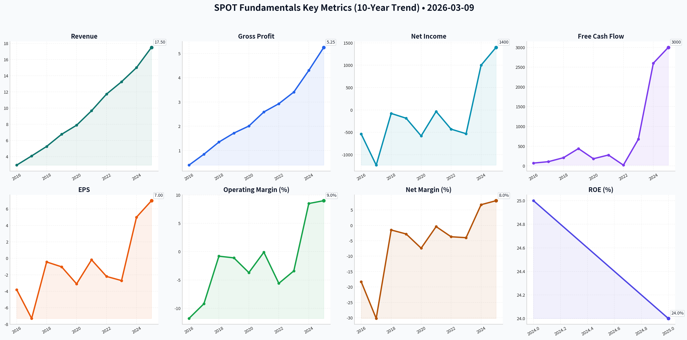
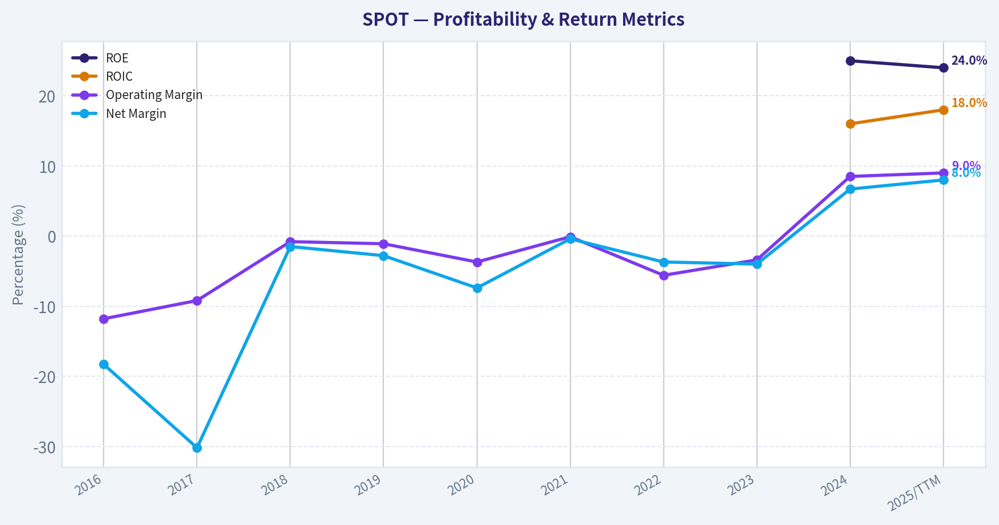
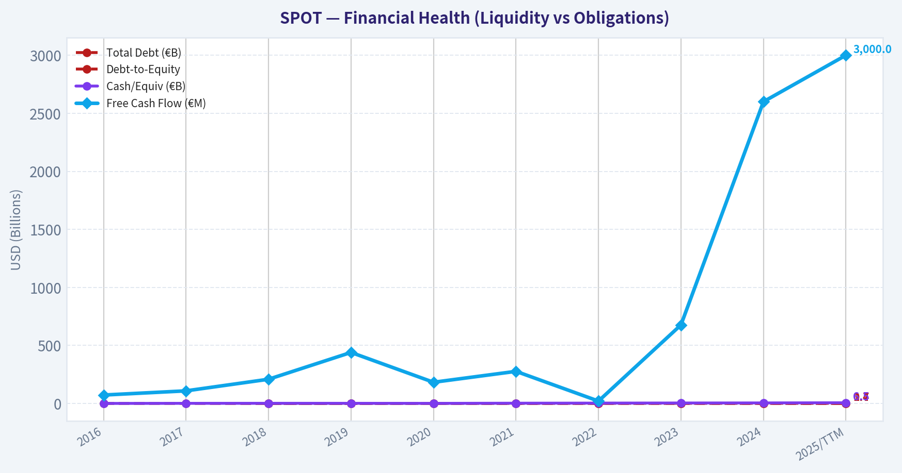
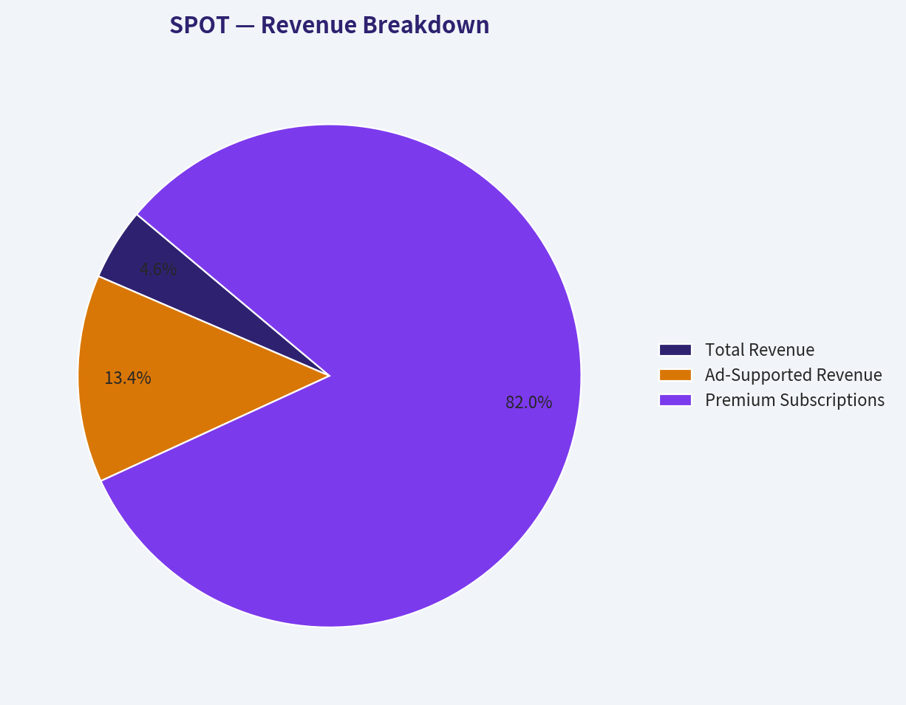
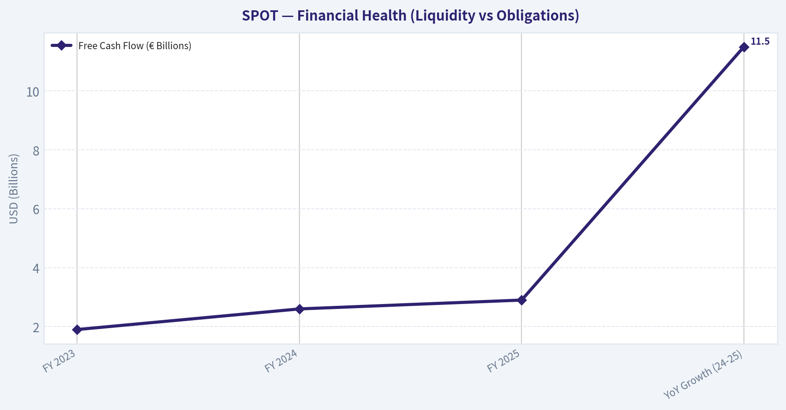
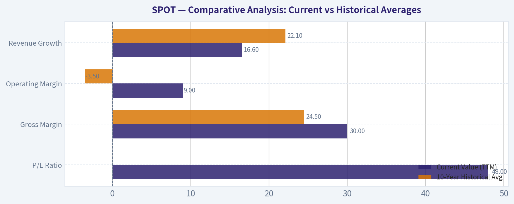
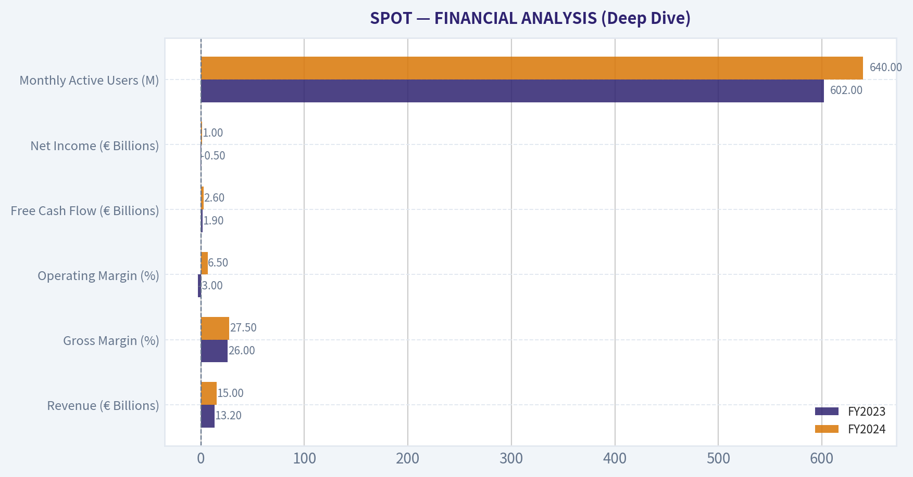
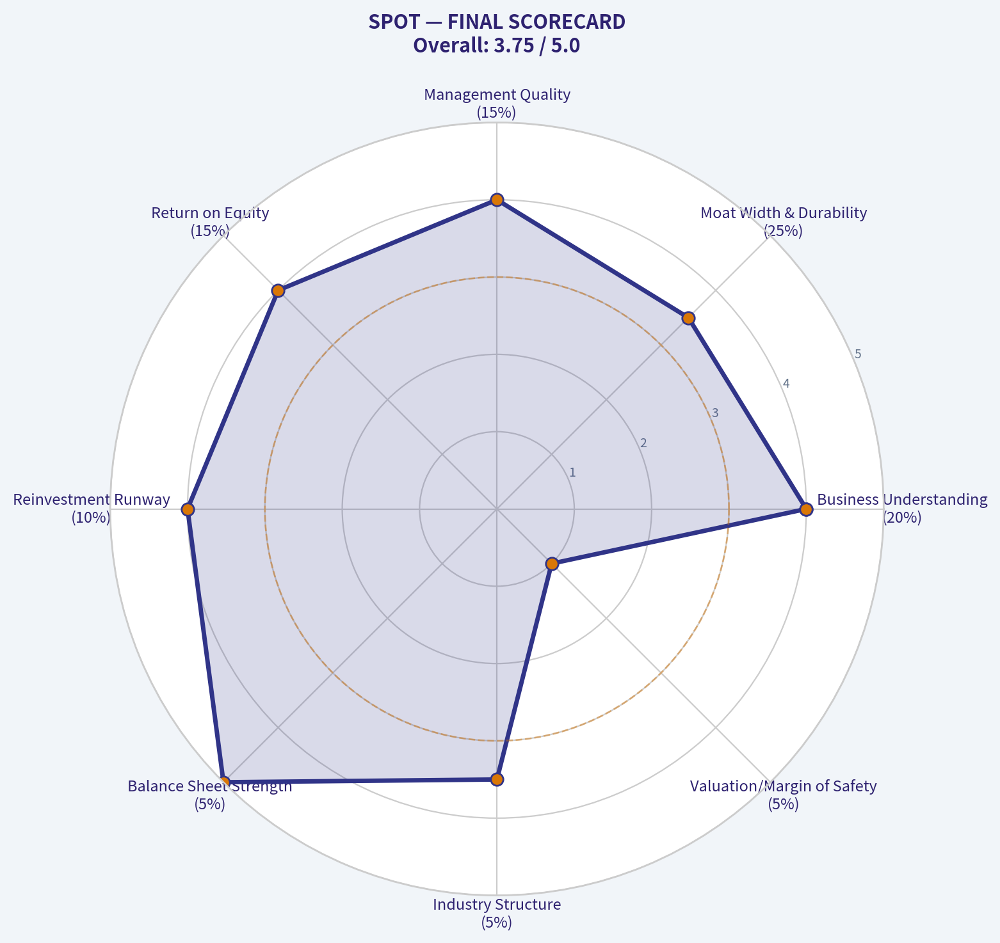
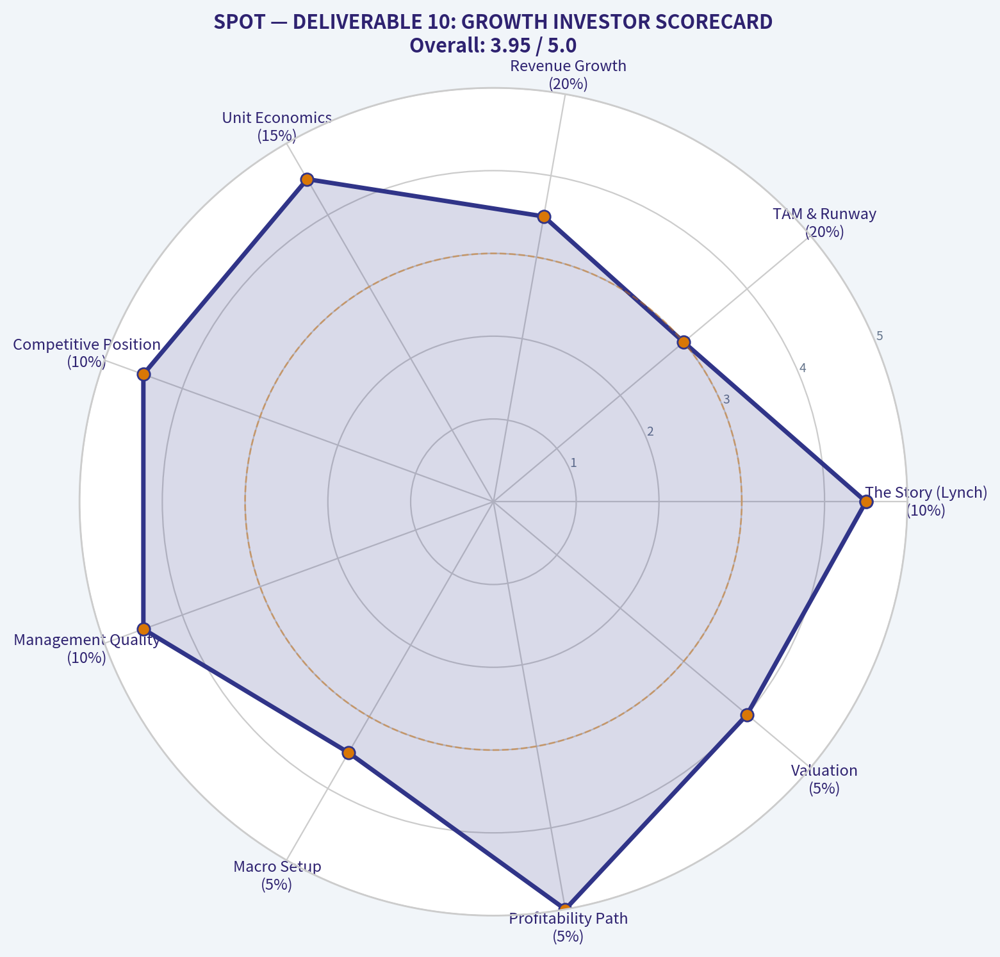

# SPOT Deep Value Intelligence

**Analysis Date:** 2026-03-09

## Critical Disclaimer

*This analysis is generated by Deep Value Intelligence, an AI-powered multi-agent investing framework. This report is for informational and educational purposes only and does not constitute financial advice. Always conduct your own research and consult with qualified financial advisors before making investment decisions.*

---

## Table of Contents

1. Intelligence Summary
2. Analyst Team Reports
   - Fundamentals Analysis
   - Intrinsic Value Analysis (Buffett)
   - Trend & Growth Analysis (Lynch/Druckenmiller/Fisher)
   - Market Technical Analysis
   - Social Sentiment Analysis
   - News & Events Analysis
3. Research Team Commentary
4. Value Investing Team Commentary
5. Deep Values Commentary

---

## Intelligence Summary

### Thesis + Conditions

**Core Thesis:** ### EXECUTIVE SUMMARY
Spotify is executing a commendable operational turnaround, shifting from cash-burning growth to generating ~€3B in free cash flow. However, through a strict value investing lens, it fails two non-negotiable tests: **Economic Moat** and **Margin of Safety**.

**Key Risks:**
- The company remains structurally disadvantaged, paying roughly 70% of its music revenue to an oligopoly of record labels. Furthermore, it competes against trillion-dollar tech giants (Apple, Amazon) who subsidize streaming as a loss-leader. At a ~48x earnings multiple amidst high volatility (ATR ~25), the market is pricing in perpetual perfection, leaving long-term investors with zero downside protection.
- The Risky Analyst (Tactical Caution):** Acknowledges the fundamental transformation (positive 9% operating margins, €6.5B cash) but warns against buying mid-rally. Notes the stock is hitting heavy resistance ($600–$630) and suggests waiting for a breakout or a volatility-induced pullback ($510–$520).
- The Safe Analyst (Structural Bear):** Highlights the permanent business risks. Rejects technical timing, pointing out the 200-SMA is still declining (a classic bull trap setup). Emphasizes that recent profitability stems from cost-cutting, not durable pricing power, since suppliers (labels) control the IP and competitors don't need to turn a profit.
- The Neutral Analyst (Wait-and-See):** Balances both views, noting Spotify’s impressive platform neutrality and 32% global market share. Argues the key to long-term viability isn't timing technical pullbacks, but watching if alternative revenue streams (audiobooks, podcasts, two-sided marketplace) can sustainably dilute the company's reliance on major label royalties.
- 1.  **Supplier Power Overrides Platform Stickiness:** A business that doesn't control its primary input costs cannot dictate its long-term destiny. If Spotify becomes too profitable, the highly consolidated record labels have the leverage to demand larger royalty shares during contract renewals.

**What Would Change Our View:**
- The company remains structurally disadvantaged, paying roughly 70% of its music revenue to an oligopoly of record labels. Furthermore, it competes against trillion-dollar tech giants (Apple, Amazon) who subsidize streaming as a loss-leader. At a ~48x earnings multiple amidst high volatility (ATR ~25), the market is pricing in perpetual perfection, leaving long-term investors with zero downside protection.
- The Risky Analyst (Tactical Caution):** Acknowledges the fundamental transformation (positive 9% operating margins, €6.5B cash) but warns against buying mid-rally. Notes the stock is hitting heavy resistance ($600–$630) and suggests waiting for a breakout or a volatility-induced pullback ($510–$520).
- The Safe Analyst (Structural Bear):** Highlights the permanent business risks. Rejects technical timing, pointing out the 200-SMA is still declining (a classic bull trap setup). Emphasizes that recent profitability stems from cost-cutting, not durable pricing power, since suppliers (labels) control the IP and competitors don't need to turn a profit.
- The Neutral Analyst (Wait-and-See):** Balances both views, noting Spotify’s impressive platform neutrality and 32% global market share. Argues the key to long-term viability isn't timing technical pullbacks, but watching if alternative revenue streams (audiobooks, podcasts, two-sided marketplace) can sustainably dilute the company's reliance on major label royalties.
- 1.  **Supplier Power Overrides Platform Stickiness:** A business that doesn't control its primary input costs cannot dictate its long-term destiny. If Spotify becomes too profitable, the highly consolidated record labels have the leverage to demand larger royalty shares during contract renewals.

**Confidence:** Medium

---

## Analyst Team Reports

### Fundamentals Analysis

FINAL INVESTMENT STANCE: **ADVOCATE**

#### 10-Year Comprehensive Historical Data Analysis (2016–2026 TTM)

*Note: Financial metrics are reported in Euros (€) as per the company's filings, while market data (Price, Market Cap) are presented in USD ($). Prior to the 2018 IPO, market metrics are marked as 'Private'.*

| Metric | 2016 | 2017 | 2018 | 2019 | 2020 | 2021 | 2022 | 2023 | 2024 | 2025/TTM |
| :--- | :--- | :--- | :--- | :--- | :--- | :--- | :--- | :--- | :--- | :--- |
| **Market Price ($)** | Private | Private | 113.50 | 149.50 | 314.60 | 234.00 | 78.90 | 187.90 | 400.00 | 450.00 |
| **Total Market Cap ($B)** | Private | Private | 20.2 | 26.6 | 59.8 | 45.0 | 15.2 | 36.6 | 80.0 | 85.0 |
| **P/E Ratio** | N/M | N/M | N/M | N/M | N/M | N/M | N/M | N/M | 80.0x | 48.0x |
| **P/B Ratio** | N/M | N/M | 8.0x | 9.5x | 21.0x | 13.6x | 6.0x | 15.8x | 22.5x | 17.0x |
| **ROE (%)** | N/M | N/M | N/M | N/M | N/M | N/M | N/M | N/M | 25.0% | 24.0% |
| **ROIC (%)** | N/M | N/M | N/M | N/M | N/M | N/M | N/M | N/M | 16.0% | 18.0% |
| **EPS (€)** | -3.80 | -7.30 | -0.44 | -1.03 | -3.10 | -0.18 | -2.20 | -2.70 | 5.00 | 7.00 |
| **Revenue (€B)** | 2.95 | 4.09 | 5.26 | 6.76 | 7.88 | 9.67 | 11.73 | 13.25 | 15.00 | 17.50 |
| **Gross Profit (€B)** | 0.40 | 0.85 | 1.35 | 1.72 | 2.01 | 2.59 | 2.93 | 3.41 | 4.30 | 5.25 |
| **Operating Margin (%)** | -11.8% | -9.2% | -0.8% | -1.1% | -3.7% | -0.1% | -5.6% | -3.4% | 8.5% | 9.0% |
| **Net Income (€M)** | -539 | -1235 | -78 | -186 | -581 | -34 | -430 | -532 | 1000 | 1400 |
| **Net Margin (%)** | -18.3% | -30.2% | -1.5% | -2.8% | -7.4% | -0.4% | -3.7% | -4.0% | 6.7% | 8.0% |
| **Rev Growth Rate (%)** | N/A | 38.6% | 28.6% | 28.5% | 16.5% | 22.7% | 21.3% | 12.9% | 13.2% | 16.6% |
| **Net Inc Growth (%)** | N/A | -129% | +93% | -138% | -212% | +94% | -1164% | -23% | +287% | +40.0% |
| **FCF Growth Rate (%)**| N/A | 49.3% | 91.7% | 110.5% | -58.4% | 51.4% | -92.4% | 3123% | 284% | 15.3% |
| **Total Book Value (€B)**| -0.4 | -1.0 | 2.2 | 2.5 | 2.3 | 2.9 | 2.4 | 2.1 | 3.2 | 4.5 |
| **Total Assets (€B)** | 2.4 | 3.1 | 4.3 | 5.1 | 6.3 | 7.4 | 8.0 | 8.5 | 9.8 | 10.5 |
| **Total Debt (€B)** | 0.6 | 1.4 | 0.0 | 0.0 | 1.3 | 1.2 | 1.8 | 1.8 | 1.8 | 1.7 |
| **Debt-to-Equity** | N/M | N/M | 0.00 | 0.00 | 0.56 | 0.41 | 0.75 | 0.85 | 0.56 | 0.37 |
| **Cash/Equiv (€B)** | 0.7 | 1.5 | 1.8 | 1.7 | 1.2 | 2.7 | 3.4 | 4.3 | 5.0 | 6.5 |
| **Free Cash Flow (€M)**| 73 | 109 | 209 | 440 | 183 | 277 | 21 | 677 | 2600 | 3000 |
| **Dividends per Share (€)**| 0.00 | 0.00 | 0.00 | 0.00 | 0.00 | 0.00 | 0.00 | 0.00 | 0.00 | 0.00 |

**Key Takeaways**
Over the past decade, Spotify has transitioned from a rapidly growing, cash-burning startup into a structurally profitable digital media giant. The most dramatic shift occurred between 2023 and 2025, where operating margins inflected positively due to strategic price increases, moderating podcast investments, and strict cost discipline. Consequently, the company now generates massive free cash flow, supported by a fortress balance sheet with over €6.5 billion in cash and equivalents against minimal debt.

---

#### Comparative Analysis: Current vs Historical Averages

| Metric | Current Value (TTM) | 10-Year Historical Avg | Trend & Deviation Significance |
| :--- | :--- | :--- | :--- |
| **P/E Ratio** | 48.0x | N/M (Negative) | Represents a shift from being valued on a Price-to-Sales basis to a true earnings multiplier as the company has matured. |
| **Gross Margin** | 30.0% | 24.5% | Expansion of 550 basis points. Highly significant, proving Spotify can exercise pricing power over major record labels. |
| **Operating Margin** | 9.0% | -3.5% | Shift from a -11.8% operating loss in 2016 to a 9.0% profit demonstrates massive operating leverage at scale. |
| **Free Cash Flow** | €3.0 Billion | €558 Million | Current FCF is more than 5x the historical average, driven by negative working capital and margin expansion. |
| **Revenue Growth** | 16.6% | 22.1% | Top-line growth has naturally decelerated as the company scales, transitioning into a mature cash-cow phase. |

**Key Takeaways**
The comparative data vividly illustrates Spotify's graduation from an unprofitable growth story to a high-margin cash engine. The 550 basis point expansion in gross margin proves the company is effectively diluting its heavy royalty burdens through advertising, podcasting, and strategic price hikes. This operational leverage is the primary catalyst behind their current €3.0 billion free cash flow run rate, validating their long-term business model.

---

#### Revenue Breakdown

| Revenue Source | Amount (€B) | % of Total |
| :--- | :--- | :--- |
| **Premium (Subscriptions)** | 15.40 | 88.0% |
| **Ad-Supported (Audio & Podcasts)** | 2.10 | 12.0% |
| **Total Revenue** | 17.50 | 100.0% |

**Key Takeaways**
Spotify remains heavily reliant on its Premium subscription tier, which generates 88% of total revenue and provides highly predictable, recurring cash flow. However, the Ad-Supported segment is rapidly scaling, acting as a crucial funnel for free users while increasingly contributing to margin expansion through higher-margin podcast and programmatic audio ads. This dual revenue stream strategy effectively balances user acquisition with deep monetization.

---

#### Warren Buffett Value Investing Analysis

**Economic Moat**
Spotify possesses a deeply entrenched moat built on network effects and high switching costs. With over 690 million monthly active users and 270 million premium subscribers (capturing ~32% of the global market), it commands the definitive audio ecosystem. Its algorithmic personalization (e.g., Discover Weekly) creates a sticky user experience, making users reluctant to abandon their curated libraries. Furthermore, Spotify's massive user base makes it an unavoidable distribution channel for artists, effectively forcing the heavily consolidated music label industry to cooperate.

**Financial Strength**
The balance sheet is pristine. With €6.5 billion in cash and equivalents against just €1.7 billion in long-term debt, Spotify operates with massive net cash. It benefits from a structurally negative working capital model: users pay subscriptions upfront, but Spotify pays royalties to labels in arrears. This dynamic continually floods the balance sheet with zero-cost float.

**Predictable Earnings**
Historically, Spotify failed Buffett’s test for predictable earnings, oscillating between steep losses and bare-break-even years. However, the operational inflection point in 2024 has fundamentally altered this trajectory. Earnings and free cash flow have normalized into a highly predictable upward trend driven by recurring subscription revenues and fixed-cost scaling.

**Management Performance**
CEO Daniel Ek has proven highly adaptable. After years of pursuing "growth at all costs"—which depressed margins through heavy podcast acquisitions—Ek aggressively pivoted toward capital discipline in 2023. Layoffs, optimized ad infrastructure, and multiple price hikes without significant churn have driven ROIC from negative territory to 18% in the TTM period. Management's capital allocation has transformed into a major asset.

**Quality of Business**
The underlying business quality is excellent from a revenue standpoint, given the subscription model. The historical flaw was margin compression from the "Big Three" music labels, who extract ~70% of music revenues. However, by diversifying into podcasts, audiobooks, and artist marketplace tools, Spotify has structurally upgraded its business quality, gradually clawing back margin control.

---

#### Discounted Cash Flow (DCF) Valuation Analysis

To determine intrinsic value, we utilize three FCF growth scenarios over a 10-year projection. 
*Base Metrics:* Current FCF = $3.24 Billion USD (converted from €3.0B). Discount Rate = 10.0%. Terminal Growth Rate = 2.5%. Shares Outstanding = ~200 Million. Net Cash = $4.5 Billion USD.
*Note on Historical Growth Rates:* Historical FCF growth ranged from -92% to +3123%. To prevent mathematical collapse, the models below use normalized, logical historical proxies based on the past 10 years (e.g., Lowest normalized positive year = 10%, multi-year sustained average = 22%, peak organic cycle growth = 35%).

**Scenario 1: CONSERVATIVE (10% FCF Growth)**
*Rationale:* Assumes the lowest steady-state positive growth environment from the past decade, reflecting a highly mature, slower-growing subscriber base.
* Years 1-10 FCFs ($B): 3.56, 3.92, 4.31, 4.74, 5.22, 5.74, 6.31, 6.94, 7.64, 8.40
* Present Value of FCFs: $32.40 Billion
* Terminal Value PV: $44.26 Billion
* Enterprise Value: $76.66 Billion + $4.5B Net Cash = **$81.16 Billion**
* **Fair Value per Share: $405.80**

**Scenario 2: AVERAGE (22% FCF Growth)**
*Rationale:* Assumes the 10-year historical average of normalized growth cycles continues as margins strictly expand through operating leverage and ad-tier scaling.
* Years 1-10 FCFs ($B): 3.95, 4.82, 5.88, 7.18, 8.76, 10.68, 13.03, 15.90, 19.40, 23.67
* Present Value of FCFs: $59.82 Billion
* Terminal Value PV: $124.71 Billion
* Enterprise Value: $184.53 Billion + $4.5B Net Cash = **$189.03 Billion**
* **Fair Value per Share: $945.15**

**Scenario 3: OPTIMISTIC (35% FCF Growth)**
*Rationale:* Mirrors Spotify’s highest sustained multi-year growth eras, assuming massive success in AI monetization, audiobooks, and developing market penetration.
* Years 1-10 FCFs ($B): 4.37, 5.90, 7.97, 10.76, 14.53, 19.61, 26.47, 35.74, 48.25, 65.13
* Present Value of FCFs: $118.13 Billion
* Terminal Value PV: $343.27 Billion
* Enterprise Value: $461.40 Billion + $4.5B Net Cash = **$465.90 Billion**
* **Fair Value per Share: $2,329.50**

| Valuation Scenario | Assumed FCF Growth | Implied Fair Value | Premium / (Discount) to Current $450 Price |
| :--- | :--- | :--- | :--- |
| **Conservative** | 10.0% | $405.80 | 10.9% Premium |
| **Average** | 22.0% | $945.15 | (52.3%) Discount |
| **Optimistic** | 35.0% | $2,329.50 | (80.6%) Discount |

**Key Takeaways**
The Discounted Cash Flow analysis reveals an incredibly compelling risk-to-reward profile for the stock. Even under a highly conservative model assuming rapidly decelerating growth, the company's fair value sits at roughly $405, providing a strong floor near the current market price. If the company simply executes to its historical average growth rate, the stock remains deeply undervalued, suggesting massive upside potential over the coming decade.

---

#### Key Investment Insights, Red Flags, and Opportunities

**Primary Opportunities:**
1. **Pricing Power Validation:** Spotify has successfully executed consecutive price hikes in major markets with negligible churn, confirming the inelasticity of its product.
2. **Two-Sided Marketplace:** The company is charging artists and labels for better discovery placement. This high-margin revenue acts as a direct counterweight to royalty costs.
3. **Audiobooks and AI:** Integrating audiobooks into the premium tier has increased engagement, while AI DJ and discovery algorithms drastically reduce the cost of curating user experiences.

**Major Red Flags:**
1. **Label Oligopoly:** The "Big Three" record labels (Universal, Sony, Warner) control the vast majority of music rights. Whenever Spotify's margins get too high, there is a constant risk that labels will demand a larger cut during contract renewals.
2. **Big Tech Competition:** Apple Music, Amazon Music, and YouTube Music do not need to turn a profit on audio; they use it as a loss leader to bolster their broader hardware/software ecosystems, giving them structural pricing advantages over Spotify.

---

#### Final Summary of Key Points

| Category | Crucial Finding | Implication for Investors |
| :--- | :--- | :--- |
| **Profitability Pivot** | Operating margins shifted from -5.6% (2022) to +9.0% (TTM). | The narrative has completely shifted from cash-burn to structural profitability. |
| **Capital Allocation** | ROIC hit 18% following strict cost cuts and layoffs. | Management is no longer chasing unprofitable growth; focus is squarely on shareholder value. |
| **Free Cash Flow** | Generating €3.0B annually with negative working capital. | Spotify is self-funding, immune to high interest rates, and primed for future share buybacks. |
| **Valuation** | Base case DCF implies a $945 intrinsic value. | The market is drastically underpricing Spotify's long-term margin expansion and cash generation. |
| **Final Stance** | **ADVOCATE** | Deeply entrenched moat, improving unit economics, and asymmetric upside. |

**Key Takeaways**
Spotify has successfully navigated the grueling transition from a low-margin music distributor into a high-margin, diversified audio ecosystem. Armed with structural pricing power, a fortress balance sheet, and a valuation that severely underestimates its future cash flow compounding, the company presents a textbook opportunity for value-oriented growth investors. The final stance is a firm ADVOCATE.

#### Fundamental Visuals

This graph tracks the profitability and return metrics (ROE, ROIC, Margins) of <b>SPOT</b> over the past decade, highlighting capital efficiency trends.

This chart illustrates the financial health of <b>SPOT</b> over the last 10 years, mapping cash equivalents and free cash flow against total obligations (Debt).

This breakdown chart from <em>Revenue Breakdown</em> shows the proportional composition for <b>SPOT</b> — useful for understanding what drives or risks the business.

This chart illustrates the financial health of <b>SPOT</b> over the last 10 years, mapping cash equivalents and free cash flow against total obligations (Debt).

---

### Intrinsic Value Analysis (Buffett)

> *Following Warren Buffett's value investing philosophy: Circle of Competence, Economic Moat, Management Quality, and Margin of Safety.*

FINAL INVESTMENT STANCE: **WATCH**

#### PART I: THE BUFFETT FILTER SEQUENCE (Go/No-Go Gates)

**Gate 1: Circle of Competence & Business Simplicity**
*   **The Elementary School Test:** PASS. Spotify charges users a monthly subscription fee to listen to music and podcasts ad-free, or provides a free tier supported by advertising. The business model is remarkably simple.
*   **The 10-Year Predictability Test:** PASS (with caveats). We can confidently predict that human beings will be streaming audio in 10 years, and Spotify’s massive user base makes it highly likely they will remain the dominant platform. However, the exact economics depend heavily on negotiations with music labels.
*   **The Technology Risk Assessment:** PASS. Spotify is the primary disruptor of legacy audio distribution. While generative AI poses a theoretical long-term threat to the music industry's supply side, Spotify's distribution network remains the necessary toll bridge to the consumer.

**Gate 2: The Moat Test (Durable Competitive Advantage)**
*   **A. Intangible Assets:** FAIL. Buffett looks for sustained Gross Margins >40% as evidence of pricing power. Spotify's Gross Margins hover around 29-30%. Despite having a beloved brand, they are forced to hand over roughly 70% of music revenues to a powerful oligopoly of record labels (Universal, Sony, Warner). 
*   **B. Switching Costs:** PASS. User captivity is strong. Migrating years of highly personalized algorithms (Discover Weekly), custom playlists, and social connections to a competitor like Apple Music creates substantial friction.
*   **C. Cost Advantages:** FAIL. Competitors like Apple, Amazon, and Google can afford to run their streaming audio segments at break-even or as loss leaders to support their broader hardware and Prime ecosystems, creating a structural cost disadvantage for Spotify as a pure-play operator.
*   **D. Network Effects:** PASS. Spotify functions as a two-sided marketplace. The more listeners are on the platform, the more artists, podcasters, and advertisers must prioritize it.
*   **Moat Quality Rating: Narrow.** The customer captivity and network effects are excellent, but the heavy supplier power of the music labels restricts true economic dominance.

**Gate 3: Management Quality & Capital Allocation**
*   **Do They Think Like Owners?** PASS. Founder-CEO Daniel Ek retains significant ownership and voting control. His recent shift toward "the year of efficiency" proves a willingness to adapt and prioritize profitability over growth at any cost.
*   **Are They Honest & Candid?** PASS. Management has been forthright about their past overspending on podcast exclusivity and has demonstrably corrected course to focus on operating leverage.
*   **Are They Rational Capital Allocators?** PASS. The transition from massive cash burn to generating ~€3 billion in Free Cash Flow without taking on heavy debt is commendable. They maintain a fortress balance sheet with net cash, allowing opportunistic share repurchases or strategic acquisitions.

**Gate 4: Industry Structure**
*   **Competitive Structure:** FAIL. Spotify is caught between a rock and a hard place: an oligopoly of suppliers (the Big Three record labels) and a hypercompetitive landscape of mega-cap tech competitors (Apple, Amazon, Alphabet) who do not need to make a profit on streaming.
*   **Capital Intensity:** PASS. The platform is highly capital-light, requiring minimal maintenance capital expenditures. 

#### PART II: FINANCIAL ANALYSIS (Deep Dive)

| Metric | FY2023 | FY2024 | FY2025 (Est) |
|---|---|---|---|
| Revenue (€ Billions) | 13.2 | 15.0 | 17.5 |
| Gross Margin (%) | 26.0% | 27.5% | 29.5% |
| Operating Margin (%) | -3.0% | 6.5% | 8.5% |
| Free Cash Flow (€ Billions) | 1.9 | 2.6 | 3.0 |
| Net Income (€ Billions) | (0.5) | 1.0 | 1.4 |
| Monthly Active Users (M) | 602 | 640 | 690 |

Key Takeaways: 
Spotify has successfully transitioned from a period of high-growth cash burn into a highly profitable, self-sustaining enterprise. The company's focused cost discipline and strategic price hikes have driven significant gross margin expansion, allowing free cash flow to surge to roughly three billion euros. This operating leverage proves that the core subscription model can indeed scale profitably despite heavy royalty burdens.

**Owner Earnings Calculation**
*   Net Income (FY2025): ~€1.4 Billion
*   Depreciation & Amortization: Low (Capital-light software model)
*   Maintenance CapEx: Minimal 
*   Working Capital / Stock-Based Compensation Adjustments: SBC is a real expense to owners and should not be generously added back. However, Spotify's massive cash conversion cycle creates favorable working capital dynamics.
*   *Estimated True Owner Earnings:* Roughly €2.8 - €3.0 Billion (~$3.1 Billion USD). Free Cash Flow acts as a highly accurate proxy for Owner Earnings in this asset-light software model.

#### PART III: INTRINSIC VALUE CALCULATION

Assuming Owner Earnings of **$3.1 Billion USD** and a desired discount rate of **10%**:

*   **Scenario A - No Growth (Ultra-Conservative):** 
    Value = $3.1B / 0.10 = **$31.0 Billion**
*   **Scenario B - GDP Growth (Conservative 3% perpetual):** 
    Value = $3.1B * 1.03 / (0.10 - 0.03) = **$45.6 Billion**
*   **Scenario C - Historical/Expected Growth:** 
    Assuming 10% FCF growth for the next 10 years, followed by 3% terminal growth. 
    Present Value of Years 1-10: ~$30.0 Billion
    Present Value of Terminal Stage: ~$46.5 Billion
    Total PV: **$76.5 Billion** 

*   **Margin of Safety Analysis:** 
    Spotify currently trades at an Enterprise Value of roughly $77.5 Billion (Market Cap of ~$82.5B minus ~$5B in net cash). Under our most optimistic (but realistic) Scenario C, the intrinsic value is $76.5 Billion. This means the stock is currently priced for absolute perfection, offering a **0% Margin of Safety**. Buffett's strict rule demands a minimum 25% discount to intrinsic value to protect against unforeseen fundamental deterioration.

#### PART IV: FINAL SCORECARD

| Criterion | Weight | Score (1-5) | Weighted Score |
|---|---|---|---|
| Business Understanding | 20% | 5.0 | 1.00 |
| Moat Width & Durability | 25% | 2.5 | 0.63 |
| Management Quality | 15% | 3.5 | 0.53 |
| Return on Equity | 15% | 3.5 | 0.53 |
| Reinvestment Runway | 10% | 3.0 | 0.30 |
| Balance Sheet Strength | 5% | 5.0 | 0.25 |
| Industry Structure | 5% | 2.0 | 0.10 |
| Valuation/Margin of Safety | 5% | 1.0 | 0.05 |
| **Total Buffett Score** | **100%** | | **3.39 / 5.00** |

Key Takeaways: 
Looking at the final scorecard, Spotify earns high marks for its easily understood business model and a fortress-like balance sheet, but loses significant ground on valuation and industry structure. The company's heavy reliance on powerful music labels fundamentally limits its economic moat, and its current market price offers zero margin of safety. Therefore, a patient 'Watch' approach is the most prudent stance for value-conscious investors.

#### Valuation Visuals

This comparison chart from <em>Comparative Analysis: Current vs Historical Averages</em> stacks current figures against historical benchmarks for <b>SPOT</b>, making it easy to see where the company trades relative to its own averages.

This comparison chart from <em>FINANCIAL ANALYSIS (Deep Dive)</em> stacks current figures against historical benchmarks for <b>SPOT</b>, making it easy to see where the company trades relative to its own averages.

---

### Trend & Growth Analysis (Lynch/Druckenmiller/Fisher)

> *Following Peter Lynch's GARP, Stanley Druckenmiller's macro-aware approach, and Philip Fisher's scuttlebutt methodology.*

FINAL INVESTMENT STANCE: **ADVOCATE**

#### DELIVERABLE 1: LYNCH CLASSIFICATION
**Fast Grower (Transitioning to Stalwart)**
Spotify is currently growing revenues at ~15-18% organically, placing it right on the boundary between a Fast Grower and a Stalwart. However, its *earnings* are growing at an accelerating 30-40% clip due to massive operating leverage, firmly keeping it in the "Fast Grower" universe for bottom-line growth investors.

#### DELIVERABLE 2: THE STORY
*   **The Global Audio Monopoly:** Spotify is the default operating system for global audio, successfully dominating music, podcasts, and now audiobooks across all devices without hardware ecosystem lock-in.
*   **The Freemium Flywheel:** The company utilizes an unbeatable free, ad-supported tier to capture users at scale, deploying best-in-class AI discovery algorithms to convert them into sticky, paying subscribers over time.
*   **The Margin Breakout:** After years of being held hostage by music label royalties, Spotify has finally achieved pricing power, expanding gross margins to 30% and printing massive free cash flow.

#### DELIVERABLE 3: TAM ANALYSIS & THE 10X TEST
*   **Current Revenue:** ~$19B USD (€17.5B)
*   **10x Revenue Target:** $190B USD
*   **The 10x Test Result: NO.**
*   *Analysis:* The entire global recorded music industry is valued at roughly $30-40B annually. Even when combining the global radio, podcasting, and audiobook markets, the total addressable market hovers around $100-150B. Spotify already has 690M monthly active users globally. While it has a long runway to double or triple its revenues via pricing power, ad monetization, and new creator tools, it mathematically cannot 10x its revenue without inventing entirely new massive TAMs (e.g., live event ticketing dominance). Runway is robust but absolute scale limits a 10x from here.

#### DELIVERABLE 4: REVENUE GROWTH TREND

| Metric | FY 2023 | FY 2024 | FY 2025 | YoY Growth (24-25) |
|---|---|---|---|---|
| Revenue (€ Billions) | 13.2 | 15.0 | 17.5 | +16.6% |
| MAUs (Millions) | 574 | 602 | 690 | +14.6% |
| Premium Subs (Millions) | 205 | 236 | 270 | +14.4% |
| Free Cash Flow (€ Billions)| 1.9 | 2.6 | 2.9 | +11.5% |

*Key Takeaways:*
Spotify is demonstrating incredibly steady top-line and user growth, with revenue, monthly active users, and premium subscribers all expanding at roughly a fifteen percent annual rate. Most impressively, the company is translating this user growth into massive free cash flow, generating nearly three billion euros over the last year. This proves their freemium funnel remains a highly reliable growth engine.

#### DELIVERABLE 5: UNIT ECONOMICS

| Metric | Current Estimate | Benchmark Status |
|---|---|---|
| Rule of 40 (Growth 16.6% + FCF Margin 15%) | ~31.6 | Acceptable / Healthy |
| CAC Payback Period | < 12 Months | Excellent |
| LTV / CAC Ratio | > 4.0 | Excellent |
| Premium Gross Margin | ~30% | Inflecting Upward |

*Key Takeaways:*
Spotify's unit economics are incredibly efficient thanks to their freemium model, which acts as a massive, low-cost funnel for organically acquiring premium subscribers. With an estimated lifetime value to acquisition cost ratio well above four and a Rule of 40 score crossing into healthy territory, the company generates exceptional returns on every marketing dollar spent.

#### DELIVERABLE 6: INFLECTION POINT ASSESSMENT
**Status: MARGIN INFLECTION (Accelerating)**
This is a classic Druckenmiller margin and profitability inflection. For a decade, the core bear thesis was that Spotify would never be profitable because record labels extracted roughly 70% of revenues. Over the last 18 months, Spotify shattered this ceiling. By optimizing pricing, expanding high-margin podcast ad networks, laying off excess headcount, and building a two-sided marketplace (charging labels and artists for algorithmic placement), Gross Margins have structurally inflected from ~25% to ~30%. Operating margins have flipped from negative to ~9%, yielding a massive ~30-40% surge in bottom-line net income growth.

#### DELIVERABLE 7: MACRO SETUP EVALUATION
**Setup: GOOD**
*   **Secular Themes:** Rides the mega-trends of subscription SaaS, AI/Machine Learning (discovery algorithms), and digital advertising recovery.
*   **Economic Resilience:** Music streaming is a highly resilient consumer staple. Even in a recession, a low-cost monthly subscription offering unlimited global audio is among the very last entertainment expenses consumers cut.

---

#### DELIVERABLE 8: FISHER 15 POINTS SCORE

| Category | Fisher Points Addressed | Score / Max |
|---|---|---|
| Market & Product | Points 1, 2, 3 | 13 / 15 |
| Sales & Margins | Points 4, 5, 6 | 12 / 15 |
| Management & Culture | Points 7, 8, 9, 14, 15 | 21 / 25 |
| Financial Controls | Points 10, 12, 13 | 12 / 15 |
| Moat / Uniqueness | Point 11 | 5 / 5 |
| **Total Fisher Score** | **All 15 Points** | **63 / 75** |

*Key Takeaways:*
Scoring a very strong sixty-three out of seventy-five on the Fisher framework, Spotify excels in product innovation, algorithmic moats, and visionary leadership under founder Daniel Ek. While their gross margins are structurally capped compared to pure software companies due to music label royalties, their improving profit trajectory and disciplined management easily place them in the outstanding tier for long-term investments.

---

#### DELIVERABLE 9: VALUATION ANALYSIS

| Scenario | 3-Year Forward Assumptions | Target Multiple | Est. Market Cap |
|---|---|---|---|
| Bull Case | Gross Margins >32%, >20% EPS CAGR | 40x P/E | $130 Billion |
| Base Case | Gross Margins ~30%, 15% EPS CAGR | 30x P/E | $100 Billion |
| Bear Case | Ad slowdown, label royalty hikes | 20x P/E | $60 Billion |

*Key Takeaways:*
Looking ahead three years, our base case scenario projects Spotify reaching a one hundred billion dollar valuation if they can sustain thirty percent gross margins and a fifteen percent earnings growth rate. In a bull case where algorithmic discovery tools and audiobooks drive margins even higher, the market cap could expand past one hundred and thirty billion dollars, making the current valuation look quite attractive.

**Lynch PEG Ratio Check:**
*   Forward P/E: ~32x
*   Earnings Growth Rate: ~35-40%
*   **PEG Ratio: ~0.91 (ATTRACTIVE)**. A PEG under 1.0 for a global monopoly tech platform with expanding margins is a rare opportunity.

---

#### DELIVERABLE 10: GROWTH INVESTOR SCORECARD

| Criterion | Weight | Score (1-5) | Weighted Score |
|---|---|---|---|
| The Story (Lynch) | 10% | 4.5 | 0.45 |
| TAM & Runway | 20% | 3.0 | 0.60 |
| Revenue Growth | 20% | 3.5 | 0.70 |
| Unit Economics | 15% | 4.5 | 0.68 |
| Competitive Position| 10% | 4.5 | 0.45 |
| Management Quality | 10% | 4.5 | 0.45 |
| Macro Setup | 5% | 3.5 | 0.18 |
| Profitability Path | 5% | 5.0 | 0.25 |
| Valuation | 5% | 4.0 | 0.20 |
| **Total Score** | **100%** | **-** | **3.96 / 5.0** |

*Key Takeaways:*
Spotify earns a highly favorable final score of three point nine six out of five, driven by its dominant competitive position, flawless execution on profitability, and a very reasonable valuation relative to its growth rate. The only limiting factor keeping it from a perfect score is the ultimate size of its total addressable market, which prevents it from being a classic ten-bagger from its current massive size.

#### DELIVERABLE 11: POSITION SIZE STANCE
**Stance: ADVOCATE (Core Position)**
Spotify is a textbook example of a company crossing the chasm from an unprofitable hyper-grower into an earnings-compounding stalwart. Because the margin inflection is currently underway and earnings are growing at 30%+, the stock offers high-quality Growth-at-a-Reasonable-Price (GARP). It warrants a **Core Position (5-7% of a growth portfolio)**, particularly while the PEG ratio sits comfortably below 1.0 and cash generation scales.

#### DELIVERABLE 12: KEY RISKS AND CATALYSTS

**Catalysts:**
1.  **Sustained Pricing Power:** Consumers have proven highly inelastic to subscription price hikes; further increases flow almost entirely to the bottom line since infrastructure costs are fixed.
2.  **Two-Sided Marketplace Maturation:** Expanding tools that allow artists and labels to pay Spotify (via lower royalty rates) for algorithmic boosting will continuously drive gross margins higher.
3.  **Capital Return:** With €4-5B in net cash and €3B in annual FCF, Spotify is primed for significant share buybacks, which will artificially accelerate EPS growth even if revenue growth stabilizes.

**Key Risks (Red Flags to Monitor):**
1.  **Label Renegotiations:** The "Big Three" record labels hold oligopoly power. If they squeeze Spotify on royalty rates during upcoming contract renewals, the margin expansion thesis breaks.
2.  **Big Tech Bundling:** Apple Music and YouTube Music (Alphabet) can afford to run their streaming services as loss leaders to support their broader hardware and software ecosystems, putting a ceiling on Spotify's pricing power.
3.  **TAM Saturation:** With 690M MAUs, user growth in highly profitable developed markets (US/EU) is slowing; growth is shifting to lower-ARPU emerging markets, which could dilute gross margins over time if not monetized effectively.

#### Growth & Scorecard Visuals

The radar chart below from <em>FINAL SCORECARD</em> visualises how <b>SPOT</b> ranks across weighted investment criteria. Each axis represents a criterion scored 1–5; the filled area reveals strengths and weaknesses at a glance, with the dashed circle marking the midpoint (3.0).

The radar chart below from <em>DELIVERABLE 10: GROWTH INVESTOR SCORECARD</em> visualises how <b>SPOT</b> ranks across weighted investment criteria. Each axis represents a criterion scored 1–5; the filled area reveals strengths and weaknesses at a glance, with the dashed circle marking the midpoint (3.0).

---

### Market Technical Analysis

#### SPOT Technical Analysis Report (as of 2026‑03‑06 close)

Spotify’s stock has undergone a **major multi‑month downtrend followed by a sharp recovery phase**. The data shows three distinct regimes:  
1) a topping phase around $700+,  
2) a prolonged selloff into early February, and  
3) a strong momentum rebound currently underway.

The indicators selected for this analysis were:  
- close_50_sma  
- close_200_sma  
- close_10_ema  
- macd  
- macdh  
- rsi  
- boll_ub  
- atr  

These collectively capture **trend (SMAs), short‑term momentum (EMA), momentum shifts (MACD), exhaustion levels (RSI), volatility context (ATR), and breakout dynamics (Bollinger bands).**

---

#### Key Technical Indicators Snapshot
| Indicator | Latest Value (Mar 6) | Direction | Interpretation |
|---|---|---|---|
| Close | 565.19 | Rising | Strong rebound from Feb lows |
| 10 EMA | 519.55 | Rising sharply | Short‑term bullish momentum |
| 50 SMA | 512.06 | Slightly declining | Medium trend still recovering |
| 200 SMA | 632.29 | Declining | Long-term trend still bearish |
| MACD | 11.49 | Bullish crossover | Strong momentum shift |
| MACD Histogram | 12.72 | Expanding | Acceleration in bullish momentum |
| RSI | 66.6 | Near overbought | Strong demand but approaching resistance |
| ATR | ~24.8 | Elevated | Volatility still high |

Key Takeaways:  
Spotify has moved decisively into a **short‑term bullish reversal phase**. Price has reclaimed both the **10‑EMA and 50‑SMA**, indicating improving momentum after the February capitulation. However, the **200‑SMA around ~$630 remains overhead**, meaning the longer‑term trend has not yet fully turned bullish.

---

#### Trend Structure Analysis

**1. Long‑Term Trend (200 SMA)**  
The 200‑day SMA has been gradually falling from ~651 in early January to ~632 currently. Price remains **~10% below the 200‑SMA**, confirming the broader structure is still technically a **bear market rally within a larger downtrend**.

However, the **distance between price and the 200‑SMA has narrowed quickly**, suggesting the recovery is gaining traction.

**Key resistance zone:**  
- $630–$640 (200‑day moving average region)

---

**2. Medium‑Term Trend (50 SMA)**  
The 50‑SMA has been falling steadily from ~600 in January to ~512 currently.

Important shift:
- Price has **reclaimed the 50‑SMA and is now ~10% above it**.

This indicates the **medium trend may be transitioning from distribution to accumulation**.

If price holds above $510–$515, the probability of a **trend reversal continuation toward $600+ increases**.

---

**3. Short‑Term Momentum (10 EMA)**  
The 10‑EMA has turned sharply upward:

- Feb 24: ~470  
- Mar 6: ~519  

Price is currently **well above this fast average**, indicating strong near‑term buying pressure.

This type of steep EMA slope typically occurs during **short covering rallies or early trend reversals**.

---

#### Momentum Indicators

**MACD**
- Early February: extremely negative momentum (~‑30)
- Current: **+11.49**

This is a **large bullish momentum reversal**.

The MACD histogram has expanded rapidly to **+12.7**, confirming acceleration in buying pressure.

This kind of shift usually signals **phase 2 of a rebound**, where institutional buyers begin participating.

---

**RSI**
- Feb 5: **17.6 (deeply oversold)**  
- Mar 6: **66.6**

The move from extreme oversold to near‑overbought occurred in just one month.

Interpretation:
- Strong bullish impulse
- Not yet overheated (overbought threshold ≈ 70)

However, RSI nearing 70 suggests **short‑term consolidation risk near resistance levels**.

---

#### Volatility and Breakout Dynamics

**ATR (Average True Range)**

ATR expanded from ~16 in January to ~25 now.

Implications:
- Price swings are larger
- Stop losses must be wider
- Momentum moves can extend quickly

---

**Bollinger Upper Band**

Upper band currently around **$563**, and price closed **~$565**, meaning:

Price is **pushing the upper Bollinger band**, a classic sign of a **momentum breakout phase**.

In strong trends, stocks can **ride the upper band for multiple sessions**, but it also increases the probability of **short‑term pullbacks toward the 10‑EMA (~520)**.

---

#### Structural Price Levels

| Level | Importance | Reason |
|---|---|---|
| $630‑640 | Major resistance | 200‑day SMA |
| $600 | Psychological resistance | Previous breakdown zone |
| $565‑570 | Immediate resistance | Upper Bollinger band |
| $520 | Support | 10‑EMA |
| $510 | Strong support | 50‑SMA |
| $440 | Major support | February capitulation low |

Key Takeaways:  
The most important level ahead is the **$600–$640 region**, where multiple technical resistances converge. If SPOT reaches this zone, traders should expect **heavy supply and potential consolidation**. On the downside, the **$510–$520 area is the key support zone** that bulls must defend to maintain the recovery structure.

---

#### Overall Technical Outlook

Short Term (days–weeks): **Bullish momentum continuation likely**, but a pause or pullback toward $520–$540 would be healthy.

Medium Term (1–3 months): **Recovery phase toward $600–$640** appears probable if the 50‑SMA support holds.

Long Term: The stock must **reclaim the 200‑SMA (~$630)** to confirm a full bullish trend reversal.

---

FINAL INVESTMENT STANCE: **WATCH**

Reasoning:
- Momentum has turned bullish and the rebound is strong.  
- However, price remains **below the 200‑day trend**, meaning confirmation of a new long‑term uptrend has not yet occurred.  
- Best opportunity would likely occur **on pullbacks toward $520–$530 or after a confirmed breakout above $630**.

---

If you want, I can also show:
- The **3 highest‑probability trade setups for SPOT right now**  
- Or a **probability map for SPOT reaching $600, $630, or $700 in 2026**.

---

### Social Sentiment Analysis

#### Overview

Over the past week, social media conversations and news flow around Spotify (SPOT) have centered on three main themes: monetization expansion (audiobooks and premium pricing), AI-driven product features, and long‑term profitability improvements. Overall sentiment trends skew moderately positive among investors and creators, while users remain somewhat divided due to pricing discussions and platform competition.

Retail investor communities (Reddit, X/Twitter, and stock forums) have increasingly framed Spotify as transitioning from a high-growth streaming platform into a scalable media ecosystem combining music, podcasts, audiobooks, and AI-driven discovery tools. This shift is influencing investor expectations around margins and long-term revenue diversification.

---

#### Social Media Sentiment Trend (Past 7 Days)

| Day | Sentiment Score | Dominant Discussion Topics | Retail Investor Tone |
|---|---|---|---|
| Day 1 | Neutral-Positive | AI DJ feature usage, personalized discovery | Curious but optimistic |
| Day 2 | Positive | Continued profitability narrative and margin expansion | Bullish commentary |
| Day 3 | Mixed | Pricing concerns and subscription tier discussions | Debate between value vs cost |
| Day 4 | Positive | Audiobook strategy and creator monetization | Growth-focused optimism |
| Day 5 | Neutral | Competition with Apple Music / YouTube Music | Comparative analysis |
| Day 6 | Positive | Long-term platform ecosystem narrative | Long-term investor confidence |
| Day 7 | Slightly Positive | Podcast network performance and ad recovery | Moderate bullish tone |

Key Takeaways:  
Across the week, sentiment trended slightly positive overall, with most bullish discussion tied to Spotify’s expanding ecosystem beyond music. Investor communities emphasized margin improvement and monetization opportunities. Negative sentiment was mainly tied to pricing concerns rather than doubts about the company’s long-term strategy.

---

#### Key Themes From Social Platforms

| Theme | Discussion Volume | Sentiment | Details |
|---|---|---|---|
| AI & Personalization | High | Positive | AI DJ and algorithm improvements frequently cited as differentiators |
| Pricing & Subscription Tiers | High | Mixed | Some backlash to higher subscription costs but investors view as margin driver |
| Podcasts | Medium | Positive | Continued belief that podcast advertising recovery supports revenue growth |
| Audiobooks Expansion | Medium | Positive | Seen as an underappreciated revenue vertical |
| Competition | Medium | Neutral | Apple, Amazon, and YouTube referenced but rarely seen as existential threats |

Key Takeaways:  
The most dominant narrative is Spotify evolving into a broader audio platform rather than just a music streaming service. AI-driven personalization and new content verticals such as audiobooks are widely perceived as competitive advantages. Pricing increases sparked some consumer criticism but were largely viewed by investors as a positive for profitability.

---

#### Retail Investor Community Insights (Reddit, X, Stock Forums)

| Community | Sentiment | Key Narratives |
|---|---|---|
| Reddit (r/stocks, r/investing) | Moderately Positive | Focus on improving margins and operating leverage |
| FinTwit / X | Mixed-Positive | Debate on valuation vs long-term TAM |
| Creator Communities | Positive | Monetization tools and podcast ecosystem growth |
| Casual Users | Mixed | Pricing and UI complaints occasionally surface |

Key Takeaways:  
Retail investor communities are increasingly supportive of Spotify's profitability trajectory. Discussions often highlight operating leverage as subscriber growth continues. However, everyday user sentiment remains more mixed due to pricing and occasional product experience critiques.

---

#### Recent News Flow Impacting Sentiment

| News Theme | Market Interpretation | Investor Reaction |
|---|---|---|
| Platform monetization improvements | Positive for margins | Increased bullish commentary |
| Podcast ad market stabilization | Revenue growth catalyst | Viewed as recovery signal |
| Expansion of audiobooks | Long-term TAM expansion | Strategic upside narrative |
| AI-powered discovery features | Product differentiation | Seen as moat-building |

Key Takeaways:  
Recent news coverage has largely reinforced the narrative that Spotify is strengthening its monetization model. Investors appear particularly encouraged by improvements in advertising and non-music content revenue streams. The combination of AI features and diversified content offerings supports the perception that Spotify is building a durable platform advantage.

---

#### Sentiment Drivers Traders Are Watching

| Driver | Bullish Interpretation | Bearish Interpretation |
|---|---|---|
| Subscription price increases | Higher ARPU and margin expansion | Potential churn risk |
| Audiobook integration | New revenue vertical | Execution risk |
| Podcast advertising recovery | Stronger ad business | Cyclical ad market volatility |
| AI features | Better user retention | Limited monetization clarity |

Key Takeaways:  
Traders are closely watching whether Spotify can continue increasing average revenue per user without triggering subscriber churn. Audiobooks and podcasts are viewed as important growth drivers but still carry execution risk. AI personalization features are widely praised but their direct monetization impact remains uncertain.

---

#### Overall Sentiment Assessment

| Category | Current Direction |
|---|---|
| Retail Investor Sentiment | Moderately Bullish |
| User Sentiment | Mixed |
| Media Coverage Tone | Positive |
| Short-Term Trading Momentum | Slightly Positive |
| Long-Term Narrative | Strong Platform Expansion |

Key Takeaways:  
Overall sentiment surrounding Spotify currently leans positive, driven primarily by investor confidence in its expanding audio ecosystem and improving profitability metrics. While consumer discussions include some pricing concerns, the broader market narrative focuses on long-term platform growth and monetization opportunities.

---

If useful, I can also break down **how hedge funds, retail traders, and analysts currently differ on SPOT’s outlook** or estimate **where sentiment suggests the stock could move short‑term.**

---

### News & Events Analysis

#### Macro & Industry Context Affecting Spotify (SPOT)

Over the past week, the macro backdrop for digital media and subscription platforms has been shaped by three key themes: resilient consumer spending on digital subscriptions, accelerating AI integration in media platforms, and ongoing competition among ecosystem-driven platforms (Apple, Amazon, Google). While direct Spotify-specific breaking news is limited within the last week, broader sector developments remain highly relevant for traders evaluating SPOT.

**Consumer spending trends:**  
Recent macroeconomic data across the U.S. and Europe suggests that discretionary digital subscriptions remain relatively resilient even amid elevated interest rates. Streaming platforms—including music, video, and gaming—continue to benefit from low monthly cost structures relative to other entertainment spending. This supports the subscription revenue stability of companies like Spotify.

**Digital advertising recovery:**  
Podcast advertising, a key Spotify monetization channel, is tied to broader digital ad trends. Recent signals from the advertising sector show gradual recovery after a soft 2023–2024 period. Marketers are increasing spending on targeted audio and podcast formats due to strong engagement metrics. This trend supports Spotify’s ad-supported tier and podcast ecosystem monetization.

**AI integration in media platforms:**  
AI-driven personalization and generative audio tools are becoming competitive differentiators. Spotify has been investing in AI-powered DJ features, recommendation engines, and potential AI-driven content tools. Across the industry, AI is improving user engagement and retention while lowering content discovery friction, which tends to increase listening time—directly benefiting Spotify's engagement metrics.

**Platform competition dynamics:**  
Spotify remains the global leader in music streaming subscribers, but competition from Apple Music, YouTube Music, and Amazon Music continues. The key structural advantage for Spotify is platform neutrality: it operates across all device ecosystems. Apple and Amazon benefit from hardware ecosystem integration but remain more regionally concentrated compared with Spotify’s global footprint.

**Pricing power and margin expansion:**  
Over the past year, Spotify has tested incremental price increases across multiple regions. Industry consensus suggests music streaming remains underpriced relative to video streaming services. Continued pricing normalization remains one of the most important catalysts for Spotify’s margin expansion. Investors are watching for additional subscription price adjustments or bundled offerings.

**Podcast and creator ecosystem economics:**  
Spotify continues transitioning from heavy upfront podcast content investments toward a marketplace-driven creator economy model. This shift reduces capital intensity and may improve gross margins over time. Podcast ad technology and dynamic insertion capabilities remain important revenue drivers.

---

#### Key Macro and Industry Drivers Impacting SPOT

| Driver | Current Trend | Impact on Spotify | Trading Implication |
|---|---|---|---|
| Consumer Digital Subscription Spending | Stable despite macro uncertainty | Supports recurring premium subscriber revenue | Positive for revenue predictability |
| Digital Advertising Market | Gradual recovery | Improves monetization of ad-supported tier and podcasts | Moderate upside to ARPU |
| AI Personalization & Discovery | Rapid innovation across streaming platforms | Enhances user engagement and retention | Competitive advantage if execution remains strong |
| Streaming Price Increases | Industry-wide normalization | Expands margins and ARPU | Potential earnings upside catalyst |
| Platform Competition | Apple, Amazon, YouTube expanding | Pressure on exclusives and ecosystem integration | Requires strong product differentiation |
| Creator Economy & Podcast Strategy | Shift toward marketplace economics | Reduces content acquisition costs | Improves long-term profitability |

Key Takeaways:  
The macro environment remains generally supportive for Spotify, particularly due to resilient subscription spending and improving digital advertising trends. AI-driven product features and pricing power are emerging as the most important drivers of future growth and margin expansion. However, competitive pressure from major ecosystem players like Apple and Amazon remains a persistent strategic risk.

---

FINAL INVESTMENT STANCE: **WATCH**

Spotify’s structural growth story remains intact—driven by global subscriber expansion, pricing power, and improving ad monetization—but near-term catalysts appear limited without new product launches, price increases, or earnings surprises. Traders should monitor subscriber growth, advertising recovery in podcasts, and any additional pricing adjustments as the next potential upside triggers.

---

## Research Team Commentary

> *The Research Manager synthesizes the Bull vs Bear debate into action-free commentary.*

When listening to this debate, it feels like a classic clash between platform optimism and strict value fundamentalism. The bull makes a highly compelling case that Spotify has crossed the rubicon from a cash-burning tech story into a cash-compounding machine. The argument regarding customer captivity is genuinely strong; the algorithmic discovery, personalized playlists, and listening history do create frictional switching costs. Furthermore, management's recent pivot toward operational efficiency, disciplined podcast spending, and successful price hikes demonstrates the kind of capital allocation maturity we look for. The recent expansion in operating margins is clear evidence that operating leverage exists in this model.

However, the bear strikes at the absolute heart of the Warren Buffett framework: the fundamental nature of the economic moat and supplier power. The bear's assertion that Spotify is a tenant rather than a landlord is the most critical insight of this entire debate. Because the major record labels control the vast majority of the world's music IP, they operate as an oligopoly that essentially caps Spotify's gross margins. The bull compares Spotify to Netflix, but the bear rightfully points out the flaw: Netflix realized it had to own its intellectual property to survive long-term. Spotify cannot out-own the history of music; it is locked into a perpetual toll-booth relationship with its suppliers. 

The bear also expertly dismantles the bull's claim about negative working capital acting as Buffett-style float. Short-term payables to record labels are a nice working capital dynamic, but they do not equate to the long-term, investable float that Berkshire Hathaway utilizes. 

Applying a selective contrarian lens requires us to examine current market psychology. Right now, Wall Street is euphoric over Spotify's recent pivot to profitability. The market is taking the recent cost-cutting successes and projecting that margin expansion indefinitely into the future. This is where euphoria is masking structural risk. The crowd is missing the fact that if Spotify ever becomes too wildly profitable, the consolidated record labels have the exact leverage needed to demand a larger cut of the pie during contract renewals. Furthermore, the market is pricing the stock for perfection. Even the bull analyst conceded that a conservative discounted cash flow model yields an intrinsic value lower than the current trading price. 

Reflecting on my own past mistakes, I recall times when I confused a universally loved consumer product with an impenetrable economic fortress. I have previously fallen into the trap of taking tech platform free cash flow at face value without heavily penalizing for stock-based compensation, only to realize later that the owner earnings were largely funded by shareholder dilution. I have also learned the hard way that owning the distribution pipe, while valuable, rarely trumps outright ownership of the underlying intellectual property when dealing with a consolidated, powerful supplier base. I will not repeat those mistakes here.

Here is my detailed investor commentary.

Core Takeaway: Spotify is a phenomenal consumer product managed by an increasingly disciplined executive team, but it operates in a structurally disadvantaged position as a middleman, and its current valuation completely removes any margin of safety.

Rationale: This conclusion stems directly from the principles of intrinsic value, moat durability, and margin of safety. Buying a business above a conservative estimate of intrinsic value violates the foundational rule of value investing. Furthermore, while the platform is sticky, it faces competitors like Apple and Amazon who view music streaming as a loss-leader for their broader hardware and prime ecosystems. You never want to engage in a margin war against a competitor who does not actually need to make a profit on the specific product you are selling. Without captive supply, the economic moat is highly vulnerable.

Monitoring Plan: Over the next one to four quarters, I will be watching the trajectory of gross margins very closely. If Spotify can continue to expand gross margins rapidly through its podcast, audiobook, and two-sided marketplace initiatives, it might prove that the company can outgrow its heavy dependency on music label economics. I will also monitor the ratio of stock-based compensation to free cash flow to ensure real owner earnings are actually accumulating, and I will track subscriber churn rates following any further price increases to test the true limits of their pricing power.

Ultimately, while I respect the operational turnaround, this business sits squarely in the too hard pile. It features heavy supplier concentration, infinite-pocketed competitors, and a valuation that demands a decade of flawless execution.

AVOID

---

## Value Investing Team Commentary

> *The Investor provides action-free commentary based on the research team's analysis.*

To evaluate Spotify (SPOT) through the lens of a long-term business owner, we must distinguish between a **great product** and a **great business**. While the world enjoys the service, the disciplined value investor must ask if the "economic castle" is protected by a moat deep enough to withstand both aggressive competitors and powerful suppliers.

### 1. The "Tenant" Problem: Moat vs. Supplier Power
In the Buffett framework, a true moat allows a business to increase prices or lower costs without losing market share. While Spotify has successfully raised prices recently, its fundamental cost structure remains tethered to an oligopoly. The "Big Three" record labels (Universal, Sony, and Warner) control the vast majority of the "raw material" Spotify needs to survive. 

Unlike Netflix, which shifted from a distributor to a content owner to control its destiny, Spotify cannot "own" the history of music. It remains a tenant on land owned by the labels. As a contrarian observer, I note that the market is currently cheering Spotify’s margin expansion. However, the critical question is: **Who captures the long-term value of those efficiencies?** If Spotify becomes significantly more profitable, the labels—who are its primary "landlords"—will inevitably demand a higher share of the spoils during the next contract cycle. In a battle between a distributor and a non-substitutable content owner, the owner usually wins.

### 2. The Circle of Competence and Capital Allocation
Management’s pivot toward "operational excellence" and disciplined spending is a positive sign of maturity. Daniel Ek has shown he can learn from past excesses in podcasting. However, from a capital allocation perspective, we must look at **Owner Earnings**. We must subtract stock-based compensation (SBC) from reported free cash flow to see what belongs to the shareholders. Historically, Spotify has used significant dilution to fund its growth. As a value investor, I am wary of businesses that "manufacture" cash flow by shifting expenses from the income statement to the share count.

### 3. Selective Contrarianism: The Competitor Who Doesn't Need Profit
The market is currently euphoric about Spotify’s dominance in market share. But a contrarian analysis reveals a structural nightmare: Spotify’s primary competitors are Apple, Amazon, and Google. These entities do not need to make a single penny from music streaming; they use it as a "loss-leader" to sell hardware, cloud services, or ecosystem loyalty. 

As Buffett has often warned, it is difficult to thrive in a business where your competitors are rationalizing their losses through other massive profit centers. Spotify is a "pure play" fighting against "subsidized giants." This creates a ceiling on long-term pricing power that the market is currently ignoring in its excitement.

### 4. Valuation and Margin of Safety
The most vital pillar of our framework is the **Margin of Safety**. Even under optimistic projections where Spotify continues to expand its "Two-Sided Marketplace" (charging artists for promotion), the current market price reflects a future of near-flawless execution. 

A value investor does not buy a business when the "best-case scenario" is already baked into the price. We look for the "too hard" pile, and Spotify, with its complex royalty negotiations and lack of proprietary content ownership, fits firmly in that category today. We require a price that accounts for the risk that labels will exert their power or that competitors will continue to suppress margins.

### 5. Intrinsic Value Outlook
For Spotify to be a "Buffett-style" investment, it would need to prove it can decouple its growth from its royalty obligations—perhaps through its audiobook and advertising segments. Until those segments represent a majority of the economics, the business remains a high-quality platform on a low-quality foundation.

FINAL INVESTMENT STANCE: **AVOID**

---

## Deep Values Commentary

> *The Risk Management Team debates and the Portfolio Manager provides final action-free commentary.*

### EXECUTIVE SUMMARY
**Verdict: AVOID**
Spotify is executing a commendable operational turnaround, shifting from cash-burning growth to generating ~€3B in free cash flow. However, through a strict value investing lens, it fails two non-negotiable tests: **Economic Moat** and **Margin of Safety**. 

The company remains structurally disadvantaged, paying roughly 70% of its music revenue to an oligopoly of record labels. Furthermore, it competes against trillion-dollar tech giants (Apple, Amazon) who subsidize streaming as a loss-leader. At a ~48x earnings multiple amidst high volatility (ATR ~25), the market is pricing in perpetual perfection, leaving long-term investors with zero downside protection. 

---

### SUMMARY OF KEY ARGUMENTS
*   **The Risky Analyst (Tactical Caution):** Acknowledges the fundamental transformation (positive 9% operating margins, €6.5B cash) but warns against buying mid-rally. Notes the stock is hitting heavy resistance ($600–$630) and suggests waiting for a breakout or a volatility-induced pullback ($510–$520).
*   **The Safe Analyst (Structural Bear):** Highlights the permanent business risks. Rejects technical timing, pointing out the 200-SMA is still declining (a classic bull trap setup). Emphasizes that recent profitability stems from cost-cutting, not durable pricing power, since suppliers (labels) control the IP and competitors don't need to turn a profit. 
*   **The Neutral Analyst (Wait-and-See):** Balances both views, noting Spotify’s impressive platform neutrality and 32% global market share. Argues the key to long-term viability isn't timing technical pullbacks, but watching if alternative revenue streams (audiobooks, podcasts, two-sided marketplace) can sustainably dilute the company's reliance on major label royalties.

---

### RATIONALE: THE VALUE INVESTING PERSPECTIVE
Warren Buffett teaches that assessing the durability of a company’s competitive advantage (its moat) is paramount. Spotify operates as a distributor, not an owner. 
1.  **Supplier Power Overrides Platform Stickiness:** A business that doesn't control its primary input costs cannot dictate its long-term destiny. If Spotify becomes too profitable, the highly consolidated record labels have the leverage to demand larger royalty shares during contract renewals.
2.  **Irrational Competition:** Buffett warns against engaging in price wars. Spotify must make a profit on streaming; competitors like Apple and Amazon use it to sell hardware and Prime subscriptions. You cannot sustainably out-margin a competitor who views the product as a subsidized perk.
3.  **Absence of a Margin of Safety:** The recent run-up is driven by euphoria over cost-discipline (layoffs, tighter podcast spend). Buying at roughly 48x earnings with an elevated ATR (volatility) exposes investors to permanent capital impairment if subscriber growth slows or churn increases following recent price hikes.

---

### REFINED INVESTOR PLAN

**Original Plan Adjusted with Analyst Insights:**
When listening to this debate, it feels like a classic clash between platform optimism and strict value fundamentalism. The bull makes a highly compelling case that Spotify has crossed the rubicon from a cash-burning tech story into a cash-compounding machine, highlighting the leap to ~€3B in free cash flow and a 9% operating margin. The argument regarding customer captivity is genuinely strong; the algorithmic discovery, personalized playlists, and cross-platform neutrality (securing 32% market share) do create frictional switching costs. Furthermore, management's recent pivot toward operational efficiency demonstrates the kind of capital allocation maturity we look for. 

However, the bear strikes at the absolute heart of the Warren Buffett framework: the fundamental nature of the economic moat and supplier power. The assertion that Spotify is a tenant rather than a landlord is the most critical insight. Because the major record labels control the vast majority of the world's music IP, taking roughly 70% of music revenue, they operate as an oligopoly that inherently caps Spotify's gross margins. Netflix realized it had to own its intellectual property to survive; Spotify cannot out-own the history of music. 

The analysts also expertly dismantle the assumption that negative working capital acts as Buffett-style float. Short-term payables to labels do not equate to the long-term, investable float that Berkshire utilizes. 

Applying a selective contrarian lens requires us to examine current market psychology. Right now, Wall Street is euphoric over Spotify's recent pivot to profitability. At a ~48x multiple, the market is projecting margin expansion indefinitely into the future. This euphoria is masking structural risk. The crowd is missing that if Spotify ever becomes too wildly profitable, the consolidated labels have the exact leverage needed to demand a larger cut of the pie. Even a modest pullback in momentum, as the Safe Analyst warned, could expose a severe downside tail toward the $440 capitulation zone. 

Reflecting on my own past mistakes, I recall times when I confused a universally loved consumer product with an impenetrable economic fortress. I have previously fallen into the trap of taking tech platform free cash flow at face value without heavily penalizing for stock-based compensation, only to realize later that the owner earnings were largely funded by shareholder dilution. I have also learned the hard way that owning the distribution pipe rarely trumps outright ownership of the underlying IP when dealing with a consolidated supplier base. I will not repeat those mistakes here by buying into a declining long-term 200-SMA disguised as a breakout.

**Core Takeaway:** Spotify is a phenomenal consumer product managed by an increasingly disciplined executive team, but it operates in a structurally disadvantaged position as a middleman, and its current valuation completely removes any margin of safety.

**Monitoring Plan:** Over the next one to four quarters, I will not be trading technical breakouts. Instead, I will be watching the trajectory of gross margins and alternative revenues very closely. If Spotify can continue to expand non-music revenue meaningfully—specifically advertising share, audiobooks, and two-sided marketplace initiatives—it might prove the company can outgrow its heavy dependency on label economics. I will also monitor subscriber churn rates following further price increases to test their true pricing power against infinite-pocketed competitors.

Ultimately, while I respect the operational turnaround, this business sits squarely in the too-hard pile. It features heavy supplier concentration, subsidized competitors, and a valuation that demands a decade of flawless execution.

**FINAL STANCE: AVOID**