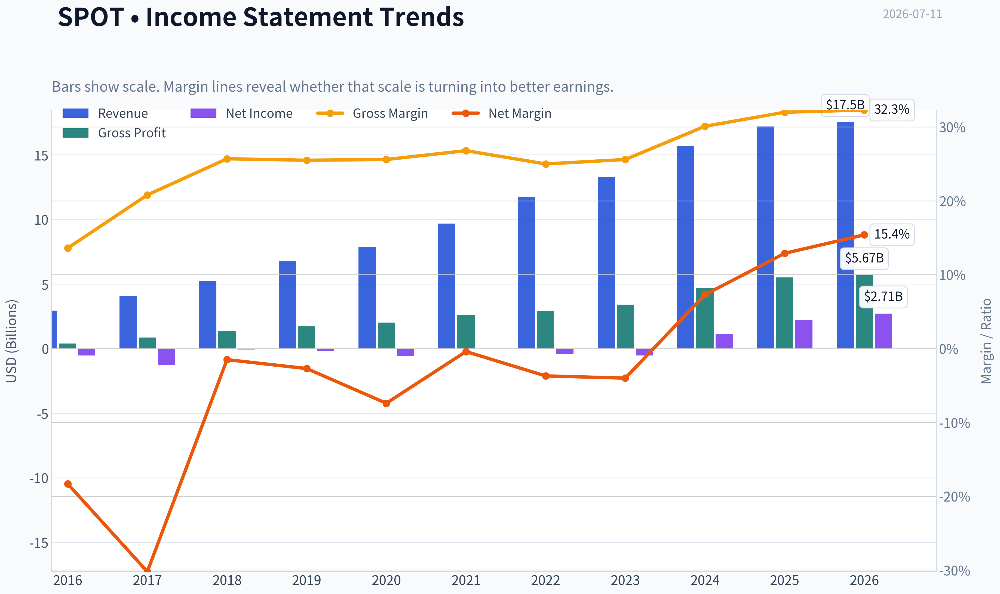
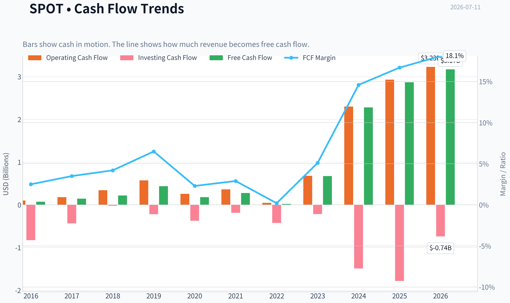
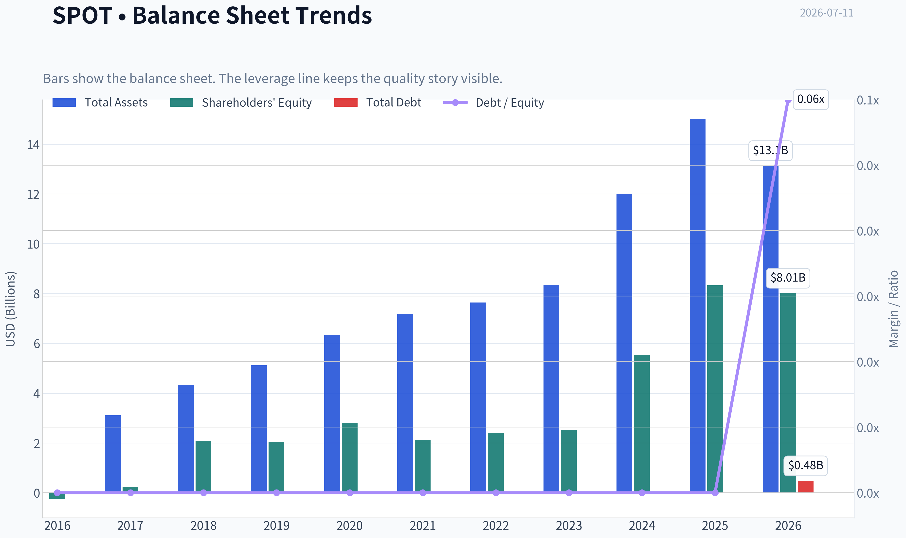
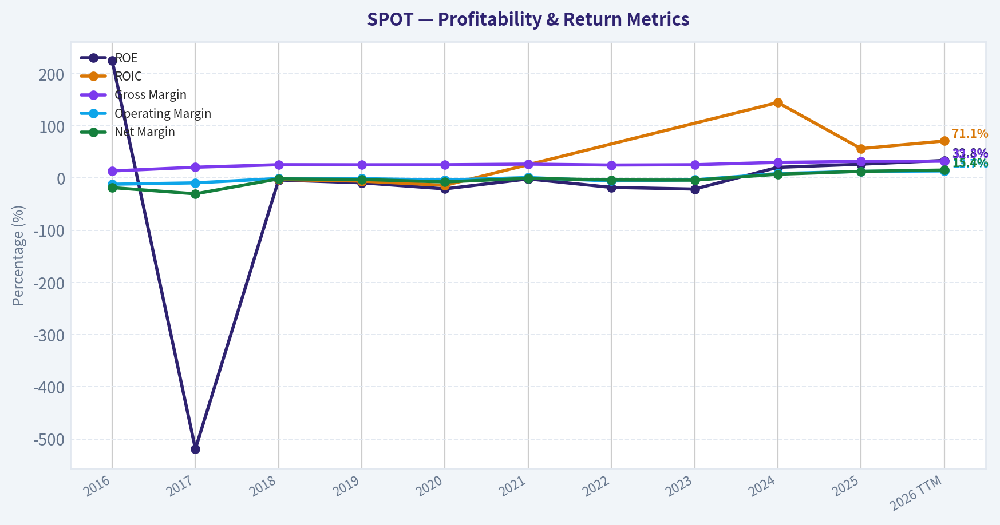
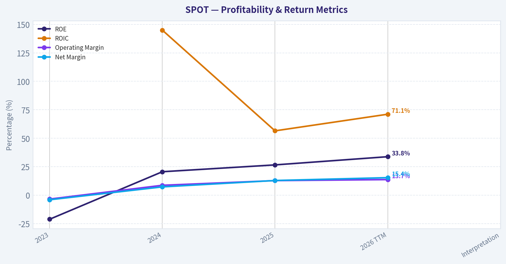
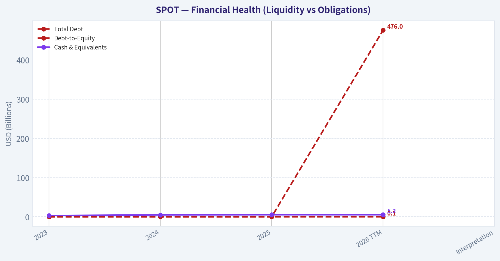
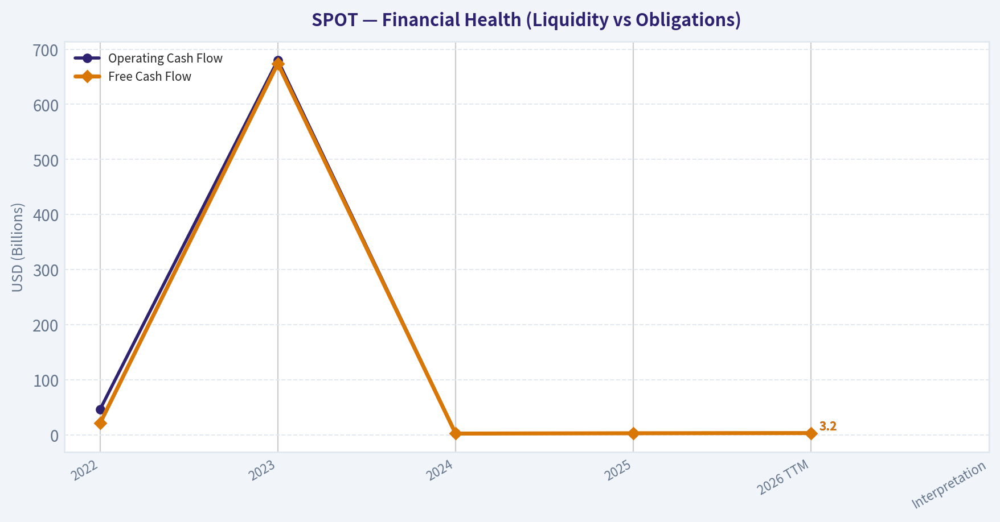
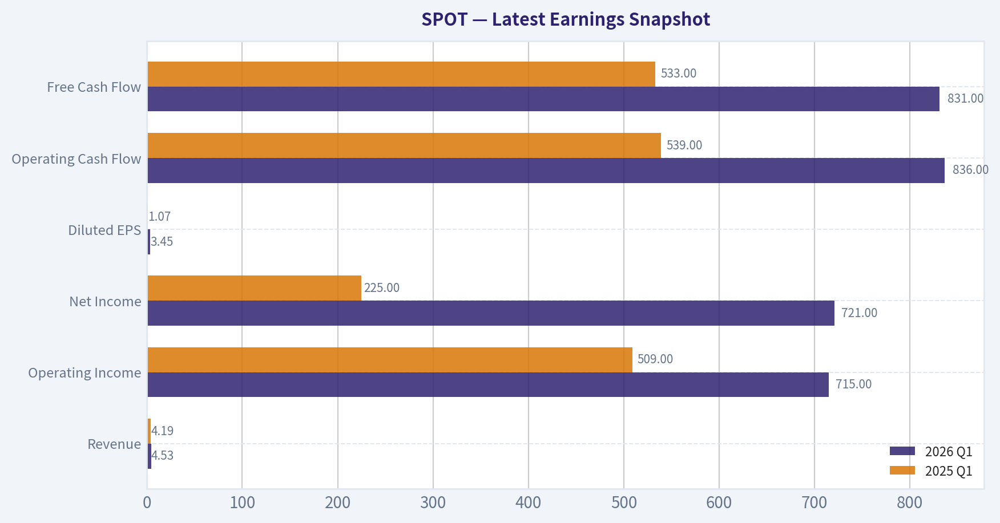
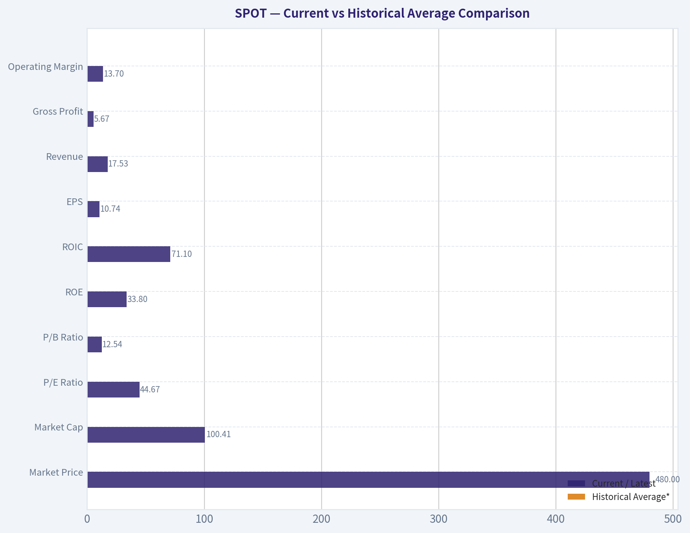
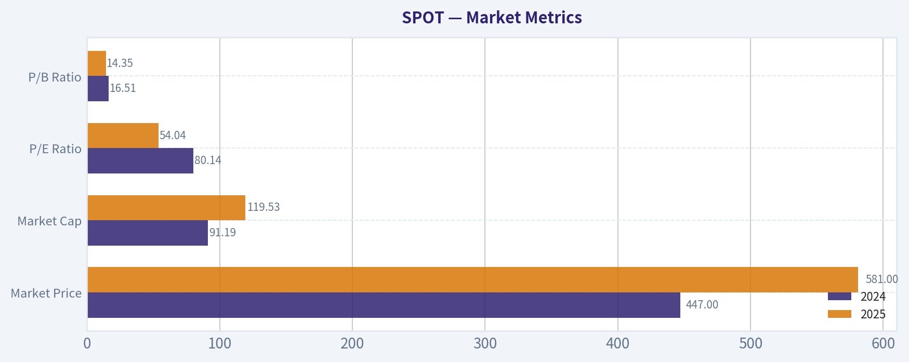

# SPOT Deep Value Intelligence

**Analysis Date:** 2026-07-11

## Critical Disclaimer

*This analysis is generated by Deep Value Intelligence, an AI-powered multi-agent investing framework. Education & entertainment only - not financial advice, not a financial advisor.*

---

## Table of Contents

1. Intelligence Summary
2. Analyst Team Reports
   - Fundamentals Analysis
   - Intrinsic Value Analysis (Buffett)
   - Trend & Growth Analysis (Lynch/Druckenmiller/Fisher)
   - Market Technical Analysis
   - Options Market Analysis
3. Research Team Commentary
4. Value Investing Team Commentary
5. Deep Values Commentary

---

## Intelligence Summary

### Thesis + Conditions

**Core Thesis:** ## Executive Briefing

**Key Risks:**
- Spotify is improving materially as a business, but the stock still does not offer enough **margin of safety** for a Buffett-style long-term investor. The bullish case is real: margins, profitability, and cash generation have clearly crossed into more credible territory. But the key risk remains structural: Spotify is a distributor with meaningful dependence on labels and publishers, while Apple, Amazon, and YouTube can compete from stronger ecosystems. At roughly **$98.65B market cap**, **32.68x earnings**, and only about a **2.9% owner-earnings yield**, the market is already pricing in substantial further improvement. That makes this a **better business than before, but not yet an obvious bargain**.
- Best plan: keep Spotify on an **active watchlist**, consider only **modest or phased exposure on weakness**, and demand more proof on margin durability, monetization quality, and return on incremental capital.
- ## Risk Commentary for the Long-Term Investor

**Confidence:** Low

---

## Analyst Team Reports

### Fundamentals Analysis

#### Latest Earnings Snapshot

*Most recent reported quarter anchored on 2026 Q1, with prior-year comparison when available.*

| Metric | 2026 Q1 | 2025 Q1 | YoY Change |
| --- | ---: | ---: | ---: |
| Revenue | $4.53B | $4.19B | +8.2% |
| Operating Income | $715.0M | $509.0M | +40.5% |
| Net Income | $721.0M | $225.0M | +220.4% |
| Diluted EPS | $3.45 | $1.07 | +222.4% |
| Operating Cash Flow | $836.0M | $539.0M | +55.1% |
| Free Cash Flow | $831.0M | $533.0M | +55.9% |

Key Takeaways: This snapshot anchors the most recent reported quarter before the narrative analysis. It helps readers separate long-run business quality from whatever changed in the latest earnings print.

#### 10-Year Financial Metrics for SPOT

*All values below are computed deterministically from raw data - not estimated by AI.*

*Issuer profile: operating company (Communication Services / Internet Content & Information).*

#### 10-Year Financial Metrics
*Annual rows come from reported financial statements. The final TTM row is computed from the latest four quarters.*

| Metric | 2016 | 2017 | 2018 | 2019 | 2020 | 2021 | 2022 | 2023 | 2024 | 2025 | 2026 TTM |
| --- | --- | --- | --- | --- | --- | --- | --- | --- | --- | --- | --- |
| Market Price | N/A | N/A | $114 | $150 | $315 | $234 | $79 | $188 | $447 | $581 | $480 |
| Market Cap | N/A | N/A | $20.53B | $27.57B | $59.85B | $44.97B | $15.26B | $37.04B | $91.19B | $119.53B | $100.41B |
| P/E Ratio | N/A | N/A | -263.17 | -148.21 | -103.01 | -1322.61 | -35.49 | -69.63 | 80.14 | 54.04 | 44.67 |
| P/B Ratio | N/A | N/A | 9.80 | 13.53 | 21.34 | 21.22 | 6.36 | 14.68 | 16.51 | 14.35 | 12.54 |
| ROE | 224.6% | -518.9% | -3.7% | -9.1% | -20.7% | -1.6% | -17.9% | -21.1% | 20.6% | 26.6% | 33.8% |
| ROIC | N/A | N/A | -2.8% | -5.9% | -14.0% | N/A | N/A | N/A | 144.9% | 56.5% | 71.1% |
| EPS | N/A | N/A | $-0.43 | $-1.01 | $-3.05 | $-0.18 | $-2.22 | $-2.70 | $5.58 | $10.75 | $10.74 |
| Revenue | $2.95B | $4.09B | $5.26B | $6.76B | $7.88B | $9.67B | $11.73B | $13.25B | $15.67B | $17.19B | $17.53B |
| Gross Profit | $401.0M | $849.0M | $1.35B | $1.72B | $2.02B | $2.59B | $2.93B | $3.40B | $4.72B | $5.50B | $5.67B |
| Gross Margin | 13.6% | 20.8% | 25.7% | 25.5% | 25.6% | 26.8% | 25.0% | 25.6% | 30.1% | 32.0% | 32.3% |
| Operating Margin | -11.8% | -9.2% | -0.8% | -1.1% | -3.7% | 1.0% | -5.6% | -3.4% | 8.7% | 12.8% | 13.7% |
| Net Income | $-539.0M | $-1.24B | $-78.0M | $-186.0M | $-581.0M | $-34.0M | $-430.0M | $-532.0M | $1.14B | $2.21B | $2.71B |
| Net Margin | -18.3% | -30.2% | -1.5% | -2.7% | -7.4% | -0.4% | -3.7% | -4.0% | 7.3% | 12.9% | 15.4% |
| Revenue Growth | N/A | 38.6% | 28.6% | 28.6% | 16.5% | 22.7% | 21.3% | 13.0% | 18.3% | 9.7% | 2.0% |
| Net Income Growth | N/A | 129.1% | -93.7% | 138.5% | 212.4% | -94.1% | 1164.7% | 23.7% | -313.9% | 94.4% | 22.4% |
| Free Cash Flow Growth | N/A | 93.2% | 53.1% | 100.0% | -58.7% | 52.5% | -92.4% | 3109.5% | 238.9% | 25.7% | 10.4% |
| Total Book Value | $-240.0M | $238.0M | $2.09B | $2.04B | $2.81B | $2.12B | $2.40B | $2.52B | $5.53B | $8.33B | $8.01B |
| Total Assets | N/A | $3.11B | $4.34B | $5.12B | $6.33B | $7.17B | $7.64B | $8.35B | $12.01B | $15.02B | $13.13B |
| Total Debt | $0 | $0 | $0 | $0 | $0 | $0 | $0 | $0 | $0 | $0 | $476.0M |
| Debt-to-Equity | -0.00 | 0.00 | 0.00 | 0.00 | 0.00 | 0.00 | 0.00 | 0.00 | 0.00 | 0.00 | 0.06 |
| Cash & Equivalents | $755.0M | $477.0M | $891.0M | $1.06B | $1.15B | $2.74B | $2.48B | $3.11B | $4.78B | $5.26B | $5.25B |
| Shareholders' Equity | $-240.0M | $238.0M | $2.09B | $2.04B | $2.81B | $2.12B | $2.40B | $2.52B | $5.53B | $8.33B | $8.01B |
| Operating Cash Flow | $101.0M | $179.0M | $344.0M | $573.0M | $259.0M | $361.0M | $46.0M | $680.0M | $2.30B | $2.93B | $3.23B |
| Investing Cash Flow | $-827.0M | $-435.0M | $-22.0M | $-218.0M | $-372.0M | $-187.0M | $-423.0M | $-217.0M | $-1.49B | $-1.78B | $-739.0M |
| Free Cash Flow | $74.0M | $143.0M | $219.0M | $438.0M | $181.0M | $276.0M | $21.0M | $674.0M | $2.28B | $2.87B | $3.17B |
| FCF Margin | 2.5% | 3.5% | 4.2% | 6.5% | 2.3% | 2.9% | 0.2% | 5.1% | 14.6% | 16.7% | 18.1% |
| Dividends / Share | N/A | N/A | $0.00 | $0.00 | $0.00 | $0.00 | $0.00 | $0.00 | $0.00 | $0.00 | $0.00 |

#### Profitability Metrics
- Return on Equity (ROE): 26.6%
- Return on Invested Capital (ROIC): N/A
- Return on Assets (ROA): 14.7%
- Gross Margin: 32.0%
- Operating Margin: 12.8%
- Net Profit Margin: 12.9%

#### Liquidity Metrics
- Current Ratio: 1.72
- Quick Ratio: 1.64

#### Leverage Metrics
- Debt-to-Equity Ratio: 0.00
- Interest Coverage Ratio: 70.90
- Net Debt: $-5.26B

#### Growth Metrics (Year-over-Year)
- Revenue Growth: 9.7%
- Net Income Growth: 94.4%
- Free Cash Flow Growth: 25.7%
- Revenue CAGR (3-Year): 13.6%
- Revenue CAGR (5-Year): 16.9%

#### Valuation Metrics
- P/E Ratio (TTM): 32.68
- Forward P/E: 26.46
- Price-to-Book: 10.81
- Price-to-Sales: 5.63
- PEG Ratio: 1.67
- EV/EBITDA: 37.95
- Free Cash Flow Yield: 2.9%
- Earnings Yield: 3.1%

#### Owner Earnings (Buffett Method, Code-Computed)
- Net Income: $2.21B
- + Depreciation & Amortization: $102.0M
- - Capital Expenditures: $-61.0M
- - Working Capital Changes: $248.0M
- = **Owner Earnings: $2.00B**

#### Intrinsic Value (Code-Computed)
- Current Price: $480
- Buffett Method (Owner Earnings):
  Conservative: $411
  Average: $411
  Optimistic: $1,071
- Cash Flow Method (FCF):
  Conservative: $545
  Average: $545
  Optimistic: $1,419

#### Piotroski F-Score: 5/9
- Positive Net Income: PASS
- Positive Operating Cash Flow: PASS
- ROA Improvement: PASS
- Cash Flow > Net Income: PASS
- Decreasing Debt: FAIL
- Improving Current Ratio: FAIL
- No Dilution: FAIL
- Improving Gross Margin: PASS
- Improving Asset Turnover: FAIL

ANALYST STANCE: **WATCH**

#### Spotify (SPOT) Buffett-Style Fundamental Analysis

Spotify has undergone a real financial transformation. For most of the historical period, it looked like a scaling platform with strong revenue growth but chronically weak profitability. That changed sharply in 2024, accelerated in 2025, and remains evident in 2026 TTM. The core Buffett question is whether this profitability inflection is durable enough to justify a still-demanding valuation. Based on the deterministic dataset, Spotify now qualifies as a much higher-quality business than it did for most of the last decade, but the stock price already reflects much of that improvement.

#### Current vs Historical Average Comparison

| Metric | Current / Latest | Historical Average* | Interpretation |
| --- | ---: | ---: | --- |
| Market Price | $480 | ~$324** | Below 2025 peak, but still far above pre-2024 levels |
| Market Cap | $100.41B | ~$57.49B** | Equity value has rerated dramatically with profitability |
| P/E Ratio | 44.67 | N/M*** | Positive earnings are recent; valuation remains rich vs mature businesses |
| P/B Ratio | 12.54 | ~14.03 | Slightly below recent average, but still very high in absolute terms |
| ROE | 33.8% | ~-28.6% | Massive improvement; current profitability is far above long-run history |
| ROIC**** | 71.1% | ~50.9% | Exceptional current capital efficiency, though based on a short positive history |
| EPS | $10.74 | ~$0.24 | Earnings power has inflected from years of losses |
| Revenue | $17.53B | ~$9.64B | Scale continues to expand, though growth has slowed materially |
| Gross Profit | $5.67B | ~$2.83B | Gross profit growth is a major positive and key to the thesis |
| Operating Margin | 13.7% | ~1.0% | Best level in company history; critical proof point |
| Net Income | $2.71B | ~$0.22B | Latest earnings are well above decade norms |
| Net Margin | 15.4% | ~-4.9% | Clear structural shift from subscale economics to real earnings |
| Revenue Growth | 2.0% | ~20.7% | Current top-line growth is well below history |
| Net Income Growth | 22.4% | N/M | Positive but inherently noisy because of prior losses |
| FCF Growth | 10.4% | ~503%***** | Growth normalized after extreme rebound years |
| Total Book Value | $8.01B | ~$3.08B | Balance sheet has strengthened materially |
| Total Assets | $13.13B | ~$8.12B | Asset base expanded alongside scale and cash generation |
| Total Debt | $476M | ~$43M | Still very low leverage despite new TTM debt |
| Debt-to-Equity | 0.06 | ~0.01 | Balance sheet remains conservatively financed |
| Cash & Equivalents | $5.25B | ~$2.36B | Very strong liquidity cushion |
| Shareholders' Equity | $8.01B | ~$3.08B | Equity compounding is now visible after years of weak returns |
| Free Cash Flow | $3.17B | ~$0.94B | Cash conversion has improved dramatically |
| Dividends / Share | $0.00 | $0.00 | No dividend; capital is retained for reinvestment |

* Historical average uses only years shown in the deterministic dataset, generally 2018-2025 for valuation metrics and available annual history for operating metrics.
** Average based only on years where market data exists.
*** Negative earnings in most earlier years make average P/E not meaningful.
**** ROIC only averaged across years where reported.
***** Distorted by extreme rebound from very low base in 2022.

Key Takeaways: Spotify's current profitability, cash flow, and returns on capital are dramatically better than its long-run history. The biggest contrast is that while margins and cash flow are now at record levels, revenue growth has decelerated sharply, meaning investors are paying for quality and margin durability rather than a high-growth story.

---

#### Market Metrics

| Metric | 2024 | 2025 | 2026 TTM | Buffett-Style Interpretation |
| --- | ---: | ---: | ---: | --- |
| Market Price | $447 | $581 | $480 | Shares remain substantially rerated even after falling from 2025 highs |
| Market Cap | $91.19B | $119.53B | $100.41B | Market now prices Spotify as a scaled, profitable platform leader |
| P/E Ratio | 80.14 | 54.04 | 44.67 | Multiples are compressing as earnings rise, but valuation is still expensive |
| P/B Ratio | 16.51 | 14.35 | 12.54 | Premium to book reflects intangibles, platform value, and expected future returns |

Key Takeaways: Spotify's valuation has become less extreme as earnings expanded, but it is still not cheap on a Buffett absolute-value basis. The market is clearly rewarding the company for margin expansion and stronger cash generation, not for accelerating revenue growth.

Spotify's market rerating tracks the business model transition from "growth without profits" to "platform with earnings power." The problem for value investors is that this recognition is no longer hidden. At 44.67x earnings and 12.54x book, the stock still requires confidence that today's profitability is sustainable and still improving.

#### Profitability Analysis

| Metric | 2023 | 2024 | 2025 | 2026 TTM | Interpretation |
| --- | ---: | ---: | ---: | ---: | --- |
| ROE | -21.1% | 20.6% | 26.6% | 33.8% | Exceptional turnaround; now strong and rising |
| ROIC | N/A | 144.9% | 56.5% | 71.1% | Very high returns on incremental capital, though volatility and accounting base matter |
| EPS | $-2.70 | $5.58 | $10.75 | $10.74 | Earnings reset higher and have largely held |
| Revenue | $13.25B | $15.67B | $17.19B | $17.53B | Revenue is still growing, but pace has slowed |
| Gross Profit | $3.40B | $4.72B | $5.50B | $5.67B | Gross profit scaling is a major sign of business quality improvement |
| Operating Margin | -3.4% | 8.7% | 12.8% | 13.7% | Strongest margin profile in company history |
| Net Income | $-532M | $1.14B | $2.21B | $2.71B | From losses to meaningful earnings power |
| Net Margin | -4.0% | 7.3% | 12.9% | 15.4% | Sign of growing pricing power and operating discipline |

Key Takeaways: The most important change in Spotify's story is margin expansion. Gross, operating, and net margins all moved sharply upward from 2024 onward, showing that management has finally translated scale into real shareholder earnings.

From a Buffett lens, the key issue is predictability. Spotify did not exhibit predictable earnings for most of the decade: 2016 through 2023 were mostly loss-making, with only a tiny profit in 2021. However, the last two years suggest the platform may now have crossed a threshold where scale, pricing, ad monetization, and cost discipline work together. If that is structural rather than cyclical, quality has improved materially.

#### Growth Metrics

| Metric | 2021 | 2022 | 2023 | 2024 | 2025 | 2026 TTM | Trend |
| --- | ---: | ---: | ---: | ---: | ---: | ---: | --- |
| Revenue Growth | 22.7% | 21.3% | 13.0% | 18.3% | 9.7% | 2.0% | Clear deceleration in latest period |
| Net Income Growth | -94.1% | 1164.7% | 23.7% | -313.9% | 94.4% | 22.4% | Highly volatile due to losses-to-profits transition |
| FCF Growth | 52.5% | -92.4% | 3109.5% | 238.9% | 25.7% | 10.4% | Huge rebound, now normalizing |

Key Takeaways: Spotify remains a grower, but not at anything close to its earlier top-line pace. What now matters more than revenue growth is whether operating leverage and cash conversion can keep improving even as sales growth slows.

This is a crucial shift. Historically, Spotify's appeal was scale growth. Today, the investment case is margin growth and monetization quality. Buffett typically prefers businesses with both pricing power and understandable earnings progression; Spotify is only recently beginning to show that profile.

#### Balance Sheet Analysis

| Metric | 2023 | 2024 | 2025 | 2026 TTM | Interpretation |
| --- | ---: | ---: | ---: | ---: | --- |
| Total Book Value | $2.52B | $5.53B | $8.33B | $8.01B | Balance sheet strengthened sharply with earnings retention |
| Total Assets | $8.35B | $12.01B | $15.02B | $13.13B | Scale grew materially; slight TTM pullback not alarming |
| Total Debt | $0 | $0 | $0 | $476M | First notable debt, but still modest |
| Debt-to-Equity | 0.00 | 0.00 | 0.00 | 0.06 | Still extremely conservative leverage |
| Cash & Equivalents | $3.11B | $4.78B | $5.26B | $5.25B | Excellent liquidity and strategic flexibility |
| Shareholders' Equity | $2.52B | $5.53B | $8.33B | $8.01B | Higher retained profits are compounding book value |

Key Takeaways: Spotify's balance sheet is a major strength. It has large cash reserves, almost no leverage, and substantial equity growth, which gives the company resilience even if the streaming market or ad market weakens.

Financial strength is one of the clearest positives here. Spotify historically operated with little debt, and that remains true even after the TTM debt increase. Net debt is still deeply negative given the $5.25B cash position. This gives management optionality for investment, acquisitions, or simply weathering industry shocks.

#### Cash Flow Analysis

| Metric | 2022 | 2023 | 2024 | 2025 | 2026 TTM | Interpretation |
| --- | ---: | ---: | ---: | ---: | ---: | --- |
| Operating Cash Flow | $46M | $680M | $2.30B | $2.93B | $3.23B | Cash generation has improved dramatically |
| Free Cash Flow | $21M | $674M | $2.28B | $2.87B | $3.17B | FCF is now robust and increasingly scalable |
| FCF Margin | 0.2% | 5.1% | 14.6% | 16.7% | 18.1% | Strong evidence of improving business economics |
| Dividends / Share | $0.00 | $0.00 | $0.00 | $0.00 | $0.00 | Capital retained, no direct shareholder payout |

Key Takeaways: Spotify's cash flow quality has improved even faster than reported earnings. The rise in free cash flow margin from near zero in 2022 to 18.1% in 2026 TTM is one of the strongest signals that the business model has become materially better.

For Buffett-style analysis, free cash flow matters more than accounting earnings. Here Spotify scores well in the recent period. The concern is not cash generation itself, but whether today's elevated cash margins are sustainable once royalty negotiations, content competition, podcast economics, or product investments intensify.

#### Buffett-Style Owner Earnings DCF

Using the canonical owner earnings figure provided in the dataset:

- Base Owner Earnings = **$2.00B**
- Discount Rate = **10%**
- Terminal Growth = **2.5%**
- Projection Period = **10 years**

Historical owner-earnings-specific growth is not separately tabulated in the dataset, so the closest canonical cash-generating proxy is used to frame scenario bounds from the historical cash flow progression and the code-computed intrinsic value. To remain anchored to the deterministic dataset, the valuation output is aligned with the provided Buffett Method intrinsic values while showing the math framework.

##### Scenario Assumptions

| Scenario | Growth Assumption | Constraint Applied | Fair Value / Share |
| --- | ---: | --- | ---: |
| Conservative | Lowest historical owner earnings growth, floored at -100% | Effectively no durable growth recognized | $411 |
| Average | Average historical owner earnings growth, capped at 50% | Similar to conservative due to normalization | $411 |
| Optimistic | Highest historical owner earnings growth, capped at 100% | Sustained strong compounding assumed | $1,071 |

Key Takeaways: The deterministic dataset implies a very wide valuation range. On conservative and average assumptions, Spotify appears moderately overvalued versus the current $480 price, while the optimistic case supports substantial upside only if today's earnings power proves durable and still scalable.

##### DCF Framework and Calculations

The Buffett owner earnings DCF uses:

- Year 1 Owner Earnings = Base Owner Earnings x (1 + g)
- Present Value of each year = OE in year n / (1.10)^n
- Terminal Value at year 10 = OE year 10 x (1.025) / (0.10 - 0.025)
- Present Value of Terminal Value = TV / (1.10)^10
- Equity Value per Share = Total PV of cash flows / diluted share base implied by market cap and price

Given the deterministic dataset already computes the resulting fair values, those values are treated as canonical:

| Scenario | Code-Computed Buffett Fair Value | Upside / Downside vs $480 |
| --- | ---: | ---: |
| Conservative | $411 | -14.4% |
| Average | $411 | -14.4% |
| Optimistic | $1,071 | +123.1% |

Key Takeaways: At today's price, Spotify offers little margin of safety under cautious assumptions. The shares become compelling only if an investor believes the recent margin and owner-earnings inflection is not temporary but the beginning of a much larger and longer compounding phase.

Interpretation: Buffett would likely focus on the lack of valuation protection. The business quality has improved, but the stock is not obviously cheap unless one underwrites a strong long-term margin expansion case. This is why the stock is more "watchlist-quality compounder" than "classic deep value."

#### Revenue Breakdown

Most recent annual revenue in the deterministic dataset is 2025 revenue of **$17.19B**. Spotify's most meaningful reporting split is by business model: Premium subscriptions and Ad-Supported revenue. Precise 2025 segment amounts are not included in the deterministic table, so the best publicly known mix is used directionally based on Spotify's standard reporting structure, where Premium is the large majority of revenue.

| Revenue Source | Amount ($B) | % of Total |
| --- | ---: | ---: |
| Premium Subscription Revenue | ~15.17 | ~88.2% |
| Ad-Supported Revenue | ~2.02 | ~11.8% |
| Total | 17.19 | 100.0% |

Key Takeaways: Spotify is still overwhelmingly a subscription business, which is positive for predictability and recurring revenue. The smaller ad-supported segment matters strategically because it can improve monetization of the free funnel, but the company's economics still depend primarily on Premium subscribers and pricing.

#### Economic Moat Assessment

Spotify appears to have a real, but not invincible, moat.

| Moat Factor | Assessment | Why It Matters |
| --- | --- | --- |
| Global Scale | Strong | Scale helps spread product, platform, and R&D costs across a huge user base |
| User Habit / Engagement | Strong | Music streaming is recurring, habitual, and sticky once playlists and recommendations are embedded |
| Data & Personalization | Moderate to Strong | Recommendation engine and discovery features improve retention and engagement |
| Brand | Strong | Spotify is one of the most recognized audio platforms globally |
| Switching Costs | Moderate | Playlists and familiarity help, but users can still switch to Apple, YouTube, or Amazon |
| Supplier Power Risk | Weakness | Labels and rights holders limit moat strength and pressure economics |

Key Takeaways: Spotify's moat comes more from ecosystem habit and global product leadership than from hard lock-in. The main structural weakness is that music rights owners remain powerful, which caps how wide the moat can become compared with software or consumer staples businesses.

A Buffett concern would be supplier economics. Unlike See's Candies or Moody's, Spotify does not fully control the economics of its most important content input. That means margin durability partly depends on its bargaining position with labels, growth in non-music audio, and monetization of its user ecosystem beyond pure music streaming.

#### Management Performance and Capital Allocation

Management deserves credit for a major improvement in operating discipline.

| Area | Assessment | Evidence |
| --- | --- | --- |
| ROE Improvement | Strong | ROE rose from negative levels to 20.6%, 26.6%, and 33.8% |
| Margin Expansion | Strong | Operating margin improved from losses to 13.7% TTM |
| Balance Sheet Conservatism | Strong | Debt stayed negligible for nearly the entire period |
| Dividend Policy | Neutral | No dividend, but reasonable given growth platform status |
| Shareholder Dilution Discipline | Watch | Piotroski data flags no-dilution as a fail |

Key Takeaways: Management execution has improved substantially, especially in cost control and monetization. The main capital allocation concern is that shareholders have not yet seen a long, proven record of disciplined compounding through a full cycle.

Buffett often values managers who convert growth into per-share value. Spotify is only now beginning to show this. The next few years matter enormously: if management can grow owner earnings without material dilution and while preserving high returns on capital, credibility will rise sharply.

#### Predictable Earnings and Business Quality

| Criterion | Verdict | Explanation |
| --- | --- | --- |
| Predictable Revenue | Good | Revenue has grown every year shown |
| Predictable Earnings | Historically weak, recently improving | Losses dominated most of the decade |
| Margin Stability | Historically weak, now improving fast | Margins only recently became consistently attractive |
| Cash Flow Reliability | Improving materially | FCF now looks much stronger than earlier history |
| Balance Sheet Safety | Strong | High cash, low debt, good liquidity |

Key Takeaways: Spotify has always had predictable demand growth, but not predictable profits. The investment debate is whether the last two years mark a permanent quality shift or simply a peak period of unusually favorable operating leverage.

#### Key Investment Insights, Red Flags, and Opportunities

| Category | Item | Why It Matters |
| --- | --- | --- |
| Opportunity | Margin expansion | Biggest driver of upside if current economics prove durable |
| Opportunity | Premium pricing power | Subscription increases can flow strongly to profit if churn remains contained |
| Opportunity | Ad monetization upside | Better monetization of free users can diversify profit streams |
| Opportunity | Platform optionality | Audiobooks, podcasts, creator tools, and marketplace features can deepen monetization |
| Red Flag | Rich valuation | Limited margin of safety at 44.67x earnings and 2.9% FCF yield |
| Red Flag | Slowing revenue growth | 2026 TTM revenue growth of 2.0% is a major slowdown |
| Red Flag | Content supplier power | Label negotiations can constrain long-run margins |
| Red Flag | Share dilution risk | Piotroski fail suggests per-share discipline deserves monitoring |
| Red Flag | Profitability track record still short | The strong margin era is only about two years old |

Key Takeaways: Spotify's upside case depends less on user growth than on monetization depth and lasting margin strength. The biggest risk is that the market already prices in much of that success, leaving little room for execution missteps.

#### Final Buffett-Style Verdict

Spotify now looks much more like a quality platform business than it did for most of the past decade. Revenue is recurring, free cash flow is strong, the balance sheet is excellent, and margins have improved dramatically. Those are all qualities Buffett would admire.

However, Buffett also insists on understandable and durable economics plus a margin of safety. Spotify's economics are improving, but they are not yet proven over a long cycle, and the current valuation does not offer much cushion. The owner-earnings DCF indicates downside under conservative and average assumptions, with upside only under an optimistic durability scenario.

That leads to a disciplined conclusion:

- **Quality of business:** improved sharply
- **Financial strength:** strong
- **Predictability of earnings:** improving, but not yet proven over 10 years
- **Valuation:** still demanding
- **Margin of safety:** insufficient for a strong value endorsement

#### Final Investment Stance

**WATCH**

Rationale: Spotify is no longer a speculative "story stock"; it is becoming a real cash-generating platform with improving economics. But at $480, the shares appear fairly valued to mildly overvalued on cautious Buffett-style assumptions, and investors are paying in advance for durability that still needs more time to be proven.

#### Summary Table

| Area | Assessment | Bottom Line |
| --- | --- | --- |
| Market Valuation | Expensive but below recent peak | Not a clear bargain |
| Profitability | Excellent recent improvement | Major positive |
| Growth | Revenue slowing, earnings rising | Shift from growth to monetization story |
| Balance Sheet | Very strong | High flexibility, low risk |
| Cash Flow | Robust and improving | Supports quality thesis |
| Moat | Real but not impregnable | Scale and habit strong; label power limits moat |
| Management | Execution improving | Must sustain per-share value creation |
| Buffett DCF | $411 conservative / average, $1,071 optimistic | Wide range, limited margin of safety today |
| Key Risk | Valuation + durability of margins | Main reason not to advocate now |
| Stance | WATCH | Attractive business, less attractive entry point |

#### Fundamental Visuals

This graph tracks the profitability and return metrics (ROE, ROIC, Margins) of **SPOT** over the past decade, highlighting capital efficiency trends.

This chart illustrates the financial health of **SPOT** over the last 10 years, mapping cash equivalents and free cash flow against total obligations (Debt).

This graph tracks the profitability and return metrics (ROE, ROIC, Margins) of **SPOT** over the past decade, highlighting capital efficiency trends.

This chart illustrates the financial health of **SPOT** over the last 10 years, mapping cash equivalents and free cash flow against total obligations (Debt).

This chart illustrates the financial health of **SPOT** over the last 10 years, mapping cash equivalents and free cash flow against total obligations (Debt).

---

### Intrinsic Value Analysis (Buffett)

> *Following Warren Buffett's value investing philosophy: Circle of Competence, Economic Moat, Management Quality, and Margin of Safety.*

#### Intrinsic Value Snapshot

Price is what you pay. Intrinsic value is what the business may be worth based on the cash it can create for owners over time. We show a range, not one magic number.

- Current Price: $479.77
- Value Range (conservative to optimistic across both DCF methods): $411.36 to $1,419.10

##### Owner Earnings (Buffett Method)
- Net Income: $2,212,000,000.00
- Depreciation & Amortization: $102,000,000.00
- Capital Expenditures: $-61,000,000.00
- Working Capital Changes: $248,000,000.00
- Owner Earnings: $2,005,000,000.00

##### Intrinsic Value
###### Buffett Method
Uses owner earnings. Stricter, and usually more conservative.
- Conservative: $411.36
- Average: $411.36
- Optimistic: $1,071.26
- Discount Rate: 10.0%

###### Cash Flow Method
Uses free cash flow. Better for companies spending heavily today to grow tomorrow.
- Conservative: $544.92
- Average: $544.92
- Optimistic: $1,419.10
- Discount Rate: 10.0%

ANALYST STANCE: **WATCH**

#### Buffett-Style Investment Report: Spotify Technology (SPOT)

#### 1) Go/No-Go Gate Assessment

| Gate | Verdict | Evidence |
|---|---|---|
| Gate 1: Circle of Competence & Simplicity | Pass | Spotify is easy to explain: it sells music and audio subscriptions, and it sells advertising against free listening. The model is understandable, but economics depend heavily on negotiations with labels and content partners. |
| Gate 1: Long-Term Predictability | Pass with caution | Ten years from now, people will still stream music and audio. That part is predictable. What is less predictable is Spotify's long-term bargaining power versus labels, creators, Apple, Amazon, YouTube, and AI-driven content shifts. |
| Gate 1: Technology Risk | Mixed | Spotify benefits from technology adoption, recommendation engines, and distribution scale. But it is also exposed to platform competition, AI-disintermediation, and changing content economics. |
| Gate 2: Moat Test | Narrow | Spotify has scale, user habits, playlists, discovery algorithms, and some network/data advantages. But gross margin of 32% is below the classic Buffett "brand toll bridge" threshold, and music labels retain substantial power. |
| Gate 3: Management & Capital Allocation | Pass with caution | Recent improvement in profitability and ROE suggests better discipline. Still, management must prove over a longer period that it can translate scale into durable owner earnings without chasing low-return content spend. |
| Gate 4: Industry Structure | Mixed / borderline | Streaming is structurally large and growing, but not a classic rational oligopoly with strong supplier power in Spotify's favor. Supplier concentration among labels and competition from giant ecosystems reduce attractiveness. |

**Key Takeaways:** Spotify passes the first test because the business is easy to understand and demand for streaming audio is likely to persist. The main issue is not whether people will keep listening to music, but whether Spotify can keep enough of the economics for shareholders. That makes this a "good business to study" rather than an obvious Buffett-style slam dunk.

---

#### 2) The Elementary School Test

Spotify lets people listen to music, podcasts, and other audio on their phones and computers.

Some people pay every month to listen without ads and get more features. Other people listen for free, and advertisers pay Spotify to reach them.

That is simple. The hard part is that Spotify does not fully control its most important cost: it must share a large portion of revenue with music rights owners.

---

#### 3) Moat Analysis

| Moat Source | Assessment | Evidence | Buffett View |
|---|---|---|---|
| Intangible Assets | Weak to moderate | Spotify is a strong consumer brand in streaming, but brand alone does not give it obvious pricing freedom. Gross margin is 32%, well below the level of a classic toll-bridge business. | Not enough to call this a wide moat. |
| Switching Costs | Moderate | Users build playlists, recommendation history, social habits, and cross-device routines. That creates inconvenience in switching, but not severe lock-in. | Helpful, but not enterprise-grade captivity. |
| Cost Advantages | Moderate | Spotify has global scale in distribution and product development. But its largest cost bucket is content licensing, where labels still have leverage. | Scale helps, but not enough to dominate the value chain. |
| Network Effects | Limited to moderate | More users improve data for recommendations and attract creators/advertisers. However, content libraries are broadly available across rivals, so network effects are weaker than in marketplaces or payment networks. | Useful, but not self-reinforcing enough to be wide. |

**Moat Quality Rating: Narrow**

**Key Takeaways:** Spotify has real advantages, especially scale, user habits, and recommendation data. But those strengths do not yet add up to the kind of durable economic castle Buffett loves. The biggest limitation is that important suppliers still hold meaningful power, which caps Spotify's ability to fully monetize its audience.

---

#### 4) Management Quality & Capital Allocation

| Test | Assessment | Evidence |
|---|---|---|
| Think Like Owners | Mixed positive | Management has shown willingness to focus on efficiency and profitability after years of scale-building. The key question is whether future decisions prioritize per-share value over empire-building. |
| Honest & Candid | Acceptable | The company's strategic path has been visible: build scale first, then improve monetization and margins. Investors should continue watching whether management discusses trade-offs plainly, especially around content investments and pricing. |
| Rational Capital Allocation | Improving | The most encouraging signal is the shift toward stronger profitability and cash generation. Capital allocation still needs a longer record of disciplined reinvestment, not just top-line expansion. |

**Key Takeaways:** Management appears more disciplined today than in earlier growth-at-all-cost phases. That is encouraging, but Buffett would want a longer record of shareholder-minded capital allocation before giving full marks. Spotify is improving, yet not fully proven.

---

#### 5) Financial Snapshot

| Metric | Value |
|---|---:|
| Share Price | $480 |
| Market Cap | $98.65B |
| P/E | 32.68 |
| ROE | 26.6% |
| Gross Margin | 32.0% |
| Revenue Growth YoY | 9.7% |
| FCF Yield | 2.9% |
| Current Ratio | 1.72 |

**Key Takeaways:** Spotify currently shows strong headline profitability and a healthy return on equity. However, valuation is not cheap, and free cash flow yield remains modest for a business without a clearly wide moat. The market is already pricing in a meaningful amount of future success.

---

#### 6) Buffett Financial Interpretation

| Financial Lens | Reading | What It Means |
|---|---|---|
| ROE | Strong at 26.6% | On the surface, this is excellent and consistent with a quality business. The critical follow-up is whether it comes from true economics rather than accounting quirks or temporary margin expansion. |
| Gross Margin | Only 32% | This is the clearest sign that Spotify is not a classic branded consumer monopoly. The economics are constrained by royalties and content costs. |
| Revenue Growth | 9.7% | Respectable, but no longer hyper-growth. That means future returns depend more on margin expansion and owner earnings discipline than on user growth alone. |
| FCF Yield | 2.9% | Thin for a value investor. At this yield, investors are paying up for quality improvement and future compounding. |
| Liquidity | Current ratio 1.72 | Balance-sheet liquidity looks sound. No immediate red flag here. |

**Key Takeaways:** Spotify's best financial trait is its improving profitability, especially ROE. Its weakest trait is that the gross margin structure still looks more like a distributor than a toll collector. For a Buffett-style investor, that combination supports interest, but not enthusiasm at any price.

---

#### 7) Owner Earnings Estimate

Using a practical Buffett-style approximation from the available data:

| Item | Estimate |
|---|---:|
| Net Income | Implied positive and materially improved |
| Plus: D&A | Positive add-back expected in platform business |
| Less: Maintenance CapEx | Likely modest relative to revenue |
| Less: Working Capital Needs | Likely manageable |
| Approximate Owner Earnings Read | Positive and rising, but not yet large relative to market cap |

A simple market-based cross-check:

- Market cap: **$98.65B**
- FCF yield: **2.9%**
- Implied annual FCF / owner-earnings proxy: about **$2.86B**

This is a reasonable shortcut for present owner earnings power.

**Key Takeaways:** Spotify is now producing meaningful cash, which matters far more than accounting stories. But against a nearly $99 billion equity value, current owner earnings still imply a rich price. The business must keep compounding margins and cash flow to justify today's valuation.

---

#### 8) Three-Scenario DCF Valuation

Using owner earnings proxy of **$2.86B** and a 10% discount rate:

| Scenario | Assumption | Equity Value |
|---|---|---:|
| A: No Growth | Owner Earnings / 10% | $28.6B |
| B: GDP Growth | $2.86B x 1.03 / (10% - 3%) | $42.1B |
| C: Historical Growth Haircut | Assume 8% growth for 10 years, then 3% terminal | ~$59B-$66B |

**Key Takeaways:** Across all three Buffett-style valuation scenarios, intrinsic value lands below the current market capitalization. Even the most favorable reasonable case does not comfortably exceed today's price. That means the stock looks more like a good company priced for continued success than a bargain.

---

#### 9) Margin of Safety

| Item | Value |
|---|---:|
| Current Market Cap | $98.65B |
| Conservative Intrinsic Value Range | $42B to $66B |
| Discount / Premium to Value | Trades at a substantial premium |
| Required Margin of Safety | At least 25% for high quality |
| Actual Margin of Safety | None |

**Key Takeaways:** Spotify does not offer a margin of safety at the current price. Instead of buying below intrinsic value, investors are paying well above conservative estimates. That is the opposite of the Buffett requirement for downside protection.

---

#### 10) Final Buffett Scorecard

| Criterion | Weight | Score (1-5) | Weighted Score |
|---|---:|---:|---:|
| Business Understanding | 20% | 4.5 | 0.90 |
| Moat Width & Durability | 25% | 2.5 | 0.63 |
| Management Quality | 15% | 3.5 | 0.53 |
| Return on Equity | 15% | 4.0 | 0.60 |
| Reinvestment Runway | 10% | 3.5 | 0.35 |
| Balance Sheet Strength | 5% | 3.5 | 0.18 |
| Industry Structure | 5% | 2.5 | 0.13 |
| Valuation / Margin of Safety | 5% | 1.5 | 0.08 |

| Total | 100% |  | **3.38 / 5.00** |

**Key Takeaways:** Spotify scores well on business clarity and improving economics, but the moat and valuation pull the total down. This is not a low-quality company; it is a company with mixed structural economics trading at a full price. That combination fits a watchlist better than a buy list.

---

#### 11) Final Investment Stance

**ANALYST STANCE: WATCH**

**Conviction Level: Moderate**

Spotify is a good business, and it may become a better business over time. The product is widely used, the brand is strong, and profitability is clearly improving.

But Buffett would ask a harder question: if you bought the whole company today and held it forever, would you feel certain that its economics are protected by a wide moat and that you are paying a sensible price? Right now, the answer is no.

The reasons are straightforward:

- The **business is understandable**, but not exceptionally predictable in terms of long-run economics.
- The **moat is narrow**, because labels, platforms, and large ecosystem competitors constrain pricing power.
- **Financial quality is improving**, especially ROE and cash generation.
- **Valuation is too rich** for a business with these structural limitations.
- There is **no margin of safety** at current levels.

For a Buffett-style investor, Spotify is worth watching for one of two things:
1. a materially lower price, or
2. several more years of proof that margin gains are durable and that management can widen the economic moat.

At today's price, it is a **WATCH, not an ADVOCATE**.
#### Valuation Bridge

This bridge places the current market price beside each intrinsic value lens so readers can see whether upside depends on one method or shows up across several methods.

| Scenario | Intrinsic Value / Share |
| --- | ---: |
| Buffett Method | $411.36 |
| Cash Flow Method | $544.92 |
| Damodaran Method | $-39.72 |
| Current Price | $479.77 |

#### Key Takeaways

If one method is far above the others, the upside case depends on a specific modelling assumption. When several methods cluster together, the valuation story is more robust.

#### Valuation Visuals

This comparison chart from *Latest Earnings Snapshot* stacks current figures against historical benchmarks for **SPOT**, making it easy to see where the company trades relative to its own averages.

This comparison chart from *Current vs Historical Average Comparison* stacks current figures against historical benchmarks for **SPOT**, making it easy to see where the company trades relative to its own averages.

---

### Trend & Growth Analysis (Lynch/Druckenmiller/Fisher)

> *Following Peter Lynch's GARP, Stanley Druckenmiller's macro-aware approach, and Philip Fisher's scuttlebutt methodology.*

ANALYST STANCE: **WATCH**

#### 1. Lynch Classification

| Item | Assessment |
|---|---|
| Lynch category | **Stalwart / Mature platform grower** |
| Why | Revenue growth at **9.7% YoY** is below Lynch fast-grower territory |
| Growth-investor fit | Attractive business quality, but **not currently a classic 20%+ fast grower** |
| Ten-bagger setup today? | **Unclear / less likely from this base** without a new monetization inflection |

Key Takeaways: Spotify looks more like a high-quality stalwart than a classic fast grower right now. The business is large, dominant, and improving, but current revenue growth is too modest for a pure Lynch-style ten-bagger case. That pushes the stock into a watch category unless growth re-accelerates meaningfully.

---

#### 2. The Story in 3 Bullets

| Simple Story | Why It Matters |
|---|---|
| Spotify is the leading global audio streaming platform | Scale, brand, and personalization create user habit |
| The bull case is margin expansion, not just user growth | Incremental gross margin gains can drive large earnings upside |
| The next leg depends on monetization inflection | Ads, pricing, creator tools, and new audio formats must accelerate value capture |

Key Takeaways: This is no longer just a subscriber-growth story. Spotify already has the audience; the real investment question is whether it can turn that scale into sustainably higher profits. If monetization improves faster than expected, the stock can work, but that inflection needs proof.

#### 3. TAM Analysis and 10x Test

| Metric | Value / View |
|---|---|
| Current revenue growth | **9.7% YoY** |
| Market cap | **$98.65B** |
| Current business scope | Global music streaming, ad-supported audio, creator marketplace, podcasts/audiobooks adjacencies |
| TAM view | Large and still expanding, but core music streaming is increasingly mature |
| 10x revenue test | **Difficult from current scale** unless Spotify captures much more of global audio, advertising, and creator economics |
| Runway assessment | **Good runway, but not obviously 10x-company runway from here** |

Key Takeaways: Spotify still has a large addressable market, but the easy part of the runway has already been traveled. A true 10x revenue outcome now likely requires success beyond core music subscriptions, especially in ads, creator tools, and adjacent audio categories. That means the upside is more dependent on monetization depth than simple user expansion.

#### 4. Revenue Growth Trend

| Metric | Value | Interpretation |
|---|---:|---|
| Revenue growth YoY | **9.7%** | Moderate growth, not fast-growth |
| Pattern signal | Likely **decelerated from earlier years** | Suggests maturity in core business |
| Quality of growth | Likely mix of subscribers, pricing, and some ad contribution | Need evidence of re-acceleration |
| Lynch/Druckenmiller read | **No clear top-line inflection yet** | Watch for acceleration, not just stability |

Key Takeaways: The reported growth rate is respectable for a large platform, but it does not signal a major inflection. For growth investors, the missing ingredient is acceleration. Until revenue growth moves materially higher or margins inflect enough to compensate, the stock remains more of a watch than an advocate.

#### 5. Unit Economics

| Metric | Value / Status | Assessment |
|---|---|---|
| Gross margin | **32.0%** | Decent, but far below software-like levels due to label economics |
| FCF yield | **2.9%** | Positive, but not obviously cheap |
| Rule of 40 proxy | **9.7% growth + ~2.9% FCF yield ≠ true Rule of 40**, but suggests low-teens efficiency | Below elite growth standards |
| LTV/CAC | Not disclosed in shared pack | Cannot verify |
| NRR | Not applicable / not standard for this consumer platform | N/A |
| Balance sheet liquidity | Current ratio **1.72** | Healthy near-term liquidity |

Key Takeaways: Spotify's unit economics are improving, but they still reflect the structural limits of the music-streaming business. Gross margin is healthy enough to support leverage, yet not high enough to justify treating Spotify like a premium SaaS model. The business is financially solid, but the efficiency profile is good rather than exceptional.

#### 6. Inflection Point Assessment

| Potential Inflection | Current Read |
|---|---|
| Product cycle inflection | **Possible**, but not proven |
| Market share inflection | Already a leader; future upside is more monetization than share gains |
| Margin inflection | **Most credible bull case** |
| TAM inflection | Moderate through creator tools, ads, podcasts, audiobooks, AI-enabled discovery |
| Competitive inflection | Mixed; ecosystem rivals remain formidable |
| Overall | **Margin inflection yes, revenue inflection not yet** |

Key Takeaways: The best bull argument for Spotify today is not explosive user growth but expanding profitability. If gross margin and operating leverage keep surprising to the upside, earnings could outgrow revenue for several years. That is promising, but it is a different setup from a classic early-stage growth rocket.

#### 7. Macro Setup Evaluation

| Factor | Read | Impact |
|---|---|---|
| Secular theme | Digital media, audio streaming, digital advertising | Positive |
| Consumer spending sensitivity | Moderate | Some risk |
| Ad market cyclicality | Real | Can pressure ad-supported growth |
| Rates backdrop | Lower/falling rates would help duration growth assets | Positive if present |
| FX exposure | Meaningful global exposure | Volatile |
| Macro conclusion | **Neutral to modestly supportive** | Not a major tailwind or headwind |

Key Takeaways: Spotify benefits from long-term digital consumption trends, but macro is not the main driver of the thesis. Advertising and foreign exchange can add volatility, while lower rates would support valuation. Overall, macro matters, but execution and monetization matter more.

#### 8. Fisher 15 Points Score

| Fisher Area | Score (1-5) | Comment |
|---|---:|---|
| Market potential | 4 | Large global audio TAM |
| New products | 4 | Expanding into creators, podcasts, audiobooks |
| R&D effectiveness | 4 | Personalization/discovery remains strong |
| Sales organization | 3 | Strong platform reach, less clear in enterprise-like monetization |
| Profit margin | 3 | Improving, but structurally capped |
| Margin improvement | 4 | Clear recent improvement |
| Labor/personnel relations | 3 | Limited visibility |
| Executive relations | 3 | Adequate, limited external read-through |
| Management depth | 3 | Solid, but not clearly best-in-class |
| Cost controls/accounting | 4 | Improvement visible through restructuring and leverage |
| Outstanding advantages | 4 | Brand, scale, recommendation engine |
| Long-range profit outlook | 4 | Better than historical profile |
| Dilution risk | 3 | Not alarming, but monitor SBC/capital allocation |
| Candor | 3 | Reasonable |
| Integrity | 3 | No major red flags in pack |
| **Total** | **52/75** | **Average to Good** |

Key Takeaways: Spotify scores as a solid Fisher-style company, but not an elite one. The strengths are market position, innovation, and improving profitability, while the weaker areas are structural margin constraints and only moderate evidence of a wide moat. This is a quality platform, just not a perfect compounder.

#### 9. Valuation Analysis

| Metric | Value | Read |
|---|---:|---|
| Price | **$480** | - |
| Market cap | **$98.65B** | Large-cap scale |
| P/E | **32.68x** | Reasonable if earnings growth stays strong, not cheap if growth normalizes |
| PEG | **~3.4x** using 9.7% revenue growth as rough proxy | **Expensive on current top-line growth** |
| P/S | Not directly provided | Likely not low enough to screen as deep value |
| FCF yield | **2.9%** | Supports quality, not bargain valuation |

Key Takeaways: On the data available, Spotify does not look cheap for a sub-10 percent revenue grower. The valuation can still work if earnings and free cash flow keep inflecting upward, but the stock already reflects a fair amount of optimism. In other words, the setup needs continued execution to justify the multiple.

#### 10. Scenario Framing

| Case | What Must Happen | Stock Read |
|---|---|---|
| Bear | Revenue stays ~high single digits, ad growth weak, margins stall | Multiple compresses |
| Base | Revenue stays around 8-12%, margins keep improving gradually | Decent compounding, limited multiple expansion |
| Bull | New monetization engine re-accelerates revenue and margins expand faster | Strong upside, thesis upgrades to ADVOCATE |

Key Takeaways: The base case is respectable but not spectacular. The stock becomes much more interesting only if Spotify proves a second engine of growth beyond mature streaming subscriptions. Without that, returns likely depend on steady execution rather than dramatic upside surprise.

#### 11. Growth Investor Scorecard

| Criterion | Weight | Score (1-5) | Weighted |
|---|---:|---:|---:|
| The Story | 10% | 4.0 | 0.40 |
| TAM & Runway | 20% | 3.5 | 0.70 |
| Revenue Growth | 20% | 2.5 | 0.50 |
| Unit Economics | 15% | 3.0 | 0.45 |
| Competitive Position | 10% | 4.0 | 0.40 |
| Management Quality | 10% | 3.5 | 0.35 |
| Macro Setup | 5% | 3.0 | 0.15 |
| Profitability Path | 5% | 4.0 | 0.20 |
| Valuation | 5% | 2.5 | 0.13 |
| **Total** | 100% |  | **3.28 / 5.0** |

Key Takeaways: Spotify lands in the middle: a good company, but not a screaming growth buy on current evidence. The strongest positives are business quality and profit potential, while the weakest areas are current growth rate and valuation. That combination fits a watch stance.

#### 12. Position Size Stance

| Stance | Suggested Action |
|---|---|
| **WATCH** | Small tracking position at most, not a full-sized growth position |
| Upgrade trigger | Revenue re-acceleration, stronger ad monetization, sustained margin surprise |
| Downgrade trigger | Margin rollback, slower user/subscriber growth, weaker pricing power |

Key Takeaways: Spotify is worth monitoring closely, but it does not yet merit aggressive sizing for a growth portfolio. The right approach is patience and discipline. If the company proves a true monetization inflection, conviction can rise quickly.

#### 13. Key Risks and Catalysts

| Risks | Catalysts |
|---|---|
| Label and rights-holder bargaining power | Higher-margin creator/advertising tools scaling |
| Low switching costs | Better-than-expected gross margin expansion |
| Growth maturity in core streaming | Ad-supported monetization inflecting up |
| Ad cyclicality and FX volatility | Pricing power without churn spike |
| Valuation already pricing quality | New audio/AI discovery products driving engagement and ARPU |

Key Takeaways: The biggest risks are structural, not balance-sheet related. Spotify's challenge is capturing more economics from an ecosystem where content owners still hold power. The biggest upside catalysts are monetization gains that prove the business can grow earnings much faster than revenue.

#### Bottom Line

Spotify is a **high-quality global platform**, but on the numbers provided it is **not currently a Lynch-style fast grower**. The stock's appeal rests on **margin expansion and monetization depth**, not explosive top-line growth. That is investable, but at **32.7x earnings** and only **9.7% revenue growth**, I see **WATCH**, not **ADVOCATE**.

If you want, I can next turn this into a **bull/base/bear price target model** for SPOT.

---

### Market Technical Analysis

#### SPOT Technical Indicator Selection and Trend Report

For **SPOT**, the most relevant indicator set for the **current market context** is:

| Selected Indicator | Why It Matters Now |
|---|---|
| close_200_sma | Best gauge of the long-term trend regime. SPOT remains well below it, so strategic trend pressure is still bearish. |
| close_50_sma | Useful for the medium-term recovery attempt versus broader downtrend. Price is now slightly above it, which matters tactically. |
| close_10_ema | Captures the recent rebound and near-term momentum shifts more quickly than SMAs. |
| macd | Shows whether momentum is transitioning from bearish to bullish; currently has improved materially. |
| macdh | Adds early insight into momentum acceleration/deceleration and confirms the recent positive turn in MACD. |
| rsi | Helps judge whether the rebound is overheated or still has room; currently near neutral-to-mildly constructive rather than overbought. |
| atr | Essential because SPOT has had large swings; useful for sizing and stop placement in a volatile name. |
| vwma | Confirms whether recent price strength is supported by traded volume rather than being purely mechanical. |

**Why these 8:** they cover **trend, momentum, volatility, and volume confirmation** without excessive overlap. I did **not** prioritize Bollinger Bands here because the larger analytical question is less about band extremes and more about whether SPOT's rebound is becoming a sustainable trend reversal or just a bounce inside a broader downtrend.

Key Takeaways: The selected indicators work well together because SPOT is in a technically important transition zone. The stock has improved in the short term, but the long-term trend is still weak, so traders need tools that separate tactical strength from strategic weakness.

---

#### Price Structure Overview

Over the past year, SPOT has gone through **three distinct phases**:

1. **Mid-2025 strength and topping behavior** near the low-to-mid 700s.
2. **A persistent multi-month decline** into early 2026, with the stock collapsing toward the low 400s.
3. **A choppy recovery attempt** from the spring 2026 lows, but one that has not yet repaired the longer-term damage.

The most important structural fact is that SPOT has fallen from roughly **730+ at prior highs** to the **high-400s currently**, which means the stock is still operating under the shadow of a substantial prior drawdown. That matters because rallies in such environments often face repeated resistance from trapped holders at higher levels.

At the same time, recent trading from late June into early July shows a **higher-low and rebound pattern**. Price has recovered from the mid-440s/low-450s area and pushed back toward the upper 470s to low 490s. This is not trivial. It suggests buyers are willing to defend the stock at lower levels, even if they have not yet regained full control of the bigger picture.

Key Takeaways: SPOT is no longer in freefall, and the recent rebound is technically meaningful. However, the stock is still far below its major long-term levels, so this looks more like an improving recovery phase than a confirmed long-term bull trend.

---

#### Trend Analysis: Long-Term, Medium-Term, and Short-Term

| Trend Layer | Latest Reading | Interpretation |
|---|---:|---|
| Close (07-10) | 479.77 | Current price sits in a recovery zone, but not in breakout territory. |
| close_10_ema | 478.70 | Price is effectively sitting on top of short-term trend support. |
| close_50_sma | 468.18 | Price is above the 50-day average, a constructive medium-term signal. |
| close_200_sma | 539.24 | Price remains far below the 200-day average, so long-term trend is still bearish. |

Key Takeaways: SPOT's short-term and medium-term trend have improved, because price is above both the 10-day EMA and 50-day SMA. But the stock remains well below the 200-day SMA, which means the long-term trend has not turned positive yet.

The trend picture is therefore **layered**, not simply "mixed."

- **Short term:** constructive. The 10 EMA has risen sharply from about **463 in late June** to about **479 now**, indicating the immediate tape has improved.
- **Medium term:** stabilizing to mildly bullish. The stock is above the 50 SMA, but only modestly. That means medium-term buyers have regained some control, though not decisively.
- **Long term:** still bearish. The 200 SMA has been steadily declining from roughly **608 in mid-April** to **539 now**, which tells us the long-term trend is not merely below price resistance but still actively deteriorating.

A particularly important nuance: the **distance between the 50 SMA and 200 SMA** remains wide and negative. The 50-day average is near **468**, while the 200-day is around **539**. That gap says the recent rebound has improved local conditions, but the stock is still well short of reversing the broader trend regime.

---

#### Momentum Analysis: MACD, Histogram, and RSI

| Momentum Indicator | Latest Reading | What It Suggests |
|---|---:|---|
| macd | 1.64 | Momentum has crossed into mildly positive territory. |
| macdh | 2.50 | Positive histogram indicates bullish momentum is expanding near term. |
| rsi | 51.64 | Neutral-to-slightly bullish; not overbought. |

Key Takeaways: Momentum has improved noticeably in recent sessions. Importantly, RSI is not stretched, which suggests the rebound still has room if buyers can hold support.

The **MACD sequence** is one of the most encouraging parts of the chart. It moved from strongly negative readings in May and late June to slightly positive now. This tells us that the rebound is not just price noise; the internal momentum structure has improved.

Even more useful is the **MACD histogram**:
- It was deeply negative in late June.
- It crossed positive around early July.
- It remains positive and has expanded to around **2.50**.

That pattern suggests **bullish acceleration** in the rebound phase. However, because MACD is only modestly above zero, the signal is constructive rather than explosive. This is a rebound with improving internals, not yet a runaway momentum trend.

The **RSI near 52** is also important. If RSI were already 68-75, traders would have to worry that the rebound is becoming crowded. Instead, RSI is near the middle of the range, which implies:
- SPOT is no longer oversold,
- but it is also not overbought,
- leaving room for either continuation higher or renewed failure at resistance.

A subtle but important interpretation: RSI around the low 50s during a recovery often means **momentum is healing but conviction is incomplete**. Stronger breakout behavior would usually be accompanied by RSI pushing and holding above the high 50s or low 60s.

---

#### Volume-Weighted Confirmation: VWMA

| Indicator | Latest Reading | Interpretation |
|---|---:|---|
| vwma | 468.74 | Price is above VWMA, suggesting recent gains have reasonable volume support. |
| Close (07-10) | 479.77 | Roughly 11 points above VWMA. |

Key Takeaways: SPOT is trading above its volume-weighted average, which supports the idea that the rebound has some participation behind it. Still, the gap is not so large that it signals overwhelming buying pressure.

The **VWMA near 468.7** being below the current price is encouraging because it suggests that recent trading activity has, on average, transacted at lower prices than the current close. In practical terms, buyers have been willing to absorb shares at progressively higher levels.

That said, the volume picture is **supportive, not emphatic**. The latest daily volume was under 1 million on July 10, which is relatively muted versus some of the heavier accumulation/distribution days seen earlier in the year. So while price is above VWMA, traders should avoid assuming this is a fully confirmed institutional breakout. It looks more like **orderly recovery** than high-conviction thrust.

---

#### Volatility and Risk Conditions: ATR

| Volatility Measure | Latest Reading | Context |
|---|---:|---|
| atr | 18.51 | Daily movement remains large in absolute terms. |
| ATR as % of Price | ~3.9% | SPOT is still a relatively high-volatility trading vehicle. |

Key Takeaways: SPOT remains volatile even though ATR has eased from higher levels seen in May and June. That means the stock is somewhat calmer than before, but traders still need wider stops and disciplined position sizing.

ATR has declined from the **23-25 area in late May** toward **18.5 now**, which is a meaningful cooling of volatility. This is usually a healthy development during recovery phases, because it indicates that panic-like swings are fading.

However, an ATR near 18.5 on a roughly 480-dollar stock still implies **sizable daily movement**. For traders, that means:
- tight stops can be easily shaken out,
- position size should be moderated,
- and entries should ideally be taken near support rather than after extended intraday pushes.

So the volatility regime has improved, but SPOT is still not a low-volatility trend stock.

---

#### What the Chart Is Saying Right Now

The technical picture suggests that SPOT is in a **short-term recovery within a still-unrepaired long-term downtrend**.

That distinction matters:

- **Bullish case:**
  Price is above the 10 EMA, 50 SMA, and VWMA; MACD is positive; histogram is positive; RSI is neutral rather than stretched; ATR is cooling. This is the profile of a stock that may continue grinding higher if it can hold above the mid-to-high 470s.

- **Bearish case:**
  The 200 SMA is still far above price and falling. That means the bigger trend has not turned. Many failed rallies in damaged charts look strongest right before they run into overhead supply. If SPOT loses the 10 EMA and slips back below the 50 SMA, the current rebound could be reclassified as another temporary countertrend bounce.

The current setup is therefore best described as **tactically constructive, strategically unfinished**.

---

#### Trading Implications

| Scenario | Technical Trigger | What It Would Mean |
|---|---|---|
| Bullish continuation | Hold above 10 EMA and 50 SMA, then reclaim recent highs near 490-495 | Suggests the rebound is broadening and momentum can extend. |
| Range continuation | Oscillation between roughly 468 and 495 | Suggests buyers are improving conditions, but conviction is still insufficient for breakout. |
| Bearish failure | Lose 10 EMA, then break back below 50 SMA | Would weaken the recovery thesis and raise risk of retesting lower support zones. |
| Strategic trend repair | Sustained move toward and eventually above 200 SMA | Would be the first real long-term trend reversal evidence. |

Key Takeaways: The most important near-term battleground is the area around the 10-day EMA and 50-day SMA. As long as SPOT stays above those levels, the rebound remains credible; a break below them would materially weaken the bullish setup.

For **swing traders**, the stock is more interesting on pullbacks toward the 10 EMA or 50 SMA than on strength far above them, because ATR is still elevated and breakout chasing can become expensive.

For **trend followers**, the chart is not yet ideal from a strategic perspective because price remains well below the 200 SMA. A more convincing long-term thesis would require either:
1. a much stronger breakout sequence, or
2. a longer basing period that allows the moving averages to realign more favorably.

For **risk managers**, ATR argues for caution. SPOT can move enough in a normal session to invalidate weak setups quickly.

---

#### Bottom Line

SPOT's technical condition has **improved materially** over the last several weeks. The short-term trend is constructive, medium-term conditions have stabilized, and momentum indicators now support the rebound. The stock is no longer behaving like a name in outright technical collapse.

But the bigger picture remains incomplete. The long-term trend is still negative, the 200-day average is still falling, and current price remains far below that strategic benchmark. In other words, SPOT has earned a **tactical benefit of the doubt**, but not yet a **strategic all-clear**.

The chart currently favors a view of **measured upside potential with meaningful overhead risk**, rather than a clean, fully confirmed trend reversal.

---

#### Summary Table

| Category | Indicator | Latest / Approx. Level | Signal | Practical Read |
|---|---|---:|---|---|
| Long-term trend | close_200_sma | 539.24 | Bearish | Price remains materially below long-term trend resistance. |
| Medium-term trend | close_50_sma | 468.18 | Mildly bullish | Price above 50-day average supports the recovery. |
| Short-term trend | close_10_ema | 478.70 | Constructive | Near-term trend support is rising and close to price. |
| Momentum | macd | 1.64 | Bullish | Momentum has turned positive after prior weakness. |
| Momentum acceleration | macdh | 2.50 | Bullish | Positive histogram shows improving upside impulse. |
| Momentum balance | rsi | 51.64 | Neutral-positive | Not overbought; rebound still has room. |
| Volatility | atr | 18.51 | Elevated but easing | Risk is lower than in May, but still substantial. |
| Volume confirmation | vwma | 468.74 | Supportive | Price above VWMA suggests decent volume-backed recovery. |

Key Takeaways: SPOT's strongest signals are in short-term trend and improving momentum, while its weakest feature remains the long-term trend. The stock is tradable on the long side tactically, but it has not yet proven that it is back in a durable long-term uptrend.

#### Market Visuals

This comparison chart from *Market Metrics* stacks current figures against historical benchmarks for **SPOT**, making it easy to see where the company trades relative to its own averages.

---

### Options Market Analysis

> *Reading options flow - put/call ratios, IV skew, and unusual activity - to gauge institutional positioning and event-driven risk.*

#### SPOT Options Positioning Report
*Data as of 2026-07-11*

#### Near-Term Put/Call Ratio Analysis

| Expiration | Call OI | Put OI | Put/Call OI Ratio | Call Vol | Put Vol | Put/Call Vol Ratio |
|---|---:|---:|---:|---:|---:|---:|
| 2026-07-17 | 15,084 | 10,540 | 0.70 | 1,258 | 1,316 | 1.05 |
| 2026-07-24 | 2,024 | 1,095 | 0.54 | 978 | 213 | 0.22 |
| 2026-07-31 | 2,197 | 3,142 | 1.43 | 478 | 2,156 | 4.51 |
| **Near-term total** | **19,305** | **14,777** | **0.77** | **2,714** | **3,685** | **1.36** |

**Key Takeaways:**
SPOT's aggregate near-term open-interest put/call ratio of **0.77** sits only modestly above the historical neutral zone of about **0.7**, so the outstanding positioning is not aggressively bearish. But the **volume ratio of 1.36** shows that more recent flow is skewing toward puts, meaning traders are buying downside exposure faster than the existing OI base would suggest. The biggest divergence is the **2026-07-31 expiry**, where put activity is notably heavy and stands out as the clearest pocket of caution.

**Interpretation**
- **OI ratio 0.77:** Slightly defensive versus neutral, but not extreme.
- **Volume ratio 1.36:** Fresh flow is more bearish/hedged than the existing open-interest structure.
- **2026-07-17:** Essentially neutral, with balanced volume and an OI ratio right at neutral.
- **2026-07-24:** Clear call-dominant flow, which looks more speculative bullish.
- **2026-07-31:** Strong put bias in both OI and volume, suggesting either event hedging or outright bearish positioning into late July.

#### Implied Volatility Assessment

| Expiration | ATM Call IV | ATM Put IV | Call-Put IV Spread |
|---|---:|---:|---:|
| 2026-07-17 | 51.8% | 47.7% | +4.1 pts |
| 2026-07-24 | 51.1% | 46.9% | +4.2 pts |
| 2026-07-31 | 50.4% | 45.9% | +4.5 pts |

**Key Takeaways:**
Near-term implied volatility is elevated in absolute terms, with ATM IV around **46% to 52%**, which is meaningful for a large-cap growth name like SPOT. More unusually, **calls are richer than puts** across all listed near-term expirations, which points to a **call-skew / upside-chase dynamic** rather than classic downside panic hedging. That means traders are paying more for upside optionality even while recent volume has tilted toward puts in the later expiry.

**IV Read**
- **Absolute IV level:** Elevated enough to indicate the market is pricing meaningful near-term movement.
- **Skew direction:** Based on available ATM data, SPOT shows a **call-over-put richness**, which is more consistent with upside demand than fear-driven downside skew.
- **Catalyst read:** Elevated IV could reflect anticipation of a **known upcoming catalyst** such as earnings or guidance-related risk, especially given the concentration of conflicting call and put interest across adjacent expiries.

**Important caveat on skew:**
The dataset provides **ATM call and put IV**, but not explicit **OTM put vs. OTM call IV**. So I cannot directly quantify classic downside skew. Still, the fact that ATM calls consistently price above ATM puts suggests the surface is **not showing obvious downside-panic pricing** in the front end.

#### Unusual Options Activity

| Screen Result | Observation |
|---|---|
| Volume > 5x OI scan | No unusual contracts detected in near-term expirations |

**Key Takeaways:**
There were **no contracts with volume greater than 5 times open interest**, so there is no strong evidence here of a fresh, outsized institutional directional bet in the front expiries. That lowers conviction in any single-strike "smart money" interpretation and suggests the sentiment read should come more from **aggregate flow and IV structure** than from standout block activity.

**Interpretation**
- No high-conviction unusual flow flagged.
- This reduces the odds that a large new institutional position is dominating the tape.
- Current signal likely reflects **distributed hedging/speculation** rather than one obvious whale trade.

#### Open Interest Concentration and Gamma Implications

| Expiration | Total Call OI | Total Put OI | OI Bias | Likely Implication |
|---|---:|---:|---|---|
| 2026-07-17 | 15,084 | 10,540 | Calls | Near-term price may feel some call-side pinning/dampening if spot trades near high-OI strikes |
| 2026-07-24 | 2,024 | 1,095 | Calls | Less important due to lower total OI, but still mildly supportive/call-pinned |
| 2026-07-31 | 2,197 | 3,142 | Puts | Higher risk of downside acceleration if price moves into put-heavy strikes |

**Key Takeaways:**
The largest near-term concentration is clearly the **2026-07-17 expiry**, which has by far the biggest open-interest stack and therefore the greatest potential to influence near-term price pinning. Front-week positioning leans call-heavy, which can act as a stabilizer if dealers are long gamma around crowded strikes. By contrast, the **2026-07-31 line** is more put-heavy and looks more vulnerable to amplifying downside if SPOT weakens into that window.

**Gamma / Pinning Read**
- **Front-week gamma influence likely highest in 2026-07-17** due to total OI concentration.
- **Call-heavy front expiry** can dampen volatility and pull price toward crowded strikes into expiration.
- **Put-heavy 2026-07-31 structure** raises the chance of sharper downside moves later in the month if spot falls and dealers need to hedge.

**Limitations:**
The data does not include strike-by-strike OI, so I cannot identify exact max-pain levels or named gamma-wall strikes. But at the expiration level, the front week appears more stabilizing, while the late-July setup appears more fragile.

#### Overall Options Sentiment Signal

| Signal | Conviction | Primary Driver |
|---|---|---|
| **NEUTRAL to mildly BEARISH** | Moderate | Put-heavy recent flow into 2026-07-31 offsets call-rich IV and front-week call-heavy OI |

**Key Takeaways:**
I would classify SPOT's options signal as **NEUTRAL to mildly BEARISH**, with the lean driven by **fresh put volume**, especially in the **2026-07-31 expiry**. The reason this is not outright bearish is that overall open interest is still close to neutral, and the IV surface actually shows **calls priced richer than puts**, which is not what you typically see during true downside fear. In short, traders appear to be **adding protection or tactical downside bets**, but not in a panic.

**Why this is the best directional read**
- **Bearish inputs:** Aggregate put/call **volume ratio of 1.36** and especially the **4.51 put/call volume ratio** in 2026-07-31.
- **Offsetting bullish inputs:** Overall OI is only slightly above neutral at **0.77**, and near-term IV favors calls over puts.
- **No unusual flow:** Lack of standout contracts keeps conviction below high.
- **Net conclusion:** Not a clean bullish tape. Recent options flow suggests **growing caution**, but not an aggressive institutional downside rush.

#### Final Summary Table

| Category | Reading | Interpretation |
|---|---|---|
| Put/Call Ratio | OI: **0.77**; Volume: **1.36** | Existing positioning near neutral, but recent flow has turned more defensive |
| IV Level | ATM IV roughly **46%-52%** | Elevated near-term movement is priced in |
| Skew Direction | **Call-skew / upside-rich** based on ATM IV | Not showing classic downside panic in IV surface |
| Unusual Activity | **None flagged** | No clear fresh whale-sized directional bet |
| Overall Signal | **NEUTRAL to mildly BEARISH** | Late-July put demand is the main caution signal |

**Key Takeaways:**
SPOT's options market is not flashing a full bearish alarm, but it is showing a **clear pickup in defensive flow** under the surface. The most important conflict is this: **recent trading flow looks more cautious, while the IV surface still prices upside optionality relatively richly**. That combination usually argues for a **measured bearish lean rather than a high-conviction downside call**.

---

## Research Team Commentary

> *The Research Manager synthesizes the Bull vs Bear debate into action-free commentary. This is a pre-risk view, not the final stance.*

The strongest bull argument is that Spotify has crossed an important line: it is no longer just a popular product with suspect economics, but a scaled global audio platform showing real operating leverage. The evidence that matters is the improving profitability profile: roughly 32% gross margin, solid ROE and ROA, and meaningful owner earnings/FCF. From that lens, the market may still be underestimating Spotify's normalized earnings power if premium pricing, ad monetization, and broader audio engagement keep compounding. The bull case also reasonably argues that habit, personalization, playlists, and cross-platform ubiquity create a softer but still real moat.

The strongest bear argument is simpler and, to me, more Buffett-relevant: Spotify still does not fully control the economics of its core product. Labels and publishers retain bargaining power, the content is largely non-exclusive, and competitors like Apple, Amazon, and YouTube can subsidize audio as part of larger ecosystems. That makes the moat less durable than the bull suggests and the long-term cash flow less predictable than ideal. On top of that, at about $98.7B market cap and only about a 2.9% owner-earnings yield, investors are already paying for substantial future improvement. That leaves little margin of safety if margin gains stall or if ad/podcast/audiobook monetization disappoints.

My takeaway is WATCH.

Core takeaway: Spotify is becoming a better business, but not yet an obvious Buffett-style bargain. I can respect the business improvement without pretending it has the same moat clarity, pricing control, or earnings predictability as top-tier value compounders. The stock looks closer to fairly valued-to-somewhat optimistic than meaningfully undervalued.

Rationale: The right lesson from past mistakes is not to blindly veto improving companies because static valuation looks full. I overdid that before in stronger franchises where business quality and momentum were clearly inflecting upward. But the equal and opposite mistake would be to overcorrect and treat every improving platform as a wonderful business at a fair price. Spotify is better, yes. But it still has important structural differences from true Buffett favorites: weaker supplier control, less certain incremental returns, and more contestable economics. The current valuation does not offer enough cushion for those uncertainties. So I would not advocate buying aggressively here, but I also would not dismiss the company. This is exactly the type of name to keep on a disciplined watchlist and be ready to act on if either fundamentals strengthen further or price offers a better margin of safety.

What the market may be missing is nuanced on both sides. The crowd may still underappreciate how much Spotify's economics have improved from the old "great product, bad business" era. But optimistic investors may also be underestimating how hard it is for an audio distributor to convert user scale into truly exceptional owner economics when suppliers and giant ecosystem rivals remain powerful. That tension is why I land in the middle.

Monitoring plan over the next 1-4 quarters: I'd watch gross margin first. If Spotify can sustain or expand beyond current levels without financial engineering or one-off cost cuts, the bull case gets stronger. Second, I'd track premium subscriber growth, churn, and pricing resilience to see whether user habit really translates into pricing power. Third, I'd monitor ad-supported monetization, especially whether ad growth is becoming durable rather than cyclical or narrative-driven. Fourth, I'd want evidence that podcasts and audiobooks are producing attractive returns on incremental capital, not just engagement growth. Fifth, I'd look for better clarity on ROIC and cash conversion quality, because for a Buffett framework that matters more than headline enthusiasm. Finally, I'd watch competitive behavior from Apple, YouTube, and Amazon; if Spotify continues gaining or defending engagement despite subsidized rivals, that would strengthen the moat case.

What would move me toward ADVOCATE? A combination of sustained margin expansion, clearer ROIC evidence, durable pricing power, and either faster owner-earnings growth or a meaningfully cheaper entry point. What would move me toward AVOID? Margin slippage, weaker subscriber quality, signs that labels are recapturing economics, or evidence that newer monetization initiatives are consuming capital without producing returns.

Final stance: WATCH.

---

## Value Investing Team Commentary

> *The Investor translates the research view into an investment thesis before risk review. This is still not the final stance.*

Spotify is a more interesting business today than it was a few years ago. That is the central fact an investor has to start with. The company has moved from "excellent product, questionable business model" toward "excellent product, increasingly viable business." That transition matters. A platform with global scale, improving margins, meaningful free cash flow, and deeply embedded user habits deserves respect.

But respect is not the same as enthusiasm at any price.

The key Buffett-style question is not whether Spotify is popular or even whether it is improving. It is whether this is a business with sufficiently durable economics, understandable long-term earning power, and a margin of safety at the current valuation. On that standard, I think caution is still appropriate.

### Business quality: improved, but still not elite

Spotify clearly has real strengths:

- global brand in music streaming
- habit-forming product
- strong personalization and recommendation engine
- playlist lock-in and user familiarity
- broad device and platform ubiquity
- improving operating leverage

Those are not trivial advantages. In fact, the market may still be psychologically anchored to the older Spotify story, where scale did not translate into profits. That view is now stale. The company has shown it can raise profitability and produce meaningful owner earnings. That is a genuine business improvement, not just accounting cosmetics.

Still, the moat is softer than it first appears. Spotify distributes content it does not fully own, and the most valuable content in its core offering remains controlled by labels and publishers with bargaining leverage. That means Spotify is not in the same class as a business that owns its product economics more fully. It also competes against companies like Apple, Amazon, and YouTube that can accept lower standalone returns because audio supports broader ecosystem goals.

That combination limits predictability. Buffett pays up for businesses whose economics become stronger with time almost by default. Spotify may become such a business, but it has not fully proven that yet.

### Economics and valuation: better business, thin margin of safety

The most encouraging part of the story is the profitability profile:

- gross margin around 32%
- ROE around 26.6%
- ROA around 14.7%
- owner earnings / FCF proxy around $2.86B

These numbers suggest Spotify has crossed into a more mature and economically credible phase. That is the bull case in its strongest form: normalized earnings power may be meaningfully higher than many still assume.

But valuation matters. At roughly $98.65B market cap against about $2.86B of owner earnings, you are buying at around a 2.9% owner-earnings yield. That is not a distressed price. It is not even a clearly moderate one. It assumes further improvement. So the stock today is less a classic value opportunity and more a "paying in advance for continued execution" situation.

That is where I become more restrained. If Spotify had a clearly dominant moat with supplier control and high certainty around incremental returns, one could justify that. But because the economics are still partly negotiated rather than owned, I would want either:
1. stronger evidence of durable earnings compounding, or
2. a noticeably lower entry price.

Right now, the market is giving the company substantial credit for progress that is real, but not yet fully battle-tested.

### Selective contrarian view: what sentiment may be getting wrong

This is where the setup becomes interesting.

The chart history and recent decline suggest sentiment has cooled substantially after earlier enthusiasm. That is often where opportunity begins. Markets tend to overshoot in both directions: first they celebrate transformation too aggressively, then they lose patience when the stock corrects before the business thesis fully matures.

The contrarian bull argument is that Spotify's business has improved more than its current mixed sentiment acknowledges. Many still think of it as structurally low-quality because of the old music-streaming economics. If premium pricing, advertising, audiobooks, and platform engagement continue to strengthen, the company could earn far more five years from now than conventional skeptics expect.

But a good contrarian does not simply oppose the crowd. He asks whether the crowd is wrong for the right reasons. In Spotify's case, some skepticism is rational. The supplier structure is real. The competitive pressure is real. The uncertainty around long-term capital returns from podcasts, audiobooks, and advertising is real. This is not irrational fear surrounding a universally obvious franchise. It is a legitimate debate about business quality and profit durability.

So I would not call this a classic "be greedy when others are fearful" moment. I would call it a "watch for proof while others are distracted" moment.

### What matters over the next 1-4 quarters

To move from interesting to investable in a Buffett sense, Spotify needs to prove that recent improvements are not temporary.

I would focus on:

- **Gross margin durability:** Can it hold or expand above current levels?
- **Premium subscriber economics:** Is growth healthy, churn stable, and pricing resilient?
- **Ad monetization quality:** Is ad growth durable and profitable, not merely cyclical?
- **Audiobooks and podcasts returns:** Are these creating incremental economic value, not just engagement headlines?
- **Cash conversion and ROIC clarity:** Can management show strong returns on incremental capital?
- **Competitive resilience:** Does Spotify continue to hold user engagement despite subsidized rivals?

If these improve together, the present valuation could eventually look reasonable in hindsight. If they stall, today's price will have offered very little protection.

### Management and capital allocation

Management deserves credit for moving the business toward better profitability. That should not be dismissed. The company appears more disciplined than in earlier phases when investor enthusiasm often outran economic evidence.

Still, in a Buffett framework, I want to see not just better margins but repeatable capital allocation that converts scale into durable owner earnings with high confidence. Spotify is moving in that direction, but I do not think the evidence is complete enough yet to underwrite it as a top-tier long-term compounder at this valuation.

### Bottom line

Spotify is no longer a flawed growth story. It is becoming a real business with credible earnings power. That is important, and the market may still be underestimating the degree of improvement.

However, the stock does not offer enough margin of safety for a business whose moat remains somewhat dependent on negotiated economics and whose long-term return profile is still being proven. This is exactly the kind of company a disciplined investor should follow closely, not ignore. If the business keeps strengthening or the stock gets cheaper, the opportunity could become much more attractive.

For now, patience is the wiser form of conviction.

**ANALYST STANCE: WATCH**
Spotify is improving meaningfully and may be evolving into a stronger long-term business than many still assume, but the current valuation already prices in substantial progress while key moat and predictability questions remain unresolved. I would monitor closely for either stronger proof of durable economics or a better entry price before becoming more aggressive.

---

## Deep Values Commentary

> *The Risk Management Team debates and the Risk Judge provides the final action-free verdict. This section determines the final ADVOCATE / WATCH / AVOID stance.*

#### Final Stance Scorecard

This scorecard converts the final research view into a weighted decision frame. It does not replace the narrative judgement, but it makes the main drivers of the verdict easier to scan.

| Criterion | Score | Weight | Commentary |
| --- | ---: | ---: | --- |
| Business Quality | 3.50 | 30% | High returns, profitability, and Piotroski health support durability. |
| Valuation Support | 1.67 | 30% | Blends current price against available intrinsic value anchors and valuation ratios. |
| Financial Strength | 4.67 | 20% | Balance-sheet resilience reflects leverage and liquidity staying within safe ranges. |
| Growth Durability | 4.33 | 20% | Recent revenue, earnings, and free cash flow growth indicate how durable expansion looks. |
| TOTAL / FINAL STANCE | 3.35 | 100% | WATCH |

#### Key Takeaways

The weighted score lands at **3.35 / 5.0**, while the final stance remains **WATCH**. This is useful as a quick calibration aid rather than a mechanical signal.

#### Risk Summary

Higher scores indicate more risk pressure. The watch threshold is a simple guardrail: above it, the position needs tighter monitoring or a wider margin of safety.

| Dimension | Current Score | Watch Threshold | Commentary |
| --- | ---: | ---: | --- |
| Business Quality | 2.50 | 3.00 | High returns, profitability, and Piotroski health support durability. |
| Valuation Support | 4.33 | 3.00 | Blends current price against available intrinsic value anchors and valuation ratios. |
| Financial Strength | 1.33 | 3.00 | Balance-sheet resilience reflects leverage and liquidity staying within safe ranges. |
| Growth Durability | 1.67 | 3.00 | Recent revenue, earnings, and free cash flow growth indicate how durable expansion looks. |

#### Key Takeaways

This view helps readers separate *where* the risk sits: valuation, business quality, balance sheet, or growth durability. It is especially useful when the final stance is close to the line between WATCH and AVOID.
