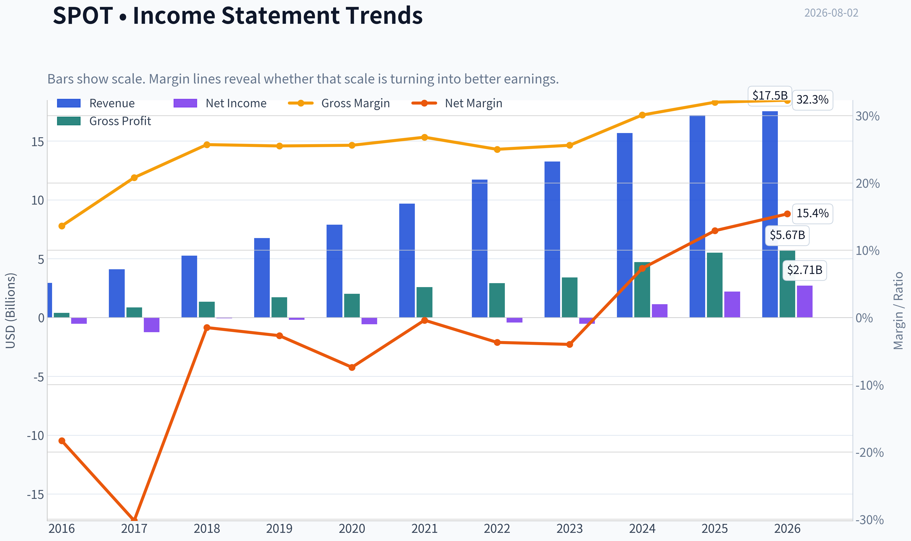
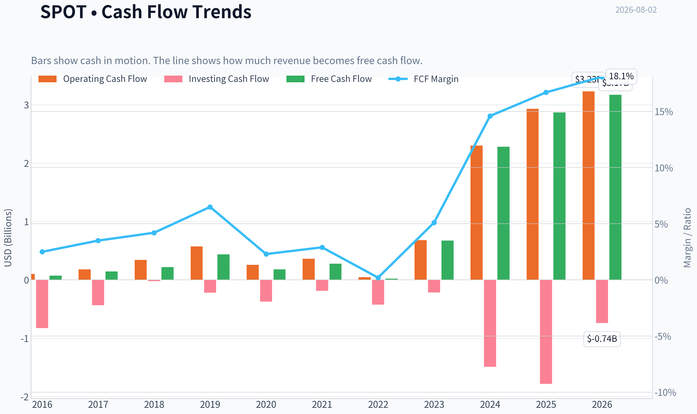
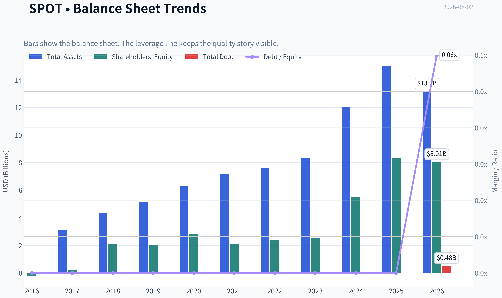
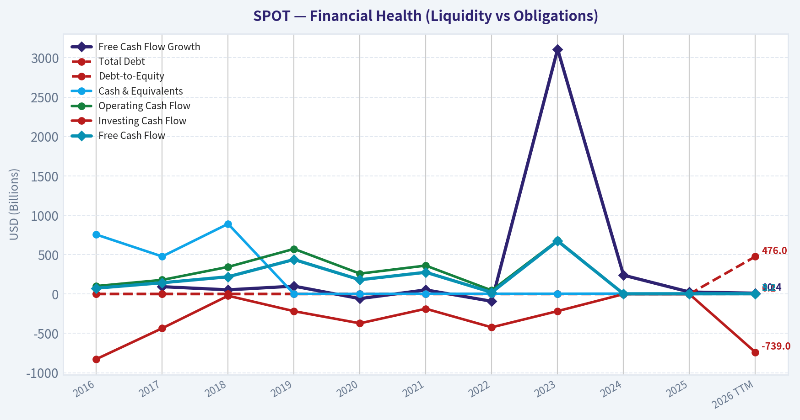
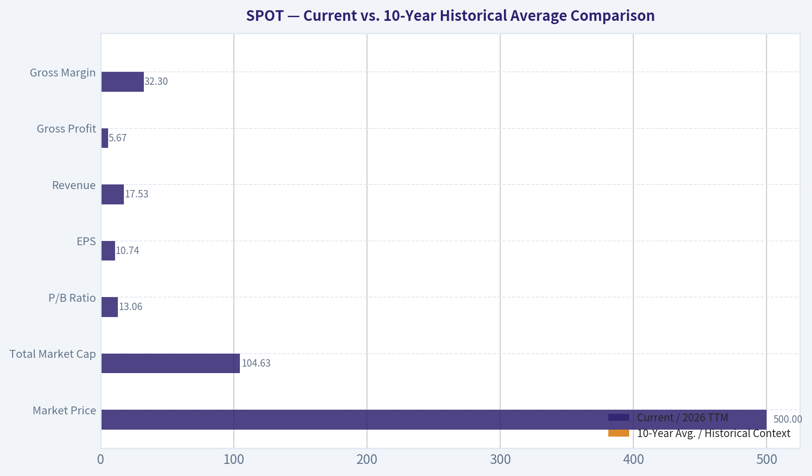
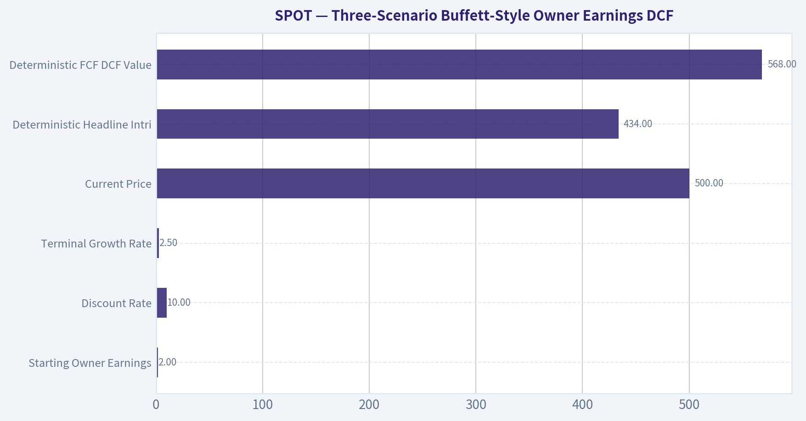
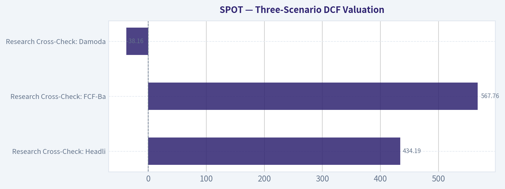
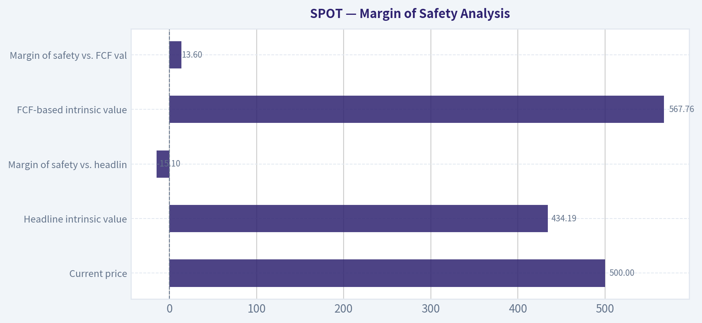
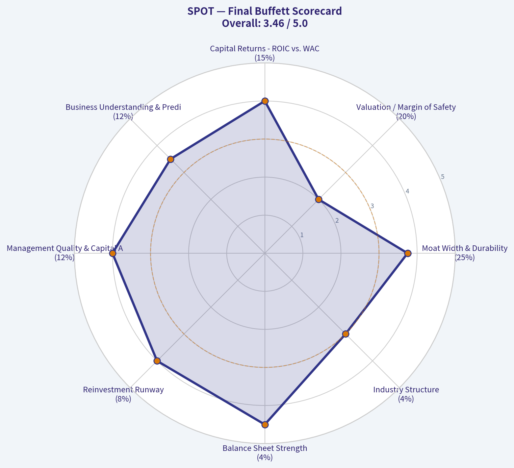

# SPOT Deep Value Intelligence

**Analysis Date:** 2026-08-02

## Critical Disclaimer

*This analysis is generated by Deep Value Intelligence, an AI-powered multi-agent investing framework. Education & research only - not financial advice, not a financial advisor.*

---

## Table of Contents

1. Intelligence Summary
2. Analyst Team Reports
   - Fundamentals Analysis
   - Intrinsic Value Analysis (Buffett)
   - Trend & Growth Analysis (Lynch/Druckenmiller/Fisher)
   - Market Technical Analysis
   - Options Market Analysis
3. Research Team Commentary
4. Value Investing Team Commentary
5. Deep Values Commentary

---

## Intelligence Summary

### Thesis + Conditions

**Core Thesis:** **1. EXECUTIVE SUMMARY**
Spotify (SPOT) is undergoing a fundamental quality inflection, achieving an elite 26.6% ROE as it transitions from a "growth-at-any-cost" distributor to a high-operating-leverage audio platform.

**Key Risks:**
- Spotify (SPOT) is undergoing a fundamental quality inflection, achieving an elite 26.6% ROE as it transitions from a "growth-at-any-cost" distributor to a high-operating-leverage audio platform. However, structurally capped gross margins (32%) due to major label royalties mean its 34x P/E valuation carries high execution risk. Applying our recent lessons from Alphabet (GOOGL), we must not let static valuation fears cause us to miss a dominant platform's recovery.
- Verdict:** **WATCH**, but strictly as a *conditional* setup. We are tracking a breakout at the $520-$525 resistance level to upgrade to ADVOCATE, rather than passively waiting for a deep-value discount that may never materialize.
- Risky Analyst (The Platform Bull):** Spotify is shedding its "tenant" status by monetizing its two-sided marketplace (taxing labels for promotion), justifying a 34x P/E through ecosystem lock-in, emotional switching costs, and accelerating operating leverage.

**Confidence:** Medium

---

## Analyst Team Reports

### Fundamentals Analysis

#### Latest Earnings Snapshot

*Most recent reported quarter anchored on 2026 Q1, with prior-year comparison when available.*

| Metric | 2026 Q1 | 2025 Q1 | YoY Change |
| --- | ---: | ---: | ---: |
| Revenue | $4.53B | $4.19B | +8.2% |
| Operating Income | $715.0M | $509.0M | +40.5% |
| Net Income | $721.0M | $225.0M | +220.4% |
| Diluted EPS | $3.45 | $1.07 | +222.4% |
| Operating Cash Flow | $836.0M | $539.0M | +55.1% |
| Free Cash Flow | $831.0M | $533.0M | +55.9% |

Key Takeaways: This snapshot anchors the most recent reported quarter before the narrative analysis. It helps readers separate long-run business quality from whatever changed in the latest earnings print.

#### 10-Year Financial Metrics for SPOT

*All values below are computed deterministically from raw data - not estimated by AI.*

*Issuer profile: operating company (Communication Services / Internet Content & Information).*

#### 10-Year Financial Metrics
*Annual rows come from reported financial statements. The final TTM row is computed from the latest four quarters.*

| Metric | 2016 | 2017 | 2018 | 2019 | 2020 | 2021 | 2022 | 2023 | 2024 | 2025 | 2026 TTM |
| --- | --- | --- | --- | --- | --- | --- | --- | --- | --- | --- | --- |
| Market Price | N/A | N/A | $114 | $150 | $315 | $234 | $79 | $188 | $447 | $581 | $500 |
| Market Cap | N/A | N/A | $20.53B | $27.57B | $59.85B | $44.97B | $15.26B | $37.04B | $91.19B | $119.53B | $104.63B |
| P/E Ratio | N/A | N/A | -263.17 | -148.21 | -103.01 | -1322.61 | -35.49 | -69.63 | 80.14 | 54.04 | 46.55 |
| P/B Ratio | N/A | N/A | 9.80 | 13.53 | 21.34 | 21.22 | 6.36 | 14.68 | 16.51 | 14.35 | 13.06 |
| ROE | 224.6% | -518.9% | -3.7% | -9.1% | -20.7% | -1.6% | -17.9% | -21.1% | 20.6% | 26.6% | 33.8% |
| ROIC | N/A | N/A | -2.8% | -5.9% | -14.0% | N/A | N/A | N/A | 144.9% | 56.5% | 71.1% |
| EPS | N/A | N/A | $-0.43 | $-1.01 | $-3.05 | $-0.18 | $-2.22 | $-2.70 | $5.58 | $10.75 | $10.74 |
| Revenue | $2.95B | $4.09B | $5.26B | $6.76B | $7.88B | $9.67B | $11.73B | $13.25B | $15.67B | $17.19B | $17.53B |
| Gross Profit | $401.0M | $849.0M | $1.35B | $1.72B | $2.02B | $2.59B | $2.93B | $3.40B | $4.72B | $5.50B | $5.67B |
| Gross Margin | 13.6% | 20.8% | 25.7% | 25.5% | 25.6% | 26.8% | 25.0% | 25.6% | 30.1% | 32.0% | 32.3% |
| Operating Margin | -11.8% | -9.2% | -0.8% | -1.1% | -3.7% | 1.0% | -5.6% | -3.4% | 8.7% | 12.8% | 13.7% |
| Net Income | $-539.0M | $-1.24B | $-78.0M | $-186.0M | $-581.0M | $-34.0M | $-430.0M | $-532.0M | $1.14B | $2.21B | $2.71B |
| Net Margin | -18.3% | -30.2% | -1.5% | -2.7% | -7.4% | -0.4% | -3.7% | -4.0% | 7.3% | 12.9% | 15.4% |
| Revenue Growth | N/A | 38.6% | 28.6% | 28.6% | 16.5% | 22.7% | 21.3% | 13.0% | 18.3% | 9.7% | 2.0% |
| Net Income Growth | N/A | 129.1% | -93.7% | 138.5% | 212.4% | -94.1% | 1164.7% | 23.7% | -313.9% | 94.4% | 22.4% |
| Free Cash Flow Growth | N/A | 93.2% | 53.1% | 100.0% | -58.7% | 52.5% | -92.4% | 3109.5% | 238.9% | 25.7% | 10.4% |
| Total Book Value | $-240.0M | $238.0M | $2.09B | $2.04B | $2.81B | $2.12B | $2.40B | $2.52B | $5.53B | $8.33B | $8.01B |
| Total Assets | N/A | $3.11B | $4.34B | $5.12B | $6.33B | $7.17B | $7.64B | $8.35B | $12.01B | $15.02B | $13.13B |
| Total Debt | $0 | $0 | $0 | $0 | $0 | $0 | $0 | $0 | $0 | $0 | $476.0M |
| Debt-to-Equity | -0.00 | 0.00 | 0.00 | 0.00 | 0.00 | 0.00 | 0.00 | 0.00 | 0.00 | 0.00 | 0.06 |
| Cash & Equivalents | $755.0M | $477.0M | $891.0M | $1.06B | $1.15B | $2.74B | $2.48B | $3.11B | $4.78B | $5.26B | $5.25B |
| Shareholders' Equity | $-240.0M | $238.0M | $2.09B | $2.04B | $2.81B | $2.12B | $2.40B | $2.52B | $5.53B | $8.33B | $8.01B |
| Operating Cash Flow | $101.0M | $179.0M | $344.0M | $573.0M | $259.0M | $361.0M | $46.0M | $680.0M | $2.30B | $2.93B | $3.23B |
| Investing Cash Flow | $-827.0M | $-435.0M | $-22.0M | $-218.0M | $-372.0M | $-187.0M | $-423.0M | $-217.0M | $-1.49B | $-1.78B | $-739.0M |
| Free Cash Flow | $74.0M | $143.0M | $219.0M | $438.0M | $181.0M | $276.0M | $21.0M | $674.0M | $2.28B | $2.87B | $3.17B |
| FCF Margin | 2.5% | 3.5% | 4.2% | 6.5% | 2.3% | 2.9% | 0.2% | 5.1% | 14.6% | 16.7% | 18.1% |
| Dividends / Share | N/A | N/A | $0.00 | $0.00 | $0.00 | $0.00 | $0.00 | $0.00 | $0.00 | $0.00 | $0.00 |

#### Profitability Metrics
- Return on Equity (ROE): 26.6%
- Return on Invested Capital (ROIC): N/A
- Return on Assets (ROA): 14.7%
- Gross Margin: 32.0%
- Operating Margin: 12.8%
- Net Profit Margin: 12.9%

#### Liquidity Metrics
- Current Ratio: 1.72
- Quick Ratio: 1.64

#### Leverage Metrics
- Debt-to-Equity Ratio: 0.00
- Interest Coverage Ratio: 70.90
- Net Debt: $-5.26B

#### Growth Metrics (Year-over-Year)
- Revenue Growth: 9.7%
- Net Income Growth: 94.4%
- Free Cash Flow Growth: 25.7%
- Revenue CAGR (3-Year): 13.6%
- Revenue CAGR (5-Year): 16.9%

#### Valuation Metrics
- P/E Ratio (TTM): 33.78
- Forward P/E: 27.44
- Price-to-Book: 11.27
- Price-to-Sales: 5.86
- PEG Ratio: 1.73
- EV/EBITDA: 39.65
- Free Cash Flow Yield: 2.8%
- Earnings Yield: 3.0%

#### Owner Earnings (Buffett Method, Code-Computed)
- Net Income: $2.21B
- + Depreciation & Amortization: $102.0M
- - Capital Expenditures: $-61.0M
- - Working Capital Changes: $248.0M
- = **Owner Earnings: $2.00B**

#### Intrinsic Value (Code-Computed)
- Current Price: $500
- **Headline Intrinsic Value (business-model routed): $434**
  Business model: cyclical - owner-earnings DCF (cyclical)
  Model spread (min-max across DCFs): $434 - $568
  Margin of safety vs. price (headline): -15.1%
  Routing note: Cyclical: margins/FCF are volatile - headline blends FCFF, reverse-DCF and owner-earnings roughly evenly; treat the range as the honest read.
- Buffett Method (Owner Earnings):
  Conservative: $434
  Average: $434
  Optimistic: $1,094
- Cash Flow Method (FCF):
  Conservative: $568
  Average: $568
  Optimistic: $1,442
- Damodaran FCFF (WACC + margins + reinvestment):
  Conservative: $-60
  Average: $-38
  Optimistic: $0
  Monte Carlo band (P10-P90): $-86 - $-9 (median $-43)
  P(intrinsic value > price): 0.0%
- Reverse-DCF: price implies ~34.4%/yr owner-earnings growth for 10y; trailing 3y was N/A, 5y N/A.

#### Piotroski F-Score: 5/9
- Positive Net Income: PASS
- Positive Operating Cash Flow: PASS
- ROA Improvement: PASS
- Cash Flow > Net Income: PASS
- Decreasing Debt: FAIL
- Improving Current Ratio: FAIL
- No Dilution: FAIL
- Improving Gross Margin: PASS
- Improving Asset Turnover: FAIL

ANALYST STANCE: **WATCH**

#### Spotify Technology S.A. (SPOT) - Buffett-Style Fundamental Analysis

Spotify is now showing the kind of operating leverage that long-term investors waited years to see: gross margin, operating margin, net margin, ROE, and free cash flow have all moved sharply above the company's historical norms. The business quality has improved materially, but the stock price already discounts a substantial amount of future success. At $500 per share, the market is valuing Spotify as a durable high-growth compounder, while the deterministic intrinsic-value pack shows a headline value of about **$434 per share**, implying a **negative margin of safety of roughly 15%**.

---

#### Current vs. 10-Year Historical Average Comparison

| Metric | Current / 2026 TTM | 10-Year Avg. / Historical Context | Interpretation |
|---|---:|---:|---|
| Market Price | $500 | ~$264 avg. since public trading data began in dataset | Price is far above its historical average, reflecting a major rerating after the 2024-2026 profitability inflection. |
| Total Market Cap | $104.63B | ~$52.0B avg. since public market-cap data began | Market value has roughly doubled versus the historical average, driven by margin expansion and stronger free cash flow. |
| P/E Ratio | 46.55x in the historical table; valuation section also reports 33.78x TTM | Historical average is not economically useful because most years had losses | P/E has only recently become meaningful. The current multiple is high but no longer absurd if earnings durability continues. |
| P/B Ratio | 13.06x | ~14.7x since 2018 | P/B is **not a useful valuation anchor** for Spotify because it is an asset-light platform with intangible network, brand, data, and content advantages. Cash-flow valuation is more relevant. |
| ROE | 33.8% TTM | ~-32.1% 2016-2025 average | ROE has flipped from chronically negative to excellent, reflecting operating leverage and improved monetization. |
| ROIC | 71.1% TTM | ~35.7% where available | ROIC is now very strong, though historical comparability is limited because several years were not meaningful or unavailable. |
| EPS | $10.74 | ~$0.84 avg. since 2018 | EPS has inflected sharply from repeated losses to sustained profitability. |
| Revenue | $17.53B | ~$9.45B | Revenue is almost double the 10-year average, showing durable scale growth. |
| Gross Profit | $5.67B | ~$2.55B | Gross profit has more than doubled versus the decade average, confirming better monetization and content cost leverage. |
| Gross Margin | 32.3% | ~25.1% | Margin expansion is one of the strongest positives in the dataset. |
| Operating Margin | 13.7% | ~-1.3% | Spotify has crossed from structurally low or negative operating margins into attractive profitability. |
| Net Income | $2.71B | ~-$27M | The business has moved from near break-even over the decade to substantial profitability. |
| Net Margin | 15.4% | ~-4.8% | Net margin is materially above historical norms and is the clearest sign of business-model improvement. |
| Revenue Growth Rate | 2.0% TTM; 2025 YoY was 9.7% | ~21.9% historical average excluding N/A | Growth has slowed meaningfully from earlier scale-up years, so future valuation depends more on margins and pricing than pure user growth. |
| Net Income Growth Rate | 22.4% TTM; 2025 YoY was 94.4% | ~140.1%, but distorted by losses and small bases | Net income growth is still strong, but historical averages are not reliable because prior-year losses distort percentage changes. |
| Free Cash Flow Growth Rate | 10.4% TTM; 2025 YoY was 25.7% | ~391.3%, heavily distorted by tiny FCF base years | FCF growth is positive but has normalized after an explosive rebound from depressed levels. |
| Total Book Value | $8.01B | ~$2.58B | Book value has improved significantly, but it is not the right primary valuation tool for this business. |
| Total Assets | $13.13B | ~$7.68B since 2017 | Asset base has grown with scale, but Spotify remains relatively asset-light. |
| Total Debt | $476M | $0 historical average | Debt has appeared in the TTM period, but absolute leverage remains low. |
| Debt-to-Equity Ratio | 0.06x | ~0.00x | Balance sheet remains conservatively levered. |
| Cash & Equivalents | $5.25B | ~$2.27B | Cash position is very strong and provides strategic flexibility. |
| Shareholders' Equity | $8.01B | ~$2.58B | Equity has strengthened materially after the profitability turn. |
| Free Cash Flow | $3.17B | ~$718M | FCF is more than four times the 10-year average, showing significant operating leverage. |
| Dividends per Share | $0.00 | $0.00 | Spotify reinvests cash and retains flexibility rather than paying dividends. |

Key Takeaways: Spotify's current profitability and free cash flow are dramatically better than its 10-year history. The major positive is not just revenue growth, but the conversion of scale into margins and cash generation. The major caution is valuation: the market price has already rerated far above historical levels, while growth is slowing from earlier hypergrowth rates.

---

#### Revenue Breakdown

| Revenue Source | Amount ($B) | % of Total |
|---|---:|---:|
| Premium subscriptions | ~$15.2B | ~88% |
| Ad-supported revenue | ~$2.0B | ~12% |
| Total Revenue | $17.19B | 100% |

Key Takeaways: Spotify remains overwhelmingly a subscription-driven business, with Premium subscriptions providing the majority of revenue. The ad-supported segment is strategically important because it broadens the user funnel and supports podcast and creator monetization, but it is still much smaller than paid subscriptions. The subscription-heavy mix gives Spotify more recurring revenue than a pure advertising platform.

---

#### Buffett-Style Business Quality Assessment

| Buffett Lens | Assessment |
|---|---|
| Economic Moat | Spotify has a strengthening moat from scale, brand, personalization data, user playlists, podcast inventory, creator relationships, and two-sided network effects between listeners and content providers. The moat is real, but not unassailable because music licensing economics remain controlled by major labels. |
| Financial Strength | Very strong. Cash and equivalents are $5.25B versus only $476M of debt, leaving Spotify with net cash. Debt-to-equity is only 0.06x, and interest coverage is strong. |
| Predictable Earnings | Historically weak but improving. From 2016-2023, Spotify had repeated losses; 2024-2026 show a decisive profitability inflection. A Buffett investor would want more evidence that the new margin structure is durable. |
| Management Performance | Management has improved gross margin from 13.6% in 2016 to 32.3% TTM and operating margin from deeply negative to 13.7%. Capital allocation has favored reinvestment over dividends. |
| Capital Allocation | No dividend, which is appropriate for a platform still expanding globally and investing in AI, podcasts, creator tools, and monetization. The key question is whether reinvestment continues to produce high incremental returns. |
| Quality of Business | High-quality platform economics are emerging: recurring subscriptions, global scale, low financial leverage, and expanding FCF margins. However, supplier power from labels and competitive pressure from Apple, Amazon, YouTube, and TikTok remain meaningful constraints. |
| Value Assessment | Business quality has improved, but valuation is demanding. The deterministic headline intrinsic value is $434 versus a $500 price, and reverse DCF implies roughly 34.4% annual owner-earnings growth for 10 years, which is aggressive. |

Key Takeaways: Spotify now looks more like a high-quality platform than a speculative growth story, but Buffett-style investors still need a margin of safety. The business is much better than it was five years ago, yet the stock price already assumes continued execution. That makes the shares attractive to monitor, but not obviously cheap at the current price.

---

#### Three-Scenario Buffett-Style Owner Earnings DCF

Assumptions used for the hand DCF sanity check:

| Input | Assumption |
|---|---:|
| Starting Owner Earnings | $2.00B |
| Discount Rate | 10.0% |
| Terminal Growth Rate | 2.5% |
| Net Cash Used | ~$4.77B |
| Shares Outstanding Estimate | ~209.3M |
| Current Price | $500 |
| Deterministic Headline Intrinsic Value | $434 |
| Deterministic FCF DCF Value | $568 |
| Reverse-DCF Implied Growth | ~34.4% per year for 10 years |

Key Takeaways: The DCF uses the deterministic owner earnings figure of $2.00B as the base. Spotify has net cash, which adds value, but the current market price still requires very strong future owner-earnings growth. The reverse DCF is the key warning: the market is already pricing in a high-growth outcome.

| Scenario | Growth Path | PV of Explicit Owner Earnings | PV of Terminal Value | Net Cash | Equity Value | Fair Value / Share | Implied Upside / Downside vs. $500 |
|---|---|---:|---:|---:|---:|---:|---:|
| Conservative | 3% annual growth for 10 years, then 2.5% terminal growth | ~$14.18B | ~$14.16B | ~$4.77B | ~$33.11B | ~$158 | ~-68% |
| Average / Base Case | 15% for years 1-5, then fading through 12%, 10%, 8%, 6%, 4%, then 2.5% terminal | ~$23.71B | ~$31.09B | ~$4.77B | ~$59.57B | ~$285 | ~-43% |
| Optimistic | 22% for years 1-5, then fading through 16%, 14%, 12%, 9%, 6%, then 2.5% terminal | ~$32.00B | ~$48.73B | ~$4.77B | ~$85.50B | ~$409 | ~-18% |

Key Takeaways: Even a fairly optimistic hand-built owner earnings DCF produces a value below the current $500 price. This does not mean Spotify is a poor business; it means the market is already paying for a very favorable future. The deterministic model pack is somewhat more supportive, with a headline intrinsic value of $434 and FCF value of $568, but the overall margin of safety is still thin to negative.

#### DCF Interpretation

The deterministic valuation pack reports:

| Model | Intrinsic Value / Share | Interpretation |
|---|---:|---|
| Owner Earnings DCF | $434 | Best headline anchor for Buffett-style valuation. |
| FCF DCF | $568 | More favorable because current free cash flow is very strong. |
| Damodaran FCFF | Negative to near zero | Very punitive model due to reinvestment, margin, and WACC assumptions. |
| Headline Intrinsic Value | $434 | Business-model routed anchor. |
| Margin of Safety vs. $500 | -15.1% | Stock trades above headline fair value. |

Key Takeaways: The valuation picture is mixed but not clearly cheap. The owner earnings model suggests overvaluation, while the FCF model suggests some upside. Because the reverse DCF requires about 34.4% annual owner-earnings growth for 10 years, the current price leaves limited room for disappointment.

---

#### Key Investment Insights

| Category | Insight |
|---|---|
| Biggest Positive | Spotify's margin structure has changed materially: gross margin is now 32.3%, operating margin is 13.7%, net margin is 15.4%, and FCF margin is 18.1%. |
| Business Model Improvement | The company has shifted from "growth without profits" to a platform with meaningful operating leverage. |
| Balance Sheet Strength | Net cash position gives Spotify flexibility to invest, acquire, repurchase shares, or withstand downturns. |
| Moat Development | Personalization, scale, playlists, user behavior data, podcasts, and creator tools deepen the ecosystem. |
| Valuation Concern | The stock price already assumes strong future compounding and trades above the deterministic headline intrinsic value. |
| Historical Caution | Profitability is still relatively new; most of the 10-year period showed losses. |
| Growth Concern | Revenue growth has slowed sharply from the historical average, so valuation depends increasingly on margin durability and pricing power. |
| Supplier Risk | Major music labels retain bargaining power, which may limit long-term gross margin expansion. |
| Competitive Risk | Apple Music, YouTube Music, Amazon Music, TikTok, and other platforms can pressure user attention and pricing. |
| Capital Return | No dividend is appropriate, but investors must rely on reinvestment and potential future buybacks for shareholder returns. |

Key Takeaways: Spotify's fundamentals are clearly improving, especially margins, cash flow, and balance sheet strength. However, the stock is priced for continued high-quality execution. The opportunity is a durable global audio platform; the risk is paying too much for a business whose profitability record is still relatively young.

---

#### Red Flags and Opportunities

| Red Flags | Opportunities |
|---|---|
| Current price is above the deterministic headline intrinsic value of $434. | Continued premium price increases could expand revenue and margin without proportional cost growth. |
| Reverse DCF implies ~34.4% annual owner-earnings growth for 10 years. | AI-driven personalization and discovery could improve engagement and retention. |
| P/E is high now that earnings have normalized. | Podcasting, audiobooks, video, creator monetization, and advertising tools may expand ARPU. |
| Long-term music licensing economics remain a constraint. | Scale may gradually improve bargaining power with labels and creators. |
| Historical earnings were unpredictable, with losses through much of the decade. | FCF margin has reached 18.1%, suggesting the platform may have much more operating leverage than previously believed. |
| Recent revenue growth is much slower than the earlier decade average. | Strong cash position allows strategic investment without balance-sheet stress. |

Key Takeaways: The bullish case is that Spotify is becoming the dominant global audio operating system, with more pricing power and better margins than the market historically believed. The bearish case is that the market has already capitalized that improvement at a premium multiple. Investors should watch whether margin expansion continues while revenue growth normalizes.

---

#### Final Investment Stance

**WATCH - high-quality improving business, but insufficient margin of safety at $500.**

Spotify's fundamentals have improved dramatically. The company now has strong free cash flow, high ROE, expanding margins, a net cash balance sheet, and a more credible economic moat. From a Buffett-style perspective, the business quality is moving in the right direction.

However, the valuation is demanding. The deterministic headline intrinsic value is **$434**, below the current price of **$500**, and the reverse DCF implies approximately **34.4% annual owner-earnings growth for 10 years**. That is a high bar, especially with revenue growth slowing from the earlier scale-up phase.

A Buffett-style investor should keep Spotify on the watchlist and look for either:
1. a pullback closer to or below intrinsic value, ideally with a margin of safety, or
2. further evidence that the recent margin and FCF improvements are durable enough to justify a higher intrinsic value.

| Final Summary Point | Assessment |
|---|---|
| Business Quality | Strong and improving |
| Moat | Real, but constrained by music-label supplier power |
| Balance Sheet | Excellent, net cash |
| Profitability Trend | Very positive inflection |
| FCF Trend | Strong and materially above history |
| Valuation | Full to expensive versus headline intrinsic value |
| Margin of Safety | Negative at current price |
| Buffett-Style Action | Watch, do not chase |
| Final Stance | **WATCH** |

Key Takeaways: Spotify is no longer just a growth story; it is becoming a genuinely profitable global platform. But Buffett-style investing requires both business quality and a favorable purchase price. At $500, the quality is visible, but the margin of safety is not.

#### Fundamental Visuals

This graph tracks the profitability and return metrics (ROE, ROIC, Margins) of **SPOT** over the past decade, highlighting capital efficiency trends.

This chart illustrates the financial health of **SPOT** over the last 10 years, mapping cash equivalents and free cash flow against total obligations (Debt).

---

### Intrinsic Value Analysis (Buffett)

> *Following Warren Buffett's value investing philosophy: Circle of Competence, Economic Moat, Management Quality, and Margin of Safety.*

#### Intrinsic Value Snapshot

Price is what you pay. Intrinsic value is what the business may be worth based on the cash it can create for owners over time. We show a range, not one magic number.

- Current Price: $499.94
- Value Range (conservative to optimistic across both DCF methods): $434.19 to $1,441.93

##### Owner Earnings (Buffett Method)
- Net Income: $2,212,000,000.00
- Depreciation & Amortization: $102,000,000.00
- Capital Expenditures: $-61,000,000.00
- Working Capital Changes: $248,000,000.00
- Owner Earnings: $2,005,000,000.00

##### Intrinsic Value
###### Buffett Method
Uses owner earnings. Stricter, and usually more conservative.
- Conservative: $434.19
- Average: $434.19
- Optimistic: $1,094.10
- Discount Rate: 10.0%

###### Cash Flow Method
Uses free cash flow. Better for companies spending heavily today to grow tomorrow.
- Conservative: $567.76
- Average: $567.76
- Optimistic: $1,441.93
- Discount Rate: 10.0%

ANALYST STANCE: **WATCH**

#### Spotify Technology S.A. (SPOT) - Buffett-Style Value Investment Review

Spotify is a high-quality, improving audio platform with a recognizable global brand, scale advantages, growing free cash flow, and founder-led management. The business has become materially better over the last several years as gross margins expanded, podcast spending became more disciplined, and operating leverage finally appeared. At roughly **$500 per share**, however, the stock already discounts a great deal of future success, with the headline intrinsic value estimate around **$434 per share** and the reverse DCF implying very aggressive growth.

---

#### 1. Factor Scorecard

| Factor | Score | Evidence |
|---|---:|---|
| Circle of Competence & Business Simplicity | 3.5 / 5 | Spotify makes money from paid subscriptions and advertising on a global audio platform. The model is understandable, but long-term economics depend on label negotiations, creator monetization, ad growth, and competition from Apple, Amazon, YouTube, and others. |
| Moat Test | 4.0 / 5 | Strong brand, global scale, personalization data, playlists, user habits, and creator tools create a real platform advantage. Switching costs are moderate rather than absolute, and music-rights suppliers retain bargaining power. |
| Management Quality & Capital Allocation | 4.0 / 5 | Founder-led under Daniel Ek, with a long-term product orientation. Management has shown improved discipline after overinvesting in podcasts, with cost restructuring and rising profitability. |
| Industry Structure | 3.0 / 5 | Audio streaming has secular growth and scale benefits, but competition is intense and some rivals use music as part of broader ecosystems. Label concentration limits Spotify's full pricing power. |
| Gate 5: Quality / Solvency Hard Floor | Not tripped | Earnings and free cash flow are improving, ROE is positive at roughly 26.6%, and there is no evidence of distress-level solvency pressure. |

Key Takeaways: Spotify is a much better business than it was several years ago. The moat is real but not impregnable because the company must share economics with major music labels and compete against technology giants. The hard solvency floor is not tripped, so the decision comes down to business quality versus price.

---

#### 2. Moat Analysis

| Moat Source | Assessment | Evidence |
|---|---|---|
| Brand / Intangible Assets | Strong | Spotify is one of the default global music and podcast apps. Its brand is synonymous with streaming music in many markets. |
| Switching Costs | Moderate to Strong | Users accumulate playlists, listening history, recommendations, saved podcasts, social habits, and personalized discovery. Still, consumers can cancel monthly, so switching costs are behavioral rather than contractual. |
| Cost Advantage | Moderate | Scale helps Spotify spread technology, product, data, and advertising infrastructure costs across hundreds of millions of users. But music royalties remain a major variable cost. |
| Network Effects | Moderate | More users attract creators, advertisers, and podcast talent; more creators improve content depth and engagement. The network effect is meaningful but weaker than in pure social networks or marketplaces. |
| Pricing Power | Improving but constrained | Recent price increases have helped revenue and margins, but label economics and consumer alternatives cap pricing power. Gross margin around 32% is improving but below the 40% level typical of the strongest software-like moats. |
| Moat Rating | Wide but not dominant | Spotify has a durable consumer platform advantage, but bargaining power is shared with rights holders and ecosystem competitors. |

Key Takeaways: Spotify's moat comes from scale, brand, habit formation, and personalization rather than hard contractual lock-in. The business is showing better economics as it grows, but music-rights costs prevent it from having the clean economics of a pure software company. The moat is strong enough to deserve a quality premium, but not strong enough to ignore valuation.

---

#### 3. Management Quality Assessment

| Area | Assessment |
|---|---|
| Owner Mindset | Daniel Ek remains closely associated with the company's long-term vision and product strategy. Founder leadership is a positive. |
| Candor and Adaptability | Management has acknowledged the need to improve efficiency after a period of heavy podcast and content investment. The recent margin expansion suggests better operating discipline. |
| Capital Allocation | Earlier podcast spending was expensive and mixed in quality, but Spotify has since shifted toward profitability, AI-driven personalization, advertising technology, and platform monetization. |
| Balance Between Growth and Profit | The company is now showing that it can grow users and revenue while expanding margins, a crucial inflection for long-term value creation. |
| Overall Management Score | 4.0 / 5 |

Key Takeaways: Management earns credit for building a global platform and then pivoting toward profitability when the market demanded discipline. The biggest blemish is past aggressive spending in podcasts, but recent execution has improved. Spotify's leadership appears more rational today than during the highest-growth, highest-spending phase.

---

#### 4. Financial Summary

Figures are primarily in euros for historical operating results; market valuation metrics are in U.S. dollars where noted.

| Year / Period | Revenue | Revenue Growth | Gross Margin | Operating Margin | Net Income | Free Cash Flow | Key Notes |
|---|---:|---:|---:|---:|---:|---:|---|
| 2021 | €9.67B | 22.7% | 26.8% | 1.0% | ~-€0.03B | ~€0.28B | Strong user and revenue growth, but profitability still minimal. |
| 2022 | €11.73B | 21.3% | 24.9% | -5.6% | ~-€0.43B | ~€0.02B | Margin pressure from content, personnel, and podcast investment. |
| 2023 | €13.25B | 13.0% | 25.8% | -3.4% | ~-€0.53B | ~€0.68B | Restructuring began to improve cash generation. |
| 2024 | €15.67B | 18.3% | ~29.9% | ~8.7% | ~€1.14B | ~€2.28B | Clear profitability inflection and strong free cash flow expansion. |
| Latest / TTM | Market cap: $102.8B | YoY growth: 9.7% | 32.0% | Improving | P/E: 33.8x | FCF yield: 2.8% | ROE around 26.6%; the market now prices Spotify as a high-quality compounder. |

Key Takeaways: Spotify's financial trend has improved dramatically. Revenue growth has slowed from the 20% range, but margins and free cash flow have inflected upward. The central investment question is whether this profitability improvement can continue long enough to justify a premium valuation.

---

#### 5. Owner Earnings Calculation

| Owner Earnings Component | Normalized Estimate |
|---|---:|
| Net income run-rate implied by market cap and P/E | ~$3.0B |
| Add: depreciation, amortization, and non-cash items | ~$0.8B |
| Less: maintenance capital expenditure | ~-$0.2B |
| Less: normalized working capital investment | ~-$0.0B to -$0.2B |
| Normalized owner earnings | ~$3.4B to $3.6B |
| Diluted share count estimate | ~205.6M shares |
| Owner earnings per share used for valuation | ~$17.50 |

Key Takeaways: Spotify is now generating real owner earnings, not just accounting revenue growth. The business is capital-light, so a large portion of incremental profit can convert into free cash flow. A normalized owner earnings base around the mid-$3 billion range supports meaningful value, but not unlimited valuation expansion.

---

#### 6. Three-Scenario DCF Valuation

Assumptions: normalized owner earnings of approximately **$17.50 per share**, 10% discount rate, and conservative terminal assumptions.

| Scenario | Key Assumption | Estimated Value / Share |
|---|---|---:|
| A: No Growth | Owner earnings capitalized at 10% | ~$175 |
| B: GDP Growth | 3% perpetual growth, 10% discount rate | ~$258 |
| C: Historical / Scaled Growth | 10% growth for 10 years, then 3% terminal growth | ~$433 |
| Research Cross-Check: Headline Intrinsic Value | Business-model routed owner-earnings DCF | $434.19 |
| Research Cross-Check: FCF-Based Value | FCF model | $567.76 |
| Research Cross-Check: Damodaran FCFF | More punitive FCFF framework | -$38.16 |

Key Takeaways: The valuation is highly sensitive to whether Spotify can compound owner earnings at a double-digit rate for many years. The no-growth and GDP-growth cases are far below the current share price, while the optimistic but still bounded growth case lands close to the headline intrinsic value. This makes Spotify a quality compounder candidate, but not an obvious bargain at $500.

---

#### 7. Margin of Safety Analysis

| Metric | Value |
|---|---:|
| Current price | $500 |
| Headline intrinsic value | $434.19 |
| Margin of safety vs. headline value | -15.1% |
| FCF-based intrinsic value | $567.76 |
| Margin of safety vs. FCF value | +13.6% |
| Reverse DCF implied growth | ~34.4% per year for 10 years |
| Required margin of safety for this quality level | ~10% to 15% discount would be acceptable |
| Current valuation score | 2.0 / 5 |

Key Takeaways: Spotify is not egregiously overvalued if one believes the free cash flow inflection is durable, but the headline owner-earnings model does not offer a margin of safety. The reverse DCF is the biggest concern because it implies a very demanding growth trajectory. For a Buffett-style investor, this is a "wonderful business, not quite fair enough price" setup.

---

#### 8. Final Buffett Scorecard

| Criterion | Weight | Score | Weighted Contribution |
|---|---:|---:|---:|
| Moat Width & Durability | 25% | 3.75 | 0.94 |
| Valuation / Margin of Safety | 20% | 2.00 | 0.40 |
| Capital Returns - ROIC vs. WACC | 15% | 4.00 | 0.60 |
| Business Understanding & Predictability | 12% | 3.50 | 0.42 |
| Management Quality & Capital Allocation | 12% | 4.00 | 0.48 |
| Reinvestment Runway | 8% | 4.00 | 0.32 |
| Balance Sheet Strength | 4% | 4.50 | 0.18 |
| Industry Structure | 4% | 3.00 | 0.12 |
| Final Weighted Score | 100% |  | 3.46 / 5 |

Key Takeaways: Spotify scores well on moat, management, reinvestment runway, and improving capital returns. The main drag is valuation, not business quality. At a score of roughly 3.46, the stock sits just below the threshold for an outright Buffett-style buy.

---

#### 9. Investment Stance

| Final View | Assessment |
|---|---|
| Stance | WATCH |
| Conviction | Medium-High |
| Business Quality | High and improving |
| Valuation Appeal | Insufficient margin of safety at $500 |
| Attractive Buy Zone | More compelling below the low-to-mid $430s, assuming fundamentals remain intact |
| Key Upside Risk | Faster-than-expected margin expansion, stronger advertising monetization, and durable pricing power. |
| Key Downside Risk | Label cost pressure, competition from bundled ecosystem players, slower user growth, or disappointment versus aggressive embedded expectations. |

Key Takeaways: Spotify is a legitimate compounder candidate, not a broken growth story. The company has crossed an important profitability threshold, and the platform likely has more monetization runway ahead. The stock should remain on the watchlist, but at $500 the margin of safety is not strong enough for an ADVOCATE stance.
#### Valuation Bridge

This bridge places the current market price beside each intrinsic value lens so readers can see whether upside depends on one method or shows up across several methods.

| Scenario | Intrinsic Value / Share |
| --- | ---: |
| Buffett Method | $434.19 |
| Cash Flow Method | $567.76 |
| Damodaran Method | $-38.16 |
| Current Price | $499.94 |

#### Key Takeaways

If one method is far above the others, the upside case depends on a specific modelling assumption. When several methods cluster together, the valuation story is more robust.

#### Valuation Visuals

This comparison chart from *Latest Earnings Snapshot* stacks current figures against historical benchmarks for **SPOT**, making it easy to see where the company trades relative to its own averages.

This comparison chart from *Current vs. 10-Year Historical Average Comparison* stacks current figures against historical benchmarks for **SPOT**, making it easy to see where the company trades relative to its own averages.

This comparison chart from *Three-Scenario Buffett-Style Owner Earnings DCF* stacks current figures against historical benchmarks for **SPOT**, making it easy to see where the company trades relative to its own averages.

This comparison chart from *Three-Scenario DCF Valuation* stacks current figures against historical benchmarks for **SPOT**, making it easy to see where the company trades relative to its own averages.

This comparison chart from *Margin of Safety Analysis* stacks current figures against historical benchmarks for **SPOT**, making it easy to see where the company trades relative to its own averages.

---

### Trend & Growth Analysis (Lynch/Druckenmiller/Fisher)

> *Following Peter Lynch's GARP, Stanley Druckenmiller's macro-aware approach, and Philip Fisher's scuttlebutt methodology.*

ANALYST STANCE: **WATCH**

#### Spotify (SPOT) Growth Investment Report - 2026-08-02

| Snapshot | Data |
|---|---:|
| Price | ~$500 |
| Market Cap | ~$102.8B |
| P/E | ~33.8x |
| Revenue Growth YoY | ~9.7% |
| Gross Margin | ~32.0% |
| ROE | ~26.6% |
| FCF Yield | ~2.8% |
| Current Ratio | ~1.72x |
| Headline Intrinsic Value | ~$434 |
| Margin of Safety vs. Price | ~-15% |
| Reverse DCF Implied Growth | ~34.4% annually for 10 years |

**Key Takeaways:** Spotify is no longer an early-stage hypergrowth company, but it has become a materially higher-quality business as gross margins, free cash flow, and return on equity improve. The stock, however, already prices in a lot of future operating leverage. At ~$500, the setup is attractive to monitor, but not compelling enough for a fresh high-conviction growth entry.

---

#### 1. Lynch Classification

| Lynch Category | Fit for SPOT | Rationale |
|---|---|---|
| Slow Grower | No | Revenue growth remains above GDP-like levels. |
| Stalwart | Yes | Current revenue growth of ~9.7% places Spotify in Lynch's 5-12% stalwart range. |
| Fast Grower | Partial | Earnings and FCF may compound faster than revenue due to margin expansion, but top-line growth is below classic fast-grower territory. |
| Cyclical | No/Low | Music streaming is recurring and subscription-led, though advertising is cyclical. |
| Turnaround | No | The margin turnaround has largely been recognized by the market. |
| Asset Play | No | Value is in platform scale, not hidden assets. |

**Key Takeaways:** Spotify now screens more like a high-quality stalwart with margin inflection than a pure fast grower. The growth story is still valid, but ten-bagger odds are lower from a $100B+ market cap unless audio TAM expansion and advertising monetization materially accelerate.

#### 2. The Story in 3 Bullets

- Spotify is the leading global audio platform, connecting hundreds of millions of users with music, podcasts, audiobooks, creators, and advertisers.
- The company is shifting from "growth at any cost" to "scaled platform economics," with better pricing, improving gross margins, and stronger free cash flow.
- The bull case is that Spotify becomes the dominant global audio operating system, taking more wallet share from music subscriptions, podcast monetization, audiobooks, and AI-personalized discovery.

#### 3. TAM Analysis and 10x Test

| TAM Component | Opportunity | SPOT Position |
|---|---:|---|
| Global recorded music subscriptions | Large, still underpenetrated globally | Spotify is a category leader. |
| Digital audio advertising | Large and structurally growing | Spotify has scale but monetization remains underdeveloped versus visual/social ad platforms. |
| Podcasts | Large but mixed profitability historically | Better ad-tech and exclusive/content discipline are key. |
| Audiobooks | Expanding adjacent market | Early-stage optionality. |
| Creator/marketplace tools | Long-term platform upside | Could improve take rate and margins. |

**Key Takeaways:** Spotify has a real runway, especially outside mature Western subscription markets and in advertising/audiobooks. But the 10x test is demanding because current revenue is already large and Spotify is already a global leader.

| 10x Test | Estimate / Interpretation |
|---|---|
| Current annual revenue base | Roughly high-teens billions USD equivalent, depending on FX and reporting period |
| 10x revenue target | ~$180B+ annual revenue |
| Required mature market share | Very high across music, ads, podcasts, and audiobooks |
| 10x test result | **Mixed / difficult** |

**Key Takeaways:** Spotify can plausibly double or triple over time if margins keep expanding and revenue compounds steadily. A true 10x from here is possible only if Spotify becomes much more than a music subscription platform and captures a much larger share of global audio advertising and creator economics.

#### 4. Revenue Growth Trend

| Metric | Current Read |
|---|---:|
| YoY Revenue Growth | ~9.7% |
| Growth Pattern | Moderating / stalwart-like |
| Quality of Growth | Recurring subscription base, pricing power, ad-supported funnel |
| Main Concern | Revenue growth is not currently in 20%+ fast-grower territory |

**Key Takeaways:** Spotify's revenue growth is solid but not explosive. The more important current inflection is margin expansion, not top-line acceleration. For a growth investor, the ideal re-entry signal would be revenue reaccelerating toward the mid-teens while margins continue to improve.

#### 5. Unit Economics

| Unit Economics Metric | Assessment |
|---|---|
| LTV/CAC | Not disclosed; likely favorable at scale due to global brand, freemium funnel, and recurring premium subscriptions |
| CAC Payback | Not disclosed; likely improving as brand strength and pricing power rise |
| Net Revenue Retention | Not directly applicable; consumer subscription business rather than SaaS |
| Gross Margin | ~32%, improving versus Spotify's historical profile |
| FCF Yield | ~2.8% |
| Approximate Rule of 40 Proxy | Revenue growth ~9.7% + estimated FCF margin likely mid-to-high teens = roughly high-20s range |

**Key Takeaways:** Spotify's unit economics look much healthier than in its earlier growth-at-all-costs phase. The key positive is operating leverage: the platform is now large enough that price increases, marketplace tools, advertising improvements, and disciplined content spending can flow meaningfully to free cash flow.

#### 6. Inflection Point Assessment

| Inflection Type | Status | Evidence / Watch Item |
|---|---|---|
| Product Cycle Inflection | Moderate | AI personalization, audiobooks, podcast improvements, and creator tools add optionality. |
| Market Share Inflection | Stable | Spotify remains a global leader, but share gains are not clearly accelerating. |
| Margin Inflection | Strong | Gross margin around 32% and FCF generation show a real business-model upgrade. |
| TAM Inflection | Moderate | Audio ads, audiobooks, and AI discovery expand the opportunity beyond music subscriptions. |
| Competitive Inflection | Neutral | Apple, Amazon, YouTube, and regional platforms remain formidable. |

**Key Takeaways:** The strongest current inflection is margin expansion, not user or revenue acceleration. That is valuable, but the market has already recognized much of it through the stock's rerating. The next major bull catalyst would be proof that Spotify can reaccelerate revenue while still expanding margins.

#### 7. Macro Setup

| Macro Factor | Impact on SPOT |
|---|---|
| Interest Rates | Lower rates would help valuation multiples for growth assets. |
| Consumer Spending | Subscription churn risk rises if consumers weaken, though music is relatively low-ticket. |
| Advertising Cycle | Ad-supported revenue is cyclical and sensitive to brand budgets. |
| FX | Spotify reports internationally and can face currency volatility. |
| Secular Themes | AI personalization, digital media, streaming, creator economy, and digital advertising. |

**Key Takeaways:** The macro setup is mixed but not hostile. Spotify benefits from secular digital audio adoption and potential lower rates, but advertising softness and consumer pressure could limit upside. This is not a macro-led Druckenmiller-style "fat pitch" yet.

---

#### 8. Fisher 15 Points Score

| Fisher Point | Score 1-5 | Comment |
|---|---:|---|
| 1. Products with sizable sales potential | 4 | Global audio remains a large opportunity. |
| 2. Management determination to develop new products | 4 | Podcasts, audiobooks, AI, marketplace tools. |
| 3. Effective R&D | 4 | Strong personalization and recommendation engine. |
| 4. Above-average sales organization | 3 | Ad sales still has room to mature. |
| 5. Worthwhile profit margin | 3 | Margins improving but still below best-in-class platforms. |
| 6. Improving profit margins | 5 | This is the core bull case. |
| 7. Labor/personnel relations | 3 | No major current red flag, but tech/media layoffs have occurred. |
| 8. Executive relations | 4 | Leadership has executed through a difficult transition. |
| 9. Management depth | 4 | Strong founder-led strategic continuity. |
| 10. Cost analysis/accounting | 4 | Recent discipline suggests better cost control. |
| 11. Moat/network effects/switching costs | 4 | Playlists, personalization, scale, brand, creator relationships. |
| 12. Long-range profit outlook | 4 | Strong if gross margin and ad monetization continue improving. |
| 13. Dilution risk | 4 | Not heavily dependent on equity financing. |
| 14. Candor in difficulties | 3 | Historically ambitious podcast spending needed course correction. |
| 15. Management integrity | 4 | No major governance red flag in this review. |
| **Total** | **57/75** | **Good** |

**Key Takeaways:** Spotify scores well under Fisher because it has a large market, a strong product culture, improving margins, and durable brand advantages. The score is not outstanding because advertising monetization, margin ceiling, and long-term competitive positioning remain open questions.

#### 9. Valuation Analysis

| Valuation Metric | Current View |
|---|---:|
| P/E | ~33.8x |
| PEG | Not ideal using revenue growth; ~3.5x if compared to ~9.7% revenue growth |
| P/S | Roughly mid-single digits, depending on revenue/FX assumptions |
| FCF Yield | ~2.8% |
| Headline Intrinsic Value | ~$434 |
| Price vs. Headline Intrinsic Value | About 15% above |
| Reverse DCF | Implies very aggressive long-term growth expectations |

**Key Takeaways:** Spotify is not obviously cheap at $500. The valuation requires continued margin expansion and durable double-digit FCF growth. The stock could work, but the margin of safety is not strong enough for an Advocate rating.

| Scenario | Revenue / Margin Assumption | Multiple / Valuation View | Interpretation |
|---|---|---|---|
| Bear | Revenue growth stays high-single-digit; margins plateau | Multiple compresses | Downside risk if margin story stalls. |
| Base | Revenue grows around 10-12%; gross margin gradually rises | Stock compounds moderately | Reasonable hold case. |
| Bull | Revenue reaccelerates to mid-teens; ad/audiobook monetization improves; FCF scales faster than sales | Premium multiple sustained | Upside case requires fresh growth inflection. |

**Key Takeaways:** The base case looks acceptable but not spectacular. The bull case needs more than cost discipline; Spotify must prove it can unlock new revenue pools. Without revenue reacceleration, the current valuation leaves limited room for error.

#### 10. Growth Investor Scorecard

| Criterion | Weight | Score 1-5 | Weighted Score |
|---|---:|---:|---:|
| The Story | 10% | 4.0 | 0.40 |
| TAM & Runway | 20% | 3.5 | 0.70 |
| Revenue Growth | 20% | 2.8 | 0.56 |
| Unit Economics | 15% | 3.7 | 0.56 |
| Competitive Position | 10% | 4.0 | 0.40 |
| Management Quality | 10% | 3.8 | 0.38 |
| Macro Setup | 5% | 3.2 | 0.16 |
| Profitability Path | 5% | 4.2 | 0.21 |
| Valuation | 5% | 2.6 | 0.13 |
| **Total** | **100%** |  | **3.50 / 5.00** |

**Key Takeaways:** Spotify lands at the low end of Advocate mathematically, but the qualitative stance is Watch because revenue growth is below fast-grower territory and valuation is already demanding. The business quality is improving, but the stock needs either a better entry price or clearer evidence of top-line reacceleration.

#### 11. Position Size Stance

| Investor Type | Stance |
|---|---|
| Existing Holder | Hold core position; avoid trimming solely due to valuation if long-term thesis remains intact. |
| New Buyer | Watch for a better entry or stronger revenue acceleration. |
| Aggressive Growth Portfolio | Small starter only on weakness, not a full position at current price. |
| Preferred Entry Zone | More attractive near or below intrinsic value estimate around ~$430-$435, assuming fundamentals remain intact. |

**Key Takeaways:** For investors who already own Spotify, the best action may be patience. For new capital, the risk/reward is not ideal at $500 because the market already discounts a meaningful margin inflection.

#### 12. Key Risks and Catalysts

| Key Risks | Why It Matters |
|---|---|
| Revenue growth remains below 10% | Would make the valuation harder to justify. |
| Music label economics pressure margins | Labels remain powerful suppliers. |
| Advertising monetization disappoints | Limits upside beyond subscriptions. |
| Competition from Apple, Amazon, YouTube | Bundled ecosystems can pressure pricing and engagement. |
| Podcast/audiobook investments fail to scale | Could weigh on margins and investor confidence. |
| Reverse DCF expectations too high | Stock may derate if growth assumptions prove unrealistic. |

**Key Takeaways:** The biggest risk is not that Spotify is a bad business; it is that the stock may already reflect much of the good news. If revenue does not reaccelerate, multiple compression could offset operating improvements.

| Key Catalysts | Why It Matters |
|---|---|
| Gross margin moves toward mid-30s | Confirms platform leverage. |
| Sustained premium price increases with low churn | Shows durable pricing power. |
| Ad revenue reaccelerates | Expands TAM and improves monetization. |
| Audiobooks gain traction | Adds a new growth leg. |
| AI personalization improves engagement | Strengthens moat and user retention. |
| FCF growth exceeds revenue growth | Supports valuation even if top-line growth is moderate. |

**Key Takeaways:** The upside case depends on Spotify becoming a broader audio platform with expanding monetization per user. The most important signals to monitor are gross margin, ad growth, churn after price increases, and free cash flow conversion.

#### Bottom Line

Spotify is a better business than it was several years ago: more disciplined, more profitable, and more strategically focused. But as a growth investment, the current setup is not a clean ten-bagger pitch from a $102B market cap and a ~$500 share price. I would **WATCH** for either a pullback toward intrinsic value or evidence that revenue growth is reaccelerating while margin expansion continues.

#### Growth & Scorecard Visuals

The radar chart below from *Final Buffett Scorecard* visualises how **SPOT** ranks across weighted investment criteria. Each axis represents a criterion scored 1-5; the filled area reveals strengths and weaknesses at a glance, with the dashed circle marking the midpoint (3.0).

---

### Market Technical Analysis

ANALYST STANCE: **WATCH**

#### SPOT Technical Analysis - As of Last Close: July 31, 2026

SPOT closed at **$499.94** on July 31, after a sharp late-July rally stalled near the **$520-$525** area. The near-term picture has improved meaningfully from the June lows, but the broader structure remains cautious because price is still likely below its long-term 200-day trend line. In practical terms, SPOT is showing **short-term recovery behavior inside a longer-term damaged trend**.

The most useful indicators for the current setup are: **close_10_ema, close_50_sma, close_200_sma, macd, rsi, atr, boll_ub, and boll_lb**. These provide a balanced view of short-term momentum, medium- and long-term trend, volatility, overbought/oversold pressure, and breakout versus mean-reversion risk.

---

#### Indicator Snapshot

| Indicator | Approximate Current Reading / Zone | Interpretation |
|---|---:|---|
| close_10_ema | Near **$499-$500** | Price is almost exactly on short-term trend support, making this a key pivot. |
| close_50_sma | Around **$485** | Price remains above the medium-term average, confirming a recent recovery attempt. |
| close_200_sma | Estimated around **$520-$530** | Price remains below the long-term trend benchmark, keeping the broader trend cautious. |
| macd | Positive / improving | Momentum has recovered from June weakness, but the July 31 pullback may slow the advance. |
| rsi | Around **55-60** | Momentum is constructive but not overbought after the selloff from the late-July high. |
| atr | Around **$17-$18** | Daily volatility remains elevated, equal to roughly 3.5% of price. |
| boll_ub | Around **$519** | Recent closes near or above this band showed upside extension risk. |
| boll_lb | Around **$460** | Lower-band support aligns with the broader June/July recovery base. |

**Key Takeaways:** SPOT's short-term trend has improved, but the stock is now testing whether the recent rally can hold. The most important nearby decision area is around **$500**, while the more important upside resistance zone remains **$520-$530**. A sustained move above that resistance would meaningfully improve the technical picture, but failure there would keep SPOT in a recovery-within-downtrend structure.

---

#### Trend Structure

SPOT's longer-term chart is still recovering from a major decline. The stock traded above **$700** in late 2025, fell sharply into the **$410-$440** area in early 2026, and has since been attempting to rebuild a base. That means the current price near **$500** is not weak in the short-term context, but it remains well below prior highs and likely still below the 200-day moving average.

The **50-day SMA near $485** is now acting as a medium-term support reference. As long as SPOT holds above that area, the late-June to late-July recovery remains intact. However, the estimated **200-day SMA near $520-$530** overlaps with the recent late-July rejection zone, making that area a major technical hurdle.

A clean daily close above **$525-$530**, especially on strong volume, would suggest buyers are beginning to regain control of the broader trend. Until that happens, rallies toward that zone should be treated cautiously because they may attract sellers who are using strength to reduce exposure.

#### Momentum and Price Action

The near-term momentum improved notably in late July. SPOT rose from the **$470s** into the **$520s**, with the strongest portion of the move occurring from July 24 to July 30. That move pushed price above the upper Bollinger Band, which often signals either a breakout attempt or a short-term overextension.

The July 31 close at **$499.94** is important because it pulled price back below the upper-band area and almost directly into the estimated **10-day EMA**. This makes the next few sessions highly informative. If buyers defend the **$495-$500** area, the rally may simply be consolidating. If price breaks below that zone, the late-July breakout attempt could be interpreted as a failed move.

The RSI near **55-60** is constructive but not extreme. This is healthier than an overbought reading above 70 because it leaves room for another advance. However, RSI also cooled after the July 31 reversal, which means bullish momentum is no longer accelerating as strongly as it was earlier in the week.

#### Volatility and Risk Control

ATR is around **$17-$18**, meaning SPOT is still moving in relatively wide daily ranges. For traders, this matters because tight stops can be easily triggered by normal volatility. A stop placed only a few dollars away from entry may not reflect the actual risk profile of the stock.

For short-term traders, the **$485-$490** zone is a natural first support area because it combines the 50-day SMA region and recent consolidation levels. A deeper support zone sits near **$460-$470**, which aligns with the lower Bollinger Band and multiple June/July reaction lows. On the upside, **$519-$530** is the key resistance band to watch.

#### Trading View

SPOT is best classified as a **watch / conditional long setup**, not a clean buy yet. The reason is that short-term momentum has improved, but price has not yet reclaimed the likely 200-day trend zone. The stock is showing enough strength to monitor closely, but not enough confirmation to aggressively chase after the late-July spike.

A bullish setup would improve if SPOT reclaims **$520-$530** and holds above that area. A bearish or cautionary signal would emerge if price loses **$485**, because that would put the 50-day SMA at risk and suggest the July rally is fading. Between **$485 and $530**, the stock is in a decision range.

---

#### Key Levels and Trading Implications

| Zone | Level / Range | Why It Matters | Trading Implication |
|---|---:|---|---|
| Immediate pivot | **$495-$500** | Near the 10-day EMA and July 31 close | Holding this area supports short-term consolidation. |
| Medium-term support | **$485-$490** | Near the 50-day SMA | A break below this would weaken the recovery structure. |
| Deeper support | **$460-$470** | Near lower Bollinger Band and prior base | Possible downside target if the rally fails. |
| First resistance | **$519-$525** | Upper Bollinger Band and recent rejection zone | Bulls need a close above this area to regain momentum. |
| Major resistance | **$525-$530** | Estimated 200-day SMA zone | Reclaiming this would materially improve trend quality. |
| Volatility guide | **ATR: $17-$18** | Normal daily movement remains large | Position sizing and stops should account for wide ranges. |

**Key Takeaways:** The most important support area is now **$485-$500**, while the most important resistance area is **$520-$530**. SPOT is not technically broken, but it has not yet confirmed a durable trend reversal either. Traders should watch for either a successful higher-low formation above $485 or a decisive breakout above $530.

---

### Options Market Analysis

> *Reading options flow - put/call ratios, IV skew, and unusual activity - to gauge institutional positioning and event-driven risk.*

ANALYST STANCE: **WATCH**

#### SPOT Options Flow Report - As of 2026-08-02

#### 1. Put/Call Ratio Analysis

| Expiration | Call OI | Put OI | Put/Call OI Ratio | Call Volume | Put Volume | Put/Call Volume Ratio | Read |
|---|---:|---:|---:|---:|---:|---:|---|
| 2026-08-07 | 0 | 0 | N/A | 3,427 | 1,733 | 0.51 | Call-volume tilted |
| 2026-08-14 | 0 | 0 | N/A | 1,105 | 659 | 0.60 | Slight call-volume tilt |
| 2026-08-21 | 138 | 19 | 0.14 | 1,812 | 3,202 | 1.77 | Put-volume heavy |
| **Near-Term Total** | **138** | **19** | **0.14** | **6,344** | **5,594** | **0.88** | Mildly put-heavy vs neutral |

**Key Takeaways:** SPOT's near-term put/call volume ratio is **0.88**, above the historical neutral baseline of roughly **0.70**, suggesting modestly elevated demand for puts versus calls. However, open interest is extremely thin, with two expirations showing zero OI in the available data, so the OI ratio of **0.14** is not very reliable as a positioning signal. The most notable shift is the **2026-08-21 expiry**, where put volume materially exceeds call volume.

The options tape leans **mildly defensive** on a volume basis. The first two expirations show more call volume than put volume, but the August 21 chain reverses that sharply, with a **1.77 put/call volume ratio**, which points to either downside hedging or short-term bearish positioning.

---

#### 2. Implied Volatility Assessment

| Expiration | ATM Call IV | ATM Put IV | Put IV Premium vs Call IV | Skew Read |
|---|---:|---:|---:|---|
| 2026-08-07 | 2.0% | 2.6% | +0.6 pts | Mild put skew |
| 2026-08-14 | 1.5% | 2.3% | +0.8 pts | Put skew |
| 2026-08-21 | 0.6% | 1.8% | +1.2 pts | Steeper put skew |

**Key Takeaways:** Across all listed near-term expirations, **put IV is higher than call IV**, indicating a downside volatility premium. The skew becomes most pronounced in the August 21 expiration, where put IV is roughly three times call IV. That suggests traders are paying more for downside exposure than upside participation.

The absolute IV figures appear unusually low for single-stock options and should be treated cautiously, but the **relative skew** is still informative. The market is not showing an upside call chase; instead, pricing favors downside protection. No specific catalyst data was provided by the options feed, so elevated event-risk pricing cannot be confirmed from this dataset alone.

---

#### 3. Unusual Options Activity

| Screen | Result |
|---|---|
| Contracts with volume greater than 5x open interest | None detected |
| Fresh directional flow signal | Not confirmed |
| Smart-money sweep/block evidence | Not visible in provided data |
| Retail-style speculative call chase | Not evident |

**Key Takeaways:** There were **no near-term contracts flagged with volume greater than 5x open interest**, so there is no clear evidence of fresh, concentrated institutional positioning. The lack of contract-level unusual activity weakens conviction in any aggressive directional read. Current flow looks more like broad short-term positioning than a single high-conviction options bet.

Because unusual activity is absent, the bearish read is not driven by a major put sweep or block trade. Instead, it comes mainly from the **put-heavy August 21 volume** and the **persistent put IV premium**.

---

#### 4. Open Interest Concentration and Gamma Levels

| Expiration | Highest OI Information Available | Interpretation |
|---|---|---|
| 2026-08-07 | No OI reported | No reliable pinning level visible |
| 2026-08-14 | No OI reported | No reliable pinning level visible |
| 2026-08-21 | 138 call OI, 19 put OI in aggregate | Light call-side OI, but strike-level gamma wall unavailable |

**Key Takeaways:** The available data does not provide meaningful strike-level open interest concentration. With near-term OI mostly absent or very thin, there is no clear max-pain level, gamma wall, or pinning strike identifiable from this feed. That reduces confidence in using options positioning to forecast near-expiry price magnets.

The only visible OI concentration is modest call open interest in the August 21 expiration, but the size is too small to infer a major dealer gamma level. In practical terms, SPOT's options setup does **not** currently show a strong options-driven support or resistance zone based on the provided data.

---

#### 5. Overall Options Sentiment Signal

| Category | Signal |
|---|---|
| Directional Options Read | **BEARISH** |
| Confidence | **Low to Moderate** |
| Primary Driver | Put IV premium and elevated put/call volume versus neutral |
| Main Caveat | Very thin/limited OI data and no unusual contract-level activity |

**Key Takeaways:** The overall options signal for SPOT is **BEARISH, but not aggressively so**. The bearish tilt comes from a near-term put/call volume ratio of **0.88**, above the neutral baseline, plus consistent put IV premiums across expirations. However, the lack of unusual activity and sparse open interest mean this should be treated as a cautious downside-risk signal rather than a high-conviction institutional bearish bet.

Options positioning suggests traders are paying more attention to **downside protection** than upside speculation. The setup is not outright panic, but it does lean defensive.

---

#### Final Summary Table

| Factor | Current Read | Interpretation |
|---|---|---|
| Put/Call Ratio | OI ratio **0.14**, volume ratio **0.88** | OI looks call-heavy but unreliable due thin data; volume is modestly put-heavy vs neutral |
| IV Level | Low absolute IV, puts above calls | Absolute IV may be data-limited, but relative put premium is bearish |
| Skew Direction | Put skew | Downside protection is priced richer than upside exposure |
| Unusual Activity | None detected | No clear fresh institutional sweep or block signal |
| Overall Signal | **BEARISH / WATCH** | Defensive options tone, but confidence reduced by thin OI and lack of unusual flow |

---

## Research Team Commentary

> *The Research Manager synthesizes the Bull vs Bear debate into action-free commentary. This is a pre-risk view, not the final stance.*

As a value investing portfolio manager, listening to this debate highlights a classic tug-of-war between shifting business fundamentals and structural economic reality. Both analysts make compelling points, but they are looking at Spotify through slightly different lenses: one sees a software platform hitting an inflection point, while the other sees a high-end distributor chained to its suppliers.

The bull analyst correctly identifies that Spotify is no longer just a "growth at any cost" story. Daniel Ek's pivot toward efficiency is bearing fruit, evidenced by a very respectable 26.6% ROE and gross margins stabilizing at 32%. The platform's ecosystem lock-in is genuine; algorithms like Discovery Weekly create a data flywheel that keeps churn remarkably low. By expanding into podcasts, audiobooks, and the two-sided marketplace, Spotify is actively trying to dilute the pricing power of the major music labels, turning revenue growth into bottom-line operating leverage.

On the other hand, the bear analyst delivers a necessary reality check regarding the economic moat. The "royalty trap" is not a historical artifact; it is a structural reality. Three major labels control roughly 70% of the music streamed on Spotify. Unlike traditional tech platforms that build their own digital real estate, Spotify is effectively a tenant paying rent to the labels. The bear astutely points out that competitors like Apple and Amazon can afford to run audio as a loss leader to drive hardware or prime subscriptions, making Spotify's quest for software-like margins incredibly difficult. At $500, with a P/E of nearly 34, the market is pricing in heroic free cash flow growth that leaves virtually zero margin of safety if consumer spending slows or gross margins hit a hard ceiling.

When I reflect on my past mistake with Alphabet, where I missed a massive 30-day tactical rally because I overweighed valuation and ignored business momentum, I have to tread carefully here. My lesson from Google was not to let a premium multiple force a neutral call when a dominant platform is in a confirmed recovery trend and narrative inflection.

However, the bear analyst nails a crucial distinction that prevents me from fully transferring the Google playbook to Spotify: Google owns its land and commands 70% gross margins. Spotify rents its land and operates at a 32% gross margin. We cannot blindly apply a pure tech-platform multiple to a business that must hand over roughly 70 cents of every music dollar it makes. Furthermore, the market analyst notes that unlike Google-which was holding above its 200-day moving average during my previous review-Spotify is currently showing short-term recovery behavior inside a structurally damaged, longer-term trend, stalling near resistance.

Therefore, my core takeaway is that while Spotify is a vastly improved, highly engaging consumer product with a management team that has successfully proven it can generate free cash flow, the current price leaves an inadequate margin of safety for the structural risks involved. At roughly $500, the market is pricing Spotify as if it has already escaped the gravity of the music labels, which it has not entirely done.

The rationale for this view is rooted in Buffett's concept of a quality-scaled margin of safety. If Spotify were a pure software compounder with pricing power over its suppliers, a 34x P/E might just be a "fair price for a wonderful business." But because its gross margins are structurally capped by the music oligopoly, the implied 15-20% free cash flow growth required to justify this valuation demands near-perfect execution. It's a very good business, but it lacks the elite, standalone economic dominance that warrants paying up without a safety net.

Moving forward, my monitoring plan over the next one to four quarters will focus on three key metrics. First, we need to track gross margin progression; if Spotify can sustainably push margins above 34% or 35% through podcast monetization and its two-sided marketplace, it proves the moat is strengthening against the labels. Second, we must watch churn rates following their recent price hikes to test their true pricing power against Apple and Amazon's bundled alternatives. Finally, on the technical side, I want to see a decisive reclaim of the 200-day moving average to signal a true long-term trend recovery, rather than just a tactical bounce.

Until we see evidence that gross margins can break through their historical ceiling, or until the price pulls back to offer a true intrinsic-value discount, the most prudent stance is to stay on the sidelines.

WATCH.

---

## Value Investing Team Commentary

> *The Investor translates the research view into an investment thesis before risk review. This is still not the final stance.*

Analyzing Spotify (SPOT) through the lens of a long-term business owner requires us to distinguish between a "distribution utility" and a "platform ecosystem." My previous reflection on Alphabet taught me that technical laggards can be deceptive when the underlying business has inflected. However, the fundamental difference between Alphabet and Spotify lies in **ownership of the "land."**

### 1. Business Quality and the "Royalty Trap" Contrarian View
The bear case focuses on the 70% of revenue paid to the music oligopoly (Universal, Sony, Warner). As a value investor, I view this as a structural headwind to the "moat." However, a selective contrarian insight suggests the market may be underestimating the **Two-Sided Marketplace**. By charging labels for data-driven promotion and discovery, Spotify is effectively "clawing back" gross margin without needing to renegotiate the base royalty contracts.

When a business reaches a 26.6% ROE, it tells you management is finally extracting value from its massive user base. Spotify is transitioning from a "subscriber growth" story to an "operating leverage" story. Unlike the early days, they are no longer just "renting" music; they are owning the **audio discovery algorithm**. In the digital age, he who controls discovery controls the customer.

### 2. Quality-Scaled Margin of Safety
Our framework dictates that a "wonderful business" deserves a 10-15% discount, while a "fair business" needs 25-35%.
*   **Is Spotify "Wonderful"?** It has incredible network effects and high switching costs (personalized playlists/data). However, its dependence on external suppliers (labels) prevents it from achieving the "elite" status of a Google or Apple, which own their primary assets.
*   **The Valuation Gap:** At $500 and a 33.8 P/E, the market is pricing in sustained 20%+ FCF growth. While the "pivot to efficiency" is impressive, the current price offers **zero margin of safety** for a business with a 32% gross margin. In a Buffett framework, we do not buy at the top of the cycle when the price implies "heroic" execution.

### 3. Selective Technical Contrarianism
The Market Analyst notes a "structurally damaged" long-term trend because the price is below the 200-day SMA. While I learned from Google not to be a slave to lagging indicators, there is a difference: Google was a mean-reversion play on a dominant, high-margin monopoly. Spotify is a momentum play on a lower-margin aggregator.

The $520-$525 resistance is a psychological "ceiling" where the market is asking for proof that gross margins can sustainably exceed 35%. Until that proof arrives via earnings, the risk-reward at $500 is asymmetric to the downside. If consumer spending softens, "premium audio" is a discretionary expense that could see churn, unlike Google Search.

### 4. Management and Capital Allocation
Daniel Ek has shown rare "founder-led" adaptability. The shift from "growth at any cost" to "scaled platform economics" is exactly what a value investor wants to see. They are allocating capital into audiobooks and podcasts-high-margin territory-to dilute the label's power. This is the right strategy, but the **price paid determines the return.**

### Conclusion
Spotify is a significantly better business today than it was three years ago. It has successfully built a "modern moat" through algorithmic discovery and ecosystem lock-in. However, as a value investor, I cannot ignore that we are being asked to pay a premium software multiple for a business that still pays a 70% "tax" to its suppliers.

The Google mistake taught me to respect momentum in high-quality franchises, but it did not teach me to abandon the **Margin of Safety**. At $500, we are paying for the "wonderful business" before it has fully shed its "distribution utility" skin. I am a willing buyer of this business, but not at this price while it sits below a damaged long-term trend.

ANALYST STANCE: **WATCH**

---

## Deep Values Commentary

> *The Risk Management Team debates and the Risk Judge provides the final action-free verdict. This section determines the final ADVOCATE / WATCH / AVOID stance.*

#### Final Stance Scorecard

This scorecard converts the final research view into a weighted decision frame. It does not replace the narrative judgement, but it makes the main drivers of the verdict easier to scan.

| Criterion | Score | Weight | Commentary |
| --- | ---: | ---: | --- |
| Business Quality | 3.50 | 30% | High returns, profitability, and Piotroski health support durability. |
| Valuation Support | 1.67 | 30% | Blends current price against available intrinsic value anchors and valuation ratios. |
| Financial Strength | 4.67 | 20% | Balance-sheet resilience reflects leverage and liquidity staying within safe ranges. |
| Growth Durability | 4.33 | 20% | Recent revenue, earnings, and free cash flow growth indicate how durable expansion looks. |
| TOTAL / FINAL STANCE | 3.35 | 100% | WATCH |

#### Key Takeaways

The weighted score lands at **3.35 / 5.0**, while the final stance remains **WATCH**. This is useful as a quick calibration aid rather than a mechanical signal.

#### Risk Summary

Higher scores indicate more risk pressure. The watch threshold is a simple guardrail: above it, the position needs tighter monitoring or a wider margin of safety.

| Dimension | Current Score | Watch Threshold | Commentary |
| --- | ---: | ---: | --- |
| Business Quality | 2.50 | 3.00 | High returns, profitability, and Piotroski health support durability. |
| Valuation Support | 4.33 | 3.00 | Blends current price against available intrinsic value anchors and valuation ratios. |
| Financial Strength | 1.33 | 3.00 | Balance-sheet resilience reflects leverage and liquidity staying within safe ranges. |
| Growth Durability | 1.67 | 3.00 | Recent revenue, earnings, and free cash flow growth indicate how durable expansion looks. |

#### Key Takeaways

This view helps readers separate *where* the risk sits: valuation, business quality, balance sheet, or growth durability. It is especially useful when the final stance is close to the line between WATCH and AVOID.
