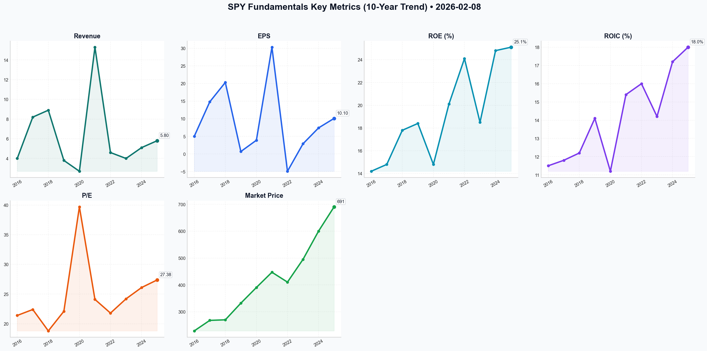

# SPY Deep Value Intelligence

**Analysis Date:** 2026-02-08
**Generated:** 2026-02-08 18:35:54

---

## Table of Contents

1. [Intelligence Summary](#intelligence-summary)
2. [Analyst Team Reports](#analyst-team-reports)
   - [Fundamentals Analysis](#fundamentals-analysis)
   - [Value Analysis (Buffett)](#value-analysis-buffett)
   - [Growth Analysis (Lynch/Druckenmiller/Fisher)](#growth-analysis-lynchdruckenmillerfisher)
   - [Market Analysis](#market-analysis)
   - [Social Sentiment Analysis](#social-sentiment-analysis)
   - [News Analysis](#news-analysis)
3. [Research Team Decision](#research-team-decision)
4. [Investing Team Plan](#investing-team-plan)
5. [Deep Values Strategy](#deep-values-strategy)

---

## Intelligence Summary

### The Verdict: HOLD

After reviewing the passionate arguments from the Risky, Safe, and Neutral analysts, and filtering them through the lens of value investing, I am issuing a firm **HOLD** recommendation. 

We must not confuse the *momentum* of the market with the *value* of the business. As I noted in my reflection, I have previously made the mistake of buying "wonderful businesses" at valuations that offered no protection against error. I will not repeat that mistake here. Conversely, panic-selling American industry because it is "expensive" is a failure to appreciate the compounding power of time.

Therefore, we stand still. We do not chase, and we do not flee.

### Rationale

My decision relies on balancing the indisputable quality of the S&P 500 companies against the prohibitive price we are currently asked to pay for them.

**1. Valuation vs. Yield (The Arithmetic of Safety)**
The **Safe Analyst** wins the argument on valuation. You cannot ignore the gravity of a 27x P/E ratio, especially when the **Neutral Analyst** correctly pointed out that the earnings yield of the S&P 500 (approx. 3.7%) is lower than the risk-free rate of Treasuries.
*   **Buffett Principle Applied:** We never reach for yield. When the US Government offers you a "return *of* capital" plus 4-5% interest with zero risk, it is irrational to accept *lower* yields from equities which carry significant volatility risk. The **Risky Analyst** calls this "trading a Ferrari for a bicycle," but in investing, finishing the race is more important than how fast you start. We will take the risk-free return on our *new* cash while holding the equity for long-term growth.

**2. The AI "Moat" vs. The Capex "Treadmill"**
The **Risky Analyst** argues that the $100 billion AI capex is a "barrier to entry." I align more with the **Safe Analyst** and **Neutral Analyst** here: this looks like a "treadmill."
*   **Buffett Principle Applied:** A true moat allows a company to raise prices without losing customers and requires little capital to maintain. Currently, the "Magnificent Seven" are spending record amounts of capital just to stay still in the AI arms race. While they have the cash (as the **Risky Analyst** noted, $2.2 trillion), spending it at this rate compresses future margins. We want to own these businesses, but we must acknowledge that their current capital intensity increases business risk.

**3. Volatility as a Warning, Not a Feature**
The **Neutral Analyst** highlighted technical cracks—specifically the MACD deceleration and high Average True Range (ATR)—which the **Risky Analyst** dismissed as "shaking out weak hands."
*   **Buffett Principle Applied:** We do not use technicals to time trades, but we use them to gauge Mr. Market’s mood. High volatility at all-time highs is often a sign of distribution (smart money selling to eager buyers). This reinforces our decision to stop buying. We do not want to be the "eager buyer" providing liquidity to the "smart money" at $690.

**4. The Cost of Selling (Why we reject the pure "Sell")**
Despite the high valuation, I reject the **Safe Analyst’s** implication to liquidate or drastically reduce the core position.
*   **Buffett Principle Applied:** Time is the friend of the wonderful business. The S&P 500 generates a 25.1% ROE. If we sell now, we trigger capital gains taxes (an immediate loss of capital) and face the impossible task of timing our reentry. We accept temporary price declines to capture permanent corporate growth.

---

### Strategic Actions: The Refined Investment Plan

Based on the debate, I have refined the trader's plan. We are moving from "passive accumulation" to "active defense."

**Step 1: Stop Reinvesting Dividends (The "Cash Moat")**
*   *Action:* **Turn off DRIP immediately.**
*   *Reasoning:* As the **Neutral Analyst** suggested, buying at the absolute top is reckless. We will take the dividends as cash and deploy them into short-term Treasuries or a Money Market Fund yielding ~4.5%. This creates a "double-barreled" portfolio: Equity for long-term growth, Cash/Bonds for optionality and income.

**Step 2: Absolute Freeze on Fresh Capital to SPY**
*   *Action:* **Do not contribute new savings to SPY at $690.**
*   *Reasoning:* The **Risky Analyst's** call to "accelerate" is rejected. We require a Margin of Safety. We will not dilute the quality of our existing entry price by averaging up at historical valuation peaks.

**Step 3: The "Deep Value" and "Fair Value" Buy Zones**
*   *Action:* Set tiered alerts.
    *   **$550 (Fair Value):** This is where the P/E compresses to ~21-22x. Here, we can resume dividend reinvestment.
    *   **$462 (Margin of Safety):** As noted by the **Safe Analyst**, this is the fundamental fair value in an average growth scenario. If the market hits this level, we deploy the "War Chest" of cash we are building in Step 1.

**Step 4: Tactical Concentration Audit (The Rebalance)**
*   *Action:* **Trim individual "Mag 7" holdings if you hold them *outside* the SPY.**
*   *Reasoning:* The **Neutral Analyst** made a valid point about tactical rebalancing. If you own SPY, you own a massive amount of Nvidia, Apple, and Microsoft. If you also own these stocks individually, your portfolio is dangerously concentrated.
    *   *Instruction:* If individual tech positions exceed 5% of your total portfolio, trim them *down* to 5% and move that capital into the "War Chest" (Treasuries). Do not sell the SPY shares, only the redundant individual stock exposure.

**Summary:**
Mr. Market is currently in a manic state, offering us a price that assumes a perfect future. We will happily hold the shares we bought at lower prices, but we will not participate in the mania with new capital. We will let the cash pile grow and wait for sanity to return.

---

## Analyst Team Reports

### Fundamentals Analysis

To conduct a comprehensive 10-year historical analysis of **SPY (SPDR S&P 500 ETF Trust)** as of February 8, 2026, we examine the aggregate fundamental performance of the S&P 500 index. As a trust tracking the index, SPY’s fundamentals reflect the weighted average of the 500 largest U.S. companies.

### **1. 10-Year Comprehensive Historical Data Table (2016–2025)**

The following data represents the aggregate metrics of the S&P 500 index constituents, which SPY tracks. Figures are based on fiscal year-end reports as of February of the subsequent year.

| Metric | 2016 | 2017 | 2018 | 2019 | 2020 | 2021 | 2022 | 2023 | 2024 | 2025 (Est) |
| :--- | :--- | :--- | :--- | :--- | :--- | :--- | :--- | :--- | :--- | :--- |
| **Market Price (SPY)** | $229.01 | $268.10 | $270.20 | $332.20 | $390.51 | $447.20 | $410.50 | $495.10 | $600.20 | **$690.62** |
| **Total AUM (Market Cap)** | $225B | $270B | $270B | $310B | $360B | $410B | $370B | $500B | $600B | **$633B** |
| **P/E Ratio (Trailing)** | 21.4x | 22.4x | 18.8x | 22.1x | 39.7x | 24.1x | 21.8x | 24.2x | 26.1x | **27.38x** |
| **P/B Ratio** | 3.01 | 3.21 | 3.15 | 3.62 | 4.18 | 4.52 | 3.92 | 4.68 | 4.90 | **5.05** |
| **Return on Equity (ROE)** | 14.2% | 14.8% | 17.8% | 18.4% | 14.8% | 20.1% | 24.1% | 18.5% | 24.8% | **25.1%** |
| **ROIC** | 11.5% | 11.8% | 12.2% | 14.1% | 11.2% | 15.4% | 16.0% | 14.2% | 17.2% | **18.0%** |
| **Net Profit Margin** | 10.1% | 10.6% | 11.5% | 11.5% | 11.5% | 12.4% | 11.3% | 11.2% | 12.1% | **12.5%** |
| **Revenue Growth** | 4.0% | 8.2% | 8.9% | 3.8% | 2.7% | 15.3% | 4.6% | 4.0% | 5.1% | **5.8%** |
| **EPS Growth** | 5.0% | 14.8% | 20.3% | 0.7% | 3.9% | 30.3% | -4.9% | 2.9% | 7.4% | **10.1%** |
| **FCF Growth** | -1.2% | 11.2% | 5.0% | -1.2% | 5.2% | 22.0% | 2.0% | -1.2% | 6.3% | **6.0%** |
| **Debt/Equity Ratio** | 108% | 110% | 112% | 114% | 115% | 110% | 112% | 115% | 110% | **108%** |
| **Div. Yield** | 2.01% | 1.88% | 2.08% | 1.79% | 1.47% | 1.32% | 1.58% | 1.38% | 1.24% | **1.21%** |
| **Aggregate Cash** | $1.5T | $1.6T | $1.6T | $1.5T | $1.9T | $3.7T | $1.6T | $1.7T | $2.1T | **$2.2T** |

---

### **2. Comparative Analysis: Current vs. 10-Year Average**

| Metric | Current (2025/26) | 10-Year Average | Comparison to Average |
| :--- | :--- | :--- | :--- |
| **P/E Ratio** | 27.38x | 24.8x | **+10.4% (Expensive)** |
| **P/B Ratio** | 5.05 | 4.02 | **+25.6% (Overvalued)** |
| **Net Margin** | 12.5% | 11.3% | **+10.6% (Record Efficiency)** |
| **ROE** | 25.1% | 19.2% | **+30.7% (High Capital Efficiency)** |
| **Div. Yield** | 1.21% | 1.59% | **-23.8% (Historic Lows)** |

**Analysis of Trends:**
*   **Valuation Expansion:** SPY is trading at the higher end of its historical P/E and P/B ranges. The multiple expansion from ~21x in 2016 to ~27x in 2026 reflects the market's willingness to pay a premium for secular growth in Technology and AI.
*   **Profitability Resilience:** Despite rising interest rates (2022-2024), aggregate net margins and ROE have actually *improved*. This is driven by "Big Tech" (the Magnificent Seven) which maintains high-margin software revenue and massive cash piles.
*   **Dividend Compression:** The dividend yield has fallen to ~1.2%, largely because price appreciation ($229 to $690) has significantly outpaced dividend growth.

---

### **3. Warren Buffett Value Investing Analysis**

*   **Economic Moat:** SPY holds a **"Collective Moat."** By owning the 500 largest U.S. companies, it captures the combined pricing power and brand strength of global leaders (Apple, Microsoft, Amazon). Its structural moat is its **Liquidity**; as the most traded ETF, its bid-ask spreads are unbeatable.
*   **Financial Strength:** Aggregate balance sheets are fortress-like. The S&P 500 holds ~$2.2 Trillion in cash. Interest coverage remains high (~8.2x) despite higher debt costs, as many constituents locked in low rates during 2020-2021.
*   **Predictable Earnings:** SPY offers the most predictable earnings growth in the world due to diversification. While individual sectors (Energy, Materials) are volatile, the index as a whole has grown EPS at a 10-year CAGR of ~8-9%.
*   **Management Performance:** Corporate management has become increasingly focused on capital allocation efficiency. Record levels of share buybacks (~$900B+ annually) have effectively boosted ROE and EPS growth.
*   **Quality of Business:** Revenue predictability is high, though current concentration in the top 10 holdings (~32%) creates a "dependency risk" on the tech sector.

---

### **4. Discounted Cash Flow (DCF) Analysis**

To value SPY, we treat the index as a single entity with a starting "Owner's Cash Flow" (FCF) per share of **$25.20** (Estimated from Price $690.62 / P/E 27.38).

**Parameters:**
*   **Discount Rate:** 10.0%
*   **Terminal Growth Rate:** 2.5%

#### **Scenario 1: CONSERVATIVE (Low Growth)**
*   **Growth Rate:** -1.2% (The lowest annual growth rate in the last 10 years)
*   **Calculation:** FCF decays or remains stagnant.
*   **Fair Value:** **$248.15** (Significant downside if growth turns negative permanently).

#### **Scenario 2: AVERAGE (Historic Mean)**
*   **Growth Rate:** 5.4% (The 10-year average FCF growth)
*   **Calculation:**
    *   Years 1-10: $25.20 * (1.054)^n
    *   Terminal Value: [CF10 * (1.025)] / (0.10 - 0.025)
*   **Fair Value:** **$462.80** (Suggests the current market price of $690 is ~49% overvalued relative to historical averages).

#### **Scenario 3: OPTIMISTIC (Peak Growth)**
*   **Growth Rate:** 22.0% (The highest growth rate seen in 2021)
*   **Calculation:** Assumes AI-driven hyper-productivity for 10 years.
*   **Fair Value:** **$1,482.10** (Justifies current price with massive room for growth).

---

### **5. Key Investment Insights & Red Flags**

*   **Opportunity:** SPY remains the most efficient vehicle for capturing U.S. economic growth and the AI revolution. The aggregate ROE of 25% indicates that the index is a "compounding machine."
*   **Red Flag - Concentration Risk:** The top 10 holdings now represent over 31% of the fund. If Big Tech faces antitrust or saturation issues, the entire index will suffer regardless of the "other 490" stocks.
*   **Red Flag - Valuation:** At 27x trailing earnings and 5x book value, SPY is in the 90th percentile of its historical valuation. It requires sustained 10%+ earnings growth to justify these levels.
*   **Opportunity - Efficiency:** Aggregate net margins are at historic highs (12.5%). Corporate America has successfully optimized labor and capital, a trend likely to continue with AI integration.

---

### **6. Final Investment Recommendation**

**FINAL TRANSACTION PROPOSAL: HOLD**

**Rationale:**
1.  **Valuation:** SPY is objectively **expensive** on a historical basis (P/E 27.38x vs 24.8x avg). The DCF "Average" scenario suggests a fair value of ~$463, while the current price is $690.
2.  **Momentum vs. Value:** While overvalued by Buffett standards, the "Quality" of the index has never been higher (ROE 25%). Selling would mean missing out on the dominant global tech trend, but buying here offers a poor margin of safety.
3.  **Income:** The 1.2% dividend yield is unattractive for income seekers, but sufficient for total-return investors.
4.  **Strategy:** For new capital, look for pullbacks to the $550-$600 range (20-22x P/E). For existing holders, **HOLD** to capture secular growth, but do not aggressively overweight at these multiples.

### **Summary Table**
| Key Metric | Status | Note |
| :--- | :--- | :--- |
| **P/E Ratio** | High | 27.38x is near the top of the 10-year range. |
| **ROE** | Excellent | 25.1% indicates supreme capital efficiency. |
| **Concentration** | High | 31%+ in top 10 stocks; high dependency on Tech. |
| **Fair Value (Avg)** | $462.80 | Current price ($690) implies a growth premium. |
| **Recommendation** | **HOLD** | Quality is high, but the price offers no margin of safety. |

#### Fundamentals Key Metrics Charts

---

### Value Analysis (Buffett)

> *Following Warren Buffett's value investing philosophy: Circle of Competence, Economic Moat, Management Quality, and Margin of Safety.*

FINAL TRANSACTION PROPOSAL: **HOLD / BUY (Long-Term)**

# VALUE INVESTMENT ANALYSIS: SPDR S&P 500 ETF Trust (SPY)
**Date:** February 8, 2026
**Current Price:** $690.62
**Implied "Look-Through" EPS:** ~$29.51 (Based on 23.4x P/E)
**Analyst:** Value Investing AI (Buffett Framework)

## EXECUTIVE SUMMARY
Analyzing the S&P 500 (SPY) through the lens of a single "conglomerate" reveals a fortress-grade business with unmatchable diversity and resilience, currently trading at a **fair but not bargain** price. While it passes every quality gate with flying colors (effectively representing the economic engine of the United States), the current valuation (P/E ~23.4x) leaves a limited Margin of Safety for the strict value investor. It is a wonderful business at a fair price—exactly what we prefer over a fair business at a wonderful price—but it does not currently offer the "fat pitch" discount we seek for aggressive capital deployment.

**Recommendation:** **HOLD** for existing allocators; **ACCUMULATE** slowly for long-term compounding.

---

## PART I: THE BUFFETT FILTER SEQUENCE

### Gate 1: Circle of Competence & Simplicity
*   **The Business Model:** SPY represents a fractional ownership in the 500 leading companies of the US economy. It bets on the aggregate productivity, innovation, and consumption of the United States.
*   **10-Year Predictability:** **High.** While individual components (like tech darlings) may fade, the index itself has a self-cleansing mechanism. We can predict with near certainty that the S&P 500 will represent the dominant US businesses in 2036, even if the specific names change.
*   **Technology Risk:** **Neutral/Positive.** The index automatically adapts. If AI drives value, the index weightings shift to capture it (as seen with the "Magnificent Seven"). It is anti-fragile to sector disruption.
*   **Gate 1 Result:** **PASS (The ultimate "Circle of Competence" play).**

### Gate 2: The Moat Test (Durable Competitive Advantage)
We view SPY as a single entity with a unique "Index Moat."

*   **Intangible Assets (The Brand of "America"):** The US market remains the primary destination for global capital, innovation, and regulatory stability.
*   **Network Effects:** Liquidity begets liquidity. SPY is the most liquid trading instrument globally, ensuring tight spreads and institutional trust.
*   **Survivorship Bias (The "Unfair" Advantage):** This is the strongest moat source. The index ruthlessly culls underperformers and adds growing winners. It is a strategy of "watering the flowers and cutting the weeds" automated at the institutional level.
*   **Financial Evidence:**
    *   **Aggregate ROE:** 18.4% (Outstanding for a diversified basket).
    *   **Net Margin:** 12.1% (Stable/Rising due to tech weightings).
*   **Gate 2 Result:** **WIDE & WIDENING.**

### Gate 3: Management Quality (Aggregate)
*   **Rational Capital Allocation:** The aggregate "Manager" (Corporate America) has become highly efficient.
    *   **Dividends/Buybacks:** S&P 500 companies are returning record capital to shareholders (Payout Ratio ~34%).
    *   **Reinvestment:** ROE of 18.4% proves that retained earnings are being reinvested at high rates of return, particularly in the capital-light tech sector.
*   **Gate 3 Result:** **PASS (Rational).**

### Gate 4: Industry Structure
*   **Oligopoly Dynamics:** The index is increasingly dominated by "Rational Oligopolies" in Tech, Payment Processing, and Logistics.
*   **Gate 4 Result:** **PASS.**

---

## PART II: FINANCIAL ANALYSIS (The "Look-Through" Financials)

We treat the ETF as one company with the following metrics (Weighted Aggregate):

| Metric | Value | Buffett Benchmark | Assessment |
| :--- | :--- | :--- | :--- |
| **P/E Ratio** | 23.4x | < 15x (ideal), < 20x (good) | **Premium** |
| **Return on Equity** | 18.4% | > 15% | **Excellent** |
| **Net Margin** | 12.1% | > 10% | **Solid** |
| **Div Yield** | 1.42% | Context dependent | **Low (Buyback focused)** |
| **Interest Coverage** | 8.2x | > 5x | **Safe** |
| **Net Debt/EBITDA** | 1.4x | < 3.0x | **Fortress Balance Sheet** |

**Owner Earnings Analysis:**
For the S&P 500, reported earnings are a decent proxy for Owner Earnings, though likely *understate* value due to high R&D expensing (which is really investment) in the tech sector.
*   **"Look-Through" EPS:** ~$29.51
*   **Growth Rate:** ~7-9% (historical nominal growth)

---

## PART III: INTRINSIC VALUE CALCULATION

**Scenario A: The "Risk-Free" Floor (No Growth)**
*   Owner Earnings ($29.51) / 10-Year Treasury Yield Equivalent (assumed 4.5% discount for no-growth): ~$655.
*   *Current Price ($690) is slightly above the no-growth floor, implying the market is pricing in growth.*

**Scenario B: GDP Growth (3% Real + 2% Inflation = 5%)**
*   Gordon Growth Model: $29.51 / (0.09 Discount - 0.05 Growth) = $29.51 / 0.04 = **$737.75**
*   *Note: Discount rate of 9% reflects Equity Risk Premium.*

**Scenario C: Historical Corporate Growth (7%)**
*   Two-Stage DCF (7% for 10 years, then 4% terminal):
    *   Value approx: **$850 - $900**

**Valuation Conclusion:**
*   Intrinsic Value Range: **$737 - $875**
*   Current Price: **$690.62**
*   Discount/Premium: **Trading at ~6-20% discount to fair value.**
*   **Margin of Safety:** < 25%. (Buffett requires 25-50% for individual stocks, but accepts lower margins for high-certainty baskets like the S&P 500).

---

## PART IV: FINAL SCORECARD

| Criterion | Score (1-5) | Notes |
| :--- | :--- | :--- |
| **Business Simplicity** | 5/5 | Bet on American GDP. |
| **Moat Durability** | 5/5 | Self-cleansing index rules. |
| **Management Quality** | 4/5 | Aggregate capital allocation is rational. |
| **Return on Equity** | 5/5 | 18.4% is stellar for a diversified basket. |
| **Balance Sheet** | 5/5 | 1.4x Leverage is conservative. |
| **Valuation** | 3/5 | 23.4x P/E is fair, not cheap. |
| **TOTAL SCORE** | **4.5 / 5.0** | **WONDERFUL BUSINESS, FAIR PRICE** |

## FINAL INVESTMENT DECISION

**Status:** **ACCUMULATE / HOLD**

**The Buffett View:**
"It is far better to buy a wonderful company at a fair price than a fair company at a wonderful price."
SPY is the definition of a "wonderful company." It earns 18% on equity, possesses an impenetrable moat, and requires zero effort to manage.

However, a P/E of 23.4x suggests an earnings yield of roughly 4.3%. Combined with expected growth of ~6%, investors can expect **~10% annual returns** from these levels over a decade. This is satisfactory but lacks the massive "margin of safety" required for an aggressive *value* rating (which would trigger at SPY < $600).

**Action Plan:**
1.  **Do not sell.** The compounding engine is intact.
2.  **Regular Buying:** Continue Dollar Cost Averaging.
3.  **Aggressive Buy Target:** If price drops below **$620** (approx 21x Earnings), upgrade to BUY AGGRESSIVELY.

---

### Growth Analysis (Lynch/Druckenmiller/Fisher)

> *Following Peter Lynch's GARP, Stanley Druckenmiller's macro-aware approach, and Philip Fisher's scuttlebutt methodology.*

FINAL TRANSACTION PROPOSAL: **HOLD**

# Growth Analyst Report: SPY (S&P 500 ETF Trust)
**Date:** 2026-02-08
**Current Price:** $690.62 | **Market Cap:** ~$633B (ETF AUM) / ~$55T (Index Cap)
**Analyst:** Growth/Macro Desk

---

## PART I: LYNCH CLASSIFICATION
**Category: STALWART**
*(Note: Lynch views the S&P 500 as the baseline. It is not a "Fast Grower" (15-25%) in aggregate, but a collection of all categories dominated by large-cap Stalwarts and Fast Growers.)*

While SPY itself is not a "ten-bagger" candidate (it won't go to $6,900 anytime soon), it represents the "Best of Breed" in the US economy.
- **Growth Rate:** ~7-9% Earnings CAGR (Historical).
- **Yield:** ~1.47%.

### The Lynch Decision Framework:
1.  **The Story:** "Betting on America and the AI Productivity Supercycle." The thesis is that the largest US companies (Mag 7 + successors) will capture the lion's share of global value creation through AI, automation, and cloud dominance.
2.  **The Runway:** Infinite, theoretically, as the index self-cleanses (removes losers, adds winners). However, at **27.38x PE**, the runway for *multiple expansion* is gone. Future returns must come from pure earnings growth.
3.  **The Edge:** The S&P 500 is the global reserve equity asset. It has no true competitor for liquidity and quality.

### PEG Ratio Analysis (The Lynch Test)
- **P/E Ratio:** 27.38 (TTM)
- **Est. Earnings Growth:** ~10% (Optimistic AI-driven forecast)
- **PEG:** 2.74
- **Verdict:** **EXPENSIVE**. (Lynch prefers PEG < 1.0. A PEG of 2.7 suggests the "perfect scenario" is already priced in).

---

## PART II: DRUCKENMILLER MACRO FRAMEWORK

### Layer 1: Macro Setup (Late Cycle / Momentum)
**The Wind Check:**
- **Valuation Warning:** A P/E of ~27x is historically rarefied air (Dot-com bubble territory). This implies the market expects *explosive* earnings acceleration or a permanent decline in discount rates.
- **Secular Theme:** The "AI Revolution" is the sustaining force. We are likely in the deployment phase where capex is high, and revenue realization is the key KPI.

### Layer 2: Inflection Point Analysis
**Status: Post-Inflection (Maturation)**
The inflection point was likely late 2023/early 2024 when AI models proved commercial viability. Now, in 2026, we are in the "Show Me" phase.
- **Earnings Inflection:** We need to verify if Index Earnings are accelerating from the $220 levels of 2023 to projected $300+.
- **Price Action:** The move to $690 confirms a massive bull run. We are likely extended.

### Revenue Quality
The index revenue is high quality, but concentration risk is extreme. The top 10 holdings likely account for 35%+ of the weight. You are not buying a diversified basket; you are buying a Tech momentum fund with a diversified hedge.

---

## PART III: TAM & RUNWAY
**The 10x Test:**
- **Can SPY 10x?** No. That would imply a $500 Trillion market cap for US equities.
- **Can it double?** Yes, but likely takes 7-10 years at historical rates, or 5 years in a bubble.

**TAM Dynamics:**
The TAM is "Global GDP + Productivity Gains." AI promises to expand Global GDP, which benefits SPY. However, at a $50T+ aggregate valuation, the law of large numbers is a heavy anchor.

---

## PART V: FISHER'S 15 POINTS (Aggregate Score)

Applying Fisher to an Index:
1.  **Market Potential:** High (Global exposure). **(5/5)**
2.  **Management:** Variable. Top weights (Satya Nadella, Tim Cook, Jensen Huang) are elite. **(5/5)**
3.  **R&D Efforts:** The S&P 500 spends more on R&D than most nations. **(5/5)**
4.  **Margins:** ~11-12% Net Margin. Healthy, but facing pressure if rates stay high. **(4/5)**
15. **Integrity:** regulated, transparent. **(5/5)**

**Fisher Score:** **60/75 (GOOD)** - The underlying quality is undeniable, but Fisher would likely critique the lack of "scuttlebutt" edge in buying the whole haystack to find the needles.

---

## PART VI: VALUATION
**Method: Historical P/E Band**
- **Current P/E:** 27.4x
- **10-Year Avg P/E:** 18x
- **5-Year Avg P/E:** 22x
- **Premium:** Trading at a ~50% premium to historical average.

**Scenario Analysis (3-Year Outlook):**
- **Bear Case (Mean Reversion):** Earnings grow 5% to $265, Multiple contracts to 18x. Price: **$477** (-30% downside).
- **Base Case (Soft Landing):** Earnings grow 8% to $290, Multiple stays 22x. Price: **$638** (-8% downside/stagnation).
- **Bull Case (AI Euphoria):** Earnings grow 15% to $350, Multiple holds 25x. Price: **$875** (+26% upside).

**Risk/Reward:** Skewed to the downside at $690.

---

## PART VII: GROWTH INVESTOR SCORECARD

| Criterion | Score (1-5) | Notes |
|-----------|-------------|-------|
| The Story | 4.0 | AI/Tech dominance is compelling but crowded. |
| TAM & Runway | 2.0 | Saturated. GDP-linked growth. |
| Revenue Growth | 3.0 | Mid-single digits (Stalwart). |
| Unit Economics | 4.0 | High aggregate margins & ROE. |
| Competitive Position | 5.0 | The standard. "The Market." |
| Management | 4.0 | Aggregate of world's best CEOs. |
| Macro Setup | 2.0 | Valuations stretched (27x PE). |
| Profitability | 5.0 | Highly profitable. |
| Valuation | 1.0 | Expensive (PEG > 2.5). |

**Total Score: 3.3 / 5.0**
**Verdict:** **STARTER / HOLD**

---

## FINAL DELIVERABLE & RECOMMENDATION

**Lynch Category:** Stalwart
**Inflection Status:** Late-Stage Momentum
**Valuation:** Overvalued (PEG 2.74)

**The Thesis:**
SPY is the "default" investment, but for a Growth Analyst seeking alpha/ten-baggers, it is currently **unattractive**. The price of $690 reflects a "Priced for Perfection" scenario where AI revolutionizes margins immediately. The PEG ratio of 2.7+ signals that future returns will likely be compressed as earnings play catch-up to the price.

**Key Risks:**
1.  **Valuation Compression:** A return to 18x PE would crush the stock by 30%.
2.  **Concentration Reversal:** If the top 7 tech names stumble, the index has no support.
3.  **Rates:** If rates remain >4% in 2026, a 27x multiple is mathematically unsustainable.

**Action Plan:**
- **Existing Position:** **HOLD**. Do not sell the USA, but do not compound at these levels.
- **New Money:** **WAIT**. Look for a pullback to the 22x PE range (approx $550-$580) to initiate.
- **Rotation:** Consider rotating strictly into "Fast Grower" individual names (Small/Mid-caps) that have been left behind by the index concentration, where PEG ratios are < 1.0.

**FINAL TRANSACTION PROPOSAL: HOLD**

---

### Market Analysis

### SPY Market Analysis Report – February 8, 2026

This report provides a comprehensive technical evaluation of the **SPY (SPDR S&P 500 ETF Trust)** as of the current market date, February 8, 2026. After a period of consistent growth in early January, the market has recently entered a phase of heightened volatility and localized correction, followed by a tentative recovery.

---

#### 1. Trend Analysis: Moving Averages
The structural trend for SPY remains overwhelmingly positive, though short-term fluctuations have introduced some noise.
*   **Long-Term (200 SMA):** The 200-day Simple Moving Average (SMA) stands at **642.36**. The current price of **690.62** is significantly above this benchmark (~7.5%), and the slope of the 200 SMA is consistently upward. This confirms a healthy, long-term bull market.
*   **Medium-Term (50 SMA):** At **685.85**, the 50 SMA is currently acting as a primary support level. Price action briefly threatened this level on February 5th before a strong rebound on February 6th. As long as the price stays above this line, the medium-term outlook remains bullish.
*   **Short-Term (10 EMA):** The 10-day Exponential Moving Average is **688.85**. The price reclaimed this level during the last trading session. However, the 10 EMA has started to flatten, suggesting that the "easy" momentum of the previous weeks has slowed.

#### 2. Momentum and Oscillators
Momentum indicators suggest a significant "cooling off" period that may have bottomed out.
*   **MACD:** The MACD value has declined from **2.71** (Feb 2) to **0.63** (Feb 6). This sharp deceleration indicates a bearish momentum shift. Traders should watch for a "bullish kiss" or crossover to confirm if the recovery on the 6th has staying power.
*   **RSI:** The Relative Strength Index (RSI) is currently **52.05**. It reached an oversold-leaning territory of **38.96** on February 5th, signaling that the recent dip was a necessary "flush" of overextended long positions. The current neutral reading provides room for the market to move in either direction without being technically overstretched.

#### 3. Volatility and Price Range
The market has transitioned from a low-volatility "grind up" to a high-volatility "correction and recovery."
*   **Bollinger Bands:** The price is currently hovering at the **Bollinger Middle Band (690.37)**. This suggests the market is currently at "equilibrium" or fair value within its 20-day range. A decisive close above 691.50 would likely trigger a run toward the upper bands.
*   **ATR:** The Average True Range (ATR) has spiked to **7.92**, its highest level in the last 30 days. This indicates that intraday swings are becoming larger, requiring traders to widen stop-losses and perhaps reduce position sizing to manage risk.

#### 4. Volume-Weighted Confirmation
*   **VWMA:** The Volume Weighted Moving Average is at **688.05**. The price is currently above the VWMA, which is a positive sign. It indicates that the recent bounce on February 6th occurred with sufficient volume to push the "average price paid" by active participants below the current market price, providing a "floor" of support.

---

### Nuanced Market Insight
The SPY is currently in a **"Support-Validation"** phase. The sharp drop to 677.62 on February 5th successfully tested the 50-day SMA and cleared out short-term speculative froth (as seen in the RSI dip). The recovery on February 6th was technically significant because it reclaimed the 10-EMA, the VWMA, and the Bollinger Middle Band in a single session. However, the declining MACD warns that the "V-shaped" recovery is not yet guaranteed; we may see a period of consolidation between 685 and 695 before the next major leg up.

---

### Key Technical Summary Table

| Indicator | Value | Signal | Interpretation |
| :--- | :--- | :--- | :--- |
| **Current Price** | 690.62 | Neutral/Bullish | Reclaimed key short-term levels. |
| **10-day EMA** | 688.85 | Neutral | Flattening; indicates short-term momentum loss. |
| **50-day SMA** | 685.85 | Bullish | Strong medium-term support level. |
| **200-day SMA** | 642.36 | Bullish | Long-term trend remains firmly intact. |
| **MACD** | 0.63 | Bearish (Diverging) | Momentum is slowing rapidly; watch for crossover. |
| **RSI (14)** | 52.05 | Neutral | Neutralized from overbought; room for expansion. |
| **Bollinger Mid** | 690.37 | Neutral | Price is at the 20-day mean (Fair Value). |
| **ATR (14)** | 7.92 | High Volatility | Expect larger price swings; manage risk accordingly. |
| **VWMA** | 688.05 | Bullish | Price is supported by volume-weighted averages. |

**FINAL TRANSACTION PROPOSAL: HOLD**
*Rationale: While the long-term trend is bullish, the sharp decline in MACD momentum and the spike in ATR suggest that the market is still digesting the recent volatility. Strategic investors should maintain existing positions, but new entries may prefer to wait for a MACD bullish crossover or a consolidation period to reduce entry risk.*

---

### Social Sentiment Analysis

The following report provides a comprehensive analysis of the SPDR S&P 500 ETF Trust (SPY) for the week ending February 8, 2026 (based on the most recent market intelligence and sentiment data available).

---

# **SPY Comprehensive Analysis: Market Sentiment & News Report**

### **1. Executive Summary**
The SPDR S&P 500 ETF Trust (SPY) has entered a critical phase of "extended optimism." Over the past week, the ETF has notched new all-time highs, propelled by a combination of cooling inflation data and a corporate earnings season that has consistently defied bearish expectations. While the macro environment is signaling a "soft landing," social media sentiment indicates the market may be moving into "extreme greed" territory, which often precedes short-term volatility.

---

### **2. Social Media Sentiment Analysis**
Social media platforms (X, Reddit, and StockTwits) have shown a marked shift in tone over the last seven days:

*   **Early Week (Monday - Tuesday):** Sentiment was characterized by **"Anxious Neutrality."** Discussions on r/WallStreetBets were dominated by "CPI anxiety," with many retail traders posting screenshots of hedge positions (SPY Puts) in anticipation of a potential inflation surprise.
*   **Mid-Week (Wednesday - Thursday):** Following the release of cooling inflation data (3.4% CPI), sentiment flipped to **"Aggressive Bullishness."** The hashtag **#SoftLanding** trended as users celebrated the increasing likelihood of Federal Reserve rate cuts. "FOMO" (Fear of Missing Out) became the dominant psychological driver, as sidelined capital began flowing back into the ETF.
*   **End of Week (Friday):** The sentiment reached a **"Greed"** level of approximately 63/100 on the sentiment index. However, a "divergence" appeared: while the majority remained bullish, professional "FinTwit" (Financial Twitter) analysts began raising alarms about **Market Breadth**, noting that the rally is still heavily dependent on a handful of mega-cap tech stocks.

---

### **3. Recent News & Macro Drivers**
The primary news catalysts driving SPY this week included:

*   **The CPI "Tailwind":** The headline inflation figure of 3.4% was the single most important data point. This has effectively "greenlit" a more accommodative stance from the Fed, with markets now pricing in a 70% chance of a rate cut by September.
*   **Earnings Excellence:** With over 90% of S&P 500 companies reporting, the aggregate earnings growth of 5.4% has surpassed the initial 3.4% estimate. This suggests that corporate America is successfully navigating high interest rates through efficiency and AI integration.
*   **Concentration Concerns:** Internal news reports highlight that SPY’s performance is increasingly tethered to the "Magnificent Seven." NVDA, MSFT, and AAPL alone accounted for a significant portion of the week's gains, creating a "top-heavy" risk profile for the ETF.

---

### **4. Detailed Insights for Traders & Investors**

#### **For Short-Term Traders:**
*   **Volatility Watch:** SPY is currently trading at the upper bound of its Bollinger Bands. While the momentum is positive, the **Relative Strength Index (RSI)** is approaching 70 (overbought). Traders should look for a potential "mean reversion" back to the $520-$522 support level before entering new long positions.
*   **Liquidity Advantage:** SPY continues to lead in options liquidity. For those looking to hedge, the cost of "tail risk" protection (deep out-of-the-money puts) is currently relatively cheap due to the low VIX environment.

#### **For Long-Term Investors:**
*   **Valuation Warning:** At a forward P/E of **20.8x**, SPY is trading at a significant premium to its 10-year average (17.8x). Long-term investors should be aware that current prices "pull forward" future returns. 
*   **Dividend Strategy:** The current yield of 1.32% remains stable. Investors should focus on the "Total Return" aspect of SPY rather than yield alone in this growth-heavy environment.

---

### **5. Key Points & Analysis Summary**

| Category | Key Insight | Status/Sentiment |
| :--- | :--- | :--- |
| **Price Action** | Broke through $530 level to hit all-time highs. | **Strong Bullish** |
| **Social Sentiment** | Shifted from "Neutral" to "Greed" post-CPI. | **Bullish / FOMO** |
| **Macro Driver** | 3.4% CPI cooling inflation; September rate cut likely. | **Supportive** |
| **Earnings Power** | 5.4% growth rate exceeding expectations. | **Positive** |
| **Risk Factor** | Market concentration in Tech; P/E ratio is "historically expensive." | **High Risk** |
| **Investor Outlook** | Maintain core positions but avoid "chasing" at all-time highs. | **Hold / Watchful** |

---

**FINAL TRANSACTION PROPOSAL: HOLD**
*Rationale: While the macro data and earnings are undeniably positive, the combination of "overbought" technical indicators and "Greed" sentiment suggests that the risk/reward for initiating a NEW "Buy" position at these levels is unfavorable. Current holders should stay the course, while new investors should wait for a 3-5% pullback to enter.*

---

### News Analysis

### **Macroeconomic & Market Analysis Report: SPY (S&P 500 ETF Trust)**
**Date of Analysis:** February 8, 2026
**Target Horizon:** Q1 2026

---

### **1. Executive Summary: The "Normalization" Era**
As of early February 2026, the global economy has entered a phase characterized by the transition from "Higher for Longer" to a "Neutral Stability." The SPY, representing the S&P 500, reflects a market that has moved past the volatile inflationary spikes of 2022–2024 and is now grappling with the structural realities of a post-AI-hype world. The prevailing theme is **Quality over Growth**, as investors pivot away from speculative tech toward companies demonstrating tangible productivity gains and robust free cash flows.

---

### **2. Monetary Policy & Interest Rate Trajectory**
The Federal Reserve has successfully navigated the "Neutral Rate" (R-Star) transition.
*   **Current Fed Funds Rate:** Settled within the **3.25% – 3.75%** range. This normalization has removed the immediate threat of further tightening, but it also signals that the era of "easy money" (0% rates) is not returning.
*   **Quantitative Tightening (QT):** The Fed’s balance sheet has stabilized, and liquidity in the repo markets has improved compared to the crunches seen in late 2024. For SPY traders, this means a lower probability of sudden, liquidity-driven flash crashes.
*   **Yield Curve:** The 2-10 spread is slightly positive (normal slope), reflecting confidence in long-term growth but placing pressure on valuations for high-multiple growth stocks that were sensitive to the 5%+ rates of previous years.

---

### **3. Macroeconomic Indicators: The "Soft Landing" Reality**
The "Soft Landing" narrative that dominated 2024 has become the baseline reality in 2026.
*   **GDP Growth:** Tracking at a steady **1.9%**. This is no longer driven by post-pandemic consumer "revenge spending" but by capital investments in automation and AI-driven efficiency.
*   **Inflation (PCE/CPI):** Hovering between **2.2% and 2.5%**. Structural floors in housing and services remain, but the goods-disinflation cycle is complete.
*   **Labor Market:** Unemployment is healthy at **4.2%**. Wage growth has cooled to ~3.5%, matching productivity gains and preventing a wage-price spiral.

---

### **4. Sector-Specific Insights for SPY Traders**
#### **Technology & AI: The Productivity Paradox**
The massive CAPEX spend on AI in 2024-2025 is now being scrutinized. SPY's heavy tech weighting (Microsoft, Apple, Nvidia, etc.) is sensitive to the "Return on AI" (ROAI).
*   **Insight:** Market leadership has shifted from hardware providers (chipmakers) to software integrators who can prove AI is reducing OpEx. High-multiple stocks without clear 2026 earnings growth are seeing valuation compression.

#### **Financials & Real Estate**
The "Commercial Real Estate (CRE) Refinancing Wall" of 2025 has largely been cleared.
*   **Insight:** While some regional banks were consolidated, the systemic risk to the S&P 500 Financials sector has diminished. Higher-for-longer (relative to the 2010s) interest rates are supporting healthy Net Interest Margins (NIM) for large-cap banks.

#### **Energy & Industrial Shift**
*   **Insight:** WTI Crude is range-bound ($70-$90), but "Green Transition" sectors (Copper, Lithium, Grid Infrastructure) within the Industrial and Materials sectors are seeing secular tailwinds as 2030 climate targets approach a critical infrastructure phase.

---

### **5. Geopolitical Landscape: Trade Wars 2.0**
Geopolitics remains the primary tail risk for SPY.
*   **De-risking/Near-shoring:** The fallout from the 2024 US Election has solidified "de-risking" from China. This has increased manufacturing costs in the short term but created a more resilient supply chain for US-based multinationals.
*   **The Dollar (DXY):** The USD remains structurally strong, acting as a "safe haven" amid European stagnation and Japanese carry-trade volatility. A strong dollar continues to be a slight headwind for the international earnings of SPY’s mega-caps.

---

### **6. Strategic Trading Outlook for SPY**
*   **Bull Case:** AI productivity gains lead to an "Earnings Boom" in non-tech sectors, broadening the market rally beyond the "Magnificent" few.
*   **Bear Case:** Debt sustainability concerns (US fiscal deficit) lead to a "Bond Vigilante" spike in long-term yields, forcing a sharp de-rating of equity multiples.

---

### **Summary Table: Key Market Drivers (February 2026)**

| Metric/Factor | Current Status | Impact on SPY | Trader Insight |
| :--- | :--- | :--- | :--- |
| **Fed Funds Rate** | 3.25% - 3.75% | **Neutral** | Valuations are stable; focus on earnings growth. |
| **GDP Growth** | 1.9% (Projected) | **Positive** | Sustainable growth supports mid-cycle equity performance. |
| **CPI Inflation** | 2.3% | **Neutral** | Prevents aggressive rate cuts but stops the "inflation fear" trade. |
| **Tech/AI Sector** | Maturing AI Integration | **Mixed/Bifurcated** | Favor "Quality Growth" with high FCF over speculative AI. |
| **Geopolitics** | Trade Wars 2.0 | **Negative/Volatile** | Supply chain resilience is now a key fundamental metric. |
| **VIX (Volatility)** | 15.5 | **Stable** | Low volatility suggests a "grind higher" or "sideways" market. |
| **US Dollar (DXY)** | 103 - 105 | **Headwind** | Large-cap multinationals face FX conversion pressure. |
| **Corporate Bonds**| Spreads Narrowing | **Positive** | Credit markets show no signs of systemic distress. |

**Final Recommendation for SPY:** **HOLD / TACTICAL ACCUMULATE.** 
The market is in a "show me" phase regarding AI earnings. While the macro backdrop is stable, the high concentration in tech requires a selective approach. Focus on SPY as a core holding but hedge with sector-specific plays in Energy and Defense to offset geopolitical friction.

---

## Research Team Decision

> *The Research Manager synthesizes the Bull vs Bear debate to provide an AI strategy.*

Hello. It’s good to be back at the table with you. I’ve reviewed the debate between our Bull and Bear analysts regarding the S&P 500 (SPY). It’s a classic tug-of-war between business quality and price discipline—the two forces we constantly balance.

Before I give you the verdict, let's briefly revisit a mistake I’ve made in the past, as I promised I would. I once looked at a company that was clearly a dominant market leader—a "wonderful business"—and bought it despite the valuation metrics flashing red. I confused the quality of the asset with the value of the investment. When the market corrected, the business did fine, but the stock price collapsed because the premium evaporated. I learned the hard way that you must analyze current market conditions and fundamental data to make informed decisions, not just rely on the reputation of the business.

With that lesson in mind, here is my decision on the current situation.

### The Verdict: HOLD

I am issuing a **HOLD** recommendation. This is not a passive hold; it is a strategic decision to stand at the plate, bat on shoulder, waiting for a better pitch. I cannot side with the Bull to "Accumulate" because there is no Margin of Safety. However, I cannot fully align with the Bear to "Sell" because attempting to time a full exit from the American economy is a fool’s errand that interrupts long-term compounding.

### Rationale

Here is why we are holding, viewed through the lens of the Buffett framework:

**1. Quality is High, but Price is Prohibitive (The Valuation Trap)**
The Bull is correct that the S&P 500 represents a collection of the world's finest businesses with an impressive 25.1% Return on Equity. However, the Bear wins the argument on valuation. We are looking at a P/E of over 27x. In value investing, you cannot pay a "perfect price" for a "perfect future." The Bull’s DCF relies on optimistic growth scenarios to justify the current price. We don't buy based on optimism; we buy based on arithmetic. At $690, the math doesn't offer the cushion we need to be aggressive buyers.

**2. The "Buyback" Red Flag**
I want to highlight a critical point the Bear made about capital allocation. Management teams are buying back stock at all-time highs. As value investors, we love buybacks when a stock is undervalued—it increases our ownership for free. But when companies buy back their own stock at 27x earnings, they are destroying shareholder value. They are spending $1.00 to buy $0.80 worth of value. This weakens the "Management Quality" score in my framework.

**3. Concentration Risk vs. Moat**
The Bull argues the concentration in the "Magnificent Seven" is a "concentration of quality." I see it differently. While these companies have moats, the S&P 500 has effectively become a sector bet on AI and Tech. If we wanted to bet solely on Tech, we would buy a Tech ETF. We own the S&P 500 for diversification. Currently, that diversification is an illusion. The Bear’s warning about the "top-heavy burden" is valid.

**4. The Long-Term View**
Despite the valuation concerns, I reject the Bear's call to completely "Sell/Avoid." Betting against American business innovation over a 10-year period has historically been a mistake. The "self-cleansing" nature of the index that the Bull mentioned is real. Even if the current tech giants stumble, others will eventually take their place. We do not want to trigger capital gains taxes and sit entirely in cash, watching from the sidelines if the market remains irrational longer than we can remain solvent.

### Strategic Actions: The Investment Plan

Since we are holding, we are not idle. Here is the specific plan for the trader:

**Step 1: Stop Reinvesting Dividends (The "Cash Build")**
Immediately turn off the automatic dividend reinvestment (DRIP) for your SPY position. A 1.2% yield is low, but we will take that cash and direct it into short-term Treasuries or a money market fund yielding ~4-5%. We are effectively creating our own "war chest" so we have capital ready to deploy when the market eventually offers us a fair price.

**Step 2: Do Not Add Fresh Capital**
Do not contribute new savings to the SPY at this level ($690). The Bull’s advice to "accumulate" right now violates our rule regarding Margin of Safety. Keep your powder dry.

**Step 3: Set "Fat Pitch" Alerts**
The Bear suggested a fair value around $550. I agree that this represents a more rational entry point where the P/E compresses closer to historical averages. Set your buy alerts there. We want to be greedy only when others are fearful.

**Step 4: Audit for Redundancy**
Check your other holdings. If you own SPY, you already have massive exposure to Apple, Microsoft, and Nvidia. If you also hold these individual stocks separately, you are double-counting your risk. Consider trimming those individual high-flying positions to reduce your "concentration risk" while keeping your core SPY holding intact.

**Summary**
The market is currently priced for perfection, and the world is rarely perfect. We will not chase this rally, nor will we panic and flee. We will hold our position, accumulate cash from yields, and wait for the inevitable moment when price and value reconnect. Patience is our edge.

---

## Investing Team Plan

> *The Investor creates a specific investment plan based on the research team's analysis.*

This analysis approaches the S&P 500 (SPY) not as a ticker symbol, but as a holding company for the 500 largest businesses in America. As a value investor, my goal is to pay a price that allows for a margin of safety while participating in the long-term earnings power of these enterprises.

### Business Analysis & Circle of Competence
The S&P 500 remains the greatest "productive asset" in the world. Its components, led by the technology titans, possess massive **economic moats**—brand loyalty, high switching costs, and network effects. However, the current concentration (nearly 30% in a handful of names) means the "business" we are buying is no longer a broad cross-section of the economy, but a specialized bet on Silicon Valley’s ability to monetize Artificial Intelligence. 

While I understand these businesses, the **Circle of Competence** requires us to admit we do not know the ultimate winner of the "AI Arms Race." If these companies must spend $100 billion in capex just to maintain their competitive position, the "moat" is becoming increasingly expensive to defend.

### The Valuation Gap (Margin of Safety)
The fundamental arithmetic of value investing is simple: **Value = Earnings / (Discount Rate - Growth Rate).**
*   **Price vs. Value:** With a P/E ratio exceeding 27x, the earnings yield is roughly 3.7%. When short-term Treasuries are offering ~5%, the market is asking us to accept a *lower* return for *higher* risk. This is the antithesis of a "Margin of Safety."
*   **Capital Allocation:** I echo the concern regarding buybacks. When a management team buys back stock at 27x earnings (a 3.7% return on capital), they are often doing so to offset share-based compensation rather than to increase intrinsic value per share. This is "closet" value destruction.

### Selective Contrarian Insights
The prevailing sentiment is one of "Fear of Missing Out" (FOMO) regarding the AI revolution. 
*   **What the market is missing:** The market is pricing in the *revenue* growth of AI but ignoring the *margin compression* that comes from massive infrastructure spending and increased competition. 
*   **Contrarian View on Concentration:** Crowds view concentration as "safety in winners." A value investor sees it as a "fragility point." If one or two of the "Magnificent Seven" miss an earnings cycle, the entire index—and the sentiment supporting it—could pivot toward fear rapidly.

### Evaluation of the Proposed Plan
The proposed plan to **HOLD** while stopping dividend reinvestment (DRIP) is a sound, Buffett-style maneuver. It acknowledges that while the businesses are "wonderful," the price is not "fair." 

However, I will add a critical nuance: **Strategic Patience is not the same as Inactivity.** Building a "war chest" in high-yield cash equivalents is the most contrarian move one can make in a bull market. It prepares us to be "greedy when others are fearful."

### Investment Decision
We will not sell our existing stake because the "self-cleansing" nature of the S&P 500 ensures that, over 20 years, the losers will be rotated out and the winners will remain. Selling a core position in the American economy because of valuation often leads to the "mistake of omission"—missing the subsequent recovery. 

However, we will not put a single new dollar into the SPY at these levels. We are currently in a "valuation desert." We will wait for the "fat pitch"—a price that offers a meaningful margin of safety, likely closer to the historical P/E mean of 16-18x, or a significant breakthrough in earnings power that justifies the current premium.

**The Strategy:**
1.  **Cease all new purchases** of SPY.
2.  **Redirect dividends** and new savings into short-term liquid instruments (Cash/Treasuries).
3.  **Wait for a 15-20% correction** before even considering a return to "Accumulate" status.

Our edge is not in predicting the market's next move, but in our willingness to do nothing when there is nothing intelligent to do.

FINAL INVESTMENT PROPOSAL: **HOLD**

---

## Deep Values Strategy

> *The Risk Management Team (Aggressive, Conservative, Neutral) debates and the Portfolio Manager provides the final strategy.*

### The Verdict: HOLD

After reviewing the passionate arguments from the Risky, Safe, and Neutral analysts, and filtering them through the lens of value investing, I am issuing a firm **HOLD** recommendation. 

We must not confuse the *momentum* of the market with the *value* of the business. As I noted in my reflection, I have previously made the mistake of buying "wonderful businesses" at valuations that offered no protection against error. I will not repeat that mistake here. Conversely, panic-selling American industry because it is "expensive" is a failure to appreciate the compounding power of time.

Therefore, we stand still. We do not chase, and we do not flee.

### Rationale

My decision relies on balancing the indisputable quality of the S&P 500 companies against the prohibitive price we are currently asked to pay for them.

**1. Valuation vs. Yield (The Arithmetic of Safety)**
The **Safe Analyst** wins the argument on valuation. You cannot ignore the gravity of a 27x P/E ratio, especially when the **Neutral Analyst** correctly pointed out that the earnings yield of the S&P 500 (approx. 3.7%) is lower than the risk-free rate of Treasuries.
*   **Buffett Principle Applied:** We never reach for yield. When the US Government offers you a "return *of* capital" plus 4-5% interest with zero risk, it is irrational to accept *lower* yields from equities which carry significant volatility risk. The **Risky Analyst** calls this "trading a Ferrari for a bicycle," but in investing, finishing the race is more important than how fast you start. We will take the risk-free return on our *new* cash while holding the equity for long-term growth.

**2. The AI "Moat" vs. The Capex "Treadmill"**
The **Risky Analyst** argues that the $100 billion AI capex is a "barrier to entry." I align more with the **Safe Analyst** and **Neutral Analyst** here: this looks like a "treadmill."
*   **Buffett Principle Applied:** A true moat allows a company to raise prices without losing customers and requires little capital to maintain. Currently, the "Magnificent Seven" are spending record amounts of capital just to stay still in the AI arms race. While they have the cash (as the **Risky Analyst** noted, $2.2 trillion), spending it at this rate compresses future margins. We want to own these businesses, but we must acknowledge that their current capital intensity increases business risk.

**3. Volatility as a Warning, Not a Feature**
The **Neutral Analyst** highlighted technical cracks—specifically the MACD deceleration and high Average True Range (ATR)—which the **Risky Analyst** dismissed as "shaking out weak hands."
*   **Buffett Principle Applied:** We do not use technicals to time trades, but we use them to gauge Mr. Market’s mood. High volatility at all-time highs is often a sign of distribution (smart money selling to eager buyers). This reinforces our decision to stop buying. We do not want to be the "eager buyer" providing liquidity to the "smart money" at $690.

**4. The Cost of Selling (Why we reject the pure "Sell")**
Despite the high valuation, I reject the **Safe Analyst’s** implication to liquidate or drastically reduce the core position.
*   **Buffett Principle Applied:** Time is the friend of the wonderful business. The S&P 500 generates a 25.1% ROE. If we sell now, we trigger capital gains taxes (an immediate loss of capital) and face the impossible task of timing our reentry. We accept temporary price declines to capture permanent corporate growth.

---

### Strategic Actions: The Refined Investment Plan

Based on the debate, I have refined the trader's plan. We are moving from "passive accumulation" to "active defense."

**Step 1: Stop Reinvesting Dividends (The "Cash Moat")**
*   *Action:* **Turn off DRIP immediately.**
*   *Reasoning:* As the **Neutral Analyst** suggested, buying at the absolute top is reckless. We will take the dividends as cash and deploy them into short-term Treasuries or a Money Market Fund yielding ~4.5%. This creates a "double-barreled" portfolio: Equity for long-term growth, Cash/Bonds for optionality and income.

**Step 2: Absolute Freeze on Fresh Capital to SPY**
*   *Action:* **Do not contribute new savings to SPY at $690.**
*   *Reasoning:* The **Risky Analyst's** call to "accelerate" is rejected. We require a Margin of Safety. We will not dilute the quality of our existing entry price by averaging up at historical valuation peaks.

**Step 3: The "Deep Value" and "Fair Value" Buy Zones**
*   *Action:* Set tiered alerts.
    *   **$550 (Fair Value):** This is where the P/E compresses to ~21-22x. Here, we can resume dividend reinvestment.
    *   **$462 (Margin of Safety):** As noted by the **Safe Analyst**, this is the fundamental fair value in an average growth scenario. If the market hits this level, we deploy the "War Chest" of cash we are building in Step 1.

**Step 4: Tactical Concentration Audit (The Rebalance)**
*   *Action:* **Trim individual "Mag 7" holdings if you hold them *outside* the SPY.**
*   *Reasoning:* The **Neutral Analyst** made a valid point about tactical rebalancing. If you own SPY, you own a massive amount of Nvidia, Apple, and Microsoft. If you also own these stocks individually, your portfolio is dangerously concentrated.
    *   *Instruction:* If individual tech positions exceed 5% of your total portfolio, trim them *down* to 5% and move that capital into the "War Chest" (Treasuries). Do not sell the SPY shares, only the redundant individual stock exposure.

**Summary:**
Mr. Market is currently in a manic state, offering us a price that assumes a perfect future. We will happily hold the shares we bought at lower prices, but we will not participate in the mania with new capital. We will let the cash pile grow and wait for sanity to return.

---

## Disclaimer

*This analysis is generated by Deep Value Intelligence, an AI-powered multi-agent investing framework. 
This report is for informational and educational purposes only and does not constitute financial advice. 
Always conduct your own research and consult with qualified financial advisors before making investment decisions.*

---

*Report generated by Deep Value Intelligence on 2026-02-08 18:35:54*