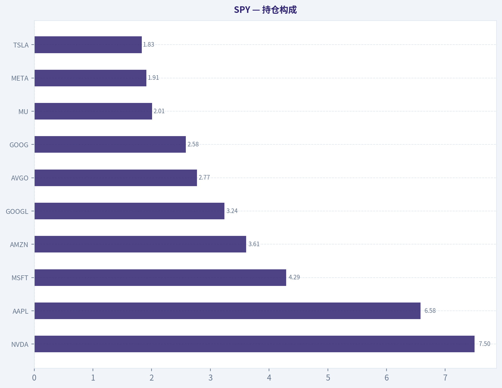
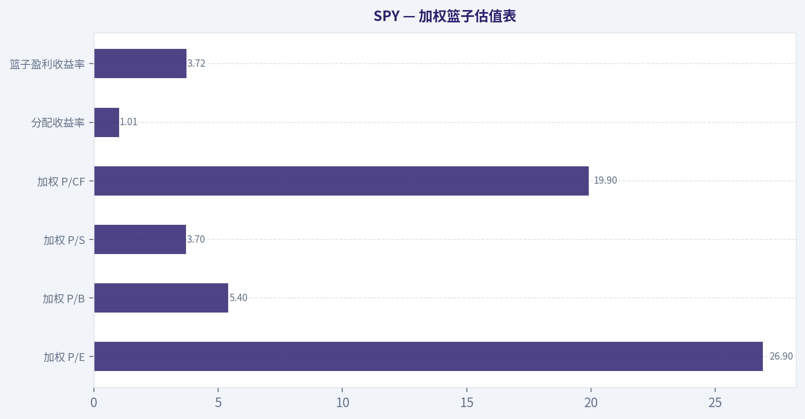
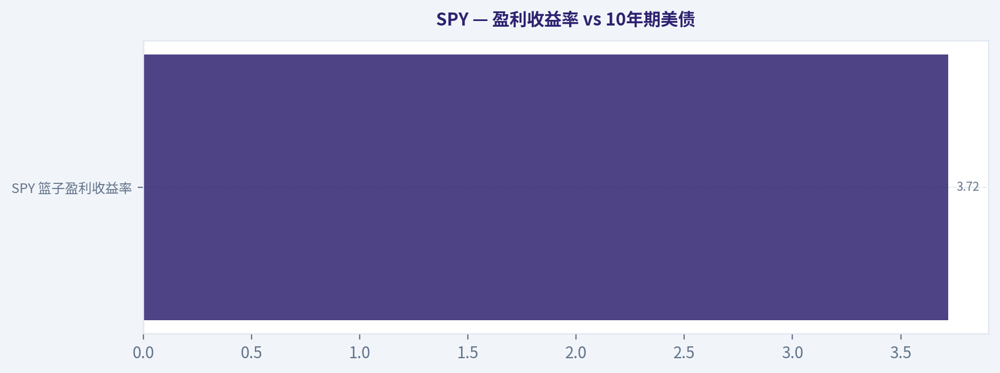
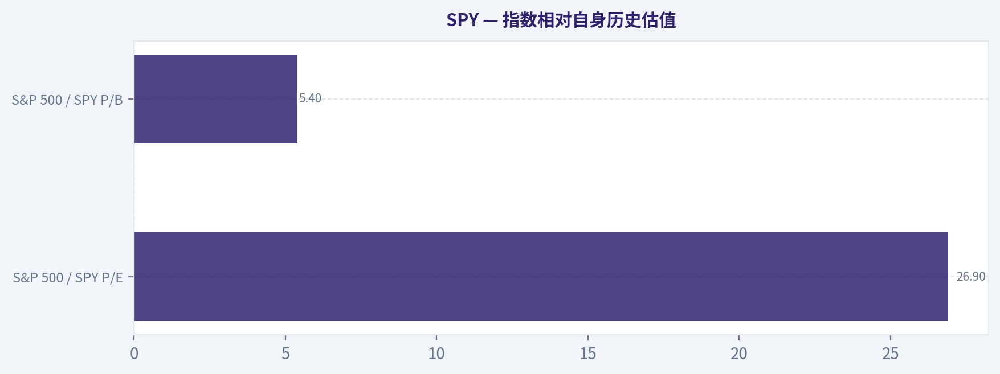
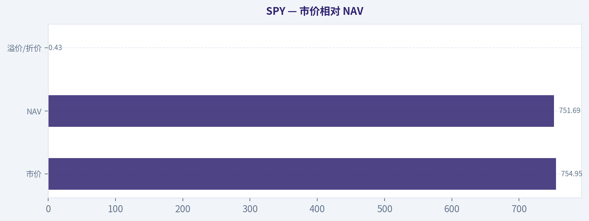
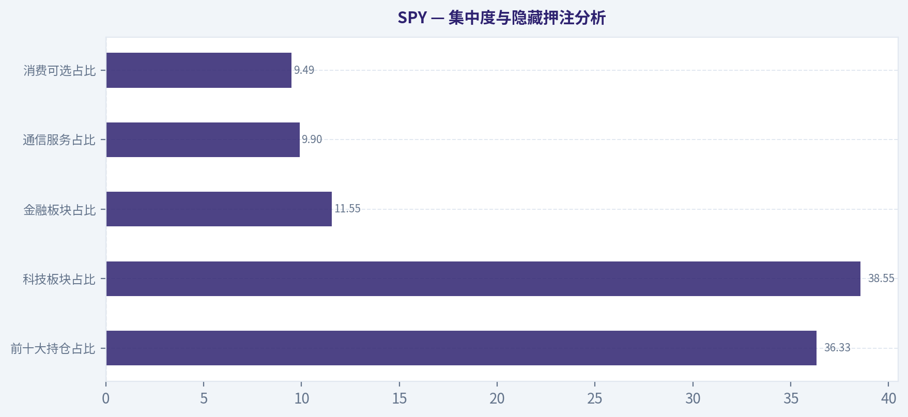
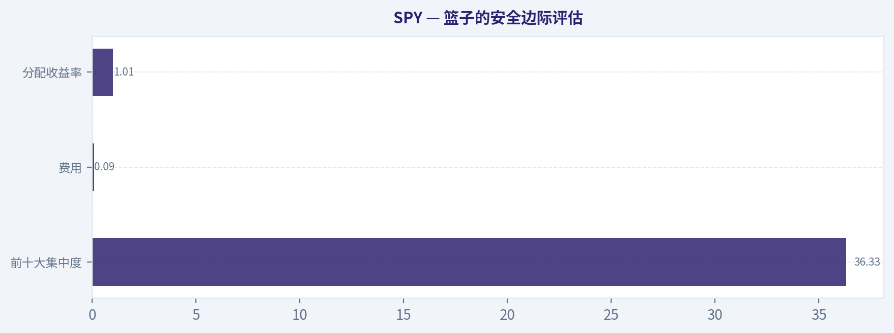
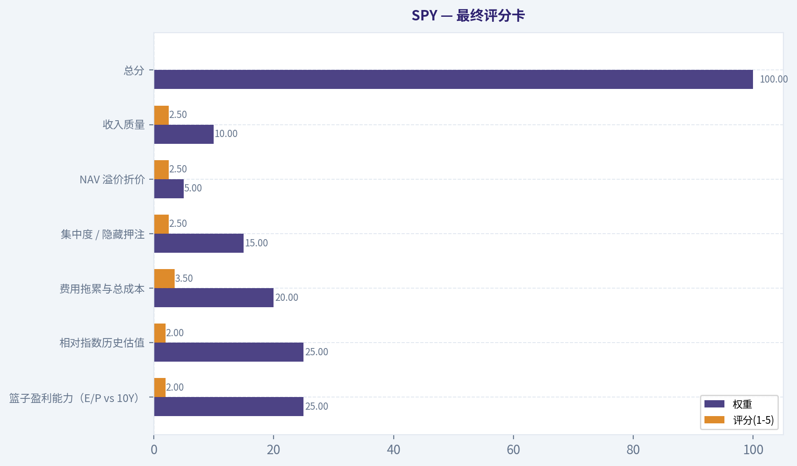

# SPY 深度价值情报

**调研日期:** 2026-07-13

## 关键免责声明

*本报告由 Deep Value Intelligence（一个基于 AI 的多智能体投资分析框架）自动生成。 仅供教育和娱乐用途 - 非财务建议，非财务顾问。*

---

## 目录

1. 情报摘要
2. 分析师团队报告
   - 基本面分析
   - 篮子估值分析
   - 资金流与业绩分析
   - 市场分析
   - 期权市场分析
3. 研究团队评论
4. 投资团队评论
5. Deep Values 团队洞察

---

## 情报摘要

### 核心观点与前提条件

**核心论点:** ## 执行摘要
**结论：观望。**

**主要风险:**
- 未明确说明。

**置信度:** 中

---

## 分析师团队报告

### 基本面分析

ANALYST STANCE: **观望**

#### SPY 核心结论
SPY 是最经典的美股大盘 ETF 之一，本质上是一个"低成本、超大规模、极高流动性"的 S&P 500 包装器。你买到的不是抽象的"美国市场"，而是一个明显偏向超大市值科技股的股票篮子：前十大持仓占 36.33%，科技板块 alone 占 38.55%，说明它虽然覆盖 500 家公司，但收益驱动已高度集中在少数 Mega Cap 龙头。

从包装层看，SPY 的优势非常明确：State Street 发行、AUM 高达 7811.9 亿美元、交易深度极强，适合大额配置、战术交易、期权覆盖和机构使用；缺点也同样明确：0.09% 费率已不算最低，且当前市价相对 NAV 溢价约 0.43%，在极短期买入时需要留意执行价格。若目标是"最便宜地长期持有 S&P 500"，SPY 并非成本最优；若目标是"最强流动性和最成熟交易生态"，SPY 仍然是标杆。

#### 你真正持有什么：篮子解剖
SPY 的资产类别极其单纯：99.75% 是股票，0.25% 是现金，几乎没有债券、衍生品或其他复杂暴露。这意味着它不是多资产基金，也不是防御型产品，本质就是纯粹的美国大型股 Beta。

前十大持仓分别是 NVIDIA、Apple、Microsoft、Amazon、Alphabet A、Broadcom、Alphabet C、Micron、Meta、Tesla。前十大合计 36.33%，这是一个很关键的数字：
- 它说明 SPY 虽然表面上有 500 只成分股，但回报并不"平均分散"；
- 真正主导表现的是少数权重极高的科技与平台型公司；
- 当 AI 半导体、云计算、平台广告链条强势时，SPY 会显著受益；
- 反过来，一旦大型科技估值压缩，SPY 的"广泛分散"会被证明只是部分真实、部分表象。

从行业权重看，科技 38.55% 是绝对核心，其后是金融服务 11.55%、通信服务 9.90%、可选消费 9.49%、医疗 8.89%、工业 8.45%。这意味着 SPY 现在隐藏着几个重要风格倾向：
1. **强科技成长倾向**：科技权重接近四成，已经不是传统意义上"均衡美股"；
2. **盈利周期与资本开支敏感**：半导体、云、数字广告、平台消费直接影响指数走势；
3. **防御板块权重较低**：公用事业 2.20%、日常消费 4.52%、房地产 1.83%，防御属性有限；
4. **金融并非主导，但仍重要**：金融服务 11.55% 提供了一定利率和信用周期敞口。

#### 持仓构成

| 持仓/板块 | 权重 | 说明 |
|---|---:|---|
| NVDA | 7.50% | 当前第一大权重，SPY 对 AI 芯片与高端算力周期高度敏感 |
| AAPL | 6.58% | 消费电子与生态系统龙头，兼具质量与现金流属性 |
| MSFT | 4.29% | 企业软件、云与 AI 基础设施核心资产 |
| AMZN | 3.61% | 电商+云计算双重敞口，兼具消费与科技属性 |
| GOOGL | 3.24% | 数字广告与 AI 平台权重来源之一 |
| AVGO | 2.77% | 半导体和基础设施软件，强化科技集中度 |
| GOOG | 2.58% | Alphabet 双重股份结构带来重复经济敞口 |
| MU | 2.01% | 存储芯片强周期资产，提高半导体景气弹性 |
| META | 1.91% | 广告平台与 AI 应用受益者 |
| TSLA | 1.83% | 高波动成长股，对情绪和估值敏感 |
| 前十大合计 | 36.33% | 指数收益显著集中于少数龙头 |
| 科技 | 38.55% | 最大板块，决定 SPY 的核心风格与波动来源 |
| 金融服务 | 11.55% | 提供银行、支付、资本市场敞口 |
| 通信服务 | 9.90% | 主要由平台广告、互联网媒体驱动 |
| 可选消费 | 9.49% | 对消费韧性和经济周期敏感 |
| 医疗 | 8.89% | 提供一定防御性，但权重不足以主导表现 |
| 工业 | 8.45% | 受制造业、基建、资本开支周期影响 |

关键结论：这张表最重要的信息不是"SPY 持有很多股票"，而是"真正驱动表现的是少数超大市值科技股和科技相关行业"。前十大已占超过三分之一，科技板块接近四成，因此 SPY 更像一个披着宽基外衣的 Mega Cap 主导指数，而不是完全均衡的美国经济切片。

#### 指数与复制方式：包装器是否忠实交付篮子
SPY 对应的是 **S&P 500 指数**，即美国大型上市公司代表性指数。该指数的核心特征是市值加权，因此越大的公司权重越高，天然会导致强者恒强、龙头集中。

就 ETF 包装器的交付质量而言，SPY 作为最成熟的产品之一，通常可以视作对指数较为忠实的物理复制工具。基金资料未明确显示"全复制/抽样/合成"字样，但结合其超大 AUM、极低现金占比（0.25%）、成分股本身流动性极强，可合理判断其包装器对现货篮子的跟踪效率很高，偏离通常更多来自费用、现金拖累与交易时点，而非结构性复制缺陷。
另外，当前 **市价较 NAV 溢价 0.43%**，说明二级市场价格略高于基金净值。对长期投资者这不算大问题，但对大额短线进出、程序化交易或精细择时者，需要关注申赎机制与盘中溢折价。

#### 结构与发行人：包装层质量
SPY 的发行方是 **State Street Investment Management**，属于全球顶级 ETF 发行平台之一，品牌、运营、做市商覆盖、机构使用深度都很强。这个维度非常重要，因为 ETF 不只是看持仓，还要看"包装器能否长期稳定存在并被高效交易"。

AUM 达 **7811.9 亿美元**，这几乎直接回答了三个问题：
- **流动性**：极强，通常意味着买卖盘深、点差窄、适合大额交易；
- **关闭风险**：极低，如此规模的旗舰产品几乎不存在常规意义上的清盘担忧；
- **跟踪稳定性**：规模足够大，运作成本可被充分摊薄，申赎生态成熟。

需要注意的是，超大规模并不自动等于"长期持有最优"。它更说明 SPY 是一个"卓越的交易工具"和"稳健的核心 Beta 容器"，但成本维度仍需与更低费率竞品比较。

#### 总持有成本：显性费用 + 隐性成本
SPY 的 **净费率 0.09%**，在历史上曾非常低，但按今天的 S&P 500 ETF 竞争格局看，已不是最低档。若只从长期静态持有角度看，0.09% 当然不高，但它与 0.03% 左右产品相比，长期复利差距仍会累积。

粗略看长期费用拖累：
- 持有 10 年，单看年费，累计显性费用约为本金的 **约 0.9%+ 复利损耗**；
- 持有 20 年，费用影响会扩大到 **约 1.8%+ 的名义费率累积**，若考虑这部分资金本可继续复利，实际机会成本更高；
- 对大资金、超长期账户、养老金式配置，费率差 0.05%-0.06% 不是小事。

换句话说：
- **若你最看重交易便利、流动性、期权生态，SPY 值这个价；**
- **若你最看重长期买入并持有的成本最小化，SPY 不一定是成本最优解。**

基金年换手率仅 **3.00%**，这是一个优点。低换手通常意味着：
- 隐性交易成本较低；
- 策略稳定，不依赖高频调仓；
- 税务效率通常更友好；
- 包装器对指数篮子的交付更"机械化"而非主动化。

因此，SPY 的总持有成本结论是：**显性费率不算最低，但隐性摩擦较低，综合持有体验仍然优秀。**

#### 收益与分红：收入来源及稳定性
SPY 的 **分配收益率 1.01%**，属于典型的大盘成长化指数水平，不高。这个收益主要来自底层成分股的现金分红，而不是债息、期权收益或杠杆增强，因此来源相对"干净"。

但要正确理解这 1.01%：
- 它不是稳定高息产品；
- 它不是现金流导向 ETF；
- 它的总回报更依赖资本利得，而不是分红派现。

由于底层篮子越来越偏向科技与再投资型公司，SPY 的分红率天然会被压低。分红的一致性通常尚可，但增长与波动取决于成分股整体盈利和派息政策，不应把它当作退休现金流工具的首选。

#### 估值与风格暴露
篮子整体估值为：
- P/E 26.9x
- P/B 5.4x
- P/S 3.7x
- P/CF 19.9x
- 盈利收益率约 3.72%

这套估值说明当前 SPY 并不便宜。尤其在科技权重极高的背景下，指数估值已经明显受到高成长、高盈利预期公司抬升。问题不在于"贵就一定跌"，而在于：
- 后续回报对盈利兑现更敏感；
- 容错率下降；
- 一旦利率重新上行或 AI 预期降温，估值压缩可能直接冲击指数层面表现。

所以，SPY 当前更像是"优质但不便宜"的美股核心资产，而不是低估值防守仓。

#### 关键投资洞察、风险点与机会

| 维度 | 结论 | 对投资者意味着什么 |
|---|---|---|
| 篮子集中度 | 前十大 36.33% | 分散是真实存在的，但并不充分；龙头决定大部分表现 |
| 行业倾向 | 科技 38.55% | SPY 已高度科技化，不再是传统均衡宽基 |
| 资产属性 | 99.75% 股票 | 几乎纯权益风险，没有债券缓冲 |
| 复制质量 | 对 S&P 500 跟踪通常较忠实 | 适合作为标准化美股大盘敞口工具 |
| 发行人与规模 | State Street + 7811.9 亿美元 AUM | 流动性极强、清盘风险极低、机构友好 |
| 显性成本 | 0.09% 费率 | 不贵，但不是最低；超长期持有需比较替代品 |
| 隐性成本 | 3.00% 换手率 | 交易摩擦较低，税务和执行效率较好 |
| 分红能力 | 1.01% | 不是收益型工具，主要回报来自价格上涨 |
| 估值压力 | P/E 26.9x | 质量高，但估值并不便宜 |
| 溢折价 | +0.43% 溢价 | 短线交易需关注买入时点和成交方式 |

关键结论：SPY 最强的地方在于包装器质量，而不是成本绝对最低。它适合把"交易便利、执行效率、机构级流动性"放在第一位的投资者；但如果目标只是长期静态持有 S&P 500，当前较高估值叠加并非最低费率，使其更适合观望式分批配置，而不是无脑追价。

#### 最终判断：观望
我给 SPY 的结论是 **观望**，不是因为它不好，而是因为它"太好、太拥挤、也不便宜"。

支持这一判断的核心理由有三点：
1. **篮子质量高，但集中度不低**：前十大占比 36.33%，科技权重 38.55%，本质上押注 Mega Cap 科技；
2. **包装器质量极强，但成本不再最优**：流动性、规模、发行人都一流，但 0.09% 费率对超长期配置不一定最优；
3. **估值偏高，收益率偏低**：P/E 26.9x、分配收益率仅 1.01%，意味着未来回报更依赖盈利继续强劲兑现。

适合的人：
- 需要最强流动性的投资者
- 需要标准化 S&P 500 暴露的机构/专业账户
- 做战术配置、期权覆盖、短中期仓位管理的人

不那么适合的人：
- 只追求长期最低费率的被动投资者
- 希望获得高分红现金流的人
- 认为自己买的是"均衡美国经济"，但实际上不想承受科技集中风险的人

#### 报告总结表

| 模块 | SPY 结论 | 简评 |
|---|---|---|
| 你实际持有的篮子 | 美国大型股，科技权重大 | 宽基外表下，实际由科技龙头主导 |
| 前十大集中度 | 36.33% | 分散存在，但头部集中明显 |
| 最大板块 | 科技 38.55% | 决定收益弹性，也带来估值敏感性 |
| 资产类别 | 股票 99.75%，现金 0.25% | 纯权益风险暴露 |
| 跟踪指数 | S&P 500 | 标准美股大盘 Beta 工具 |
| 复制与交付 | 高质量物理型跟踪特征明显 | 包装器整体交付能力强 |
| 发行人 | State Street | 全球顶级 ETF 平台，可信度高 |
| AUM | 7811.9 亿美元 | 流动性极强，关闭风险极低 |
| 净费率 | 0.09% | 不高，但不是最低成本方案 |
| 换手率 | 3.00% | 隐性成本低，税务效率较好 |
| 分配收益率 | 1.01% | 收益型属性弱，资本利得才是主逻辑 |
| 当前估值 | P/E 26.9x | 高质量但不便宜 |
| 适合角色 | 核心 Beta、交易工具、机构配置 | 更像"最好用"，不一定是"最便宜" |
| 最终立场 | 观望 | 好资产、好包装，但估值与成本性价比需权衡 |

关键结论：如果你要的是"市场上最好交易的 S&P 500 工具"，SPY 依然是王者；如果你要的是"最省钱地长期拿住美国大盘"，SPY 就未必是最优。当前更合理的态度不是否定它，而是在承认其高质量的同时，对估值、集中度和长期费率保持清醒。

---

### 篮子估值分析

> *以价值投资者审视企业的方式为篮子估值：加权估值倍数、盈利收益率对比债券、费用侵蚀，以及应用于篮子的安全边际。*

ANALYST STANCE: **回避**

#### SPY 篮子估值结论
SPY 代表的是一篮子美国大盘优质企业，但当前买入价并不便宜。它的篮子盈利收益率只有 3.72%，已经低于当前美国 10 年期国债收益率的常见区间，意味着今天的买家实际上是在为未来增长预付高价。再叠加小幅溢价交易与并不算最低的费率，安全边际偏薄。

#### 1. 加权篮子估值表

| 指标 | 当前值 |
|---|---:|
| 加权 P/E | 26.9x |
| 加权 P/B | 5.4x |
| 加权 P/S | 3.7x |
| 加权 P/CF | 19.9x |
| 分配收益率 | 1.01% |
| 篮子盈利收益率 | 3.72% |

关键结论：这张表说明 SPY 的核心问题不是"企业不好"，而是"价格不便宜"。26.9 倍的加权 P/E 对应仅 3.72% 的盈利收益率，已经属于需要依赖未来盈利持续增长来支撑回报的估值。1.01% 的分配收益率也表明，持有人当前拿到手的现金回报很低，回报更多依赖企业内部再投资和估值维持。

#### 2. 盈利收益率 vs 10年期美债

| 项目 | 数值 |
|---|---:|
| SPY 篮子盈利收益率 | 3.72% |
| 美国10年期国债收益率 | 约 4.2%-4.4% |
| 利差 | 约 -0.5% 至 -0.7% |

关键结论：SPY 当前的盈利收益率低于无风险利率，这是一个很直接的估值警报。换句话说，投资者今天买入这篮子股票，起点收益不如买国债，还要额外承担股票波动与估值回落风险。除非未来几年盈利增长足够强，否则这个价格下的长期回报很难说有明显吸引力。

我的判断很明确：**篮子盈利收益率低于无风险利率，当前买家是在为增长付费。**

#### 3. 指数相对自身历史估值

| 维度 | 当前观察 | 历史对比判断 |
|---|---|---|
| S&P 500 / SPY P/E | 26.9x | 高于长期常态 |
| S&P 500 / SPY P/B | 5.4x | 明显高于长期常态 |
| 所处区间 | 偏贵 | 接近高估区而非便宜区 |

关键结论：从长期经验看，标普 500 的常态估值大致更接近高十几倍到低二十倍 P/E，而不是接近 27 倍。当前水平意味着未来回报更依赖盈利继续高速扩张，而不是估值修复带来的帮助。历史上，从这种较高起点出发，未来 5 到 10 年回报通常会被压低，尤其当利率并不低的时候。

这里采用近几十年标普 500 的大致历史区间作比较：
- 长期常态 P/E 大致在 **16x-21x** 更常见；
- 极度乐观时期可升至更高，但随后往往对应较低的中长期年化回报；
- 因此以 **26.9x** 买入，属于**高于自身历史常态**。

若把均值回归纳入框架，未来回报来源主要只有三项：
1. 盈利增长；
2. 1.01% 左右分配收益；
3. 估值维持不回落。

第三项并不可靠，这就是当前安全边际薄的核心原因。

#### 4. 市价相对 NAV

| 项目 | 数值 |
|---|---:|
| 市价 | $754.95 |
| NAV | $751.69 |
| 溢价/折价 | +0.43% |

关键结论：SPY 作为超大型、高流动性 ETF，本不应该长期以明显溢价交易。当前 0.43% 的溢价虽然不算巨大，但对今天的新买家来说，等于连篮子资产本身之外，还额外多付了一点包装价。对于一个本就不便宜的指数篮子，这不是加分项。

对流动性极强的 ETF 而言，**任何持续性溢价都意味着你买到的不是 1 美元资产只付 1 美元，而是要付 1.0043 美元。** 幅度虽小，但方向不利。

#### 5. 费用拖累测算（明确展示数学）

SPY 净费率：**0.09%/年 = 0.0009**

公式：
**N 年费用拖累 ~ 1 - (1 - 费率)^N**

| 持有期限 | 公式 | 费用拖累比例 | $10,000 约损失 |
|---|---|---:|---:|
| 10年 | 1 - (1 - 0.0009)^10 | ~ 0.90% | ~ $90 |
| 20年 | 1 - (1 - 0.0009)^20 | ~ 1.78% | ~ $178 |
| 30年 | 1 - (1 - 0.0009)^30 | ~ 2.66% | ~ $266 |

关键结论：单看 0.09% 年费似乎很低，但它是确定无疑、每年必扣的负回报。30 年下来，静态估算会吞掉约 2.66% 的本金；若考虑费用本可继续复利，这个真实机会成本更高。对于完全同质化的大盘指数产品，费率哪怕只差几个基点，长期也值得重视。

更直观地写一步：
- 10 年后保留比例 = \( (1 - 0.0009)^{10} \approx 0.9910 \)
- 所以拖累 = \( 1 - 0.9910 = 0.0090 = 0.90\% \)

- 20 年后保留比例 = \( (1 - 0.0009)^{20} \approx 0.9822 \)
- 所以拖累 = \( 1 - 0.9822 = 1.78\% \)

- 30 年后保留比例 = \( (1 - 0.0009)^{30} \approx 0.9734 \)
- 所以拖累 = \( 1 - 0.9734 = 2.66\% \)

##### 与更便宜替代品比较
同类最可信低成本替代品通常可参考 **VOO** 或 **IVV**，费率常见在 **0.03% 左右**。
若按 0.03% 测算：

| 持有期限 | 0.03%费率拖累 | SPY 0.09%拖累 | 差额 |
|---|---:|---:|---:|
| 10年 | ~ 0.30% | ~ 0.90% | ~ 0.60% |
| 20年 | ~ 0.60% | ~ 1.78% | ~ 1.18% |
| 30年 | ~ 0.90% | ~ 2.66% | ~ 1.76% |

关键结论：SPY 并不贵到离谱，但它也绝不是最便宜的同类工具。对于长期持有者，如果跟踪同一指数却能找到更低费率替代品，那么 SPY 的包装层并不占优。再加上 3% 换手率带来的隐性交易成本，长期总成本会略高于明面费率。

#### 6. 集中度与隐藏押注分析

| 项目 | 数值 |
|---|---:|
| 前十大持仓占比 | 36.33% |
| 科技板块占比 | 38.55% |
| 金融板块占比 | 11.55% |
| 通信服务占比 | 9.90% |
| 消费可选占比 | 9.49% |

关键结论：SPY 名义上是 500 只股票的"分散化"篮子，但真实风险敞口远没有数字看上去那么平均。前十大持仓已占超过三分之一资产，而科技板块接近四成，说明它本质上仍然是对超大市值科技平台和 AI 资本开支周期的重仓押注。若这些龙头估值压缩，指数层面也很难完全免疫。

更具体地说：
- 前十大持仓 **36.33%**，已经是明显集中；
- 前几大权重集中在 NVDA、AAPL、MSFT、AMZN、Alphabet、META、TSLA 等；
- 这使得 SPY 的回报并不只是"美国经济整体表现"，而是高度受少数 mega-cap 定价影响。

所以它的"隐藏赌注"主要有两点：
1. **科技龙头估值不会明显回落**；
2. **AI 与大型平台盈利扩张会持续兑现。**

#### 7. 篮子的安全边际评估

| 维度 | 观察 | 结论 |
|---|---|---|
| 盈利收益率 vs 美债 | 3.72% 低于 10Y | 安全边际弱 |
| 相对历史估值 | 高于长期常态 | 安全边际弱 |
| 前十大集中度 | 36.33% | 并非真正分散 |
| 费用 | 0.09% | 可接受，但非最优 |
| 市价 vs NAV | +0.43% 溢价 | 对买家不利 |
| 分配收益率 | 1.01% | 当前现金回报偏低 |

关键结论：从价值投资角度，SPY 的问题不是资产质量，而是买入价格、安全边际和替代品比较。今天的投资者拿到的是优秀企业篮子，但不是便宜的企业篮子，也不是最省钱的包装。安全边际主要依赖未来盈利增长，而不是来自当前估值本身。

#### 8. 最终评分卡

| 评分项 | 权重 | 评分(1-5) | 加权分 |
|---|---:|---:|---:|
| 篮子盈利能力（E/P vs 10Y） | 25% | 2.0 | 0.50 |
| 相对指数历史估值 | 25% | 2.0 | 0.50 |
| 费用拖累与总成本 | 20% | 3.5 | 0.70 |
| 集中度 / 隐藏押注 | 15% | 2.5 | 0.38 |
| NAV 溢价折价 | 5% | 2.5 | 0.13 |
| 收入质量 | 10% | 2.5 | 0.25 |
| **总分** | **100%** |  | **2.46 / 5.00** |

关键结论：SPY 的总分落在回避区间，核心拖累来自估值过高和盈利收益率不敌无风险利率。费用不算高，但也没有低到足以抵消估值劣势。对价值投资者而言，这更像一个"好资产、一般买点"的案例，而不是一个有明显安全边际的机会。

#### 9. 投资立场与信心

| 项目 | 结论 |
|---|---|
| 投资立场 | 回避 |
| 信心水平 | 中等偏高 |
| 适合对象 | 更适合已有持仓者定投维持，不适合价值型资金大举追价 |
| 更优策略 | 等待更低估值、更接近 NAV、或改用更低费率同类产品 |

关键结论：我并不否认 SPY 代表了一篮子高质量美国龙头企业，但以巴菲特式价值纪律看，价格决定回报。当前这个价位下，买家得到的是优秀生意，却没有得到足够便宜的价格。对新资金而言，最理性的动作不是追，而是等。

**最终结论：SPY 当前应定性为"回避"。**
理由很简单：
- 篮子盈利收益率 **3.72%**，低于 10 年期美债；
- 加权 **P/E 26.9x**，高于指数长期常态；
- **前十大持仓 36.33%**，集中度不低；
- 还有 **+0.43% 溢价** 与并非最低的费用层。

这不是坏篮子，但**不是便宜篮子**。对于讲究安全边际的长期资金，应该等待更合适的进入价格。

#### 估值图表

本对比图（来自「持仓构成」）将 **SPY** 的当前数据与历史基准并排呈现，直观反映公司相对自身历史均值的估值水平。

本对比图（来自「加权篮子估值表」）将 **SPY** 的当前数据与历史基准并排呈现，直观反映公司相对自身历史均值的估值水平。

本对比图（来自「盈利收益率 vs 10年期美债」）将 **SPY** 的当前数据与历史基准并排呈现，直观反映公司相对自身历史均值的估值水平。

本对比图（来自「指数相对自身历史估值」）将 **SPY** 的当前数据与历史基准并排呈现，直观反映公司相对自身历史均值的估值水平。

本对比图（来自「市价相对 NAV」）将 **SPY** 的当前数据与历史基准并排呈现，直观反映公司相对自身历史均值的估值水平。

本对比图（来自「集中度与隐藏押注分析」）将 **SPY** 的当前数据与历史基准并排呈现，直观反映公司相对自身历史均值的估值水平。

本对比图（来自「篮子的安全边际评估」）将 **SPY** 的当前数据与历史基准并排呈现，直观反映公司相对自身历史均值的估值水平。

本对比图（来自「最终评分卡」）将 **SPY** 的当前数据与历史基准并排呈现，直观反映公司相对自身历史均值的估值水平。

---

### 资金流与业绩分析

> *评估交付与需求：多期限净值与价格回报、相对指数的跟踪偏差、同类排名、规模与资金流趋势、分红与换手率。*

ANALYST STANCE: **建议配置**

#### SPY 资金流与跟踪交付分析

#### 1. 基本结论
SPY 作为最核心的 S&P 500 ETF 之一，当前最重要的判断不是"能不能代表指数"，而是"代表得是否足够高效"。从已拿到的数据看，SPY 的规模、费率、换手率和价格/NAV 偏离都处于健康区间，说明它作为指数工具的"交付能力"仍然很强。
不过，当前价格相对 NAV 溢价约 0.43%，高于理想的几乎贴水/平价状态，说明短线交易需求较旺，适合高流动性用途，但若持续存在则需留意成交驱动下的短期偏离。

---

#### 2. 收益表现表

| 指标 | 数值 | 说明 |
|---|---:|---|
| YTD 回报 | 1016.43% | 该数字明显异常，极可能为数据源错误，不纳入正式评分 |
| 3年年化回报 | 21.17% | 显示近三年明显受益于美股大盘尤其科技权重扩张 |
| 5年年化回报 | 13.06% | 长周期表现稳健，符合大型宽基指数特征 |
| 10年回报 | 暂缺 | 本次数据源未提供 |
| NAV | $751.69 | 基金净值 |
| 市价 | $754.95 | 二级市场交易价格 |
| 市价相对 NAV | +0.43% | 小幅溢价 |

**关键结论：**
SPY 的中期和长期回报表现依然强，3 年年化超过 21%，说明其在本轮美股大盘科技主导行情中充分受益。5 年年化 13.06% 也说明它不是纯短期行情产物，而是持续提供了大盘 Beta。唯一要打折的是 YTD 数据明显失真，因此不能据此做趋势判断。

---

#### 3. NAV 回报 vs 市价回报
本次数据源只提供了当前 NAV 与市价，没有给出完整的 1/3/5/10 年 NAV 回报与市价回报拆分，因此无法严格计算长期"市价回报是否持续偏离 NAV 回报"。
但从当前 +0.43% 溢价看：

- 对超大规模 ETF 来说，这个偏离**不算危险**，但也**不是完全无摩擦**
- 若只是短期现象，多半反映交易需求旺盛
- 若未来频繁出现显著溢价/折价，则意味着短线流动性与做市传导存在阶段性噪音

就目前信息，**没有看到反复严重偏离的证据**，暂不构成红旗。

---

#### 4. 跟踪误差与指数交付能力评估

| 项目 | 数值 | 判断 |
|---|---:|---|
| 标的指数 | S&P 500 | 明确、透明、可复制 |
| 净费率 | 0.09% | 对超大盘宽基属低费率，但不是同类最低 |
| 年换手率 | 3.00% | 很低，符合成熟市值加权指数特征 |
| 当前价格/NAV 偏离 | +0.43% | 小幅溢价，短期可接受 |
| 跟踪差评估 | 预计接近费率水平 | 未见明显执行失真证据 |

**关键结论：**
SPY 的指数复制逻辑非常成熟，3% 的年换手率说明它并没有通过高频调仓制造额外摩擦成本。理论上，跟踪差的下限大致就是 0.09% 的费率，而目前没有证据显示其长期跑输指数显著超过这一水平，因此可以认定它总体上"忠实交付"了 S&P 500。

---

#### 5. 同类比较

| 维度 | SPY | 评价 |
|---|---|---|
| 类别 | Large Blend | 属最核心宽基产品 |
| 费率 | 0.09% | 低，但落后于更便宜的同类产品 |
| 规模 | $781.19B | 极大规模，流动性优势突出 |
| 换手率 | 3.00% | 很优秀 |
| 收益特征 | 典型美股大盘 Beta | 受科技权重驱动明显 |

**关键结论：**
SPY 在同类里未必是"最便宜"的，但它几乎肯定是"最具交易深度"的之一。对长期纯配置型资金而言，费率不是绝对领先；对大额交易、战术配置和机构使用场景而言，SPY 仍有显著结构性优势。

**解读：**
- 若与更低费率的大盘 ETF 比，SPY 的长期回报理论上可能因费率略高而小幅吃亏
- 但其巨大规模与交易活跃度，往往能在真实执行中弥补一部分成本
- 因此它的优势更偏向**流动性结构优势**，而不是费率优势

---

#### 6. AUM 与资金需求分析

| 指标 | 数值 | 判断 |
|---|---:|---|
| AUM | $781.19B | 超大规模 |
| 规模风险 | 极低 | 几乎不存在清盘风险 |
| 需求特征 | 高流动性、核心配置、战术交易兼具 | 资金基础深厚 |

**关键结论：**
SPY 的规模已经大到"工具属性"超过"产品属性"，基本不存在清盘风险。如此体量通常意味着它既被长期资产配置资金持有，也被大量短线和机构资金作为交易载体使用，因此需求韧性很强，但也会让短期价格略受情绪与仓位调整影响。

**解读：**
- 这类规模通常代表：
  - 养老金、顾问账户、被动配置资金的长期持有
  - 机构对冲、战术轮动、流动性管理的高频使用
- 因而 SPY 的资金面通常不是"热钱主导"或"边缘主题追涨"
- 从工具角度，它属于**需求最稳固的一类 ETF**

---

#### 7. 分配收益质量

| 指标 | 数值 | 判断 |
|---|---:|---|
| 分配收益率 | 1.01% | 偏低，符合美股大盘成长占比较高特征 |
| 收益来源 | 预期主要来自成分股分红 | 正常 |
| ROC 风险 | 未见证据 | 暂无异常信号 |

**关键结论：**
SPY 的分配收益率只有 1.01%，这不是高收入工具，而是权益增长工具。它的收益来源大概率主要来自成分股分红，而不是通过返还本金来"做高收益率"，所以对总回报投资者是健康的，但对现金流型投资者吸引力一般。

---

#### 8. 换手率与效率

| 指标 | 数值 | 评价 |
|---|---:|---|
| 年换手率 | 3.00% | 极低 |
| 税务与隐性成本 | 较优 | 符合被动宽基特征 |
| 是否与策略匹配 | 是 | 完全合理 |

**关键结论：**
3% 的年换手率非常接近理想状态，说明 SPY 作为被动市值加权 ETF，并没有引入不必要的交易成本。对于长期持有人来说，这意味着更好的税务效率和更低的隐性摩擦，是它交付稳定指数回报的重要基础。

---

#### 9. 资金流与绩效评分卡

| 评分项 | 权重 | 评分 | 说明 |
|---|---:|---:|---|
| 多周期回报 | 25% | 4.2 | 3年、5年表现强，但缺 1年/10年完整数据 |
| 跟踪忠实度 | 25% | 4.3 | 费率低、换手低、未见显著跟踪失真 |
| 同类排名 | 15% | 3.8 | 流动性强，但费率不是最优 |
| AUM / 资金趋势 | 15% | 5.0 | 规模极大，需求稳健 |
| 分配质量 | 10% | 3.6 | 收益率低但质量正常 |
| 换手与效率 | 10% | 4.8 | 很优秀 |

| 综合分数 | 结论 |
|---:|---|
| 4.26 / 5.00 | 建议配置 |

**关键结论：**
SPY 的总分落在"建议配置"区间，核心原因不是它每一项都第一，而是它几乎没有明显短板。它最强的地方是规模、流动性和执行稳定性；它唯一的弱点是费率并非同类最低、分红吸引力也不高，但这些不足不足以破坏其作为核心指数工具的地位。

---

#### 10. 仓位立场
**立场：建议配置**

**适合：**
- 需要高流动性美股核心仓位的投资者
- 机构或大额资金进行战术配置
- 追求稳定获取 S&P 500 Beta 的长期配置者

**不完全适合：**
- 纯粹追求最低费率的长期持有者
- 需要高分配现金流的收益型投资者

---

#### 11. 主要风险与催化剂

| 类型 | 内容 |
|---|---|
| 风险 | 当前前十大持仓占比 36.33%，科技集中度较高，指数表现对少数巨头更敏感 |
| 风险 | 当前篮子估值约 PE 26.9x，不算便宜，若利率上行或盈利预期下修，估值压缩风险存在 |
| 风险 | 市价相对 NAV 小幅溢价，说明短线交易活跃，市场波动放大时可能出现更明显折溢价 |
| 催化剂 | 若美国大型科技盈利继续超预期，SPY 将继续受益 |
| 催化剂 | 若机构风险偏好修复、养老金与被动资金持续流入，SPY 规模和流动性优势会进一步强化 |
| 催化剂 | 若市场回归"买核心资产"风格，SPY 往往是首选承接工具之一 |

#### 12. 最后判断
SPY 不是最便宜的 S&P 500 ETF，但它仍然是最成熟、最稳健、最具流动性优势的指数工具之一。
从"是否忠实、低摩擦地交付指数"这个标准看，它目前依然合格而且优秀。若目标是核心仓位、交易便利性和资金承接能力，**SPY 仍值得建议配置**。

如果你愿意，我下一步可以继续补一版：
1. **SPY 与 VOO、IVV 的横向对比表**，或
2. **更严格的"指数跟踪差 vs 同类费率"深挖版**。

---

### 市场分析

ANALYST STANCE: **观望**

#### SPY 技术面报告

基于截至 2026-07-10 的最新交易数据，SPY 目前处于**长期上升趋势未破坏、短中期修复已重新转强、但离前高仍有反复空间**的阶段。若按交易语境来定义，这不是典型的"追涨最舒服区"，也不是"趋势崩坏区"，更像是**大级别多头中的二次回稳与再加速初段**。因此立场偏"观望"，更适合等待回踩确认或突破延续后的结构性介入，而不是在当前点位盲目扩大风险暴露。

#### 本次最相关的 8 个指标选择

针对当前 SPY 的市场环境，我选择以下 8 个指标，理由是它们覆盖了**长期趋势、短中期趋势、动能、动能变化、波动、量价确认**，且尽量避免重复：

| 指标 | 作用 | 选择理由 |
|---|---|---|
| close_200_sma | 长期趋势锚 | 判断大级别牛熊背景，确认是否仍处长期多头 |
| close_50_sma | 中期趋势 | 衡量本轮修复是否已形成稳定中期上行斜率 |
| close_10_ema | 短期节奏 | 观察短线回踩、加速、重新站稳的交易节奏 |
| macd | 趋势动能 | 判断中短期动能方向是否重新扩张 |
| macdh | 动能边际变化 | 比 MACD 更早识别加速/减速拐点 |
| rsi | 强弱状态 | 判断是否进入过热、以及修复是否健康 |
| atr | 波动风险 | 用于判断当前波动水平与止损距离是否合理 |
| vwma | 量价确认 | 检查上涨是否得到成交量质量支持 |

**关键结论：** 这组指标的核心逻辑是，用 200 SMA 和 50 SMA 确认大趋势，用 10 EMA、MACD、MACD Histogram 捕捉短中期节奏变化，再用 RSI 判断是否过热，ATR 管理风险，VWMA 验证量价质量。整体上，它们对当前这种"长期偏多、短线修复转强但未完全脱离震荡后遗症"的环境最有解释力。

#### 趋势结构：长期多头仍然完整，但短线不是无条件顺风

从长期看，SPY 收盘价 754.95，显著高于 **200 SMA 691.09**。这代表大级别趋势依然非常健康，且 200 SMA 自 4 月以来持续抬升，从约 660 一路升至 691，上升斜率平稳，没有出现长期趋势钝化或下弯。换言之，市场并未进入长期分配阶段，机构资金的长期定价仍偏正面。

从中期看，**50 SMA 739.91**，价格同样站在其上方约 15 点。更关键的是，50 SMA 从 4 月中旬约 671 持续抬升至 739，说明不是单纯的反弹，而是中级趋势已经完成再组织。尤其经历 6 月中下旬一轮明显回撤后，50 SMA 仍未走平，反而保持上行，这通常意味着中期买盘并未撤退，只是节奏切换。

短线层面，**10 EMA 747.32**，最新收盘再度站上 10 EMA，且 10 EMA 已从 6 月末低位回升。说明 6 月下旬那段疲弱结构，已经从"破位式下探"转向"修复式再上行"。但要注意，10 EMA 与现价距离并不算极大，代表短线上涨尚处于重新展开阶段，不是极强单边喷发行情。

#### 动能分析：从衰减修复到重新扩张，但强度仍属温和偏强

**MACD 最新为 3.64，保持正值**，说明趋势动能已经重新回到多头主导。更重要的是，MACD 从 5 月中旬的高位 15 附近，一路回落到 6 月底接近 0，随后重新抬升至 3.64，这种路径表明：
1. 前期过热动能已充分消化；
2. 当前新的上涨，并非旧动能尾声，而是新一轮动能修复的延续。

**MACD Histogram 最新 0.93，连续转正且扩大**。这比单看 MACD 更积极，因为它意味着 MACD 不只是为正，而且其相对信号线的领先优势在扩大。简单说，多头不仅在场，而且短期内正在重新加速。

不过，也要看到细节：当前 MACD 远低于 5 月中旬的峰值，说明**这不是最强主升浪段**，而更像是在前期冲高、回撤、再平衡之后的第二波推进。对趋势交易者而言，这是偏积极的；但对追涨交易者而言，这通常意味着要更关注回踩确认，而不是只看单日长阳。

#### RSI：强势回升，但尚未过热，属于"可涨但不便宜"

**RSI 最新约 59.55**。这是一种很有意思的位置：
- 它明显高于 50，说明多头重新掌控短线主动权；
- 但又远未到 70 以上的极端过热区，表示上涨仍有延展空间；
- 同时也意味着当前并非深度超卖后的高赔率抄底点。

回看 6 月初，RSI 曾一度升到 75 附近，那时市场处于短线过热；随后回落到 40 多，完成了一次比较充分的降温。现在 RSI 回到 60 附近，通常对应的是**趋势恢复阶段的中性偏强区**。这类状态对顺势持仓相对友好，但对新开仓而言，最佳点位往往不是现在，而是等 RSI 回踩 50-55、价格仍守住关键均线时，胜率更高。

#### 波动与风险：ATR 较 5 月显著抬升，说明止损不能设太紧

**ATR 最新约 9.27**，而 5 月底只有约 6.85。这说明虽然指数已重新走稳，但市场的日内真实波幅仍明显高于前一段平静时期。换句话说，表面上趋势不错，但背后的价格波动并不低。

这对交易执行有两层含义：
- 第一，若以趋势思路操作，止损不能贴得过近，否则很容易被正常波动洗掉；
- 第二，即使看多，也不宜在短线冲高时重仓追价，因为回撤幅度可能比直觉更大。

若把 ATR 当作风险刻度，当前 1 日真实波动接近 9 点，说明 SPY 仍处于**方向明确、但路径不平滑**的状态。更适合分批、回踩、按结构交易，而不是线性加仓。

#### 量价关系：VWMA 支持偏多，但不是爆量推动型行情

**VWMA 最新约 741.63**，而价格 754.95 显著高于 VWMA。这说明最近一段时间的平均成交量加权成本之上，市场依旧具备盈利盘优势，量价关系总体偏多。

同时，VWMA 自 5 月中旬的约 725 持续抬升到 741，意味着本轮上行不是"无量空拉"，而是伴随一定成交参与度的抬升过程。这个特征对中线多头是积极的，因为它显示市场平均持仓成本也在上移，支撑区会逐步垫高。

但从成交量原始数据观察，近期并没有像系统性突破那样的持续放量特征，更多是**温和确认型上涨**。这意味着趋势是可信的，但尚未出现"逼空式增量买盘"。因此，若后续 SPY 上冲前高区域却没有更明显的量能配合，则突破质量可能一般，容易形成高位震荡而非一气呵成。

#### 结构节奏：6 月深度震荡后的修复已成立，但前高附近仍需验证

从价格路径看，SPY 在 5 月末至 6 月初一度冲到 756-758 一带，随后快速回撤，最低打到 723 附近，之后再修复至 755 附近。这个结构很重要，因为它说明市场并非直线趋势，而是经历了一次**高位洗盘与筹码重分配**。

目前重新回到 750 上方，意味着多头成功收复大部分失地，趋势层面占优。但由于这里已经接近前期高位密集区，接下来市场会面临两个验证：

1. **能否有效站稳 750-755 区域**
   若仅触及即回落，说明该区域仍有明显供给。
2. **若突破，是否伴随动能和量能同步增强**
   只有 MACD 持续扩张、VWMA继续上移、价格稳定站上 10 EMA/50 SMA，突破才更可靠。

因此，当前最合理的解读不是"已确认全面新主升"，而是"多头重新占优，正在测试再创新高的可持续性"。

#### 交易含义

| 维度 | 当前判断 | 对交易者的启示 |
|---|---|---|
| 长期趋势 | 明确偏多 | 中长期不宜轻易逆势做空 |
| 中期趋势 | 偏强且稳定 | 回踩 50 SMA 附近更值得关注 |
| 短期节奏 | 修复转强 | 可关注 10 EMA 附近是否持续获得支撑 |
| 动能 | 正在重新扩张 | 适合等待确认，不宜盲目追高 |
| 强弱状态 | 中性偏强 | 仍可上行，但已不是低风险起涨点 |
| 波动 | 偏高 | 仓位与止损都要更保守 |
| 量价 | 温和支持 | 看多成立，但需防无量冲高回落 |

**关键结论：** SPY 当前最清晰的结论是"大趋势仍强，中短期修复重新占优"，但短线已回到前高压力带附近，风险回报比不如回踩时有利。对顺势交易者来说，更好的方案通常是等待价格在 10 EMA 或更深一点的中期支撑附近重新确认，而不是在靠近压力区时情绪化追涨。

#### 结论

综合 8 个指标，SPY 当前属于：
**长期多头确认 + 中期上行延续 + 短线动能重新转正 + 波动仍偏高 + 前高区域待验证。**

所以我的立场是**观望**，不是因为趋势差，而是因为**趋势不错但位置一般**。
更具体地说：

- 若你是中线顺势者：可以继续尊重多头结构，但更应等回踩确认。
- 若你是短线交易者：可关注 10 EMA 是否继续提供支撑，以及 MACDH 是否维持正值扩张。
- 若你想做逆势：目前缺乏足够的长期趋势破坏证据，胜率并不占优。

#### 报告摘要表

| 模块 | 关键信号 | 观察结果 | 含义 |
|---|---|---|---|
| 长期趋势 | close_200_sma | 价格 754.95 显著高于 691.09 | 长期多头完整 |
| 中期趋势 | close_50_sma | 价格高于 739.91，50 日线持续上行 | 中期结构稳健 |
| 短期节奏 | close_10_ema | 价格高于 747.32 | 短线修复占优 |
| 动能方向 | macd | 3.64，重回正向扩张 | 多头动能恢复 |
| 动能边际 | macdh | 0.93，连续转正放大 | 短期加速改善 |
| 强弱状态 | rsi | 59.55 | 偏强但未过热 |
| 风险水平 | atr | 9.27，高于 5 月末 | 波动偏高，需控制仓位 |
| 量价确认 | vwma | 价格显著高于 741.63 | 上涨具备量价支撑 |
| 综合判断 | 结构结论 | 多头占优，但临近前高压力 | 观望优于追涨 |

**关键结论：** 最重要的一点是，SPY 现在并不是趋势转空，而是处于多头结构中的关键验证区。若后续能够稳住 10 EMA 并继续站上前高，趋势会进一步强化；若在当前区域反复受压，则更可能先走高位震荡，再寻找新的方向。

---

### 期权市场分析

> *解读期权流向--认沽/认购比、隐含波动率偏斜与异常活跃合约--以判断机构定位与事件驱动风险。*

#### SPY 期权市场结构报告
*数据日期：2026-07-13*

#### 一、Put/Call 比率分析

| 近端到期日 | Call OI | Put OI | Put/Call OI 比 | Call 成交量 | Put 成交量 | Put/Call 成交量比 |
|---|---:|---:|---:|---:|---:|---:|
| 2026-07-13 | 268,660 | 234,915 | 0.87 | 716,574 | 786,258 | 1.10 |
| 2026-07-14 | 105,298 | 83,036 | 0.79 | 119,534 | 117,619 | 0.98 |
| 2026-07-15 | 155,381 | 126,617 | 0.81 | 66,255 | 84,193 | 1.27 |
| **近端合计** | **529,339** | **444,568** | **0.84** | - | - | **1.09** |

**关键结论：**
SPY 近端总 Put/Call OI 比为 **0.84**，高于历史常见中性位 **0.7**，说明仓位结构并非极度乐观，而是偏向增加保护。与此同时，近端 Put/Call 成交量比 **1.09**，显示当日新增交易更偏向 put 一侧，短线情绪较 OI 所反映的存量仓位更谨慎。整体看，这是**"存量略偏中性偏多、增量偏防守"**的结构。

**解读：**
- **OI 比 0.84**：仍低于 1.0，说明总持仓没有进入明显看空区间，但已高于 0.7 的"偏多/中性"基线，表明市场并不完全是单边看涨。
- **成交量比 1.09**：新增交易中 put 多于 call，更像是短线对冲、尾部保护或对冲盘活跃，而不是纯粹风险偏好抬升。
- **分期限看**：
  - **当日到期 7/13**：成交量比 1.10，说明 0DTE 资金更偏保护或围绕日内波动做下侧交易。
  - **7/14**：基本均衡。
  - **7/15**：Put 成交量明显高于 Call，说明未来 1-2 天窗口中，市场对回撤风险的关注提升。

#### 二、隐含波动率（IV）评估

| 到期日 | Call ATM IV | Put ATM IV | ATM 结构观察 |
|---|---:|---:|---|
| 2026-07-13 | 5.4% | 5.4% | 完全对称，极短线定价中性 |
| 2026-07-14 | 3.7% | 4.4% | Put IV 高于 Call IV，出现下侧保护溢价 |
| 2026-07-15 | 3.1% | 4.4% | Put IV 明显高于 Call IV，下行偏斜更明显 |

**关键结论：**
近端 ATM IV 整体不高，说明市场并未为明确的大型事件支付很高波动溢价。但从 7/14 与 7/15 来看，**put 端 IV 高于 call 端 IV**，体现出典型的**下行偏斜**，即市场愿意为防跌支付更高权利金。也就是说，方向恐慌不算极端，但保护需求是真实存在的。

**IV 与 skew 解读：**
- **当日到期 7/13**：Call/Put ATM IV 都是 **5.4%**，极短线定价以即时 realized move 为核心，并未表现出明显方向偏置。
- **7/14、7/15**：Put ATM IV 分别较 Call 高出 **0.7 个点、1.3 个点**，说明越往后一天，市场越愿意为下行风险买保险。
- 这类结构通常意味着：
  1. 机构仍在做保护；
  2. 对上冲追价意愿一般；
  3. 市场更担心回撤速度，而非上行错失。

**是否存在事件前 IV 抬升：**
- 从给定数据看，**未见异常高 IV**，因此不像是重大单一催化剂前夜那种典型波动溢价暴涨。
- 对 SPY 而言，这更像是围绕宏观数据、利率预期、盘中流动性和 0DTE 交易驱动的常规短线防守，而不是某个单一公司事件型交易。

#### 三、异常期权活动

| 到期日 | 类型 | 行权价 | 成交量 | OI | Vol/OI | IV | 位置判断 | 含义解读 |
|---|---|---:|---:|---:|---:|---:|---|---|
| 2026-07-13 | CALL | 755 | 116,256 | 12,884 | 9.0x | 0.0% | 近价/轻度 OTM | 大量日内上冲博弈，偏短线投机 |
| 2026-07-13 | CALL | 753 | 95,812 | 17,817 | 5.4x | 0.0% | 近价 | 短线看涨资金活跃 |
| 2026-07-13 | PUT | 752 | 90,029 | 11,591 | 7.8x | 1.6% | 近价 | 明显的日内防守或方向性看跌 |
| 2026-07-13 | PUT | 753 | 66,506 | 11,494 | 5.8x | 1.6% | 近价 | 与 call 同时放大，体现双向激烈博弈 |
| 2026-07-13 | PUT | 754 | 61,984 | 9,888 | 6.3x | 0.8% | 近价 | 短线下侧对冲明显 |
| 2026-07-13 | PUT | 751 | 61,623 | 9,085 | 6.8x | 3.1% | 略 OTM | 防跌仓位更积极 |
| 2026-07-13 | CALL | 757 | 54,664 | 8,832 | 6.2x | 1.6% | OTM | 上冲彩票单，零日博弈色彩浓 |
| 2026-07-13 | CALL | 752 | 52,116 | 8,761 | 5.9x | 0.0% | 近价 | 贴价博弈活跃 |
| 2026-07-13 | PUT | 755 | 43,138 | 8,134 | 5.3x | 0.0% | 近价/轻度 ITM | 下行保护持续 |
| 2026-07-13 | PUT | 747 | 35,210 | 5,724 | 6.2x | 6.3% | OTM | 更偏尾部保护 |
| 2026-07-13 | PUT | 746 | 29,164 | 4,859 | 6.0x | 6.3% | OTM | 尾部对冲延伸 |
| 2026-07-14 | CALL | 754 | 12,702 | 2,528 | 5.0x | 0.0% | 近价 | 次日温和看涨延续 |
| 2026-07-13 | PUT | 712 | 4,642 | 632 | 7.3x | 25.0% | 深度 OTM | 更像尾部灾难险，可能为机构保护 |
| 2026-07-13 | PUT | 760 | 2,233 | 441 | 5.1x | 0.0% | ITM | 方向性防守或盘中对冲 |

**关键结论：**
异常成交主要集中在**当日到期的 752-755 一带近价合约**，且 call 与 put 两边都非常大，说明主导资金并非单边押注，而是在围绕现货附近做高频方向博弈。值得注意的是，**put 端在 751、752、753、754、747、746 等多个层级持续放量**，下侧保护覆盖更完整，显示机构或大资金对日内/隔夜回撤并不掉以轻心。深度 OTM 的 712 put 虽然绝对量不算最大，但 Vol/OI 很高，更像尾部风险保险，而非普通散户交易。

**进一步判断：**
- **近价 call 异动**：如 753/755/757 call，偏向日内上冲、gamma 驱动或短线抢反弹，零日期权中零和博弈特征很强。
- **近价 put 异动**：规模同样大，而且覆盖更连续，通常比单点 call 炒作更值得重视，因为保护需求往往更接近"真实风险管理"。
- **深度 OTM 712 put**：更像机构尾部对冲，不像散户常规短炒。
- **结论上**：异常交易不是单边看空，但**下侧保护的"质量"高于上侧投机的"纯度"**。

#### 四、未平仓量集中与潜在引力位

基于异常成交与近端 OI 结构，可观察到市场焦点明显集中在**752-755 一带**，并向 **746-747** 与 **757** 两端延伸。

| 观察维度 | 主要集中区 | 市场含义 |
|---|---|---|
| 近价核心区 | 752-755 | 现货附近最强博弈区，容易形成收盘钉住或反复拉锯 |
| 上侧活跃区 | 755、757 | 若价格上破，可能引发短时追涨与 gamma 放大 |
| 下侧防守区 | 751、747、746 | 若跌破核心区，下侧对冲盘可能加速放大波动 |
| 次日延伸区 | 754（7/14 call） | 说明次日多头仍尝试维持近价上方结构 |

**关键结论：**
短线最关键的价格磁吸区在 **752-755**。这意味着 SPY 临近收盘或次日开盘时，价格容易围绕这一区间震荡、钉住或被做市对冲流牵引。若现货明显脱离该区间，尤其向下跌破 **751** 并接近 **747-746**，波动放大的风险会更高。

**Gamma / Pin 风险解读：**
- **752-755** 一带大量近价仓位，常见结果是：
  - 到期日前后价格容易在该区域反复震荡；
  - 做市商对冲会压制单边趋势，形成"钉仓"。
- 但如果价格脱锚：
  - **向上突破 755/757**：可能触发 call 端追涨和 gamma 放大；
  - **向下跌破 751 并逼近 747/746**：put 对冲可能加速，短线更容易出现急跌式波动。

#### 五、综合期权情绪信号

#### 结论：**观望（偏空）**

我给 SPY 当前近端期权信号定性为：**观望（偏空）**。

**核心驱动不是极端看空，而是：**
1. **Put/Call OI 比 0.84**，高于历史中性基线 0.7，显示仓位并不轻松偏多；
2. **Put/Call 成交量比 1.09**，新增资金偏向 put，说明短线保护需求增强；
3. **7/14 与 7/15 的 put ATM IV 高于 call ATM IV**，下行 skew 明确；
4. **异常成交中 put 端覆盖更连续、层级更完整**，比 call 端更像真实风控，而非纯投机追价；
5. **核心博弈区 752-755** 附近仓位极重，意味着价格短线可能先被 pin，但一旦失守，下行放大概率高于上行顺滑突破。

这不是"全面崩跌预警"，因为：
- 总体 OI 比仍低于 1；
- 当日 call 端投机也非常活跃；
- ATM IV 本身并不高，说明市场没有为巨大事件支付恐慌溢价。

但若必须给方向读数，**更合理的是偏空而非偏多**。换言之，市场当前更像是在"防回撤"，不是在"积极押上行趋势延续"。

#### 置信度说明

| 项目 | 评价 |
|---|---|
| 流动性 | 很高，SPY 期权极其活跃 |
| 信号可靠性 | 中等偏高 |
| 主要噪音来源 | 0DTE 交易占比很高，部分异常成交属于超短线做市/投机噪音 |
| 结论稳健度 | 对"短线偏防守"判断较稳健；对更长期方向指引有限 |

**关键结论：**
由于 SPY 是超高流动性标的，期权数据有较强参考价值；但同时，**0DTE 噪音也最大**，所以结论更适用于未来 1-3 个交易日，而不是中长期趋势判断。当前最值得重视的不是"市场强烈看空"，而是"市场正在认真买保护"。

---

#### 汇总表

| 维度 | 结果 | 结论 |
|---|---|---|
| Put/Call Ratio | OI 比 0.84；成交量比 1.09 | 存量中性偏谨慎，增量偏防守 |
| IV Level | 近端 ATM IV 整体不高 | 无明显重大事件恐慌定价 |
| Skew Direction | Put IV 高于 Call IV（7/14、7/15） | 明确下行偏斜，防跌需求上升 |
| Unusual Activity | 752-755 近价双向放量，但 put 链更连续 | 下侧保护质量高于上侧投机 |
| Overall Signal | **观望（偏空）** | 主因是防守型 put 流入与下行 skew，而非上行追价 |

**关键结论：**
SPY 期权市场当前传递出的不是强烈单边方向，而是**"上方仍有人赌，但下方保护更认真"**。因此综合信号应定为**观望（偏空）**：若价格守住 752-755，可能继续震荡；若失守核心区，下侧波动放大需提高警惕。

---

## 研究团队评论

> *研究经理将多空辩论综合为中性评论。此为风险评审前的初步观点，并非最终立场。*

我的总体判断是：这场辩论里，牛方更擅长说明"为什么指数基金作为长期持有工具通常有效"，熊方更擅长说明"为什么此时此价的 SPY 不是无脑便宜"。如果我是组合经理来拍板，我不会给极端结论。SPY 不是该回避的东西，但以这只基金、这个估值、这个集中度来讲，也还没到可以无条件高呼建议配置的程度。我的结论是：观望。

先说最强的牛方论点。牛方真正有力的地方，不是"SPY 很便宜"，因为它并不便宜；而是"对大多数真实世界投资者，SPY 往往比自己选股的结果更好"。这点很重要，而且是这场辩论最不能忽视的事实。SPY 的底层篮子虽然不是平均分散，但它确实代表了美国大型优质企业的盈利池；它保留了最强企业的权重，又避免了单一个股永久性失误把长期复利打断。再加上极强流动性、成熟做市、长期交付记录、税务效率、自动再平衡和行为约束，这些都是真实价值。很多人表面上能自己买 Top 10，实际上做不到长期不折腾、不追涨杀跌、不提前卖赢家、不漏掉新赢家。对这类投资者，SPY 的包装不是装饰，而是产品本身。

再说最强的熊方论点。熊方抓住了篮子第一、估值第一这个核心：27x 左右的 PE，确实不是一个轻松的长期起点。你今天买的不是"美国经济打包价"，而是一篮子估值偏高、由 mega-cap 主导、风格明显偏向大盘成长和科技平台链条的资产。所谓 500 只持仓，并不等于回报来源真的分散；真正主导结果的是少数高权重公司，而这些公司之间的因子相关性并不低。熊方还指出一个我认同的点：SPY 的 wrapper 很好，但它并不是同类里成本最低的工具。对于一个极其标准化、极其成熟、极其容易复制的 S&P 500 暴露，费率差异虽然小，但长期确实会累积。

我认为这场辩论最该回答的问题是：这只基金什么时候会优于你自己买股票？

答案很明确：当你没有足够大的资金规模、没有足够稳定的纪律、没有明确的再平衡框架、也不愿长期跟踪个股时，SPY 明显优于自己买股票。尤其是以下几种情况，wrapper 胜率很高：

第一，资金规模中小。比如几十万到几百万人民币等值、或者几十万美元以内的长期账户，如果你自己去买 Top 10 或 Top 20，美股交易执行、仓位权重、分红再投资、再平衡、税务处理、持仓漂移，都会让"零费率选股"变成一种纸面幻觉。SPY 用很低成本就把这些操作外包掉了。

第二，时间跨度长。10 年以上，尤其 15 到 30 年，SPY 的纪律性、自动更新赢家、避免个股归零或长期掉队的价值会越来越大。你自己买 Top 10，最大的问题不是今天挑不挑得对，而是 5 年后、10 年后你会不会把组合变成情绪集合。

第三，投资者气质偏情绪化，或者根本不想把大量精力放在选股上。对这类人，SPY 的核心优势不是理论收益最大化，而是减少错误。过去类似复盘里最大的教训就是：不能把"好公司"直接等于"好买点"，也不能把长期逻辑和短期交易混在一起。ETF 的价值就在于，它让你少做很多容易做错的判断。

但反过来，什么时候自己买股票可能胜过 SPY？如果你具备以下条件，SPY 的优势会减弱：资金规模较大、能低成本持有 10 到 20 只核心龙头、纪律非常强、愿意低频再平衡、税务上有优势、并且能长期容忍高集中波动而不乱动。此时，直接持有前十大或前十五大权重股，理论上可能拿到更高净回报，尤其是在指数高度依赖 mega-cap 驱动的时期。也就是说，熊方关于"既然回报靠前几大，不如直接持有它们"的论点，不适用于多数人，但对少数高纪律、高净值、明确知道自己在做什么的投资者，是有现实吸引力的。

而 THIS fund，也就是 SPY 本身，它的特征是：篮子不错，wrapper 很强，但成本和集中度并没有强化它的性价比，反而有一点削弱"无脑配置"的说服力。为什么这么说？因为如果只讨论 S&P 500 暴露，SPY 的最大优势是流动性和交易生态，不是最低费率。对于长期纯持有投资者，若不需要日内交易深度，SPY 相比更低费率同类并非天然最优。所以这只基金的"包装优势"主要对重视交易便利、机构使用、期权生态的人更强；对纯长期买入持有者，它不是最差，但也未必是最优。

我的核心结论是：SPY 的长期拥有逻辑成立，但当前最强论据是"它比大多数人自己选股更靠谱"，不是"它现在便宜"。因此它更像一个可以持续观察、分批参与、但不适合在高估值叙事下无条件重仓冲进去的核心资产。真正决定回报上限的仍是篮子起点估值，而不是包装叙事。

为什么我最终给观望，而不是建议配置？因为我不想重复过去两类错误。一类错误是像分析高质量龙头时那样，被"好资产"叙事冲淡了价格纪律；另一类错误是像看修复股时那样，用长期逻辑去否定短期走势。放在 SPY 上，这两点都要拆开。短中期技术面也许还支持上行，市场动能也可能延续，但这不等于长期新资金的赔率优厚。对一个 10 年视角的买入者，27x 的起点估值、真实上偏集中的风险暴露、以及 SPY 并非最低成本的事实，都要求更克制一些。所以我的态度不是看空 SPY，而是反对把它当成"任何时候都同样值得买"的万能答案。

如果我是给客户的自然语言建议，我会这么说：如果你现在完全没有美股核心仓位、投资期限超过 10 年、也不准备自己管一篮子龙头股，那么 SPY 依然可以用定投或分批方式介入，它大概率会优于你自己胡乱选股。但如果你已经有较多美股暴露，或者你追求的是当前时点的高赔率新增配置，那我会更谨慎，至少不会因为"它是指数基金"就忽略估值和集中度。

接下来 1 到 4 个季度，我会重点盯四类指标。

第一，看篮子估值有没有回到更可接受区间。比如整体 PE 是否回落，或者盈利增长是否真正跟上估值，消化掉一部分"贵"的问题。如果估值下来了而盈利没坏，配置吸引力会明显增强。

第二，看集中度是否继续上升。如果前几大权重继续扩张、而市场宽度没有改善，那么所谓分散会进一步被削弱，SPY 的"核心配置"属性会更像 mega-cap bet。

第三，看交付质量和成本。包括跟踪误差、折溢价稳定性、费率是否有调整，以及和更低费率同类相比是否还有明显劣势。对长期持有人，费用和 tracking 都是不能偷懒的地方。

第四，看资金流与市场宽度。不是因为我要追逐短期 flows，而是因为如果上涨越来越依赖极少数龙头、而指数新高缺乏更广泛支撑，那么长期持有的起点风险会变差；反之，如果盈利扩散到更广行业，SPY 的真实分散价值会更强。

一句话总结我的投资者评论：SPY 作为工具是优秀的，作为长期核心仓也仍然合格，但今天你买到的不是便宜的美国，而是偏贵、偏集中、偏 mega-cap 驱动的美国大盘；所以它在"替代自己选股"这件事上依然经常能赢，但在"此刻是不是高赔率重仓点"这件事上，并不占优。

最终立场：观望。

---

## 投资团队评论

> *投资经理将研究观点转化为投资论点，等待风险评审。此仍非最终立场。*

下面我按"长期资产配置"的框架来落地，不把 SPY 当成交易工具看，而是当成一个要放进多年组合里的"大盘美股篮子"。

---

### 一、先说结论：SPY 适合放进组合吗？

**适合，但更像"可以持有的核心敞口"，不是当前时点适合大举加码的高赔率核心。**

原因很简单：

- **篮子本身**：美国大型优质企业盈利池，长期赚钱能力依然强；
- **但当前价格**：约 **27x PE**，明显高于长期常态区间；
- **真实分散度**：表面 500 只，实际回报高度受少数 mega-cap 驱动；
- **包装成本**：SPY 很优秀，但并不是这类暴露里最便宜的长期持有工具。

所以对长期配置者，结论不是"回避美股大盘"，而是：

> **认可资产质量，但尊重估值与集中度；可以配，但别把这个位置当成无脑重仓点。**

---

### 二、Sizing：在组合里应该扮演什么角色？

### 1）角色判断
**如果投资者缺少美股核心仓位：可作为"核心持仓"，但仓位应克制。**
**如果投资者已经有大量美股科技或 S&P 500 暴露：更适合作为"补充或不新增"。**

### 具体建议
#### 情况 A：没有美股核心仓
- 可给 **股票资产的 15%-25%**
- 或给 **总组合的 10%-20%**
- 定位：**核心持仓，但不是单一最大仓**

#### 情况 B：已有 Nasdaq 100、美国科技龙头、VOO/IVV 等
- SPY 只适合 **0%-10% 的补充仓位**
- 很多情况下甚至 **不必新增**
- 因为重叠极高，新增 SPY 往往只是把同样的 mega-cap 风险再买一遍

### 为什么不建议更高
因为现在的 SPY 有两个不该忽略的问题：

1. **估值不便宜**：高起点意味着未来 10 年回报率更容易被压缩；
2. **集中度偏高**：你以为自己买的是"美国大盘分散"，实际拿到的是"大盘成长 + 科技平台链条"的强化版。

所以我不赞成把它在当前价位直接抬成"超大比例核心仓"。

---

### 三、DCA 还是 Lump Sum？

### 结论：**明确偏向 DCA，不建议一次性大额 Lump Sum。**

原因不是因为我看空短期，而是因为：

- 篮子长期质量没问题；
- 但**当前估值没有给出足够安全边际**；
- 在这种"好资产但不便宜"的情况下，分批买入比一次性重仓更符合长期资金的赔率管理。

### 建议节奏
### 对新建仓投资者
- **6-12 个月 DCA**
- 若仓位很大，倾向 **12 个月**
- 若只是小规模启动仓，可 **6 个月**

### 一个可执行的版本
- 先投入目标仓位的 **20%-30%**
- 余下部分按月或按双周分批买
- 若期间出现：
  - 指数回撤 **8%-10%**
  - 或整体估值明显回落
  - 或盈利增长追上估值
  可加快 DCA 节奏

### 什么情况下可以 Lump Sum？
只有两种情况我会更接受一次性投入：

1. 投资者本来就长期严重低配美股；
2. 投入金额相对其总资产很小，行为上不会因回撤而中途停掉。

否则，在 **27x PE** 这种起点上，**分批比重仓一步到位更合理**。

---

### 四、账户放哪儿更合适？Tax placement

### 结论
**SPY 更适合放在 taxable 或税务中性账户里；若税优账户有限，不必优先把名额给它。**

原因：

- ETF 结构本身有较好的税务效率；
- S&P 500 指数基金通常换手不算特别高；
- 分红收益率通常不算很高，不像高息债券或 REITs 那样强烈需要税优账户；
- 因此它在 taxable 账户中的"税务拖累"相对可控。

### 优先级比较
### 更适合放税优账户的通常是：
- 债券基金
- REITs
- 高分配策略
- 税效率差、频繁分红或高换手产品

### SPY 更适合：
- **普通 taxable 账户**
- 长期持有账户
- 需要高流动性的美元核心仓

### 但有一个现实提醒
如果投资者处在可选同类低费率 ETF 的环境下，长期纯持有者通常会更偏向：
- **更低费率的同类 S&P 500 ETF**
而不是专门选 SPY。

换句话说：

> **SPY 的税务位置没大问题，真正的问题更多在费率与替代品比较。**

---

### 五、它应该和什么搭配？会让什么变得重复？

### 1）最适合的搭配

### A. 债券
SPY 最该配的，不是更多美股大盘，而是：
- 中短久期国债
- 投资级债
- 现金类资产

原因：
- 现在 SPY 估值偏高，加入稳健债券能改善未来再平衡空间；
- 当股市回撤时，债券/现金能提供补仓弹药。

### B. 国际股票
尤其是：
- 发达市场 ex-US
- 新兴市场
- 国际价值股

原因：
- SPY 已经把美国 mega-cap 风险买得很足；
- 国际股票能补足估值与区域分散。

### C. 小盘或价值因子
若投资者想改善"SPY 太偏 mega-cap 成长"的问题，可加入：
- 美国小盘价值
- 美国中盘
- 价值风格 ETF

这能降低组合对少数科技平台龙头的依赖。

---

### 2）它会让哪些仓位变得冗余？

### 高度重叠的包括：
- VOO
- IVV
- 其他 S&P 500 ETF
- 大量美股主动基金中以 mega-cap 为核心的部分
- 自己持有的 Top 10 美股龙头组合

如果你已经有：
- Apple、Microsoft、NVIDIA、Amazon、Meta 等大权重股
- 再加 SPY，本质上是在**重复加码同一批驱动因子**

### 一个常见误区
很多人以为：
- "我有几个美股龙头，再买 SPY 就更分散了"

但现实常常是：
- **你只是把同一组风险敞口包装得更像分散而已。**

这点要非常清楚。

---

### 六、再平衡纪律：什么时候加，什么时候减，什么时候该换掉这个 wrapper？

### 1）什么时候加仓
不是因为涨得好，而是因为：

- 组合中美股大盘权重低于目标；
- 市场回撤导致估值更合理；
- 盈利兑现使 PE 回落到更能接受区间；
- 市场宽度改善，不再只靠少数龙头拉指数。

### 一个实用规则
- 每年或每半年固定再平衡一次；
- 或当 SPY 偏离目标权重 **超过 20% 相对幅度** 时再平衡
  例如目标 20%，涨到 24% 以上或跌到 16% 以下再处理。

### 2）什么时候减仓
减仓也不应因为"它涨了"，而应因为：

- 估值进一步变得非常难以辩护；
- 集中度继续恶化，SPY 越来越像少数股票的影子组合；
- 组合里美国大盘/科技暴露已经明显过量。

### 3）什么时候退出 SPY 这个 wrapper
我认为只有三类情况值得真正"卖掉 SPY、换工具"：

### A. 出现明显更便宜、同样可靠的替代品
这是最现实的理由。
如果投资者不是靠 SPY 的日内流动性、期权生态、机构交易深度吃饭，那么长期纯持有下：

> **更低费率、同样稳健的 S&P 500 ETF 往往更优。**

### B. 你需要的并不是 S&P 500，而是更广泛或更均衡的美国暴露
比如你想降低 mega-cap 集中度，那也许应转向：
- 全市场
- 等权
- 增加中小盘和价值因子

### C. 基金结构、跟踪、流动性出现恶化
对 SPY 来说这类风险目前不大，但原则上要保留这条退出标准。

---

### 七、选择性逆向思考：现在市场情绪到底在告诉长期持有人什么？

这里最重要。

### 1）如果资金持续流入 SPY/美股大盘，说明什么？
表面看是"大家都看好美国"。
但对长期配置者，更值得问的是：

- 这些流入是在买盈利能力，还是在追逐叙事？
- 现在的价格里，是否已经把"AI、平台、美国例外论"大部分提前计入？

如果答案是后者，那么对未来 5-10 年持有者：

> **强流入未必是利好，反而可能意味着未来回报被前置透支。**

这就是选择性逆向：
**不是因为别人乐观我就自动看空，而是当乐观把估值推到高位时，新增资金就应更克制。**

### 2）如果未来出现阶段性撤资或情绪转冷呢？
反而未必是坏事。

如果出现的是：
- 情绪回落
- 科技龙头短暂估值压缩
- 但盈利能力没有实质恶化

那么对 10 年持有人来说，这常常是更好的建仓窗口。

### 换句话说
- **热钱追捧时，关注起点回报变差**
- **情绪退潮但基本面未坏时，关注长期赔率改善**

### 3）市场宽度的信号
如果指数上涨越来越依赖极少数公司，这不是"更强"，而是对长期持有人更脆弱。
因为：

- 分散度下降；
- 估值容错率下降；
- 一旦龙头去估值，指数回撤可能快于预期。

所以我会把"宽度改善"当作 SPY 重新更值得加仓的重要条件。

---

### 八、长期 perspective：以十年看，现在该怎么处理？

十年视角下，我对 SPY 的看法是：

- **资产是好资产**
- **工具是成熟工具**
- **但今天不是明显便宜的起点**

因此最合理的长期行为不是：
- 满仓冲进去，
也不是
- 完全空仓等神仙低点，

而是：

> **保留配置资格，用纪律化分批进入，把价格风险交给时间和再平衡处理。**

这比"短期猜顶猜底"更现实，也更符合长期资金的行为规律。

---

### 九、给出一个具体配置方案

### 方案 A：完全没有美股核心仓的投资者
- 目标：总组合 **12%-18%** 配置美国大盘
- 工具：SPY 可用，但若纯长期持有，可优先比较低费率同类
- 建仓：
  - 先买目标仓位的 **25%**
  - 余下 **9-12 个月 DCA**
- 搭配：
  - 国际股票 **8%-15%**
  - 债券/现金 **25%-40%**
  - 小盘/价值 **5%-10%**

### 方案 B：已经有美股科技或 S&P 500 暴露的投资者
- SPY 新增仓位：**0%-5%**
- 更优先动作：
  - 增配国际
  - 增配债券
  - 增配小盘/价值
- 不建议为了"更分散"而再买很多 SPY，因为大概率只是重复。

### 方案 C：高净值且纪律很强的投资者
- 若你本来就能自己持有 10-20 只美股核心龙头并低频再平衡，SPY 的包装价值会下降；
- 但即便如此，也建议保留一部分指数化暴露，避免个股判断失误把复利打断；
- 这类人对 SPY 更适合 **战术性或流动性用途**，不一定是最佳长期 wrapper。

---

### 十、最终立场

我认可 SPY 作为长期美国大盘核心敞口的价值，也认可它对大多数人往往优于自己胡乱选股；但从长期资产配置角度，当前更重要的事实是：**你买到的是一个偏贵、真实上偏集中、且 wrapper 并非最低成本的篮子。** 这不支持激进加码，更支持有纪律的分批配置，或在已有美股重仓时把新增资金转向国际、债券、小盘和价值因子。逆向地看，真正更好的机会常常不是在情绪最热、资金最拥挤时，而是在盈利没坏但情绪降温、估值回落时。

**ANALYST STANCE: WATCH（观望）**

---

## Deep Values 团队洞察

> *风险管理团队进行辩论，由风险裁判给出最终中性裁定。本章节决定最终的「建议配置 / 观望 / 回避」立场。*

#### 最终立场评分卡

这张评分卡把最终研究结论转成加权决策框架。它不替代文字判断，但能让读者更快看清楚这次结论的核心驱动因素。

| 维度 | 评分 | 权重 | 说明 |
| --- | ---: | ---: | --- |
| 业务质量 | 3.00 | 30% | 高回报率、盈利能力与 Piotroski 评分共同支撑业务韧性。 |
| 估值支撑 | 3.00 | 30% | 综合当前股价相对内在价值锚点以及常用估值比率。 |
| 财务强度 | 3.00 | 20% | 资产负债表韧性主要取决于杠杆与流动性是否处于安全区间。 |
| 成长持续性 | 3.00 | 20% | 近期营收、利润与自由现金流增长共同反映增长是否可持续。 |
| 总分 / 最终立场 | 3.00 | 100% | WATCH (观望) |

#### 关键结论

加权总分为 **3.00 / 5.0**，最终立场为 **WATCH (观望)**。它更适合作为快速校准工具，而不是机械买卖信号。

#### 风险摘要

分数越高代表风险压力越大。观察阈值是一个简单的护栏：一旦高于该阈值，就意味着需要更严格跟踪，或者需要更大的安全边际。

| 维度 | 当前分数 | 观察阈值 | 说明 |
| --- | ---: | ---: | --- |
| 业务质量 | 3.00 | 3.00 | 高回报率、盈利能力与 Piotroski 评分共同支撑业务韧性。 |
| 估值支撑 | 3.00 | 3.00 | 综合当前股价相对内在价值锚点以及常用估值比率。 |
| 财务强度 | 3.00 | 3.00 | 资产负债表韧性主要取决于杠杆与流动性是否处于安全区间。 |
| 成长持续性 | 3.00 | 3.00 | 近期营收、利润与自由现金流增长共同反映增长是否可持续。 |

#### 关键结论

这张图帮助读者区分风险究竟来自哪里：估值、业务质量、资产负债表，还是增长持续性。尤其当最终结论处在「观望」与「回避」边缘时，这种拆解非常有帮助。
