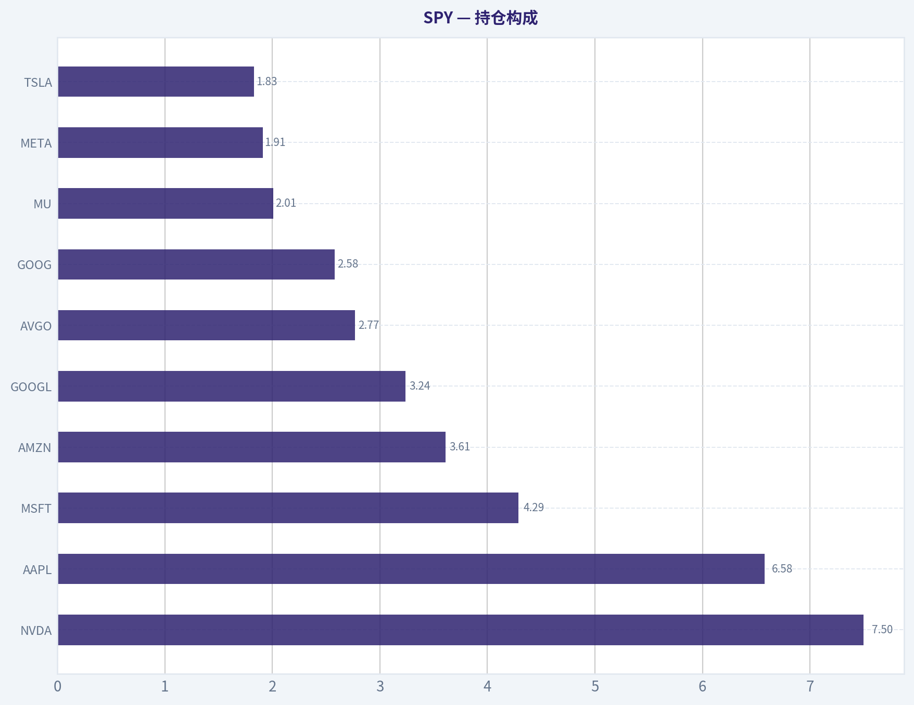
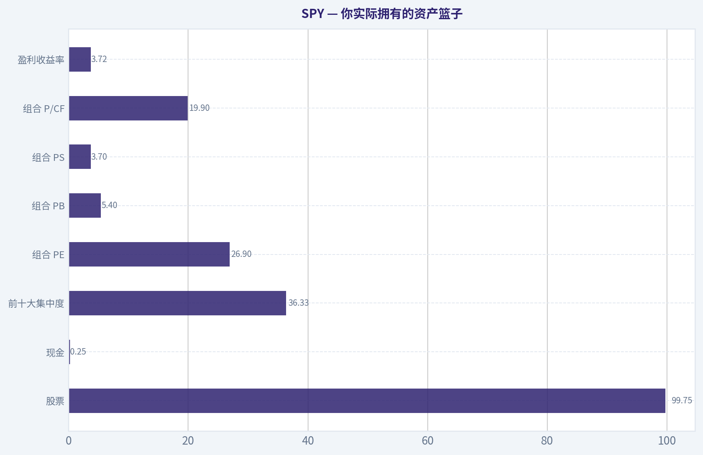
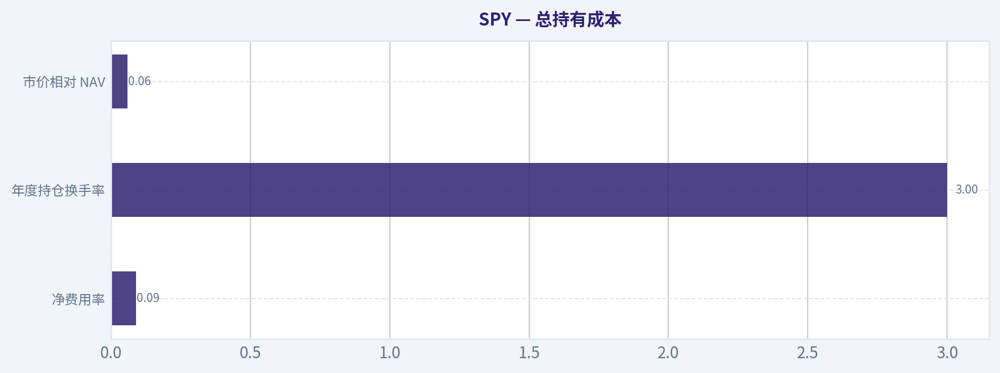
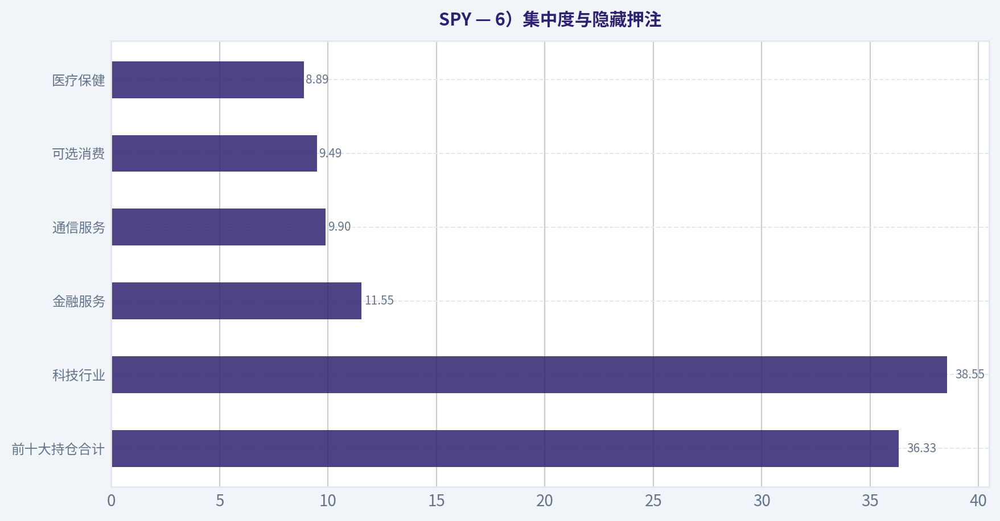
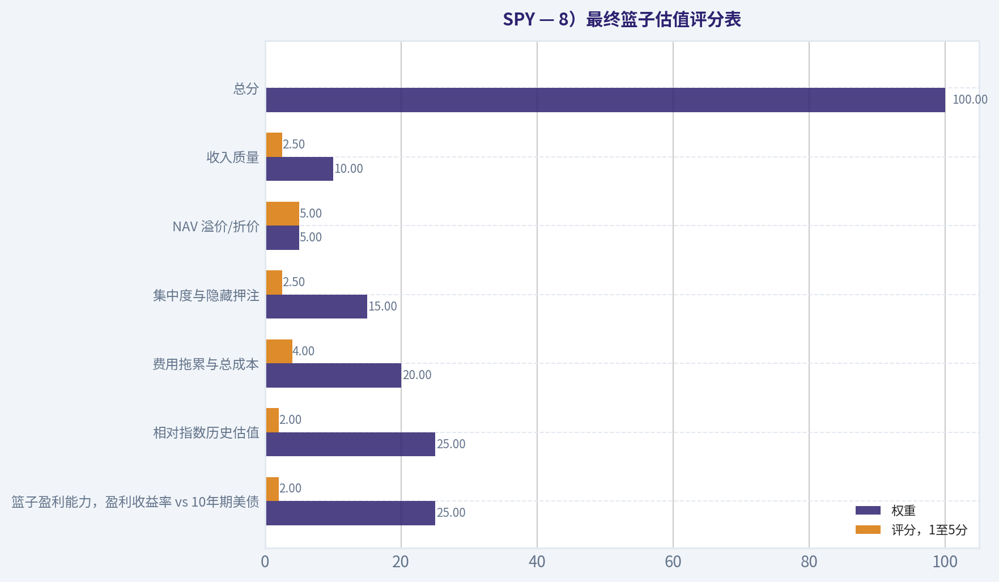
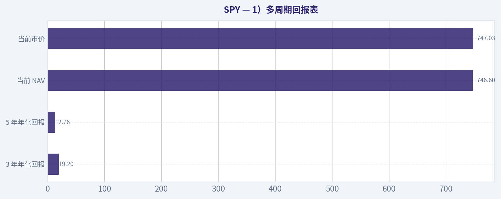

# SPY 深度价值情报

**调研日期:** 2026-08-02

## 关键免责声明

*本报告由 Deep Value Intelligence（一个基于 AI 的多智能体投资分析框架）自动生成。 仅供教育和研究用途 - 非财务建议，非财务顾问。*

---

## 目录

1. 情报摘要
2. 分析师团队报告
   - 基本面分析
   - 篮子估值分析
   - 资金流与业绩分析
   - 市场分析
   - 期权市场分析
3. 研究团队评论
4. 投资团队评论
5. Deep Values 团队洞察

---

## 情报摘要

### 核心观点与前提条件

**核心论点:** ### 风险管理与投资决策执行报告：SPY (标普500 ETF)

**主要风险:**
- 结论：SPY 底层资产极其优秀，但当前估值透支严重，安全边际缺失。建议对新增资金保持【观望 (WATCH)】。**
- 多头 (Risky)**：集中度高是"赢家通吃"的客观体现，科技巨头的强劲盈利与现金流足以消化高估值。分批建仓（DCA）会带来严重的现金拖累，最大的风险是不在场。
- 最终立场：观望 (WATCH)**

**置信度:** 中

---

## 分析师团队报告

### 基本面分析

ANALYST STANCE: **建议配置**

#### SPY 基金解剖结论

SPY 是美国大盘股 beta 的经典 ETF 包装器，底层篮子几乎全部是股票，目标是跟踪 S&P 500 Index。它的优势是规模极大、流动性极强、跟踪机制成熟、交易便利；主要缺点是费用率高于 VOO、IVV 等同类低费率产品，并且当前组合已经显著偏向科技与 AI 相关 mega-cap，估值不便宜。
结论上，SPY 适合作为高流动性交易工具、机构级配置工具、期权和战术仓位工具；若是长期买入并持有的核心美股大盘配置，仍可用，但低费率替代品可能更优。

---

#### 持仓构成

| 持仓/板块 | 权重 | 说明 |
|---|---:|---|
| NVDA | 7.50% | 第一大持仓，AI 半导体与加速计算权重极高，是当前指数回报的重要驱动 |
| AAPL | 6.58% | 第二大持仓，消费电子、服务生态与大盘质量因子代表 |
| MSFT | 4.29% | 云计算、企业软件与 AI 基础设施核心公司 |
| AMZN | 3.61% | 电商、云计算与消费周期板块的重要暴露 |
| GOOGL | 3.24% | 搜索、广告、云与 AI 相关暴露 |
| AVGO | 2.77% | 半导体、网络芯片与基础设施软件暴露 |
| GOOG | 2.58% | Alphabet 另一股权类别，实质上进一步提高 Alphabet 总暴露 |
| MU | 2.01% | 存储芯片与 AI 服务器周期暴露，波动性较高 |
| META | 1.91% | 数字广告、社交平台与 AI 投入暴露 |
| TSLA | 1.83% | 电动车、自动驾驶与高估值成长股暴露 |
| 前十大合计 | 36.33% | 前十大公司占比超过三分之一，指数并非"平均分散" |

关键结论：SPY 表面上覆盖约 500 家美国大盘公司，但实际收益越来越由少数超大市值科技与平台型公司决定。前十大持仓占 36.33%，说明它不是等权分散组合，而是市值加权组合；当 AI、半导体和 mega-cap 科技上涨时 SPY 会受益明显，但这些龙头回调时也会拖累整体指数。

| 板块 | 权重 | 说明 |
|---|---:|---|
| Technology | 38.55% | 最大板块，科技、半导体、软件与 AI 基础设施主导组合风险 |
| Financial Services | 11.55% | 银行、保险、资本市场等，受利率、信用周期与监管影响 |
| Communication Services | 9.90% | Alphabet、Meta 等平台公司带来广告、媒体与互联网暴露 |
| Consumer Cyclical | 9.49% | 包含 Amazon、Tesla 等，受消费周期与利率环境影响 |
| Healthcare | 8.89% | 医药、设备、医保服务，提供一定防御属性 |
| Industrials | 8.45% | 工业、航空、设备、运输等，与经济周期相关 |
| Consumer Defensive | 4.52% | 必需消费，占比不高，防御缓冲有限 |
| Energy | 2.98% | 能源权重较低，对油价上涨的对冲能力有限 |
| Utilities | 2.20% | 公用事业权重较低，利率敏感型防御属性有限 |
| Realestate | 1.83% | 房地产权重很小，对 REITs 的暴露有限 |
| Basic Materials | 1.65% | 原材料权重很低，对商品周期暴露有限 |

关键结论：SPY 的板块结构已经明显偏向科技，Technology 权重达到 38.55%，再叠加 Communication Services 和部分 Consumer Cyclical，实际成长股与平台科技暴露更高。它虽然名义上是美国大盘宽基指数，但当前隐藏倾斜是 AI、半导体、云计算、数字广告和 mega-cap 成长股。

---

#### 你实际拥有的资产篮子

| 项目 | 数据 | 解读 |
|---|---:|---|
| 股票 | 99.75% | 几乎是纯股票风险暴露 |
| 现金 | 0.25% | 现金拖累极低，基本满仓复制指数 |
| 前十大集中度 | 36.33% | 集中度偏高，收益由少数巨头主导 |
| 组合 PE | 26.9x | 估值高于长期均值区间，未来回报对盈利增长要求较高 |
| 组合 PB | 5.4x | 反映美国大盘股质量较高，但也说明账面估值不低 |
| 组合 PS | 3.7x | 收入估值偏高，特别受科技股权重影响 |
| 组合 P/CF | 19.9x | 现金流估值不便宜 |
| 盈利收益率 | 3.72% | 与债券收益率相比，股权风险溢价需要重点观察 |

关键结论：SPY 是高度股权化、低现金拖累的美国大盘组合。当前最大问题不是包装器质量，而是底层篮子的估值和集中度：26.9x PE 与 36.33% 前十大权重意味着投资者买到的是高质量但并不便宜的美国 mega-cap 组合。

#### 指数与复制方式

SPY 跟踪的是 S&P 500 Index，代表美国大型上市公司的市值加权组合。其复制方式属于实物持仓复制，通常持有指数成分股或高度接近指数的篮子，而不是依赖掉期的合成复制。由于 SPY 规模极大、交易活跃、申购赎回机制成熟，包装器通常能够较忠实地交付指数篮子的表现。

需要注意的是，S&P 500 是市值加权指数，不是基本面加权，也不是等权指数。这意味着上涨最多、市值最大的公司会自动获得更高权重；因此，当科技巨头持续跑赢时，SPY 会自然变得更集中、更偏成长。

#### 结构、发行人与流动性

| 项目 | 数据 | 评价 |
|---|---:|---|
| 基金名称 | State Street SPDR S&P 500 ETF Trust | 全球最知名的 S&P 500 ETF 之一 |
| 发行人 | State Street Investment Management | 一线 ETF 发行商，运营经验强 |
| 法律结构 | ETF | 更具体地说，SPY 是信托型 ETF 产品，结构成熟 |
| AUM | 7811.9 亿美元 | 超大规模，流动性和存续安全性极强 |
| 市价 | 747.03 美元 | 与 NAV 接近 |
| NAV | 746.60 美元 | 作为公允价值参考 |
| 溢价/折价 | +0.06% | 溢价极小，说明二级市场定价有效 |
| 3 年 beta | 1.00 | 与美国大盘 beta 高度一致 |

关键结论：SPY 的包装器质量非常高，最大优势是规模、交易深度与生态系统。0.06% 的溢价说明市价与 NAV 贴合良好，AUM 超过 7800 亿美元也使清盘风险几乎可以忽略；对交易者而言，SPY 的流动性价值可能超过费用率劣势。

#### 总持有成本

SPY 的净费用率为 0.09%，即每年约 9 个基点。这个费用本身很低，但在 S&P 500 ETF 同类中并不是最低；VOO、IVV 等产品常见费用率约为 0.03%，因此 SPY 的长期持有成本相对高出约 6 个基点。

如果用静态本金粗略估算，持有 10 万美元 SPY，0.09% 年费约等于每年 90 美元，10 年约 900 美元；若与 0.03% 费率产品相比，10 年静态差额约 600 美元。真实长期差额会随资产增长而放大，因此对"几十年买入并持有"的投资者，费用差距虽小但会复利累积。

| 成本项目 | 数据 | 影响 |
|---|---:|---|
| 净费用率 | 0.09% | 绝对较低，但高于部分低费率 S&P 500 ETF |
| 年度持仓换手率 | 3.00% | 很低，隐性交易成本与税务摩擦较小 |
| 市价相对 NAV | +0.06% | 当前溢价很小，交易摩擦低 |
| 组合换手特征 | 低换手 | 有利于长期税务效率 |
| 长期费用影响 | 每 10 万美元约 90 美元/年 | 成本低，但长期复利下仍应关注替代品 |

关键结论：SPY 的总持有成本非常可控，换手率只有 3.00%，说明它不是高交易、高摩擦的包装器。不过，作为长期核心配置，0.09% 的费率不是同类最低；如果投资者不需要 SPY 的极致流动性和期权生态，低费率同类 ETF 可能更有成本优势。

#### 收入与分红

SPY 的分配收益率为 1.01%，主要来源于底层 S&P 500 成分股的现金股息。由于当前指数权重偏向科技、平台型企业和成长股，而这些公司通常股息率较低，SPY 的收入属性较弱。

这只基金更适合作为资本增值与大盘 beta 工具，而不是收入型工具。若投资目标是稳定现金流，SPY 的 1.01% 分配收益率不足以承担核心收入角色，投资者可能需要搭配高股息 ETF、债券或货币市场工具。

#### 关键机会

| 机会 | 说明 |
|---|---|
| 美国大盘核心 beta | 一只产品即可获得美国大型上市公司的广泛暴露 |
| 流动性极强 | 适合大额交易、机构调仓、短期战术仓位和期权策略 |
| 低换手 | 3.00% 换手率有利于降低隐性交易成本和税务摩擦 |
| AI 与科技龙头暴露 | NVDA、MSFT、AVGO、Alphabet、Meta 等提供强成长驱动 |
| 发行人与结构成熟 | State Street 产品线成熟，SPY 存续风险极低 |

关键结论：SPY 最大机会在于"简单、深、稳、流动性强"。它既能作为美国股市核心敞口，也能作为战术交易工具；尤其当投资者需要高度流动性、窄价差和成熟期权市场时，SPY 的综合优势非常明显。

#### 主要风险与红旗

| 风险 | 说明 |
|---|---|
| 科技集中度高 | Technology 权重 38.55%，组合对科技估值和 AI 周期敏感 |
| 前十大集中 | 前十大 36.33%，指数分散性有一定"表面化" |
| 估值偏高 | PE 26.9x、PB 5.4x，未来回报依赖盈利增长兑现 |
| 收益率较低 | 分配收益率 1.01%，不适合作为收入核心 |
| 费率非最低 | 0.09% 虽低，但高于部分同类 S&P 500 ETF |
| YTD 数据异常 | 工具显示 YTD 回报 1016.43%，该数值明显异常，不宜作为决策依据 |

关键结论：SPY 的主要风险不是 ETF 会不会失效，而是底层美国大盘股是否已经过度集中、估值是否过高。投资者需要意识到，买 SPY 并不等于买一个完全均衡的美国经济组合，而是买一个市值加权、科技龙头权重很高的股票组合。

---

#### 最终投资立场：建议配置

SPY 适合配置，但更适合"需要极高流动性和交易便利"的投资者。它的包装器质量优秀，AUM 超大、价差与 NAV 贴合、低换手、发行人强，作为 S&P 500 暴露工具非常可靠。
但如果投资者是长期买入并持有，并且不需要 SPY 的期权生态和交易深度，则可考虑费用率更低的同类产品。当前底层篮子估值偏高、科技集中度较高，因此建议采用分批配置、再平衡和风险预算管理，而不是无视估值一次性重仓。

| 维度 | 结论 | 投资含义 |
|---|---|---|
| 篮子质量 | 高质量美国大盘股，但科技集中 | 适合作为美国权益核心仓位，但需接受 mega-cap 风险 |
| 分散程度 | 名义分散，实际集中度上升 | 前十大 36.33%，并非真正均衡分散 |
| 估值 | 偏高 | 长期回报对盈利增长与利率环境敏感 |
| 包装器质量 | 很强 | 规模、流动性、跟踪机制均属顶级 |
| 成本 | 低但非最低 | 交易型投资者优势明显，长期持有者可比较低费率替代品 |
| 收入 | 较弱 | 1.01% 收益率，不适合作为收入核心 |
| 适合角色 | 核心 beta、战术交易、期权策略 | 不适合作为高股息或防御型资产 |
| 最终立场 | 建议配置 | 可作为美股核心工具，但注意估值、集中度与费用替代品 |

关键结论：SPY 是一只优秀的 ETF 包装器，但当前底层篮子的风险更集中、更偏科技、估值也更高。综合来看，它值得配置，尤其适合需要流动性和指数精准暴露的投资者；但长期投资者应控制买入节奏，并与低费率替代品和防御资产进行比较。

---

### 篮子估值分析

> *以价值投资者审视企业的方式为篮子估值：加权估值倍数、盈利收益率对比债券、费用侵蚀，以及应用于篮子的安全边际。*

ANALYST STANCE: **回避**

#### SPY 篮子估值结论

SPY 是对 S&P 500 的高流动性、低费率包装，但今天买入的核心问题不是包装质量，而是篮子价格。当前组合加权 PE 为 **26.9倍**，对应盈利收益率仅 **3.72%**，低于约 **4.6%** 的美国10年期国债收益率；买方实际上是在为未来盈利增长支付较高价格。按巴菲特式纪律看，这是"好篮子、偏贵价格"。

---

#### 1）加权篮子估值表

| 指标 | SPY 当前加权估值 | 解读 |
|---|---:|---|
| PE | 26.9倍 | 盈利定价偏高 |
| PB | 5.4倍 | 账面价值溢价显著 |
| PS | 3.7倍 | 收入定价不便宜 |
| P/CF | 19.9倍 | 现金流估值偏高 |
| 盈利收益率 | 3.72% | 低于10年期美债收益率 |
| 分红收益率 | 1.01% | 收入贡献较低，回报更依赖资本增值 |

**关键结论：** SPY 当前不是以便宜价格买入美国大盘股，而是在以高于长期常态的倍数买入一篮子优质企业。3.72%的盈利收益率低于约4.6%的10年期美债收益率，意味着投资者需要未来盈利持续增长，才能弥补今天估值偏高带来的压力。1.01%的分红收益率也说明，当前回报主要不是靠现金分派，而是靠企业再投资、利润增长和估值维持。

---

#### 2）盈利收益率 vs 10年期美债

| 项目 | 数值 |
|---|---:|
| SPY 加权 PE | 26.9倍 |
| SPY 盈利收益率 | 1 ÷ 26.9 = **3.72%** |
| 美国10年期国债收益率假设 | **约4.6%** |
| 股债收益率差 | 3.72% - 4.6% = **-0.88个百分点** |

**关键结论：** SPY 的篮子盈利收益率低于无风险利率，这不是一个典型的价值投资买点。投资者不是因为当前盈利便宜而买入，而是在押注美国大盘企业未来能持续提高盈利，并且市场愿意继续给予高估值。

---

#### 3）相对 S&P 500 自身历史估值

| 指标 | 当前水平 | 历史参照区间 | 当前判断 |
|---|---:|---:|---|
| PE | 26.9倍 | 长期常态大致约16至20倍；近年高质量科技权重提高后常态略上移 | 明显高于长期均值 |
| PB | 5.4倍 | 长期常态大致约2.5至3.5倍；近十年常见区间约3.5至4.5倍 | 高于长期与近年常态 |
| 市场含义 | 高估值起点 | 高估值通常压低未来10年年化回报 | 前瞻回报空间受限 |

**关键结论：** 以 S&P 500 自身历史为参照，当前买家支付的是偏高价格，而不是普通价格。历史上，当大盘在 PE 超过25倍附近买入时，未来长期回报往往更依赖盈利增长，估值扩张空间有限，出现"回报被提前透支"的风险较高。

---

#### 4）NAV 溢价/折价

| 项目 | 数值 |
|---|---:|
| SPY 市场价格 | 747.03美元 |
| 每份 NAV | 746.60美元 |
| 溢价/折价 | **+0.06% 溢价** |

**关键结论：** SPY 当前几乎贴近 NAV 交易，包装层面没有明显溢价风险。对买家来说，问题不在 ETF 交易价格偏离净值，而在底层 S&P 500 篮子的整体估值已经偏高。

---

#### 5）费用拖累计算

公式：
费用拖累 ~ 1 - (1 - 费用率)^N
SPY 净费用率为 **0.09%**，即 **0.0009**。

| 持有期 | SPY 费用拖累公式 | 拖累比例 | 10,000美元本金对应费用拖累 |
|---:|---|---:|---:|
| 10年 | 1 - (1 - 0.0009)^10 | 约0.90% | 约89.64美元 |
| 20年 | 1 - (1 - 0.0009)^20 | 约1.78% | 约178.48美元 |
| 30年 | 1 - (1 - 0.0009)^30 | 约2.67% | 约266.51美元 |

**关键结论：** SPY 的0.09%费用率绝对值很低，不会单独毁掉长期回报。但费用是确定发生的负收益，持有时间越长，拖累越明显；在同类产品已有更低费率选择时，长期投资者应把这部分确定成本看作可优化项。

| 对比项目 | SPY | 低费率同类替代，如 VOO / IVV |
|---|---:|---:|
| 净费用率 | 0.09% | 约0.03% |
| 10年费用拖累 | 约89.64美元 | 约29.96美元 |
| 20年费用拖累 | 约178.48美元 | 约59.83美元 |
| 30年费用拖累 | 约266.51美元 | 约89.59美元 |

**关键结论：** SPY 的费率大约是最低费率 S&P 500 ETF 的三倍，但绝对差距仍不大。若投资者只是长期买入并持有，VOO 或 IVV 的成本优势更明确；若投资者重视极高流动性、期权深度和交易便利，SPY 的较高费用可以被部分解释。

---

#### 6）集中度与隐藏押注

| 项目 | 权重 |
|---|---:|
| 前十大持仓合计 | 36.33% |
| 科技行业 | 38.55% |
| 金融服务 | 11.55% |
| 通信服务 | 9.90% |
| 可选消费 | 9.49% |
| 医疗保健 | 8.89% |

**关键结论：** SPY 看似是高度分散的500家公司篮子，但实际已有明显的头部集中与科技成长股倾斜。前十大持仓占比超过三分之一，科技行业接近四成，这意味着投资者买入的不只是"美国经济"，还包含对大型科技、AI资本开支和高估值成长股的集中押注。

| 前十大持仓 | 权重 |
|---|---:|
| NVDA | 7.50% |
| AAPL | 6.58% |
| MSFT | 4.29% |
| AMZN | 3.61% |
| GOOGL | 3.24% |
| AVGO | 2.77% |
| GOOG | 2.58% |
| MU | 2.01% |
| META | 1.91% |
| TSLA | 1.83% |

**关键结论：** SPY 的最大权重集中在半导体、云计算、平台科技和大型互联网公司。若 AI 与大型科技盈利继续兑现，SPY 能受益；但若这些龙头估值压缩，整个 ETF 的回撤也会比"500只股票平均分散"这个表象更明显。

---

#### 7）篮子的安全边际评估

| 安全边际维度 | 当前情况 | 判断 |
|---|---|---|
| 盈利收益率 vs 美债 | 3.72% 低于约4.6%的10年期美债 | 安全边际不足 |
| 估值 vs 历史 | PE、PB 均高于长期常态 | 安全边际不足 |
| NAV 溢价 | +0.06%，基本贴近净值 | 包装层面良好 |
| 费用 | 0.09%，绝对低但高于最低同类 | 可接受但非最优 |
| 集中度 | 前十大36.33%，科技38.55% | 隐含集中风险较高 |
| 收入质量 | 分红收益率1.01% | 收入缓冲较弱 |

**关键结论：** SPY 不会像单一股票那样归零，但在高估值买入时完全可能出现回报平庸甚至"失落十年"。当前安全边际主要不足在两个地方：一是盈利收益率低于债券收益率，二是估值高于自身历史常态。包装本身优秀，但价格没有给出足够保护。

---

#### 8）最终篮子估值评分表

| 评分项 | 权重 | 评分，1至5分 | 加权贡献 |
|---|---:|---:|---:|
| 篮子盈利能力，盈利收益率 vs 10年期美债 | 25% | 2.0 | 0.50 |
| 相对指数历史估值 | 25% | 2.0 | 0.50 |
| 费用拖累与总成本 | 20% | 4.0 | 0.80 |
| 集中度与隐藏押注 | 15% | 2.5 | 0.38 |
| NAV 溢价/折价 | 5% | 5.0 | 0.25 |
| 收入质量 | 10% | 2.5 | 0.25 |
| **总分** | **100%** |  | **2.68 / 5.00** |

**关键结论：** SPY 的包装质量、流动性和跟踪效率都很强，但估值起点削弱了长期回报吸引力。总分约2.68分，落在"回避"区间，核心原因不是基金结构差，而是当前篮子价格不够便宜。

---

#### 9）投资立场与置信度

| 项目 | 结论 |
|---|---|
| 投资立场 | **回避** |
| 置信度 | 中等偏高 |
| 适合动作 | 不追高；等待盈利收益率改善、估值回落或美债收益率下行 |
| 更合理买点特征 | PE 回落至接近历史常态，或盈利增长显著消化估值 |
| 长期持有人 | 可继续持有，但新增资金应分批、克制、重视估值 |

**关键结论：** SPY 是优秀的市场工具，但当前不是巴菲特式"好价格"。若投资者已经长期持有，可以把它视为核心资产继续观察；若是新资金一次性买入，当前安全边际不足，等待更好价格更符合价值纪律。

#### 估值图表

本对比图（来自「持仓构成」）将 **SPY** 的当前数据与历史基准并排呈现，直观反映公司相对自身历史均值的估值水平。

本对比图（来自「持仓构成」）将 **SPY** 的当前数据与历史基准并排呈现，直观反映公司相对自身历史均值的估值水平。

本对比图（来自「你实际拥有的资产篮子」）将 **SPY** 的当前数据与历史基准并排呈现，直观反映公司相对自身历史均值的估值水平。

本对比图（来自「总持有成本」）将 **SPY** 的当前数据与历史基准并排呈现，直观反映公司相对自身历史均值的估值水平。

本对比图（来自「6）集中度与隐藏押注」）将 **SPY** 的当前数据与历史基准并排呈现，直观反映公司相对自身历史均值的估值水平。

本对比图（来自「6）集中度与隐藏押注」）将 **SPY** 的当前数据与历史基准并排呈现，直观反映公司相对自身历史均值的估值水平。

本对比图（来自「8）最终篮子估值评分表」）将 **SPY** 的当前数据与历史基准并排呈现，直观反映公司相对自身历史均值的估值水平。

本对比图（来自「1）多周期回报表」）将 **SPY** 的当前数据与历史基准并排呈现，直观反映公司相对自身历史均值的估值水平。

---

### 资金流与业绩分析

> *评估交付与需求：多期限净值与价格回报、相对指数的跟踪偏差、同类排名、规模与资金流趋势、分红与换手率。*

ANALYST STANCE: **建议配置**

#### SPY 流量与业绩交付结论

SPY 是超大规模、低费率、低换手的 S&P 500 被动跟踪工具。当前最核心结论是：**它的产品价值不在于战胜指数，而在于以极低摩擦、极高流动性、极低关闭风险交付 S&P 500 暴露**。基于现有数据，SPY 适合作为美股大盘核心仓位，但估值偏高、科技权重集中，是未来回撤的主要来源。

---

#### 1）多周期回报表

| 指标 | 当前可得数据 | 解读 |
|---|---:|---|
| 年初至今回报 | 工具返回 1016.43%，疑似数据异常 | 不纳入评分 |
| 1 年 NAV 回报 | 未返回 | 无法精确判断短期相对表现 |
| 1 年市价回报 | 未返回 | 当前市价较 NAV 溢价仅 +0.06%，未见明显折溢价风险 |
| 3 年年化回报 | 19.20% | 受大型科技股、AI 与美股盈利韧性推动 |
| 5 年年化回报 | 12.76% | 长周期表现强，体现美股大盘质量与成长溢价 |
| 10 年年化回报 | 未返回 | 本次数据源未提供 |
| 当前 NAV | $746.60 | 与市价非常接近 |
| 当前市价 | $747.03 | 较 NAV 溢价约 +0.06% |

**关键结论：** SPY 的 3 年和 5 年回报表现强劲，说明它在大型成长股、科技股和 AI 龙头占优的市场环境中表现突出。当前市价与 NAV 几乎一致，暂未看到 ETF 交易价格长期偏离资产净值的问题。年初至今回报数据明显异常，因此不用于判断。

---

#### 2）指数跟踪差异评估

| 项目 | 数据 / 判断 |
|---|---|
| 跟踪指数 | S&P 500 |
| 费用率 | 0.09% |
| 当前市价相对 NAV | +0.06% |
| 年换手率 | 3.00% |
| 跟踪差异判断 | 预计长期主要接近费用率损耗 |
| 执行质量 | 高 |
| 是否忠实交付指数 | 是 |

**关键结论：** SPY 的费用率低、换手率低、价格与 NAV 偏离极小，显示其 ETF 包装执行质量很高。虽然本次未获得逐年指数回报对照表，但从结构上看，SPY 的长期跟踪差异应主要来自 0.09% 的费用率，而不是明显的复制或交易失误。

---

#### 3）同类基金比较

| 维度 | SPY 情况 | 同类含义 |
|---|---|---|
| 基金类别 | 大盘均衡 |
| 资产规模 | $781.19B | 规模极大，流动性优势显著 |
| 费用率 | 0.09% | 低，但并非市场最低；VOO、IVV 等同类可能更便宜 |
| 流动性 | 极强 | 适合机构、期权、战术交易和核心配置 |
| 长期回报 | 3 年 19.20%，5 年 12.76% | 处于大盘均衡类别强势区间 |
| 结构性优势 | 规模、成交深度、期权生态、跟踪稳定性 | 比单纯低费率产品更适合高流动性需求 |

**关键结论：** SPY 的优势并不是全市场最低费用，而是规模、流动性和交易生态。对于长期买入持有者，费用更低的 S&P 500 ETF 可能略有成本优势；但对于需要高流动性、期权工具或大额进出的投资者，SPY 仍是同类中的核心工具。

---

#### 4）AUM 与资金流趋势

| 项目 | 数据 / 判断 |
|---|---:|
| 当前 AUM | $781.19B |
| 共享研究包口径规模 | $685.61B |
| 规模变化方向 | 上升 |
| 当前关闭风险 | 极低 |
| 资金属性判断 | 长期配置资金 + 战术交易资金并存 |
| 需求质量 | 高 |
| 热钱风险 | 中等，因市场高位时大盘 ETF 容易吸引追涨资金 |

**关键结论：** SPY 的资产规模已达到极高水平，关闭风险几乎可以忽略。当前 AUM 高于共享研究包中的规模口径，显示资金需求仍然强劲。不过，在美股接近高位、科技权重较高的背景下，部分新增资金可能带有追涨属性。

---

#### 5）分红收益与增长质量

| 项目 | 数据 / 判断 |
|---|---:|
| 当前分红收益率 | 1.01% |
| 收益来源 | 主要来自底层股票股息 |
| 是否依赖资本返还 | 未见证据 |
| 收益稳定性 | 中等偏高 |
| 对收入型投资者吸引力 | 一般 |
| 分红增长驱动 | S&P 500 企业盈利与股息增长 |

**关键结论：** SPY 的分红收益率只有约 1.01%，它不是高股息收入工具。其分红主要来自底层成分股现金分红，质量较高，但收入水平不高，更适合总回报投资者，而不是以现金流为核心目标的投资者。

---

#### 6）换手率与效率

| 项目 | 数据 / 判断 |
|---|---:|
| 年持仓换手率 | 3.00% |
| 被动指数策略匹配度 | 高 |
| 隐性交易成本 | 低 |
| 税务效率 | 高 |
| 是否存在异常高换手 | 否 |
| 包装效率 | 优秀 |

**关键结论：** 3.00% 的年换手率非常低，符合 S&P 500 被动复制工具的特征。低换手意味着交易摩擦和潜在税务拖累较低，也支持 SPY 作为长期核心仓位工具。

---

#### 7）流量与业绩评分卡

| 评分项目 | 权重 | 评分 | 加权分 | 理由 |
|---|---:|---:|---:|---|
| 多周期回报 | 25% | 4.2 | 1.05 | 3 年、5 年回报强，但 1 年和 10 年数据缺失 |
| 跟踪忠实度 | 25% | 4.7 | 1.18 | 费用低，NAV 与市价偏离极小，换手低 |
| 同类排名 | 15% | 4.3 | 0.65 | 规模和流动性领先，费用并非最低 |
| AUM / 资金流 | 15% | 4.8 | 0.72 | AUM 极大且需求强，关闭风险极低 |
| 分红质量 | 10% | 3.5 | 0.35 | 分红质量较好，但收益率偏低 |
| 换手 / 效率 | 10% | 4.8 | 0.48 | 低换手、高效率 |
| 总分 | 100% | - | **4.43 / 5.00** | **建议配置** |

**关键结论：** SPY 的综合得分为 4.43 分，达到"建议配置"区间。它在跟踪、规模、流动性和效率方面表现突出，主要扣分点是分红收益率不高，以及费用率虽低但不是同类最低。

---

#### 8）仓位立场

| 投资者类型 | 建议仓位立场 |
|---|---|
| 长期核心配置者 | 可作为美股核心仓位 |
| 战术交易者 | 适合，因流动性和期权生态极强 |
| 收入型投资者 | 不宜作为主要收入来源 |
| 成本极度敏感的长期投资者 | 可比较 VOO、IVV 等更低费率替代品 |
| 风险厌恶者 | 分批配置，避免在估值高位一次性重仓 |

**关键结论：** SPY 适合作为美股核心资产配置工具，而不是短期超额收益工具。若投资者重视极致低成本，可以比较其他 S&P 500 ETF；若重视流动性和交易深度，SPY 仍然非常有竞争力。

---

#### 9）关键风险与催化剂

| 类别 | 内容 |
|---|---|
| 主要风险一 | S&P 500 估值偏高，当前篮子 PE 约 26.9 倍 |
| 主要风险二 | 科技板块权重达 38.55%，前十大持仓占 36.33%，集中度较高 |
| 主要风险三 | 利率上行或长期美债收益率突破，可能压制估值倍数 |
| 主要风险四 | AI 与半导体交易若退潮，SPY 可能受头部权重股拖累 |
| 催化剂一 | 企业盈利继续增长，推动指数基本面消化高估值 |
| 催化剂二 | Fed 转向宽松或实际利率下行，支持估值扩张 |
| 催化剂三 | 大盘广度改善，涨幅从少数科技巨头扩散至更多行业 |
| 催化剂四 | 长期养老金、被动配置和全球资产配置资金继续流入 |

**关键结论：** SPY 的最大风险不是 ETF 包装本身，而是 S&P 500 当前估值和行业集中度。若盈利继续扩张、利率下行、市场广度改善，SPY 仍可能稳健上行；若科技龙头回调或利率继续走高，回撤压力会明显增加。

---

#### 最终判断

SPY 符合"指数基金唯一产品是忠实、便宜地交付指数"的核心要求。它并非最便宜的 S&P 500 ETF，但在规模、流动性、交易便利性、NAV 贴合度和低换手方面表现优异。

**最终立场：建议配置。**
更适合：核心美股仓位、长期资产配置、机构流动性工具。
需警惕：高估值、科技集中、追涨资金和利率上行风险。

---

### 市场分析

ANALYST STANCE: **观望**

#### SPY 技术面结论：长期多头仍在，但短线修复尚未完成

截至最近交易日 2026-07-31，SPY 收于 **747.03**。整体结构显示：长期趋势仍明显偏多，价格显著站在 200 日均线之上；但中短期动能经历了 7 月下旬的回落后，仍处于"修复中"而非重新强势上攻阶段。当前更适合以 **观望偏多、等待确认** 的方式处理，而不是在阻力区附近盲目追高。

本次选用的 8 个指标为：**close_50_sma、close_200_sma、macd、rsi、boll_ub、boll_lb、atr、vwma**。它们分别覆盖中期趋势、长期趋势、动能、超买超卖、波动区间、风险控制与量价确认，避免了同时使用过多相似指标造成信号重复。

| 维度 | 最新读数或区间 | 解读 |
|---|---:|---|
| 收盘价 | 747.03 | 7 月底从 729.46 快速反弹，但尚未突破前高区 |
| 50 日均线 | 744.22 | 价格略高于 50 日均线，短线重新回到中期趋势线上方 |
| 200 日均线 | 697.41 | 价格高于 200 日均线约 7.1%，长期趋势仍偏多 |
| MACD | -0.64 | 仍在零轴下方，但较 7 月 29 日改善，空头动能减弱 |
| RSI | 53.14 | 中性略偏强，没有超买，反弹仍有空间但缺乏强势确认 |
| Bollinger 上轨 | 758.63 | 755-759 一带是短线主要压力区 |
| Bollinger 下轨 | 732.76 | 733 附近是波动区间下沿支撑 |
| ATR | 9.04 | 单日正常波动约 1.2%，仓位和止损不宜过紧 |
| VWMA | 743.16 | 收盘价重新站上量价均线，说明反弹具备一定量价支撑 |

关键结论：SPY 的长期趋势仍然健康，价格明显高于 200 日均线，说明大级别多头结构尚未破坏。但短线动能并未完全转强，MACD 仍在零轴下方，显示市场只是从下跌压力中修复，而不是已经进入新一轮强趋势。当前最关键的位置是下方 743-744 的均线支撑，以及上方 755-759 的压力带。

---

#### 趋势结构：长期偏多，中期进入横向震荡修复

SPY 的 200 日均线从 6 月中旬约 683.41 持续抬升至 7 月底的 697.41，说明长期均线斜率仍然向上。50 日均线也从 6 月中旬的 724.74 升至 744.22，表明过去两个月的中期趋势仍未转坏。不过，50 日均线在 7 月下旬明显趋平，显示上涨速度放缓，市场从此前的单边上行转向高位震荡。

价格在 7 月中旬多次接近 755 区域后未能有效突破，随后在 7 月 29 日跌至 729.46，显示高位获利盘曾集中释放。7 月 30 日和 7 月 31 日连续反弹，使价格重新站上 50 日均线与 VWMA，但反弹后的收盘价 747.03 仍低于 7 月中旬高点，因此当前更像是"跌后修复"，而不是明确突破。

| 趋势指标 | 6 月中旬水平 | 7 月底水平 | 趋势含义 |
|---|---:|---:|---|
| 50 日均线 | 724.74 | 744.22 | 中期趋势仍上行，但近期斜率趋缓 |
| 200 日均线 | 683.41 | 697.41 | 长期趋势稳定向上 |
| 收盘价相对 50 日均线 | 略高 | 高出约 0.38% | 短线刚回到中期趋势线上方 |
| 收盘价相对 200 日均线 | 明显高于 | 高出约 7.1% | 长线多头格局仍占优 |
| 50 日均线相对 200 日均线 | 高于 | 高出约 6.7% | 中长期仍是多头排列 |

关键结论：SPY 的长期趋势没有转空，200 日均线持续上行提供了较强的结构性支撑。但 50 日均线近期趋平，说明中期上涨动能已经放缓。只要价格维持在 743-744 上方，市场仍可视为偏多震荡；若重新跌破该区域，则短线反弹质量会明显下降。

#### 动能与情绪：反弹改善，但尚未强势

MACD 从 7 月中旬的正值高位逐步下滑，并在 7 月下旬跌至零轴下方。7 月 29 日 MACD 为 -1.30，7 月 31 日改善至 -0.64，说明空头动能正在减弱。不过，MACD 尚未回到零轴上方，意味着趋势动能还没有恢复到强多状态。

RSI 最新为 53.14，处于中性略偏强区间。这个位置的好处是没有超买压力，若价格继续上行，仍有进一步修复空间；但 RSI 未能进入 60 以上，也说明多头情绪尚未形成压倒性优势。换句话说，SPY 当前并非弱势，但也还不是高胜率追涨环境。

| 动能指标 | 最新读数 | 近期变化 | 交易含义 |
|---|---:|---|---|
| MACD | -0.64 | 从 7 月 29 日的 -1.30 改善 | 空头动能减弱，但趋势尚未重新转强 |
| RSI | 53.14 | 从 7 月 29 日的 38.88 回升 | 从偏弱区恢复到中性略偏强 |
| 价格行为 | 729.46 反弹至 747.03 | 两个交易日快速修复 | 抄底资金出现，但仍未突破前高 |
| 关键确认 | MACD 回到零轴上方、RSI 稳定高于 55-60 | 尚未完成 | 需要更多时间确认反弹质量 |

关键结论：动能层面正在改善，但还不能称为强势反转。RSI 回到 50 上方是积极信号，说明下跌压力减轻；但 MACD 仍在零轴下方，提醒交易者不要把短线反弹误判为新一轮趋势突破。若后续 RSI 升至 60 附近且 MACD 转正，才是更明确的多头确认。

#### 波动区间：上方 755-759 压力明显，下方 733-744 分层支撑

Bollinger 区间显示，当前上轨约 758.63，下轨约 732.76，中轴约 745.69。SPY 最新收盘 747.03，略高于中轴，说明价格从弱势区回到区间中部偏上位置。短线若继续上行，首先将面临 755 附近的前高压力，随后是 758-759 的 Bollinger 上轨压力。

下方支撑分两层：第一层是 743-744 附近，由 50 日均线和 VWMA 共同构成；第二层是 733 附近的 Bollinger 下轨，以及 729.46 的近期低点。如果价格回落但守住 743-744，属于正常回踩；若跌破 733 并接近 729，则说明 7 月底反弹失败，短线风险会明显升高。

| 价格区域 | 技术来源 | 意义 |
|---|---|---|
| 758-759 | Bollinger 上轨 | 短线强压力，突破后才有新高延展空间 |
| 755 附近 | 7 月中旬多次高点 | 前高压力区，容易出现获利盘 |
| 745-747 | Bollinger 中轴附近、当前价格区 | 当前多空争夺区 |
| 743-744 | 50 日均线、VWMA | 第一支撑区，守住则偏多震荡延续 |
| 733 附近 | Bollinger 下轨 | 第二支撑区，跌破则波动风险加大 |
| 729 附近 | 7 月 29 日收盘低点 | 近期关键防线 |

关键结论：SPY 当前处在区间中部偏上，但距离上方压力不远。真正的多头突破需要有效站上 755-759 区域，而不是仅仅反弹到区间中轴上方。下方 743-744 是短线交易的核心观察位，守住则偏多，跌破则需要降低仓位或等待重新确认。

#### 波动与风控：ATR 回落但仍不可忽视

ATR 最新为 9.04，约占收盘价的 1.2%。这说明 SPY 的日内和隔夜波动并不算极端，但也足以让过紧的止损被正常噪音触发。与 6 月底 10 以上的 ATR 相比，当前波动已有所下降，市场恐慌程度不高；但 7 月 29 日、7 月 30 日、7 月 31 日的成交量都高于 7 月中旬部分交易日，说明资金在下跌与反弹中都有明显参与。

对于短线交易者，若以 743-744 附近作为支撑参考，止损不宜只放在该区域下方很近的位置，可结合 ATR 设置更合理的缓冲。对于中线投资者，只要价格不重新跌破 733-729 区域，整体结构仍不能轻易判定为转空。

| 风控项目 | 当前状态 | 操作含义 |
|---|---:|---|
| ATR | 9.04 | 单日正常波动约 9 美元 |
| ATR 占价格比例 | 约 1.2% | 波动中等，不适合过紧止损 |
| 第一支撑 | 743-744 | 短线回踩观察位 |
| 第二支撑 | 733-729 | 跌破后短线结构明显转弱 |
| 第一压力 | 755-759 | 突破前追高性价比一般 |

关键结论：当前波动并未失控，但仍足以造成短线假突破或假跌破。交易上应避免把止损设得过近，尤其是在价格靠近 743-744 支撑或 755-759 压力时。更稳健的方式是等待价格突破压力后回踩确认，或回落支撑后出现放量企稳。

#### 交易策略倾向

| 交易风格 | 当前建议 | 触发条件 | 风险点 |
|---|---|---|---|
| 短线交易 | 观望偏多 | 站稳 747 后挑战 755-759 | 接近压力区追高容易被回落 |
| 回调买入 | 可等待 | 回踩 743-744 不破并重新转强 | 跌破 743 后可能回测 733 |
| 突破交易 | 等确认 | 放量突破 759 并维持其上 | 假突破风险仍在 |
| 防守策略 | 关注 733-729 | 跌破该区间需降低风险暴露 | 反弹失败可能引发更深调整 |
| 中线持有 | 可继续观察 | 价格维持在 50 日均线附近或上方 | MACD 未转正前不宜过度加仓 |

关键结论：SPY 目前最合理的判断是"长期多头未破，短线等待确认"。如果价格有效突破 755-759，市场将重新打开上行空间；如果跌破 743-744，则说明反弹质量不足，需要重新评估风险。当前不是明确回避，但也不是高确定性的追涨点，因此总体评级为观望。

---

### 期权市场分析

> *解读期权流向--认沽/认购比、隐含波动率偏斜与异常活跃合约--以判断机构定位与事件驱动风险。*

ANALYST STANCE: **观望**

#### SPY 期权市场定位报告

数据日期：2026-08-02。
覆盖近端到期：2026-08-03、2026-08-04、2026-08-05。
说明：工具未直接返回SPY现货价；从高成交行权价集中在745至750附近判断，以下ITM、ATM、OTM判断以SPY约746至748附近为近似参考。

---

#### 1. Put/Call 比率分析

| 到期日 | Call OI | Put OI | Put/Call OI | Call成交量 | Put成交量 | Put/Call成交量 | 解读 |
|---|---:|---:|---:|---:|---:|---:|---|
| 2026-08-03 | 108,342 | 136,435 | 1.26 | 871,167 | 902,892 | 1.04 | 近到期保护需求偏高，成交略偏Put |
| 2026-08-04 | 73,328 | 98,360 | 1.34 | 174,930 | 167,306 | 0.96 | OI明显偏Put，但当日成交较均衡 |
| 2026-08-05 | 72,003 | 70,038 | 0.97 | 80,523 | 107,862 | 1.34 | 成交端Put更活跃，短线下行保护增加 |
| 近端合计 | 253,673 | 304,833 | 1.20 | 1,126,620 | 1,178,060 | 1.05 | 整体高于0.7中性基准，偏防御 |

关键结论：SPY近端Put/Call OI为1.20，显著高于约0.7的历史中性基准，说明市场持仓结构偏向保护或看空对冲。成交量比率为1.05，虽然没有OI那么极端，但仍显示Put需求略占上风。整体不是单边恐慌，但防御性仓位明显高于中性水平。

---

#### 2. IV与偏斜评估

| 到期日 | ATM Call IV | ATM Put IV | Put相对Call溢价 | IV结构解读 |
|---|---:|---:|---:|---|
| 2026-08-03 | 30.4% | 35.2% | +4.8个百分点 | 近到期Put IV明显更高，反映隔夜或极短线下行保护需求 |
| 2026-08-04 | 23.2% | 26.0% | +2.8个百分点 | Put仍有溢价，但恐慌程度低于最近一期 |
| 2026-08-05 | 20.8% | 19.1% | -1.7个百分点 | 偏斜转向Call，说明更远一档存在反弹或上行追逐需求 |

关键结论：最近两个到期日呈现清晰Put IV溢价，代表市场愿意为短线下跌保护支付更高价格。8月5日Call IV略高于Put IV，说明下行担忧主要集中在极近端，而不是持续性恐慌。整体IV水平在0DTE至1DTE环境下偏高，适合解读为事件或宏观数据前后的短线风险定价，而非长期方向信号。

---

#### 3. 异常期权活动

以下合约均满足"成交量大于OI五倍且成交量大于500"的异常活跃条件，代表有较大概率是新开仓、短线交易或日内Gamma相关交易。

| 到期日 | 类型 | 行权价 | 成交量 | OI | 成交/OI | IV | 位置判断 | 含义 |
|---|---|---:|---:|---:|---:|---:|---|---|
| 2026-08-03 | CALL | 750 | 93,320 | 6,765 | 13.8x | 11.9% | 略OTM | 上方750为短线追涨与Gamma焦点 |
| 2026-08-03 | PUT | 740 | 80,754 | 3,254 | 24.8x | 17.4% | OTM | 下方740保护或看跌押注明显 |
| 2026-08-03 | PUT | 745 | 69,061 | 2,012 | 34.3x | 14.4% | 近ATM | 对745附近失守有较强对冲需求 |
| 2026-08-03 | CALL | 748 | 65,815 | 1,951 | 33.7x | 12.9% | 近ATM | 极短线向上突破交易活跃 |
| 2026-08-03 | CALL | 745 | 61,234 | 3,357 | 18.2x | 14.9% | 近ATM | 多空争夺核心价位 |
| 2026-08-03 | CALL | 746 | 59,731 | 1,833 | 32.6x | 14.4% | 近ATM | 日内方向押注与做市商对冲活跃 |
| 2026-08-03 | PUT | 735 | 57,490 | 3,674 | 15.6x | 20.2% | OTM | 尾部下跌保护，IV较高 |
| 2026-08-03 | CALL | 747 | 56,120 | 1,653 | 34.0x | 13.6% | 近ATM | 短线向上Delta需求 |
| 2026-08-03 | CALL | 743 | 53,683 | 2,532 | 21.2x | 16.3% | 略ITM/近ATM | 可能是短线趋势交易或价差腿 |
| 2026-08-03 | CALL | 752 | 53,184 | 4,187 | 12.7x | 11.2% | OTM | 上方追涨目标延伸至752 |
| 2026-08-03 | CALL | 749 | 52,709 | 2,033 | 25.9x | 12.4% | 近OTM | 750附近上方磁吸增强 |
| 2026-08-03 | PUT | 742 | 51,280 | 2,183 | 23.5x | 16.2% | OTM | 742为短线下方风险位 |
| 2026-08-03 | CALL | 744 | 50,514 | 3,291 | 15.3x | 15.6% | 近ATM | 可能为反弹押注或组合策略 |
| 2026-08-03 | PUT | 746 | 50,062 | 378 | 132.4x | 13.8% | ATM | 成交/OI极高，疑似新保护或短线方向单 |
| 2026-08-03 | CALL | 751 | 49,788 | 1,814 | 27.4x | 11.5% | OTM | 上行目标集中在750至752 |

关键结论：异常活动几乎全部集中在2026-08-03到期，说明这是极短线、接近0DTE性质的交易流，而非中长期机构建仓。Call异常量集中在745至752，显示上方突破和Gamma追逐活跃；Put异常量集中在735至746，显示下方保护也很强。最值得注意的是746 Put成交/OI达到132.4倍，可能代表新开保护或短线下破押注，但SPY的0DTE交易中也可能包含大量日内量化和价差组合，不能简单视作单一看空信号。

---

#### 4. OI集中与Gamma关键价位

| 区域 | 代表行权价 | 观察到的活动 | 市场含义 |
|---|---|---|---|
| 上方Call墙 | 750、751、752 | 750 Call成交量最高，751与752也显著放量 | 750附近可能成为上行磁吸位，也可能形成短线阻力 |
| 中枢争夺区 | 745、746、747、748 | Call与Put均高度活跃 | 价格若停留在该区间，做市商对冲可能压低波动并造成盘中拉扯 |
| 下方Put墙 | 740、742、735 | Put成交量显著高于OI，IV也较高 | 若跌破742至740，负Gamma对冲可能放大下行 |
| 最大短线风险区 | 745至750 | Call与Put成交均密集 | 近端到期前，该区间具备较强"钉住"或反复震荡特征 |

关键结论：SPY短线Gamma重心集中在745至750之间，这一区间可能成为近端到期前的价格引力区。若价格向上突破750，Call墙可能引发短线追涨，但也可能成为卖方压制区；若跌破742至740，Put相关对冲可能加速下行。当前结构更像"区间高Gamma拉扯"，而不是清晰单边趋势。

---

#### 5. 综合期权情绪信号

| 维度 | 观察 | 对方向的影响 |
|---|---|---|
| Put/Call OI | 近端合计1.20，明显高于0.7中性基准 | 偏空或偏防御 |
| Put/Call成交量 | 近端合计1.05，Put略占优 | 轻微偏空 |
| ATM IV | 最近两期Put IV高于Call IV | 短线下行风险溢价上升 |
| 异常活动 | Call与Put均大量放量，集中在8月3日 | 日内投机和Gamma交易浓厚 |
| OI与成交集中 | 745至750为核心区间 | 更倾向震荡钉住，而非趋势延伸 |
| 流动性 | SPY期权极高流动性 | 信号可信度较高，但0DTE噪音也高 |

关键结论：综合信号为**中性偏空**。偏空的主要依据是Put/Call OI明显高于中性水平、近端Put IV存在溢价、且740至746的Put异常成交强劲；但大量Call在745至752同样放量，说明市场并非单边看跌。更合理的判断是：短线下行保护需求上升，但价格仍可能被745至750的Gamma密集区牵引，适合观望而非追空。

---

#### 最终摘要表

| 项目 | 当前读数 / 方向 | 解读 |
|---|---|---|
| Put/Call比率 | OI 1.20；成交量1.05 | 明显高于0.7中性基准，整体偏防御 |
| IV水平 | 近端ATM Put IV最高达35.2% | 极短线风险定价偏高 |
| 偏斜方向 | 最近两期Put偏斜，8月5日轻微Call偏斜 | 下行担忧集中在最短期限 |
| 异常活动 | 8月3日745至752 Call与735至746 Put集中爆量 | 多空均有短线押注，Gamma交易占主导 |
| OI集中 / Gamma | 745至750为核心磁吸区 | 可能钉住震荡；突破或跌破后波动放大 |
| 总体信号 | **中性偏空 / 观望** | 防御需求升温，但不构成单边看空确认 |

关键结论：SPY期权流显示市场短线保护需求高于正常水平，Put端的OI、IV与异常成交都支持偏防御判断。不过，Call端在750附近的活跃度也很高，显示上方仍有追涨与Gamma磁吸力量。总体应定性为**中性偏空，操作 stance 为观望**：等待价格脱离745至750核心区间后，再确认方向。

---

## 研究团队评论

> *研究经理将多空辩论综合为中性评论。此为风险评审前的初步观点，并非最终立场。*

作为投资组合经理，看完多空双方的辩论后，我认为这场关于 SPY（标普500 ETF）的讨论非常精准地切中了当前美股的核心矛盾：我们面对的是全球最优质的资产篮子，但它的静态估值和集中度已经达到了历史罕见的高位。

结合我们过去在 Visa (V) 和 Microsoft (MSFT) 案例中积累的经验--"好资产不等于好买点"、"必须区分短线技术博弈与中线估值压制"--以下是我对本轮辩论的综合评估及最终投资决策。

### 核心辩题回应：这只基金何时能击败你自己挑股票？

空头提出了一个非常现实的问题：既然 SPY 前十大权重占比超过36%，你为什么不直接买入这十家公司来省掉管理费？

答案是：**对于绝大多数投资周期超过10年、资金体量在数百万美元以下的投资者，SPY（或其低费率替代品）绝对能击败你自己挑选股票。**

尽管前十大巨头（苹果、微软、英伟达等）在二级市场具有极高的流动性，完全可以被个人直接买入，但你亲自构建这个组合会面临三个致命阻力：
1. **税收摩擦与调仓成本**：标普500指数是一个"活的生命体"。当你自己持有的巨头衰败，你需要卖出并缴纳高昂的资本利得税；而 ETF 在内部通过实物申赎（In-kind）机制完成新老交替，实现了完美的税务递延。
2. **幸存者偏差的红利**：你自己挑股票，很容易死抱住过气的曾经霸主（比如当年的思科或通用电气）。而 SPY 的市值加权机制是一种"顺势交易"机器，它残酷地剔除弱者，自动高位吸纳特斯拉或英伟达这样的新时代赢家。
3. **行为管理**：在长达20年的投资中，散户的定力往往败给市场的波动。包装器（Wrapper）的最大价值不是帮你挑股票，而是把"选股焦虑"转化为"单一决策的纪律"。

然而，这只特定基金（SPY）的成本特征确实削弱了它的长期持有优势。正如空头指出的，0.09%的费率相比 VOO 或 IVV 的0.03%虽然看似微小，但在30年复利下是巨大的损耗；且 SPY 采用较老的单位投资信托（UIT）结构，在分红再投资效率上略逊一筹。因此，SPY 的真正不可替代性在于其极深的期权池和日内流动性，更适合作为机构战术调仓或期权玩家的工具，而非超长线被动死忠粉的唯一选择。

### 辩论综合评估与投资逻辑总结

多空双方的论据都很犀利。多头（Bull）正确地指出，在当前AI和算力革命下，SPY 高达38.5%的技术板块权重不是泡沫，而是人类最强盈利机器的集合，动态盈利增长可以消化当前的静态估值。空头（Bear）则一针见血地指出了当前最大的痛点：SPY 的篮子盈利收益率仅为 3.72%，低于10年期美债 4.6% 的无风险收益率，这意味着安全边际已经消失，投资者完全是在为未来的增长预期支付高额溢价。

结合我们过去在微软和Visa上的复盘教训：**当市场已经充分认知并定价了一揽子高质量资产时，单纯因为"它是好资产"就盲目追高，往往会在接下来的几个季度遭遇横盘或回撤的折磨。**

我们可以将当前的 SPY 拆解为三个时间维度来看：
*   **短线（1-4周）**：技术面正在从之前的急跌中修复，价格稳在 200 日均线上方，但 MACD 仍在零轴下方修复。存在冲击 755-759 阻力区的反弹博弈机会。
*   **中线（1-4个季度）**：估值压制极强。在无风险利率维持高位、加权 PE 逼近 27 倍的背景下，如果接下来的财报季头部科技股的盈利增速（特别是 AI 资本开支转化为自由现金流的速度）略微不及预期，SPY 将面临显著的估值均值回归压力。
*   **长线（3-5年以上）**：它依然是承载美利坚国运的最佳贝塔工具，长期向上的逻辑并未破坏。

### 核心结论与监控计划

**核心结论**：SPY 底层依然是全球质量最高的企业篮子，但当前的估值（3.72%的盈利收益率 vs 4.6%的国债收益率）完全缺乏安全边际。在技术面仅处于"修复中"而非"确认新突破"的阶段，当前绝不是大资金单次买入（Lump-sum）的好买点。

**操作策略**：对于已有底仓的长线投资者，应坚决持有，无需因为估值偏高而清仓；但对于准备投入新资金的投资者，我们必须设置严格的触发条件，而不是被动等待。

**未来1-4个季度的监控计划与触发条件**：
1. **估值与利率差监控**：密切关注 SPY 盈利收益率与 10年期美债收益率的利差。如果美债利率显著回落，或者 SPY 因快速回调导致 PE 降至 22-23 倍区间，配置价值将大幅提升。
2. **技术面触发器**：如果 SPY 短线放量突破并站稳 755-759 的阻力带，且 MACD 在零轴上方二次金叉，说明市场愿意接受更高估值溢价，此时可接受"顺势追认"的小仓位买入；若跌破下方 743 的 50 日均线及 VWMA 支撑，则中线回撤风险放大，需等待向 200 日均线靠拢时的左侧低吸机会。
3. **顶流盈利交付**：紧盯前五大权重（苹果、微软、英伟达、亚马逊、Meta）的资本开支（CapEx）与自由现金流（FCF）转化情况，这是维系当前 SPY 高估值的唯一基本面支柱。

最终，考虑到我们当前面临的"高质量共识极度拥挤 + 估值缺乏安全边际 + 技术面尚未确认全面转强"这一组合，理性的做法是保持纪律，暂缓大额单边加仓。

最终立场：**观望 (WATCH)**

---

## 投资团队评论

> *投资经理将研究观点转化为投资论点，等待风险评审。此仍非最终立场。*

作为一名长期配置者，针对 SPY（标普500 ETF）这一标杆性资产，我基于底层篮子的真实价值、包装器的持有成本以及投资者的行为心理，提供以下分配方案。

### 1. 配置规模 (Sizing)：核心持仓但需防范"伪多样化"
*   **角色定位**：核心持仓 (Core Holding)。
*   **配置建议**：尽管 SPY 的估值处于高位，它依然是获取美国大盘股权益（Beta）的基石。然而，基于目前前十大持仓占比超过 36.33% 且 Technology 权重接近 40% 的现状，SPY 已经从传统的"全市场组合"演变为一个"大盘成长/科技倾斜组合"。
*   **风险警示**：若投资者已持有大量的科技股（如直接持有 Mag-7），SPY 会造成严重的持仓重叠。建议将 SPY 作为组合的 40%-60% 基础，但需根据个人对 AI 及科技板块的风险敞口进行下调。

### 2. 投入策略 (DCA vs Lump Sum)：坚定选择分批投入 (DCA)
*   **立场分析**：鉴于目前篮子的 Earnings Yield（3.72%）显著低于 10Y Treasury Yield（4.6%），目前并不具备 Lump-sum（一次性投入）的 Margin of Safety。
*   **执行方案**：建议采取为期 **12-18 个月** 的 Dollar-cost Averaging (DCA) 计划。
*   **逆向思考**：当市场因 AI 预期落空或宏观衰退担忧而出现 10%-15% 的回调时，才是将 DCA 加速转为大额买入的时机。在 ERP（股权风险溢价）为负的当下，现金和短期国债是更优的"等待期"资产。

### 3. 账户放置 (Tax Placement)：优先存放在应税账户 (Taxable)
*   **税务效率**：由于 ETF 结构的 In-kind 申赎机制，SPY 的资本利得分配极低。相比共同基金，它更适合放在应税账户中长期锁利。
*   **分红考量**：SPY 约 1% 的 Dividend Yield 虽然不高，但在应税账户中会产生小额税负。然而，由于其 UIT 结构的限制，分红无法像 VOO 那样在基金内部进行最高效的再投资。如果单纯为了长线持有且不打算交易期权，VOO 或 IVV 在应税账户中更有成本优势。

### 4. 组合配对 (What It Pairs With)：寻找"反向暴露"
*   **补丁资产**：
    *   **Small-Cap Value (小盘价值)**：对冲 SPY 严重的 Mega-cap Growth 倾斜。
    *   **International Ex-US (海外市场)**：分散对单一美国科技叙事的过度依赖。
    *   **Bonds (债券)**：在当前 Earnings Yield 倒挂的背景下，高收益债或国债能提供 SPY 缺失的确定性现金流。
*   **冗余警示**：SPY 与 QQQ 的重叠度极高。如果持有 SPY，则无需再大规模配置纳斯达克 100 相关产品，否则将面临不可控的系统性估值回撤。

### 5. 再平衡纪律 (Rebalancing Discipline)
*   **增持信号**：当 P/E 回落至 20x 以下，或 Earnings Yield 重新高出 10Y Treasury Yield 100个基点以上时，应果断超配。
*   **减持信号**：当 Technology 权重超过 45%，或前十大持仓集中度突破 40% 时，应被动减持以维持组合的分散性。
*   **退出机制**：对于长线配置者，除非 SPY 的包装器费率（0.09%）在极端长期下相对于 VOO (0.03%) 产生的损耗无法接受，或者 S&P 500 的选股准则发生根本性恶化，否则无需彻底退出。

### 6. 长期视角 (Long-Term Perspective)
*   **逆向洞察**：目前市场处于"高质量共识"的极度拥挤状态。每个人都知道标普 500 的底层公司很强，这种共识导致了估值溢价。
*   **未来十年**：SPY 的下一个十年回报可能更多依赖于 Earnings Growth（盈利增长）而非 Valuation Expansion（估值扩张）。考虑到 27 倍的 P/E，未来几年的预期回报率应调低至 5%-7% 的年化水平，而非过去五年的双位数狂欢。

---

**择要评论 (Analyst Commentary):**
SPY 目前是一个"价格昂贵但结构卓越"的矛盾体。从 contrarian 角度看，当标普 500 的盈利收益率低于无风险利率时，市场其实处于一种"非理性乐观"或"增长饥渴"中。SPY 的 UIT 结构虽然在流动性上无可匹敌，但 0.09% 的费率对于数十年不动的"死忠"投资者来说，其实是一种隐形税收。在技术面仍处于 7 月回撤后的修复期、且 755-759 压力位未有效突破前，任何大规模的单边入场都是在为市场的情绪溢价买单。我们认可其资产质量，但对其入场时机的性价比持怀疑态度。

ANALYST STANCE: **WATCH (观望)**

---

## Deep Values 团队洞察

> *风险管理团队进行辩论，由风险裁判给出最终中性裁定。本章节决定最终的「建议配置 / 观望 / 回避」立场。*

#### 最终立场评分卡

这张评分卡把最终研究结论转成加权决策框架。它不替代文字判断，但能让读者更快看清楚这次结论的核心驱动因素。

| 维度 | 评分 | 权重 | 说明 |
| --- | ---: | ---: | --- |
| 业务质量 | 3.00 | 30% | 高回报率、盈利能力与 Piotroski 评分共同支撑业务韧性。 |
| 估值支撑 | 3.00 | 30% | 综合当前股价相对内在价值锚点以及常用估值比率。 |
| 财务强度 | 3.00 | 20% | 资产负债表韧性主要取决于杠杆与流动性是否处于安全区间。 |
| 成长持续性 | 3.00 | 20% | 近期营收、利润与自由现金流增长共同反映增长是否可持续。 |
| 总分 / 最终立场 | 3.00 | 100% | WATCH (观望) |

#### 关键结论

加权总分为 **3.00 / 5.0**，最终立场为 **WATCH (观望)**。它更适合作为快速校准工具，而不是机械买卖信号。

#### 风险摘要

分数越高代表风险压力越大。观察阈值是一个简单的护栏：一旦高于该阈值，就意味着需要更严格跟踪，或者需要更大的安全边际。

| 维度 | 当前分数 | 观察阈值 | 说明 |
| --- | ---: | ---: | --- |
| 业务质量 | 3.00 | 3.00 | 高回报率、盈利能力与 Piotroski 评分共同支撑业务韧性。 |
| 估值支撑 | 3.00 | 3.00 | 综合当前股价相对内在价值锚点以及常用估值比率。 |
| 财务强度 | 3.00 | 3.00 | 资产负债表韧性主要取决于杠杆与流动性是否处于安全区间。 |
| 成长持续性 | 3.00 | 3.00 | 近期营收、利润与自由现金流增长共同反映增长是否可持续。 |

#### 关键结论

这张图帮助读者区分风险究竟来自哪里：估值、业务质量、资产负债表，还是增长持续性。尤其当最终结论处在「观望」与「回避」边缘时，这种拆解非常有帮助。
