# STLD Deep Value Intelligence

**Analysis Date:** 2026-10-17

## Critical Disclaimer

*This analysis is generated by Deep Value Intelligence, an AI-powered multi-agent investing framework. Education & research only - not financial advice, not a financial advisor.*

---

## Table of Contents

1. Intelligence Summary
2. Analyst Team Reports
   - Fundamentals Analysis
   - Intrinsic Value Analysis (Buffett)
   - Trend & Growth Analysis (Lynch/Druckenmiller/Fisher)
   - Market Technical Analysis
   - Options Market Analysis
3. Research Team Commentary
4. Value Investing Team Commentary
5. Deep Values Commentary

---

## Intelligence Summary

### Thesis + Conditions

**Core Thesis:** # Executive Briefing

**Key Risks:**
- Existing holders can retain a sensibly sized position. New investors should wait for either better valuation or evidence that new projects are lifting cash conversion and normalized ROIC. A small tracking position is defensible only for diversified, risk-tolerant investors; it is not a Buffett-style value purchase.
- # Risk Commentary
- Monitor free cash flow, project utilization, steel spreads, ROIC, leverage, and capital allocation.

**Confidence:** Low

---

## Analyst Team Reports

### Fundamentals Analysis

#### Latest Earnings Snapshot

*Most recent reported quarter anchored on 2026 Q2, with prior-year comparison when available.*

| Metric | 2026 Q2 | 2025 Q2 | YoY Change |
| --- | ---: | ---: | ---: |
| Revenue | $6.09B | $4.57B | +33.4% |
| Operating Income | $757.8M | $413.6M | +83.2% |
| Net Income | $534.1M | $298.7M | +78.8% |
| Diluted EPS | $3.69 | $2.01 | +83.6% |
| Operating Cash Flow | $427.9M | $301.6M | +41.9% |
| Free Cash Flow | $304.1M | $13.3M | +2189.9% |

Key Takeaways: This snapshot anchors the most recent reported quarter before the narrative analysis. It helps readers separate long-run business quality from whatever changed in the latest earnings print.

#### 17-Year Financial Metrics for STLD

*All values below are computed deterministically from raw data - not estimated by AI.*

*Issuer profile: operating company (Basic Materials / Steel).*

#### 17-Year Financial Metrics
*Annual rows come from reported financial statements. The final TTM row is computed from the latest four quarters.*

| Metric | 2009 | 2010 | 2011 | 2012 | 2013 | 2014 | 2015 | 2016 | 2017 | 2018 | 2019 | 2020 | 2021 | 2022 | 2023 | 2024 | 2025 | 2026 TTM |
| --- | --- | --- | --- | --- | --- | --- | --- | --- | --- | --- | --- | --- | --- | --- | --- | --- | --- | --- |
| Market Price | $12 | $13 | $10 | $10 | $15 | $15 | $14 | $29 | $36 | $26 | $30 | $34 | $58 | $93 | $114 | $112 | $168 | $241 |
| Market Cap | $3.56B | $4.30B | $3.10B | $3.25B | $4.67B | $4.78B | $4.32B | $8.73B | $10.43B | $7.07B | $7.51B | $7.83B | $12.82B | $18.04B | $19.77B | $17.81B | $25.15B | $34.78B |
| P/E Ratio | -443.00 | 28.59 | 10.78 | 18.81 | 23.54 | 29.46 | -33.09 | 22.81 | 12.84 | 5.61 | 11.20 | 14.24 | 3.99 | 4.67 | 8.07 | 11.59 | 21.21 | 21.81 |
| P/B Ratio | 1.78 | 2.07 | 1.35 | 1.37 | 1.87 | 1.64 | 1.61 | 2.98 | 3.11 | 1.80 | 1.84 | 1.80 | 2.03 | 2.22 | 2.23 | 1.99 | 2.81 | 3.69 |
| ROE | -0.4% | 6.8% | 11.6% | 6.0% | 6.6% | 3.1% | -5.4% | 12.3% | 24.0% | 31.9% | 16.6% | 13.1% | 51.0% | 47.5% | 27.6% | 17.2% | 13.2% | 17.1% |
| ROIC | 2.3% | 6.7% | 10.0% | 7.8% | 6.8% | 5.1% | 0.5% | 11.7% | 20.5% | 26.7% | 14.5% | 12.4% | 46.9% | 44.5% | 23.9% | 13.7% | 9.8% | 13.5% |
| EPS | $-0.03 | $0.45 | $0.88 | $0.54 | $0.64 | $0.53 | $-0.44 | $1.29 | $2.82 | $4.58 | $2.68 | $2.37 | $14.52 | $19.86 | $14.11 | $9.62 | $7.99 | $11.03 |
| Revenue | $3.96B | $6.30B | $8.00B | $7.29B | $7.37B | $8.76B | $7.59B | $7.78B | $9.54B | $11.82B | $10.46B | $9.60B | $18.41B | $22.26B | $18.80B | $17.54B | $18.18B | $20.54B |
| Gross Profit | $399.1M | $675.7M | $931.5M | $719.9M | $719.1M | $966.2M | $731.7M | $1.33B | $1.58B | $2.32B | $1.53B | $1.43B | $5.36B | $6.12B | $4.05B | $2.80B | $2.39B | $3.01B |
| Gross Margin | 10.1% | 10.7% | 11.6% | 9.9% | 9.8% | 11.0% | 9.6% | 17.2% | 16.6% | 19.6% | 14.6% | 14.9% | 29.1% | 27.5% | 21.5% | 16.0% | 13.2% | 14.7% |
| Operating Margin | 3.0% | 5.8% | 7.3% | 5.4% | 5.2% | 3.7% | -1.0% | 9.4% | 11.2% | 14.6% | 9.4% | 8.8% | 23.4% | 22.9% | 16.8% | 11.1% | 8.1% | 10.8% |
| Net Income | $-8.2M | $140.7M | $265.7M | $142.3M | $163.5M | $91.7M | $-145.2M | $360.0M | $805.8M | $1.26B | $677.9M | $570.8M | $3.21B | $3.86B | $2.45B | $1.54B | $1.19B | $1.61B |
| Net Margin | -0.2% | 2.2% | 3.3% | 2.0% | 2.2% | 1.0% | -1.9% | 4.6% | 8.4% | 10.6% | 6.5% | 5.9% | 17.5% | 17.4% | 13.0% | 8.8% | 6.5% | 7.8% |
| Revenue Growth | N/A | 59.2% | 26.9% | -8.8% | 1.1% | 18.8% | -13.3% | 2.4% | 22.7% | 23.9% | -11.5% | -8.3% | 91.7% | 20.9% | -15.6% | -6.7% | 3.6% | 13.0% |
| Net Income Growth | N/A | -1819.3% | 88.8% | -46.4% | 14.9% | -44.0% | -258.4% | -348.0% | 123.8% | 55.8% | -46.0% | -15.8% | 463.1% | 20.2% | -36.5% | -37.3% | -22.9% | 35.6% |
| Free Cash Flow Growth | N/A | -68.9% | 789.2% | -30.4% | -43.6% | 312.1% | 81.8% | -30.3% | -12.2% | 104.7% | -19.7% | -122.3% | -667.7% | 196.5% | -47.6% | -101.3% | -2233.8% | 90.5% |
| Total Book Value | $2.00B | $2.08B | $2.30B | $2.38B | $2.50B | $2.91B | $2.68B | $2.93B | $3.35B | $3.94B | $4.08B | $4.35B | $6.30B | $8.13B | $8.87B | $8.93B | $8.96B | $9.42B |
| Total Assets | $5.13B | $5.59B | $5.98B | $5.82B | $5.89B | $7.23B | $6.20B | $6.42B | $6.86B | $7.70B | $8.28B | $9.27B | $12.53B | $14.16B | $14.91B | $14.94B | $16.42B | $17.11B |
| Total Debt | $2.05B | $2.39B | $2.38B | $2.20B | $2.11B | $2.98B | $2.59B | $2.36B | $2.38B | $2.38B | $2.73B | $3.10B | $3.11B | $3.07B | $3.07B | $3.23B | $4.21B | $4.18B |
| Debt-to-Equity | 1.03 | 1.15 | 1.03 | 0.93 | 0.84 | 1.02 | 0.97 | 0.81 | 0.71 | 0.60 | 0.67 | 0.71 | 0.49 | 0.38 | 0.35 | 0.36 | 0.47 | 0.44 |
| Cash & Equivalents | $9.0M | $186.5M | $390.8M | $375.9M | $395.2M | $361.4M | $727.0M | $841.5M | $1.03B | $828.2M | $1.38B | $1.37B | $1.24B | $1.63B | $1.40B | $589.5M | $769.9M | $567.7M |
| Shareholders' Equity | $2.00B | $2.08B | $2.30B | $2.38B | $2.50B | $2.91B | $2.68B | $2.93B | $3.35B | $3.94B | $4.08B | $4.35B | $6.30B | $8.13B | $8.87B | $8.93B | $8.96B | $9.42B |
| Operating Cash Flow | $445.6M | $169.3M | $486.4M | $445.7M | $312.2M | $628.2M | $1.05B | $852.8M | $739.4M | $1.42B | $1.40B | $987.0M | $2.20B | $4.46B | $3.52B | $1.84B | $1.45B | $1.57B |
| Investing Cash Flow | $-373.9M | $-149.1M | $-235.8M | $-191.6M | $-152.8M | $-1.75B | $-142.6M | $-312.9M | $-139.1M | $-895.3M | $-576.7M | $-993.3M | $-999.4M | $-1.88B | $-1.97B | $-1.30B | $-975.0M | $-747.6M |
| Free Cash Flow | $115.5M | $35.9M | $319.3M | $222.2M | $125.3M | $516.4M | $939.1M | $654.6M | $574.5M | $1.18B | $944.3M | $-211.0M | $1.20B | $3.55B | $1.86B | $-23.5M | $501.5M | $955.6M |
| FCF Margin | 2.9% | 0.6% | 4.0% | 3.0% | 1.7% | 5.9% | 12.4% | 8.4% | 6.0% | 9.9% | 9.0% | -2.2% | 6.5% | 16.0% | 9.9% | -0.1% | 2.8% | 4.7% |
| Dividends / Share | $0.00 | $0.00 | $0.00 | $0.00 | $0.00 | $0.00 | $0.00 | $0.00 | $0.00 | $0.00 | $0.00 | $0.00 | $0.00 | $1.22 | $1.56 | $1.77 | $1.96 | $2.05 |

#### Profitability Metrics
- Return on Equity (ROE): 13.2%
- Return on Invested Capital (ROIC): 9.5%
- Return on Assets (ROA): 7.2%
- Gross Margin: 13.2%
- Operating Margin: 8.1%
- Net Profit Margin: 6.5%

#### Liquidity Metrics
- Current Ratio: 3.06
- Quick Ratio: 1.16

#### Leverage Metrics
- Debt-to-Equity Ratio: 0.47
- Interest Coverage Ratio: 21.07
- Net Debt: $3.44B

#### Growth Metrics (Year-over-Year)
- Revenue Growth: 3.6%
- Net Income Growth: -22.9%
- Free Cash Flow Growth: 2233.8%
- Revenue CAGR (3-Year): -6.5%
- Revenue CAGR (5-Year): 13.6%

#### Valuation Metrics
- P/E Ratio (TTM): 21.81
- Forward P/E: 11.32
- Price-to-Book: 3.67
- Price-to-Sales: 1.68
- PEG Ratio: 11.95
- EV/EBITDA: 14.30
- Free Cash Flow Yield: 1.5%
- Earnings Yield: 4.6%

#### Owner Earnings (Buffett Method, Code-Computed)
- Net Income: $1.19B
- + Depreciation & Amortization: $551.4M
- - Capital Expenditures: $-948.0M
- - Working Capital Changes: $-442.3M
- = **Owner Earnings: $1.63B**

#### Intrinsic Value (Code-Computed)
- Current Price: $241
- **Headline Intrinsic Value (business-model routed): $277**
  Business model: cyclical - weighted blend [Damodaran FCFF + reverse-DCF fair + owner-earnings DCF] (cyclical)
  Model spread (min-max across DCFs): $92 - $580
  Margin of safety vs. price (headline): 13.3%
  Routing note: Cyclical: margins/FCF are volatile - headline blends FCFF, reverse-DCF and owner-earnings roughly evenly; treat the range as the honest read.
- Buffett Method (Owner Earnings):
  Conservative: $43
  Average: $580
  Optimistic: $1,552
- Cash Flow Method (FCF):
  Conservative: $-6
  Average: $92
  Optimistic: $594
- Damodaran FCFF (WACC + margins + reinvestment):
  Conservative: $21
  Average: $104
  Optimistic: $246
  Monte Carlo band (P10-P90): $54 - $148 (median $91)
  P(intrinsic value > price): 0.5%
- Reverse-DCF: price implies ~6.4%/yr owner-earnings growth for 10y; trailing 3y was -24.4%, 5y N/A.

#### Piotroski F-Score: 4/9
- Positive Net Income: PASS
- Positive Operating Cash Flow: PASS
- ROA Improvement: FAIL
- Cash Flow > Net Income: PASS
- Decreasing Debt: FAIL
- Improving Current Ratio: PASS
- No Dilution: FAIL
- Improving Gross Margin: FAIL
- Improving Asset Turnover: FAIL

ANALYST STANCE: **WATCH**

#### Executive Summary

Steel Dynamics, Inc. (STLD) is a high-quality operator within a cyclical steel industry, but its current valuation leaves limited margin for error. The business has improved substantially over the past decade: revenue, book value, cash generation, and balance-sheet resilience are materially stronger than in the mid-2010s. However, current profitability is below the exceptional 2021-2022 peak, while the stock trades at a substantially higher valuation than its recent historical norm.

The deterministic dataset reports a current price of **$241**, market capitalization of approximately **$34.8 billion**, trailing P/E of **21.8**, ROE of **17.1%**, ROIC of **13.5%**, and trailing free cash flow of **$955.6 million**. The business-model-routed intrinsic value is **$277 per share**, but this headline figure masks a very wide model range of **$92 to $580**, reflecting the extreme cyclicality of steel earnings and cash flows.

At $241, STLD is not obviously overvalued if normalized earnings and owner earnings recover. Nevertheless, the more conservative FCFF, FCF, Monte Carlo, and reverse-DCF outputs imply that the market is already discounting a meaningful recovery and sustained long-term growth. This supports a **WATCH** stance rather than an aggressive purchase recommendation.

#### Current Metrics Versus Ten-Year Averages

The following comparison uses the ten annual periods from 2016 through 2025. Percentage-growth averages are interpreted cautiously because negative earnings, near-zero cash flow, and large cyclical swings can make arithmetic averages misleading.

| Metric | Current / 2026 TTM | 2016-2025 Average | Interpretation |
|---|---:|---:|---|
| Market price | $241 | $70 | Current price is more than three times the decade average |
| Market capitalization | $34.78B | $13.42B | Valuation has expanded faster than normalized recent earnings |
| P/E ratio | 21.81x | 11.62x | Current multiple is well above the decade average |
| P/B ratio | 3.69x | 2.28x | Above historical level; useful only as a secondary industrial valuation signal |
| ROE | 17.1% | 25.4% | Below the decade average because peak-cycle returns have normalized |
| ROIC | 13.5% | 22.5% | Still respectable, but materially below 2021-2022 levels |
| EPS | $11.03 | $7.98 | Current EPS remains above the decade average despite the cyclical downturn |
| Revenue | $20.54B | $14.44B | Long-term scale has increased substantially |
| Gross margin | 14.7% | 19.0% | Below the average, reflecting weaker steel pricing and mix |
| Operating margin | 10.8% | 13.6% | Below normalized peak-cycle profitability |
| Net margin | 7.8% | 9.9% | Lower than the decade average but well above the weakest years |
| Net income | $1.61B | $1.59B | Approximately at the decade average |
| Free cash flow | $955.6M | $1.02B | Near the decade average, despite sharply weaker peak-cycle cash flow |
| Debt-to-equity | 0.44x | 0.56x | Better than the decade average |
| Cash and equivalents | $567.7M | $1.11B | Below average, while debt has increased |
| Dividends per share | $2.05 | $0.65 | Dividend has risen meaningfully since initiation |

**Key Takeaways:** STLD is a substantially larger company than it was during most of the decade, but the stock price and P/E multiple have risen faster than current profitability. Returns on capital have normalized from extraordinary 2021-2022 levels, while current free cash flow is only approximately average. Balance-sheet leverage remains manageable, although cash is below its decade average and total debt is near a historical high.

#### Market Metrics

- **Market price:** $241.
- **Market capitalization:** approximately $34.5-$34.8 billion. The deterministic table reports $34.78 billion, while the shared market summary reports approximately $34.48 billion. This minor difference does not change the conclusion.
- **P/E ratio:** 21.81x trailing earnings, compared with approximately 11.62x for 2016-2025.
- **P/B ratio:** 3.69x versus approximately 2.28x for the decade.

The P/E is elevated for a cyclical steel producer. A multiple above 20x can be justified if earnings are near a temporary trough and are likely to recover, but it is less attractive if current earnings are close to normalized levels. STLD's current EPS of $11.03 is above the 2016-2025 average of approximately $7.98, suggesting the stock is not simply priced on depressed earnings.

The P/B ratio is not meaningless for STLD in the same way it would be for a software or platform company, because steel production is asset-intensive and tangible assets matter. However, P/B should still be treated as a secondary measure. It does not adequately capture the replacement cost, age, productivity, and earning power of steel assets. At 3.69x book value, STLD trades above its historical average, so the valuation requires confidence in superior asset returns rather than merely asset ownership.

#### Profitability and Earnings Quality

| Metric | Current / 2026 TTM | 2016-2025 Average | Assessment |
|---|---:|---:|---|
| ROE | 17.1% | 25.4% | Strong, but below the peak-cycle average |
| ROIC | 13.5% | 22.5% | Positive economic returns, but significantly normalized |
| EPS | $11.03 | $7.98 | Above average, although below 2021-2023 peak levels |
| Revenue | $20.54B | $14.44B | Durable long-term scale expansion |
| Gross profit | $3.01B | Approximately $2.85B | Near the decade average in absolute dollars |
| Gross margin | 14.7% | 19.0% | Compressed from peak conditions |
| Operating margin | 10.8% | 13.6% | Healthy but cyclical |
| Net income | $1.61B | $1.59B | Approximately normalized in absolute terms |
| Net margin | 7.8% | 9.9% | Below average but not distressed |

**Key Takeaways:** STLD remains profitable and earns returns above its cost of capital, but its current ROIC and margins are meaningfully below the extraordinary levels achieved during the 2021-2022 steel boom. Current net income is roughly equal to the ten-year average, which weakens the argument that today's high valuation is supported by unusually depressed earnings.

ROE has been highly cyclical: negative in 2009 and 2015, above 30% in 2018 and 2021-2022, and now 17.1%. The current figure is good for a capital-intensive manufacturer, but it is not exceptional relative to STLD's own history.

ROIC is particularly important for Buffett-style analysis because it measures the productivity of both equity and debt-funded capital. Current ROIC of 13.5% indicates a sound business, but it is far below the 44.5%-46.9% recorded in 2021-2022. Investors should avoid capitalizing peak-cycle returns indefinitely.

The earnings record is profitable over most of the period, but not perfectly predictable. STLD experienced losses in 2009 and 2015, and earnings declined materially in 2019-2020 and again from 2022 through 2025. This is a durable business, but not a stable, non-cyclical compounder.

#### Growth Metrics

| Growth Metric | Current Growth | Historical Pattern | Interpretation |
|---|---:|---|---|
| Revenue growth | 13.0% TTM in the detailed dataset; 3.6% in the shared current summary | Highly volatile, with major expansion in 2021-2022 | Recent sales recovery is positive but not consistently durable |
| Net income growth | 35.6% TTM in the detailed dataset; current summary references a decline on another comparison basis | Large positive and negative swings | Earnings growth is cycle-driven |
| Free cash flow growth | 90.5% TTM in the detailed dataset | Extremely volatile because of working capital and capital spending | One-year FCF growth is not a reliable valuation anchor |
| Three-year revenue CAGR | Approximately -6.5% | Recent contraction after peak conditions | Indicates that the recovery remains incomplete |
| Five-year revenue CAGR | Approximately 13.6% | Stronger due to the 2021 surge | Benefits from a favorable starting point |

**Key Takeaways:** STLD has grown dramatically over the full period, but recent growth statistics are heavily distorted by the steel cycle and unusual comparison bases. Revenue has recovered from 2024-2025 weakness, yet the three-year revenue trend remains negative. Free cash flow growth should not be extrapolated because working capital and capital expenditures create very large annual swings.

The reverse-DCF analysis indicates that the current price implies approximately **6.4% annual owner-earnings growth for ten years**. That is a demanding assumption when trailing three-year owner-earnings growth has been approximately **-24.4%** and the company's historical cash flows have been volatile.

#### Balance Sheet and Financial Strength

| Balance-Sheet Metric | Current / 2026 TTM | 2016-2025 Average | Assessment |
|---|---:|---:|---|
| Total book value | $9.42B | $5.99B | Strong long-term equity accumulation |
| Total assets | $17.11B | $11.15B | Business has materially expanded |
| Total debt | $4.18B | $2.96B | Higher than average and near a historical high |
| Debt-to-equity | 0.44x | 0.56x | Manageable and below the decade average |
| Cash and equivalents | $567.7M | $1.11B | Below average |
| Shareholders' equity | $9.42B | $5.99B | Strong capital base |
| Current ratio | 3.06x | Not provided as a decade average | Strong short-term liquidity |
| Quick ratio | 1.16x | Not provided as a decade average | Adequate liquidity excluding much inventory |
| Interest coverage | 21.07x | Not provided as a decade average | Strong ability to service debt |
| Net debt | $3.44B | Not provided as a decade average | Manageable relative to operating scale |

**Key Takeaways:** STLD has a solid balance sheet for a cyclical industrial company. Debt-to-equity is below the recent decade average, current liquidity is strong, and interest coverage is exceptionally healthy. The principal caution is that cash has declined materially from its decade average while debt is near its highest reported level.

Total assets increased from $6.42 billion in 2016 to $17.11 billion currently, while shareholder equity rose from $2.93 billion to $9.42 billion. This indicates significant expansion and retained capital. Nevertheless, the company remains exposed to steel-price downturns, inventory swings, and capital expenditure requirements.

The Piotroski F-Score is only **4 out of 9**. Positive net income, positive operating cash flow, and cash flow exceeding net income are favorable. However, the score flags weaker return on assets, higher debt, dilution, lower gross margins, and weaker asset turnover. This is consistent with a business recovering from peak-cycle conditions rather than one currently exhibiting broad-based fundamental acceleration.

#### Cash Flow and Capital Allocation

| Cash-Flow Metric | Current / 2026 TTM | 2016-2025 Average | Interpretation |
|---|---:|---:|---|
| Operating cash flow | $1.57B | Approximately $1.94B | Below the recent average |
| Free cash flow | $955.6M | Approximately $1.02B | Near average |
| FCF margin | 4.7% | Approximately 6.8% | Below average |
| Owner earnings | $1.63B | Not consistently available | Higher than reported FCF because of methodology |
| Dividends per share | $2.05 | $0.65 | Strong dividend growth since initiation |
| FCF yield | Approximately 1.5% | Not provided | Low relative to the current equity price |

**Key Takeaways:** Current free cash flow is approximately average in absolute dollars but below average as a percentage of revenue. The low FCF yield indicates that the stock price assumes a meaningful recovery in future cash generation. Dividend growth is positive, but the dividend remains modest relative to the valuation and does not provide a large income cushion.

The code-computed owner earnings figure is **$1.63 billion**, calculated as:

- Net income: **$1.19 billion**
- Plus depreciation and amortization: **$551.4 million**
- Less capital expenditures: **$948.0 million**
- Less working-capital investment: **$442.3 million**
- Owner earnings: approximately **$1.63 billion**

Because owner earnings depend heavily on the treatment of working capital and maintenance capital expenditures, the figure should be normalized across a full steel cycle rather than used as a single-year certainty.

#### Revenue Breakdown

The supplied deterministic dataset reports consolidated revenue but does not provide a deterministic allocation among STLD's operating segments. The company's meaningful reported business categories are steel operations, metals recycling, and steel fabrication. Segment amounts below are therefore shown as unavailable rather than invented.

| Revenue Source | Amount ($B) | % of Total |
|---|---:|---:|
| Steel operations | Not disclosed in supplied dataset | Not determinable |
| Metals recycling | Not disclosed in supplied dataset | Not determinable |
| Steel fabrication | Not disclosed in supplied dataset | Not determinable |
| Consolidated revenue, 2026 TTM | $20.54B | 100.0% |

**Key Takeaways:** Steel operations are the economically dominant source of revenue and earnings, while recycling and fabrication provide diversification and internal feedstock advantages. Exact current segment amounts were not included in the deterministic dataset, so allocating the $20.54 billion total would require introducing non-canonical estimates.

The key qualitative point is that STLD's revenue is primarily tied to steel volumes, realized pricing, scrap costs, energy costs, construction demand, automotive demand, and industrial activity. The business is more diversified than a single-mill steel producer, but it remains fundamentally cyclical.

#### Buffett-Style Business Quality Assessment

**Economic moat:** STLD's moat is moderate rather than extraordinary. Advantages include efficient electric-arc-furnace operations, recycling expertise, a broad customer base, geographic scale, disciplined capacity investment, and a history of operational execution. Steel is generally a commodity business, so pricing power is limited. The moat is based more on low-cost production, logistics, scale, and capital discipline than on brand or intellectual property.

**Financial strength:** The company is financially sound. Debt-to-equity of 0.44x, current ratio of 3.06x, quick ratio of 1.16x, and interest coverage above 20x provide meaningful resilience. However, debt of $4.18 billion and cash of only $568 million mean that the company is not immune to a prolonged downturn.

**Predictable earnings:** Earnings are not consistently predictable. STLD reported losses in 2009 and 2015, and its net income has ranged from negative $145 million to nearly $3.9 billion. This is acceptable for a cyclical industrial investment but inconsistent with the high predictability Buffett typically prefers.

**Management performance:** Management has expanded the business, grown book value, maintained reasonable leverage, and initiated a growing dividend. The long-term increase in assets, equity, revenue, and cash generation is favorable. The main concern is that returns on capital have fallen sharply from peak levels, and the Piotroski score indicates weaker recent operating quality.

**Capital allocation:** The dividend rose from zero before 2022 to $2.05 per share currently. This suggests increasing shareholder distributions, although the dividend yield at $241 is only approximately 0.9%. Capital expenditure has remained meaningful, which is necessary for competitiveness but reduces the cash available for buybacks and dividends.

**Quality of business:** STLD is a well-managed cyclical manufacturer, not a predictable consumer or software compounder. It can compound value when purchased at a reasonable price during weak industry conditions. At the current price, the investor is paying for a substantial portion of the recovery in advance.

#### Owner-Earnings DCF

The following hand-built DCF is a sanity check. The supplied model-based intrinsic value remains the primary reference because steel margins and working capital are unusually cyclical.

Assumptions:

- Starting owner earnings: **$1.63 billion**
- Approximate diluted shares: **143 million**, based on market capitalization divided by price
- Discount rate: **10%**
- Terminal growth rate: **2.5%**
- Explicit forecast period: **10 years**
- Growth fades toward the terminal rate rather than continuing permanently at the initial forecast rate

The standard structure is:

\[
PV = \sum_{t=1}^{10}\frac{OE_t}{(1.10)^t}
+
\frac{OE_{10}(1.025)}{(0.10-0.025)(1.10)^{10}}
\]

| Scenario | Year-1 Owner-Earnings Growth | Growth Path | Approx. PV of Forecast Period | Approx. PV of Terminal Value | Equity Value | Approx. Value per Share |
|---|---:|---|---:|---:|---:|---:|
| Conservative | 3.0% | Fades from 3.0% to 2.5% | $11.3B | $10.8B | $22.1B | $155 |
| Average | 8.0% | Fades from 8.0% to 2.5% | $13.4B | $13.8B | $27.2B | $190 |
| Optimistic | 12.0% | Fades from 12.0% to 2.5% | $15.1B | $16.0B | $31.1B | $217 |

**Key Takeaways:** The hand-built DCF produces values below the current $241 share price in all three scenarios, even though the optimistic case assumes a strong near-term recovery. This reflects the tension between a 10% discount rate, a cyclical starting point, and the need for growth to fade toward 2.5%. The result supports caution, although it should not replace the supplied model blend because normalized owner earnings may be materially higher than the current calculated base.

The deterministic model's separate Buffett owner-earnings outputs are much wider:

| Valuation Method | Conservative | Average | Optimistic |
|---|---:|---:|---:|
| Owner Earnings DCF | $43 | $580 | $1,552 |
| FCF valuation | -$6 | $92 | $594 |
| Damodaran FCFF | $21 | $104 | $246 |
| Monte Carlo FCFF band | $54 | $91 median | $148 |
| Headline blended intrinsic value | - | $277 | - |

**Key Takeaways:** The valuation spread is exceptionally wide, which is itself important information. The owner-earnings model is highly sensitive to assumed normalization and produces very optimistic upside in its average and optimistic cases, while FCF and FCFF methods produce values mostly below the market price. The blended headline value of $277 implies approximately 13.3% upside, but the Monte Carlo median and probability outputs indicate that the margin of safety is not robust.

At $241, the stock trades:

- About **13% below** the headline blended intrinsic value of $277.
- About **2.6 times** the average FCF valuation of $92.
- About **2.3 times** the average Damodaran FCFF valuation of $104.
- Above the Monte Carlo P90 value of $148.
- At a price implying approximately **6.4% annual owner-earnings growth for ten years**.

The optimistic FCFF value of $246 is approximately equal to the current price, meaning that the market is already close to pricing in a strong recovery under that methodology.

#### Key Investment Insights, Risks, and Opportunities

| Category | Key Point | Investor Implication |
|---|---|---|
| Opportunity | Long-term revenue and book value have expanded substantially | STLD has demonstrated durable operating scale |
| Opportunity | Current ROE and ROIC remain positive and respectable | The company can create value outside peak conditions |
| Opportunity | Strong liquidity and interest coverage | Financial distress risk appears limited |
| Opportunity | Steel recovery and infrastructure or reshoring demand | Could lift volumes, utilization, and margins |
| Risk | P/E is nearly twice the 2016-2025 average | Market expectations are elevated |
| Risk | Margins and ROIC remain below peak-cycle levels | Earnings recovery is not yet complete |
| Risk | Commodity pricing and demand cyclicality | Earnings and FCF can deteriorate rapidly |
| Risk | FCF yield is only approximately 1.5% | Current cash returns do not strongly support the valuation |
| Risk | Cash is below average while debt is near a historical high | Less balance-sheet flexibility than at the cycle peak |
| Risk | Piotroski F-Score is 4/9 | Recent operating momentum is not uniformly strong |
| Risk | Model valuation range is $92-$580 | Intrinsic value is highly assumption-sensitive |

**Key Takeaways:** The primary opportunity is a well-run, financially resilient steel company with meaningful long-term scale and a credible recovery path. The primary risk is valuation: investors are paying a premium multiple before margins and returns on capital have returned to their historical peaks. A weaker steel cycle, higher capital spending, or lower utilization could cause both earnings and the valuation multiple to contract.

#### Final Investment Stance

**WATCH**

STLD is a quality cyclical operator, but it is not currently a clear Buffett-style bargain. The business has a respectable moat based on efficient operations, scale, recycling integration, and disciplined management. Its balance sheet is sound, and the long-term record of revenue and book-value growth is encouraging.

However, the current **21.8x P/E**, **3.69x P/B**, low **1.5% FCF yield**, and price-implied **6.4% ten-year owner-earnings growth** leave limited room for disappointment. Current ROE and ROIC are below their decade averages, margins have compressed from peak conditions, and the valuation models are unusually dispersed. The headline intrinsic value of $277 provides only a modest estimated upside, while conservative cash-flow models imply substantial downside.

A more attractive entry point would likely emerge through either:

1. A meaningful share-price decline without a corresponding deterioration in normalized earnings power; or
2. Clear evidence that margins, ROIC, and free cash flow have sustainably recovered while the valuation remains near current levels.

At present, STLD is better suited to a watchlist or a small position for investors comfortable with commodity cyclicality than to an aggressive value purchase.

| Final Assessment | Conclusion |
|---|---|
| Business quality | Good cyclical operator, not a highly predictable compounder |
| Economic moat | Moderate; based on cost, scale, logistics, and execution |
| Financial strength | Strong, with manageable leverage and excellent interest coverage |
| Earnings predictability | Moderate to weak because of steel cyclicality |
| Current valuation | Full relative to historical multiples and cash-flow valuation |
| Headline intrinsic value | $277 versus $241 current price |
| Conservative valuation signal | Generally below the current market price |
| Main catalyst | Steel-price, volume, utilization, and margin recovery |
| Main risk | Prolonged downturn combined with valuation compression |
| Final stance | **WATCH** |

#### Fundamental Visuals

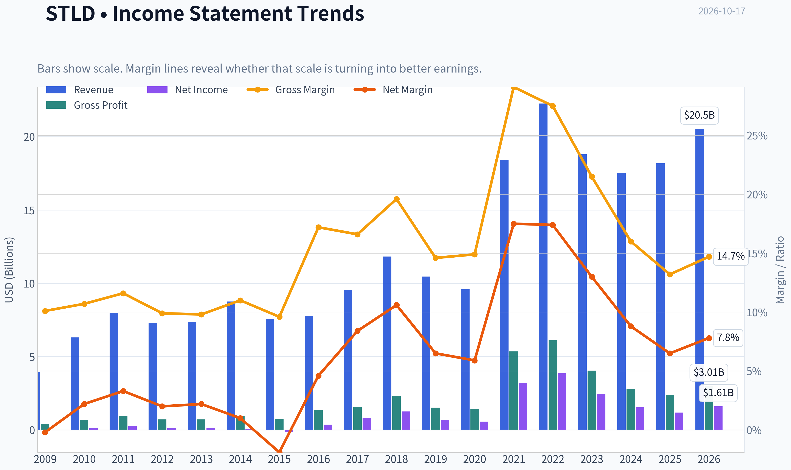

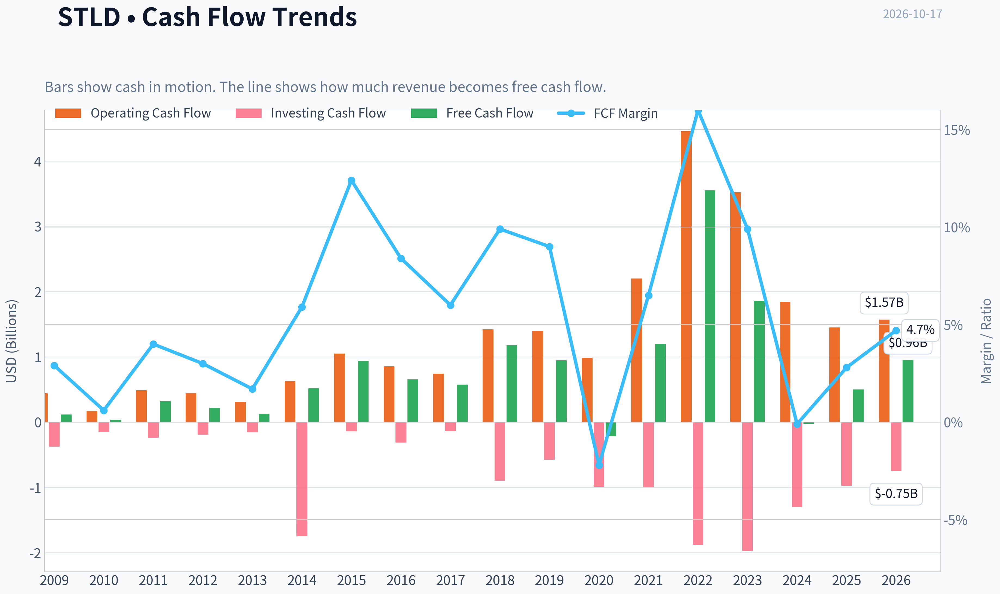

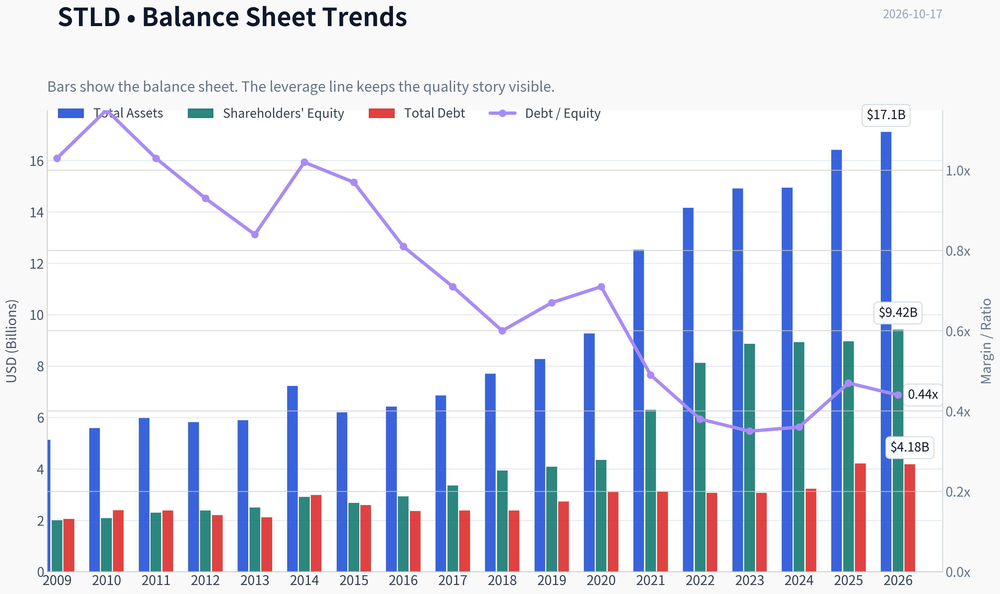

This graph tracks the profitability and return metrics (ROE, ROIC, Margins) of **STLD** over the past decade, highlighting capital efficiency trends.

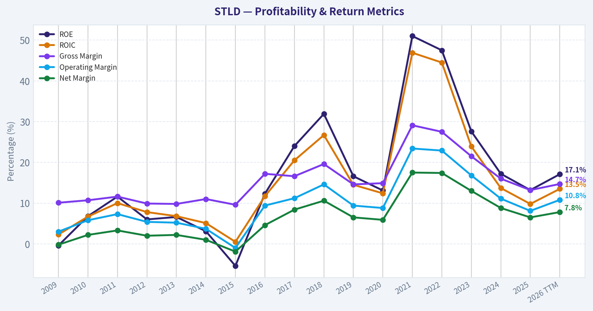

This chart illustrates the financial health of **STLD** over the last 10 years, mapping cash equivalents and free cash flow against total obligations (Debt).

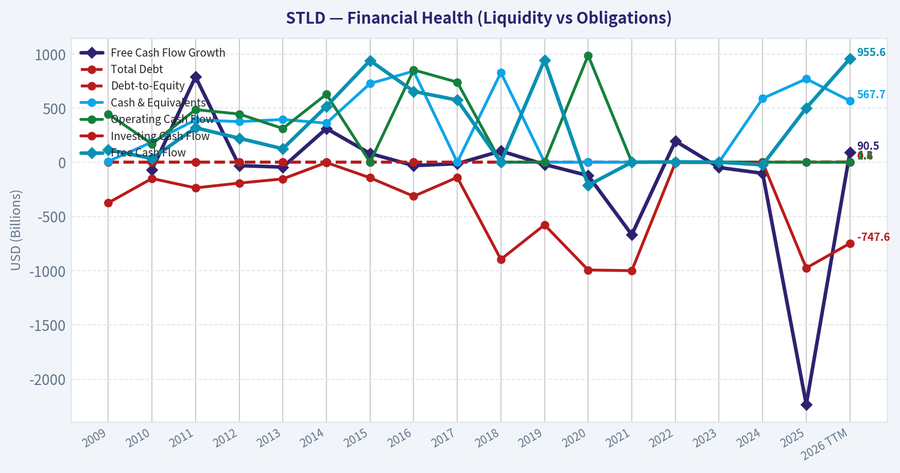

This comparison chart from *Profitability and Earnings Quality* stacks current figures against historical benchmarks for **STLD**, making it easy to see where the company trades relative to its own averages.

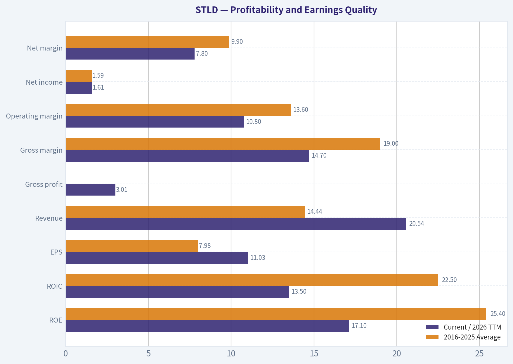

---

### Intrinsic Value Analysis (Buffett)

> *Following Warren Buffett's value investing philosophy: Circle of Competence, Economic Moat, Management Quality, and Margin of Safety.*

#### Intrinsic Value Snapshot

Price is what you pay. Intrinsic value is what the business may be worth based on the cash it can create for owners over time. We show a range, not one magic number.

- Current Price: $240.54
- Value Range (conservative to optimistic across both DCF methods): $-5.54 to $1,551.53

##### Owner Earnings (Buffett Method)
- Net Income: $1,185,595,000.00
- Depreciation & Amortization: $551,390,000.00
- Capital Expenditures: $-948,025,000.00
- Working Capital Changes: $-442,339,000.00
- Owner Earnings: $1,627,934,000.00

##### Intrinsic Value
###### Buffett Method
Uses owner earnings. Stricter, and usually more conservative.
- Conservative: $42.63
- Average: $580.38
- Optimistic: $1,551.53
- Discount Rate: 10.0%

###### Cash Flow Method
Uses free cash flow. Better for companies spending heavily today to grow tomorrow.
- Conservative: $-5.54
- Average: $92.00
- Optimistic: $594.16
- Discount Rate: 10.0%

ANALYST STANCE: **WATCH**

#### Executive Conclusion

Steel Dynamics is a well-run, vertically integrated steel producer with meaningful cost advantages, strong liquidity, and a history of attractive cyclical returns. However, it remains a capital-intensive and economically sensitive business. At $241 per share, the stock offers only a 13.3% margin of safety against the headline intrinsic value of $277.40-too narrow for a cyclical company whose recent three-year revenue trend has declined.

The business is worth monitoring, but the current price does not provide a sufficiently attractive risk-adjusted entry point.

#### 1. Factor Scorecard

| Factor | Score | Assessment |
|---|---:|---|
| Circle of Competence & Simplicity | 3/5 | The company makes money by producing and processing steel, but profitability depends heavily on steel prices, spreads, scrap costs, and industrial demand. |
| Durable Competitive Advantage | 3/5 | Vertical integration, modern electric-arc furnaces, scale, and recycling expertise provide a narrow-to-moderate moat. The moat is not immune to commodity cycles. |
| Management & Capital Allocation | 4/5 | Steel Dynamics has generally demonstrated disciplined operations, shareholder orientation, and sensible reinvestment. |
| Industry Structure | 3/5 | The U.S. steel market has consolidation and trade protection, but remains cyclical, capital intensive, and exposed to demand swings. |

**Key Takeaways:** Steel Dynamics is a good operator in a difficult industry, not a classic wide-moat compounder. Its competitive advantages can produce excellent returns during favorable steel cycles, but earnings and cash flow are less predictable than those of a consumer or asset-light platform business.

#### Gate 5: Quality and Solvency

**The hard floor is not tripped.** The available information shows a cyclical earnings slowdown, but not clear evidence of simultaneous financial distress and a solvency red line. The company reports a strong current ratio of approximately 3.1, and there is no indication that interest coverage has fallen below 1x.

#### 2. Moat Analysis

| Moat Source | Evidence | Rating |
|---|---|---:|
| Cost Advantage | Scale, electric-arc furnace technology, scrap recycling, and vertical integration can support lower costs than weaker competitors. | 4/5 |
| Intangible Assets | Brand and proprietary process know-how help, but steel products are largely commodities. | 2/5 |
| Switching Costs | Customers can often source steel from multiple producers, although qualification requirements and reliability matter. | 2/5 |
| Network Effects | Essentially absent. | 0/5 |
| Overall Moat | Narrow and operational rather than brand- or network-based. | 3/5 |

**Key Takeaways:** Steel Dynamics' moat comes primarily from cost structure and execution. Its facilities, scale, and operating expertise are difficult to replicate quickly, but customers generally do not face strong switching costs and steel remains subject to competitive pricing.

#### 3. Management Quality and Capital Allocation

Management receives a relatively favorable assessment for:

- Building a vertically integrated and increasingly efficient operating model.
- Investing in modern production capacity rather than relying solely on legacy assets.
- Operating with substantial liquidity.
- Returning capital while continuing to reinvest in the business.

The main limitation is that even excellent management cannot eliminate the steel cycle. Capital allocation decisions made near the top of the cycle carry greater risk, particularly when expansion projects are large and steel spreads later normalize.

#### 4. Financial Summary

| Metric | Latest Available Figure |
|---|---:|
| Share price | $241 |
| Market capitalization | $34.48 billion |
| Revenue | $20.5 billion |
| Operating profit | $2.2 billion |
| Net income | $1.6 billion |
| P/E ratio | 21.8x |
| ROE | 13.2% |
| Gross margin | 13.2% |
| Revenue growth, latest year | 3.6% |
| Trailing three-year revenue growth | -24.4% |
| Free-cash-flow yield | 1.5% |
| Current ratio | 3.06 |
| Headline intrinsic value | $277.40 |
| Margin of safety versus price | 13.3% |
| Reverse-DCF implied annual growth | Approximately 6.4% for 10 years |

**Key Takeaways:** The balance sheet appears sound, but current cash generation is not especially compelling at the present valuation. The 13.2% ROE is respectable but below the level expected from a truly exceptional compounder, while the negative three-year revenue trend highlights the company's cyclical exposure.

#### 5. Owner Earnings and Cash-Flow Reality Check

The Buffett-style formula is:

> Owner earnings = net income + depreciation and amortization - maintenance capital expenditures - working-capital investment

The available figures provide net income and free-cash-flow yield, but do not separately identify maintenance capital expenditures and working-capital investment. Therefore, reported FCF is the most conservative observable cash-flow proxy.

| Calculation | Approximate Result |
|---|---:|
| Implied equity value | $34.48 billion |
| FCF yield | 1.5% |
| Implied annual FCF | Approximately $517 million |
| Implied FCF per share | Approximately $3.62 |
| FCF-based no-growth value at 10% | Approximately $36 per share |

**Key Takeaways:** The reported FCF yield implies only modest current cash generation relative to the share price. This likely understates normalized owner earnings if the company is operating below mid-cycle profitability, but investors must be careful not to capitalize peak steel-cycle earnings as if they were permanent.

#### 6. Three-Scenario DCF Valuation

Because Steel Dynamics is cyclical, a single-year FCF valuation is especially sensitive to where the company sits in the cycle. The following framework uses the observable FCF proxy for the conservative cases and the provided normalized cyclical valuation for the third case.

| Scenario | Method | Value per Share |
|---|---|---:|
| A. No growth | Current FCF proxy divided by 10% discount rate | ~$36 |
| B. GDP growth | FCF proxy growing at 3%, capitalized at a 10% discount rate | ~$53 |
| C. Normalized cyclical value | Weighted blend of owner-earnings DCF, FCF valuation, and Damodaran FCFF model | $277.40 |
| Owner-earnings model | Provided model output | $580.38 |
| FCF model | Provided model output | $92.00 |
| Damodaran FCFF model | Provided model output | $104.48 |

**Key Takeaways:** The valuation range is exceptionally wide, from roughly $36 to $580 per share, demonstrating how dependent the investment case is on normalized rather than current cash flows. The $277.40 headline value is reasonable as a blended cyclical estimate, but it should not be treated as a precise intrinsic value.

#### 7. Margin of Safety Analysis

At $241 per share:

- Headline intrinsic value: **$277.40**
- Implied upside to headline value: **approximately 15.1%**
- Margin of safety versus price: **13.3%**
- Reverse-DCF growth assumption: **approximately 6.4% annually for 10 years**

For a wide-moat, high-ROIC, highly predictable compounder, a 10% to 15% margin of safety could be acceptable. Steel Dynamics does not fully qualify for that standard because:

- Its earnings are cyclical.
- Its products are largely commodities.
- Its recent three-year revenue trend is negative.
- Current FCF yield is only 1.5%.
- ROE is solid but not exceptional.

A more appropriate entry point would provide at least a 25% to 35% margin of safety, implying a preferred purchase range near or below approximately **$180 to $208 per share**, depending on confidence in normalized earnings.

#### 8. Final Buffett Scorecard

| Criterion | Weight | Score | Weighted Score |
|---|---:|---:|---:|
| Moat Width & Durability | 25% | 3.0 | 0.75 |
| Valuation / Margin of Safety | 20% | 3.0 | 0.60 |
| Capital Returns versus WACC | 15% | 3.0 | 0.45 |
| Business Understanding & Predictability | 12% | 3.0 | 0.36 |
| Management Quality & Capital Allocation | 12% | 3.5 | 0.42 |
| Reinvestment Runway | 8% | 3.0 | 0.24 |
| Balance Sheet Strength | 4% | 4.0 | 0.16 |
| Industry Structure | 4% | 3.0 | 0.12 |
| **Total** | **100%** |  | **3.10 / 5.00** |

**Key Takeaways:** Steel Dynamics scores well enough to remain investable, but not well enough to justify paying a narrow margin of safety for a cyclical business. The strongest attributes are management, liquidity, scale, and operating efficiency; the main weaknesses are cyclicality, commodity exposure, and valuation sensitivity.

#### Investment Stance

**WATCH - Moderate conviction**

Steel Dynamics is a competent, financially sound steel producer with genuine operating advantages. At the current price, however, the valuation leaves insufficient protection against a normalization of steel prices, weaker industrial demand, or lower operating spreads.

A patient value investor should wait for either:

1. A materially lower share price, preferably near $180-$208; or
2. Clear evidence that normalized owner earnings are substantially higher and more durable than current FCF suggests.
#### Valuation Bridge

This bridge places the current market price beside each intrinsic value lens so readers can see whether upside depends on one method or shows up across several methods.

| Scenario | Intrinsic Value / Share |
| --- | ---: |
| Buffett Method | $580.38 |
| Cash Flow Method | $92.00 |
| Damodaran Method | $104.48 |
| Current Price | $240.54 |

#### Key Takeaways

If one method is far above the others, the upside case depends on a specific modelling assumption. When several methods cluster together, the valuation story is more robust.

#### Valuation Visuals

This comparison chart from *Latest Earnings Snapshot* stacks current figures against historical benchmarks for **STLD**, making it easy to see where the company trades relative to its own averages.

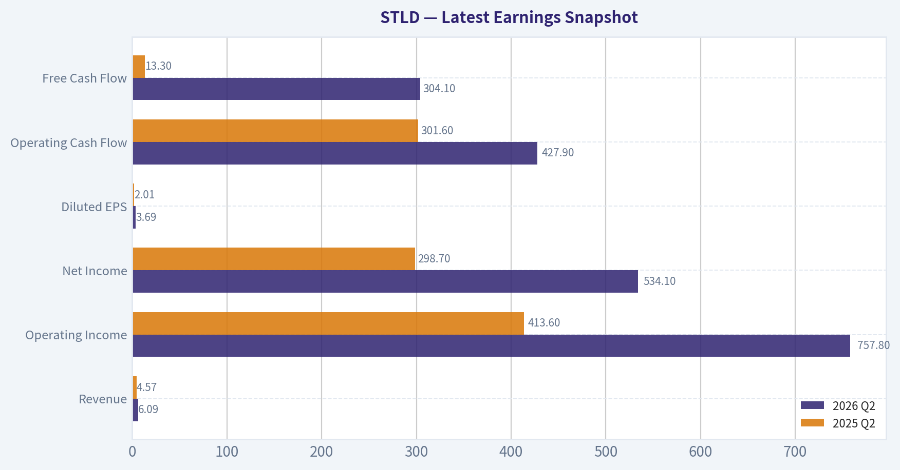

This comparison chart from *Current Metrics Versus Ten-Year Averages* stacks current figures against historical benchmarks for **STLD**, making it easy to see where the company trades relative to its own averages.

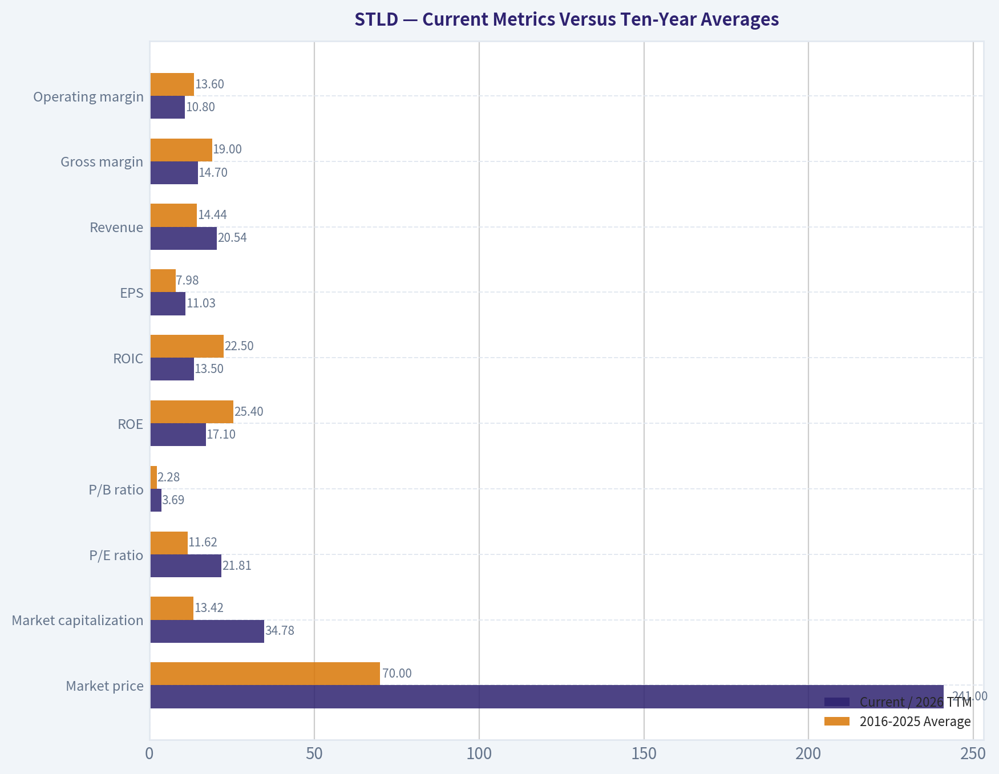

This comparison chart from *Balance Sheet and Financial Strength* stacks current figures against historical benchmarks for **STLD**, making it easy to see where the company trades relative to its own averages.

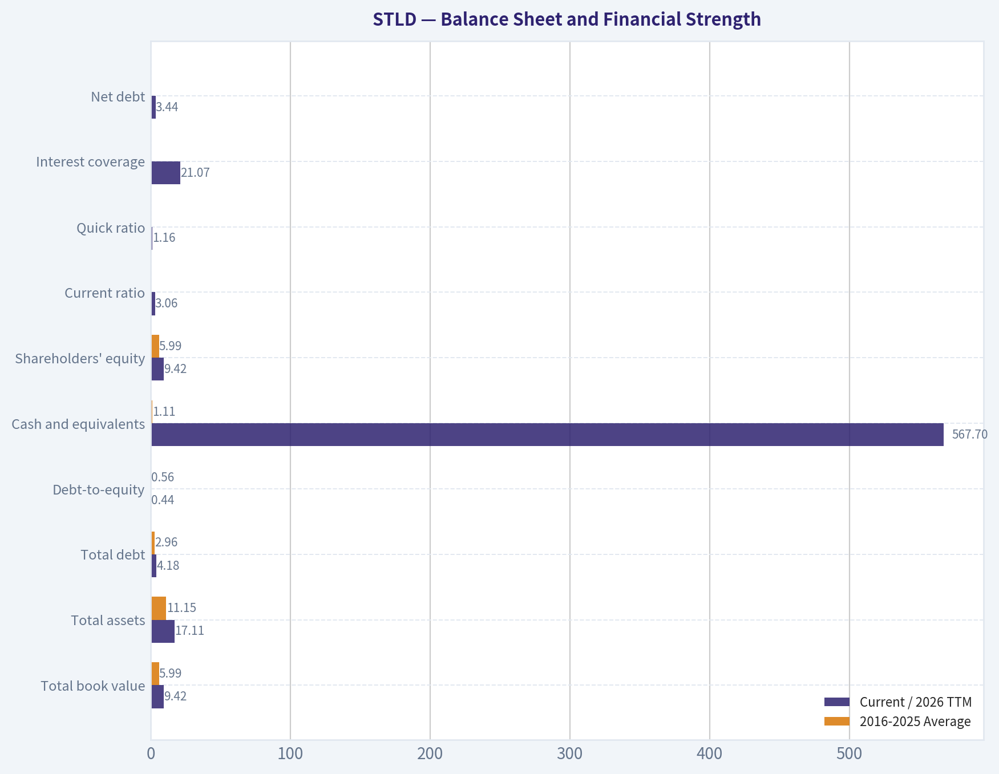

This comparison chart from *Cash Flow and Capital Allocation* stacks current figures against historical benchmarks for **STLD**, making it easy to see where the company trades relative to its own averages.

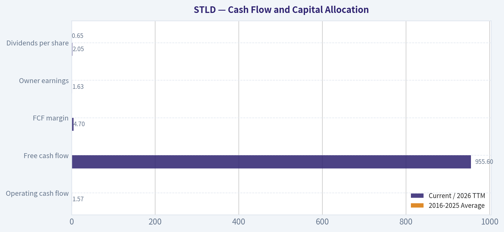

The following chart maps the **STLD** Owner Earnings DCF valuation scenarios (Conservative, Average, Optimistic) to visually represent the margin of safety based on intrinsic value calculations.

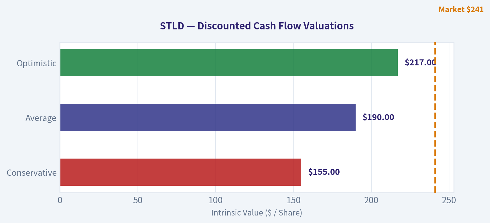

---

### Trend & Growth Analysis (Lynch/Druckenmiller/Fisher)

> *Following Peter Lynch's GARP, Stanley Druckenmiller's macro-aware approach, and Philip Fisher's scuttlebutt methodology.*

ANALYST STANCE: **WATCH**

#### Executive View

Steel Dynamics is a high-quality steel operator, but it does not currently fit a classic Lynch fast-grower profile. Revenue growth is only 3.6%, the business is cyclical, and the valuation is not especially compelling on earnings or cash flow despite a headline intrinsic value above the current price.

The stock is more suitable for a cyclical-value or quality-industrial strategy than for a concentrated ten-bagger growth portfolio.

#### 1. Lynch Classification

| Category | Assessment |
|---|---|
| Lynch classification | Cyclical |
| Revenue growth | 3.6% year over year |
| P/E | 21.8x |
| ROE | 13.2% |
| FCF yield | 1.5% |
| Primary investment case | Steel-cycle recovery, operational execution, and capital returns |
| Ten-bagger suitability | Low to moderate |

**Key Takeaways:** STLD is primarily a cyclical industrial company, not a 15%-25% structural growth company. Its strong operating history and market position are positives, but the current growth profile does not support a high-conviction fast-grower classification.

#### 2. The Story in Three Bullets

- Steel Dynamics operates efficient electric-arc-furnace steel mills and benefits from domestic steel production, infrastructure spending, and reshoring.
- Its value proposition is operational efficiency, disciplined capital allocation, and exposure to long-term U.S. manufacturing investment.
- The key upside driver is a stronger steel-price and volume cycle, rather than a rapidly expanding software-like TAM.

#### 3. TAM and 10x Test

| Metric | Assessment |
|---|---|
| Current market capitalization | $34.5 billion |
| Latest annual revenue | Approximately $20.5 billion |
| 10x revenue thought experiment | Approximately $205 billion |
| Market structure | Large, mature, cyclical steel market |
| TAM growth | Likely low-to-moderate structurally, with cyclical swings |
| 10x test | Difficult to pass organically without major industry expansion or acquisitions |

**Key Takeaways:** STLD participates in a very large market, but the steel industry is mature and capital intensive. A tenfold increase in revenue would likely require substantial acquisitions, market-share gains, or a major expansion in end-market demand; this is not a clean long-duration ten-bagger setup.

#### 4. Revenue Growth Trend

| Indicator | Result | Interpretation |
|---|---:|---|
| Revenue growth, year over year | 3.6% | Stagnant-to-low growth |
| Trailing three-year growth context | -24.4% | Highly cyclical performance |
| Operating profit, latest annual period | Approximately $2.2 billion | Profitable, but cycle-sensitive |
| Net income, latest annual period | Approximately $1.6 billion | Strong earnings base |
| Near-term EPS expectation | Approximately $5.40-$5.42 quarterly | Positive earnings expectations, but not evidence of secular acceleration |

**Key Takeaways:** Revenue is not currently showing the acceleration required for a Druckenmiller-style inflection thesis. The historical decline over three years reinforces that STLD's results are heavily influenced by steel prices, spreads, and industrial demand.

#### 5. Unit Economics and Financial Quality

| Metric | Assessment |
|---|---|
| LTV/CAC | Not applicable; industrial producer |
| Net revenue retention | Not applicable |
| Rule of 40 | Not applicable |
| Gross margin | 13.2% |
| Current ratio | 3.06 |
| FCF yield | 1.5% |
| Balance-sheet liquidity | Strong current ratio |
| Operating model | Capital intensive and commodity-sensitive |

**Key Takeaways:** Subscription metrics such as LTV/CAC, NRR, and Rule of 40 do not apply to STLD. Liquidity is a meaningful strength, but the low FCF yield indicates that the current share price already discounts a substantial amount of normalized cash generation.

#### 6. Inflection Point Assessment

| Potential inflection | Current assessment | Signal |
|---|---|---|
| Product cycle | No clear disruptive product cycle | Neutral |
| Market share | Potential gains from domestic reshoring | Positive but gradual |
| Margin | Could improve with stronger steel spreads and utilization | Cyclical |
| TAM | Infrastructure and manufacturing demand provide support | Moderate |
| Competitive environment | Electric-arc-furnace efficiency is an advantage | Positive |
| Earnings acceleration | Not yet demonstrated in available data | Unconfirmed |

**Key Takeaways:** The most credible inflection would be a synchronized improvement in steel spreads, mill utilization, and domestic manufacturing demand. That would create earnings acceleration, but it would be a cyclical recovery rather than proof of a permanently higher growth trajectory.

#### 7. Macro Setup

| Macro factor | Assessment |
|---|---|
| Infrastructure and reshoring | Favorable secular support |
| U.S. manufacturing investment | Favorable |
| Steel prices and spreads | Critical near-term variable |
| Interest rates | Higher rates can pressure construction and industrial demand |
| Economic cycle | Requires monitoring; steel is economically sensitive |
| Macro conclusion | Mixed, with favorable secular themes but meaningful cyclicality |

**Key Takeaways:** The long-term domestic manufacturing and infrastructure themes are supportive. However, STLD remains exposed to economic slowdowns, construction activity, steel imports, and changes in steel pricing, making the macro setup less dependable than that of a secular software or healthcare compounder.

#### 8. Fisher 15-Point Assessment

| Fisher criterion group | Score |
|---|---:|
| Market potential and long-term demand | 3/5 |
| Product and R&D orientation | 3/5 |
| Sales organization and execution | 4/5 |
| Profit margins and margin potential | 4/5 |
| Labor and executive relations | 4/5 |
| Management depth and accounting discipline | 4/5 |
| Competitive advantages | 4/5 |
| Long-range profit outlook | 3/5 |
| Dilution risk | 4/5 |
| Management candor and integrity | 4/5 |
| **Total** | **37/50 equivalent; approximately 56/75** |

**Key Takeaways:** STLD appears to score well on execution, operational discipline, balance-sheet quality, and competitive positioning. Its main Fisher weakness is not management quality but the cyclical and mature nature of the market, which limits the certainty of long-term compounding.

#### 9. Valuation Analysis

| Valuation measure | Result | Interpretation |
|---|---:|---|
| Share price | $241 | Reference price |
| Market capitalization | $34.48 billion | Large-cap industrial |
| P/E | 21.8x | Reasonable only if earnings are near normalized or rising |
| Implied PEG using 3.6% growth | Approximately 6.1x | Expensive under a growth framework |
| FCF yield | 1.5% | Low for a cyclical industrial |
| Headline intrinsic value | $277.40 | Approximately 13.3% above current price |
| Reverse-DCF implied growth | Approximately 6.4% annually for 10 years | Market assumes moderate long-term growth |

**Key Takeaways:** The headline intrinsic value suggests some upside, but the valuation evidence is mixed. A PEG near 6 is unattractive because current earnings growth is modest, while the 1.5% FCF yield offers limited margin of safety for a cyclical company. The valuation becomes more compelling only if normalized earnings are materially above current reported levels.

#### 10. Scenario Analysis

| Scenario | Operating assumption | Indicative outcome |
|---|---|---|
| Bear | Steel spreads normalize downward and industrial demand weakens | Significant earnings and multiple compression risk |
| Base | Stable domestic demand, moderate margins, continued disciplined execution | Roughly fair value to modest upside |
| Bull | Strong reshoring, infrastructure demand, higher utilization, and wider spreads | Potential upside toward or above intrinsic-value estimate |
| Ten-bagger case | Requires major industry expansion, acquisitions, or sustained extraordinary share gains | Low probability |

**Key Takeaways:** The bull case is credible as a cyclical earnings scenario, but it is not the same as a durable ten-bagger thesis. The downside is meaningful because a 21.8x P/E and 1.5% FCF yield leave limited protection if steel profitability declines.

#### 11. Growth Investor Scorecard

| Criterion | Weight | Score | Weighted contribution |
|---|---:|---:|---:|
| The Story | 10% | 3.5/5 | 0.35 |
| TAM and runway | 20% | 2.5/5 | 0.50 |
| Revenue growth | 20% | 2.0/5 | 0.40 |
| Unit economics | 15% | 3.5/5 | 0.53 |
| Competitive position | 10% | 4.0/5 | 0.40 |
| Management quality | 10% | 4.0/5 | 0.40 |
| Macro setup | 5% | 3.0/5 | 0.15 |
| Profitability path | 5% | 4.0/5 | 0.20 |
| Valuation | 5% | 2.5/5 | 0.13 |
| **Total** | **100%** |  | **3.06/5** |

**Key Takeaways:** STLD scores approximately 3.1 out of 5, placing it in the WATCH range. Its strengths are competitive execution, profitability, liquidity, and management; its weaknesses are low growth, cyclicality, limited TAM expansion, and an unimpressive cash-flow yield.

#### 12. Position Size Stance

| Investor type | Suggested stance |
|---|---|
| Ten-bagger growth investor | Do not initiate a large position |
| Existing shareholder | Hold and monitor cycle indicators |
| Cyclical-value investor | Small or moderate position may be appropriate |
| High-conviction growth portfolio | Wait for stronger revenue and earnings acceleration |
| Position sizing | Starter position only, if owned for cyclical exposure |

**Key Takeaways:** STLD does not warrant a large position in a concentrated growth portfolio based on the currently available evidence. A smaller position could make sense for investors deliberately seeking high-quality domestic steel-cycle exposure, but the thesis should be monitored like a cyclical trade.

#### 13. Key Catalysts and Risks

| Catalysts | Risks |
|---|---|
| U.S. reshoring accelerates | Steel prices and spreads decline |
| Infrastructure and manufacturing demand rises | Recession reduces construction and industrial volumes |
| Higher mill utilization improves margins | Imports and pricing pressure increase |
| New capacity ramps successfully | Capital intensity suppresses free cash flow |
| Earnings exceed approximately $5.40 quarterly expectations | Valuation contracts if earnings peak |
| Continued share repurchases or dividends | Current valuation proves too high for normalized cash flow |

**Key Takeaways:** The strongest catalysts are a recovery in steel spreads, higher utilization, and continued domestic manufacturing investment. The main risk is buying a cyclical earnings peak at a valuation that assumes relatively favorable long-term conditions.

#### Bottom Line

STLD is a well-run, financially solid cyclical industrial company, but it currently lacks the revenue acceleration, expanding TAM, and valuation cushion required for an aggressive growth recommendation. The stock becomes more interesting if revenue growth reaccelerates above 10%-15%, free-cash-flow conversion improves, and the valuation falls closer to the mid-teens earnings range.

**Final stance: WATCH.**

---

### Market Technical Analysis

ANALYST STANCE: **WATCH**

#### STLD technical overview

STLD closed at **$240.54 on October 16, 2026**, after trading between **$239.76 and $248.92**. The broader trend remains constructive because price is well above the rising 200-day SMA, but the intermediate trend is less decisive: price is only slightly above the 50-day SMA, while momentum has recently improved from a September-early October weakness.

The most relevant indicator set for this market context is:

- **10 EMA** for short-term direction and momentum.
- **50 SMA** for intermediate trend and dynamic support.
- **200 SMA** for the primary trend regime.
- **MACD** for momentum reversal and confirmation.
- **RSI** for momentum strength and overextension.
- **Bollinger Upper and Lower Bands** for range position and breakout or reversal risk.
- **ATR** for volatility-adjusted risk management.

| Indicator | October 16 value | Recent direction | Interpretation |
|---|---:|---|---|
| Price | $240.54 | Rebounded from late-September weakness | Short-term recovery, but below the recent $245-$249 resistance area |
| 10 EMA | $238.46 | Rising | Price is modestly above the short-term average, supporting near-term bullish momentum |
| 50 SMA | $238.97 | Slightly declining | Intermediate trend remains flat to mildly weak; price has not yet created a decisive separation above it |
| 200 SMA | $219.18 | Rising | Strong long-term bullish regime; price is approximately 9.8% above this benchmark |
| MACD | 1.01 | Improved from -4.19 on October 1 | Momentum has turned positive, although the recovery is still relatively recent |
| RSI | 54.3 | Recovered from the mid-30s | Neutral-to-positive momentum; neither overbought nor oversold |
| Bollinger upper band | $246.75 | Roughly stable | Nearby resistance and potential overextension zone |
| Bollinger lower band | $221.77 | Stable | Important downside range marker and broad support area |
| ATR | $7.11 | Down from approximately $8.62 on September 21 | Volatility has moderated, but daily price swings remain significant |

**Key Takeaways:** STLD has a bullish long-term structure, with price substantially above a rising 200-day SMA. However, the medium-term trend is still being repaired because the 50-day SMA is nearly flat to slightly declining. Short-term momentum has improved, but price is approaching the upper end of its recent volatility range, so confirmation above $246-$249 would be more constructive than buying directly into resistance.

#### Trend structure and moving averages

The long-term signal is the strongest part of the chart. The 200-day SMA rose from approximately **$212.36 on September 17 to $219.18 on October 16**, showing that the longer-term trend remains upward despite the sharp correction from the June high near $287.40. Price is currently about **$21.36 above the 200-day SMA**, leaving a substantial long-term cushion.

The intermediate picture is more complicated. The 50-day SMA declined from approximately **$243.26 on September 23 to $238.97 on October 16**. This indicates that the prior medium-term advance lost momentum, and the September decline pulled the average lower. Nevertheless, the stock has reclaimed the 50-day SMA and finished slightly above it, which is an early sign of stabilization rather than a fully confirmed intermediate uptrend.

The 10 EMA provides a more encouraging short-term signal. It rose from approximately **$229.28 on October 1 to $238.46 on October 16**, and the closing price remained above it. The relationship among the averages is therefore mixed but improving: the 10 EMA is rising, the 50 SMA is relatively flat or mildly declining, and the 200 SMA is clearly rising. This is typical of a stock attempting to transition from a correction into a renewed advance.

Key levels are:

- **Near-term support:** approximately $238-$239, where the 10 EMA and 50 SMA converge.
- **Secondary support:** approximately $229-$234, corresponding to recent consolidation and prior reaction lows.
- **Major trend support:** approximately $219, near the 200-day SMA.
- **Initial resistance:** approximately $246-$249.
- **Higher resistance:** approximately $257-$260, where the August recovery stalled.

A sustained close above the $246-$249 area would improve the medium-term technical picture. Conversely, a decisive loss of $238 would weaken the recent recovery and expose the stock to a retest of the low-$230s.

#### Momentum: MACD and RSI

MACD has undergone a notable improvement. It fell to approximately **-4.19 on October 1**, reflecting substantial downside momentum after the September selloff. It then recovered steadily, turning slightly positive around October 13 and reaching **1.01 on October 16**. This is a meaningful momentum reversal and suggests that buyers have regained short-term control.

However, MACD should not be interpreted as proof that a durable uptrend has already resumed. The signal has only recently moved above zero, and the price remains close to resistance. A stronger confirmation would involve MACD continuing to rise while price breaks above $246-$249 and holds that zone on subsequent pullbacks. If MACD turns lower while price remains below that resistance, the recent improvement could represent only a countertrend rebound.

RSI at **54.3** is constructive but not aggressive. It has recovered from readings near **36** at the end of September, indicating that downside momentum has eased. At the same time, RSI is well below the traditional overbought threshold of 70, so the stock is not technically stretched on this measure. The current RSI profile leaves room for additional upside if price breaks resistance, but it also does not provide a strong oversold-reversal signal because the initial rebound has already occurred.

The combination is moderately positive: MACD is giving the stronger bullish signal, while RSI confirms improving momentum without indicating excessive optimism.

#### Bollinger Bands and volatility

At the October 16 close, STLD was approximately **$5.79 below the upper Bollinger Band at $246.75** and nearly **$18.77 above the lower band at $221.77**. This places price in the upper half of its recent range, but not yet at an extreme. The upper band is close enough to act as an immediate decision point.

A close above $246.75, particularly if accompanied by expanding volume and follow-through, could signal a breakout from the recent consolidation. Yet because the upper band is relatively near current price, a move into the $246-$249 area could also produce short-term profit-taking. Price riding the upper band would be bullish if momentum remains strong; a sharp rejection there would instead suggest that the recovery is still range-bound.

ATR has declined from approximately **$8.62 in late September to $7.11**, indicating that volatility has cooled from the most turbulent phase of the correction. Even so, an ATR of $7.11 remains substantial relative to the $240.54 share price, equivalent to roughly **3% of the stock price per session**. Traders should therefore avoid using very tight stops that could be triggered by ordinary daily fluctuations.

For risk control, a stop distance of roughly one ATR below an entry may be more technically coherent than a narrowly placed stop, although the appropriate distance depends on position size and time horizon. A break below the $229-$234 area would be more technically meaningful than a one-day dip below the 10 EMA.

#### Trading interpretation

The setup is best characterized as **long-term bullish, short-term recovering, and medium-term unconfirmed**.

For bullish traders, the preferable confirmation would be:

1. A close above approximately **$246-$249**.
2. Continued positive MACD momentum.
3. RSI holding above 50 rather than immediately reversing.
4. Price remaining above the converging 10 EMA and 50 SMA.

A more conservative entry would wait for a breakout and subsequent successful retest of the $246 area. This would reduce the risk of buying directly beneath resistance.

For traders already holding STLD, the rising 200-day SMA argues against treating the stock as structurally bearish solely because of the earlier correction. However, the 50-day SMA remains an important tactical line. A sustained move below approximately $238 would weaken the recovery, while a decline toward the low-$230s would indicate that the rebound has failed to establish intermediate-term control.

The main risk is a false breakout. STLD has experienced several large directional swings over the past year, and the current price is near the upper part of its recent range. A breakout without follow-through could quickly return the stock toward the 50-day SMA or lower. The main bullish opportunity is that the recent MACD recovery occurs while RSI remains moderate, meaning momentum has improved without obvious overbought conditions.

#### Indicator selection rationale

| Selected indicator | Why it is useful for STLD now |
|---|---|
| 10 EMA | Measures whether the recent rebound is maintaining short-term traction |
| 50 SMA | Identifies whether the intermediate correction is ending and provides nearby support |
| 200 SMA | Confirms that the primary long-term trend remains bullish |
| MACD | Detects the recent transition from negative to positive momentum |
| RSI | Tests whether the rebound has strength without being overextended |
| Bollinger upper band | Defines the immediate breakout and resistance zone |
| Bollinger lower band | Provides a broad downside range and support reference |
| ATR | Converts the stock's elevated daily volatility into more realistic risk controls |

**Key Takeaways:** This indicator mix avoids excessive redundancy while covering trend, momentum, range position, and risk. The 10 EMA, MACD, and RSI capture the recent recovery, while the 50-day and 200-day averages distinguish medium-term uncertainty from long-term strength. Bollinger Bands and ATR are particularly important because STLD's price swings remain large enough to create false signals and premature stop-outs.

#### Bottom line

STLD is not presenting a clean, fully confirmed buy signal at the October 16 close. The long-term trend is clearly positive, and short-term momentum has improved materially, but the stock is approaching resistance near **$246-$249** while the 50-day SMA is still not decisively rising.

The technical bias is therefore **constructive but conditional**. A sustained breakout above $246-$249 would favor continuation toward the $257-$260 region, while failure near resistance followed by a break below $238 would shift the setup back toward range trading or a retest of lower support. For now, **WATCH** is more appropriate than an aggressive chase.

| Key area | Current reading | Trading implication |
|---|---:|---|
| Last close | $240.54 | Near the upper half of the recent range |
| 10 EMA | $238.46 | Short-term support; bullish while price holds above it |
| 50 SMA | $238.97 | Key intermediate pivot; currently nearly flat to mildly declining |
| 200 SMA | $219.18 | Strong long-term trend support |
| MACD | 1.01 | Positive and improving, but breakout confirmation is still needed |
| RSI | 54.3 | Neutral-to-positive; not overbought |
| Resistance | $246-$249 | Breakout zone and immediate decision point |
| Secondary resistance | $257-$260 | Potential upside target if breakout holds |
| Support | $229-$234 | Important fallback zone if the $238 area fails |
| ATR | $7.11 | Volatility remains high; use appropriately wide risk parameters |
| Overall stance | Watch | Long-term bullish, short-term recovering, medium-term unconfirmed |

**Key Takeaways:** STLD's primary trend remains bullish, but the stock needs to clear $246-$249 to convert its recent recovery into a stronger intermediate-term signal. Holding above $238 would preserve the constructive setup, while a break below that level would increase the probability of a deeper pullback. The most balanced approach is to wait for breakout confirmation or a controlled pullback rather than chase the stock immediately below resistance.

---

### Options Market Analysis

> *Reading options flow - put/call ratios, IV skew, and unusual activity - to gauge institutional positioning and event-driven risk.*

#### STLD Options Flow Report

**As of October 17, 2026.** The supplied options data covers the November 20, December 18, 2026, and January 15, 2027 expirations. Strike-level data and the current STLD share price were not provided, so ITM/ATM/OTM classification and precise gamma-wall analysis are limited.

#### Put/Call Ratio Analysis

| Expiration | Call OI | Put OI | Put/Call OI | Call Volume | Put Volume | Put/Call Volume |
|---|---:|---:|---:|---:|---:|---:|
| Nov. 20, 2026 | 2,726 | 2,948 | 1.08 | 326 | 330 | 1.01 |
| Dec. 18, 2026 | 2,389 | 1,571 | 0.66 | 517 | 305 | 0.59 |
| Jan. 15, 2027 | 2,241 | 1,867 | 0.83 | 304 | 278 | 0.91 |
| **Total** | **7,356** | **6,386** | **0.87** | **1,147** | **913** | **0.80** |

**Key Takeaways:** Aggregate put/call OI is 0.87, modestly above the historical neutral reference of approximately 0.70, but it is not an extreme level of bearish positioning. Volume favors calls, with a 0.80 put/call volume ratio, driven primarily by December call activity. The November expiration is more defensive at 1.08, while December is distinctly call-heavy at 0.66.

#### Implied Volatility Assessment

| Expiration | Call ATM IV | Put ATM IV | Call-Put IV Difference | Assessment |
|---|---:|---:|---:|---|
| Nov. 20, 2026 | 47.3% | 44.2% | +3.1 percentage points | Elevated overall; calls priced richer at ATM |
| Dec. 18, 2026 | 45.7% | 40.5% | +5.2 percentage points | Call premium and upside-demand signal |
| Jan. 15, 2027 | 45.0% | 38.5% | +6.5 percentage points | Strongest call-over-put IV differential |

**Key Takeaways:** Near-term ATM IV is relatively high, ranging from approximately 45% to 47% for calls and 39% to 44% for puts. The supplied data shows a call-side IV premium rather than a conventional downside put skew, which is consistent with greater demand for upside exposure or potential call overwriting effects. No catalyst calendar was supplied, so it is not possible to confirm whether this IV elevation is specifically earnings- or event-driven.

**Important limitation:** These are ATM IV comparisons, not true OTM skew measurements. A definitive put-skew-versus-call-skew analysis would require OTM options at comparable deltas, such as 25-delta puts versus 25-delta calls.

#### Unusual Options Activity

| Finding | Result | Interpretation |
|---|---|---|
| Contracts with volume greater than 5x open interest | None identified | No clearly fresh, outsized directional trades under the tool's screening rule |
| Largest aggregate volume concentration | December 2026 | Call volume substantially exceeds put volume |
| Evidence of institutional-style sweep activity | Not available | No trade-level data, premium, execution side, or sweep flags supplied |

**Key Takeaways:** There are no contracts meeting the volume-to-open-interest threshold for unusual activity. The absence of flagged contracts lowers conviction and prevents a reliable distinction between opening institutional positions, closing trades, and retail speculation. The December call-heavy flow is constructive, but it is not strong enough by itself to qualify as confirmed smart-money accumulation.

#### Open Interest Concentration and Gamma Levels

| Expiration | Total Call OI | Total Put OI | Combined OI | Relative Concentration |
|---|---:|---:|---:|---|
| Nov. 20, 2026 | 2,726 | 2,948 | 5,674 | Highest combined OI; put-heavy |
| Dec. 18, 2026 | 2,389 | 1,571 | 3,960 | Call-heavy |
| Jan. 15, 2027 | 2,241 | 1,867 | 4,108 | Moderately balanced, slightly call-heavy |

**Key Takeaways:** November has the largest combined open interest and may exert the greatest near-term expiration-related influence. However, strike-level open interest was not provided, so specific max-pain levels, gamma walls, support, resistance, or pinning strikes cannot be identified. Overall gamma effects should therefore be treated as uncertain rather than assumed to be either dampening or amplifying.

#### Overall Options Sentiment

**Signal: BULLISH, with moderate-to-low conviction.**

The primary bullish drivers are the 0.80 aggregate put/call volume ratio, the 0.66 December put/call OI ratio, and the consistent call-side IV premium across all three expirations. These indicate stronger demand for upside exposure than for downside protection in the December and January maturities.

The main caveats are the November put/call OI ratio above 1.0, the aggregate OI ratio of 0.87 still being above the 0.70 neutral reference, and the lack of any volume-heavy individual contracts. Options activity is also relatively modest, with only 2,060 contracts of combined reported volume across the three expirations, so the signal should not be treated as high conviction.

#### Summary

| Category | Assessment |
|---|---|
| Put/Call Ratio | **Mildly bullish on volume; mixed on OI.** Aggregate OI ratio is 0.87, while volume ratio is 0.80. |
| IV Level | **Elevated.** ATM IV is approximately 39%-47%, with calls generally higher than puts. |
| Skew Direction | **Call-favoring based on available ATM data.** True OTM skew cannot be confirmed. |
| Unusual Activity | **None flagged.** No contracts had volume greater than 5x open interest. |
| Overall Signal | **BULLISH, moderate-to-low conviction.** December call demand is the main positive driver, offset by November put concentration and limited trade-level evidence. |

**Key Takeaways:** STLD's options market leans bullish, primarily because call volume and call-side implied volatility are stronger than put activity in the December and January maturities. The signal is not high conviction because no individual unusual contracts were identified and strike-level positioning is unavailable. Treat this as a modest upside bias rather than a decisive institutional buy signal.

---

## Research Team Commentary

> *The Research Manager synthesizes the Bull vs Bear debate into action-free commentary. This is a pre-risk view, not the final stance.*

Core Takeaway: Steel Dynamics is an above-average operator in a structurally cyclical industry, but $241 does not provide a sufficient margin of safety. Its efficient electric-arc furnaces, vertical integration, modern assets, liquidity, and credible management create a relative cost advantage. They do not create control over steel prices or protect returns from excess industry capacity. With reported ROIC at 9.5%, investors are being asked to pay for a meaningful improvement in future economics before that improvement has been demonstrated.

The strongest bull argument is that STLD should not be valued like an undifferentiated legacy steel producer. Its flexible EAF model can help it remain profitable deeper into downturns, take share from higher-cost capacity, and capitalize on a multiyear U.S. infrastructure, grid, and reshoring cycle. Modern capacity and vertical integration could raise utilization, margins, and normalized owner earnings. The reverse DCF also shows that the current price is not necessarily irrational: using $11.05 per share as owner earnings, a 9% discount rate, and 2.5% terminal growth, $241 implies approximately 7% annual growth. That is achievable if new capacity performs well and management continues allocating capital intelligently.

The strongest bear argument is that "achievable" is not the same as "conservative." STLD has a narrow operational moat, not durable pricing power. Competitors can add similar EAF capacity, and visible reshoring demand may induce enough new supply to restrain utilization and margins. At a more appropriate 10% discount rate for a commodity producer, the implied growth hurdle rises toward 8.5%. That is demanding when current ROIC is only 9.5% and reported EPS may overstate owner earnings because mills require substantial maintenance capital, growth spending, and working capital.

The valuation evidence therefore leans bearish, but not decisively enough for AVOID. We do not have normalized free cash flow, cycle-adjusted margins, net debt, utilization, or incremental project-return data. Without those inputs, it would be a mistake to assume the roughly $11.05 EPS base is either peak earnings or depressed earnings. That distinction can radically change the valuation of a cyclical company.

The bull's proposed $220-$235 entry range also looks too aggressive from a Buffett perspective. It represents only a modest discount to the optimistic valuation cases. For an above-average but cyclical and capital-intensive business, I would generally require roughly a 25-35% discount to conservative intrinsic value, unless STLD first proves that its normalized ROIC has moved sustainably into the low-to-mid teens. If conservative value is around $200-$225 based on normalized owner earnings, a more compelling entry would likely be below roughly $180-$195. That range should be revised as actual free-cash-flow and project-ramp data arrive; it is not a mechanical price target.

Rationale: STLD passes the business-quality test relative to its industry, but not yet the predictable-compounder test. Management appears operationally capable, liquidity reduces financial risk, and investment in modern assets is strategically sensible. Still, capital expenditure creates value only when incremental returns exceed the cost of capital through a complete cycle. The current 9.5% ROIC suggests only a modest economic spread, and a 13.2% gross margin leaves earnings sensitive to pricing, input costs, and utilization.

Market psychology also deserves attention. Investors may be extrapolating infrastructure spending and reshoring without fully accounting for competitors' supply responses. That is a familiar commodity-cycle hazard: an attractive demand story can lead every producer to invest simultaneously, ultimately weakening returns. Conversely, it would be equally mistaken to treat a high trailing P/E or mediocre current ROIC as proof the shares must fall. If earnings are near a cyclical trough and new assets are about to ramp, the apparent premium could disappear quickly.

This is where the prior lessons matter. Weak trailing metrics should not dominate the analysis of a cyclical company, and a mediocre long-term compounding profile does not automatically predict poor short-term stock performance. The options put/call open-interest ratio of 0.87 signals mild caution, not extreme bearishness. Since actual moving-average and momentum readings were not supplied, there is no basis for making a tactical bearish call. STLD could continue rising on steel pricing, project execution, trade policy, or sector momentum even if its long-term expected return from $241 is unappealing.

Accordingly, the correct distinction is that STLD may be a good cyclical stock without being an attractive Buffett-style purchase at today's price. Existing shareholders with a low cost basis need not sell solely because the shares appear fully valued, but a new long-term investor should wait for either a materially better price or evidence that the company's normalized economics have improved.

Monitoring Plan: Over the next one to four quarters, the most important evidence will be free-cash-flow conversion after both maintenance and growth capital expenditure. If cash generation consistently supports or exceeds the approximately $11 per-share earnings base, the reverse-DCF assumptions become more credible. Persistent cash flow below accounting earnings would weaken the thesis.

Second, watch the utilization, cost performance, customer qualification, and timing of new capacity. On-time ramps without material overruns would support the bull case. Delays, low utilization, or unexpectedly high working-capital requirements would indicate that the market capitalized the benefits too early.

Third, track ROIC and, where disclosed, incremental returns on recently completed projects. A sustainable move above 12%, with a credible path toward the low-to-mid teens, would materially improve the investment case. ROIC remaining near 9.5% after the new assets mature would suggest that expansion is adding scale rather than meaningful economic value.

Fourth, monitor steel spreads, domestic capacity additions, imports, scrap and energy costs, and management's comments about industry utilization. Strong demand accompanied by disciplined supply would be constructive. Rising volumes alongside shrinking spreads would confirm the bear concern that reshoring benefits producers less than the headline narrative implies.

Finally, examine capital allocation. Repurchases would be attractive at a genuine discount to conservative intrinsic value, but questionable near $241 unless management has superior visibility into normalized cash generation. Rising leverage or continued expansion despite weak incremental returns would be a warning. A price decline alone would not justify buying; the business and balance-sheet thesis must remain intact.

STLD is worth following closely because it is one of the better businesses in steel. At $241, however, the market price appears to assume successful execution and high-single-digit owner-earnings growth while offering inadequate protection against normal cyclical disappointment.

Final stance: WATCH

---

## Value Investing Team Commentary

> *The Investor translates the research view into an investment thesis before risk review. This is still not the final stance.*

### Business Quality and Moat

Steel Dynamics is one of the better operators in a difficult industry. Its electric-arc-furnace model, modern plants, scrap integration, operational discipline, and substantial liquidity should allow it to compete more effectively than higher-cost legacy producers. These advantages can support market-share gains and better downside resilience through the cycle.

The distinction, however, is between a **relative cost advantage** and a durable pricing-power moat. STLD cannot independently determine steel prices, industry utilization, imports, scrap costs, or competitors' capacity decisions. Its moat is therefore operational and narrow rather than structural and wide. That can make STLD an excellent steel company without making it a predictable compounder comparable to an asset-light franchise.

The reported metrics reinforce that distinction:

- ROIC: 9.5%
- ROE: 13.2%
- Gross margin: 13.2%
- P/E: 21.81 at approximately $241

These are respectable results for a cyclical producer, but the present ROIC does not demonstrate a large economic spread over the company's cost of capital. The central question is whether current investment will lift normalized returns or merely increase production capacity in an industry where competitors are doing the same thing.

### Long-Term Opportunity

The bull case has substance. U.S. infrastructure spending, grid investment, manufacturing reshoring, and domestic supply-chain security could support steel demand for years. STLD's modern EAF assets should benefit disproportionately if domestic demand grows while less-efficient capacity is retired.

Successful project execution could produce several benefits:

1. Higher utilization and shipment volumes
2. Lower unit costs from modern assets
3. Greater vertical integration and internal sourcing
4. Better product mix and customer relationships
5. More resilient free cash flow across the cycle

This means STLD should not automatically be valued like an undifferentiated legacy producer. If management can move normalized ROIC above 12% and ultimately into the low-to-mid teens, the business may deserve a meaningfully higher valuation than its historical industry classification suggests.

Nevertheless, demand growth alone is not sufficient. Commodity industries frequently convert attractive demand stories into excessive capital spending. If multiple producers expand simultaneously, stronger demand can coexist with disappointing utilization, spreads, and shareholder returns.

### Valuation and Reverse-DCF Test

At $241 and approximately $11.05 per share of assumed owner earnings, the stock offers an initial owner-earnings yield of only about 4.6%. That is not compelling for a capital-intensive, cyclical business unless owner earnings grow materially.

Using a 9% discount rate and 2.5% terminal growth, the current price implies approximately 7% annual owner-earnings growth over the explicit forecast period. That is plausible if new capacity ramps efficiently and the industry environment remains favorable.

But a 9% discount rate appears generous for a commodity producer. At a 10% required return, the growth hurdle rises to roughly 8.5%-9%. Sustaining that result would require more than a temporary steel-price recovery. STLD would need strong utilization, disciplined industry supply, effective cost control, and consistently attractive returns from its investment program.

The valuation is therefore not obviously irrational, but it leaves little room for ordinary cyclical disappointment. At the current price, investors are largely underwriting the favorable project-execution case before the resulting cash flow and incremental returns have been demonstrated.

The greatest valuation uncertainty is the quality of the $11.05 earnings base. Reported EPS is not necessarily owner earnings. Maintenance capital expenditure, working-capital demands, and the cash costs of bringing new facilities to efficient utilization must be deducted before determining distributable economic earnings. A conventional DCF based on one year of cyclical earnings can create false precision.

### Management and Capital Allocation

Management's operating record and willingness to invest in modern capacity are strengths. Strong liquidity also reduces the risk that STLD will be forced into unfavorable financing or asset sales during a downturn.

Still, expansion should be judged by returns rather than scale. Management must demonstrate that incremental projects can earn well above the cost of capital through a complete cycle. A project that increases revenue and EBITDA but leaves consolidated ROIC around 9.5% may enlarge the company without creating substantial per-share value.

Repurchases deserve similar scrutiny. Buying back stock near $241 is attractive only if management possesses credible evidence that normalized owner earnings are materially above the current estimate. Repurchases at a cyclical high or ahead of execution setbacks would destroy value, even if they increase short-term EPS.

### Selective Contrarian View

The optimistic narrative is easy to understand: infrastructure, reshoring, trade protection, modern EAF facilities, and a superior operator. Because this narrative is visible and widely discussed, it is unlikely to be entirely unrecognized by the market.

The contrarian risk is that investors are capitalizing the demand opportunity while underestimating the supply response. In commodity businesses, an attractive industry forecast can encourage every producer to expand, causing returns on new capital to fall below expectations. STLD's efficiency helps it survive that outcome better than weaker competitors, but it does not eliminate the industry economics.

There is also a legitimate contrarian bull case. Current ROIC and accounting earnings may understate future economics if substantial assets are in their ramp-up phase. If those projects reach high utilization without major cost overruns, free cash flow could rise faster than trailing metrics imply. In that scenario, the apparently expensive multiple would decline without the share price falling.

The options put/call open-interest ratio of 0.87 indicates mild caution rather than panic. This is not the kind of extreme pessimism that normally creates an obvious contrarian buying opportunity. Conversely, the data do not support a tactical bearish conclusion. Without actual price-relative moving averages, momentum readings, and support levels, it would be inappropriate to infer that the shares are about to decline merely because long-term valuation appears demanding.

### What Would Change the Investment Case?

The case would become more attractive if:

- Free cash flow consistently matches or exceeds the approximately $11-per-share earnings base after maintenance and growth spending.
- New projects ramp on schedule and within budget.
- Utilization rises without a corresponding collapse in steel spreads.
- Normalized ROIC moves sustainably above 12%, with a credible path toward the mid-teens.
- Management remains disciplined on expansion and repurchases.
- The share price falls enough to provide a 25%-35% discount to conservatively estimated intrinsic value while the business thesis remains intact.

The case would weaken if:

- Cash conversion remains materially below accounting earnings.
- Working-capital and maintenance requirements prove higher than expected.
- Domestic capacity additions outpace demand growth.
- Spreads contract despite stronger shipment volumes.
- New facilities suffer delays, qualification problems, or weak utilization.
- Management increases leverage or continues expanding despite mediocre incremental returns.

The proposed $180-$195 area could become attractive, but it should not be treated as an automatic buy zone. It must be reassessed against normalized free cash flow, the balance sheet, project execution, and industry conditions at that time.

### Investment Conclusion

STLD is a good operator in an inherently cyclical and capital-intensive business. Its modern assets and cost structure provide meaningful advantages over weaker steel producers, but they do not create durable control over pricing or industry supply. At $241, the valuation requires successful execution and sustained high-single-digit owner-earnings growth while providing insufficient protection against normal cyclical setbacks.

Existing long-term shareholders with a favorable cost basis do not need to sell solely because the stock appears fully valued. For a new investor, however, patience is warranted. The better opportunity would come from either a materially lower price or clear evidence that recent investment has permanently raised normalized free cash flow and ROIC.

**ANALYST STANCE: WATCH** - STLD merits close attention as an above-average cyclical business, but the current price discounts too much of the favorable outcome. Wait for stronger proof of improved through-cycle economics or a substantially better margin of safety.

---

## Deep Values Commentary

> *The Risk Management Team debates and the Risk Judge provides the final action-free verdict. This section determines the final ADVOCATE / WATCH / AVOID stance.*

#### Final Stance Scorecard

This scorecard converts the final research view into a weighted decision frame. It does not replace the narrative judgement, but it makes the main drivers of the verdict easier to scan.

| Criterion | Score | Weight | Commentary |
| --- | ---: | ---: | --- |
| Business Quality | 2.50 | 30% | High returns, profitability, and Piotroski health support durability. |
| Valuation Support | 2.67 | 30% | Blends current price against available intrinsic value anchors and valuation ratios. |
| Financial Strength | 4.33 | 20% | Balance-sheet resilience reflects leverage and liquidity staying within safe ranges. |
| Growth Durability | 3.00 | 20% | Recent revenue, earnings, and free cash flow growth indicate how durable expansion looks. |
| TOTAL / FINAL STANCE | 3.02 | 100% | WATCH |

#### Key Takeaways

The weighted score lands at **3.02 / 5.0**, while the final stance remains **WATCH**. This is useful as a quick calibration aid rather than a mechanical signal.

#### Risk Summary

Higher scores indicate more risk pressure. The watch threshold is a simple guardrail: above it, the position needs tighter monitoring or a wider margin of safety.

| Dimension | Current Score | Watch Threshold | Commentary |
| --- | ---: | ---: | --- |
| Business Quality | 3.50 | 3.00 | High returns, profitability, and Piotroski health support durability. |
| Valuation Support | 3.33 | 3.00 | Blends current price against available intrinsic value anchors and valuation ratios. |
| Financial Strength | 1.67 | 3.00 | Balance-sheet resilience reflects leverage and liquidity staying within safe ranges. |
| Growth Durability | 3.00 | 3.00 | Recent revenue, earnings, and free cash flow growth indicate how durable expansion looks. |

#### Key Takeaways

This view helps readers separate *where* the risk sits: valuation, business quality, balance sheet, or growth durability. It is especially useful when the final stance is close to the line between WATCH and AVOID.
